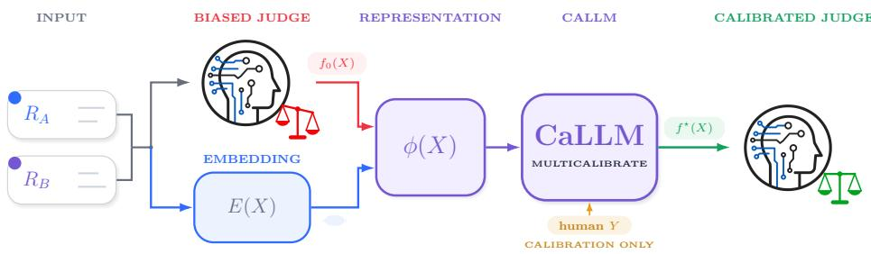
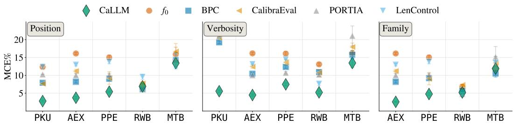
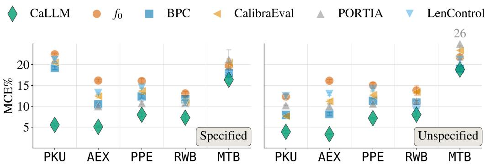
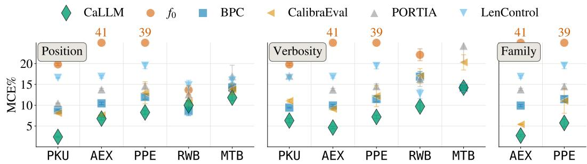
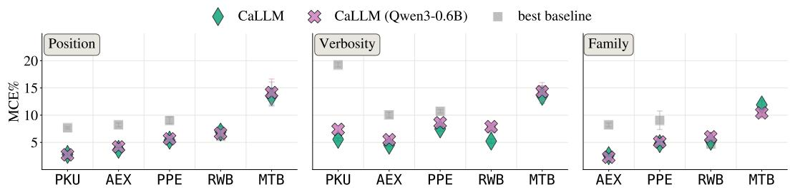
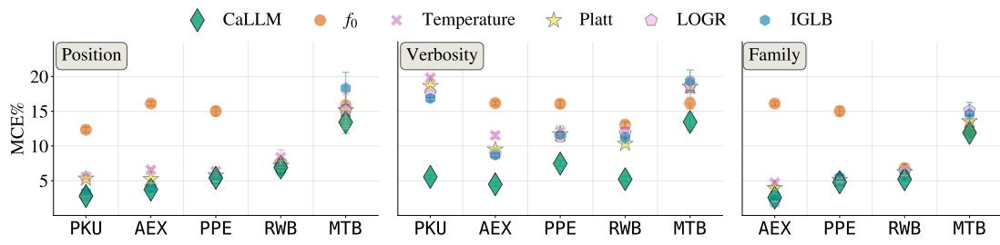

# A CALLM JUDGE IS A BETTER JUDGE: MITIGATING BIAS IN LLM-AS-A-JUDGE

Cesare Barbera1,4∗ Luca Stradiotti2,∗ Lorenzo Cascioli2 Lorenzo Perini3 Niek Tax3 Daniel Haimovich3 Jesse Davis2 Andrea Passerini4 Andrea Pugnana4

1University of Pisa 2KU Leuven 3Meta Platforms, Inc. 4University of Trento

cesare.barbera@phd.unipi.it, {name.surname}@kuleuven.be, {lorenzoperini,niek,danielha}@meta.com, {name.surname}@unitn.it

## ABSTRACT

Large language models (LLMs) are increasingly used as judges to predict which of two candidate answers a human evaluator would prefer, providing a scalable alternative when human evaluation is too costly. Unfortunately, LLM judgments can exhibit systematic biases. Prior work has documented position, verbosity or model family of the candidate answers influencing the judge decision rather than their quality, while additional biases may remain undocumented. Multicalibration provides a natural framework to address this problem: each bias corresponds to miscalibration on an identifiable group, e.g., family bias manifests as overconfidence in answers generated by models belonging to the same family of the judge. The challenge is to fix miscalibration simultaneously across many, potentially unknown groups. To this end, we introduce CaLLM, a post hoc framework that multicalibrates an LLM judge, thereby bounding all such biases simultaneously. We prove that CaLLM bounds the bias of every group whose error structure is captured by an available representation, and that augmenting it with explicit bias groups further reduces the residual bias. We then derive theoretical conditions under which CaLLM improves the judge’s accuracy, rather than trading it for calibration. Finally, we evaluate CaLLM across pairwise preference benchmarks, showing that it reduces the multicalibration error on both specified and unspecified bias groups, while improving predictive performance of the judge.

## 1 INTRODUCTION

When evaluating the outputs of generative models, obtaining human annotations at scale is often too slow and expensive (Li et al., 2024a). As a consequence, the LLM-as-a-judge framework has emerged as a practical alternative (Zheng et al., 2023): a strong language model is prompted to score or compare candidate responses, enabling evaluations at a scale that human raters cannot match. However, LLM judges can exhibit systematic biases that undermine the reliability of their evaluations (Gu et al., 2024; Tian et al., 2025). For example, Zheng et al. (2023) identify three such biases: position bias, i.e. the judge favours the answer shown first or second independently of its content, verbosity bias, i.e. the judge favours longer answers regardless of quality, andfamily bias, i.e. the judge favours answers produced by its own model family.

Although mitigation strategies have been proposed, controlling these biases with theoretical guarantees remains an open challenge (Schroeder and Wood-Doughty, 2024; Li et al., 2025a). We propose viewing systematic biases through the lens of group-wise miscalibration. From this perspective, each bias is a miscalibration of the judge’s confidence within a particular group: e.g., verbosity bias arises in pairwise evaluations where one answer is much longer than the other. To address this within-group miscalibration problem, we resort to Multicalibration (Hebert-Johnson et al.´ , 2018), a theoretical framework that requires predictions to be calibrated simultaneously across identifiable groups. Specifically, for each group, the absolute expected discrepancy between the predictions and the label must be below a small threshold α. Problematically, the bias groups of interest are defined over the original input space, whereas LLM evaluation operates on unstructured text and a multicalibrator can only observe a learned representation of it. This raises the question of whether multicalibration in representation space controls biases defined in the original input space.

  
Figure 1: CaLLM’s pipeline. We feed CaLLM with some representation $\phi ( X )$ of the input $( \mathrm { e . g . }$ embeddings $E ( X )$ and base scores $f _ { 0 } ( X ) )$ . The final output is a multi-calibrated score $f ^ { \star } { \bar { ( X ) } }$

In this work, we address these challenges with Multi-Calibrated Large Language Models (CaLLM), a post hoc bias-mitigation framework that implements bias-correction guarantees in practice (see Figure 1). First, we cast the LLM-as-a-judge bias problem within a multicalibration framework, mapping biases to groups. We then prove that multicalibration in representation space controls bias groups in the original input space whenever their error structure is recoverable from that representation. Importantly, this does not require the groups to be explicitly specified to the calibrator. Finally, we show that, under suitable conditions, bias reduction need not come at the expense of predictive performance, rather CaLLM guarantees improvements of the judge’s accuracy. Overall, CaLLM turns these calibration and performance guarantees into a practical post-hoc procedure for mitigating both explicitly specified and recoverable biases in LLM judges.

Our contributions. In a nutshell, our contributions are:

(i) We formalize the LLM-as-a-Judge biases as a specific instance of a multicalibration problem;

(ii) We propose CaLLM, a post-hoc bias-mitigation strategy that leverages multicalibration to bound identifiable judge’s bias;

(iii) We prove that multicalibration in representation space bounds recoverable input-space bias patterns and derive conditions under which it improves the judge’s accuracy;

(iv) We show on five benchmark datasets that CaLLM mitigates documented biases, while simultaneously improving the performance of the LLM-as-a-judge framework.

## 2 PRELIMINARIES

LLM-as-a-judge. We focus on pairwise evaluation of candidate answers, which has emerged as a popular approach for assessing the quality of LLM outputs (Gu et al., 2024). In this setting, the judge receives a user prompt with two anonymized candidate responses and selects the best output, emulating human preference. More formally, a pairwise evaluation instance is a random variable $X = ( Q , \mathbf { \bar { \it { R } } } _ { 1 } , R _ { 2 } ) \ \in \mathcal { X }$ , where $Q$ is the prompt and $R _ { 1 } , R _ { 2 }$ are two candidate responses, respectively. The binary label space $\mathcal { V } \in \{ 0 , 1 \}$ indicates human preference, with $Y = 1 \left( Y = 0 \right)$ denoting that the human prefers the first (second) answer. We assume access to a given dataset $\mathcal { D } = \{ ( \mathbf { x } _ { i } , y _ { i } ) \} _ { i = 1 } ^ { n }$ of input-output pairs drawn from an unknown joint distribution $\mathcal { P }$ over $\mathcal { X } \times \mathcal { V }$ . The LLM judge induces a continuous scoring function $f : \mathcal { X } \to [ \bar { 0 } , 1 ]$ , which estimates the true conditional probability $\mathbb { P } ( Y = 1 \mid X )$ . Thus, $f ( X )$ is the judge’s confidence in the first answer. We distinguish two instances of the judge’s confidence: $f _ { 0 }$ denotes the base score returned by the judge, and $f ^ { \star }$ the calibrated score. We write $f$ whenever a statement holds for both. We obtain hard predictions by thresholding $f$ at $^ 1 / 2$ and define the judge’s accuracy as $\operatorname { A c c } ( f ) = \mathbb { P } \big ( \mathbb { I } _ { \{ f ( X ) \geq 1 / 2 \} } = \bar { Y } \big )$

Bias groups. We represent each LLM bias through a collection of binary groups ${ \mathcal { G } } .$ Due to the inherently comparative nature of the task, to define groups we first impose a fixed ordering on the candidate responses. Let $\pi : \mathcal { X } \to \widetilde { \mathcal { X } }$ denote a deterministic reordering map such that $\pi ( X ) = ( Q , R _ { A } , R _ { B } )$ , where $R _ { A }$ and $R _ { B }$ are the original responses ordered according to a rule independent of Y and $f ^ { 1 } , \mathbf { e } . \mathbf { g } .$ , the lexicographical ordering of their source-model names. We represent group membership through a measurable attribute $a : \widetilde { \mathcal { X } } \to \mathcal { V } _ { a } .$ , whose value indicates how $R _ { A }$ compares with $R _ { B }$ along the corresponding attribute dimension. Each value $v \in \mathcal V _ { a }$ induces a binary group $\tilde { g } _ { a , v } ( \tilde { X } ) : = \mathbb { I } _ { \{ a ( \tilde { X } ) = v \} }$ . The corresponding group indicator on the original input space is defined by composition, $g _ { a , v } : = \tilde { g } _ { a , v } \circ$ π so that $g _ { a , v } ( X ) = \tilde { g } _ { a , v } ( \pi ( X ) )$ . For simplicity, we henceforth write a generic group as g, omitting the indices $( a , v )$ when they are not needed explicitly.

Example (Documented-biases groups). Documented biases (Zheng et al., 2023) can be represented through thefollowing attributes: (i) Position, $a ^ { \mathrm { p o s } } ( \tilde { X } ) \in \{ - 1 , + 1 \}$ , indicating whether $R _ { A }$ is shown second orfirst; (ii) Verbosity, $a ^ { \mathrm { l e n } } ( \tilde { X } ) \in \{ - 1 , 0 , + 1 \}$ , indicating whether $R _ { A }$ is shorter, the same or longer than $R _ { B } ; ( i i i )$ Family, $a ^ { \mathrm { f a m } } ( \tilde { X } ) \in \{ - 1 , 0 , + 1 , + 2 \}$ , indicating whether neither response belongs to the judge’s modelfamily, only $R _ { B }$ does, only $R _ { A }$ does, or both do. Each group is defined by the presence ofa specific attribute value, or by a combination ofvalues across multiple attributes.

A bias is then a systematic discrepancy between the judge’s confidence and the true human preference rate within these groups. However, measuring bias without accounting for the judge’s confidence may hide discrimination that emerges only at particular confidence levels. Thus, we additionally condition on a finite collection of confidence bands $\mathcal { T } , e . g .$ ., sub-intervals of [0, 1]. Then, for each group, we compute the conditional error within each confidence band and define the judge’s per-group bias as the largest of these errors (Tax et al., 2026):

Definition 1 (Per-group bias). Let G be a collection of measurable group indicators such that $g : \mathcal { X }  \{ 0 , 1 \}$ and let I be a finite collection of sub-intervals of [0, 1]. The per-group bias of f is the worst conditional deviation across confidence bands:

$$
{ \mathrm { b i a s } } _ { g , { \mathcal { T } } } ( f ) : = \operatorname* { m a x } _ { I \in { \mathcal { T } } } \left| \mathbb { E } { \Big [ } Y - f ( X ) \ | \ g ( X ) = 1 , \ f ( X ) \in I { \Big ] } \right|
$$

We stress that (i) this is a distributional notion of bias rather than a bias-specific criterion such as counterfactual swap consistency (Shi et al., 2025); (ii) it applies uniformly to both documented and unspecified biases as it measures conditional deviations over arbitrary bias-induced groups.

Multicalibration. According to Definition 1 the judge is unbiased along g when its residuals $Y - f ( X )$ average to zero within that group across every confidence band. This is a within-group calibration constraint, and controlling every group at once maps precisely to multicalibration (Hebert-´ Johnson et al., 2018), which requires $\dot { f }$ to satisfy the same approximate calibration guarantee simultaneously over a collection G of identifiable groups.

Definition 2 (Multicalibration). Let G be a collection of measurable group indicators such that $g : \mathcal { X }  \{ 0 , 1 \}$ and let I be a finite collection ofsub-intervals $o f [ 0 , 1 ]$ . For $g \in { \mathcal { G } }$ and $I \in { \mathcal { L } } ,$ define the multicalibration deviation and the noise scale as $\Delta _ { g , I } ( f ) : = \mathrm { \normalfont ~ \bar { \mathbb { E } } } \big [ \big ( Y - f ( X ) \big ) g ( X ) \mathbb { I } _ { \{ f ( X ) \in I \} } \big ] ,$ $\tau _ { g } ( f ) ^ { 2 } : = \mathbb { E } \big [ g ( X ) f ( X ) \big ( 1 - f ( X ) \big ) \big ]$ . Given $x \geq 0 .$ , the predictor $f i s \left( \mathcal { G } , \mathcal { T } , \alpha \right)$ -multicalibrated if

$$
\begin{array} { r } { \left| \Delta _ { g , I } ( f ) \right| \ \leq \ \alpha \tau _ { g } ( f ) , \qquad \forall g \in \mathcal { G } , \forall I \in \mathcal { I } } \end{array}
$$

In other terms, $\Delta _ { g , I }$ is the expected amount by which the judge over- or under-states its confidence on the instances such that $g ( \mathbf { x } ) \overset { \mathbf { \bar { \rho } } } { = } 1$ and $f ( \mathbf { x } ) \in { \dot { I } } ,$ , while $\tau _ { g }$ captures the corresponding scale of sampling variability. We quantify how far a judge is from this requirement through the Multicalibration Error (MCE) (Guy et al., 2025) i.e., the largest group-level Expected Cumulative Calibration Error range (ECCE-R) (Arrieta-Ibarra et al., 2022). ECCE-R orders examples by predicted score, cumulatively sums the residuals $y _ { i } - f ( \mathbf { x } _ { i } )$ , and measures the range spanned by this cumulative error curve.

Definition 3 (Multicalibration Error). Consider a collection G of measurable group indicators $g : \mathcal { X }  \{ 0 , 1 \}$ . For each $g \in { \mathcal { G } } ,$ , let $\mathcal { D } _ { g } : = \{ ( \mathbf { x } _ { i } , y _ { i } ) \} _ { i = 1 } ^ { n _ { g } }$ denote the sample restricted to instances satisfying $g ( \mathbf { x } _ { i } ) = 1$ , and let $\operatorname { E C C E - R } _ { g }$ be the ECCE-R computed restricting the sample to $\mathcal { D } _ { g } .$ . Under the null hypothesis ofperfect calibration, define the corresponding noise scale as $\begin{array} { r } { \tau _ { g } ( f ) : = \frac { 1 } { n _ { g } } \sqrt { \sum _ { i = 1 } ^ { n _ { g } } f ( x _ { i } ) \big ( 1 - f ( x _ { i } ) \big ) } } \end{array}$ . The empirical Multicalibration Error off over $\mathcal { G }$ is

$$
\mathrm { M C E } : = \operatorname* { m a x } _ { g \in { \mathcal { G } } } \frac { \mathrm { E C C E } \cdot \mathrm { R } _ { g } ( f ) } { \tau _ { g } ( f ) }
$$

We report MCE both relative to group prevalence $( \mathrm { M C E } _ { \% } )$ and in units of the sampling variation expected under perfect calibration $( \mathrm { M } \bar { \mathrm { C E } } _ { \sigma } )$ . We also report accuracy together with log loss, which is a strictly proper scoring rule (Gneiting and Raftery, 2007). We provide further details in $\mathbf { A }$ ppendix D.

## 3 MULTICALIBRATED LARGE LANGUAGE MODELS

Our work tackles the following problem:

Given: a calibration set $\mathcal { D } ^ { \mathrm { c a l } } \subseteq \mathcal { D }$ and, for each pairwise evaluation, a judge confidence score $f _ { 0 } ( X )$ that $R _ { 1 }$ is preferred and a representation $\phi : \mathcal { X }  \mathbb { R } ^ { d }$ ;

Do: Multicalibrate $f _ { 0 } { \bar { ( } } X )$ , producing a confidence score $f ^ { \star } ( X )$ that controls the bias of every $g \in { \mathcal { G } }$ whose error structure is recoverable from $\phi ( X ) , i . e . , f ^ { \star } \mathrm { i s } ( \mathcal { G } , \mathcal { T } , \alpha )$ multicalibrated.

The core idea of CaLLM is to start with uncalibrated confidence scores and apply a post-hoc multicalibration procedure to uncover and correct systematic biases. This has three challenges. First, standard multicalibration is typically formulated over features from which relevant groups can be directly identified, whereas we operate on a latent representation in which bias groups may be only implicitly encoded. We show that multicalibration nevertheless bounds the residual bias of any group whose error structure can be recovered from this representation (Section $3 . 1 )$ . Second, some bias groups may be known a priori, yet relying solely on the implicit encoding in the representation of their error patterns can weaken the bias-mitigation guarantee. We show that providing these groups directly to the multicalibrator can further reduce their residual error (Section 3.2). Third, correcting bias can change the judge’s decisions, raising the concern that it may reduce accuracy. We show that accuracy improves whenever the confidence gained on corrected decisions is large enough to outweigh the residual calibration error permitted by approximate multicalibration (Section 3.3).

## 3.1 BIAS MITIGATION GUARANTEES FOR MULTICALIBRATED LLM JUDGES

Classical multicalibration is typically formulated over an input space in which relevant groups can be directly identified through interpretable covariates. In our setting, however, the inputs are unstructured natural-language responses, and the multicalibrator instead operates on a learned representation $\phi ( X ) \in \mathbb { R } ^ { d }$ , which can consist, $e . g .$ , of embeddings $E ( X )$ and optionally base scores ${ \bar { f _ { 0 } } } ( X )$ . Consequently, the representation need not preserve group membership itself, but may still preserve the systematic error structure associated with that group. This creates a gap between the groups on which biases are defined and the feature space available to the multicalibrator. We therefore characterize how the information preserved by $\phi ( \dot { X } )$ interacts with the judge’s systematic prediction error. To this end, we derive an interpretable decomposition of the residual bias in an arbitrary inputspace group $g .$ Consider a class $\mathcal { H }$ of functions $h : \mathring { \mathbb { R } ^ { d } }  [ 0 , 1 ]$ defined over the representation $\phi ( X )$ which are available to the multicalibrator. Depending on the choice of $h ,$ these functions may capture group membership, systematic residual structure, or other identifiable patterns in the representation. Unlike prior work on proxy-group multicalibration (Bharti et al., 2025), our decomposition separates missing label information from missing group information, so a group can be protected when the representation captures its error structure, even if it cannot recover the group. Formally, let us denote with $B _ { I } = \{ f ( \dot { X } ) \in I \}$ confidence-band membership and let us define the following quantities $i . e .$

$$
\lambda _ { I } ^ { 2 } = \mathbb { E } \Big [ ( \mathbb { E } [ Y \mid X ] - f ( X ) - \mathbb { E } [ \mathbb { E } [ Y \mid X ] - f ( X ) \mid \phi ( X ) , B _ { I } ] ) ^ { 2 } \mid B _ { I } \Big ] ,
$$

$$
\varphi _ { I } ^ { 2 } = \mathbb { E } \Big [ ( g ( X ) - \mathbb { E } [ g ( X ) \mid \phi ( X ) , B _ { I } ] ) ^ { 2 } \mid B _ { I } \Big ] ,
$$

$$
\psi _ { I } ^ { 2 } = \mathbb { E } \Big [ ( \mathbb { E } [ g ( X ) - h ( \phi ( X ) ) \mid \phi ( X ) , B _ { I } ] ) ^ { 2 } \mid B _ { I } \Big ]
$$

which measure the judge error and group information not captured by $\phi ( X )$ within band I and the representation-level group-approximation error. We now show how these components bound the bias:

Theorem 1 (Residual bias decomposition). Let $\begin{array} { r l r } { g } & { { } \in } & { \mathcal { G } } \end{array}$ and $\begin{array} { r c l } { f i x } & { h } & { \in } \end{array} \mathcal { H }$ and define $\tau _ { h } ( f ) ^ { 2 } \ = \ \mathbb { E } \big [ h ( \phi ( X ) ) ^ { 2 } f ( X ) ( 1 - f ( X ) ) \big ]$ Assume that f is multicalibrated over $( { \mathcal { H } } , { \mathcal { Z } } )$ $i . e . _ { \cdot }$ $\big | \mathbb { E } \big [ ( Y - f ( X \bar { ) } ) h ^ { \prime } ( \phi ( X ) ) \mathbb { I } _ { \{ B _ { I } \} } \big ] \big | \leq \alpha \tau _ { h ^ { \prime } } \bar { ( f ) }$ for all $h ^ { \prime } \in \mathcal { H }$ $I \in \mathcal { Z }$ Fix $h _ { 1 } , \ldots , h _ { m } \in$ H and a constant $C > 0 .$ . For every $I \in { \mathcal { T } }$ with $\mathbb { P } ( B _ { I } ) > 0 ,$ , let $c _ { I } \in \mathbb { R } ^ { m }$ satisfy $\| c _ { I } \| _ { 1 } \leq C$ and define

$$
e _ { I } = \mathbb { E } \Bigg [ \Bigg ( \mathbb { E } \Big [ \mathbb { E } [ Y \mid X ] - f ( X ) \mid \phi ( X ) , B _ { I } \Big ] - \sum _ { j = 1 } ^ { m } c _ { I , j } h _ { j } ( \phi ( X ) ) \Bigg ) ^ { 2 } \Bigg | B _ { I } \Bigg ] ^ { 1 / 2 } .
$$

with $\chi _ { I } = e _ { I } + \sqrt { C \alpha / \mathbb { P } ( B _ { I } ) }$ . Then for every $g \in { \mathcal { G } }$ and $I \in \mathcal { T }$ such that $\mathbb { P } ( g ( X ) = 1 , B _ { I } ) > 0 ,$

$$
\mathrm { b i a s } _ { g , \mathcal { T } } ( f ) \leq \operatorname* { m a x } _ { I \in \mathcal { T } } \frac { \alpha \tau _ { h } ( f ) + \mathbb { P } ( B _ { I } ) \Bigg [ \lambda _ { I } \varphi _ { I } + \psi _ { I } \chi _ { I } \Bigg ] } { \mathbb { P } ( g ( X ) = 1 , B _ { I } ) }
$$

Proof. We provide the proof in Appendix $_ { \mathrm { A . 1 } } ^ { \mathrm { A . 1 } }$

The bound separates three sources of residual bias. The first term, $\alpha \tau _ { h } ( f )$ , is the calibration violation that remains along the representation-space group h. This is controlled directly by multicalibration. Classical multicalibration procedures iteratively identify residual violations over a function class and update the predictor along them, with each non-trivial correction yielding progress in squared prediction error (Hebert-Johnson et al.´ , 2018). Viewing H as the multicalibrator’s function class over $\phi ( X )$ , the residual-orthogonality assumption therefore captures the multicalibration machinery. The second term, $\lambda _ { I } \varphi _ { I }$ , couples the portions of the judge’s error and group membership that are not captured by the representation. Finally, $\chi _ { I } \psi _ { I }$ couples group-approximation error with the systematic error visible in representation space $( e _ { I } )$ plus a multicalibration penalty.

Importantly, the latter two contributions depend on products. Hence, accurate recovery of group membership is not necessary for bias control: $\lambda _ { I } \varphi _ { I }$ can be small if either the relevant error structure or the group structure is well captured by the representation, while $\chi _ { I } \psi _ { I }$ can be small if either little systematic error $( e _ { I } )$ remains visible in representation space or h accurately captures the relevant group component. Thus, poor input-space group recovery alone does not imply poor bias mitigation, what matters is how the information preserved in the representation interacts with the judge’s error.

## 3.2 THE VALUE OF EXPLICIT BIAS SPECIFICATION

Perhaps surprisingly, eliminating the multicalibration term need not mitigate the bias of $g .$ Even under exact residual orthogonality to $h ,$ the interaction between the unrecovered error and group components may remain non-zero. The following proposition shows that this term is unavoidable.

Proposition 1 (Necessity and tightness of the unrecoverable interaction). Assume that $\mathcal { T }$ contains a confidence band including $^ { 1 / 2 , }$ , that H contains the constantfunction $h \equiv 1 / 2 ,$ , and that bias $_ { g , \mathcal { T } } ( f )$ is evaluated only over $I \in \mathcal { Z }$ such that $\mathbb { P } ( g ( X ) = 1 , f ( X ) \in \dot { I } ) > 0$ . Then,for every $p _ { g } \in ( \breve { 0 } , 1 )$ and every $\begin{array} { r } { 0 < \rho \le \frac { 1 } { 2 } \operatorname* { m i n } \{ p _ { g } , 1 - p _ { g } \} } \end{array}$ , there exist a distribution, a group g with $\mathbb { P } ( g ( X ) = 1 ) = p _ { g } ,$ a representation ${ \bar { \phi } } ( X )$ and a predictor $f \equiv 1 / 2$ such that f is perfectly calibrated and the residual is orthogonal to h on every $I \in { \mathcal { I } } .$ . Moreover, for every $I \in \mathcal { I } , \lambda _ { I } \varphi _ { I } = \rho , \chi _ { I } \psi _ { I } = 0$ , while

$$
{ \mathrm { b i a s } } _ { g , { \mathcal { T } } } ( f ) = { \frac { \lambda _ { I } \varphi _ { I } } { p _ { g } } } = { \frac { \rho } { p _ { g } } }
$$

Proof. We provide the proof in Appendix $\mathsf { A } . 2 .$

Consequently, the term $\lambda _ { I } \varphi _ { I }$ cannot in general be removed from the bound of Theorem 1. However, when a documented bias such as position, verbosity, or family is known, its group indicator can be supplied directly to the multicalibrator. Augmenting the representation with $\bar { \boldsymbol { g } } ( \boldsymbol { X } )$ makes the group exactly identifiable and eliminates both group-side approximation terms, $\varphi _ { I }$ and $\psi _ { I }$

Corollary 1 (What naming a bias is worth). Let $g \in { \mathcal { G } }$ be a bias group and consider ${ \tilde { \phi } } ( X ) =$ $[ \phi ( X ) , g ( X ) ]$ . Assume that H contains the coordinate projection $h _ { g } ( \tilde { \phi } ( X ) ) = g ( X )$ . Then, under the setting and assumptions ofTheorem 1, $\varphi _ { I } = \psi _ { I } = 0 f o$ r all $I \in { \bar { \mathcal { Z } } }$ and therefore:

$$
\operatorname { b i a s } _ { g , \mathcal { T } } ( f ) \leq \operatorname* { m a x } _ { I \in \mathcal { T } } \frac { \alpha \tau _ { g } ( f ) } { \mathbb { P } ( g ( X ) = 1 , B _ { I } ) }
$$

Proof. We provide the proof in Appendix A.3.

The corollary isolates what naming a bias is worth: once $g ( X )$ is provided explicitly, both interaction terms in Theorem 1 vanish, leaving only the multicalibration term. Thus, explicit bias specification removes the representation-induced approximation error for that group while preserving the broader protection afforded by the learned representation.

## 3.3 PREDICTIVE PERFORMANCE GUARANTEES FOR MULTICALIBRATED LLM-JUDGES

Multicalibration should not come at the expense of predictive performance. Decision-theoretic analyses of multicalibrated predictors have previously established general guarantees on downstream decision quality (Baldeschi et al., 2025). In the binary classification setting considered here, we derive an explicit accuracy-improvement bound that separates the gain induced by changed decisions from the residual slack permitted by approximate multicalibration. Our analysis begins denoting the two sets of instances whose decision changes after multicalibration with $\begin{array} { r } { \mathcal { C } ^ { \uparrow } : = \{ \mathbf { x } : \overline { { f _ { 0 } ( \mathbf { x } ) < \frac { 1 } { 2 } \leq f ^ { \star } ( \mathbf { x } ) } } \} } \end{array}$ and $\begin{array} { r } { \mathcal { C } ^ { \downarrow } : = \{ \mathbf { x } : f ^ { \star } ( \mathbf { x } ) < \frac { 1 } { 2 } \leq f _ { 0 } ( \mathbf { x } ) \} } \end{array}$ . We denote with $\mathcal { C } : = \mathcal { C } ^ { \uparrow } \cup \mathcal { C } ^ { \downarrow }$ their union. This is the subset of instances such that the two judges $f _ { 0 }$ and $f ^ { \star }$ disagree.

Any result on the net accuracy change between the two judges is restricted to this subset of instances. We decompose the predictive performance variation within C in two interpretable terms. The first term (Γ) is the predicted-utility advantage of the decision rule induced by $f ^ { \star }$ over that induced by $f _ { 0 }$ . It equals the decision margin of instances whose confidences cross the threshold. The second term (ζ) instead accounts for the residual discrepancy between predicted and true utility permitted by approximate multicalibration. Whenever $\Gamma > \bar { \zeta } ,$ , the net accuracy change is strictly positive.

Theorem 2 (Accuracy improvement under multicalibration). Suppose that $f ^ { \star }$ is $( \mathcal G ^ { \star } , \cal T , \alpha )$ multicalibrated, where I contains the intervals $[ 0 , \textstyle { \frac { 1 } { 2 } } )$ and $[ { \frac { 1 } { 2 } } , 1 ]$ . Let $g _ { - } ( X ) = \mathbb { I } _ { \{ f _ { 0 } ( X ) < \frac { 1 } { 2 } \} }$ and $g _ { + } ( X ) = \mathbb { I } _ { \{ f _ { 0 } ( X ) \geq \frac { 1 } { 2 } \} }$ denote the two groups induced by the base judge’s hard prediction and let $\{ g _ { - } , g _ { + } \} \subseteq \mathcal G ^ { \star }$ . Let τ↑ and $\tau ^ { \downarrow }$ denote the corresponding multicalibration scale parameters. Then:

$$
\begin{array} { r } { \mathrm { A c c } ( f ^ { \star } ) - \mathrm { A c c } ( f _ { 0 } ) \ \geq \ \underbrace { \mathbb { E } \left[ \left| 2 f ^ { \star } ( X ) - 1 \right| \mathbb { I } _ { \{ X \in { \mathcal C } \} } \right] } _ { \Gamma } - \underbrace { 2 \alpha \left( \tau ^ { \uparrow } + \tau ^ { \downarrow } \right) } _ { \zeta } } \end{array}
$$

## Proof. We provide proof in Appendix A.4.

The bound reads as a contest between two quantities: the magnitude of the confidence margin for new decisions (Γ), against how much room multicalibration leaves it to be wrong (ζ). Accuracy strictly improves whenever the first exceeds the second, and, $\mathrm { i f } \Gamma > 0 .$ , in the perfectly multicalibrated limit where $\alpha  0 a n y$ decision change is a strict gain.

## 4 EXPERIMENTAL EVALUATION

In the following, we address three research questions:

• Q1. Does CaLLM reduce the biases of the LLM-as-a-judge over existing mitigation strategies without having direct access to the bias groups?

• Q2. Does CaLLM’s bias mitigation further improve when given access to the bias groups?

• Q3. Does CaLLM improve over the baselines’ predictive performance metrics?

The code2 can be found at https://github.com/stralu9/CaLLM.

## 4.1 EXPERIMENTAL SETTINGS

Datasets. We consider five pairwise evaluation datasets from the literature. RewardBench (RWB) consists of 3k prompt-chosen-rejected trios (Lambert et al., 2025). MTBench (MTB) consists of 709 pairwise comparisons over 80 questions (Zheng et al., 2023). Each comparison has LLM-generated answers that are judged pairwise by one or multiple human experts. ArenaExpl (AEX) is a corpus of 53.8k pairwise comparisons extracted from conversational data (Chiang et al., 2024). Here users write the prompt, receive two LLM-generated answers, and act as the judge by expressing a preference. Similarly, PPE contains 10.2k prompts in different languages, with users casting a preference vote for one of two options generated by two LLMs (Frick et al., 2025). Finally, PKU consists of 73.9k pairwise comparisons over safety-oriented prompts. These combine human demonstrations with LLMs (Ji et al., 2025). We use the more helpful answer as ground truth. More details in Appendix C.

Implementation details. We rely on MCGrad (Tax et al., 2026) as the default multicalibrator for CaLLM, because it can automatically search the supplied feature space and thereby uncover undocumented, latent sources of bias. We ablate the choice of multicalibrator and compare with popular calibration techniques in Appendix E.4. To exploit MCGrad’s ability to discover groups automatically, we encode both candidate responses using the open-source Muse-Glimmer-30B (Meta, 2026). We provide results with Qwen3-0.6B (Team, 2025) in Appendix E.3. We denote the resulting embeddings with $e _ { 1 } , e _ { 2 } \in \mathbb { R } ^ { d }$ . Following previous work, we represent each comparison through the Principal Component Analysis (PCA) of the difference embedding (Zhang et al., 2026), denoted as $E ( X ) = \mathrm { P C A } ( e _ { 1 } - e _ { 2 } )$ . We then feed $\phi ( X ) = [ E ( X ) , f _ { 0 } ( X ) ]$ to MCGrad. The former suppresses components shared by the two responses and emphasizes their relative attributes, which are more directly aligned with the structure of pairwise biases. The latter allows to discover miscalibration concealed within confidence bands I. We provide further details in Appendix B.

Baselines. We compare CaLLM against five baselines: (i) the raw verbalized confidence $\left( f _ { 0 } \right)$ which serves as our reference level; (ii) BPC (Wang et al., 2024), which queries the judge with both response orderings and averages the two confidences; (iii) PORTIA (Li et al., 2024b), which interleaves the two responses in a single prompt such that neither of them occupies a privileged position; (iv) CalibraEval (Li et al., 2025b), which queries the judge under swapped orderings and learns a non-parametric, order-preserving mapping that removes the preference for one position; (v) LenControl (Dubois et al., 2024), which models the judge’s preference as a function of response-length difference and then predicts as if both responses had equal length.

Metrics. For Q1 and Q2, we report the maximum error among the groups induced by the biasinducing attribute a, which can be seen as a per-documented-bias Multicalibration Error $( \mathbf { M C E } \% )$ . We report $\mathbf { M C E } _ { \sigma }$ in Appendix E.6. We compute and report this quantity separately for each documented bias. For verbosity and family biases, we set π as the original ordering in which the candidate responses are presented to the judge. This is not suitable for position bias, since every comparison necessarily contains a first and a second response. Thus, we define π using the alphabetical ordering of the responses source-model names, enabling meaningful position-based groups. Following prior work (Tax et al., 2026), we report the $\mathbf { M C E \% }$ over random partitions of the representation of X in Appendix E.1. This shows if the multicalibrator can uncover and mitigate errors on unspecified groups. For Q3, we report accuracy (ACC) together with the log-loss $( \mathcal { L } _ { \mathrm { l o g } } )$ of the judges. For completeness, we report the full results for Q1, Q2, and Q3 in Appendix E.6.

Setup. We use Muse-Glimmer-30B, a recent open-weight causal language model that achieves competitive performance among models of comparable size across a broad range of reasoning and agentic benchmarks (Meta Superintelligence Lab, 2026), as a judge. We ablate the judge choice with Qwen 2.5-7B (Team, 2024) in Appendix E.2. Each instance ${ \cal X } = ( Q , R _ { 1 } , \bar { R } _ { 2 } )$ is judged once, extracting the judge’s verbalized confidence (Tian et al., 2023) $f _ { 0 } ( X )$ that $R _ { 1 }$ is the preferred answer. This choice allows our framework to extend to the black-box setting, where one lacks access to internal model weights. We then either multicalibrate the base scores $f _ { 0 } ( X )$ or apply a baseline method. Concretely, we perform 5-fold cross validation, making sure that different answer pairs for the same prompt always belong to the same fold.

  
Figure 2: Average per-axis $\mathbf { M C E \% }$ (± s.e.) for each method across datasets. PKU doesn’t contain the information regarding the LLMs that generated the responses, so we do not report Family bias.

Table 1: Comparison between CaLLM and $\mathtt { C a L I M } { \mathrm { + } } g$ in terms of $M C E \%$ for documented biases. PKU doesn’t contain the information regarding the LLMs that generated the responses, so we do not report Family bias.
<table><tr><td rowspan="2"></td><td colspan="2">PKU</td><td colspan="2">AEX</td><td colspan="2">PPE</td><td colspan="2">RWB</td><td colspan="2">MTB</td></tr><tr><td> $\mathrm { C a L L M }$ </td><td> $\mathtt { C a L L M } + g$ </td><td>CaLLM</td><td> $\mathtt { C a L L M } + g$ </td><td>CaLLM</td><td> $\mathtt { C a L L M } + g$ </td><td> $\mathrm { C a L L M }$ </td><td> $\mathtt { C a L L M } + g$ </td><td> $\mathrm { C a L L M }$ </td><td> $\mathtt { C a L L M } + g$ </td></tr><tr><td>Position</td><td> $2 . 8 \pm 0 . 2$ </td><td> ${ \bf 2 . 6 \pm 0 . 1 }$ </td><td> $3 . 7 \pm 0 . 3$ </td><td> $\mathbf { \ i } . 5 \pm \mathbf { 0 . } 3$ </td><td> $5 . 4 \pm 0 . 2$ </td><td> ${ \bf 3 . 7 \pm 0 . 3 }$ </td><td> $6 . 9 \pm 1 . 1$ </td><td> ${ \bf 4 . 7 \pm 0 . 5 }$ </td><td> $1 3 . 4 \pm 1 . 6$ </td><td> ${ \bf 1 } 2 . 5 \pm { \bf 1 } . 5$ </td></tr><tr><td>Verbosity</td><td> $5 . 6 \pm 0 . 3$ </td><td> $\mathbf { 2 . 8 \pm 0 . 2 }$ </td><td> $4 . 5 \pm 0 . 3$ </td><td>2.5 ± 0.2</td><td> $7 . 5 \pm 0 . 4$ </td><td> ${ \bf 4 . 0 \pm 0 . 2 }$ </td><td> $5 . 2 \pm 0 . 4$ </td><td> ${ \bf 4 . 7 \pm 0 . 4 }$ </td><td> $1 3 . 5 \pm 1 . 3$ </td><td> ${ \bf 1 } 2 . 3 \pm { \bf 0 . 9 }$ </td></tr><tr><td>Family</td><td></td><td>一</td><td> $2 . 6 \pm 0 . 2$ </td><td>2.5 ± 0.2</td><td> $4 . 8 \pm 0 . 3$ </td><td>4.6 ± 0.4</td><td> $5 . 2 \pm 0 . 3$ </td><td> ${ \bf 4 . 6 \pm 0 . 1 }$ </td><td> $1 1 . 9 \pm 0 . 8$ </td><td> ${ \bf 1 1 . 6 \pm 0 . 2 }$ </td></tr></table>

## 4.2 EXPERIMENTAL RESULTS

Q1: CaLLM shows no significant miscalibration in 12 out of 14 evaluations. We analyze whether CaLLM reduces the Position, Verbosity and Family biases. Fig. 2 reports the average per-group $M C E \%$ across datasets (see Table 9 for full results). We additionally validate our choice of MCGrad as main multicalibration method and compare it with global calibration approaches that also leverage labelled calibration data in Appendix E.4. CaLLM outperforms global calibration methods on all 14 dataset-groups pairs, and MCGrad is the best multicalibration technique on 11 of 14 of them. In Appendix E.5, we assess whether CaLLM can recover groups from the available representation.

We observe that CaLLM achieves the lowest error in 11 out of 14 datasets and is the only method that substantially reduces all three biases, with a median reduction with respect to the uncalibrated model $f _ { 0 }$ of $\approx 6 4 \% , \approx 6 0 \%$ , and $\approx 4 6 \%$ for position, verbosity, and family, vs. at most ≈ $3 6 \% , \approx 2 2 \%$ and $\approx 3 1 \%$ for the other baselines. Interestingly, we observe the largest gains on larger datasets: $e . g .$ on PKU, CaLLM achieves $\mathbf { M C E } _ { \% } \approx 2 . 8 \pm . 2$ for Position (second-best CalibraEval with $\mathrm { M C E \% } \approx 7 . 7 \pm . 2 )$ and $\mathrm { M C E } _ { \% } \approx 5 . 6 \pm . 3$ for Verbosity (second-best $\mathtt { B P C }$ with $\mathrm { M C E } _ { \% } \approx 1 9 . 2 \pm . 4 )$ Conversely, the three exceptions occur on the two smallest datasets: on RWB, where $f _ { 0 }$ shows no strong evidence of Position bias $( \mathrm { M C E } _ { \sigma } = 3 . 4 )$ , and two of the three position-specific baselines (BPC and PORTIA) outperform CaLLM on position. Notably, explicitly providing CaLLM with the position groups reverses this ranking (see Q2); for Family bias, CaLLM is within one standard error of the best method on both RWB and MTB. Notably, CaLLM leaves no strong evidence of miscalibration $( \mathrm { M C E } _ { \sigma } < 4 . 7 1 ) ^ { 3 }$ in 12 out of 14 dataset pairs (reference level was 36% for $f _ { 0 } )$ , with the only exceptions occurring for Verbosity on PKU and AEX, the two largest datasets, where even small deviations are detectable (see Table 9).

Q2: Naming the groups always lowers the per-bias $\mathrm { M C E \% }$ . We quantify what naming a bias is worth by comparing CaLLM with an augmented version $( \mathtt { C a L I M } + g )$ that adds to $\phi ( X )$ the group indicators resulting from the Position, Verbosity and Family biases (see Table 1).

More precisely, we can see that for Position bias, $\mathtt { C a L L M } { + } g$ further reduces MCE on all five datasets, with the largest gains on AEX $( \mathrm { M C E \% }$ passes $\mathrm { f r o m \approx 3 . 7 \pm 0 . 3 ~ t o \approx 2 . 5 \pm 0 . 3 }$ , a drop of ≈ 33% ) and RWB (MCE passes from $\approx 6 . 9 \pm 1 . 1$ to $\approx 4 . 7 \pm 0 . 5 ,$ a drop of ≈ 32% ).

Table 2: Average ACC and log-loss ${ \mathcal { L } } _ { \mathrm { l o g } }$ (± s.e.) across datasets. CaLLM always matches or improves both metrics over all baselines, showing that multicalibration also improves predictive performance.
<table><tr><td rowspan="2"></td><td colspan="2">PKU</td><td colspan="2">AEX</td><td colspan="2">PPE</td><td colspan="2">RWB</td><td colspan="2">MTB</td></tr><tr><td>ACC</td><td> $\mathcal { L } _ { \mathrm { l o g } }$ </td><td>ACC</td><td> $\mathcal { L } _ { \mathrm { l o g } }$ </td><td>ACC</td><td> $\mathcal { L } _ { \mathrm { l o g } }$ </td><td>ACC</td><td> $\mathcal { L } _ { \mathrm { l o g } }$ </td><td>ACC</td><td> $\mathcal { L } _ { \mathrm { l o g } }$ </td></tr><tr><td>CaLLM</td><td> ${ \bf 6 9 \pm . 0 1 }$ </td><td> ${ \bf 5 7 \pm . 0 1 }$ </td><td> ${ \bf . 6 8 \pm . 0 1 }$ </td><td> ${ \bf \delta } { \bf \delta } \mathbf { \delta } \mathbf { \delta } \mathbf { \delta } \mathbf { \delta } \mathbf { \delta } \mathbf { \delta } \mathbf { \delta } \mathbf { \delta } \mathbf { \delta } \mathbf { \delta } \mathbf { \delta } \mathbf { \delta } \mathbf { \delta } \mathbf { \delta } \mathbf { \delta } \mathbf { \delta } \mathbf { \delta } \delta ( \mathbf { \delta } \mathbf { \delta } \mathbf { \delta } \mathbf { \delta } \mathbf { \delta } \mathbf { \delta } \mathbf { \delta } \mathbf { \delta } \mathbf { \delta } \mathbf { \delta } \mathbf { \delta } \delta \mathbf { \delta } \delta \mathbf { \delta } \delta \delta \left( \mathbf { \delta } \mathbf { \delta } \mathbf { \delta } \mathbf { \delta } \mathbf { \delta } \mathbf { \delta } \right)$ </td><td> $. 6 7 \pm . 0 1$ </td><td> ${ \bf \delta } \mathbf { \delta } \mathbf { \delta } \mathbf { \delta } \mathbf { \delta } \mathbf { \delta } \mathbf { \delta } \mathbf { \delta } \mathbf { \delta } \mathbf { \delta } \mathbf { \delta } \mathbf { \delta } \mathbf { \delta } \mathbf { \delta } \mathbf { \delta } \mathbf { \delta } \mathbf { \delta } \mathbf { \delta } \mathbf { \delta } \mathbf { \delta } \mathbf { \delta } \mathbf { \delta } \delta \mathbf { 1 } \delta \mathbf { \delta } \mathrm { ~ \leq ~ } \delta \mathbf { 1 }$ </td><td> ${ \bf . } 9 3 \pm . 0 1$ </td><td> $\mathbf { \delta } _ { 2 1 } \pm \mathbf { \delta } _ { \mathbf { \delta } } \mathbf { 0 1 }$ </td><td> ${ \bf \delta } \mathbf { \delta } \mathbf { \delta } \mathbf { \delta } \mathbf { \delta } \mathbf { \delta } \mathbf { \delta } \mathbf { \delta } \mathbf { \delta } \mathbf { \delta } \mathbf { \delta } \mathbf { \delta } \mathbf { \delta } \mathbf { \delta } \mathbf { \delta } \mathbf { \delta } \mathbf { \delta } \mathbf { \delta } \mathbf { \delta } \mathbf { \delta } \mathbf { \delta } \mathbf { \delta } \mathbf { \delta } \mathbf { \delta } \mathbf { \delta } \mathbf { \delta } \mathbf { \delta } \mathbf { \delta } \delta \mathbf { 1 } \delta \delta \mathbf { \delta } \delta \left( \mathbf { \delta } \mathbf { \delta } \mathbf { \delta } \mathbf { \delta } \mathbf { \delta } \right) \delta \mathbf { \delta } \delta \mathbf { 1 }$ </td><td> $\mathbf { \delta } \mathbf { \mathcal { A } } \mathbf { 1 } \pm . \mathbf { 0 } 2$ </td></tr><tr><td>f0</td><td> $. 6 3 \pm . 0 1$ </td><td> $. 7 3 \pm . 0 1$ </td><td> $. 6 3 \pm . 0 1$ </td><td> $. 7 6 \pm . 0 1$ </td><td> $. 6 4 \pm . 0 1$ </td><td> $. 7 4 \pm . 0 1$ </td><td> $. 8 6 \pm . 0 1$ </td><td> $. 3 6 \pm . 0 2$ </td><td> $. 7 9 \pm . 0 1$ </td><td> $. 4 9 \pm . 0 2$ </td></tr><tr><td>BPC</td><td> $. 6 4 \pm . 0 1$ </td><td> $. 6 7 \pm . 0 1$ </td><td> $. 6 5 \pm . 0 1$ </td><td> $. 6 9 \pm . 0 1$ </td><td> $. 6 5 \pm . 0 1$ </td><td> $. 6 8 \pm . 0 1$ </td><td> $. 8 8 \pm . 0 1$ </td><td> $. 2 9 \pm . 0 1$ </td><td> $. 8 0 \pm . 0 1$ </td><td> $. 4 3 \pm . 0 2$ </td></tr><tr><td>CalibraEval</td><td> $. 6 4 \pm . 0 1$ </td><td> $. 6 5 \pm . 0 1$ </td><td> $. 6 5 \pm . 0 1$ </td><td> $. 6 9 \pm . 0 1$ </td><td> $. 6 5 \pm . 0 1$ </td><td> $. 6 6 \pm . 0 1$ </td><td> $. 8 8 \pm . 0 1$ </td><td> $. 3 0 \pm . 0 1$ </td><td> $. 8 1 \pm . 0 1$ </td><td> $. 4 3 \pm . 0 2$ </td></tr><tr><td>PORTIA</td><td> $. 6 1 \pm . 0 1$ </td><td>.72 ± .01</td><td> $. 6 5 \pm . 0 1$ </td><td>.72 ± .01</td><td> $. 6 6 \pm . 0 1$ </td><td> $. 7 0 \pm . 0 1$ </td><td> $. 8 7 \pm . 0 1$ </td><td> $. 3 1 \pm . 0 2$ </td><td> $. 7 7 \pm . 0 2$ </td><td> $. 5 5 \pm . 0 5$ </td></tr><tr><td>LenControl</td><td>.64 ± .01 .67 ± .01</td><td></td><td></td><td>.65 ± .01 .69 ± .01</td><td></td><td>.65 ± .01 .68 ± .01</td><td></td><td>.88 ± .01 .31 ± .01</td><td> $. 8 0 \pm . 0 1$ </td><td>.43 ± .02</td></tr></table>

For Verbosity bias, CaLLM+g exhibits even stronger gains, with an average reduction of ≈ 32% across the five datasets. In particular, we observe the largest improvements on PKU (≈ 49.4%), PPE (≈ 46.7%) and $\mathtt { A E X } ( \approx 4 3 . 2 \% )$ , the three largest datasets of our collection. For Family bias, we observe smaller improvements, likely due to the fact that CaLLM already performed quite well across all datasets. Still, we can observe some gains on smaller datasets: $e . g .$ on RWB $\mathbf { M C E \% }$ passes from $\approx 5 . 2 \pm 0 . 3 \mathrm { \ t o } \approx 4 . 6 \pm 0 . 1$ . Overall, CaLLM+g completely removes evidence of miscalibration on all datasets by reducing the $\mathrm { M C E } _ { \sigma } \ \mathrm { t o } < 4 . 7 1$ (compared to 12/14 for CaLLM, see Table 10).

Q3: A CaLLM judge is also a better judge. Table 2 displays the results in terms of predictive performance, reporting both ACC and $\mathcal { L } _ { \mathrm { l o g } }$ for all the methods. We can see that CaLLM achieves the highest accuracy on four out of five datasets (matching the best baseline on the fifth) and the lowest log-loss on all five datasets.

Compared with $f _ { 0 }$ , ACC increases by ≈ 4.6 percentage points on average, while $\mathcal { L } _ { \mathrm { l o g } }$ decreases by ≈ 24%. Consistently with previous results, largest gains are obtained on largest data: on PKU, CaLLM passes from $\approx . 6 3 \pm . 0 1 \mathrm { t o } \approx . 6 9 \pm . 0 1 , \mathrm { a } \approx 9 . 8 \%$ increase; on AEX, CaLLM reaches $\approx . 6 8 \pm . 0 1$ starting from a base model of ≈ .63, an improvement of $\approx 7 \%$ . We observe similar patterns also for $\mathcal { L } _ { \mathrm { l o g } }$ , with CaLLM consistently outperforming competitors. The largest gain is on RWB, where $L _ { \mathrm { l o g } }$ drops by 42%, passing from the base level of ≈ $3 6 \pm . 0 2 \ \mathrm { t o } \approx . 2 1 \pm . 0 1$ . Overall, these results suggest that CaLLM effectively enforces predictive performance gains.

## 5 RELATED WORK

LLM judges and bias mitigation. LLM judges provide a scalable alternative to human evaluation through pointwise, pairwise, and reference-guided protocols (Liu et al., 2023; Liusie et al., 2024). Their judgments, however, are affected by position, verbosity, model family, and other incidental attributes (Wang et al., 2024; Panickssery et al., 2024; Koo et al., 2024; Chen et al., 2024; Ye et al., 2025). Existing mitigation strategies modify inference through response swapping, interleaving, panels, or decomposed criteria (Wang et al., 2024; Li et al., 2024b; Verga et al., 2024; Chan et al., 2024; Yang et al., 2026); fine-tune evaluators (Kim et al., 2024; Vu et al., 2024; Zhu et al., 2025); or post-process confidence scores (Dubois et al., 2024; Li et al., 2025b). These methods target predefined biases and may require additional inference or annotated data (Li et al., 2025a). Conversely, CaLLM is post-hoc and controls any bias whose error pattern is recoverable from the supplied representation.

Calibration. Classical parametric and non-parametric calibration methods learn a global correction (Vaicenavicius et al., 2019; Platt, 1999; Guo et al., 2017; Kull et al., 2017; Zadrozny and Elkan, 2002; 2001), with extensions to multiclass scores (Kull et al., 2019; Berta et al., 2026). Local calibration refines this incorporating a notion of distance between inputs (Luo et al., 2022; Barbera et al., 2026a; Lin et al., 2023; Valk and Kull, 2023; Barbera et al., 2026b). Multicalibration instead requires calibration simultaneously across groups identified by a hypothesis class (Hebert-Johnson et al.´ , 2018; Jung et al., 2021; Baldeschi et al., 2025; Jin et al., 2025; Tax et al., 2026). This group-wise formulation matches how LLM-judge biases arise and allows CaLLM to provide guarantees beyond a predefined list of biases (Globus-Harris et al., 2023; Noarov and Roth, 2023).

## 6 CONCLUSION

We tackled bias in LLM-as-a-judge by casting it as a multicalibration problem. We introduced CaLLM, a post-hoc framework that uses the representation of each comparison to identify and correct groups with systematic residual error. We showed that CaLLM bounds every bias group whose residual structure is recoverable from the representation and that explicitly providing a documented group further improves the corresponding guarantees. We showed that multicalibration improves accuracy when changed-decision margins exceed residual slack, which is always true under perfect multicalibration. Across five benchmark data, CaLLM reduces bias on documented biases while improving accuracy and log loss over the raw judge and bias-specific baselines.

Limitations and future work. Our guarantees require the pattern of target biases to be recoverable from functions of the chosen representation. Biases whose residual structure is not captured may therefore remain uncontrolled. Moreover, our guarantees are population-level and become weaker for rare groups, where calibration errors are also harder to estimate from finite data. Our notion of bias is distributional: CaLLM corrects systematic group-wise discrepancies but does not identify whether the corresponding attributes causally influence the judge, suggesting a complementary connection with counterfactual notions of bias. Finally, we focus on binary pairwise evaluation. We leave extensions to pointwise scoring, multi-way comparisons, and ranking-based LLM evaluation as future work.

## ACKNOWLEDMENTS

Luca Stradiotti and Jesse Davis were supported by the Flemish Government through the “Onderzoeksprogramma Artificiele Intelligentie (AI) Vlaanderen” programme. Jesse Davis was also supported¨ by the KU Leuven Research Fund (C14/24/091). Lorenzo Cascioli was supported by the Research Foundation Flanders (FWO, 11I8125N). Cesare Barbera, Andrea Pugnana and Andrea Passerini acknowledge the CINECA award under the ISCRA initiative for the availability of high-performance computing resources and support. This work was funded by the European Union. The views and opinions expressed are however those of the author(s) only and do not necessarily reflect those of the European Union, the European Health and Digital Executive Agency (HaDEA) or the European Research Executive Agency. Neither the European Union nor the granting authority can be held responsible for them. Grant Agreement no. 101120763 - TANGO.

## AI USE STATEMENT

We used generative AI tools to review and improve the writing and presentation of the mathematical proofs, provide feedback on the experimental methodology, and assist with the implementation of the experiment code. We also used these tools to help prepare Figure 1. We reviewed all AI-assisted text, proofs, code, and figures, verified the resulting arguments and experimental outputs, and take full responsibility for the final content of this work.

## ETHICS STATEMENT

This work aims to make LLM-based evaluation less sensitive to systematic biases. However, lower group-wise calibration error should not be interpreted as a guarantee of fairness: CaLLM may not protect groups that are absent from the calibration data or whose error structure cannot be recovered from the chosen representation, and it inherits limitations in the human preference labels used for calibration. The method should therefore complement, rather than replace, human oversight in high-stakes settings.

## REPRODUCIBILITY STATEMENT

The main text describes the datasets, judge, confidence-elicitation procedure, baselines, metrics, representation, and five-fold evaluation protocol used in our experiments. Complete proofs are provided in the appendix, together with additional experimental results. The implementation and experiment scripts used to produce our results are attached with the submission.

## REFERENCES

Haitao Li, Qian Dong, Junjie Chen, Huixue Su, Yujia Zhou, Qingyao Ai, Ziyi Ye, and Yiqun Liu. LLMs-as-judges: A comprehensive survey on llm-based evaluation methods. CoRR, abs/2412.05579, 2024a.

Lianmin Zheng, Wei-Lin Chiang, Ying Sheng, Siyuan Zhuang, Zhanghao Wu, Yonghao Zhuang, Zi Lin, Zhuohan Li, Dacheng Li, Eric P. Xing, Hao Zhang, Joseph E. Gonzalez, and Ion Stoica. Judging llm-as-a-judge with mt-bench and chatbot arena. In NeurIPS, 2023.

Jiawei Gu, Xuhui Jiang, Zhichao Shi, Hexiang Tan, Xuehao Zhai, Chengjin Xu, Wei Li, Yinghan Shen, Shengjie Ma, Honghao Liu, Yuanzhuo Wang, and Jian Guo. A survey on llm-as-a-judge. CoRR, abs/2411.15594, 2024.

Zailong Tian, Zhuoheng Han, Yanzhe Chen, Haozhe Xu, Xi Yang, Richeng Xuan, Houfeng Wang, and Lizi Liao. Overconfidence in llm-as-a-judge: Diagnosis and confidence-driven solution. CoRR, abs/2508.06225, 2025.

Kayla Schroeder and Zach Wood-Doughty. Can you trust LLM judgments? reliability of llm-as-ajudge. CoRR, abs/2412.12509, 2024.

Dawei Li, Bohan Jiang, Liangjie Huang, Alimohammad Beigi, Chengshuai Zhao, Zhen Tan, Amrita Bhattacharjee, Yuxuan Jiang, Canyu Chen, Tianhao Wu, Kai Shu, Lu Cheng, and Huan Liu. From generation to judgment: Opportunities and challenges of llm-as-a-judge. In EMNLP, pages 2757–2791. Association for Computational Linguistics, 2025a.

Ursula H´ ebert-Johnson, Michael P. Kim, Omer Reingold, and Guy N. Rothblum. Multicalibration:´ Calibration for the (computationally-identifiable) masses. In ICML, volume 80 of Proceedings of Machine Learning Research, pages 1944–1953. PMLR, 2018.

Niek Tax, Lorenzo Perini, Fridolin Linder, Daniel Haimovich, Dima Karamshuk, Nastaran Okati, Milan Vojnovic, and Pavlos Athanasios Apostolopoulos. Mcgrad: Multicalibration at web scale. In KDD (1), pages 2470–2481. ACM, 2026.

Lin Shi, Chiyu Ma, Wenhua Liang, Xingjian Diao, Weicheng Ma, and Soroush Vosoughi. Judging the judges: A systematic study of position bias in llm-as-a-judge. In IJCNLP-AACL (long papers), pages 292–314. The Asian Federation of Natural Language Processing and The Association for Computational Linguistics, 2025.

Ido Guy, Daniel Haimovich, Fridolin Linder, Nastaran Okati, Lorenzo Perini, Niek Tax, and Mark Tygert. Measuring multi-calibration. CoRR, abs/2506.11251, 2025.

Imanol Arrieta-Ibarra, Paman Gujral, Jonathan Tannen, Mark Tygert, and Cherie Xu. Metrics of calibration for probabilistic predictions. Journal ofMachine Learning Research, 23(351):1–54, 2022. URL https://arxiv.org/abs/2205.09680.

Tilmann Gneiting and Adrian E. Raftery. Strictly proper scoring rules, prediction, and estimation. Journal ofthe American Statistical Association, 102(477):359–378, 2007.

Beepul Bharti, Mary Versa Clemens-Sewall, Paul H. Yi, and Jeremias Sulam. Multiaccuracy and multicalibration via proxy groups. In ICML, volume 267 of Proceedings of Machine Learning Research. PMLR / OpenReview.net, 2025.

Riccardo Colini Baldeschi, Simone Di Gregorio, Simone Fioravanti, Federico Fusco, Ido Guy, Daniel Haimovich, Stefano Leonardi, Fridolin Linder, Lorenzo Perini, Matteo Russo, et al. Multicalibra tion yields better matchings. arXiv preprint arXiv:2511.11413, 2025.

Nathan Lambert, Valentina Pyatkin, Jacob Morrison, Lester James V. Miranda, Bill Yuchen Lin, Khyathi Raghavi Chandu, Nouha Dziri, Sachin Kumar, Tom Zick, Yejin Choi, Noah A. Smith, and Hannaneh Hajishirzi. Rewardbench: Evaluating reward models for language modeling. In Findings ofthe Associationfor Computational Linguistics: NAACL 2025, pages 1755–1797, 2025.

Wei-Lin Chiang, Lianmin Zheng, Ying Sheng, Anastasios Nikolas Angelopoulos, Tianle Li, Dacheng Li, Banghua Zhu, Hao Zhang, Michael I. Jordan, Joseph E. Gonzalez, and Ion Stoica. Chatbot arena: An open platform for evaluating llms by human preference. In Forty-first International Conference on Machine Learning, ICML 2024, 2024.

Evan Frick, Tianle Li, Connor Chen, Wei-Lin Chiang, Anastasios Nikolas Angelopoulos, Jiantao Jiao, Banghua Zhu, Joseph E. Gonzalez, and Ion Stoica. How to evaluate reward models for RLHF. In The Thirteenth International Conference on Learning Representations, ICLR 2025, 2025.

Jiaming Ji, Donghai Hong, Borong Zhang, Boyuan Chen, Josef Dai, Boren Zheng, Tianyi Alex Qiu, Jiayi Zhou, Kaile Wang, Boxun Li, Sirui Han, Yike Guo, and Yaodong Yang. Pku-saferlhf: Towards multi-level safety alignment for llms with human preference. In Proceedings of the 63rd Annual Meeting of the Association for Computational Linguistics, ACL 2025, 2025.

Meta. Muse spark safety & preparedness report. CoRR, abs/2606.12429, 2026.

Qwen Team. Qwen3 technical report. CoRR, abs/2505.09388, 2025.

Zilong Zhang, Yi-Ting Hung, Lei Ding, and Chi-Kuang Yeh. Quantifying and auditing LLM evaluation via positive-unlabeled learning. CoRR, abs/2606.19057, 2026.

Peiyi Wang, Lei Li, Liang Chen, Zefan Cai, Dawei Zhu, Binghuai Lin, Yunbo Cao, Lingpeng Kong, Qi Liu, Tianyu Liu, et al. Large language models are not fair evaluators. In Proceedings of the 62nd Annual Meeting of the Association for Computational Linguistics (Volume 1: Long Papers), pages 9440–9450, 2024.

Zongjie Li, Chaozheng Wang, Pingchuan Ma, Daoyuan Wu, Shuai Wang, Cuiyun Gao, and Yang Liu. Split and merge: Aligning position biases in llm-based evaluators. In Yaser Al-Onaizan, Mohit Bansal, and Yun-Nung Chen, editors, Proceedings ofthe 2024 Conference on Empirical Methods in Natural Language Processing, EMNLP 2024, Miami, FL, USA, November 12-16, 2024, pages 11084–11108. Association for Computational Linguistics, 2024b. doi: 10.18653/V1/2024. EMNLP-MAIN.621.

Haitao Li, Junjie Chen, Qingyao Ai, Zhumin Chu, Yujia Zhou, Qian Dong, and Yiqun Liu. Calibraeval: Calibrating prediction distribution to mitigate selection bias in llms-as-judges. In Wanxiang Che, Joyce Nabende, Ekaterina Shutova, and Mohammad Taher Pilehvar, editors, Proceedings of the 63rd Annual Meeting of the Association for Computational Linguistics (Volume 1: Long Papers), ACL 2025, Vienna, Austria, July 27 - August 1, 2025, pages 16537–16552. Association for Computational Linguistics, 2025b. doi: 10.18653/V1/2025.ACL-LONG.808. URL https: //doi.org/10.18653/v1/2025.acl-long.808.

Yann Dubois, Balazs Galambosi, Percy Liang, and Tatsunori B. Hashimoto. Length-controlled´ alpacaeval: A simple way to debias automatic evaluators. CoRR, abs/2404.04475, 2024.

Meta Superintelligence Lab. Muse-glimmer-30b. Hugging Face model repository, 2026. URL https://huggingface.co/meta-models/Muse-Glimmer-30B. Model card.

Qwen Team. Qwen2.5: A party of foundation models, September 2024. URL https://qwenlm. github.io/blog/qwen2.5/.

Katherine Tian, Eric Mitchell, Allan Zhou, Archit Sharma, Rafael Rafailov, Huaxiu Yao, Chelsea Finn, and Christopher D. Manning. Just ask for calibration: Strategies for eliciting calibrated confidence scores from language models fine-tuned with human feedback. In EMNLP, pages 5433–5442. Association for Computational Linguistics, 2023.

Yang Liu, Dan Iter, Yichong Xu, Shuohang Wang, Ruochen Xu, and Chenguang Zhu. G-eval: NLG evaluation using gpt-4 with better human alignment. In EMNLP, pages 2511–2522. Association for Computational Linguistics, 2023.

Adian Liusie, Potsawee Manakul, and Mark J. F. Gales. LLM comparative assessment: Zero-shot NLG evaluation through pairwise comparisons using large language models. In EACL (1), pages 139–151. Association for Computational Linguistics, 2024.

Arjun Panickssery, Samuel R. Bowman, and Shi Feng. LLM evaluators recognize and favor their own generations. In Amir Globersons, Lester Mackey, Danielle Belgrave, Angela Fan, Ulrich Paquet, Jakub M. Tomczak, and Cheng Zhang, editors, Advances in Neural Information Processing Systems 37: Annual Conference on Neural Information Processing Systems 2024, NeurIPS 2024, Vancouver, BC, Canada, December 10 - 15, 2024, 2024.

Ryan Koo, Minhwa Lee, Vipul Raheja, Jong Inn Park, Zae Myung Kim, and Dongyeop Kang. Benchmarking cognitive biases in large language models as evaluators. In Lun-Wei Ku, Andre Martins, and Vivek Srikumar, editors, Findings of the Association for Computational Linguistics, ACL 2024, Bangkok, Thailand and virtual meeting, August 11-16, 2024, volume ACL 2024 of Findings of ACL, pages 517–545. Association for Computational Linguistics, 2024.

Guiming Chen, Shunian Chen, Ziche Liu, Feng Jiang, and Benyou Wang. Humans or llms as the judge? A study on judgement bias. In Yaser Al-Onaizan, Mohit Bansal, and Yun-Nung Chen, editors, Proceedings of the 2024 Conference on Empirical Methods in Natural Language Processing, EMNLP 2024, Miami, FL, USA, November 12-16, 2024, pages 8301–8327. Association for Computational Linguistics, 2024. doi: 10.18653/V1/2024.EMNLP-MAIN.474. URL https: //doi.org/10.18653/v1/2024.emnlp-main.474.

Jiayi Ye, Yanbo Wang, Yue Huang, Dongping Chen, Qihui Zhang, Nuno Moniz, Tian Gao, Werner Geyer, Chao Huang, Pin-Yu Chen, et al. Justice or prejudice? quantifying biases in llm-as-a-judge. In International Conference on Learning Representations, 2025.

Pat Verga, Sebastian Hofstatter, Sophia Althammer, Yixuan Su, Aleksandra Piktus, Arkady Arkhangorodsky, Minjie Xu, Naomi White, and Patrick Lewis. Replacing judges with juries: Evaluating llm generations with a panel of diverse models. arXiv preprint arXiv:2404.18796, 2024.

Chi-Min Chan, Weize Chen, Yusheng Su, Jianxuan Yu, Wei Xue, Shanghang Zhang, Jie Fu, and Zhiyuan Liu. Chateval: Towards better llm-based evaluators through multi-agent debate. In The Twelfth International Conference on Learning Representations, ICLR 2024, Vienna, Austria, May 7-11, 2024, 2024.

Jinming Yang, Zheng Hu, Chuxian Qiu, Zhenyu Deng, Xinshan Jiao, and Tao Zhou. Quantifying and mitigating self-preference bias of llm judges. arXiv preprint arXiv:2604.22891, 2026.

Seungone Kim, Juyoung Suk, Shayne Longpre, Bill Yuchen Lin, Jamin Shin, Sean Welleck, Graham Neubig, Moontae Lee, Kyungjae Lee, and Minjoon Seo. Prometheus 2: An open source language model specialized in evaluating other language models. In Proceedings of the 2024 Conference on Empirical Methods in Natural Language Processing, pages 4334–4353, 2024.

Tu Vu, Kalpesh Krishna, Salaheddin Alzubi, Chris Tar, Manaal Faruqui, and Yun-Hsuan Sung. Foundational autoraters: Taming large language models for better automatic evaluation. In EMNLP, pages 17086–17105. Association for Computational Linguistics, 2024.

Lianghui Zhu, Xinggang Wang, and Xinlong Wang. Judgelm: Fine-tuned large language models are scalable judges. In The Thirteenth International Conference on Learning Representations, ICLR 2025, Singapore, April 24-28, 2025, 2025.

Juozas Vaicenavicius, David Widmann, Carl R. Andersson, Fredrik Lindsten, Jacob Roll, and Thomas B. Schon. Evaluating model calibration in classification. In¨ AISTATS, volume 89 of Proceedings ofMachine Learning Research, pages 3459–3467. PMLR, 2019.

John C. Platt. Probabilistic outputs for support vector machines and comparisons to regularized likelihood methods. In Advances in Large Margin Classifiers, pages 61–74. MIT Press, 1999.

Chuan Guo, Geoff Pleiss, Yu Sun, and Kilian Q. Weinberger. On calibration of modern neural networks. In ICML, volume 70 of Proceedings ofMachine Learning Research, pages 1321–1330. PMLR, 2017.

Meelis Kull, Telmo Silva Filho, and Peter Flach. Beta calibration: A well-founded and easily implemented improvement on logistic calibration for binary classifiers. In Proceedings ofthe 20th International Conference on Artificial Intelligence and Statistics, pages 623–631, 2017.

Bianca Zadrozny and Charles Elkan. Transforming classifier scores into accurate multiclass probability estimates. In KDD, pages 694–699. ACM, 2002.

Bianca Zadrozny and Charles Elkan. Obtaining calibrated probability estimates from decision trees and naive bayesian classifiers. In ICML, pages 609–616. Morgan Kaufmann, 2001.

Meelis Kull, Miquel Perello-Nieto, Markus K´ angsepp, Telmo de Menezes e Silva Filho, Hao Song,¨ and Peter A. Flach. Beyond temperature scaling: Obtaining well-calibrated multi-class probabilities with dirichlet calibration. In NeurIPS, pages 12295–12305, 2019.

Eugene Berta, David Holzmuller, Michael I. Jordan, and Francis Bach. Structured Matrix Scaling for¨ Multi-Class Calibration. In AISTATS, 2026.

Rachel Luo, Aadyot Bhatnagar, Yu Bai, Shengjia Zhao, Huan Wang, Caiming Xiong, Silvio Savarese, Stefano Ermon, Edward Schmerling, and Marco Pavone. Local calibration: metrics and recalibration. In UAI, volume 180 of Proceedings ofMachine Learning Research, pages 1286–1295. PMLR, 2022.

Cesare Barbera, Lorenzo Perini, Giovanni De Toni, Andrea Passerini, and Andrea Pugnana. Multiclass local calibration with the jensen-shannon distance. In AISTATS, Proceedings of Machine Learning Research. PMLR, 2026a.

Zhen Lin, Shubhendu Trivedi, and Jimeng Sun. Taking a step back with kcal: Multi-class kernel-based calibration for deep neural networks. In ICLR. OpenReview.net, 2023.

Kaspar Valk and Meelis Kull. Assuming locally equal calibration errors for non-parametric multiclass calibration. Trans. Mach. Learn. Res., 2023, 2023.

Cesare Barbera, Lorenzo Perini, Giovanni De Toni, Andrea Passerini, and Andrea Pugnana. Divide et calibra: Multiclass local calibration via vector quantization. arXiv preprint arXiv:2605.21060, 2026b.

Christopher Jung, Changhwa Lee, Mallesh Pai, Aaron Roth, and Rakesh Vohra. Moment multicalibration for uncertainty estimation. In Conference on Learning Theory, pages 2634–2678. PMLR, 2021.

Hongyi Henry Jin, Zijun Ding, Dung Daniel Ngo, and Zhiwei Steven Wu. Discretization-free multicalibration through loss minimization over tree ensembles. arXiv preprint arXiv:2505.17435, 2025.

Ira Globus-Harris, Varun Gupta, Christopher Jung, Michael Kearns, Jamie Morgenstern, and Aaron Roth. Multicalibrated regression for downstream fairness. In Proceedings ofthe 2023 AAAI/ACM Conference on AI, Ethics, and Society, pages 259–286, 2023.

Georgy Noarov and Aaron Roth. The statistical scope of multicalibration. In International Conference on Machine Learning, pages 26283–26310. PMLR, 2023.

Takuya Akiba, Shotaro Sano, Toshihiko Yanase, Takeru Ohta, and Masanori Koyama. Optuna: A next-generation hyperparameter optimization framework. In KDD, pages 2623–2631. ACM, 2019.

Parikshit Gopalan, Michael P. Kim, Mihir Singhal, and Shengjia Zhao. Low-degree multicalibration. In Po-Ling Loh and Maxim Raginsky, editors, Conference on Learning Theory, 2-5 July 2022, London, UK, volume 178 of Proceedings ofMachine Learning Research, pages 3193–3234. PMLR, 2022. URL https://proceedings.mlr.press/v178/gopalan22a.html.

Gianluca Detommaso, Martin Bertran, Riccardo Fogliato, and Aaron Roth. Multicalibration for confidence scoring in llms. In Proceedings of the 41st International Conference on Machine Learning, volume 235 of Proceedings ofMachine Learning Research, pages 10624–10641, 2024.

## A PROOFS

## A.1 PROOF OF THEOREM 1

Theorem 1 (Residual bias decomposition). Let $\begin{array} { r l r } { g } & { { } \in } & { \mathcal { G } } \end{array}$ and fix $ { \boldsymbol { h } } _ { \mathbf { \lambda } } \in  { \mathcal { H } }$ and define $\tau _ { h } ( f ) ^ { 2 } \ = \ \mathbb { E } \big [ h ( \phi ( X ) ) ^ { 2 } f ( X ) ( 1 - f \dot { ( X ) } ) \big ]$ Assume that f is multicalibrated over $( { \mathcal { H } } , { \mathcal { Z } } )$ $i . e . _ { \cdot }$ $\big | \mathbb { E } \big [ ( Y - f ( X \bar { ) } ) h ^ { \prime } ( \phi ( X ) ) \mathbb { I } _ { \{ B _ { I } \} } \big ] \big | \leq \alpha \tau _ { h ^ { \prime } } \bar { ( f ) }$ for all $h ^ { \prime } \in \mathcal { H }$ $I \in \mathcal { I } \ F i x \ h _ { 1 } , \dots , h _ { m } \ \in \ \mathcal { H }$ and a constant $C > 0 .$ . For every $I \in \mathcal { T }$ with $\mathbb { P } ( B _ { I } ) > 0 ,$ , let $c _ { I } \in \mathbb { R } ^ { m }$ satisfy $\| c _ { I } \| _ { 1 } \leq C$ and define

$$
e _ { I } = \mathbb { E } \Bigg [ \Bigg ( \mathbb { E } \Big [ \mathbb { E } \big [ Y \mid X \big ] - f ( X ) \mid \phi ( X ) , B _ { I } \Big ] - \sum _ { j = 1 } ^ { m } c _ { I , j } h _ { j } ( \phi ( X ) ) \Bigg ) ^ { 2 } \Bigg | \ B _ { I } \Bigg ] ^ { 1 / 2 } .
$$

with $\chi _ { I } = e _ { I } + \sqrt { C \alpha / \mathbb { P } ( B _ { I } ) }$ . Then for every $g \in { \mathcal { G } }$ and $I \in \mathcal { T }$ such that $\mathbb { P } ( g ( X ) = 1 , B _ { I } ) > 0$

$$
\mathrm { b i a s } _ { g , \mathcal { T } } ( f ) \leq \operatorname* { m a x } _ { I \in \mathcal { T } } \frac { \alpha \tau _ { h } ( f ) + \mathbb { P } ( B _ { I } ) \Bigg [ \lambda _ { I } \varphi _ { I } + \psi _ { I } \chi _ { I } \Bigg ] } { \mathbb { P } ( g ( X ) = 1 , B _ { I } ) }
$$

Proof. Fix $I \in \mathcal { T }$ such that $p _ { g , I } : = \mathbb { P } ( g ( X ) = 1 , f ( X ) \in I ) > 0$ , and let $B _ { I } : = \{ f ( X ) \in I \}$ . For compactness, define

$$
\eta _ { X } : = \mathbb { E } [ Y \mid X ] ,\tag{1}
$$

and, within the band $B _ { I }$

$$
\mu _ { I } ( \phi ( X ) ) : = \mathbb { E } [ \eta _ { X } - f ( X ) \mid \phi ( X ) , B _ { I } ] , \qquad \gamma _ { I } ( \phi ( X ) ) : = \mathbb { E } [ g ( X ) \mid \phi ( X ) , B _ { I } ] .\tag{2}
$$

Since $g ( X ) , f ( X )$ , and $\mathbb { I } _ { \left\{ B _ { I } \right\} }$ are X-measurable, the tower property gives

$$
{ \mathbb E } \big [ ( Y - f ( X ) ) g ( X ) \mathbb { I } _ { \{ B _ { I } \} } \big ] = { \mathbb E } \big [ ( \eta _ { X } - f ( X ) ) g ( X ) \mathbb { I } _ { \{ B _ { I } \} } \big ] .\tag{3}
$$

Similarly, since $h ( \phi ( X ) )$ is X-measurable,

$$
{  { \mathbb E } } \big [ ( Y - f ( X ) ) h ( \phi ( X ) ) \mathbb { I } _ { \{ B _ { I } \} } \big ] = {  { \mathbb E } } \big [ ( \eta _ { X } - f ( X ) ) h ( \phi ( X ) ) \mathbb { I } _ { \{ B _ { I } \} } \big ] .\tag{4}
$$

Hence,

$$
{  { \mathbb E } } \big [ ( Y - f ( X ) ) \big ( g ( X ) - h ( \phi ( X ) ) \big ) \mathbb { I } _ { \{ B _ { T } \} } \big ] = {  { \mathbb E } } \big [ ( \eta _ { X } - f ( X ) ) \big ( g ( X ) - h ( \phi ( X ) ) \big ) \mathbb { I } _ { \{ B _ { T } \} } \big ] .
$$

Conditioning on $B _ { I }$ and adding and subtracting $\mu _ { I } ( \phi ( X ) )$ and $\gamma _ { I } ( \phi ( X ) )$ , we obtain

$$
\begin{array} { r l } & { \mathbb { E } \big [ ( \eta _ { X } - f ( X ) ) \big ( g ( X ) - h ( \phi ( X ) ) \big ) \mid B _ { I } \big ] } \\ & { \ = \mathbb { E } \big [ \big ( \eta _ { X } - f ( X ) - \mu _ { I } ( \phi ( X ) ) \big ) \big ( g ( X ) - \gamma _ { I } ( \phi ( X ) ) \big ) \mid B _ { I } \big ] } \\ & { \ + \mathbb { E } \big [ \mu _ { I } ( \phi ( X ) ) \big ( \gamma _ { I } ( \phi ( X ) ) - h ( \phi ( X ) ) \big ) \mid B _ { I } \big ] . } \end{array}
$$

Indeed, the remaining cross terms vanish by the tower property. First,

$$
\begin{array} { r l } & { \mathbb { E } \big [ \big ( \eta _ { X } - f ( X ) - \mu _ { I } ( \phi ( X ) ) \big ) \big ( \gamma _ { I } ( \phi ( X ) ) - h ( \phi ( X ) ) \big ) \mid B _ { I } \big ] } \\ & { \ = \mathbb { E } \Big [ \big ( \gamma _ { I } ( \phi ( X ) ) - h ( \phi ( X ) ) \big ) \mathbb { E } [ \eta _ { X } - f ( X ) - \mu _ { I } ( \phi ( X ) ) \mid \phi ( X ) , B _ { I } ] \Big | B _ { I } \Big ] = 0 , } \end{array}
$$

because

$$
\mu _ { I } ( \phi ( X ) ) = \operatorname { \mathbb { E } } [ \eta _ { X } - f ( X ) \mid \phi ( X ) , B _ { I } ] .\tag{5}
$$

Likewise,

$$
\begin{array} { r l } & { \mathbb { E } \big [ \mu _ { I } ( \phi ( X ) ) \big ( g ( X ) - \gamma _ { I } ( \phi ( X ) ) \big ) \mid B _ { I } \big ] } \\ & { \ = \mathbb { E } \Big [ \mu _ { I } ( \phi ( X ) ) \mathbb { E } [ g ( X ) - \gamma _ { I } ( \phi ( X ) ) \mid \phi ( X ) , B _ { I } ] \Big \mid B _ { I } \Big ] = 0 . } \end{array}
$$

because

$$
\gamma _ { I } ( \phi ( X ) ) = \mathbb { E } [ g ( X ) \mid \phi ( X ) , B _ { I } ] .\tag{6}
$$

Multiplying by $\mathbb { P } ( B _ { I } )$ therefore yields

$$
\begin{array} { r l } & { \mathbb { E } \big [ ( Y - f ( X ) ) \big ( g ( X ) - h ( \phi ( X ) ) \big ) \mathbb { I } _ { \{ B _ { I } \} } \big ] } \\ & { \ = \mathbb { P } ( B _ { I } ) \mathbb { E } \big [ \big ( \eta _ { X } - f ( X ) - \mu _ { I } ( \phi ( X ) ) \big ) \big ( g ( X ) - \gamma _ { I } ( \phi ( X ) ) \big ) \mid B _ { I } \big ] } \\ & { \quad + \mathbb { P } ( B _ { I } ) \mathbb { E } \big [ \mu _ { I } ( \phi ( X ) ) \big ( \gamma _ { I } ( \phi ( X ) ) - h ( \phi ( X ) ) \big ) \mid B _ { I } \big ] . } \end{array}
$$

Apply the triangle inequality:

$$
\begin{array} { r l } & { \mathbb { E } \Big [ ( Y - f ( X ) ) \big ( g ( X ) - h ( \phi ( X ) ) \big ) \mathbb { I } _ { \{ B _ { I } \} } \Bigg ] \Bigg | } \\ & { \leq \mathbb { P } ( B _ { I } ) \Bigg | \mathbb { E } \Big [ \big ( \eta _ { X } - f ( X ) - \mu _ { I } ( \phi ( X ) ) \big ) \big ( g ( X ) - \gamma _ { I } ( \phi ( X ) ) \big ) \mid B _ { I } \Big ] \Bigg | } \\ & { \quad + \mathbb { P } ( B _ { I } ) \Bigg | \mathbb { E } \Big [ \mu _ { I } ( \phi ( X ) ) \big ( \gamma _ { I } ( \phi ( X ) ) - h ( \phi ( X ) ) \big ) \mid B _ { I } \Big ] \Bigg | . } \end{array}
$$

For the first term Cauchy-Schwarz gives:

$$
\begin{array} { r l } & { \Bigg | \mathbb { E } \Big [ \big ( \eta _ { X } - f ( X ) - \mu _ { I } ( \phi ( X ) ) \big ) \big ( g ( X ) - \gamma _ { I } ( \phi ( X ) ) \big ) \mid B _ { I } \Big ] \Bigg | } \\ & { \leq \underbrace { \sqrt { \mathbb { E } \Big [ \big ( \eta _ { X } - f ( X ) - \mu _ { I } ( \phi ( X ) ) \big ) ^ { 2 } \mid B _ { I } \Big ] } } _ { \lambda _ { I } } \cdot \underbrace { \sqrt { \mathbb { E } \Big [ \big ( g ( X ) - \gamma _ { I } ( \phi ( X ) ) \big ) ^ { 2 } \mid B _ { I } \Big ] } } _ { \varphi _ { I } } } \end{array}
$$

For the second term, Cauchy–Schwarz gives:

$$
\begin{array} { r l } & { \mathbb { E } \Big [ \mu _ { I } ( \phi ( X ) ) \big ( \gamma _ { I } ( \phi ( X ) ) - h ( \phi ( X ) ) \big ) \mid B _ { I } \Big ] \Bigg | } \\ & { \leq \sqrt { \mathbb { E } [ \mu _ { I } ( \phi ( X ) ) ^ { 2 } \mid B _ { I } ] } \cdot \underbrace { \sqrt { \mathbb { E } \Big [ \big ( \gamma _ { I } ( \phi ( X ) ) - h ( \phi ( X ) ) \big ) ^ { 2 } \mid B _ { I } \Big ] } } _ { \psi _ { I } } } \end{array}
$$

The previous two bounds therefore imply

$$
\begin{array} { r l } & { \Biggl | \mathbb { E } \bigl [ ( Y - f ( X ) ) \bigl ( g ( X ) - h ( \phi ( X ) ) \bigr ) \mathbb { I } _ { \{ B _ { I } \} } \biggr ] \Biggr | } \\ & { \qquad \leq \mathbb { P } ( B _ { I } ) \biggl ( \lambda _ { I } \varphi _ { I } + \sqrt { \mathbb { E } [ \mu _ { I } ( \phi ( X ) ) ^ { 2 } \mid B _ { I } ] } \psi _ { I } \biggr ) } \end{array}\tag{7}
$$

It remains to control $\sqrt { \mathbb { E } [ \mu _ { I } ( \phi ( X ) ) ^ { 2 } \mid B _ { I } ] ) }$ using multicalibration. For the coefficients $c _ { I }$ appearing in the statement, define

$$
k _ { I } ( \phi ( X ) ) : = \sum _ { j = 1 } ^ { m } c _ { I , j } h _ { j } ( \phi ( X ) ) ,\tag{8}
$$

By the definition of $\mu _ { I }$ and the tower property,

$$
\begin{array} { r l } { \mathbb { P } ( B _ { I } ) \mathbb { E } \big [ \mu _ { I } ( \phi ( X ) ) ^ { 2 } \mid B _ { I } \big ] = \mathbb { E } \big [ \mu _ { I } ( \phi ( X ) ) ^ { 2 } \mathbb { I } _ { \{ B _ { I } \} } \big ] } & { } \\ { = \mathbb { E } \big [ ( \eta _ { X } - f ( X ) ) \mu _ { I } ( \phi ( X ) ) \mathbb { I } _ { \{ B _ { I } \} } \big ] } & { } \\ { = \mathbb { E } \big [ ( Y - f ( X ) ) \mu _ { I } ( \phi ( X ) ) \mathbb { I } _ { \{ B _ { I } \} } \big ] . } \end{array}\tag{9}
$$

Adding and subtracting $k _ { I } ( \phi ( X ) )$ gives

$$
\begin{array} { r l } & { \mathbb { P } ( B _ { I } ) \mathbb { E } \big [ \mu _ { I } ( \phi ( X ) ) ^ { 2 } \mid B _ { I } \big ] = \mathbb { E } \big [ ( Y - f ( X ) ) k _ { I } ( \phi ( X ) ) \mathbb { I } _ { \{ B _ { I } \} } \big ] } \\ & { \qquad + \mathbb { E } \big [ ( Y - f ( X ) ) \big ( \mu _ { I } ( \phi ( X ) ) - k _ { I } ( \phi ( X ) ) \big ) \mathbb { I } _ { \{ B _ { I } \} } \big ] . } \end{array}\tag{10}
$$

For the first term, linearity and multicalibration yield

$$
\begin{array} { r l } {  { \Big \vert \mathbb { E } \big [ ( Y - f ( X ) ) k _ { I } ( \phi ( X ) ) \mathbb { I } _ { \{ B _ { I } \} } \big ] \Big \vert } \quad } & { } \\ & { \leq \displaystyle \sum _ { j = 1 } ^ { m } \Big \vert c _ { I , j } \Big \vert \Big \vert \mathbb { E } \big [ ( Y - f ( X ) ) h _ { j } ( \phi ( X ) ) \mathbb { I } _ { \{ B _ { I } \} } \big ] \Big \vert } \\ & { \leq \alpha \displaystyle \sum _ { j = 1 } ^ { m } \Big \vert c _ { I , j } \Big \vert \tau _ { h _ { j } } ( f ) } \end{array}\tag{11}
$$

Since $h _ { j } : \mathbb { R } ^ { d }  [ 0 , 1 ]$

$$
\tau _ { h _ { j } } ( f ) ^ { 2 } = \mathbb { E } \big [ h _ { j } ( \phi ( X ) ) ^ { 2 } f ( X ) ( 1 - f ( X ) ) \big ] \leq \frac { 1 } { 4 }\tag{12}
$$

and hence

$$
\sum _ { j = 1 } ^ { m } \Bigl | c _ { I , j } \Bigr | \tau _ { h _ { j } } ( f ) \le \frac 1 2 \| c _ { I } \| _ { 1 } \le \frac { C } { 2 } \le C\tag{13}
$$

Therefore,

$$
\left| \mathbb { E } \big [ ( Y - f ( X ) ) k _ { I } ( \phi ( X ) ) \mathbb { I } _ { \{ B _ { I } \} } \big ] \right| \leq \alpha C\tag{14}
$$

For the second term, applying the same tower-property identity used in Eq. (9) gives

$$
\begin{array} { r l } & { \mathbb { E } \big [ ( Y - f ( X ) ) \big ( \mu _ { I } ( \phi ( X ) ) - k _ { I } ( \phi ( X ) ) \big ) \mathbb { I } _ { \{ B _ { I } \} } \big ] } \\ & { ~ = \mathbb { P } ( B _ { I } ) \mathbb { E } \big [ \mu _ { I } ( \phi ( X ) ) \big ( \mu _ { I } ( \phi ( X ) ) - k _ { I } ( \phi ( X ) ) \big ) ~ | ~ B _ { I } \big ] . } \end{array}\tag{15}
$$

Thus, by Cauchy–Schwarz and the definition of $e _ { I }$

$$
\begin{array} { r l } & { \biggl | \mathbb { E } \bigl [ ( Y - f ( X ) ) \bigl ( \mu _ { I } ( \phi ( X ) ) - k _ { I } ( \phi ( X ) ) \bigr ) \mathbb { I } _ { \{ B _ { I } \} } \biggr ] \biggr | } \\ & { \qquad \leq \mathbb { P } ( B _ { I } ) \sqrt { \mathbb { E } [ \mu _ { I } ( \phi ( X ) ) ^ { 2 } \mid B _ { I } ] } \sqrt { \mathbb { E } [ ( \mu _ { I } ( \phi ( X ) ) - k _ { I } ( \phi ( X ) ) ) ^ { 2 } \mid B _ { I } ] } } \\ & { \qquad = \mathbb { P } ( B _ { I } ) \sqrt { \mathbb { E } [ \mu _ { I } ( \phi ( X ) ) ^ { 2 } \mid B _ { I } ] } ) e _ { I } . } \end{array}\tag{16}
$$

Combining Eqs. (10), (14) and (16), we obtain

$$
\begin{array} { r } { \mathbb { P } ( B _ { I } ) \mathbb { E } \big [ \mu _ { I } ( \phi ( X ) ) ^ { 2 } \mid B _ { I } \big ] \le \alpha C + \mathbb { P } ( B _ { I } ) \sqrt { \mathbb { E } [ \mu _ { I } ( \phi ( X ) ) ^ { 2 } \mid B _ { I } ] } e _ { I } . } \end{array}\tag{17}
$$

Dividing by $\mathbb { P } ( B _ { I } ) > 0$

$$
\mathbb { E } \big [ \mu _ { I } ( \phi ( X ) ) ^ { 2 } \mid B _ { I } \big ] \leq \sqrt { \mathbb { E } [ \mu _ { I } ( \phi ( X ) ) ^ { 2 } \mid B _ { I } ] } e _ { I } + \frac { \alpha C } { \mathbb { P } ( B _ { I } ) } .\tag{18}
$$

Since $\sqrt { { \mathbb E } [ \mu _ { I } ( \phi ( X ) ) ^ { 2 } \mid B _ { I } ] } \ge 0$ and $e _ { I } \geq 0$ , solving the corresponding quadratic inequality gives

$$
\begin{array} { r l r } { \sqrt { \mathbb { E } [ \mu _ { I } ( \phi ( X ) ) ^ { 2 } \mid B _ { I } ] } \le \frac { 1 } { 2 } \left( e _ { I } + \sqrt { e _ { I } ^ { 2 } + \frac { 4 \alpha C } { \mathbb { P } ( B _ { I } ) } } \right) } & { } & \\ { \le e _ { I } + \sqrt { \frac { \alpha C } { \mathbb { P } ( B _ { I } ) } } , } & { } & \end{array}
$$

where the last inequality follows from ${ \sqrt { a ^ { 2 } + b ^ { 2 } } } \leq a + b$ for $a , b \geq 0$ . Therefore,

$$
\sqrt { \mathbb { E } [ \mu _ { I } ( \phi ( X ) ) ^ { 2 } \mid B _ { I } ] } \leq \underbrace { e _ { I } + \sqrt { \frac { \alpha C } { \mathbb { P } ( B _ { I } ) } } } _ { \chi }\tag{19}
$$

Substituting Eq. (19) into $\mathrm { E q . } ( 7 )$ gives

$$
\left. \mathbb { E } \left[ ( Y - f ( X ) ) \big ( g ( X ) - h ( \phi ( X ) ) \big ) \mathbb { I } _ { \{ B _ { I } \} } \right] \right. \leq \mathbb { P } ( B _ { I } ) \left[ \lambda _ { I } \varphi _ { I } + \psi _ { I } \left( e _ { I } + \sqrt { \frac { \alpha C } { \mathbb { P } ( B _ { I } ) } } \right) \right] .
$$

Finally,

$$
\begin{array} { r l } & { \left| \mathbb { E } \big [ ( Y - f ( X ) ) g ( X ) \mathbb { I } _ { \{ B _ { I } \} } \big ] \right| } \\ & { \leq \bigg | \mathbb { E } \big [ ( Y - f ( X ) ) h ( \phi ( X ) ) \mathbb { I } _ { \{ B _ { I } \} } \bigg ] \bigg | } \\ & { \quad + \bigg | \mathbb { E } \big [ ( Y - f ( X ) ) \big ( g ( X ) - h ( \phi ( X ) ) \big ) \mathbb { I } _ { \{ B _ { I } \} } \big ] \bigg | } \\ & { \quad \leq \alpha \tau _ { h } ( f ) + \mathbb { P } ( B _ { I } ) \bigg [ \lambda _ { I } \varphi _ { I } + \psi _ { I } \left( e _ { I } + \sqrt { \frac { \alpha C } { \mathbb { P } ( B _ { I } ) } } \right) \bigg ] } \end{array}
$$

Since $g$ is an indicator,

$$
\bigg \vert \mathbb { E } [ Y - f ( X ) \mid g ( X ) = 1 , B _ { I } ] \bigg \vert = \frac { \bigg \vert \mathbb { E } [ ( Y - f ( X ) ) g ( X ) \mathbb { I } _ { \{ B _ { I } \} } ] \bigg \vert } { \mathbb { P } ( g ( X ) = 1 , B _ { I } ) } .\tag{20}
$$

Hence,

$$
\left| \mathbb { E } [ Y - f ( X ) \mid g ( X ) = 1 , B _ { I } ] \right| \leq { \frac { \alpha \tau _ { h } ( f ) + \mathbb { P } ( B _ { I } ) \left[ \lambda _ { I } \varphi _ { I } + \psi _ { I } \left( e _ { I } + { \sqrt { \frac { \alpha C } { \mathbb { P } ( B _ { I } ) } } } \right) \right] } { \mathbb { P } ( g ( X ) = 1 , B _ { I } ) } } .\tag{21}
$$

Taking the maximum over all $I \in \mathcal { T }$ such that $\mathbb { P } ( g ( X ) = 1 , B _ { I } ) > 0$ proves the claim.

## A.2 PROOF OF PROPOSITION 1

Proposition 1 (Necessity and tightness of the unrecoverable interaction). Assume that I contains a confidence band including $^ { 1 / 2 , }$ , that H contains the constant function $h \equiv { } ^ { 1 } / { } _ { 2 }$ , and that bi $\mathfrak { a s } _ { g , \mathcal { T } } ( f )$ is evaluated only over $I \in { \bar { \mathcal { I } } }$ such that $\mathbb { P } ( g ( X ) = 1 , f ( X ) \in \dot { I } ) > 0 .$ . Then, for every $p _ { g } \in ( 0 , 1 )$ and every $\begin{array} { r } { 0 < \rho \le \frac { 1 } { 2 } } \end{array}$ min $\{ p _ { g } , 1 - p _ { g } \}$ , there exist a distribution, a group g with $\mathbb { P } ( g ( X ) = 1 ) = p _ { g } ,$ a representation ${ \bar { \phi } } ( X )$ and a predictor $f \equiv 1 / 2$ such that f is perfectly calibrated and the residual is orthogonal to h on every $I \in \mathcal { Z }$ . Moreover,for every $I \in \mathcal { I } , \lambda _ { I } \varphi _ { I } = \rho , \chi _ { I } \psi _ { I } = 0$ , while

$$
{ \mathrm { b i a s } } _ { g , { \mathcal { T } } } ( f ) = { \frac { \lambda _ { I } \varphi _ { I } } { p _ { g } } } = { \frac { \rho } { p _ { g } } }
$$

Proof. Let

$$
X \sim \mathrm { B e r n o u l l i } ( p _ { g } ) , \qquad g ( X ) = X , \qquad \phi ( X ) = k , \quad \mathrm { w i t h } \ k \ \mathrm { c o n s t a n t } .\tag{22}
$$

Set

$$
c = \frac { \rho } { p _ { g } ( 1 - p _ { g } ) }\tag{23}
$$

and define

$$
Y \mid X \sim \mathrm { B e r n o u l l i } \left( { \frac { 1 } { 2 } } + c ( X - p _ { g } ) \right) , \qquad f ( X ) = { \frac { 1 } { 2 } } , \qquad h ( \phi ( X ) ) = { \frac { 1 } { 2 } }\tag{24}
$$

The condition

$$
\rho \leq { \frac { 1 } { 2 } } \operatorname* { m i n } \{ p _ { g } , 1 - p _ { g } \}\tag{25}
$$

ensures that the conditional success probability lies in [0, 1]. Indeed, it equals

$$
{ \frac { 1 } { 2 } } + { \frac { \rho } { p _ { g } } } \quad { \mathrm { w h e n ~ } } X = 1 , \qquad { \frac { 1 } { 2 } } - { \frac { \rho } { 1 - p _ { g } } } \quad { \mathrm { w h e n ~ } } X = 0\tag{26}
$$

Since $\mathbb { E } [ X ] = p _ { g }$

$$
\mathbb { E } [ Y ] = \frac { 1 } { 2 } + c \mathbb { E } [ X - p _ { g } ] = \frac { 1 } { 2 }\tag{27}
$$

Thus, $f \equiv { } ^ { 1 } / 2$ is perfectly calibrated and $\alpha = 0$

Now fix $I \in { \mathcal { T } } . { \mathrm { ~ I f ~ } } \mathbb { P } ( f ( X ) \in I ) = 0$ , residual orthogonality holds trivially. Otherwise, I contains $^ { 1 / 2 , }$ , so $\mathbb { I } _ { \{ f ( X ) \in I \} } = 1$ almost surely. Therefore,

$$
{ \mathbb E } \big [ ( Y - f ( X ) ) h ( \phi ( X ) ) { \mathbb I } _ { \{ f ( X ) \in I \} } \big ] = \frac 1 2 { \mathbb E } \Big [ Y - \frac 1 2 \Big ] = 0
$$

For every such positive-probability I,

$$
\mathbb { E } [ Y - f ( X ) \mid g ( X ) = 1 , f ( X ) \in I ] = \mathbb { E } [ Y \mid X = 1 ] - { \frac { 1 } { 2 } } = c ( 1 - p _ { g } ) = { \frac { \rho } { p _ { g } } }
$$

Hence,

$$
{ \mathrm { b i a s } } _ { g , \mathcal { T } } ( f ) = \frac { \rho } { p _ { g } }\tag{28}
$$

It remains to evaluate the terms in Theorem 1. We have

$$
\operatorname { \mathbb { E } } [ Y \mid X ] - f ( X ) = c ( X - p _ { g } )\tag{29}
$$

For any I with $\mathbb { P } ( f ( X ) \in I ) > 0 .$ , the event $B _ { I } = \{ f ( X ) \in I \}$ occurs almost surely. Since $\phi ( X )$ is constant,

$$
{ \mathbb E } [ { \mathbb E } [ Y \mid X ] - f ( X ) \mid \phi ( X ) , B _ { I } ] = 0 , \qquad { \mathbb E } [ g ( X ) \mid \phi ( X ) , B _ { I } ] = p _ { g }\tag{30}
$$

Consequently,

$$
\begin{array} { r l } & { \lambda _ { I } ^ { 2 } = c ^ { 2 } \mathbb { E } [ ( X - p _ { g } ) ^ { 2 } ] = c ^ { 2 } p _ { g } ( 1 - p _ { g } ) , } \\ & { \varphi _ { I } ^ { 2 } = \mathbb { E } [ ( X - p _ { g } ) ^ { 2 } ] = p _ { g } ( 1 - p _ { g } ) , } \\ & { e _ { I } = 0 } \end{array}
$$

It follows that

$$
\lambda _ { I } \varphi _ { I } = c p _ { g } ( 1 - p _ { g } ) = \rho , \qquad \chi _ { I } \psi _ { I } = 0\tag{31}
$$

Finally,

$$
\mathbb { P } ( B _ { I } ) = 1 , \qquad \mathbb { P } ( g ( X ) = 1 , f ( X ) \in I ) = p _ { g }\tag{32}
$$

and the multicalibration term is zero by residual orthogonality Therefore, Theorem 1 gives

$$
{ \mathrm { b i a s } } _ { g , { \mathcal { T } } } ( f ) \leq { \frac { \lambda _ { I } \varphi _ { I } } { p _ { g } } } = { \frac { \rho } { p _ { g } } }\tag{33}
$$

Since the actual bias equals $\rho / p _ { g }$ , the bound is attained with equality. This concludes the proof.

## A.3 PROOF OF COROLLARY 1

Corollary 1 (What naming a bias is worth). Let $g \in { \mathcal { G } }$ be a bias group and consider ${ \tilde { \phi } } ( X ) =$ $[ \phi ( X ) , g ( X ) ]$ . Assume that H contains the coordinate projection $h _ { g } ( \tilde { \phi } ( X ) ) = g ( X )$ . Then, under the setting and assumptions of Theorem $I , \varphi _ { I } = \psi _ { I } = { \bar { 0 } } f o r a l l I \in \mathcal { T }$ and therefore:

$$
\operatorname { b i a s } _ { g , \mathcal { T } } ( f ) \leq \operatorname* { m a x } _ { I \in \mathcal { T } } \frac { \alpha \tau _ { g } ( f ) } { \mathbb { P } ( g ( X ) = 1 , B _ { I } ) }
$$

Proof. Since $g ( X )$ is a coordinate of ${ \tilde { \phi } } ( X )$ ,

$$
\mathbb { E } [ g ( X ) \mid \tilde { \phi } ( X ) , B _ { I } ] = g ( X ) ,\tag{34}
$$

so $\varphi _ { I } = 0$ . Moreover, choosing the corresponding coordinate projection $h _ { g }$ gives

$$
h _ { g } ( \tilde { \phi } ( X ) ) = g ( X ) ,\tag{35}
$$

hence $\psi _ { I } = 0$ . Since $g$ is a binary map:

$$
h _ { g } ( \tilde { \phi } ( X ) ) ^ { 2 } = g ( X ) ^ { 2 } = g ( X ) ,\tag{36}
$$

and therefore:

$$
\tau _ { h _ { g } } ( f ) ^ { 2 } = \mathbb { E } \Big [ h _ { g } ( \tilde { \phi } ( X ) ) ^ { 2 } f ( X ) \big ( 1 - f ( X ) \big ) \Big ] = \mathbb { E } \big [ g ( X ) f ( X ) \big ( 1 - f ( X ) \big ) \big ] = \tau _ { g } ( f ) ^ { 2 }\tag{37}
$$

Therefore both interaction terms in Theorem 1 vanish, yielding

$$
\mathrm { b i a s } _ { g , \mathcal { Z } } ( f ) \leq \operatorname* { m a x } _ { I \in \mathcal { T } } \frac { \alpha \tau _ { g } ( f ) } { \mathbb { P } ( g ( X ) = 1 , f ( X ) \in I ) }\tag{38}
$$

## A.4 PROOF OF THEOREM 2

Theorem 2 (Accuracy improvement under multicalibration). Suppose that $f ^ { \star }$ is $( \mathcal G ^ { \star } , \cal T , \alpha )$ multicalibrated, where I contains the intervals $[ 0 , \textstyle { \frac { 1 } { 2 } } )$ and $[ \textstyle { \frac { 1 } { 2 } } , 1 ]$ . Let $g _ { - } ( X ) = \mathbb { I } _ { \{ f _ { 0 } ( X ) < \frac { 1 } { 2 } \} }$ and $g _ { + } ( X ) = \mathbb { I } _ { \{ f _ { 0 } ( X ) \geq \frac { 1 } { 2 } \} }$ denote the two groups induced by the base judge’s hard prediction and let $\{ g _ { - } , g _ { + } \} \subseteq \mathcal G ^ { \star }$ . Let τ↑ and $\tau ^ { \downarrow }$ denote the corresponding multicalibration scale parameters. Then:

$$
\begin{array} { r } { \mathrm { A c c } ( f ^ { \star } ) - \mathrm { A c c } ( f _ { 0 } ) \ \geq \ \underbrace { \mathbb { E } \left[ \left| 2 f ^ { \star } ( X ) - 1 \right| \mathbb { I } _ { \{ X \in { \mathcal C } \} } \right] } _ { \Gamma } - \underbrace { 2 \alpha \left( \tau ^ { \uparrow } + \tau ^ { \downarrow } \right) } _ { \zeta } } \end{array}
$$

Proof. The proof of Theorem 2 relies on two Lemmas illustrated in what follows. First, we characterize the net predictive performance variation between the uncalibrated and the calibrated model.

Lemma 1. The variation in predictive performance between the calibrated judge and the base judge, which depends only on the number ofinstances inside the set ${ \mathcal { C } } ,$ is:

$$
\begin{array} { r } { \mathrm { A c c } ( f ^ { \star } ) - \mathrm { A c c } ( f _ { 0 } ) = \mathbb P ( X \in \mathcal { C } ^ { \uparrow } ) ( 2 \mathbb P ( Y = 1 \mid X \in \mathcal { C } ^ { \uparrow } ) - 1 ) } \\ { + \mathbb P ( X \in \mathcal { C } ^ { \downarrow } ) ( 1 - 2 \mathbb P ( Y = 1 \mid X \in \mathcal { C } ^ { \downarrow } ) ) } \end{array}\tag{39}
$$

Proof. Given that the correction is bounded, only instances within the set $\mathcal { C }$ can actually change their prediction. Specifically, a multicalibrated judge $f ^ { \star }$ gains accuracy for an instance in ${ \mathcal { C } } ^ { \dagger } { \mathrm { i f } } Y = 1$ and loses it if $Y = 0$ , while the opposite applies for $\mathcal { C } ^ { \downarrow }$ :

$$
\begin{array} { r l } & { \operatorname { A c c } ( f ^ { \star } ) - \operatorname { A c c } ( f _ { 0 } ) = \mathbb { P } ( X \in \mathcal { C } ^ { \uparrow } ) \left( \mathbb { P } ( Y = 1 \mid X \in \mathcal { C } ^ { \uparrow } ) - ( 1 - \mathbb { P } ( Y = 1 \mid X \in \mathcal { C } ^ { \uparrow } ) ) \right) } \\ & { \qquad + \mathbb { P } ( X \in \mathcal { C } ^ { \downarrow } ) \left( ( 1 - \mathbb { P } ( Y = 1 \mid X \in \mathcal { C } ^ { \downarrow } ) ) - \mathbb { P } ( Y = 1 \mid X \in \mathcal { C } ^ { \downarrow } ) \right) } \\ & { \qquad = \mathbb { P } ( X \in \mathcal { C } ^ { \uparrow } ) ( 2 \mathbb { P } ( Y = 1 \mid X \in \mathcal { C } ^ { \uparrow } ) - 1 ) } \\ & { \qquad + \mathbb { P } ( X \in \mathcal { C } ^ { \downarrow } ) ( 1 - 2 \mathbb { P } ( Y = 1 \mid X \in \mathcal { C } ^ { \downarrow } ) ) } \end{array}
$$

Notably, the flip rates $\mathbb { P } ( Y \mathrm { ~ = ~ 1 ~ } | \mathrm { ~ } X \mathrm { ~ } \in \mathcal { C } ^ { \uparrow } )$ and $\mathbb { P } ( Y \mathrm { ~ = ~ 1 ~ } | \mathrm { ~ } X \mathrm { ~ \in ~ } \mathcal { C } ^ { \downarrow } )$ are controlled by the multicalibration property of $f ^ { \star }$ which promotes alignment with the true label. We characterize this in the following Lemma which establishes two bounds on the population error of the predictions flips.

Lemma 2. Suppose that $f ^ { \star }$ is $( \mathcal { G } ^ { \star } , \mathcal { T } , \alpha )$ -multicalibrated, where I contains the intervals $[ 0 , \frac { 1 } { 2 } )$ and $[ \textstyle { \frac { 1 } { 2 } } , 1 ]$ . Let $g _ { - } ( X ) = \mathbb { I } _ { \{ f _ { 0 } ( X ) < \frac { 1 } { 2 } \} }$ and $g _ { + } ( X ) = \mathbb { I } _ { \{ f _ { 0 } ( X ) \geq \frac { 1 } { 2 } \} }$ denote the two groups induced by the base judge’s hard prediction and let $\{ g _ { - } , g _ { + } \} \subseteq \mathcal { G } ^ { \star } . \ L e t \tau ^ { \uparrow }$ and $\tau ^ { \downarrow }$ denote the corresponding multicalibration scale parameters. Then:

$$
\mathbb { P } ( Y = 1 \mid X \in { \mathcal { C } } ^ { \uparrow } ) \geq { \frac { 1 } { 2 } } - { \frac { \alpha \tau ^ { \uparrow } } { \mathbb { P } ( X \in { \mathcal { C } } ^ { \uparrow } ) } } , \qquad \mathbb { P } ( Y = 1 \mid X \in { \mathcal { C } } ^ { \downarrow } ) \leq { \frac { 1 } { 2 } } + { \frac { \alpha \tau ^ { \downarrow } } { \mathbb { P } ( X \in { \mathcal { C } } ^ { \downarrow } ) } }\tag{40}
$$

Proof. We prove the lower bound on $\mathbb { P } ( Y = 1 \mid X \in \mathcal { C } ^ { \uparrow } )$ in full. The upper bound on $\mathbb { P } ( Y = 1 \mid$ $X \in { \mathcal { C } } ^ { \downarrow } )$ is symmetric.

By definition $\begin{array} { r } { \mathcal { C } ^ { \uparrow } = \{ \mathbf x : f _ { 0 } ( \mathbf x ) < \frac { 1 } { 2 } \leq f ^ { \star } ( \mathbf x ) \} } \end{array}$ . Let $I _ { + } : = \mathbb { I } _ { \{ f ^ { \star } ( X ) \geq \frac { 1 } { 2 } \} }$ . Since $g _ { - } : = \mathbb { I } _ { \{ f _ { 0 } ( X ) < \frac { 1 } { 2 } \} } \colon$

$$
\mathbb { I } _ { \{ X \in { \mathcal { C } } ^ { \uparrow } \} } = \mathbb { I } _ { \{ f _ { 0 } ( X ) < { \frac { 1 } { 2 } } \} } \mathbb { I } _ { \{ f ^ { \star } ( X ) \geq { \frac { 1 } { 2 } } \} } = g _ { - } I _ { + } .\tag{41}
$$

By assumption $g _ { - } \in \mathcal { G } ^ { \star }$ and $I _ { + } \in \mathcal { T } , \operatorname { s o } \mathbb { I } _ { \{ X \in \mathcal { C } ^ { \uparrow } \} }$ is an admissible group–level-set combination.

Because $f ^ { \star }$ is $( \mathcal G ^ { \star } , \alpha )$ -multicalibrated with respect to $\mathcal { T } ,$ the joint residual over $\mathcal { C } ^ { \uparrow }$ is bounded by the scale $\tau ^ { \uparrow } ;$

$$
\begin{array} { r } { \bigg | \mathbb { E } \Big [ \big ( Y - f ^ { \star } ( X ) \big ) \mathbb { I } _ { \{ X \in \mathcal { C } ^ { \dagger } \} } \Big ] \bigg | = \bigg | \mathbb { E } \Big [ \big ( Y - f ^ { \star } ( X ) \big ) g _ { - } I _ { + } \Big ] \bigg | \leq \alpha \tau ^ { \uparrow } . } \end{array}\tag{42}
$$

Considering the lower side of the absolute value, we obtain

$$
\mathbb { E } [ Y \mathbb { I } _ { \{ X \in { \mathcal { C } } \} } ] - \mathbb { E } [ f ^ { \star } ( X ) \mathbb { I } _ { \{ X \in { \mathcal { C } } \} } ] = \mathbb { E } \big [ ( Y - f ^ { \star } ( X ) ) \mathbb { I } _ { \{ X \in { \mathcal { C } } \} } \big ] \geq - \alpha \tau ^ { \uparrow } ,\tag{43}
$$

Since $\begin{array} { r } { f ^ { \star } ( { \bf x } ) \geq \frac { 1 } { 2 } } \end{array}$ over the set $\mathcal { C } ^ { \uparrow }$ , hence $H ^ { \star } ( X ) \mathbb { I } _ { \{ X \in { \mathcal { C } } ^ { \uparrow } \} } \geq { \frac { 1 } { 2 } } \mathbb { I } _ { \{ X \in { \mathcal { C } } ^ { \uparrow } \} }$ . Thus,

$$
\begin{array} { r } { \mathbb { E } [ Y \mathbb { I } _ { \{ X \in \mathcal { C } ^ { \dagger } \} } ] \geq \mathbb { E } [ f ^ { \star } ( X ) \mathbb { I } _ { \{ X \in \mathcal { C } ^ { \dagger } \} } ] - \alpha \tau ^ { \uparrow } \geq \frac { 1 } { 2 } \mathbb { P } ( X \in \mathcal { C } ^ { \dagger } ) - \alpha \tau ^ { \uparrow } . } \end{array}\tag{44}
$$

Assuming $\mathbb { P } ( X \in { \mathcal { C } } ^ { \uparrow } ) > 0$ and

$$
\mathbb { P } ( Y = 1 \mid X \in \mathcal { C } ^ { \uparrow } ) = \frac { \mathbb { P } ( Y = 1 , X \in \mathcal { C } ^ { \uparrow } ) } { \mathbb { P } ( X \in \mathcal { C } ^ { \uparrow } ) } = \frac { \mathbb { E } [ Y \mathbb { I } _ { \{ X \in \mathcal { C } ^ { \uparrow } \} } ] } { \mathbb { P } ( X \in \mathcal { C } ^ { \uparrow } ) }\tag{45}
$$

Then, dividing the previous Eq. (44) by $\mathbb { P } ( X \in \mathcal { C } ^ { \uparrow } )$ yields

$$
\mathbb { P } ( Y = 1 | X \in { \mathcal { C } } ^ { \uparrow } ) \geq { \frac { 1 } { 2 } } - { \frac { \alpha \tau ^ { \uparrow } } { \mathbb { P } ( X \in { \mathcal { C } } ^ { \uparrow } ) } } ,\tag{46}
$$

This concludes the proof for the lower bound of $\mathbb { P } ( Y = 1 \mid X \in { \mathcal { C } } ^ { \uparrow } )$ . For the upper bound of $\mathbb { P } ( Y = 1 \mid X \in { \mathcal { C } } ^ { \downarrow } )$ , we apply the same procedure considering $\begin{array} { r } { \mathcal { C } ^ { \downarrow } = \left\{ \mathbf { x } : f ^ { \star } ( \mathbf { x } ) < \right. \overset { { } \cdot } { \underset { { } \cdot } { } = { } \cdot } \left. \frac { } { \lambda _ { \lambda } } \leq f _ { 0 } ( \mathbf { x } ) \right\} } \end{array}$ $g _ { + } : = \mathbb { I } _ { \{ f _ { 0 } ( X ) \geq \frac { 1 } { 2 } \} } \in \mathcal { G }$ and the level set $I _ { - } = \mathbb { I } _ { \{ f ^ { \star } ( X ) < \frac { 1 } { 2 } \} } \in \mathcal { T }$ , giving $\mathbb { I } _ { \{ X \in \mathcal { C } \} } = g _ { + } \bar { I _ { - } }$ □

We can now conclude the proof of the main statement. From Lemma 2, multicalibration on the up-flip set gives:

$$
\mathbb { E } [ Y \mathbb { I } _ { \{ X \in \mathcal { C } ^ { \dagger } \} } ] \geq \mathbb { E } [ f ^ { \star } ( X ) \mathbb { I } _ { \{ X \in \mathcal { C } ^ { \dagger } \} } ] - \alpha \tau ^ { \uparrow } , \qquad \mathbb { E } [ Y \mathbb { I } _ { \{ X \in \mathcal { C } ^ { \pm } \} } ] \leq \mathbb { E } [ f ^ { \star } \mathbb { I } _ { \{ X \in \mathcal { C } ^ { \pm } \} } ] + \alpha \tau ^ { \downarrow }\tag{47}
$$

Using $\mathbb { E } [ Y \mathbb { I } _ { \{ X \in { \mathcal { C } } ^ { \uparrow } \} } ] = \mathbb { P } ( X \in { \mathcal { C } } ^ { \uparrow } ) \mathbb { P } ( Y = 1 \mid X \in { \mathcal { C } } ^ { \uparrow } )$ and $\mathbb { E } [ \mathbb { I } _ { \{ X \in { \mathcal { C } } ^ { \uparrow } \} } ] = \mathbb { P } ( X \in { \mathcal { C } } ^ { \uparrow } )$ , the first term of Lemma 1 can be rewritten as:

$$
\begin{array} { r l } & { \mathbb { P } ( X \in \mathcal { C } ^ { \uparrow } ) ( 2 \mathbb { P } ( Y = 1 \mid X \in \mathcal { C } ^ { \uparrow } ) - 1 ) = \ 2 \mathbb { E } [ Y \mathbb { I } _ { \{ X \in \mathcal { C } ^ { \uparrow } \} } ] - \mathbb { P } ( X \in \mathcal { C } ^ { \uparrow } ) } \\ & { \qquad \ge \ 2 \mathbb { E } [ f ^ { \star } ( X ) \mathbb { I } _ { \{ X \in \mathcal { C } ^ { \uparrow } \} } ] - \mathbb { P } ( X \in \mathcal { C } ^ { \uparrow } ) - 2 \alpha \tau ^ { \uparrow } } \\ & { \qquad = \ \mathbb { E } \big [ ( 2 f ^ { \star } ( X ) - 1 ) \mathbb { I } _ { \{ X \in \mathcal { C } ^ { \uparrow } \} } \big ] - 2 \alpha \tau ^ { \uparrow } . } \end{array}\tag{48}
$$

Symmetrically, using $\mathbb { E } [ Y \mathbb { I } _ { \{ X \in { \mathcal { C } } ^ { \downarrow } \} } ] = \mathbb { P } ( X \in { \mathcal { C } } ^ { \downarrow } ) \mathbb { P } ( Y = 1 \mid X \in { \mathcal { C } } ^ { \downarrow } )$ and $\mathbb { E } [ \mathbb { I } _ { \{ X \in { \mathcal { C } } \} } ] = \mathbb { P } ( X \in$ ${ \mathcal { C } } ^ { \downarrow } )$ , the second term is:

$$
\begin{array} { r l } & { \mathbb { P } ( X \in \mathcal { C } ^ { \downarrow } ) ( 1 - 2 \mathbb { P } ( Y = 1 \mid X \in \mathcal { C } ^ { \downarrow } ) ) = \mathbb { P } ( X \in \mathcal { C } ^ { \downarrow } ) - 2 \mathbb { E } [ Y \mathbb { I } _ { \{ X \in \mathcal { C } ^ { \downarrow } \} } ] } \\ & { \qquad \ge \mathbb { P } ( X \in \mathcal { C } ^ { \downarrow } ) - 2 \mathbb { E } [ f ^ { \star } ( X ) \mathbb { I } _ { \{ X \in \mathcal { C } ^ { \downarrow } \} } ] - 2 \alpha \tau ^ { \downarrow } } \\ & { \qquad = \mathbb { E } \big [ ( 1 - 2 f ^ { \star } ( X ) ) \mathbb { I } _ { \{ X \in \mathcal { C } ^ { \downarrow } \} } \big ] - 2 \alpha \tau ^ { \downarrow } . } \end{array}\tag{49}
$$

Substituting these quantities into Lemma 1,

$$
\begin{array} { r } { \operatorname { A c c } ( f ^ { \star } ( X ) ) - \operatorname { A c c } ( f _ { 0 } ) \ \ge \ \mathbb { E } \big [ ( 2 f ^ { \star } ( X ) - 1 ) \mathbb { I } _ { \{ X \in \mathcal { C } ^ { \star } \} } \big ] + \mathbb { E } \big [ ( 1 - 2 f ^ { \star } ( X ) ) \mathbb { I } _ { \{ X \in \mathcal { C } ^ { \star } \} } \big ] - 2 \alpha ( \tau ^ { \uparrow } + \tau ^ { \downarrow } ) . } \end{array}\tag{50}
$$

On $\mathcal { C } ^ { \uparrow }$ we have $\begin{array} { r } { f ^ { \star } ( X ) \geq \frac { 1 } { 2 } , \operatorname { s o } 2 f ^ { \star } ( X ) - 1 = | 2 f ^ { \star } ( X ) - 1 | \geq 0 . } \end{array}$ ; on $\mathcal { C } ^ { \downarrow }$ we have $\begin{array} { r } { f ^ { \star } ( X ) < \frac { 1 } { 2 } } \end{array}$ , so $1 - 2 f ^ { \star } ( X ) = | 2 f ^ { \star } ( X ) - \bar { ^ { } 1 } | > 0 .$ . Moreover, since the two sets are disjoint, $\mathbb { I } _ { \{ X \in \mathcal { C } ^ { \uparrow } \} } + \mathbb { I } _ { \{ \mathcal { C } ^ { \downarrow } \} } =$ $\mathbb { I } _ { \{ X \in { \mathcal { C } } ^ { \uparrow } \cup { \mathcal { C } } ^ { \downarrow } \} }$ . Therefore

$$
\begin{array} { r } { \mathbb { E } \bigg [ ( 2 f ^ { \star } ( X ) - 1 ) \mathbb { I } _ { \{ X \in \mathcal { C } ^ { \uparrow } \} } \bigg ] + \mathbb { E } \bigg [ ( 1 - 2 f ^ { \star } ( X ) ) \mathbb { I } _ { \{ X \in \mathcal { C } ^ { \downarrow } \} } \bigg ] \ = \ \mathbb { E } \bigg [ \big | 2 f ^ { \star } ( X ) - 1 \Big | \mathbb { I } _ { \{ X \in \mathcal { C } ^ { \uparrow } \cup \mathcal { C } ^ { + } \} } \bigg ] \ = \ \Gamma } \end{array}\tag{51}
$$

with $\Gamma \geq 0$ as the expectation of a nonnegative integrand. If we then combine these with Eq. (50), we obtain:

$$
\operatorname { A c c } ( f ^ { \star } ( X ) ) - \operatorname { A c c } ( f _ { 0 } ) \ \geq \ \Gamma \ - \ 2 \alpha ( \tau ^ { \uparrow } + \tau ^ { \downarrow } ) .\tag{52}
$$

Because $\Gamma \geq 0$ , the right-hand side is positive whenever $\Gamma > 2 \alpha ( \tau ^ { \uparrow } + \tau ^ { \downarrow } )$ , giving $\operatorname { A c c } ( f ^ { \star } ( X ) ) >$ $\operatorname { A c c } ( f _ { 0 } )$ . In case of perfect multicalibration $\alpha  0$ , the bound reduces to $\begin{array} { r } { \mathrm { A c c } ( f ^ { \star } ( \bar { X } ) ) - \mathrm { A c c } ( f _ { 0 } ) \geq } \end{array}$ $\Gamma ,$ strict in presence of $\Gamma > 0$ □

## B IMPLEMENTATION DETAILS

In principle, CaLLM is agnostic to the choice of multicalibration strategy. In practice, however, we rely on MCGrad (Tax et al., 2026) as our default multicalibrator because it can automatically search the supplied feature space and thereby uncover undocumented, latent sources of bias. We note that the guarantee in Theorem 2 additionally requires the multicalibrator to control violations defined jointly by confidence intervals and the base-decision groups $g _ { - }$ − and $g _ { + }$ . This requirement is naturally satisfied by MCGrad, which searches for calibration violations using both the supplied features and the base confidence score. To exploit MCGrad’s ability to discover groups automatically, we encode both candidate responses using the open source Muse-Glimmer-30B (Meta, 2026) and denote their embeddings with $e _ { 1 } , e _ { 2 } \in \mathbb { R } ^ { d }$ . Following previous work (Zhang et al., 2026), we represent each comparison through the Principal Component Analysis (PCA) of the difference embedding, i.e., $E ( X ) : = \mathrm { P C A } ( e _ { 1 } - e _ { 2 } )$ . Such contrastive representation suppresses components shared by the two responses and emphasizes their relative attributes, which are more directly aligned with the structure of pairwise biases. When PCA is then applied to the difference embedding, the retained directions summarize variation in the relation between the two candidates rather than variation in their absolute representation. This choice is also consistent with Theorem 1: the multicalibrator can only control biases whose error pattern is captured by the supplied representation. A contrastive representation is therefore desirable as it better captures relative differences between the candidate responses.

Hyperparameter tuning. We perform five-fold cross validation. For each held-out fold, the remaining four folds form the calibration set on which we tune and fit CaLLM and the baselines. We assign all comparisons that share a question identifier or an identical prompt to the same fold, so that no prompt is seen both during fitting and at test time. Hyperparameters are tuned as follows for CaLLM and all baselines. We split the calibration set at random into 80% for training and 20% for validation, again keeping all comparisons of a question on the same side. For each method, dataset and held-out fold, we run 40 trials of Bayesian optimisation starting from the method’s default configuration, score each trial by its validation log loss, and refit the best configuration on the whole calibration set. Specifically, for CaLLM we tune jointly the number $k \in \{ 4 , \check { 8 } , 1 6 , 3 2 \}$ of principal components retained in $E ( { \dot { X } } )$ with the hyperparameters of MCGrad (Tax et al., 2026), using its own tuning routine over the default search space. For the tunable baselines we use Optuna (Akiba et al., 2019) over the following hyperparamters (all searched on a log scale, with defaults in parentheses): for $\mathtt { C a l i b r a E v a l }$ , we tune the anti-collapse weight $\lambda \in \mathsf { \bar { \Gamma } } [ 0 . 0 1 , 0 . 9 ] \mathrm { \Gamma } ( 0 . 1 )$ , the learning rate in $\left[ 1 0 ^ { - 3 } , 0 . 3 \right] ( 0 . 0 5 )$ and the number of iterations in $\bar { \{ }  5 0 , \ldots , \dot { 2 } 0 0 0 \dot  \} \ ( 5 \dot { 0 } 0 ) ;$ for LenControl, the inverse $L _ { 2 }$ strength $C \in [ 1 0 ^ { - 3 } , 1 0 ^ { 3 } ] \ : ( 1 )$ and the minimum model frequency in $\{ 1 , \ldots , 6 0 \}$ (10) ; for IGLB, the number of bins $\bar { M \ ^ { \prime } } \in \ \{ 3 , \dots , 1 0 0 \} \ ( 2 0 )$ , the maximum number of iterations in $\{ 1 0 0 , \ldots , 2 0 0 0 \}$ (500) and the tolerance $\epsilon \in [ 1 0 ^ { - 4 } , 0 . 2 ] ( 0 . 0 1 )$ . The other baselines do not have any hyperparameter to tune. The selected configurations are fold-specific and available in the code repository.

## C DATA

We use five pairwise evaluation benchmarks from the literature. RewardBench (RWB) (Lambert et al., 2025) consists of 3.0k prompt-chosen-rejected trios belonging to four different macro-categories: chat (strong vs. weak answers), chat-hard (tricky and adversarial answers), safety (refuse dangerous content and avoid over-refusals) and reasoning (coding and math problems). Answers are either LLM-generated (coming from 44 different models) or crafted manually, and the ground truth label is a manually verified correctness judgment rather than a human vote. MTBench (MTB) (Zheng et al., 2023) consists of 3.3k human votes on pairwise comparisons over 80 questions from eight categories (writing, roleplay, reasoning, math, coding, extraction, stem, humanities), with answers generated by six different LLMs (GPT-4, GPT-3.5, Claude-v1, Vicuna-13B, Alpaca-13B, and LLaMA-13B) and judged by 65 human annotators. We aggregate the individual votes into one comparison per (question, model pair) by majority vote. We further discard ties, $\mathrm { i . e . } .$ , cases where the annotators split evenly or could not identify a preferable option, and second-turn data, i.e., each question has two conversational turns, but we keep only the first one since each model’s second-turn answer is conditioned on its own first turn answer. This leaves 709 pairwise comparisons. ArenaExpl (AEX) (Chiang et al., 2024) is a corpus of 106k pairwise comparisons extracted from conversational data where users write the prompt, receive two LLM-generated answers (coming from 55 different models), and act as the judge by expressing a preference. Prompts are written in different languages. We again discard ties (i.e. cases where the user does not prefer any of the two options, or where both responses are bad) and keep only single-turn conversations. This leaves 53.8k pairwise comparisons. Similarly, PPE (Frick et al., 2025) contains 16k prompts in different languages of users who cast the preference vote for one out of two options generated by two LLMs from a pool of 20 models. After discarding ties, the corpus amounts to 10.2k pairwise comparisons. Finally, PKU (Ji et al., 2025) consists of 82.1k pairwise comparisons over safety-oriented prompts generated combining human demonstrations with LLMs. Each pair carries two human preference labels: which response is safer and which is more helpful; we use the latter as ground truth. No ties are allowed. Both responses are generated by an LLM from the Alpaca-family (3 models in total). We use the train split of the original dataset which consists of 73.9k pairwise comparisons.

Note that family bias can only be measured on comparisons where exactly one of the two answers comes from the judge’s own model family. For Muse-Glimmer-30B this is the case in all datasets except PKU, where both answers of a pair are generated by the same model. We consider answers from Llama models as the same family as Muse, since both are developed by Meta. For Qwen2.5-7B-Instruct, only PPE and AEX contain answers generated by the same model family, so family is not measurable on MTB, RWB and PKU.

## D METRICS

ECCE. Expected Cumulative Calibration Error (ECCE) (Arrieta-Ibarra et al., 2022) was first introduced as a reliable parameter free alternative to binning-based calibration metrics. ECCE computes the cumulative calibration residuals:

$$
C _ { k } ( f ) : = \frac { 1 } { n } \sum _ { i = 1 } ^ { k } \left( y _ { ( i ) } - f ( \mathbf { x } _ { ( i ) } ) \right) , \qquad k = 1 , \ldots , n\tag{53}
$$

where $f ( \mathbf { x } _ { ( 1 ) } ) \leq f ( \mathbf { x } _ { ( 2 ) } ) \leq \cdots \leq f ( \mathbf { x } _ { ( n ) } )$ denote the ordered values of f over a dataset.

Definition 4. ECCE-R is the range of the empirical cumulative calibration error defined as:

$$
\mathrm { E C C E - R } : = \operatorname* { m a x } _ { 0 \leq k \leq n } C _ { k } ( f ) - \operatorname* { m i n } _ { 0 \leq k \leq n } C _ { k } ( f ) .\tag{54}
$$

Thus, ECCE-R measures the full range of the cumulative residual curve and therefore captures the largest cumulative calibration error over any contiguous score interval (Arrieta-Ibarra et al., 2022).

MCE. The Multicalibration property of a model is evaluated via the multicalibration Error (MCE). This relies on the Expected Cumulative Calibration Error (ECCE) (Arrieta-Ibarra et al., 2022). The Multicalibration Error (MCE) is then the largest standardized ECCE-R across all considered groups and confidence bands (Guy et al., 2025; Tax et al., 2026).

Definition 3 (Multicalibration Error). Consider a collection $\mathcal { G }$ of measurable group indicators $g : \mathcal { X }  \{ 0 , 1 \}$ . For each $g \in { \mathcal { G } } ,$ , let $\mathcal { D } _ { g } : = \{ ( \mathbf { x } _ { i } , y _ { i } ) \} _ { i = 1 } ^ { n _ { g } }$ denote the sample restricted to instances satisfying $g ( \mathbf { x } _ { i } ) = 1$ , and let $\mathrm { E C C E - } \bar { \mathrm { R } } _ { g }$ denote the $\bar { E C } \bar { C } E \cdot R$ computed restricting the sample to ${ \mathcal { D } } _ { g } .$ Under the null hypothesis of perfect calibration, define the corresponding noise scale as $\begin{array} { r } { \tau _ { g } ( f ) : = \frac { 1 } { n _ { g } } \sqrt { \sum _ { i = 1 } ^ { n _ { g } } f ( x _ { i } ) \big ( 1 - f ( x _ { i } ) \big ) } } \end{array}$ . The empirical Multicalibration Error off over G is

$$
\mathrm { M C E } : = \operatorname* { m a x } _ { g \in { \mathcal { G } } } \frac { \mathrm { E C C E } \cdot \mathrm { R } _ { g } ( f ) } { \tau _ { g } ( f ) }\tag{55}
$$

The normalization accounts for the different sampling variability of groups of different sizes, while the outer maximum measures the strongest statistical evidence of group-wise miscalibration.

Log loss. We additionally report the binary log loss as a measure of probabilistic predictive performance:

$$
\operatorname { L o g L o s s } ( f ) : = - { \frac { 1 } { n } } \sum _ { i = 1 } ^ { n } \left[ y _ { i } \log f ( \mathbf { x } _ { i } ) + ( 1 - y _ { i } ) \log \left( 1 - f ( \mathbf { x } _ { i } ) \right) \right] .\tag{56}
$$

Log loss is a strictly proper scoring rule (Gneiting and Raftery, 2007), meaning that its expected value is uniquely minimized when $f ( \mathbf { x } ) = \mathbb { P } ( Y \overset {  } { = } 1 \mid X = \dot { \mathbf { x } } )$ . It therefore rewards probabilistic predictions that are both well calibrated and informative, while strongly penalizing confident incorrect predictions. Accordingly, we use log loss as a measure of the overall quality of the judge’s probabilistic predictions, with lower values indicating better predictive performance. A value of zero is attained only when every observed outcome is assigned probability one for the correct class.

## E ADDITIONAL EXPERIMENTS

## E.1 RESULTS ON SPECIFIED AND UNSPECIFIED GROUPS

  
Figure 3: Average per-axis $\mathbf { M C E \% }$ (± s.e.) on the specified and unspecified groups for each method across datasets.

Table 3: $\mathbf { M C E \% }$ per bias group (±1 s.e.) for CaLLM and CaLLM $+ g$ using the Qwen 2.5-7B-Instruct judge. Thefamily axis contains results for AEX and PPE only: PKU, RWB and MTB contain no qwen-family response.
<table><tr><td rowspan="2"></td><td colspan="2">PKU</td><td colspan="2">AEX</td><td colspan="2">PPE</td><td colspan="2">RWB</td><td colspan="2">MTB</td></tr><tr><td>CaLLM</td><td>CaLLM+g</td><td>CaLLM</td><td>CaLLM+g</td><td>CaLLM</td><td>CaLLM+g</td><td>CaLLM</td><td>CaLLM+g</td><td>CaLLM</td><td>CaLLM+g</td></tr><tr><td>Position</td><td> $\mathbf { \ } 2 . 4 \pm \mathbf { \ 0 . 2 }$ </td><td>2.4 ± 0.2</td><td>6.8 ± 0.4</td><td>2.4 ± 0.3</td><td>8.3 ± 0.5</td><td> ${ \bf 3 . 7 \pm 0 . 5 }$ </td><td>10.0 ± 1.2</td><td> ${ \bf 7 . 9 \pm 1 . 1 }$ </td><td> ${ \bf 1 1 . 8 \pm 0 . 8 }$ </td><td> $1 2 . 0 \pm 0 . 8$ </td></tr><tr><td>Verbosity</td><td> $6 . 3 \pm 0 . 5$ </td><td>2.8 ± 0.2</td><td>4.6 ± 0.3</td><td>2.3 ± 0.1</td><td>7.2 ± 0.4</td><td>4.0 ± 0.3</td><td>9.7 ± 1.0</td><td>7.4 ± 0.8</td><td>14.4 ± 0.7 13.5 ± 1.1</td><td></td></tr><tr><td>Family</td><td></td><td></td><td>2.7 ± 0.3</td><td>2.1 ± 0.2</td><td>5.7 ± 0.9</td><td>4.7 ± 0.9</td><td></td><td></td><td></td><td></td></tr></table>

We complement the per-bias analysis of Q1 with two additional analyses. First, we consider the specified biases jointly (i.e. position, verbosity and family): the MCE is computed over every position, verbosity and family group together with all their pairwise and three-way intersections. Second, we consider unspecified groups. Following Tax et al. (2026), we pass the concatenated embeddings $[ e _ { Q } , e _ { 1 } , e _ { 2 } ]$ of the prompt and the two responses to the MCE as numerical segment features to create 1000 groups. These groups depend on neither labels nor predictions and are identical for all methods.

Accounting for interactions between biases increases $\mathrm { C a L L M ^ { \bullet } s }$ advantage. Figure 3 (left) reports the joint $\mathbf { M C E \% }$ over the specified groups and their intersections. CaLLM attains the lowest $\mathbf { M C E \% }$ on all five datasets, whereas it is the best method on 11 of 14 (dataset-bias) pairs when each bias is scored alone. A baseline that targets one specific bias does not mitigate other biases as well; $e . g .$ on RWB, BPC has the lowest position error $( 6 . 1 0 \pm 0 . 2 6 ) $ but a joint error of $1 1 . 7 1 \pm 0 . 2 7$ , whereas CaLLM reaches $7 . 2 7 \pm 0 . 8 9$

CaLLM also mitigates the bias on unspecified groups. Figure 3 (right) reports the $\mathbf { M C E \% }$ on the unspecified groups. CaLLM attains the lowest $\mathbf { M C E \% }$ on four of five datasets and lowers that of $f _ { 0 }$ by a median of ≈52%, more than twice the best baseline (BPC, ≈25%). Against the best baseline on each dataset, it lowers the error by 60% on AEX, 49% on PKU, 33% on PPE, and 10% on RWB. On MTB, its gain over BPC (1%) is within one standard error. Thus, CaLLM is also effective at mitigating the bias for unspecified groups.

## E.2 JUDGE ABLATION: RESULTS WITH A DIFFERENT JUDGE

We repeat the experiments from Section 4 using Qwen $2 \cdot 5 \mathrm { - } 7 \mathrm { B - } \mathrm { I n s t r u c t }$ as the judge, taking its verbalized confidence as $f _ { 0 } .$

  
Figure 4: Average per-group $\mathbf { M C E } \% ( \pm \ : \mathrm { s . e . } )$ for CaLLM and the mitigation baselines across datasets with Qwen $2 \cdot 5 \mathrm { - } 7 \mathrm { B }$ -Instruct used as the judge. The self-enhancement axis contains AEX and PPE only: PKU, RWB and MTB do not contain qwen-family responses.

Q1. The bias mitigation transfers to a different judge. Figure 4 reports the per-group $\mathbf { M C E \% }$ (± s.e.) for $\mathrm { C a L L M }$ and the Fig. 2 baselines when Qwen 2.5-7B-Instruct is used as the judge. CaLLM attains the lowest $\mathbf { M C E \% }$ on 10 of the 12 (dataset, bias group) pairs: four out of five on Position, four out of five on Verbosity, and two out of two on Family. Even when the verbalized confidences come from a different judge, CaLLM still mitigates the bias effectively.

Table 4: Average accuracy and log-loss (±1 s.e.) across datasets using Qwen 2.5-7B-Instruct as judge.
<table><tr><td></td><td colspan="2">PKU</td><td colspan="2">AEX</td><td colspan="2">PPE</td><td colspan="2">RWB</td><td colspan="2">MTB</td></tr><tr><td></td><td>Acc</td><td> $\mathcal { L } _ { \mathrm { 1 o g } }$ </td><td> $_ \mathrm { A c c }$ </td><td> $\mathcal { L } _ { \mathrm { l o g } }$ </td><td> $\operatorname { A c c }$ </td><td> $\mathcal { L } _ { \mathrm { l o g } }$ </td><td> $_ \mathrm { A c c }$ </td><td> $\mathcal { L } _ { \mathrm { l o g } }$ </td><td> $\operatorname { A c c }$ </td><td> $\mathcal { L } _ { \mathrm { l o g } }$ </td></tr><tr><td>CaLLM</td><td>|.68 ± .01</td><td>.60 ± .01</td><td>.61 ± .01</td><td> ${ \bf 6 5 \pm . 0 1 }$ </td><td>.61 ± .01</td><td></td><td>.66 ± .01 | .84 ± .01</td><td> $. 3 7 \pm . 0 1$ </td><td>| .80 ± .01</td><td> $. 4 5 \pm . 0 2$ </td></tr><tr><td>f₀</td><td>.66 ± .01</td><td>.72 ± .01</td><td>.58 ± .01</td><td>.88 ± .01</td><td>.59 ± .01</td><td>.87 ± .01</td><td> $. 8 0 \pm . 0 1$ </td><td>.50 ± .02</td><td>.80 ± .01</td><td>.51 ± .02</td></tr><tr><td>BPC</td><td>.66 ± .01</td><td>.65 ± .01</td><td>.59 ± .01</td><td>.71 ± .01</td><td>.60 ± .01</td><td>.72 ± .01</td><td>.80 ± .01</td><td>.42 ± .01</td><td>.80 ± .01</td><td>.46 ± .02</td></tr><tr><td>CalibraEval</td><td>.66 ± .01</td><td> $. 6 3 \pm . 0 1$ </td><td> $. 5 9 \pm . 0 1$ </td><td> $. 6 8 \pm . 0 1$ </td><td>.60 ± .01</td><td>.69 ± .01</td><td> $. 8 0 \pm . 0 1$ </td><td>.43 ± .01</td><td>.80 ± .01</td><td>.47 ± .02</td></tr><tr><td>PORTIA</td><td>.59 ± .01</td><td> $. 7 1 \pm . 0 1$ </td><td> $. 5 9 \pm . 0 1$ </td><td> $. 7 5 \pm . 0 1$ </td><td>.60 ± .01</td><td>.74 ± .01</td><td> $. 7 6 \pm . 0 1$ </td><td> $. 5 0 \pm . 0 1$ </td><td>.70 ± .03</td><td>.59 ± .06</td></tr><tr><td>LenControl</td><td>.66 ± .01</td><td> $. 6 4 \pm . 0 1$ </td><td> $. 5 9 \pm . 0 1$ </td><td> $. 6 9 \pm . 0 1$ </td><td>.60 ± .01</td><td>.69 ± .01</td><td> $. 8 0 \pm . 0 1$ </td><td> $. 4 5 \pm . 0 1$ </td><td>.80 ± .01</td><td>.46 ± .02</td></tr></table>

Q2. Declaring the bias groups helps regardless of the judge. Table 3 repeats the CaLLM vs. CaLLM +g comparison using the Qwen 2.5-7B-Instruct judge to obtain the verbalized confidences. As in Q2, giving CaLLM the explicit bias axes further reduces the bias on most (dataset, bias group) pairs.

Q3. CaLLM improves the predictive performance also when Qwen 2.5-7B-Instruct is used as judge. Table 4 reports the average accuracy and log-loss for CaLLM and the baselines on each dataset. CaLLM improves on every baseline in both metrics and on every dataset, except on MTB where it ties with other baselines. Multicalibrating Qwen 2.5-7B-Instruct therefore improves predictive performance, and the main empirical findings therefore also hold for this judge.

## E.3 EMBEDDER ABLATION: RESULTS USING A SEPARATE OPEN-SOURCE EMBEDDER

We refit CaLLM unchanged with the embeddings obtained from an off-the-shelf embedder, i.e. Qwen3-Embedding-0.6B, to show that the method also applies to judges whose hidden states are not accessible, such as API-only models.

  
Figure 5: Average per-group $\mathbf { M C E \% }$ (±1 standard error) for CaLLM (embeddings from the judge’s last hidden state), CaLLM(Qwen3-0.6B) (embeddings from Qwen3-Embedding-0.6B) and, as a reference, the best of the Fig. 2 baselines across datasets. Family is undefined on PKU, since it contains no response from the judge’s own family.

CaLLM does not need the judge’s hidden states to mitigate the bias. We compare CaLLM (i.e. the embeddings are the judge’s last hidden state) with its ablated variant CaLLM(Qwen3-0.6B), which takes them from the off-the-shelf sentence embedder (Qwen3-Embedding-0.6B). As a reference we additionally report the best of the Fig. 2 baselines on that (dataset, bias group) pair.

Figure 5 reports the per-group $\mathbf { M C E \% }$ (± standard error) for CaLLM, its ablated variant and the best baseline. On Position and Family the two variants perform very similarly on nearly every dataset, and where they differ most (i.e. Family on MTB) the ablated variant is the better one $( 1 0 . 4 \pm 0 . 8$ vs. $1 1 . 9 \pm 0 . 8 )$ . Verbosity degrades on all five datasets, plausibly because answer length is a property that the judge’s own states encode directly. Even so, CaLLM(Qwen3-0.6B) still beats the best baseline on 10 of the 14 (dataset, bias group) pairs, including four of the five on verbosity. As for CaLLM, its losses concentrate on the two smallest datasets: RWB (all three groups, by at most 1.3 points) and Position on MTB, where it is behind the best baseline by only 0.03 points. These results show that CaLLM’s bias reduction does not require access to the judge’s internal representations.

Table 5: $\mathbf { M C E \% }$ per bias group (±1 standard error) for CaLLM and CaLLM+g across datasets using Qwen3-Embedding-0.6B embeddings. Self-enhancement is undefined on PKU because the dataset does not contain muse-family responses.
<table><tr><td rowspan="2"></td><td colspan="2">PKU</td><td colspan="2">AEX</td><td colspan="2">PPE</td><td colspan="2">RWB</td><td colspan="2">MTB</td></tr><tr><td>CaLLM</td><td>CaLLM+g</td><td>CaLLM</td><td>CaLLM+g</td><td>CaLLM</td><td>CaLLM+g</td><td>CaLLM</td><td>CaLLM+g</td><td>CaLLM</td><td>CaLLM+g</td></tr><tr><td>Position</td><td> $2 . 7 \pm 0 . 2$ </td><td>2.2 ± 0.1</td><td> $4 . 2 \pm 0 . 3$ </td><td> ${ \bf 2 . 1 \pm 0 . 2 }$ </td><td> $5 . 7 \pm 0 . 3$ </td><td> ${ \bf 4 . 1 \pm 0 . 2 }$ </td><td> $6 . 7 \pm 1 . 0$ </td><td> ${ \bf 5 . 6 \pm 0 . 5 }$ </td><td> $1 4 . 2 \pm 2 . 5$ </td><td> ${ \bf 1 1 . 9 \pm 1 . 5 }$ </td></tr><tr><td>Verbosity</td><td>7.4 ± 0.6</td><td>2.4 ± 0.1</td><td>5.5 ± 0.3</td><td> $\mathbf { \ } 2 . 3 \pm \mathbf { \ 0 . 2 }$ </td><td>8.6 ± 0.5</td><td> ${ \bf 4 . 3 \pm 0 . 1 }$ </td><td>7.9 ± 0.7</td><td> ${ \bf 5 . 2 \pm 0 . 5 }$ </td><td> $1 4 . 3 \pm 1 . 7$ </td><td> ${ \bf 1 1 . 7 \pm 1 . 4 }$ </td></tr><tr><td>Family</td><td></td><td></td><td> $2 . 3 \pm 0 . 1$ </td><td> ${ \bf 2 . 2 \pm 0 . 1 }$ </td><td>5.1 ± 0.3</td><td> ${ \bf 5 . 1 \pm 0 . 3 }$ </td><td>6.0 ± 0.6</td><td> $6 . 6 \pm 0 . 7$ </td><td> ${ \bf 1 0 . 4 \pm 0 . 8 }$ </td><td> $1 1 . 1 \pm { 1 . 7 }$ </td></tr></table>

Table 6: Average accuracy and log-loss $\mathrm { ~ ( \pm ~ \ s . e . ) ~ }$ for CaLLM and its ablated variant CaLLM(Qwen3-0.6B) across datasets. best baseline is the strongest of the Fig. 2 baselines on each (dataset, metric) pair.
<table><tr><td rowspan="2"></td><td colspan="2">PKU</td><td colspan="2">AEX</td><td colspan="2">PPE</td><td colspan="2">RWB</td><td colspan="2">MTB</td></tr><tr><td>ACC</td><td> $\mathcal { L } _ { \mathrm { l o g } }$ </td><td>ACC</td><td> $\mathcal { L } _ { \mathrm { 1 o g } }$ </td><td>ACC</td><td> $\mathcal { L } _ { \mathrm { l o g } }$ </td><td>ACC</td><td> $\mathcal { L } _ { \mathrm { l o g } }$ </td><td>ACC</td><td> $\mathcal { L } _ { \mathrm { l o g } }$ </td></tr><tr><td>CaLLM</td><td> ${ \bf \delta } . 6 9 \pm . 0 1$ </td><td> $. 5 7 \pm . 0 1$ </td><td> ${ \bf 6 8 \pm . 0 1 }$ </td><td> ${ \bf 6 0 \pm . 0 1 }$ </td><td> ${ \bf 6 7 \pm . 0 1 }$ </td><td>.61 ± .01</td><td> ${ \bf . } 9 3 \pm . { \bf 0 1 }$ </td><td> ${ \bf \nabla } . 2 1 \pm . 0 1$ </td><td> ${ \bf \delta } \mathbf { \delta } \mathbf { \delta } \mathbf { \delta } \mathbf { \delta } \mathbf { \delta } \mathbf { \delta } \mathbf { \delta } \mathbf { \delta } \mathbf { \delta } \mathbf { \delta } \mathbf { \delta } \mathbf { \delta } \mathbf { \delta } \mathbf { \delta } \mathbf { \delta } \mathbf { \delta } \mathbf { \delta } \mathbf { \delta } \mathbf { \delta } \mathbf { \delta } \mathbf { \delta } \mathbf { \delta } \mathbf { \delta } \mathbf { \delta } \mathbf { \delta } \mathbf { \delta } \mathbf { \delta } \mathbf { \delta } \mathbf { \delta } \delta \mathbf { 1 } \delta ( \mathbf { \delta } \mathbf { \delta } \mathbf { \delta } \mathbf { \delta } \mathbf { \delta } \mathbf { \delta } ) \delta \mathbf { \delta } ( \mathbf { \delta } \mathbf { \delta } \mathbf { \delta } \mathbf { \delta } \mathbf { \delta } \mathbf { \delta } \mathbf { \delta } \mathbf { \delta } \delta \mathbf { \delta } \delta \mathbf { \delta } \delta \mathbf { \delta } \delta \delta \mathbf { \delta } \delta \delta \mathbf { \delta } \delta \delta \delta \mathbf \delta \delta \delta \delta \mathbf { } \delta \delta \delta \delta \delta \delta \delta \delta \delta \delta \delta \delta \delta \delta \delta \delta \delta \delta \delta \delta \delta \delta \delta \delta \delta \delta \delta \delta \delta \delta \delta \delta \delta \delta \delta \delta \delta \delta \delta \delta \delta \delta \delta \delta \delta \delta \delta \delta \delta \delta \delta \delta \delta \delta \delta \delta \delta \delta \delta \delta \delta \delta \delta \delta \delta \delta \delta \delta \delta \delta \delta \delta \delta \delta \delta \delta \delta \delta \delta \delta \delta \delta \delta \delta \delta \delta \delta \delta \delta \delta \delta \delta \delta \delta \delta \delta \delta \delta \delta \delta \delta \delta \delta \delta \delta \delta \delta \delta \delta \delta \delta \delta \delta \delta \delta \delta \delta \delta \delta \delta \delta \delta \delta \delta \delta \delta \delta \delta \delta \delta \delta \delta \delta \delta \delta \delta \delta \delta \delta \delta \delta \delta \delta \delta \delta \delta \delta \delta \delta \delta \delta \delta \delta \delta \delta \delta \delta \delta \delta \delta \delta \delta \delta \delta \delta \delta \delta \delta \delta \delta \delta \delta \delta \delta \delta \delta \delta \delta \delta \delta \delta \delta \delta \delta \delta \delta \delta \delta \delta \delta$ </td><td> ${ \bf \pm } { \bf \delta } . 4 1 \pm . 0 2$ </td></tr><tr><td>CaLLM (Qwen3-0.6B)</td><td> ${ \bf \delta } . 6 9 \pm . 0 1$ </td><td> $. 5 8 \pm . 0 1$ </td><td> $. 6 6 \pm . 0 1$ </td><td> $. 6 1 \pm . 0 1$ </td><td> $. 6 6 \pm . 0 1$ </td><td> $. 6 2 \pm . 0 1$ </td><td> $. 9 1 \pm . 0 1$ </td><td> $. 2 7 \pm . 0 1$ </td><td> ${ \bf \delta } \mathbf { \delta } \mathbf { \delta } \mathbf { \delta } \mathbf { \delta } \mathbf { \delta } \mathbf { \delta } \mathbf { \delta } \mathbf { \delta } \mathbf { \delta } \mathbf { \delta } \mathbf { \delta } \mathbf { \delta } \mathbf { \delta } \mathbf { \delta } \mathbf { \delta } \mathbf { \delta } \mathbf { \delta } \mathbf { \delta } \mathbf { \delta } \mathbf { \delta } \mathbf { \delta } \mathbf { \delta } \mathbf { \delta } \mathbf { \delta } \mathbf { \delta } \mathbf { \delta } \mathbf { \delta } \mathbf { \delta } \mathbf { \delta } \delta \mathbf { 1 } \delta ( \mathbf { \delta } \mathbf { \delta } \mathbf { \delta } \mathbf { \delta } \mathbf { \delta } \mathbf { \delta } ) \delta \mathbf { \delta } ( \mathbf { \delta } \mathbf { \delta } \mathbf { \delta } \mathbf { \delta } \mathbf { \delta } \mathbf { \delta } \mathbf { \delta } \mathbf { \delta } \delta \mathbf { \delta } \delta \mathbf { \delta } \delta \mathbf { \delta } \delta \delta \mathbf { \delta } \delta \delta \mathbf { \delta } \delta \delta \delta \mathbf \delta \delta \delta \delta \mathbf { } \delta \delta \delta \delta \delta \delta \delta \delta \delta \delta \delta \delta \delta \delta \delta \delta \delta \delta \delta \delta \delta \delta \delta \delta \delta \delta \delta \delta \delta \delta \delta \delta \delta \delta \delta \delta \delta \delta \delta \delta \delta \delta \delta \delta \delta \delta \delta \delta \delta \delta \delta \delta \delta \delta \delta \delta \delta \delta \delta \delta \delta \delta \delta \delta \delta \delta \delta \delta \delta \delta \delta \delta \delta \delta \delta \delta \delta \delta \delta \delta \delta \delta \delta \delta \delta \delta \delta \delta \delta \delta \delta \delta \delta \delta \delta \delta \delta \delta \delta \delta \delta \delta \delta \delta \delta \delta \delta \delta \delta \delta \delta \delta \delta \delta \delta \delta \delta \delta \delta \delta \delta \delta \delta \delta \delta \delta \delta \delta \delta \delta \delta \delta \delta \delta \delta \delta \delta \delta \delta \delta \delta \delta \delta \delta \delta \delta \delta \delta \delta \delta \delta \delta \delta \delta \delta \delta \delta \delta \delta \delta \delta \delta \delta \delta \delta \delta \delta \delta \delta \delta \delta \delta \delta \delta \delta \delta \delta \delta \delta \delta \delta \delta \delta \delta \delta \delta \delta \delta \delta \delta$ </td><td> $. 4 2 \pm . 0 2$ </td></tr><tr><td>best baseline</td><td> $. 6 4 \pm . 0 1$ </td><td> $. 6 5 \pm . 0 1$ </td><td> $. 6 5 \pm . 0 1$ </td><td> $. 6 9 \pm . 0 1$ </td><td> $. 6 6 \pm . 0 1$ </td><td> $. 6 6 \pm . 0 1$ </td><td> $. 8 8 \pm . 0 1$ </td><td> $. 2 9 \pm . 0 1$ </td><td> $. 8 1 \pm . 0 1$ </td><td> $. 4 3 \pm . 0 2$ </td></tr></table>

Declaring the bias groups still helps under an off-the-shelf embedder. Table 5 repeats the CaLLM vs. CaLLM+g comparison of Q2 with the embeddings taken from Qwen3-Embedding-0.6B. Handing the reference the three group indicators lowers the $\mathbf { M C E \% }$ on every dataset for Position and Verbosity, and the gain is largest on verbosity: this falls from 7.4 ± 0.6 to 2.4 ± 0.1 on PKU and from $8 . 6 \pm 0 . 5$ to $4 . 3 \pm 0 . 1$ on PPE. For Family the change is always within one standard error, in either direction. The value of declaring a bias axis is therefore unchanged by the embedder.

Using an off-the-shelf embedder still improves the predictive performance against the baselines. Table 6 reports accuracy and log-loss for CaLLM, CaLLM(Qwen3-0.6B) and the best Q1 baseline for each (dataset, metric) pair. The two variants are close on four of the five datasets, while on RWB the judge’s own states buy a real margin (.927 vs. .911 accuracy, .203 vs. .264 log-loss). Crucially, both variants beat the strongest baseline on all ten (dataset, metric) pairs, so CaLLM still outperforms every baseline even when using an off-the-shelf embedder.

## E.4 ABLATION STUDY: MULTICALIBRATION METHOD

  
Figure 6: Average per-group MCE (±1 s.e.) across datasets for CaLLM and the calibration and multicalibration baselines. Family is undefined on PKU, since it contains no response from the judge’s own family.

In this experiment, we evaluate alternative multicalibration strategies, all fitted to the same base scores $f _ { 0 } ,$ , validating our choice of MCGrad as multicalibrator (still denoted as CaLLM in both tables and figures for coherence with the main text). We emphasize that CaLLM is agnostic to the choice of multicalibrator and can be used with any multicalibration procedure. We consider two multicalibration baselines, which correct the scores within groups: LOGR, a group-conditional unbiased logistic regression (Gopalan et al., 2022), and IGLB, iterative grouped linear binning (Detommaso et al., 2024). Like CaLLM, these baselines have no access to the bias groups, so we build their groups with the clustering strategy of Detommaso et al. (2024). That is, we embed each comparison (the prompt followed by both responses) with the same encoder as CaLLM, reduce the embedding to

Table 7: Average ACC and log-loss $\mathcal { L } _ { \mathrm { l o g } }$ (± s.e.) across datasets. CaLLM always matches or improves both metrics over all calibration and multicalibration strategies.
<table><tr><td rowspan="2"></td><td colspan="2"> $\mathtt { P K U }$ </td><td colspan="2">AEX</td><td colspan="2"> $\mathbb { P } \mathbb { P } \mathbb { E }$ </td><td colspan="2"> $\mathbb { R } \mathbb { W } \mathbb { B }$ </td><td colspan="2"> $\mathrm { M T B }$ </td></tr><tr><td> $\mathbf { A C C }$ </td><td> $\mathcal { L } _ { \mathrm { l o g } }$ </td><td> $\mathbf { A C C }$ </td><td> $\mathcal { L } _ { \mathrm { l o g } }$ </td><td>ACC</td><td> $\mathcal { L } _ { \mathrm { l o g } }$ </td><td> $\mathbf { A C C }$ </td><td> $\mathcal { L } _ { \mathrm { l o g } }$ </td><td> $\mathsf { A C C }$ </td><td> $\mathcal { L } _ { \mathrm { l o g } }$ </td></tr><tr><td>CaLLM</td><td> ${ \bf 6 9 \pm . 0 1 }$ </td><td> ${ \bf 5 7 \pm . 0 1 }$ </td><td> ${ \bf . 6 8 \pm . 0 1 }$ </td><td> ${ \bf \delta } { \bf \delta } \mathbf { \delta } \mathbf { \delta } \mathbf { \delta } \mathbf { \delta } \mathbf { \delta } \mathbf { \delta } \mathbf { \delta } \mathbf { \delta } \mathbf { \delta } \mathbf { \delta } \mathbf { \delta } \mathbf { \delta } \mathbf { \delta } \mathbf { \delta } \mathbf { \delta } \mathbf { \delta } \mathbf { \delta } \delta ( \mathbf { \delta } \mathbf { \delta } \mathbf { \delta } \mathbf { \delta } \mathbf { \delta } \mathbf { \delta } \mathbf { \delta } \mathbf { \delta } \mathbf { \delta } \mathbf { \delta } \mathbf { \delta } \delta \mathbf { \delta } \delta \mathbf { \delta } \delta \delta \left( \mathbf { \delta } \mathbf { \delta } \mathbf { \delta } \mathbf { \delta } \mathbf { \delta } \mathbf { \delta } \right)$  一</td><td> $. 6 7 \pm . 0 1$ </td><td> ${ \bf \delta } \mathbf { \delta } \mathbf { \delta } \mathbf { \delta } \mathbf { \delta } \mathbf { \delta } \mathbf { \delta } \mathbf { \delta } \mathbf { \delta } \mathbf { \delta } \mathbf { \delta } \mathbf { \delta } \mathbf { \delta } \mathbf { \delta } \mathbf { \delta } \mathbf { \delta } \mathbf { \delta } \mathbf { \delta } \mathbf { \delta } \mathbf { \delta } \mathbf { \delta } \mathbf { \delta } \delta \mathbf { 1 } \delta \mathbf { \delta } \mathrm { ~ \leq ~ } \delta \mathbf { 1 }$ </td><td> ${ \bf . } 9 3 \pm . 0 1$ </td><td> $\mathbf { \delta } _ { 2 1 } \pm \mathbf { \delta } _ { \mathbf { \delta } } \mathbf { 0 1 }$ </td><td> ${ \bf \delta } \mathbf { \delta } \mathbf { \delta } \mathbf { \delta } \mathbf { \delta } \mathbf { \delta } \mathbf { \delta } \mathbf { \delta } \mathbf { \delta } \mathbf { \delta } \mathbf { \delta } \mathbf { \delta } \mathbf { \delta } \mathbf { \delta } \mathbf { \delta } \mathbf { \delta } \mathbf { \delta } \mathbf { \delta } \mathbf { \delta } \mathbf { \delta } \mathbf { \delta } \mathbf { \delta } \mathbf { \delta } \mathbf { \delta } \mathbf { \delta } \mathbf { \delta } \mathbf { \delta } \mathbf { \delta } \delta \mathbf { 1 } \delta \delta \mathbf { \delta } \delta \left( \mathbf { \delta } \mathbf { \delta } \mathbf { \delta } \mathbf { \delta } \mathbf { \delta } \right) \delta \mathbf { \delta } \delta \mathbf { 1 }$ </td><td> $\mathbf { \delta } \mathbf { \mathcal { A } } \mathbf { 1 } \pm . \mathbf { 0 } 2$ </td></tr><tr><td> $f _ { 0 }$ </td><td> $. 6 3 \pm . 0 1$ </td><td> $. 7 3 \pm . 0 1$ </td><td> $. 6 3 \pm . 0 1$ </td><td> $. 7 6 \pm . 0 1$ </td><td> $. 6 4 \pm . 0 1$ </td><td> $. 7 4 \pm . 0 1$ </td><td> $. 8 6 \pm . 0 1$ </td><td> $. 3 6 \pm . 0 2$ </td><td> $. 7 9 \pm . 0 1$ </td><td> $. 4 9 \pm . 0 2$ </td></tr><tr><td>Temperature</td><td> $. 6 4 \pm . 0 1$ </td><td> $. 6 3 \pm . 0 1$ </td><td> $. 6 5 \pm . 0 1$ </td><td> $. 6 4 \pm . 0 1$ </td><td> $. 6 5 \pm . 0 1$ </td><td> $. 6 3 \pm . 0 1$ </td><td> $. 8 8 \pm . 0 1$ </td><td> $. 3 0 \pm . 0 1$ </td><td> $. 8 0 \pm . 0 1$ </td><td> $. 4 3 \pm . 0 1$ </td></tr><tr><td> $\mathtt { P l a t t }$ </td><td> $. 6 4 \pm . 0 1$ </td><td> $. 6 3 \pm . 0 1$ </td><td> $. 6 5 \pm . 0 1$ </td><td> $. 6 4 \pm . 0 1$ </td><td> $. 6 5 \pm . 0 1$ </td><td> $. 6 3 \pm . 0 1$ </td><td> $. 8 8 \pm . 0 1$ </td><td> $. 3 0 \pm . 0 1$ </td><td> $. 8 0 \pm . 0 1$ </td><td> $. 4 3 \pm . 0 1$ </td></tr><tr><td>LOGR</td><td> $. 6 4 \pm . 0 1$ </td><td>.62 ± .01</td><td> $. 6 5 \pm . 0 1$ </td><td>.63 ± .01</td><td> $. 6 5 \pm . 0 1$ </td><td> $. 6 3 \pm . 0 1$ </td><td> $. 8 8 \pm . 0 1$ </td><td> $. 3 0 \pm . 0 1$ </td><td> $. 8 1 \pm . 0 1$ </td><td> $. 4 3 \pm . 0 1$ </td></tr><tr><td>IGLB</td><td></td><td>.64 ± .01 .62 ± .01</td><td></td><td>.64 ± .01 .63 ± .01</td><td></td><td>.65 ± .01 .63 ± .01</td><td></td><td>.88 ± .01 .30 ± .01</td><td> $. 8 1 \pm . 0 1$ </td><td> $. 4 4 \pm . 0 2$ </td></tr></table>

20 dimensions with UMAP, and fit a Gaussian mixture on the reduced embedding together with $f _ { 0 } ,$ choosing the number of components in $\{ 2 , \ldots , 2 0 \}$ by BIC. Each component with at least 30 calibration comparisons defines a group. We also include $f _ { 0 }$ for comparison with the uncalibrated judge. Finally, we compare with two global calibration strategies: temperature scaling (Guo et al., 2017) and Platt scaling (Platt, 1999).

Fig. 6 shows the per-group $\mathbf { M C E \% }$ of CaLLM and the other calibration strategies across datasets. Correcting the scores within groups decreases the biases: MCGrad beats both global calibrators on all 14 (dataset–bias) pairs, while LOGR and IGLB fail to beat them mostly on the two smallest datasets, RWB and MTB. MCGrad is the best on 11 of 14 pairs, with the largest gap on Verbosity, where it lowers the error of the best calibrator by at least 27%. Indeed, verbosity depends on how the two responses compare, which the clusters of the other multicalibration approaches are unlikely to isolate; MCGrad instead searches the contrastive ϕ(X) for the groups where the judge is miscalibrated.

We report in Table 7 accuracy and log-loss on all five datasets. MCGrad is the best on both metrics for all datasets with the sole exception of accuracy in MTB: MCGrad ties with the two multicalibration strategies i.e., LOGR and IGLB.

## E.5 VALIDATING RECOVERABILITY

In this section, we assess whether CaLLM can recover the input-space groups $\mathcal { G }$ from the supplied representation [ϕ(X), f (X)]. This condition directly reduces the terms $\varphi$ and ψ in Theorem 1 as illustrated in Corollary 1. Specifically, we take H to be the tree family used by MCGrad and measure how accurately it predicts membership in the position, verbosity, and family bias groups. We carry this analysis using Muse-Glimmer-30B as both the judge and the encoder as in Section 4.

Table 8: Recoverability results across datasets.
<table><tr><td></td><td>PKU</td><td>AEX</td><td>PPE</td><td>RWB</td><td>MTB</td></tr><tr><td>Position</td><td> $0 . 5 0 \pm 0 . 0 1$ </td><td> $0 . 7 6 \pm 0 . 0 1$ </td><td> $0 . 7 6 \pm 0 . 0 1$ </td><td> $0 . 9 3 \pm 0 . 0 1$ </td><td> $0 . 6 6 \pm 0 . 0 5$ </td></tr><tr><td>Verbosity</td><td> $0 . 9 2 \pm 0 . 0 1$ </td><td> $0 . 9 0 \pm 0 . 0 1$ </td><td> $0 . 8 9 \pm 0 . 0 1$ </td><td> $0 . 9 5 \pm 0 . 0 1$ </td><td> $0 . 9 4 \pm 0 . 0 2$ </td></tr><tr><td>Family</td><td>-</td><td> $0 . 9 8 \pm 0 . 0 1$ </td><td> $0 . 9 8 \pm 0 . 0 1$ </td><td> $0 . 9 9 \pm 0 . 0 1$ </td><td> $0 . 9 8 \pm 0 . 0 2$ </td></tr></table>

Results are reported in Table 8. Across the 14 available dataset-group pairs, the bias groups are generally well recoverable from the representation, with median accuracies of ≈ 0.76 for Position, $\approx 0 . 9 2$ for Verbosity, and $\approx 0 . 9 8$ for Family. The main exception is Position on PKU, where recoverability is at chance level (0.50). Interestingly, CaLLM still substantially reduces the Position bias on PKU, and explicitly providing the position groups yields little further improvement. This is consistent with our analysis: poor group recoverability need not prevent bias mitigation when the corresponding judge-error components, λ and $\chi ,$ are sufficiently small, allowing larger group-side terms $\varphi$ and $\psi$ without inducing large residual bias. Thus, CaLLM can mitigate position bias even when position membership itself is poorly recoverable.

Table 9: Average per-group MCE and MCEσ (± standard error) for CaLLM and the mitigation baselines across datasets. Thefamily axis does not show PKU since it does not contain muse-family responses.
<table><tr><td rowspan="2">Data Method</td><td rowspan="2">_</td><td colspan="3"> $\mathbf { M C E \% }$ </td><td colspan="3"> $\mathbf { M C E } _ { \sigma }$ </td></tr><tr><td>Position</td><td> $_ \mathrm { V e r b o s i t y }$ </td><td>Family</td><td>Position</td><td> ${ \mathrm { V e r b o s i t y } }$ </td><td>Family</td></tr><tr><td rowspan="5">PU</td><td>CaLLM  $f _ { 0 }$ </td><td> $\mathbf { 2 . 7 8 \pm 0 . 2 3 }$   $1 2 . 3 4 \pm 0 . 4 0$ </td><td> ${ \bf 5 . 5 5 \pm 0 . 2 8 }$   $2 2 . 4 7 \pm 0 . 2 8$ </td><td></td><td> ${ \bf 3 . 8 5 \pm 0 . 3 1 }$   $1 8 . 0 8 \pm 0 . 6 1$ </td><td> ${ \bf 7 . 6 8 \pm 0 . 3 8 }$   $3 2 . 9 2 \pm 0 . 4 7$ </td><td></td></tr><tr><td>BPC  $\mathtt { C a l i b r a E v a l }$ </td><td> $7 . 9 1 \pm 0 . 2 5$ </td><td> $1 9 . 2 5 \pm 0 . 3 9$ </td><td></td><td> $1 1 . 2 2 \pm 0 . 3 6$ </td><td> $2 7 . 2 8 \pm 0 . 5 6$ </td><td></td></tr><tr><td></td><td> $7 . 6 6 \pm 0 . 1 9$  10.26 ± 0.10 21.06 ± 0.31</td><td> $2 0 . 5 1 \pm 0 . 3 5$ </td><td></td><td> $1 0 . 1 8 \pm 0 . 2 6$ </td><td> $2 7 . 2 6 \pm 0 . 4 7$ </td><td></td></tr><tr><td>PORTIA</td><td></td><td></td><td></td><td> $1 4 . 7 3 \pm 0 . 1 9$ </td><td>30.22 ± 0.45</td><td></td></tr><tr><td> $\mathtt { L e n C o n t r o l }$ </td><td> $1 2 . 4 0 \pm 0 . 5 4$ </td><td> $2 1 . 1 6 \pm 0 . 7 0$ </td><td></td><td> $1 8 . 1 6 \pm 0 . 7 5$ </td><td> $3 1 . 0 0 \pm 1 . 0 2$ </td><td></td></tr><tr><td rowspan="6">AEX</td><td>CaLLM</td><td> ${ \bf 3 . 7 2 \pm 0 . 3 5 }$ </td><td> ${ \bf 4 . 4 9 \pm 0 . 2 7 }$ </td><td> ${ \bf 2 . 5 8 \pm 0 . 1 6 }$ </td><td> ${ \bf 4 . 2 7 \pm 0 . 4 1 }$ </td><td> ${ \bf 5 . 1 4 \pm 0 . 2 9 }$ </td><td> ${ \bf 2 . 9 6 \pm 0 . 1 9 }$ </td></tr><tr><td>fo</td><td> $1 6 . 1 1 \pm 0 . 3 3$ </td><td> $1 6 . 1 6 \pm 0 . 3 3$ </td><td> $1 6 . 1 1 \pm 0 . 3 3$ </td><td> $2 0 . 8 2 \pm 0 . 3 9$ </td><td> $2 0 . 8 8 \pm 0 . 4 0$ </td><td> $2 0 . 8 2 \pm 0 . 3 9$ </td></tr><tr><td>BPC</td><td> $8 . 2 1 \pm 0 . 3 6$ </td><td> $1 0 . 4 6 \pm 0 . 3 5$ </td><td> $8 . 2 1 \pm 0 . 3 6$ </td><td> $1 0 . 0 9 \pm 0 . 4 2$ </td><td> $1 2 . 8 4 \pm 0 . 4 1$ </td><td> $1 0 . 0 9 \pm 0 . 4 2$ </td></tr><tr><td>CalibraEval</td><td> $1 1 . 1 8 \pm 0 . 5 1$ </td><td> $1 2 . 4 4 \pm 0 . 4 6$ </td><td> $1 1 . 1 8 \pm 0 . 5 1$ </td><td> $1 4 . 0 6 \pm 0 . 6 6$ </td><td> $1 5 . 6 3 \pm 0 . 5 8$ </td><td> $1 4 . 0 6 \pm 0 . 6 6$ </td></tr><tr><td>PORTIA</td><td>10.05 ± 0.47</td><td> $1 0 . 0 6 \pm 0 . 4 7$ </td><td> $1 0 . 0 5 \pm 0 . 4 7$ </td><td> $1 2 . 7 9 \pm 0 . 5 8$ </td><td> $1 2 . 8 0 \pm 0 . 5 8$ </td><td> $1 2 . 7 9 \pm 0 . 5 8$ </td></tr><tr><td>LenControl</td><td> $1 2 . 9 6 \pm 0 . 3 4$ </td><td> $1 3 . 1 5 \pm 0 . 2 4$ </td><td>12.96 ± 0.34</td><td> $1 6 . 8 6 \pm 0 . 4 2$ </td><td> $1 7 . 1 1 \pm 0 . 3 0$ </td><td> $1 6 . 8 6 \pm 0 . 4 2$ </td></tr><tr><td rowspan="6">E</td><td> $\mathrm { C a L L M }$ </td><td> ${ \bf 5 . 4 1 \pm 0 . 1 8 }$ </td><td> ${ \bf 7 . 4 8 \pm 0 . 4 1 }$ </td><td> $\mathbf { 4 . 7 7 \pm 0 . 3 4 }$ </td><td> ${ \bf 2 . 6 3 \pm 0 . 1 0 }$ </td><td> ${ \bf 3 . 6 2 \pm 0 . 1 9 }$ </td><td> ${ \bf 2 . 3 2 \pm 0 . 1 7 }$ </td></tr><tr><td> $f _ { 0 }$ </td><td> $1 5 . 0 1 \pm 0 . 6 5$ </td><td> $1 6 . 0 8 \pm 0 . 5 2$ </td><td>15.01 ± 0.65</td><td> $8 . 3 5 \pm 0 . 3 8$ </td><td> $8 . 9 3 \pm 0 . 3 0$ </td><td> $8 . 3 5 \pm 0 . 3 8$ </td></tr><tr><td>BPC</td><td> $9 . 0 5 \pm 0 . 6 0$ </td><td> $1 2 . 3 6 \pm 0 . 4 0$ </td><td> $9 . 2 4 \pm 0 . 5 1$ </td><td> $4 . 8 0 \pm 0 . 3 3$ </td><td> $6 . 5 5 \pm 0 . 2 1$ </td><td> $4 . 9 1 \pm 0 . 2 8$ </td></tr><tr><td>CalibraEval</td><td> $9 . 2 5 \pm 1 . 7 7$ </td><td> $1 3 . 6 7 \pm 0 . 7 1$ </td><td> $9 . 0 6 \pm 1 . 7 1$ </td><td> $4 . 9 1 \pm 1 . 0 7$ </td><td> $7 . 1 2 \pm 0 . 5 9$ </td><td> $4 . 8 1 \pm 1 . 0 5$ </td></tr><tr><td>PORTIA</td><td> $1 0 . 1 5 \pm 0 . 4 2$ </td><td> $1 0 . 7 1 \pm 0 . 3 2$ </td><td> $1 0 . 1 5 \pm 0 . 4 2$ </td><td> $5 . 5 5 \pm 0 . 2 3$ </td><td> $5 . 8 6 \pm 0 . 1 8$ </td><td> $5 . 5 5 \pm 0 . 2 3$ </td></tr><tr><td>LenControl</td><td> $1 3 . 8 2 \pm 0 . 5 8$ </td><td> $1 4 . 4 7 \pm 0 . 1 8$ </td><td> $1 3 . 8 2 \pm 0 . 5 8$ </td><td> $7 . 7 5 \pm 0 . 3 4$ </td><td> $8 . 1 0 \pm 0 . 1 2$ </td><td> $7 . 7 5 \pm 0 . 3 4$ </td></tr><tr><td rowspan="6">RB</td><td> $\mathrm { C a L L M }$ </td><td> $6 . 9 0 \pm 1 . 1 1$ </td><td> ${ \bf 5 . 2 2 \pm 0 . 4 1 }$ </td><td> $5 . 2 1 \pm 0 . 2 7$ </td><td> $3 . 7 0 \pm 0 . 5 7$ </td><td> ${ \bf 2 . 8 2 \pm 0 . 2 5 }$ </td><td> $2 . 8 1 \pm 0 . 1 8$ </td></tr><tr><td> $f _ { 0 }$ </td><td> $7 . 3 5 \pm 0 . 9 1$ </td><td> $1 3 . 0 8 \pm 0 . 4 2$ </td><td> $6 . 7 8 \pm 0 . 6 7$ </td><td> $3 . 3 5 \pm 0 . 4 1$ </td><td> $5 . 9 8 \pm 0 . 1 5$ </td><td> $3 . 0 9 \pm 0 . 2 8$ </td></tr><tr><td>BPC</td><td> ${ \bf 6 . 1 0 \pm 0 . 2 6 }$ </td><td> $1 0 . 9 2 \pm 0 . 5 3$ </td><td> $5 . 6 9 \pm 0 . 2 6$ </td><td> $\pm { \bf 0 . 4 8 } \pm { \bf 0 . 0 9 }$ </td><td> $4 . 4 5 \pm 0 . 2 2$ </td><td> $2 . 3 2 \pm 0 . 1 1$ </td></tr><tr><td>CalibraEval</td><td> $7 . 7 0 \pm 0 . 4 3$ </td><td> $1 0 . 7 1 \pm 0 . 9 2$ </td><td> $7 . 2 9 \pm 0 . 2 2$ </td><td> $3 . 1 4 \pm 0 . 1 8$ </td><td> $4 . 4 2 \pm 0 . 5 5$ </td><td> $2 . 9 9 \pm 0 . 2 0$ </td></tr><tr><td>PORTIA</td><td> $6 . 2 4 \pm 0 . 7 3$ </td><td> $1 0 . 2 1 \pm 0 . 6 0$ </td><td> $4 . 8 3 \pm 0 . 3 8$ </td><td> $2 . 8 0 \pm 0 . 3 1$ </td><td> $4 . 5 9 \pm 0 . 2 3$ </td><td> ${ \bf 2 . 1 7 \pm 0 . 1 5 }$ </td></tr><tr><td>LenControl</td><td> $9 . 5 5 \pm 0 . 7 3$ </td><td> $7 . 6 2 \pm 0 . 5 0$ </td><td> ${ \bf 4 . 6 8 \pm 0 . 4 0 }$ </td><td> $4 . 9 4 \pm 0 . 3 5$ </td><td> $3 . 9 5 \pm 0 . 2 8$ </td><td> $2 . 4 2 \pm 0 . 2 1$ </td></tr><tr><td rowspan="6">MB</td><td> $\mathrm { C a L L M }$ </td><td> ${ \bf 1 } 3 . 4 2 \pm { \bf 1 } . 5 { \bf 9 }$ </td><td>13.46 ± 1.28 11.89 ± 0.79</td><td></td><td> $\pm . 2 3 \pm { \bf 0 . 2 6 }$ </td><td> ${ \bf 2 . 2 0 \pm 0 . 2 0 }$ </td><td> $1 . 9 6 \pm 0 . 1 2$ </td></tr><tr><td> $f _ { 0 }$ </td><td> $1 5 . 8 6 \pm 2 . 0 3$ </td><td> $1 6 . 1 5 \pm 0 . 8 2$ </td><td> $1 2 . 0 0 \pm 0 . 9 2$ </td><td> $2 . 8 6 \pm 0 . 4 0$ </td><td> $2 . 8 5 \pm 0 . 0 9$ </td><td> $2 . 1 5 \pm 0 . 2 2$ </td></tr><tr><td>BPC</td><td> $1 4 . 3 0 \pm 2 . 0 5$ </td><td> $1 5 . 7 6 \pm 1 . 1 1$ </td><td> ${ \bf 1 0 . 5 1 \pm 1 . 0 4 }$ </td><td> $2 . 4 3 \pm 0 . 3 7$ </td><td> $2 . 6 3 \pm 0 . 1 6$ </td><td> ${ \bf 1 . 7 9 \pm 0 . 1 9 }$ </td></tr><tr><td>CalibraEval</td><td> $1 6 . 6 7 \pm 2 . 2 3$ </td><td> $1 7 . 9 2 \pm 1 . 1 2$ </td><td> $1 3 . 4 7 \pm 1 . 8 8$ </td><td> $2 . 9 1 \pm 0 . 4 2$ </td><td> $3 . 0 9 \pm 0 . 2 0$ </td><td> $2 . 3 5 \pm 0 . 3 6$ </td></tr><tr><td>PORTIA</td><td> $1 4 . 5 0 \pm 1 . 2 7$ </td><td> $2 1 . 0 7 \pm 2 . 7 6$ </td><td> $1 5 . 1 2 \pm 2 . 9 4$ </td><td> $2 . 4 2 \pm 0 . 2 4$ </td><td> $3 . 4 4 \pm 0 . 3 9$ </td><td> $2 . 5 6 \pm 0 . 5 5$ </td></tr><tr><td>LenControl</td><td> $1 4 . 1 2 \pm 1 . 9 9$ </td><td> $1 4 . 6 3 \pm 0 . 6 5$ </td><td> $1 3 . 5 4 \pm 1 . 7 4$ </td><td> $2 . 6 3 \pm 0 . 3 8$ </td><td> $2 . 6 9 \pm 0 . 1 0$ </td><td> $2 . 5 3 \pm 0 . 3 4$ </td></tr></table>

Table 10: Average per-group MCE and MCE (± standard error) for CaLLM and CaLLM+g. The family axis does not show PKU since it does not contain muse-family responses.
<table><tr><td rowspan="2">Dataset Method</td><td rowspan="2">1</td><td colspan="3"> $\mathbf { M C E \% }$ </td><td colspan="3">MCEσ</td></tr><tr><td>Position</td><td>Verbosity</td><td>Family</td><td>Position</td><td>Verbosity</td><td>Family</td></tr><tr><td rowspan="2">PKU</td><td> $\mathrm { C a L L M }$ </td><td>2.78 ± 0.23</td><td>5.55 ± 0.28</td><td></td><td> $3 . 8 5 \pm 0 . 3 1$ </td><td> $7 . 6 8 \pm 0 . 3 8$ </td><td></td></tr><tr><td> $\mathtt { C a L L M } { \mathrel { + } } g$ </td><td> ${ \bf 2 . 5 6 \pm 0 . 1 0 }$ </td><td> ${ \bf 2 . 8 1 \pm 0 . 1 8 }$ </td><td>-1</td><td> ${ \bf 3 . 5 8 \pm 0 . 1 4 }$ </td><td> ${ \bf 3 . 9 2 \pm 0 . 2 5 }$ </td><td>- -</td></tr><tr><td rowspan="2">AEX</td><td>CaLLM</td><td> $3 . 7 2 \pm 0 . 3 5$ </td><td> $4 . 4 9 \pm 0 . 2 7$ </td><td> $2 . 5 8 \pm 0 . 1 6$ </td><td> $4 . 2 7 \pm 0 . 4 1$ </td><td> $5 . 1 4 \pm 0 . 2 9$ </td><td> $2 . 9 6 \pm 0 . 1 9$ </td></tr><tr><td>CaLLM+g</td><td> $\mathbf { \ } 2 . 5 2 \pm \mathbf { 0 . } 3 \mathbf { 0 }$ </td><td> $\mathbf { 2 . 5 5 \pm 0 . 2 4 }$ </td><td> ${ \bf 2 . 5 0 \pm 0 . 1 9 }$ </td><td> $\mathbf { \ } 2 . 9 \mathbf { 0 } \pm \mathbf { 0 } . 3 4$ </td><td> $\mathbf { \ } \mathbf { 2 . 9 3 \pm 0 . 2 9 }$ </td><td> $\mathbf { \ } 2 . 8 7 \pm \mathbf { 0 . } 2 2$ </td></tr><tr><td rowspan="2">PPE</td><td>CaLLM</td><td> $5 . 4 1 \pm 0 . 1 8$ </td><td> $7 . 4 8 \pm 0 . 4 1$ </td><td> $4 . 7 7 \pm 0 . 3 4$ </td><td> $2 . 6 3 \pm 0 . 1 0$ </td><td> $3 . 6 2 \pm 0 . 1 9$ </td><td> $2 . 3 2 \pm 0 . 1 7$ </td></tr><tr><td>CaLLM+g</td><td> ${ \bf 3 . 6 7 \pm 0 . 3 0 }$ </td><td> ${ \bf 3 . 9 9 \pm 0 . 1 8 }$ </td><td> ${ \bf 4 . 5 6 \pm 0 . 4 1 }$ </td><td> ${ \bf 1 . 7 9 \pm 0 . 1 5 }$ </td><td> ${ \bf 1 . 9 5 \pm 0 . 0 9 }$ </td><td> $\mathbf { 2 . 2 3 \pm 0 . 2 1 }$ </td></tr><tr><td rowspan="2">RWB</td><td>CaLLM</td><td> $6 . 9 0 \pm 1 . 1 1$ </td><td>5.22 ± 0.41</td><td>5.21 ± 0.27</td><td> $3 . 7 0 \pm 0 . 5 7$ </td><td> ${ \bf 2 . 8 2 \pm 0 . 2 5 }$ </td><td> ${ \bf 2 . 8 1 \pm 0 . 1 8 }$ </td></tr><tr><td> $\mathtt { C a L L M } { \mathrel { + } } g$ </td><td> ${ \bf 4 . 6 6 \pm 0 . 4 5 }$ </td><td> $\mathbf { 4 . 7 0 \pm 0 . 4 0 }$ </td><td> ${ \bf 4 . 6 4 \pm 0 . 1 5 }$ </td><td> $\mathbf { 2 . 8 3 \pm 0 . 2 1 }$ </td><td> $2 . 8 7 \pm 0 . 2 2$ </td><td> $2 . 8 3 \pm 0 . 1 0$ </td></tr><tr><td rowspan="2">MTB</td><td> $\mathrm { C a L L M }$ </td><td> $1 3 . 4 2 \pm 1 . 5 9$ </td><td> $1 3 . 4 6 \pm 1 . 2 8$ </td><td> $1 1 . 8 9 \pm 0 . 7 9$ </td><td> $2 . 2 3 \pm 0 . 2 6$ </td><td> $2 . 2 0 \pm 0 . 2 0$ </td><td> $1 . 9 6 \pm 0 . 1 2$ </td></tr><tr><td> $\mathtt { C a L L M } { \mathrel { + } } g$ </td><td> ${ \bf 1 } 2 . 5 3 \pm { \bf 1 } . 5 4$ </td><td> ${ \bf 1 } 2 . 3 3 \pm { \bf 0 . 8 6 }$ </td><td> ${ \bf 1 1 . 6 3 \pm 0 . 2 3 }$ </td><td> $\mathbf { 2 . 1 0 \pm 0 . 2 4 }$ </td><td> $\mathbf { 2 . 0 5 \pm 0 . 1 4 }$ </td><td> ${ \bf 1 . 9 1 \pm 0 . 0 4 }$ </td></tr></table>

## E.6 DETAILED RESULTS

We provide all our results in what follows.

Table 11: Average per-group $\mathbf { M C E \% }$ and $\mathrm { M C E } _ { \sigma }$ (± standard error) for CaLLM and the mitigation baselines across datasets over the three biases documented in the literature (i.e. position, verbosity, and family) and the unspecified groups.
<table><tr><td rowspan="2">Dataset</td><td rowspan="2">Method</td><td colspan="2"> $\mathbf { M C E \% }$ </td><td colspan="2"> $\mathtt { M C E } _ { \sigma }$ </td></tr><tr><td>Specified</td><td>Unspecified</td><td>Specified</td><td>Unspecified</td></tr><tr><td rowspan="6">∩U</td><td> $\mathrm { C a L L M }$ </td><td> ${ \bf 5 . 5 5 \pm 0 . 2 8 }$ </td><td> ${ \bf 3 . 8 9 \pm 0 . 3 6 }$ </td><td> ${ \bf 7 . 6 8 \pm 0 . 3 8 }$ </td><td> ${ \bf 5 . 3 8 \pm 0 . 5 0 }$ </td></tr><tr><td> $f _ { 0 }$ </td><td> $2 2 . 4 6 \pm 0 . 2 8$ </td><td> $1 2 . 3 4 \pm 0 . 4 0$ </td><td> $3 2 . 9 1 \pm 0 . 4 7$ </td><td> $1 8 . 0 8 \pm 0 . 6 1$ </td></tr><tr><td> $\mathtt { B P C }$ </td><td> $1 9 . 2 3 \pm 0 . 4 0$ </td><td> $7 . 9 1 \pm 0 . 2 5$ </td><td> $2 7 . 2 6 \pm 0 . 5 6$ </td><td> $1 1 . 2 2 \pm 0 . 3 6$ </td></tr><tr><td>CalibraEval</td><td> $2 0 . 4 9 \pm 0 . 3 5$ </td><td> $7 . 6 6 \pm 0 . 1 9$ </td><td> $2 7 . 2 4 \pm 0 . 4 7$ </td><td> $1 0 . 1 8 \pm 0 . 2 6$ </td></tr><tr><td>PORTIA</td><td> $2 1 . 0 4 \pm 0 . 3 1$ </td><td> $1 0 . 2 6 \pm 0 . 1 0$ </td><td> $3 0 . 2 0 \pm 0 . 4 5$ </td><td> $1 4 . 7 3 \pm 0 . 1 9$ </td></tr><tr><td>LenControl</td><td> $2 1 . 1 5 \pm 0 . 7 1$ </td><td> $1 2 . 4 0 \pm 0 . 5 4$ </td><td> $3 0 . 9 9 \pm 1 . 0 2$ </td><td> $1 8 . 1 6 \pm 0 . 7 5$ </td></tr><tr><td rowspan="6">AX</td><td>CaLLM</td><td> ${ \bf 5 . 0 9 \pm 0 . 1 9 }$ </td><td> ${ \bf 3 . 2 9 \pm 0 . 1 4 }$ </td><td> ${ \bf 5 . 8 3 \pm 0 . 2 1 }$ </td><td> ${ \bf 3 . 7 7 \pm 0 . 1 7 }$ </td></tr><tr><td> $f _ { 0 }$ </td><td> $1 6 . 1 7 \pm 0 . 3 3$ </td><td> $1 6 . 1 1 \pm 0 . 3 3$ </td><td> $2 0 . 8 9 \pm 0 . 4 0$ </td><td> $2 0 . 8 2 \pm 0 . 3 9$ </td></tr><tr><td>BPC</td><td> $1 0 . 4 6 \pm 0 . 3 5$ </td><td> $8 . 2 1 \pm 0 . 3 6$ </td><td> $1 2 . 8 4 \pm 0 . 4 1$ </td><td> $1 0 . 0 9 \pm 0 . 4 2$ </td></tr><tr><td>CalibraEval</td><td> $1 2 . 4 4 \pm 0 . 4 6$ </td><td> $1 1 . 1 8 \pm 0 . 5 1$ </td><td> $1 5 . 6 3 \pm 0 . 5 8$ </td><td> $1 4 . 0 6 \pm 0 . 6 6$ </td></tr><tr><td>PORTIA</td><td> $1 0 . 0 6 \pm 0 . 4 7$ </td><td> $1 0 . 0 5 \pm 0 . 4 7$ </td><td> $1 2 . 8 0 \pm 0 . 5 8$ </td><td> $1 2 . 7 9 \pm 0 . 5 8$ </td></tr><tr><td>LenControl</td><td> $1 3 . 1 5 \pm 0 . 2 4$ </td><td> $1 2 . 9 6 \pm 0 . 3 4$ </td><td> $1 7 . 1 1 \pm 0 . 3 0$ </td><td> $1 6 . 8 6 \pm 0 . 4 2$ </td></tr><tr><td rowspan="6">E</td><td>CaLLM</td><td> ${ \bf 7 . 9 7 \pm 0 . 4 3 }$ </td><td> ${ \bf 7 . 1 6 \pm 0 . 2 1 }$ </td><td> ${ \bf 3 . 8 7 \pm 0 . 2 0 }$ </td><td> ${ \bf 3 . 4 7 \pm 0 . 1 0 }$ </td></tr><tr><td> $f _ { 0 }$ </td><td> $1 6 . 0 5 \pm 0 . 5 6$ </td><td> $1 5 . 0 1 \pm 0 . 6 5$ </td><td> $8 . 9 3 \pm 0 . 3 2$ </td><td> $8 . 3 5 \pm 0 . 3 8$ </td></tr><tr><td> $\mathtt { B P C }$ </td><td> $1 2 . 3 6 \pm 0 . 4 1$ </td><td> $1 1 . 3 1 \pm 0 . 5 5$ </td><td> $6 . 5 6 \pm 0 . 2 1$ </td><td> $6 . 0 0 \pm 0 . 2 9$ </td></tr><tr><td>CalibraEval</td><td> $1 3 . 6 4 \pm 0 . 7 8$ </td><td> $1 2 . 6 9 \pm 0 . 7 6$ </td><td> $7 . 1 2 \pm 0 . 6 3$ </td><td> $6 . 6 1 \pm 0 . 5 6$ </td></tr><tr><td>PORTIA</td><td> $1 0 . 7 7 \pm 0 . 3 7$ </td><td> $1 0 . 6 6 \pm 0 . 6 2$ </td><td> $5 . 9 0 \pm 0 . 2 1$ </td><td> $5 . 8 3 \pm 0 . 3 3$ </td></tr><tr><td>LenControl</td><td> $1 4 . 4 7 \pm 0 . 1 8$ </td><td> $1 4 . 0 6 \pm 0 . 3 6$ </td><td> $8 . 1 1 \pm 0 . 1 2$ </td><td> $7 . 8 9 \pm 0 . 2 2$ </td></tr><tr><td rowspan="6">B</td><td>CaLLM</td><td> $\mathbf { 7 . 2 7 \pm 0 . 8 9 }$ </td><td> ${ \bf 8 . 0 0 \pm 0 . 4 3 }$ </td><td> ${ \bf 3 . 9 0 \pm 0 . 4 5 }$ </td><td> ${ \bf 4 . 2 9 \pm 0 . 1 6 }$ </td></tr><tr><td> $f _ { 0 }$ </td><td> $1 3 . 0 8 \pm 0 . 4 2$ </td><td> $1 3 . 7 7 \pm 1 . 1 2$ </td><td> $5 . 9 8 \pm 0 . 1 5$ </td><td> $6 . 2 8 \pm 0 . 4 6$ </td></tr><tr><td>BPC</td><td> $1 1 . 7 1 \pm 0 . 2 7$ </td><td> $1 0 . 9 0 \pm 0 . 4 9$ </td><td> $4 . 7 7 \pm 0 . 0 8$ </td><td> $4 . 4 4 \pm 0 . 1 8$ </td></tr><tr><td>CalibraEval</td><td> $1 1 . 0 5 \pm 0 . 8 5$ </td><td> $1 3 . 4 2 \pm 0 . 2 2$ </td><td> $4 . 5 4 \pm 0 . 5 0$ </td><td> $5 . 5 2 \pm 0 . 4 1$ </td></tr><tr><td>PORTIA</td><td> $1 0 . 8 3 \pm 0 . 6 7$ </td><td> $1 1 . 2 3 \pm 0 . 4 4$ </td><td> $4 . 8 7 \pm 0 . 2 7$ </td><td> $5 . 0 6 \pm 0 . 2 5$ </td></tr><tr><td>LenControl</td><td> $1 0 . 8 2 \pm 0 . 6 7$ </td><td> $8 . 8 7 \pm 0 . 4 6$ </td><td> $5 . 6 0 \pm 0 . 3 5$ </td><td> $4 . 5 8 \pm 0 . 1 7$ </td></tr><tr><td rowspan="6">MTB</td><td>CaLLM</td><td> ${ \bf 1 6 . 3 6 \pm 0 . 8 4 }$ </td><td> ${ \bf 1 8 . 8 0 \pm 0 . 5 7 }$ </td><td> ${ \bf 2 . 7 0 \pm 0 . 1 1 }$ </td><td> ${ \bf 3 . 1 2 \pm 0 . 1 3 }$ </td></tr><tr><td> $f _ { 0 }$ </td><td> $1 9 . 5 9 \pm 0 . 5 6$ </td><td> $2 1 . 7 4 \pm 0 . 4 5$ </td><td> $3 . 5 0 \pm 0 . 1 2$ </td><td> $3 . 8 8 \pm 0 . 0 5$ </td></tr><tr><td>BPC</td><td> $1 8 . 0 0 \pm 1 . 1 1$ </td><td> $1 9 . 0 0 \pm 0 . 6 9$ </td><td> $3 . 0 4 \pm 0 . 1 9$ </td><td> $3 . 2 1 \pm 0 . 1 2$ </td></tr><tr><td>CalibraEval</td><td> $2 0 . 4 0 \pm 0 . 9 6$ </td><td> $2 3 . 3 8 \pm 1 . 1 3$ </td><td> $3 . 5 5 \pm 0 . 2 0$ </td><td> $4 . 0 7 \pm 0 . 2 2$ </td></tr><tr><td>PORTIA</td><td> $2 1 . 2 1 \pm 2 . 3 2$ </td><td> $2 6 . 3 1 \pm 3 . 8 9$ </td><td> $3 . 5 1 \pm 0 . 3 5$ </td><td> $4 . 3 7 \pm 0 . 6 3$ </td></tr><tr><td> $\mathtt { L e n C o n t r o l }$ </td><td> $1 7 . 2 6 \pm 1 . 0 5$ </td><td> $2 1 . 1 6 \pm 0 . 7 2$ </td><td> $3 . 2 0 \pm 0 . 1 9$ </td><td> $3 . 9 3 \pm 0 . 1 4$ </td></tr></table>

Table 12: Average per-group $\mathbf { M C E \% }$ and MCE (± standard error) for CaLLM and the mitigation baselines across datasets with Qwen 2.5-7B-Instruct used as the judge. The family axis contains AEX and PPE only: PKU, RWB and MTB do not contain qwen-family responses.
<table><tr><td rowspan="2">Dataset</td><td rowspan="2">Method</td><td colspan="3"> $\mathbf { M C E \% }$ </td><td colspan="3"> $\mathrm { M C E } _ { \sigma }$ </td></tr><tr><td>Position</td><td> $\operatorname { V e r b o s i t y }$ </td><td>Family</td><td>Position</td><td>Verbosity</td><td>Family</td></tr><tr><td rowspan="5">PU</td><td>CaLLM</td><td> ${ \bf 2 . 3 9 \pm 0 . 1 7 }$ </td><td> ${ \bf 6 . 3 2 \pm 0 . 5 3 }$ </td><td></td><td> ${ \bf 3 . 1 7 \pm 0 . 2 3 }$ </td><td> ${ \bf 8 . 3 9 \pm 0 . 6 9 }$ </td><td></td></tr><tr><td> $f _ { 0 }$ </td><td> $1 9 . 8 1 \pm 0 . 2 8$ </td><td> $1 9 . 8 0 \pm 0 . 2 8$ </td><td></td><td> $3 1 . 4 8 \pm 0 . 4 5$ </td><td> $3 1 . 4 5 \pm 0 . 4 5$ </td><td></td></tr><tr><td>BPC</td><td> $8 . 8 6 \pm 0 . 1 5$ </td><td> $9 . 4 3 \pm 0 . 1 3$ </td><td></td><td> $1 2 . 9 1 \pm 0 . 2 1$ </td><td> $1 3 . 7 3 \pm 0 . 2 0$ </td><td></td></tr><tr><td> $\mathtt { C a l i b r a E v a l }$ </td><td> $8 . 1 3 \pm 0 . 3 3$ </td><td> $1 1 . 0 5 \pm 0 . 3 8$ </td><td></td><td> $1 0 . 9 5 \pm 0 . 4 8$ </td><td> $1 4 . 8 7 \pm 0 . 4 9$ </td><td></td></tr><tr><td>PORTIA</td><td> $1 0 . 4 7 \pm 0 . 1 0$ </td><td> $1 7 . 0 9 \pm 0 . 1 4$ </td><td></td><td> $1 4 . 5 0 \pm 0 . 1 2$ </td><td> $2 3 . 6 6 \pm 0 . 2 1$ </td><td></td></tr><tr><td rowspan="6">AEX</td><td> $\mathtt { L e n C o n t r o l }$ </td><td> $1 6 . 5 6 \pm 0 . 1 1$ </td><td> $1 6 . 5 5 \pm 0 . 1 1$ </td><td>一</td><td> $2 6 . 1 3 \pm 0 . 1 8$ </td><td> $2 6 . 1 0 \pm 0 . 1 8$ </td><td></td></tr><tr><td> $\mathrm { C a L L M }$ </td><td> ${ \bf 6 . 7 8 \pm 0 . 3 9 }$ </td><td> ${ \bf 4 . 6 3 \pm 0 . 2 9 }$ </td><td> $\mathbf { \phantom { - } 2 . 7 0 \pm 0 . 2 7 }$ </td><td> ${ \bf 7 . 3 7 \pm 0 . 4 4 }$ </td><td> ${ \bf 5 . 0 3 \pm 0 . 3 1 }$ </td><td> ${ \bf 2 . 9 3 \pm 0 . 2 9 }$ </td></tr><tr><td> $f _ { 0 }$ </td><td>40.95 ± 0.42</td><td>40.95 ± 0.42</td><td>40.95 ± 0.42</td><td>58.37 ± 0.55 58.35 ± 0.55</td><td></td><td>58.37 ± 0.55</td></tr><tr><td> $\mathtt { B P C }$ </td><td> $1 0 . 4 4 \pm 0 . 3 0$ </td><td> $9 . 9 2 \pm 0 . 2 7$ </td><td> $9 . 9 2 \pm 0 . 2 7$ </td><td> $1 2 . 3 9 \pm 0 . 3 6$ </td><td> $1 1 . 7 7 \pm 0 . 3 1$ </td><td> $1 1 . 7 7 \pm 0 . 3 0$ </td></tr><tr><td>CalibraEval</td><td> $7 . 6 1 \pm 0 . 2 8$ </td><td> $9 . 1 2 \pm 0 . 3 8$ </td><td> $5 . 4 0 \pm 0 . 1 0$ </td><td>8.12 ± 0.29</td><td> $9 . 7 2 \pm 0 . 3 9$ </td><td>5.76 ± 0.09</td></tr><tr><td> $\mathrm { { P O R T I A } }$ </td><td> $1 3 . 7 9 \pm 0 . 2 6$ </td><td> $1 3 . 7 5 \pm 0 . 2 9$ </td><td> $1 3 . 7 9 \pm 0 . 2 6$ </td><td> $1 7 . 1 1 \pm 0 . 3 2$ </td><td> $1 7 . 0 6 \pm 0 . 3 5$ </td><td> $1 7 . 1 1 \pm 0 . 3 2$ </td></tr><tr><td rowspan="6">PE</td><td>LenControl</td><td> $1 6 . 7 9 \pm 0 . 3 0$ </td><td> $1 6 . 7 9 \pm 0 . 3 0$ </td><td> $1 6 . 7 9 \pm 0 . 3 0$ </td><td> $2 1 . 4 5 \pm 0 . 3 7$ </td><td> $2 1 . 4 5 \pm 0 . 3 7$ </td><td> $2 1 . 4 5 \pm 0 . 3 7$ </td></tr><tr><td> $\mathrm { C a L L M }$ </td><td>8.27 ± 0.45</td><td> ${ \bf 7 . 1 9 \pm 0 . 4 1 }$ </td><td>5.74 ± 0.91</td><td>3.81 ± 0.20</td><td> ${ \bf 3 . 3 1 \pm 0 . 1 9 }$ </td><td> $\mathbf { 2 . 6 4 \pm 0 . 4 2 }$ </td></tr><tr><td> $f _ { 0 }$ </td><td> $3 9 . 1 1 \pm 0 . 7 2$ </td><td> $3 9 . 1 8 \pm 0 . 7 1$ </td><td> $3 9 . 1 1 \pm 0 . 7 2$ </td><td> $2 4 . 1 7 \pm 0 . 4 1$ </td><td> $2 4 . 1 7 \pm 0 . 3 9$ </td><td> $2 4 . 1 7 \pm 0 . 4 1$ </td></tr><tr><td> $\mathtt { B P C }$   $\mathtt { C a l i b r a E v a l }$ </td><td> $1 1 . 9 8 \pm 0 . 5 7$ </td><td> $1 1 . 4 9 \pm 0 . 6 8$ </td><td> $1 1 . 4 6 \pm 0 . 7 2$ </td><td> $6 . 2 1 \pm 0 . 3 1$ </td><td> $5 . 9 4 \pm 0 . 3 7$ </td><td> $5 . 9 4 \pm 0 . 3 9$ </td></tr><tr><td>PORTIA</td><td> $1 3 . 0 1 \pm 2 . 6 5$ </td><td> $1 2 . 2 1 \pm 2 . 5 4$ </td><td> $1 1 . 0 2 \pm 2 . 9 6$ </td><td> $6 . 8 9 \pm 1 . 9 7$ </td><td> $6 . 4 6 \pm 1 . 8 7$ </td><td> $5 . 9 1 \pm 2 . 0 7$ </td></tr><tr><td>LenControl</td><td> $1 4 . 6 3 \pm 0 . 5 9$ </td><td> $1 4 . 5 7 \pm 0 . 5 7$ </td><td> $1 4 . 5 5 \pm 0 . 5 8$ </td><td> $7 . 8 4 \pm 0 . 2 9$ </td><td> $7 . 7 9 \pm 0 . 2 8$ </td><td> $7 . 8 0 \pm 0 . 2 9$ </td></tr><tr><td rowspan="6">RB</td><td></td><td> $1 9 . 4 7 \pm 0 . 6 9$ </td><td> $1 9 . 4 3 \pm 0 . 6 8$ </td><td> $1 9 . 4 7 \pm 0 . 6 9$ </td><td>10.97 ± 0.38</td><td> $1 0 . 9 3 \pm 0 . 3 8$ </td><td> $1 0 . 9 7 \pm 0 . 3 8$ </td></tr><tr><td>CaLLM  $f _ { 0 }$ </td><td> $9 . 9 8 \pm 1 . 2 1$ </td><td> ${ \bf 9 . 7 0 \pm 1 . 0 4 }$ </td><td></td><td> $3 . 5 1 \pm 0 . 4 4$ </td><td> ${ \bf 3 . 4 2 \pm 0 . 3 8 }$ </td><td></td></tr><tr><td> $\mathtt { B P C }$ </td><td> $1 3 . 6 6 \pm 1 . 0 7$   ${ \bf 8 . 6 4 \pm 1 . 1 5 }$ </td><td> $2 2 . 1 1 \pm 1 . 4 2$   $1 6 . 8 7 \pm 1 . 2 1$ </td><td></td><td> $5 . 2 4 \pm 0 . 4 1$ </td><td> $8 . 4 7 \pm 0 . 5 4$ </td><td></td></tr><tr><td>CalibraEval</td><td> $1 1 . 0 4 \pm 1 . 2 4$ </td><td> $1 7 . 0 3 \pm 1 . 7 6$ </td><td></td><td> ${ \bf 2 . 9 6 \pm 0 . 4 2 }$   $3 . 8 3 \pm 0 . 6 0$ </td><td> $5 . 7 4 \pm 0 . 4 0$   $5 . 8 9 \pm 0 . 8 5$ </td><td></td></tr><tr><td>PORTIA</td><td> $1 2 . 6 1 \pm 1 . 3 1$ </td><td> $1 6 . 3 0 \pm 1 . 8 4$ </td><td></td><td> $4 . 0 0 \pm 0 . 4 2$ </td><td> $5 . 1 7 \pm 0 . 5 7$ </td><td></td></tr><tr><td>LenControl</td><td> $1 4 . 7 8 \pm 1 . 2 2$ </td><td> $1 2 . 7 2 \pm 1 . 1 6$ </td><td></td><td> $5 . 9 9 \pm 0 . 4 7$ </td><td> $5 . 1 5 \pm 0 . 4 4$ </td><td></td></tr><tr><td rowspan="6">MB</td><td> $\mathrm { C a L L M }$ </td><td> ${ \bf 1 1 . 8 3 \pm 0 . 7 7 }$ </td><td> $1 4 . 2 2 \pm 0 . 6 9$ </td><td></td><td></td><td></td><td></td></tr><tr><td> $f _ { 0 }$ </td><td> $1 3 . 8 8 \pm 1 . 0 7$ </td><td> $1 4 . 2 5 \pm 1 . 0 3$ </td><td></td><td> ${ \bf 1 . 8 5 \pm 0 . 1 6 }$ </td><td> ${ \bf 2 . 1 9 \pm 0 . 1 3 }$ </td><td></td></tr><tr><td> $\mathtt { B P C }$ </td><td> $1 4 . 2 8 \pm 1 . 1 0$ </td><td> $1 4 . 2 2 \pm 1 . 2 3$ </td><td></td><td> $2 . 3 9 \pm 0 . 2 3$   $2 . 2 3 \pm 0 . 1 6$ </td><td> $2 . 4 4 \pm 0 . 2 3$   $2 . 2 0 \pm 0 . 1 5$ </td><td></td></tr><tr><td>CalibraEval</td><td> $1 3 . 8 0 \pm 1 . 3 3$ </td><td> $2 0 . 3 0 \pm 1 . 8 3$ </td><td></td><td> $2 . 1 6 \pm 0 . 2 9$ </td><td> $3 . 0 6 \pm 0 . 2 4$ </td><td></td></tr><tr><td>PORTIA</td><td> $1 6 . 9 5 \pm 2 . 6 7$ </td><td> $2 4 . 3 0 \pm 3 . 9 0$ </td><td></td><td> $2 . 4 8 \pm 0 . 3 9$ </td><td> $3 . 5 2 \pm 0 . 5 4$ </td><td></td></tr><tr><td> $\mathtt { L e n C o n t r o l }$ </td><td> $1 5 . 9 3 \pm 1 . 0 8$ </td><td> ${ \bf 1 4 . 1 8 \pm 0 . 8 6 }$ </td><td></td><td> $2 . 9 4 \pm 0 . 2 5$ </td><td> $2 . 5 8 \pm 0 . 1 6$ </td><td></td></tr></table>

Table 13: Average per-group MCE and MCE $_ \sigma \left( \pm 1 \mathrm { s . e . } \right)$ for CaLLM (embeddings from the judge’s last hidden state), CaLLM(Qwen3-0.6B) (embeddings from Qwen3-Embedding-0.6B) and, as a reference, the best of the Fig. 2 baselines across datasets. Family is undefined on PKU, since it contains no response from the judge’s own family.
<table><tr><td rowspan="2"></td><td rowspan="2">Dataset Method</td><td colspan="3">MCE%</td><td colspan="3">MCEσ</td></tr><tr><td>Position</td><td>Verbosity</td><td>Family</td><td>Position</td><td>Verbosity</td><td>Family</td></tr><tr><td rowspan="2">PU</td><td>CaLLM CaLLM (Qwen3-0.6B)</td><td> $2 . 7 8 \pm 0 . 2 3$   $\mathbf { 2 . 7 3 \pm 0 . 2 2 }$ </td><td> ${ \bf 5 . 5 5 \pm 0 . 2 8 }$   $7 . 3 9 \pm 0 . 6 2$ </td><td>一</td><td> $3 . 8 5 \pm 0 . 3 1$   ${ \bf 3 . 7 4 \pm 0 . 3 1 }$ </td><td> ${ \bf 7 . 6 8 \pm 0 . 3 8 }$   $1 0 . 1 2 \pm 0 . 8 4$ </td><td>1</td></tr><tr><td>best baseline</td><td> $7 . 6 6 \pm 0 . 1 9$ </td><td> $1 9 . 2 5 \pm 0 . 3 9$ </td><td>一 一</td><td> $1 0 . 1 8 \pm 0 . 2 6$ </td><td> $2 7 . 2 6 \pm 0 . 4 7$ </td><td>一</td></tr><tr><td rowspan="2">AEX</td><td rowspan="2">CaLLM CaLLM (Qwen3-0.6B)</td><td> ${ \bf 3 . 7 2 \pm 0 . 3 5 }$ </td><td>4.49 ± 0.27</td><td> $2 . 5 8 \pm 0 . 1 6$ </td><td> ${ \bf 4 . 2 7 \pm 0 . 4 1 }$ </td><td> ${ \bf 5 . 1 4 \pm 0 . 2 9 }$ </td><td> $2 . 9 6 \pm 0 . 1 9$ </td></tr><tr><td> $4 . 1 7 \pm 0 . 3 1$ </td><td> $5 . 4 9 \pm 0 . 2 8$ </td><td> ${ \bf 2 . 2 8 \pm 0 . 1 4 }$ </td><td> $4 . 7 0 \pm 0 . 3 6$ </td><td> $6 . 1 9 \pm 0 . 3 1$ </td><td> ${ \bf 2 . 5 7 \pm 0 . 1 6 }$ </td></tr><tr><td rowspan="2"></td><td rowspan="2">best baseline CaLLM</td><td> $8 . 2 1 \pm 0 . 3 6$ </td><td> $1 0 . 0 6 \pm 0 . 4 7$ </td><td> $8 . 2 1 \pm 0 . 3 6$ </td><td> $1 0 . 0 9 \pm 0 . 4 2$ </td><td> $1 2 . 8 0 \pm 0 . 5 8$ </td><td> $1 0 . 0 9 \pm 0 . 4 2$ </td></tr><tr><td> ${ \bf 5 . 4 1 \pm 0 . 1 8 }$ </td><td> ${ \bf 7 . 4 8 \pm 0 . 4 1 }$ </td><td> $\mathbf { 4 . 7 7 \pm 0 . 3 4 }$ </td><td> $\mathbf { 2 . 6 3 \pm 0 . 1 0 }$ </td><td> ${ \bf 3 . 6 2 \pm 0 . 1 9 }$ </td><td> ${ \bf 2 . 3 2 \pm 0 . 1 7 }$ </td></tr><tr><td rowspan="2">PE</td><td rowspan="2">CaLLM (Qwen3-0.6B) best baseline</td><td> $5 . 6 5 \pm 0 . 2 7$ </td><td> $8 . 6 0 \pm 0 . 5 5$ </td><td> $5 . 0 8 \pm 0 . 2 7$ </td><td> $2 . 7 3 \pm 0 . 1 4$ </td><td> $4 . 1 4 \pm 0 . 2 5$ </td><td> $2 . 4 5 \pm 0 . 1 4$ </td></tr><tr><td>9.05 ± 0.60</td><td>10.71 ± 0.32</td><td> $9 . 0 6 \pm 1 . 7 1$ </td><td> $4 . 8 0 \pm 0 . 3 3$ </td><td> $5 . 8 6 \pm 0 . 1 8$ </td><td>4.81 ± 1.05</td></tr><tr><td rowspan="2">RB</td><td>CaLLM</td><td> $6 . 9 0 \pm 1 . 1 1$ </td><td> ${ \bf 5 . } 2 2 \pm { \bf 0 . } 4 { \bf 1 }$ </td><td> $5 . 2 1 \pm 0 . 2 7$ </td><td> $3 . 7 0 \pm 0 . 5 7$ </td><td> ${ \bf 2 . 8 2 \pm 0 . 2 5 }$ </td><td> $2 . 8 1 \pm 0 . 1 8$ </td></tr><tr><td>CaLLM (Qwen3-0.6B) best baseline</td><td> $6 . 6 7 \pm 0 . 9 5$ </td><td> $7 . 8 8 \pm 0 . 6 9$ </td><td> $6 . 0 2 \pm 0 . 6 3$ </td><td> $2 . 9 4 \pm 0 . 4 3$ </td><td> $3 . 4 4 \pm 0 . 2 2$ </td><td> $2 . 6 4 \pm 0 . 2 7$ </td></tr><tr><td rowspan="2">MTB</td><td>CaLLM</td><td> ${ \bf 6 . 1 0 \pm 0 . 2 6 }$ </td><td> $7 . 6 2 \pm 0 . 5 0$ </td><td> $\mathbf { 4 . 6 8 \pm 0 . 4 0 }$ </td><td> $\mathbf { 2 . 4 8 \pm 0 . 0 9 }$ </td><td> $3 . 9 5 \pm 0 . 2 8$ </td><td> ${ \bf 2 . 1 7 \pm 0 . 1 5 }$ </td></tr><tr><td>CaLLM (Qwen3-0.6B)</td><td> ${ \bf 1 } 3 . 4 2 \pm { \bf 1 } . 5 9$ </td><td> ${ \bf 1 3 . 4 6 \pm 1 . 2 8 }$ </td><td> $1 1 . 8 9 \pm 0 . 7 9$ </td><td> $\pm { \bf 0 . 2 3 \pm 0 . 2 6 }$ </td><td> $\mathbf { \ } 2 . 2 \mathbf { 0 } \pm \mathbf { 0 } . 2 \mathbf { 0 }$ </td><td> $1 . 9 6 \pm 0 . 1 2$ </td></tr><tr><td rowspan="2"></td><td>best baseline</td><td> $1 4 . 1 5 \pm 2 . 5 0$ </td><td> $1 4 . 3 1 \pm 1 . 6 8$ </td><td> ${ \bf 1 0 . 4 3 \pm 0 . 7 6 }$ </td><td> $2 . 4 4 \pm 0 . 4 7$ </td><td> $2 . 3 9 \pm 0 . 2 7$ </td><td> ${ \bf 1 . 7 4 \pm 0 . 1 6 }$ </td></tr><tr><td></td><td> $1 4 . 1 2 \pm 1 . 9 9$ </td><td> $1 4 . 6 3 \pm 0 . 6 5$ </td><td> $1 0 . 5 1 \pm 1 . 0 4$ </td><td> $2 . 4 2 \pm 0 . 2 4$ </td><td> $2 . 6 3 \pm 0 . 1 6$ </td><td> $1 . 7 9 \pm 0 . 1 9$ </td></tr></table>

Table 14: Average per-group $\mathbf { M C E \% }$ and $\mathbf { M C E } _ { \sigma }$ (±1 s.e.) for CaLLM and the calibration and multicalibration baselines across datasets. Family is undefined on PKU, since it contains no response from the judge’s own family.
<table><tr><td rowspan="2">Dataset Method</td><td rowspan="2"></td><td colspan="3"> $\mathbf { M C E \% }$ </td><td colspan="3"> $\mathbf { M C E } _ { \sigma }$ </td></tr><tr><td>Position</td><td>Verbosity</td><td>Family</td><td>Position</td><td>Verbosity</td><td>Family</td></tr><tr><td rowspan="6">PU</td><td> $\mathrm { C a L L M }$ </td><td> $\mathbf { 2 . 7 8 \pm 0 . 2 3 }$ </td><td> ${ \bf 5 . 5 5 \pm 0 . 2 8 }$ </td><td></td><td> $3 . 8 5 \pm 0 . 3 1$ </td><td> ${ \bf 7 . 6 8 \pm 0 . 3 8 }$ </td><td></td></tr><tr><td> $f _ { 0 }$ </td><td> $1 2 . 3 4 \pm 0 . 4 0$ </td><td> $2 2 . 4 7 \pm 0 . 2 8$ </td><td></td><td> $1 8 . 0 8 \pm 0 . 6 1$ </td><td> $3 2 . 9 2 \pm 0 . 4 7$ </td><td></td></tr><tr><td>Temperature</td><td> $5 . 5 6 \pm 0 . 2 8$ </td><td> $1 9 . 8 4 \pm 0 . 2 0$ </td><td></td><td> $7 . 1 0 \pm 0 . 3 6$ </td><td> $2 5 . 3 2 \pm 0 . 2 9$ </td><td></td></tr><tr><td> $\mathtt { P l a t t }$ </td><td> $5 . 2 9 \pm 0 . 2 0$ </td><td> $1 8 . 6 4 \pm 0 . 5 1$ </td><td></td><td> $6 . 7 6 \pm 0 . 2 6$ </td><td> $2 3 . 8 0 \pm 0 . 6 4$ </td><td></td></tr><tr><td>LOGR</td><td> $2 . 8 7 \pm 0 . 1 5$ </td><td> $1 7 . 7 1 \pm 0 . 4 8$ </td><td></td><td> ${ \bf 3 . 6 8 \pm 0 . 1 9 }$ </td><td> $2 2 . 7 3 \pm 0 . 6 1$ </td><td></td></tr><tr><td>IGLB</td><td> $3 . 3 3 \pm 0 . 3 6$ </td><td> $1 6 . 8 6 \pm 0 . 4 7$ </td><td></td><td> $4 . 3 0 \pm 0 . 4 6$ </td><td> $2 1 . 7 8 \pm 0 . 6 0$ </td><td></td></tr><tr><td rowspan="6">AEX</td><td>CaLLM</td><td> ${ \bf 3 . 7 2 \pm 0 . 3 5 }$ </td><td> ${ \bf 4 . 4 9 \pm 0 . 2 7 }$ </td><td> $2 . 5 8 \pm 0 . 1 6$ </td><td> ${ \bf 4 . 2 7 \pm 0 . 4 1 }$ </td><td> ${ \bf 5 . 1 4 \pm 0 . 2 9 }$ </td><td> $2 . 9 6 \pm 0 . 1 9$ </td></tr><tr><td> $f _ { 0 }$ </td><td> $1 6 . 1 1 \pm 0 . 3 3$ </td><td> $1 6 . 1 6 \pm 0 . 3 3$ </td><td> $1 6 . 1 1 \pm 0 . 3 3$ </td><td> $2 0 . 8 2 \pm 0 . 3 9$ </td><td> $2 0 . 8 8 \pm 0 . 4 0$ </td><td> $2 0 . 8 2 \pm 0 . 3 9$ </td></tr><tr><td>Temperature</td><td> $6 . 5 8 \pm 0 . 2 2$ </td><td> $1 1 . 5 2 \pm 0 . 4 3$ </td><td> $4 . 7 0 \pm 0 . 2 2$ </td><td> $7 . 1 1 \pm 0 . 2 5$ </td><td> $1 2 . 4 6 \pm 0 . 4 6$ </td><td> $5 . 0 8 \pm 0 . 2 3$ </td></tr><tr><td> $\mathtt { P l a t t }$ </td><td> $5 . 2 3 \pm 0 . 5 1$ </td><td> $9 . 5 0 \pm 0 . 2 5$ </td><td> $3 . 9 3 \pm 0 . 2 2$ </td><td> $5 . 6 7 \pm 0 . 5 6$ </td><td> $1 0 . 2 8 \pm 0 . 2 6$ </td><td> $4 . 2 6 \pm 0 . 2 5$ </td></tr><tr><td>LOGR</td><td> $4 . 1 3 \pm 0 . 4 4$ </td><td> $8 . 8 6 \pm 0 . 2 7$ </td><td> ${ \bf 1 . 9 9 \pm 0 . 1 0 }$ </td><td> $4 . 5 0 \pm 0 . 4 8$ </td><td> $9 . 6 4 \pm 0 . 2 8$ </td><td> ${ \bf 2 . 1 7 \pm 0 . 1 0 }$ </td></tr><tr><td>IGLB</td><td> $4 . 0 0 \pm 0 . 3 5$ </td><td> $8 . 7 3 \pm 0 . 3 0$ </td><td> $2 . 3 2 \pm 0 . 0 7$ </td><td> $4 . 3 8 \pm 0 . 3 9$ </td><td> $9 . 5 5 \pm 0 . 3 1$ </td><td> $2 . 5 3 \pm 0 . 0 7$ </td></tr><tr><td rowspan="6">E</td><td>CaLLM</td><td> $5 . 4 1 \pm 0 . 1 8$ </td><td> ${ \bf 7 . 4 8 \pm 0 . 4 1 }$ </td><td> $\mathbf { 4 . 7 7 \pm 0 . 3 4 }$ </td><td> $2 . 6 3 \pm 0 . 1 0$ </td><td> ${ \bf 3 . 6 2 \pm 0 . 1 9 }$ </td><td> ${ \bf 2 . 3 2 \pm 0 . 1 7 }$ </td></tr><tr><td> $f _ { 0 }$ </td><td> $1 5 . 0 1 \pm 0 . 6 5$ </td><td> $1 6 . 0 8 \pm 0 . 5 2$ </td><td> $1 5 . 0 1 \pm 0 . 6 5$ </td><td> $8 . 3 5 \pm 0 . 3 8$ </td><td> $8 . 9 3 \pm 0 . 3 0$ </td><td> $8 . 3 5 \pm 0 . 3 8$ </td></tr><tr><td>Temperature</td><td> $6 . 3 7 \pm 0 . 3 2$ </td><td> $1 2 . 0 7 \pm 0 . 8 7$ </td><td> $5 . 1 2 \pm 0 . 4 7$ </td><td> $2 . 9 9 \pm 0 . 1 5$ </td><td> $5 . 6 5 \pm 0 . 4 1$ </td><td> $2 . 4 0 \pm 0 . 2 2$ </td></tr><tr><td>Platt</td><td> $5 . 7 5 \pm 0 . 2 8$ </td><td> $1 1 . 6 9 \pm 0 . 4 7$ </td><td> $5 . 1 1 \pm 0 . 2 3$ </td><td> $2 . 7 0 \pm 0 . 1 3$ </td><td> $5 . 4 8 \pm 0 . 2 1$ </td><td> $2 . 4 0 \pm 0 . 1 1$ </td></tr><tr><td>LOGR</td><td> ${ \bf 5 . 2 8 \pm 0 . 4 0 }$ </td><td> $1 1 . 3 3 \pm 0 . 4 3$ </td><td> $5 . 0 3 \pm 0 . 2 4$ </td><td> ${ \bf 2 . 4 9 \pm 0 . 1 9 }$ </td><td> $5 . 3 4 \pm 0 . 1 9$ </td><td> $2 . 3 7 \pm 0 . 1 2$ </td></tr><tr><td>IGLB</td><td> $5 . 7 4 \pm 0 . 2 6$ </td><td> $1 1 . 5 9 \pm 0 . 4 2$ </td><td> $5 . 5 1 \pm 0 . 3 5$ </td><td> $2 . 7 3 \pm 0 . 1 4$ </td><td> $5 . 5 1 \pm 0 . 1 8$ </td><td> $2 . 6 2 \pm 0 . 1 6$ </td></tr><tr><td rowspan="7">RMB</td><td>CaLLM</td><td> $6 . 9 0 \pm 1 . 1 1$ </td><td> ${ \bf 5 . } 2 2 \pm { \bf 0 . } 4 1$ </td><td> ${ \bf 5 . 2 1 \pm 0 . 2 7 }$ </td><td> $3 . 7 0 \pm 0 . 5 7$ </td><td> ${ \bf 2 . 8 2 \pm 0 . 2 5 }$ </td><td> $2 . 8 1 \pm 0 . 1 8$ </td></tr><tr><td> $f _ { 0 }$ </td><td> $7 . 3 5 \pm 0 . 9 1$ </td><td> $1 3 . 0 8 \pm 0 . 4 2$ </td><td> $6 . 7 8 \pm 0 . 6 7$ </td><td> $3 . 3 5 \pm 0 . 4 1$ </td><td> $5 . 9 8 \pm 0 . 1 5$ </td><td> $3 . 0 9 \pm 0 . 2 8$ </td></tr><tr><td>Temperature</td><td> $8 . 3 8 \pm 1 . 0 7$ </td><td> $1 2 . 1 6 \pm 0 . 3 8$ </td><td> $6 . 2 1 \pm 0 . 6 8$ </td><td> $3 . 1 6 \pm 0 . 4 1$ </td><td> $4 . 5 8 \pm 0 . 1 3$ </td><td> $2 . 3 4 \pm 0 . 2 5$ </td></tr><tr><td>Platt</td><td> $7 . 1 7 \pm 0 . 7 6$ </td><td> $1 0 . 3 3 \pm 0 . 2 9$ </td><td> $6 . 2 4 \pm 0 . 4 8$ </td><td> $2 . 7 1 \pm 0 . 2 9$ </td><td> $3 . 9 0 \pm 0 . 0 9$ </td><td> $2 . 3 6 \pm 0 . 1 8$ </td></tr><tr><td>LOGR</td><td> $7 . 6 5 \pm 0 . 7 4$ </td><td> $1 1 . 8 8 \pm 0 . 3 1$ </td><td> $6 . 4 3 \pm 0 . 7 3$ </td><td> $2 . 9 2 \pm 0 . 2 8$ </td><td> $4 . 5 3 \pm 0 . 1 0$ </td><td> $2 . 4 5 \pm 0 . 2 7$ </td></tr><tr><td>IGLB</td><td> ${ \bf 6 . 5 0 \pm 0 . 6 8 }$ </td><td> $1 1 . 2 0 \pm 0 . 7 6$ </td><td> $5 . 8 9 \pm 0 . 7 1$ </td><td> $\mathbf { 2 . 4 5 \pm 0 . 2 3 }$ </td><td> $4 . 2 3 \pm 0 . 2 7$ </td><td> $\mathbf { \ } 2 . 2 2 \pm \mathbf { 0 . 2 3 }$ </td></tr><tr><td> $\mathrm { C a L L M }$ </td><td> ${ \bf 1 } 3 . 4 2 \pm { \bf 1 } . 5 { \bf 9 }$ </td><td></td><td> ${ \bf 1 1 . 8 9 \pm 0 . 7 9 }$ </td><td> $\pm . 2 3 \pm { \bf 0 . 2 6 }$ </td><td> $\mathbf { \widetilde { 2 . 2 0 \pm 0 . 2 0 } }$ </td><td></td></tr><tr><td rowspan="6">MTB</td><td> $f _ { 0 }$ </td><td></td><td> ${ \bf 1 3 . 4 6 \pm 1 . 2 8 }$ </td><td></td><td></td><td></td><td> ${ \bf 1 . 9 6 \pm 0 . 1 2 }$ </td></tr><tr><td>Temperature</td><td> $1 5 . 8 6 \pm 2 . 0 3$ </td><td> $1 6 . 1 5 \pm 0 . 8 2$ </td><td> $1 2 . 0 0 \pm 0 . 9 2$ </td><td> $2 . 8 6 \pm 0 . 4 0$ </td><td> $2 . 8 5 \pm 0 . 0 9$ </td><td>2.15 ± 0.22</td></tr><tr><td>Platt</td><td> $1 5 . 3 7 \pm 1 . 9 9$ </td><td> $1 8 . 3 1 \pm 1 . 6 4$ </td><td> $1 3 . 2 6 \pm 0 . 6 5$ </td><td> $2 . 3 3 \pm 0 . 3 3$ </td><td> $2 . 7 2 \pm 0 . 1 8$ </td><td> $1 . 9 9 \pm 0 . 1 3$ </td></tr><tr><td>LOGR</td><td> $1 5 . 1 5 \pm 2 . 3 2$ </td><td> $1 8 . 5 3 \pm 2 . 0 8$ </td><td> $1 3 . 5 7 \pm 0 . 5 2$ </td><td> $2 . 3 1 \pm 0 . 3 8$ </td><td> $2 . 7 5 \pm 0 . 2 5$   $2 . 8 6 \pm 0 . 1 7$ </td><td> $2 . 0 4 \pm 0 . 1 1$   $2 . 3 2 \pm 0 . 0 9$ </td></tr><tr><td>IGLB</td><td> $1 5 . 1 7 \pm 2 . 6 6$ </td><td> $1 8 . 7 7 \pm 1 . 2 8$ </td><td> $1 5 . 1 0 \pm 0 . 3 3$   $1 4 . 6 3 \pm 1 . 6 4$ </td><td> $2 . 3 5 \pm 0 . 4 3$   $3 . 1 0 \pm 0 . 4 3$ </td><td> $3 . 2 0 \pm 0 . 2 1$ </td><td> $2 . 4 2 \pm 0 . 2 8$ </td></tr><tr><td></td><td> $1 8 . 2 9 \pm 2 . 3 1$ </td><td> $1 9 . 3 3 \pm 1 . 6 1$ </td><td></td><td></td><td></td><td></td></tr></table>