# A Few More Tokens Ahead: Reinforcing Parallelism in Diffusion LLMs

Jiahao Kuang1±, Yangfan Gao2±,

Tao Gui2, Yuanbin Wu1, Qi Zhang2, Xuanjing Huang2, Tao $\mathbf { J i } ^ { 2 \boxtimes }$

1East China Normal University 2Fudan University

jhkuang@stu.ecnu.edu.cn {yangfangao26@m., taoji@}fudan.edu.cn

## Abstract

Parallel generation is widely regarded as an inherent advantage of diffusion large language models. Yet our fixed-quota evaluation of four representative models reveals severe degradation across mathematics and code, with all scores below 15% at 16 tokens per step. Tokenlevel probes identify local predictive potential near the observed prefix, especially in mathematical text. We propose RePara, which reinforces short consecutive token blocks through group-relative policy optimization and reduces rollout and log-probability recomputation costs. On LLaDA and SDAR, RePara improves GSM8K and MATH-500 accuracy over JustGRPO under reduced denoising budgets, with a 1.96× training-step speedup in our LLaDA/MATH setup. Code is avaliable at https://github.com/Knlife/RePara.

## 1 Introduction

Diffusion large language models (dLLMs) offer an alternative to the autoregressive (AR) formulation of language generation (Nie et al., 2025; Ye et al., 2025). Standard AR decoding generates tokens sequentially from left to right, making each prediction depend on the tokens already produced (Vaswani et al., 2017; Leviathan et al., 2023). By formulating generation as discrete denoising (Austin et al., 2021a; Lou et al., 2024), masked dLLMs can predict multiple tokens in one forward pass and generate them in orders beyond the left-to-right sequence (Sahoo et al., 2024; Ou et al., 2025). This formulation promises both efficient parallel decoding and arbitrary-order generation, with full-diffusion and block-diffusion models offering different ways to organize the denoising process (Han et al., 2023; Arriola et al., 2025; Cheng et al., 2026).

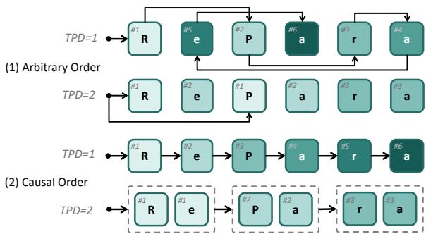  
Figure 1: Generation order and decoding parallelism in dLLMs. Arbitrary-order decoding commits potentially nonconsecutive positions; causal-order decoding commits consecutive blocks from left to right. Token numbers indicate commitment steps; equal numbers denote parallel commitment, and darker shades denote later steps.

However, strong reasoning performance at low decoding parallelism does not establish reliable parallel generation. Widely used reasoning evaluations use only one or two tokens per diffusion step (TPD) (Nie et al., 2025; Ni et al., 2026). As illustrated in Figure 1, flexible generation order can coexist with single-token decoding, leaving parallel generation capacity unused. Training-free inference methods improve parallel decoding through caching and adaptive token selection (Ma et al., 2025; Wu et al., 2026; Wei et al., 2026). Meanwhile, reinforcement learning (RL) strengthens dLLM reasoning on mathematics and coding (Zhao et al., 2025; Huang et al., 2025; Gong et al., 2026; Ou et al., 2026; Tang et al., 2026). In particular, JustGRPO (Ni et al., 2026) improves reasoning through single-token AR rollouts while retaining parallel diffusion inference. Our evaluations nevertheless show that its accuracy still drops sharply at higher TPD (Section 4.1). Thus, improving reasoning with AR rollouts leaves substantial room to strengthen multi-token decoding (MTD).

We begin by evaluating LLaDA, Dream, SDAR, and LLaDA2.1-mini (Nie et al., 2025; Ye et al.,

2025; Cheng et al., 2026; Bie et al., 2026) on mathematical reasoning and code generation at TPD {1, 2, 4, 8, 16}, using a common 512-token generation budget (Section 2.1). Throughout the paper, Diff#k denotes diffusion decoding at nominal TPD $k = L / S$ , where L is the generation budget and S the denoising-step budget. Although Diff#{1, 2} remains competitive on several mathematical benchmarks, performance deteriorates markedly at higher TPD. At TPD 16, every evaluated model– benchmark combination scores below 15% under this protocol. We call this discrepancy between simultaneous token prediction and reliable multitoken commitment the Parallelism Gap.

To examine prediction behavior relevant to this gap, we probe the token distributions produced within a single diffusion step (Section 2.2). Conditioning on a ground-truth prefix, we measure prediction quality at successive positions in a fully masked target block. This probe reveals a local predictive structure: target-token probability and confidence are highest near the observed prefix and decline with distance, while uncertainty increases. Relative to each curve’s first position, prediction quality persists farther into mathematical text than into code. Moreover, generating the next two consecutive tokens in one forward pass is competitive with confidence-based diffusion decoding at the same token quota on mathematical tasks (Section 2.3), while code shows less consistent results. Together, these observations suggest that dLLMs possess latent local MTD capacity that can be reinforced, particularly for mathematical reasoning.

Motivated by this analysis, we propose RePara, an RL approach that reinforces local MTD capacity through causal-order rollouts (Figure 6). RePara retains JustGRPO’s left-to-right progression (Ni et al., 2026) while generating each short block of consecutive tokens from a shared context in one rollout forward pass. It applies group-relative policy optimization (GRPO) (Shao et al., 2024) to the joint probability of each parallel block using advantages derived from final-answer correctness, directly training the model on multi-token actions. We study fixed and uncertainty-adaptive block lengths; the main comparisons use fixed twotoken blocks (Fix2). Because all tokens in a block share the same conditioning state, their probabilities can also be recomputed in one learner forward pass, reducing the forward-pass counts for both rollout generation and training-time log-probability recomputation. RePara leaves the model architecture unchanged and supports parallel diffusion inference independently of the training block-length rule.

Experiments on LLaDA and SDAR show that training at TPD 2 improves mathematical reasoning at higher inference TPD on GSM8K (Cobbe et al., 2021) and MATH-500 (Lightman et al., 2024) (Section 4). With a 512-token generation budget, RePara improves LLaDA’s accuracy over JustGRPO by 40.34 percentage points (pp.) on GSM8K and 14.00 pp. on MATH-500 at Diff#16. It also achieves a 1.96× training-step speedup in our LLaDA/MATH setup, including checkpoint and metric-preparation costs. These results show that reinforcing short consecutive predictions can improve the accuracy–parallelism trade-off while accelerating training. Gains on code generation remain inconsistent (Appendix F).

Our contributions are threefold:

• We characterize the Parallelism Gap across four representative dLLMs and identify local MTD potential, with a broader predictive horizon in mathematical text.

• Guided by this analysis, we introduce RePara to reinforce consecutive multi-token actions while reducing forward passes for rollout generation and log-probability recomputation.

• We demonstrate that RePara improves high-TPD mathematical reasoning on GSM8K and MATH-500 across both model families, with measured training-step acceleration.

## 2 A Few More Tokens Ahead

dLLMs offer flexible generation order and parallel token prediction (Nie et al., 2025; Ye et al., 2025), but simultaneous prediction does not by itself ensure reliable MTD. We first characterize the accuracy loss under fixed token quotas (Section 2.1), then locate predictive potential within masked blocks (Section 2.2), and finally test short consecutive generation as a practical use of this potential (Section 2.3).

## 2.1 The Parallelism Gap

Learning clean-token conditionals (Ou et al., 2025) does not guarantee reliable multi-token commitment. Following JustGRPO’s evaluation protocol (Ni et al., 2026), we evaluate LLaDA, Dream, SDAR, and LLaDA2.1-mini on GSM8K (Cobbe et al., 2021), MATH-500 (Lightman et al., 2024),

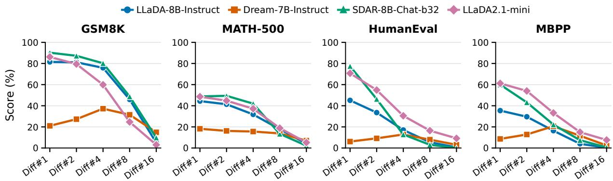  
Figure 2: Task performance across decoding granularities. Four representative dLLMs are evaluated on mathematical reasoning (GSM8K and MATH-500) and code generation (HumanEval and MBPP) with a 512-token generation budget.

HumanEval (Chen et al., 2021), and MBPP (Austin et al., 2021b) with a 512-token generation budget. Diff#k commits the $k \in \{ 1 , 2 , 4 , 8 , 1 6 \}$ highestconfidence masked positions per step. This fixedquota sweep modifies the native samplers of Dream and LLaDA2.1-mini (Appendix B.2).

Useful performance at 1–2 tokens per step. At Diff#1–2, LLaDA, SDAR, and LLaDA2.1-mini retain useful task performance, particularly on mathematics. LLaDA’s GSM8K accuracy changes from 81.5% to 81.1%, while SDAR’s MATH-500 accuracy remains similar (48.8% vs. 49.4%). Code generation is more sensitive: HumanEval Pass@1 falls from 45.1% to 33.5% for LLaDA and from 77.4% to 46.3% for SDAR. Dream’s non-monotonic lowquota behavior is discussed in Appendix A.3.

High fixed quotas degrade performance. Performance falls sharply across all four models and benchmarks from Diff#4 to Diff#16 (Figure 2). At Diff#8, GSM8K accuracy for LLaDA, SDAR, and LLaDA2.1-mini is 24.6%–48.7%; at Diff#16, every model–benchmark score is below 15%. For an N-token budget, fixed TPD k reduces the nominal step count to $N / k$ , but these savings come with substantial accuracy losses under this protocol.

## Takeaway I

High fixed quotas expose a parallelism gap. Under fixed-quota decoding, most evaluated dLLMs retain useful mathematical performance at 1–2 tokens per step, but substantially increasing the quota sharply reduces accuracy.

## 2.2 Local Predictive Potential

We probe the Math and Code subsets of the Nemotron Post-Training Dataset $\mathbf { v } 2$ (Nathawani et al., 2025), predicting fully masked 32-token blocks from ground-truth prefixes. We measure target-token Probability, maximum vocabulary Confidence, and Entropy. LLaDA and Dream use base checkpoints here, whereas the downstream evaluation uses their instruction-tuned variants; Appendix A gives the full protocol.

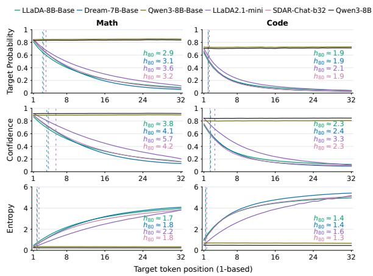  
Figure 3: Local predictive potential in mathematical text and code. Dashed lines mark $h _ { 8 0 } ,$ , the 80% retention boundary relative to the first position for Probability, Confidence, or inverse perplexity $e ^ { - H }$ . Entropy is plotted in nats; boundary definitions are in Appendix A.2.

Prediction quality is concentrated near the prefix. For the dLLMs, Probability and Confidence decline overall with distance into the masked block, while Entropy increases (Figure 3). This pattern persists across the evaluated prefix lengths (Figure 4); longer context can shift the retention boundary but does not remove the decline farther into the masked block. The teacher-forced AR curves provide a reference with additional conditioning information, rather than a matched multi-token prediction baseline.

Mathematical text retains prediction quality farther ahead. Across the four dLLMs, targetprobability boundaries lie at approximately 2.9– 3.6 in Math versus 1.9–2.1 in Code; confidence boundaries likewise extend farther in Math (3.8– 5.7 vs. 2.3–3.3). This broader predictive horizon describes retention relative to the first position, not just higher absolute scores. These marginal-token measurements do not establish joint block correctness or a safe generation length; their interpretation is discussed in Appendix A.2.

## Takeaway II

Local predictive potential persists farther in mathematical text. Under clean-prefix conditioning, prediction quality declines with distance, and mathematical text retains a larger fraction of its first-position quality farther into the masked block than code.

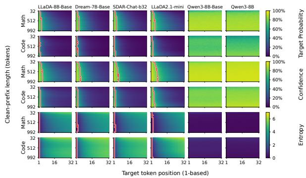  
Figure 4: Local prediction across clean-prefix lengths. Each cell averages 2,000 sequences at a fixed target position and prefix length. Red outlines apply the h80 criterion from Figure 3 relative to each row’s first position. Entropy colors show raw nats.

## 2.3 Short Consecutive Generation

The probe motivates testing whether local prediction supports useful generation at matched TPD. We compare AR-1 against Diff#1 and Fix-2 against Diff#2: AR-1 and Fix-2 append one or two mask tokens and commit them in a single forward, progressing from left to right. Diff#k instead selects positions by confidence within a larger masked window. Figure 5 compares these complete decoding policies; both the window and position-selection rule differ.

Two-token generation is competitive on mathematics. Fix-2 matches Diff#2 on LLaDA’s GSM8K evaluation (81.1%) and closely tracks it for SDAR (87.0% vs. 87.3%). For LLaDA2.1- mini, Fix-2 exceeds Diff#2 on GSM8K (82.9% vs. 79.5%) and MATH-500 (46.6% vs. 44.8%). Across these three models and two mathematical benchmarks, the differences range from −2.6 to +3.4 pp. The code results are less favorable: on SDAR, Fix-2 trails Diff#2 by 15.8 pp. on HumanEval and 21.2 pp. on MBPP. Appendix A.3 gives the remaining comparisons.

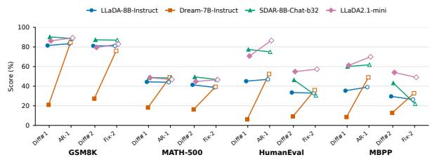  
Figure 5: Consecutive vs. confidence-based decoding at matched token quotas. Filled/hollow markers denote confidence-based/consecutive decoding. Scores and generation budget follow Figure 2.

## Takeaway III

Short consecutive generation is competitive on mathematics. At two tokens per step, local consecutive decoding achieves mathematical accuracy close to confidence-based decoding over a larger window, while code exhibits substantial task-dependent losses.

Together, the probe and generation results identify short consecutive blocks as a promising unit to reinforce for mathematical reasoning. RePara adopts this local rollout structure and directly optimizes its multi-token actions with task rewards.

## 3 RePara

Section 2 exposes the degradation in task accuracy as dLLM decoding parallelism increases, while its token-level analysis reveals local multi-token prediction potential. Building on JustGRPO (Ni et al., 2026), RePara (Figure 6) reinforces local predictive potential by generating the next mk consecutive tokens in one rollout forward (Section 3.1), optimizing this parallel policy to strengthen MTD reasoning (Section 3.2), and reducing rollout and log-probability recomputation costs to accelerate training (Section 3.3).

## 3.1 Parallel Rollout Policy

Formulation. Given a query q and prefix $O _ { < k }$ , let $b _ { k }$ be the maximum proposal length B capped by the remaining output budget. The state $s _ { k }$ consists of $q$ and $O _ { < k }$ followed by $b _ { k }$ mask tokens; the input ends at this proposal block. A single forward yields distributions $p _ { \theta , j } ( \cdot \mid s _ { k } )$ at offsets j from position $k ,$ , using softmax at temperature $T > 0$ with nonsampleable token IDs excluded. We sample a block $u _ { k } = o _ { k : k + m _ { k } - 1 }$ from the multi-token prediction (MTP) policy

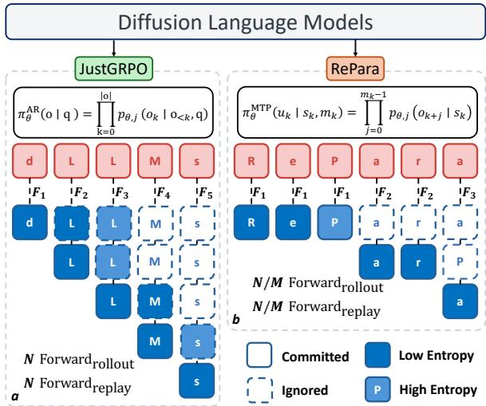  
Figure 6: Overview of RePara: Reinforcement Learning with Multi-Token Rollouts. (a) JustGRPO generates one token per forward pass. (b) RePara samples consecutive token blocks from a shared masked state in a single forward pass and optimizes their joint probabilities with GRPO. For an N-token completion, committing an average of M tokens per block reduces the forward-pass count from N to $N / M$ for both rollout generation and training-time log-probability recomputation.

$$
\pi _ { \boldsymbol { \theta } } ^ { \mathrm { M T P } } ( u _ { k } \mid \boldsymbol { s } _ { k } , m _ { k } ) = \prod _ { j = 0 } ^ { m _ { k } - 1 } p _ { \boldsymbol { \theta } , j } ( o _ { k + j } \mid \boldsymbol { s } _ { k } ) .\tag{1}
$$

Tokens within the block are sampled independently from the shared state. We commit the block and advance to $k + m _ { k }$ , preserving left-to-right generation across blocks. Setting $B = 1$ recovers JustGRPO’s single-token rollout structure. With $B = 2$ and fixed-length commitment, each forward appends and predicts two mask tokens, as in the Fix-2 policy of Section 2.3.

Block-length selection. Fix commits $m _ { k } = b _ { k }$ tokens per step. Adaptive lets the model’s predictions determine the length of a contiguous prefix using scores $c _ { k , j } = g ( p _ { \theta , j } ( { \cdot } \mid s _ { k } ) )$ . The proxy g may use Confidence, Entropy, or another uncertainty score, oriented so that larger scores favor commitment. With threshold $\gamma _ { : }$ the accepted length is

$$
m _ { k } = \operatorname* { m a x } \left\{ 1 , \sum _ { j = 0 } ^ { b _ { k } - 1 } \prod _ { h = 0 } ^ { j } \mathbf { 1 } \{ c _ { k , h } \geq \gamma \} \right\} .\tag{2}
$$

This selects the longest prefix satisfying the criterion, with a one-token fallback if the first position fails. Our adaptive variant uses normalized-entropy confidence:

$$
g ( p ) = 1 - \frac { H ( p ) } { \log \operatorname* { m a x } \{ 2 , | \mathcal { V } | \} } ,\tag{3}
$$

where H is Shannon entropy, V is the support of $p ,$ and $\gamma \in [ 0 , 1 ]$ . These scores guide commitment; they are not calibrated probabilities of block correctness.

## 3.2 Group-Relative Optimization

For our mathematical reasoning experiments, we follow JustGRPO and sample $G$ completions per query with parameters $\theta _ { \mathrm { o l d } }$ and compute completion-level advantages $A _ { i }$ by standardizing binary answer-correctness rewards within each group. We apply the GRPO update (Shao et al., 2024) to parallel blocks, assigning $A _ { i }$ to every block of completion i.

For each recorded block $u _ { i , r }$ of length $m _ { i , r }$ , the learner reconstructs its rollout state $s _ { i , r }$ , including the original masked proposal length even when Adaptive commits fewer tokens. One forward then computes the block log-probability:

$$
\begin{array} { r l } & { \lambda _ { i , r } ( \theta ) \triangleq \log \pi _ { \theta } ^ { \mathrm { M T P } } ( u _ { i , r } \mid s _ { i , r } , m _ { i , r } ) } \\ & { \quad \quad = \displaystyle \sum _ { j = 0 } ^ { m _ { i , r } - 1 } \log p _ { \theta , j } ( u _ { i , r , j } \mid s _ { i , r } ) . } \end{array}\tag{4}
$$

The block-level ratio used in the clipped GRPO objective (Schulman et al., 2017; Shao et al., 2024) is

$$
\rho _ { i , r } ( \theta ) = \exp ( \lambda _ { i , r } ( \theta ) - \lambda _ { i , r } ( \theta _ { \mathrm { o l d } } ) ) .\tag{5}
$$

Adaptive block boundaries remain fixed during the update; we optimize conditional block probabilities without differentiating through the selection rule. The full objective and update settings are provided in Appendix C.2.

## 3.3 Training Efficiency

For a length-N completion generated in K blocks, let $M = N / K$ be the average accepted length. Rollout generation requires $K = N / M$ forwards, compared with N for single-token generation. During log-probability recomputation, the learner replays each block’s state once to compute its token probabilities (Eq. 4), likewise reducing learner forwards from N to $N / M$ . For one rollout and one learner replay, the combined count is

$$
F _ { \mathrm { R e P a r a } } = \underbrace { N / M } _ { \mathrm { r o l l o u t } } + \underbrace { N / M } _ { \mathrm { l o g - p r o b a b i l i t y } } = 2 N / M ,\tag{6}
$$

versus 2N for JustGRPO under the same convention. For an individual completion, the forwardcount reduction factor is M. In synchronized batches, the executed number of rounds is determined by the completion requiring the most blocks. Actual wall-clock speedup therefore also depends on backward and optimizer costs, batching, and synchronization. Section 4.2 measures these savings, and Appendix E.3 analyzes how variation in block counts limits adaptive training speed.

RePara leaves the backbone architecture unchanged, allowing the trained model to use parallel diffusion samplers at inference independently of the training block-length rule (Section 4.1).

## 4 Experiments

We test whether RePara preserves mathematical reasoning accuracy under multi-token inference across full- and block-diffusion architectures. We select LLaDA and SDAR, respectively, and compare with JustGRPO on GSM8K and MATH-500 at matched generation lengths and denoising budgets.

Training Settings We study mathematical reasoning on GSM8K (Cobbe et al., 2021) and MATH (Hendrycks et al., 2021), evaluating the latter on MATH-500 (Lightman et al., 2024). For each task, LLaDA and SDAR use 128 updates with 256-token rollouts. For the main comparisons, RePara uses Fix2 with maximum block length $B = 2$ . We study Adaptive selection on LLaDA in Section 4.3.1, using the same maximum block length and normalized-entropy confidence threshold $\gamma = 0 . 9 5$ (Adaptive2-0.95). Other training settings are given in Appendix C.

Evaluation Settings We evaluate step-128 checkpoints of RePara and JustGRPO, alongside the original backbones and released baselines (Table 1). We set the sampling temperature to 0 and generate one response per problem with generation budgets $L \in \{ 1 2 8 , 2 5 6 , 5 1 2 \}$ . We report answer accuracy on GSM8K test and MATH-500, with accuracy gaps and drops expressed in pp. LLaDA uses 32-token blocks and low-confidence remasking with fixed TPD $k \in \{ 1 , 2 , 4 , 8 , 1 6 \}$ . SDAR uses 4-token blocks and dynamic low-confidence selection at probability threshold 0.85, with nominal TPD $k \in \{ 1 , 2 , 4 \}$ ; the threshold can increase the actual number of tokens committed per step. Baseline sources and decoding details are provided in Appendix B.

## 4.1 Main Results

## 4.1.1 Accuracy Retention at Higher Parallelism

On LLaDA, RePara achieves the highest accuracy among the evaluated baselines at Diff#8 and Diff#16 on both benchmarks at $L = 5 1 2$ (Table 1). At Diff#16, it reaches 68.54% on GSM8K and 26.80% on MATH-500, exceeding JustGRPO by 40.34 and 14.00 pp., respectively.

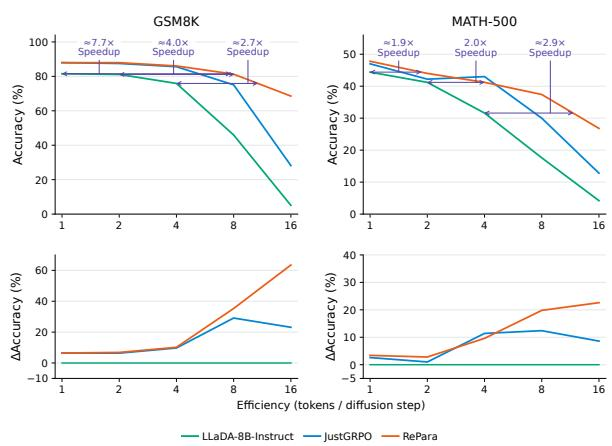  
Figure 7: LLaDA accuracy (top) and gains over the backbone in pp. (bottom) at $L = 5 1 2 .$ . Arrows show nominal TPD ratios to the backbone at matched accuracy, interpolated on the log-rate axis.

These gains reflect better accuracy retention as decoding parallelism increases (Figure 7). Moving from Diff#8 to Diff#16 reduces GSM8K accuracy by 12.73 pp. for RePara, compared with 46.86 pp. for JustGRPO. The advantage at both rates holds across all three generation lengths; see Appendix D for the complete comparison.

Extension to code generation. The mathematical gains do not consistently transfer to code generation; see Appendix F for the results and analysis.

## 4.1.2 Robustness under Block-Parallel Decoding

On SDAR, RePara outperforms JustGRPO at Diff#2 and Diff#4 on both benchmarks (Table 2).

<table><tr><td>Model</td><td colspan="5">GSM8K</td><td colspan="5">MATH-500</td></tr><tr><td>Diff#k</td><td>1</td><td>2</td><td>4</td><td>8</td><td>16</td><td>1</td><td>2</td><td>4</td><td>8</td><td>16</td></tr><tr><td>LLaDA-8B-Instruct</td><td>81.50</td><td>81.12</td><td>75.89</td><td>45.94</td><td>5.08</td><td>44.40</td><td>41.20</td><td>31.60</td><td>17.60</td><td>4.20</td></tr><tr><td>LLaDA-1.5</td><td>82.64</td><td>81.05</td><td>76.72</td><td>48.14</td><td>6.82</td><td>43.20</td><td>40.20</td><td>36.40</td><td>20.00</td><td>6.80</td></tr><tr><td>ESPO</td><td>85.14</td><td>82.64</td><td>76.42</td><td>46.70</td><td>7.43</td><td>45.20</td><td>42.20</td><td>34.20</td><td>20.00</td><td>5.60</td></tr><tr><td>d-TreeRPO</td><td>83.85</td><td>82.03</td><td>77.10</td><td>47.84</td><td>6.52</td><td>41.20</td><td>40.60</td><td>36.20</td><td>19.00</td><td>7.60</td></tr><tr><td>wd1-Math</td><td>82.03</td><td>81.88</td><td>75.59</td><td>44.96</td><td>5.23</td><td>44.40</td><td>38.80</td><td>33.60</td><td>16.20</td><td>6.00</td></tr><tr><td>LLaDOU</td><td>85.22</td><td>85.60</td><td>82.79</td><td>70.51</td><td>33.74</td><td>42.80</td><td>42.20</td><td>36.40</td><td>25.80</td><td>10.00</td></tr><tr><td>JustGRPO</td><td>87.95</td><td>87.49</td><td>85.60</td><td>75.06</td><td>28.20</td><td>47.00</td><td>42.20</td><td>43.00</td><td>30.00</td><td>12.80</td></tr><tr><td>RePara</td><td>87.95</td><td>87.95</td><td>86.05</td><td>81.27</td><td>68.54</td><td>47.80</td><td>44.00</td><td>41.20</td><td>37.40</td><td>26.80</td></tr></table>

Table 1: LLaDA accuracy (%, ↑) at $L = 5 1 2 .$ . Colors mark Best, Second best, and Third best per column; ties share a rank at the reported precision.

At $L = 5 1 2$ and Diff#4, it achieves 81.80% on GSM8K and 40.40% on MATH-500, improving over JustGRPO by 35.17 and 5.00 pp., respectively.
<table><tr><td>Model</td><td colspan="3">GSM8K</td><td colspan="3">MATH-500</td></tr><tr><td>Diff#k</td><td>1</td><td>2</td><td>4</td><td>1</td><td>2</td><td>4</td></tr><tr><td>SDAR-8B-Chat</td><td>90.75</td><td>55.12</td><td>74.45</td><td>50.00</td><td>36.20</td><td>28.20</td></tr><tr><td>JustGRPO</td><td>82.11</td><td>55.12</td><td>46.63</td><td>54.20</td><td>34.20</td><td>35.40</td></tr><tr><td>RePara</td><td>85.37</td><td>72.63</td><td>81.80</td><td>52.40</td><td>39.80</td><td>40.40</td></tr></table>

Table 2: SDAR accuracy (%, ↑) at $L \ = \ 5 1 2$ under dynamic threshold decoding. Bold marks the best score per column.

The GSM8K results likewise show improved robustness to reduced denoising budgets: moving from Diff#1 to Diff#4 lowers accuracy by 3.57 pp. for RePara versus 35.48 pp. for JustGRPO. The multi-token gains extend to all evaluated generation lengths; see Appendix D for the complete results.

## 4.2 Training Efficiency

For space reasons, we focus the detailed efficiency analysis on LLaDA/MATH as a representative case; RePara exhibits similar training speedups in other settings. In this setting, Fix2 reduces core training-step time by 49.5% relative to JustGRPO, yielding a 1.98× speedup under the same training configuration (Table 3). Including checkpoint and metric-preparation costs retains a 1.96× speedup. Adaptive2-0.95 reduces core time by 11.9%, giving a 1.14× speedup.

The fixed policy nearly halves rollout generation, log-probability recomputation, and backward time. Adaptive’s growing mean block length yields smaller savings because variable block counts incur the synchronization tail described in Section 3.3. Appendix E provides training traces, the timing protocol, and the phase and synchronization analyses.

<table><tr><td>Training setting</td><td>Core</td><td>Step Core speedup</td></tr><tr><td>JustGRPO</td><td>422.64</td><td>427.89 1.00×</td></tr><tr><td>Fix2</td><td>213.39</td><td>218.60 1.98×</td></tr><tr><td>Adaptive2-0.95</td><td>372.26</td><td>377.66 1.14×</td></tr></table>

Table 3: LLaDA mathematical training efficiency on the same 127 steps. Core time includes rollout, reward processing, learner computation, and optimizer updates; step time also includes checkpoint and metricpreparation costs. Times are seconds per optimizer step; speedup is relative to JustGRPO.

## 4.3 Ablation Studies

## 4.3.1 Effect of the Adaptive Training Threshold

We vary the adaptive training threshold over {0.80, 0.90, 0.95} on LLaDA/GSM8K with B = 2 (Table 4). At $L = 5 1 2 , \gamma = 0 . 9 5$ achieves the highest Diff#1 accuracy of 88.48%, whereas $\gamma = 0 . 8 0$ performs best at Diff#16 with 66.34%, exceeding JustGRPO by 38.14 pp.

<table><tr><td rowspan="2">Setting</td><td colspan="5">Diff#k</td></tr><tr><td>1</td><td>2</td><td>4</td><td>8</td><td>16</td></tr><tr><td>JustGRPO</td><td>87.95</td><td>87.49</td><td>85.60</td><td>75.06</td><td>28.20</td></tr><tr><td>Adaptive2-0.80</td><td>86.81</td><td>86.73</td><td>84.31</td><td>81.27</td><td>66.34</td></tr><tr><td>Adaptive2-0.90</td><td>87.11</td><td>86.50</td><td>83.17</td><td>76.65</td><td>51.78</td></tr><tr><td>Adaptive2-0.95</td><td>88.48</td><td>87.19</td><td>86.35</td><td>81.35</td><td>47.76</td></tr></table>

Table 4: LLaDA/GSM8K accuracy (%) by adaptive training threshold at L = 512 and B = 2. Bold marks the best score per column.

The preferred threshold therefore depends on inference parallelism: the setting with the best singletoken score is not the most robust at Diff#16. See

Appendix D for the complete results at all three generation lengths.

## 5 Related Work

Diffusion language models. Earlier text diffusion models use continuous token embeddings (Li et al., 2022; Gong et al., 2023) or discrete score estimation (Lou et al., 2024). Masked diffusion learns to recover tokens from corrupted text (He et al., 2023; Sahoo et al., 2024; Shi et al., 2024; Ou et al., 2025), with LLaDA (Nie et al., 2025) and Dream (Ye et al., 2025) demonstrating large-scale language modeling. Block diffusion (Han et al., 2023; Arriola et al., 2025) combines autoregressive conditioning across blocks with parallel denoising within each block; SDAR (Cheng et al., 2026) adapts autoregressive backbones to this paradigm. Our work studies how post-training can improve the reliability of parallel token generation across both architectures.

Post-training diffusion language models. DiffuCoder’s coupled-GRPO reduces the variance of token log-likelihood estimates for code-generation RL (Gong et al., 2026). Existing approaches use evidence lower bound (ELBO) estimates for preference optimization or RL (Zhu et al., 2026; Ou et al., 2026), ratio-free weighted likelihoods (Tang et al., 2026), learned unmasking orders (Huang et al., 2025), or tree-structured advantages (Pan et al., 2026). Most closely related, JustGRPO (Ni et al., 2026) applies GRPO to left-to-right, singletoken rollouts while retaining parallel diffusion inference. RePara instead samples contiguous multitoken blocks and evaluates their joint probabilities under the recorded rollout states, directly reinforcing parallel token commitment during training.

Multi-token prediction and speculative decoding. Multi-token prediction trains additional heads to predict future tokens (Stern et al., 2018; Gloeckle et al., 2024; Cai et al., 2024), whereas speculative decoding verifies draft tokens in parallel (Leviathan et al., 2023; Chen et al., 2023). DiffuSpec (Li et al., 2026) and DFlash (Chen et al., 2026) use diffusion models as parallel drafters for autoregressive targets. RePara instead trains the diffusion model’s own generation policy with task rewards, without additional prediction heads or an autoregressive verifier.

## 6 Conclusion

Our evaluation reveals substantial accuracy losses under reduced denoising budgets, while groundtruth-prefix probes identify local predictive potential that is broader in mathematical text. Motivated by this structure, RePara uses GRPO to reinforce consecutive multi-token rollouts and their joint probabilities. On LLaDA and SDAR, it improves mathematical reasoning accuracy over JustGRPO at higher levels of decoding parallelism while reducing rollout and log-probability recomputation forward counts.

Transfer to code remains limited. Easier training data and JustGRPO initialization yield conditional gains without establishing consistent improvements. This limitation is consistent with the weaker parallel decoding and shorter local predictive horizon observed on code, suggesting that stronger initial multi-token coding capability may be needed for reliable transfer.

## Limitations

The mathematical benefits of RePara are demonstrated on GSM8K and MATH-500 with LLaDA and SDAR. Training uses 256-token rollouts, and downstream evaluation budgets do not exceed 512 tokens, leaving longer reasoning traces untested.

The mathematical gains do not consistently extend to code generation. Direct application can substantially reduce accuracy, while easier training data and JustGRPO initialization yield only conditional gains (Appendix F). The initialization study also lacks a JustGRPO continuation with the same additional training budget, limiting conclusions about the benefit of switching to multi-token training.

RePara mitigates the Parallelism Gap, but LLaDA accuracy still declines when increasing decoding from eight to sixteen tokens per step. Our ground-truth-prefix probes characterize local prediction quality without establishing joint block correctness or isolating the causes of coding regressions. Whether stronger initial multi-token capability enables reliable coding gains remains an open question.

## Ethical Considerations

This work studies the training and decoding efficiency of diffusion language models using existing models and publicly available mathematical and coding datasets. We do not identify additional ethical risks specific to the proposed method beyond those associated with the underlying models and datasets.

## References

Marianne Arriola, Aaron Gokaslan, Justin Chiu, Zhihan Yang, Zhixuan Qi, Jiaqi Han, Subham Sahoo, and Volodymyr Kuleshov. 2025. Block diffusion: Interpolating between autoregressive and diffusion language models. In The Thirteenth International Conference on Learning Representations.

Jacob Austin, Daniel D. Johnson, Jonathan Ho, Daniel Tarlow, and Rianne van den Berg. 2021a. Structured denoising diffusion models in discrete state-spaces. In Advances in Neural Information Processing Systems, volume 34.

Jacob Austin, Augustus Odena, Maxwell Nye, Maarten Bosma, Henryk Michalewski, David Dohan, Ellen Jiang, Carrie Cai, Michael Terry, Quoc Le, and Charles Sutton. 2021b. Program synthesis with large language models. Preprint, arXiv:2108.07732.

Tiwei Bie, Maosong Cao, Xiang Cao, Bingsen Chen, Fuyuan Chen, Kun Chen, Lun Du, Daozhuo Feng, Haibo Feng, Mingliang Gong, Zhuocheng Gong, Yanmei Gu, Jian Guan, Kaiyuan Guan, Hongliang He, Zenan Huang, Juyong Jiang, Zhonghui Jiang, Zhenzhong Lan, and 31 others. 2026. LLaDA2.1: Speeding up text diffusion via token editing. Preprint, arXiv:2602.08676.

Tianle Cai, Yuhong Li, Zhengyang Geng, Hongwu Peng, Jason D. Lee, Deming Chen, and Tri Dao. 2024. Medusa: Simple LLM inference acceleration framework with multiple decoding heads. In Proceedings of the 41st International Conference on Machine Learning, volume 235 of Proceedings of Machine Learning Research, pages 5209–5235. PMLR.

Charlie Chen, Sebastian Borgeaud, Geoffrey Irving, Jean-Baptiste Lespiau, Laurent Sifre, and John Jumper. 2023. Accelerating large language model decoding with speculative sampling. Preprint, arXiv:2302.01318.

Jian Chen, Yesheng Liang, and Zhijian Liu. 2026. DFlash: Block diffusion for flash speculative decoding. In Proceedings of the 43rd International Conference on Machine Learning, volume 306 of Proceedings ofMachine Learning Research, pages 15343–15355. PMLR.

Mark Chen, Jerry Tworek, Heewoo Jun, Qiming Yuan, Henrique Ponde de Oliveira Pinto, Jared Kaplan, Harri Edwards, Yuri Burda, Nicholas Joseph, Greg Brockman, Alex Ray, Raul Puri, Gretchen Krueger, Michael Petrov, Heidy Khlaaf, Girish Sastry, Pamela Mishkin, Brooke Chan, Scott Gray, and 39 others. 2021. Evaluating large language models trained on code. Preprint, arXiv:2107.03374.

Shuang Cheng, Yihan Bian, Dawei Liu, Yuhua Jiang, Yihao Liu, Linfeng Zhang, Qian Yao, Zhongbo Tian, Wenhai Wang, Qipeng Guo, Kai Chen, Biqing Qi, and Bowen Zhou. 2026. SDAR: A synergistic diffusion-AutoRegression paradigm for scalable sequence generation. In Findings ofthe Associationfor Computational Linguistics: ACL 2026, pages 22058– 22075. Association for Computational Linguistics.

Karl Cobbe, Vineet Kosaraju, Mohammad Bavarian, Mark Chen, Heewoo Jun, Lukasz Kaiser, Matthias Plappert, Jerry Tworek, Jacob Hilton, Reiichiro Nakano, Christopher Hesse, and John Schulman. 2021. Training verifiers to solve math word problems. Preprint, arXiv:2110.14168.

Fabian Gloeckle, Badr Youbi Idrissi, Baptiste Roziere, David Lopez-Paz, and Gabriel Synnaeve. 2024. Better & faster large language models via multi-token prediction. In Proceedings of the 41st International Conference on Machine Learning, volume 235 of Proceedings of Machine Learning Research, pages 15706–15734. PMLR.

Shansan Gong, Mukai Li, Jiangtao Feng, Zhiyong Wu, and Lingpeng Kong. 2023. DiffuSeq: Sequence to sequence text generation with diffusion models. In The Eleventh International Conference on Learning Representations.

Shansan Gong, Ruixiang Zhang, Huangjie Zheng, Jiatao Gu, Navdeep Jaitly, Lingpeng Kong, and Yizhe Zhang. 2026. DiffuCoder: Understanding and improving masked diffusion models for code generation. In The Fourteenth International Conference on Learning Representations.

Xiaochuang Han, Sachin Kumar, and Yulia Tsvetkov. 2023. Ssd-lm: Semi-autoregressive simplex-based diffusion language model for text generation and modular control. Preprint, arXiv:2210.17432.

Zhengfu He, Tianxiang Sun, Qiong Tang, Kuanning Wang, Xuanjing Huang, and Xipeng Qiu. 2023. DiffusionBERT: Improving generative masked language models with diffusion models. In Proceedings ofthe 61st Annual Meeting ofthe Associationfor Computational Linguistics (Volume 1: Long Papers), pages 4521–4534. Association for Computational Linguistics.

Dan Hendrycks, Collin Burns, Saurav Kadavath, Akul Arora, Steven Basart, Eric Tang, Dawn Song, and Jacob Steinhardt. 2021. Measuring mathematical problem solving with the MATH dataset. In Proceedings of the Neural Information Processing Systems Track on Datasets and Benchmarks, volume 1.

Zemin Huang, Zhiyang Chen, Zijun Wang, Tiancheng Li, and Guo-Jun Qi. 2025. Reinforcing the diffusion chain of lateral thought with diffusion language models. In Advances in Neural Information Processing Systems, volume 38.

Yaniv Leviathan, Matan Kalman, and Yossi Matias. 2023. Fast inference from transformers via speculative decoding. In Proceedings of the 40th International Conference on Machine Learning, volume 202 of Proceedings of Machine Learning Research, pages 19274–19286. PMLR.

Guanghao Li, Zhihui Fu, Min Fang, Qibin Zhao, Ming Tang, Chun Yuan, and Jun Wang. 2026. DiffuSpec: Unlocking diffusion language models for speculative decoding. In Findings ofthe Associationfor Computational Linguistics: ACL 2026, pages 20896–20910. Association for Computational Linguistics.

Xiang Li, John Thickstun, Ishaan Gulrajani, Percy Liang, and Tatsunori B. Hashimoto. 2022. Diffusion-LM improves controllable text generation. In Advances in Neural Information Processing Systems, volume 35.

Hunter Lightman, Vineet Kosaraju, Yuri Burda, Harrison Edwards, Bowen Baker, Teddy Lee, Jan Leike, John Schulman, Ilya Sutskever, and Karl Cobbe. 2024. Let’s verify step by step. In The Twelfth International Conference on Learning Representations.

Ilya Loshchilov and Frank Hutter. 2019. Decoupled weight decay regularization. In The Seventh International Conference on Learning Representations.

Aaron Lou, Chenlin Meng, and Stefano Ermon. 2024. Discrete diffusion modeling by estimating the ratios of the data distribution. In Proceedings of the 41st International Conference on Machine Learning, volume 235 of Proceedings of Machine Learning Research, pages 32819–32848. PMLR.

Xinyin Ma, Runpeng Yu, Gongfan Fang, and Xinchao Wang. 2025. dKV-Cache: The cache for diffusion language models. Preprint, arXiv:2505.15781.

Dhruv Nathawani, Shuoyang Ding, Vitaly Lavrukhin, Igor Gitman, Somshubra Majumdar, Evelina Bakhturina, Boris Ginsburg, and Jane Polak Scowcroft. 2025. Nemotron-Post-Training-Dataset-v2. NVIDIA dataset release. Version 2.0.

Zanlin Ni, Shenzhi Wang, Yang Yue, Tianyu Yu, Weilin Zhao, Yeguo Hua, Tianyi Chen, Jun Song, Cheng Yu, Bo Zheng, and Gao Huang. 2026. The flexibility trap: Rethinking the value of arbitrary order in diffusion language models. In Proceedings of the 43rd International Conference on Machine Learning, volume 306 of Proceedings of Machine Learning Research, pages 93000–93015. PMLR.

Shen Nie, Fengqi Zhu, Zebin You, Xiaolu Zhang, Jingyang Ou, Jun Hu, Jun Zhou, Yankai Lin, Ji-Rong Wen, and Chongxuan Li. 2025. Large language diffusion models. In Advances in Neural Information Processing Systems, volume 38.

Jingyang Ou, Jiaqi Han, Minkai Xu, Shaoxuan Xu, Jianwen Xie, Stefano Ermon, Yi Wu, and Chongxuan Li. 2026. Principled RL for diffusion LLMs emerges from a sequence-level perspective. In The Fourteenth

International Conference on Learning Representations.

Jingyang Ou, Shen Nie, Kaiwen Xue, Fengqi Zhu, Jiacheng Sun, Zhenguo Li, and Chongxuan Li. 2025. Your absorbing discrete diffusion secretly models the conditional distributions of clean data. In The Thirteenth International Conference on Learning Representations.

Leyi Pan, Shuchang Tao, Yunpeng Zhai, Zheyu Fu, Liancheng Fang, Minghua He, Lingzhe Zhang, Zhaoyang Liu, Bolin Ding, Aiwei Liu, and Lijie Wen. 2026. d-TreeRPO: Towards more reliable policy optimization for diffusion language models. In Proceedings of the 64th Annual Meeting of the Associationfor Computational Linguistics (Volume 1: Long Papers), pages 21801–21822. Association for Computational Linguistics.

Subham Sekhar Sahoo, Marianne Arriola, Yair Schiff, Aaron Gokaslan, Edgar Marroquin, Justin T. Chiu, Alexander Rush, and Volodymyr Kuleshov. 2024. Simple and effective masked diffusion language models. In Advances in Neural Information Processing Systems, volume 37.

John Schulman, Filip Wolski, Prafulla Dhariwal, Alec Radford, and Oleg Klimov. 2017. Proximal policy optimization algorithms. Preprint, arXiv:1707.06347.

Zhihong Shao, Peiyi Wang, Qihao Zhu, Runxin Xu, Junxiao Song, Xiao Bi, Haowei Zhang, Mingchuan Zhang, Y. K. Li, Y. Wu, and Daya Guo. 2024. DeepSeekMath: Pushing the limits of mathematical reasoning in open language models. Preprint, arXiv:2402.03300.

Jiaxin Shi, Kehang Han, Zhe Wang, Arnaud Doucet, and Michalis K. Titsias. 2024. Simplified and generalized masked diffusion for discrete data. In Advances in Neural Information Processing Systems, volume 37.

Mitchell Stern, Noam Shazeer, and Jakob Uszkoreit. 2018. Blockwise parallel decoding for deep autoregressive models. In Advances in Neural Information Processing Systems, volume 31.

Xiaohang Tang, Rares Dolga, Sangwoong Yoon, and Ilija Bogunovic. 2026. wd1: Weighted policy optimization for reasoning in diffusion language models. In The Fourteenth International Conference on Learning Representations.

Ashish Vaswani, Noam Shazeer, Niki Parmar, Jakob Uszkoreit, Llion Jones, Aidan N. Gomez, Łukasz Kaiser, and Illia Polosukhin. 2017. Attention is all you need. In Advances in Neural Information Processing Systems, volume 30.

Qingyan Wei, Yaojie Zhang, Zhiyuan Liu, Puyu Zeng, Yuxuan Wang, Biqing Qi, Dongrui Liu, and Linfeng Zhang. 2026. Accelerating diffusion large language models with SlowFast sampling: The three golden principles. In The Fourteenth International Conference on Learning Representations.

Chengyue Wu, Hao Zhang, Shuchen Xue, Zhijian Liu, Shizhe Diao, Ligeng Zhu, Ping Luo, Song Han, and Enze Xie. 2026. Fast-dLLM: Training-free acceleration of diffusion LLM by enabling KV cache and parallel decoding. In The Fourteenth International Conference on Learning Representations.

An Yang, Anfeng Li, Baosong Yang, Beichen Zhang, Binyuan Hui, Bo Zheng, Bowen Yu, Chang Gao, Chengen Huang, Chenxu Lv, Chujie Zheng, Dayiheng Liu, Fan Zhou, Fei Huang, Feng Hu, Hao Ge, Haoran Wei, Huan Lin, Jialong Tang, and 41 others. 2025. Qwen3 technical report. Preprint, arXiv:2505.09388.

Jiacheng Ye, Zhihui Xie, Lin Zheng, Jiahui Gao, Zirui Wu, Xin Jiang, Zhenguo Li, and Lingpeng Kong. 2025. Dream 7B: Diffusion large language models. Preprint, arXiv:2508.15487.

Huaye Zeng, Dongfu Jiang, Haozhe Wang, Ping Nie, Xiaotong Chen, and Wenhu Chen. 2025. ACECODER: Acing coder RL via automated test-case synthesis. In Proceedings of the 63rd Annual Meeting of the Associationfor Computational Linguistics (Volume 1: Long Papers), pages 12023–12040, Vienna, Austria. Association for Computational Linguistics.

Siyan Zhao, Devaansh Gupta, Qinqing Zheng, and Aditya Grover. 2025. d1: Scaling reasoning in diffusion large language models via reinforcement learning. In Advances in Neural Information Processing Systems, volume 38.

Fengqi Zhu, Rongzhen Wang, Shen Nie, Xiaolu Zhang, Chunwei Wu, Jun Zhou, Yankai Lin, Ji-Rong Wen, and Chongxuan Li. 2026. LLaDA 1.5: Variancereduced preference optimization for large language diffusion models. In Proceedings of the 64th Annual Meeting of the Association for Computational Linguistics (Volume 1: Long Papers), pages 11425– 11460. Association for Computational Linguistics.

## A Additional Analyses of Parallel Generation

This appendix provides the forward-probe protocol, defines the relative prediction boundaries in Section 2.2, and documents the scope of the decoding comparisons in Section 2.3. Checkpoint and benchmark evaluation settings are in Appendix B.

## A.1 Forward-Probe Protocol

Models and data. We probe LLaDA-8B-Base, Dream-v0-Base-7B, SDAR-8B-Chat-b32, and LLaDA2.1-mini, with Qwen3-8B-Base and Qwen3-8B (Yang et al., 2025) as teacher-forced AR references. For each of the Math and Code subsets of the Nemotron Post-Training Dataset v2 (Nathawani et al., 2025), we select a shared set of 2,000 raw texts using seed 42, retaining only texts with at least 1,024 tokens under all six tokenizers. Each model uses its native tokenizer with special tokens enabled and takes the first 1,024 tokens, without a chat template or padding. The raw texts are shared, while token boundaries and truncation endpoints can differ across models.

Independent masked-block probes. Each tokenized sequence is split into 32 blocks of 32 tokens. For each of the 31 blocks after the first, we concatenate its complete ground-truth prefix with 32 mask tokens and run one forward pass. Prefix lengths are $\ell \in \{ 3 2 , 6 4 , \ldots , 9 9 2 \}$ . The input ends at the masked block; no later text is supplied. Every probe starts from the ground-truth sequence, and predictions are not fed into subsequent probes. SDAR and LLaDA2.1 retain 32-token block-causal attention. This yields $2 , 0 0 0 \times 3 1 \times 3 2 \approx 2 \mathrm { M }$ evaluated target tokens per model and domain.

Target alignment and AR references. We index the target tokens by $h = 1 , \ldots , 3 2$ . For target $x _ { \ell + h } , \mathrm { L L a D A } , \mathrm { S D A R }$ , and LLaDA2.1 use logits at input position $\ell + h ;$ Dream uses position $\ell + h -$ 1. Thus Dream’s prefix-last logits are included at $h = 1$ . The AR references use one teacher-forced causal forward on the clean sequence and the same next-token alignment. Their prediction at $h > 1$ additionally observes earlier ground-truth target tokens, whereas each dLLM keeps the entire target block masked. The AR curves therefore provide a reference under teacher forcing, with different conditioning information.

Metrics and aggregation. From the fullvocabulary softmax of the unscaled logits, computed in 32-bit floating-point precision, we compute Probability of the ground-truth token, Confidence as the maximum vocabulary probability, and Entropy as Shannon entropy in nats. Mask and special tokens remain in the vocabulary. For Figure 3, each target-position mean uses $2 , 0 0 0 \times 3 1 =$ 62,000 observations. For Figure 4, each heatmap cell averages 2,000 sequences at a fixed (ℓ, h), giving a 31 × 32 grid. The curves and heatmaps report observed means without smoothing or fitting.

## A.2 Relative Prediction Boundaries

Definition of $h _ { 8 0 }$ . For a fixed model and domain, let $P ( h ) , C ( h )$ , and $H ( h )$ denote the mean target probability, confidence, and entropy at position h. We express retention relative to the first position as

$$
\begin{array} { r l } & { R _ { P } ( h ) = P ( h ) / P ( 1 ) , } \\ & { R _ { C } ( h ) = C ( h ) / C ( 1 ) , } \\ & { R _ { H } ( h ) = \exp [ - ( H ( h ) - H ( 1 ) ) ] . } \end{array}\tag{7}
$$

For each metric, $h _ { 8 0 }$ marks the approximate position where retention crosses 0.8. The dashed lines in Figure 3 use the first position of each aggregated curve as the reference. The red boundaries in Figure 4 apply the same rule separately at every prefix length, using that row’s first position.

Interpreting entropy retention. For a predictive distribution $p , e ^ { - H ( p ) }$ is inverse perplexity and equals $\Pi _ { v } p ( v ) ^ { p ( v ) }$ . Retaining 80% of this quantity permits an entropy increase of

$$
H ( h ) - H ( 1 ) \leq - \ln ( 0 . 8 ) \approx 0 . 2 2 3 1\tag{8}
$$

in nats, equivalently a perplexity increase of at most $1 . 2 5 \times$ . We apply this transformation to the mean entropy curve or row; we do not average per-token inverse perplexities. All three criteria measure retention of their respective quantities, but they do not imply equal changes in predictive quality: Probability scores the reference token, Confidence scores the most likely token, and Entropy summarizes the full distribution. A confidently incorrect prediction can have high Confidence and low Entropy.

Longer prefixes preserve the local pattern. The heatmaps show higher prediction quality near the left boundary throughout the evaluated prefix lengths. Longer context can shift the retention boundary, but does not remove the decline farther into the masked block. Across the aggregate dLLM curves, the entropy-based boundaries also extend farther in Math $( h _ { 8 0 } \approx 1 . 7 – 2 . 2 )$ than in Code $( h _ { 8 0 } \approx 1 . 3 – 1 . 6 )$ , consistent with the Probability and Confidence comparisons in the main text.

Scope of the interpretation. The boundaries describe relative changes in mean marginal-token predictions; they are neither statistical confidence intervals nor calibrated safe block lengths. Normalizing to the first position distinguishes relative retention from absolute prediction quality, but does not isolate differences in intrinsic text predictability or dependence on intervening tokens. The probes use ground-truth prefixes and do not measure joint block correctness or error accumulation on generated prefixes. Moreover, LLaDA and Dream use base checkpoints here and instruction-tuned checkpoints downstream. We therefore use the probes to motivate local multi-token training, with the decoding comparisons providing complementary tasklevel evidence rather than a causal explanation of RL gains.

## A.3 Decoding Comparisons and Their Scope

Fixed-quota parallelism. Figure 2 contains all scores for the four models and benchmarks. Code sensitivity also appears on MBPP, where LLaDA’s Pass@1 falls from 35.4% at Diff#1 to 29.6% at Diff#2. Dream shows a non-monotonic trend at small quotas under our confidence-based sampler, which differs from its native entropy-based protocol (Appendix B.2). Its results characterize this fixed-quota setting rather than native decoding performance.

Causal-order and confidence-based policies. At one token per step, AR-1 exceeds Diff#1 on three of LLaDA’s four benchmarks and all four benchmarks for Dream and LLaDA2.1-mini. For SDAR, Diff#1 leads on GSM8K, MATH-500, and HumanEval, while AR-1 leads on MBPP. At two tokens per step, Fix-2 trails Diff#2 on MATH-500 for LLaDA (38.8% vs. 41.4%) and SDAR (46.8% vs. 49.4%), complementing the mathematical comparisons in the main text. Dream favors Fix-2 on all four benchmarks under the evaluated protocol.

The code results depend more strongly on the model and task. SDAR’s Fix-2 achieves 30.5% vs. 46.3% for Diff#2 on HumanEval, and 22.0% vs. 43.2% on MBPP. For LLaDA2.1-mini, Fix-2 leads on HumanEval (57.3% vs. 54.9%) but trails on MBPP (49.0% vs. 54.0%). These comparisons support short consecutive decoding as a useful mathematical rollout policy, with less consistent behavior on code.

What matched quotas control. Matching token quotas controls commitments per step, but the policies also differ in masked-window size and the states they visit. The comparison therefore does not isolate the effect of generation order or establish equal computation and latency. The 32-token probe window also differs from Fix-2’s two-token proposal, so the probe’s retention boundary should not be read as an optimal rollout length. Section D separately evaluates training block size.

Diffusion-based speculative decoding provides a related use of local prediction (Li et al., 2026; Chen et al., 2026): parallel drafts are accepted as contiguous prefixes by an AR verifier. Our analysis instead motivates reinforcing the diffusion model’s own consecutive actions, whose downstream effects are evaluated in Section 4; coding-transfer limits are examined in Appendix F.

## B Evaluation Details

## B.1 Common Evaluation Protocol

Our evaluation builds on the public datasets, prompts, and scoring implementation provided by JustGRPO (Ni et al., 2026).1 We summarize the settings used here and specify model- and studyspecific overrides below.

We evaluate mathematical reasoning on GSM8K test (Cobbe et al., 2021) and MATH-500 (Lightman et al., 2024), and Python code generation on HumanEval (Chen et al., 2021) and MBPP (Austin et al., 2021b). For MBPP, we use 500 problems after the first ten source records. Unless otherwise stated, we set the sampling temperature to 0 and generate one response per problem, with seed 113 and batch size one per device. Generation budgets exclude the prompt: Section 2.1 reports $L = 5 1 2$ , while the main mathematical comparisons use $L \in \{ 1 2 8 , 2 5 6 , 5 1 2 \}$ . Coding-study overrides are specified below.

Prompts use each backbone’s chat template with an assistant generation prompt. MATH additionally requests a boxed final answer. HumanEval supplies a function signature and docstring; MBPP supplies the problem description, example tests, and a function stub.

For mathematical reasoning, we extract the final answer and check numerical or symbolic equivalence to the reference. For coding, we extract the first Python-fenced block, falling back to the raw response, and run the benchmark tests with a three-second timeout. Pass@1 requires all tests to pass for the single response. Section 2.1’s coding evaluator truncates at the first end-of-sequence (EOS) token before extraction; the earlier basic comparison in Appendix F.1 extracts from the full generated response.

Coding-study overrides. The final Medium results use a common CPU rejudging protocol for saved outputs at $L = 5 1 2$ and sampling temperature 0. Figure 11 evaluates the JustGRPO initialization study at the same length and temperature, with fixed TPD $k \in \{ 1 , 2 , 4 , 8 , 1 6 \}$ and $S = L / k$ Its HumanEval and MBPP seeds are 113 and 114, respectively.

## B.2 Model-Specific Decoding

Fixed-quota decoding. At fixed TPD $k \_ \in$ {1, 2, 4, 8, 16}, each step commits the k highestconfidence masked positions, with $D = B / k$ steps per block. The decoding window is $B = 3 2$ for LLaDA and LLaDA2.1-mini; Section 2.1 also uses $B = 3 2$ for SDAR and B = 256 for Dream. Nominal TPD $k = B / D$ counts token commitments per denoising step and excludes auxiliary forward passes.

SDAR in the main experiments. Section 4 uses four-token native blocks with dynamic lowconfidence selection at probability threshold 0.85. Nominal TPD is $k = 4 / D$ , with $D \in \{ 4 , 2 , 1 \}$ Threshold selection can commit more than k positions per round. This differs from the fixed-quota, 32-token SDAR evaluation in Section 2.1.

Backbone-specific rules. Dream retains shifted next-token prediction and uses confidence ranking in our sweep rather than its native entropy-based sampler. LLaDA2.1-mini uses 32-token blockcausal attention, with decoding windows aligned to the response start; EOS early stopping, key–value caching, and token editing are disabled. Its fixedquota sweep replaces native threshold-based token selection. LLaDOU retains its learned unmasking head and native time conditioning, so matching token quotas does not match per-step computation.

## B.3 Baseline Checkpoints

Section 2.1 evaluates LLaDA-8B-Instruct (Nie et al., 2025), Dream-v0-Instruct-7B (Ye et al., 2025), SDAR-8B-Chat-b32 (Cheng et al., 2026), and LLaDA2.1-mini (Bie et al., 2026). The main mathematical comparisons use LLaDA-8B-Instruct and SDAR-8B-Chat with native four-token blocks, evaluating JustGRPO and RePara at step 128.

The released mathematical baselines are LLaDA-1.5 (Zhu et al., 2026), ESPO (Ou et al., 2026), dense d-TreeRPO (Pan et al., 2026), wd1-Math (Tang et al., 2026), and LLaDOU-v0-Math (Huang et al., 2025). We merge the task-specific ESPO and d-TreeRPO adapters into LLaDA-8B-Instruct; wd1- Math and LLaDOU-v0-Math are each used on both mathematical benchmarks. Reported baseline scores are our re-evaluations of these released checkpoints under the shared prompt and scoring protocol above.

## C Training Details

Our training pipeline builds on the public data preparation and optimization settings following JustGRPO (Ni et al., 2026).

## C.1 Data and Training Configuration

Data preparation. We train GSM8K, MATH, and AceCode as separate tasks; MATH-500 is used to evaluate the MATH-trained models. Questions use the backbone’s chat template. For mathematical tasks, reference answers are used for reward computation and are not included in the prompt. For MATH, we append an instruction to put the final answer in \boxed{} and retain nonempty questions shorter than 1,500 characters. The basic coding comparison uses the 20,822-row AceCode-Hard dataset (Zeng et al., 2025), appending the first test when the question lacks the legacy code delimiter. The data order uses shuffle seed 112. The training iterator cycles through the shuffled data to reach the prescribed number of updates.

Training configuration. Table 5 gives the configuration for our JustGRPO reproduction and both RePara variants across the three training tasks. We train all model parameters using bfloat16 computation and a constant learning rate. Each global batch contains 64 prompts with $G = 1 6$ completions per prompt, giving 1,024 completions per optimizer step. At 128 updates, each method receives 8,192 prompt exposures and 131,072 sampled completions; exposures count presentations, including repeated questions. Training rollouts use a fixed 256-token budget without EOS early stopping. We use a single on-policy update per rollout batch without a Kullback–Leibler (KL) divergence penalty.

Table 5: Shared training configuration for JustGRPO and RePara on GSM8K, MATH, and AceCode.
<table><tr><td>Hyperparameter</td><td>Value</td></tr><tr><td>Optimizer</td><td>AdamW (Loshchilov and Hutter, 2019)</td></tr><tr><td>Learning rate</td><td> $5 \times 1 0 ^ { - 6 }$  , constant</td></tr><tr><td>AdamW  $( \beta _ { 1 } , \beta _ { 2 } )$ </td><td> $( 0 . 9 , 0 . 9 9 9 )$ </td></tr><tr><td>AdamW €</td><td> $\mathrm { i } 0 ^ { - 8 }$ </td></tr><tr><td>Weight decay</td><td>0</td></tr><tr><td>Gradient norm limit</td><td>1.0</td></tr><tr><td>Optimizer steps</td><td>128</td></tr><tr><td>Global prompt batch</td><td>64</td></tr><tr><td>Completions per prompt</td><td> $G = 1 6$ </td></tr><tr><td>Rollout length / temperature</td><td>256 tokens / 1.0</td></tr><tr><td>Updates per rollout batch</td><td>1; no KL penalty</td></tr><tr><td>RePara maximum block size Adaptive confidence</td><td> $B = 2$  Normalized entropy;</td></tr><tr><td></td><td> $\gamma = 0 . 9 5$ </td></tr><tr><td>Training seed</td><td>1234</td></tr></table>

Scope and overrides. The training block size controls the rollout policy; the inference window and denoising budgets are specified separately in Section 4. Main comparisons report accuracies of individual step-128 checkpoints; variability across independent training seeds is not estimated. Blocksize, threshold, and continuation overrides are specified in Section 4.3. Hardware and reference training costs for LLaDA and SDAR on MATH, along with the timing protocol, are reported in $\mathsf { A p - }$ pendix E.1.

Coding study overrides. The basic coding comparison starts from LLaDA-8B-Instruct. Table 6 summarizes its two interventions, whose results appear in Appendix F. The Medium study changes only the training data, using 53,796 AceCode-Medium rows after excluding all variants of the 500 held-out problem IDs; difficulty labels derive from an external model’s pass rates. The stronger-initialization study starts from JustGRPO step128 and performs 128 additional multi-token RL updates on AceCode-Hard. It loads model weights with fresh optimizer, random-number generator, and data-cursor states, repeating the original prompt stream. Both studies use a single training seed; the latter lacks a JustGRPO continuation with the same additional budget.

Table 6: Coding studies and their changes.
<table><tr><td>Study</td><td>Changes</td></tr><tr><td>Basic comparison</td><td>Fixed/adaptive two-token coding rollouts.</td></tr><tr><td>Medium data</td><td>AceCode-Medium replaces AceCode-Hard.</td></tr><tr><td>JustGRPO initialization</td><td>Multi-token RL starts from a JustGRPO checkpoint.</td></tr></table>

## C.2 Rewards and Optimization

Task rewards. For both GSM8K and MATH, completion i receives reward $R _ { i } = + 1$ if its final answer is correct and $R _ { i } ~ = ~ - 1$ otherwise. We use dataset-specific answer extraction and determine correctness by numerical or symbolic equivalence to the reference answer. For AceCode, $R _ { i } = t _ { i } + \alpha f _ { i }$ with $\alpha = 1$ , where $t _ { i }$ is the fraction of tests passed and $f _ { i }$ is the format score. Only responses satisfying the legacy Python-fence and syntax requirements enter execution; otherwise $t _ { i } = 0$ Both coding interventions retain this reward.

Group-relative advantages. Following Just-GRPO (Ni et al., 2026), we sample G completions per query using the rollout parameters $\theta _ { \mathrm { o l d } }$ . For completion i, the advantage assigned to all of its blocks is

$$
A _ { i } = \frac { R _ { i } - \mu _ { R } } { \sigma _ { R } + \epsilon _ { A } } ,\tag{9}
$$

where $\mu _ { R }$ and $\sigma _ { R }$ are the within-group reward mean and standard deviation, and $\epsilon _ { A } = 1 0 ^ { - 4 }$ ensures numerical stability. Accepted length is an efficiency statistic and is not part of the reward.

Clipped objective. Using the conditional block probabilities and ratios in Eqs. 4–5, we maximize the following surrogate for a sampled optimizer batch:

$$
\begin{array} { c } { \displaystyle \mathcal { I } ( \theta ) = \displaystyle \frac { 1 } { Z } \sum _ { i } \sum _ { r = 1 } ^ { K _ { i } } \operatorname* { m i n } \{ \rho _ { i , r } ( \theta ) A _ { i } , } \\ { \displaystyle \mathrm { c l i p } ( \rho _ { i , r } ( \theta ) , 1 - \varepsilon , 1 + \varepsilon ) A _ { i } \} , } \end{array}\tag{10}
$$

where $K _ { i }$ is the number of blocks in completion i and $\varepsilon$ is the clipping parameter. For a fixed training generation length N, the normalization is $Z = N n _ { \mathrm { v a l i d } }$ , where $n _ { \mathrm { v a l i d } }$ counts completions with nonzero advantage across the optimizer batch. Batches with no such completions contribute no policy gradient. Rollout block boundaries are held fixed during probability recomputation, including for Adaptive selection.

On-policy update. We use a single on-policy update per rollout batch without a KL penalty, following the JustGRPO training setup. At the rollout parameters, $\rho _ { i , r } ~ = ~ 1$ , so the update reduces to an advantage-weighted gradient of the block logprobabilities. The implementation evaluates this gradient using $\exp ( \lambda _ { i , r } - \mathrm { s g } ( \lambda _ { i , r } ) )$ , where sg stops gradients. This matches the surrogate gradient at the rollout parameters for a single update; it does not implement repeated updates against stored oldpolicy probabilities.

## D Detailed Results

LLaDA Table 7 provides the complete accuracy comparison of RePara (Fix2) and the LLaDA baselines on GSM8K and MATH-500 at generation lengths $L \in \{ 1 2 8 , 2 5 6 , 5 1 2 \}$ and nominal TPD $k \in \{ 1 , 2 , 4 , 8 , 1 6 \}$ . These results supplement the $L = 5 1 2$ comparison in Table 1 with shorter generation budgets.

SDAR Table 9 provides the complete accuracy comparison of SDAR-8B-Chat, JustGRPO, and RePara (Fix2) on GSM8K and MATH-500 at generation lengths $L \in \{ 1 2 8 , 2 5 6 , 5 1 2 \}$ and nominal TPD $k \in \{ 1 , 2 , 4 \}$ . These results supplement the $L = 5 1 2$ comparison in Table 2 with shorter generation budgets.

Effect of Training Block Size After 128 updates from the corresponding base model, $\mathtt { F i x 2 }$ outperforms Fix4 at Diff#1, Diff#2, and Diff#4 on MATH-500 at L = 256 (Table 8). The gains are 2.8–5.2 pp. for LLaDA and 19.6–26.4 pp. for SDAR under matched inference settings.

Continuing from Fix2 for another 128 steps with B = 4 (Fix2→Fix4) improves over direct Fix4 training but does not consistently surpass Fix2, despite the additional training. These results favor shorter training blocks in this comparison, with SDAR particularly sensitive to increasing B.

Block Threshold Ablation Figure 8 presents the complete adaptive training threshold ablation on LLaDA/GSM8K at generation lengths $L \ \in \ \{ 1 2 8 , 2 5 6 , 5 1 2 \}$ ; Table 4 reports the $L \ =$ 512 accuracies. We compare thresholds $\gamma \in$ {0.80, 0.90, 0.95} across nominal TPD $k \in$ {1, 2, 4, 8, 16}, keeping the maximum proposal length at two tokens and including JustGRPO as a reference.

## E Training Efficiency Analysis

Building on Section 4.2, we analyze the training efficiency gains of RePara using LLaDA trained on MATH and evaluated on MATH-500 as a representative case (Figure 9). For space reasons, we restrict the detailed analysis to this setting; similar training speedups are observed in other settings.

## E.1 Timing Protocol

The three methods use LLaDA-8B-Instruct and the training configuration in Table 5 on 64 NVIDIA H200 GPUs, with one prompt and G = 16 completions per rank.

Timing boundaries. CUDA events measure elapsed time on the current stream, with device synchronization before reading the events. Each metric is maximized across ranks. Core includes rollout, reward and advantage processing, log-probability recomputation, backward, gradient clipping, and the optimizer update; Step also includes metric preparation, checkpoint writing, and the final barrier (Table 3). Both exclude process initialization and subsequent timing aggregation and experiment logging; no online evaluation is run. The three reported subphases are partial and independently maximized, so their sum need not equal Core time.

Records and averaging. Continuation overlaps retain the later record leading to the final checkpoint. Arithmetic means use the 127 update indices with timing measurements for all three methods. Adaptive’s missing step-50 measurement is excluded from all three methods’ averages. Each segment’s first eight profiler-flagged startup steps are retained; the learning rate is constant. Speedup is the JustGRPO mean divided by the corresponding method’s mean. The $\mathtt { F i x 2 }$ Core speedup remains approximately 2× when excluding startup steps or using only the final 20 updates.

Reference training cost. For 128 updates on MATH with fixed 256-token rollouts, RePara (Fix2) requires approximately 497 and 479 H200 GPU-hours on LLaDA and SDAR, respectively.

## E.2 Phase Costs

Fix2 reduces rollout, log-probability recomputation, and backward time by 49.6%, 51.2%, and 49.5%, respectively (Figure 9(b); Table 10). Halving the block count saves rollout and replay forwards as well as the backward pass performed for each replayed block. Similar checkpoint and metric costs leave the Step speedup close to the Core speedup (Table 3).

Table 7: Detailed LLaDA accuracy (%, ↑) on GSM8K and MATH-500 at generation lengths $L \in \{ 1 2 8 , 2 5 6 , 5 1 2 \}$ Nominal TPD is $k = L / S ,$ where $S$ is the total number of denoising steps. RePara uses Fix2. Best, Second best, and Third best are marked within each length, benchmark, and nominal TPD; ranks use the reported two-decimal scores, and ties share a rank.
<table><tr><td rowspan="2">Model / training setting Diff#k</td><td colspan="5">GSM8K</td><td colspan="5">MATH-500</td></tr><tr><td>1</td><td>2</td><td>4</td><td>8</td><td>16</td><td>1</td><td>2</td><td>4</td><td>8</td><td>16</td></tr><tr><td colspan="9">L = 128</td><td></td></tr><tr><td>LLaDA-8B-Instruct</td><td>75.97</td><td>74.00</td><td>58.53</td><td>40.71</td><td>16.60</td><td>37.40</td><td>32.60</td><td>25.40</td><td>14.20</td><td>8.60</td></tr><tr><td>LLaDA-1.5</td><td>77.48</td><td>75.06</td><td>61.41</td><td>43.97</td><td>26.46</td><td>36.40</td><td>33.60</td><td>28.60</td><td>17.60</td><td>12.60</td></tr><tr><td>ESPO</td><td>80.06</td><td>74.60</td><td>60.96</td><td>39.65</td><td>21.23</td><td>38.60</td><td>32.20</td><td>26.20</td><td>19.40</td><td>10.40</td></tr><tr><td>d-TreeRPO</td><td>77.33</td><td>75.21</td><td>60.96</td><td>45.26</td><td>19.11</td><td>36.40</td><td>35.00</td><td>28.40</td><td>19.20</td><td>14.00</td></tr><tr><td>wd1-Math</td><td>75.66</td><td>74.00</td><td>59.74</td><td>43.06</td><td>18.57</td><td>37.40</td><td>33.60</td><td>25.60</td><td>15.40</td><td>10.60</td></tr><tr><td>LLaDOU</td><td>79.76</td><td>79.23</td><td>76.57</td><td>64.29</td><td>41.17</td><td>34.80</td><td>33.40</td><td>30.00</td><td>25.40</td><td>18.00</td></tr><tr><td>JustGRPO</td><td>84.08</td><td>82.26</td><td>75.97</td><td>61.87</td><td>32.37</td><td>39.00</td><td>38.00</td><td>34.20</td><td>25.40</td><td>16.60</td></tr><tr><td>RePara Fix2</td><td>82.79</td><td>80.74</td><td>68.54</td><td>67.02</td><td>54.06</td><td>39.20</td><td>38.60</td><td>37.20</td><td>33.80</td><td>22.40</td></tr><tr><td colspan="9"> $L = 2 5 6$ </td><td></td><td></td></tr><tr><td>LLaDA-8B-Instruct</td><td>76.72</td><td>74.91</td><td>71.19</td><td>49.51</td><td>10.54</td><td>39.80</td><td>37.40</td><td>33.60</td><td>15.80</td><td>7.20</td></tr><tr><td>LLaDA-1.5</td><td>80.21</td><td>77.33</td><td>72.86</td><td>53.90</td><td>14.18</td><td>40.40</td><td>37.40</td><td>31.40</td><td>18.60</td><td>9.40</td></tr><tr><td>ESPO</td><td>84.53</td><td>80.97</td><td>73.62</td><td>47.99</td><td>12.89</td><td>41.20</td><td>38.00</td><td>33.80</td><td>18.60</td><td>7.20</td></tr><tr><td>d-TreeRPO</td><td>79.15</td><td>77.79</td><td>71.87</td><td>50.80</td><td>13.12</td><td>39.80</td><td>38.60</td><td>34.00</td><td>20.60</td><td>11.40</td></tr><tr><td>wd1-Math</td><td>77.26</td><td>75.51</td><td>69.90</td><td>48.90</td><td>10.84</td><td>38.80</td><td>39.40</td><td>31.60</td><td>15.20</td><td>6.80</td></tr><tr><td>LLaDOU</td><td>85.44</td><td>84.99</td><td>82.64</td><td>73.92</td><td>42.68</td><td>41.40</td><td>36.60</td><td>36.60</td><td>24.60</td><td>14.60</td></tr><tr><td>JustGRPO</td><td>88.55</td><td>86.81</td><td>86.43</td><td>77.79</td><td>42.76</td><td>44.20</td><td>41.80</td><td>40.00</td><td>31.20</td><td>15.20</td></tr><tr><td>RePara Fix2</td><td>86.50</td><td>86.20</td><td>86.50</td><td>81.73</td><td>70.20</td><td>42.60</td><td>43.60</td><td>42.40</td><td>36.60</td><td>27.60</td></tr><tr><td colspan="9"> $L = 5 1 2$ </td><td></td><td></td></tr><tr><td>LLaDA-8B-Instruct</td><td>81.50</td><td>81.12</td><td>75.89</td><td>45.94</td><td>5.08</td><td>44.40</td><td>41.20</td><td>31.60</td><td>17.60</td><td>4.20</td></tr><tr><td>LLaDA-1.5</td><td>82.64</td><td>81.05</td><td>76.72</td><td>48.14</td><td>6.82</td><td>43.20</td><td>40.20</td><td>36.40</td><td>20.00</td><td>6.80</td></tr><tr><td>ESPO</td><td>85.14</td><td>82.64</td><td>76.42</td><td>46.70</td><td>7.43</td><td>45.20</td><td>42.20</td><td>34.20</td><td>20.00</td><td>5.60</td></tr><tr><td>d-TreeRPO</td><td>83.85</td><td>82.03</td><td>77.10</td><td>47.84</td><td>6.52</td><td>41.20</td><td>40.60</td><td>36.20</td><td>19.00</td><td>7.60</td></tr><tr><td>wd1-Math</td><td>82.03</td><td>81.88</td><td>75.59</td><td>44.96</td><td>5.23</td><td>44.40</td><td>38.80</td><td>33.60</td><td>16.20</td><td>6.00</td></tr><tr><td>LLaDOU</td><td>85.22</td><td>85.60</td><td>82.79</td><td>70.51</td><td>33.74</td><td>42.80</td><td>42.20</td><td>36.40</td><td>25.80</td><td>10.00</td></tr><tr><td>JustGRPO</td><td>87.95</td><td>87.49</td><td>85.60</td><td>75.06</td><td>28.20</td><td>47.00</td><td>42.20</td><td>43.00</td><td>30.00</td><td>12.80</td></tr><tr><td>RePara Fix2</td><td>87.95</td><td>87.95</td><td>86.05</td><td>81.27</td><td>68.54</td><td>47.80</td><td>44.00</td><td>41.20</td><td>37.40</td><td>26.80</td></tr></table>

<table><tr><td>Setting</td><td>Steps</td><td>Diff#1</td><td>Diff#2</td><td>Diff#4</td></tr><tr><td>LLaDA</td><td></td><td></td><td></td><td></td></tr><tr><td>Fix2</td><td>128</td><td>42.60</td><td>43.60</td><td>42.40</td></tr><tr><td>Fix4</td><td>128</td><td>39.80</td><td>38.40</td><td>37.40</td></tr><tr><td>Fix2→Fix4</td><td>128 + 128</td><td>43.00</td><td>42.00</td><td>41.20</td></tr><tr><td>SDAR</td><td></td><td></td><td></td><td></td></tr><tr><td>Fix2</td><td>128</td><td>49.20</td><td>39.00</td><td>40.00</td></tr><tr><td>Fix4</td><td>128</td><td>22.80</td><td>16.80</td><td>20.40</td></tr><tr><td>Fix2→Fix4</td><td>128 + 128</td><td>42.20</td><td>34.40</td><td>39.20</td></tr></table>

Table 8: Training block-size ablation on MATH-500 at L = 256 and sampling temperature 0. Entries are accuracy (%) under the same Diff#k settings as the main comparisons. Steps count optimizer updates; the staged setting adds 128 updates with B = 4 to Fix2. Bold marks the highest accuracy within each model and decoding setting.

## E.3 Synchronization Tail

Adaptive reduces the average block count, but synchronized execution is determined by the completion requiring the most blocks. Let $K _ { s , p , i }$ denote the block count of completion i on rank $p$ at update s. Both rollout and learner replay execute

$$
R _ { s } = \operatorname* { m a x } _ { p , i } K _ { s , p , i }\tag{11}
$$

rounds. Completed rows remain in the batch with token commitment or block loss masked out.

For the same 256-token output budget, Fix2 uses 128 blocks and rounds throughout. Adaptive averages 153.23 logical blocks per completion but requires 222.23 synchronized rounds per update (Figure 9(c); Table 11). Its round count therefore decreases by only 13.2% relative to JustGRPO, consistent with the 11.9% reduction in Core time.

Table 9: Accuracy (%, ↑) with SDAR at generation lengths L = 128, 256, 512 and temperature 0. Higher nominal TPD k uses fewer scheduled denoising rounds. Trained methods use step-128 checkpoints; RePara uses fixed two-token training blocks. Bold marks the best score within each generation length, benchmark, and nominal TPD; ties are bolded.
<table><tr><td> $L$ </td><td>Model</td><td colspan="3">GSM8K</td><td colspan="3">MATH-500</td></tr><tr><td></td><td>Diff#k</td><td>1</td><td>2</td><td>4</td><td>1</td><td>2</td><td>4</td></tr><tr><td>128</td><td>SDAR-8B-Chat</td><td>39.80</td><td>30.17</td><td>35.71</td><td>3.80</td><td>3.20</td><td>4.60</td></tr><tr><td></td><td>JustGRPO</td><td>52.16</td><td>40.64</td><td>35.25</td><td>39.20</td><td>30.20</td><td>31.60</td></tr><tr><td></td><td>RePara (Fix2)</td><td>60.27</td><td>53.98</td><td>59.51</td><td>39.20</td><td>33.60</td><td>33.80</td></tr><tr><td>256</td><td>SDAR-8B-Chat</td><td>86.66</td><td>53.83</td><td>72.40</td><td>20.40</td><td>15.60</td><td>14.00</td></tr><tr><td></td><td>JustGRPO</td><td>81.05</td><td>53.90</td><td>45.64</td><td>53.00</td><td>34.20</td><td>35.20</td></tr><tr><td></td><td>RePara (Fix2)</td><td>85.22</td><td>71.95</td><td>81.50</td><td>49.20</td><td>39.00</td><td>40.00</td></tr><tr><td>512</td><td>SDAR-8B-Chat</td><td>90.75</td><td>55.12</td><td>74.45</td><td>50.00</td><td>36.20</td><td>28.20</td></tr><tr><td></td><td>JustGRPO</td><td>82.11</td><td>55.12</td><td>46.63</td><td>54.20</td><td>34.20</td><td>35.40</td></tr><tr><td></td><td>RePara (Fix2)</td><td>85.37</td><td>72.63</td><td>81.80</td><td>52.40</td><td>39.80</td><td>40.40</td></tr></table>

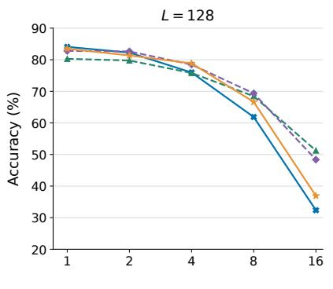

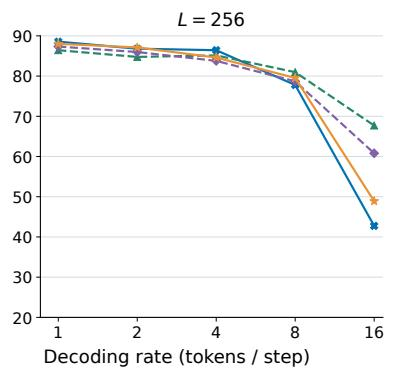

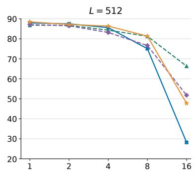  
JustGRPO-reproduce RePara-adaptive0.80 RePara-adaptive0.90 RePara-adaptive0.95  
Figure 8: Effect of the adaptive training threshold on LLaDA GSM8K accuracy (%) with sampling temperature 0. The maximum proposal length is two tokens. Panels show generation lengths $L = 1 2 8 , 2 5 6 , 5 1 2$ ; the horizontal axis is nominal TPD $k = L / S$ . JustGRPO is included as a reference.

Table 10: Mean phase times (seconds per optimizer step) for LLaDA mathematical training over the 127 common steps. Adaptive denotes Adaptive2-0.95; rollout denotes generation only. Overall core and measured step times are reported in Table 3.
<table><tr><td>Metric</td><td>JustGRPO</td><td>Fix2</td><td>Adaptive</td></tr><tr><td>Rollout generation</td><td>101.22</td><td>51.04</td><td>89.54</td></tr><tr><td>Log-probability</td><td>115.33</td><td>56.23</td><td>100.83</td></tr><tr><td>Backward</td><td>202.33</td><td>102.13</td><td>177.99</td></tr></table>

Overall, 31.1% of Adaptive’s completion–round slots are assigned to finished rows. This measures inactive batch slots, not GPU idle time.

Table 11: Logical blocks and executed rounds over the same 127 steps. Adaptive denotes Adaptive2-0.95. Mean block length pools committed tokens and logical blocks; the other counts are averaged per completion or training step.
<table><tr><td>Metric</td><td>JustGRPO</td><td>Fix2</td><td>Adaptive</td></tr><tr><td>Mean block length</td><td>1.00</td><td>2.00</td><td>1.67</td></tr><tr><td>Logical blocks</td><td>256.00</td><td>128.00</td><td>153.23</td></tr><tr><td>Executed rounds</td><td>256.00</td><td>128.00</td><td>222.23</td></tr><tr><td>Inactive row-round slots</td><td>0.0%</td><td>0.0%</td><td>31.1%</td></tr></table>

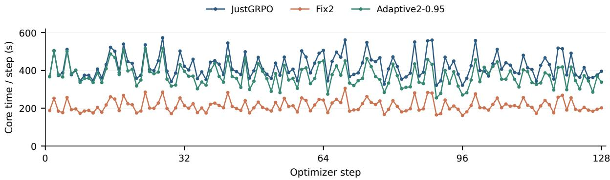  
(a) Core training time.

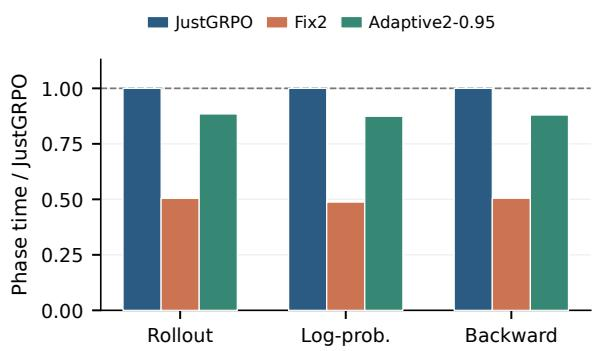  
(b) Relative phase times.

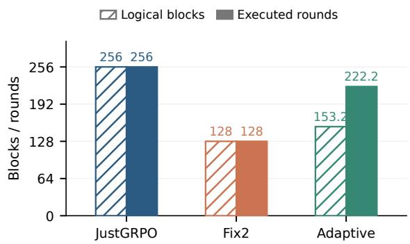  
(c) Logical blocks and executed rounds.

Figure 9: LLaDA mathematical training efficiency. Adaptive denotes Adaptive2-0.95. Panel (a) shows the 128-step training traces; panels (b) and (c) summarize the 127 common recorded steps. Logical blocks are averaged per completion and executed rounds per optimizer step.  
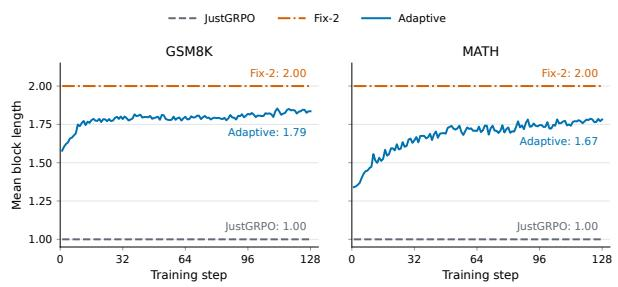  
Figure 10: Mean block length during LLaDA training on GSM8K (left) and MATH (right). The adaptive policy is shown alongside JustGRPO and Fix2. The horizontal axis is the training step.

## F Additional Experiments on Code Generation

This appendix reports the coding results of RePara and two attempts to improve transfer: easier training data and JustGRPO initialization. Coding training details are provided in Appendix C.

## F.1 Applying RePara to Coding: Accuracy Losses

We apply RePara to code generation with LLaDA-8B-Instruct, using the same short-block rollouts and GRPO optimization as in the GSM8K and MATH-500 experiments. We compare Fix2 and Adaptive2-0.95 with JustGRPO; training data and task rewards are given in Sections C.1 and C.2. HumanEval and MBPP follow the common benchmark evaluation protocol in Appendix B.1.

This direct application fails to reproduce the mathematical gains and instead produces substantial accuracy degradation.

## F.2 Targeted Training Interventions

We test whether more accessible problems or a stronger coding initialization can improve multitoken training. Training settings are given in Section C.1.

Table 12: Coding Pass@1 (%) under a common diffusion decoder $( L = S = 2 5 6$ , window size 32, temperature zero). Trained methods use their fixed step-128 endpoints.
<table><tr><td>Training setting</td><td>HumanEval</td><td>MBPP</td></tr><tr><td>Backbone</td><td>38.41</td><td>40.20</td></tr><tr><td>JustGRPO</td><td>50.00</td><td>47.60</td></tr><tr><td> $\mathtt { F i x 2 }$ </td><td>10.98</td><td>14.60</td></tr><tr><td> $\mathtt { A d a p t i v e 2 - 0 . 9 5 }$ </td><td>15.24</td><td>29.40</td></tr></table>

Easier training data. Replacing AceCode-Hard with AceCode-Medium makes the backbone’s Fix-2 rollouts more successful: at length 256 and temperature zero, full-pass success is 30.80% on Medium500 versus 7.80% on Hard500. Nevertheless, Fix2 training still yields near-zero HumanEval/MBPP accuracy. Adaptive2-0.95 scores above JustGRPO at Diff#4 on these benchmarks, but trails it at Diff#1 and on held-out Medium500. Easier data therefore does not yield consistent coding gains.

JustGRPO initialization. We first strengthen coding performance with single-token JustGRPO, then initialize RePara from its checkpoint. Multitoken continuation improves high-quota scores while reducing Diff#1 accuracy (Figure 11). For example, at length 512, Adaptive2-0.95 raises HumanEval Diff#8 from 5.49% to 15.85%, while Diff#1 falls from 52.44% to 41.46%. This continuation exhibits local gains without establishing consistent accuracy improvements.

These outcomes are consistent with the domain contrast in Sections 2.1 and 2.2: code shows weaker parallel decoding and a shorter local predictive horizon. A plausible bottleneck for RePara is that weak initial multi-token rollouts make learning from task rewards difficult. Single-token Just-GRPO provides a stronger coding starting point, but the subsequent multi-token gains remain conditional.

JustGRPO start: 128 updates; RePara: 128 additional updates  
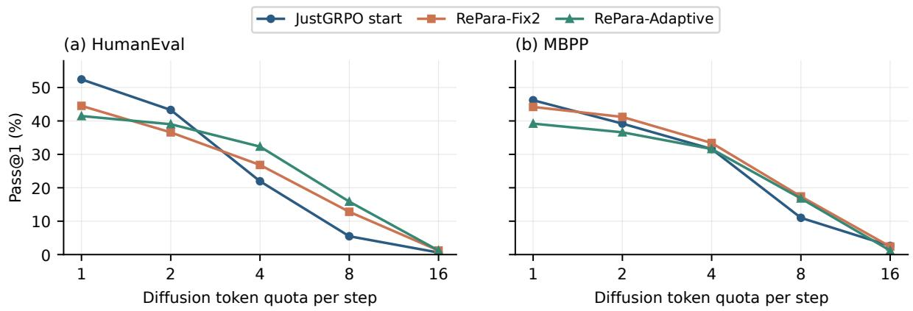  
Figure 11: Coding evaluation after 128 additional multi-token training updates from a JustGRPO checkpoint, at $L = 5 1 2$ and temperature zero. Gains at higher diffusion quotas coexist with accuracy losses at quota one.