# A Refresh Interval Does Not Fully Specify a Refresh Schedule: Learning-Rate-Dependent Placement in Kronecker-Preconditioned Language Model Training

Xinyu Wang1 Zhiwei Zhai2 Yu Gu1 Zijun Yu1 Sicheng Lyu1 Jingrui Tian1 Lei Ding3 Ziyang Song4 Xiao-Wen Chang1

1McGill University 2The Chinese University of Hong Kong 3University of Manitoba 4Ohio University

## Abstract

Kronecker-preconditioned optimizers recompute a cached curvature eigendecomposition only periodically, and implementations and adaptive methods control this through the refreshfrequency. We show that frequency leaves part of a schedule free: at a fixed number of refreshes, when they occur changes held-out loss at the same compute. Training GPT-style models with the Mousse optimizer across model sizes, we move the middle refreshes of a fourrefresh schedule while fixing the first and last. On FineWeb the two placements exchanged rank as the learning rate rose (later placement was better at low rates, earlier placement at high ones), so a single-learning-rate comparison can report either ranking. The reversal held under controls including the published optimizer internals, and placement still mattered at the published refresh density. The learning rate at which the preference flips fell with model size, consistent with a held-out smaller model, and shifted with training length. A spectral-width staleness score predicted the same ranking at every learning rate and missed the reversal. Refresh schedules should be reported in full and compared across the learning rates at which they will be used.

## 1 Introduction

Kronecker-preconditioned optimizers (Gupta et al., 2018; Anil et al., 2020; Vyas et al., 2025; Zhang et al., 2026) are increasingly competitive for neuralnetwork and language-model training (Kasimbeg et al., 2025), but their curvature factorization is expensive, so practical implementations compute it only intermittently and reuse the cached result in between. The standard control on this cost is the refresh interval, and recent methods adapt that interval to a staleness signal (Eschenhagen et al., 2025; Nam and Ahn, 2026). Both treat a schedule as determined by how often refreshes occur.

A refresh frequency fixes how many factorizations are computed and leaves open the steps at which they run. The same number of refreshes can be placed differently over training, and each placement decides which cached curvature is applied to which updates. Moving a refresh costs the same compute, because the same eigendecompositions run at different steps. We isolate this choice by holding the refresh count and the first and last refresh steps fixed and moving only the middle refreshes. On FineWeb the same two schedules exchanged rank as the learning rate rose. Later placement gave lower loss at small learning rates and earlier placement at large ones (Figure 1). A comparison made at a single learning rate therefore reports whichever ranking that rate selects. This is the confound documented for comparisons between optimizers (Choi et al., 2019; Sivaprasad et al., 2020), here inside one optimizer’s schedule space.

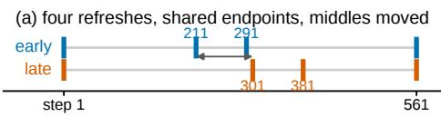

(b) the ranking reverses with the learning rate  
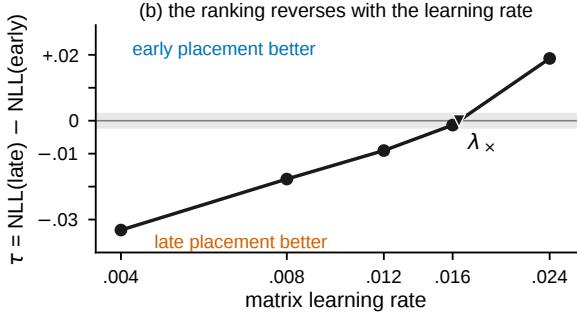  
Figure 1: (a) The two schedules. Both perform four refreshes and share their first and last refresh step, and only the two middle refreshes differ. (b) Seed-mean difference τ in endpoint held-out negative log-likelihood (NLL), later schedule minus earlier, against the matrix learning rate (FineWeb, 350M). Positive values mean earlier placement is better. λ× marks the interpolated sign change, and the grey band is the tie tolerance.

Experimental design. All experiments use Mousse (Zhang et al., 2026), a curvatureaugmented Muon optimizer whose factoredcurvature eigensystem is recomputed only at refresh steps, on GPT-style models of 64M to 929M parameters trained in a short-horizon regime on six single-domain corpora, with FineWeb as the primary corpus (§4.1).

Findings. Placement preference reverses with the learning rate (§4.2). Across intermediate placements, the lowest-loss placement moved earlier as the learning rate rose. The reversal survives controls, and a uniform schedule beats both. It held under controls for warmup, weight decay, the auxiliary learning rate and the published Mousse internals, and placement still changed loss at the published refresh density. An equal-budget uniform schedule beat both mirrored schedules on most corpora, so the mirrored pair serves as a probe of how schedules are compared, and the uniform schedule is the better choice among the three. The boundary moves with scale and horizon (§4.3). It fell with model size, a held-out smaller model landed inside the band fixed in advance, and it fell faster than the loss-optimal learning rate. Longer training also shifted it. A spectral-width staleness score predicts the same ranking at every learning rate (§4.4). Most spectral-width change happened before the schedules diverge, so the score tracks early curvature motion and misses the reversal. A schedule comparison therefore needs the full schedule, several learning rates and an equal-budget uniform baseline.

## 2 Related Work

Kronecker-factored preconditioning and its amortization. Kronecker-factored approximate curvature (K-FAC) (Martens and Grosse, 2015), Shampoo (Gupta et al., 2018) and their large-scale refinements (Anil et al., 2020; Morwani et al., 2025; Vyas et al., 2025) precondition matrix-shaped parameters with factored curvature whose eigendecomposition or inverse root dominates per-step cost, so implementations recompute it intermittently. Eigenvalue-corrected K-FAC (EKFAC) (George et al., 2018) and SOAP, which runs Adam in the eigenbasis of Shampoo’s preconditioner (Vyas et al., 2025), keep a diagonal rescaling current inside a fixed eigenbasis between rebuilds. Standard Muon (Jordan et al., 2024; Bernstein and Newhouse, 2024; Liu et al., 2025) orthogonalizes the momentum directly, without a cached curvature factorization. Mousse (Zhang et al., 2026) adds Kronecker-factored curvature to a Muon-style update and with it that decision (§3.1). Appendix F surveys the refresh controls these implementations expose.

Deciding when to refresh. The closest work adapts the refresh frequency to an error signal. Purifying Shampoo triggers an eigenbasis update from a warm-started QR termination bound (Eschenhagen et al., 2025), and FOAM couples the eigendecomposition frequency and damping to an estimated operator error (Nam and Ahn, 2026). Both tie timing to cost: a refresh occurs when the error is large enough, so changing when refreshes occur also changes how many occur. Purifying Shampoo further finds that eigenbasis accuracy matters more early in training than late, and leaves open how approximation error affects convergence. §4.4 tests whether a scalar error signal of this kind predicts the effect of placement. Non-uniform timing is already expressible in practice: Distributed Shampoo exposes a warm-start step alongside its update interval (Shi et al., 2023).

Evidence on refresh frequency. SOAP reports that recomputing Shampoo’s eigendecomposition less often degrades language-model pretraining, increasingly so as the interval grows, and that SOAP degrades more slowly (Vyas et al., 2025). Such studies vary how often the factorization is recomputed, while our experiments vary placement at a fixed count (§4.2). Near the preference boundary the placement effect falls within the tie tolerance, so a comparison made there would report little difference between schedules that separate clearly at other learning rates.

Rankings that depend on how the comparison is run. Optimizer rankings are known to change with the tuning protocol: comparisons at a single hyperparameter point, or under unequal tuning budgets, can reverse conclusions (Choi et al., 2019; Sivaprasad et al., 2020; Schmidt et al., 2021; Dahl et al., 2023). Recent language-model studies sweep the learning rate for every method (Zhao et al., 2025; Semenov et al., 2025) and treat scale and data-to-model ratio as axes of the comparison (Wen et al., 2026), and Wen et al. (2026) also observe that the ranking of two optimizers can flip during learning-rate decay. Optimal learning rates themselves shift with width (Yang et al., 2021)

and token horizon (Bjorck et al., 2025), the axes against which §4.3 measures the boundary. We find the same kind of reversal between two equal-cost schedules of one optimizer.

## 3 Refresh Placement at Fixed Cost

## 3.1 Refresh schedules

Consider a run of H optimization steps. A refresh schedule with refresh budget K (the number of refreshes) is an ordered set

$$
S = ( s _ { 1 } , \ldots , s _ { K } ) , \qquad 1 = s _ { 1 } < \cdot \cdot \cdot < s _ { K } \leq H .
$$

A refresh is performed before the update at its scheduled step. For update t, the most recent refresh and the age of its cached factorization are

$$
r _ { S } ( t ) = \operatorname* { m a x } \{ s \in S : s \leq t \} , a _ { S } ( t ) = t - r _ { S } ( t ) .\tag{1}
$$

The optimizer we study, Mousse (Zhang et al., 2026), updates its momentum and factored curvature statistics at every step but recomputes the eigendecomposition of the curvature factors only at the steps in $S ,$ applying the cached eigensystem to every update in between. The exact update is given in App. B. Changing S therefore changes which curvature snapshot is applied during each part of training, while the number of eigendecompositions stays the same.

Our primary comparison uses H = 591 steps with

$$
\begin{array} { r } { S _ { E } = ( 1 , 2 1 1 , 2 9 1 , 5 6 1 ) , } \\ { S _ { L } = ( 1 , 3 0 1 , 3 8 1 , 5 6 1 ) . } \end{array}
$$

Here $S _ { E }$ places the middle refreshes earlier and $S _ { L }$ later. Both schedules perform four refreshes and share a terminal cache age of $5 9 1 - 5 6 1 =$ 30 steps, and their middle refreshes lie within the constant-learning-rate phase of training. Between steps 211 and 290, for example, $S _ { E }$ applies the cache computed at step 211 while $S _ { L }$ still applies the cache from step 1. From step 381 to step 560, $S _ { L }$ applies its step-381 cache while $S _ { E }$ applies the one from step 291.

The pair also differs in total cache age. The sum $\textstyle \sum _ { t } a _ { S } ( t )$ depends on the refresh gaps and is minimized by even spacing, so the pair differs in total staleness as well as in timing (App. A). Two designs separate these: the placement landscape of §4.2 moves the middle pair while keeping its separation fixed, and an equal-budget uniform schedule, which minimizes cumulative age, serves as a reference throughout.

Placement also changes the contents of later caches. An earlier refresh alters subsequent parameters, gradients, momentum and curvature statistics, so even the shared final refresh can produce different cached eigensystems on the two trajectories.

## 3.2 Placement contrast and preference boundary

Let $\ell ( S , \eta ; \xi )$ denote endpoint held-out NLL at matrix learning rate η and seed $\xi ,$ with corpus, model size and horizon fixed. Schedules are compared within matched seeds:

$$
\begin{array} { c } { { \tau ( \eta ; \xi ) = \ell ( S _ { L } , \eta ; \xi ) - \ell ( S _ { E } , \eta ; \xi ) , } } \\ { { { } } } \\ { { \bar { \tau } ( \eta ) = \displaystyle \frac { 1 } { n } \sum _ { i = 1 } ^ { n } \tau ( \eta ; \xi _ { i } ) , } } \end{array}\tag{2}
$$

so positive τ favors earlier placement. A contrast inside $[ - \delta , \delta ]$ is treated as a tie, and a cell is seedconsistent when every seed receives the same label (earlier better, later better, or tie). The choice of δ is given in §4.1. We report individual seed contrasts with each comparison so that effect size and run-torun variation can be read separately (App. C).

We call the learning rate at an observed sign change the preference boundary $\lambda _ { \times }$ , or the crossing. A pair of adjacent grid points whose seedmean contrasts have opposite signs is a bracket. We estimate $\lambda _ { \times }$ by interpolating the seed-mean contrast in log learning rate inside the last bracket of the grid, staying inside the tested grid (Eq. A2, App. A). The seed contrasts on either side of $\lambda _ { \times }$ show whether the ranking changed consistently across runs.

## 4 Experiments

All experiments in this section share the setup below.

## 4.1 Experimental setup

Models, data and training budget. We trained GPT-style decoder models (Radford et al., 2019) at five sizes from 64M to 929M parameters on six single-domain corpora (FineWeb (Penedo et al., 2024), and the GitHub, Pile-CC, PubMed Central, arXiv and Books3 subsets of the Pile (Gao et al., 2021)) and on three FineWeb/GitHub mixtures. FineWeb was the primary corpus. Unless stated otherwise, runs used 65,536 tokens per step for 591 steps under a warmup–stable–decay (WSD) learning-rate schedule (Hu et al., 2024; Hägele et al., 2024) (App. B). This is a deliberately short regime, between 0.04 and 0.6 tokens per parameter and far below compute-optimal training (Hoffmann et al., 2022). It made dense learning-rate and seed grids affordable at five scales, and §4.3 varies the horizon directly.

Optimizer. Matrix parameters used Mousse with the schedules of §3, and non-matrix parameters used AdamW (Loshchilov and Hutter, 2019). Our implementation follows the published update but differs in three internals: AdamW rather than Lion (Chen et al., 2023) for non-matrix parameters, a nonnegative eigenvalue correction in place of additive damping, and a $\sqrt { m / n }$ learning-rate adjustment for an $m \times n$ weight matrix (App. B). A control in §4.2 restores all three jointly.

Refresh budget. Four refreshes is sparse next to Mousse’s published interval of ten steps, although Shampoo-family deployments report intervals from tens to hundreds of steps (Anil et al., 2020; Shi et al., 2023). A sparse budget leaves long gaps whose placement can be moved over a wide range. §4.2 also tests larger budgets and the published refresh density.

Learning rates and seeds. The corpus surface, the grid of corpora and matrix learning rates (LRs) at 350M, used five learning rates with two fresh seeds per cell. Controls used three seeds. Independent cohorts, which repeat a model size with fresh seeds, used four. Grids were fixed per experiment and are listed with each experiment (App. B). A corpus’s tuned learning rate is the grid value that minimizes endpoint NLL for the better of the two mirrored schedules. The uniform reference schedule is (1, 188, 374, 561).

Evaluation and tie tolerance. Endpoint NLL was measured on a frozen held-out stream from a shard disjoint from training. The tie tolerance $\delta = 0 . 0 0 2 { \mathrm { N L I } }$ was registered before the first surface experiment and carried unchanged. It is about one unit of seed-to-seed variation. A run counts as unstable when its endpoint NLL exceeds the best endpoint of its condition by more than a fixed stability margin (App. B). The conclusions rest on contrasts several times larger (App. C). Each experiment’s protocol and analyzer were fixed before its data existed (App. B).

Table 1: Placement effect at each corpus’s tuned learning rate beside the largest effect on the surface (350M, 591 steps).
<table><tr><td>corpus</td><td>tuned LR</td><td>|τ| tuned</td><td>surface max</td></tr><tr><td>FineWeb</td><td>.012</td><td>.009</td><td>.033 (at .004)</td></tr><tr><td>Pile-CC</td><td>.012</td><td>.011</td><td>.031 (at .024)</td></tr><tr><td>GitHub</td><td>.012</td><td>.084</td><td>.084 (at .012)</td></tr><tr><td>PubMed</td><td>.012</td><td>.068</td><td>.082 (at .024)</td></tr><tr><td>arXiv</td><td>.016</td><td>.039</td><td>.095 (at .024)</td></tr><tr><td>Books3</td><td>.012</td><td>.043</td><td>.063 (at .016)</td></tr></table>

## 4.2 Learning Rate Reverses Placement Preference

Figure 2 compares $S _ { E }$ and $S _ { L }$ at five learning rates on each of the six corpora at GPT-350M, with two fresh seeds per cell. Every cell was seedconsistent under the screening tolerance (Figure 7). On FineWeb, later placement gave lower loss at low learning rates. Its advantage shrank as the learning rate rose, passed through a tie, and reversed at the highest rate. The other corpora behaved differently. Pile-CC ended with earlier placement ahead after a non-monotone path, GitHub, PubMed Central and arXiv favored earlier placement at every tested rate, and Books3 favored earlier placement until its runs became unstable at the highest rate. The three-seed controls below reproduce the FineWeb reversal.

Table 1 reports the effect at each corpus’s tuned learning rate, the operating point a practitioner would use. The effect remained beyond the tie tolerance on every corpus at these points. It was smallest on FineWeb and largest on GitHub, and on most corpora it was smaller than the largest value on the surface. For scale, the tuned FineWeb effect is about 15% of the loss reduction from doubling the model from 350M to 695M parameters, obtained here at an unchanged number of eigendecompositions.

Comparison with uniform placement. At the learning rates tuned for the mirrored pair, an equalbudget uniform schedule outperformed the better mirrored schedule on most corpora (App. C). The two comparisons answer different questions. The mirrored pair measures how a fixed change in timing interacts with the learning rate, and the uniform schedule measures how far both placements sit from even spacing. Among the schedules tested, even spacing is therefore a strong default at a fixed budget, and the mirrored pair shows how much an uneven choice can shift the ranking between learning rates.

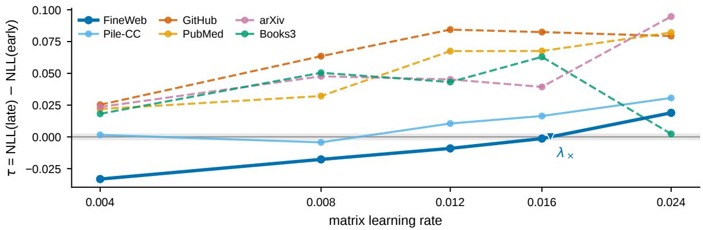  
Figure 2: The placement contrast τ(corpus, η) at GPT-350M (positive = early better). FineWeb is drawn heavier, the grey band is the ±0.002 tie tolerance, and the marker is the interpolated crossing. Crossing corpora are solid, non-crossing dashed.

The placement landscape. To check whether the reversal extends beyond the two endpoints, we moved the middle pair through

$$
\begin{array} { r } { S _ { c } = ( 1 , c - 4 0 , c + 4 0 , 5 6 1 ) , } \\ { c \in \{ 2 5 1 , 2 8 1 , 2 9 6 , 3 1 1 , 3 4 1 \} , } \end{array}\tag{3}
$$

which keeps the refresh count, the endpoints and the middle-pair separation fixed and has $S _ { E }$ and $S _ { L }$ as its two extremes. The whole family tilted with the learning rate (Figure 3). At the lowest of the three rates the earliest centre was the worst placement, at the highest it was the best, and in between the landscape was nearly flat. At the highest rate the end-to-end tilt was an order of magnitude larger than the tie tolerance, while the best sampled centre and its neighbours differed by about the tolerance. All three seeds had the same sign at the two end columns.

Controls. Each control in Table 2 changed one part of the setup and re-measured the FineWeb bracket. Adding a refresh at the end of warmup to both schedules left the crossing nearly unchanged. Raising the budget while keeping the first and largest gaps also left it nearly unchanged, so the reversal holds with more than two middle refreshes. Scaling the AdamW rate with the matrix rate and varying weight decay both kept the bracket. Restoring the published internals within our training recipe moved the crossing to a higher learning rate. On FineWeb/GitHub mixtures earlier placement won at every tested learning rate, so the late preference at low rates appeared only on pure FineWeb.

Published refresh density. The larger budgets above keep the long gaps of the sparse pair. A budget-59 pair at the published refresh density instead keeps every gap short, with interval lengths running in opposite directions (Figure 4a). Placement still changed endpoint loss by several times the tie tolerance, and every seed-consistent cell favored later placement, as the sparse pair does at lower learning rates (Figure 4b). At low rates the dense contrast was smaller than the sparse one, and its seed spread grew at high rates. The two highest-rate cells were seed-inconsistent, so at this density the data show a placement effect and leave the reversal unresolved.

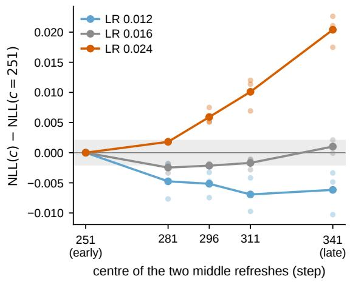  
Figure 3: Endpoint NLL relative to the earliest centre c=251 for five placements of the middle pair at the same budget and endpoints (FineWeb, 350M). Faint points are individual seeds, and the grey band is the tie tolerance.

## 4.3 The Boundary Varies with Scale and Horizon

We measured $\lambda _ { \times }$ for the same schedule pair on FineWeb at five model sizes, each in a separate experiment with the horizon of §4.1. The boundary fell at every step up the ladder (Figure 5a). To test the trend before seeing the result, we fitted the four larger sizes and fixed a tolerance band around the extrapolated 64M boundary before running 64M. The measured boundary fell inside the band, much closer in log distance to the prediction than to a benchmark in which the boundary stays constant across sizes (Figure 5b). The band is a preselected acceptance tolerance, and a fit through the independent cohorts alone would have placed the 64M boundary outside it (App. D).

Table 2: Controls on the FineWeb reversal (350M, primary pair unless stated). A check mark means a seedconsistent sign change, a cross means none, and $\lambda _ { \times }$ is the interpolated crossing. Details are in App. C.
<table><tr><td>condition</td><td>reversal</td><td> $\lambda _ { \times }$ </td></tr><tr><td>primary pair (reference)</td><td> $\checkmark$ </td><td>.0166</td></tr><tr><td>schedule construction</td><td></td><td></td></tr><tr><td>shared refresh added at warmup end budget 8, first and largest gaps kept</td><td> $\checkmark$ </td><td>.0164</td></tr><tr><td></td><td> $\checkmark$ </td><td>.0166</td></tr><tr><td>budget 16, first and largest gaps kept budget 59, every gap at most 15 steps</td><td> $\checkmark$ </td><td>.0171</td></tr><tr><td></td><td> $\underline { { \boldsymbol { \ b } } } ^ { a }$ </td><td></td></tr><tr><td>auxiliary optimizer AdamW rate scaled with the matrix rate</td><td> $\checkmark$ </td><td>b</td></tr><tr><td>weight decay varied</td><td></td><td>b</td></tr><tr><td></td><td> $\checkmark$ </td><td></td></tr><tr><td>implementation published Mousse internals</td><td> $\checkmark$ </td><td>.032</td></tr><tr><td>data</td><td></td><td></td></tr><tr><td>FineWeb/GitHub mixtures</td><td>X</td><td></td></tr></table>

aPlacement changed loss, but the two highest-rate cells were seedinconsistent (Table $5 ) . \ ^ { b } \mathrm { S i }$ gn change kept in the same grid interval as the reference. Per-seed values in Table 6.

Repeating three sizes with fresh four-seed cohorts tested how precisely each size is located. Every cohort showed the same sign pattern across learning rates, yet each placed its crossing outside the interval of the main estimate, sometimes above it and sometimes below. The spread between cohorts is thus wider than the spread between seeds, so the ladder fixes the direction of the trend more firmly than any single per-size value.

Preference boundary and optimal learning rate. A downward boundary could simply track the lossoptimal learning rate, which also falls with size. We compared the two directly at four scales, using the learning rate that minimizes loss under the equalbudget uniform schedule, $\lambda _ { \mathrm { r e f - o p t } }$ . A pre-specified test checked whether the two log–log slopes agree within an equivalence band. The slope difference and its whole seed-bootstrap interval lay outside that band (App. D). The boundary sat above $\lambda _ { \mathrm { r e f - o p t } }$ at every measured scale, and the gap narrowed while staying open (Figure 5c). Over 64M to 929M, the preference boundary and the loss-optimal learning rate are therefore distinct quantities. The boundary also differs from the stability edge, the lowest unstable learning rate above the uniform-schedule optimum. Across scales the boundary fell faster than the edge, and the ratio between them shrank (App. D), so the crossing lies below the stability edge at every measured scale.

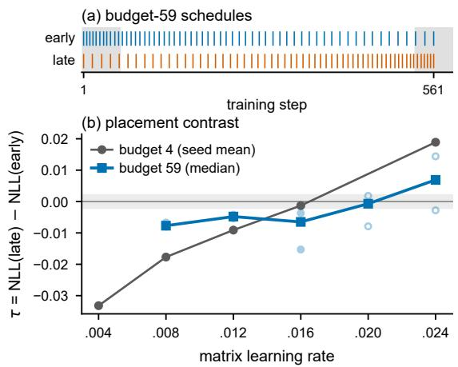  
Figure 4: (a) The budget-59 schedules as tick marks (grey bands are WSD warmup and warmdown). (b) τ against the matrix learning rate on FineWeb at 350M for the budget-59 pair (median and individual seeds) and the primary budget-4 pair (seed mean). Filled seed points mark seed-consistent cells, open points the others, and the grey band is the tie tolerance. Per-seed values are in Table 5.

Training horizon. All model sizes above share one token budget, so size and tokens per parameter vary together along the ladder. At 350M, with the refresh windows scaled in proportion, the reversal remained at twice and four times the original horizon. At eight times the horizon every tested cell favored later placement or tied, which leaves two readings open: the boundary moved above the grid, or the contrast flattened (App. D). The smaller 64M model lost the effect sooner. By four times the original horizon, every contrast away from the stability edge was within the tolerance. At matched tokens per parameter, 350M crossed while 64M and 124M favored earlier placement at every tested learning rate, so model size affects the contrast beyond its effect on tokens per parameter (App. D).

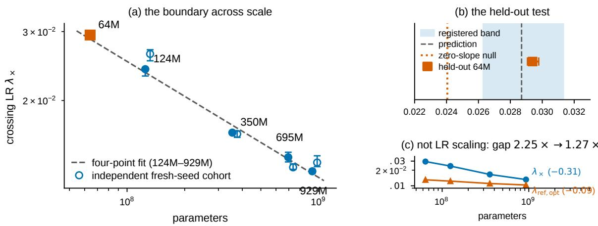  
Figure 5: (a) $\lambda _ { \times }$ against parameter count, one experiment per scale. The dashed line is the fit to the four larger scales, and the square is the held-out 64M measurement. Filled markers are the main estimates, and open markers are independent fresh-seed cohorts (App. D). (b) The held-out test: the preselected tolerance band, the zero-slope benchmark and the 64M measurement. (c) $\lambda _ { \times }$ against the uniform-schedule optimal learning rate $\lambda _ { \mathrm { { r e f - o p t } } }$

## 4.4 Spectral-Width Drift Predicts the Same Ranking at Every Learning Rate

Error-triggered refresh rules rest on the idea that a refresh helps once the cached curvature has drifted from the current training state. If that idea explained placement, a measure of accumulated drift should predict which schedule wins at each learning rate. We tested one measurable version, accumulated change in the spectral width of the curvature factors, as a registered prediction.

Let w(t) be the spectral-width profile of a separately instrumented reference run for the same (corpus, learning rate, seed) cell, which refreshes at a set of probe steps. The statistic aggregates the log ratio of upper and lower eigenvalue quantiles across matrix parameters (App. A). Both schedules are evaluated on the same reference profile. Using the last-refresh function of Eq. 1, define

$$
\begin{array} { l } { \displaystyle { I _ { w } ( S ) = \int _ { 1 } ^ { H } \big | w ( t ) - w ( r _ { S } ( t ) ) \big | d t , } } \\ { \Delta { I _ { w } } = I _ { w } ( S _ { L } ) - I _ { w } ( S _ { E } ) . } \end{array}\tag{4}
$$

A positive $\Delta I _ { w }$ means that later placement accumulates more spectral-width mismatch, so the score predicts an advantage for earlier placement. The score is measured in spectral width times training steps. It ranks schedules. The registered test compared the within-corpus rank order of $\Delta I _ { w }$ with that of the measured τ across learning rates, against frozen targets and a frozen withdrawal threshold (App. E).

$\Delta I _ { w }$ was positive in every cell, so it predicted earlier placement everywhere, while the measured contrast changed sign on the crossing corpora. From the lowest to the highest learning rate, $\Delta I _ { w }$ fell in every corpus while the measured contrast rose in all but one. The within-corpus rank correlation was negative on average and positive only in Books3 (Figure 6c), whose contrast collapses where its runs became unstable. The profiles themselves were stable across seeds (App. E). The registered prediction was therefore withdrawn.

Source of the score. Most of the spectral-width motion occurred before the two schedules first differ (Figure 6a). For the primary pair the score has the exact decomposition

$$
\Delta I _ { w } = \underbrace { \int _ { 2 1 1 } ^ { 3 0 1 } \left| w ( t ) - w ( 1 ) \right| d t } _ { D _ { 1 } } + R _ { w } ,\tag{5}
$$

where $D _ { 1 }$ is the extra exposure to the step-1 reference value under later placement and $R _ { w }$ collects the signed differences between the remaining intervals (App. A). $D _ { 1 }$ accounted for nearly all of the net contrast and often more, and $R _ { w }$ was negative in all but one cell. Because $D _ { 1 }$ compares the profile after step 211 with its value at step 1, it mostly records curvature motion that happened before the schedules diverge. Four other registered operationalisations of staleness, including a singleinterval drift statistic, a data-freshness gain and a generalisation account, also failed to predict the boundary (App. E).

Spectral width and the update. Spectral width summarizes eigenvalue spread, while the preconditioned update also depends on the eigenvectors and on the gradient expressed in that basis. Two curvature factors related by a rotation have identical spectral width, but their difference can be large in operator norm (App. A). The score also measures drift on a common reference trajectory, whereas training applies each cached factor along its own schedule-specific trajectory. Front-loaded curvature motion has also been reported by Gur-Ari et al. (2018) and Cohen et al. (2021), and early training is known to shape later training (Achille et al., 2019; Frankle et al., 2020).

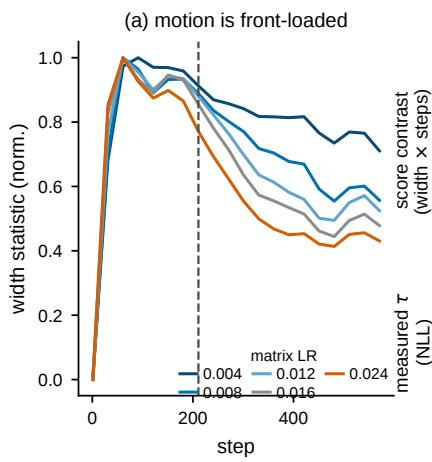

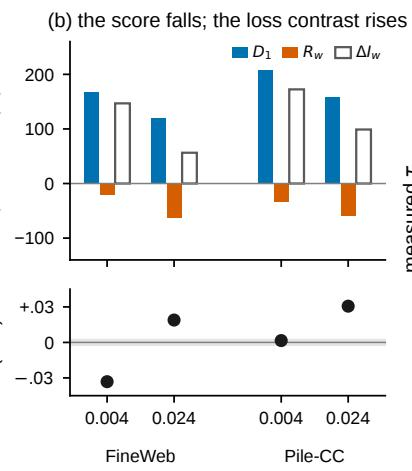

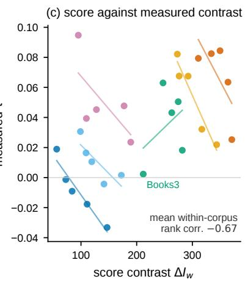  
Figure 6: (a) Normalised spectral-width profiles w(t) of the 20-refresh reference runs (FineWeb, five learning rates). The dashed line marks the first step at which the two schedules differ. (b) Top: decomposition of the score contrast $\Delta I _ { w }$ into $D _ { 1 }$ and $R _ { w }$ (Eq. 5), in width × steps. Bottom: the measured τ of the same cells, in NLL, with the tie band. (c) $\Delta I _ { w }$ (Eq. 4) against measured τ over all 30 cells, with per-corpus fits.

## 5 Discussion and Conclusion

We have shown that, in short language-model training with Mousse, a refresh interval leaves part of a refresh schedule free: at a fixed budget, where the refreshes fall changes held-out loss, and which placement wins depends on the learning rate, the model size and the training length.

Schedules should be compared across the learning rates at which they will be used, because a single learning rate can report either ranking. Adding one learning rate on each side of the tuned rate triples the cost of a single-rate comparison and shows whether the ranking holds near the operating point. An equal-budget uniform schedule makes a useful reference, because two schedules at the same budget can both sit far from even spacing, and a predictor of placement needs more than scalar drift of the curvature spectrum.

Over the measured range the boundary fell faster with model size than the loss-optimal learning rate, and the gap between them narrowed (§4.3). A learning rate tuned or transferred for a larger model therefore sits closer to the boundary, where the two placements are near a tie, so a schedule ranking obtained at one scale should be rechecked after scaling.

Our results add a dimension to earlier evidence on refresh timing. SOAP showed that longer refresh intervals degrade training (Vyas et al., 2025), and our experiments show that, at a fixed number of refreshes, their placement matters as well. Purifying Shampoo found that eigenbasis error matters far more in early iterations than in late ones (Eschenhagen et al., 2025). Most spectral-width motion in our runs also occurred early, before the two schedules diverge (§4.4), so the two observations agree that early curvature carries most of the change.

Error-triggered refresh rules (Eschenhagen et al., 2025; Nam and Ahn, 2026) change when refreshes occur and are usually evaluated at one tuned learning rate, the setting to which these practices apply directly.

The natural next measurement records the cached eigenvectors at every refresh and, at each probe step, computes their principal angles to the fresh eigenbasis, weighted by how much of the gradient falls in each direction. Such a score follows each schedule along its own trajectory and sees rotation as well as spread, the two properties the spectral-width score leaves out. Longer horizons and other Kronecker-preconditioned optimizers are the other open tests.

## Limitations

One optimizer. The reversal is established for Mousse. Restoring its published internals preserved it, but attempts to extend the study to other Kronecker-preconditioned optimizers were inconclusive, and the direction of the effect may differ for other optimizers (App. C).

Short training. Runs use far fewer tokens per parameter than compute-optimal training (Hoffmann et al., 2022), and the response changes with horizon. Because model size and tokens per parameter vary together, the cross-size boundary is a coarse trend over 64M to 929M.

Mechanism. The spectral-width score and other staleness accounts failed to predict the boundary, and measuring eigenvector rotation is left to future work.

## Ethics Statement

This work measures optimizer dynamics on public pretraining corpora and releases only code, registration protocols and adjudicated statistics. FineWeb is distributed under ODC-By 1.0. The Pile subsets (GitHub, Pile-CC, PubMed Central, arXiv, Books3) are used under the Pile’s terms as a compilation. Books3 contains copyrighted books, and it appears here solely as one of six domain streams for a training-dynamics measurement whose outputs are loss values. Its societal risks are those of language-model pretraining in general, and its practical recommendations concern experimental reporting.

## References

Alessandro Achille, Matteo Rovere, and Stefano Soatto. 2019. Critical learning periods in deep networks. In 7th International Conference on Learning Representations, ICLR 2019, New Orleans, LA, USA, May 6-9, 2019. OpenReview.net.

Rohan Anil, Vineet Gupta, Tomer Koren, Kevin Regan, and Yoram Singer. 2020. Scalable second order optimization for deep learning. CoRR, abs/2002.09018.

Jeremy Bernstein and Laker Newhouse. 2024. Old optimizer, new norm: An anthology. CoRR, abs/2409.20325.

Johan Bjorck, Alon Benhaim, Vishrav Chaudhary, Furu Wei, and Xia Song. 2025. Scaling optimal LR across token horizons. In The Thirteenth International Conference on Learning Representations, ICLR 2025, Singapore, April 24-28, 2025. OpenReview.net.

Xiangning Chen, Chen Liang, Da Huang, Esteban Real, Kaiyuan Wang, Yao Liu, Hieu Pham, Xuanyi Dong, Thang Luong, Cho-Jui Hsieh, Yifeng Lu, and Quoc V. Le. 2023. Symbolic discovery of optimization algorithms. In Advances in Neural Information Processing Systems 36: Annual Conference on Neural Information Processing Systems 2023, NeurIPS 2023.

Dami Choi, Christopher J. Shallue, Zachary Nado, Jaehoon Lee, Chris J. Maddison, and George E. Dahl. 2019. On empirical comparisons of optimizers for deep learning. CoRR, abs/1910.05446.

Jeremy Cohen, Simran Kaur, Yuanzhi Li, J. Zico Kolter, and Ameet Talwalkar. 2021. Gradient descent on neural networks typically occurs at the edge of stability. In 9th International Conference on Learning Representations, ICLR 2021, Virtual Event, Austria, May 3-7, 2021. OpenReview.net.

George E. Dahl, Frank Schneider, Zachary Nado, Naman Agarwal, Chandramouli Shama Sastry, Philipp Hennig, Sourabh Medapati, Runa Eschenhagen, Priya Kasimbeg, Daniel Suo, Juhan Bae, Justin Gilmer, Abel L. Peirson, Bilal Khan, Rohan Anil, Mike Rabbat, Shankar Krishnan, Daniel Snider, Ehsan Amid, and 6 others. 2023. Benchmarking neural network training algorithms. CoRR, abs/2306.07179.

Runa Eschenhagen, Aaron Defazio, Tsung-Hsien Lee, Richard E. Turner, and Hao-Jun Michael Shi. 2025. Purifying Shampoo: Investigating Shampoo’s heuristics by decomposing its preconditioner. In Advances in Neural Information Processing Systems 38: Annual Conference on Neural Information Processing Systems 2025, NeurIPS 2025, San Diego, CA, USA.

Jonathan Frankle, David J. Schwab, and Ari S. Morcos. 2020. The early phase of neural network training. In 8th International Conference on Learning Representations, ICLR 2020, Addis Ababa, Ethiopia, April 26-30, 2020. OpenReview.net.

Leo Gao, Stella Biderman, Sid Black, Laurence Golding, Travis Hoppe, Charles Foster, Jason Phang, Horace He, Anish Thite, Noa Nabeshima, Shawn Presser, and Connor Leahy. 2021. The Pile: An 800GB dataset of diverse text for language modeling. CoRR, abs/2101.00027.

Thomas George, César Laurent, Xavier Bouthillier, Nicolas Ballas, and Pascal Vincent. 2018. Fast approximate natural gradient descent in a Kronecker factored eigenbasis. In Advances in Neural Information Processing Systems 31: Annual Conference on Neural Information Processing Systems 2018, NeurIPS 2018, December 3-8, 2018, Montréal, Canada.

Vineet Gupta, Tomer Koren, and Yoram Singer. 2018. Shampoo: Preconditioned stochastic tensor optimization. In Proceedings ofthe 35th International Conference on Machine Learning, ICML 2018, Stockholmsmässan, Stockholm, Sweden, July 10-15, 2018,

volume 80 of Proceedings ofMachine Learning Research, pages 1842–1850. PMLR.

Guy Gur-Ari, Daniel A. Roberts, and Ethan Dyer. 2018. Gradient descent happens in a tiny subspace. CoRR, abs/1812.04754.

Alexander Hägele, Elie Bakouch, Atli Kosson, Loubna Ben Allal, Leandro von Werra, and Martin Jaggi. 2024. Scaling laws and compute-optimal training beyond fixed training durations. In Advances in Neural Information Processing Systems 37: Annual Conference on Neural Information Processing Systems 2024, NeurIPS 2024, Vancouver, BC, Canada, December 10 - 15, 2024.

Jordan Hoffmann, Sebastian Borgeaud, Arthur Mensch, Elena Buchatskaya, Trevor Cai, Eliza Rutherford, Diego de Las Casas, Lisa Anne Hendricks, Johannes Welbl, Aidan Clark, Tom Hennigan, Eric Noland, Katie Millican, George van den Driessche, Bogdan Damoc, Aurelia Guy, Simon Osindero, Karen Simonyan, Erich Elsen, and 3 others. 2022. Training compute-optimal large language models. In Advances in Neural Information Processing Systems 35: Annual Conference on Neural Information Processing Systems 2022, NeurIPS 2022.

Shengding Hu, Yuge Tu, Xu Han, Chaoqun He, Ganqu Cui, Xiang Long, Zhi Zheng, Yewei Fang, Yuxiang Huang, Weilin Zhao, Xinrong Zhang, Zheng Leng Thai, Kaihuo Zhang, Chongyi Wang, Yuan Yao, Chenyang Zhao, Jie Zhou, Jie Cai, Zhongwu Zhai, and 6 others. 2024. MiniCPM: Unveiling the potential of small language models with scalable training strategies. CoRR, abs/2404.06395.

Keller Jordan, Yuchen Jin, Vlado Boza, Jiacheng You, Franz Cesista, Laker Newhouse, and Jeremy Bernstein. 2024. Muon: An optimizer for hidden layers in neural networks. https://kellerjordan.github. io/posts/muon/.

Priya Kasimbeg, Frank Schneider, Runa Eschenhagen, Juhan Bae, Chandramouli Shama Sastry, Mark Saroufim, Boyuan Feng, Less Wright, Edward Z. Yang, Zachary Nado, Sourabh Medapati, Philipp Hennig, Michael Rabbat, and George E. Dahl. 2025. Accelerating neural network training: An analysis of the AlgoPerf competition. In The Thirteenth International Conference on Learning Representations, ICLR 2025, Singapore, April 24-28, 2025. OpenReview.net.

Jingyuan Liu, Jianlin Su, Xingcheng Yao, Zhejun Jiang, Guokun Lai, Yulun Du, Yidao Qin, Weixin Xu, Enzhe Lu, Junjie Yan, Yanru Chen, Huabin Zheng, Yibo Liu, Shaowei Liu, Bohong Yin, Weiran He, Han Zhu, Yuzhi Wang, Jianzhou Wang, and 9 others. 2025. Muon is scalable for LLM training. CoRR, abs/2502.16982.

Ilya Loshchilov and Frank Hutter. 2019. Decoupled weight decay regularization. In 7th International Conference on Learning Representations, ICLR 2019,

New Orleans, LA, USA, May 6-9, 2019. OpenReview.net.

James Martens and Roger Grosse. 2015. Optimizing neural networks with Kronecker-factored approximate curvature. In Proceedings of the 32nd International Conference on Machine Learning, ICML 2015, Lille, France, 6-11 July 2015, volume 37 of JMLR Workshop and Conference Proceedings, pages 2408–2417. JMLR.org.

Depen Morwani, Itai Shapira, Nikhil Vyas, Eran Malach, Sham M. Kakade, and Lucas Janson. 2025. A new perspective on Shampoo’s preconditioner. In The Thirteenth International Conference on Learning Representations, ICLR 2025, Singapore, April 24-28, 2025. OpenReview.net.

Kyunghun Nam and Sumyeong Ahn. 2026. FOAM: Frequency and operator error-based adaptive damping method for reducing staleness-oriented error for Shampoo. CoRR, abs/2606.02365.

Adam Paszke, Sam Gross, Francisco Massa, Adam Lerer, James Bradbury, Gregory Chanan, Trevor Killeen, Zeming Lin, Natalia Gimelshein, Luca Antiga, Alban Desmaison, Andreas Köpf, Edward Yang, Zachary DeVito, Martin Raison, Alykhan Tejani, Sasank Chilamkurthy, Benoit Steiner, Lu Fang, and 2 others. 2019. PyTorch: An imperative style, high-performance deep learning library. In Advances in Neural Information Processing Systems 32: Annual Conference on Neural Information Processing Systems 2019, NeurIPS 2019.

Guilherme Penedo, Hynek Kydlícek, Loubna Ben Al-ˇ lal, Anton Lozhkov, Margaret Mitchell, Colin Raffel, Leandro von Werra, and Thomas Wolf. 2024. The FineWeb datasets: Decanting the web for the finest text data at scale. In Advances in Neural Information Processing Systems 37: Annual Conference on Neural Information Processing Systems 2024, NeurIPS 2024, Vancouver, BC, Canada, December 10 - 15, 2024.

Alec Radford, Jeffrey Wu, Rewon Child, David Luan, Dario Amodei, and Ilya Sutskever. 2019. Language models are unsupervised multitask learners. Technical report, OpenAI.

Robin M. Schmidt, Frank Schneider, and Philipp Hennig. 2021. Descending through a crowded valley - benchmarking deep learning optimizers. In Proceedings of the 38th International Conference on Machine Learning, ICML 2021, 18-24 July 2021, Virtual Event, volume 139 of Proceedings of Machine Learning Research, pages 9367–9376. PMLR.

Andrei Semenov, Matteo Pagliardini, and Martin Jaggi. 2025. Benchmarking optimizers for large language model pretraining. CoRR, abs/2509.01440.

Hao-Jun Michael Shi, Tsung-Hsien Lee, Shintaro Iwasaki, Jose Gallego-Posada, Zhijing Li, Kaushik Rangadurai, Dheevatsa Mudigere, and Michael Rabbat. 2023. A distributed data-parallel PyTorch

implementation of the distributed Shampoo optimizer for training neural networks at-scale. CoRR, abs/2309.06497.

Prabhu Teja Sivaprasad, Florian Mai, Thijs Vogels, Martin Jaggi, and François Fleuret. 2020. Optimizer benchmarking needs to account for hyperparameter tuning. In Proceedings of the 37th International Conference on Machine Learning, ICML 2020, 13-18 July 2020, Virtual Event, volume 119 of Proceedings of Machine Learning Research, pages 9036–9045. PMLR.

Nikhil Vyas, Depen Morwani, Rosie Zhao, Itai Shapira, David Brandfonbrener, Lucas Janson, and Sham M. Kakade. 2025. SOAP: Improving and stabilizing Shampoo using Adam for language modeling. In The Thirteenth International Conference on Learning Representations, ICLR 2025, Singapore, April 24-28, 2025. OpenReview.net.

Kaiyue Wen, David Hall, Tengyu Ma, and Percy Liang. 2026. Fantastic pretraining optimizers and where to find them. In The Fourteenth International Conference on Learning Representations, ICLR 2026.

Greg Yang, Edward J. Hu, Igor Babuschkin, Szymon Sidor, Xiaodong Liu, David Farhi, Nick Ryder, Jakub Pachocki, Weizhu Chen, and Jianfeng Gao. 2021. Tuning large neural networks via zero-shot hyperparameter transfer. In Advances in Neural Information Processing Systems 34: Annual Conference on Neural Information Processing Systems 2021, NeurIPS 2021.

Yechen Zhang, Shuhao Xing, Junhao Huang, Kai $\operatorname { L v } ,$ Yunhua Zhou, Xipeng Qiu, Qipeng Guo, and Kai Chen. 2026. Mousse: Rectifying the geometry of Muon with curvature-aware preconditioning. CoRR, abs/2603.09697.

Rosie Zhao, Depen Morwani, David Brandfonbrener, Nikhil Vyas, and Sham M. Kakade. 2025. Deconstructing what makes a good optimizer for autoregressive language models. In The Thirteenth International Conference on Learning Representations, ICLR 2025, Singapore, April 24-28, 2025. OpenReview.net.

## A Derivations

Cumulative cache age. For updates $t \_ =$ $1 , \ldots , H$ and a schedule $\boldsymbol { S } = \left( s _ { 1 } , \ldots , s _ { K } \right)$ with $s _ { 1 } = 1$ , set $s _ { K + 1 } = H + 1$ and $g _ { j } = s _ { j + 1 } - s _ { j }$ On the updates $s _ { j } , \ldots , s _ { j + 1 } - 1$ the cached factorization has ages $0 , \ldots , g _ { j } - 1$ , so summing the arithmetic progression on each interval gives

$$
\sum _ { t = 1 } ^ { H } a _ { S } ( t ) = \textstyle { \frac { 1 } { 2 } } \sum _ { j = 1 } ^ { K } g _ { j } ( g _ { j } - 1 ) .\tag{A1}
$$

The sum is convex in the gaps, so with the endpoints fixed it is smallest when the free gaps are as equal as possible. For the primary schedules at $H = 5 9 1$ the gaps are $g _ { E } = ( 2 1 0 , 8 0 , 2 7 0 , 3 1 )$ and $g _ { L } = ( 3 0 0 , 8 0 , 1 8 0 , 3 1 )$ , giving cumulative ages of 61,885 and 64,585. The two schedules share the refresh count and the terminal age, but their cumulative ages differ by 2,700 step-age units. Cumulative age is one of several quantities that change with placement. A refresh at a common step can also produce different caches, because earlier placement differences change the parameters, gradients, momentum and curvature statistics from which that refresh is computed.

Interpolated preference boundary. For an ordered learning-rate grid $\eta _ { 1 } < \cdots < \eta _ { m }$ , we took adjacent points whose seed-mean contrasts have opposite signs, interpolated τ¯ linearly in x = log η inside the selected bracket $( \eta _ { j } , \eta _ { j + 1 } )$ , and set the interpolant to zero:

$$
\log \lambda _ { \times } = \log \eta _ { j } - \frac { \bar { \tau } ( \eta _ { j } ) } { \bar { \tau } ( \eta _ { j + 1 } ) - \bar { \tau } ( \eta _ { j } ) } \log \frac { \eta _ { j + 1 } } { \eta _ { j } } .\tag{A2}
$$

When a grid contains several sign changes we used the last bracket, and we kept every estimate inside the tested grid. The estimate is a point inside an observed sign-change interval. It needs only one observed sign change. The contrast may be nonmonotone, have several zeros, or cross elsewhere under a new seed.

Gap-term decomposition of the spectral-width score. For a reference profile w on [1, H], write $d _ { w } ( t , s ) = | w ( t ) - w ( s ) |$ and treat rS as a rightcontinuous step function on [1, H]. Expanding Eq. 4 over the primary schedules gives

$$
\begin{array} { l } { \displaystyle { I _ { \mathrm { w } } ( S _ { \varepsilon } ) = \int _ { 1 } ^ { 2 1 1 } d _ { \mathrm { w } } ( t , 1 ) d t + \int _ { 2 1 1 } ^ { 2 9 1 } d _ { \mathrm { w } } ( t , 2 1 1 ) d t } } \\ { \displaystyle { \ } + \int _ { 2 0 1 } ^ { 2 6 1 } d _ { \mathrm { w } } ( t , 2 9 1 ) d t } \\ { \displaystyle { \ } + \int _ { \mathrm { s y s } } ^ { 1 } d _ { \mathrm { w } } ( t , 5 6 1 ) d t , } \\ { \displaystyle { I _ { \mathrm { w } } ( S _ { \varepsilon } ) = \int _ { 1 } ^ { 9 0 1 } d _ { \mathrm { w } } ( t , 1 ) d t + \int _ { 3 0 1 } ^ { 3 8 1 } d _ { \mathrm { w } } ( t , 3 0 1 ) d t } } \\ { \displaystyle { \ } + \int _ { 3 0 1 } ^ { 9 6 1 } d _ { \mathrm { w } } ( t , 3 8 1 ) d t } \\ { \displaystyle { \ } + \int _ { \mathrm { s y s } } ^ { 1 7 } d _ { \mathrm { w } } ( t , 5 6 1 ) d t , } \end{array}
$$

and subtracting gives the exact identity

$$
\Delta I _ { w } = D _ { 1 } + D _ { 2 } + D _ { 3 } ,\tag{A3}
$$

with

$$
\begin{array} { l } { D _ { 1 } = \displaystyle \int _ { 2 1 1 } ^ { 3 0 1 } d _ { w } ( t , 1 ) d t , } \\ { D _ { 2 } = \displaystyle \int _ { 3 0 1 } ^ { 3 8 1 } d _ { w } ( t , 3 0 1 ) d t - \displaystyle \int _ { 2 1 1 } ^ { 2 9 1 } d _ { w } ( t , 2 1 1 ) d t , } \\ { D _ { 3 } = \displaystyle \int _ { 3 8 1 } ^ { 5 6 1 } d _ { w } ( t , 3 8 1 ) d t - \displaystyle \int _ { 2 9 1 } ^ { 5 6 1 } d _ { w } ( t , 2 9 1 ) d t , } \end{array}
$$

so that $R _ { w } = D _ { 2 } + D _ { 3 }$ in Eq. 5. The shared first and last intervals cancel because both scores use the same profile. The identity concerns the diagnostic only. Loss effects along the two training trajectories are a separate quantity. $D _ { 1 }$ is non-negative while $D _ { 2 }$ and $D _ { 3 }$ are signed, so $\Delta I _ { w }$ can take either sign, and a share $D _ { 1 } / \Delta I _ { w } > 1$ means that $R _ { w }$ is negative.

For each matrix parameter the width is $\begin{array} { r l r } { w _ { \mathrm { m a t } } ( t ) } & { { } = } & { \log _ { 1 0 } \bigl ( q _ { 9 5 } ( \Lambda _ { L } ( t ) ) / q _ { 0 5 } ( \Lambda _ { L } ( t ) ) \bigr ) \ + } \end{array}$ $\log _ { 1 0 } \left( q _ { 9 5 } ( \Lambda _ { R } ( t ) ) / q _ { 0 5 } ( \Lambda _ { R } ( t ) ) \right)$ on the applied eigenvalues. The run-level profile is the median over matrix parameters, interpolated linearly between probes and held at its last value after the final probe. The integrals were evaluated by the trapezoid rule on the unit step grid for each seed and averaged over the two seeds of a cell.

Spectral width and eigenvector orientation. An eigenspectrum leaves the orientation of its eigenvectors free. For $\kappa > 1$ let $A = \mathrm { d i a g } ( 1 , \kappa )$ and $B = \mathrm { d i a g } ( \kappa , 1 )$ . The two matrices have the same eigenvalues, so every width statistic built from eigenvalue quantiles takes the same value on both, but $\| A - B \| _ { 2 } = \kappa - 1$ and $B = R A R ^ { \top }$ for the rotation $\ R = { \left( \begin{array} { l l } { 0 } & { - 1 } \\ { 1 } & { 0 } \end{array} \right) }$ . Zero change in spectral width can therefore coexist with a large change in the curvature matrix. The example shows a limit of the statistic. Whether such rotations occur in our runs, and whether they relate to the reversal, is open (App. E). Similarly, a falling unweighted score can coexist with a rising weighted one: components that move from (10, 1) to (7, 2) have a falling unweighted sum but a rising sum under weights (1, 4).

## B Implementation and Training Details

Optimizer update. Matrix-shaped parameters (attention and MLP weights, 48 to 128 matrices per model) were updated with the Mousse update of Zhang et al. (2026), and embeddings, norms and other non-matrix parameters with AdamW. For one matrix parameter $W \in \mathbb { R } ^ { m \times n }$ with gradient $G _ { t }$ , every step maintains a heavy-ball momentum buffer and two exponential moving averages of factored curvature:

Algorithm 1 One optimizer step (matrix parame  
ters)   
1: ${ \cal M } \  \ \mu { \cal M } + \underline { { { G } } } ; L \  \ \beta L + ( 1 { - } \beta ) G G ^ { \top } ; R \ $   
$\beta R + ( 1 - \beta ) G ^ { \top } G$   
2: if t ∈ S ▷ refresh schedule then   
3: $( \Lambda _ { L } , Q _ { L } )  \mathrm { e i g h } ($ (tracenorm(biascorr(L)) + εI);   
shift $\lambda  \lambda + \operatorname* { m a x } \bar { \{ 0 , - \lambda _ { \operatorname* { m i n } } \} } + \bar { \varepsilon } ;$ same for R   
4: end if   
5: $\tilde { M } \gets \Lambda _ { L } ^ { - \alpha } Q _ { L } ^ { \top } M Q _ { R } \Lambda _ { R } ^ { - \alpha }$ ▷ cached $( \Lambda , Q )$ from the   
last refresh   
6 $\ L _ { \ L } : \ L _ { O } \Lleftarrow \mathrm { N S 5 } ( \tilde { M } ) ; \hat { O } \Lleftarrow \ Q _ { L } \Lambda _ { L } ^ { - \alpha } O \Lambda _ { R } ^ { - \alpha } Q _ { R } ^ { \top } ; \hat { O } \Lleftarrow$   
$\hat { O } \parallel O \parallel _ { F } / \parallel \hat { O } \parallel _ { F }$   
$7 \colon W \gets ( 1 - \eta \omega ) W - \eta \sqrt { m / n } \hat { O }$

$$
\begin{array} { r l } & { M _ { t } = \mu M _ { t - 1 } + G _ { t } , } \\ & { L _ { t } = \beta L _ { t - 1 } + \left( 1 { - } \beta \right) G _ { t } G _ { t } ^ { \top } , } \\ & { R _ { t } = \beta R _ { t - 1 } + \left( 1 { - } \beta \right) G _ { t } ^ { \top } G _ { t } , } \end{array}\tag{A4}
$$

with $\mu { = } 0 . 9 5$ and $\beta { = } 0 . 9 5$ , called EMAs below. A refresh at a step $s \in S$ applies bias correction and trace normalization $( \hat { L }  m \hat { L } / \operatorname { t r } \hat { L } )$ , computes $\mathrm { e i g h } ( \hat { L } + \varepsilon I ) = Q _ { L } \Lambda _ { L } Q _ { L } ^ { \top }$ , shifts the eigenvalues as $\lambda  \lambda +$ max $\left\{ 0 , - \lambda _ { \operatorname* { m i n } } \right\} + \varepsilon ,$ , and caches $( \Lambda _ { L } , Q _ { L } )$ , and likewise $( \Lambda _ { R } , Q _ { R } )$ . Between refreshes the moving averages keep evolving, but every update applies the cached eigensystem, whose age is $a _ { S } ( t )$ of Eq. 1. Each step preconditions the momentum with the cached eigensystem and then orthogonalizes it:

$$
\begin{array} { r l } & { \tilde { M } = \Lambda _ { L } ^ { - \alpha } Q _ { L } ^ { \top } M _ { t } Q _ { R } \Lambda _ { R } ^ { - \alpha } , } \\ & { ~ O = \mathrm { N S } 5 ( \tilde { M } ) , } \\ & { ~ \hat { O } = Q _ { L } \Lambda _ { L } ^ { - \alpha } O \Lambda _ { R } ^ { - \alpha } Q _ { R } ^ { \top } , } \end{array}\tag{A5}
$$

where NS5 is the five-iteration Newton–Schulz map and $\alpha = 0 . 1 2 5$ is applied before and after it. The update is rescaled to the Frobenius norm of $\boldsymbol { O } ( \hat { \boldsymbol { O } }  \hat { \boldsymbol { O } } \| \boldsymbol { O } \| _ { F } / \| \hat { \boldsymbol { O } } \| _ { F } )$ and applied with decoupled weight decay ω and a spectral-norm learningrate adjustment:

$$
W  ( 1 - \eta \omega ) W \mathrm { ~ - ~ } \eta \sqrt { m / n } \hat { O } .\tag{A6}
$$

Algorithm 1 summarizes one step.

Differences from published Mousse. We implemented the published update: whitening, Newton– Schulz orthogonalization and unwhitening, trace normalization, $\beta ~ = ~ 0 . 9 5 , ~ \alpha ~ = ~ 0 . 1 2 5$ and Frobenius-norm grafting. The intended change is the refresh schedule, which replaces the published uniform interval of ten steps. Three further internals differ: we shift the spectrum as $\lambda  \lambda + \operatorname* { m a x } \{ 0 , - \lambda _ { \operatorname* { m i n } } \} + 1 0 ^ { - 1 0 }$ instead of adding $1 0 ^ { - 5 } I$ damping, we apply a $\sqrt { m / n }$ matrix learning-rate adjustment, and we optimize nonmatrix parameters with AdamW instead of Lion. App. C restores all three. Arbitrary placement is implemented by setting the refresh interval to a value larger than the horizon and forcing a refresh exactly at the schedule steps. A per-step check verified the age of the applied cache in every run.

Table 3: Hyperparameters used in all experiments unless stated otherwise. Matrix learning-rate grids are given with each experiment.
<table><tr><td colspan="2">Optimizer (matrix parameters)</td></tr><tr><td>momentum µ</td><td>0.95 (heavy ball, Nesterov off)</td></tr><tr><td>curvature EMA  $\beta$ </td><td>0.95, bias-corrected at refresh</td></tr><tr><td>curvature exponent α</td><td>0.125, before and after Newton– Schulz</td></tr><tr><td>eigenvalue cleanup ε</td><td> $1 0 ^ { - 1 0 }$  (nonnegative correction after trace normalization)</td></tr><tr><td>orthogonalization</td><td>Newton-Schulz, 5 iterations</td></tr><tr><td>norm grafting LR adjustment</td><td>update rescaled to  $\| O \| _ { F }$  spectral-norm,  $\eta _ { \mathrm { V } } / m / n$ </td></tr><tr><td colspan="2">Non-matrix parameters optimizer AdamW, lr (0.9,0.95)</td></tr><tr><td>Training</td><td></td></tr><tr><td>LR schedule</td><td>WSD: 10% warmup, constant, 10% warmdown</td></tr><tr><td>weight decay</td><td>0.01, decoupled (0.0 in the 64M boundary experiment) 1,024 / 65,536</td></tr><tr><td>sequence / tokens per step batch geometry</td><td>8×8 (64M/124M), 4×16 (350M),</td></tr><tr><td>precision</td><td>1×64 (695M/929M) micro×accum bf16 autocast, fp32 curvature statis-</td></tr></table>

Models, evaluation and compute. All models are GPT-style decoders with vocabulary 50,304 and context 1,024: 64M has 12 layers of width 512 and 8 heads, 124M has 12 layers of width 768 and 12 heads, 350M has 24 layers of width 1,024 and 16 heads, 695M has 32 layers of width 1,280 and 20 heads, and 929M has 30 layers of width 1,536 and 24 heads. Every evaluation uses the same 2,097,152-token held-out stream from a shard disjoint from training. A run counts as unstable when its endpoint NLL exceeds the best endpoint of its condition by more than 0.15, the stability margin. Each run used one A100-SXM4-40GB from a pool of eight identical devices. Median training time per run at 591 steps, excluding evaluation, was 6.2 (64M), 7.5 (124M), 18.5 (350M), 54.6 (695M) and 55.4 minutes (929M). The experiments comprise 1,973 completed runs and about 920 A100-hours of training. Software: PyTorch 2.7.1 (Paszke et al., 2019), CUDA 12.6, Python 3.11.

Pre-specification and reproducibility. For each experiment, the protocol, learning-rate grid, seeds, decision rule and analysis script were fixed before the experiment ran. Seeds were fresh for every experiment, and results from different experiments were kept separate. Experiments were designed in sequence, each after the results of earlier ones were known. Training is bit-deterministic given the seed: six duplicate configurations in the learning-rateratio experiment, run separately and in two cases on different devices, reproduced endpoint NLL exactly. The code, protocols and analysis scripts are provided in anonymized form as supplementary material.

## C Additional Results for Section 4.2

Tie tolerance and seed variation. The tie tolerance $\delta = 0 . 0 0 2$ was fixed before the first surface experiment. On the surface the median disagreement between the two seeds of a cell was .0045 (90th percentile .021). Taking half that median, .00225, as a unit of seed variation, the tolerance is about one unit, so a cell whose true contrast is zero would often fall outside it with two seeds. The FineWeb contrasts on either side of the reversal, −.009 and +.019, are about four and eight units from zero. Two near-zero cells are used only descriptively: the Pile-CC dip at .008 (−.0043, about two units) and the 124M tie at .024, which an independent 124M cohort measured at −.0067.

Table 4: Seed-mean τ at 350M and 591 steps (positive = early better).
<table><tr><td>corpus</td><td>.004</td><td>.008</td><td>.012</td><td>.016</td><td>.024</td></tr><tr><td>FineWeb</td><td>-.0332</td><td>-.0177</td><td>-.0091</td><td>-.0013</td><td>+.0189</td></tr><tr><td>Pile-CC</td><td>+.0016</td><td>-.0043</td><td>+.0105</td><td>+.0164</td><td>+.0306</td></tr><tr><td>GitHub</td><td>+.0253</td><td>+.0635</td><td>+.0844</td><td>+.0825</td><td>+.0793</td></tr><tr><td>PubMed</td><td>+.0219</td><td>+.0321</td><td>+.0675</td><td>+.0676</td><td>+.0821</td></tr><tr><td>arXiv</td><td>+.0236</td><td>+.0477</td><td>+.0452</td><td>+.0393</td><td>+.0947</td></tr><tr><td>Books3</td><td>+.0182</td><td>+.0505</td><td>+.0432</td><td>+.0630</td><td>+.0023</td></tr></table>

Full surface. Table 4 gives every cell of Figure 2, and all 30 cells were seed-consistent (Figure 7). At .024 the Books3 runs exceeded the stability margin.

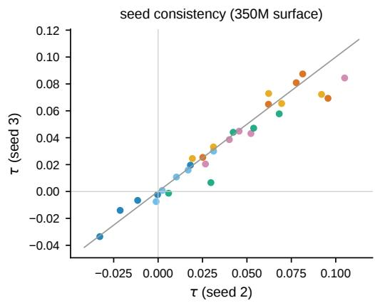  
Figure 7: Per-cell τ from the two seeds of the 350M surface, one point per (corpus, LR) cell. The line is $y = x$

A dedicated Books3 experiment measured +.0632 at .016 and +.0038 at .024.

Tuned operating points and the uniform reference. The tuned learning rate in Table 1 is the grid value that minimizes endpoint NLL for the better of the two mirrored schedules. At FineWeb’s tuned rate the effect is .009, about 15% of the loss reduction from doubling the model from 350M to 695M. At FineWeb’s largest surface effect, at .004, it is 57% of that reduction, but this rate is about three times below the optimum of the uniform reference. At the tuned rates, the uniform schedule (1, 188, 374, 561) beat the better mirrored schedule on five of the six corpora, by .018 to .051 NLL (three seeds).

Larger refresh budgets. We repeated the mirrored contrast at budgets 8 and 16 (FineWeb, 350M, three seeds, 60 runs), keeping the first, last and window-end refreshes and filling the windows with evenly spaced refreshes, a rule that reproduces the primary pair at budget 4. The medians over the five surface learning rates $\begin{array} { r l } { \mathrm { w e r e } } & { { } - . 0 3 9 5 , - . 0 2 3 7 , - . 0 0 8 4 , - . 0 0 1 9 , + . 0 1 8 8 } \end{array}$ at budget 8 (crossing .0166) and $- . 0 4 0 5 , - . 0 2 3 2 , - . 0 0 8 8 , - . 0 0 3 6 , + . 0 1 8 4$ at budget 16 (crossing .0171), against .0166 at budget 4, and the contrast kept its size. This construction keeps the first gap at 210 or 300 steps and the largest gap at 270 or 300 steps at every budget.

Published refresh density. The budget-59 pair, the published density at this horizon, keeps every gap short. Its 58 intervals form an arithmetic progression that sums to 560 with largest-to-smallest ratio 3. The early schedule takes the intervals in ascending order and the late schedule in descending order. Both refresh first at step 1 and last at step 561, so they share the terminal cache age of 30. Every interval lies between 5 and 15 steps (mean 9.66). We ran five learning rates with three fresh seeds, and each matched pair ran back-to-back on one device. Table 5 gives the results and Figure 8 draws the schedules.

Table 5: τ at budget 59 (FineWeb, 350M, three seeds). A cell is consistent when all seeds receive the same label (early better, late better, or tie).
<table><tr><td>LR</td><td>seed 1</td><td>seed 2</td><td>seed 3</td><td>median</td><td>consistent</td></tr><tr><td>.008</td><td>-.0080</td><td>-.0067</td><td>-.0077</td><td>-.0077</td><td>yes</td></tr><tr><td>.012</td><td>-.0048</td><td>-.0054</td><td>-.0042</td><td>-.0048</td><td>yes</td></tr><tr><td>.016</td><td>-.0065</td><td>-.0153</td><td>-.0037</td><td>-.0065</td><td>yes</td></tr><tr><td>.020</td><td>-.0007</td><td>-.0079</td><td>+.0018</td><td>-.0007</td><td>no</td></tr><tr><td>.024</td><td>+.0069</td><td>+.0144</td><td>-.0028</td><td>+.0069</td><td>no</td></tr></table>

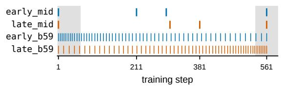  
Figure 8: The schedules as tick marks (grey bands are WSD warmup and warmdown). Top: the primary mirrored pair. Bottom: the budget-59 pair, whose interval lengths run in opposite directions while every gap stays between 5 and 15 steps. The labels early\_mid and late\_mid denote $S _ { E }$ and $S _ { L }$ , and early\_b59 and late\_b59 the budget-59 pair.

Placement landscape. The landscape of Figure 3 uses (1, c−40, c+40, 561) with $c \in$ {251, 281, 296, 311, 341}. The budget, the first and last refresh, the terminal cache age and the 80-step separation are fixed, so c is the only free coordinate. Reflecting the middle pair about step 296 maps the set onto itself: 251 and 341 are the primary pair, 281 and 311 are an interior pair, and 296 is fixed. We ran three learning rates with three fresh seeds (45 runs), with the five schedules for each (learning rate, seed) back-to-back on one device. Adjacent centres differed by up to .0103 at .024, while the best sampled centre and its neighbours differed by .0007 to .0025.

Auxiliary learning-rate ratio. Sweeping the matrix learning rate also sweeps its ratio to the AdamW rate of the non-matrix parameters, which the surface holds at $3 \times 1 0 ^ { - 4 }$ . We separated the two on the primary pair with three fresh seeds. The fixed condition kept AdamW at $3 \times 1 0 ^ { - 4 }$ and the proportional condition set it to rη with $r = 3 \times 1 0 ^ { - 4 } / . 0 1 6 .$ , so that the ratio is constant across learning rates. The fixed condition served as a positive control and reproduced the bracket. Table 6 gives both conditions.

Table 6: τ with the AdamW rate fixed at $3 \times 1 0 ^ { - 4 }$ versus scaled with the matrix rate (FineWeb, 350M, primary pair, three seeds). The two conditions coincide at .016 by construction.
<table><tr><td>cond. LR</td><td>AdamW</td><td>seed 1</td><td>seed 2</td><td>seed 3</td><td>median</td></tr><tr><td>fixed .012 fixed .016</td><td>3.0e-4 3.0e-4</td><td>-.0060 +.0005</td><td>-.0049 -.0007</td><td>-.0046 +.0033</td><td>-.0049 +.0005</td></tr><tr><td>fixed .024</td><td>3.0e-4</td><td>+.0157</td><td>+.0141</td><td>+.0163</td><td> $+ . 0 1 5 7$ </td></tr><tr><td>prop. .012</td><td>2.25e-4</td><td>-.0056</td><td>-.0045</td><td></td><td></td></tr><tr><td></td><td></td><td></td><td></td><td>-.0044</td><td>-.0045</td></tr><tr><td>prop. .016</td><td></td><td>3.0e-4 +.0005</td><td>-.0007 +.0033</td><td></td><td> $+ . 0 0 0 5$ </td></tr><tr><td>prop. .024</td><td></td><td> $4 . 5 { \mathrm { e } } - 4 \ + . 0 2 0 4 \ + . 0 1 9 7 \ + . 0 1 8 1 \ + . 0 1 9 7$ </td><td></td><td></td><td></td></tr></table>

Warmup-end refresh. Both schedules additionally refreshed at step 59, the end of warmup (FineWeb and Pile-CC, five learning rates, three fresh seeds, 60 runs). The FineWeb crossing moved from .0166 to .0164. On Pile-CC the bracket was present, but this cohort differed from the surface by more than the tolerance at .004 (−.0213 against +.0016) and at .012 (−.0102 against +.0105), and its crossing (.0152) sat above the surface value (about .0095). The Pile-CC shift fits either cohortto-cohort variation of the kind in App. D or a response to the added refresh, so the control supports the reversal on FineWeb.

Weight decay and mixtures. Varying weight decay left the FineWeb bracket unchanged. On all three FineWeb/GitHub mixtures τ was positive at every tested learning rate.

Published Mousse internals. We restored the three differences of App. B jointly: Lion for nonmatrix parameters, additive 10−5I damping in place of the eigenvalue shift, and the unadjusted matrix learning rate. The Mousse paper leaves the Lion hyperparameters unspecified, so we used one third of the AdamW rate $( 1 0 ^ { - 4 } )$ , betas (0.9, 0.99) and weight decay 0.01. Batch size, horizon and learning-rate schedule remained ours, so the experiment isolates optimizer internals within our training setup. The three differences were restored together, so any outcome applies to them jointly. Our implementation at .012 and .024 ran on the same three seeds as a control and reproduced its bracket (−.0076 and +.0191). Under the published internals, the medians from .008 to $. 0 3 2 \mathrm { w e r e } - . 0 2 7 5 , - . 0 1 7 7 , - . 0 1 1 2 , - . 0 0 4 0$ and +.0034, but the seeds at .032 disagreed (+.0034, +.0035, −.0067). Two post-hoc extensions on the same seeds added .048 and .064, then .036 and .040. At .048 and .064 both cells favored earlier placement (+.084 and +.27) but lay 0.17 to 1.1 NLL above the best endpoint, beyond the 0.15 stability margin. At .036 and .040 both favored earlier placement inside the margin $( + . 0 1 0 \ \mathrm { a n d } \ + . 0 2 2 )$ which closes a seed-consistent bracket between .016 and .036. By Eq. A2 the crossing is at .032 (seed means −.0029 at .024 and +.0001 at .032), against .0166 for our implementation. The same margin flagged two of the six runs of our implementation at .024, so under both implementations the early-better side of the reversal lies near the stability margin.

Other optimizers. Shampoo was uncompetitive in all 16 of its runs, and a grafted-Shampoo screen found one usable learning rate of the three required on both corpora. For a capture-coupled Muon variant, the first experiment was inconclusive. In the second, its medians favored later placement at every tested rate (−.0098 to −.0513 over .016 to .024), while Mousse on the same setup favored earlier placement at .024 (+.0186). These runs leave the behaviour of other optimizers open.

## D Additional Results for Section 4.3

Table 7: Per-scale crossings. Ranges resample seeds within each cohort. †A second 350M cohort. ‡Independent cohorts with four fresh seeds on local three-point grids, kept separate from the main estimates.
<table><tr><td>scale</td><td>params</td><td> $\lambda _ { \times }$ </td><td>resampling range</td><td>seeds</td></tr><tr><td>64M</td><td>64.1M</td><td>.029393</td><td>[.029072, .029780]</td><td>6</td></tr><tr><td>124M</td><td>124.5M</td><td>.024049</td><td>[.023101, .024160]</td><td>2</td></tr><tr><td>350M</td><td>354.9M</td><td>.016560</td><td></td><td>3</td></tr><tr><td>350M†</td><td></td><td>.016433</td><td>[.016107, .016713]</td><td>2</td></tr><tr><td>695M</td><td>695.4M</td><td>.014327</td><td>[.013943, .014757]</td><td>2</td></tr><tr><td>929M</td><td>928.8M</td><td>.013196</td><td>[.013053, .013357]</td><td>2</td></tr><tr><td>124M</td><td></td><td>.026302</td><td>[.025264, .026957]</td><td>4</td></tr><tr><td>695M‡</td><td></td><td>.013507</td><td>[.013341, .013789]</td><td>4</td></tr><tr><td>929M‡</td><td></td><td>.013890</td><td>[.013560, .014454]</td><td>4</td></tr></table>

Per-scale estimates. Table 7 lists the crossing at each scale. At 124M, 695M and 929M the main estimates rest on two seeds, so their ranges, and the slope range [−0.311, −0.290] built from them, describe only the spread of the observed seeds. Using the second 350M cohort in place of the first changes the slope from −0.3027 to −0.3031. Leaving one scale out of the fit gives slopes from −0.3103 to −0.2959, with held-out log-residuals of +.0237 $( 6 4 \mathbf { M } ) , + . 0 1 3 5 ( 1 2 4 \mathbf { M } ) , - . 0 5 9 4 ( 3 5 0 \mathbf { M } ) , + . 0 1 8 4$ (695M) and +.0327 (929M).

Independent cohorts. We measured 124M, 695M and 929M again with four fresh seeds each (72 runs). All three reproduced the sign structure of the reversal, but each cohort’s interval excluded the main estimate, in both directions: +9.4% at 124M, $- 5 . 7 \%$ at 695M and +5.3% at 929M. At 124M the difference is visible in the raw contrast: at .024 the main estimate was a tie and the cohort median was −.0067. Variation between cohorts at a fixed scale exceeded the seed variation within a cohort, so the per-scale ranges understate the uncertainty in the trend. The direction of the trend is unaffected. A fit through the three cohorts alone has slope $- 0 . 3 4 2 \ : ( R ^ { 2 } = . 9 7 1 )$ , against −0.300 for the main estimates at the same scales, and substituting it would move $\Delta _ { b }$ from −0.218 to −0.254.

Held-out test at 64M. We fitted the four larger scales and set a tolerance band of halfwidth exp(2 max |residual|) around the extrapolated 64M boundary before running 64M. The band’s half-width (0.087 in log space) is half the distance to the zero-slope benchmark (0.177), so the test could distinguish the two. An earlier test of the same trend at 929M, using the same band rule, had a band 3.4 times the predicted move, wide enough to contain the benchmark. The 64M residual (0.024) was smaller than the largest residual of the four-point fit (0.044), and the measured boundary lies about eight times closer in log distance to the prediction than to the benchmark. Extrapolating the cohort-only fit instead lands 0.106 from the measurement, outside the band. For comparison, a conventional log–log regression on the four scales (two residual degrees of freedom, residual standard error 0.036) gives a 95% prediction half-width of 0.254, which contains the benchmark. The 64M experiment used 48 matched (learning rate, seed) pairs on an 8-point grid in which every run finished and every cell was seed-consistent. Its crossing lies near the stability edge: the rate above it (.033) had excess NLL of .104, 70% of the 0.15 margin, and .038 and .048 exceeded the margin.

Boundary and stability edge. Taking the lowest unstable learning rate above the uniform-schedule optimum as the stability edge gives .0368 (124M), .0286 (350M) and .0245 (929M). The ratio of boundary to edge falls from 0.65 to 0.58 to 0.54, and the edge has slope about −0.20 against −0.31 for the boundary, so the boundary falls faster than the stability edge. With three points, partial coupling at the largest scales remains possible.

Boundary and optimal learning rate. For $\lambda _ { \mathrm { r e f - o p t } }$ we used the uniform schedule (1, 188, 374, 561) at four scales, with eight learning rates spaced by a factor of 1.35 and three fresh seeds (96 runs), and located the optimum by a log-parabola fit around the best grid point. Every optimum fell inside its grid. The test statistic was $\Delta _ { b } ~ = ~ \mathrm { s l o p e } ( \log \lambda _ { \times } ) - \mathrm { s l o p e } ( \log \lambda _ { \mathrm { r e f - o p t } } )$ over the same scales, with an equivalence band of $\pm 0 . 0 7 5$ , a quarter of the boundary slope. We found $\mathrm { s l o p e ( l o g \lambda _ { r e f - o p t } ) = - 0 . 0 8 8 }$ and $\Delta _ { b } = - 0 . 2 1 8$ (seed-bootstrap 95% interval $[ - 0 . 2 6 1 , - 0 . 2 0 3 ] )$ , entirely outside the band. The ratio $\lambda _ { \mathrm { { x } } } / \lambda _ { \mathrm { { r e f - o p t } } }$ falls $2 . 2 5 \to 1 . 9 6 \to 1 . 5 0 \to 1 . 2 7$ from 64M to 929M.

Training horizon. At 350M we scaled the refresh windows in proportion to the horizon. At twice the horizon (1,182 steps) the FineWeb bracket was unchanged. At four times (2,364 steps, three seeds) the bracket remained, with medians +.0018 at .016 and +.0144 at .024, although one seed at .016 (+.0025) exceeded the tolerance. At eight times (4,728 steps, three seeds) every cell from .008 to .024 was negative or within tolerance, with the largest median magnitude .0041. The .024 median (−.0029) lay beyond the tolerance, but that cell was seed-inconsistent. The data fit either a crossing above the grid or a flattened contrast. At 64M the contrast weakened faster. At twice the horizon the crossing moved from .0294 to .0258, at four times every cell was within tolerance except at the stability edge (+.033 at .048), and at eight times the largest medians were small negatives (−.0020 and −.0022).

Model size and tokens per parameter. Along the ladder, tokens per parameter fall as model size grows. We trained 64M for 107 steps and 124M for 207 steps, matching the 0.109 tokens per parameter of 350M at 591 steps (three seeds, full grids), and trained 64M at two, four and eight times its horizon (two seeds). Because the contrast itself changed with training length, the planned regressions were dropped. At 0.109 tokens per parameter, 64M and 124M favored earlier placement at every tested rate (medians +.002 to +.033), whereas 350M crossed at the same value. At 1.21 tokens per parameter 64M crossed at .0258, and from 2.4 tokens per parameter the 64M contrast had largely disappeared. At 64M the contrast weakened with training length, model size affected the contrast beyond tokens per parameter, and the two effects remain entangled.

## E Additional Results for Section 4.4

Reference runs. For each (corpus, learning rate, seed) cell of the surface, a separate reference run refreshed at 20 probe steps and recorded the spectralwidth profile (60 runs). The profiles agreed closely across seeds: their discrepancy was 0.0105 of the profile range. Half of each profile’s total motion was complete by steps 23 to 84, and on average 77% of it occurred before step 211 and 83% before step 301.

Score decomposition. $\Delta I _ { w }$ was positive in all 30 cells and fell from .004 to .024 in all six corpora. $D _ { 1 }$ also fell in all six (strictly monotonically in five) and accounted for 99% to 212% of the net contrast. $R _ { w }$ was negative in 29 of the 30 cells, with median $| R _ { w } | / D _ { 1 } = 0 . 1 5$ . The measured τ rose over the same range in five corpora.

Pre-specified rank test. The prediction compared, within each corpus, the rank order of $\Delta I _ { w }$ across learning rates with that of the measured τ. The targets and the threshold were fixed before the reference runs. The prediction would be withdrawn if the mean within-corpus Spearman correlation fell below +0.40 (a pre-specified baseline reached +0.267). The observed value was −0.667.

Other staleness accounts. Table 8 lists four earlier versions of the staleness idea and their outcomes. The single-interval drift statistic reached +0.62 over all 30 cells but ran opposite to the measured contrast within the two crossing corpora, and it was measured on steps 1 to 61, before the schedules differ.

Instrumentation limit. The runs stored only the spectral-width profile, so measuring the rotation between cached and fresh bases requires storing the cached eigenvectors.

Table 8: Earlier attempts to predict the boundary from curvature staleness.
<table><tr><td>prediction</td><td>outcome</td></tr><tr><td>Single-interval drift tracks τ across the surface</td><td>runs opposite within the crossing corpora (FineWeb</td></tr><tr><td>Refresh content (data</td><td>-0.80, Pile-CC -0.60) refuted by an erasure test</td></tr><tr><td>freshness) acts as a gain τ reduces to A x ln x in</td><td>fails on held-out cells</td></tr><tr><td>factor age τ is a generalization effect</td><td></td></tr><tr><td></td><td>refuted: training and evaluation contrasts agree (corr 0.88)</td></tr></table>

## F Refresh Control in Existing Implementations

The systems in Table 9 expose the refresh interval as a cost control, and recent adaptive methods adjust it online (Eschenhagen et al., 2025; Nam and Ahn, 2026). Every system we found controls the interval or its trigger, while this work varies placement at a fixed budget. Interval names follow the cited papers or reference implementations.

Table 9: Refresh control across Kroneckerpreconditioned systems.
<table><tr><td>system</td><td>what is refreshed</td><td>exposed timing control</td></tr><tr><td>K-FAC (Martens and Grosse, 2015)</td><td>factored curvature inverses</td><td>periodic recompu- tation interval</td></tr><tr><td>Shampoo (Gupta et  $\mathrm { a l . , }$  2018; Anil et al.,</td><td>preconditioner roots</td><td>preconditioner up- date interval</td></tr><tr><td>2020) SOAP (Vyas et al., 2025)</td><td>eigenbasis of the preconditioner</td><td>preconditioning frequency</td></tr><tr><td>EKFAC (George et al., 2018)</td><td>diagonal scalings inside a fixed eigenbasis</td><td>rebuild interval for the eigenbasis</td></tr><tr><td>adaptive- frequency methods (Es- chenhagen et al., 2025; Nam and</td><td>eigenbasis or roots, on a stale- ness trigger</td><td>adaptive update frequency (budget varies)</td></tr><tr><td>Ahn, 2026) Muon (Liu et al., 2025)</td><td>(no curvature fac- torization)</td><td></td></tr><tr><td>Mousse (Zhang et al., 2026)</td><td>eigensystem of factored curvature EMAs</td><td>uniform update in- terval T¯(T=10 published)</td></tr><tr><td>Distributed Shampoo (Shi et al., 2023)</td><td>preconditioner roots</td><td>update interval + start_precond- itioning_step</td></tr><tr><td>this work</td><td>the cached eigen- system under the implemented Mousse variant</td><td>warm-start fixed-budget non-uniform placement</td></tr></table>