# ACCRUE: Continual Of-Policy Reinforcement Learning for Robot Foundation Models

Changyeon Kim1,2, Kimin Lee2, Yashraj Narang1, Yijie Guo1 1NVIDIA 2KAIST

https://accrue-rl.github.io/

## Abstract

Reinforcement learning (RL) post-training improves robot foundation models (RFMs) beyond their demonstrations, but real-world deployment demands more: learning new tasks eficiently while retaining previously acquired behaviors. Existing continual RL methods on top of VLAs mitigate forgetting but rely on on-policy updates with limited forward transfer, whereas of-policy methods improve single-task sample eficiency without addressing learner persistence across tasks. We propose ACCRUE, a continual of-policy RL framework that carries lightweight actor and critic networks across tasks, allowing each stage to reuse behavioral and value knowledge acquired through prior RL. The inherited critic adapts only on current-task transitions and guides current-task actor learning, while prior behavior is preserved by distilling the actor toward cached targets on a small number of retained episodes. Fixed visual features keep the inherited learner and its replay compatible with base-policy updates. Across contact-rich assembly sequences in simulation and on real-robot hardware, ACCRUE accelerates subsequent-task learning with near-zero forgetting and significantly reduces real-robot training time by 31.0% to 68.5%.

## 1. Introduction

Robot foundation models (RFMs), including vision-language-action models (VLAs) (2; 4; 14; 26) and world action models (WAMs) (9; 27; 38; 43), have demonstrated strong performance across a wide range of manipulation tasks. Despite these generalization capabilities, RFMs remain imperfect at deployment, where robots encounter tasks and conditions not covered by pretraining. Reinforcement learning (RL) post-training can close this gap by improving a model beyond its demonstrations through online interaction (7; 16; 19; 35; 36). Most prior work, however, treats post-training as a one-time procedure for a single target task. A robot deployed in the real world must instead learn to perform new tasks throughout its operation, often from only a few demonstrations and without access to future tasks in advance. Robotic assembly illustrates this need: new parts and product variants require robots to adapt their contact behaviors while retaining skills for previously encountered assemblies. Restarting RL for every task repeatedly pays the full interaction cost and fails to exploit knowledge acquired during earlier RL stages. Carrying the learner across tasks introduces the risk of forgetting previously acquired behaviors. Practical continual post-training must therefore reduce the interaction required for each new task without sacrificing capabilities acquired from previous tasks (Fig. 1).

Recent methods use RL to adapt VLAs across sequential tasks and mitigate forgetting (11; 22; 41), but provide limited forward transfer. Whereas on-policy updates require fresh current-policy rollouts, of-policy learning can reuse previously collected transitions to improve interaction eficiency. Existing approaches such as RL Token (36) and EXPO-FT (7), which attach lightweight actor and critic networks to frozen RFMs, improve single-task sample eficiency but do not address learner persistence across tasks.

Directly extending these approaches across tasks introduces practical challenges. Retaining the full interaction history becomes increasingly costly as tasks accumulate, motivating a small replay memory for preserving prior behavior. With limited prior-task coverage, adapting an inherited critic to a new task can make its estimates unreliable on earlier tasks; using those estimates to drive actor updates on prior-task samples can then erode previously learned behavior. Meanwhile, updating the base RFM can change its internal representations and action proposals, potentially shifting the inputs consumed by the inherited networks.

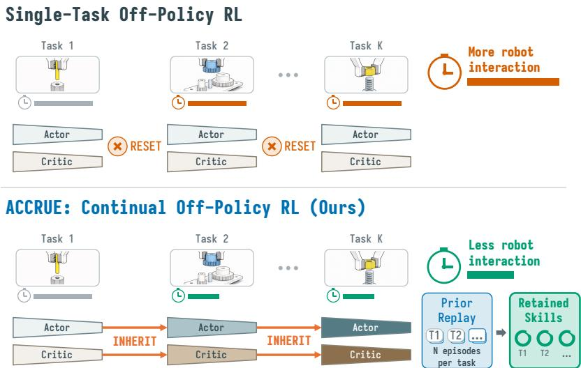  
Figure 1: Single-task vs Continual of-policy RL. Single-task RL resets the actor and critic for each task, requiring repeated online interactions. Our method inherits both networks and uses small prior-task replay to accelerate learning while retaining prior performance.

To this end, we propose ACCRUE (Actor–Critic Carryoverfor continual of-policy Reinforcement learning Using retained Experience), a continual of-policy RL framework that inherits a lightweight actor and critic across tasks to amortize prior RL experience. The inherited actor and critic transfer behavioral and value priors, respectively, enabling subsequent tasks to be learned with fewer environment interactions. Starting from a pretrained RFM, we fine-tune the base policy at each stage on demonstrations observed so far and hold it fixed during RL. At each stage, the inherited critic is adapted only to the current-task transitions. We deliberately exclude prior-task samples from critic updates because the small number of retained episodes may not provide suficient coverage for reliable value estimation on all prior tasks. The adapted critic guides actor improvement on the current task but is not used to update the actor on prior tasks. Instead, ACCRUE preserves prior behavior by distilling the actor toward cached outputs of the preceding-stage actor on the last � episodes retained from each completed task (20–100 episodes per task in main experiments). This asymmetric update retains the benefits of actor–critic inheritance without relying on the critic to preserve prior-task behavior. A fixed external visual encoder provides consistent visual features across base-policy updates, while reference-action conditioning allows the lightweight learner to refine proposals from the current base policy.

We showcase ACCRUE on contact-rich assembly sequences in simulation and on real-robot hardware, with experiments covering VLA and WAM base policies and diferent of-policy RL algorithms. In simulation, ACCRUE accelerates subsequent-task learning while limiting forgetting of prior tasks. Across FORGE and AutoMate, it improves continual AUC by up to 21.0% and reduces negative backward transfer by up to 70.0% compared with the strongest of-policy continual baseline. Ablations and baseline comparisons show that critic inheritance supports forward transfer and that separating current-task RL from prior-task actor preservation improves retention under limited replay. On two multi-stage real-robot sequences, ACCRUE reduces robot RL interaction time for subsequent tasks by 31.0%–68.5% compared with training a new actor–critic for each task, while maintaining approximately 97% average success on prior tasks.

## 2. Related Work

## 2.1. RL Post-Training for RFMs

RL post-training improves RFMs beyond demonstration-only supervision using task rewards and deployment experience. One line of work directly updates the VLA or its action head through policy-gradient learning, typically requiring fresh current-policy rollouts and substantial parallel interaction (10; 16). Other approaches use ofline value learning, task-specific residual policies, or RL-generated data to improve a generalist policy (13; 19; 35). Most closely related to our architecture, lightweight of-policy methods refine a frozen policy through action- or latent-space actor–critic learning (7; 33; 36; 40), but these methods focus on improving sample eficiency only on individual tasks. Our work considers the complementary problem of carrying a lightweight of-policy learner across sequentially arriving tasks while the underlying RFM is repeatedly updated with new demonstrations.

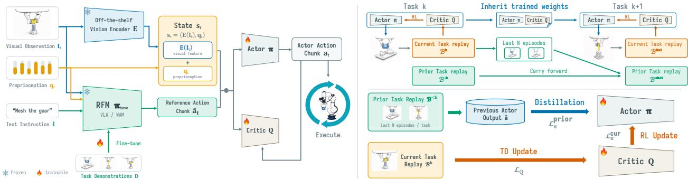  
Figure 2: Overview of ACCRUE. (Left) Base policy is fine-tuned on demonstrations observed up to current stage, held fixed, and proposes reference action chunks that actor and critic networks refine through of-policy RL on frozen encoder features. (Right Top) Both networks are carried across stages through a handof, independent of the base policy, with small fraction of online replay bufer. (Right Bottom) While updating the current task with RL objectives, earlier tasks are preserved by distilling the actor toward cached targets on a small retained memory.

## 2.2. Continual Learning for Robotics

Continual robot learning (20; 34) has largely focused on preserving demonstrated behavior through experience replay (8; 21), hierarchical skill libraries (34), task-specific adapters (23), or parameter merging (37). Beyond imitation learning, recent continual VLA methods carry policy parameters across tasks using on-policy RL (11; 41) or demonstration-derived reinforcement fine-tuning (22). The former require fresh interaction at each stage, whereas the latter do not transfer value knowledge acquired through environment interaction. Concurrent work CIDER learns a shared visuomotor policy from task-specific data without a pretrained RFM, combining current-task of-policy human-in-the-loop RL with prior-task actor distillation (17). In contrast, ACCRUE builds on manipulation skills already learned by a pretrained VLA or WAM and uses RL to improve its proposed actions. By retaining the actor and critic across tasks, ACCRUE reuses earlier RL experience even as the base model is further fine-tuned with new demonstrations.

## 3. Preliminaries

## 3.1. Robot Foundation Models

We build on a base policy $\pi _ { \mathrm { b a s e } } ,$ a robot foundation model (RFM) pretrained on large-scale robot data, such as VLA (2; 4; 14; 26) or WAM (9; 27; 38; 43). Given multi-view images $\mathbf { I } _ { t } ,$ proprioception $\mathbf { q } _ { t }$ , and a language instruction ℓ, the policy outputs an �-step action chunk $\tilde { \mathbf { a } } _ { t } = ( \tilde { a } _ { t } , \hdots , \tilde { a } _ { t + H - 1 } ) \in \mathbb { R } ^ { H \times d }$ , where � denotes the dimension of the action space (6; 42). We use the same horizon � for prediction and execution in all experiments. We access $\pi _ { \mathrm { b a s e } }$ only through this input–output interface, so our framework is agnostic to the choice of internal architecture in �b .

## 3.2. Problem Setup

We consider a robot that acquires � tasks sequentially, one task per stage. Each task $T ^ { k }$ is a finite-horizon Markov decision process that shares its state space, action space, and discount $\gamma$ with the other tasks, but may difer in its transition function, reward function, initial-state distribution, and horizon. Reward function $r _ { t }$ is sparse and emitted upon task success. We follow a task-incremental continual-learning setting (32), where task boundaries and identities are known.

At stage $k ,$ a small expert demonstration set $\mathcal { D } ^ { k }$ (1–50 trajectories in our experiments) becomes available for $T ^ { k }$ . The base policy is fine-tuned on all demonstrations observed up to that stage, $\textstyle { \mathcal { D } } ^ { 1 : k } = \bigcup _ { i = 1 } ^ { k } { \mathcal { D } } ^ { i }$ , yielding $\pi _ { \mathrm { b a s e } } ^ { k }$ . Starting from $\pi _ { \mathrm { b a s e } } ^ { k } ,$ the agent performs RL using new interactions collected exclusively from the current task $T ^ { k }$ and stored in the current-task replay bufer $B ^ { k }$ . The learner additionally uses a bounded prior-task replay bufer $B ^ { < k }$ , which contains a subset of online experience retained from earlier RL stages. Training on $B ^ { k }$ and $B ^ { < k }$ produces the adapted policy $\pi ^ { k }$ . Unlike protocols (11; 22) that fine-tune the base policy on the complete task suite before continual RL begins, our setup assumes neither access to future demonstrations nor a fixed base policy throughout the sequence. It therefore captures repeated post-training as new task requirements and demonstrations arrive over time.

After stage $k , \pi ^ { k }$ is evaluated on all tasks encountered so far, with the corresponding language instruction provided for each task. The objective is to maximize the average return across these tasks:

$$
\operatorname* { m a x } _ { \pi ^ { k } } \ J ^ { k } ( \pi ^ { k } ) = \frac { 1 } { k } \sum _ { i = 1 } ^ { k } \mathbb { E } _ { \tau \sim ( \pi ^ { k } , T ^ { i } ) } \left[ \sum _ { t = 0 } ^ { L _ { \tau } } \gamma ^ { t } r _ { t } ^ { i } \right] ,
$$

where $L ^ { \tau }$ denotes the length of trajectory $\tau .$ Although new training interactions can be collected only from $T ^ { k }$ the learner should exploit knowledge acquired during earlier RL stages to adapt eficiently to the current task while preserving performance on previous tasks.

## 3.3. Action-Chunk Reinforcement Learning

Within stage $k ,$ we improve performance on the current task $T ^ { k }$ using an of-policy actor–critic algorithm (28; 29) trained on the current-task replay bufer $B ^ { k }$ . Let $s _ { t }$ denote the state available at timestep �. The actor $\pi _ { \boldsymbol { \theta } } ( \cdot \mid s _ { t } )$ outputs an �-step action chunk $\mathbf { a } _ { t } = ( a _ { t } , \dots , a _ { t + H - 1 } )$ , which is executed in full before the next policy query. The critic $Q _ { \psi } ( s _ { t } , \mathbf { a } _ { t } )$ takes the state and the full action chunk as inputs to estimate its value (7; 13; 18; 36). We define $\begin{array} { r } { R _ { t } ^ { ( H ) } = \sum _ { h = 0 } ^ { H - 1 } \gamma ^ { h } r _ { t + h } } \end{array}$ as the �-step discounted reward sum collected during chunk execution. The chunk value is estimated by the �-step backup

$$
\begin{array} { r } { Q _ { \psi } ( s _ { t } , \mathbf { a } _ { t } ) \approx R _ { t } ^ { ( H ) } + \gamma ^ { H } \mathbb { E } _ { \mathbf { a } ^ { \prime } \sim \pi _ { \theta } ( \cdot | s _ { t + H } ) } [ Q _ { \psi } ( s _ { t + H } , \mathbf { a } ^ { \prime } ) ] . } \end{array}
$$

Relative to single-action backups, chunk-level backups reduce the nominal credit-assignment path by a factor of $H .$

## 4. Method

We introduce ACCRUE, a simple but efective continual of-policy RL framework for RFMs (Fig. 2). As new task demonstrations arrive at each stage, the base policy is fine-tuned on demonstrations from all tasks encountered so far and then held fixed throughout the RL phase of that stage. The lightweight actor and critic are conditioned on visual features from a fixed external encoder and reference action chunks proposed by the current base policy (Sec. 4.1). The fixed encoder keeps the visual representation unchanged across base-policy updates. For stage $k > 1$ , the actor and critic are initialized from the preceding checkpoint (Sec. 4.2). With limited replay, the critic may no longer accurately evaluate actions on earlier tasks. We therefore train the critic only on current-task transitions and preserve prior behavior by matching the current actor’s outputs to those of the preceding-stage actor on retained samples (Sec. 4.3).

## 4.1. Actor–Critic Inputs

To carry the actor and critic across stages, their visual inputs must keep a consistent representation as the base policy is updated. We therefore use an of-the-shelf visual encoder $E$ that is independent of the base policy and remains frozen across stages. We form the actor–critic input from the encoder output $E ( \mathbf { I } _ { t } )$ and robot proprioception $\mathbf { q } _ { t }$ as $s _ { t } = \left( E ( \mathbf { I } _ { t } ) , \mathbf { q } _ { t } \right)$

The actor and the critic apply their own lightweight trainable projector to $s _ { t } .$ . The projectors are parameterized as part of � and $\psi _ { ; }$ respectively. The replay bufer $B ^ { k }$ stores $s _ { t }$ rather than the outputs from these trainable projectors. Freezing � keeps the visual features of every stored transition in the same representation across stages, allowing the inherited projectors to process inputs $s _ { t }$ collected at earlier stages.

The input $s _ { t }$ does not explicitly encode the language instruction. The known task identity determines the language instruction $\ell ^ { k }$ provided to the base policy, which produces the reference action chunk $\tilde { \mathbf { a } } _ { t }$ . Rather than encoding the instruction again in the actor and critic, we condition both networks on the instruction-conditioned reference to obtain $\mathbf { a } _ { t } \sim \pi _ { \theta } ( s _ { t } , \tilde { \mathbf { a } } _ { t } )$ and $Q _ { \psi } \left( s _ { t } , \mathbf { a _ { t } } , \tilde { \mathbf { a } } _ { t } \right)$

Because the base policy already encodes task semantics and provides a task-level action proposal, the lightweight actor learns a local refinement conditioned on a˜ rather than reconstructing the full skill. Continual learning therefore needs to retain only the RL-acquired refinement, reducing the amount of behavior that must remain stable in the shared actor. Moreover, related tasks can share refinement and value structure, allowing the inherited actor and critic to provide useful initializations for subsequent tasks. Removing reference conditioning increases forgetting at a similar final success rate (Table 4). Unlike RL Token (36), which conditions only the actor on a˜ , we condition the critic as well, because the action value is task-dependent and the reference provides task contexts. To keep the actor from merely copying the reference, we apply reference action dropout (36) during training, replacing a˜ with zeros for a random fraction $p$ of each batch for both networks.

## 4.2. Current-Task Of-Policy RL

Actor and critic network parameters are randomly initialized only at the first stage. For each stage $k > 1$ , we initialize the actor–critic pair from the checkpoint of stage $k - 1$ , transferring a behavioral initialization through the actor and a value initialization through the critic. The current-task bufer $B ^ { k }$ is seeded with warmup episodes collected by executing the base policy $\pi _ { \mathrm { b a s e } } ^ { k }$ . The actor then interacts with the environment, and the actor–critic pair is updated on transitions sampled from $B ^ { k }$

The actor objective is to maximize the value estimated by the critic and remain close to the reference chunk,

$$
\begin{array} { r l } & { \mathcal { L } _ { \pi } ^ { \mathrm { c u r } } ( \theta ; \mathcal { B } ^ { k } ) = \mathbb { E } _ { \underset { { \mathbf { a } \sim \pi _ { \theta } ( s , \tilde { \mathbf { a } } ) } } { \mathbb { E } } \sim \mathcal { B } ^ { k } } \big [ - Q _ { \psi } \left( s , \mathbf { a } , \tilde { \mathbf { a } } \right) + \beta \| \mathbf { a } - \tilde { \mathbf { a } } \| _ { 2 } ^ { 2 } \big ] , } \end{array}\tag{1}
$$

where $\beta$ penalizes deviation from the reference action (36), reducing the learning to local refinement of the base policy’s action distribution rather than exhaustive search over ��-dimensional action spaces.

The critic is trained with of-policy temporal-diference learning. For a transition $( s _ { t } , \mathbf { a } _ { t } , \tilde { \mathbf { a } } _ { t } , R _ { t } ^ { ( H ) } , s _ { t + H } .$ $\tilde { \mathbf { a } } _ { t + H } )$ sampled from $B ^ { k }$ , we write the common chunk-level target for value bootstrapping, omitting learnerspecific terms:

$$
\begin{array} { r } { \hat { Q } = R _ { t } ^ { ( H ) } + \gamma ^ { H } Q _ { \psi ^ { \prime } } \big ( s _ { t + H } , \mathbf { a } _ { t + H } , \tilde { \mathbf { a } } _ { t + H } \big ) , } \end{array}\tag{2}
$$

where $\psi ^ { \prime }$ denotes the target-critic parameters. The next action chunk $\mathbf { a } _ { t + H }$ is sampled from the actor for stochastic learners or formed using the target-action rule for deterministic learners. In implementation, the critic predicts a categorical return distribution over a fixed support, and $Q _ { \psi }$ denotes its expected value. We train the critic with cross-entropy loss (1), which we found more stable under sparse reward.

## 4.3. Continual Operation

At the end of stage � − 1, ACCRUE transfers the actor–critic parameters $( \theta ^ { k - 1 } , \psi ^ { k - 1 } )$ and $B ^ { < k }$ , a memory of retained experience, to stage �. The base policy is separately fine-tuned on $\mathcal { D } ^ { 1 : k }$ to obtain $\pi _ { \mathrm { b a s e } } ^ { k }$ and then held fixed during stage-� RL. Fine-tuning on accumulated demonstrations is intended to retain the base policy’s earlier-task competence. Our continual mechanism aims to preserve the actor’s RL-acquired refinements while the actor and critic adapt to the current task.

Algorithm 1 One stage of ACCRUE   
Require: base policy $\pi _ { \mathrm { b a s e } } ^ { k } ,$ frozen visual encoder $E ,$ chunk length $H ,$ handof $( \theta ^ { k - 1 } , \psi ^ { k - 1 } , B ^ { < k } )$   
1: Initialize $\pi _ { \boldsymbol { \theta } } , Q _ { \psi }$ from $\mathbf { \theta } ^ { \circ ^ { k - 1 } , \psi ^ { k - 1 } }$   
2: Cache $\hat { \mathbf { a } } _ { j } ^ { k - 1 } = \bar { \pi } _ { \boldsymbol { \theta } ^ { k - 1 } } ( s _ { j } , \tilde { \mathbf { a } } _ { j } )$ for $j \in B ^ { < k }$ ◁ (3)   
3: Collect warmup rollouts from $\pi _ { \mathrm { b a s e } } ^ { k }$   
4: for $t = 0 , H , 2 H , . . .$ . do   
5: $s _ { t } \gets ( E ( \mathbf { I } _ { t } ) , \mathbf { q } _ { t } ) , \ \tilde { \mathbf { a } } _ { t } \sim \pi _ { \mathrm { b a s e } } ^ { k } ( \cdot \ | \ \mathbf { I } _ { t } , \mathbf { q } _ { t } , \ell ^ { k } )$   
6: Execute $\mathbf { a } _ { t } \sim \pi _ { \theta } ( \cdot \mid s _ { t } , \tilde { \mathbf { a } } _ { t } )$ and observe $\dot { R } _ { t } ^ { ( H ) }$ $s _ { t + H }$   
7: Store $( s _ { t } , \mathbf { a _ { t } } , \tilde { \mathbf { a } } _ { t } , R _ { t } ^ { ( H ) } , s _ { t + H } , \tilde { \mathbf { a } } _ { t + H } )$ in $B ^ { k }$   
8: Update � on $B ^ { k }$ ◁ (2)   
9: Update � on $B ^ { k } \cup B ^ { < k }$ ◁ (5)   
10: end for   
11: return last � episodes from $B ^ { k }$ , handof $( \theta ^ { k } , \psi ^ { k } )$

ACCRUE retains the last � training episodes of each completed task in a pooled memory $B ^ { < k }$ , giving $( k - 1 ) N$ stored episodes at stage �. For a transition � collected at stage $i < k , \tilde { \mathbf { a } } _ { j }$ is the action chunk generated by $\pi _ { \mathrm { b a s e } } ^ { i }$ at collection time and is retained unchanged. At each stage $k > 1$ , each actor update uses a 1:1 ratio of current-task and prior-task samples, drawn in separate minibatches from $B ^ { k }$ and $B ^ { < k }$ for their respective actor losses. Before training stage $k ,$ we evaluate a frozen copy of the preceding-stage actor (the teacher $\pi _ { \theta ^ { k - 1 } } )$ on each retained transition to provide targets for the current actor (the student $\pi _ { \theta ^ { k } } )$ . The actor may be deterministic or stochastic, depending on the of-policy learner. For distillation, we denote its deterministic evaluation output, obtained without action sampling or exploration noise, by $\bar { \pi } _ { \boldsymbol { \theta } } ( s , \tilde { \mathbf { a } } )$ and cache

$$
\hat { \mathbf { a } } _ { j } ^ { k - 1 } = \bar { \pi } _ { \theta ^ { k - 1 } } ( s _ { j } , \tilde { \mathbf { a } } _ { j } ) , \qquad j \in \mathcal { B } ^ { < k } .\tag{3}
$$

These targets remain fixed throughout stage $k ,$ and the teacher copy is discarded after caching. Behavioral targets are refreshed from the preceding-stage actor at each stage, while reference chunks retain their original values, keeping teacher and student at the same previously observed inputs $( s _ { j } , \tilde { \mathbf { a } } _ { j } )$

At stage $k ,$ TD updates on $B ^ { k }$ adapt the inherited critic to $T ^ { k }$ . Although we could also replay $B ^ { < k }$ critic learning, only � retained episodes per prior task may not reliably preserve its prior-task value estimates. Applying the actor RL objective to these $B ^ { < k }$ samples could therefore turn inaccurate critic estimates into drift in previously learned behavior. To avoid this risk, we apply critic TD and the actor RL objective only to $B ^ { k }$ while using $B ^ { < k }$ only to match the current actor to the preceding-stage actor at retained inputs,

$$
\mathcal { L } _ { \pi } ^ { \mathrm { p r i o r } } ( \theta ; \mathcal { B } ^ { < k } ) = \underset { j \sim \mathcal { B } ^ { < k } } { \mathbb { E } } \left[ \left. \pi _ { \theta } \bigl ( s _ { j } , \tilde { \mathbf { a } } _ { j } \bigr ) - \hat { \mathbf { a } } _ { j } ^ { k - 1 } \right. _ { 2 } ^ { 2 } \right] ,\tag{4}
$$

$$
\begin{array} { r } { \mathcal L _ { \boldsymbol \pi } ( \boldsymbol { \theta } ; \boldsymbol { k } ) = \mathcal L _ { \boldsymbol \pi } ^ { \mathrm { c u r } } ( \boldsymbol { \theta } ; \mathcal { B } ^ { \boldsymbol { k } } ) + \lambda \mathcal L _ { \boldsymbol \pi } ^ { \mathrm { p r i o r } } ( \boldsymbol { \theta } ; \mathcal { B } ^ { < \boldsymbol { k } } ) , } \end{array}\tag{5}
$$

where � weights prior-task distillation. Thus, we do not use prior-task replay for critic updates or for the actor objective in Eq. (1). Distillation constrains actor outputs at the stored $( s _ { j } , \tilde { \mathbf { a } } _ { j } )$ inputs. Current-task interaction and deployment use fresh references from $\pi _ { \mathrm { b a s e } } ^ { k } ,$ which may difer even when the base policy retains earlier-task competence. We therefore evaluate prior-task retention after each stage with the updated base policy and actor together, testing whether the preserved behavior remains efective with current references. Algorithm 1 summarizes one stage of ACCRUE.

## 5. Experiments

Our experiments ask three questions. 1) Does ACCRUE retain earlier assembly skills once the base policy has been updated for a later stage? 2) Does inheriting the lightweight actor and critic accelerate a new stage? And

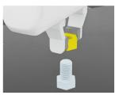  
Nut Thread

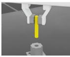  
Peg Insert

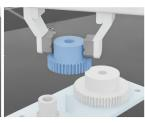  
Gear Mesh

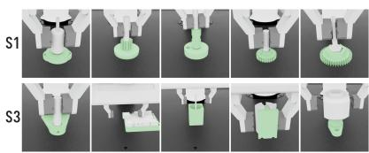  
(a) FORGE (25)  
(b) AutoMate (31)

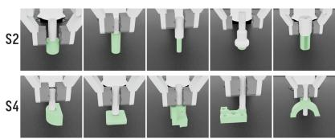

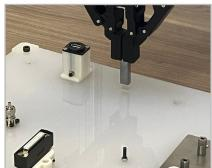  
Rectangle Peg

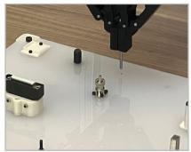  
Cylinder Peg

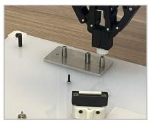  
Gear

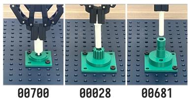  
(d) Real-world AutoMate

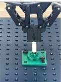  
01041

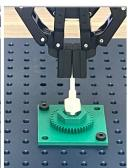  
(c) Real-world NIST Assembly Task Board  
01036  
Figure 3: Overview of experimental tasks. (a) Three contact-rich manipulation tasks in FORGE (25). Four orderings are evaluated: S1: Nut Thread → Peg Insert → Gear Mesh, S2: Gear Mesh → Peg Insert → Nut Thread, S3: Peg Insert → Gear Mesh → Nut Thread, and S4: Peg Insert → Nut Thread → Gear Mesh. (b) Four five-stage AutoMate sequences in simulation: S1: 00700 → 00028 → 00681 → 01041 → 01036, S2: 01092 → 00141 → 00255 → 00486 → 00615, S3: 00731 → 00470 → 00117 → 00726 → 00296, and S4: $\mathbf { 0 0 4 1 7 }  \mathbf { 0 0 0 8 3 }  \mathbf { 0 1 0 7 9 }  \mathbf { 0 0 5 1 4 }  \mathbf { 0 1 0 2 9 }$ . (c) Three insertion task sequence on the NIST Assembly Task Board and (d) Five-stage AutoMate sequence executed on real 3D-printed assets.

3) Which of ACCRUE’s components is responsible for each efect? Sec. 5.1 describes what is held common across platforms. Sec. 5.2 and Sec. 5.3 address the first two questions in simulation and on real-world DROID (12). The two settings use diferent base policies, reinforcement learning algorithms, and interaction budgets, which lets us verify that the findings do not depend on a particular setup. Sec. 5.4 addresses the third question in simulation, where the stage budget and the task sequence can be held fixed across variants.

## 5.1. Experimental Setup

## Baselines

We compare continual learners within a shared of-policy actor–critic architecture, alongside reference methods with diferent learning or storage requirements. In the main simulation comparisons, all RL methods use the same GR00T N1.7 backbone and per-stage environment-step budget. The matched shared actor–critic methods additionally share the cumulative-demonstration fine-tuning protocol of Sec. 3.2 and the of-policy RL algorithm, and inherit the actor–critic pair across tasks. Sequential trains it using only current-task data. ER (5) retains the same number of episodes as ACCRUE per task, but applies the RL objective to the retained memory rather than using actor distillation. EWC (15) penalizes actor drift from the previous-stage parameters, while RETAIN (37) merges the current and previous actor parameters through discounted interpolation. As an external reference, Simple Recipe (11) sequentially fine-tunes the VLA directly with on-policy RL. Single-task RL initializes and trains a new actor–critic pair for each task. Finally, Isolated initializes each new pair from the preceding stage but retains a separate checkpoint per task, avoiding shared-parameter interference at the cost of storing one learner per task.

## Metrics

Following prior work (11; 20; 21), forward transfer (FWT) averages training success on new tasks, and gains over Single-task RL indicate transfer between tasks. Negative backward transfer (NBT) measures the performance on preceding tasks from the current stage, where lower values indicate better backward retention. Continual AUC combines learning eficiency and retention. Final accuracy and forgetting describe end-of-sequence success and prior-task loss.

Stages share an environment-step budget and uniform evaluation grid $\varepsilon .$ Let $c _ { i , j , e }$ be task $j ^ { \prime } s$ success rate after � steps in stage �. Set $c _ { i , i } = \operatorname* { m a x } _ { e } c _ { i , i , e }$ and $c _ { i , j } = c _ { i , j , e _ { i } ^ { * } }$ , using the earliest maximizing checkpoint $e _ { i } ^ { * }$ .

$$
\begin{array} { r l } & { \mathrm { F W T } _ { k } = \frac { 1 } { | \mathcal { E } | } \sum _ { e \in \mathcal { E } } c _ { k , k , e } , } \\ & { \mathrm { N B T } _ { k } = \frac { 1 } { K - k } \sum _ { m = k + 1 } ^ { K } \big ( c _ { k , k } - c _ { m , k } \big ) , } \\ & { \mathrm { A U C } _ { k } = \frac { 1 } { K - k + 1 } \big ( \mathrm { F W T } _ { k } + \sum _ { m = k + 1 } ^ { K } c _ { m , k } \big ) . } \end{array}
$$

We average FWT and continual AUC over $k \in [ K ] .$ , and NBT over $k \in [ K - 1 ]$ . Final deployment metrics are $\begin{array} { r } { \mathrm { A C C } _ { \mathrm { f i n a l } } = \frac { 1 } { K } \sum _ { k } c _ { K , k } } \end{array}$ and $\begin{array} { r } { \mathrm { F } _ { \mathrm { f i n a l } } = \frac { 1 } { K - 1 } \sum _ { k < K } ( c _ { k , k } - c _ { K , k } ) } \end{array}$ . Unlike NBT, $\mathrm { F _ { f i n a l } }$ ignores transient performance drops and measures forgetting only at the end of the sequence. These two metrics describe the end-of-sequence deployment performance.

## Hyperparameter selection in ACCRUE

We choose � in Eq. 5 to balance prior-task preservation against current-task adaptation, favoring stronger distillation when successive tasks share fewer behaviors. Accordingly, we use $\lambda = 1 . 0$ for the more diverse real-world NIST sequence and $\lambda = 0 . 1$ for the more closely related real-world AutoMate assemblies. The coeficient $\beta$ in Eq. 1 controls the penalty on deviation from the base policy’s action proposals. We use $\beta = 0 . 1$ in simulation and increase it to 10.0 on hardware, where keeping refinements close to the VLA’s proposals is particularly important during physical contact.

## 5.2. Simulation Experiments

## Benchmarks

We use AutoMate (31) and FORGE (25), both built on Isaac Lab (24). AutoMate provides assembly tasks in which plugs of diferent shapes must be inserted into matching sockets. We organize these tasks into four five-stage sequences. FORGE provides three contact-rich tasks (peg insertion, gear meshing, and nut threading), which we run as a three-stage sequence. For both tasks, the policy operates in a 6D end-efector delta action space. As task ordering is known to afect continual learning outcomes (20), we report the aggregated results over multiple sequences. Specifically, we aggregate over all four asset sequences for AutoMate, and we sample four task orderings randomly for FORGE; every result is aggregated over 4 seeds. Figs. 3a and 3b visualizes the tasks.

## Setup

Each stage runs 64 parallel environments for a budget of 500K environment steps, is evaluated every 50K steps, and terminates an episode on success. The reward is sparse and emitted only on task success. Since an episode ends at the success step, we label the final three steps of a successful episode with a reward of 1 so that the terminal chunk carries a learning signal, and we use a discount factor of $\gamma = 0 . 9 9 7$ . We use GR00T N1.7 (26) for $\pi _ { \mathrm { b a s e } } ,$ , which is fully fine-tuned at each stage on 1 demonstration for 1000 gradient steps on AutoMate, and on 10, 20, and 50 demonstrations for gear meshing, nut threading, and peg insertion, respectively, for 2000 steps on FORGE. These task-specific demonstration budgets aim to provide a reasonably competent base policy while minimizing human demonstration collection, reserving further improvement for online interactions in RL. We further examine the efect of fewer task demonstrations in Section 5.4. For RL, we adopt FastSAC (29) over chunks of length � = 16 on frozen DINOv3 features (30), with 50 (AutoMate) / 100 (FORGE) retained episodes per stage.

## Results

Among the matched shared actor–critic methods, ACCRUE achieves the lowest NBT and final forgetting and the highest AUC and final accuracy on both benchmarks (Tables 1 and 2). It also exceeds Single-task RL in FWT under the same stage-wise interaction budget. EWC trades new-task learning for retention, whereas Sequential,

Table 1: Results on FORGE, aggregated over 4 task orderings and 4 seeds. Bold and underlined values denote the best and second-best results among the matched shared actor–critic methods.
<table><tr><td>Method</td><td>NBT↓</td><td>FWT↑</td><td>AUC↑</td><td> $\mathsf { A C C } _ { \mathrm { f i n a l } } \uparrow$ </td><td> $\mathrm { F _ { f i n a l } \downarrow }$ </td></tr><tr><td>Shared actor-critic methods</td><td></td><td></td><td></td><td></td><td></td></tr><tr><td>Sequential</td><td>0.427</td><td>0.819</td><td>0.718</td><td>0.685</td><td>0.409</td></tr><tr><td>EWC (15)</td><td>0.217</td><td>0.593</td><td>0.582</td><td>0.603</td><td>0.224</td></tr><tr><td>RETAIN (37)</td><td>0.514</td><td>0.802</td><td>0.682</td><td>0.644</td><td>0.474</td></tr><tr><td>ER (5)</td><td>0.518</td><td>0.833</td><td>0.697</td><td>0.626</td><td>0.516</td></tr><tr><td>ACCRUE (Ours)</td><td>0.065</td><td>0.823</td><td>0.869</td><td>0.917</td><td>0.068</td></tr><tr><td>Reference methods</td><td></td><td></td><td></td><td></td><td></td></tr><tr><td>πbase</td><td>1</td><td></td><td>一</td><td>0.687</td><td>一</td></tr><tr><td>Single-task RL</td><td></td><td>0.741</td><td></td><td></td><td></td></tr><tr><td>Simple Recipe (11)</td><td>0.038</td><td>0.586</td><td>0.583</td><td>0.594</td><td>0.061</td></tr><tr><td>Isolated†</td><td></td><td>0.816</td><td>0.868</td><td>0.919</td><td></td></tr></table>

Table 2: Results on AutoMate, aggregated over 4 asset sequences and 4 seeds. Bold and underlined values denote the best and second-best results among the matched shared actor–critic methods.
<table><tr><td>Method</td><td>NBT↓</td><td>FWT↑</td><td>AUC↑</td><td> $\mathsf { A C C } _ { \mathrm { f i n a l } }$  个</td><td>Final ↓</td></tr><tr><td colspan="6">Shared actor-critic methods</td></tr><tr><td>Sequential</td><td>0.178</td><td>0.824</td><td>0.792</td><td>0.765</td><td>0.175</td></tr><tr><td>EWC (15)</td><td>0.075</td><td>0.704</td><td>0.704</td><td>0.699</td><td>0.067</td></tr><tr><td>RETAIN (37)</td><td>0.191</td><td>0.822</td><td>0.784</td><td>0.750</td><td>0.192</td></tr><tr><td>ER (5)</td><td>0.167</td><td>0.834</td><td>0.799</td><td>0.779</td><td>0.176</td></tr><tr><td>ACCRUE (Ours)</td><td>0.047</td><td>0.848</td><td>0.858</td><td>0.863</td><td>0.054</td></tr><tr><td colspan="6">Reference methods</td></tr><tr><td>πbase</td><td></td><td></td><td>一</td><td>0.757</td><td>一</td></tr><tr><td>Single-task RL</td><td></td><td>0.807</td><td></td><td></td><td></td></tr><tr><td>Simple Recipe (11)</td><td>0.016</td><td>0.730</td><td>0.726</td><td>0.730</td><td>0.019</td></tr><tr><td>Isolated†</td><td></td><td>0.826</td><td>0.858</td><td>0.879</td><td></td></tr></table>

ER, and RETAIN learn new tasks eficiently but forget more. On AutoMate, ACCRUE approaches the privileged Isolated reference while attaining higher FWT and maintaining a single shared actor–critic pair. As an external reference, Simple Recipe attains lower FWT and continual AUC than ACCRUE on both benchmarks under the same VLA backbone and interaction budget (Tables 1 and 2). These results indicate the eficacy of ACCRUE in setup with limited interaction budget.

## 5.3. DROID Experiments

## Tasks

To validate ACCRUE beyond simulation, We assess it on the DROID platform (12) with two task families. The first sequences three insertions on the NIST Assembly Task Board (rectangular peg, cylindrical peg, and gear mesh). The second runs a five-stage sequence of AutoMate assemblies on the same hardware, which tests whether the simulation task family transfers to a physical setup. For both tasks, the policy operates in a 6D end-efector delta action space, and each episode begins with the target object held by an object-specific 3D-printed gripper. Figs. 3c and 3d visualizes the tasks.

## Setup

For the base policy $\pi _ { \mathrm { b a s e . } }$ , we utilize $\pi _ { 0 . 5 }$ (3) rather than GR00T N1.7 owing to its stronger performance on DROID. Before RL at each stage, we fine-tuned the model with LoRA on 5 (AutoMate) and 10 (NIST) demonstrations collected by SpaceMouse teleoperation per each task. Unlike in simulation, the low-dimensional

ACCRUE (Ours) Single-task

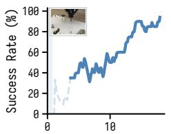  
Minutes of Data

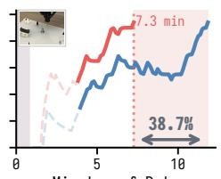  
Minutes of Data

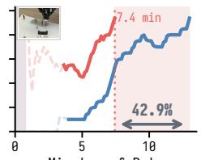  
Minutes of Data

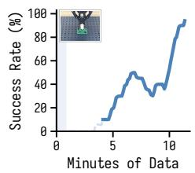

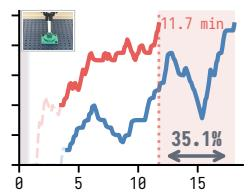  
Minutes of Data

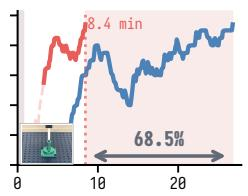  
Minutes of Data

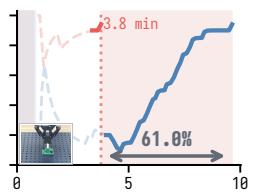  
Minutes of Data

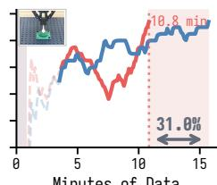  
Minutes of Data  
Figure 4: Real-world continual RL on DROID setup. (Top) Three-stage NIST Assembly Task Board sequence: Rectangle Peg → Cylinder Peg → Gear. (Bottom) Five-stage AutoMate sequence: 00700 → 00028 → 00681 → 01041 → 01036. Each panel reports the running success rate over a 20-episode window as a function of cumulative robot interaction time for RL, excluding human demonstration collection. Single-task trains the actor and critic from scratch, whereas ACCRUE inherits them from the previous stage. Gray shading marks warmup rollouts collected by the base policy to initialize the replay bufer, and dashed segments at the left indicate that fewer than 20 episodes have been collected. The dotted line marks when Continual reaches the stopping threshold of 95% success (19/20 episodes), and the shaded span reports robot interaction time saved relative to Single-task reaching the same threshold. The first stage of each sequence is shared by both conditions.

input contains only the robot’s seven joint positions, without additional object- or task-state information. For RL backbone, we employ FastTD3 (29) rather than FastSAC, because its explicit control of exploration noise avoids erratic contact behavior of the arm. We use actor and critic over chunks of length � = 10, with 20 retained episodes per stage. The reward is sparse on episode success, labeled by an operator. An asynchronous learner and actor process, similar to (7), keeps data collection running while the learner is busy. We report a running success rate over a window of 20 episodes and terminate a stage once it reaches 95% (19/20). Retention is measured by 20 evaluation trials on each earlier task at the end of each later stage. We compare against single-task RL within the same framework, since a full baseline sweep is not feasible at this scale.

Table 3: Real-world retention reporting successes over 20 evaluation trials on each earlier task at the end of each later stage.
<table><tr><td></td><td colspan="4">After stage</td></tr><tr><td>NIST board</td><td>2</td><td>3</td><td>4</td><td>5</td></tr><tr><td>Stage 1 (Rectangle Peg)</td><td>20</td><td>19</td><td></td><td></td></tr><tr><td>Stage 2 (Cylinder Peg) AutoMate</td><td>一</td><td>20</td><td></td><td></td></tr><tr><td>Stage 1 (00700)</td><td>20</td><td>19</td><td>18</td><td>19</td></tr><tr><td>Stage 2 (00028)</td><td>一</td><td>19</td><td>19</td><td>20</td></tr><tr><td>Stage 3 (00681)</td><td>一</td><td>一</td><td>19</td><td>20</td></tr><tr><td>Stage 4 (01041)</td><td>一</td><td>一</td><td>一</td><td>20</td></tr></table>

## Results

Inheriting the actor and critic reduces the robot time needed to reach the stopping criterion by 31.0 to 68.5 percent across the stages of the two sequences (Fig. 4), and retention remains essentially complete, with every earlier task succeeding on at least 18 of 20 trials and 19.4 on average (Table 3). Both efects are larger than in simulation, which we attribute to the far smaller interaction budget: a better starting point is worth more when a stage is measured in tens of minutes of robot time, and the saving is the diference between a stage that fits in a single session and one that does not. Notably, these results are obtained with a diferent base policy family and a diferent RL algorithm than in simulation, under real sensing and contact noise, indicating that ACCRUE depends on neither a particular base policy nor a particular RL algorithm.

## 5.4. Ablation Studies and Analyses

Table 4: Ablation of the design choices on FORGE sequence S1, holding the task sequence, stage budget, and all shared hyperparameters fixed. Best values are in bold and second best are underlined.
<table><tr><td>Method</td><td>NBT↓</td><td>FWT↑</td><td>AUC↑</td><td> $\mathrm { { A C C } _ { \mathrm { { f i n a l } } } \Omega } .$  个</td><td> $\mathrm { F _ { f i n a l } \downarrow }$ </td></tr><tr><td>ACCRUE</td><td>0.028</td><td>0.854</td><td>0.906</td><td>0.961</td><td>0.037</td></tr><tr><td>DINOv3 → GR00T VLM</td><td>0.071</td><td>0.814</td><td>0.846</td><td>0.883</td><td>0.113</td></tr><tr><td> $\pi _ { \boldsymbol { \theta } } ( s , \tilde { \mathbf { a } } )  \pi _ { \boldsymbol { \theta } } ( s )$ </td><td>0.035</td><td>0.807</td><td>0.869</td><td>0.936</td><td>0.050</td></tr><tr><td> $\beta = 0 . 0$ </td><td>0.029</td><td>0.763</td><td>0.821</td><td>0.942</td><td>0.037</td></tr><tr><td>Reset Critic</td><td>0.042</td><td>0.841</td><td>0.890</td><td>0.942</td><td>0.054</td></tr><tr><td>Update Critic  $\boldsymbol { \mathrm { w } } / B ^ { < k } \cup B ^ { k }$ </td><td>0.037</td><td>0.842</td><td>0.888</td><td>0.925</td><td>0.067</td></tr></table>

## Actor–critic inputs

Replacing the fixed DINOv3 representation with features extracted by the stage-updated GR00T VLM yields worse retention and forward transfer (Table 4). Although this comparison also changes the encoder itself and therefore does not isolate representation drift, it supports the practical advantage of a fixed visual interface for inheriting the actor and critic across base-policy updates. Removing the reference-action input likewise lowers retention and transfer, proving that reference action provides useful conditioning beyond the visual state alone.

## Reference guidance and critic inheritance

Removing the reference-deviation penalty by setting � = 0 in Eq. 1 has little efect on backward retention but substantially weakens forward transfer and task learning (Table 4). Explicitly biasing the actor toward the reference action therefore supports eficient local refinement rather than preservation of prior behavior. Resetting the critic at each stage produces modestly more forgetting and lower task-learning eficiency. Extending critic updates to prior-task replay increases forgetting and lowers continual AUC and final success, supporting our choice to train the critic only on current-task transitions.

Table 5: Efect of the number of retained episodes per stage � in FORGE sequence S1. Best values are in bold and second best are underlined.
<table><tr><td>N</td><td>NBT↓</td><td>FWT↑</td><td>AUC↑</td><td> $\mathsf { A C C } _ { \mathrm { f i n a l } } \ 1$  人</td><td> $\mathrm { F } _ { \mathrm { f i n a l } } \downarrow$ </td></tr><tr><td>10</td><td>0.107</td><td>0.853</td><td>0.854</td><td>0.847</td><td>0.192</td></tr><tr><td>20</td><td>0.093</td><td>0.844</td><td>0.859</td><td>0.869</td><td>0.167</td></tr><tr><td>50</td><td>0.060</td><td>0.838</td><td>0.871</td><td>0.900</td><td>0.104</td></tr><tr><td>100</td><td>0.040</td><td>0.854</td><td>0.896</td><td>0.925</td><td>0.062</td></tr><tr><td>200</td><td>0.043</td><td>0.842</td><td>0.879</td><td>0.903</td><td>0.083</td></tr></table>

## Replay budget

Retaining � = 100–200 episodes per completed task (approximately 3% of the total replay bufer) provides the strongest joint retention–learning trade-of (Table 5). Memories of 10–20 episodes are insuficient to preserve prior behavior, while increasing the budget from 100 to 200 episodes degrades performance. This non-monotonic trend shows that efective continual post-training does not follow directly from replaying more prior data.

Table 6: Ablation of demo retention during sequential fine-tuning of $\pi _ { \mathrm { b a s e } }$ on FORGE sequence S1. Best values are shown in bold and second-best values are underlined.
<table><tr><td rowspan="2">Demo Retention</td><td colspan="2">(GR00T N1.7)  $\pi _ { \mathrm { b a s e } }$ </td><td colspan="5">ACCRUE</td></tr><tr><td>SR↑</td><td>NBT↓</td><td>NBT↓</td><td>FWT↑</td><td>AUC↑</td><td> $\mathrm { \Delta A C C _ { \mathrm { f i n a l } } \uparrow }$ </td><td> $\mathrm { F _ { f i n a l } \downarrow }$ </td></tr><tr><td>100%</td><td>0.710</td><td>0.013</td><td>0.028</td><td>0.854</td><td>0.906</td><td>0.961</td><td>0.037</td></tr><tr><td>50%</td><td>0.580</td><td>0.035</td><td>0.056</td><td>0.817</td><td>0.860</td><td>0.908</td><td>0.092</td></tr><tr><td>10%</td><td>0.637</td><td>0.090</td><td>0.078</td><td>0.811</td><td>0.844</td><td>0.875</td><td>0.133</td></tr><tr><td>5%</td><td>0.577</td><td>0.163</td><td>0.071</td><td>0.836</td><td>0.859</td><td>0.894</td><td>0.113</td></tr></table>

## Robustness to base-policy forgetting

We vary the fraction of prior-task demonstrations retained for sequential VLA fine-tuning from 100% to 5%, keeping the continual RL procedure and its replay budget fixed (Table 6). Reduced demonstration replay degrades both base-policy and post-RL performance relative to using all demonstrations. Nevertheless, ACCRUE mitigates forgetting and maintains new-task learning eficiency even when the base policy itself forgets.

Table 7: ACCRUE with diferent $\pi _ { \mathrm { b a s e } }$ in FORGE sequence S1.
<table><tr><td>Method</td><td>Base SR</td><td>NBT↓</td><td>FWT↑</td><td>AUC↑</td><td> $\mathsf { A C C } _ { \mathrm { f i n a l } }$  个</td><td> $\mathrm { F _ { f i n a l } \downarrow }$ </td></tr><tr><td colspan="7"> $\pi _ { b a s e } .$  GR00T N1.7 (26) (VLA)</td></tr><tr><td>ER</td><td></td><td>0.339</td><td>0.840</td><td>0.705</td><td>0.611</td><td>0.529</td></tr><tr><td>ACCRUE</td><td>0.710</td><td>0.028</td><td>0.854</td><td>0.906</td><td>0.961</td><td>0.037</td></tr><tr><td colspan="7"> $\pi _ { b a s e } .$  Fast-WAM (39) (WAM)</td></tr><tr><td>ER</td><td>0.347</td><td>0.419</td><td>0.742</td><td>0.588</td><td>0.517</td><td>0.625</td></tr><tr><td>ACCRUE</td><td></td><td>0.035</td><td>0.768</td><td>0.847</td><td>0.905</td><td>0.042</td></tr></table>

## Base-policy dependence

In Table 7, we apply ACCRUE on Fast-WAM (39) to prove the efectiveness regardless of model architecture. ACCRUE maintains strong retention and final performance even with Fast-WAM despite their diferent architecture and pre-RL success rates. ER similarly degrades under both policy families.

## 6. Conclusion

We presented ACCRUE, a continual of-policy RL framework for robot foundation models. Our approach is to inherit lightweight actor–critic guided by RFM’s reference actions and to apply prior-task distillation. Through this, ACCRUE enables eficient RL on new tasks while preserving earlier behavior with limited replay. Experiments in simulation and on real robots demonstrate faster subsequent-task learning with significantly reduced forgetting. These results show that continual RL can support more sample-eficient post-training of robot foundation models as new tasks arrive, while retaining previously learned behaviors.

Our work establishes advances on task sequences of up to five stages in contact-rich assembly, with replay memory bounded per task. We leave it for future work to scale ACCRUE to longer task sequences under a fixed total memory budget. Additionally, a natural next step is to evaluate ACCRUE on a broader range of manipulation tasks, including less closely related tasks. Finally, it is promising to learn shared action representation and transfer RL post-training across varied embodiments or action spaces. Overall, ACCRUE shows that RL-acquired knowledge can accumulate across sequential deployment stages, providing a practical path to continually learn skills on robotic foundation models.

## References

[1] Marc G Bellemare, Will Dabney, and Rémi Munos. A distributional perspective on reinforcement learning. In International Conference on Machine Learning, 2017. 5

[2] Kevin Black, Noah Brown, Danny Driess, Adnan Esmail, Michael Equi, Chelsea Finn, Niccolo Fusai, Lachy Groom, Karol Hausman, Brian Ichter, et al. � : A vision-language-action flow model for general robot control. arXiv preprint arXiv:2410.24164, 2024. 1, 3

[3] Kevin Black, Noah Brown, James Darpinian, Karan Dhabalia, Danny Driess, Adnan Esmail, Michael Equi, Chelsea Finn, Niccolo Fusai, et al. �0.5: a vision-language-action model with open-world generalization. In Conference on Robot Learning, 2025. 9

[4] Anthony Brohan, Noah Brown, Justice Carbajal, Yevgen Chebotar, Xi Chen, Krzysztof Choromanski, Tianli Ding, Danny Driess, Avinava Dubey, Chelsea Finn, et al. RT-2: Vision-language-action models transfer web knowledge to robotic control. In Conference on Robot Learning, 2023. 1, 3

[5] Arslan Chaudhry, Marcus Rohrbach, Mohamed Elhoseiny, Thalaiyasingam Ajanthan, Puneet K Dokania, Philip HS Torr, and Marc’Aurelio Ranzato. On tiny episodic memories in continual learning. In arXiv preprint arXiv:1902.10486, 2019. 7, 9

[6] Cheng Chi, Zhenjia Xu, Siyuan Feng, Eric Cousineau, Yilun Du, Benjamin Burchfiel, Russ Tedrake, and Shuran Song. Difusion policy: Visuomotor policy learning via action difusion. International Journal of Robotics Research, 2025. 3

[7] Perry Dong, Kuo-Han Hung, Tian Gao, Dorsa Sadigh, and Chelsea Finn. Expo-ft: Sample-eficient reinforcement learning finetuning for vision-language-action models. arXiv preprint arXiv:2605.25477, 2026. 1, 3, 4, 10

[8] Maximilian Du, Zhanyi Sun, Chen Xu, Paarth Shah, Masha Itkina, and Shuran Song. Memory anchors for continual robot learning. arXiv preprint arXiv:2608.26545, 2026. 3

[9] Dyna Robotics. Dyna-2: A 1-million-hour scaling law for world-action models, August 2026. 1, 3

[10] Yanjiang Guo, Jianke Zhang, Xiaoyu Chen, Xiang Ji, Yen-Jen Wang, Yucheng Hu, and Jianyu Chen. Improving vision-language-action model with online reinforcement learning. In IEEE International Conference on Robotics and Automation, 2025. 3

[11] Jiaheng Hu, Jay Shim, Chen Tang, Yoonchang Sung, Bo Liu, Peter Stone, and Roberto Martín-Martín. Simple recipe works: Vision-language-action models are natural continual learners with reinforcement learning. arXiv preprint arXiv:2603.11653, 2026. 1, 3, 4, 7, 9

[12] Alexander Khazatsky, Karl Pertsch, Suraj Nair, Ashwin Balakrishna, Sudeep Dasari, Siddharth Karamcheti, Soroush Nasiriany, Mohan Kumar Srirama, Lawrence Yunliang Chen, Kirsty Ellis, et al. Droid: A large-scale in-the-wild robot manipulation dataset. In Robotics: Science and Systems, 2024. 7, 9

[13] Changyeon Kim, Haeone Lee, Younggyo Seo, Kimin Lee, and Yuke Zhu. DEAS: DEtached value learning with action sequence for scalable ofline RL. In International Conference on Learning Representations, 2026. 3, 4

[14] Moo Jin Kim, Karl Pertsch, Siddharth Karamcheti, Ted Xiao, Ashwin Balakrishna, Suraj Nair, Rafael Rafailov, Ethan P Foster, Pannag R Sanketi, Quan Vuong, Thomas Kollar, Benjamin Burchfiel, Russ Tedrake, Dorsa Sadigh, Sergey Levine, Percy Liang, and Chelsea Finn. OpenVLA: An open-source vision-language-action model. In Conference on Robot Learning, 2024. 1, 3

[15] James Kirkpatrick, Razvan Pascanu, Neil Rabinowitz, Joel Veness, Guillaume Desjardins, Andrei A Rusu, Kieran Milan, John Quan, Tiago Ramalho, Agnieszka Grabska-Barwinska, et al. Overcoming catastrophic forgetting in neural networks. Proceedings of the national academy of sciences, 2017. 7, 9

[16] Haozhan Li, Yuxin Zuo, Jiale Yu, Yuhao Zhang, Yang Zhaohui, Kaiyan Zhang, Xuekai Zhu, Yuchen Zhang, Tianxing Chen, Ganqu Cui, et al. Simplevla-rl: Scaling vla training via reinforcement learning. In International Conference on Learning Representations, 2026. 1, 3

[17] Houlin Li, Minghui Xu, Guo Xu, Xuan Du, Xiaohan Yan, Chun Wang, Yuxiang Yan, Shukai Yang, Yongcheng Liu, Wei Shan, and Maoqing Yao. CIDER: Continual interactive distillation for embodied reinforcement learning. arXiv preprint arXiv:2608.21899, 2026. 3

[18] Qiyang Li, Zhiyuan Paul Zhou, and Sergey Levine. Reinforcement learning with action chunking. In Conference on Neural Information Processing Systems, 2025. 4

[19] Yunfei Li, Xiao Ma, Jiafeng Xu, Yu Cui, Zhongren Cui, Zhigang Han, Liqun Huang, Tao Kong, Yuxiao Liu, Hao Niu, et al. Gr-rl: Going dexterous and precise for long-horizon robotic manipulation. arXiv preprint arXiv:2512.01801, 2025. 1, 3

[20] Bo Liu, Yifeng Zhu, Chongkai Gao, Yihao Feng, Qiang Liu, Yuke Zhu, and Peter Stone. Libero: Benchmarking knowledge transfer for lifelong robot learning. In Conference on Neural Information Processing Systems, 2023. 3, 7, 8

[21] Huihan Liu, Changyeon Kim, Bo Liu, Minghuan Liu, and Yuke Zhu. Pretrained vision-language-action models are surprisingly resistant to forgetting in continual learning. In International Conference on Machine Learning, 2026. 3, 7

[22] Yuan Liu, Haoran Li, Shuai Tian, Yuxing Qin, Yuhui Chen, Yupeng Zheng, Yongzhen Huang, and Dongbin Zhao. Towards long-lived robots: Continual learning vla models via reinforcement fine-tuning. In Robotics: Science and Systems, 2026. 1, 3, 4

[23] Zuxin Liu, Jesse Zhang, Kavosh Asadi, Yao Liu, Ding Zhao, Shoham Sabach, and Rasool Fakoor. Tail: Task-specific adapters for imitation learning with large pretrained models. In International Conference on Learning Representations, 2024. 3

[24] Mayank Mittal, Pascal Roth, James Tigue, Antoine Richard, Octi Zhang, Peter Du, Antonio Serrano-Munoz, Xinjie Yao, René Zurbrügg, Nikita Rudin, et al. Isaac lab: A gpu-accelerated simulation framework for multi-modal robot learning. arXiv preprint arXiv:2511.04831, 2025. 8

[25] Michael Noseworthy, Bingjie Tang, Bowen Wen, Ankur Handa, Chad Kessens, Nicholas Roy, Dieter Fox, Fabio Ramos, Yashraj Narang, and Iretiayo Akinola. Forge: Force-guided exploration for robust contact-rich manipulation under uncertainty. In IEEE Robotics and Automation Letters, 2025. 7, 8

[26] NVIDIA. GR00T N1: An open foundation model for generalist humanoid robots. arXiv preprint arXiv:2503.14734, 2025. 1, 3, 8, 12

[27] Ajay Pai et al. mimic-video: Video-action models for generalizable robot control beyond VLAs. arXiv preprint arXiv:2512.15692, 2025. 1, 3

[28] Younggyo Seo, Carmelo Sferrazza, Juyue Chen, Guanya Shi, Rocky Duan, and Pieter Abbeel. Learning sim-to-real humanoid locomotion in 15 minutes. arXiv preprint arXiv:2512.01996, 2025. 4

[29] Younggyo Seo, Carmelo Sferrazza, Haoran Geng, Michal Nauman, Zhao-Heng Yin, and Pieter Abbeel. Fasttd3: Simple, fast, and capable reinforcement learning for humanoid control. arXiv preprint arXiv:2505.22642, 2025. 4, 8, 10

[30] Oriane Siméoni, Huy V. Vo, Maximilian Seitzer, Federico Baldassarre, Maxime Oquab, Cijo Jose, Vasil Khalidov, Marc Szafraniec, Seung Eun Yi, Michael Ramamonjisoa, Francisco Massa, Daniel HAZIZA, Luca Wehrstedt, Jianyuan Wang, et al. DINOv3. Transactions on Machine Learning Research, 2026. 8

[31] Bingjie Tang, Iretiayo Akinola, Jie Xu, Bowen Wen, Ankur Handa, Karl Van Wyk, Dieter Fox, Gaurav S Sukhatme, Fabio Ramos, and Yashraj Narang. Automate: Specialist and generalist assembly policies over diverse geometries. In Robotics: Science and Systems, 2024. 7, 8

[32] Gido M Van de Ven, Tinne Tuytelaars, and Andreas S Tolias. Three types of incremental learning. Nature Machine Intelligence, 2022. 4

[33] Andrew Wagenmaker, Mitsuhiko Nakamoto, Yunchu Zhang, Seohong Park, Waleed Yagoub, Anusha Nagabandi, Abhishek Gupta, and Sergey Levine. Steering your difusion policy with latent space reinforcement learning. In Conference on Robot Learning, 2025. 3

[34] Weikang Wan, Yifeng Zhu, Rutav Shah, and Yuke Zhu. Lotus: Continual imitation learning for robot manipulation through unsupervised skill discovery. In IEEE International Conference on Robotics and Automation, 2024. 3

[35] Wenli Xiao, Haotian Lin, Andy Peng, Haoru Xue, Tairan He, Zhengyi Luo, Yuqi Xie, Fengyuan Hu, Jim Fan, Guanya Shi, et al. Self-improving vision-language-action models with data generation via residual rl. In International Conference on Learning Representations, 2026. 1, 3

[36] Charles Xu, Jost Tobias Springenberg, Michael Equi, Ali Amin, Adnan Esmail, Sergey Levine, and Liyiming Ke. Rl token: Bootstrapping online rl with vision-language-action models. arXiv preprint arXiv:2604.23073, 2026. 1, 3, 4, 5

[37] Yajat Yadav, Zhiyuan Zhou, Andrew Wagenmaker, Karl Pertsch, and Sergey Levine. Robust fine-tuning of vision-language-action robot policies via parameter merging. In International Conference on Learning Representations, 2026. 3, 7, 9

[38] Seonghyeon Ye, Yunhao Ge, Kaiyuan Zheng, Shenyuan Gao, Sihyun Yu, et al. World action models are zero-shot policies. arXiv preprint arXiv:2602.15922, 2026. 1, 3

[39] Tianyuan Yuan, Zibin Dong, Yicheng Liu, and Hang Zhao. Fast-wam: Do world action models need test-time future imagination? arXiv preprint arXiv:2603.16666, 2026. 12

[40] Xiu Yuan, Tongzhou Mu, Stone Tao, Yunhao Fang, Zhang Zhang, and Hao Su. Policy decorator: Modelagnostic online refinement for large policy model. In International Conference on Learning Representations, 2025. 3

[41] Qixin Zeng, Shuo Zhang, Hongyin Zhang, Renjie Wang, Han Zhao, Libang Zhao, Runze Li, Donglin Wang, and Chao Huang. Crl-vla: Continual vision-language-action learning. arXiv preprint arXiv:2602.03445, 2026. 1, 3

[42] Tony Z Zhao, Vikash Kumar, Sergey Levine, and Chelsea Finn. Learning fine-grained bimanual manipulation with low-cost hardware. In Robotics: Science and Systems, 2023. 3

[43] Chuning Zhu et al. Unified world models: Coupling video and action difusion for pretraining on large robotic datasets. arXiv preprint arXiv:2504.02792, 2025. 1, 3