# ALIGNPRED: ERROR-CONTROLLED KV CACHE COMPRESSION VIA ALIGNMENT AND PREDICTIVE CODING

Xu Yang<sup>1∗†</sup>, Jiapeng Zhang<sup>1∗</sup>, Zhiwei Zuo<sup>3</sup>, Yuxin Chen<sup>2</sup> Feiqiang Sun<sup>2</sup>, Chengguang Xu<sup>2</sup>, Feng Jin<sup>2</sup>, Zhuo Tang<sup>1‡</sup> <sup>1</sup>Hunan University <sup>2</sup>Tencent <sup>3</sup>Central China Normal University

## ABSTRACT

Long-running agents retain KV caches across turns and sessions for hours or days. Compressing these persistent caches requires reducing storage while controlling reconstruction error. We present AlignPred, a codec that combines local alignment with predictive coding under a configurable KV reconstruction-error budget. Local orthogonal transforms align related heads or layers into a common coordinate frame, allowing AlignPred to combine token-wise prediction with same-token prediction across heads or layers. Residuals are quantized on an error-bounded lattice and entropy-coded, without learned predictors, encoder-side mode search, or large joint transforms. Across three attention mechanisms, AlignPred requires less storage than the evaluated baselines at comparable measured reconstruction error. Against the evaluated CPU codec implementations, it decodes at least 1.6× faster while matching or improving encode time. AlignPred achieves near-native task scores at substantially compressed operating points on LongBench-Pro at 128K context. AlignPred’s SGLang HiCache integration reduces persistent target-KV storage by 42–72% relative to native HiCache, with comparable latency.

## 1 INTRODUCTION

Long-running agents repeatedly revisit previously processed instructions, documents, and tool outputs across multiple turns (Zheng et al., 2024; Abhyankar et al., 2024). Retaining the corresponding KV caches avoids recomputing the same prefixes when a session resumes (Kwon et al., 2023; Liu et al., 2024b), but makes otherwise transient KV caches persistent. Commercial APIs already support retaining KV caches for hours or even days (Figure 1). As both context length and the number of retained sessions grow, compact storage becomes increasingly important for agent serving.

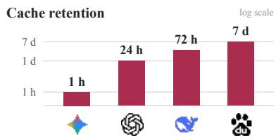  
Figure 1: Long-lived KV caches motivate compact storage.

Serving frameworks such as TensorRT-LLM (NVIDIA, 2026) and vLLM (vLLM Project, 2026) support FP8 KV-cache quantization, which shows that models can tolerate some numerical error in their KV caches. The acceptable amount of error, however, depends on the application. Fidelity-sensitive workloads require tight error bounds, while other workloads can accept greater approximation. KV compression should therefore let users set a reconstruction-error budget and maximize the compression ratio within that budget. Existing KV compression methods typically seek high compression ratios while preserving performance on a limited set of downstream tasks (Liu et al., 2024c; Hooper et al., 2024; Staniszewski & Łancucki, 2026), without explicitly bounding KV reconstruction error.´ As a result, users cannot tell whether a given setting meets the accuracy requirements of their own applications.

Meeting an error budget is only part of the problem. Effective compression still depends on how the resulting information is represented and coded. Current methods still leave room to exploit the properties of KV caches. General-purpose error-bounded compressors such as SZ3 (Liang et al.,

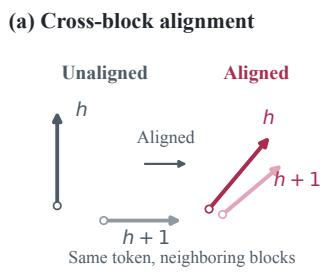

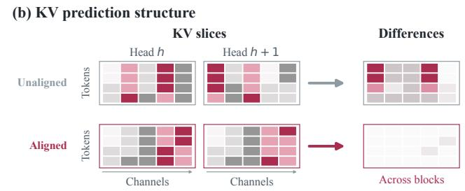  
Figure 2: Alignment of related KV blocks. (a) Rotation registers same-token vectors across heads or layers. (b) Token rows share channels. Alignment also reduces cross-block differences.

2023) ignore head and layer geometry. Error-bounded coding has reached KV caches in the GPUresident setting (Jiang et al., 2025; 2026), where decompression fuses into every attention step. Jiang et al. (2025) found that a prediction stage helps compression but conflicts with that fusion, and dropped it. Persistent KV storage reconstructs the cache once at restore time, so prediction remains available. KVTC (Staniszewski & Łancucki, 2026) uses alignment to build a joint transform under´ a bit budget, not prediction references. Persistent storage thus leaves prediction available, but no existing method uses alignment to supply prediction references. This raises a natural question. Can alignment enable simple prediction in the original KV layout?

AlignPred starts from KV geometry. Within one attention head or latent-cache block, vectors from different tokens share a common coordinate frame, making token-wise dependencies directly accessible. Related heads or layers may encode similar information in different coordinate frames, so their corresponding coordinates are not directly comparable. We apply local orthogonal rotations to align these coordinate frames. After alignment, each cache value has two complementary sources of redundancy, neighboring tokens within the same block and the same token across related blocks. Alignment makes this cross-block relation usable as a prediction reference. Figure 2 shows this structure.

We exploit this structure with alignment-conditioned predictive coding. Because alignment exposes the cross-block dependency, prediction requires only fixed arithmetic. The first block is reconstructed by token interpolation, and later blocks are predicted from previously reconstructed aligned blocks before error-bounded residual coding. Alignment uses only one small rotation per block, sized to its head or latent dimension, so it costs far less computation than the joint transforms used in prior methods. This design also avoids learned predictors and encoder-side mode search while preserving parallelism across independent cache objects.

Contributions. (1) We show that local alignment enables effective cross-block prediction: in ablations on all three models, the same predictor increases storage without alignment but reduces it after alignment. (2) We introduce AlignPred, a codec that exploits this structure through fixed token-wise and cross-block prediction followed by error-bounded residual coding. It preserves the cache’s block structure and supports a configurable reconstruction-error budget. Across three attention mechanisms, it stores less than the evaluated baselines at comparable measured error and decodes at least 1.6× faster than the evaluated same-host CPU implementations. (3) We integrate the codec into SGLang HiCache, reducing persistent target-KV storage by 42–72% versus native HiCache at comparable cache-hit latency.

## 2 BACKGROUND AND MOTIVATION

Error-controlled compression. Relative reconstruction error normalizes the reconstruction error by the magnitude of the original cache. Error-controlled compression treats a bound on this quantity as the constraint (Di & Cappello, 2016; Tao et al., 2017; Liang et al., 2018). Rate-controlled compression instead fixes a rate, such as a bit width or bit budget, and then minimizes distortion under that rate or accepts the distortion it induces (Goyal, 2001). We therefore bound relative reconstruc tion error and report storage against the measured reconstruction error.

Predictive coding. Predictive compression represents each value using a prediction and a quantized residual (Elias, 1955; Ibarria et al., 2003). Accurate prediction concentrates the residual distribution and reduces entropy-coded storage. Encoder and decoder form predictions from the same reconstructed references to keep their states synchronized, while residual symbols are entropy-coded losslessly. This motivates prediction rules tailored to KV cache structure.

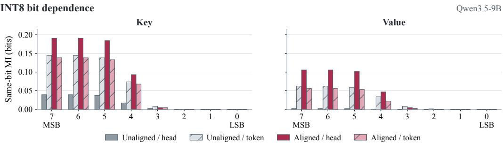  
Figure 3: After alignment, high-order-bit MI is higher across neighboring heads than across neighboring tokens on average in Qwen3.5-9B.

KV dependencies for prediction. Figure 2 shows that local orthogonal rotations can align the coordinate frames of related KV blocks. Figure 3 measures what this alignment exposes at the bit level. After centering, caches are uniformly quantized to signed 8-bit codes, with or without local alignment. Same-bit mutual information (MI) is computed on those diagnostic INT8 codes on Qwen3.5-9B, comparing the same token across neighboring heads with adjacent tokens in the same head. After alignment, high-order bits of the same token across heads have greater MI than adjacent tokens in the same head, on average for Keys and Values. Alignment also increases this cross-head MI relative to unaligned blocks. After alignment, the same-token cross-head relation can therefore serve as a prediction reference, and at high-order bits it can even be stronger than neighboring-token dependence. Coupled Quantization (Zhang et al., 2024a) exploits cross-channel dependence through joint quantization, while KVTC (Staniszewski & Łancucki, 2026) uses aligned geometry for joint´ transforms. Here we compare neighboring-token and aligned cross-head dependencies at the bit level as prediction references. The same neighboring-block construction applies to grouped-query heads (Ainslie et al., 2023) and to layers of a shared latent cache (DeepSeek-AI, 2024; Brandon et al., 2024; Liu et al., 2024a).

Persistent KV storage. Our setting is persistent KV storage, which differs from both remote streaming and GPU-resident KV compression. Serving systems such as CachedAttention (Gao et al., 2024), Mooncake (Qin et al., 2025), and LMCache (Liu et al., 2025) keep reusable KV caches in CPU memory, SSDs, or remote storage, so cache size sets their capacity and transfer cost. KVTC (Staniszewski & Łancucki, 2026) combines PCA-based transform coding, quantization, and ´ entropy coding. KVCodec (Mi et al., 2026) encodes quantized KV with a video codec. Scientific compressors such as SZ3 (Liang et al., 2023), cuSZ (Tian et al., 2020), and ZFP (Lindstrom, 2014) code generic floating-point arrays. CacheGen (Liu et al., 2024b) and LLM.265 (Xu et al., 2025) target streaming or hardware paths. Palu (Chang et al., 2025), MatryoshkaKV (Lin et al., 2025), and xKV (Chang et al., 2026) share aligned geometry but reduce rank rather than predict residuals.

## 3 METHOD

AlignPred compresses KV caches under a reconstruction-error budget. It locally aligns related blocks, applies token-wise and cross-block prediction, and error-bounds and entropy-codes the residuals. Decoding reverses these steps, restoring the original layout.

## 3.1 PROBLEM FORMULATION

Let X denote one independently coded KV cache object. Given a user-specified error target $\epsilon ,$ the encoder produces a bitstream $B ,$ from which the decoder reconstructs $\widehat { X }$ . Error-controlled compression uses a bound on relative reconstruction error as the design objective,

$$
\operatorname* { m i n } \mathrm { s i z e } ( B ) \qquad \mathrm { s u b j e c t ~ t o } \qquad { \frac { \| X - { \widehat { X } } \| _ { F } } { \| X \| _ { F } } } \leq \epsilon .\tag{1}
$$

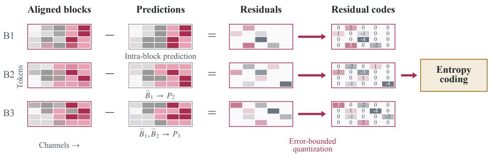  
Figure 4: Predictive residual coding for three aligned cache blocks: token-wise prediction initializes the first block, and cross-block prediction uses reconstructed blocks to predict subsequent blocks. Residuals undergo error-bounded quantization and lossless entropy coding.

Section 3.4 maps ϵ to a residual step that attains this bound in exact arithmetic. Storage comparisons use measured reconstruction error. Encoding and decoding efficiency are additional design objectives.

## 3.2 LOCAL COORDINATE ALIGNMENT

Each cache block contains cached vectors at a set of positions from one attention head or one layer of a shared latent cache (DeepSeek-AI, 2024). Inter-block dependencies are therefore dependencies across heads or layers, depending on the model. We align related blocks in small groups. The index v identifies the corresponding head or layer within a group. Calibration samples $\boldsymbol { S _ { v } } ^ { \mathrm { ~ ~ } } \in \mathbb { R } ^ { n _ { c } \times d }$ are used to estimate both the mean $\mu _ { v }$ and the orthogonal transform $A _ { v }$ . Samples from different heads or layers in the same group correspond to the same cache positions.

We first estimate the mean from the $n _ { c }$ calibration samples:

$$
\mu _ { v } = \frac { 1 } { n _ { c } } S _ { v } ^ { \top } { \bf 1 } .\tag{2}
$$

After subtracting $\mu _ { v }$ and normalizing each row, we obtain $\bar { S } _ { v }$ . For a group of m blocks, GPA (Gower, 1975) fits the rotations by aligning these calibration samples to a common representation M:

$$
\operatorname* { m i n } _ { \{ A _ { v } \} , M } \sum _ { v = 1 } ^ { m } \| \bar { S } _ { v } A _ { v } - M \| _ { F } ^ { 2 } , \qquad A _ { v } ^ { \top } A _ { v } = I ,\tag{3}
$$

where $A _ { v } \in \mathbb { R } ^ { d \times d }$ and $M \in \mathbb { R } ^ { n _ { c } \times d }$ . The fitted mean and rotation are shared across cache blocks associated with the same head or layer.

For a cache block $X _ { v } \in \mathbb { R } ^ { N \times d }$ to be compressed, we apply these calibrated parameters directly:

$$
Z _ { v } = ( X _ { v } - \mathbf { 1 } \mu _ { v } ^ { \top } ) A _ { v } .\tag{4}
$$

The aligned values $Z _ { v }$ are used for prediction. Row normalization is only used during fitting. Here 1 is an all-ones vector of the required length.

Calibration data. We support two calibration options: (1) auxiliary calibration learns rotations and means from auxiliary KV caches for reuse. (2) Cache-specific calibration avoids concerns about out-of-domain transfer by fitting directly to the target cache, with one parameter bank reused across its chunks. This option incurs per-cache fitting and parameter storage. We use auxiliary calibration by default to amortize these costs across caches. Section 5.4 evaluates the trade-off.

## 3.3 INTRA- AND INTER-BLOCK PREDICTION

Figure 4 shows the prediction and coding process for three aligned blocks. Let $z _ { v , t , c }$ denote an aligned value in block $v ,$ token position $t ,$ and channel $c ,$ where $v = 1 , \ldots ,$ m and $t = 0 , \ldots , N - 1$ Its prediction is $p _ { v , t , c } .$ Adding the dequantized residual gives $\widehat { z } _ { v , t , c } ,$ which both encoder and decoder then use as a later reference, always within the same channel.

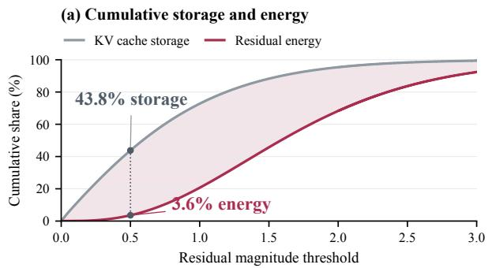

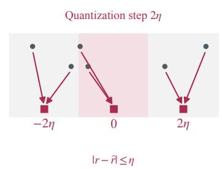

Figure 5: Error-bounded residual quantization. (a) Small residuals occupy 43.8% of KV cache storage but contribute only 3.6% of residual energy. (b) Quantization merges nearby values within the error bound.

Intra-block prediction. We compute a channel mean for the current group of blocks:

$$
b _ { c } = \frac { 1 } { m N } \sum _ { v = 1 } ^ { m } \sum _ { t = 0 } ^ { N - 1 } z _ { v , t , c } .\tag{5}
$$

This stored mean summarizes the current group, rather than the calibration samples used for $\mu _ { v }$ . In the first block, even token positions are predicted from $b _ { c }$ and reconstructed first. Odd positions then use the average of their reconstructed neighbors:

$$
p _ { 1 , t , c } = { \left\{ \begin{array} { l l } { b _ { c } , } & { t { \mathrm { e v e n } } , } \\ { ( { \widehat { z } } _ { 1 , t - 1 , c } + { \widehat { z } } _ { 1 , t + 1 , c } ) / 2 , } & { t { \mathrm { o d d } } . } \end{array} \right. }\tag{6}
$$

This establishes the first reconstructed block.

Inter-block prediction. Block $v \geq 2$ averages earlier reconstructions at the same token and channel, then blends that average with $b _ { c }$

$$
a _ { v , t , c } = \frac { 1 } { v - 1 } \sum _ { j = 1 } ^ { v - 1 } \widehat { z } _ { j , t , c } , \qquad p _ { v , t , c } = b _ { c } + \lambda _ { v } ( a _ { v , t , c } - b _ { c } ) .\tag{7}
$$

We set $\lambda _ { 2 } = 0 . 5$ and $\lambda _ { v } = 0 . 7 5$ for $v \geq 3 .$

## 3.4 ERROR-CONTROLLED CODING AND RECONSTRUCTION

Figure 5(a) shows the imbalance between storage cost and residual error contribution, motivating precision reduction under an explicit reconstruction-error target.

Error target. Given a target relative reconstruction error ϵ, the encoder sets a residual step for an object X containing n scalar values:

$$
\eta = \epsilon \frac { \| X \| _ { F } } { \sqrt { n } } .\tag{8}
$$

The step is computed once per object, without reconstruction search. Because orthogonal rotations preserve the error norm, the per-value check $| z _ { i } - \widehat { z } _ { i } | \ \leq \ \eta$ implies $\| X - { \widehat { X } } \| _ { F } \leq { \sqrt { n } } \eta$ , and hence relative error at most $\epsilon ,$ in exact arithmetic. Reported reconstruction errors are measured after inverse transformation and conversion to the source format, including the effects of finite-precision arithmetic.

Residual quantization. For each aligned value $z _ { i }$ and prediction $p _ { i } .$ , we quantize the residual $\boldsymbol { r } _ { i } = z _ { i } - p _ { i }$ on a grid with spacing 2η. Figure 5(b) shows that residuals within each quantization interval map to the same symbol for entropy coding. Let $\widehat { r _ { i } }$ denote the dequantized residual. The reconstructed value satisfies

$$
{ \widehat { z } } _ { i } = p _ { i } + { \widehat { r } } _ { i } , \qquad | z _ { i } - { \widehat { z } } _ { i } | \leq \eta .\tag{9}
$$

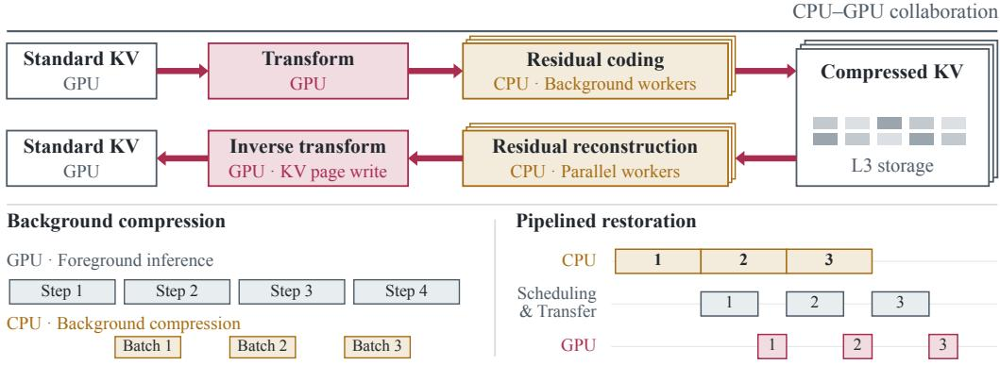  
Figure 6: Overlap of background KV compression with foreground inference, and pipelined CPU– GPU restoration. Each CPU compression job starts after its corresponding GPU step. Timeline lengths are schematic and illustrate overlap rather than measured stage durations. L3 denotes Hi-Cache’s persistent file tier.

The encoder checks this bound and stores $z _ { i }$ directly if the check fails or the residual exceeds the coding range. Reconstructed references, spacing 2η, and an escape for values that miss the bound are the standard error-bounded residual lattice (Liang et al., 2023). After local alignment we do not search Lorenzo versus interpolation on the raw array. We use the fixed KV schedule of Section 3.3.

Encoding and reconstruction. We losslessly compress the quantization codes using asymmetric numeral systems (ANS) (Duda, 2013). Decoding recovers the codes and follows the same prediction order to reconstruct $\widehat { Z } _ { v }$ . We then restore the original coordinates as $\widehat { X } _ { v } = \widehat { Z } _ { v } A _ { v } ^ { \top } + \mathbf { 1 } \mu _ { v } ^ { \top }$ and convert to the source format. Appendix B.1 gives the object codec as Algorithm 1.

## 4 SYSTEM INTEGRATION

CPU–GPU cooperation. Figure 6 shows how compression and restoration overlap with inference. After the GPU produces a cache block, CPU workers compress it in the background. On a cache hit, the CPU reconstructs the aligned cache while the GPU converts decoded groups back to the model’s native layout. Qwen uses HiCache’s layerwise restoration path. For GLM and DeepSeek, rank 0 decodes each shared-latent group and broadcasts it to the tensor-parallel ranks. Double buffering overlaps CPU decoding, transfer, and GPU restoration. DeepSeek writes the result through its native FP8 cache path. Further implementation details are given in Appendix D.

Inverse transforms. Serving restores native coordinates with an explicit inverse rotation per cached token. When the attention path permits, the rotation and mean can be absorbed into subsequent projections (Appendix B.4). Our measurements do not use this path.

## 5 EXPERIMENTS

## 5.1 EXPERIMENTAL SETUP

We evaluate three attention mechanisms. Qwen3.5-9B stores GQA Keys and Values, GLM-5.3-Flash stores the post-LN MLA latent, and DeepSeek-V4-Flash stores the 4× CSA pool and already uses FP8 as the default KV cache. GLM RoPE, indexer, and KDA states are outside the compressed object. DeepSeek storage savings are measured relative to its already pooled cache.

Unless a later subsection states otherwise, means and rotations are fitted on 8,192 uniformly sampled positions from each of five disjoint calibration documents covering English, Chinese, code, mathematics, and retrieval, and are then frozen. Captured caches are converted to FP16. Storage is bits per value (bpv), including codec metadata and excluding reusable calibration parameters.

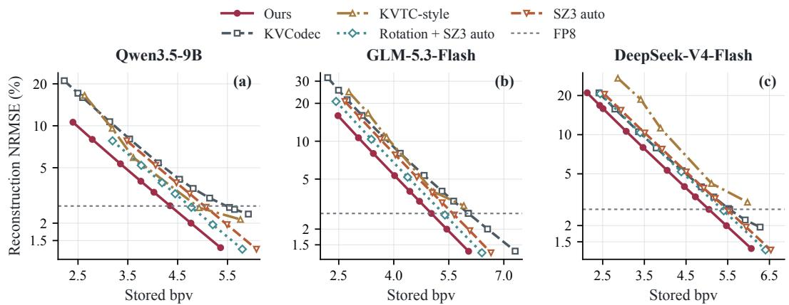  
Figure 7: Storage size versus reconstruction error on five InfiniteBench categories, including KV-Codec, KVTC-style, Rotation + SZ3 auto, and unrotated SZ3 auto. Error axes are logarithmic. Dotted lines mark FP8 error. Axis ranges vary by model.

Offline experiments compare adapted coding strategies on common caches using storage size, reconstruction error, and same-host CPU cost. LongBench-Pro evaluates task quality. Ablations examine design choices. Serving experiments compare AlignPred with native HiCache storage.

## 5.2 COMPRESSION AT COMPARABLE RECONSTRUCTION ERROR

Setup. We evaluate storage versus reconstruction error on InfiniteBench (Zhang et al., 2024b). Error is the relative Frobenius norm over the evaluation set. Figure 7 plots storage size against reconstruction error.

Baselines. We compare coding strategies on identical cache representations at comparable measured reconstruction error, using a KVTCstyle adaptation for the common-input setting. Our KVCodec (Mi et al., 2026) reference uses

Table 1: Cost of the evaluated CPU codec implementations relative to Ours at the FP8-near operating points in Table 7, range over the three models. Above 1 favors Ours.
<table><tr><td>Baseline</td><td>Storage</td><td>Encode</td><td>Decode</td></tr><tr><td>KVCodec</td><td>1.10-1.30</td><td>5.3-6.8</td><td>5.4–6.3</td></tr><tr><td>KVTC-style</td><td>1.13-1.18</td><td>1.3-1.6</td><td>3.3-3.7</td></tr><tr><td>Rotation + SZ3</td><td>1.07-1.10</td><td>1.02-1.04</td><td>1.6–2.1</td></tr></table>

software HEVC on a token layout. Our KVTC-style (Staniszewski & Łancucki, 2026) reference uses ´ joint PCA and quantization. SZ3 auto (Liang et al., 2023) runs on native or locally aligned caches with the same frozen means. Inputs retain positional encoding where applicable. Implementation settings are in Appendix C.1.

Results. Across all three mechanisms, Ours stores less than the evaluated KVCodec, KVTC-style, Rotation + SZ3, and unrotated SZ3 implementations at comparable measured error (Figure 7). Unrotated SZ3 is strictly more expensive than Rotation + SZ3 at matched error, so local alignment also reduces the rate of a generic error-bounded compressor. With alignment held fixed, this comparison shows the advantage of our coding pipeline over SZ3 auto. Table 2 separately evaluates the contribution of inter-block prediction. Table 1 summarizes storage and same-host CPU coding cost at the operating points in Table 7. Ours decodes faster than all three timed CPU implementations, encodes faster than the evaluated KVCodec and KVTC-style instances, and ties Rotation + SZ3 on encode. At the FP8 reconstruction-error level, Ours uses 36.9–45.7% less storage than 8-bit FP8. These savings persist for the lifetime of each retained cache. Additional results are in Appendix C.

## 5.3 FULL-CONTEXT DOWNSTREAM QUALITY

Setup. This experiment evaluates how downstream quality changes as persistent KV storage is reduced. We measure LongBench-Pro task score (Chen et al., 2026) across compression operating points in the 128K setting, using the official scoring protocol (Appendix C.4). Decoding uses non-thinking prompts, greedy search, and at most 1,024 generated tokens. Our method reuses the frozen auxiliary bank from Section 5.1 throughout this evaluation. Figure 8 reports task score against storage rate in bpv.

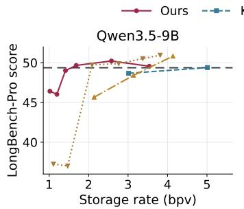

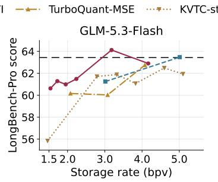

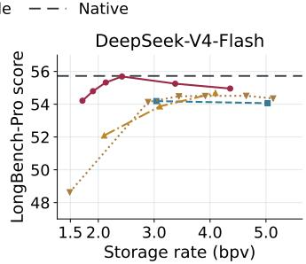  
Figure 8: LongBench-Pro task score versus storage rate (bpv). KIVI and TurboQuant-MSE provide GPU-resident quantization references.

Table 2: Component ablation on one English cache per model (bpv ↓).
<table><tr><td colspan="2">Components enabled</td><td colspan="2">Stored bpv ↓</td></tr><tr><td>Alignment</td><td>Inter Intra</td><td>t Prediction λv Qwen GLM DeepSeek</td><td></td></tr><tr><td>×</td><td>× ×</td><td>4.973</td><td>5.626 5.662</td></tr><tr><td>×</td><td>X √</td><td></td><td>4.7555.364 5.341</td></tr><tr><td>√</td><td>× V</td><td>4.698</td><td>5.316 5.325</td></tr><tr><td>×</td><td>√ √</td><td>√ 5.052</td><td>5.585 5.544 5.289</td></tr><tr><td>√</td><td>√ X</td><td>√</td><td>4.561 5.186</td></tr><tr><td>√</td><td>√ √</td><td>X</td><td>4.581 5.234</td></tr><tr><td>√</td><td>√ √</td><td>√</td><td>4.524 5.168</td></tr></table>

Figure 9: Calibration ablation. Hatched region is cache-specific parameter storage.  
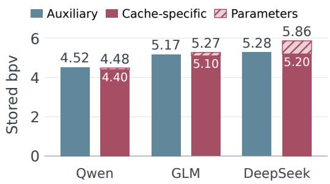

Baselines. Persistent-storage codecs reuse the settings of Section 5.2. KIVI and TurboQuant-MSE (Zandieh et al., 2025) provide reference points for task quality at different storage sizes using GPU-resident KV quantization.

Results. Figure 8 shows that Ours preserves near-native LongBench-Pro quality over a wide range of storage rates on Qwen, and at several more compressed operating points on GLM and DeepSeek. Across the evaluated operating points, lower reconstruction error is generally associated with higher downstream quality, while local score fluctuations make the relationship imperfectly monotonic. This makes reconstruction error a practical control variable for selecting compression strength, with downstream evaluation used to determine the acceptable range for each workload. Additional results are in Appendix C.4.

## 5.4 ABLATION STUDIES

Setup. We use ablations to examine how intra-block prediction, local alignment, inter-block prediction, and blending interact, and whether cache-specific alignment is worth its fitting and parameter cost. Both ablations use one English cache per model at matched reconstruction error to isolate component effects and calibration overhead. Table 2 toggles alignment, inter-block prediction, intra-block prediction, and the default blending weights. Figure 9 compares the default auxiliary calibration with cache-specific calibration.

Component results. Local alignment makes inter-block prediction effective in all three evaluated models. Under the default blend, adding inter-block prediction to intra-block prediction increases storage by 0.203–0.297 bpv without alignment, but reduces storage by 0.044–0.174 bpv after alignment (Table 2). Replacing unaligned intra-block prediction with aligned inter-block prediction using the default blend, with intra-block prediction disabled, saves 0.194, 0.178, and 0.052 bpv on Qwen, GLM, and DeepSeek, respectively.

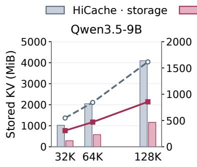

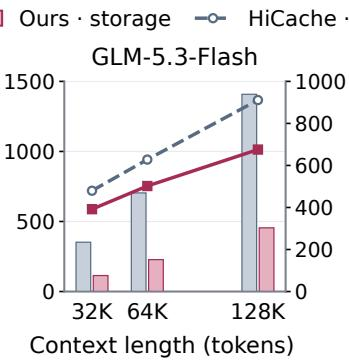

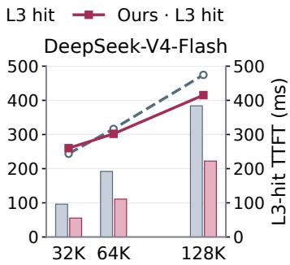  
Figure 10: Persistent target-KV file size and L3-hit restore TTFT versus native HiCache, after a restart with empty L1/L2. Batch size 1. Axis ranges vary by model.

Intra-block prediction alone saves 0.218–0.321 bpv over the no-prediction reference, which uses error-lattice quantization and rANS. Setting $\lambda _ { v } = 1$ , which removes shrinkage toward the group mean, increases storage by 0.057–0.076 bpv relative to the full configuration. The full configuration has the lowest storage in this ablation for all three models, saving 0.381–0.458 bpv over the noprediction reference.

Calibration results. Cache-specific calibration reduces the compressed payload, but its parameter overhead offsets the savings on two of the three evaluated models. Figure 9 shows smaller payloads on all three models. After including the per-cache parameter bank, the net benefit remains positive on Qwen at the evaluated length but is offset on GLM and DeepSeek. These results support auxiliary calibration as the default trade-off at the evaluated lengths. Longer caches amortize cache-specific parameter storage over more cached values, whereas repeated reuse amortizes the one-time fitting cost. Additional results are in Appendix C.

## 5.5 END-TO-END SERVING EFFICIENCY

Setup. This experiment evaluates persistent KV storage savings and cache-hit restore latency when AlignPred is integrated into SGLang HiCache, using the operating setting selected near the FP8 reference error in the offline experiments. We run a write-then-rehit roundtrip at 32K, 64K, and 128K with B = 1, 2, 4, and 8 concurrent requests. The first requests populate L3 while prefill is in progress. After a restart with empty L1/L2, the same requests restore their prefixes from L3. Figure 10 reports target-KV file size and L3-hit restore TTFT at B = 1. Further details and the concurrent results are provided in Appendix D.

Results. AlignPred reduces persistent target-KV storage by 42–72% versus native HiCache, including on DeepSeek, whose native cache is already FP8 (Figure 10). The smaller payload also shortens cache-hit restore: on Qwen and GLM, L3-hit TTFT is lower at every context length and stays lower under most concurrent loads. DeepSeek stays close to native for a single request but falls behind under concurrency, because its restore runs synchronously on the scheduler thread. Online compression overlaps with prefill and adds little to first-request TTFT.

## 6 CONCLUSION

We present AlignPred, a reconstruction-error-controlled alignment-and-prediction codec for persistent KV caches. Local orthogonal alignment turns cross-head and cross-layer geometric similarity into coordinate-wise predictive redundancy, enabling lightweight cross-block prediction while preserving the original KV layout. More broadly, our results suggest a design principle for persistent KV cache compression: align related KV blocks to expose predictable structure, then code the resulting residuals under an explicit error budget.

## AI USE STATEMENT

In this work, we used generative AI tools to polish writing, to find related work, and to assist with research execution by implementing experiment code following the authors’ designs. The core hypotheses and method are the authors’ own; generative AI tools were not used for research ideation. We have reviewed all AI-assisted work and take responsibility for the final content of this work, including text, claims or artifacts produced with the aid of generative AI.

## REFERENCES

Reyna Abhyankar, Zijian He, Vikranth Srivatsa, Hao Zhang, and Yiying Zhang. InferCept: Efficient intercept support for augmented large language model inference. In Proceedings of the 41st International Conference on Machine Learning, volume 235 of Proceedings of Machine Learning Research, pp. 81–95, 2024.

Joshua Ainslie, James Lee-Thorp, Michiel de Jong, Yury Zemlyanskiy, Federico Lebron, and´ Sumit Sanghai. GQA: Training generalized multi-query transformer models from multi-head checkpoints. In Proceedings of the 2023 Conference on Empirical Methods in Natural Language Processing, pp. 4895–4901. Association for Computational Linguistics, 2023. doi: 10.18653/v1/2023.emnlp-main.298.

Baidu AI Cloud. Create a prefix cache: Qianfan API reference, 2026. URL https://cloud.baidu.com/ doc/qianfan-api/s/kmhka93gq. Accessed September 20, 2026.

William Brandon, Mayank Mishra, Aniruddha Nrusimha, Rameswar Panda, and Jonathan Ragan-Kelley. Reducing transformer key-value cache size with cross-layer attention. In Advances in Neural Information Processing Systems, volume 37, 2024.

Chi-Chih Chang, Wei-Cheng Lin, Chien-Yu Lin, Chong-Yan Chen, Yu-Fang Hu, Pei-Shuo Wang, Ning-Chi Huang, Luis Ceze, Mohamed S. Abdelfattah, and Kai-Chiang Wu. Palu: KV-cache compression with low-rank projection. In International Conference on Learning Representations, 2025.

Chi-Chih Chang, Wei-Cheng Lin, Chien-Yu Lin, Hung-Yueh Chiang, Yash Akhauri, Xilai Dai, Huiqiang Jiang, Yucheng Li, Luis Ceze, Kai-Chiang Wu, and Mohamed S. Abdelfattah. xKV: Cross-layer KV-cache compression via aligned singular vector extraction. In Proceedings of the 43rd International Conference on Machine Learning, 2026.

Ziyang Chen, Xing Wu, Junlong Jia, Chaochen Gao, Qi Fu, Debing Zhang, and Songlin Hu. Long-Bench Pro: A more realistic and comprehensive bilingual long-context evaluation benchmark. arXiv preprint arXiv:2601.02872, 2026.

DeepSeek. Context caching, 2026. URL https://api-docs.deepseek.com/guides/kv cache/. Accessed September 20, 2026.

DeepSeek-AI. DeepSeek-V2: A strong, economical, and efficient mixture-of-experts language model. arXiv preprint arXiv:2405.04434, 2024.

Sheng Di and Franck Cappello. Fast error-bounded lossy HPC data compression with SZ. In IEEE International Parallel and Distributed Processing Symposium (IPDPS), pp. 730–739, 2016. doi: 10.1109/IPDPS.2016.11.

Jarek Duda. Asymmetric numeral systems: Entropy coding combining speed of Huffman coding with compression rate of arithmetic coding. arXiv preprint arXiv:1311.2540, 2013.

Peter Elias. Predictive coding–I. IRE Transactions on Information Theory, 1(1):16–24, 1955. doi: 10.1109/TIT.1955.1055126.

Bin Gao, Zhuomin He, Puru Sharma, Qingxuan Kang, Djordje Jevdjic, Junbo Deng, Xingkun Yang, Zhou Yu, and Pengfei Zuo. Cost-efficient large language model serving for multi-turn conversations with CachedAttention. In 2024 USENIX Annual Technical Conference (USENIX ATC 24), pp. 111–126, 2024.

Google. Context caching: Gemini API, 2026. URL https://ai.google.dev/gemini-api/docs/ generate-content/caching. Accessed September 20, 2026.

John C. Gower. Generalized procrustes analysis. Psychometrika, 40(1):33–51, 1975. doi: 10.1007/ BF02291478.

Vivek K. Goyal. Theoretical foundations of transform coding. IEEE Signal Processing Magazine, 18(5):9–21, 2001. doi: 10.1109/79.952802.

Coleman Hooper, Sehoon Kim, Hiva Mohammadzadeh, Michael W. Mahoney, Yakun Sophia Shao, Kurt Keutzer, and Amir Gholami. KVQuant: Towards 10 million context length LLM inference with KV cache quantization. In Advances in Neural Information Processing Systems, volume 37, 2024.

Lawrence Ibarria, Peter Lindstrom, Jarek Rossignac, and Andrzej Szymczak. Out-of-core compression and decompression of large n-dimensional scalar fields. Computer Graphics Forum, 22(3): 343–348, 2003. doi: 10.1111/1467-8659.00681.

Bo Jiang, Taolue Yang, Youyuan Liu, Chengming Zhang, Xubin He, and Sian Jin. KVComp: A high-performance, LLM-aware, lossy compression framework for KV cache. arXiv preprint arXiv:2509.00579, 2025.

Bo Jiang, Taolue Yang, Youyuan Liu, Xubin He, Sheng Di, and Sian Jin. PackKV: Reducing KV cache memory footprint through LLM-aware lossy compression. arXiv preprint arXiv:2512.24449, 2026.

Woosuk Kwon, Zhuohan Li, Siyuan Zhuang, Ying Sheng, Lianmin Zheng, Cody Hao Yu, Joseph E. Gonzalez, Hao Zhang, and Ion Stoica. Efficient memory management for large language model serving with PagedAttention. In Proceedings of the 29th Symposium on Operating Systems Principles, pp. 611–626, 2023. doi: 10.1145/3600006.3613165.

Xin Liang, Sheng Di, Dingwen Tao, Sihuan Li, Shaomeng Li, Hanqi Guo, Zizhong Chen, and Franck Cappello. Error-controlled lossy compression optimized for high compression ratios of scientific datasets. In IEEE International Conference on Big Data (Big Data), pp. 438–447, 2018. doi: 10.1109/BigData.2018.8622520.

Xin Liang, Kai Zhao, Sheng Di, Sihuan Li, Robert Underwood, Ali M. Gok, Jiannan Tian, Junjing Deng, Jon C. Calhoun, Dingwen Tao, Zizhong Chen, and Franck Cappello. SZ3: A modular framework for composing prediction-based error-bounded lossy compressors. IEEE Transactions on Big Data, 9(2):485–498, 2023. doi: 10.1109/TBDATA.2022.3201176.

Bokai Lin, Zihao Zeng, Zipeng Xiao, Siqi Kou, Tianqi Hou, Xiaofeng Gao, Hao Zhang, and Zhijie Deng. MatryoshkaKV: Adaptive KV compression via trainable orthogonal projection. In International Conference on Learning Representations, 2025.

Peter Lindstrom. Fixed-rate compressed floating-point arrays. IEEE Transactions on Visualization and Computer Graphics, 20(12):2674–2683, 2014. doi: 10.1109/TVCG.2014.2346458.

Akide Liu, Jing Liu, Zizheng Pan, Yefei He, Gholamreza Haffari, and Bohan Zhuang. MiniCache: KV cache compression in depth dimension for large language models. In Advances in Neural Information Processing Systems, volume 37, 2024a.

Yuhan Liu, Hanchen Li, Yihua Cheng, Siddhant Ray, Yuyang Huang, Qizheng Zhang, Kuntai Du, Jiayi Yao, Shan Lu, Ganesh Ananthanarayanan, Michael Maire, Henry Hoffmann, Ari Holtzman, and Junchen Jiang. CacheGen: KV cache compression and streaming for fast large language model serving. In Proceedings of the ACM SIGCOMM 2024 Conference, pp. 38–56, 2024b. doi: 10.1145/3651890.3672274.

Yuhan Liu, Yihua Cheng, Jiayi Yao, Yuwei An, Xiaokun Chen, Shaoting Feng, Yuyang Huang, Samuel Shen, Rui Zhang, Kuntai Du, and Junchen Jiang. LMCache: An efficient KV cache layer for enterprise-scale LLM inference. arXiv preprint arXiv:2510.09665, 2025.

Zirui Liu, Jiayi Yuan, Hongye Jin, Shaochen Zhong, Zhaozhuo Xu, Vladimir Braverman, Beidi Chen, and Xia Hu. KIVI: A tuning-free asymmetric 2bit quantization for KV cache. In Proceedings of the 41st International Conference on Machine Learning, volume 235 of Proceedings of Machine Learning Research, pp. 32332–32344, 2024c.

Liang Mi, Weijun Wang, Jinghan Chen, Ting Cao, Haipeng Dai, and Yunxin Liu. Efficient remote KV cache reuse with GPU-native video codec. arXiv preprint arXiv:2602.09725, 2026. Accepted by SIGCOMM 2026.

NVIDIA. INT8/FP8 KV caches. TensorRT-LLM Documentation, 2026. URL https://nvidia.github. io/TensorRT-LLM/features/attention.html. Accessed September 3, 2026.

OpenAI. Prompt caching, 2026. URL https://developers.openai.com/api/docs/guides/ prompt-caching. Accessed September 20, 2026.

Ruoyu Qin, Zheming Li, Weiran He, Jialei Cui, Feng Ren, Mingxing Zhang, Yongwei Wu, Weimin Zheng, and Xinran Xu. Mooncake: Trading more storage for less computation — a KVCachecentric architecture for serving LLM chatbot. In 23rd USENIX Conference on File and Storage Technologies (FAST 25), pp. 155–170, 2025.

Konrad Staniszewski and Adrian Łancucki. KV cache transform coding for compact storage in LLM´ inference. In International Conference on Learning Representations, 2026.

Dingwen Tao, Sheng Di, Zizhong Chen, and Franck Cappello. Significantly improving lossy compression for scientific data sets based on multidimensional prediction and error-controlled quantization. In IEEE International Parallel and Distributed Processing Symposium (IPDPS), pp. 1129–1139, 2017. doi: 10.1109/IPDPS.2017.115.

Jiannan Tian, Sheng Di, Kai Zhao, Cody Rivera, Megan Hickman Fulp, Robert Underwood, Sian Jin, Xin Liang, Jon Calhoun, Dingwen Tao, and Franck Cappello. cuSZ: An efficient GPUbased error-bounded lossy compression framework for scientific data. In Proceedings of the ACM International Conference on Parallel Architectures and Compilation Techniques, pp. 3–15, 2020. doi: 10.1145/3410463.3414624.

vLLM Project. Quantized KV cache. vLLM Documentation, 2026. URL https://docs.vllm.ai/en/ latest/features/quantization/quantized kvcache/. Accessed September 4, 2026.

Ceyu Xu, Yongji Wu, Xinyu Yang, Beidi Chen, Matthew Lentz, Danyang Zhuo, and Lisa Wu Wills. LLM.265: Video codecs are secretly tensor codecs. In Proceedings ofthe 58th IEEE/ACM International Symposium on Microarchitecture, 2025.

Amir Zandieh, Majid Daliri, Majid Hadian, and Vahab Mirrokni. TurboQuant: Online vector quantization with near-optimal distortion rate. arXiv preprint arXiv:2504.19874, 2025.

Tianyi Zhang, Jonah Yi, Zhaozhuo Xu, and Anshumali Shrivastava. KV cache is 1 bit per channel: Efficient large language model inference with coupled quantization. In Advances in Neural Information Processing Systems, volume 37, 2024a.

Xinrong Zhang, Yingfa Chen, Shengding Hu, Zihang Xu, Junhao Chen, Moo Hao, Xu Han, Zhen Thai, Shuo Wang, Zhiyuan Liu, and Maosong Sun. ∞Bench: Extending long context evaluation beyond 100K tokens. In Proceedings ofthe 62nd Annual Meeting ofthe Associationfor Computational Linguistics (Volume 1: Long Papers), pp. 15262–15277. Association for Computational Linguistics, 2024b. doi: 10.18653/v1/2024.acl-long.814.

Lianmin Zheng, Liangsheng Yin, Zhiqiang Xie, Chuyue Sun, Jeff Huang, Cody Hao Yu, Shiyi Cao, Christos Kozyrakis, Ion Stoica, Joseph E. Gonzalez, Clark Barrett, and Ying Sheng. SGLang: Efficient execution of structured language model programs. In Advances in Neural Information Processing Systems, volume 37, 2024.

## A MOTIVATION FOR ERROR-CONTROLLED KV COMPRESSION

Deploying lossy KV compression requires both numerical control and task-level validation. Benchmark accuracy alone does not provide a transferable numerical constraint for unseen workloads, making it difficult to reason about how aggressively a codec can be configured. AlignPred instead exposes an explicit reconstruction-error target, providing a workload-independent numerical fidelity constraint for selecting and comparing operating points. This bound does not guarantee downstream task quality; rather, it narrows the numerical design space and makes application-specific validation more systematic. Task-level checks remain necessary to determine which error targets are acceptable for a given workload.

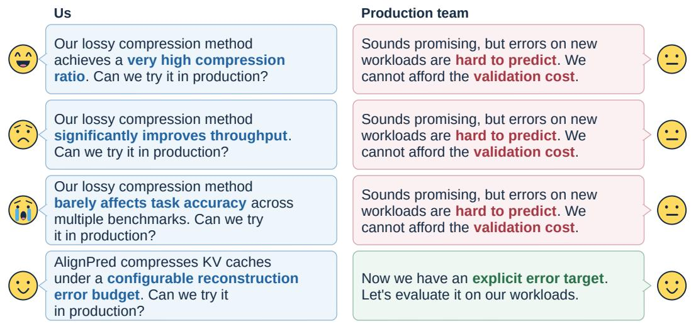

Figure 11: Illustrative dialogue motivating error-controlled KV compression. A configurable reconstruction-error budget supports different application requirements and provides a numerical reference for deployment validation.  
```latex
Algorithm 1 Alignment-conditioned predictive coding of one cache object.
1: Input. blocks $\{ X _ { v } \} _ { v = 1 } ^ { m } ,$ frozen $\{ \mu _ { v } , A _ { v } \}$ , target ϵ, and $\lambda _ { 2 } = 0 . 5 , \lambda _ { v } = 0 . 7 5$ for v $\geq 3$
2: Align $Z _ { v } = ( \dot { X _ { v } } - { \bf \dot { 1 } } \mu _ { v } ^ { \top } ) A _ { v }$ for $v = 1 , \ldots , m$
3: Set $\eta = \epsilon \lVert X \rVert _ { F } / \sqrt { n }$ as in Equation 8
4: Store $\begin{array} { r } { b _ { c } = \frac { 1 } { m N } \sum _ { v = 1 } ^ { m } \sum _ { t = 0 } ^ { N - 1 } z _ { v , t , c } } \end{array}$
5: for each channel c do
6: Block 1, even $t . \widehat { z } _ { 1 , t , c } \gets \mathrm { C o D E } ( z _ { 1 , t , c } , b _ { c } )$
7: Block 1, odd $t . \widehat { z } _ { 1 , t , c } \gets \mathrm { C O D E } \big ( z _ { 1 , t , c } , ( \widehat { z } _ { 1 , t - 1 , c } + \widehat { z } _ { 1 , t + 1 , c } ) / 2 \big )$ ; the last odd site repeats its
left neighbor
8: for $v = 2 , \ldots , m$ do
9: for $t = 0 , \ldots , N - 1$ do
10: $\begin{array} { r } { a _ { v , t , c } = \frac { 1 } { v - 1 } \sum _ { j = 1 } ^ { v - 1 } \widehat { z } _ { j , t , c } , p _ { v , t , c } = b _ { c } + \lambda _ { v } ( a _ { v , t , c } - b _ { c } ) } \end{array}$
11: $\widehat { z } _ { v , t , c } \gets \mathrm { C o D E } \left( z _ { v , t , c } , p _ { v , t , c } \right)$
12: end for
13: end for
14: end for
15: Entropy-code symbols with rANS (Duda, 2013)
16: Decode. recover symbols and escapes, repeat the same prediction order, and restore $\widehat { X } _ { v } \ =$
$\widehat { Z } _ { v } A _ { v } ^ { \top } + \mathbf { 1 } \mu _ { v } ^ { \top }$
17: Procedure $\check { \mathrm { C o D E } } ( z , p ) \colon$ emit one symbol and return the reconstruction $\widehat { z }$
18: $r = z - p , u = \lfloor \lvert \hat { r } \rvert / \eta \rfloor + 1 , k = \lfloor u / 2 \rfloor , s = \mathrm { s i g n } ( r )$
19: if u < 256 and $| p + 2 s k \eta - z | \leq \eta ;$ emit $q = 1 2 8 + s k ;$ return ${ \widehat { z } } = p + 2 ( q - 1 2 8 ) \eta$
20: else: emit escape $q = 0$ and store z as FP32; return $\widehat { z } = z$
```

## B CODEC SPECIFICATION AND ANALYSIS

## B.1 END-TO-END CODEC SPECIFICATION

Algorithm 1 is the object codec used in all experiments. Fitted means and rotations come from Section B.2. Geometry and packet fields are in Section B.3.

Equation 8 sets the residual step from the requested bound. Varying ϵ gives different storage sizes and measured reconstruction errors. Prediction references use FP32, with wider accumulation intermediates. Final measured errors include inverse transformation and format conversion.

Table 3: Cache geometry for Figure $^ { 7 . }$
<table><tr><td>Model</td><td>Compressed cache</td><td> $d$ </td><td>Streams/object</td><td>Blocks/group</td></tr><tr><td>Qwen3.5-9B</td><td>Full-attention K/V</td><td>256</td><td>16</td><td>4 heads each</td></tr><tr><td>GLM-5.3-Flash</td><td>Post-LN latent</td><td>512</td><td>3</td><td>4, 4, 3 layers</td></tr><tr><td>DeepSeek-V4-Flash</td><td>C4 CSA latent</td><td>512</td><td>6</td><td> $1 + 5 \times 4$  layers</td></tr></table>

## B.2 ALIGNMENT FITTING

Input. Calibration matrices $S _ { v } \in \mathbb { R } ^ { n _ { c } \times d }$ for $v = 1 , \ldots , m$ in one group.

Preprocessing. Set $\begin{array} { r l r } { \mu _ { v } } & { { } = } & { \frac { 1 } { n _ { c } } S _ { v } ^ { \top } \mathbf { 1 } } \end{array}$ . Center and normalize each row $\begin{array} { r c l } { \bar { s } _ { v , t } } & { = } & { ( s _ { v , t } \ - } \end{array}$ $\mu _ { v } ^ { \top } ) / \operatorname* { m a x } ( \| s _ { v , t } - \mu _ { v } ^ { \top } \| _ { 2 } , 1 0 ^ { - 8 } )$ . Normalization is used only for fitting.

Alternating updates. Start from $A _ { v } = I$ . Independently per group, iterate

$$
\boldsymbol { M } = \frac { 1 } { m } \sum _ { v } \bar { S } _ { v } \boldsymbol { A } _ { v } , \qquad \bar { S } _ { v } ^ { \top } \boldsymbol { M } = U _ { v } \Sigma _ { v } V _ { v } ^ { \top } , \qquad \widetilde { \boldsymbol { A } } _ { v } = U _ { v } V _ { v } ^ { \top } , \quad \boldsymbol { A } _ { v } = \widetilde { \boldsymbol { A } } _ { v } \widetilde { \boldsymbol { A } } _ { 1 } ^ { \top } .\tag{10}
$$

The last assignment anchors the first block.

Stopping criterion. At most 100 iterations with tolerance $1 0 ^ { - 6 }$ . Cross-products are precomputed.

Stored parameters. Freeze $\{ \mu _ { v } , A _ { v } \}$ for compression. Row normalization is not applied when forming $Z _ { v }$ in Algorithm 1.

Fitting complexity. For $n _ { c }$ samples per block, precomputing pairwise cross-products costs $O ( n _ { c } m ^ { 2 } d ^ { 2 } )$ time and $O ( m ^ { 2 } d ^ { 2 } )$ storage. Each GPA iteration forms m cross-covariance sums and computes m SVDs of size $d \times d ,$ costing $O ( m ^ { 2 } d ^ { 3 } )$ time in total, including $O ( m d ^ { 3 } )$ for the SVDs. With I iterations, fitting therefore costs $\breve { O } ( n _ { c } m ^ { 2 } d ^ { 2 } + I m ^ { 2 } d ^ { 3 } )$ . Cross-products are temporary fitting workspace; the deployed rotation bank contains only $O ( m d ^ { 2 } )$ entries.

## B.3 CACHE ORGANIZATION AND METADATA

Objects contain 256 cache positions. A group has shape $d \times m \times 2 5 6$ . Channel-wise serialization visits even then odd positions of its first block, followed by subsequent blocks. Dependencies stay within a group and channel. Table 3 specifies the offline RD configuration.

DeepSeek’s zero-based layer groups are [2], [4, 6, 8, 10], [12, 14, 16, 18], [20, 22, 24, 26], [28, 30, 32, 34], and [36, 38, 40, 42]. The singleton uses the auxiliary mean, identity rotation, and intra-block prediction. Each remaining group fits GPA independently. All groups use 40,960 auxiliary positions. Each stream stores geometry, the quantization threshold, channel prediction means, escape counts and values, and an rANS payload. Object headers identify the shared parameter bank and stream boundaries. Incomplete objects retain their original values and count toward bpv. These partitions follow adjacent native streams with leftover remainder, without evaluation-set tuning (Appendix C.7).

## B.4 ATTENTION COMPATIBILITY

Serving measurements restore each cached token with an explicit inverse. When the attention path permits, the rotation and mean can move into later linear maps. For a reconstructed row $\hat { x } = z A ^ { \dagger }$ + $\dot { \mu } ^ { \top }$ and a projection with weight $W$ and bias b,

$$
\begin{array} { c } { { ( z A ^ { \top } + \mu ^ { \top } ) W + b ^ { \top } = z W ^ { \prime } + ( b ^ { \prime } ) ^ { \top } , } } \\ { { W ^ { \prime } = A ^ { \top } W , \qquad b ^ { \prime } = b + W ^ { \top } \mu . } } \end{array}\tag{11}
$$

For grouped-query attention (Ainslie et al., 2023), query head r attends to KV head $h = h ( r )$ , and $\widehat X _ { h } ^ { c } = \widetilde X _ { h } ^ { c } ( A _ { h } ^ { c } ) ^ { \top } + \mathbf { 1 } ( \mu _ { h } ^ { c } ) ^ { \top }$ for $c \in \{ K , V \}$ . The maps must be fixed on the attended prefix and on appended tokens. Post-RoPE queries use

$$
\widetilde { q } _ { r } = q _ { r } A _ { h } ^ { K } , \qquad q _ { r } \widehat { K } _ { h } ^ { \top } = \widetilde { q } _ { r } \widetilde { K } _ { h } ^ { \top } + ( q _ { r } \mu _ { h } ^ { K } ) \mathbf { 1 } ^ { \top } .\tag{12}
$$

Table 4: Offline RD baseline and operating-point settings.
<table><tr><td>Item</td><td>Setting</td></tr><tr><td>Input caches</td><td>All methods cover the same cache positions and retain positional encoding where applicable, keeping their input representations consistent.</td></tr><tr><td>FP8 reference</td><td>E4M3FN, scale 1. FP16 inputs clamped to [—448, 448].</td></tr><tr><td>KVCodec</td><td>Adapted software-codec reference: unrotated token layout, lossless x265, very- fast preset, three B-frames with adaptive selection, and at most 256 positions per GOP.</td></tr><tr><td>KVTC-style</td><td>Adapted transform-coding reference: joint PCA, quantization, and Deflate. DeepSeek uses three-layer groups. Shared PCA parameters are excluded from bpv.</td></tr><tr><td>SZ3 auto</td><td>Official SZ3 auto on the same caches and frozen means as Ours. Rotation + SZ3 applies fitted rotations, and unrotated SZ3 auto does not. Figure 7, Table 7, Ta- ble 11, and Table 12.</td></tr><tr><td>Residual-only reference</td><td>Component-ablation control (Table 2, first row): error-lattice quantization plus rANS, with alignment and prediction disabled.</td></tr><tr><td>Operating points</td><td>Keep fitted parameters fixed and adjust only baseline rate controls on evaluation caches toward Ours&#x27; measured error. Figure 7 is the primary comparison. Table 7 summarizes configurations near the FP8 reference, reporting each method&#x27;s mea- sured error rather than requiring an exact match.</td></tr></table>

The mean term cancels in softmax. Rotation follows RoPE. With attention weights $p _ { r }$ satisfying $p _ { r } \mathbf { 1 } = 1$

$$
z _ { r } = p _ { r } \widetilde { V } _ { h } , \qquad u _ { r } = p _ { r } \widehat { V } _ { h } = z _ { r } ( A _ { h } ^ { V } ) ^ { \top } + ( \mu _ { h } ^ { V } ) ^ { \top } .\tag{13}
$$

A query-dependent gate $\gamma _ { r }$ generally blocks static absorption into the output projection. Ungated GQA can absorb the inverse and mean. We do not use this path.

## C DETAILED EXPERIMENTAL RESULTS

## C.1 METRICS AND BASELINE SETTINGS

For cache objects $X _ { i } ,$ reconstructions ${ \widehat { X } } _ { i } .$ , and serialized byte counts $S _ { i }$ , the offline RD metrics are

$$
\mathrm { b p v } = \frac { 8 \sum _ { i } S _ { i } } { \sum _ { i } | X _ { i } | } , \qquad \mathrm { N R M S E } = \sqrt { \frac { \sum _ { i } \| \widehat { X } _ { i } - X _ { i } \| _ { F } ^ { 2 } } { \sum _ { i } \| X _ { i } \| _ { F } ^ { 2 } } } .\tag{14}
$$

They aggregate all five evaluation documents per model. Stored sizes include metadata and headers but exclude reusable fitted parameters. Full-context quality reports official task score versus storage rate, with the accounting described in Appendix C.4. Figure 13 additionally plots mean per-example compressed-region NRMSE.

KVTC-style and KVCodec in the figures and tables denote the adapted implementations above. The comparison uses common target cache positions and comparable measured reconstruction error, while retaining method-specific transforms, quantization policies, and codecs. The same-host CPU timings in Appendix D.5 measure the cost of these codec implementations. End-to-end serving measurements evaluate AlignPred within HiCache (Appendix D).

## C.2 RELATED-METHOD POSITIONING

Table 5 classifies nearby methods by primary setting and their role in the experiments reported here. Persistent KV-cache storage comparisons use measured reconstruction error and full-cache bpv on the InfiniteBench caches. LongBench-Pro evaluates how reconstruction-error operating points affect task score.

Local transforms versus KVTC. KVTC (Staniszewski & Łancucki, 2026) exploits cross-block´ redundancy through joint PCA; AlignPred uses local alignment followed by prediction. Table 6 compares their transform costs. Our transform width remains d as group size changes, allowing groups to follow native head or layer boundaries, including singleton blocks.

Table 5: Nearby methods by primary setting and experimental role.
<table><tr><td>Method</td><td>Primary setting</td><td>Role here</td></tr><tr><td>CacheGen</td><td>Remote KV streaming</td><td>Related persistent/remote KV system</td></tr><tr><td>KVTC</td><td>Persistent KV storage</td><td>Adapted transform-coding reference</td></tr><tr><td>KVCodec</td><td>Remote KV reuse</td><td>Adapted software-codec reference</td></tr><tr><td>LLM.265</td><td>Video codec as tensor codec</td><td>Related codec-style KV compression</td></tr><tr><td>SZ3 auto</td><td>Error-bounded array compres- sion</td><td>Generic error-controlled baseline</td></tr><tr><td>KIVI, TurboQuant</td><td>GPU-resident KV quantization</td><td>Task quality at different storage sizes</td></tr><tr><td>KVQuant, RotateKV</td><td>GPU low-bit KV</td><td>Related GPU-resident quantization methods</td></tr><tr><td>Palu, xKV</td><td>MatryoshkaKV, Rank / feature reduction</td><td>Related alignment-aware compression</td></tr></table>

Table 6: Local transforms versus full-width joint PCA for m blocks of width d and N cache positions.
<table><tr><td></td><td>AlignPred</td><td>Full-width joint PCA</td></tr><tr><td>Transform matrices</td><td>m matrices,  $d \times d$ </td><td>One matrix, md × md</td></tr><tr><td>Parameter storage</td><td> $O ( m d ^ { 2 } )$ </td><td> $O ( m ^ { 2 } d ^ { 2 } )$ </td></tr><tr><td>Transform work</td><td> $O ( N m \dot { d } ^ { 2 } )$ </td><td> $O ( N m ^ { 2 } d ^ { 2 } )$ </td></tr><tr><td>Decomposition size</td><td> $d \times d$ </td><td> $m d \times m d$ </td></tr><tr><td>Decomposition work</td><td> $O ( m d ^ { 3 } )$  per GPA iteration</td><td> $O ( m ^ { 3 } d ^ { 3 } )$ </td></tr></table>

GPA’s total fitting cost, including cross-products and iterations, is given in Section B.2. KVTC’s randomized rank-r PCA uses $\boldsymbol { \dot { O } } ( m d \boldsymbol { r } )$ basis storage and O(Nmdr) transform work. Relative to our local maps, the matrixsize ratio is m for the full basis and $r / d$ for the truncated basis.

Motivation measurement. Figure 3 fits centered GPA on a 16,384-token InfiniteBench document and evaluates a separate 32,768-token document with Qwen3.5-9B. Both cache representations use the same means and error target 0.03. Same-bit mutual information is accumulated over tokens per channel and neighboring head pair (or neighboring token pair), then averaged. Keys and Values are reported separately. The same protocol is repeated on GLM-5.3-Flash MLA leftovers $4 / 4 / 3$ and on DeepSeek-V4-Flash CSA leftovers $1 + 5 \times 4 .$ where neighboring leftover-group layers play the role of Qwen heads. Figure 12 uses the same INT8 codes, error target, and y-scale. After alignment, GLM high-order neighboring-layer MI exceeds neighboring-token MI, as in Figure 3. DeepSeek neighboring-layer MI also rises.

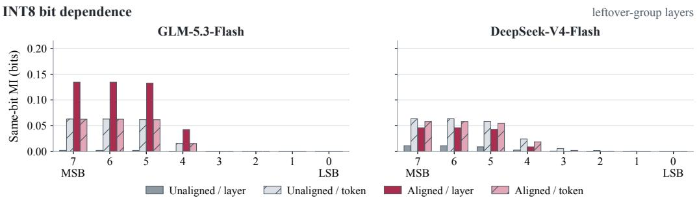  
Figure 12: Same INT8 same-bit MI diagnostic as Figure 3 on GLM MLA and DeepSeek CSA leftover-group layers.

## C.3 COMPLETE STORAGE AND RECONSTRUCTION ERROR MEASUREMENTS

Figure 7 compares storage size at different reconstruction errors. Table 7 summarizes representative operating points near the FP8 reconstruction-error reference from Section 5.2, following Table 4. Methods have different rate controls and attainable errors, so the table reports both stored bpv and measured NRMSE for each configuration.

Table 8: Qwen3.5-9B: numerical rate–distortion results for Figure 7. FP8 NRMSE: 2.65%.
<table><tr><td colspan="3">Ours</td><td colspan="3">KVCodec</td><td colspan="3">KVTC-style</td></tr><tr><td>m</td><td>bpv</td><td>Error (%)</td><td>m</td><td>bpv</td><td>Error (%)</td><td>b</td><td>bpv</td><td>Error (%)</td></tr><tr><td>4</td><td>2.398</td><td>10.61</td><td>8</td><td>2.224</td><td>21.05</td><td>3.5</td><td>2.632</td><td>16.52</td></tr><tr><td>3</td><td>2.787</td><td>7.98</td><td>6.452</td><td>2.499</td><td>17.13</td><td>4</td><td>3.186</td><td>9.58</td></tr><tr><td>2</td><td>3.352</td><td>5.33</td><td>6</td><td>2.593</td><td>15.96</td><td>4.5</td><td>3.610</td><td>5.91</td></tr><tr><td>1.5</td><td>3.761</td><td>4.00</td><td>4</td><td>3.137</td><td>10.69</td><td>6</td><td>4.931</td><td>2.58</td></tr><tr><td>1.25</td><td>4.024</td><td>3.33</td><td>3</td><td>3.536</td><td>8.04</td><td>7</td><td>5.760</td><td>2.13</td></tr><tr><td>1</td><td>4.347</td><td>2.67</td><td>2</td><td>4.112</td><td>5.41</td><td>一</td><td></td><td></td></tr><tr><td>0.75</td><td>4.767</td><td>2.00</td><td>1.5</td><td>4.538</td><td>4.13</td><td>一</td><td></td><td>一</td></tr><tr><td>0.5</td><td>5.362</td><td>1.33</td><td>1.25</td><td>4.811</td><td>3.55</td><td>一</td><td>一</td><td>一</td></tr><tr><td></td><td></td><td></td><td>1</td><td>5.143</td><td>3.03</td><td>一</td><td></td><td>一</td></tr><tr><td></td><td>1</td><td></td><td>0.75</td><td>5.542</td><td>2.59</td><td>1</td><td></td><td></td></tr><tr><td></td><td>一</td><td></td><td>Ref.</td><td>5.642</td><td>2.51</td><td>一</td><td></td><td>一</td></tr><tr><td></td><td>一</td><td></td><td>0.5</td><td>5.919</td><td>2.32</td><td>一</td><td></td><td></td></tr></table>

Table 9: GLM-5.3-Flash: numerical rate–distortion results for Figure 7. FP8 NRMSE: 2.66%.
<table><tr><td colspan="3">Ours</td><td colspan="3">KVCodec</td><td colspan="3">KVTC-style</td></tr><tr><td>m</td><td>bpv</td><td>Error (%)</td><td>m</td><td>bpv</td><td>Error (%)</td><td>b</td><td>bpv</td><td>Error (%)</td></tr><tr><td>6</td><td>2.479</td><td>15.96</td><td>12</td><td>2.199</td><td>32.03</td><td>3.5</td><td>2.775</td><td>24.64</td></tr><tr><td>4</td><td>3.037</td><td>10.65</td><td>9.537</td><td>2.494</td><td>25.46</td><td>4</td><td>3.301</td><td>16.70</td></tr><tr><td>3</td><td>3.443</td><td>7.99</td><td>8</td><td>2.730</td><td>21.37</td><td>4.5</td><td>3.804</td><td>10.75</td></tr><tr><td>2</td><td>4.022</td><td>5.33</td><td>6</td><td>3.136</td><td>16.02</td><td>6</td><td>5.087</td><td>3.96</td></tr><tr><td>1.5</td><td>4.437</td><td>4.00</td><td>4</td><td>3.733</td><td>10.69</td><td>7</td><td>5.909</td><td>3.07</td></tr><tr><td>1.25</td><td>4.701</td><td>3.33</td><td>3</td><td>4.176</td><td>8.01</td><td></td><td></td><td></td></tr><tr><td>1</td><td>5.025</td><td>2.66</td><td>2</td><td>4.828</td><td>5.34</td><td></td><td></td><td></td></tr><tr><td>0.75</td><td>5.445</td><td>2.00</td><td>1.5</td><td>5.315</td><td>4.01</td><td></td><td></td><td></td></tr><tr><td>0.5</td><td>6.040</td><td>1.33</td><td>1.25</td><td>5.633</td><td>3.34</td><td>一</td><td>一</td><td></td></tr><tr><td></td><td></td><td></td><td>1</td><td>6.030</td><td>2.67</td><td></td><td></td><td></td></tr><tr><td></td><td>一</td><td></td><td>Ref.</td><td>6.035</td><td>2.66</td><td></td><td></td><td></td></tr><tr><td></td><td>一</td><td></td><td>0.75</td><td>6.556</td><td>2.00</td><td></td><td></td><td></td></tr><tr><td>一</td><td>一</td><td>一</td><td>0.5</td><td>7.309</td><td>1.34</td><td>一</td><td></td><td></td></tr></table>

Table 7: Representative operating points near the FP8 reconstruction-error reference, reported as bpv (NRMSE, %). Figure 7 is the primary rate–distortion comparison. SZ3 uses auto mode on the same locally aligned caches.
<table><tr><td>Model</td><td>Ours</td><td>KVCodec</td><td>KVTC-style</td><td>Rotation + SZ3</td></tr><tr><td>Qwen3.5-9B</td><td>4.347 (2.67)</td><td>5.642 (2.51)</td><td>4.931 (2.58)</td><td>4.775 (2.60)</td></tr><tr><td>GLM-5.3-Flash</td><td>5.025 (2.66)</td><td>6.035 (2.66)</td><td>5.909 (3.07)</td><td>5.395 (2.59)</td></tr><tr><td>DeepSeek-V4-Flash</td><td>5.049 (2.66)</td><td>5.547 (2.66)</td><td>5.974 (3.03)</td><td>5.404 (2.60)</td></tr></table>

Tables 8–10 give measured Figure 7 points for Ours, KVCodec, and KVTC-style. Table 11 gives Rotation + SZ3 auto, and Table 12 gives unrotated SZ3 auto, from the same figure. m denotes the calibration-error multiplier, b the KVTC-style payload bits before entropy, and Ref. an additional rate-adjusted configuration near the FP8 reference. Error is pooled NRMSE (%). Methods are independently sorted by bpv. Rows do not imply matched errors.

## C.4 COMPLETE DOWNSTREAM-QUALITY MEASUREMENTS

Figure 13 plots compressed-region reconstruction error versus storage rate for the same LongBench-Pro settings as Section 5.3. Figure 14 reports per-task scores.

Task scores and mean reconstruction errors use all examples in the LongBench-Pro 128K setting except the summarization tasks.

Table 10: DeepSeek-V4-Flash: numerical rate–distortion results for Figure 7. FP8 NRMSE: 2.67%.
<table><tr><td colspan="3">Ours</td><td colspan="3">KVCodec</td><td colspan="3">KVTC-style</td></tr><tr><td>m</td><td>bpv</td><td>Error (%)</td><td>m</td><td>bpv</td><td>Error (%)</td><td>b</td><td>bpv</td><td>Error (%)</td></tr><tr><td>8</td><td>2.128</td><td>21.00</td><td>8</td><td>2.412</td><td>20.96</td><td>3.5</td><td>2.864</td><td>27.21</td></tr><tr><td>6.366</td><td>2.429</td><td>16.81</td><td>6</td><td>2.794</td><td>15.76</td><td>4</td><td>3.413</td><td>18.67</td></tr><tr><td>6</td><td>2.509</td><td>15.86</td><td>4</td><td>3.361</td><td>10.53</td><td>4.5</td><td>3.886</td><td>11.24</td></tr><tr><td>4</td><td>3.065</td><td>10.62</td><td>3</td><td>3.783</td><td>7.92</td><td>6</td><td>5.111</td><td>4.22</td></tr><tr><td>3</td><td>3.468</td><td>7.97</td><td>2</td><td>4.406</td><td>5.29</td><td>7</td><td>5.974</td><td>3.03</td></tr><tr><td>2</td><td>4.046</td><td>5.32</td><td>1.5</td><td>4.868</td><td>3.97</td><td>一</td><td></td><td></td></tr><tr><td>1.5</td><td>4.460</td><td>3.99</td><td>1.25</td><td>5.166</td><td>3.32</td><td>一</td><td>一</td><td>一</td></tr><tr><td>1.25</td><td>4.724</td><td>3.33</td><td>1</td><td>5.517</td><td>2.70</td><td>一</td><td>一</td><td>一</td></tr><tr><td>1</td><td>5.049</td><td>2.66</td><td>Ref.</td><td>5.547</td><td>2.66</td><td>一</td><td>一</td><td>一</td></tr><tr><td>0.75</td><td>5.469</td><td>2.00</td><td>0.75</td><td>5.919</td><td>2.21</td><td>一</td><td>一</td><td>一</td></tr><tr><td>0.5</td><td>6.065</td><td>1.33</td><td>0.5</td><td>6.277</td><td>1.95</td><td>一</td><td>一</td><td>一</td></tr></table>

Table 11: Rotation+SZ3 auto points for Figure 7, on the same locally aligned caches and frozen means/rotations as Ours. $\underline { m } = .$ 1 is the Table 7 column.
<table><tr><td colspan="3">Qwen3.5-9B</td><td colspan="3">GLM-5.3-Flash</td><td colspan="3">DeepSeek-V4-Flash</td></tr><tr><td>m</td><td>bpv</td><td>Error (%)</td><td>m</td><td>bpv</td><td>Error (%)</td><td>m</td><td>bpv</td><td>Error (%)</td></tr><tr><td>3</td><td>3.193</td><td>7.79</td><td>8</td><td>2.427</td><td>20.71</td><td>8</td><td>2.439</td><td>20.65</td></tr><tr><td>2</td><td>3.769</td><td>5.20</td><td>4</td><td>3.389</td><td>10.36</td><td>4</td><td>3.400</td><td>10.37</td></tr><tr><td>1.5</td><td>4.187</td><td>3.90</td><td>2</td><td>4.378</td><td>5.18</td><td>2</td><td>4.386</td><td>5.19</td></tr><tr><td>1.25</td><td>4.450</td><td>3.25</td><td>1</td><td>5.395</td><td>2.59</td><td>1</td><td>5.404</td><td>2.60</td></tr><tr><td>1</td><td>4.775</td><td>2.60</td><td>0.5</td><td>6.402</td><td>1.30</td><td>0.5</td><td>6.406</td><td>1.30</td></tr><tr><td>0.75</td><td>5.205</td><td>1.95</td><td>一</td><td>1</td><td>一</td><td>一</td><td>一</td><td>一</td></tr><tr><td>0.5</td><td>5.798</td><td>1.30</td><td>一</td><td>一</td><td>一</td><td>一</td><td>一</td><td>一</td></tr></table>

Table 12: Unrotated SZ3 auto points for Figure 7, on the same caches and frozen means as Ours, without fitted rotations. $\underline { m } = 1$ matches Table 11.
<table><tr><td colspan="3">Qwen3.5-9B</td><td colspan="3">GLM-5.3-Flash</td><td colspan="3">DeepSeek-V4-Flash</td></tr><tr><td>m</td><td>bpv</td><td>Error (%)</td><td>m</td><td>bpv</td><td>Error (%)</td><td>m</td><td>bpv</td><td>Error (%)</td></tr><tr><td>3</td><td>3.481</td><td>7.80</td><td>8</td><td>2.668</td><td>20.72</td><td>8</td><td>2.544</td><td>20.47</td></tr><tr><td>2</td><td>4.058</td><td>5.20</td><td>4</td><td>3.632</td><td>10.36</td><td>4</td><td>3.511</td><td>10.30</td></tr><tr><td>1.5</td><td>4.477</td><td>3.90</td><td>2</td><td>4.628</td><td>5.18</td><td>2</td><td>4.504</td><td>5.17</td></tr><tr><td>1.25</td><td>4.742</td><td>3.25</td><td>1</td><td>5.650</td><td>2.59</td><td>1</td><td>5.524</td><td>2.59</td></tr><tr><td>1</td><td>5.069</td><td>2.60</td><td>0.5</td><td>6.649</td><td>1.30</td><td>0.5</td><td>6.535</td><td>1.30</td></tr><tr><td>0.75</td><td>5.493</td><td>1.95</td><td>一</td><td>一</td><td>一</td><td>一</td><td>一</td><td>一</td></tr><tr><td>0.5</td><td>6.082</td><td>1.30</td><td>一</td><td>一</td><td>一</td><td>一</td><td>一</td><td>一</td></tr></table>

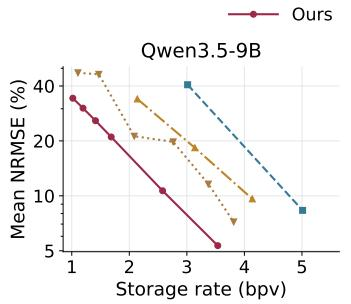

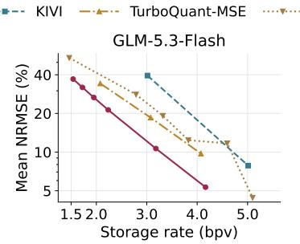

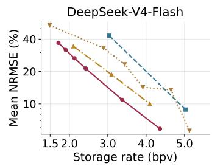  
Figure 13: Reconstruction-error companion to Figure 8: the same LongBench-Pro compression settings, plotted as mean compressed-region NRMSE (%) versus storage rate (bpv, including tails and metadata). Figure 8 uses task score on the vertical axis. This figure uses numerical fidelity. Error axes are logarithmic.

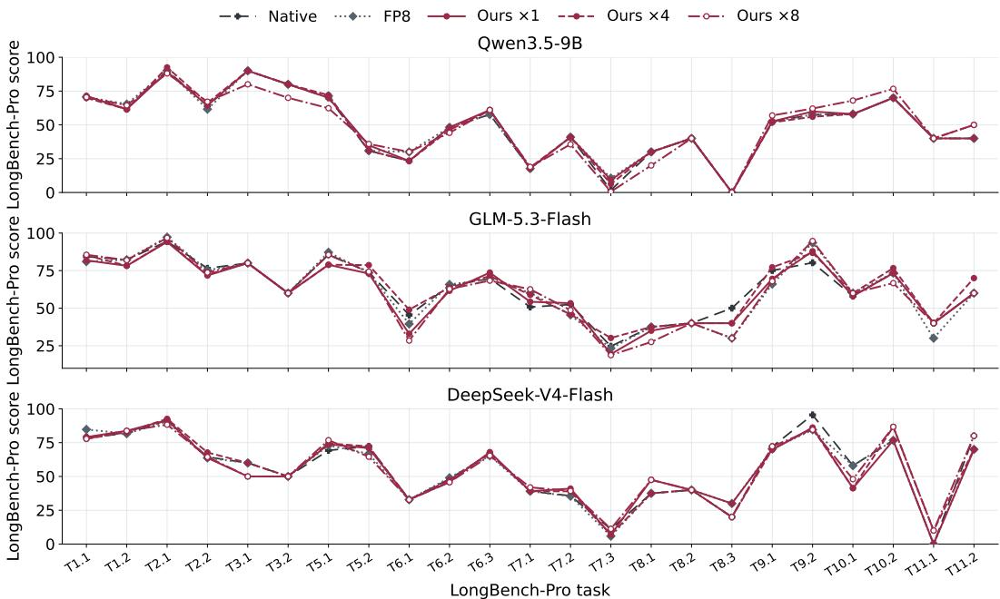  
Figure 14: Per-task official LongBench-Pro scores for Native, FP8, and Ours at error multipliers $m = 1 , 4 , 8 ,$ i.e. the AlignPred settings highlighted in Figure 8. Each panel is one model.

Table 13: Five-category calibration storage (bpv). “Specific total” includes one dedicated parameter bank per document.
<table><tr><td>Model</td><td>Multiplier</td><td>Auxiliary</td><td>Specific</td><td>Specific total</td></tr><tr><td>Qwen3.5-9B</td><td>1</td><td>4.347</td><td>4.132</td><td>4.216</td></tr><tr><td rowspan="4">GLM-5.3-Flash</td><td>4</td><td>2.398</td><td>2.210</td><td>2.294</td></tr><tr><td>8</td><td>1.525</td><td>1.369</td><td>1.453</td></tr><tr><td>1</td><td>5.025</td><td>4.901</td><td>5.071</td></tr><tr><td>4</td><td>3.037</td><td>2.920</td><td>3.090</td></tr><tr><td rowspan="4">DeepSeek-V4-Flash</td><td>8</td><td>2.100</td><td>1.995</td><td>2.165</td></tr><tr><td>1</td><td>5.049</td><td>4.944</td><td>5.623</td></tr><tr><td>4</td><td>3.065</td><td>2.966</td><td>3.645</td></tr><tr><td>8</td><td>2.128</td><td>2.039</td><td>2.718</td></tr></table>

## C.5 CALIBRATION STRATEGIES

Auxiliary fitting uses 40,960 positions from five independent documents. Cache-specific fitting uses 8,192 positions per target document. Both use the GPA routine above and retain the auxiliary error reference at all rates. Table 13 pools the five InfiniteBench evaluation documents (same caches as Table 7). Figure 9 instead uses one English cache per model, matching Table 2. The five-category caches have 98,304 input tokens, except GLM/DeepSeek mathematics at 90,000. DeepSeek’s C4 pool has 24,576 or 22,500 cache positions. Bytes and squared errors are pooled across documents. Equal multipliers do not enforce exactly equal errors (Qwen at m = 8: 20.58% versus 20.20%).

FP32 matrices and means, including the anchored identity and serialization headers, contribute approximately $3 2 ( d + 1 ) / T$ bpv for channel dimension d and T cache positions. Fitting is performed once per bank. Times include GPU transfers, centering, normalization, cross-products and GPA, but exclude source reading and sampling. Auxiliary fitting is offline. Coding uses 32 CPU threads. Parameter overhead is charged per document only for the cache-specific bank. Mean per-document fitting times are 14.82, 7.55, and 14.21 seconds for Qwen, GLM, and DeepSeek, respectively.

Table 14: Post-hoc blending-weight sensitivity on Qwen at $m = 1$ (bpv ↓). Bold marks the prespecified default, fixed on independent development data before evaluation. Results are pooled over five held-out InfiniteBench documents at matched reconstruction error.
<table><tr><td rowspan="2"> $\lambda _ { 2 }$ </td><td colspan="4"> $\lambda _ { v \geq 3 }$ </td></tr><tr><td>0</td><td>0.25</td><td>0.5</td><td>0.75 1</td></tr><tr><td>0</td><td>4.644</td><td>4.547</td><td>4.473</td><td>4.437 4.452</td></tr><tr><td>0.25</td><td>4.599</td><td>4.497</td><td>4.419</td><td>4.381 4.397</td></tr><tr><td>0.5</td><td>4.572</td><td>4.467</td><td>4.387</td><td>4.347 4.363</td></tr><tr><td>0.75</td><td>4.570</td><td>4.464</td><td>4.383</td><td>4.342 4.358</td></tr><tr><td>1</td><td>4.594</td><td>4.491</td><td>4.411</td><td>4.371 4.386</td></tr></table>

Table 15: Selected blending-weight settings at three error multipliers (bpv ↓). Bold marks the prespecified default. No weights are tuned on these evaluation documents.
<table><tr><td> $\lambda _ { 2 }$ </td><td> $\lambda _ { v \geq 3 }$ </td><td> $m = 1$ </td><td> $m = 4$ </td><td> $m = 8$ </td></tr><tr><td>0</td><td>0</td><td>4.644</td><td>2.665</td><td>1.740</td></tr><tr><td>0.5</td><td>0.75</td><td>4.347</td><td>2.398</td><td>1.525</td></tr><tr><td>0.75</td><td>0.75</td><td>4.342</td><td>2.399</td><td>1.533</td></tr><tr><td>1</td><td>1</td><td>4.386</td><td>2.451</td><td>1.595</td></tr></table>

## C.6 BLENDING-WEIGHT SENSITIVITY

The default blending weights, $\lambda _ { 2 } ~ = ~ 0 . 5$ and $\lambda _ { v \ge 3 } = 0 . 7 5$ , were selected on independent development data and fixed before the InfiniteBench evaluation. All main-paper results use these fixed weights without tuning on the five held-out evaluation documents. To assess sensitivity to this choice, we perform a post-hoc sweep over $\{ 0 , 0 . 2 5 , 0 . 5 , 0 . 7 5 , 1 \} ^ { 2 }$ on Qwen3.5-9B, keeping GPA, intra-block interpolation, the residual lattice, and η fixed. Bytes and squared errors are pooled as in the calibration study. The sweep uses the five InfiniteBench held-out documents and the frozen auxiliary bank of Section 5. Table 14 reports stored bpv at multiplier $m = 1$ , where measured NRMSE is 2.667% in every cell.

The pre-specified default is robust to moderate changes in the blending weights. $\mathbf { A } \mathbf { t } m = 1$ , the best tested setting, $\lambda _ { 2 } = \lambda _ { v > 3 } = 0 . 7 5$ , improves storage by only 0.005 bpv over the default (4.342 vs. 4.347 bpv). At $m = 4$ and $m = 8$ , the default attains the lowest rate among the tested settings (Table 15). Setting both weights to 0 removes cross-block prediction and costs 0.22–0.30 bpv, while setting both to 1 removes shrinkage and costs 0.038–0.070 bpv. These results show that the benefit of cross-block prediction does not depend on precise tuning of the blending weights.

## C.7 GROUP CONSTRUCTION

We intentionally use simple groups inherited from adjacent native cache streams, without optimizing group partitions on the evaluation set. The partitions in Table 3 follow this rule. Qwen uses the four GQA KV heads of one layer, with Keys and Values separate. GLM leftover-partitions 11 MLA layers as $4 / 4 / 3$ . DeepSeek leftover-partitions 21 CSA layers as a first-layer singleton and five groups of four.

Table 16 evaluates alternative groupings post hoc. Larger groups can provide slightly lower rates, but the differences are small and do not affect the main conclusions.

Table 16: Held-out grouping sensitivity at m = 1 (bpv ↓). Bold is the paper default, and ⋆ is the evaluation minimum. Pooled over five InfiniteBench documents at the frozen FP8 error.
<table><tr><td>Model</td><td>Partition</td><td>Views</td><td>bpv</td></tr><tr><td rowspan="2">Qwen3.5-9B</td><td>4 heads / layer</td><td>4</td><td>4.347</td></tr><tr><td>2 adjacent layers</td><td>8</td><td>4.304*</td></tr><tr><td rowspan="4">GLM-5.3-Flash</td><td>4 adjacent layers</td><td>16</td><td>4.360</td></tr><tr><td>8 layers, K or V</td><td>32</td><td>4.529</td></tr><tr><td>4/4/3 layers</td><td>4</td><td>5.025</td></tr><tr><td>5/6 layers</td><td>6</td><td>5.031</td></tr><tr><td rowspan="6">DeepSeek-V4-Flash</td><td>8/3 layers</td><td>8</td><td>5.054</td></tr><tr><td>11 layers</td><td>11</td><td>5.004*</td></tr><tr><td>1+5 × 4 layers</td><td>4</td><td>5.049</td></tr><tr><td>7+7+7 layers</td><td>7</td><td>5.033</td></tr><tr><td>10+11 layers</td><td>11</td><td>5.031</td></tr><tr><td>21 layers</td><td>21</td><td>4.996*</td></tr></table>

Table 17: Serving restoration paths.
<table><tr><td>Model</td><td>Compressed path</td></tr><tr><td>Qwen</td><td>Four 64-token pages per object, separate K/V streams, and 32 objects per decode batch. Aligned host staging feeds layerwise GPU inverse transforms and FP16 page scatter.</td></tr><tr><td>GLM</td><td>Post-LN MLA latent, grouped 4/4/3 layers. Rank-0 decoding with 32-object batches, two host/GPU slots, GPU inverse transforms, and ordered BF16 broad- casts.</td></tr><tr><td>DeepSeek</td><td>Pre-FP8 C4 CSA values, grouped 1 + 5 × 4 layers. Rank-0 decoding with eight- object batches, two host/GPU slots, inverse transforms, broadcasts, and native FP8 writeback.</td></tr><tr><td>Common</td><td>In-memory indices, object read-ahead, page mappings, and event-guarded buffer reuse. Raw tails and native sidecar paths are retained.</td></tr></table>

## D SYSTEM AND TIMING PROTOCOLS

## D.1 HICACHE RESTORATION

All three backends reconstruct aligned values with persistent CPU workers (64 for Qwen, 32 for GLM and DeepSeek), then apply inverse transforms on the GPU before writing the native cache. Qwen restores separate Keys and Values. GLM and DeepSeek restore shared latent caches once on rank 0 and broadcast them to all eight ranks. Uncompressed pools retain their native restoration paths. These implementations preserve the native host-pool allocation and use additional staging memory. The reported storage reduction does not imply lower allocated host memory.

For shared latents, CPU reconstruction and GPU restoration are pipelined across groups. Overlap between restoration collectives and model collectives is not assumed. Startup checks compare the optimized CUDA/TP8 paths with serial references and test page permutations, untouched slots, repeated requests, buffer lifetimes, and failure propagation.

## D.2 SERVING MEASUREMENT PROTOCOL

The experiment uses an AMD EPYC 9K84 host with NVIDIA H20 GPUs, SGLang 0.5.19.dev20260914, and PyTorch 2.13.0+cu130. Table 18 defines the 36-point write-then-rehit protocol. Figure 10 uses the B = 1 L3-hit restore TTFT from Table 21. Figure 15 uses the matching first-request write TTFT with no prior L3 hit. Figure 16 and Table 22 report all batch sizes.

Restarting the service clears the application-level L1/L2 caches. We additionally repeated restore measurements after explicitly clearing the operating-system file cache and observed similar TTFT, indicating that the reported latency behavior does not depend on warm file-cache reads.

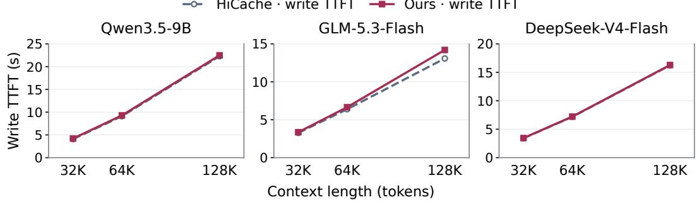

Table 18: Serving experiment matrix and controls.
<table><tr><td>Item</td><td>Setting</td></tr><tr><td>Models</td><td>Qwen3.5-9B: FP16, TP1. GLM-5.3-Flash: BF16, TP8. DeepSeek-V4-Flash: BF16 compute, native mixed FP8 cache, TP8.</td></tr><tr><td>Matrix</td><td>Three models×32,768/65,536/131,072-token prefixes×  $B = 1 / 2 / 4 / 8$  con- current requests × native HiCache/Ours 1×.</td></tr><tr><td>Input/output</td><td>B distinct InfiniteBench book documents per model, the first B of one fixed prompt bank, identical across arms and lengths. Each prefix is followed by 64 appended IDs. Greedy generation of exactly 256 tokens, ignoring EOS.</td></tr><tr><td>Phases</td><td>Each arm writes its own L3 files online during the first requests’ chunked prefill. The writer drains and stops. A fresh reader then serves the same B requests concurrently from L3.</td></tr><tr><td>Timing</td><td>TTFT: request submission to first token, averaged over the B requests. Persis- tence completion: first submission to the L3 write of the batch&#x27;s last target-KV page. Reading, decoding, H2D, inverse transforms, communication, and native</td></tr><tr><td>Graph/warmup</td><td>writeback are included. Prefill graphs disabled. Full decode graphs for batch sizes 1–B. Unrelated full- chunk and 64-token warmups. For  $\begin{array} { r } { \dot { B } > 1 . } \end{array}$  readers also run k-request EXTEND batches  $( k = 2 , \ldots , B )$  over an unrelated cached prefix. Startup and warmup excluded.</td></tr><tr><td>Scheduling</td><td>Context length  $n + 8 1 9 2 .$  at most B running requests and  ${ \cal B } ( n + 8 1 9 2 )$  total tokens, capped by GPU memory. Readers of both arms emit a fin- ished prefill&#x27;s first token before launching the next consecutive prefill</td></tr><tr><td>Isolation</td><td>(SGLANG_DISABLE_CONSECUTIVE_PREFILL_OVERLAP=1). Every rehit request has a complete L3 prefix hit and zero L1/L2 hits, verified per request. Readers do not write L3. File inventories are unchanged after measure-</td></tr><tr><td>Storage</td><td>ment. Logical target KV file bytes, including payload, necessary metadata, indices and tails. Other pools and reusable calibration parameters are excluded. Sizes refer to file contents rather than filesystem allocation.</td></tr></table>

HiCache · write TTFT Ours · write TTFT  
Figure 15: First-request write TTFT with no prior L3 hit, while online writes populate L3. Batch size 1. Axis ranges vary by model. Storage and L3-hit restore TTFT are in Figure 10.

## D.3 ONLINE WRITE PROTOCOL

The first requests enable L3 writes: Qwen uses 8K prefill chunks and GLM and DeepSeek use 2K chunks, with 32 CPU encode workers. After the write requests, the service is restarted with empty L1/L2 and restores from those files. Table 20 reports the 64K $B = 1$ results used in Section 5.5. Table 21 reports the full 32/64/128K matrix at $\bar { B } = 1$ and is the source of Figures 10 and 15. The input prefixes, 64 appended IDs, 256 generated tokens, H20 host, and target-KV byte definition match Appendix D. DeepSeek’s fused store emits FP8 C4, so BF16 C4 values are captured on the inference stream immediately before each native FP8 store. Qwen and GLM already expose cached BF16/FP16 at that boundary.

Overlap with chunked prefill. CPU encoding of a finished chunk runs while later prefill chunks execute. At 64K, every model starts encoding a finished chunk before a later chunk is submitted and before the first generated token. Table 19 reports 64K overlap on the online writer, from the $B = 1$ write requests in Table 21. CPU wall is the sum of encode-job durations, not critical-path delay: 8.690/2.130/2.803 s on Qwen/GLM/DeepSeek, while write TTFT rises by 0.180/0.263/0.044 s versus native HiCache. Qwen persists 87.5% of the prefix before the first token, matching the last 8K chunk, whose encode continues into decode. GLM and DeepSeek persist the entire prefix before the first token.

Table 19: CPU compression overlap at 64K, $B = 1 ,$
<table><tr><td>Model</td><td>CPU wall (s)</td><td>∆ TTFT (s)</td><td>Persist before TTFT</td></tr><tr><td>Qwen</td><td>8.690</td><td>0.180</td><td>87.5%</td></tr><tr><td>GLM</td><td>2.130</td><td>0.263</td><td>100.0%</td></tr><tr><td>DeepSeek</td><td>2.803</td><td>0.044</td><td>100.0%</td></tr></table>

Table 20: 64K online write then L3 rehit, B = 1.
<table><tr><td rowspan="3">Model</td><td colspan="2">Write TTFT (s)</td><td colspan="2">Rehit TTFT (ms)</td><td colspan="2">Stored KV (MiB)</td></tr><tr><td>Native</td><td>Ours</td><td>Native</td><td>Ours</td><td>Native</td><td>Ours</td></tr><tr><td>Qwen</td><td>9.105</td><td>9.286</td><td>843.3</td><td>469.5</td><td>2048.0</td><td>577.1</td></tr><tr><td>GLM</td><td>6.390</td><td>6.653</td><td>628.0</td><td>502.1</td><td>704.0</td><td>227.7</td></tr><tr><td>DeepSeek</td><td>7.176</td><td>7.221</td><td>316.4</td><td>302.0</td><td>192.0</td><td>110.8</td></tr></table>

Table 21: Online write then L3 rehit, $B = 1$ . Storage covers the target KV portion only. Figure 10 plots L3-hit restore TTFT. Figure 15 plots first-request write TTFT with no L3 hit. Persistence completion is in the $B = 1$ column of Table 22(b).
<table><tr><td rowspan="2">Model</td><td rowspan="2">Ctx</td><td colspan="2">Write TTFT (ms)</td><td colspan="2">Rehit TTFT (ms)</td><td colspan="2">Stored KV (MiB)</td></tr><tr><td>Native</td><td>Ours</td><td>Native</td><td>Ours</td><td>Native</td><td>Ours</td></tr><tr><td rowspan="3">Qwen</td><td>32K</td><td>4082.0</td><td>4204.3</td><td>547.3</td><td>307.1</td><td>1024.0</td><td>287.6</td></tr><tr><td>64K</td><td>9105.3</td><td>9285.6</td><td>843.3</td><td>469.5</td><td>2048.0</td><td>577.1</td></tr><tr><td>128K</td><td>22294.3</td><td>22491.2</td><td>1615.5</td><td>856.0</td><td>4096.0</td><td>1161.9</td></tr><tr><td rowspan="3">GLM</td><td>32K</td><td>3268.9</td><td>3356.3</td><td>479.7</td><td>391.9</td><td>352.0</td><td>114.0</td></tr><tr><td>64K</td><td>6390.0</td><td>6653.2</td><td>628.0</td><td>502.1</td><td>704.0</td><td>227.7</td></tr><tr><td>128K</td><td>13077.2</td><td>14200.7</td><td>911.2</td><td>675.6</td><td>1408.0</td><td>454.7</td></tr><tr><td rowspan="3">DeepSeek 32K</td><td></td><td>3414.0</td><td>3443.7</td><td>243.8</td><td>260.0</td><td>96.0</td><td>55.3</td></tr><tr><td>64K</td><td>7176.2</td><td>7220.6</td><td>316.4</td><td>302.0</td><td>192.0</td><td>110.8</td></tr><tr><td>128K</td><td>16228.4</td><td>16284.5</td><td>474.6</td><td>415.2</td><td>383.9</td><td>222.1</td></tr></table>

## D.4 CONCURRENT REQUESTS

Figure 16 and Table 22 report the mean L3-hit TTFT of B concurrent requests. With $B = 2 \mathopen { } \mathclose \bgroup \left\| 2 \aftergroup \egroup \right\| 2 \aftergroup \egroup \bigg \| 2 \aftergroup \egroup \bigg \| 2 \aftergroup \egroup \bigg \| 2 \aftergroup \egroup \bigg \| 2 \aftergroup \egroup \bigg \| 2 \arraycolsep \bigg \| 2 \aftergroup \egroup \bigg \| 2 \bigg \| 2 \aftergroup \egroup \bigg \| 2 \bigg \| 2 \bigg \| 2 \bigg \| 2 \bigg \| 2 \bigg \| 2 \bigg \| 2 \bigg \| 2 \bigg \| 2 \bigg \| 2 \bigg \| 2 \bigg \| 2 \bigg \| 2$ Qwen restores 31–40% faster, except at 128K with $B = 8 .$ . There, GPU KV capacity admits five of the eight requests in both arms, and the other three wait until a running request finishes its 256 tokens. Ours admits the first five requests earlier (mean TTFT 2.27 versus 3.52 s), so they decode together for longer and release a slot later. GLM is faster at seven of nine points with $B \ \geq 2$ and within 2% at the other two. DeepSeek ranges from 3% faster to 15% slower: its C4 restoration runs synchronously on the scheduler thread before each prefill, so consecutive restores delay later requests. Write TTFT with $B \geq 2$ changes by −0.7 to +6.5% versus native HiCache.

Persistence completion. Table 22(b) reports, for the same write requests, when the batch’s last target-KV page is written to L3. Both arms persist it 1.5–6.5 s before the last generated token.

## D.5 CODING-TIME MEASUREMENT

CPU encode and decode are timed on an AMD EPYC 9K84 with 32 workers and host-resident inputs. We select 32 evenly spaced complete 256-position objects from each of five documents (160 total), using the operating points of Table 7 and the same fitted parameters. Report the median of three passes after one warmup. Timing includes layout changes, quantization or dequantization, entropy coding or decoding, allocation and packet handling, but excludes source loading, fitting and valida tion. The 160 objects hold 40,960 cache positions. A 32K-token input occupies 32,768 positions on Qwen and GLM but 8,192 C4 positions on DeepSeek, whose C4 pool keeps one position per four input tokens (Section C.5). Scaling the encode times linearly to these counts gives 1.012/0.540/0.195 s per 32K input on Qwen/GLM/DeepSeek, versus 4.082/3.269/3.414 s native write TTFT at 32K with B = 1 (Table 21), a 4.0/6.0/17.5× throughput headroom. L3-hit restoration measurements disable new L3 writes; first-request measurements enable online writes.

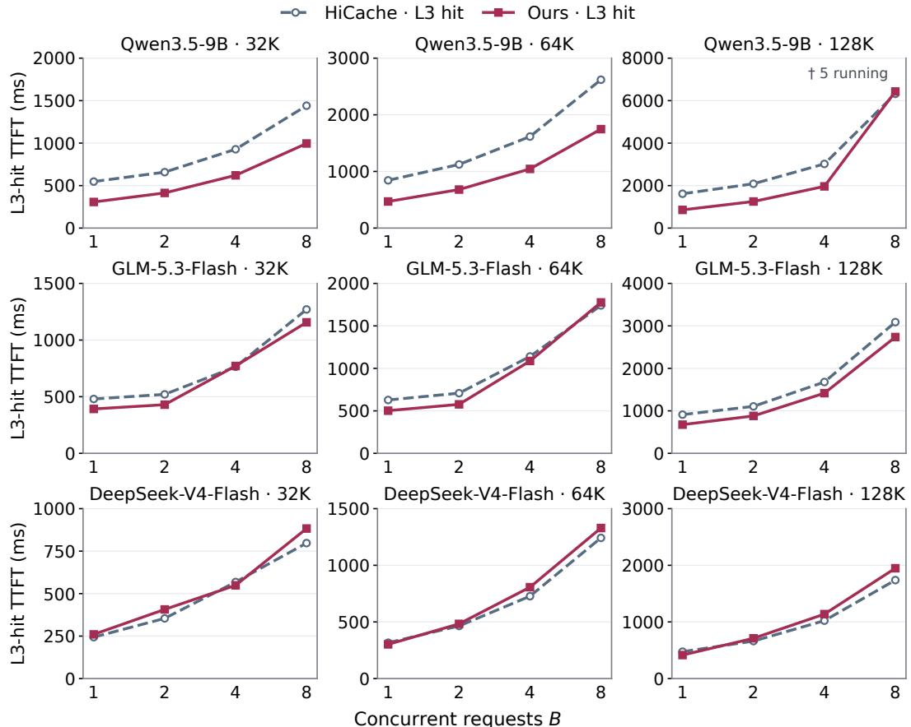  
Figure 16: Mean L3-hit restore TTFT of B concurrent requests. †: GPU KV capacity admits only five requests in both arms. Axis ranges vary by panel.

Table 22: B concurrent requests. (a) Mean L3-hit restore TTFT (ms). (b) Write-phase persistence completion (s), first submission to the L3 write of the batch’s last target-KV page. N: native HiCache, O: Ours 1×. †: GPU KV capacity admits only five requests in both arms.  
(a) Restore TTFT (ms)
<table><tr><td rowspan="2">Model</td><td rowspan="2">Ctx</td><td colspan="2">B = 1</td><td colspan="2">B = 2</td><td colspan="2">B = 4</td><td colspan="2">B = 8</td></tr><tr><td>N</td><td>0</td><td>N</td><td>0</td><td>N</td><td>0</td><td>N</td><td>0</td></tr><tr><td rowspan="3">Qwen</td><td>32K</td><td>547</td><td>307</td><td>658</td><td>413</td><td>928</td><td>621</td><td>1441</td><td>996</td></tr><tr><td>64K</td><td>843</td><td>470</td><td>1123</td><td>680</td><td>1616</td><td>1045</td><td>2619</td><td>1747</td></tr><tr><td>128K</td><td>1615</td><td>856</td><td>2086</td><td>1251</td><td>3021</td><td>1963</td><td>6320†</td><td>6431†</td></tr><tr><td rowspan="3">GLM</td><td>32K</td><td>480</td><td>392</td><td>521</td><td>429</td><td>764</td><td>771</td><td>1270</td><td>1157</td></tr><tr><td>64K</td><td>628</td><td>502</td><td>708</td><td>576</td><td>1140</td><td>1087</td><td>1741</td><td>1776</td></tr><tr><td>128K</td><td>911</td><td>676</td><td>1105</td><td>880</td><td>1679</td><td>1416</td><td>3089</td><td>2737</td></tr><tr><td rowspan="3">DeepSeek 32K</td><td></td><td>244</td><td>260</td><td>354</td><td>407</td><td>568</td><td>549</td><td>797</td><td>883</td></tr><tr><td>64K</td><td>316</td><td>302</td><td>464</td><td>483</td><td>727</td><td>807</td><td>1242</td><td>1329</td></tr><tr><td>128K</td><td>475</td><td>415</td><td>662</td><td>711</td><td>1023</td><td>1138</td><td>1739</td><td>1948</td></tr><tr><td colspan="10">(b) Persistence completion (s)</td></tr><tr><td rowspan="3">Model</td><td rowspan="3">Ctx</td><td>B = 1</td><td></td><td>B = 2</td><td></td><td></td><td>B = 4</td><td></td><td>B = 8</td></tr><tr><td>N</td><td>0</td><td>N</td><td>0</td><td>N</td><td>0</td><td>N</td><td>0</td></tr><tr><td>3.16</td><td>4.59</td><td>7.19</td><td>8.67</td><td>19.85</td><td>21.65</td><td>38.27</td><td>40.26</td></tr><tr><td rowspan="3"></td><td>64K</td><td>7.93</td><td>9.66</td><td>16.96</td><td>18.80</td><td>40.45</td><td>42.70</td><td>81.40</td><td>84.00</td></tr><tr><td>128K</td><td>20.60</td><td>22.87</td><td>42.84</td><td>45.28</td><td>94.35</td><td>97.22</td><td>189.58</td><td>193.25</td></tr><tr><td>32K</td><td>3.16</td><td>3.28</td><td>6.20</td><td>6.42</td><td>15.49</td><td>15.85</td><td>27.81</td><td>29.31</td></tr><tr><td rowspan="3">GLM</td><td>64K</td><td>6.28</td><td>6.57</td><td>12.48</td><td>12.78</td><td>28.18</td><td>29.05</td><td>53.86</td><td>55.12</td></tr><tr><td>128K</td><td>12.96</td><td>14.11</td><td>26.79</td><td>27.35</td><td>54.99</td><td>56.27</td><td>110.49</td><td>109.56</td></tr><tr><td>DeepSeek 32K</td><td>3.29</td><td>3.38</td><td>6.57</td><td>6.77</td><td>13.10</td><td>13.21</td><td>25.94</td><td>26.09</td></tr><tr><td rowspan="3"></td><td>64K</td><td>7.05</td><td>7.15</td><td>14.07</td><td>14.28</td><td>28.08</td><td>28.26</td><td>55.85</td><td>56.07</td></tr><tr><td>128K</td><td>16.10</td><td>16.19</td><td>32.08</td><td>32.37</td><td>64.16</td><td></td><td></td><td>128.51</td></tr><tr><td></td><td></td><td></td><td></td><td></td><td></td><td>64.41</td><td>128.15</td><td></td></tr></table>

Table 23: Same-host CPU encode and decode time (ms) at the Table 7 operating points (median of three passes over 160 objects).
<table><tr><td colspan="2">Model</td><td>Ours</td><td>KVCodec</td><td>KVTC-style</td><td>Rotation + SZ3</td></tr><tr><td rowspan="2">Qwen3.5-9B</td><td>Encode</td><td>1266</td><td>7468</td><td>2079</td><td>1308</td></tr><tr><td>Decode</td><td>564</td><td>3321</td><td>1918</td><td>926</td></tr><tr><td rowspan="2">GLM-5.3-Flash</td><td>Encode</td><td>676</td><td>3589</td><td>888</td><td>704</td></tr><tr><td>Decode</td><td>231</td><td>1239</td><td>759</td><td>493</td></tr><tr><td rowspan="2">DeepSeek-V4-Flash</td><td>Encode</td><td>976</td><td>6675</td><td>1401</td><td>994</td></tr><tr><td>Decode</td><td>338</td><td>2126</td><td>1245</td><td>682</td></tr></table>

## E API CACHE-RETENTION POLICIES

Figure 1 summarizes public policies accessed on September 20, 2026. Gemini defaults to 1 h (Google, 2026). OpenAI supports up to 24 h on supported models (OpenAI, 2026). Baidu allows 1 h–7 days (Baidu AI Cloud, 2026). DeepSeek’s latest recorded retention is 72 h (DeepSeek, 2026). These bars report the latest published retention for each provider.