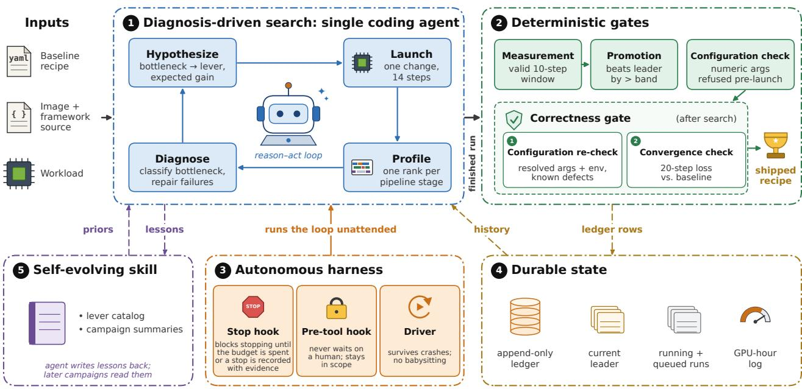
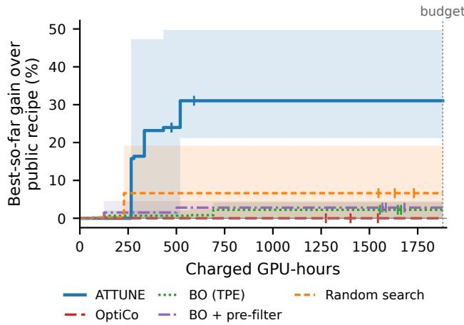

# ATTUNE: AGENTIC THROUGHPUT TUNING FOR LLM TRAINING

Leo Fan Hongyang Wang Wenbo Chen Jingguo Liu Xian Li Xuan Wang Ruochen Wen Yiming Yan Hao Wu Zheshen Wang Benoit Dumoulin

Amazon

## ABSTRACT

Training recipes are tuned by hand for one model, cluster and workload, and every new model, accelerator, framework version or dataset means tuning again. Automated tuners search a fixed space of knobs and check only that a job runs, yet a configuration can run to completion while it silently changes training. ATTUNE is a single coding agent that tunes any working recipe for the workload and stack at hand, unattended, within a GPU-hour budget the user sets. It diagnoses each run and changes one lever at a time, guided by a catalog of lessons from past campaigns, and ships a recipe only if it passes a correctness gate: a configuration check against objective-changing settings and known stack defects, and a convergence check of its loss curve against the baseline’s. On four held-out models at 64–128 GPUs, ATTUNE raises mean throughput over the strongest public recipe run on our stack by 6.7% on Llama-3.1-405B (best campaign 11.9%) and 33.9% on GLM-4.5 (54.7%), whose public recipe was written for H100. It keeps Mixtral-8x22B’s recipe, where nothing it finds clears the noise band. Under a common GPU-hour budget it beats OptiCo, Bayesian optimization and random search on GLM-4.5 and MiniMax-M2; on GLM-4.5 its mean gain is more than four times the best alternative’s at less than half the GPU-hours, and on both models its tuning pays for itself within a day of training. The gate rejects no legitimate run and catches 16 of 24 faulty runs, missing only ones that barely move the 20-step loss. Ablations tie its best campaigns to one of its search rules: retrying an out-of-memory layout with recomputation. We release ATTUNE’s code and TrainingThroughputBench, a leaderboard of the fastest known recipes for MoE models up to 744B parameters on up to 256 GPUs, each with its throughput, cost per million tokens and a passed correctness check, at https://github.com/amazon-science/attune.

## 1 INTRODUCTION

Training large language models is expensive, and much of the cost depends on how efficiently each job uses its hardware. Reaching high efficiency requires a well-tuned training recipe, the full configuration a job runs with, from how the model is parallelized across GPUs (Shoeybi et al., 2019; Narayanan et al., 2021; Rajbhandari et al., 2022; Liu et al., 2025) to how memory, communication and kernels are managed. What works best depends on the model, the accelerator, the software stack and the data at hand, and a recipe that works well in one setting rarely works as well in another. Finding a good recipe remains largely manual: engineers launch trial jobs, profile them to find the bottleneck and adjust the configuration until throughput stops improving (Jiang et al., 2024b). Well-tuned recipes are therefore published for only a few popular models and accelerators, and most teams must repeat this work for their own setting.

Existing tools automate parts of this tuning within a space fixed in advance. Parallelization planners (Zheng et al., 2022; Miao et al., 2022; Liu et al., 2024; Um et al., 2024) and vendor autoconfigurators (DeepSpeed Team, 2021; NVIDIA, 2026c) search placement with a cost model, a simulator or a sweep. Black-box search such as Bayesian optimization (Bergstra et al., 2011) needs no model of the system but many costly runs. Recent LLM-agent tuners (Chen et al., 2026; Ding et al., 2025, 2026b) let agents read profiles and propose configurations, but over a fixed schema of knobs. All of them judge a configuration by whether it runs and how fast.

Two observations motivate a different design. First, the throughput a working recipe misses lies partly in knobs that pay off only when changed together and partly in knobs a fixed schema does not list, such as virtual pipeline stages or a different expert dispatcher. Finding it requires a tuner that diagnoses what limits each run, as an expert does, and can change any argument the framework exposes. Second, a configuration can change what the model trains without failing. A larger microbatch, a standard throughput knob, changes the load-balancing loss of mixture-of-experts (MoE) models that compute it per microbatch, and --grad-reducein-bf16 reads like a communication setting but also disables FP32 gradient accumulation. A tuner that checks only that a job runs could ship either.

Coding agents make such a tuner practical. An agent such as Claude Code (Anthropic, 2026) reads source code, runs commands and works on one task for hours. These are the abilities an expert uses to tune a recipe: reading the framework to learn what a flag actually does, launching and profiling jobs and finding the bottleneck in a profile. Such an agent can search the framework’s full argument space instead of a fixed schema, while deterministic checks outside the agent decide which measurements count and which recipes are correct.

We present ATTUNE, an agentic tuner that starts from any working recipe, including an expert’s, and improves its training throughput for the actual workload and stack, unat tended, within a GPU-hour budget the user sets; one such tuning session is a campaign. A single coding agent runs the whole loop, guided by a tuning skill that holds its search rules, helper scripts and a catalog of levers distilled from past campaigns. The agent diagnoses each finished run from its metrics and logs, profiles a run when the next decision needs it, reads a flag’s implementation in the training image before using it, and changes one lever or one coupled set at a time. It stops when it judges the search converged.

ATTUNE ships a recipe only if it passes a correctness gate of two checks: a configuration check that refuses any setting that changes the objective or hits a known stack defect, and a convergence check that compares the recipe’s loss curve with the baseline’s. If no candidate clears the noise band, it ships the starting recipe. A harness runs the loop from one command to a shipped recipe, and after each campaign the agent writes generalizable lessons back into its skill.

We evaluate ATTUNE on four models held out from its development, on H100 and B200: Llama-3.1-405B (Grattafiori et al., 2024), Mixtral-8x22B (Jiang et al., 2024a; Mistral AI, 2024), GLM-4.5 (GLM-4.5 Team, 2025) and MiniMax-M2 (MiniMax, 2025), each at its public recipe’s workload on real text. Each campaign starts from the strongest public recipe, which an expert has already tuned for its own setting. We ask how far ATTUNE improves that recipe, which of its design choices matter and how it compares with OptiCo, Bayesian optimization and random search under a common GPU-hour budget. Every tuner gets the same budget, the same isolated environment and the same correctness gate.

## Our contributions:

• ATTUNE, a single-agent throughput tuner that runs unattended from a working recipe to a shipped one (skill, harness and correctness tools, open source at github.com/amazon-science/attune). It can change any framework argument that its configuration check classifies as objective-preserving.

• A correctness gate for throughput tuning, enforced by the control plane independently of the tuner and built on Megatron-Bridge’s convergence check. On runs with a known answer it rejects no legitimate recipe and stops every objective-changing setting and configuration defect, while subtle faults pass it. Existing tuners have no such gate.

• An evaluation on four held-out models under one protocol, with scoring, correctness checks and a single decision rule run by the control plane for every tuner (Section 3.1). From the strongest public recipe, AT-TUNE gains 6.7% on Llama-3.1-405B and 33.9% on GLM-4.5 on average, up to 11.9% and 54.7% in its best campaign, and keeps Mixtral-8x22B’s recipe. Under a common GPU-hour budget it beats every other tuner on GLM-4.5 and MiniMax-M2, on GLM-4.5 with more than four times the gain of the best alternative and, on average, less than half the GPU-hours of any.

• TrainingThroughputBench (TTB), an open leaderboard of the fastest known training recipe for each model and accelerator, with its throughput, its cost per million tokens and a passed correctness check (Section 4).

## 2 DESIGN

ATTUNE separates recipe tuning into an agent-driven search and deterministic checks. A coding agent runs the search: it diagnoses each run, forms a hypothesis, changes the recipe and launches the job. Deterministic code decides which measurements count, which candidate leads and which recipe ships, and a harness keeps the loop running unattended (Figure 1).

A recipe is the full training configuration for a given model and workload. Each setting the search may change is a lever. A campaign tunes one model on one cluster at a fixed GPU count. It starts from a working baseline recipe and runs under a GPU-hour budget. The search evaluates each candidate recipe on a short benchmark and keeps the recipe to beat as the leader. The campaign ends when the budget is spent, or earlier when the agent judges that the search has converged and records why.

## 2.1 Measurement

Every candidate in a campaign is measured the same way, so that a throughput difference reflects the recipe rather than the measurement.

Fixed-shape workload. A campaign holds its workload identical across candidates: the model, dataset, sequence length, global batch, precision and GPU count. Variablelength data would shift the MoE communication cost and the kernel shapes from step to step, and each new shape triggers another Triton (Tillet et al., 2019) compilation that a short run cannot amortize. We therefore pack every row to exactly the sequence length. The rows come from real text, tokenized with the model’s own tokenizer, so the router sees a realistic mix of experts. Every run reads the same rows in the same order (Appendix A).

  
Figure 1. ATTUNE’s architecture: (1) a single coding agent’s diagnosis-driven search; (2) deterministic gates that refuse objectivechanging settings before launch, admit measurements, promote leaders and check correctness before a recipe ships; (3) the harness, which keeps the loop running unattended; (4) durable state for resuming after a crash; (5) the skill, which carries lessons into later campaigns.

Scoring. Each run lasts 14 optimizer steps. Steps 0–3 absorb startup and compilation and are discarded, and steps 4–13 form the measured window W. We score a recipe x on |G| GPUs by its aggregate throughput over the window:

$$
s ( x ) = { \frac { \sum _ { i \in W } \mathrm { t o k e n s } _ { i } } { | G | \sum _ { i \in W } \mathrm { s t e p T i m e } _ { i } } }
$$

and the search maximizes s(x). Summing before dividing keeps short steps from weighing more than long ones.

Baseline and band. Throughput varies from run to run, so a gain must exceed this noise to count. We run the baseline at least five times on different node allocations. The mean of these runs is the denominator for every gain during search, and their relative standard deviation σ sets the noise band, max(3%, 3σ). A candidate replaces the leader only when it beats it by more than the band.

## 2.2 Search

## 2.2.1 Search loop

Agent loop. The agent runs a reason–act loop with ordinary tools: file search and reading, including the framework source in the training image, a shell and the cluster API. A tuning skill supplies the loop, the measurement rules, a lever catalog and helper scripts. The skill instructs the agent to prioritize candidates by expected gain and confidence. To estimate both, the skill points it to four sources: its diagnosis of what limits the leader, the lever catalog, the ledger of the campaign’s past runs and the flags in the framework source.

Lever catalog. The catalog, distilled from past campaigns, records each lever’s mechanism, when it helps, its direction and its rough size.

Coupled topology. The GPUs factor into tensor, pipeline, context and data parallelism, world = TP·PP·CP·DP. In an MoE model the expert layers split the same ranks of each pipeline stage a second way, into expert-tensor, expert and expert-data parallelism, ETP·EP·EDP = TP·CP·DP (Liu et al., 2025). At a fixed GPU count, raising one degree lowers another, so a single candidate often changes several degrees at once, such as a deeper pipeline with less data parallelism.

## Search discipline. The skill gives the agent six rules:

1. State a hypothesis before launching each candidate: the bottleneck it should shrink, the mechanism and the expected gain.

2. Change one lever, or one coupled set of parallelism degrees, per candidate, so each result can be attributed.

3. Before a flag enters a candidate, read its implementation in the running image, including what it asserts and which other flags it silently overrides, and record the code location in the ledger.

4. Rule out a lever only after measuring two of its values on the same recipe, or after reaching the lever’s feasible limit. Conclude that topology is exhausted only after probing each of TP, PP, EP, CP and DP.

5. When trying a new layout, start without the leader’s memory savings (e.g., full recomputation) unless a memory estimate shows the new layout needs them. If the new layout runs out of memory, add them back and measure again before ruling it out.

6. Once the layout stops changing, re-test the flags that won on earlier layouts, since a flag’s gain often does not carry over to another layout.

Stopping. The agent may stop before the budget is spent when it judges that the remaining GPU-hours will not find a faster recipe, and it records its evidence: the leader, the levers it tested and its last diagnosis.

## 2.2.2 Diagnosis and profiling

The agent diagnoses each run from its metrics and training log, mainly step time, per-stage memory and the variance within the window. When the bottleneck is still unclear, it profiles a run. A profiled run adds three steps after the measured window and traces one rank per pipeline stage. A deterministic trace analyzer splits each traced stage’s step into compute, communication, host-side and idle time, so the agent sees which stage is slowest and what it waits on.

## 2.2.3 Control plane

Deterministic scripts launch, measure and record. A run generator clones the baseline job and edits only the flags and allowlisted environment variables under test. A metrics reader computes each log’s windowed throughput. An accounting script charges every job its GPU-hours from admission to release, failures and correctness checks included, and admits a launch only if it fits the remaining budget. Jobs that fail for infrastructure reasons, such as a faulty node, do not count toward the campaign’s budget. The control plane refuses to relaunch an identical recipe, so a recipe that fails must be diagnosed and changed. The one exception is an infrastructure failure, which may be retried; two such failures on different nodes count as a recipe failure.

## 2.2.4 Correctness gate

Objective classes. A tuned recipe must train the same objective as its baseline. The skill sorts levers into three objective classes: structural levers change only placement and scheduling, same-math swaps compute the same function by another path (e.g., a fusion or optimizer offload), and numeric levers change the dtype or value of gradients, optimizer state, precision, loss, routing, batch or learning rate. Only the first two classes may run or ship, and the two layers below enforce this.

Layer 1: configuration check. Before launch, the control plane classifies every argument a candidate changes against per-model lists that no tuner can edit. It refuses any change to a numeric or unlisted argument, and any configuration with a known stack defect for the model (Table B1). Because a flag can silently change others, such as --gradreduce-in-bf16 (Section 1), the check is repeated on the fully resolved arguments and environment of each final candidate’s check run.

Layer 2: convergence check. Each final candidate runs for 20 steps on the baseline’s data and seed, and Megatron-Bridge’s convergence check (NVIDIA, 2026b) compares its loss curve with the baseline’s at the thresholds Megatron-Bridge uses in its own performance CI: per-step tolerances of 2–10% depending on the loss level, a final loss within 5% and a correlation of at least 0.95 (Appendix B).

Shipping. At the end of a campaign, the control plane takes the candidates that beat the baseline by more than the band and checks up to three of them, fastest first; it ships the first that passes the gate, or the baseline if none does. The checks are paid from a reserve that each campaign holds back from its budget.

## 2.3 Harness

The harness keeps a campaign running unattended for many hours and resumes it after a crash or a context compaction.

Autonomy. ATTUNE builds on the persistent goal feature of coding-agent harnesses such as Claude Code (Anthropic, 2026), which keeps one objective active across many agent turns. A stop hook blocks the agent from ending its turn until the campaign has spent its budget or recorded a stop with evidence. A pre-tool hook turns any question to the user into an instruction to take the default and record the assumption, and checks every shell command against a denyby-default policy. A launcher starts the campaign with one command and resumes the session after a crash.

Durable state. An append-only ledger is the campaign’s source of truth. Each row records one run: its recipe, each lever’s objective class, the diagnosis, the measurement, the verdict against the leader and the GPU-hours. A fresh session rebuilds the campaign from the ledger and continues.

Self-evolution. When a run establishes a generalizable fact about a lever, the agent appends it to the catalog as a rule, phrased as guidance with no throughput figures or model names so that it transfers to new settings. At the end of a campaign it writes for later campaigns a short summary that records the winners, the losers with their reasons and the levers it left untried.

## 3 EVALUATION

We evaluate ATTUNE on four models held out from its development, and compare it with expert-tuned public recipes and with existing automated tuners. Section 3.2 starts AT-TUNE from the strongest public recipe for Llama-3.1-405B, Mixtral-8x22B and GLM-4.5, at that recipe’s own workload and GPU count. Section 3.3 compares it with OptiCo, Bayesian optimization and random search under the same GPU-hour budget, with three campaigns per tuner on GLM-4.5 and MiniMax-M2, because a campaign is stochastic. Section 3.4 ablates ATTUNE’s design choices on GLM-4.5, and Section 3.5 measures what the correctness gate catches. ATTUNE improves two of the three expert-tuned recipes, keeps the third and beats every other tuner on GLM-4.5 and MiniMax-M2.

## 3.1 Setup

Models. Table 1 lists the four held-out models and their public recipes: a dense 405B model (Llama-3.1-405B) and three MoE models from 141B to 355B parameters (Mixtral-8x22B, MiniMax-M2, GLM-4.5). Two public recipes report a comparable throughput (Llama-3.1-405B, Mixtral-8x22B); GLM-4.5’s gives a layout but no throughput, and MiniMax-M2’s is ported to fewer GPUs than its authors used. The development models are in Appendix G.

Workload. Each campaign keeps its recipe’s sequence length, global batch, precision and GPU count, so a gain is measured against the recipe at the shape it was written for. The one exception is MiniMax-M2, whose 128-GPU recipe we port to 64 GPUs. Every model starts from its released weights and trains on real text, whereas NVIDIA’s Llama-3.1-405B benchmark uses mock tokens and the Mixtral-8x22B benchmark uses a dataset that is not released. A fidelity check confirms that each model in our stack matches the released one on the same rows (Appendix A).

Baseline and tuners. The baseline is the public recipe on that workload with the changes of Appendix A, and every tuner starts from it; Table D1 gives its denominator and band.

The ATTUNE arms run a frozen skill with no summaries of past campaigns (Appendix G), and OptiCo (Section 3.3), random search and Bayesian optimization with and without a memory pre-filter keep their own algorithms; OptiCo keeps its analyzer, prompts and schema (Appendix E). The agents use Claude Opus 4.8 with web tools disabled. Each campaign runs in its own sandbox and reaches the cluster only through a broker (Appendix C).

Budget, scoring and comparisons. Every tuner gets the same GPU-hour budget per model, 30 times the cost of one baseline benchmark run (Table D1), and the same correctness gate and shipping rule (Section 2.2.4). Our OptiCo driver also stops after 10 consecutive iterations that launch nothing, and Bayesian optimization and random search run to the budget, with an early-abort pruner (Appendix E). After all campaigns on a model, the baseline and every shipped recipe run twice more in one randomized, interleaved order, and every throughput and gain in Tables 2–4 comes from that final re-measurement (Appendix D). Under the mean rule, arm A beats arm B if mean(A) exceeds mean(B) by more than the model’s band, measured as a fraction of mean(B). This rule decides every comparison; exact permutation p-values accompany each (Appendix D). Each campaign of an arm uses a different seed.

## 3.2 ATTUNE against the strongest public recipe

ATTUNE improves on the public recipe on GLM-4.5 and Llama-3.1-405B and ships it unchanged on Mixtral-8x22B (Table 2). The gain is what the recipe leaves on the table at its own workload on our stack and hardware (Section 6).

On GLM-4.5 all three campaigns moved the expert all-to-all inside a node (expert parallelism 8). The first and third then switched to the DeepEP dispatcher (Zhao et al., 2025). The second, the fastest, instead dropped tensor parallelism to one. It diagnosed the step as bound by communication and kernel launches, and found that the full recomputation this layout needs costs little, because idle time between the many one-row microbatches absorbs it (Appendix F).

On Llama-3.1-405B the public recipe’s step is bound by pipeline send and receive between nodes, and all three campaigns cut the number of model chunks whose boundaries carry that traffic. The fastest moved from eight pipeline stages of eight virtual stages each to 16 stages of two, which also drops data parallelism to one; the other two kept eight stages with two or four virtual stages (Table D3).

On Mixtral-8x22B the best candidate ATTUNE found measured 2.2% above the public recipe during the search, inside the 3% noise band, so all three campaigns shipped the public recipe and we report no gain.

Table 1. Held-out models and their public recipes, in tokens/s/GPU unless noted, with 8 GPUs per node (B200: 180 GB and H100: 80 GB of HBM per GPU). “Published” is the throughput the recipe’s authors report (NVIDIA, 2026b; Yan, 2026), Mixtral-8x22B’s in TFLOP/s; Appendix D gives the conversion and defines MFU. “Our stack” is the public recipe on slime (Zhu et al., 2025b) and Megatron-LM with the changes of Appendix A; Section 6 discusses the gap. Seq: sequence length; GBS: global batch size in rows; –: none published.
<table><tr><td>Model</td><td>Type</td><td>GPUs</td><td>Public recipe and workload</td><td>Published</td><td>Our stack</td></tr><tr><td>Llama-3.1-405B</td><td>dense (405B)</td><td>128×B200</td><td>Megatron-Bridge pretrain; seq 8K, GBS 64, FP8 current scaling</td><td>661 (MFU 37%)</td><td>397.3</td></tr><tr><td>Mixtral-8x22B</td><td>MoE (141B)</td><td>128×H100</td><td>Megatron-Core MoE model zoo; seq 4K, GBS 256, BF16</td><td>445 TFLOP/s (MFU 45%)</td><td>259.7 TFLOP/s</td></tr><tr><td>GLM-4.5</td><td>MoE (355B, 32B active)</td><td>128×B200</td><td>Megatron-Bridge pretrain, written for H100; seq 4K, GBS 2,048, BF16</td><td></td><td>723.6</td></tr><tr><td>MiniMax-M2</td><td>MoE (230B, 10B active)</td><td>64×B200</td><td>slime recipe, written for 128 GPUs; seq 8K, GBS 256, BF16</td><td></td><td>895.2</td></tr></table>

Table 2. ATTUNE’s gain over the strongest public recipe, at that recipe’s workload shape and GPU count, in tokens/s/GPU. Values over three campaigns are means, judged by the mean rule (Section 3.1); Best campaign gives the fastest campaign’s gain. MFU (Appendix D) is given as public recipe → ATTUNE. Tables D2 and D3 give every campaign.
<table><tr><td>Model / GPUs</td><td>Public recipe</td><td>ATTUNE</td><td>Gain</td><td>Best campaign</td><td>MFU (%)</td><td>GPU-h per campaign (budget)</td></tr><tr><td>GLM-4.5 / 128×B200</td><td>723.6</td><td>969.0</td><td>+33.9%</td><td>+54.7%</td><td>7.2 → 9.7</td><td>669.1 (1,880)</td></tr><tr><td>Llama-3.1-405B / 128×B200</td><td>397.3</td><td>423.9</td><td>+6.7%</td><td>+11.9%</td><td>22.3 → 23.8</td><td>393.9 (1,850)</td></tr><tr><td>Mixtral-8x22B /128×H100</td><td>1,072.4</td><td>1,072.4</td><td>0.0%</td><td>0.0%</td><td>26.3</td><td>173.4 (740)</td></tr></table>

## 3.3 Tuner comparison

OptiCo. We run the open-source OptiCo (Chen et al., 2026) with the same agent model as ATTUNE, an adapter for our stack and our loop driver (Appendix E). As published, it searches a fixed schema of 11 knobs. The schema leaves out expert-tensor and context parallelism, virtual stages, the dispatcher and optimizer offload, so we hold these at the baseline’s values.

Black-box search. We run three black-box searches over each model’s frozen space of objective-preserving knobs (Appendix E): uniform random search, Bayesian optimization (TPE; Bergstra et al., 2011; Akiba et al., 2019) and the same with an analytical memory pre-filter that rejects configurations predicted not to fit.

ATTUNE ships far faster recipes on average than every other tuner (Table 3). On GLM-4.5 its mean gain is more than four times that of the best alternative, random search, and on MiniMax-M2 about three times that of Bayesian optimization with the pre-filter. Each of its three GLM-4.5 campaigns gains at least 22%, while eight of the other tuners 12 campaigns ship the public recipe unchanged, and each of its MiniMax-M2 campaigns is faster than every campaign of the other tuners.

ATTUNE also finds its recipe with less compute and fewer launches, and on GLM-4.5 in less wall-clock time (Table 3, Figure 2). Every GLM-4.5 ATTUNE campaign finds a recipe more than 20% faster than the public recipe within the first 30% of the budget and stops well before the budget runs out, so on average it uses less than half the GPU-hours of any other tuner. On GLM-4.5 and MiniMax-M2 its tuning pays for itself within a day of training on its recipe, at least four times sooner than any other tuner (Appendix D).

ATTUNE’s fastest GLM-4.5 layout without its virtual stages lies inside OptiCo’s schema and measured within 2% of ATTUNE’s recipe, yet OptiCo never reached it. It tried tensor parallelism one only at shallower pipelines, with expert parallelism still crossing nodes, and none of its runs beat the public recipe. Its fixed schema also leaves out virtual stages and the DeepEP dispatcher, two of the levers behind ATTUNE’s gains. OptiCo needed nearly three times as many launches, so its campaigns took more than twice ATTUNE’s wall-clock.

On GLM-4.5 the black-box searches have every winning lever in their space but no diagnosis to guide them: most draws ran out of memory or were pruned as slower than the leader, and with the pre-filter most of the remaining draws were still pruned. ATTUNE instead diagnoses each run (Appendix F): it names the bottleneck, here the cross-node expert all-to-all and the tensor-parallel communication, and changes the coupled degrees together, so it reaches a winner in eight launches or fewer. About a quarter of its launches run out of memory, but it has far fewer failed launches than plain Bayesian optimization and random search, so they cost a third or less of the GPU-hours those two spend on failures. On MiniMax-M2, eight of the nine black-box campaigns drop the CPU optimizer offload, a change that gives about a third of ATTUNE’s mean gain (Table D3). Every ATTUNE campaign adds a deeper pipeline of four or eight stages to that change, with tensor parallelism one, more rows per microbatch or both.

  
Figure 2. Best-so-far search-time gain over the public recipe’s calibration mean (728.2 tokens/s/GPU) against cumulative charged GPU-hours on GLM-4.5 / 128×B200: the mean over each arm’s three campaigns (line) and their range (shading). Ticks mark each campaign’s last search run; the curve then runs flat to the 1,880 GPU-hour budget (dotted line). Search-time gains are against the calibration mean, so they differ slightly from Table 3’s re-measured gains. BO: Bayesian optimization; TPE: tree-structured Parzen estimator. Every checked candidate passed, so no curve includes a recipe that is rejected by the gate.

## 3.4 Ablations on GLM-4.5

Each ablation arm removes or replaces one of ATTUNE’s design choices and runs three campaigns on GLM-4.5 under the same rules, budget, workload and agent model as full ATTUNE. Table 4 compares each arm’s three campaigns with full ATTUNE’s three under the mean rule. Nearly every campaign finds the same first improvement, the intranodeexpert recipe: expert parallelism moves inside a node, and the DeepEP dispatcher replaces the default all-to-all. A layout with tensor parallelism one at 16 pipeline stages, the TP1 layout, roughly doubles that gain, but it runs out of memory under the baseline’s recomputation. The skill’s rule 5 (Section 2.2.1) says to give such a layout its memory savings back and measure it again before ruling it out, and only one campaign of full ATTUNE and one of the committee did so, adding full recomputation. Whether a campaign makes this one retry changes its gain far more than any arm’s mean differs from full ATTUNE’s, so three campaigns per arm give only weak verdicts.

A single agent. This arm replaces the single agent’s choice of the next recipe with a committee of a proposer, a memoryand-validity checker and a profile reader, whose chair picks one candidate per cycle. Full ATTUNE beats the committee under the mean rule, by less than the spread between campaigns. The committee is cheaper, with the fewest launches and the least compute and wall-clock of any arm, but less consistent: one of its campaigns shipped the TP1 layout, as one of full ATTUNE’s did, while another shipped little more than the public recipe.

Development-derived knowledge. This arm replaces the catalog, distilled from development campaigns, with one written only from public tuning guides (Appendix G). Because the skill does not change during the evaluation, the arm compares the contents of the two catalogs. Full AT-TUNE beats it under the mean rule. The public-guide arm is the most consistent arm and fails the smallest share of its launches: all three of its campaigns shipped the intranodeexpert recipe without recomputation. It never reached the TP1 layout: its one attempt at tensor parallelism one, at eight pipeline stages, ran out of memory and was not retried. It also spends the most compute of any arm. Its guides recommend tensor-parallel communication overlap, which layer 1 refuses on GLM-4.5 because the overlap has no component test there (Appendix B).

The catalog. This arm, the minimal skill, drops the catalog and keeps the loop, rules and scripts. Full ATTUNE’s mean throughput is 2.9% higher, inside GLM-4.5’s 3% band, so the two arms tie. Without the catalog the agent still found the intranode-expert recipe in every campaign. Full ATTUNE’s best campaign is 17% faster than the minimal skill’s best, because the minimal skill never reached the TP1 layout: two of its campaigns ran out of memory on tensor parallelism one at eight pipeline stages and did not retry, and in the third that run failed on infrastructure and was not repeated.

## 3.5 The correctness gate

The gate should pass every legitimate recipe and reject every recipe that changes what the model learns. We measure both on runs whose answer we know, outside the evaluation campaigns (Table 5).

The gate accepts every legitimate recipe we tested and rejects two thirds of the faulty ones. Layer 1 refuses before launch every objective-changing argument and configuration defect we tested, and the convergence check catches every code fault that breaks the loss. The faults it passes are subtle: at the small learning rates of the first training steps, they move the loss less than the tolerance over 20 steps. Three of the four missed faults are injected code faults, which ATTUNE cannot introduce because it changes only configuration; where such a fault has an argument-level form, such as a changed auxiliary-loss coefficient, layer 1 refuses it (Table B2). We keep Megatron-Bridge’s loose thresholds and accept these misses, because a false reject throws away a correct speedup.

Table 3. Tuner comparison on GLM-4.5 / 128×B200 and MiniMax-M2 / 64×B200, means over three campaigns. Gain is over the public recipe (723.6 and 895.2 tokens/s/GPU). Launches counts search launches; Failed launches gives the share that ran out of memory, hung or crashed and, in parentheses, their GPU-hours; Wall-clock runs from a campaign’s first cluster admission to its stop, excluding time when all its jobs are queued (Appendix D). Bold marks each model’s best value per column. On GLM-4.5 ATTUNE beats every other tuner under the mean rule, with exact permutation p = 0.05 against OptiCo and both BO arms and 0.10 against random search; the block-stratified p is 0.125 for all four, the lowest that test allows. On MiniMax-M2 it beats every other tuner as well, with p = 0.05 unrestricted and 0.125 block-stratified against each. BO: Bayesian optimization; TPE: tree-structured Parzen estimator.
<table><tr><td>Model</td><td>Tuner</td><td>Gain</td><td>GPU-h used</td><td>Launches</td><td>Failed launches (GPU-h)</td><td>Wall-clock</td></tr><tr><td>GLM-4.5</td><td>ATTUNE</td><td>+33.9%</td><td>669</td><td>8.3</td><td>24% (60)</td><td>6.4 h</td></tr><tr><td></td><td>OptiCo</td><td>0.0%</td><td>1,407</td><td>22.7</td><td>19% (78)</td><td>15.7 h</td></tr><tr><td></td><td>BO (TPE)</td><td>+1.8%</td><td>1,675</td><td>19.7</td><td>39% (186)</td><td>9.6 h</td></tr><tr><td></td><td>BO + pre-filter</td><td>+3.9%</td><td>1,695</td><td>13.7</td><td>5% (58)</td><td>9.5 h</td></tr><tr><td></td><td>Random search</td><td>+7.8%</td><td>1,688</td><td>22.7</td><td>51% (278)</td><td>10.2 h</td></tr><tr><td>MiniMax-M2</td><td>ATTUNE</td><td>+164.1%</td><td>203</td><td>13.3</td><td>23% (25)</td><td>3.1 h</td></tr><tr><td></td><td>OptiCo</td><td>+22.4%</td><td>386</td><td>26.0</td><td>24% (32)</td><td>6.9 h</td></tr><tr><td></td><td>BO (TPE)</td><td>+46.1%</td><td>492</td><td>35.0</td><td>53% (136)</td><td>2.7 h</td></tr><tr><td></td><td>BO + pre-filter</td><td>+55.5%</td><td>489</td><td>22.7</td><td>4% (23)</td><td>2.9 h</td></tr><tr><td></td><td>Random search</td><td>+32.7%</td><td>487</td><td>38.0</td><td>67% (202)</td><td>2.7 h</td></tr></table>

Table 4. Ablations on GLM-4.5 / 128×B200, three campaigns per arm. Gain over the public recipe is the mean, with each campaign’s in parentheses; the other columns are per-campaign means as in Table 3, and bold marks the best value per column. Under the mean rule at GLM-4.5’s band of 3.00%, full ATTUNE beats the committee (mean throughput 4.3% higher; exact permutation p = 0.45 unrestricted, 0.375 block-stratified) and the public-guide arm (3.7%; p = 0.50, 0.50), and ties the minimal skill (2.9%; p = 0.50, 0.50).
<table><tr><td>Arm</td><td>Gain</td><td>GPU-h used</td><td>Launches</td><td>Failed launches (GPU-h)</td><td>Wall-clock</td></tr><tr><td>Full ATTUNE</td><td>+33.9% (+22.4, +54.7, +24.7%)</td><td>669</td><td>8.3</td><td>24% (60)</td><td>6.4 h</td></tr><tr><td>Multi-agent committee</td><td>+28.3% (+5.5, +55.7, +23.8%)</td><td>604</td><td>6.0</td><td>17% (30)</td><td>5.1 h</td></tr><tr><td>Public-guide catalog</td><td>+29.1% (+28.7, +29.6, +29.0%)</td><td>870</td><td>9.3</td><td>11% (54)</td><td>7.0 h</td></tr><tr><td>Minimal skill (no lever catalog)</td><td>+30.1% (+32.1, +29.6, +28.7%)</td><td>773</td><td>10.0</td><td>13% (41)</td><td>6.2 h</td></tr></table>

In the evaluation campaigns, where the correct answer is unknown, the check returned a verdict for 34 of 35 candidates, and all 34 passed. The 35th, the fastest candidate of one minimal-skill ablation campaign, got no verdict because both of its check runs failed on infrastructure, so that campaign shipped its next candidate. Layer 1 refused 11 launches, all changing tensor-parallel communication overlap, which is frozen on Llama-3.1-405B and untested on GLM-4.5 (Appendix B). The gate checks only 20 steps, so we also trained the recipe of ATTUNE’s MiniMax-M2 campaign 1 and the public recipe for 1,000 steps each. Their losses agree within run-to-run noise, and the throughput gain from the 14-step measurement holds over all 1,000 steps (Appendix B).

## 4 A THROUGHPUT BENCHMARK

Published training throughput covers only a handful of model and accelerator pairs. Each report uses its own workload, measurement and metric, and many use settings a real run cannot, such as forced uniform expert routing. A practitioner therefore cannot tell from these reports which recipe is fastest for a given model and accelerator.

We release TrainingThroughputBench (TTB) in ATTUNE’s repository: a fixed protocol and a leaderboard of the bestknown recipes, seeded with the recipes our development campaigns shipped. The protocol fixes one workload, 8,192- token rows of SFT conversations at global batch 128 in BF16 (Appendix A), and the measurement of Section 2.1, aggregate tokens/s/GPU over steps 4–13 of a 14-step run. Each entry lists its tokens/s/GPU, cost per million tokens and the exact recipe with the framework versions it ran on. Every recipe changes only structural and same-math settings and passes the correctness gate (Section 2.2.4). Teams can adopt a listed recipe instead of repeating the search, and use its cost to weigh in-house training against a paid service. We invite contributions of faster recipes and search procedures.

Table 5. The correctness gate on runs with a known answer, outside the evaluation campaigns. Bold cells are correct decisions. A fault tested on several models counts once per model. Legitimate runs are baseline replicates, single placement or packing changes, runs of the public recipe and correct recipes whose step-0 numerics differ from the baseline. Table B2 breaks these down by fault and model.
<table><tr><td>Runs with a known answer</td><td>Gate passes</td><td>Gate rejects</td></tr><tr><td>Legitimate: 133 runs on six models Faulty: 24 runs of 14 faults</td><td>133 8 runs of four subtle faults: one gradient</td><td>0 16: 6 objective-changing arguments and 4</td></tr><tr><td></td><td>bucket&#x27;s reduction skipped, load-balancing loss zeroed, loss mask shifted by one token, QK-norm gradients summed over tensor-parallel ranks</td><td>configuration defects, refused before launch; 6 code faults that break the loss (labels offset by one token, attention sinks ignored, the skipped reduction on GPT-OSS-120B), caught by the convergence check</td></tr></table>

## 5 RELATED WORK

## 5.1 Agentic LLM tuners

The systems closest to ATTUNE are OptiCo (Chen et al., 2026), PROMPTS (Ding et al., 2026b) and ASAP (Ding et al., 2025). OptiCo’s LLM agents launch training jobs, read the results and propose the next configuration; PROMPTS and ASAP read the profile of an existing run and propose sharding configurations for an engineer to run. LLM agents tune data prefetching for GNN training (Sarkar et al., 2026), parallel-filesystem parameters (Egersdoerfer et al., 2025) and GPU kernels (Damani et al., 2024; Varadharajan et al., 2026), and an LLM guides Bayesian optimization of database knobs (Lao et al., 2024). Agents also iterate on code against measured outcomes (Cheng et al., 2025; Novikov et al., 2025), and TREX (Ma et al., 2026) automates LLM fine-tuning itself by tree-based exploration.

ATTUNE shares OptiCo’s run-and-measure loop and differs from OptiCo, PROMPTS and ASAP in five ways. First, all three are multi-agent: OptiCo coordinates four agents over a shared message pool, and PROMPTS and ASAP use a coordinator–analyzer–proposal pipeline, while ATTUNE is a single agent under a runtime-agnostic skill. Role decomposition helps on some complex tasks (Li et al., 2023a; Hong et al., 2023), yet a single agent can match multi-agent discussion on reasoning tasks (Wang et al., 2024), committees add coordination failures and cost (Cemri et al., 2025; Smit et al., 2024) and more LLM calls can lower accuracy (Chen et al., 2024); in our ablation, a committee built on the same skill gains no more than the single agent (Section 3.4). Second, each searches a fixed set of knobs: PROMPTS and ASAP tune the parallelism mapping and OptiCo an 11-knob schema, while ATTUNE can change any framework argument that its per-model correctness lists classify as objective-preserving. Third, only AT-TUNE checks that a change preserves the training objective: OptiCo checks that a configuration runs, and PROMPTS that it compiles. Fourth, ATTUNE ships without a human: PROMPTS returns its top three recommendations for human review, whereas ATTUNE’s control plane checks up to three candidates against a frozen gate and ships the first that passes. Fifth, ATTUNE distills each campaign into generalizable lever rules for later campaigns, while OptiCo’s memory lasts one optimization and PROMPTS retrieves raw records and human-written guides. We run OptiCo as a baseline (Section 3.3); PROMPTS and ASAP release no code and target TPUs. CCL-Search (Ding et al., 2026a) runs a similar loop with a single LLM over knobs the user lists, and Megatron-Bridge’s agent skills (NVIDIA, 2026b) guide profiling-driven tuning in an interactive session; neither enforces a correctness check.

## 5.2 Parallelization planners

An older line of work searches the parallelization space with cost models or simulators. vTrain (Bang et al., 2024) and SimAI (Wang et al., 2025) estimate a plan’s step time without running it, and FlexFlow (Jia et al., 2019) searches with such a simulator. Alpa (Zheng et al., 2022), Galvatron (Miao et al., 2022), Mist (Zhu et al., 2025a), Metis (Um et al., 2024), nnScaler (Lin et al., 2024) and Yuan & Zhao (2026) synthesize plans under memory and realizability constraints. Sailor (Strati et al., 2025), EasyScale (Li et al., 2023b), Rubick (Zhang et al., 2024) and CubicML (Wen et al., 2024) extend planning to heterogeneous clusters, scheduling and co-design, and AutoScout (Shong et al., 2026) adds runtime parameters with multi-fidelity simulation. Aceso (Liu et al., 2024), the nearest in mechanism, iteratively relieves the profiled bottleneck. These planners rank plans by a model of the system over a space fixed in advance, mostly placement, so a plan is only as good as the model’s account of kernels, overlap and the network. Several also run plans in their own runtime or compiler (FlexFlow, Alpa, nnScaler) rather than in the framework a team already trains with. ATTUNE measures every candidate on the target cluster and stack, and its space is the framework’s own arguments. On GLM-4.5 and MiniMax-M2 its recipes combine placement with a dispatcher swap and changes to optimizer offload (Ren et al., 2021) and communication overlap (Tables D2 and D3), which lie outside a placement planner’s space. Because some of those arguments can change the numerics, every shipped recipe must pass the correctness gate.

## 5.3 Vendor autoconfigurators

DeepSpeed’s autotuner (DeepSpeed Team, 2021) and NeMo’s AutoConfigurator (NVIDIA, 2026c) sweep a bounded set of documented knobs with grid or random search, heuristics or a learned cost model. AutoConfigurator, last shipped in NeMo v2.7.3, grids the parallel degrees and the microbatch size; recomputation, optimizer offload, the expert dispatcher and kernel flags lie outside its grid. Megatron-Bridge, which publishes two of the recipes we start from, ships no autoconfigurator. ATTUNE diagnoses each run instead of sweeping a grid, and can change any argument its correctness lists classify as objective-preserving.

## 5.4 Benchmarks

MLPerf Training (Mattson et al., 2020) gates every entry on convergence to a quality target and reports time to train at a scale each submitter chooses, without an official cost metric. DAWNBench (Coleman et al., 2017) ranked the dollar cost of training to a target accuracy, on image classification and question answering. Vendor performance tables (NVIDIA, 2026b) list per-GPU throughput and the exact recipe for each model and system; their CI compares each recipe’s loss only with that recipe’s own stored curve, and their MoE rows force expert balancing. CCL-Bench (Ding et al., 2026a) collects open traces of LLM training and serving configurations. Neither the vendor tables nor CCL-Bench checks a faster configuration against a reference recipe’s objective or reports dollar cost. TrainingThroughputBench (Section 4) brings these properties together for LLM training. For open-weight MoE and dense models at multi-node scale, it lists the fastest known recipe for each model and accelerator on one fixed workload, with its throughput and cost per million tokens, and admits a recipe only if it passes the correctness gate. The gate compares 20 training steps with a reference recipe instead of training to a quality target, so every entry can be checked cheaply.

## 6 LIMITATIONS

Baselines. Our baselines are public recipes run on our stack with the changes listed in Appendix A. Each was tuned by its authors for a different stack, data, hardware or GPU count, so our gains measure improvement over these recipes in our setting rather than over a recipe tuned specifically for it. On Llama-3.1-405B and Mixtral-8x22B, our stack also reaches lower absolute throughput than the published figures (Table 1); about 30% of the difference comes from slime’s work between training steps and the rest from the training step itself.

Generalization. Only the models are held out: every campaign ran on our stack and on the accelerators and agent model used during ATTUNE’s development. The recipes ATTUNE found depend on this environment, for example on whether DeepEP runs across nodes on our network (Appendix E), and we have not evaluated ATTUNE on other stacks or agent models.

Priors. The lever catalog was distilled from development campaigns, and one evaluation model, GLM-4.5, belongs to the same family as the development model GLM-5.2. Knowledge carried over within the family could account for part of ATTUNE’s gain on GLM-4.5; ATTUNE without the catalog matches full ATTUNE within the noise band (Table 4), which suggests this contribution is small.

Unenforced rules. The control plane enforces the budget, the stop record and the correctness gate, but the skill’s search rules are followed at the agent’s discretion. In two of full ATTUNE’s three GLM-4.5 campaigns the agent did not apply rule 5’s retry of the 16-stage TP1 layout (Section 3.4); the one campaign that did gained 54.7%.

Scope. ATTUNE tunes the configuration that the framework and the training image expose; it does not modify framework code, write kernels or change the image. It covers the training step, not the rollout and generation phases of RL training. The recipe it returns is the best its search found, with no guarantee of optimality.

## 7 CONCLUSION

ATTUNE shows that a single coding agent, given a working recipe and a GPU-hour budget, can tune multi-node LLM training without supervision, while a gate enforced outside the agent keeps objective-changing settings from shipping. On held-out models with expert-tuned public recipes, it raises mean throughput by 6.7% on Llama-3.1-405B and 33.9% on GLM-4.5 and keeps Mixtral-8x22B’s recipe. On GLM-4.5 and MiniMax-M2 it beats Bayesian optimization, random search and OptiCo, and on both models its tuning pays for itself within a day of training. Two properties stand out. Diagnosis separates ATTUNE from black-box search: on GLM-4.5 both had every winning lever in their space, but ATTUNE reached a winner in each campaign within eight launches. Searching the framework’s own arguments reaches levers that OptiCo’s fixed schema leaves out, such as the DeepEP dispatcher and virtual pipeline stages, which several of ATTUNE’s recipes use. The ablations tie the largest gains to one search rule, retrying an out-of-memory layout with recomputation, rather than to the catalog, so enforcing the skill’s search rules in the harness is a direct next step. We release ATTUNE’s code with TrainingThroughputBench, a leaderboard of the fastest known recipes.

## REFERENCES

Akiba, T., Sano, S., Yanase, T., Ohta, T., and Koyama, M. Optuna: A Next-Generation Hyperparameter Optimization Framework. In Proc. KDD ’19, pp. 2623–2631, 2019.

Anthropic. Claude Code (v2.1.286) and Claude Opus 4.8. Documentation on persistent goals, 2026. URL https: //code.claude.com/docs/en/goal.

Bang, J., Choi, Y., Kim, M., Kim, Y., and Rhu, M. vTrain: A Simulation Framework for Evaluating Cost-Effective and Compute-Optimal Large Language Model Training. In Proc. MICRO ’24, pp. 153–167, 2024.

Bergstra, J., Bardenet, R., Bengio, Y., and Kégl, B. Algorithms for Hyper-Parameter Optimization. In Proc. NIPS ’11, pp. 2546–2554, 2011.

Cemri, M., Pan, M. Z., Yang, S., Agrawal, L. A., Chopra, B., Tiwari, R., Keutzer, K., Parameswaran, A., Klein, D., Ramchandran, K., Zaharia, M., Gonzalez, J. E., and Stoica, I. Why Do Multi-Agent LLM Systems Fail? arXiv preprint arXiv:2503.13657, 2025.

Chen, L., Davis, J. Q., Hanin, B., Bailis, P., Stoica, I., Zaharia, M., and Zou, J. Are More LLM Calls All You Need? Towards Scaling Laws of Compound Inference Systems. arXiv preprint arXiv:2403.02419, 2024.

Chen, S., Zhe, T., Zhang, W., Yang, F., Wang, Y., Li, T., and Liu, Y. OptiCo: Adaptive Distributed Training Optimization via Collaborative Agent Reasoning. In Proc. ACL ’26, pp. 27847–27867, 2026.

Cheng, A., Liu, S., Pan, M., Li, Z., Wang, B., Krentsel, A., Xia, T., Cemri, M., Park, J., Yang, S., Chen, J., Agrawal, L., Desai, A., Xing, J., Sen, K., Zaharia, M., and Stoica, I. Barbarians at the Gate: How AI is Upending Systems Research. arXiv preprint arXiv:2510.06189, 2025.

Coleman, C., Narayanan, D., Kang, D., Zhao, T., Zhang, J., Nardi, L., Bailis, P., Olukotun, K., Ré, C., and Zaharia, M. DAWNBench: An End-to-End Deep Learning Benchmark and Competition. In NIPS 2017 ML Systems Workshop, 2017. URL https://cs.stanford.ed u/\~deepakn/assets/papers/dawnbench-s osp17.pdf.

Damani, S., Hari, S. K. S., Stephenson, M., and Kozyrakis, C. WarpDrive: An Agentic Workflow for Ninja GPU Transformations. In NeurIPS 2024 Workshop on Machine Learningfor Systems, 2024.

DeepSpeed Team. DeepSpeed Autotuning, 2021. URL https://www.deepspeed.ai/tutorials/a utotuning/.

Ding, E., Oh, B., Kataria, B., Guo, K., Gvero, J., Kumar, A. V., Devraj, A., Bowen, L., Sonwane, A., Manzoor, E., and Singh, R. CCL-Bench 1.0: A Trace-Based Benchmark for LLM Infrastructure. arXiv preprint arXiv:2605.06544, 2026a.

Ding, Y., Chen, X., Zhang, X., and Zhou, Z. ASAP: An Agentic Solution to Auto-optimize Performance of Large-Scale LLM Training. In NeurIPS 2025 Workshop on Machine Learningfor Systems, 2025. arXiv:2511.03844.

Ding, Y., Han, R., Zhang, X., and Chen, X. PROMPTS: PeRformance Optimization via Multi-Agent Planning for LLM Training and Serving. In Proc. Machine Learning and Systems (Industry Track), volume 8, pp. 1010–1039, 2026b.

Egersdoerfer, C., Carns, P., Snyder, S., Ross, R., and Dai, D. STELLAR: Storage Tuning Engine Leveraging LLM Autonomous Reasoning for High Performance Parallel File Systems. In Proc. SC ’25, pp. 1252–1266, 2025.

GLM-4.5 Team. GLM-4.5: Agentic, Reasoning, and Coding (ARC) Foundation Models. arXiv preprint arXiv:2508.06471, 2025.

Grattafiori, A., Dubey, A., et al. The Llama 3 Herd of Models. arXiv preprint arXiv:2407.21783, 2024.

Hong, S., Zhuge, M., Chen, J., Zheng, X., Cheng, Y., Zhang, C., Wang, J., Wang, Z., Yau, S. K. S., Lin, Z., Zhou, L., Ran, C., Xiao, L., Wu, C., and Schmidhuber, J. MetaGPT: Meta Programming for a Multi-Agent Collaborative Framework. arXiv preprint arXiv:2308.00352, 2023.

Jia, Z., Zaharia, M., and Aiken, A. Beyond Data and Model Parallelism for Deep Neural Networks. In Proc. Machine Learning and Systems, volume 1, pp. 1–13, 2019.

Jiang, A. Q., Sablayrolles, A., Roux, A., Mensch, A., Savary, B., Bamford, C., Chaplot, D. S., de las Casas, D., Bou Hanna, E., Bressand, F., Lengyel, G., Bour, G., Lample, G., Renard Lavaud, L., Saulnier, L., Lachaux, M.-A., Stock, P., Subramanian, S., Yang, S., Antoniak, S., Le Scao, T., Gervet, T., Lavril, T., Wang, T., Lacroix, T., and El Sayed, W. Mixtral of Experts. arXiv preprint arXiv:2401.04088, 2024a.

Jiang, Z., Lin, H., Zhong, Y., Huang, Q., Chen, Y., Zhang, Z., Peng, Y., Li, X., Xie, C., Nong, S., Jia, Y., He, S., Chen, H., Bai, Z., Hou, Q., Yan, S., Zhou, D., Sheng, Y., Jiang, Z., Xu, H., Wei, H., Zhang, Z., Nie, P., Zou, L., Zhao, S., Xiang, L., Liu, Z., Li, Z., Jia, X., Ye, J., Jin, X., and Liu, X. MegaScale: Scaling Large Language Model Training to More Than 10,000 GPUs. In Proc. NSDI ’24, pp. 745–760, 2024b.

Lambert, N., Morrison, J., Pyatkin, V., Huang, S., Ivison, H., Brahman, F., Miranda, L. J. V., Liu, A., Dziri, N., Lyu, S., Gu, Y., Malik, S., Graf, V., Hwang, J. D., Yang, J., Le Bras, R., Tafjord, O., Wilhelm, C., Soldaini, L., Smith, N. A., Wang, Y., Dasigi, P., and Hajishirzi, H. Tulu 3: Pushing Frontiers in Open Language Model Post-Training. arXiv preprint arXiv:2411.15124, 2024.

Lao, J., Wang, Y., Li, Y., Wang, J., Zhang, Y., Cheng, Z., Chen, W., Tang, M., and Wang, J. GPTuner: A Manual-Reading Database Tuning System via GPT-Guided Bayesian Optimization. Proc. VLDB Endowment, 17(8):1939–1952, 2024.

Li, G., Hammoud, H. A. K., Itani, H., Khizbullin, D., and Ghanem, B. CAMEL: Communicative Agents for “Mind” Exploration of Large Language Model Society. arXiv preprint arXiv:2303.17760, 2023a.

Li, M., Xiao, W., Yang, H., Sun, B., Zhao, H., Ren, S., Luan, Z., Jia, X., Liu, Y., Li, Y., Lin, W., and Qian, D. EasyScale: Elastic Training with Consistent Accuracy and Improved Utilization on GPUs. In Proc. SC ’23, pp. 1–14, 2023b.

Lin, Z., Miao, Y., Zhang, Q., Yang, F., Zhu, Y., Li, C., Maleki, S., Cao, X., Shang, N., Yang, Y., Xu, W., Yang, M., Zhang, L., and Zhou, L. nnScaler: Constraint-Guided Parallelization Plan Generation for Deep Learning Training. In Proc. OSDI ’24, pp. 347–363, 2024.

Liu, D., Yan, Z., Yao, X., Liu, T., Korthikanti, V., Wu, E., Fan, S., Deng, G., Bai, H., Chang, J., Aithal, A., Andersch, M., Shoeybi, M., Yao, J., Zhou, C., Wu, D., Li, X., and Yang, J. MoE Parallel Folding: Heterogeneous Parallelism Mappings for Efficient Large-Scale MoE Model Training with Megatron Core. arXiv preprint arXiv:2504.14960, 2025.

Liu, G., Miao, Y., Lin, Z., Shi, X., Maleki, S., Yang, F., Bao, Y., and Wang, S. Aceso: Efficient Parallel DNN Training through Iterative Bottleneck Alleviation. In Proc. EuroSys ’24, pp. 163–181, 2024.

Ma, Z., Wang, G., Xie, X., Chen, Y., Du, H., Li, B., Sun, Y., Liu, W., Chen, K., and Li, Y. TREX: Automating LLM Fine-tuning via Agent-Driven Tree-based Exploration. arXiv preprint arXiv:2604.14116, 2026.

Mattson, P., Cheng, C., Diamos, G., Coleman, C., Micikevicius, P., Patterson, D., Tang, H., Wei, G.-Y., Bailis, P., Bittorf, V., Brooks, D., Chen, D., Dutta, D., Gupta, U., Hazelwood, K., Hock, A., Huang, X., Kang, D., Kanter, D., Kumar, N., Liao, J., Narayanan, D., Oguntebi, T., Pekhimenko, G., Pentecost, L., Janapa Reddi, V., Robie, T., St John, T., Wu, C.-J., Xu, L., Young, C., and Zaharia, M. MLPerf Training Benchmark. In Proc. Machine Learning and Systems, volume 2, pp. 336–349, 2020.

Miao, X., Wang, Y., Jiang, Y., Shi, C., Nie, X., Zhang, H., and Cui, B. Galvatron: Efficient Transformer Training over Multiple GPUs Using Automatic Parallelism. Proc. VLDB Endowment, 16(3):470–479, 2022.

MiniMax. MiniMax-M2 [model card]. Hugging Face, MiniMaxAI/MiniMax-M2, revision 757303d4, 2025. URL https://huggingface.co/MiniMaxAI /MiniMax-M2.

Mistral AI. Cheaper, Better, Faster, Stronger [Mixtral 8x22B release], 2024. URL https://mistral.ai/new s/mixtral-8x22b.

Narayanan, D., Shoeybi, M., Casper, J., LeGresley, P., Patwary, M., Korthikanti, V., Vainbrand, D., Kashinkunti, P., Bernauer, J., Catanzaro, B., Phanishayee, A., and Zaharia, M. Efficient Large-Scale Language Model Training on GPU Clusters Using Megatron-LM. In Proc. SC ’21, pp. 1–15, 2021.

Novikov, A., Vu, N., Eisenberger, M., Dupont, E., Huang,˜ P.-S., Wagner, A. Z., Shirobokov, S., Kozlovskii, B., Ruiz, F. J. R., Mehrabian, A., Kumar, M. P., See, A., Chaudhuri, S., Holland, G., Davies, A., Nowozin, S., Kohli, P., and Balog, M. AlphaEvolve: A Coding Agent for Scientific and Algorithmic Discovery. arXiv preprint arXiv:2506.13131, 2025.

NVIDIA. Exemplar Performance (formerly DGX Cloud Benchmarking Recipes). README section Peak Theoretical Throughput, commit 8e9a5c8, 2026a. URL https://github.com/NVIDIA/exemplar-p erformance.

NVIDIA. Megatron-Bridge. Commit c3c974d: performance summary archive (NeMo 25.11, DGX-B200, Llama-3.1-405B), GLM-4.5 recipe src/megatron/ bridge/recipes/glm/h100/glm45.py, convergence check scripts/performance/utils/ evaluate.py and agent skills skills/, 2026b. URL https://github.com/NVIDIA-NeMo/Me gatron-Bridge/tree/c3c974d4f2e315db8 db01945acab6555049c40d7.

NVIDIA. NeMo AutoConfigurator. NeMo v2.7.3 (the last release that ships it), nemo/collections/llm/ tools/auto\_configurator, 2026c. URL http s://github.com/NVIDIA-NeMo/Speech/tre e/v2.7.3/nemo/collections/llm/tools/ auto\_configurator.

Penedo, G., Kydlícek, H., Ben Allal, L., Lozhkov, A.,ˇ Mitchell, M., Raffel, C., Von Werra, L., and Wolf, T. The FineWeb Datasets: Decanting the Web for the Finest Text Data at Scale. In NeurIPS 2024 Datasets and Benchmarks Track, 2024. arXiv:2406.17557.

Rae, J. W., Potapenko, A., Jayakumar, S. M., Hillier, C., and Lillicrap, T. P. Compressive Transformers for Long-Range Sequence Modelling. In Proc. ICLR ’20, 2020.

Rajbhandari, S., Li, C., Yao, Z., Zhang, M., Aminabadi, R. Y., Awan, A. A., Rasley, J., and He, Y. DeepSpeed-MoE: Advancing Mixture-of-Experts Inference and Training to Power Next-Generation AI Scale. In Proc. ICML ’22, pp. 18332–18346, 2022.

Ren, J., Rajbhandari, S., Aminabadi, R. Y., Ruwase, O., Yang, S., Zhang, M., Li, D., and He, Y. ZeRO-Offload: Democratizing Billion-Scale Model Training. In Proc. USENIX ATC ’21, pp. 551–564, 2021.

Sarkar, A., Ghosh, S., Tallent, N., Chadha, A., Roosta, T. G., and Jannesari, A. Rudder: Steering Prefetching in Distributed GNN Training Using LLM Agents. In Proc. ICS ’26, pp. 353–366, 2026.

Shoeybi, M., Patwary, M., Puri, R., LeGresley, P., Casper, J., and Catanzaro, B. Megatron-LM: Training Multi-Billion Parameter Language Models Using Model Parallelism. arXiv preprint arXiv:1909.08053, 2019.

Shong, J., Ding, Y., Jiang, Y., Jing, L., Chen, H., Zhang, G., Akella, A., and Lai, F. AutoScout: Structured Optimization for Automating ML System Configuration. arXiv preprint arXiv:2603.11603, 2026.

Smit, A., Duckworth, P., Grinsztajn, N., Barrett, T. D., and Pretorius, A. Should We Be Going MAD? A Look at Multi-Agent Debate Strategies for LLMs. arXiv preprint arXiv:2311.17371, 2024.

Strati, F., Zhang, Z., Manos, G., Sánchez Périz, I., Hu, Q., Chen, T., Buzcu, B., Han, S., Delgado, P., and Klimovic, A. Sailor: Automating Distributed Training over Dynamic, Heterogeneous, and Geo-distributed Clusters. In Proc. SOSP ’25, pp. 204–220, 2025.

Tillet, P., Kung, H. T., and Cox, D. Triton: An Intermediate Language and Compiler for Tiled Neural Network Computations. In Proc. MAPL ’19, pp. 10–19, 2019.

Um, T., Oh, B., Kang, M., Lee, W.-Y., Kim, G., Kim, D., Kim, Y., Muzzammil, M., and Jeon, M. Metis: Fast Automatic Distributed Training on Heterogeneous GPUs. In Proc. USENIX ATC ’24, pp. 563–578, 2024.

Varadharajan, Y. S. V., Hu, B., Agarwal, S., and Akella, A. CUCo: An Agentic Framework for Compute and Communication Co-design. arXiv preprint arXiv:2603.02376, 2026.

Wang, Q., Wang, Z., Su, Y., Tong, H., and Song, Y. Rethinking the Bounds of LLM Reasoning: Are Multi-Agent Discussions the Key? arXiv preprint arXiv:2402.18272, 2024.

Wang, X., Li, Q., Xu, Y., Lu, G., Li, D., Chen, L., Zhou, H., Zheng, L., Zhang, S., Zhu, Y., Liu, Y., Zhang, P., Qian, K., He, K., Gao, J., Zhai, E., Cai, D., and Fu, B. SimAI: Unifying Architecture Design and Performance Tuning for Large-Scale Large Language Model Training with Scalability and Precision. In Proc. NSDI ’25, pp. 541–558, 2025.

Wen, W., Zhu, Q., Chu, W., Chen, W.-Y., and Yang, J. CubicML: Automated ML for Large ML Systems Co-design with ML Prediction of Performance. arXiv preprint arXiv:2409.04585, 2024.

Yan, Z. Megatron MoE Model Zoo: Mixtral-8x22B benchmarking recipe. best\_practice/mixtral/run\_ mixtral\_8x22B.sh, commit 38ce2ed, 2026. URL https://github.com/yanring/Megatron-M oE-ModelZoo.

Yuan, Q. and Zhao, J. Searching for Plans You Can Actually Build: A Realizability-Aware Full-Space Optimizer for MoE Training and Serving. arXiv preprint arXiv:2607.18631, 2026.

Zhang, X., Zhao, H., Xiao, W., Jia, X., Xu, F., Li, Y., Lin, W., and Liu, F. Rubick: Exploiting Job Reconfigurability for Deep Learning Cluster Scheduling. arXiv preprint arXiv:2408.08586, 2024.

Zhao, C., Zhou, S., Zhang, L., Deng, C., Xu, Z., Liu, Y., Yu, K., Li, J., and Zhao, L. DeepEP: An Efficient Expert-Parallel Communication Library. GitHub, v1.2.1, 2025. URL https://github.com/deepseek-ai/De epEP.

Zheng, L., Li, Z., Zhang, H., Zhuang, Y., Chen, Z., Huang, Y., Wang, Y., Xu, Y., Zhuo, D., Xing, E. P., Gonzalez, J. E., and Stoica, I. Alpa: Automating Inter- and Intra-Operator Parallelism for Distributed Deep Learning. In Proc. OSDI ’22, pp. 559–578, 2022.

Zhu, Z., Giannoula, C., Andoorveedu, M., Su, Q., Mangalam, K., Zheng, B., and Pekhimenko, G. Mist: Efficient Distributed Training of Large Language Models via Memory-Parallelism Co-Optimization. In Proc. EuroSys ’25, pp. 1298–1316, 2025a.

Zhu, Z., Xie, C., Lv, X., and slime Contributors. slime: An LLM Post-Training Framework for RL Scaling. GitHub, commit a897e1f (version 0.3.0), 2025b. URL https: //github.com/THUDM/slime.

## A WORKLOADS, BASELINES ANDDATASETS

Each model trains at its public recipe’s workload shape, on real text, built once as a frozen dataset with a manifest (Table A1). Every row has exactly the recipe’s sequence length. The published benchmarks use mock data or a dataset that is not released; every model here instead reads real text, tokenized with its own tokenizer. Mixtral-8x22B’s published 445 TFLOP/s comes from the recipe’s dropless run with its own load-balancing loss; the recipe lists a forcedbalancing run separately, at 465 TFLOP/s. Documents are joined with the tokenizer’s end-of-sequence token, with no beginning-of-sequence token, and loss falls on every token.

• Llama-3.1-405B and Mixtral-8x22B read public-domain books from Project Gutenberg. The ebook IDs are the PG-19 train list (Rae et al., 2020), and every text comes from a Gutenberg mirror. About 2% of the listed books were skipped, each with a recorded reason. Both Gutenberg datasets take the books in the same order, tokenized separately.

• GLM-4.5 and MiniMax-M2 read the first three shards of the 10B-token sample of FineWeb-Edu (Penedo et al., 2024). A filter for excluded source sites dropped 68,393 of about 2.2M documents.

The data loader reads the first (steps × global batch) rows in manifest order and verifies each row’s hash, so every run on a model, by any tuner, sees the same rows in the same order. A fidelity check runs each model in our stack and the released one on the same rows: losses agree within 1%, and for the MoE models per-layer expert choices agree on at least 95% of assignments.

Benchmark workload. The benchmark of Section 4 uses 8,192-token rows of SFT conversations from the Tulu 3 SFT mixture (Lambert et al., 2024), rendered with each model’s chat template, at global batch 128 in BF16. Its rows are validated in the same way as the datasets above. Tulu 3 is released under ODC-By 1.0.

Stack fixes. Six stack fixes apply to every tuner: a fix for slime’s re-entry bug under data-parallel overlap, with Megatron’s FP8 parameter-sync backport; the userbuffers bootstrap for tensor-parallel communication overlap; skipping slime’s per-step copy of the weights to host memory, which only reinforcement-learning rollouts need; fixed pipeline-communication shapes when every microbatch is one fixed-length row; garbage collection every 50 steps instead of every step; and restoring NCCL’s default 4 MiB buffer size. Each fix passes a test showing that it leaves the loss unchanged within run-to-run noise.

Changes from the public recipes. Table A2 lists, for each model, the changes from its public recipe that affect throughput or the baseline. Every model also runs under slime’s training loop with a pretokenized data feed and the stack fixes above.

## B CORRECTNESS GATE

Configuration check (layer 1). Before launch, layer 1 classifies every argument a candidate changes against permodel lists, and on each final candidate’s check run it compares the fully resolved arguments and container environment with the baseline’s. A change fails in three cases: it touches a numeric or unlisted argument; it changes a frozen setting; or it uses an allowlisted swap outside the swap’s listed values or on a model where the swap has not passed its component test. A configuration with a known stack defect also fails (Table B1). A component test runs the default path, the candidate and an FP32 reference on identical inputs at the model’s shapes, and passes if routing is identical and the candidate’s error against the reference is at most about twice the default’s. The lists name the global batch, learning rate and optimizer settings, precision, loss and routing as numeric, and the parallelism, packing and scheduling arguments as structural. They are fixed per model, and no tuner can edit them. The broker pins the GPU count and the sequence length. Each model’s lists also freeze some settings: one row per microbatch on Mixtral-8x22B and GLM-4.5, since more rows per microbatch would change their load-balancing loss; the published FP8 recipe and its tensor-parallel communication overlap on Llama-3.1-405B; tensor-parallel communication overlap off on GLM-4.5, whose public recipe does not use it and where the overlap has no component test; and the auxiliary-lossfree routing and constant learning rate of MiniMax-M2.

Convergence check. Layer 2 passes the candidate’s 20- step loss and the baseline’s cached 20-step trajectory to Megatron-Bridge’s validate\_convergence, vendored unmodified (Table C1), with the thresholds of Megatron-Bridge’s own performance pipeline. After the first 20% of steps, the per-step loss must stay within 10%, 5% or 2% of the baseline’s (for baseline losses above 2.0, from 0.5 to 2.0 and below 0.5) on at least 90% of steps; at most 10% of steps may be 3σ outliers; the final loss may differ by at most 5%; and the two curves must correlate at 0.95 or more. The 20% skip and the 5% final-loss tolerance differ from the function’s own defaults (0 and 3%). Table B2 gives the offline validation per fault and model, and Table 5 summarizes it.

Long run. To check that a shipped recipe trains like its public recipe beyond the gate’s 20 steps, we trained the recipe of ATTUNE’s MiniMax-M2 campaign 1 (Table D3) twice and the public recipe once, for 1,000 steps each. All three runs use the evaluation workload’s rows and seed at a constant learning rate of 1e-5, ten times the workload’s, and each run sees every row about nine times. Megatron-Bridge’s convergence check passes for the shipped recipe against the public recipe over all 1,000 steps, with a correlation of 0.9995, and the mean relative loss gap over steps 900–999 is 0.89%, against 0.93% between the two runs of the shipped recipe. Over steps 10–999 the shipped recipe runs at 2,593.6 tokens/s/GPU against 976.6 for the public recipe, 2.66 times as fast, close to the 2.71 times of the 14-step final re-measurement.

Table A1. Frozen datasets, one per model. Rows × tokens gives the number of packed rows and the tokens per row, which equals the recipe’s sequence length. Loss falls on every token. FineWeb-Edu is released under ODC-By 1.0; the Gutenberg texts are in the public domain.
<table><tr><td>Model</td><td>Source</td><td>Rows × tokens</td></tr><tr><td>Llama-3.1-405B</td><td>Project Gutenberg, PG-19 book list (mirror texts); Llama-3.1 tokenizer</td><td> $6 , 4 0 0 \times 8 , 1 9 2$ </td></tr><tr><td>Mixtral-8x22B</td><td>Project Gutenberg, PG-19 book list (mirror texts); Mixtral tokenizer</td><td> $6 4 , 0 0 0 \times 4 , 0 9 6$ </td></tr><tr><td>GLM-4.5</td><td>HuggingFaceFW/fineweb-edu, sample/10BT shards 000–002; GLM-4.5 tokenizer</td><td> $2 2 5 , 2 8 0 \times 4 , 0 9 6$ </td></tr><tr><td>MiniMax-M2</td><td>HuggingFaceFW/fineweb-edu, sample/10BT shards 000–002; MiniMax-M2 tokenizer</td><td> $2 8 , 1 6 0 \times 8 , 1 9 2$ </td></tr></table>

Table A2. Changes from each public recipe that affect throughput or the baseline; the baseline every tuner starts from includes them.
<table><tr><td>Model</td><td>Changes from the public recipe</td></tr><tr><td>Llama-3.1-405B, 128×B200</td><td>Gutenberg books and the released weights and tokenizer instead of mock data and random initialization; per-token loss; vocabulary unpadded to match the converted checkpoint; data-parallel and tensor-parallel communication overlap kept on as published, through stack fixes and a gloo bootstrap; learning rate scaled by 1/30 for the released weights</td></tr><tr><td>Mixtral-8x22B, 128×H100</td><td>Gutenberg books instead of an unspecified custom dataset; RoPE base  $1 0 ^ { 6 }$  as in the released model, which the recipe omits; selective recomputation of the expert activation to fit in memory (the recipe recomputes nothing); userbuffers bootstrap over gloo; our H100 cluster instead of the reference system</td></tr><tr><td>GLM-4.5, 128×B200</td><td>FineWeb-Edu and the released weights and tokenizer instead of mock data; multi-token-prediction layer removed; B200 instead of the recipe&#x27;s H100, with the published layout unchanged; data-parallel overlap kept on as published, through a stack fix</td></tr><tr><td>MiniMax-M2, 64×B200</td><td>Supervised training on fixed 8,192-token rows of FineWeb-Edu instead of the recipe&#x27;s reinforcement-learning loop; 64 GPUs instead of 128, with tensor, pipeline, expert-tensor and context parallelism kept; released FP8 weights dequantized to BF16; expert parallelism 4→8 to fit in memory; QK-norm weight gradients averaged rather than summed over tensor-parallel ranks</td></tr></table>

Table B1. Known stack defects, refused at layer 1 for every tuner on the listed models. A same-math swap computes the same function by another path. On Mixtral-8x22B, expert-tensor parallelism 8 with expert parallelism 1 changes training as it does on GLM-4.5; expert-tensor parallelism 4 with expert parallelism 1 is refused on Mixtral-8x22B because of the GLM-4.5 result.
<table><tr><td>Known stack defect</td><td>How it shows</td><td>Refused on</td></tr><tr><td>Fused routing (a same-math swap)</td><td>breaks exact BF16 ties differently and routes some tokens to other experts;</td><td>Mixtral-8x22B, GLM-4.5, MiniMax-M2</td></tr><tr><td>Gradient-accumulation fusion off (a same-math swap)</td><td>fails its component test adds a BF16 rounding where main gradients are FP32; fails its component</td><td>Mixtral-8x22B, GLM-4.5, MiniMax-M2</td></tr><tr><td>Expert parallelism 1 with expert-tensor parallelism of 4 or more</td><td>test silently changes training: the loss deviates from the baseline&#x27;s from the</td><td>Mixtral-8x22B, GLM-4.5, MiniMax-M2</td></tr><tr><td>Context parallelism 8 with virtual stages</td><td>first step hangs at step 0</td><td></td></tr><tr><td>Context parallelism above 4</td><td>a step outlasts any job deadline</td><td>Mixtral-8x22B GLM-4.5</td></tr><tr><td>Tensor parallelism 16</td><td>cannot run</td><td>MiniMax-M2</td></tr><tr><td>More than 32 rows per microbatch</td><td>cannot run: Transformer Engine&#x27;s</td><td>MiniMax-M2</td></tr><tr><td></td><td>RMSNorm overflows on the tensor-parallel-gathered query, above</td><td></td></tr><tr><td>Pipeline parallelism 32</td><td> $2 ^ { 3 1 }$  elements halves the load-balancing loss while the language-model loss stays identical</td><td>GLM-4.5</td></tr></table>

Table B2. The correctness gate’s offline validation per fault and model. Each run’s loss is compared with its model’s baseline over the run’s 20 steps, or over the 2–14 steps that a shorter run completes; argument faults are scored on Qwen3.5-122B-A10B, a development model. Counts in parentheses are fault-free runs. “Refused” means layer 1 rejects the configuration before launch, so in a campaign the convergence check never sees it; “passes” means layer 1 cannot see the fault. Convergence outcomes for refused configurations come from running them outside any campaign. GPT-OSS-20B and GPT-OSS-120B are development models. EP, ETP, PP: expert, expert-tensor and pipeline parallelism.
<table><tr><td>Run</td><td>Models</td><td>Configuration check (layer 1)</td><td>Convergence check</td></tr><tr><td>Fault-free: replicates, single placement or packing changes, runs of the public recipe and legitimate recipes whose step-0 numerics differ from the baseline</td><td>GLM-4.5 (27), MiniMax-M2 (31), Mixtral-8x22B (28), Llama-3.1-405B (4); development: GPT-OSS-20B (33), GPT-OSS-120B (10)</td><td>admitted</td><td>133 of 133 pass; lowest correlation 0.9918, largest final-1oss difference 0.43%, no point-wise failure</td></tr><tr><td>EP 1 with ETP of 4 or more (a real stack defect that silently changes training) Labels offset by one token</td><td>GLM-4.5, Mixtral-8x22B, MiniMax-M2 GLM-4.5, MiniMax-M2.</td><td>refused</td><td>caught</td></tr><tr><td></td><td>Llama-3.1-405B; development: GPT-OSS-120B</td><td>passes</td><td>caught</td></tr><tr><td>Attention sinks ignored One gradient bucket&#x27;s reduction skipped</td><td>development: GPT-OSS-120B</td><td>passes</td><td>caught</td></tr><tr><td>One gradient bucket&#x27;s reduction skipped</td><td>development: GPT-OSS-120B GLM-4.5, MiniMax-M2.</td><td>passes</td><td>caught</td></tr><tr><td></td><td>Mixtral-8x22B, Llama-3.1-405B</td><td>passes</td><td>missed</td></tr><tr><td>Load-balancing loss zeroed Loss mask shifted by one token, count kept</td><td>GLM-4.5, Mixtral-8x22B development: GPT-OSS-20B</td><td>passes</td><td>missed</td></tr><tr><td>QK-norm weight gradients summed instead of averaged over tensor-parallel ranks (a real</td><td>MiniMax-M2</td><td>passes passes</td><td>missed missed</td></tr><tr><td>stack defect) PP 32, which halves the load-balancing loss</td><td>GLM-4.5</td><td></td><td></td></tr><tr><td>while the language-model loss stays identical (a real stack defect) Argument faults: capacity factor 1, learning</td><td>development:</td><td>refused</td><td>missed</td></tr><tr><td>rate × 10, global batch changed Argument faults: BF16 gradient reduction,</td><td>Qwen3.5-122B-A10B development:</td><td>refused</td><td>caught</td></tr><tr><td>per-token loss off, auxiliary-loss coefficient changed</td><td>Qwen3.5-122B-A10B</td><td>refused</td><td>missed</td></tr></table>

## C ENVIRONMENT, VERSIONS AND ISOLATION

All runs on a model use one pinned training image per cluster. Table C1 lists the component versions, which are the same in the B200 and H100 images.

Runs on H100 use nodes of eight H100-80GB GPUs, and runs on B200 use nodes of eight B200-180GB GPUs. Each node has 3.2 Tb/s of RDMA networking.

All agentic campaigns use Claude Opus 4.8, whose context window is 1M tokens. Every tuner starts from the same baseline job specification, workload, GPU-hour budget and correctness rules. The ATTUNE arms also receive their skill and a description of the public recipe, including its source. Each campaign runs in a fresh sandbox that holds only its skill, its campaign directory, the model’s correctness rules, checkpoint and data, all read-only except the campaign directory. It reaches the cluster only through a broker, a proxy that accepts only that campaign’s jobs, checks each job specification, applies the stack fixes of Appendix A and logs every request. Through it the agent can also read files inside the training image, by running a command in the campaign’s own pod.

Isolation audit. Across the 45 evaluation campaigns of Tables D2 and D3, the container and the cluster broker denied 29 out-of-scope access attempts, and none succeeded. One came from full ATTUNE and 28 from the GLM-4.5 ablation arms; OptiCo and the black-box searches made none. An attempt is a broker request for an object outside the campaign, or a tool call that names or searches for a host file outside the campaign’s allow-list. The training images also contain ten recipe files for the evaluation models: Megatron-Bridge’s GLM-4.5 and Llama-3 recipes; slime’s GLM-4.5 and MiniMax-M2 model scripts, its MiniMax-M2 and GLM-4.7 launch scripts and its GLM-4.7 example page; and Megatron-LM’s Llama example and two Mixtral example files. No tuner opened any of them. Three ablation campaigns name the Megatron-Bridge GLM-4.5 recipe in their notes, but they take the name from the public-recipe description that each ATTUNE arm receives. OptiCo has no file tools. Every tuner receives its model’s correctness rules, the same for all tuners on a model.

Table C1. Software in the pinned training images and the tuners’ sandbox.
<table><tr><td>Component</td><td>Version</td></tr><tr><td>OS</td><td>Ubuntu 24.04</td></tr><tr><td>Python</td><td>3.12.3 (training image)</td></tr><tr><td>PyTorch</td><td>2.11.0 (CUDA 12.9 build)</td></tr><tr><td>CUDA</td><td>12.9</td></tr><tr><td>NCCL / libfabric NCCL plugin</td><td>2.28.9 / 1.20.0</td></tr><tr><td>Megatron-LM</td><td>commit 1dcf0da</td></tr><tr><td>slime</td><td>0.3.0: THUDM/slime a897e1 f plus 8 commits that do not change the</td></tr><tr><td>Transformer Engine</td><td>training step 2.10</td></tr><tr><td>DeepEP</td><td>1.2.1</td></tr><tr><td>Megatron-Bridge convergence check</td><td>commit c3c974d, vendored</td></tr><tr><td>Claude Code (agentic tuners)</td><td>2.1.286</td></tr><tr><td>OptiCo (baseline)</td><td>OptiCo-public commit e5efc74</td></tr><tr><td>Optuna (black-box searches)</td><td>5.0.0</td></tr></table>

The release holds the skill, harness and correctness tools; the leaderboard lists each recipe with its framework versions, and each recipe’s directory holds its correctness evidence.

## D BUDGETS, RE-MEASUREMENT AND PER-CAMPAIGN RESULTS

Charging. Every launch by every tuner, including failed launches and correctness checks, is charged its GPU count × the time from cluster admission to release, even when it overshoots the budget. GPU-hours are the only budget; the number of launches is not limited. A model’s budget is sized as 30 × the mean cost of its calibration launches (at least five unprofiled 14-step baseline runs), rounded up to a multiple of 10 GPU-hours (Table D1). Each campaign holds back a reserve sized for three correctness checks. A new launch is admitted only if its expected cost, plus that of the runs in flight, fits in the remaining budget. Infrastructure failures are charged to the evaluation’s infrastructure reserve, not to the tuner. The retry runs on other nodes and is charged to the tuner as a normal launch. A profiled launch costs more and is charged in full. ATTUNE and OptiCo may stop before the budget is spent; Bayesian optimization and random search run to it. The band has a 3% floor for two reasons: five runs that share one time window cannot resolve smaller differences, and a smaller gain rarely repays validating a new recipe.

Final stage. After all campaigns on a model, the baseline and every shipped recipe run twice more in one randomized, interleaved order, on the nodes the scheduler assigns. A recipe’s value is the mean of its repeats. On Llama-3.1- 405B, Mixtral-8x22B and GLM-4.5, a recipe whose two repeats differ by more than the model’s band gets a third repeat; on Llama-3.1-405B and Mixtral-8x22B its value is then the median of the three, and no GLM-4.5 recipe needed one. On MiniMax-M2, a repeat is flagged when its lowest GPU’s power draw, relative to the launch’s median GPU, falls below a threshold set from the model’s calibration runs; a flagged repeat is run once more, and the recipe’s value is the mean of its unflagged repeats. The flag also fires on recipes whose stage layout loads GPUs unevenly: five recipes rest on one unflagged repeat (marked † in Table D3), and one whose repeats were all flagged rests on the mean of its four repeats (‡). On GLM-4.5 the same check flags both repeats of three recipes, all with 16 pipeline stages: ATTUNE campaigns 1 and 2 and committee campaign 2 (Table D2). Each time the flagged GPUs sit on one node, a different node in each repeat; since the two repeats of each recipe agree within 0.8%, the flag reflects the stage layout, and their values are the mean of both repeats. A repeat that produced no measurement is run again.

Statistics. Beside each mean-rule verdict we report two exact one-sided permutation p-values for the difference of means. The unrestricted test runs over all 20 assignments of the six campaign values to the two arms. The blockstratified test pairs the two arms’ same-numbered campaigns into blocks and runs over the 8 assignments that swap values only within a block, so its p-value cannot fall below 0.125.

Table D1. Per-launch cost and budgets, from at least five calibration runs per model on distinct node allocations. The calibration mean is the denominator during search; reported gains use the final re-measurement. σ is the calibration runs’ relative standard deviation, and each band is max(3%, 3σ). The budget is 30 times the unprofiled launch cost, rounded up to a multiple of 10 GPU-hours.
<table><tr><td>Model</td><td>Calibration mean (tokens/s/GPU)</td><td>σ</td><td>Band</td><td>Unprofiled launch (GPU-h)</td><td>Budget per campaign (GPU-h)</td></tr><tr><td>Llama-3.1-405B / 128×B200</td><td>399.36</td><td>1.29%</td><td>3.88%</td><td>61.38</td><td>1,850</td></tr><tr><td>Mixtral-8x22B / 128×H100</td><td>1,091.69</td><td>0.95%</td><td>3.00%</td><td>24.57</td><td>740</td></tr><tr><td>GLM-4.5 / 128×B200</td><td>728.19</td><td>0.49%</td><td>3.00%</td><td>62.58</td><td>1,880</td></tr><tr><td>MiniMax-M2 / 64×B200</td><td>893.18</td><td>0.95%</td><td>3.00%</td><td>17.58</td><td>530</td></tr></table>

Per-campaign results. Tables D2 and D3 list every evaluation campaign: its shipped recipe’s re-measured throughput, its gain over the model’s re-measured public recipe, the GPU-hours it used, why it stopped and every change its shipped recipe makes to the public recipe.

LLM cost. By Claude Code’s own accounting at list price, ATTUNE’s LLM cost is about \$112 per GLM-4.5 campaign and \$58 per MiniMax-M2 campaign, while its recipes save roughly 780 and 950 GPU-hours per day of training.

Efficiency metrics. Wall-clock is a campaign’s time from its first cluster admission to its stop record, excluding intervals in which all of its jobs wait in the queue. Launches counts a campaign’s search launches, excluding correctness checks. Under Failed launches, the percentage is the share of those launches that ran out of memory, hung or crashed, and the number in parentheses is their GPU-hours per campaign. These are the charged GPU-hours of launches that the failure classifier (Appendix E) labels out of memory, hang or crash, including both launches of a recipe that failed on infrastructure on two different nodes, which Section 2.2.3 counts as a recipe failure; they exclude infrastructurereserve charges, refused launches and runs stopped early by the tuner, its pruner or the harness.

Total compute. The evaluation used 56,424 GPU-hours on the cluster, including calibration, bring-up, correctness checks, the final re-measurement and the 1,000-step runs.

TFLOP/s and MFU. Table 1 converts Mixtral-8x22B’s throughput to TFLOP/s with Megatron’s FLOP count per token, to compare with the published figure. Tables 1 and 2 report MFU = F × throughput ÷ peak, where:

• F, the model FLOPs per token, is 6 × (dense parameters excluding the input embedding + active expert parameters) plus the attention matrix multiplications, counted

with causal masking;

• throughput is tokens/s/GPU;

• peak is the GPU’s dense peak at the recipe’s precision, as NVIDIA’s Exemplar Performance recipes use for MFU (NVIDIA, 2026a): H100 BF16 989 TFLOP/s, B200 BF16 2,250 TFLOP/s and B200 FP8 4,500 TFLOP/s.

MiniMax-M2, which Table 2 omits, runs at 3.2% MFU on its public recipe and 8.5% on ATTUNE’s recipe.

Payback.

$$
\mathrm { p a y b a c k ~ d a y s = \frac { \ c a m p a i g n ~ G P U - h o u r s } { G P U s \times 2 4 \times \left( 1 - \frac { 1 } { 1 + g a i n } \right) } } ,
$$

with the GPU-hours the campaign actually used. This is the training time after which a run on the tuned recipe has saved the campaign’s cost. At its mean campaign cost, ATTUNE pays for itself after 0.9 days on GLM-4.5, 2.0 days on Llama-3.1-405B and 0.2 days on MiniMax-M2. The other tuners take 0.9–1.4 days on MiniMax-M2. On GLM-4.5 random search takes 7.6 days and Bayesian optimization with the pre-filter 14.6 days. On GLM-4.5 no payback is given for OptiCo, which ships the public recipe in every campaign there, or for Bayesian optimization without the pre-filter, whose mean gain stays inside the noise band. These figures assume the measured speedup holds over a full training run; on MiniMax-M2 a 1,000-step run kept it (Appendix B).

## E BASELINE TUNERS

OptiCo. We run the public OptiCo repository at commit e5efc74 with its analyzer and prompts unchanged and supply three parts of our own: the LLM (the one AT-TUNE uses, at its default sampling temperature rather than OptiCo’s 0.7), the slime adapter and the loop driver. The repository’s driver runs a fixed 20 cycles; ours runs OptiCo until the budget is spent or 10 consecutive iterations launch nothing.

• Workload: the adapter reads each model’s frozen baseline. It takes the sequence length, global batch and data from that baseline, and maps OptiCo’s layer-count knobs onto the model’s actual layer count, as Megatron builds the split (virtual stages, embedding and loss accounting, uneven first and last stages).

Table D2. Every evaluation campaign on GLM-4.5, in tokens/s/GPU from the final re-measurement. Gain is over the re-measured public recipe (723.6). GPU-hours include correctness checks. Stop: the agent’s convergence judgment, the GPU-hour budget or our OptiCo driver’s stop after 10 consecutive iterations that launch nothing (no launch). BO: Bayesian optimization; TPE: tree-structured Parzen estimator. Changes are relative to the public recipe. TP, PP, EP, ETP, CP, DP: tensor, pipeline, expert, expert-tensor, context and data parallelism; VP: virtual stages per pipeline rank; first/last-stage layers: transformer layers in the first and last pipeline stages.
<table><tr><td>Arm</td><td>#</td><td>Shipped</td><td>Gain</td><td>GPU-h used</td><td>Stop</td><td>Shipped changes</td></tr><tr><td>ATTUNE</td><td>1</td><td>885.7</td><td>+22.4%</td><td>753.6</td><td>agent</td><td>PP 8→16; EP 16→8; first/last-stage layers 10/10→4/4; DeepEP dispatcher; shared-expert</td></tr><tr><td>ATTUNE</td><td>2</td><td>1,119.3</td><td>+54.7%</td><td>626.3</td><td>agent</td><td>overlap off TP 2→1; PP 8→16; EP 16→8; VP off→2; first/last-stage layers 10/10→4/4; full recompute</td></tr><tr><td>ATTUNE</td><td>3</td><td>902.1</td><td>+24.7%</td><td>627.3</td><td>agent</td><td>EP 16→8; DeepEP dispatcher; shared-expert</td></tr><tr><td>OptiCo</td><td>1</td><td>723.6</td><td>0.0%</td><td>1,274.4</td><td>no launch</td><td>overlap off; data-parallel overlaps off none (public recipe)</td></tr><tr><td>OptiCo</td><td>2</td><td>723.6</td><td>0.0%</td><td>1,543.8</td><td>budget</td><td>none (public recipe)</td></tr><tr><td>OptiCo</td><td>3</td><td>723.6</td><td>0.0%</td><td>1,402.2</td><td>no launch</td><td>none (public recipe)</td></tr><tr><td>BO (TPE)</td><td>1</td><td>762.8</td><td>+5.4%</td><td>1,807.8</td><td>budget</td><td>PP 8→4; even stage split; data-parallel overlaps</td></tr><tr><td>BO (TPE)</td><td>2</td><td>723.6</td><td>0.0%</td><td>1,663.7</td><td>budget</td><td>off none (public recipe)</td></tr><tr><td>BO (TPE)</td><td>3</td><td>723.6</td><td>0.0%</td><td>1,554.1</td><td>budget</td><td>none (public recipe)</td></tr><tr><td>BO + pre-filter</td><td>1</td><td>765.6</td><td>+5.8%</td><td>1,676.7</td><td>budget</td><td>PP 8—4; even stage split; data-parallel overlaps</td></tr><tr><td>BO + pre-filter</td><td>2</td><td>723.6</td><td>0.0%</td><td>1,567.0</td><td>budget</td><td>off none (public recipe)</td></tr><tr><td>BO + pre-filter</td><td>3</td><td>766.8</td><td>+6.0%</td><td>1,841.5</td><td>budget</td><td>PP 8→4; even stage split; data-parallel overlaps</td></tr><tr><td>Random search</td><td>1</td><td>723.6</td><td>0.0%</td><td>1,546.7</td><td>budget</td><td>off none (public recipe)</td></tr><tr><td>Random search</td><td>2</td><td>892.8</td><td>+23.4%</td><td>1,787.5</td><td>budget</td><td>TP 2→1; EP 16→8; CP 1→2; VP off→2; no</td></tr><tr><td>Random search</td><td>3</td><td>723.6</td><td>0.0%</td><td>1,729.6</td><td>budget</td><td>recompute; data-parallel overlaps off none (public recipe)</td></tr><tr><td>Multi-agent committee</td><td>1</td><td>763.3</td><td>+5.5%</td><td>662.4</td><td>agent</td><td>shared-expert overlap off</td></tr><tr><td>Multi-agent committee</td><td>2</td><td>1,126.7</td><td>+55.7%</td><td>499.1</td><td>agent</td><td>TP 2→1; PP 8→16; EP 16→8; first/last-stage layers 10/10→4/4; full recompute, 2 layers per</td></tr><tr><td>Multi-agent committee</td><td>3</td><td>896.2</td><td>+23.8%</td><td>650.7</td><td>agent</td><td>checkpoint EP 16→8; DeepEP dispatcher; shared-expert overlap off; data-parallel overlaps off</td></tr><tr><td>Public-guide catalog</td><td>1</td><td>931.2</td><td>+28.7%</td><td>1,284.3</td><td>agent</td><td>EP 16→8; no recompute; DeepEP dispatcher; shared-expert overlap off; data-parallel overlaps</td></tr><tr><td>Public-guide catalog</td><td>2</td><td>937.8</td><td>+29.6%</td><td>725.3</td><td>agent</td><td>off EP 16→8; no recompute; DeepEP dispatcher; shared-expert overlap off; data-parallel overlaps</td></tr><tr><td>Public-guide catalog</td><td>3</td><td>933.2</td><td>+29.0%</td><td>600.8</td><td>agent</td><td>off EP 16→8; no recompute; DeepEP dispatcher; shared-expert overlap off; data-parallel overlaps</td></tr><tr><td>Minimal skill</td><td>1</td><td>955.7</td><td>+32.1%</td><td>962.0</td><td>agent</td><td>off EP 16→8; no recompute; DeepEP dispatcher; DeepEP SMs 48; shared-expert overlap off;</td></tr><tr><td>Minimal skill</td><td>2</td><td>938.2</td><td>+29.6%</td><td>489.5</td><td>agent</td><td>data-parallel overlaps off EP 16→8; no recompute; DeepEP dispatcher; shared-expert overlap off; data-parallel overlaps</td></tr><tr><td>Minimal skill</td><td>3</td><td>931.0</td><td>+28.7%</td><td>867.3</td><td>agent</td><td>off EP 16→8; no recompute; DeepEP dispatcher; shared-expert overlap off; data-parallel overlaps</td></tr></table>

Table D3. Every evaluation campaign on MiniMax-M2, Mixtral-8x22B and Llama-3.1-405B, as in Table D2. Gain is over the model’s re-measured public recipe (MiniMax-M2 895.2, Mixtral-8x22B 1,072.4, Llama-3.1-405B 397.3). † The value rests on the one repeat without a low-GPU-power flag (Final stage, above). ‡ Every repeat carried the flag; the value is the mean of all four. Embedding and loss accounting: Megatron counts the embedding and the loss as pipeline layers.
<table><tr><td>Arm</td><td>#</td><td>Shipped</td><td>Gain</td><td>GPU-h used</td><td>Stop</td><td>Shipped changes</td></tr><tr><td colspan="7">MiniMax-M2 / 64×B200</td></tr><tr><td>ATTUNE</td><td>1</td><td>2,423.1</td><td>+170.7%</td><td>200.2</td><td>agent</td><td>TP 2→1; PP 2→4; first/last-stage layers even→15/15; 2 rows per microbatch;</td></tr><tr><td>ATTUNE</td><td>2</td><td>2,235.8</td><td>+149.8%</td><td>197.3</td><td>agent</td><td>data-parallel overlaps on; optimizer offload off PP 2→8; first/last-stage layers even→7/7; 4 rows per microbatch; optimizer offload off</td></tr><tr><td>ATTUNE</td><td>3</td><td>2,434.4</td><td>+172.0%</td><td>213.0</td><td>agent</td><td>TP 2→1; PP 2→8; VP off→2; first/last-stage layers even→8/6; recompute uniform→block, 2</td></tr><tr><td>OptiCo</td><td>1</td><td>1,092.0†</td><td>+22.0%</td><td>301.4</td><td>no launch</td><td>layers; optimizer offload off TP 2→1; data-parallel overlaps on; cross-entropy</td></tr><tr><td>OptiCo</td><td>2</td><td>1,114.6†</td><td>+24.5%</td><td>384.5</td><td>no launch</td><td>fusion on TP 2→1; data-parallel overlaps on; cross-entropy</td></tr><tr><td>OptiCo</td><td>3</td><td>1,080.5†</td><td>+20.7%</td><td>473.0</td><td>budget</td><td>fusion on 2 rows per microbatch; data-parallel overlaps on;</td></tr><tr><td>BO (TPE)</td><td>1</td><td>1,639.8†</td><td>+83.2%</td><td>462.9</td><td>budget</td><td>cross-entropy fusion on PP 2→4; VP off→2; first/last-stage layers even→16/14; 2 rows per microbatch; DeepEP</td></tr><tr><td></td><td></td><td></td><td></td><td></td><td></td><td>dispatcher; optimizer offload off</td></tr><tr><td>BO (TPE) BO (TPE)</td><td>2</td><td>996.8</td><td>+11.3%</td><td>535.7</td><td>budget</td><td>selective recompute of LayerNorm</td></tr><tr><td>BO + pre-filter</td><td>3</td><td>1,285.9</td><td>+43.6%</td><td>477.8</td><td>budget</td><td>VP off→31; optimizer offload off optimizer offload off</td></tr><tr><td>BO + pre-filter</td><td>1 2</td><td>1,349.4 1,384.1</td><td>+50.7% +54.6%</td><td>467.5 503.2</td><td>budget budget</td><td>PP 2→4; first/last-stage layers even→15/15;</td></tr><tr><td>BO + pre-filter</td><td>3</td><td>1,441.2</td><td>+61.0%</td><td>496.9</td><td>budget</td><td>optimizer offload off TP 2→1; PP 2→8; EP 8→4; CP 1→2; first/last-stage layers even→7/7; selective</td></tr><tr><td>Random search</td><td></td><td>961.8</td><td>+7.4%</td><td>473.7</td><td>budget</td><td>recompute of the MoE layers; DeepEP dispatcher; optimizer offload off PP 2→4; EP 8→2; ETP 1→2; CP 1→2; first/last-stage layers even→15/15; 4 rows per</td></tr><tr><td>Random search</td><td></td><td></td><td>+11.4%</td><td>517.7</td><td>budget</td><td>microbatch; DeepEP dispatcher; optimizer offload off TP 2→1; PP 2→16; EP 8→2; CP 1→4; VP</td></tr><tr><td>Random search</td><td></td><td></td><td></td><td></td><td></td><td>off→2; first/last-stage layers even→2/4; 2 rows per microbatch; optimizer offload off TP 2→1; PP 2→4; EP 8→4; first/last-stage</td></tr><tr><td>Mixtral-8x22B /128×H100</td><td>3</td><td>1,605.9†</td><td>+79.4%</td><td>470.6</td><td>budget</td><td>layers even→15/15; optimizer offload off</td></tr><tr><td colspan="7">ATTUNE</td></tr><tr><td>ATTUNE</td><td>1</td><td>1,072.4</td><td>0.0%</td><td>204.8</td><td>agent</td><td>none (public recipe)</td></tr><tr><td>ATTUNE</td><td>2</td><td>1,072.4</td><td>0.0%</td><td>194.1</td><td>agent</td><td>none (public recipe)</td></tr><tr><td>Llama-3.1-405B /128×B200</td><td>3</td><td>1,072.4</td><td>0.0%</td><td>121.4</td><td>agent</td><td>none (public recipe)</td></tr><tr><td colspan="7">ATTUNE</td></tr><tr><td>ATTUNE</td><td>1 2</td><td>444.7 415.3</td><td>+11.9% +4.5%</td><td>317.8 273.8</td><td>agent agent</td><td>PP 8→16; VP 8→2; DP 2→1 VP 8→2; first/last-stage layers 16/14 instead of</td></tr><tr><td></td><td></td><td></td><td></td><td></td><td></td><td>embedding and loss accounting</td></tr><tr><td>ATTUNE</td><td>3</td><td>411.8</td><td>+3.7%</td><td>590.0</td><td>agent</td><td>VP8→4</td></tr></table>

• Schema: OptiCo’s eleven knobs, unchanged. Every proposed key and value is either mapped or rejected before launch.

• Rejection list: the microbatch knob where a model’s recipe freezes one row per microbatch, and any change the model’s frozen arguments forbid. The two overlap knobs, gradient-reduce and parameter-gather overlap, are allowed, because the stack fixes make them work for every tuner. At tensor parallelism 1 the adapter removes tensor-parallel communication overlap, as the Bayesianoptimization launcher does.

• Co-changes: the adapter applies each model’s required co-changes to a proposal, so that a schema-valid proposal maps to a valid configuration where one exists. On GLM-4.5, for example, it turns the data-parallel overlaps off when a proposal raises expert data parallelism above 1. A proposal the adapter still rejects does not count toward the stop on iterations that launch nothing.

• Shared environment: OptiCo uses the same control plane as every other tuner: budget stop, concurrency limit of three, failure classifier and GPU-hour charging. It also uses the same correctness gate and the same broker. A run that produces no log progress for 30 minutes after admission is classified as a hang.

• Repeated proposals: a proposal identical to a configuration the campaign already ran is answered with that run’s measurement at no cost, and counts as a cached iteration.

• Stop reasons: four of OptiCo’s six campaigns ended on the driver’s stop, after repeatedly proposing configurations they had already run: 23 and 18 such repeats on GLM-4.5 and 16 and 13 on MiniMax-M2. The other two ran to the budget.

Black-box search. The searches run on GLM-4.5 and MiniMax-M2, each over its frozen space (Table E1). The same space bounds the memory pre-filter’s draws.

• Searched: every knob is structural or a same-math swap (the dispatcher, and on MiniMax-M2 the optimizeroffload toggle, which the baseline sets on). On GLM-4.5 optimizer offload is unreachable for every arm: Megatron allows it only with the precision-aware optimizer, a numeric setting that layer 1 freezes and that GLM-4.5’s public recipe does not use. The space holds crossentropy fusion, the data-parallel overlaps and sharedexpert overlap at the baseline’s values, except that GLM-4.5’s DeepEP draws turn shared-expert overlap off. On GLM-4.5 the launcher also removes the data-parallel overlaps when expert data parallelism exceeds 1, because they hang in that setting.

• Feasibility: a draw that violates a constraint read from the framework source is scored zero without launching. Constraints include each world-size and expert-layout divisibility, the head and key-value-group divisibility, the virtual-stage and uneven-split layer counts, the recompute layer count and the model’s known stack defects (Table B1).

Settings. Bayesian optimization uses TPE with 8 startup trials, multivariate sampling and constant\_liar for three concurrent trials, with seeds 1–3. Random search samples uniformly, with seeds 1–3. Each search takes the baseline as its first trial. A failure of any kind scores zero: an infeasible draw, a pre-filter rejection, an out-of-memory error, a crash or a hang.

Early abort. Bayesian optimization and random search stop (prune) a run whose throughput falls below 0.90× the leader’s after at least four steady measured steps. A pruned trial gets no throughput score. No other tuner uses this rule.

Memory pre-filter. An analytical estimate of peak memory per GPU rejects a draw when the estimate × (1 + margin) exceeds the GPU’s memory. Each model’s margin is the largest that still admits every configuration that fit in memory in the model’s bring-up launches: 5.8% on GLM-4.5 and 11.7% on MiniMax-M2. The baseline trial is exempt from the filter.

## F AGENT TRACE: GLM-4.5 ATTUNE CAMPAIGN 2

Table F1 lists the campaign’s launches. The agent first moved the expert all-to-all inside a node. From that run’s low TFLOP/s and negligible data wait, it judged the step bound by communication and kernel launches. Tensor parallelism one ran out of memory under the baseline’s recomputation. The agent reasoned that the idle time between the many one-row microbatches could absorb recomputation, retried the layout with full recomputation and found the campaign’s largest gain. Of the leader’s neighbors, two virtual stages and the uneven stage split matched it within the band and no neighbor beat it by more than the band. The agent therefore stopped, and the fastest candidate, with two virtual stages, shipped.

## G DEVELOPMENT MODELS

ATTUNE was developed on tuning campaigns over these models:

• Qwen3.5-122B-A10B, Qwen3.5-397B-A17B and GLM-5.2-744B-A40B, across H100, H200 and B200;

• Qwen3.5-35B-A3B on H100;

• GPT-OSS-20B and GPT-OSS-120B, on H100;

Table E1. Search spaces. On GLM-4.5 DeepEP is offered only within a node, because it cannot initialize across nodes on our network; on MiniMax-M2 it is offered across nodes too, and those draws fail at startup and score zero. The largest virtual-stage values put one layer in each virtual stage, and the light splits give the first, last or both end stages fewer layers. Megatron sets tensor-parallel communication overlap from the tensor-parallel degree, and the launcher removes it at tensor parallelism 1.
<table><tr><td>Knob</td><td>GLM-4.5 (128 GPUs)</td><td>MiniMax-M2 (64 GPUs)</td></tr><tr><td>Tensor parallelism</td><td>1,2,4,8</td><td>1,2,4,8</td></tr><tr><td>Pipeline parallelism</td><td>1,2, 4,8, 16</td><td>1, 2, 4, 8, 16</td></tr><tr><td>Expert parallelism</td><td>1, 2, 4, 8, 16, 32 (1 only with expert-tensor parallelism ≤ 2)</td><td>1, 2, 4, 8, 16, 32, 64 (1 only with expert-tensor parallelism ≤ 2)</td></tr><tr><td>Expert-tensor parallelism</td><td>1,2,4,8</td><td>1,2,4,8</td></tr><tr><td>Virtual stages per rank</td><td>off, 2, 4, 23</td><td>off, 2, 31</td></tr><tr><td>Pipeline split</td><td>balanced, light first, light last, light both</td><td>balanced, light first, light last, light both</td></tr><tr><td>Context parallelism Rows per microbatch</td><td>1,2,4 1 (frozen)</td><td>1,2,4,8 1,2,4,32</td></tr><tr><td>Recompute</td><td>none; selective (four module sets); full with 1</td><td>none; selective (four module sets); full with 1</td></tr><tr><td>Dispatcher</td><td>or 2 layers per checkpoint all-to-all; DeepEP (within a node,</td><td>or 2 layers per checkpoint all-to-all; DeepEP</td></tr><tr><td></td><td>shared-expert overlap off)</td><td></td></tr><tr><td>Optimizer offload</td><td>off (unreachable)</td><td>on (baseline) or off</td></tr></table>

Table F1. The launches of GLM-4.5 ATTUNE campaign 2 in order, starting from the public recipe (728.2 tokens/s/GPU calibrated). Run names are the agent’s labels. Each quote is the agent’s diagnosis after the run; in the quotes, SP is sequence parallelism and a2a is all-to-all. Gains up to and including the winner (tp1pp16fr) are over the public recipe, and later gains are over the winner. Values marked ≈ are the agent’s estimates for runs it stopped early; the control plane does not score these runs. Two launches that failed for infrastructure reasons before step 0 and were retried unchanged are not shown. The shipped recipe re-measured at 1,119.3 tokens/s/GPU in the final stage.
<table><tr><td>Run</td><td>Change → result (tokens/s/GPU)</td><td>The agent&#x27;s reasoning, quoted</td></tr><tr><td>pp16ep8</td><td>PP 8→16, EP 16→8, first/last-stage layers 10/10→4/4, expert all-to-all inside a node → 707.6, tie</td><td>“clearly comm/overhead-bound&quot;; “EP placement is throughput-neutral here&quot;</td></tr><tr><td>tp1pp8</td><td>TP 2→1 → out of memory</td><td>“TP1 (no SP, unsharded activations) doesn&#x27;t fit at PP8; it needs more PP.&quot;</td></tr><tr><td>tp1pp16</td><td>TP 2→1 at PP 16, EP 8 → out of memory</td><td>&quot;memory-infeasible at both PP8 and PP16 with selective recompute&quot;</td></tr><tr><td>tp1pp16fr</td><td>+ full recomputation → 1,072.7, win (+47.3%)</td><td>&quot;our step has many tiny 1-row microbatches → lots of launch idle ... full recompute may be ~free here AND it enables the TP1 fit&quot;</td></tr><tr><td>tp1pp8fr tp1pp16s53</td><td>back to PP 8, EP 16 → stopped early, ≈668 first/last-stage layers 4/4→5/3 → stopped early,</td><td>“the cross-node EP a2a (and DP16 comm) is now exposed&quot; &quot;the pipeline is not stage-imbalance-bound; it&#x27;s uniformly</td></tr><tr><td>tp1pp16dep</td><td>≈1,083 DeepEP dispatcher → stopped early, ≈1,022</td><td>comm/launch-bound&#x27; “NCCL&#x27;s intranode alltoall already beats DeepEP&#x27;s kernels</td></tr><tr><td>tp1pp16vpp2</td><td>two virtual stages → 1,090.3, tie (+1.6%), fastest</td><td>(which also reserve SMs)&quot; “extra per-chunk launches offset the gain on this</td></tr><tr><td>tp1pp16cp2</td><td>CP 1→2 → stopped early, ≈602</td><td>launch-bound workload&quot; “decisive lose, closing the CP axis . .. All structural</td></tr><tr><td>check</td><td></td><td>neighbors are now measured.&quot;</td></tr><tr><td></td><td>correctness gate (configuration re-check and convergence check) of tp1pp16vpp2 → passes; it ships</td><td></td></tr></table>

• ablation testbeds over Qwen3-235B-A22B, Qwen3-30B-A3B, Qwen3-MoE-A0.6B and GPT3-7B.

During those campaigns the agent wrote lessons back to the lever catalog; the frozen catalog states them as general rules, with no per-campaign numbers or summaries. No evaluation model contributed to it.

Public-guide inputs. The public-guide catalog of Section 3.4 was written from the public Megatron-LM documentation and the NeMo performance guide by an AI agent with no access to the development catalog, the campaign results or the evaluation models.