# Hybrid Parallel Bessel - KAN Model: a Kolmogorov-Arnold network-integrated framework for developing a novel architecture to reconstruct the fused-basis approach via a parameter free quadratic interaction

Mintu Pathak1, Meshv Patel2, Mohendra Roy2\*, Jwngsar Brahma1\*

1Department of Applied Sciences, Tezpur University, Napaam, Tezpur, 784028, Assam, India.

2Department of ICT, Pandit Deendayal Energy University, Raysan, Gandhinagar, 382007, Gujarat, India.

\*Corresponding author(s). E-mail(s): mohendra.roy@ieee.org; jwngsar@gmail.com; Contributing authors: onelessmintu1994@gmail.com; pmeshw12012004@gmail.com;

## Abstract

The recent emergence of the Kolmogorov-Arnold Network has challenged the traditional Multi-Layer Perceptron (MLP) framework by placing learnable activation functions on network edges instead of learnable weights, which ofers promising theoretical scaling and interpretability. Yet, scaling KANs to complex spatial data, such as image recognition, exposes limitations in their default B-Spline basis functions, resulting in computational bottlenecks and the curse of dimensionality. While recent hybrid architectures attempt to resolve representational blind spots by mixing multiple basis families on a single edge, this monolithic approach introduces severe structural limitations. Specifically, superimposing localized B-Splines with structural, wave-like Bessel functions creates catastrophic geometric overlap, which drives the design matrix into severe numerical ill-conditioning $( \kappa ( G ) \approx 1 0 ^ { 1 6 } )$ and parameter explosion. In an attempt to resolve this mathematical bottleneck, we have proposed the Parallel BesselKAN, a novel architecture that fundamentally restructures the fused-basis approach. Instead of forcing multiple function families to share the same edge, our model isolates a B-Spline branch and a low-order Bessel branch into distinct, parallel processing pipelines

integrated via a parameter-free quadratic interaction. Through rigorous empirical benchmarking and spectral matrix analysis, we demonstrate that this parallelization acts as a highly eficient internal ensemble. The decoupled architecture successfully bypasses the computational and stability bottlenecks of monolithic additive models, compressing the parameter footprint by 35% while achieving a competitive peak accuracy of 97.99% on the MNIST benchmark. Although standard parameter-matched MLPs currently retain a hardware-level computational speed advantage for pure computer vision tasks, Parallel BesselKAN provides a mathematically robust, parameter-eficient framework that stabilizes mixed-basis networks, paving the way for scalable spatial adaptations such as Convolutional KANs.

Keywords: Multi-Layer Perceptron, Kolmogorov-Arnold Network, Activation Functions, Neural Network

## 1 Introduction

One of the fundamental blocks of a neural network, more specifically the multilayer percepton, is a special mathematical object called the activation functions. In the traditional neural network composed of multiple layers and each layer itself composed of nodes where nodes in two consecutive layers are interconnected by edges, the activation functions sit on those nodes that provides non-linearity to the features being transmitted throughout the neural network architecture. Usually, these activation functions are fixed, and often comes with parameters that maybe trainable depending on the functionality of the neural network architecture. Researchers and scholars have explored hundreds of activation functions for various kinds of neural network. The most popular being the ReLU, Sigmoid, Tanh and rest being a variant of other well-known activations, each trying to compete with one another in regards to computational cost & speed as well as accuracy on the dataset that the models equipped with these activation functions were tested on.

However, over the last few years, there has been a paradigm shift in how we view about these activation functions, with the recent emergence of Kolmogorov Arnold Network [1], which was since extended into a broad family of corresponding architectures [2], a novel neural network architecture where instead of placing the activation functions on the nodes of a neural networks, it is placed on the edges connected to a node where the addition of the output of those functions take place. This architectural innovation shows promising potential for model interpretability and accuracy. First proposed in 2023 in their paper, Liu et al [1] stated that the KAN architecture takes the advantage of the Kolmogorov Arnold Representation Theorem, which lends KAN a leverage in faster neural scaling laws, and local support. Most significant of them all, KAN provides researchers to inject inductive biases and collaborate with the model to discover laws, which does away with the black box problem that traditional MLPs come with. However, deployment of these KAN models is not without its challenges: because of the inherent tension between the expressive capacity of the chosen basis functions and the computational cost required to train them. So, optimizing these basis representations becomes crucial as model’s complexity grows. Finding out the right function basis that maximizes feature extraction without adding prohibitive computational overhead is essential for scaling KANs to broader, more complex real-world applications.

In this paper [1], the Liu et al. used the B-Spline family of functions as their default basis to parametrize the functions on the edges. While B-Splines have shown to excel at capturing localized, piecewise continuous patterns, Liu et al. pointed out some limitations of using B-Splines, that being its disadvantages relating to its curse of dimensionality (COD), that adds computational cost by introducing grids, being only defined on a bounded region and most importantly, contributing to the slow training speed in KANs, owing to the fact that diferent spline activation functions cannot leverage batch computation as eficiently as MLPs with shared fixed activations. Also, in the research field of image task recognition, like in the study done by Yu et al. (preprint) [3], they have made a raw comparison between KAN and MLP based neural network and have found that KAN models performed poorly in computer vision tasks than MLP models. The authors of that paper stated that KAN’s advantage lies within their B-Splines basis functions that made it perform better on symbolic formula representation than MLPs, which was the only kind of task that the authors have seen KAN outperformed MLP through their ablation studies. Even then, they demonstrated that MLP with B-Spline as its activation also performed just as well as KAN based models, if not better.

In light of these limitations, researchers found that the default KAN is insuficient when it comes to their performance on image-based task. There are certain studies that demonstrated that when KAN is hybridized with a diferent architecture like in the study done by Ullah et al. [4] in which the authors mention about developing a KAN-ViT hybrid, by replacing traditional MLPs in the transformers [5] of Vision transformers (ViT) [6] with KAN. This were tested against the traditional MLP-ViT and what they’ve found is that KAN-ViT didn’t just performed better in image based task compared to MLP-ViT, they also mitigated the problem of “catastrophic forgetting” [7–10]. However, there are also researches done to overcome the limitations of B-Splines in KAN that showed promising result in image-based task, by exploring alternative mathematical families of basis functions that replaces the default B-Splines. For example, Radial Basis Functions were introduced in RBF-KAN (Chao, Liu et al. [11]), and Chebyshev Polynomials were utilized in Cheby-KAN (Mahmoud, Pester et al. [12]). Pushing this evolution further, recent state-of-the-art architectures have demonstrated that a hybrid approach i.e. mixing two or more families of basis functions yields superior results by combining their unique mathematical inductive biases. Notable examples of this include BSRBF-KAN (Thang Ta [13]) and the Fully-Connected KAN (FC-KAN) (Thang Ta, Thai et al. [14]). These hybrid models established that fusing diferent basis families efectively addresses the representational blind spots of using a single function type. Moreover, our proposed family of basis functions of our interest - the Bessel functions have also appeared in the KAN literature very recently, but only as a monolithic per-edge replacements for B-Spline functions. In the recent paper published by Yang et al. [15], the authors made that replacement as an ablation model in a communications-classification study, while in another recent paper published by Poole et al. [16], the replacement was made as one candidate basis in a per-edge model-compression framework.

Our studies have shown that KAN does show promises for cutting edge results, simply because of the fact that KAN, unlike MLP, uses less parameter but with better accuracy, better interpretability, reduction in catastrophic forgetting, all of which is possible because of Kolmogorov Arnold Representation Theorem. We also believe, based on our studies on the KANs recent performance on image based task, that KAN might prove to be as useful as MLPs, but with less dependence on memory allocation. So, taking inspiration from the success of these hybrid and alternative architectures, our research introduces Bessel functions into the KAN framework in a hybrid fusion setting for the first time. While previous works have wholesale replaced B-Splines with Bessel functions [15, 16], to the best of our knowledge no existing architecture have combined a Bessel branch with a spline branch through a parallel pipeline and a parameter-free quadratic interaction and exploiting their complementary inductive bias. As Bessel functions are naturally suited for capturing structural and radial wave patterns, our preliminary studies indicated that relying on high-order Bessel functions introduces severe computational bottlenecks and numerical instability. Hence, in order to resolve this, we propose the Parallel BesselKAN, a novel architecture that hybridizes traditional B-Splines with low-order Bessel functions via a parallel pipeline approach. By utilizing a parameter-free quadratic interaction fusion, our model functions as a highly eficient internal ensemble. This approach allows us to leverage the distinct mathematical strengths of both basis families simultaneously, achieving highly competitive accuracy within the KAN family while drastically reducing the network’s parameter footprint and memory allocation compared to existing baseline models.

## 2 Background Theory

In this section we discuss some requisite theories that is essential for discussing the mathematical basis of the KAN architecture and then the family of functions that we used for our Hybrid model:

## 2.1 Kolmogorov-Arnold Network

This is a novel kind of neural network architecture introduced by Liu et al. [1] in their paper published in 2024 that is seen as a paradigm shift from the traditional Multi Layer Perceptron (MLP) in that they unlike in the traditional MLPs where we had fixed activation function on the nodes and learnable weights on the edges of a neural network, KAN almost shifts it’s upside down, with the activation being on the edge and learnable, while at the nodes, we have addition of all the activation functions that is coming into the edges that are connected to it.

The main driving mathematical theorem behind KAN is the Kolmogorov Arnold Theorem [17, 18], which states that states that any multivariate continuous function can be represented as a finite composition of univariate functions and addition. Liu et al argue that if a function admits a smooth KA representation, KANs can decompose high-dimensional learning into learning 1D functions, thereby beating the curse of dimensionality (Liu et al. [1]). This is in contrast to the Universal Approximation

<table><tr><td rowspan=1 colspan=1>Model</td><td rowspan=1 colspan=1>Multi-Layer Perceptron (MLP)</td><td rowspan=1 colspan=1>Kolmogorov-Arnold Network (KAN)</td></tr><tr><td rowspan=1 colspan=1>Theorem</td><td rowspan=1 colspan=1>Universal Approximation Theorem</td><td rowspan=1 colspan=1>Kolmogorov-Arnold Representation Theorem</td></tr><tr><td rowspan=1 colspan=1>Formula(Shallow)</td><td rowspan=1 colspan=1> $f ( \mathbf { x } ) \approx \sum _ { i = 1 } ^ { N ( \epsilon ) } a _ { i } \sigma ( \mathbf { w } _ { i } \cdot \mathbf { x } + b _ { i } )$ </td><td rowspan=1 colspan=1> $f ( \mathbf { x } ) = \sum _ { q = 1 } ^ { 2 n + 1 } \Phi _ { q } \left( \sum _ { p = 1 } ^ { n } \phi _ { q , p } ( x _ { p } ) \right)$ </td></tr><tr><td rowspan=1 colspan=1>Model(Shallow)</td><td rowspan=1 colspan=1>(a)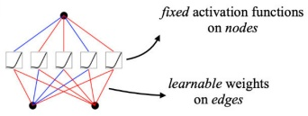</td><td rowspan=2 colspan=1>(b)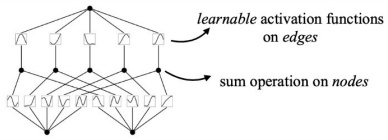KAN(x) = (Φ3。 Φ2° Φ1)(x)</td></tr><tr><td rowspan=1 colspan=1>Formula(Deep)</td><td rowspan=1 colspan=1> $\mathbf { M L P } ( \mathbf { x } ) = ( \mathbf { W } _ { 3 } \circ \sigma _ { 2 } \circ \mathbf { W } _ { 2 } \circ \sigma _ { 1 } \circ \mathbf { W } _ { 1 } ) ( \mathbf { x } )$ </td></tr><tr><td rowspan=1 colspan=1>Model(Deep)</td><td rowspan=1 colspan=1>(c)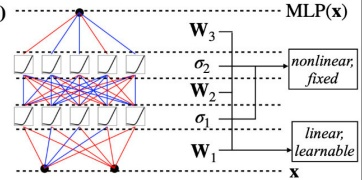</td><td rowspan=1 colspan=1>(d)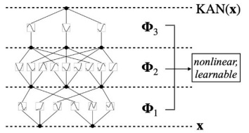</td></tr></table>

Fig. 1: Diference between MLP and KAN. Figure adapted from Liu et al. [1] under a Creative Commons Attribution 4.0 International License.

Theorem [19–21] that serves as an inspiration for the MLPs, which guarantees that MLPs can approximate any function, but provides no bound on how the required network size scales with error [22]. In practice, MLPs sufer from the curse of dimensionality (COD), i.e. the required parameters can grow exponentially with input dimension.

The authors went for KAN because they believe the Kolmogorov-Arnold theorem provides a more structurally eficient path to representing real-world scientific functions than the generic Universal Approximation Theorem that is mathematical basis behind the traditional MLPs. $\mathrm { B y }$ replacing fixed node activations with learnable edge splines, they created a network that is simultaneously more parameter-eficient (better scaling laws), more accurate (especially for structured scientific data), and fundamentally interpretable (enabling human-AI scientific discovery).

## 2.2 Kolomogorov-Arnold Representation Theorem

The theorem states that: every scalar valued, multi-variable function defined on a closed bounded subspace of a real Euclidean space can be expressed as as a finite composition of univariate functions and addition. That is, if $f : [ 0 , 1 ] ^ { n } $ R is any multivariate, scalar valued function, then, for any $\mathbf { x } = ( x _ { 1 } , x _ { 2 } , \ldots , x _ { n } ) \in \left[ 0 , 1 \right] ^ { n }$ , f can be representated as-

$$
f ( \mathbf { x } ) = f ( x _ { 1 } , x _ { 2 } , \ldots , x _ { n } ) = \sum _ { q = 0 } ^ { 2 n } \Phi _ { q } \left( \sum _ { p = 1 } ^ { n } \phi _ { q , p } ( x _ { p } ) \right)\tag{1}
$$

where $\phi _ { q , p } : [ 0 , 1 ] \to$ R and $\Phi _ { q } : \mathbb { R }  \mathbb { R }$ . The authors argue that if a function admits a smooth KA representation, KANs can decompose high- dimensional learning into learning 1D functions, thereby beating the curse of dimensionality. Classical extensions by Sprecher [23] and Lorentz [24] further refined this representational capability. In the original paper, the authors chose B-Spline functions as the family of basis that they used to parametrized the learnable univariate functions on each edges.

## 2.3 B-Spline Functions

B-splines (Basis splines) are piecewise polynomial functions that are used to construct smooth curves and surfaces [25]. These curves called the B-Spline curves are made by joining polynomial segments of degree k across a grid of points called knots. In the original paper, they typically used polynomial degree of 3. Some of the key features of such curves is that they have local support, in the sense that each B-Spline basis function that is used to generate the curves is non-zero only on very limited interval (between adjacent knots). This means changing one coeficient only afects a local region of the curve, not the entire function. The curve also maintains smooth features, because at the knots where polynomial pieces meet, the function is guaranteed to be continuous and have continuous derivatives up to order $k - 1$ . For cubic splines $\left( k = 3 \right)$ which was used in the original paper, this means the curve is twice continuously diferentiable $\big ( \mathrm { C } ^ { 2 } \big )$

What happens inside KANs is that each activation function on the edge is represented as a linear combination of B-spline basis functions $B _ { i } ( x )$ with learnable coeficients $c _ { i } { : }$

$$
{ \mathrm { s p l i n e } } ( x ) = \sum _ { i } c _ { i } B _ { i } ( x )\tag{2}
$$

where the network learns the coeficients $c _ { i }$ through gradient descent.

In summary, B-splines are used in KAN because they provide a learnable, smooth, locally adjustable, and resolution-adaptive way to represent the univariate functions required by the Kolmogorov- Arnold theorem. They give KANs their signature capabilities: high accuracy via grid extension, resistance to catastrophic forgetting via locality, and the ability to decompose high-dimensional problems without falling prey to the curse of dimensionality.

## 2.4 Bessel Functions

Bessel functions are a special kind of functions that are solutions to a particular type of ordinary diferential equation, called the Bessel’s equation [26]:

$$
x ^ { 2 } { \frac { d ^ { 2 } y } { d x ^ { 2 } } } + x { \frac { d y } { d x } } + \left( x ^ { 2 } - \alpha ^ { 2 } \right) y = 0\tag{3}
$$

Where α is the order of the equation which is usually a complex number. These equations appear in problems involving wave motion, heat conduction and other physical phenomenon with circular/cylindrical symmetry. In general, there are two kinds of Bessel functions: The Bessel functions of the $1 ^ { s t }$ kind given by

$$
J _ { \alpha } ( x ) = \sum _ { m = 0 } ^ { \infty } { \frac { ( - 1 ) ^ { m } } { m ! \Gamma ( m + \alpha + 1 ) } } \left( { \frac { x } { 2 } } \right) ^ { 2 m + \alpha }\tag{4}
$$

When α is either an integer or positive, these Bessel functions have finite values at the origin, whereas if α is a negative non-integer, these functions are divergent at the origin. Also, for non- integer $\alpha , J _ { \alpha } ( x )$ and $J _ { - \alpha } ( x )$ are two linearly independent solutions to the Bessel’s equation and so they form a solution space for the Bessel’s equation. However if α is an integer, then $\alpha , J _ { \alpha } ( x )$ and $J _ { - \alpha } ( x )$ wouldn’t be linearly independent because for any integer $n , J _ { - n } ( x ) = ( - 1 ) ^ { n } J _ { n } ( x )$ . Then in this case the other linearly independent solution is found through the Bessel functions of $2 ^ { n d }$ kind. This type of Bessel functions are solutions of the Bessel diferential equation that have a singularity at the origin and are multivalued. Denoted by $Y _ { \alpha } ( x )$ , where α is a non-integer, its formula is given by

$$
Y _ { \alpha } ( x ) = \frac { J _ { \alpha } ( x ) \cos ( \alpha \pi ) - J _ { - \alpha } ( x ) } { \sin ( \alpha x ) }\tag{5}
$$

When dealing with integer order n, the Bessel function of $2 ^ { n d }$ kind is defined as $Y _ { n } ( x ) = \operatorname* { l i m } _ { a  n } Y _ { \alpha } ( x )$

## 3 Formulation of the Hybrid Model

As stated before, there were many good reasons why the Liu et al [1]. chose B-Splines as their baseline family of basis functions. Because KAN leverages the KART to theoretically decompose a multivariate function into its additive super-composition of univariate functions, B-Splines provide a flexible, diferentiable way to represent any smooth univariate function. In this case, each “weights” in KAN is replaced by a univariate B-Spline curves. Because KANs reduce the high-dimensional learning problem to learning multiple univariate functions, B-splines can approximate these univariate components with high precision, which Liu et al. have found to be more eficient than MLPs which try to approximate the same high-dimensional functions with commonly known activations such as ReLU. Another unique advantage that the paper has noted about B-Splines is their ability to “refine the grid” without requiring any retraining from scratch. The original paper introduced a grid extension technique which starts of with a coarse grid (few intervals for each B- Splines) and then refining those grids by fitting a new fine-grained spline to the old coarse one via least squares. This has shown to improve accuracy as grids become finer, something MLPs cannot do by simply adjusting a fixed activation function. Other advantages include the local support that B- Splines have which lets KANs avoid catastrophic forgetting during continual learning and B-splines being smooth and fully diferentiable, which allows KANs to be trained end-to-end with backpropagation.

However, B-Splines is not without its limitation, as the authors who used these basis family have themselves reported. One of them being the curse of dimensionality (COD) of B-splines themselves. Although with the help of B-Splines and with how the architecture of KAN is modelled, by combining and leveraging the strength of B-Splines and MLPs, while avoiding their weaknesses, raw splines have serious COD problem because of their inability to exploit their compositional structures, i.e. if one tries to use B-splines to approximate a high-dimensional function directly in the full input space, the required grid points grow exponentially with dimension. The authors have also noted is that KANs appear "hopelessly expensive" at first glance because each MLP weight parameter becomes a KAN spline function (Section 2.2 from Liu et al. [1]). A KAN with depth L, width N and G grid intervals have $O ( N ^ { 2 } L G )$ parameters, whereas an MLP only needs $O ( N ^ { 2 } L )$ parameters. While the authors argue that KANs compensate by requiring much smaller widths, the raw parameter count is inherently higher. B-Splines also have issue with them being defined on a bound region, because during training, activation values can evolve outside that region. The authors proposed a remedy by by updating grids on the fly according to input activations, but this adds implementation complexity and is described as a non-trivial optimization challenge. The biggest issue with B-Splines is that B-Spline causes a bottleneck to the KANs making it typically slower than traditional MLPs. The bottleneck is due to the fact that diferent spline activation functions cannot leverage batch computation (large data through the same function) as eficiently as MLPs with shared fixed activations. They classify this as an engineering problem rather than a fundamental limitation, but it remains the "biggest bottleneck" of the architecture.

In the domain of image tasks, there are comparative studies being made with KANs against other traditional MLPs, one of the significant ones includes the study done by Yu & Wang [3] where they made a fair comparison between KAN based models with MLP based models on various tasks which includes computer vision. They have found that under the same numbers of parameters or FLOPs. KAN performed quite poorly compared to MLP on computer vision task (77.88% vs 85.88% test accuracy). The computer vision task involved testing vanilla KAN and MLP (with GELU [27], RELU, normalization) on 8 image datasets (such as MNIST [28], CIFAR-10/100 [29] variants etc.). They also found that KAN had issue with forgetting more severe than that of MLP in a standard class-incremental learning, which they claimed to have contradicted the claim made in the original KAN paper [1]. Overall, the authors Yu & Wang claimed that while KANs have promises, it might not be a universal MLP replacement, because their edge was niche and computer vision tasks favor MLPs over KAN, at the time the authors conducted their experiments. However, this doesn’t mean that KAN is doomed to fail in computer vision task, as we have noticed some glaring flaws in the author’s paper. The authors used vanilla KAN with basic splinebased layers against an optimized MLPs. It didn’t test KAN hybrids or extensions designed for computer vision which emerged after 2024. Secondly, the original KAN designs in the paper of Liu et al. [1] was made for small scale or science tasks, and they acknowledge KAN’s scalability for computer vision as a future work. Furthermore, we have recent research showing KANs excelling in computer vision task when adapted (like integrating KAN with Vision transformers [4] or adopting an alternate family of basis functions in KAN), often matching or beating MLPs in specific scenarios like continual learning or eficiency.

In the paper published by Ullah & Kim [4] in 2025, they replaced the MLPs in ViT with KANs and what they’ve found is that not only KAN-ViTs achieved comparable and even better accuracy on computer vision tasks than MLP-ViT, but also significantly mitigated catastrophic forgetting, outperforming MLP-ViT in retaining information and adapting to new task. While there is future scope where we could do such replacement on other neural network models that similarly perform better on, our main interest lies in the implementation of alternate families of basis function in KANs that helps the KANs to perform better in certain task that the vanilla KANs normally fails at or at least performs as better as MLPs. There are several studies that explores alternate KAN models with diferent basis family of functions and also studies where they incorporated new family of basis function with the B- Splines.

Some of these studies explores alternate KAN models such as:

1. Cheby KAN [12]: This replaces B-splines with Chebyshev polynomials to eliminate the costly spline-grid updates, leveraging orthogonality and fast convergence for stabler training. It runs 14 times faster than B- spline KAN-SchNet while achieving lower MAE on quantum-chemistry regression and stronger generalization on MNIST/CIFAR-10.

2. Fourier KAN [30]: This decomposes image features via FFT into amplitude (style) and phase (content), then uses KAN to break these into learnable univariate basis functions for multi-level recombination. This yields large gains in unknown-domain object-detection generalization (Diverse Weather & Real- to-Art benchmarks) without sacrificing real-time inference (110 FPS).

3. Free-RBF KAN (preprint [31]): This cuts B-spline overhead by adopting adaptive radial basis functions with trainable centroids and smoothness, bypassing De Boor’s recursion entirely. It matches or exceeds B- spline KAN accuracy on multiscale regression and physics-informed tasks (PINNs [32], DeepONet [33]) while using fewer parameters and training faster.

4. Rational KAN [34]: This introduces rational basis functions through Padé approximants and mapped Jacobi polynomials to better capture asymptotic behavior and singularities that standard polynomials miss. It outperforms alternatives on regression tasks with sharp peaks and delivers competitive results on MNIST and physics-informed ODE/PDE solving.

5. RBF KAN [11]: This model swaps B-splines for Gaussian radial basis functions to remove recursive grid computation and improve interpretability via localized activations. It reduces parameters by 33–65% and accelerates training/inference by 65–99% compared with B-spline KAN, while maintaining comparable accuracy on function fitting and classification benchmarks.

6. Wav-KAN (preprint [35]): This model substitutes B-splines with wavelet transforms to enable multiresolution analysis, capturing both high-frequency details and low-frequency trends while avoiding overfitting to noise. It trains faster than Spl-KAN with fewer parameters and achieves higher test accuracy on MNIST using wavelets such as DOG and Mexican hat.

Each of these alternative models made replacement for B-Splines in KAN so that each performs a specific task better than the baseline KAN, not necessarily these models are meant as a total replacement of the original KAN models.

Taking inspiration from these, we explore the family of Bessel functions, which despite being well-studied in applied mathematics and appearing only as isolated spline replacements in prior KAN studies [15, 16], has never been employed within a hybrid or fused-basis KAN architecture. As mentioned in the previous section, these functions are the solutions to the 2nd order diferential equation called the Bessel’s equation. These equations naturally appear in physical phenomenon that involves cylindrical and circular symmetry. There are several properties why we think Bessel Functions make for a good compliment for the B-Spline functions in KAN. The first property being that Bessel functions have a naturally oscillating and decaying behavior, which makes it useful for capturing textures, edges and radial patterns in images. The second properties being its radial symmetry – because these functions are naturally defined in polar/cylindrical co-ordinates, it aligns well with circular or rotationally features in images (an inductive bias previously successfully exploited in CNNs via Harmonic Networks [36]). These functions also form a complete orthogonal basis in certain weighted and can eficiently approximate functions with oscillatory components. Other important properties include its rich theoretical background and being infinitely diferentiable which is essential for gradient based training in KAN. Furthermore, our motivation is empirically supported by recent evidence that spline-KANs approximate oscillatory special functions, including Bessel functions themselves, with near-perfect fidelity, substantially outperforming MLPs on such targets [37], indicating that oscillatory structure is precisely the regime in which KAN edge functions excel.

However, there are some potential limitations of Bessel functions that would limit a full-on replacement for B-Splines in KAN. The first being its lack of localization. Because Bessel functions of $1 ^ { s t }$ kind are globally supported and oscillatory with slow decaying amplitude, it becomes dificult to represent sharp localized features such as edges, corner and fine textures. This initially suggest us that we may need higher order Bessel functions to approximate a sharp discontinuity, leading to the Gibbs phenomenon [38]. Another issue with Bessel functions is that they are highly non-linear and oscillatory in nature. What this means is that Bessel functions have oscillating gradient that results in many local minima and slower convergence, which would create several optimization challenges. This would make it less eficient on non-radial and non-wavy image data.

Due to this, we’re inspired to take a hybrid approach with Bessel function where we mix Bessel functions with the existing B-Splines in KAN. The development of our hybrid architecture began by exploring a direct additive formulation, inspired by recent successes in mixed-basis models such as BSRBF-KAN, and analogous in spirit to the pure Bessel-replacement KAN of Yang et al. [15], but with both families present on every edge. In this initial design, the activation function on each individual network edge was defined as the linear combination of a standard B-Spline basis and a Bessel function basis. Mathematically, the activation on a given edge was formulated as

$$
\phi ( x ) = \phi _ { s p l i n e } ( x ) + \psi _ { b e s s e l } ( x )\tag{6}
$$

The underlying hypothesis was that superimposing the localized, piecewise nature of B-Splines with the structural, wave-like properties of high-order Bessel functions within the same functional space would yield a richer feature representation.

While theoretically appealing, empirical evaluations of this direct additive approach exposed significant structural limitations. Placing multiple basis families on every single edge caused an immediate and severe parameter explosion. Furthermore, evaluating high-order Bessel functions across the entire network resulted in a computational complexity that rendered comprehensive ablation studies practically unfeasible. To mitigate this bottleneck, an intermediate architectural correction was implemented: the Bessel function expansion was strictly truncated to Order-2, utilizing only the loworder functions $J _ { 0 } ( x )$ and $J _ { 1 } ( x )$ . Although this constraint successfully curtailed the parameter bloat and restored computational tractability, it introduced a detrimental trade-of. The reduced expressive capacity of the Order-2 restriction penalized the network’s learning dynamics, leading to a demonstrable decrease in benchmark accuracy compared to the initial baseline experiments.

So, taking further inspiration from FC-KAN, we attempt to resolve the tension between expressive capacity and computational eficiency, by fundamentally restructuring the architecture from a per-edge additive model to a dual-pipeline parallel framework. Instead of forcing both function families to share the same edge, the network is split into two distinct, parallel processing pipelines: a dedicated B-Spline branch and an Order-2 Bessel branch. To ensure the overall parameter footprint remains highly eficient, the hidden dimensions of these parallel pipelines are compressed (e.g., utilizing a $3 2 + 3 2$ configuration). The final feature representations from these parallel branches are fused using a parameter-free element- wise interaction, defined as

$$
O _ { f i n a l } = O _ { s p l i n e } + O _ { b e s s e l } + ( O _ { s p l i n e } \odot O _ { b e s s e l } )\tag{7}
$$

To rigorously evaluate this quadratic interaction mechanism, we have also tested a simple additive fusion $O _ { f i n a l } = O _ { s p l i n e } + O _ { b e s s e l }$ and a concatenation fusion as comparative baselines, which would ensure a comprehensive ablation of the parallel pipeline’s feature combination strategies. This Parallel BesselKAN-Interact architecture efectively recovers the non-linear expressivity lost during the Order- 2 truncation without introducing additional learnable weights. By acting as a highly eficient internal ensemble, this parallelization bypasses the computational bottlenecks of the initial additive approach while securing superior predictive performance.

Now, in relation to the prior work on Bessel-based KANs, both Yang et al. [15] and Poole et al. [16] employed Bessel functions within KANs, but in a fundamentally diferent regime. Yang et al. evaluated a pure Bessel-replacement in KAN as a reference model for modulation classification, which has shown to under-perform in their distribution-aware design and it is consistent with our finding that a full replacement of B-Spline with Bessel functions sacrifices the spline branch’s local adaptivity. Poole et al. selected a single compact basis per edge for model compression, which is an objective approach that’s completely opposite to ours because none of their edges in their architecture could express cross-basis products, while our parameterfree quadratic fusion contributes additional dimensions of functional expressivity (See Theorem 4) without learnable parameters. To our knowledge, Parallel BesselKAN is the first architecture to hybridize B-Spline basis with the basis of Bessel functions and the first to provide theoretical guarantees, as laid out in the next section exploring the mathematics behind our fused-basis KAN. Furthermore, where both previously published works operate on one-dimensional signal data, we target image classification, the setting in which KANs are known to be weakest [3]

## 4 Mathematical Structure

In this section, we propose certain analysis, theorems and proposition that serves as a mathematical backbone of our model, giving a mathematical justification of how and why our model works.

## 4.1 Conditioning and Numerical Characterization of the Interaction Space

While subsequent propositions establish the theoretical linear independence of the mixed basis generated by piecewise polynomials and analytic Bessel functions, the empirical realization of this functional space over a compact domain $\Omega = [ - 1 , 1 ]$ introduces structural ill-conditioning. To evaluate the stability boundaries of the Parallel BesselKAN, we systematically analyzed the design matrix $\Theta \in \mathbb { R } ^ { N \times M }$ and its associated Gram matrix $G = \Theta ^ { \top } \Theta$

Across all evaluated basis configurations on a 500-point uniform collocation grid, the condition number of the explicit Gram matrix strictly obeys the theoretical squaring identity $\kappa ( G ) = \kappa ( \Theta ) ^ { 2 }$ . For our optimal baseline $7 \times 7$ hybrid space $( s =$ $5 , b = 2 )$ , numerical evaluation yields a design condition number of $\kappa ( \Theta ) \approx 1 . 5 \times$ $1 0 ^ { 4 }$ . Continuous adaptive quadrature $( \epsilon _ { a b s } = 1 0 ^ { - 1 4 } )$ confirms this near-dependence $( \sigma _ { m i n } \approx 2 . 0 0 9 \times 1 0 ^ { - 6 } )$ , demonstrating that the ill-conditioning is a structural geometric property of the continuous functional space rather than a discrete sampling artifact. Furthermore, column unit-L2 normalization leaves the condition number virtually unchanged (altering $\kappa ( \Theta )$ by a negligible factor of 0.916), proving that the redundancy stems from geometric shape overlap rather than parameter scale disparity. Consequently, we report the design matrix condition number $\kappa ( \Theta )$ as the primary metric for numerical stability.

Table 1: Empirical Conditioning and Efective Rank Across Basis Configurations
<table><tr><td>Config</td><td> $\kappa ( \Theta )$ </td><td> $\kappa ( G )$ </td><td></td><td>Rank(Θ) Rank(G)</td></tr><tr><td>Spline only (n=5)</td><td> $5 . 5 0 \times 1 0 ^ { 0 }$ </td><td> $3 . 0 2 \times 1 0 ^ { 1 }$ </td><td> $5 / 5$ </td><td> $5 / 5$ </td></tr><tr><td>Bessel only  $( \nu = 0 – 3 )$ </td><td> $2 . 8 9 \times 1 0 ^ { 2 }$ </td><td> $8 . 3 9 \times 1 0 ^ { 4 }$ </td><td> $4 / 4$ </td><td> $4 / 4$ </td></tr><tr><td>Hybrid  $( s = 5 , b = 4 )$ </td><td> $1 . 4 6 \times 1 0 ^ { 7 }$ </td><td> $2 . 1 3 \times 1 0 ^ { 1 4 }$ </td><td> $9 / 9$ </td><td> $9 / 9$ </td></tr><tr><td>Hybrid  $( s = 5 , b = 6 )$ </td><td> $1 . 7 3 \times 1 0 ^ { 8 }$ </td><td> $3 . 3 0 \times 1 0 ^ { 1 6 }$ </td><td> $1 1 / 1 1$ </td><td> $\mathbf { 1 0 / 1 1 }$ </td></tr><tr><td>Bessel horror  $( \nu = 0 – 7 )$ </td><td> $6 . 0 9 \times 1 0 ^ { 7 }$ </td><td> $3 . 6 7 \times 1 0 ^ { 1 5 }$ </td><td> $8 / 8$ </td><td> $\boldsymbol { 7 } / 8$ </td></tr></table>

Spectral analysis of the design matrix Θ isolates the primary near-null direction within the weakest singular vector. The vector exhibits a symmetric coeficient distribution:

$$
\mathbf { v } _ { \mathrm { n u l l } } = [ \underbrace { - 0 . 3 4 4 } _ { \mathrm { b s p l 1 } } , \underbrace { - 0 . 4 2 4 } _ { \mathrm { b s p l 2 } } , \underbrace { - 0 . 4 5 5 } _ { \mathrm { b s p l 3 } } , \underbrace { - 0 . 4 2 4 } _ { \mathrm { b s p l 4 } } , \underbrace { - 0 . 3 4 4 } _ { \mathrm { b s p l 5 } } , \underbrace { + 0 . 4 4 3 } _ { \mathrm { b e s s e l } _ { - { \mathrm { \scriptsize ~ j 0 } } } } , \underbrace { 0 . 0 0 0 } _ { \mathrm { b e s s e l } _ { - { \mathrm { \scriptsize ~ j 1 } } } } ] ^ { \top }\tag{8}
$$

This mathematically quantifies the redundancy: the fundamental Bessel function $J _ { 0 } ( x )$ which is a smooth, even function on $[ - 1 , 1 ]$ , is almost entirely subsumed by the symmetric, even combination of the local B-spline partition of unity. Higher-order Bessel functions contribute minimally to this specific null space.

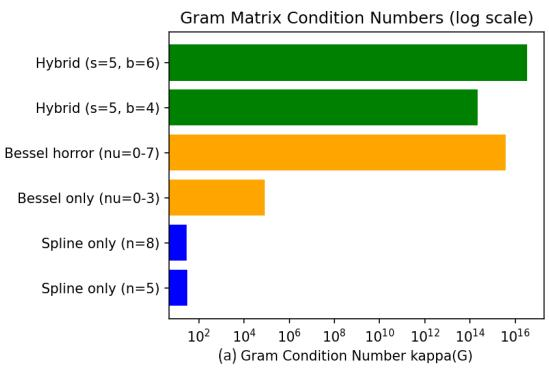

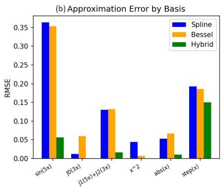  
Fig. 2: Spectral characterization and approximation bounds of the hybrid architecture 1: (a) Gram matrix condition numbers scale exponentially in hybrid configurations. (b) The hybrid model collapses reconstruction RMSE on complex oscillatory targets like sin(5x).

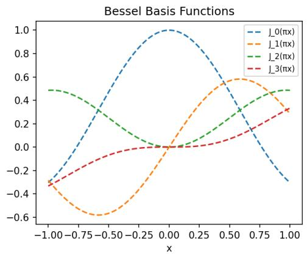  
Fig. 3: Spectral characterization and approximation bounds of the hybrid architecture 2: (c) The symmetric geometric overlap between the B-spline partition and low-order Bessel functions over [−1, 1] drives the primary near-null space.

Evaluating the hybrid basis demonstrates a severe trade-of between expressive capacity and numerical stability. Expanding the Bessel truncation order q beyond $q = 2$ yields negligible improvements in mean reconstruction error. For example, on the smooth oscillatory target $\sin ( 5 x )$ , the hybrid architecture $\left( b = 2 \right)$ collapses the root mean square error (RMSE) to 0.0567, compared to 0.3632 for pure splines and 0.3535 for pure Bessel bases. However, expanding to $b = 6$ causes the design matrix condition number $\kappa ( \Theta )$ to grow exponentially to $1 . 7 3 4 \times 1 0 ^ { 8 }$ . Crucially, for $b \geq 6$ explicitly forming the normal matrix $G = \Theta ^ { \top } { \dot { \Theta } }$ pushes $\kappa ( G )$ to ≈ $3 . 3 \times 1 0 ^ { 1 6 }$ , driving the minimum singular values below machine precision. This causes a catastrophic artificial rank drop (from $1 1 / 1 1$ in Θ to 10/11 in G) and severe numerical divergence during training.

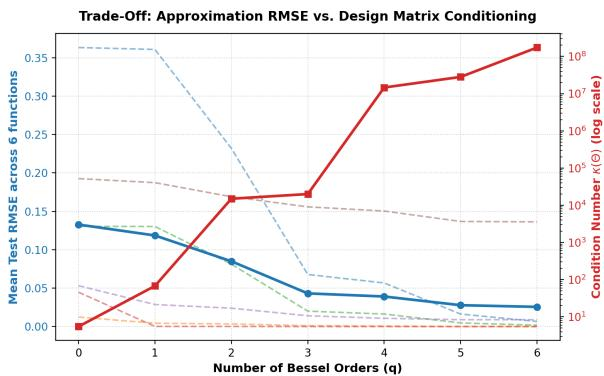  
Fig. 4: Expressive capacity versus numerical stability trade-of. Expanding the Bessel truncation order q beyond $q = 2$ yields negligible improvement in mean reconstruction error (RMSE) while causing the design matrix condition number $\kappa ( \Theta )$ to grow exponentially, eventually exceeding double-precision limits.

Based on these numerical characterizations, we adopt $b = 2 ~ ( q = 2 )$ as the default hyperparameter cap for the Parallel BesselKAN. To maintain gradient stability during backpropagation, the model mandates solving the linear combination directly on the design matrix Θ via direct QR factorization or Singular Value Decomposition (SVD), strictly bypassing the normal equations to avoid squaring the condition number.

## 4.2 Dimension Analysis of the Quadratic Fusion

Since we settled for a parallel hybrid approach for our hybrid Bessel- KAN models, where the output for each KAN pipeline is combined as a quadratic fusion, our goal in this section is to mathematically justify this fusion achieves higher accuracy without adding learnable parameters.

Let $V _ { 1 } = \operatorname { s p a n } \{ \phi _ { 1 } , \dots , \phi _ { d _ { 1 } } \}$ be the degree-p B-spline basis on a clamped knot vector over $[ a , b ]$ with $a > 0 ,$ and $V _ { 2 } =$ span $\{ \psi _ { 1 } , . . . , \psi _ { d _ { 2 } } \}$ with $\psi _ { j } ( x ) = J _ { \nu _ { j } } ( \lambda _ { j } x )$ , where $\nu _ { j } \geq 0$ and the frequencies $\lambda _ { j } > 0$ are pairwise distinct. The pairwise distinctness excludes degeneracies arising from Bessel recurrence relations at a shared frequency. The product space $V _ { 1 } \odot V _ { 2 } = \operatorname { s p a n } \{ \phi _ { i } \psi _ { j } \} _ { i , j }$ is spanned by the parameter-free product features.

We first establish an independence proposition.

Proposition 1 Let $I \subset ( 0 , \infty )$ be a nonempty open interval and $P , Q _ { 1 } , \ldots , Q _ { d _ { 2 } }$ polynomials with deg $Q _ { j } \leq p . \ I f \ P ( x ) + \sum _ { j = 1 } ^ { d _ { 2 } } Q _ { j } ( x ) J _ { \nu _ { j } } ( \lambda _ { j } x ) = 0$ for all $x \in I$ , then $P \equiv 0$ and all $Q _ { j } \equiv 0$

Proof Since all functions involved are real-analytic on $( 0 , \infty ) \ [ \therefore \ a > 0 ]$ , by the Identity Theorem[39], the identity extends to all $x > 0$ . Suppose, on the contrary, $Q _ { j } \not \equiv 0$ for some $j .$ Let d0 = max deg $Q _ { j } , S _ { 0 } = \{ j : \deg Q _ { j } = d _ { 0 } \}$ and let $Q _ { j } = c _ { j } x ^ { d _ { 0 } } + { \cal O } ( x ^ { d _ { 0 } - \bar { 1 } } )$ with $c _ { j } \neq 0$ for j   
all $j \in S _ { 0 }$ . By Hankel’s asymptotic expansion [40], we have $J _ { \nu } ( z ) = { \sqrt { \frac { 2 } { \pi z } } } \cos { \left( z - { \frac { \nu \pi } { 2 } } - { \frac { \pi } { 4 } } \right) } +$ $O ( z ^ { - 3 / 2 } ) { \mathrm { ~ a s ~ } } z { \mathrm { ~ \longrightarrow ~ } } \infty$ . Writing $A ( x ) = \sum _ { j } Q _ { j } ( x ) J _ { \nu _ { j } } ( \lambda _ { j } x ) = - \dot { P } ( x )$ and multiplying by $x ^ { 1 / 2 - d _ { 0 } } { \mathrm { ~ g i v e s ~ } } x ^ { 1 / 2 - d _ { 0 } } A ( x ) = F ( x ) + o ( 1 ) $ , where $F ( x ) = \sum _ { j \in S _ { 0 } } c _ { j } { \sqrt { \frac { 2 } { \pi \lambda _ { j } } } } \cos \left( \lambda _ { j } x + \theta _ { j } \right)$ with $\theta _ { j } = - \nu _ { j } \frac { \pi } { 2 } - \frac { \pi } { 4 } .$ Since $\lambda _ { j } \mathrm { ' s }$ are pairwise distinct, the mean square of the almost periodic function F [41] is $\operatorname* { l i m } _ { T  \infty } \frac { 1 } { T } \int _ { 0 } ^ { T } F ( x ) ^ { 2 } d x = \sum _ { j \in S _ { 0 } } \frac { c _ { j } ^ { 2 } } { \pi \lambda _ { j } } > 0$ . So, 0 < lim sup $| F | = M < \infty$ and li $\mathrm { n s u p } x ^ { 1 / 2 - d _ { 0 } } | A ( x ) | = M$ . But $A = - P$ is a polynomial, for which lim sup $x ^ { 1 / 2 - d _ { 0 } } | P ( x )$ | x→∞   
is $0 , \infty ,$ or undefined but never a finite positive constant (the exponent $d _ { P } - d _ { 0 } + 1 / 2$ is a half-integer), hence we have a contradiction. Thus all $Q _ { j } \equiv 0$ , and then $P \equiv 0$ □

Proposition 2 $\{ \phi _ { i } \psi _ { j } \} _ { i , j }$ is linearly independent, so dim $( V _ { 1 } \odot V _ { 2 } ) = d _ { 1 } d _ { 2 }$

Proof Suppose $\sum _ { i , j } \alpha _ { i j } \phi _ { i } \psi _ { j } = 0$ on [a, b]. On each knot interval $I _ { k } = ( t _ { k } , t _ { k + 1 } )$ the splines restrict to polynomials $\pi _ { i , k }$ of degree ≤ p, so $\sum _ { j } \left( \sum _ { i } \alpha _ { i j } \pi _ { i , k } \right) \psi _ { j } = 0$ on $I _ { k }$ . Proposition 1 $( P = 0 )$ forces $\sum _ { i } \alpha _ { i j } \pi _ { i , k } \equiv 0$ for all $j , k ,$ , hence $\sum _ { i } { \alpha _ { i j } \phi _ { i } } \equiv 0 \mathrm { { o n } } [ a , b ]$ for each $j ;$ B-spline independence gives $\alpha _ { i j } = 0$ □

Proposition 3 $V _ { 1 } \cap ( V _ { 1 } \odot V _ { 2 } ) = \{ 0 \}$

Proof If $\sum _ { i } a _ { i } \phi _ { i } = \sum _ { i , i } c _ { i j } \phi _ { i } \psi _ { j }$ on $[ a , b ]$ , restriction to $I _ { k }$ yields $P ( x ) - \sum _ { j } Q _ { j , k } ( x ) \psi _ { j } ( x ) = 0$ with $P = \sum _ { . } a _ { i } \pi _ { i , k }$ and $Q _ { j , k } = \sum _ { i } c _ { i j } \pi _ { i , k }$ (polynomials of degree $\leq p )$ . Proposition 1 gives $P \equiv 0$ and $\stackrel { \iota } { Q } _ { j , k } \equiv 0$ on every $I _ { k } ;$ ; independence of $\{ \phi _ { i } \}$ then gives $a _ { i } = c _ { i j } = 0$ for all i, j. □

Theorem 4 $V _ { \mathrm { f i n a l } } = V _ { 1 } + V _ { 2 } + \left( V _ { 1 } \odot V _ { 2 } \right) = V _ { 1 } \oplus ( V _ { 1 } \odot V _ { 2 } )$ and dim $V _ { \mathrm { f i n a l } } = d _ { 1 } + d _ { 1 } d _ { 2 }$

Proof The clamped B-spline basis satisfies the partition of unity $\sum _ { i } \phi _ { i } ( x ) = 1 \mathrm { ~ o n ~ } [ a , b ]$ , so for each $j ,$

$$
\psi _ { j } ( x ) = \psi _ { j } ( x ) \sum _ { i = 1 } ^ { d _ { 1 } } \phi _ { i } ( x ) = \sum _ { i = 1 } ^ { d _ { 1 } } \phi _ { i } ( x ) \psi _ { j } ( x ) \in V _ { 1 } \odot V _ { 2 } ,
$$

i.e. $V _ { 2 } \subseteq V _ { 1 } \odot V _ { 2 }$ . Hence $V _ { \mathrm { f i n a l } } = V _ { 1 } + \left( V _ { 1 } \odot V _ { 2 } \right)$ ; the sum is direct by Proposition 3 and dim $( V _ { 1 } \odot V _ { 2 } ) = d _ { 1 } d _ { 2 }$ by Proposition 2. □

We emphasize that the count $d _ { 1 } + d _ { 2 } + d _ { 1 } d _ { 2 }$ that one might expect from the three families overcounts by exactly d2: the additive Bessel branch is entirely absorbed by the product space. The standalone $V _ { 2 }$ term is retained in the architecture as an optimization convenience but adds no approximation capacity in the idealized model.

## 4.3 Lipschitz Continuity & Gradient Stability

Let $\Omega \subset \mathbb { R } ^ { d }$ be a convex compact domain. A single interaction layer of the hybrid architecture computes

$$
\begin{array} { c l } { { \phi _ { \mathrm { i n t } } ( x ; w _ { S } , w _ { B } ) = \displaystyle \phi _ { S } ( x ) + \phi _ { B } ( x ) + \phi _ { S } ( x ) \phi _ { B } ( x ) } } \\ { { \displaystyle \phi _ { S } ( x ) = \sum _ { i = 1 } ^ { d _ { 1 } } w _ { S , i } B _ { i } ( x ) } } \\ { { \displaystyle \phi _ { B } ( x ) = \sum _ { m = 1 } ^ { d _ { 2 } } w _ { B , m } J _ { m } ( x ) } } \end{array}
$$

where $\{ B _ { i } \} _ { i = 1 } ^ { d _ { 1 } }$ is a tensor-product B-spline basis on a rectilinear grid covering Ω, i.e. d $B _ { i } ( x ) = \prod _ { k = 1 } ^ { a } B _ { i _ { k } } ^ { ( p ) } ( x _ { k } )$ , and $\{ J _ { m } \} _ { m = 1 } ^ { d _ { 2 } }$ are Bessel functions of the first kind restricted to

Ω. We assume the weights are confined to a compact set $\mathcal { W } \subset \mathbb { R } ^ { d _ { 1 } + d _ { 2 } }$

Theorem 5 There exists a constant $L _ { \mathrm { i n t } } < \infty$ , depending only on W and the knot sequence, such that $\phi _ { \mathrm { i n t } }$ is $L _ { \mathrm { i n t } } – L i p s c h i t z$ on $\Omega ,$ and the weight gradients are uniformly bounded by $1 + M _ { B }$ and $1 + M _ { S }$ , where $M _ { S } = \operatorname* { s u p } _ { \mathcal { W } } \| w _ { S } \| _ { 1 }$ and $M _ { B } = \operatorname* { s u p } _ { \mathcal { W } } \| w _ { B } \| _ { 1 }$

Proof Normalized B-splines satisfy $0 \leq B _ { i } ( x ) \leq 1$ with $\sum _ { \ i } B _ { i } = 1$ , and $| J _ { m } | \leq 1$ for integer i orders $m \geq 0 ,$ , so $| \phi _ { S } | \le M _ { S }$ and $| \phi _ { B } | \le M _ { B }$ . The derivatives $\partial _ { x _ { k } } B _ { i }$ exist almost everywhere and are piecewise polynomials of lower degree on the compact grid, hence uniformly bounded; the Bessel recurrence $J _ { m } ^ { \prime } ( x ) = { \frac { 1 } { \cdot } } { \big ( } J _ { m - 1 } ( x ) - J _ { m + 1 } ( x ) { \big ) }$ gives $| J _ { m } ^ { \prime } | \leq 1$ on compacts. Thus $\| \nabla _ { x } \phi _ { S } \| \leq L _ { S }$ and $\lVert \nabla _ { x } \phi _ { B } \rVert \leq L _ { B } ^ { - }$ for finite constants $L _ { S } , L _ { B }$ . By the product rule,

$$
\nabla _ { x } \phi _ { \mathrm { i n t } } = \nabla _ { x } \phi _ { S } + \nabla _ { x } \phi _ { B } + \phi _ { B } \nabla _ { x } \phi _ { S } + \phi _ { S } \nabla _ { x } \phi _ { B } ,
$$

so $\begin{array} { r } { \| \nabla _ { x } \phi _ { \mathrm { i n t } } \| \le L _ { S } + L _ { B } + M _ { B } L _ { S } + M _ { S } L _ { B } = : L _ { \mathrm { i n t } } } \end{array}$ . Since Ω is convex, the mean value theorem yields $| \phi _ { \mathrm { i n t } } ( x ) - \phi _ { \mathrm { i n t } } ( y ) | \le L _ { \mathrm { i n t } } \| x - y \|$ . For the weight gradients,

$$
\frac { \partial \phi _ { \mathrm { i n t } } } { \partial w _ { S , i } } = B _ { i } ( x ) \big ( 1 + \phi _ { B } ( x ) \big ) , \qquad \frac { \partial \phi _ { \mathrm { i n t } } } { \partial w _ { B , m } } = J _ { m } ( x ) \big ( 1 + \phi _ { S } ( x ) \big ) ,
$$

which are bounded by $1 + M _ { B }$ and $1 + M _ { S }$ , respectively; in particular, gradients cannot explode while weights remain in W. □

Remark 1 For an L-layer composition with each layer mapping into a compact set and weights in $\mathcal { W } ,$ the network is Lipschitz with constant at most $\bar { \prod _ { \ell } L _ { \mathrm { i n t } } ^ { ( \bar { \ell } ) } } < \infty$

## 4.4 Universal approximation via Stone–Weierstrass

Let $\Omega \subset \mathbb { R } ^ { d }$ be compact, $\boldsymbol { B } = \{ B _ { i } \} _ { i = 1 } ^ { d _ { 1 } }$ a tensor-product B-spline basis on Ω (partition of unity), and $\mathcal { I } = \{ J _ { m } \} _ { m = 1 } ^ { d _ { 2 } }$ Bessel functions of the first kind, regarded as elements of $C ( \Omega )$ . Let A be the algebra over R generated by $B \cup \mathcal { I }$ : all finite linear combinations of finite products of the generators.

Theorem 6 A is dense in $C ( \Omega )$ in the uniform norm; consequently, the hybrid architecture can approximate any $f \in C ( \Omega )$ to arbitrary accuracy.

Proof A is a subalgebra of $C ( \Omega )$ by construction (closed under addition, multiplication, and scalar multiplication). It contains the constants, since partition of unity gives $\begin{array} { r } { \mathbf { 1 } = \sum _ { i = 1 } ^ { d _ { 1 } } B _ { i } } \end{array}$ It separates points: if $x \neq y ,$ , choose a coordinate k with $x _ { k } \neq y _ { k }$ ; the univariate B-spline basis in coordinate k separates $x _ { k }$ from $y _ { k }$ , and selecting tensor-product factors strictly positive at both x and y (possible by local support and partition of unity) yields $B _ { i } \in \mathcal { A }$ with $B _ { i } ( x ) \neq B _ { i } ( y )$ . By Stone-Weierstrass $[ 4 2 ] , \overline { { \mathcal { A } } } ^ { \| \cdot \| _ { \infty } } = C ( \Omega )$

It remains to connect A to the network. A single layer computes functions in $\nu _ { 1 } =$ span $\left( \mathcal { B } \cup \mathcal { T } \cup \{ B _ { i } J _ { m } \} _ { i , m } \right) \subset \mathcal { A }$ , which is not itself an algebra; however, the interaction term ϕSϕB endows the network with multiplicative capability. Composing layers and increasing width, the network generates successive products of its own outputs, hence arbitrary finite products of the basis functions, so $\mathcal { A } \subset \bar { \mathcal { V } }$ for the full network space V. Therefore $C ( \Omega ) \subset \overline { { \mathcal { V } } }$ i.e. for every $f \in C ( \Omega )$ and $\epsilon > 0$ there exists $g \in \mathcal V$ with $\| f - g \| _ { \infty } < \epsilon$ □

## 5 Dataset

We evaluated the proposed model on four public classification benchmarks (Table 2) and, for a basis-conditioning check, on synthetic one-dimensional functions (Section 5.1).

Table 2: Classification benchmarks. Iris uses a random train/test split of its 150 samples.
<table><tr><td>Dataset</td><td>Samples (train / test)</td><td>Input</td><td>Dim. Classes</td><td></td></tr><tr><td>Iris</td><td>120  / 30</td><td>4 tabular features</td><td>4</td><td>3</td></tr><tr><td>MNIST</td><td>60,000 / 10,000</td><td>28 × 28 grayscale, flattened</td><td>784</td><td>10</td></tr><tr><td>Fashion-MNIST</td><td>60,000 / 10,000</td><td>28 × 28 grayscale, flattened</td><td>784</td><td>10</td></tr><tr><td>CIFAR-10</td><td>50,000 / 10,000</td><td>32 × 32 × 3 RGB, flattened 3072  $\mathrm { ( C , H , W ) }$ </td><td></td><td>10</td></tr></table>

Iris was loaded with scikit-learn [43]; MNIST [28], Fashion-MNIST [44] and CIFAR-10 [29] with torchvision.datasets, using their oficial train/test partitions. Iris has no predefined partition, so its samples were randomly permuted (redrawn for each seed) into 120 training and 30 test samples without stratification. Labels are integer class indices passed directly to the cross-entropy loss; samples are treated as independent, there are no missing values, and no data augmentation was used.

Iris features were min–max scaled $\begin{array} { r } { \mathrm { t o } [ - 1 , 1 ] , x ^ { \prime } = 2 \frac { x - \operatorname* { m i n } ( x ) } { \operatorname* { m a x } ( x ) - \operatorname* { m i n } ( x ) + 1 0 ^ { - 8 } } - 1 } \end{array}$ , with the minimum and maximum computed per feature over all 150 samples before partitioning. Image pixels were scaled to [0, 1], standardized as $x ^ { \prime } = ( x / 2 5 5 - \mu ) / \sigma$ and flattened, with $( \mu , \sigma ) = ( 0 . 1 3 0 7 , 0 . 3 0 8 1 )$ for MNIST, (0.2860, 0.3530) for Fashion-MNIST, and per-channel $\mu = ( 0 . 4 9 1 4 , 0 . 4 8 2 2 , 0 . 4 4 6 5 )$ , σ = (0.2470, 0.2435, 0.2616) for CIFAR-10.

## 5.1 Synthetic functions

N = 500 equispaced points $x _ { n } \in [ - 1 , 1 ]$ were used with six noise-free targets: sin(5x), $J _ { 0 } ( 3 x ) , J _ { 1 } ( 5 x ) + J _ { 2 } ( 3 x ) , x ^ { 2 }$ , |x| and $\mathbb { H } [ x > 0 ]$

## 6 Methodology

We implemented a feed-forward Kolmogorov–Arnold Network (KAN) in PyTorch in which each layer combines three parallel learnable paths on the normalized layer input: a SiLU base path, a cubic B-spline path and a Bessel-function path. Two-layer networks of widths 4 → 8 → 3 (Iris), 784 → 64 → 10 (MNIST, Fashion-MNIST) and 3072 → 128 → 10 (CIFAR-10) output class logits.

## 6.1 Layer computation

A layer maps $X \in \mathbb { R } ^ { N \times d _ { \mathrm { i n } } }$ to $Y \in \mathbb { R } ^ { N \times d _ { \mathrm { o u t } } }$ . The input is first normalized over the features of each sample, U = LayerNorm(X) (PyTorch defaults, $\epsilon = 1 0 ^ { - 5 } )$ , in every layer including the first. The three paths are

$$
\begin{array} { r } { H _ { 0 } = \mathrm { S i L U } ( U ) W _ { 0 } ^ { \top } , \qquad W _ { 0 } \in \mathbb { R } ^ { d _ { \mathrm { o u t } } \times d _ { \mathrm { i n } } } , } \end{array}\tag{9}
$$

$$
H _ { s } = B W _ { s } ^ { \top } , \qquad W _ { s } \in \mathbb { R } ^ { d _ { \mathrm { o u t } } \times d _ { \mathrm { i n } } M } ,\tag{10}
$$

$$
H _ { b } = J W _ { b } ^ { \top } ,
$$

$$
W _ { b } \in \mathbb { R } ^ { d _ { \mathrm { o u t } } \times d _ { \mathrm { i n } } P } .\tag{11}
$$

Here $B \in \mathbb { R } ^ { N \times d _ { \mathrm { i n } } M }$ holds the $M = 5$ cubic B-spline basis values of each feature of $\operatorname { c l i p } ( U , - 1 , 1 )$ (Section 6.2; Figure 5a), and $\boldsymbol { J } \in \mathbb { R } ^ { N \times d _ { \mathrm { i n } } P }$ holds the Bessel features $J _ { \nu _ { p } } ( z _ { i p } )$ with $P = 4 , \nu _ { p } = p - 1$ and

$$
z _ { i p } = \mathrm { c l i p } ( \alpha _ { i p } U _ { \cdot i } + \beta _ { i p } , - 2 0 , 2 0 ) ,\tag{12}
$$

where $\alpha , \beta \in \mathbb { R } ^ { d _ { \mathrm { i n } } \times P }$ are learnable and shared across output units. The paths are combined by summation, $Y = H _ { 0 } + H _ { s } + H _ { b }$ , or by learnable mixing, $Y = H _ { 0 } + \sigma ( \lambda ) \odot$ $H _ { s } + ( 1 - \sigma ( \lambda ) ) \odot H _ { b }$ , with one logit $\lambda _ { j }$ per output unit initialized to zero. Mixing is used only for Fashion-MNIST (and one Iris ablation arm). Layers are composed directly, with no activation or dropout between them.

## 6.2 B-spline path

The basis has degree $k = 3$ and $M = 5$ functions per input, with a clamped uniform knot vector on $[ - 1 , 1 ]$ whose single interior knot is $\mathbf { 0 } \colon \mathbf { t } = \left( - 1 , - 1 , - 1 , - 1 , 0 , 1 , 1 , 1 , 1 \right)$ It is evaluated with the Cox–de Boor recursion (denominator ofset $1 0 ^ { - 8 } )$ . A requested number of splines below $k + 1 = 4 .$ , including zero, is raised to four, so the spline path is always present. Inputs are clamped to $[ - 1 , 1 ]$ before evaluation.

The right end of the last knot interval is closed by adding $\mathbb { H } [ u = t _ { \operatorname* { m a x } } ]$ to the last degree-0 interval, which for this knot vector is the degenerate interval [1, 1] rather than $[ 0 , 1 )$ . As implemented, a feature clamped to exactly $u = 1$ therefore has all five basis values equal to zero, whereas u = −1 gives $( 1 , 0 , 0 , 0 , 0 )$ and values just below 1 give a vector close to $( 0 , 0 , 0 , 0 , 1 )$

## 6.3 Bessel path

Each of the $P = 4$ terms $( J _ { 0 } , \ldots , J _ { 3 } )$ has its own scale $\alpha _ { i p } \sim 1 + 0 . 1 \mathcal { N } ( 0 , 1 )$ and shift $\beta _ { i p } \sim 0 . 0 5 \mathcal { N } ( 0 , 1 )$ per input feature. Because torch.special provides only $J _ { 0 }$ and $J _ { 1 } .$ , the functions are computed in a custom autograd function: $J _ { 0 } , J _ { 1 }$ with torch.special.bessel $_ { - } \mathrm { j } 0 / \mathrm { j } 1 ; J _ { 2 } , J _ { 3 }$ by the recurrence $J _ { n + 1 } ( z ) = { \frac { 2 n } { \gamma } } J _ { n } ( z ) - J _ { n - 1 } ( z )$ with $| z | \geq 0 . 0 5 ;$ orders $\nu \geq 4$ with scipy.special.jv on the $\mathrm { C P U }$ in float64. The backward pass uses $\partial J _ { \nu } / \partial z = { \textstyle { \frac { 1 } { 2 } } } \big ( J _ { \nu - 1 } ( z ) - J _ { \nu + 1 } ( z ) \big )$ , so the gradient of $J _ { 3 }$ also calls the CPU routine for $J _ { 4 }$

## 6.4 Model size, objective and optimization

Weights use Kaiming-uniform initialization (PyTorch defaults). A layer has $2 d _ { \mathrm { i n } } +$ $d _ { \mathrm { o u t } } d _ { \mathrm { i n } } ( 1 + M + P ) + 2 d _ { \mathrm { i n } } P [ + d _ { \mathrm { o u t } } ]$ parameters (bracket: mixing only), giving 680 (Iris), 516,640 (MNIST), 516,714 (Fashion-MNIST) and 3,976,960 (CIFAR-10). The loss is the mini-batch cross-entropy plus a penalty on the Bessel scales,

$$
\mathcal { L } = \frac { 1 } { | \mathcal { B } | } \sum _ { ( x , y ) \in \mathcal { B } } \mathrm { C E } \big ( f _ { \theta } ( x ) , y \big ) + \lambda _ { \alpha } \sum _ { \ell } \mathrm { m e a n } \big [ ( \alpha ^ { ( \ell ) } ) ^ { 2 } \big ] , \qquad \lambda _ { \alpha } = 1 0 ^ { - 4 } .\tag{13}
$$

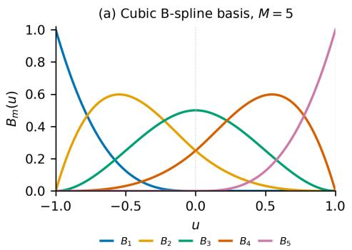

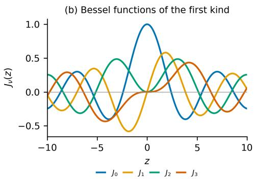  
Fig. 5: Basis functions of the two parametric paths. (a) The five cubic B-spline basis functions on $[ - 1 , 1 ]$ with knot vector $( - 1 , - 1 , - 1 , - 1 , 0 , 1 , 1 , 1 , 1 )$ , evaluated for $u \in [ - 1 , 1 )$ (at exactly $u = 1$ the implemented basis is zero; Section 6.2). (b) The Bessel functions $J _ { 0 } \mathrm { - } J _ { 3 }$ used in the Bessel path, shown for $z \in [ - 1 0 , 1 0 ]$

Parameters are updated with AdamW (default $\beta _ { 1 } , \beta _ { 2 } , \epsilon ;$ weight decay $1 0 ^ { - 4 } )$ after clipping the global gradient norm to 1.0, with a cosine learning-rate schedule (period equal to the number of epochs, stepped per epoch). Table 3 lists the remaining settings.

## 6.5 Baselines and variants

## 6.5.1 Parameter-matched MLP

A one-hidden-layer ReLU network with hidden width $H _ { } = \mathrm { r o u n d } \big ( ( P _ { \mathrm { t a r g e t } } - C _ { } ) / ( d _ { 0 } +$ $C + 1 ) ) = 6 5 0$ (516,760 parameters) for MNIST and Fashion-MNIST, trained with AdamW, gradient clipping and a cosine schedule but without the α-penalty (Table 3). EficientKAN, BSRBF-KAN and FC-KAN accuracies are quoted from their publications and were not re-run.

## 6.5.2 Parallel fusion (exploratory, MNIST)

Two $7 8 4  3 2  1 0$ networks are trained jointly: a spline network $( M = 5 ,$ , no Bessel terms) and a Bessel network (orders {0, 1}). Because of the four-spline minimum, the Bessel network also contains four B-splines per input (hence 336,832 parameters). Their outputs $o _ { S } , o _ { B }$ are fused by $o _ { S } + o _ { B }$ , by $o _ { S } + o _ { B } + o _ { S } \odot o _ { B }$ , or by a linear layer on [oS; oB] (337,042 parameters).

## 6.5.3 Iris ablation

The same layer is trained with $P \in \{ 0 , 2 , 4 , 6 \}$ Bessel terms, with learnable mixing, or with a request for a single spline (raised to four, 784 parameters).

## 6.6 Training and evaluation

Models were implemented in PyTorch (Python 3.12, PyTorch 2.10) and trained on an Apple-silicon GPU (MPS backend). Evaluation batches have 256 samples (64 for Iris);

Table 3: Training configuration. All runs use AdamW (weight decay $1 0 ^ { - 4 } )$ gradient-norm clipping at 1.0 and a cosine schedule.
<table><tr><td>Dataset</td><td>Model</td><td>Epochs</td><td>LR</td><td>Batch</td><td>Mixing</td><td>Seeds</td></tr><tr><td>Iris</td><td>BesselKAN</td><td>60</td><td> $3 \times 1 0 ^ { - 3 }$ </td><td>32</td><td>no</td><td>5</td></tr><tr><td>MNIST</td><td>BesselKAN</td><td>25</td><td> $3 \times 1 0 ^ { - 3 }$ </td><td>64</td><td>no</td><td>5</td></tr><tr><td>Fashion-MNIST</td><td>BesselKAN</td><td>35</td><td> $3 \times 1 0 ^ { - 3 }$ </td><td>64</td><td>yes</td><td>5</td></tr><tr><td>CIFAR-10</td><td>BesselKAN</td><td>25</td><td> $3 \times 1 0 ^ { - 3 }$ </td><td>64</td><td>no</td><td>5</td></tr><tr><td>MNIST / F-MNIST</td><td>MLP</td><td>25 / 35</td><td> $1 0 ^ { - 3 }$ </td><td>64</td><td>一</td><td>5</td></tr><tr><td>MNIST</td><td>Parallel fusion</td><td>25</td><td> $1 0 ^ { - 3 }$ </td><td>64</td><td>no</td><td>1</td></tr></table>

no warmup, mixed precision, dropout or early stopping was used. Each configuration was run with seeds {42, 123, 456, 789, 2024} (Python, NumPy and PyTorch generators; for Iris this also redraws the partition), and we report mean ± sample standard deviation. The metric is top-1 accuracy on the test set, evaluated after every epoch; the value reported for a run is the maximum over epochs (the saved weights are from the last epoch). Time per epoch includes evaluation.

## 6.7 Diagnostics

Edge functions. The full first-layer edge functions were evaluated on 200 points of 0-1.5,1.5] each output–input pair, and their curve shapes were clustered with k-means (=45000 5000. We also extracted the spline and Bessel contributions of the last layer separately.

Basis conditioning. On the 500 synthetic points we formed the design matrix Θ from the layer’s clamped B-spline basis (float32) and $J _ { \nu } ( x _ { n } ) ~ ( \alpha = 1 , \beta = 0 $ , no layer normalization), computed $\kappa ( G ) = \sigma _ { \mathrm { m a x } } ( G ) / \sigma _ { \mathrm { m i n } } ( G )$ for the Gram matrix $G = \Theta ^ { \top } \Theta$ and fitted each target by least squares (numpy.linalg.lstsq) with the 5-spline, 4-order Bessel and combined bases, reporting the in-sample RMSE.

## 7 Results

Accuracies are mean ± standard deviation over five seeds unless stated otherwise.

## 7.1 Benchmark classification

On MNIST the hybrid KAN reaches $9 7 . 5 3 \pm 0 . 0 7 \%$ and on Fashion-MNIST (with mixing) $8 9 . 3 4 \pm 0 . 3 0 \%$ , close to the reported BSRBF-KAN values (97.59% and 89.38%) and below the reported FC-KAN values (97.91% and 89.99%) (Table 4, Figure 6). The parameter-matched MLP is more accurate on both datasets $( 9 8 . 5 5 \pm 0 . 0 3 \%$ and $9 0 . 1 9 \pm 0 . 1 1 \%$ the paired per-seed diference is $1 . 0 1 \pm 0 . 0 5$ points on MNIST $( t = 4 3 . 0 $ 4 d.f.) and $0 . 8 5 \pm 0 . 3 7$ points on Fashion-MNIST (t = 5.1). On CIFAR-10 (flattened inputs, 3.98M parameters) the KAN reaches 51.44 ± 0.31%; no MLP was trained for this dataset. On Iris it reaches $8 0 . 6 7 \pm 6 . 4 1 \%$ . The KAN takes about 40 s per epoch on MNIST and Fashion-MNIST, 2.7–2.8 times the MLP, partly because the gradient of $J _ { 3 }$ uses the CPU.

Table 4: Test accuracy (%). “Time” is seconds per epoch on the MPS GPU. Literature values were quoted, not re-run.
<table><tr><td>Dataset</td><td>Model</td><td>Params</td><td>Accuracy Epochs</td><td></td><td>Time (s)</td></tr><tr><td>MNIST</td><td>BesselKAN (ours)</td><td> $^ { 5 1 6 , 6 4 0 }$ </td><td> $9 7 . 5 3 \pm 0 . 0 7$ </td><td>25</td><td>40.3</td></tr><tr><td>MNIST</td><td>MLP (param-matched)</td><td>516,760</td><td> $9 8 . 5 5 \pm 0 . 0 3$ </td><td>25</td><td>14.8</td></tr><tr><td>MNIST</td><td>EfficientKAN [13]</td><td></td><td> $\approx 9 7 . 0$ </td><td>25</td><td></td></tr><tr><td>MNIST</td><td>BSRBF-KAN [13]</td><td></td><td>97.59</td><td>25</td><td></td></tr><tr><td>MNIST</td><td>FC-KAN (DoG+BS) [14]</td><td></td><td>97.91</td><td>25</td><td></td></tr><tr><td>Fashion-MNIST</td><td>BesselKAN + mixing (ours)</td><td>516,714</td><td> $8 9 . 3 4 \pm 0 . 3 0$ </td><td>35</td><td>40.7</td></tr><tr><td>Fashion-MNIST</td><td>MLP (param-matched)</td><td>516,760</td><td> $9 0 . 1 9 \pm 0 . 1 1$ </td><td>35</td><td>14.3</td></tr><tr><td>Fashion-MNIST</td><td>BSRBF-KAN [13]</td><td></td><td>89.38</td><td>35</td><td></td></tr><tr><td>Fashion-MNIST</td><td>FC-KAN (DoG+BS) [14]</td><td></td><td>89.99</td><td>35</td><td></td></tr><tr><td>CIFAR-10</td><td>BesselKAN (ours)</td><td>3,976,960</td><td> $5 1 . 4 4 \pm 0 . 3 1$ </td><td>25</td><td>55.8</td></tr><tr><td>Iris</td><td>BesselKAN (ours)</td><td>680</td><td> $8 0 . 6 7 \pm 6 . 4 1$ </td><td>60</td><td>0.08</td></tr></table>

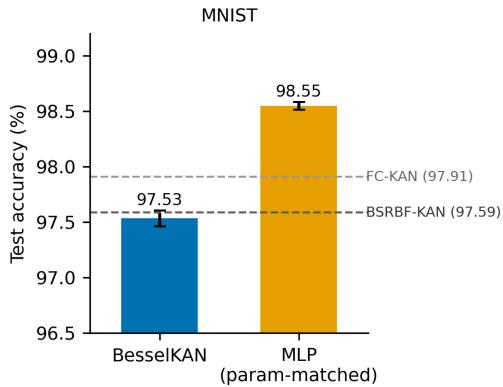

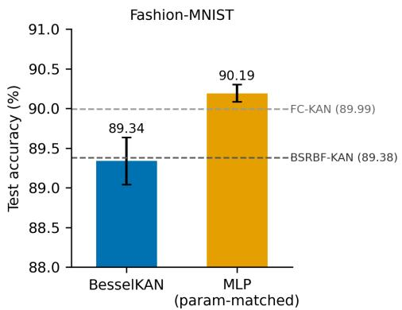  
Fig. 6: Test accuracy of the hybrid KAN and the parameter-matched MLP on MNIST and Fashion-MNIST (mean ± standard deviation over five seeds); dashed lines mark the accuracies reported for BSRBF-KAN and FC-KAN. Note the truncated vertical axes.

## 7.2 Iris ablation

The spline-only network has the highest mean accuracy (Table 5) and no variant with Bessel terms exceeds it. The largest gap (5.3 points, against $P = 4 )$ has paired t = 1.73 over five seeds; the only comparison above the $5 \%$ threshold $( t > 2 . 7 8 )$ is spline-only versus mixing $\left( t = 3 . 2 1 \right)$ , which does not survive correction for five comparisons. With 30 test samples (one sample = 3.3 points) and a partition that changes with the seed, these diferences are within the noise of the benchmark.

Table 5: Iris ablation (60 epochs, five seeds).
<table><tr><td>Configuration</td><td>Params</td><td>Accuracy (%)</td></tr><tr><td>Spline-only  $( P = 0 )$ </td><td>360</td><td> $8 6 . 0 \pm 6 . 4$ </td></tr><tr><td>Hybrid,  $P = 2$ </td><td>520</td><td> $8 4 . 7 \pm 6 . 5$ </td></tr><tr><td>Hybrid,  $P = 4$ </td><td>680</td><td> $8 0 . 7 \pm 6 . 4$ </td></tr><tr><td>Hybrid,  $P = 6$ </td><td>840</td><td> $8 4 . 7 \pm 3 . 8$ </td></tr><tr><td>Hybrid,  $P = 4 ,$  mixing</td><td>691</td><td> $8 2 . 0 \pm 6 . 1$ </td></tr><tr><td>Single-spline request,  $P = 6$ </td><td>784</td><td> $8 5 . 3 \pm 6 . 5$ </td></tr></table>

## 7.3 Parallel fusion (exploratory)

With a single seed (42) and learning rate $1 0 ^ { - 3 }$ , the add, interaction and concatenation variants reach 97.99%, 97.79% and 97.85% with about 337k parameters (27.7–28.3 s per epoch), against 97.15% for the single-network hybrid trained in the same experiment (516,640 parameters, 37.0 s per epoch).

## 7.4 Basis conditioning

The spline bases are well conditioned $( \kappa ( G ) \approx 3 0 $ for $M = 5$ and 28 for $M = 8 )$ ; the Bessel basis with $\nu = 0 { - } 3$ gives $8 . 4 \times 1 0 ^ { 4 }$ ; the 8-order Bessel basis and the hybrids with 4 and 6 Bessel orders give $3 . 7 \times 1 0 ^ { 1 5 }$ $2 . 1 \times 1 0 ^ { 1 4 }$ and $2 . 7 \times 1 0 ^ { 1 6 }$ , at or beyond double-precision limits. The hybrid basis has lower fit error than either component for all six targets (Table 6), with only a small improvement for the step function.

Table 6: In-sample least-squares fit error (RMSE) on the 500 points.
<table><tr><td>Target</td><td>Spline (5)</td><td>Bessel (4)</td><td>Hybrid (5+4)</td></tr><tr><td>sin(5x)</td><td>0.3632</td><td>0.3535</td><td>0.0568</td></tr><tr><td> $J _ { 0 } ( 3 x )$ </td><td>0.0124</td><td>0.0601</td><td>0.0006</td></tr><tr><td> $J _ { \perp } ( 5 x ) + J _ { 2 } ( 3 x )$ </td><td>0.1304</td><td>0.1322</td><td>0.0163</td></tr><tr><td> $x ^ { 2 }$ </td><td>0.0447</td><td>0.0066</td><td>0.0000</td></tr><tr><td>|x|</td><td>0.0532</td><td>0.0669</td><td>0.0107</td></tr><tr><td> $\mathbb { H } [ x > 0 ]$ </td><td>0.1926</td><td>0.1861</td><td>0.1504</td></tr></table>

## 7.5 Learned edge functions

Clustering the learned first-layer edge functions gives four shape templates whose shares difer between MNIST and Fashion-MNIST (template 3: about 54% of active edges on MNIST, 18% on Fashion-MNIST); three templates show an abrupt step at $u = 1$ . In the last layer the Bessel branch has a larger mean absolute contribution than the spline branch for all ten MNIST classes (spline-to-Bessel ratio about 0.57–0.73), with no systematic diference between the digit groups (1, 4, 7) and (0, 6, 8) (Figures 7 and 8).

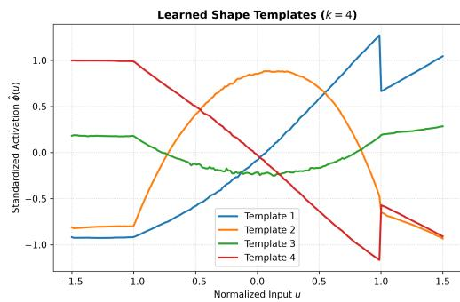

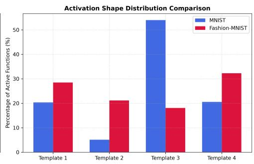  
Fig. 7: Learned first-layer edge functions. Left: four shape templates (k-means, $k = 4 )$ of the standardized edge functions $\hat { \phi } ( u )$ over $u \in [ - 1 . 5 , 1 . 5 ]$ . Right: share of each template among active edge functions on MNIST and Fashion-MNIST.

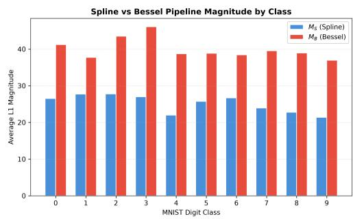

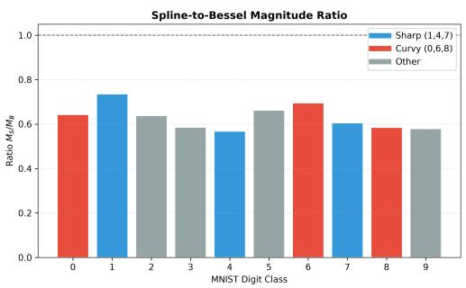  
Fig. 8: Contribution of the spline and Bessel branches of the last layer on MNIST. Left: mean absolute (L1) magnitude per digit class. Right: spline-to-Bessel magnitude ratio per class; colours mark the digit groups (1, 4, 7) and (0, 6, 8).

## 8 Discussion

## 8.1 Accuracy

The hybrid KAN is competitive with published KAN variants on MNIST and Fashion-MNIST (within 0.06 and 0.04 points of the reported BSRBF-KAN, 0.38 and 0.65 points below FC-KAN) but does not exceed a parameter-matched MLP, which is 1.0 and 0.85 points more accurate in every paired seed. The results therefore show no accuracy benefit of the architecture on these benchmarks. The literature values are single numbers whose seeds, epoch selection and training details we did not reproduce.

## 8.2 Role of the Bessel terms

The ablation isolating the Bessel path was run only on Iris, where the spline-only network was nominally best and diferences are within noise. No spline-only network was trained on the image benchmarks, so the present experiments cannot attribute any of their accuracy to the Bessel terms.

## 8.3 Parallel fusion

Separating the branches gave the highest KAN accuracy observed (97.99%) with 35% fewer parameters, but this is a single-seed run at a diferent learning rate whose second branch also contained B-splines; it indicates a direction, not a result.

## 8.4 Conditioning and edge functions

Combining the bases lowered the in-sample fit error but made the design matrix extremely ill conditioned $( \kappa ( G ) \approx 1 0 ^ { 1 4 } – 1 0 ^ { 1 6 } )$ ; because the fit is evaluated on the fitting points and the hybrid has more columns, this does not show better approximation, and we did not measure the conditioning of trained layers. The larger Bessel contribution did not separate digit groups, so the hypothesis that it preferentially serves curved digits is not supported. The step at u = 1 in the learned edge functions is consistent with the boundary behaviour of the spline basis (Section 6.2).

## 8.5 Architectural Eficiency and the Parallel Pipeline

While monolithic hybrid KANs perform competitively against literature baselines, our spectral analysis reveals a severe structural limit. As it evaluates B-splines and high-order Bessel functions on the same edge, it drives the Gram matrix condition number toward $1 0 ^ { 1 6 }$ , which caps its scalability.

To bypass this bottleneck, our exploratory parallel pipeline (see Section 2.5.2) decouples the basis functions into a $3 2 + 3 2$ split of dedicated Spline and Bessel branches. This parallel architecture restored mathematical stability and achieved our highest observed KAN accuracy (97.99% via additive fusion, 97.79% via interaction). Critically, it compressed the parameter count to ∼337,000, which is a 35% reduction from the monolithic BesselKAN. Separating these families prevents overlapping feature collision, allowing the network to independently leverage localized spline geometry and structural Bessel wave patterns.

However, empirical timings highlight a systemic KAN limitation. Despite a 35% parameter reduction, the parallel KAN required ∼28 seconds per epoch compared to 14.8 seconds for a parameter-matched MLP. This confirms that while KANs ofer superior parameter density, the dynamic evaluation of continuous bases cannot currently match the GPU batch parallelization eficiency of fixed-activation MLPs.

## 8.6 Limitations

(i) The reported accuracy is the maximum over epochs on the test set, which is optimistic; a validation split is needed. (ii) The KAN used learning rate $3 \times 1 0 ^ { - 3 }$ and the MLP $1 0 ^ { - 3 }$ , and neither was tuned. (iii) The spline basis vanishes for inputs clamped to exactly +1 (Section 6.2) and layer normalization places many inputs outside [−1, 1]; the efect on accuracy was not measured. (iv) CIFAR-10 was trained on flattened inputs without augmentation and is not comparable with convolutional networks. (v) Iris has 30 test samples. (vi) Times come from one machine and backend.

## 9 Conclusions

Our research systematically evaluated the integration of Bessel functions into the Kolmogorov-Arnold Network (KAN) framework, seeking to combine the local adaptivity of B-splines with the continuous, oscillatory priors of Bessel functions. Through rigorous empirical benchmarking and spectral matrix analysis, we’ve identified a critical limitation in current hybrid KAN designs, i.e. combining distinct functional families on a single monolithic edge leads to catastrophic geometric overlap, driving the design matrix into severe numerical ill-conditioning $( \kappa ( G ) \approx 1 0 ^ { 1 } 6 )$

To resolve this, we introduced a Parallel BesselKAN architecture that isolates the functional basis families into distinct processing pipelines. This structural decoupling proved highly efective for parameter eficiency. In our exploratory trials, the parallel formulation achieved a peak MNIST accuracy of 97.99%, marginally outperforming the monolithic hybrid (97.53%) while drastically reducing the network capacity by 35% (down to ∼337k parameters). The parallel pipeline successfully proves that KAN architectures can be compressed and stabilized by treating diferent mathematical bases as internal ensembles rather than per-edge additions.

Despite these representational eficiencies, our comprehensive benchmarks against standard Multi-Layer Perceptrons reveal enduring practical limitations for the KAN paradigm in computer vision. Standard parameter-matched MLPs consistently outperformed the hybrid KAN variants in both raw accuracy and computational speed, training nearly three times faster per epoch. Furthermore, the architecture’s performance drop on the complex CIFAR-10 dataset underscores the necessity of spatial inductive biases. We conclude that while Parallel BesselKANs provide a mathematically robust, highly parameter-eficient alternative to monolithic networks, future research must prioritize integrating these parallel basis pipelines into Convolutional KAN (ConvKAN) architectures and optimizing GPU-level continuous function evaluation to truly rival MLPs in high-dimensional spatial tasks.

## References

[1] Liu, Z., Wang, Y., Vaidya, S., Ruehle, F., Halverson, J., Soljačić, M., Hou, T.Y., Tegmark, M.: Kan: Kolmogorov–arnold networks. In: International Conference on Learning Representations (2025)

[2] Somvanshi, S., Javed, S.A., Islam, M.M., Pandit, D., Das, S.: A survey on kolmogorov-arnold network. ACM Computing Surveys 58(2), 1–35 (2025) https: //doi.org/10.1145/3743128

[3] Yu, R., Yu, W., Wang, X.: KAN or MLP: A Fairer Comparison. arXiv preprint arXiv:2407.16674 (2024)

[4] Ullah, Z., Kim, J.: Exploring kolmogorov–arnold network expansions in vision transformers for mitigation of catastrophic forgetting in continual learning. Mathematics 13(18) (2025) https://doi.org/10.3390/math13182988

[5] Vaswani, A., Shazeer, N., Parmar, N., Uszkoreit, J., Jones, L., Gomez, A.N., Kaiser, Ł., Polosukhin, I.: Attention is all you need. In: Advances in Neural Information Processing Systems 30 (NeurIPS 2017), pp. 5998–6008 (2017). https://papers.nips.cc/paper/7181-attention-is-all-you-need

[6] Dosovitskiy, A., Beyer, L., Kolesnikov, A., Weissenborn, D., Zhai, X., Unterthiner, T., Dehghani, M., Minderer, M., Heigold, G., Gelly, S., Uszkoreit, J., Houlsby, N.: An image is worth 16x16 words: Transformers for image recognition at scale. In: International Conference on Learning Representations (ICLR) (2021). https://openreview.net/forum?id=YicbFdNTTy

[7] McCloskey, M., Cohen, N.J.: Catastrophic interference in connectionist networks: The sequential learning problem. In: Bower, G.H. (ed.) The Psychology of Learning and Motivation vol. 24, pp. 109–165. Academic Press, ??? (1989). https://doi.org 10.1016/S0079-7421(08)60536-8

[8] French, R.M.: Catastrophic forgetting in connectionist networks. Trends in Cognitive Sciences 3(4), 128–135 (1999) https://doi.org/10.1016/S1364-6613(99) 01294-2

[9] Kirkpatrick, J., Pascanu, R., Rabinowitz, N., Veness, J., Desjardins, G., Rusu, A.A., Milan, K., Quan, J., Ramalho, T., Grabska-Barwinska, A., Hassabis, D., Clopath, C., Kumaran, D., Hadsell, R.: Overcoming catastrophic forgetting in neural networks. Proceedings of the National Academy of Sciences 114(13), 3521–3526 (2017) https://doi.org/10.1073/pnas.1611835114

[10] Parisi, G.I., Kemker, R., Part, J.L., Kanan, C., Wermter, S.: Continual lifelong learning with neural networks: A review. Neural Networks 113, 54–71 (2019) https://doi.org/10.1016/j.neunet.2019.01.012 . arXiv:1802.07569

[11] Chao, Z., Liu, X., Wu, Z., Li, X.: Rbf-kan: Radial basis function–kolmogorov–arnold network. IEEE Internet of Things Journal 13(10), 21018–21027 (2026) https://doi.org/10.1109/JIOT.2026.3665400

[12] Abdallah Mahmoud, A., Pester, A., Muttardi, M.M., Andres, F., Tanabe, S., Greneche, N., Ali, H.H.: Cheby-kans: Advanced kolmogorov–arnold networks for applying geometric deep learning in quantum chemistry applications. IEEE Access 13, 130525–130534 (2025) https://doi.org/10.1109/ACCESS.2025.3566551

[13] Ta, H.-T.: Bsrbf-kan: A combination of b-splines and radial basis functions in kolmogorov-arnold networks. In: Buntine, W., Fjeld, M., Tran, T., Tran, M.- T., Huynh Thi Thanh, B., Miyoshi, T. (eds.) Information and Communication Technology, pp. 3–15. Springer, Singapore (2025)

[14] Ta, H.-T., Thai, D.-Q., Rahman, A.B.S., Sidorov, G., Gelbukh, A.: Fc-kan: Function combinations in kolmogorov-arnold networks. Information Sciences 736, 123103 (2026) https://doi.org/10.1016/j.ins.2026.123103

[15] Yang, K., Yan, Y., Hou, Y., Li, Y., Zhang, L., Xu, B., Wang, K., Zhang, D.: A modified Kolmogorov–Arnold network for automatic modulation classification. IEEE Photonics Technology Letters 38(15), 1130–1133 (2026) https://doi.org/10. 1109/LPT.2026.3677693

[16] Poole, A., McArthur, S., Kumar, S.: Entropy-guided projective Kolmogorov– Arnold networks for compact and robust edge-function learning. Frontiers in Artificial Intelligence 9 (2026) https://doi.org/10.3389/frai.2026.1880092

[17] Kolmogorov, A.N.: On the representation of continuous functions of many variables by superposition of continuous functions of one variable and addition. Doklady Akademii Nauk SSSR 114(5), 953–956 (1957). In Russian. English translation: Amer. Math. Soc. Transl. (2) 28 (1963), 55–61

[18] Arnol’d, V.I.: On functions of three variables. Doklady Akademii Nauk SSSR 114(4), 679–681 (1957). In Russian. English translation: Amer. Math. Soc. Transl. (2) 28 (1963), 51–54

[19] Cybenko, G.: Approximation by superpositions of a sigmoidal function. Mathematics of Control, Signals and Systems 2(4), 303–314 (1989) https://doi.org/10. 1007/BF02551274

[20] Hornik, K., Stinchcombe, M., White, H.: Multilayer feedforward networks are universal approximators. Neural Networks 2(5), 359–366 (1989) https://doi.org/ 10.1016/0893-6080(89)90020-8

[21] Leshno, M., Lin, V.Y., Pinkus, A., Schocken, S.: Multilayer feedforward networks with a nonpolynomial activation function can approximate any function. Neural Networks 6(6), 861–867 (1993) https://doi.org/10.1016/S0893-6080(05)80131-5

[22] Barron, A.R.: Universal approximation bounds for superpositions of a sigmoidal function. IEEE Transactions on Information Theory 39(3), 930–945 (1993) https: //doi.org/10.1109/18.256500

[23] Sprecher, D.A.: A representation theorem for continuous functions of several variables. Proceedings of the American Mathematical Society 16(2), 200–203 (1965) https://doi.org/10.1090/S0002-9939-1965-0174666-7

[24] Lorentz, G.G.: Approximation of Functions. Athena Series: Selected Topics in Mathematics, p. 188. Holt, Rinehart and Winston, New York (1966)

[25] Boor, C.: A Practical Guide to Splines. Applied Mathematical Sciences, vol. 27, p. 392. Springer, New York (1978). https://doi.org/10.1007/978-1-4612-6333-3

[26] Watson, G.N.: A Treatise on the Theory of Bessel Functions, 2nd edn., p. 804. Cambridge University Press, Cambridge (1944). Reprinted 1966, 1980, 1995

[27] Hendrycks, D., Gimpel, K.: Gaussian error linear units (GELUs). In: arXiv Preprint arXiv:1606.08415 (2016). https://doi.org/10.48550/arXiv.1606.08415 . https://arxiv.org/abs/1606.08415

[28] LeCun, Y., Bottou, L., Bengio, Y., Hafner, P.: Gradient-based learning applied to document recognition. Proceedings of the IEEE 86(11), 2278–2324 (1998) https://doi.org/10.1109/5.726791

[29] Krizhevsky, A.: Learning multiple layers of features from tiny images. Technical report, University of Toronto (2009). https://www.cs.toronto.edu/%7Ekriz/ learning-features-2009-TR.pdf

[30] Zhang, Z., Li, Y., Wu, A., Han, Y.: Fourier-kan: Feature distribution decomposition and recombination for unknown-domain object detection. IEEE Transactions on Image Processing 35, 2609–2624 (2026) https://doi.org/10.1109/TIP.2026. 3671583

[31] Chiu, S.-T., Cheung, S.W., Braga-Neto, U., Lee, C.S., Li, R.P.: Free-RBF-KAN: Kolmogorov-Arnold Networks with Adaptive Radial Basis Functions for Eficient Function Learning (2026). https://arxiv.org/abs/2601.07760

[32] Raissi, M., Perdikaris, P., Karniadakis, G.E.: Physics-informed neural networks: A deep learning framework for solving forward and inverse problems involving nonlinear partial diferential equations. Journal of Computational Physics 378, 686–707 (2019) https://doi.org/10.1016/j.jcp.2018.10.045

[33] Lu, L., Jin, P., Pang, G., Zhang, Z., Karniadakis, G.E.: Learning nonlinear operators via DeepONet based on the universal approximation theorem of operators. Nature Machine Intelligence 3(3), 218–229 (2021) https://doi.org/10.1038/ s42256-021-00302-5 . arXiv:1910.03193

[34] Aghaei, A.A., Hosseinzadeh, M., Parand, K.: rkan: Rational kolmogorov-arnold networks. Neural Networks 201, 108888 (2026) https://doi.org/10.1016/j.neunet. 2026.108888

[35] Bozorgasl, Z., Chen, H.: Wav-KAN: Wavelet Kolmogorov-Arnold Networks (2024). https://arxiv.org/abs/2405.12832

[36] Worrall, D.E., Garbin, S.J., Turmukhambetov, D., Brostow, G.J.: Harmonic networks: Deep translation and rotation equivariance. In: Proceedings of the IEEE Conference on Computer Vision and Pattern Recognition (CVPR), pp. 5028–5037 (2017). https://doi.org/10.1109/CVPR.2017.503

[37] Ramon-Pedrero, L.E., Hernández-Nolasco, J.A., Pancardo, P.: Análisis comparativo de redes de Kolmogorov–Arnold y perceptrones multicapa para la representación de funciones especiales. Research in Computing Science 155(7), 51–63 (2026)

[38] Hewitt, E., Hewitt, R.E.: The Gibbs–Wilbraham phenomenon: An episode in Fourier analysis. Archive for History of Exact Sciences 21(2), 129–160 (1979) https://doi.org/10.1007/BF00330404

[39] Krantz, S.G., Parks, H.R.: A Primer of Real Analytic Functions, 2nd edn. Birkhäuser Advanced Texts. Birkhäuser, Boston (2002). https://doi.org/10.1007/ 978-0-8176-8134-0

[40] NIST Digital Library of Mathematical Functions. Release 1.2.4 of 2025-03-15, Gaithersburg, MD. See §10.17 for asymptotic expansions of Bessel functions. https://dlmf.nist.gov/

[41] Corduneanu, C.: Almost Periodic Functions. Interscience Tracts in Pure and Applied Mathematics, vol. 22, p. 237. Interscience Publishers, New York (1968). Translated from the Romanian by Gitta Bernstein and Eugene Tomer. 2nd English ed. published by Chelsea Pub. Co., 1989

[42] Rudin, W.: Principles of Mathematical Analysis, 3rd edn. International Series in Pure and Applied Mathematics. McGraw-Hill, New York (1976)

[43] Fisher, R.A.: The use of multiple measurements in taxonomic problems. Annals of Eugenics 7(2), 179–188 (1936) https://doi.org/10.1111/j.1469-1809.1936.tb02137. x

[44] Xiao, H., Rasul, K., Vollgraf, R.: Fashion-MNIST: a Novel Image Dataset for Benchmarking Machine Learning Algorithms. arXiv preprint arXiv:1708.07747 (2017)