# Agentic-MatriBO: Capability-Compiled Agentic Bayesian Optimization for Materials and Chemical Design

Yu Zeng, Yuchuan Chen, Ziyue Zhang,

Zijian Wei, Yanyi Su, Guojiang Zhao,

Hongshuai Wang, Zhifeng Gao

DP Technology, Beijing, China

## Abstract

Materials and chemical optimization must choose the next synthesis, characterization, or high-fidelity simulation from sequential observations under a limited budget. Large language models can use task knowledge to propose adjustments, but composing surrogates, acquisition functions, and search strategies is constrained by compatibility, parameter dependencies, and evidence requirements. We present Agentic-MatriBO, a capability-compiled agentic Bayesian optimization (BO) framework that represents BO components and selection conditions as composable capabilities. A language policy proposes BO recipes and candidate plans; a compiler checks proposals against the registered capability catalog; and a deterministic execution layer validates and commits candidates. Oracle observations are stored in research memory and inform later rounds. We compare Agentic-MatriBO with eight baselines on four ofline finite candidate pools—COF, PCE10, Buchwald–Hartwig (BH), and Suzuki–Miyaura—using five seeds per condition; results are reported descriptively. Across the four tasks, Agentic-MatriBO has the best mean endpoint quality after orienting each objective so that higher is better. On COF, it reaches the tabulated optimum in all five seeds both in the end-to-end comparison and after shared initialization, where it also retains an advantage in cumulative quality. Its normalized area under the best-so-far quality curve during the BO stage (nAUC-BO) is substantially higher on COF, near parity with the best baseline on PCE10 and BH, and lower on Suzuki. COF ablations show that removing the capability compiler or evidence gate coincides with lower cumulative quality and fewer exact-optimum hits. The framework provides an inspectable interface for evidence-conditioned BO adaptation.

## 1. Introduction

In materials and chemical research, a limited budget must be allocated across candidate syntheses, characterizations, or high-fidelity simulations. Bayesian optimization (BO) combines a probabilistic surrogate with an acquisition function to balance exploitation and exploration in this setting [1–5]. Its behavior also depends on candidate representation, initialization, and configuration, which can be adjusted as evidence accumulates [2, 6].

Numerical BO already adapts acquisition portfolios, local search regions, and surrogate configurations [7–9]. However, combining heterogeneous components requires explicit compatibility, evidence, and execution interfaces; the optimizer must coordinate these components rather than select one rule in isolation.

Large language models (LLMs) provide a natural-language interface for task semantics and history, but their proposals still require candidate validity checks and numerical modeling. Existing work injects language information into representations, kernels, acquisition strategies, or search regions [10–14]. Turning these capabilities into compositions additionally requires cross-component contracts and execution rules.

We present Agentic-MatriBO, which organizes two-level compositional adaptation for materials and chemical optimization through evidence-conditioned capability compilation. BO components and their selection conditions are registered as composable capabilities; a language policy proposes algorithmic adjustments on this basis; and an execution layer checks and enacts the proposals. Semantic reasoning proposes the optimization scheme; numerical surrogates and acquisitions rank candidates, while deterministic checks govern commitment. Here, the two levels are BO-recipe configuration and per-round candidate planning.

Specifically, the Atomic Capability Space provides a unified description of component parameter domains, compatibility relations, and runtime conditions. The Evidence-Conditioned Capability Compiler organizes available capabilities from the task and current state, supports policy selection with historical evidence, and checks proposal admissibility. Two-Level Compositional Adaptation jointly proposes BO recipes and candidate plans, while a deterministic execution layer performs numerical search, candidate validation, and commitment. The experiment oracle returns target observations, and research memory feeds observations and reflections into later rounds. Figure 1 shows the overall loop, and Figure 2 expands the capability contracts, compilation, and execution mechanisms.

## The main contributions are:

• Capability compilation with selection contracts. Numerical components are registered as atomic capabilities together with their parameter domains, compatibility conditions, and evidence requirements. The compiler organizes a capability catalog from the current search state and checks the admissibility of composition proposals.

• Execution semantics for two-level adaptation. The method specifies coordinated adjustment of recipes and candidate plans, separates policy proposals from candidate commitment, and states the conditions under which observation and budget accounting are invariant and classical BO is recovered as a special case.

• Evaluation that separates the starting point from subsequent search. Four-task comparisons, shared initialization on COF, and grouped ablations examine the efects of the starting point and configuration, and characterize how optimization gains vary by task and search stage.

## 2. Problem Definition

## 2.1 Standard Bayesian Optimization and Fixed Policies

Materials synthesis, characterization, and high-fidelity simulation are often expensive to evaluate, so a finite budget � must be used to search sequentially for high-value regions of a black-box objective � [1–5]. Let ℋ� denote the current completed input–observation history and let $X _ { t } ^ { \mathrm { f e a s } }$ be the nonempty set of inputs that may be evaluated. Standard BO constructs a probabilistic surrogate $p _ { m _ { t } } ( f \mid \mathcal { H } _ { t } )$ from the history, uses an acquisition function to propose a candidate, and submits it to the evaluation process. In the singlepoint setting, while the budget remains and the maximum acquisition value can be obtained, proposal and commitment can be written as Eq. 1:

$$
\widetilde { x } _ { t + 1 } \in \arg \operatorname* { m a x } _ { x \in \mathcal { X } _ { t } ^ { \mathrm { f o a s } } } \alpha _ { t } \big ( x ; p _ { m _ { t } } ( f \mid \mathcal { H } _ { t } ) \big ) , \qquad x _ { t + 1 } = \mathsf { C o m m i t } _ { 0 } ( \widetilde { x } _ { t + 1 } ) .\tag{1}
$$

The standard loop commits the proposed candidate and updates the history only after the target observation is returned. Let $m _ { t } , \alpha _ { t } , s _ { t } , \theta _ { t }$ denote the surrogate, acquisition function, search strategy, and parameters, and let $\xi _ { t }$ denote task and runtime state. The fixed policy Π maps this interface to the configuration:

$$
c _ { t } = \big ( m _ { t } , \alpha _ { t } , s _ { t } , \theta _ { t } \big ) = \Pi _ { 0 } ( \mathcal { H } _ { t } , \xi _ { t } ) .
$$

Here “fixed” refers to the policy and interface, not to an unchanged configuration: portfolios and search regions may vary with the data [7–9]. We use this boundary to study contract-governed composition while keeping the task fixed.

## 2.2 Materials-Task Contracts and a Variable Optimizer

A scientific task remains fixed within one optimization campaign and is represented by the following task tuple:

$$
\tau = ( \boldsymbol { \mathcal { I } } , \boldsymbol { \mathcal { X } } , \boldsymbol { x } , f _ { \tau } , C , B , \nu ) .
$$

The tuple records candidate identifiers and features, the oracle objective, feasibility constraint, evaluation budget, and task metadata. We use maximization notation; minimization tasks use the historical minimum while retaining the original objective units.

Completed observations and eligible candidates that have not yet been queried are

$$
\mathcal { D } _ { t } = \{ ( i , x _ { i } , y _ { i } ) : i \in I _ { t } ^ { \mathrm { o b s } } \} , \qquad y _ { i } = f _ { \tau } ( i ) , \qquad \boldsymbol { J } _ { t } ^ { \mathrm { e l i g } } = \{ i \in I \setminus { I } _ { t } ^ { \mathrm { o b s } } : \boldsymbol { C } ( i ) = 1 \} .
$$

Here � indexes optimization rounds, and $n _ { t } = | \mathcal { D } _ { t } |$ counts completed evaluations, including initialization. Candidates are determined by table identifiers, while features are used for numerical computation. With the configuration notation above, the online optimization configuration is the recipe

$$
r _ { t } = ( m _ { t } , \alpha _ { t } , s _ { t } , \theta _ { t } ) ,
$$

corresponding to the surrogate, acquisition function, search strategy, and their active parameters. Initialization produces $\mathcal { D } _ { 0 }$ and an initial recipe, and its oracle calls count toward the budget. Each round evaluates one candidate while $n _ { t } ~ < ~ B$ and the pool is nonempty. Probes and historical retrieval inform the policy without adding target observations and are excluded from the oracle budget.

## 2.3 Separation of Authority and the Commitment Boundary

A proposal supplies an optimization adjustment to be checked, while a commitment authorizes one target evaluation and an observation records the result returned by the evaluation process. In what follows, candidate commitment refers to a non-STOP path; STOP terminates the search and returns a report. The outputs and permissions of the roles are:

Table 1: Roles, permissions, and commitment boundaries.
<table><tr><td>Role</td><td>Outputs and permissions</td><td>Boundary</td></tr><tr><td>Policy reasoning layer</td><td>Interprets the task and evidence; proposes recipes, candidate plans, and probes</td><td>Does not directly commit candidate IDs or generate target observations</td></tr><tr><td>Deterministic BO execution layer</td><td>Compiles the catalog, validates proposals, generates a candidate shortlist, fuses scores, and commits a candidate</td><td>Validation covers only the actual execution path; it does not generate target values</td></tr><tr><td>Advisory reviewers</td><td>Return bounded task scores and public justification for given candidates</td><td>Cannot add candidates, commit independently, or veto candidates unilaterally</td></tr><tr><td>Experiment oracle</td><td>Returns target values and related observations for submitted IDs</td><td>Does not replace target values with language-generated values</td></tr><tr><td>Research memory</td><td>Stores, links, and retrieves results, hypotheses, and reflections</td><td>Does not authorize execution or treat explanations as observations</td></tr></table>

The deterministic execution layer is deterministic given a proposal, candidate order, scores, runtime state, and numerical environment; the optimization campaign as a whole still includes LLM calls and random sampling.

## 3. Related Work

## 3.1 Numerical Modeling and Online Adaptation in Materials Optimization

BO fits a probabilistic surrogate to observed data and uses an acquisition function to select the next query [3– 5], and it is widely used for sequential experimental design under limited materials budgets [1,2]. Materialsoptimization benchmarks compare search behavior under diferent candidate distributions, objectives, and initialization conditions [6]; closed-loop experimental studies focus on connecting recommendations to measurements and on supervising recommendation quality and the operating process [15, 16].

Numerical BO adapts at several levels: acquisition portfolios allocate opportunities among diferent selection rules [7], TuRBO adjusts the local search region [8], and adaptive-surrogate methods change the model form [9]. Libraries such as BoTorch provide an implementation basis for composing numerical components [17]. Related work also discusses calibration and sharpness of probabilistic predictions [18], as well as the relationship between model uncertainty and optimization regret [19], ofering diferent perspectives for diagnosing and evaluating surrogate models.

## 3.2 Diferent Entry Points for Language Information into BO

Existing LLM–BO methods can be distinguished by where they intervene. LLAMBO uses natural-language task descriptions and history to support warm starts, candidate generation, and surrogate-like discrimination [14]; BORA uses language reasoning to identify potential regions [10]. At the model level, CAKE evolves GP kernels [11], while GOLLuM jointly learns language-representation adaptation parameters and GP hyperparameters [12]. At the decision level, LMABO adjusts acquisition strategies [13], and LGBO introduces language preferences [20]. LABO treats LLM predictions as a low-cost information source to be used alongside expensive evaluations [21]. These methods mainly interface with model representations, candidate preferences, or optimization configurations.

Recent preprints also explore agentic BO at run time. Brunzema et al. present Sara, an agent operating through the modular lenz BO framework, with structured interfaces for reconfiguring numerical components [22]; DASH combines numerical diagnostics and language reasoning to adapt the surrogate model and acquisition strategy separately [23].

Prior work provides numerical components, language representations, and candidate-guidance mechanisms. We discuss them at a diferent design level, placing them within a capability-compilation framework. Agentic-MatriBO focuses on the selection conditions, composition admissibility, and execution semantics of these capabilities, and can incorporate specific components when the corresponding interfaces and contracts are satisfied. The scope of the quantitative comparison is given in Section 5.2.

## 4. Method: Capability-Compiled Agentic-MatriBO

## 4.1 Method Overview and Execution Flow

Figure 1 shows the loop from the search state to a new observation. Evidence-Guided Policy Adaptation organizes the capability catalog and evidence to form recipe and candidate-plan proposals; Harnessed Candidate Decision validates proposals, constructs the candidate set, and commits a candidate; Retrospective Research Memory links observations to prior expectations for retrieval in later rounds.

The recipe-level proposal governs the numerical model and search policy; the candidate-plan proposal determines how the current round’s shortlist is assembled and ranked. Neither proposal authorizes an oracle call: deterministic compatibility and feasibility checks precede commitment of a legal candidate ID, and only the oracle supplies target observations.

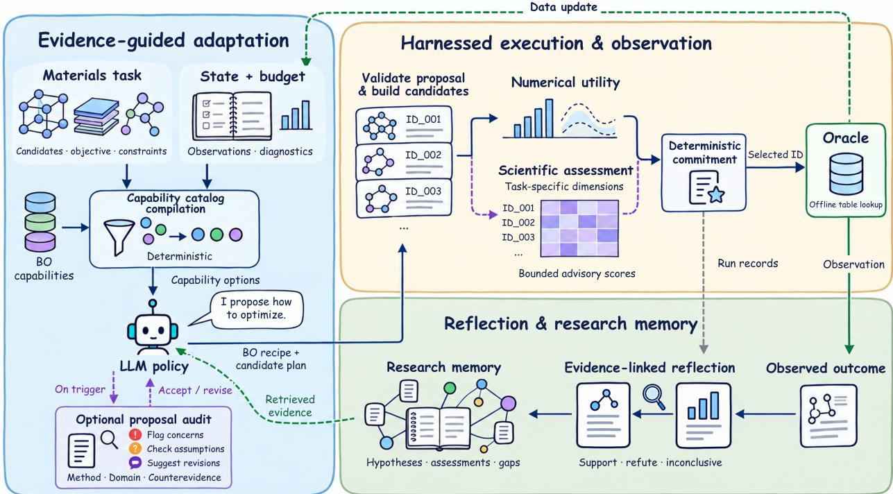

Figure 1: Research loop and execution boundaries of Agentic-MatriBO. The three blocks separate evidence-guided policy adaptation, candidate decision, and retrospective memory; deterministic interfaces define their permissions. Capability compilation supplies the catalog, the policy proposes a recipe and candidate plan, execution validates and commits a legal candidate, and the oracle returns the observation. Observations and evidence judgments are stored for later retrieval, with proposal, candidate, and post-observation reviews applied at their respective stages.  
Algorithm 1. Single-point optimization round under the declared target protocol.   
Input: task $\tau ,$ observations $\mathcal { D } _ { t } , \mathrm { r e c i p e } r _ { t } ,$ runtime $R _ { t } ,$ and probe cap �max.   
1. If the budget or eligible pool is exhausted, return a report.   
2. Compile the state, capability catalog, and available evidence.   
3. The policy proposes an action, recipe, candidate plan, and probes.   
4. For PROBE, run diagnostics up to $J _ { \mathrm { m a x } }$ and loop; for STOP, return a report.   
5. Validate contracts, evidence, and the candidate plan; defer or repair invalid proposals.   
6. Build a valid shortlist and fuse deterministic numerical utility with complete valid review scores.   
7. Select a legal candidate $\operatorname { I D } ;$ if none exists, terminate without calling the oracle.   
8. Evaluate the ID, append the observation, and update memory and evidence.   
Output: the new observation, active recipe, and research state, or a termination report

## 4.2 Atomic Capability Space

To provide a common interface for heterogeneous adjustments, an independently selectable capability is represented by the contract $\boldsymbol { a } = \left( \mathrm { i d } _ { a } , \kappa _ { a } , \mathsf { E x e c } _ { a } , \Theta _ { a } , \mathsf { C o m p } _ { a } , \mathsf { R e q } _ { a } , \mathsf { G a t e } _ { a } , \mathsf { F a i l } _ { a } \right)$

The entries are, in order, the canonical ID, capability type, registered implementation, parameter domain, compatibility conditions, runtime requirements, evidence prerequisites, and failure signals. The registered space $\mathcal { A } = \mathcal { \hat { A } } ^ { m } \cup \mathcal { A } ^ { \alpha } \cup \mathcal { A } ^ { s } \cup \mathcal { A } ^ { i }$ contains surrogate, acquisition, search, and setup-stage initialization capabilities. $\mathrm { A n } \ ^ { \prime \prime } { \mathrm { a t o m i c } } ^ { \prime \prime }$ capability can be selected and composed independently; its contract exposes applicability, evidence requirements, and failure signals to the policy and its numerical object to the execution layer. For example, an ARD GP contract records feature scale, sample size, and length-scale stability or cross-validation advantage over an approximately isotropic $\mathrm { G P } ;$ the compiler turns these prerequisites into a state that the policy must support.

## 4.3 Evidence-Conditioned Capability Compiler

The catalog-compilation interface $\Gamma ( \tau , S _ { t } , R _ { t } , E _ { t } )$ receives the task, state, runtime context, and diagnostic or historical evidence. It filters compatible capabilities, annotates evidence states, and checks whether proposed compositions and their declared support may enter execution. Retrieved history informs the policy, whereas catalog states are computed from encoded task, state, and diagnostic conditions.

For online capability types $\kappa \in \{ m , \alpha , s \}$ , the context catalog is

$$
{ \mathcal { A } } _ { t } ^ { \kappa , { \mathrm { c t x } } } = \{ a \in { \mathcal { A } } ^ { \kappa } : { \mathsf { C o m p } } _ { a } ( \tau ) = 1 , { \mathsf { R e q } } _ { a } \subseteq R _ { t } \} .
$$

For each atom in the catalog, task facts, optimization state, and numerical diagnostics classify its declared minimum evidence prerequisites as supported, contradicted, or unverified, and reduce them to

$$
g _ { t } ( a ) = \left\{ \begin{array} { l l } { \mathrm { B L O C K E D } , } & { \mathrm { a t ~ l e a s t ~ o n e ~ p r e r e q u i s i t e ~ i s ~ c o n t r a d i c t e d } , } \\ { \mathrm { R E A D Y } , } & { \mathrm { a l l ~ p r e r e q u i s i t e s ~ a r e ~ s u p p o r t e d } , } \\ { \mathrm { N E E D S \_ E V I D E N C E } , } & { \mathrm { o t h e r w i s e } . } \end{array} \right.
$$

An atom with no minimum evidence prerequisite is READY once its hard conditions are satisfied; an atom outside the catalog is considered blocked. The state is determined by encoded admission prerequisites, while use recommendations and failure signals provide selection guidance to the policy.

Let $\zeta _ { t } ( a )$ be the list of support items declared for atom � by a proposal. Define

$$
\begin{array} { r } { b _ { t } ( a , \zeta _ { t } ) = \mathbf { 1 } \{ g _ { t } ( a ) = \mathbb { R E A D Y } \vee [ g _ { t } ( a ) = \mathbb { N E B } \scriptscriptstyle \Sigma \mathbb { E } \mathbb { V } \mathrm { I D E N C E } \wedge \zeta _ { t } ( a ) \neq \emptyset ] \} . } \end{array}
$$

The current support-material binding uses a nonempty-list check; it does not yet verify the existence, visibility, relevance, or degree of support of a citation for the prerequisite. Let $\dot { K _ { \tau } } ( r )$ denote the declared hard contracts for the registered IDs, task and cross-atom interfaces, and active parameter domains. The strict admissible recipe space under the target protocol is given by Eq. 2:

$$
\begin{array} { r l } { \mathcal { R } _ { t } ^ { \mathrm { a d m } } ( \zeta _ { t } ) = \{ r = ( m , \alpha , s , \theta ) : m \in \mathcal { A } _ { t } ^ { m , \mathrm { c t x } } , \quad } & { \alpha \in \mathcal { A } _ { t } ^ { \alpha , \mathrm { c t x } } , } \\ { \boldsymbol { s } \in \mathcal { A } _ { t } ^ { s , \mathrm { c t x } } , \quad } & { K _ { \tau } ( r ) = 1 , \quad b _ { t } ( m , \zeta _ { t } ) b _ { t } ( \alpha , \zeta _ { t } ) b _ { t } ( s , \zeta _ { t } ) = 1 \} . } \end{array}\tag{2}
$$

## 4.4 Two-Level Compositional Adaptation and Initialization

Domain knowledge enters through bounded initialization and online decisions: initialization selects diverse task-relevant points, while the policy uses task semantics, diagnostics, budget, and history to propose configurations and rankings. Reviewers supply advisory scores; target observations still come only from the oracle.

The policy outputs

$$
\begin{array} { r } { z _ { t } = ( u _ { t } , \widetilde { r } _ { t } , p _ { t } , Q _ { t } , \zeta _ { t } ) , \qquad u _ { t } \in \{ \mathrm { K E E P } , \mathrm { C H A N G E } , \mathrm { P R O B E } , \mathrm { S T O P } \} . } \end{array}
$$

The first level proposes a recipe $\widetilde { r _ { t } } ;$ the second proposes a candidate plan $p _ { t } = ( \mu _ { t } , k _ { t } , \mathbf { w } _ { t } , \widehat { \mathbf { q } } _ { t } )$ for ranking, shortlist size, source weights, and acquisition quotas. Sources are acquisition, max-variance, farthest, and random-coverage; the policy also proposes review dimensions and diagnostic requests under a separate retrieval budget.

The target protocol requires an admissible recipe, compatible acquisition capabilities with satisfied evidence gates, and legal plan size, weights, and deduplication. In execution, an evidence gate or cooldown may defer CHANGE to KEEP; illegal IDs, pairings, and other contract violations enter repair or failure handling. PROBE updates computational evidence without updating observations:

$$
E _ { t } ^ { ( j + 1 ) } = E _ { t } ^ { ( j ) } \cup \mathrm { P r o b e } ( Q _ { t } ) , \qquad \mathcal { D } _ { t } ^ { ( j + 1 ) } = \mathcal { D } _ { t } ^ { ( j ) } .
$$

A structured controller limits diagnostic cycles to $J _ { \mathrm { m a x } }$ per round; further requests become KEEP after the limit. STOP returns a report, while KEEP and CHANGE proceed to recipe and candidate checks.

Diagnostics can compare surrogates, predictive intervals, ranking consistency, or candidate-pool posteriors;   
retrieval supplies earlier failures and contradictory evidence for the next decision.

An optional proposal audit can recommend revisions from methodological, domain, or falsification perspectives before execution checks the draft; its triggers and implementation are given in Appendix C.3.4.

## 4.5 Multi-Source Candidates and Deterministic Fusion

Candidate composition separates source-slot allocation from candidate-utility calculation. Let $P _ { t } ^ { + } = \{ \ell$ : $\widehat { q } _ { \ell , t } > 0 \}$ be the set of acquisition-function indices with positive requested quotas. When $P _ { t } ^ { + } \neq \emptyset$ , the utility of the acquisition portfolio is

$$
\bar { \alpha } _ { t } ( i ) = \sum _ { \ell \in P _ { t } ^ { + } } \frac { \widehat { q } _ { \ell , t } } { \sum _ { k \in P _ { t } ^ { + } } \widehat { q } _ { k , t } } \rho _ { \mathrm { p o o l } } \big ( \alpha _ { \ell , t } ( i ) \big ) .
$$

When no positive quota is present, the active acquisition function is used. $\rho _ { \mathrm { p o o l } }$ assigns stabilized linear ranks within the scoring pool, which may be smaller than the full legal pool.

The source weights ${ \bf w } _ { t } = ( \omega _ { a } , \omega _ { \sigma } , \omega _ { d } , \omega _ { r } )$ control both source-slot allocation and mixed numerical utility. The requested size is clipped to the legal scoring pool and the execution layer converts source and acquisition quotas into integer slots.

Acquisition, max-variance, farthest, and random-coverage proposals are merged, deduplicated, and filled according to the execution rules. Source quotas determine composition, whereas review-dimension weights determine advisory-score fusion; detailed shortfall and coverage rules are given in Appendix C.3.

Let $a _ { i } , v _ { i } , c _ { i }$ be the tolerance-average ranks of acquisition utility, uncertainty, and coverage distance within the candidate shortlist. Numerical utility is respectively $a _ { i } , v _ { i } , c _ { i }$ in exploit, uncertainty, and coverage modes; in mixed mode, define the numerical utility $\nu _ { i }$ by Eq. 3:

$$
\nu _ { i } = \frac { \omega _ { a } a _ { i } + \omega _ { \sigma } v _ { i } + ( \omega _ { d } + \omega _ { r } ) c _ { i } } { \omega _ { a } + \omega _ { \sigma } + \omega _ { d } + \omega _ { r } } , \qquad \omega _ { a } + \omega _ { \sigma } + \omega _ { d } + \omega _ { r } > 0 .\tag{3}
$$

Let $\mathcal { N } _ { t }$ be the valid review dimensions covering the shortlist, $r _ { i d } \in [ 0 , 1 ]$ their scores, and $\widetilde { w } _ { d , t }$ the renormalized weights. With efective numerical-utility weight $\lambda _ { t } ^ { \mathrm { e f f } }$ , the final score is Eq. 4:

$$
F _ { i } = \lambda _ { t } ^ { \mathrm { e f f } } \nu _ { i } + ( 1 - \lambda _ { t } ^ { \mathrm { e f f } } ) \sum _ { d \in \mathcal { V } _ { t } } \widetilde { w } _ { d , t } r _ { i d } .\tag{4}
$$

Review dimensions and weights are proposed by the policy and informed by configuration, diagnostics, and memory. If no complete valid review set has positive weight, $\lambda _ { t } ^ { \mathrm { e f f } } = 1$ and selection is purely numerical. Advisory scores are not probability-calibrated; review requirements are given in Appendix C.3.4.

A deterministic feasibility check excludes illegal candidates, while a veto request from an LLM reviewer is treated as advice. Among the legal candidate shortlist, select according to Eq. 5:

$$
\begin{array} { r } { i _ { t + 1 } \in \arg \operatorname* { m a x } _ { i } F _ { i } , \qquad y _ { t + 1 } = f _ { \tau } ( i _ { t + 1 } ) , \qquad \mathcal { D } _ { t + 1 } = \mathcal { D } _ { t } \cup \{ ( i _ { t + 1 } , x _ { i _ { t + 1 } } , y _ { t + 1 } ) \} . } \end{array}\tag{5}
$$

Ties follow the specified deterministic order; after commitment, the oracle returns the target observation.

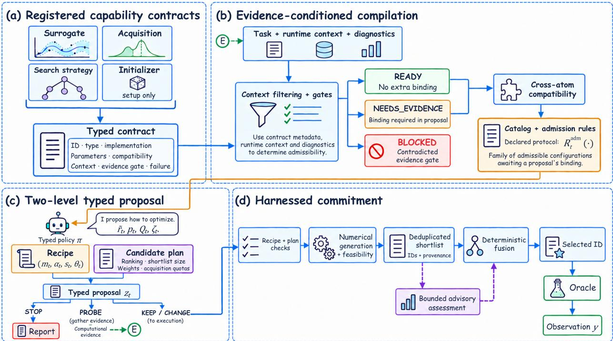  
Figure 2: From capability contracts to candidate commitment. (a) Registered capabilities use unified contracts; (b) the compiler combines task, state, and evidence to define admissible recipes; (c) the policy proposes a recipe and candidate plan, with PROBE returning evidence and STOP returning a report; and (d) the execution layer validates, scores, and commits a legal candidate before the oracle observation.

## 4.6 Research Hypotheses, Public Reflection, and Memory Feedback

After each oracle result, the system links the proposal, observation, and prior expectation, records a SUP-PORT, REFUTE, or INCONCLUSIVE judgment, and feeds hypotheses, evidence gaps, and retrieval rules into later rounds (Figure 1). Public hypotheses include testable predictions and falsification conditions; hypotheses about domain efects or interactions also specify comparison arms, controls, and minimum evidence. Judgments are descriptive and stored with their basis; detailed states, citation checks, and update rules are given in Appendix C.3.

## 4.7 Protocol Properties and Conditions for Their Validity

Properties 1–3 are conditional invariants of the complete protocol; implementation coverage is summarized in Section 4.8.

Property 1: Validity of declared admission. If registered implementations agree with their contracts, compatibility predicates are correct, active parameters are processed within their declared domains, and the execution layer enforces the strict protocol, then by construction of the admissible set, $r \in \mathcal { R } _ { t } ^ { \mathrm { a d m } } ( \zeta _ { t } )$ satisfies the registered-ID, context, cross-atom, and required nonempty-binding conditions.

Property 2: Observation and budget accounting on non-STOP paths. If initialization and subsequent calls are managed by the same budget counter, every completed evaluation corresponds to one newly added candidate, and records have no loss or duplication, then $| \mathcal { D } _ { T } | = N _ { \mathrm { o r a c l e } } ( T ) \leq B$

Recipe adjustments and probes do not add targets; only a budget-checked Experiment transition adds an observation.

Property 3: Classical one-step BO as a special case. If the recipe is fixed, the full legal pool is scored, a single acquisition function performs global candidate selection, its maximizer enters the shortlist and is not subsequently removed, the exploit numerical mode is used with review influence disabled, the rank transform preserves the set of acquisition maximizers, and ties are handled consistently, then $i _ { t + 1 } \in$ $\arg \operatorname* { m a x } _ { i \in { \mathcal { I } } _ { t } ^ { \mathrm { e l i g } } } \alpha ( i ; { \mathcal { D } } _ { t } )$ .

Under these conditions fusion preserves the acquisition ordering; a bounded scoring pool or tolerance-based ranks can otherwise change the selected point.

## 4.8 Checking Coverage of the Current Implementation

The current implementation mainly checks newly switched components on the CHANGE path. Supportingmaterial binding, delayed-action revalidation, and complete ID–feature consistency checks remain incomplete; the full comparison is provided in Appendix C.4.

## 5. Experiments

Across four finite pools, we compare endpoint and cumulative search quality, examine initialization and configuration efects through grouped COF ablations, and test LLM-based selection; a zero-observation audit tests sensitivity to candidate IDs. Each condition used five seeds; the strategy-event timelines and search-path projections are provided in Appendices C.1 and D.2.

## 5.1 Tasks, budget, and evidence scope

Table 2: Tasks, candidate pools, and observation sources.
<table><tr><td>Task</td><td>Input space</td><td>Candidate pool</td><td>Objective / source</td></tr><tr><td>COF (Xe/Kr)</td><td>14 numerical descriptors</td><td>605 candidates</td><td>Maximize adsorption selectivity; LABO finite table with GCMC targets [21,24]</td></tr><tr><td>PCE10</td><td>4 composition variables</td><td>1,040 records (1,020 compositions)</td><td>Minimize photodegradation; LABO finite table</td></tr><tr><td>Buchwald-Hartwig</td><td>4 categorical variables</td><td>790 candidates</td><td>Maximize yield; Buchwald-sub4 table [25]</td></tr><tr><td>Suzuki-Miyaura</td><td>5 categorical variables</td><td>5,760 candidates</td><td>Maximize yield; reaction-condition table [26]</td></tr></table>

Note. Each condition comprised five seed-specific campaigns, each with 10 initialization and 30 subsequent single-point evaluations (40 total); observations were drawn from the ofline tables. Each PCE10 record contains four component mass fractions that sum to 1, leaving three independent degrees of freedom. The 1,040 records represent 1,020 distinct compositions; repeated compositions remain separate candidate rows with their own row IDs and oracle values. All runs used the complete candidate pools in their respective tables; data sources and processing are described in Appendices B.2.3 and B.2.6.

## 5.2 Compared methods and grouped controls

The end-to-end comparison on all four tasks included Vanilla BO [3–5], HEBO [27], LABO [21], CAKE [11], LMABO [13], BORA [10], Reasoning BO [28], and LLAMBO [14]. Each method used its own initialization to determine the initial IDs and then carried out subsequent search. COF also included a shared-initialization group: for a given seed, all methods received the same 10 initial candidates and observations, followed by 30 selections per method.

All baselines operated on the finite pools; the HEBO and Reasoning BO adapters and fallback details are given in Appendix B.2.5.

COF ablations were divided into three groups. The warm-start group compared agentic and random initialization. The component group, under a shared random initialization, compared the complete system, No review, and fixed GP+UCB. The Harness group, meaning the execution-layer control that validates, scores, and commits candidates, used another frozen shared initialization and compared the complete system with four execution-related variants. The complete-system nAUC-BO values in the three groups were 0.970, 0.888, and 0.923, respectively; each variant was compared within its own group. The 0.970 and 0.923 values use diferent initializations, and the repeated endpoint in the warm-start and component groups is not treated as an independent replicate.

These groups partially isolate starting-point and configuration efects within their respective controls. Bare LLM is a system-level control because it retains natural-language interaction but uses a diferent action space and failure handling; LLM commitment changes final candidate selection. In the model-sensitivity experiment, the LLM participated in initialization and subsequent decisions.

## 5.3 Metrics and statistical interpretation

Let $I _ { n }$ denote the best observed target after the �th evaluation: the historical maximum for maximization and minimum for minimization. Endpoint metrics retain their original units. Let $y _ { \star }$ and $y _ { \mathrm { { w o r s t } } }$ be the best and worst values in the complete table, fixed before search. Here $Q _ { n }$ is normalized quality, distinct from the probe request $Q _ { t }$ in Section $4 . 4 ;$ the tabulated optimum has $Q _ { n } = 1$ . We use the following fixed-direction normalization:

$$
Q _ { n } = { \left\{ \begin{array} { l l } { { \displaystyle { \frac { I _ { n } - y _ { \mathrm { w o r s t } } } { y _ { \star } - y _ { \mathrm { w o r s t } } } } , } } & { { \mathrm { m a x i m i z a t i o n } } , } \\ { { \displaystyle { \frac { y _ { \mathrm { w o r s t } } - I _ { n } } { y _ { \mathrm { w o r s t } } - y _ { \star } } } } , } & { { \mathrm { m i n i m i z a t i o n } } . } \end{array} \right. }\tag{6}
$$

The endpoint factor is $\mathrm { E F } 4 0 = Q _ { 4 0 }$ , and the two discrete trapezoidal areas are

$$
\mathrm { n A U C _ { B O } } = \frac { 1 } { 3 0 } \sum _ { n = 1 0 } ^ { 3 9 } \frac { Q _ { n } + Q _ { n + 1 } } { 2 } , \qquad \mathrm { n A U C _ { l a t e } } = \frac { 1 } { 2 0 } \sum _ { n = 2 0 } ^ { 3 9 } \frac { Q _ { n } + Q _ { n + 1 } } { 2 } .\tag{7}
$$

Normalized metrics are compared only within the same task; no aggregate cross-task score is computed. The BO-stage area includes quality at the end of initialization $I _ { 1 0 } ;$ EF40 and Best-so-far share an endpoint, and late-stage area is contained in BO-stage area. The COF ablation reports $t _ { 9 5 } ,$ the first oracle-evaluation index (including initialization) with $Q _ { n } \ \geq \ 0 . 9 5 ;$ a non-hit within $B \ = \ 4 0$ is assigned 41. We report its five-seed mean and threshold-hit count separately from exact-optimum hits.

Unless otherwise stated, means ± s.d. are over five campaign seeds. Comparisons are descriptive and include no significance, equivalence, or non-inferiority tests; the primary end-to-end summaries are not uniformly paired across methods at the per-seed trajectory level. Section 5.10 is a separate paired original-ID versus anonymous-ID audit, so its McNemar and sign tests address a diferent within-trial intervention. Underlying figure and table values are listed in Appendices A.1–A.3.

## 5.4 Information access and computational budget

Information access is restricted to queried targets and evidence available before the current round. We compare search quality at the same oracle-call budget; LLM calls, probes, retries, and model fitting add overhead but are not quantitatively compared here [29–32].

## 5.5 Cross-task endpoint performance and cumulative search quality

Across the five-seed summaries, Agentic-MatriBO has the best endpoint mean on all four tasks among the listed baselines, whereas cumulative area is not uniformly best (Fig. 3 and Table 3). Endpoint diferences are larger for COF and PCE10 and smaller for BH and Suzuki.

(a) COF Xe/Kr separation  
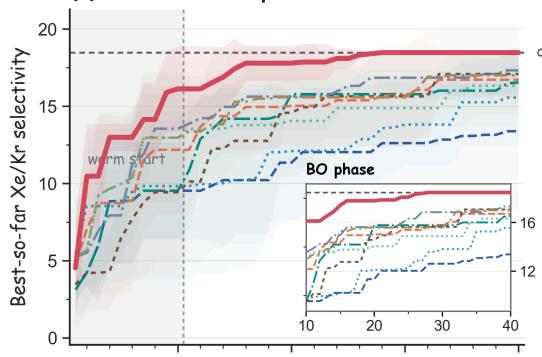

(b) PCE10 photodegradation  
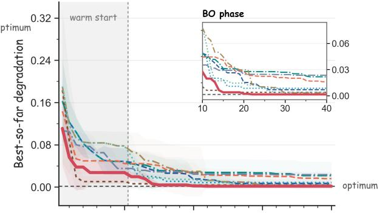

(c) Buchwald-Hartwig reaction  
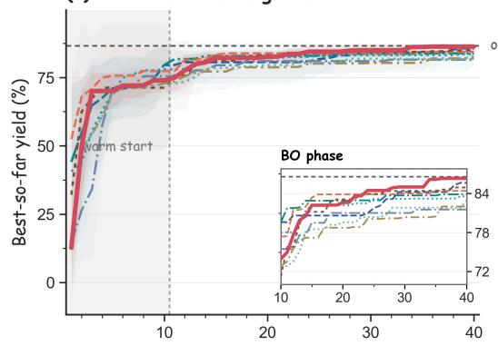

(d) Suzuki reaction  
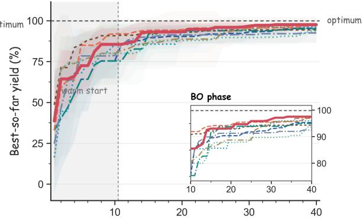  
Number of evaluations  
Figure 3: End-to-end optimization performance on four tasks. (a) COF; (b) PCE10; (c) BH; (d) Suzuki. Curves and shaded regions show the five-seed mean incumbent and ±1 s.d.; the horizontal axis includes 10 initial oracle evaluations plus 30 subsequent evaluations. Lower is better for PCE10, whereas higher is better for the other tasks. The gray region denotes initialization, the inset enlarges the BO stage, and the dashed line marks the tabulated optimum. Each method uses its own initialization procedure; the figure compares the complete running configurations.

Table 3: Endpoint and cumulative metrics across four tasks. Values are mean ± s.d. over five seeds. For each task–metric pair, the table reports the best baseline and Agentic-MatriBO. Boldface indicates better Agentic-MatriBO mean performance; a dagger indicates that the two displayed means round to the same value and is not a significance claim.
<table><tr><td>Task</td><td>Metric</td><td>Best baseline</td><td>Baseline score</td><td>Agentic-MatriBO</td></tr><tr><td>COF</td><td>Best-so-far ↑</td><td>LMABO</td><td> $1 7 . 3 2 6 \pm 1 . 4 1 6$ </td><td> $\mathbf { 1 8 . 4 7 6 \pm 0 . 0 0 0 }$ </td></tr><tr><td></td><td>nAUC-BO ↑ EF40 ↑</td><td>LMABO LMABO</td><td> $0 . 8 6 8 \pm 0 . 0 7 6$   $0 . 9 3 8 \pm 0 . 0 7 7$ </td><td> $\mathbf { 0 . 9 7 0 \pm 0 . 0 3 9 }$   $\mathbf { 1 . 0 0 0 \pm 0 . 0 0 0 }$ </td></tr><tr><td></td><td>Late nAUC ↑</td><td>LMABO</td><td></td><td></td></tr><tr><td></td><td></td><td></td><td> $0 . 8 9 8 \pm 0 . 0 7 5$ </td><td> $\mathbf { 0 . 9 9 1 \pm 0 . 0 1 5 }$ </td></tr><tr><td>PCE10</td><td>Best-so-far ↓</td><td>CAKE</td><td> $0 . 0 0 3 4 \pm 0 . 0 0 4 0$ </td><td> $\mathbf { 0 . 0 0 1 6 2 \pm 0 . 0 0 0 0 0 }$ </td></tr><tr><td></td><td> $\mathrm { n A U C - B O \uparrow }$ </td><td>Reasoning BO</td><td> $0 . 9 9 6 3 \pm 0 . 0 0 6 2$ </td><td> $\mathbf { 0 . 9 9 6 4 \pm 0 . 0 0 2 1 }$ </td></tr><tr><td></td><td>EF40 ↑</td><td>CAKE</td><td> $0 . 9 9 8 \pm 0 . 0 0 5$ </td><td> $\mathbf { 1 . 0 0 0 \pm 0 . 0 0 0 }$ </td></tr><tr><td></td><td>Late nAUC ↑</td><td>Reasoning BO</td><td> $0 . 9 9 7 \pm 0 . 0 0 5$ </td><td> $\mathbf { 1 . 0 0 0 \pm 0 . 0 0 0 }$ </td></tr><tr><td>BH</td><td>Best-so-far ↑</td><td>Vanilla BO</td><td> $8 5 . 6 4 4 \pm 1 . 0 0 0$ </td><td> ${ \bf 8 6 . 3 1 6 \pm 0 . 3 8 5 }$ </td></tr><tr><td></td><td>nAUC-BO ↑ EF40 ↑</td><td>BORA</td><td> $0 . 9 6 3 \pm 0 . 0 0 8$ </td><td> $0 . 9 6 3 \pm 0 . 0 1 1 \dagger$ </td></tr><tr><td></td><td></td><td>Vanilla BO</td><td> $0 . 9 8 9 \pm 0 . 0 1 2$ </td><td> $\mathbf { 0 . 9 9 7 \pm 0 . 0 0 4 }$ </td></tr><tr><td></td><td>Late nAUC ↑</td><td>Reasoning BO</td><td> $0 . 9 7 3 \pm 0 . 0 1 5$ </td><td> $\mathbf { 0 . 9 8 1 \pm 0 . 0 1 5 }$ </td></tr><tr><td>Suzuki</td><td>Best-so-far ↑</td><td>CAKE</td><td> $9 6 . 9 9 0 \pm 1 . 5 8 0$ </td><td> $9 7 . 5 5 8 \pm 1 . 0 3 8$ </td></tr><tr><td></td><td>nAUC-BO ↑</td><td>BORA</td><td> $0 . 9 5 0 \pm 0 . 0 2 8$ </td><td> $0 . 9 4 6 \pm 0 . 0 3 3$ </td></tr><tr><td></td><td>EF40 ↑</td><td>CAKE</td><td> $0 . 9 7 1 \pm 0 . 0 1 6$ </td><td> $\mathbf { 0 . 9 7 7 \pm 0 . 0 1 0 }$ </td></tr><tr><td></td><td> $\operatorname { L a t e } \operatorname { n A U C } \uparrow$ </td><td>BORA</td><td> $0 . 9 5 8 \pm 0 . 0 3 0$ </td><td> $\mathbf { 0 . 9 6 5 \pm 0 . 0 2 0 }$ </td></tr></table>

By task, the method has a better objective-direction-adjusted mean on all four metrics for COF and PCE10, on three of four metrics for BH (the nAUC-BO means round to the same value), and on three of four metrics for Suzuki (nAUC-BO is lower). These comparisons are descriptive rather than a vote across independent outcomes: Best-so-far and EF40, and late-stage and BO-stage areas, are derived from the same trajectories (Section 5.3).

On COF, the complete condition reaches the tabulated optimum in all five seeds $( 1 8 . 4 7 6 \pm 0 . 0 0 0 ; 5 / 5$ exactoptimum hits), while LMABO has a lower mean endpoint. The endpoint is approximately 6.6% higher than LMABO, so this diference is primarily an exact-hit comparison. PCE10 shows a large endpoint diference but only a 0.0001 BO-stage-area diference, whereas Suzuki has higher endpoint and late-stage area but lower BO-stage area than BORA. These examples show that endpoint and cumulative quality can separate by task and stage.

## 5.6 COF search performance after shared initialization

In the COF shared-initialization experiment, Agentic-MatriBO retains the highest mean endpoint, BO-stage area, and late-stage area among the listed methods, and all five seeds hit the tabulated optimum (Fig. 4 and Table 4). LMABO and BORA are included here because LMABO is the strongest endpoint baseline in the end-to-end COF comparison; the complete shared-initialization table is provided in Appendix A.2.

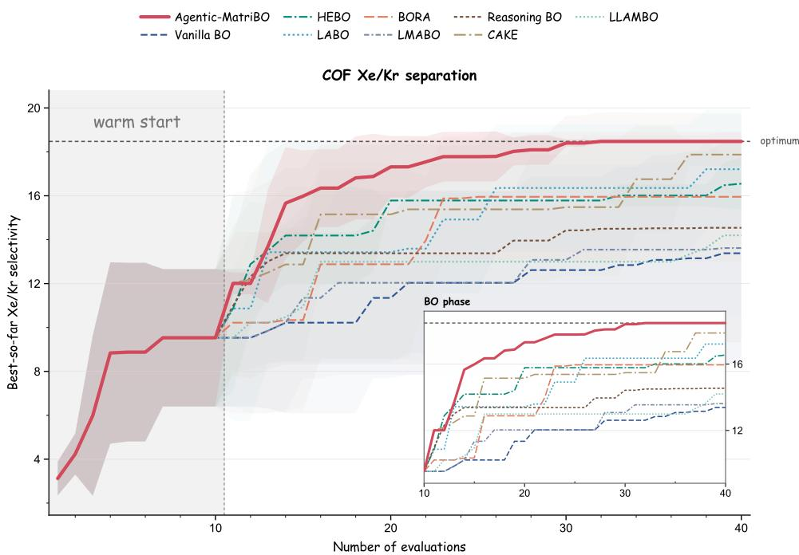  
Figure 4: COF optimization with shared initialization. For a given seed, the five methods in this group share the same 10 initial candidates and observations, followed by 30 evaluations per method. Curves and shaded regions show the five-seed mean and ±1 s.d.; the gray region denotes initialization and the inset enlarges the subsequent stage.

(b) Agentic component ablations  
Table 4: COF comparison with shared initialization. Values are mean ± s.d. over five seeds. The five methods in this group receive the same ten initial candidates; the complete summary is in Appendix A.2.
<table><tr><td>Method</td><td>Best-so-far ↑</td><td>nAUC-BO ↑</td><td>EF40 ↑</td><td>Late nAUC ↑</td></tr><tr><td>HEBO</td><td> $1 6 . 5 5 0 \pm 1 . 1 8 4$ </td><td> $0 . 8 1 8 \pm 0 . 0 3 2$ </td><td> $0 . 8 9 6 \pm 0 . 0 6 4$ </td><td> $0 . 8 6 1 \pm 0 . 0 1 0$ </td></tr><tr><td>CAKE</td><td> $1 7 . 8 7 5 \pm 0 . 5 3 1$ </td><td> $0 . 8 2 3 \pm 0 . 1 1 8$ </td><td> $0 . 9 6 7 \pm 0 . 0 2 9$ </td><td> $0 . 8 6 8 \pm 0 . 1 2 7$ </td></tr><tr><td>LMABO</td><td> $1 3 . 6 1 8 \pm 5 . 2 8 6$ </td><td> $0 . 6 6 2 \pm 0 . 2 2 4$ </td><td> $0 . 7 3 7 \pm 0 . 2 8 7$ </td><td> $0 . 6 9 8 \pm 0 . 2 5 6$ </td></tr><tr><td>BORA</td><td> $1 5 . 9 5 3 \pm 2 . 9 5 5$ </td><td> $0 . 7 6 9 \pm 0 . 1 0 7$ </td><td> $0 . 8 6 3 \pm 0 . 1 6 0$ </td><td> $0 . 8 4 5 \pm 0 . 1 4 8$ </td></tr><tr><td>Agentic-MatriBO</td><td> $\mathbf { 1 8 . 4 7 6 \pm 0 . 0 0 0 }$ </td><td> $\mathbf { 0 . 9 2 3 \pm 0 . 0 3 8 }$ </td><td> $\mathbf { 1 . 0 0 0 \pm 0 . 0 0 0 }$ </td><td> $\mathbf { 0 . 9 8 2 \pm 0 . 0 2 6 }$ </td></tr></table>

Under identical initial conditions, Agentic-MatriBO has higher endpoint, nAUC-BO, and late-stage area than CAKE. This is consistent with an efect of subsequent search, although the experiment does not isolate individual configurations.

## 5.7 Grouped ablations separating starting point, recipe, and review

The complete warm-start system and random-initialization variant reach the same endpoint, but nAUC-BO is 0.970 versus 0.888 and � is 13.4 versus 23.4 (Fig. 5a and Table 5), showing the benefit of the agentic starting point for early quality.

(a) Warm-start ablation

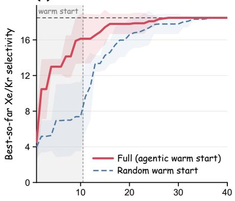

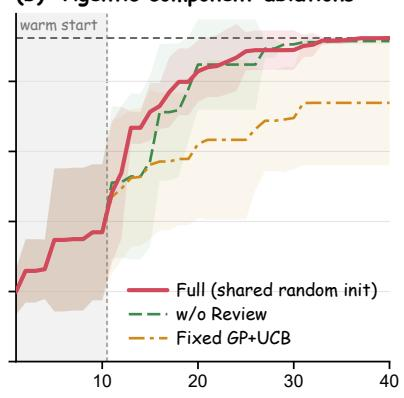

(c) Harness protocol ablations  
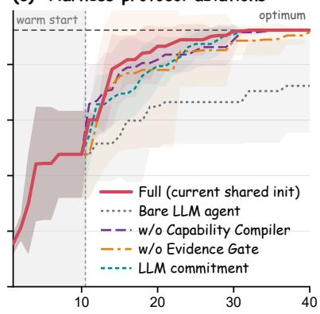  
Figure 5: Grouped COF ablations. (a) Warm-start ablation: the complete system (agentic warm start) and random warm start; (b) component ablation: the complete system, No review, and fixed GP+UCB under shared random initialization; (c) Harness ablation: the complete system, Bare LLM, No Capability Compiler, No Evidence Gate, and LLM commitment under another shared initialization. Each condition uses five seeds with a total budget of 10+30; lines and shaded regions show the mean and ±1 s.d., and the dashed line denotes the tabulated optimum. Each panel compares only against the complete system in its own group.

Table 5: Grouped COF ablations. Values are mean $\pm \ : \mathrm { s . d . }$ . over five seeds; brackets in � give threshold-hit counts; — indicates that exact-optimum hits were not separately recorded for that control. Comparisons are within groups, and $\mathrm { \Delta ^ { \prime \prime } F u l l ^ { \prime \prime } }$ denotes the complete system. Full names and results are in Appendix A.3.
<table><tr><td>Ablation group</td><td>Condition</td><td>Best-so-far ↑</td><td> $\mathrm { n A U C - B O \uparrow }$ </td><td>Late nAUC ↑</td><td> $\boldsymbol { t } _ { 9 5 } \downarrow$ </td><td>Global optimum hits</td></tr><tr><td>Warm start</td><td>Full (agentic)</td><td> $\mathbf { 1 8 . 4 7 6 \pm 0 . 0 0 0 }$ </td><td> $\mathbf { 0 . 9 7 0 \pm 0 . 0 3 9 }$ </td><td> $\mathbf { 0 . 9 9 1 \pm 0 . 0 1 5 }$ </td><td>13.4 [5/5]</td><td></td></tr><tr><td></td><td>Random</td><td> $1 8 . 4 7 6 \pm 0 . 0 0 0$ </td><td> $0 . 8 8 8 \pm 0 . 0 4 8$ </td><td> $0 . 9 6 7 \pm 0 . 0 4 5$ </td><td>23.4 [5/5]</td><td></td></tr><tr><td>Component</td><td>Full</td><td> $\mathbf { 1 8 . 4 7 6 \pm 0 . 0 0 0 }$ </td><td> $\mathbf { 0 . 8 8 8 \pm 0 . 0 4 8 }$ </td><td> $\mathbf { 0 . 9 6 7 \pm 0 . 0 4 5 }$ </td><td>23.4 [5/5]</td><td>5/5</td></tr><tr><td></td><td>No review</td><td> $1 8 . 3 0 0 \pm 0 . 1 7 1$ </td><td> $0 . 8 6 5 \pm 0 . 0 8 2$ </td><td> $0 . 9 6 3 \pm 0 . 0 4 6$ </td><td>20.0 [5/5]</td><td>0/5</td></tr><tr><td></td><td>Fixed GP+UCB</td><td> $1 4 . 7 7 3 \pm 3 . 5 7 3$ </td><td> $0 . 6 9 6 \pm 0 . 1 8 9$ </td><td> $0 . 7 5 3 \pm 0 . 1 9 2$ </td><td>35.0 [2/5]</td><td>一</td></tr><tr><td>Harness</td><td>Full</td><td> $\mathbf { 1 8 . 4 7 6 \pm 0 . 0 0 0 }$ </td><td> $\mathbf { 0 . 9 2 3 \pm 0 . 0 3 8 }$ </td><td> $\mathbf { 0 . 9 8 2 \pm 0 . 0 2 6 }$ </td><td>19.6 [5/5]</td><td>5/5</td></tr><tr><td></td><td>Bare LLM</td><td> $1 4 . 4 6 5 \pm 3 . 3 6 5$ </td><td> $0 . 6 9 4 \pm 0 . 1 5 3$ </td><td> $0 . 7 4 0 \pm 0 . 1 7 0$ </td><td>34.2 [2/5]</td><td>0/5</td></tr><tr><td></td><td>w/o Compiler</td><td> $1 8 . 4 5 5 \pm 0 . 0 2 8$ </td><td> $0 . 9 0 3 \pm 0 . 0 4 9$ </td><td> $0 . 9 5 7 \pm 0 . 0 3 2$ </td><td>23.6 [5/5]</td><td>3/5</td></tr><tr><td></td><td>w/o Evidence</td><td> $1 8 . 3 3 0 \pm 0 . 1 9 9$ </td><td> $0 . 8 7 5 \pm 0 . 1 6 0$ </td><td> $0 . 9 3 6 \pm 0 . 1 1 4$ </td><td>19.8 [5/5]</td><td>3/5</td></tr><tr><td></td><td>Gate LLM</td><td> $1 8 . 4 7 6 \pm 0 . 0 0 0$ </td><td> $0 . 8 8 8 \pm 0 . 0 4 5$ </td><td> $0 . 9 6 3 \pm 0 . 0 2 8$ </td><td>25.0 [5/5]</td><td>5/5</td></tr></table>

Within the component group, fixed GP+UCB reduces the endpoint and nAUC-BO relative to the complete system, and only $2 / 5$ seeds reach the 95% threshold. This control characterizes the overall diference after removing online recipe adaptation.

The No review variant has a lower endpoint and cumulative area, yet its $t _ { 9 5 }$ decreases from 23.4 to 20.0 and its global-optimum hit count decreases from $5 / 5$ to $0 / 5 .$ Thus, crossing the 95% threshold earlier does not necessarily imply higher endpoint quality or a higher exact-hit rate.

## 5.8 Efects of capability compilation, evidence gating, and candidate commitment

In the Harness group, removing the capability compiler or evidence gate reduces cumulative area and exact-optimum hits, although all three conditions reach the 95% threshold in 5/5 seeds. The complete system has the largest cumulative area.

LLM commitment preserves the endpoint and exact-hit count but lowers nAUC-BO and delays $t _ { 9 5 } ;$ Bare LLM performs substantially worse and does not hit the global optimum in any seed.

## 5.9 Observed model diferences in initialization and early area

The model participates in initialization and subsequent decisions. In these five-seed runs, the largest observed between-model diferences occur during initialization and evaluations 10–20 (Fig. 6 and Table 6); model-call mappings are provided in Appendix A.3.

Table 6: COF model comparison. Initialization best value, BO-stage area, and late-stage nAUC are reported as mean ± s.d.; early nAUC is reported as a mean; $n = 5$ per condition. The complete summary is provided in Appendix A.3.
<table><tr><td>Model</td><td>Init. best</td><td>Early nAUC (10–20)</td><td>nAUC-BO (10–40)</td><td>Late nAUC (20–40)</td><td>Optimum hits</td></tr><tr><td>DeepSeek 4.0 Flash</td><td> $1 6 . 1 2 8 \pm 2 . 7 7 7$ </td><td>0.9266</td><td> $0 . 9 6 9 8 \pm 0 . 0 3 9 5$ </td><td> $0 . 9 9 1 4 \pm 0 . 0 1 5 1$ </td><td>5/5</td></tr><tr><td>DeepSeek 4.0 Pro</td><td> $1 7 . 2 8 1 \pm 1 . 8 6 0$ </td><td>0.9560</td><td> $0 . 9 8 1 7 \pm 0 . 0 3 0 8$ </td><td> $0 . 9 9 4 6 \pm 0 . 0 0 8 3$ </td><td>5/5</td></tr><tr><td>Qwen3-Max</td><td> $1 8 . 1 1 3 \pm 0 . 0 0 0$ </td><td>0.9837</td><td> $0 . 9 9 1 0 \pm 0 . 0 0 6 3$ </td><td> $0 . 9 9 4 7 \pm 0 . 0 0 8 1$ </td><td>3/5</td></tr><tr><td>GPT-5.6-sol</td><td> $1 8 . 1 1 3 \pm 0 . 0 0 0$ </td><td>0.9849</td><td> $0 . 9 9 1 2 \pm 0 . 0 0 6 6$ </td><td> $0 . 9 9 4 4 \pm 0 . 0 0 7 0$ </td><td>5/5</td></tr></table>

Late-stage area means for the strongest models difer by only about 0.0003, while BO-stage diferences occur mainly in evaluations 10–20 (Appendix B.2.4). Cumulative near-optimal quality and exact hits therefore capture diferent search characteristics.

Because these model-dependent diferences could also reflect prior exposure to public candidate tables, Section 5.10 separately audits whether original candidate IDs provide a consistent ranking advantage. This audit addresses a possible confound rather than serving as another optimization comparison.

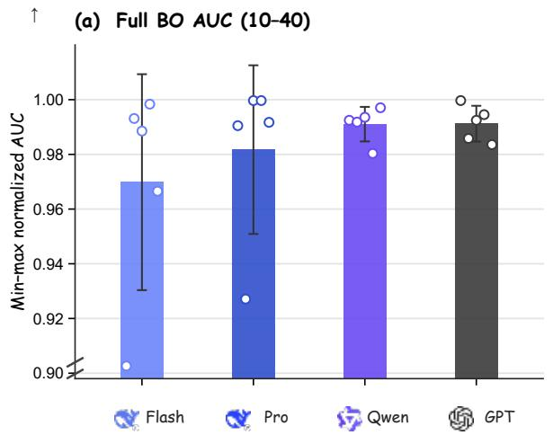

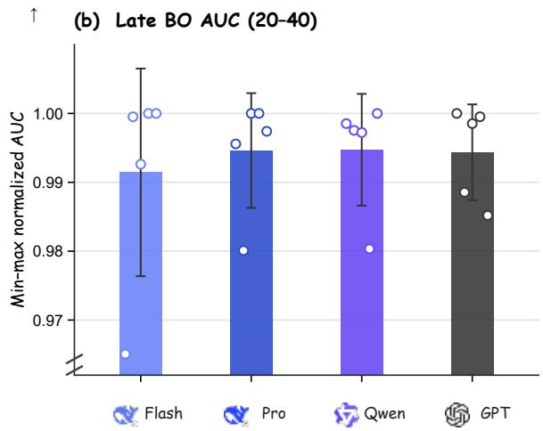  
Figure 6: LLM sensitivity on COF. (a) Area over evaluations 10–40; (b) late-stage area over evaluations 20–40. Bars, points, and error bars show the five-seed mean, individual-seed values, and ±1 s.d., respectively. The y-axis uses a truncated scale. This comparison includes the efect of the model on both initialization and subsequent strategy decisions.

## 5.10 Zero-observation ranking shows no consistent hit advantage

BH and Suzuki use public reaction-yield tables [25, 26]. The audit evaluates rankings made without target values and tests whether original IDs afect hit rates. Each trial contains one tabulated optimum and 149 randomly sampled non-optimal candidates; models return a top-40 list from the same descriptors and ordering under original or re-encoded IDs. Tied Suzuki optima are rotated as anchors. Each ID group is repeated 10 times for four tasks and four models in paired trials at temperature 0.7. The corresponding random top-40 hit probability is 40/150 (26.7%).

COF IDs are public structure filenames, whereas the other IDs were assigned during table construction; the ID-control interpretation is therefore strongest for COF. All ranking requests were independent of the Agentic-MatriBO search process.

(b) PCE10 photodegradation

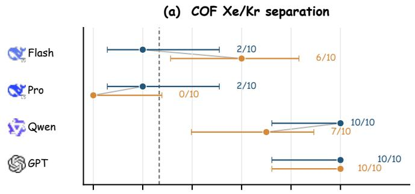

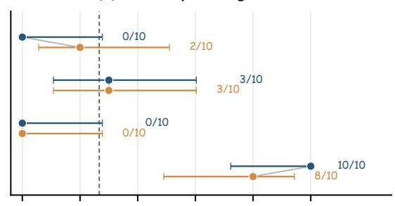

(c) Buchwald–Hartwig reaction  
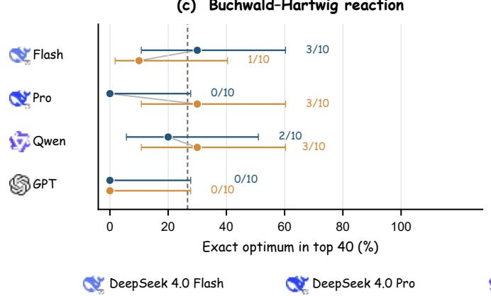

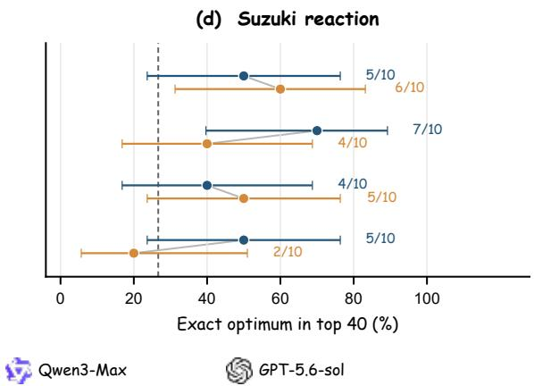  
Figure 7: Original and anonymous IDs in zero-observation ranking. (a) COF; (b) PCE10; (c) BH; (d) Suzuki. Each row corresponds to a model. Blue points denote original IDs and orange points anonymous IDs; the horizontal axis is the fraction of the anchored ID entering the top 40 across 10 rankings, error bars are Wilson 95% intervals, and numbers are hit counts. The vertical dashed line is the random level of 26.7%. Models receive candidate IDs and descriptors directly, without the Agentic-MatriBO strategy or execution process.

Across the 16 model–task pairs, original-ID hit rates were higher, lower, or equal in 6, 6, and 4 pairs, with aggregate hits of 63/160 and 60/160. After Benjamini–Hochberg correction, paired McNemar and sign tests both give � = 1.0; original IDs therefore show no consistent hit advantage.

The audit does not establish equivalence: ten paired replicates limit power, and both groups retain descriptors, so descriptor knowledge is not isolated.

## 6. Discussion

## 6.1 Capability compilation connects task evidence and algorithm composition

Under the target protocol, capability compilation exposes component applicability conditions to the strategy and uses them for proposal-admission checks. The language strategy uses task semantics, diagnostics, and history to propose recipes and candidate plans, while the execution layer performs numerical computation and candidate submission; domain information enters the next selection through configuration and ranking. In the 20 runs shown in Figure C1, the efective surrogate model switched at least once in every run, whereas acquisition-function and search-strategy switches were less frequent, with 9 runs retaining each of these components unchanged throughout.

## 6.2 Gains depend on task, stage, and configuration

Endpoint quality and cumulative area answer diferent search questions: the former measures the best candidate found by the end of the budget, whereas the latter also reflects when high-quality candidates first appear. The PCE10 and Suzuki results show that endpoint improvement can accompany a very small area gain, or even a slightly lower cumulative area. The COF No review variant crossed the 95% threshold earlier but did not hit the exact optimum, further showing that threshold attainment and exact hits should be evaluated separately.

Shared initialization focuses the comparison on subsequent search, whereas the warm-start control shows that initial candidates can afect cumulative quality. Fixed recipes, No review, and LLM commitment alter the search process at diferent points, and the results vary with both starting points and subsequent configurations; their individual contributions cannot be separated from these comparisons. The contributions of candidate distribution, component adaptation, and domain knowledge have not been independently separated.

## 6.3 Evidence levels in cross-round feedback

Research memory links prior expectations to observations and stores diagnostics, reflections, and subsequent evidence requirements for retrieval by the next-round strategy. It provides cross-round context for compositional adaptation. The current experiments do not include an independent no-memory or no-Playbook control, so the standalone gain of the memory module cannot yet be quantified.

## 7. Limitations

Evaluation scope and statistical analysis. The evaluation covers four ofline finite candidate pools with five seeds per condition; COF shared-initialization and mechanism ablations were not repeated on the other tasks. The tabulated optimum is defined relative to each candidate set, so results may not generalize to openended generation, continuous multi-objective settings, or asynchronous noisy experiments. Ofline search and path projections cannot validate materials mechanisms or replace prospective wet-lab experiments. We report means, standard deviations, and exact-hit counts descriptively; five seeds limit the precision of between-condition estimates.

Public data and model priors. In the zero-observation audit, both original-ID and re-encoded-ID prompts retain reagent names and structural descriptors. The BH and Suzuki identifiers were assigned during table construction, but the audit cannot separate general chemical knowledge from memorization of reaction conditions in public yield tables. This limits interpretation of those two tasks.

Implementation coverage. The evaluated code mainly checks newly switched components on the CHANGE path. It does not yet verify that cited support materials substantiate their premises, revalidate deferred components after CHANGE-to-KEEP transitions, or apply the full check set on heuristic paths. The emptycandidate path also raises a selection error rather than following the declared no-candidate termination path. The formal properties in Section 4.7 are conditional protocol properties, not guarantees that the current implementation enforces every check; see Section 4.8 and Appendix C.4.

## 8. Conclusion

Across four ofline finite candidate pools, eight baselines, and five seeds per condition, Agentic-MatriBO has the best mean endpoint quality in each task’s objective direction, while cumulative-quality gains depend on the task. After shared initialization on COF, all five seeds reached the tabulated optimum while retaining an area advantage, indicating that diferences in this group also arise from subsequent search. Ablations show that threshold attainment, cumulative quality, and exact hits respond diferently to configuration. Observed between-model area diferences are largest during initialization and the early stage. The zero-observation audit found no consistent hit advantage from original candidate IDs.

Agentic-MatriBO registers component-selection conditions as capability contracts and uses evidence-aware compilation and compositional adaptation to connect language strategy with numerical search. Under the declared protocol, the execution layer validates and commits candidates, and oracle observations update research memory for later rounds. The evaluated implementation covers the protocol only partially, as detailed in Section 4.8 and Appendix C.4.

## References

[1] Turab Lookman, Prasanna V. Balachandran, Dezhen Xue, and Ruihao Yuan. Active learning in materials science with emphasis on adaptive sampling using uncertainties for targeted design. npj Computational Materials, 5:21, 2019.

[2] Qianxiang Liang, Aldair E. Gongora, Zekun Ren, et al. Benchmarking the performance of bayesian optimization across multiple experimental materials science domains. npj Computational Materials, 7:188, 2021.

[3] Donald R. Jones, Matthias Schonlau, and William J. Welch. Eficient global optimization of expensive black-box functions. Journal of Global Optimization, 13(4):455–492, 1998.

[4] Bobak Shahriari, Kevin Swersky, Ziyu Wang, Ryan P. Adams, and Nando de Freitas. Taking the human out of the loop: A review of bayesian optimization. Proceedings ofthe IEEE, 104(1):148–175, 2016.

[5] Peter I. Frazier. Bayesian optimization. In Recent Advances in Optimization and Modeling of Contemporary Problems, INFORMS TutORials in Operations Research, pages 255–278. INFORMS, 2018.

[6] Benjamin Rohr, Helge S. Stein, Dan Guevarra, et al. Benchmarking the acceleration of materials discovery by sequential learning. Chemical Science, 11(10):2696–2706, 2020.

[7] Matthew W. Hofman, Eric Brochu, and Nando de Freitas. Portfolio allocation for bayesian optimization. In Proceedings of the Twenty-Seventh Conference on Uncertainty in Artificial Intelligence, pages 327–336, 2011.

[8] David Eriksson, Michael Pearce, Jacob Gardner, Ryan D. Turner, and Matthias Poloczek. Scalable global optimization via local bayesian optimization. In Advances in Neural Information Processing Systems, volume 32, 2019.

[9] B. Lei, T. Q. Kirk, A. Bhattacharya, et al. Bayesian optimization with adaptive surrogate models for automated experimental design. npj Computational Materials, 7:194, 2021.

[10] Abdoulaye Cissé, Xenophon Evangelopoulos, Vladimir V. Gusev, and Andrew I. Cooper. Language-based bayesian optimization research assistant (BORA). In Proceedings of the Thirty-Fourth International Joint Conference on Artificia Intelligence, pages 4967–4975, 2025.

[11] Rico C. Suwandi, Feng Yin, Jing Wang, Rui Li, Tsung-Hui Chang, and Sergios Theodoridis. Adaptive kernel design for bayesian optimization is a piece of CAKE with LLMs. In Advances in Neural Information Processing Systems, volume 38, 2025.

[12] B. Ranković, R.-R. Grifiths, and Philippe Schwaller. Large language models as uncertainty-calibrated optimizers for experimental discovery. Nature Machine Intelligence, 8:1466–1477, 2026.

[13] G. Ngo, D. Phan-Trong, D. Nguyen, S. Gupta, and S. Venkatesh. Adaptive acquisition selection for bayesian optimization with large language models. In International Conference on Learning Representations, 2026.

[14] Tennison Liu, Nicolás Astorga, Nabeel Seedat, and Mihaela van der Schaar. Large language models to enhance bayesian optimization. In International Conference on Learning Representations, 2024.

[15] A. Gilad Kusne, H. Yu, C. Wu, et al. On-the-fly closed-loop materials discovery via bayesian active learning. Nature Communications, 11:5966, 2020.

[16] S. B. Harris, R. Vasudevan, and Y. Liu. Active oversight and quality control in standard bayesian optimization fo autonomous experiments. npj Computational Materials, 11:23, 2025.

[17] Maximilian Balandat, Brian Karrer, Daniel R. Jiang, et al. BoTorch: A framework for eficient Monte Carlo bayesian optimization. In Advances in Neural Information Processing Systems, volume 33, pages 21524–21538, 2020.

[18] Tilmann Gneiting, Fadoua Balabdaoui, and Adrian E. Raftery. Probabilistic forecasts, calibration and sharpness. Journal of the Royal Statistical Society: Series B, 69(2):243–268, 2007.

[19] Jonathan Foldager, Mathias Jordahn, Lars Kai Hansen, and Michael Riis Andersen. On the role of model uncertainties in bayesian optimisation. In Proceedings of the Thirty-Ninth Conference on Uncertainty in Artificial Intelligence, volume 216 of Proceedings of Machine Learning Research, pages 592–601, 2023.

[20] X. Yuan, Z. Chen, J. Zhang, et al. Unleashing LLMs in bayesian optimization: Preference-guided framework for scientific discovery. In International Conference on Learning Representations, 2026.

[21] Z. Chen, X. Yuan, J. Zhang, et al. LABO: LLM-accelerated bayesian optimization through broad exploration and selective experimentation. arXiv preprint arXiv:2605.22054, 2026.

[22] Paul Brunzema, Louis Tiao, Nhat Le, Kevin De Angeli, Yao Xuan, and Djordje Gligorijevic. Agentic bayesian optimization through surrogate-augmented autoresearch. arXiv preprint arXiv:2608.00316v2, 2026. Version 2, 11 August 2026.

[23] Changquan Zhao, Yuxiang Sun, Ruihao Zhu, Cheng Hua, and Yulian He. DASH: Decoupled adaptive surrogateacquisition harness for automated bayesian optimization. arXiv preprint arXiv:2608.00641v2, 2026. Version 2, 6 August 2026.

[24] N. Gantzler, A. Deshwal, J. R. Doppa, and C. M. Simon. Multi-fidelity bayesian optimization of covalent organic frameworks for xenon/krypton separations. Digital Discovery, 2(6):1937–1956, 2023.

[25] Derek T. Ahneman, Jesus G. Estrada, Shishi Lin, Spencer D. Dreher, and Abigail G. Doyle. Predicting reaction performance in C–N cross-coupling using machine learning. Science, 360(6385):186–190, 2018.

[26] Damith Perera, Joseph W. Tucker, Shalini Brahmbhatt, et al. A platform for automated nanomole-scale reaction screening and micromole-scale synthesis in flow. Science, 359(6374):429–434, 2018.

[27] Alexander I. Cowen-Rivers, Wenlong Lyu, Rasul Tutunov, et al. HEBO: An empirical study of assumptions in bayesian optimisation. Journal of Artificial Intelligence Research, 74:1269–1349, 2022.

[28] Zhuo Yang, Daolang Wang, Lingli Ge, Beilun Wang, Tianfan Fu, and Yuqiang Li. Reasoning BO: Enhancing bayesian optimization with long-context reasoning power of LLMs, 2025.

[29] Katharina Eggensperger, Philipp Müller, Neeratyoy Mallik, et al. HPOBench: A collection of reproducible multifidelity benchmark problems for HPO. In Proceedings of the NeurIPS Track on Datasets and Benchmarks, volume 1, 2021.

[30] Xavier Bouthillier, Pierre Delaunay, M. Bronzi, et al. Accounting for variance in machine learning benchmarks. In Proceedings ofMachine Learning and Systems, volume 3, pages 747–769, 2021.

[31] Jesse Dodge, Suchin Gururangan, Dallas Card, Roy Schwartz, and Noah A. Smith. Show your work: Improved reporting of experimental results. In Proceedings of EMNLP-IJCNLP, pages 2185–2194, 2019.

[32] Joelle Pineau, Philippe Vincent-Lamarre, Koustuv Sinha, et al. Improving reproducibility in machine learning research. Journal of Machine Learning Research, 22(164):1–20, 2021.

## Declarations

Data and Code Availability. The study uses four finite candidate pools: COF, PCE10, Buchwald–Hartwig, and Suzuki–Miyaura. Their sources and processing are described in Appendices B.2.3 and B.2.6. The benchmark tables and source-processing details can be provided by the authors upon reasonable request. The complete implementation code and per-seed result files are not publicly released at this stage.

Ethics Declaration. This software and finite-table benchmark study involve no human participants, human data, animals, or animal-derived samples; institutional approval for human or animal subjects is therefore not applicable.

Author Contributions. All authors contributed to the study design, methodology, analysis, and manuscript preparation. All authors reviewed and approved the final manuscript.

Competing Interests. The authors declare no competing interests.

Funding. No external funding was declared for this work.

This supplement reports the values underlying the main-text figures and tables, along with process cases, metric definitions, and implementation details.

## A Detailed Experimental Results

## A.1 Values underlying Fig. 3 and Table 3

This table reports the five-seed means underlying Fig. 3 and Table 3 for a shared oracle budget of 10 initialization evaluations and 30 subsequent evaluations. Arrows on task names indicate the direction of the original objective. nAUC-BO, EF40, and late-stage nAUC are larger-is-better. Improv. denotes the percentage change relative to the best baseline for the same task and metric; positive values favor the proposed method.

Table A1: Complete baseline comparisons across the four tasks. Values are mean ± s.d. over five seeds per condition. Rows list one method per line; the final row of each task block reports the improvement of Agentic-MatriBO relative to the best baseline.
<table><tr><td>Dataset</td><td>Method</td><td>Best-so-far</td><td>nAUC-BO</td><td>EF40</td><td>Late-stage nAUC</td></tr><tr><td>COF ↑</td><td>Vanilla BO</td><td>13.381 ± 5.055</td><td>0.636 ± 0.206</td><td>0.724 ± 0.274</td><td>0.679 ± 0.236</td></tr><tr><td rowspan="12">PCE10 ↓</td><td>HEBO</td><td>16.550 ± 1.184</td><td>0.818 ± 0.032</td><td>0.896 ± 0.064</td><td>0.861 ± 0.010</td></tr><tr><td>LABO</td><td>15.564 ± 3.148</td><td>0.683 ± 0.203</td><td>0.842 ± 0.171</td><td>0.739 ± 0.168</td></tr><tr><td>CAKE</td><td>17.004 ± 3.289</td><td>0.847 ± 0.164</td><td>0.920 ± 0.178</td><td>0.877 ± 0.166</td></tr><tr><td>LMABO</td><td>17.326 ± 1.416</td><td>0.868 ± 0.076</td><td>0.938 ± 0.077</td><td>0.898 ± 0.075</td></tr><tr><td>BORA</td><td>16.723 ± 1.919</td><td>0.832 ± 0.135</td><td>0.905 ± 0.104</td><td>0.863 ± 0.137</td></tr><tr><td>Reasoning BO</td><td>17.089 ± 1.349</td><td>0.801 ± 0.154</td><td>0.925 ± 0.073</td><td>0.871 ± 0.099</td></tr><tr><td>LLAMBO</td><td>16.329 ± 1.891</td><td>0.794 ± 0.134</td><td>0.884 ± 0.103</td><td>0.821 ± 0.116</td></tr><tr><td>Agentic-MatriBO</td><td>18.476 ± 0.000</td><td>0.970 ± 0.039</td><td>1.000 ± 0.000</td><td>0.991 ± 0.015</td></tr><tr><td>Improvement</td><td>6.63%</td><td>11.71%</td><td>6.65%</td><td>10.37%</td></tr><tr><td>Vanilla BO</td><td>0.0070 ± 0.0049</td><td>0.980 ± 0.016</td><td>0.993 ± 0.007</td><td>0.991 ± 0.009</td></tr><tr><td>HEBO</td><td>0.0217 ± 0.0258</td><td>0.963 ± 0.033</td><td>0.973 ± 0.035</td><td>0.968 ± 0.034</td></tr><tr><td></td><td></td><td>0.0086 ± 0.0066</td><td>0.986 ± 0.013</td><td>0.991 ± 0.009</td><td>0.991 ± 0.009</td></tr><tr><td></td><td></td><td>0.0034 ± 0.0040</td><td>0.974 ± 0.024</td><td></td><td></td></tr><tr><td rowspan="12">BH↑</td><td>LABO CAKE</td><td></td><td></td><td>0.998 ± 0.005</td><td>0.991 ± 0.010</td></tr><tr><td>LMABO</td><td>0.0235 ± 0.0053</td><td>0.967 ± 0.008</td><td>0.970 ± 0.007</td><td>0.970 ± 0.007</td></tr><tr><td>BORA</td><td>0.0161 ± 0.0096</td><td>0.967 ± 0.019</td><td>0.981 ± 0.013</td><td>0.975 ± 0.014</td></tr><tr><td>Reasoning BO</td><td>0.0040 ± 0.0039</td><td>0.9963 ± 0.0062</td><td>0.997 ± 0.005</td><td>0.997 ± 0.005</td></tr><tr><td>LLAMBO</td><td>0.0040 ± 0.0039</td><td>0.986 ± 0.005</td><td>0.997 ± 0.005</td><td>0.994 ± 0.005</td></tr><tr><td>Agentic-MatriBO</td><td>0.00162 ± 0.00000</td><td>0.9964 ± 0.0021</td><td>1.000 ± 0.000</td><td>1.000 ± 0.000</td></tr><tr><td>Improvement Vanilla BO</td><td>52.35% 85.644 ± 1.000</td><td>0.01%</td><td>0.24%</td><td>0.31%</td></tr><tr><td>HEBO</td><td>83.873 ± 1.470</td><td>0.951 ± 0.048</td><td>0.989 ± 0.012</td><td>0.961 ± 0.028</td></tr><tr><td>LABO</td><td>83.556 ± 1.865</td><td>0.960 ± 0.019 0.950 ± 0.013</td><td>0.969 ± 0.017</td><td>0.964 ± 0.018</td></tr><tr><td>CAKE</td><td>82.004 ± 1.156</td><td>0.915 ± 0.038</td><td>0.965 ± 0.022 0.947 ± 0.013</td><td>0.959 ± 0.015</td></tr><tr><td>LMABO</td><td>81.541 ± 3.349</td><td>0.928 ± 0.042</td><td></td><td>0.928 ± 0.028</td></tr><tr><td>BORA</td><td>84.400 ± 1.706</td><td></td><td>0.942 ± 0.039</td><td>0.938 ± 0.046</td></tr><tr><td>Reasoning BO</td><td>84.926 ± 1.355</td><td>0.963 ± 0.008</td><td>0.975 ± 0.020</td><td>0.971 ± 0.016</td></tr><tr><td>LLAMBO</td><td>82.950 ± 3.354</td><td>0.956 ± 0.024</td><td>0.981 ± 0.016</td><td>0.973 ± 0.015</td></tr><tr><td>Agentic-MatriBO</td><td></td><td>0.922 ± 0.063</td><td>0.958 ± 0.039</td><td>0.938 ± 0.060</td></tr><tr><td>Improvement</td><td>86.316 ± 0.385</td><td>0.963 ± 0.011</td><td>0.997 ± 0.004</td><td>0.981 ± 0.015</td></tr><tr><td>Vanilla BO</td><td>0.78%</td><td>-0.04%</td><td>0.79%</td><td>0.89%</td></tr><tr><td>Suzuki ↑</td><td></td><td>95.352 ± 1.271</td><td>0.915 ± 0.049</td><td>0.954 ± 0.013</td><td>0.931 ± 0.042</td></tr><tr><td></td><td>HEBO</td><td>94.982 ± 3.728</td><td>0.919 ± 0.030</td><td>0.951 ± 0.037</td><td>0.943 ± 0.035</td></tr><tr><td></td><td>LABO</td><td>95.998 ± 0.967</td><td>0.920 ± 0.048</td><td>0.961 ± 0.010</td><td>0.950 ± 0.018</td></tr><tr><td></td><td>CAKE</td><td>96.990 ± 1.580</td><td>0.911 ± 0.107</td><td>0.971 ± 0.016</td><td>0.937 ± 0.076</td></tr><tr><td></td><td>LMABO</td><td>92.500 ± 5.889</td><td> $0 . 9 0 9 \pm 0 . 0 5 1$ </td><td>0.926 ± 0.059</td><td>0.918 ± 0.054</td></tr><tr><td></td><td>BORA</td><td>96.950 ± 2.303</td><td>0.950 ± 0.028</td><td>0.970 ± 0.023</td><td>0.958 ± 0.030</td></tr><tr><td></td><td>Reasoning BO</td><td>94.342 ± 7.906</td><td>0.935 ± 0.074</td><td>0.944 ± 0.079</td><td>0.941 ± 0.078</td></tr><tr><td></td><td>LLAMBO</td><td>93.618 ± 1.532</td><td>0.881 ± 0.072</td><td>0.937 ± 0.015</td><td>0.899 ± 0.049</td></tr><tr><td></td><td>Agentic-MatriBO</td><td>97.558 ± 1.038</td><td>0.946 ± 0.033</td><td>0.977 ± 0.010</td><td>0.965 ± 0.020</td></tr><tr><td></td><td>Improvement</td><td>0.59%</td><td>-0.51%</td><td>0.59%</td><td>0.74%</td></tr></table>

## A.2 Values underlying Fig. 4 and Table 4

This table records the five-seed means behind Fig. 4 and Table 4. All methods in a seed share the same 10 initial observations; the COF rows in Appendix A.1 instead use each method’s own initialization. The

reading rules for arrows and Improv. are those in Appendix A.1.

Table A2: Complete COF comparison with shared initialization. Values are mean ± s.d. over five seeds per condition. Rows list one method per line; the final row of each task block reports the improvement of Agentic-MatriBO relative to the best baseline.
<table><tr><td>Dataset</td><td>Method</td><td>Best-so-far</td><td> $\mathrm { \ n A U C - B O }$ </td><td>EF40</td><td>Late-stage nAUC</td></tr><tr><td>COF ↑</td><td>Vanilla BO</td><td> $1 3 . 3 8 1 \pm 5 . 0 5 5$ </td><td> $0 . 6 3 6 \pm 0 . 2 0 6$ </td><td> $0 . 7 2 4 \pm 0 . 2 7 4$ </td><td> $0 . 6 7 9 \pm 0 . 2 3 6$ </td></tr><tr><td></td><td>HEBO</td><td> $1 6 . 5 5 0 \pm 1 . 1 8 4$ </td><td> $0 . 8 1 8 \pm 0 . 0 3 2$ </td><td> $0 . 8 9 6 \pm 0 . 0 6 4$ </td><td> $0 . 8 6 1 \pm 0 . 0 1 0$ </td></tr><tr><td></td><td>LABO</td><td> $1 7 . 2 0 9 \pm 2 . 7 1 8$ </td><td> $0 . 8 0 3 \pm 0 . 1 6 3$ </td><td> $0 . 9 3 1 \pm 0 . 1 4 7$ </td><td> $0 . 8 6 0 \pm 0 . 1 4 8$ </td></tr><tr><td></td><td>CAKE</td><td> $1 7 . 8 7 5 \pm 0 . 5 3 1$ </td><td> $0 . 8 2 3 \pm 0 . 1 1 8$ </td><td> $0 . 9 6 7 \pm 0 . 0 2 9$ </td><td> $0 . 8 6 8 \pm 0 . 1 2 7$ </td></tr><tr><td></td><td>LMABO</td><td> $1 3 . 6 1 8 \pm 5 . 2 8 6$ </td><td> $0 . 6 6 2 \pm 0 . 2 2 4$ </td><td> $0 . 7 3 7 \pm 0 . 2 8 7$ </td><td> $0 . 6 9 8 \pm 0 . 2 5 6$ </td></tr><tr><td></td><td>BORA</td><td> $1 5 . 9 5 3 \pm 2 . 9 5 5$ </td><td> $0 . 7 6 9 \pm 0 . 1 0 7$ </td><td> $0 . 8 6 3 \pm 0 . 1 6 0$ </td><td> $0 . 8 4 5 \pm 0 . 1 4 8$ </td></tr><tr><td></td><td>Reasoning BO</td><td> $1 4 . 5 4 1 \pm 5 . 2 1 2$ </td><td> $0 . 7 3 8 \pm 0 . 2 6 6$ </td><td> $0 . 7 8 7 \pm 0 . 2 8 3$ </td><td> $0 . 7 6 0 \pm 0 . 2 7 6$ </td></tr><tr><td></td><td>LLAMBO</td><td> $1 4 . 1 9 7 \pm 3 . 6 7 6$ </td><td> $0 . 6 8 0 \pm 0 . 2 1 7$ </td><td> $0 . 7 6 8 \pm 0 . 1 9 9$ </td><td> $0 . 7 1 0 \pm 0 . 2 3 9$ </td></tr><tr><td></td><td>Agentic-MatriBO</td><td> $1 8 . 4 7 6 \pm 0 . 0 0 0$ </td><td> $0 . 9 2 3 \pm 0 . 0 3 8$ </td><td> $1 . 0 0 0 \pm 0 . 0 0 0$ </td><td> $0 . 9 8 2 \pm 0 . 0 2 6$ </td></tr><tr><td></td><td>Improvement</td><td>3.36%</td><td> $1 2 . 2 4 \%$ </td><td>3.36%</td><td>13.11%</td></tr></table>

## A.3 Ablation and Model Comparisons

Each ablation group is compared with the complete system in that group. $t _ { 9 5 }$ is averaged over all five seeds according to Appendix B.2.2; the number in brackets is the number of seeds that reach $Q _ { n } \geq 0 . 9 5$ within the budget. The random-initialization warm-start group and the full system in the component group have identical numerical values for Best-so-far, nAUC-BO, EF40, late-stage nAUC, and $t _ { 9 5 } ,$ and are not treated as two independent repetitions; the global optimum hit in Table 5 of the main text is reported only for the component group. The COF row in Table 3 is identical to the complete warm-start system; Table 4 and the complete Harness group both report 0.923 under shared initialization.

Table A3: Complete grouped COF ablation results. Each condition uses five seeds; brackets after �95 report n/5, the number of seeds reaching the threshold out of five.
<table><tr><td>Ablation group</td><td>Condition</td><td>Best-so-far ↑</td><td>nAUC-BO ↑</td><td>EF40 ↑</td><td>Late nAUC ↑</td><td>t95 ↓</td></tr><tr><td>Warm start</td><td>Full (agentic)</td><td> $1 8 . 4 7 6 \pm 0 . 0 0 0$ </td><td> $0 . 9 7 0 \pm \ : 0 . 0 3 9$ </td><td> $1 . 0 0 0 \pm 0 . 0 0 0$ </td><td> $0 . 9 9 1 \pm 0 . 0 1 5$ </td><td>13.4 [5/5]</td></tr><tr><td></td><td>Random</td><td> $1 8 . 4 7 6 \pm 0 . 0 0 0$ </td><td> $0 . 8 8 8 \pm 0 . 0 4 8$ </td><td> $1 . 0 0 0 \pm 0 . 0 0 0$ </td><td> $0 . 9 6 7 \pm \ : 0 . 0 4 5$ </td><td>23.4 [5/5]</td></tr><tr><td>Component</td><td>Full</td><td> $1 8 . 4 7 6 \pm 0 . 0 0 0$ </td><td> $0 . 8 8 8 \pm 0 . 0 4 8$ </td><td> $1 . 0 0 0 \pm 0 . 0 0 0$ </td><td> $0 . 9 6 7 \pm \ : 0 . 0 4 5$ </td><td>23.4 [5/5]</td></tr><tr><td></td><td>No review</td><td> $1 8 . 3 0 0 \pm 0 . 1 7 1$ </td><td> $0 . 8 6 5 \pm 0 . 0 8 2$ </td><td> $0 . 9 9 0 \pm 0 . 0 0 9$ </td><td> $0 . 9 6 3 \pm 0 . 0 4 6$ </td><td>20.0 [5/5]</td></tr><tr><td></td><td>Fixed GP+UCB</td><td> $1 4 . 7 7 3 \pm 3 . 5 7 3$ </td><td> $0 . 6 9 6 \pm 0 . 1 8 9$ </td><td> $0 . 7 9 9 \pm \ : 0 . 1 9 4$ </td><td> $0 . 7 5 3 \pm 0 . 1 9 2$ </td><td>35.0 [2/5]</td></tr><tr><td>Harness</td><td>Full</td><td> $1 8 . 4 7 6 \pm 0 . 0 0 0$ </td><td> $0 . 9 2 3 \pm \ : 0 . 0 3 8$ </td><td> $1 . 0 0 0 \pm 0 . 0 0 0$ </td><td> $0 . 9 8 2 \pm 0 . 0 2 6$ </td><td>19.6 [5/5]</td></tr><tr><td></td><td>Bare LLM</td><td> $1 4 . 4 6 5 \pm 3 . 3 6 5$ </td><td> $0 . 6 9 4 \pm 0 . 1 5 3$ </td><td> $0 . 7 8 3 \pm 0 . 1 8 2$ </td><td> $0 . 7 4 0 \pm 0 . 1 7 0$ </td><td>34.2 [2/5]</td></tr><tr><td></td><td>w/o Compiler</td><td> $1 8 . 4 5 5 \pm 0 . 0 2 8$ </td><td> $0 . 9 0 3 \pm \ : 0 . 0 4 9$ </td><td> $0 . 9 9 9 \pm \ : 0 . 0 0 2$ </td><td> $0 . 9 5 7 \pm 0 . 0 3 2$ </td><td>23.6 [5/5]</td></tr><tr><td></td><td> $\mathbf { w } / \mathbf { o }$  Evidence Gate</td><td> $1 8 . 3 3 0 \pm 0 . 1 9 9$ </td><td> $0 . 8 7 5 \pm 0 . 1 6 0$ </td><td> $0 . 9 9 2 \pm 0 . 0 1 1$ </td><td> $0 . 9 3 6 \pm 0 . 1 1 4$ </td><td>19.8 [5/5]</td></tr><tr><td></td><td>LLM Commitment</td><td> $1 8 . 4 7 6 \pm 0 . 0 0 0$ </td><td> $0 . 8 8 8 \pm 0 . 0 4 5$ </td><td> $1 . 0 0 0 \pm 0 . 0 0 0$ </td><td> $0 . 9 6 3 \pm 0 . 0 2 8$ </td><td>25.0 [5/5]</td></tr></table>

The initialization best value, BO-stage area, and late-stage area are reported as mean ± s.d.; early-stage area is reported as a mean. The main text and tables use DeepSeek 4.0 Flash, DeepSeek 4.0 Pro, Qwen3-Max, and GPT-5.6-sol, whose invocation names are DeepSeek-V4-Flash, DeepSeek-V4-Pro, qwen3-max, and GPT-5.6-sol, respectively. The legend names DeepSeek 4.0 Flash and DeepSeek 4.0 Pro are the first two models; the remaining names are identical to those in the main text.

The model-sensitivity records use the invocation labels DeepSeek-V4-Flash, DeepSeek-V4-Pro, qwen3-max, and GPT-5.6-sol; the implementation specifies Vendor3/DeepSeek-V4-Flash as the default for enabled LLM roles. These labels are invocation names rather than immutable public snapshot IDs. Policy and reviewer calls use temperature 0.0, while initializer, surrogate, candidate-sampler, and low-fidelity calls use temperature 0.7. The zero-observation ranking audit uses temperature 0.7. The corresponding maximum output lengths are 8,192 tokens for policy, reviewer, and candidate-sampler calls, 4,096 for surrogate calls, and $2 { , } 0 4 8$ for initializer and low-fidelity calls. Exact call counts, access dates, and per-call token or cost records were not retained in the aggregate result tables; therefore LLM cost and call overhead are not compared quantitatively.

Table A4: Complete COF model comparison. Each condition uses five seeds; the final column reports exact-optimum hits and evaluation indices.
<table><tr><td>Model</td><td>Best init. value</td><td>Early nAUC (10–20)</td><td> $\mathrm { n A U C - B O \ ( 1 0 - 4 0 ) }$ </td><td>Late-stage nAUC (20-40)</td><td>Exact-optimum hits</td></tr><tr><td>DeepSeek 4.0 Flash</td><td> $1 6 . 1 2 8 \pm 2 . 7 7 7$ </td><td>0.9266</td><td> $0 . 9 6 9 8 \pm 0 . 0 3 9 5$ </td><td> $0 . 9 9 1 4 \pm 0 . 0 1 5 1$ </td><td> $5 / 5 ,$  latest at evaluation 28</td></tr><tr><td>DeepSeek 4.0 Pro</td><td> $1 7 . 2 8 1 \pm 1 . 8 6 0$ </td><td>0.956</td><td> $0 . 9 8 1 7 \pm 0 . 0 3 0 8$ </td><td> $0 . 9 9 4 6 \pm 0 . 0 0 8 3$ </td><td> $5 / 5 ,$  latest at evaluation 26</td></tr><tr><td>Qwen3-Max</td><td> $1 8 . 1 1 3 \pm 0 . 0 0 0$ </td><td>0.9837</td><td> $0 . 9 9 1 0 \pm 0 . 0 0 6 3$ </td><td> $0 . 9 9 4 7 \pm 0 . 0 0 8 1$ </td><td>3/5, reached at evaluations 15–23</td></tr><tr><td>GPT-5.6-sol</td><td> $1 8 . 1 1 3 \pm 0 . 0 0 0$ </td><td>0.9849</td><td> $0 . 9 9 1 2 \pm 0 . 0 0 6 6$ </td><td> $0 . 9 9 4 4 \pm 0 . 0 0 7 0$ </td><td>5/5, latest at evaluation 39</td></tr></table>

## B Metrics and Experimental Configuration

## B.1 Metric Definitions

The objective value is returned by the table oracle, and the global optimum is restricted to the given candidate table. The normalization and discrete integration for $Q _ { n }$ are defined in Appendix B.2.1; the threshold-reaching time is defined in Appendix B.2.2.

Table B1: Definitions and interpretation of the reported metrics.
<table><tr><td>Metric</td><td>Definition</td><td>Direction</td><td>Interpretation</td></tr><tr><td>Best-so-far</td><td> $I _ { B }$ </td><td></td><td>Task-dependent The best observed objective value at the end of the budget, retaining the original physical units.</td></tr><tr><td>nAUC-BO</td><td> $\begin{array} { r } { { \frac { 1 } { B - 1 0 } } \int _ { 1 0 } ^ { B } Q _ { n } d n } \end{array}$ </td><td>←</td><td>The normalized incumbent area over evaluations 10–40, measuring cumulative search quality during the BO stage.</td></tr><tr><td>EF40</td><td> $Q _ { 4 0 }$ </td><td>↑</td><td>Full-table min-max-normalized endpoint quality; 1 denotes the best table value. Exact candidate-ID hits are counted separately.</td></tr><tr><td>Late-stage nAUC</td><td> $\textstyle { \frac { 1 } { 4 0 - 2 0 } } \int _ { 2 0 } ^ { 4 0 } Q _ { n } d n$ </td><td>↑</td><td>The normalized incumbent area over evaluations 20–40, describing cumulative quality in the second half of the run.</td></tr></table>

## B.2 Experimental Configuration

## B.2.1 Normalization and Discrete Integration

$y _ { \star }$ and $y _ { \mathrm { { w o r s t } } }$ are the best and worst objectives over the complete candidate table for the task and are fixed before search. For a maximization task, normalized quality is

$$
Q _ { n } = \frac { I _ { n } - y _ { \mathrm { w o r s t } } } { y _ { \star } - y _ { \mathrm { w o r s t } } } ,
$$

and for a minimization task it is

$$
Q _ { n } = \frac { y _ { \mathrm { w o r s t } } - I _ { n } } { y _ { \mathrm { w o r s t } } - y _ { \star } } .
$$

The discrete trapezoidal averages in Section 5.3 of the main text are computed on $n = 1 0 , \ldots , 4 0$ as a trapezoidal mean: nAUC-BO averages over the adjacent 30 segments, and late-stage nAUC averages over the adjacent 20 segments from $n = 2 0$ to 40. Full-table extrema are used for ofline normalization and are not included in the information available to the optimizer in Section 5.4.

## B.2.2 Threshold Reaching and Exact Hits

$t _ { 9 5 }$ is, for each seed, the oracle evaluation index of the first $Q _ { n } \geq 0 . 9 5 ,$ counted from evaluation 1 and including the 10 initialization evaluations. Seeds that do not reach the threshold within the budget $B = 4 0$ are assigned the penalty value � + 1 = 41 and included in the mean over all five seeds; the number of seeds reaching the threshold is reported separately.

Exact optimum hits in the optimization experiments are counted using the canonical best ID selected by the evaluation definition; other IDs tied for the optimum are not counted separately for this metric. Exact hits and 95% threshold reaching are reported separately. The zero-observation audit in Section 5.10 instead counts hits of the single anchor ID specified for each repetition over the first 40 evaluations; the three tied Suzuki optimum IDs are rotated as anchors.

## B.2.3 Result Sources and Record Scope

Aggregate values are taken from archived evaluation records and are available from the authors upon reasonable request. COF uses the 605-row finite candidate table frozen by LABO [23], whose objective is high-fidelity GCMC equilibrium adsorption selectivity; the relevant scientific background is given in [24]. The source study reports 609 structures, and a row-by-row mapping to the 605-row table has not been established.

PCE10 uses the LABO finite table [23]. The inputs are the composition fractions of PCE10, P3HT, PCBM, and oIDTBR, and the target field is degradation; the table contains 1,040 records and 1,020 distinct compositions.

## B.2.4 Segmented Area Comparison across Models

Under the same normalization and integration rules, 30 times nAUC-BO equals 10 times early nAUC plus 20 times late-stage nAUC. Decomposing the reported means, approximately 82%, 90%, and 91% of the BO-stage area advantages of DeepSeek 4.0 Pro, Qwen3-Max, and GPT-5.6-sol over DeepSeek 4.0 Flash, respectively, lie in the 10–20 interval.

## B.2.5 Baseline Sources, Registered Versions, and Adaptation Scope

The table below lists the registered baseline implementations and their adaptations to finite tables. The first 12 characters of each commit identifier are retained.

Table B2: Baseline implementation sources, registered versions, and adaptation scope.
<table><tr><td>Source label and reference</td><td>Implementation source and registered version</td><td>Implementation and adaptation scope</td></tr><tr><td>Vanilla BO [3–5]</td><td>In-house implementation</td><td>Numerical GP baseline</td></tr><tr><td>HEBO [29]</td><td>huawei-noah/HEBO, ee6112d39d1a</td><td>Finite-table adapter with unqueried-candidate mapping; quasi-random fallback after repeated</td></tr><tr><td>LABO [23]</td><td>Xinzhe309/LABO, c97d5615ebe8</td><td>failure (see B.2.5) Low-fidelity prediction and candidate</td></tr><tr><td>CAKE [19]</td><td>richardcsuwandi/cake, ece5cbc04b3e</td><td>selection through the upstream adapter Kernel search and finite-table selection through the upstream adapter</td></tr><tr><td>LMABO [21]</td><td>giang-n-ngo/lmabo, b1671f5ad79f</td><td>Adapted acquisition selection; parse failures raise explicit errors instead of silent</td></tr><tr><td>BORA [18]</td><td>Ablatif6c/bora-the-explorer, 83b2ebf86f4f Region guidance and finite-table candidate</td><td>UCB fallback handling</td></tr><tr><td>Reasoning BO [30]</td><td>little1d/Reasoning-BO, 4df3cd64abd1</td><td>Finite-table rewrite (GP shortlist + LLM point selection); bypasses the Ax/Camel</td></tr><tr><td>LLAMBO [17]</td><td>tennisonliu/LLAMBO, 196fe237f60a</td><td>workflow Candidate mapping and independent sampling expansion</td></tr></table>

The HEBO adapter uses the authors’ HEBO class, constructs numerical or categorical spaces according to the input type, and maps suggestions to unqueried candidates in the table. If suggestion generation fails, it calls quasi\_sample; after two consecutive failures, this fallback is used for all remaining rounds. The returned record contains the fallback count and whether fallback remained active.

## B.2.6 BH and Suzuki Data Sources and Candidate Tables

The BH data description cites Ahneman et al. [31], and the Suzuki data description cites Perera et al. [32]. Candidate tables underwent column-name normalization and IUPAC-name mapping; their sizes and processing are listed below.

Table B3: BH and Suzuki candidate tables and data processing.
<table><tr><td>Task</td><td>Rows and unique input combinations</td><td>Processing and protocol boundary</td></tr><tr><td>BH</td><td>790 rows; 790 unique combinations</td><td>Fixed-product Buchwald_sub4 background with four variable categorical fields; the benchmark excludes the 35 cross-product training priors</td></tr><tr><td>Suzuki</td><td>5,760 rows; 5,760 unique combinations</td><td>Five categorical fields; the 29/5,731 train/test split in the data description is not equivalent to the 10+30 query budget reported here</td></tr></table>

Input-feature checks found no duplicate combinations in either the BH or Suzuki table.

## C Search Process and Implementation Audits

## C.1 Search-Process Cases

The cases below describe strategy changes and observation associations within individual runs. They are process examples only and do not serve as evidence for the main-text performance comparison or for mechanistic causal claims. P3HT/CNT and OER are additional tasks and are not included in the four-task benchmark comparison in the main text.

• COF Xe/Kr separation: multi-source candidates and pore structure. In the case record, seed 3 found the table optimum of approximately 18.48 at the third BO round; candidates came from both acquisition and max-variance, review changed their ranking, and the policy cited 34 historical evidence items. The run record proposed hypotheses that micropores below approximately $7 \mathrm { \AA } ,$ a void fraction near 0.2, and N/metal features were associated with high-value regions; this run did not independently validate those hypotheses statistically. Most of the corresponding domain hypotheses remained marked INCONCLUSIVE.

• P3HT/CNT conductivity: retrieval of historical failures and strategy switching. In the case record, seed 2 found 838.31 S/cm at the 28th BO round; it first retrieved failure records for SAAS-GP+LogEI and Deep Ensemble, then switched back to SAAS-GP+UCB(�=3)+Global. Two samples near 50% D1 behaved diferently: 49.9% corresponded to 286.1 S/cm, whereas 50.3% corresponded to 838.3 S/cm.

• PCE10 photostability: coverage candidates after a plateau. Seed 3 found the smallest degradation value in the table, approximately 0.0016, through a farthest-distance candidate rather than the top acquisition candidate. The preceding four rounds were on a plateau, and the record indicates that the policy adjusted the candidate-source weights according to uncovered composition regions.

• Buchwald–Hartwig: controlled comparison and hypothesis revision. Seed 0 found the table optimum of approximately 86.60% at round 12. The preceding record included a controlled comparison with ligand, additive, and substrate fixed while only the base was changed; the yield varied from 81.57% to 28.39%. Another controlled comparison targeted the hypothesis that ligand efects under MTBD were smaller than 5 pp; the median efect was approximately 9.12 pp, and the record marked the hypothesis as REFUTE. This judgment applies only to that controlled comparison.

• Suzuki–Miyaura: strategy switching after a plateau. After 21 plateau rounds, the policy retrieved historical records for base conditions and successful early UCB(�=2) runs, then switched to SAAS-GP+UCB(�=2)+TuRBO and found 98.69% using an exploitation-biased shortlist. The case also reported the yield ordering $\mathrm { L i O t B u } > \mathrm { K 3 P O 4 } > \mathrm { K O H } > \mathrm { N a H C O 3 } \approx \mathrm { N a O H } > \mathrm { C s F }$ under specific controlled conditions; the LiOtBu hypothesis was supported in two controlled groups, with a support rate of 1.0. This ordering applies to the controlled reaction conditions in the record.

• OER: retaining the formulation during the small-sample stage. After pure Mn exploration produced an overpotential of approximately 0.517 V, the policy kept GP+UCB for about 10 observations and subsequently found Ni0.6Fe0.3Ce0.1 with an overpotential of approximately 0.342 V. The Ni–Fe–La region proposed for exploration was not covered in the record.

Figure C1 covers 20 runs across four tasks. The efective surrogate model switched at least once in every run and at most 12 times; the acquisition function and search strategy switched less often, with 9 runs each remaining unchanged throughout. No STOP occurred in these runs.

## C.2 Heuristic Branin Run Trajectory

A deterministic Branin run illustrates the recorded search process but is not part of the benchmark. It used a heuristic strategy and did not invoke an LLM. The settings were seed 42, three initial observations, and a total budget of 6. The run completed three optimization rounds, changed the acquisition function from UCB to logarithmic expected improvement, then changed global search to TuRBO, and saved complete records of strategies, candidate shortlists, reviews, selections, observations, and memory updates.

The best value was already found during initialization, and the following three observations did not improve it.

## C.3 Hypothesis States, Public Reflection, and Memory Rules

## C.3.1 Implementation Contract

Table C1: Hypothesis, reflection, and research-memory mechanisms.
<table><tr><td>Object</td><td>Current mechanism</td></tr><tr><td>Method hypothesis METHOD</td><td>States the claim, prediction, and falsification condition; does not include a domain contrast</td></tr><tr><td>Domain main-effect and interaction hypotheses</td><td>Must declare domain_contrast, including comparison arms, controlled factors, and a threshold; both types share the evaluator</td></tr><tr><td>Contrast evaluation</td><td>Uses observed records only; exact-control matching by default (optional tolerance). Judgments derive from group counts, thresholds, and direction</td></tr><tr><td>Per-hypothesis reflection</td><td>SUPPORT/REFUTE/INCONCLUSIVE, with evidence and a public rationale; missing an explicit verdict that may be cited is downgraded to uncertain; DIFFERENT propositions are handled under their own threshold rule when sufficient groups exist</td></tr><tr><td>Hypothesis state</td><td>Stores supporting/opposing citations, evaluation counts, and state changes, which feed the subsequent Policy</td></tr><tr><td>Playbook</td><td>Citations are resolved to experimental events in the current run and deduplicated by round and candidate; it may be activated by default when at least two supporting items exist and no resolved experimental counterevidence exists; counterevidence in</td></tr><tr><td>TaskMemory</td><td>unresolved citations is outside this judgment Component-condition statistics over a default recent 50-round window, which may feed review weights; reward mixes level, improvement, and information proxy</td></tr></table>

Public reflection treats explicitly recorded hypotheses, evidence, and evaluations as research state. Domain support is established by observations that satisfy declared contrast conditions and minimum evidence requirements; unmatched observations are not counted as support. Playbook rules are retained or downgraded when evidence is insuficient or counterevidence appears; the rules do not alter the execution contract.

## C.3.2 Citation Fields and Validation Scope

profile\_evidence is normalized to a list of strings and checked for non-emptiness along the corresponding paths; this check does not verify source existence or visibility. The top-level memory\_evidence\_ids is checked on some controller paths for membership in the visible set; existence filtering also depends on the Registry supplied at call time. Candidate-plan evidence\_ids do not inherit the top-level validation.

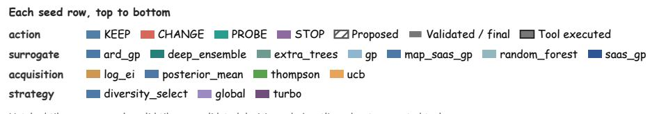

## (a) COF Xe/Kr separation

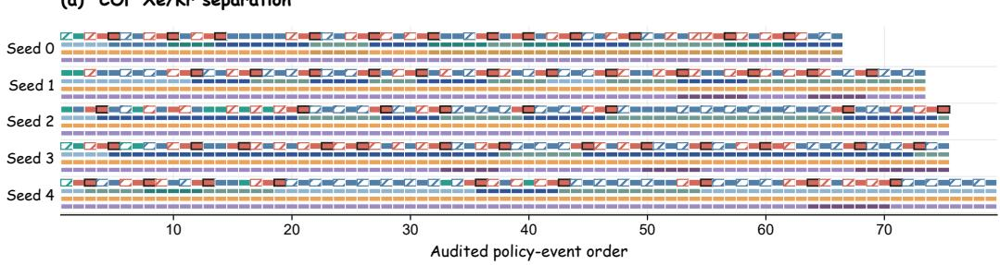

## (b) PCE10 photodegradation

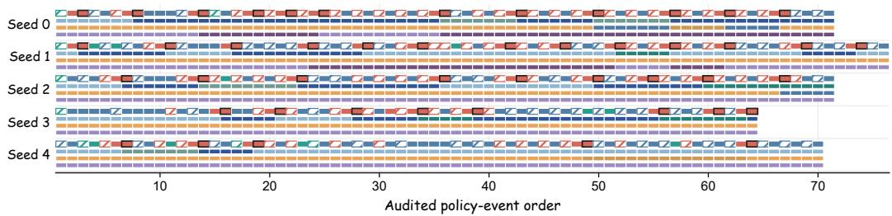

## (c) Buchwald–Hartwig reaction

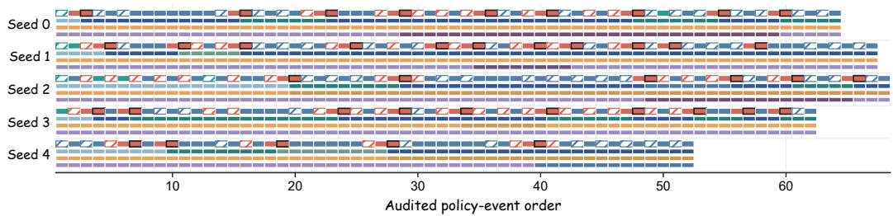

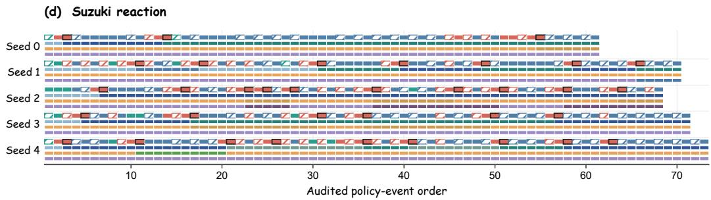  
Figure C1: Strategy events and efective formulations across four tasks. (a) COF; (b) PCE10; (c) BH; (d) Suzuki. Each row corresponds to one seed. From top to bottom, the four bands represent strategy actions, the efective surrogate model, the efective acquisition function, and the efective search strategy. Hatching denotes a strategy draft, solid fill denotes a validated strategy proposal that was adopted, and a dark border denotes execution of an algorithmic tool; the last three formulation bands record the formulation that actually became efective after each event. The horizontal axis is the temporal order of audit events and does not correspond to oracle evaluation count.

Visibility filtering for reflection citations and domain-contrast judgment are performed separately, and their validation scopes difer by path.

The mechanical three-state result is computed from task facts, state, and diagnostics; historical notes influence subsequent state through policy selection and do not directly modify selection\_gate. Disabling research.enabled still retains TaskMemory, review-history feedback, and trajectory-component summaries.

## C.3.3 Evaluation Scope of Cross-Round Feedback

Hypothesis-evaluation and state-change fields are not populated consistently in the available reflection logs. Consequently, these logs do not support reconstruction of the full sequence linking hypotheses, observations, revisions, and subsequent actions. Appendix C.2 provides an example of the event records captured in a deterministic heuristic run.

## C.3.4 Optional Proposal Review and Candidate Review

The optional proposal audit in Fig. 1 corresponds to conditional review in the structured strategy controller. The flow is requested only when research discussion is enabled and either a stagnation state occurs or the diagnostic utility of an alternative surrogate exceeds that of the current surrogate and a configured threshold. The method, domain, and counterevidence critics review the same policy draft and return SUPPORT, REVISE, or BLOCK recommendations; the arbiter aggregates them into ACCEPT or REVISE, with at most one proposal revision triggered by the latter. The final proposal still passes the ordinary runtime guards.

A critic’s BLOCK is a proposal-review opinion and has no authority to hard-veto a candidate or submit an experiment. If the review service or context preparation fails, the flow may return a single policy draft handled by the runtime guards. Historical retrieval precedes final action review; memory retrieval and diagnostic PROBE use independent round quotas.

Candidate review returns task-dimension scores for the shortlist formed by the execution layer, for fusion in Section 4.5; post-observation reflection instead links actual results to public hypotheses. Proposal review, candidate review, and reflection concern policy proposals, candidate sets, and observed evidence, respectively. Candidate fusion uses valid review dimensions that cover the complete shortlist and weights them by dimension; reviewer confidence is not used in the calculation. Online, if no complete valid dimension with a positive total weight is available, selection falls back to purely numerical choice; other anomalies follow their respective error paths. Warm start executes the initial experiment only after obtaining at least one complete review dimension.

## C.4 Declaration Protocol and Current Implementation

Table C2: Declared protocol and current implementation.
<table><tr><td>Stage</td><td>Declaration protocol</td><td>Current implementation</td></tr><tr><td>Atomic admission</td><td>The complete combination satisfies the conditions for the current round</td><td>Primarily checks atomic changes in CHANGE and retains atoms that can continue execution</td></tr><tr><td>Supporting material</td><td>The required support list is non-empty</td><td>Verifies list non-emptiness only; citation validity and premise entailment unverified</td></tr><tr><td>Portfolio</td><td>Each acquisition capability and the final surrogate are compatible and satisfy admission</td><td>Filters BLOCKED IDs and verifies interfaces; partial binding for NEEDS_EVIDENCE; zero-quota keys still checked</td></tr><tr><td>CHANGE→KEEP</td><td>formulation</td><td>Recheck the candidate plan under the final Candidate plan validated pre-guard; deferred components bypass re-validation</td></tr><tr><td>Candidate and fusion</td><td>Bounded candidates, valid reviews, deterministic submission</td><td>Decoupled quotas/slots; falls back to numerical utility if valid review dimensions are absent</td></tr></table>

Final incumbent

Table C2: (continued)
<table><tr><td>Stage</td><td>Declaration protocol</td><td>Current implementation</td></tr><tr><td>Research feedback</td><td>Public state is available for subsequent retrieval</td><td>Typed hypotheses, reflections, and retrieval rules are saved</td></tr><tr><td>Budget and objective</td><td>Only oracle observations are appended</td><td>Ordinary single-point paths separate query computation from objective computation</td></tr><tr><td>Path coverage</td><td>The same checks apply to non-SToP candidate-submission paths</td><td>The heuristic path does not cover all checks applied by the main path</td></tr><tr><td>Termination and failure</td><td>SToP returns a report; no candidate means no evaluation</td><td>Immediate report generation on SToP; empty candidate set raises selection failure</td></tr><tr><td>Parameter state</td><td>Active parameters agree with actual execution</td><td>The shared parameter dictionary may retain inactive fields</td></tr><tr><td>ID-feature consistency</td><td>Validation supports an adversarial consistency check</td><td>Checks basic ID-feature mappings; adversarial consistency unverified</td></tr></table>

## D Figure Notes and Projection Examples

## D.1 Figure Notes

Main-text Figure 1 organizes the workflow around strategy adjustment, candidate execution and observation, and research-memory feedback; the partitions indicate functional order, while execution permissions are specified by the individual roles. Main-text Figure 2 expands the capability contract, evidence-condition compilation, two-level typed proposals, and execution submission; paired E markers indicate that computational evidence is returned to the compiler input. Both figures are mechanism schematics; the scope of checks in the current implementation is given in Section 4.8 of the main text and Appendix C.4.

HEBO and Reasoning BO correspond to references [29–30] in the main text, and the reaction data correspond to references [31–32].

## D.2 Two-Dimensional Projection Examples of Search Paths

Figure D1 shows the positions and order of incumbent updates in one run for each of the four tasks, providing a process example for the performance curves in the main text. The backgrounds are post hoc explanatory projections and were not provided as inputs to the optimizer.

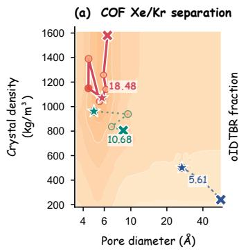

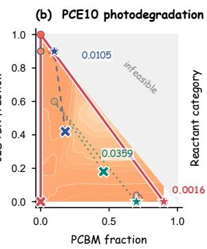

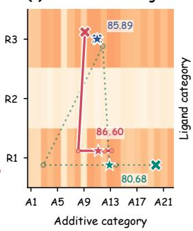

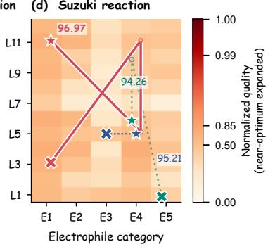  
Figure D1: Two-dimensional projections and incumbent-update examples. (a) COF; (b) PCE10; (c) BH; (d) Suzuki. The red solid, blue dashed, and teal dotted lines correspond to the proposed method, Vanilla BO, and Random Search, respectively; crosses and stars mark the first and final incumbents in the displayed run. PCE10 is a minimization objective, and the background shows direction-normalized quality; the gray region indicates that the sum of the two plotted components exceeds 1. The BH and Suzuki coordinates are categorical labels, and adjacency does not represent continuous physical distance; connecting lines indicate update order only.