# Agentic4PDM: Host-Governed Evidence Admissibility for Industrial Fault Diagnosis

Nam V. Nguyen<sup>1</sup>, Hoang Van Truong<sup>1</sup>, Hieu D. D.<sup>1</sup>, Nguyen Duy Khuong<sup>1</sup>, Quang Pham<sup>2</sup>, Tung Kieu<sup>3</sup>

<sup>1</sup>FPT Corporation <sup>2</sup>Independent Researcher <sup>3</sup>Aalborg University

## Abstract

We study industrial fault diagnosis as a classification task that assigns sensor time-series windows to predefined health states or fault types. Scarce labels and changing operating conditions make repeated training of specialized classifiers costly. Yet structures such as periodicity, trends, and transients can remain diagnostically informative and be examined through reusable analytical tools. LLM agents can select and interpret these tools, but fixed rules or training-derived guidance may not resolve each signal’s ambiguity, while unconstrained interpretation may overstate weak or conflicting results. We introduce Agentic4PDM, a framework that separates adaptive investigation from control over evidence use. LLM agents compare each signal with labeled references from every candidate class, identify unresolved distinctions, and propose follow-up measurements. A deterministic software controller, called the host, enforces contract-checked gated adjudication (CCGA): it checks requests, requires commitment to a complete tool batch before results are observed, and assigns evidence roles based on tool checks against labeled references. These roles distinguish corroborative support from advisory information. The Judge Agent proposes a diagnosis, while the controller checks protocol compliance and records the investigation. Agentic4PDM supports training-free diagnosis using pretrained representations and labeled references without task-specific diagnostic models, and a standard setting that additionally investigates trained-model predictions. Experiments on selected bearing and motor diagnosis challenges and an unfiltered industrial test set supplied by our customer show gains in aggregate macro F1 over the evaluated diagnostic and agentic baselines. Ablations further support the value of the governed workflow.

Correspondence Email: namnguyen16ai@gmail.com

Keywords: LLM agents; agent governance; agents for predictive maintenance

## 1 Introduction

[29], supporting maintenance decisions and the coordination of repair resources and production schedules [5]. Unsupervised methods can detect departures from normal behavior, but identifying the specific fault type requires information linking the observed deviation to known fault categories. Labeled fault examples provide such information, but are often scarce [35], and this limitation becomes especially severe under distribution shift. Changes in operating conditions or measurement quality can alter the observed signal [10], meaning that a model trained under one condition may need to be retrained and revalidated using labeled faults from the new condition, even though such data are dificult to obtain. This raises a fundamental question: how can fault diagnosis adapt to a new operating condition when only a few labeled fault examples are available?

Time-series foundation models ofer reusable representations learned through large-scale pretraining [40]. A common approach maps a time series to a fixed-dimensional representation and fits a downstream classifier on top of it [20, 22, 37, 65]. However, diferent classifiers may exploit diferent distinctions within the same representation: one classifier may correctly classify a sample that another misclassifies, while making errors on samples that the other handles correctly. Replacing one classifier with another can therefore shift errors across samples rather than eliminate the underlying ambiguity. This suggests that the most useful diagnostic perspective may depend on the sample, and that reliable diagnosis may require examining multiple aspects of the observed signal rather than relying on a single predictive view. In industrial diagnosis, such complementary evidence can arise from waveform morphology, recurrence, spectral structure, and other signal characteristics [33, 50, 54]. The problem then becomes more specific: when existing diagnostic views remain inconclusive, what additional evidence should be acquired for the current case?

Large language model (LLM) agents can support this investigation by interleaving reasoning with actions, such as invoking analytical tools to acquire additional evidence for the current signal [63]. Existing timeseries agents, however, guide evidence collection through predefined rules, feature knowledge, or aggregation procedures: ARGOS [23] applies detection rules generated ofline, ZARA [39] selects among discriminative features distilled from the training data, and FETA [55] combines channel-level decisions using the LLM’s self-assessed confidence as aggregation weights. These designs raise three concerns. First, a predefined pipeline can limit the agent’s freedom to decide what to investigate. Second, rules or features selected for their discriminative power on training data may not resolve the ambiguity of the current case, particularly when operating conditions shift. Third, when the LLM rates its own confidence, that rating may be an unreliable basis for weighting evidence, since LLMs can struggle to assess their own reasoning without external feedback [26].

To address these concerns, we propose Agentic4PDM, a multi-agent framework for industrial fault diagnosis. Several LLM agents, each with its own role and context, first build comparative evidence for the current case. The analysts compare stable regions and local deviations in the signal with labeled references from every candidate class, providing complementary views of the same input. The Judge agent then investigates the case under contract-checked gated adjudication (CCGA), a protocol that controls how the agent collects and uses evidence. CCGA relies on a Host, a deterministic software controller that applies predefined rules. Like a standard agent harness [60, 62], the Host calls each agent, prepares its context, and executes its requested tools. Here, it also checks the agent’s requests and determines how each result may be used. The Host enforces two gates, followed by a finalization check on the proposed class. The request gate guides the agent toward tools that address the ambiguity or conflict in the current case. The agent must state which signal properties remain unresolved and commit to a batch of tools that measure them before seeing any result from that batch. This follows four steps: Declare the unresolved properties, Offer compatible tools, Commit to the complete batch, and Execute the approved measurements. The packet and influence gate then determines how each tool result may influence the diagnosis. A reference preflight checks the tool on labeled references retrieved for the current case and assigns its result a corroborative or advisory role. Corroborative results may support a class as checked evidence, whereas advisory results can inform hypotheses and further investigation but remain unchecked. The permitted influence of each result therefore rests on these reference checks rather than on the LLM’s own confidence. Finally, the Host checks the proposed class against the finalization requirements and records the measurements, their assigned roles, and whether the proposal is admitted.

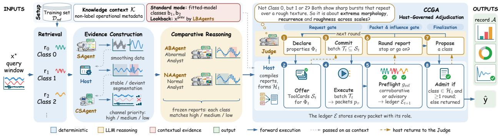  
Figure 1 Agentic4PDM workflow. The Host constructs and freezes class-balanced comparative evidence before the Judge begins sample-specific investigation. The Judge proposes follow-up measurements or a diagnosis, while the Host governs which measurements may run and how returned evidence may influence the decision. The Host then publishes the reported class, marked as admitted or not admitted, together with the record of the checks behind it.

Across the bearing and motor fault-diagnosis tasks, Agentic4PDM achieves the strongest overall macro-F1 performance, attaining the highest three-dataset averages on both BFH and GRS and the best result on the complete industrial test set provided by our customer. Our contributions are threefold:

1. Agentic4PDM: a context-rich framework for agentic industrial diagnosis. It is an agentic framework that integrates complementary diagnostic context to support sample-specific investigation in both training-free and standard settings.

2. CCGA: Host-governed evidence adjudication. We introduce a protocol that separates adaptive investigation from evidentiary authority, allowing the agent to decide what to investigate while a deterministic Host controls how each result may be used to support the diagnosis.

3. Evaluation across industrial diagnosis challenges. We evaluate Agentic4PDM across complementary bearing and motor fault-diagnosis settings, examining both predictive performance and the behavior of governed investigation.

## 2 Related Work

Diagnosis with transferable representations. Industrial fault diagnosis must distinguish fault-related signal changes from those caused by operating conditions: load, rotational speed, and environmental factors can alter vibration signals even when component health remains unchanged, causing deployment data to difer from training data [9, 58]. This mismatch can reduce the accuracy of conventional fault classifiers [1, 7, 10, 32], while adaptation is dificult because labeled fault data are scarce [35]. A common remedy is to train a classification head on pretrained time-series representations [20, 37, 65], including those from recent time-series foundation models [2–4, 12, 13, 17, 21, 22, 31, 40, 42, 43, 46, 51, 59]. However, a fixed head returns a prediction using its learned decision boundaries without acquiring further evidence when the input is ambiguous or poorly represented in the training data. Agentic4PDM instead uses a pretrained encoder to retrieve class-balanced labeled references, while LLM agents investigate complementary aspects of the signal through analytical tools before proposing a class. Thus, the trained model predictions only served as consultation in Agentic4PDM.

Agentic evidence acquisition. LLM agents already reason over sensor data and acquire information beyond a fixed prediction: aligning sensor encoders with language [38], validating executable diagnostic rules ofline [23], retrieving labeled exemplars and fusing channel judgments using self-assessed confidence [55], scoring predefined features for pairwise discriminativeness ofline and pruning candidates online [39], and orchestrating broader diagnostic or maintenance workflows [24, 44, 53, 67]. These designs raise two concerns: (i) predefined rules or historically discriminative features may not resolve the ambiguity of the current case; and (ii) when the same component selects evidence and determines its influence, self-assessed confidence provides no independent check when results conflict. Agentic4PDM addresses both: (i) the agent must state which signal properties remain unresolved in the current case and commit to a tool batch that covers them before seeing any result;

and (ii) a deterministic Host determines each result’s permitted influence through checks on labeled references retrieved for the current case, independently of the agent’s own confidence.

Governing actions, data, and evidence. Related work provides three forms of agent governance. Interaction rules, such as electronic institutions, regulated multi-agent systems, and commitment protocols, specify roles, permitted actions, and interaction obligations [19, 45, 64]. Guardrails integrated into the agent harness—the program that calls the LLM and executes its tools [60, 62]—enforce safety policies or restrict untrusted data flows [11, 14, 57, 61]. Some use an additional LLM to interpret policies or construct checking procedures [11, 61]. Argumentation studies which arguments or conclusions are acceptable given their supporting and conflicting relations [6, 16, 47]. These lines of work emphasize interaction permissions, safety and security policies, or argument acceptability. Our focus is the acquisition and use of diagnostic evidence during an adaptive investigation: whether a proposed measurement addresses the current ambiguity and what its result is permitted to support. This matters in time-series classification because the agent must choose measurements for each signal and interpret results that may conflict. Under CCGA, the agent retains initiative over what to investigate, while a deterministic Host checks measurements against declared unresolved properties and controls what each result may establish, from the first request to the admission of the final class (Section 3).

## 3 Agentic4PDM Framework

## 3.1 Framework Overview

As illustrated in Figure 1, Agentic4PDM consists of two main phases. (1) In evidence construction (Section 3.4), the Host retrieves one reference sample per class, the agents decide how the signal is viewed and which channels receive priority, and two Analysts compare the query with each reference over complementary stable and deviant regions. (2) In CCGA (Section 3.5), the Judge resolves the ambiguity that remains after these comparisons: it requests additional measurements when needed and proposes a diagnosis, while three Host checks decide which measurements may run, how their results may influence the decision, and whether the proposed class is admitted. Notably, the LLM agents decide what to investigate, while the Host controls how the resulting evidence can be used in the final diagnosis.

## 3.2 Problem Definition

Let $\boldsymbol { x } ^ { \star } \in \mathbb { R } ^ { T \times C }$ be a sample under diagnosis, with T observation across C sensor channels, and let ${ \mathcal { V } } =$ $\{ 0 , \ldots , Y - 1 \}$ be the label space of $Y$ classes. Let $\mathcal { D } _ { \mathrm { r e f } } = \{ ( x _ { i } , y _ { i } ) \} _ { i = 1 } ^ { N }$ be the labeled training set, with $\bar { x } _ { i } \in \mathbb { R } ^ { T \times C }$ and $y _ { i } \in \mathcal { V }$ . For each class $y \in \mathcal { Y } , \mathcal { R } _ { y } = \{ x _ { i } : ( x _ { i } , y _ { i } ) \in \mathcal { D } _ { \mathrm { r e f } } , \ y _ { i } = y \}$ denotes the set of training samples with label y. Given a frozen embedding $\phi _ { \mathrm { e m b } }$ and the cosine similarity $s _ { \mathrm { c o s } }$ between embeddings, the class-balanced reference bank of a sample $x ^ { \star }$ holds the most similar training sample of each class:

$$
\begin{array} { r } { \mathcal { R } ^ { \star } ( x ^ { \star } ) = \{ r _ { 0 } ( x ^ { \star } ) , \ldots , r _ { Y - 1 } ( x ^ { \star } ) \} , \ } \\ { \mathrm { ~ w h e r e ~ } r _ { y } ( x ^ { \star } ) = \arg \underset { r \in \mathcal { R } _ { y } , \ r \neq x ^ { \star } } { \operatorname* { m a x } } s _ { \cos } ( x ^ { \star } , r ) . } \end{array}\tag{1}
$$

Thus $r _ { y } ( x ^ { \star } )$ is the class-y sample closest to $x ^ { \star }$ . Furthermore, we use K to denote a read-only knowledge context and metadata fields describing the operating condition of the input, such as machine types, rotational speeds, and recorded channels. Then Agentic4PDM, denoted $F ( \cdot , \cdot , \cdot )$ , is a diagnosis system comprising LLM agents and a deterministic Host. Agentic4PDM takes as input $x ^ { \star } , R ^ { \star }$ , and $\kappa ,$ and produces: (1) the reported class $\hat { y } \in \mathcal { V } ;$ ; and (2) the record A, a variable-length log of all actions taken and results revealed as:

$$
( \hat { y } , \mathcal { A } ) = F ( x ^ { \star } , \mathcal { R } ^ { \star } , \mathcal { K } ) .\tag{2}
$$

In many scenarios such as new machines or insuficient high quality reference samples, it is desirable for the system to notify that it is not confident in providing its prediction. Agentic4PDM achieved this behaviour via A, which states whether $\hat { y }$ was admitted, that is, whether it passed the Host’s finalization check. In all cases, F always reports a valid class for every sample, however, $\mathcal { A }$ may indicate that this label is unreliable. We now describe the agents and the Host that make up F.

## 3.3 Agents and Host

Agents. Agentic4PDM uses five primary LLM agent roles, each with its own task and context. The Smoothing Agent (SAgent) selects a registered smoothing family for each channel; the Host determines its parameters. The Channel-Selection Agent (CSAgent) assigns each channel a priority tier by its diagnostic relevance, or removes it. The Normal Analyst (NAAgent) and Abnormal Analyst (ABAgent) compare the query’s stable and deviant regions, respectively, with the class references and construct Analyst reports that include a set of potential candidate classes, supporting observations, and contradictions. The Judge synthesizes these reports, identifies unresolved signal properties, requests follow-up measurements, and proposes a diagnostic class. Then, the NAAgent and ABAgent repeat their respective comparisons on the preceding sample, collectively referred to as the Lookback Analysts (LBAgents). Their outputs serve only as context (Section 3.5).

We use separate agents instead of one LLM for every role. Specifically, each agent starts from a fresh context that holds only its own inputs and earlier agents’ outputs. This design provides two major advantages. First, it avoids context contamination where the thinking trace of one task is fed into next task’s input context. Since only the final output is relevant, such thinking traces dilute the context and can quickly degrade performance [15, 34], especially for small, local LLMs used in our work. Second, it provides a better tokenomics since using only one LLM for all tasks will quickly reach its token limit and require frequent context summarization, increasing costs and reducing inference speed. Separating the agents, therefore, keeps each context short and focused on one specific task. Lastly, Appendix A describes how we manage the agents’ contexts in more detail.

Host. The Host orchestrates the interactions among the SAgent, CSAgent, NAAgent, ABAgent, and LBAgents to construct the evidence and Analyst reports presented to the Judge. It also governs how the Judge progresses toward a diagnosis, from identifying the remaining ambiguity and selecting appropriate tools to incorporating the resulting evidence and proposing a final decision.

Two modes. In standard mode, $F$ also uses two fitted classifiers: the Judge receives the classes $b _ { 1 } , b _ { 2 } \in \mathcal { D }$ predicted for $x ^ { \star }$ by an SVM and an XGBoost classifier trained on frozen embeddings of the labeled samples. We call $b _ { 1 }$ and $b _ { 2 }$ the fitted-model predictions and treat them as individual contextual input sources that encourage the Judge to pay greater attention to these candidate classes. The Judge may use them as anchors and verify them by examining class characteristics that the Analyst reports may have missed, using additional tools to investigate and validate the corresponding hypotheses. In this study, we report the standard mode as our main results. In Appendix C.2, we extend the evaluation to a training-free (TF) mode, where no classifier is trained and $b _ { 1 } , b _ { 2 }$ are omitted, to assess whether fitted-model predictions are necessary.

## 3.4 Query-Adaptive Evidence Construction

Before the Judge starts its analysis, the Host and the other agents prepare diferent types of evidence for the query sample $x ^ { \star }$ . First, the Host retrieves the reference bank $\mathcal { R } ^ { \star } ( x ^ { \star } )$ by Eq. 1. Next, the SAgent picks a smoothing family for each channel, and the Host marks the stable and deviant regions of each smoothed signal. The CSAgent then removes channels that carry no useful information and gives each remaining channel c a priority tier, tier $( c ) \in \{ \mathtt { h i g h }$ , medium, low}; the Host checks this choice and may restore a removed channel. The final tiers give three sets of channels: $\mathcal { P } _ { 1 } = \{ c : \mathrm { t i e r } ( c ) = \mathrm { h i g h } \} , \mathcal { P } _ { 2 } = \{ c : \mathrm { t i e r } ( c ) = \mathrm { m e d i u m } \}$ and $\mathcal { P } _ { 3 } = \{ c : \mathrm { t i e r } ( c ) = 1 \sigma \theta \}$ . In real sensor data, short peaks and irregular changes can come from either a real fault or a temporary change in operating or environmental conditions. If we treat all of these changes in the same way, we may confuse fault-related patterns with short-term noise or disturbances. To mitigate this ambiguity, we analyze the query from two complementary perspectives: the NAAgent compares the query’s stable region with the stable region of each reference, whereas the ABAgent compares its deviant region with the corresponding deviant region of each reference. Each Analyst report identifies a set of plausible classes and assigns each candidate a confidence level from {high, medium, low}, together with supporting and contradicting observations.

## 3.5 CCGA: Host-Governed Adjudication

Once both Analyst reports are complete and frozen, the Host advances the case to the Judge, providing the frozen reports together with the selected signal views, channel priority tiers, and, in standard mode, fitted-model predictions $b _ { 1 } , b _ { 2 }$ . If ambiguity remains, the Judge may request the preceding sample $x ^ { \mathrm { p r e v } }$ The LBAgents then repeat the NAAgent and ABAgent comparisons on this sample against the same references. Once these comparisons are complete, the Host aggregates their results into an overall report for the Judge and constructs the initial candidate set $\mathcal { H } _ { 1 }$ as the union of the plausible classes identified in all Analyst reports (including lookback, if performed) and the two fitted-model predictions $b _ { 1 }$ and $b _ { 2 }$ . These complementary sources help the Judge identify what remains unresolved and what additional evidence is needed. The subsequent investigation is governed by CCGA through three Host checks: the request gate controls which measurements may run (Section 3.5.1); the packet and influence gate controls what each result may support (Section 3.5.2); and finalization determines the reported diagnosis (Section 3.5.3).

## 3.5.1 Request Gate

This stage structures each round of the Judge’s investigation around an unresolved property, proceeding through four steps: Declare, Offer, Commit, and Execute. Rounds are indexed by $t = 1 , 2 , \ldots ;$ a subscript t marks a quantity of round t, and the ledger $\mathcal { E } _ { t }$ records every result returned before round t.

(1) Declare. The Judge receives the live candidate set $\mathcal { H } _ { t }$ (initially $\mathcal { H } _ { 1 } )$ , the evidence ledger $\mathcal { E } _ { t }$ , and the registered set $\Phi _ { \mathrm { r e g } }$ of 48 signal properties (Table 18 in Appendix K.2). Based on the evidence already available for $x ^ { \star }$ , the Judge identifies the unresolved signal properties that could help distinguish among the candidate classes and declares a nonempty subset $\Phi _ { t } \subseteq \Phi _ { \mathrm { r e g } }$ for further investigation.

(2) Ofer. The Host takes the requested properties $\Phi _ { t } .$ , searches the registry of 25 default tools (Appendix L), and returns the set $S _ { t }$ of tools. Each tool is registered as a ToolCard τ, a fixed description specifying the set $\Phi ( \tau ) \subseteq \Phi _ { \mathrm { r e g } }$ of properties it measures, its input requirements, the measurements and outputs it provides, and its known limitations. This helps the Judge determine which tools are suitable for investigating the unresolved signal properties.

(3) Commit. The Judge selects suitable tools from the ofered set $S _ { t }$ and commits to them as a single batch $\mathcal { T } _ { t }$ of ToolCards, subject to three conditions:

$$
\mathcal { T } _ { t } \subseteq S _ { t } , \qquad \Phi _ { t } \subseteq \bigcup _ { \tau \in \mathcal { T } _ { t } } \Phi ( \tau ) , \qquad \Phi _ { t } \cap \Phi ( \mathcal { E } _ { t } ) = \emptyset .\tag{3}
$$

Together, these conditions ensure that the Judge uses only ofered tools, covers all declared properties, and does not revisit properties measured in earlier rounds. This prevents selective investigation and repeated requests for more favorable results. The Host checks all three conditions before execution. If any condition fails, the Judge must select again.

(4) Execute. The Host runs each ToolCard $\tau \in \mathcal { T } _ { t }$ on the channels in $\mathcal { P } _ { 1 } , \mathcal { P } _ { 2 } ,$ , and $\mathcal { P } _ { 3 }$ . On each channel, the tool compares $x ^ { \star }$ with the reference of every class in $\mathcal { R } ^ { \star }$ and ranks the classes. To combine the channels, the Host uses only the highest nonempty tier, $\mathcal { P } ^ { \star } = \mathcal { P } _ { k }$ with $k = \operatorname* { m i n } \{ \ell : \mathcal { P } _ { \ell } \neq \emptyset \}$ . The tool’s winning class $\hat { y } _ { \tau } ( x ^ { \star } ; \mathcal { R } ^ { \star } )$ is the class that every channel in ${ \mathcal { P } } ^ { \star }$ ranks first; if these channels disagree, there is no winning class $( \hat { y } _ { \tau } = \perp )$ ). The Host returns the result as a packet $p _ { \tau }$ , which holds the per-channel rankings, the winning class, and the tool’s stated limitations. If the tool fails or there is no winning class, the packet is excluded: it stays in the ledger but supports no class. Any other packet is usable.

Taken together, the four steps order the reasoning without limiting what may be investigated. Before accessing new evidence, the Judge must name what remains unresolved as measurable signal properties and cite the evidence behind the request, so the reason for each measurement is recorded and can be checked. A complete agent-Host exchange is given in Appendix N.3.

## 3.5.2 Packet and Influence Gate: Controlling What Each Result Can Support

A successfully executed measurement is not automatically reliable diagnostic evidence. Its result may be ambiguous or poorly supported, yet an unconstrained agent could still overuse it. The packet and influence gate therefore controls how much each returned result is allowed to influence the diagnosis, through a single check on the tool itself: a reference preflight.

The winning class $\hat { y } _ { \tau } ( x ^ { \star } ; \mathcal { R } ^ { \star } )$ shows which class one measurement favors. But when several tools name diferent classes, the Judge still needs a basis to decide which results are reliable enough to influence the diagnosis. We therefore add a reference preflight before assigning any influence role. For each class $y ,$ the Host treats its retrieved reference $r _ { y } ^ { \mathrm { c t r l } } = r _ { y }$ (Section 3.2) as a pseudo-query, called a control, whose label it knows. The alternate bank is $\mathcal { R } ^ { \mathrm { a l t } } ( { \bar { r } } _ { y } ^ { \mathrm { c t r l } } ) = \mathcal { R } ^ { \star } ( r _ { y } ^ { \mathrm { c t r l } } )$ , which by Eq. 1 never contains $r _ { y } ^ { \mathrm { c t r l } }$ itself. The Host runs the same ToolCard τ on each control with the same rule for the winning class. The tool passes the preflight only if it recovers the known class of every control:

$$
\begin{array} { r } { g _ { \mathrm { r e f } } ( \tau ) = \left\{ \begin{array} { l l } { 1 , } & { \mathrm { i f ~ } \hat { y } _ { \tau } \big ( r _ { y } ^ { \mathrm { c t r l } } ; \mathcal { R } ^ { \mathrm { a l t } } ( r _ { y } ^ { \mathrm { c t r l } } ) \big ) = y \mathrm { ~ f o r ~ e v e r y ~ } y \in \mathcal { V } , } \\ { 0 , } & { \mathrm { o t h e r w i s e . } } \end{array} \right. } \end{array}\tag{4}
$$

Each non-excluded packet then receives its influence role:

$$
\mathrm { r o l e } ( p _ { \tau } ) = \left\{ \begin{array} { l l } { \mathrm { c o r r o b o r a t i v e , } } & { g _ { \mathrm { r e f } } ( \tau ) = 1 , } \\ { \mathrm { a d v i s o r y , } } & { g _ { \mathrm { r e f } } ( \tau ) = 0 . } \end{array} \right.\tag{5}
$$

The roles specify how a packet may be used, not how confident it is. A corroborative packet passed the preflight, so its class counts as checked evidence and can support a proposed class. An advisory packet failed ${ \mathrm { i t } } ,$ so its class is unchecked: it may shape the Judge’s hypothesis and its next request, and may add support to a proposal, but should not by itself overturn another result. This holds even when the packet’s class on $x ^ { \star }$ is clear, because the same tool failed to recover a known control label. These roles fix how each packet is treated when a class is proposed (Section 3.5.3). The Host then adds every packet of the round, with its role if it is usable, to the ledger, $\mathcal { E } _ { t + 1 } = \mathcal { E } _ { t } \cup \{ p _ { \tau } \} _ { \tau \in \mathcal { T } _ { t } }$ . This closes the declared properties, $\Phi _ { t } \subseteq \Phi ( \mathcal { E } _ { t + 1 } )$ , so later rounds cannot declare them again (Eq. 3).

Once every packet of the round has its role, the Judge files one round report covering all of them: it states whether their results agree, conflict, or cannot be compared, names what remains uncertain, and decides whether to stop or open another round. The Host rejects a decision to stop while valid results still conflict and tool budget remains. If the Judge continues, the next round begins at Declare; otherwise the case moves to finalization.

## 3.5.3 Finalization

The final stage decides which class is reported and whether it was admitted. When the Judge is ready to conclude, it holds the final ledger E: every executed packet together with its influence role. It proposes a class from this ledger, weighing each packet by its role: a corroborative packet’s class counts as checked support, whereas an advisory packet’s class may support the proposal but should not by itself overturn another result. The Host then admits the proposal only when it meets two admission conditions, one on the candidate set and one on the measurements: the proposed class must lie in $\mathcal { H } _ { 1 }$ , the candidate set before any measurement (Section 3.5), and at least one round of quantitative measurement must have been completed (Appendix N.5). A proposal that fails either condition is returned to the Judge with the failed condition, and the Judge may revise it or measure further, within a budget of $N _ { J }$ Judge steps (Table 13 in Appendix H.3). At the last step, the Judge must propose a class in $\mathcal { H } _ { 1 }$ . The first proposal that meets both conditions, denoted ${ \tilde { y } } ,$ is admitted and reported, ${ \hat { y } } = { \tilde { y } } ;$ if none does, the Host reports the last-step class and marks it as not admitted. This flag tells the user that the class did not pass the protocol checks and should be reviewed; it is not an estimate of diagnostic accuracy.

## 3.5.4 Roles of the Judge and Host in CCGA

The preceding sections describe how CCGA governs evidence acquisition, its influence on diagnosis, and finalization. Together, these mechanisms establish a clear division of responsibilities between the Judge and the Host. The Judge leads the investigation by identifying unresolved signal properties, selecting suitable ToolCards, interpreting their results, and proposing a diagnostic class. The Host oversees this process without making the diagnostic judgment itself. It checks whether tool requests satisfy the request conditions (Eq. 3), determines which returned packets are usable, and assigns their influence roles through the reference preflight. These roles guide how the Judge uses the evidence: corroborative packets provide checked support, while advisory packets can guide further investigation and add support to a proposal. The Host also prevents premature stopping when valid results still conflict and tool budget remains, and checks the proposed class against the admission conditions (Section 3.5.3). In this way, the Judge retains the freedom to investigate and reason about the current case, while the Host ensures that its decisions follow the evidence-handling constraints of CCGA.

## 4 Experiments and Results

## 4.1 Experimental Protocol

Datasets experimental settings. We evaluate three-class bearing diagnosis on the PU [36], UO [25], four-class induction-motor diagnosis on MCC5 [8], and a proprietary customer dataset, Bel. All signals are segmented into non-overlapping windows of T=2048 observations, with 50 training samples retained per class. For the public benchmarks, launching the agents on the full datasets is infeasible. Therefore, we implement two subsampling techniques: Geometry-Stratified Response-Stability (GRS) for diversity and Baseline-Failure Hard (BFH) for selecting dificult samples. First, GRS uses k−means to cluster the held-out pool of each class and select only one representative window of the whole evaluation window where the baseline predictions are consistent. This produces 906, 763, and 1152 evaluation windows for PU, UO, and MCC5, respectively. Second, for each dataset, BFH selects 100 approximately class-balanced windows from the held-out samples misclassified by a large fraction of the frozen baseline registry, yielding a hard test suite where the majority of the conventional baseline fail. We provide the more details of GRS and BFH in Appendix I.2 and Appendix I.1) respectively. Bel is a proprietary dataset of raw sensor time series recorded by a bearing noise and vibration tester during quality inspection on our customer’s production line. We evaluate all 330 test samples without BFH or GRS selection, preserving the customer-defined test distribution. Together, these evaluations assess performance from three complementary perspectives: coverage across observed regimes, robustness to baseline-failure cases, and generalization to an external customer dataset. Further details on the datasets and evaluation settings are provided in Appendix H.1.

Model settings and evaluation metrics. All agentic methods use Qwen3.6-27B [49] with greedy decoding under the same labeled-reference budget and resource limits. The main Agentic4PDM configuration uses frozen Moirai 1.1 R Large [59] embeddings for class-balanced reference retrieval and for fitting the SVM and XGBoost heads supplied to the standard variant. Detailed inference, retrieval, and baseline configurations are provided in Appendices H.3 and H.6. Performance is measured using multiclass accuracy and macro F1 (F1-M). We compare three families of methods. First, deep-learning baselines include CNN-TCC [18], QCNN [41], and WDCNN [66]. Second, foundation-model baselines pair frozen representations from Moirai 1.1 R Large [59], Moirai 2 Small [42], and Chronos 2 and Chronos 2 Small [3] with KNN, SVM, and XGBoost classification heads. Third, agentic methods include FETA [55], ZARA [39], and our proposed Agentic4PDM.

## 4.2 Main Results

Figure 2 reports the performance of the three baseline families across the three benchmarks considered. Overall, Agentic4PDM consistently achieves the highest average performance across all three tests. We first examine GRS, where Agentic4PDM outperforms the strongest baseline by +7.5%. Interestingly, the agentic baselines ZARA and FETA even fall behind the strongest time-series foundation models, suggesting that agentic reasoning alone does not necessarily yield a stronger diagnosis. The advantage of Agentic4PDM becomes more pronounced in BFH, which focuses on samples misclassified by baseline models. In this hard setting, Agentic4PDM surpasses ZARA by +12% and FETA by +19.53%, demonstrating a substantially stronger ability to recover dificult cases. More importantly, we extend the evaluation to the full test set of a real customer dataset, BEL, narrowing the gap between benchmark evaluation and practical industrial deployment. Here, Agentic4PDM again ranks first, exceeding the strongest baseline by more than +12%. Notably, the agentic baselines degrade substantially in this setting: ZARA ranks close to the lowest-performing methods, while FETA performs better than ZARA but still remains far behind Agentic4PDM.

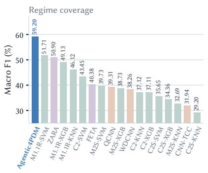

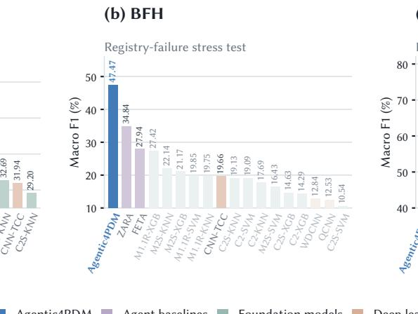  
(c) Our customer data

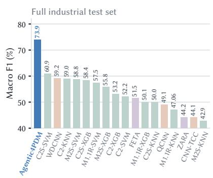  
Figure 2 Performance comparison between Agentic4PDM and baselines from three model families agentic methods, time-series foundation models, and deep-learning models across three evaluation settings: (a) GRS, (b) BFH, and (c) the customer test set (Bel). M1.1R, M2S, C2, and C2S denote Moirai 1.1 R Large, Moirai 2 Small, Chronos 2, and Chronos 2 Small, respectively; XGB denotes XGBoost.

Overall, across diverse benchmark conditions, dificult baseline-failure cases, and real industrial data, Agentic4PDM achieves the highest average performance among all evaluated methods. Additionally, Appendix C.3 examines run-to-run variation over three repeated executions. Despite the multi-round reasoning process of Agentic4PDM, the observed variation remains small: the largest standard deviation across datasets and metrics is approximately 2.3 points on BFH and 1.2 points on GRS. More importantly, these fluctuations are substantially smaller than the performance margins over the agentic baselines, showing that the reported gains are not simply due to a favorable individual run. For transparency, we provide detailed performance results in Appendix C.1.

## 4.3 Agent Behaviour Analysis

Beyond aggregate performance, we ask a broader question: does Agentic4PDM exhibit sample-specific diagnostic reasoning, or can its behavior be explained by simpler fixed evidence strategies? We examine this question from three complementary perspectives.

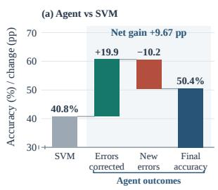

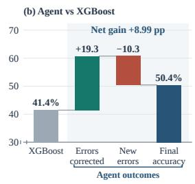

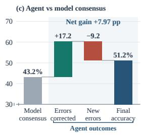  
Figure 3 Prediction revisions relative to fitted-model predictions on PU and MCC5 GRS. The consensus panel includes only cases where SVM and XGBoost initially predict the same class.

a) Does the agent add diagnostic value beyond fitted-model predictions? We further decompose the performance changes between Agentic4PDM and the fitted-model predictions of SVM and XGBoost baselines to determine whether the agent merely follows their predictions or can meaningfully revise them. Figure 3 separates three outcomes: errors corrected, where an incorrect fitted-model prediction becomes correct after agent reasoning; new errors, where a correct fitted-model prediction becomes incorrect; and final accuracy, averaged over PU and MCC5 under GRS. Relative to SVM, Agentic4PDM corrects 19.9 percentage points of errors while introducing 10.2 points of new errors, yielding a net gain of 9.67 points; against XGBoost, the corresponding values are +19.3, −10.3, and +8.99 points. More importantly, the same pattern persists when SVM and XGBoost initially agree. Even in these cases, Agentic4PDM corrects 17.2 percentage points of their shared errors while introducing 9.2 points of new errors, producing a net gain of 7.97 points. This consensus result provides strong evidence that Agentic4PDM does not merely reproduce or arbitrate between fitted-model outputs; instead, it treats these predictions as diagnostic hypotheses and extends the analysis by acquiring additional evidence through its tools.

b) Can simpler combinations of the available evidence reproduce the workflow? We further examine whether the performance of Agentic4PDM can be explained by simpler ways of using its available evidence. First, Appendix C.4 combines the evidence available to the Judge before its subsequent investigation (the NAAgent and ABAgent outputs, the final LBAgents conclusion, and the SVM and XGBoost predictions) using flat plurality. Agentic4PDM still achieves higher macro-F1 on the same covered samples, by 5.83 points on MCC5 and 9.45 points on PU, showing that its gains are not reproduced by simply voting over the labels already present in its context. Second, Appendix D asks whether one strong quantitative tool could replace the adaptive investigation. The best tool difers across datasets and transfers poorly: for example, Crossing-run Statistics is the strongest single tool on PU at 37.94% macro-F1, but drops to 22.89% on MCC5 and 16.73% on UO, decreases of 15.05 and 21.21 points, respectively. Moreover, Agentic4PDM workflow outperforms the best single tool identified for each dataset. Together, these results show that neither fixed aggregation of the initial evidence nor reliance on a single strong measurement reproduces the full workflow, and are consistent with the value of selecting and combining measurements according to the diagnostic situation of the current case.

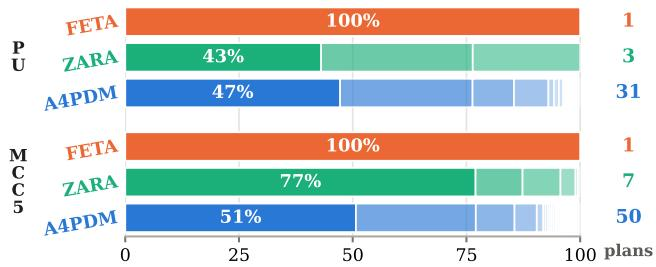  
Figure 4 Observed plans across agentic methods on PU and MCC5. Bar segments show the frequency of each plan, the right number indicates the total number of distinct plans.

c) Does the investigation adapt to the current case? In this section, we examine whether each method changes what it inspects from one sample to another (Figure 4). We define a plan as the combination of analysis choices used for a sample before the final decision: the channels inspected by FETA, the features selected by ZARA, or the signal properties requested by Agentic4PDM. The three methods exhibit markedly diferent behaviors. FETA applies a single fixed plan to every sample on both datasets. ZARA shows limited variation, using only 3 plans on PU and 7 on MCC5; moreover, its most frequent plan covers 43% and 77% of the samples, respectively. This variation is largely tied to which class pair remains after pruning, so the selected plan is primarily determined by the surviving candidate pair rather than by a new investigation of each individual sample. In contrast, Agentic4PDM produces 31 distinct plans on PU and 50 on MCC5, while its most frequent plan covers only 47% and 51% of samples. This flexibility allows Agentic4PDM to redirect its investigation toward the signal properties that are most relevant to the ambiguity of the current case, rather than repeatedly applying the same plan. Thus, nearly half of the samples follow a plan diferent from the dominant one. Overall, the results show a clear progression from fixed analysis in FETA, to candidate-pair-dependent analysis in ZARA, to substantially more sample-specific investigation in Agentic4PDM. While this analysis does not by itself establish that plan diversity causes the performance gains, it shows that Agentic4PDM has the capacity to adapt its evidence acquisition to the diagnostic situation presented by each sample.

## 4.4 Ablation Study

Table 1 Ablation of the main components in Agentic4PDM on the PU data under GRS sampling.

<table><tr><td></td><td colspan="5">Enabled mechanisms</td><td>Performance (%)</td></tr><tr><td>Variant</td><td>CB retrieval</td><td>ANALYST Request reports</td><td>gate</td><td>Packet &amp; influence gate</td><td>Finali- zation</td><td>ACC ↑ F1-M ↑</td></tr><tr><td>A1 Full workflow</td><td>√</td><td>√</td><td>√</td><td>√</td><td>√</td><td>47.24 38.54</td></tr><tr><td>A2 Global top-K</td><td>x</td><td>√</td><td>√</td><td>√</td><td>√</td><td>37.20 29.89</td></tr><tr><td>A3 No ANALYST reports</td><td>√</td><td>x</td><td>√</td><td>√</td><td>√</td><td>46.35 37.72</td></tr><tr><td>A4 Ungoverned</td><td>√</td><td>√</td><td>X</td><td>x</td><td>√</td><td>36.31 30.53</td></tr><tr><td>A5 No request gate</td><td>√</td><td>√</td><td>x</td><td>√</td><td>39.96</td><td>33.35</td></tr><tr><td>A6 No packet &amp; influence gate</td><td>√</td><td>√</td><td>√</td><td>x</td><td>42.60</td><td>36.70</td></tr><tr><td>A7 No finalization</td><td>√</td><td>1</td><td>√</td><td>√</td><td>x</td><td>45.40 38.02</td></tr></table>

In this section, we perform a comprehensive ablation analysis of the main components of Agentic4PDM. To avoid test-specific design bias and ensure a controlled comparison, all variants are evaluated under the same PU GRS setting, as reported in Table 1.

Preserving candidate hypotheses is critical. Class-balanced retrieval and the Analyst reports both keep plausible classes in view before the Judge investigates. Replacing class-balanced retrieval with global top-K retrieval (A2) causes a large drops (accuracy −10.04 and macro-F1 −8.65 points): several retrieved references may share one class, leaving other classes with nothing to be compared with. Removing the Analyst reports (A3) has a smaller efect (accuracy −0.89 and macro-F1 −0.82 points), as the Judge loses the candidate classes, observations, and contradictions raised by the NAAgent, ABAgent, and LBAgents. Retrieval thus keeps every class at the reference level, and the reports keep plausible classes at the reasoning level. The drop in A3 is likely smaller because, in the standard setting, fitted-model predictions and quantitative measurements partly replace the reports, whereas a class without a reference cannot be compared at all.

Governance has the largest efect. We next remove the controls of CCGA while keeping the prompts, tool registry, references, and Host limits of the full workflow unchanged. Removing both gates (A4) causes the largest drop of all variants: accuracy falls by 10.93 points and macro-F1 by 8.01 points. Each gate also contributes on its own. Without the request gate (A5), the Judge no longer has to state which unresolved property a tool should measure before using it; accuracy falls by 7.28 points and macro-F1 by 5.19 points. Without the packet and influence gate (A6), the Judge no longer knows which of its selected tools are reliable for the current case. When several tools return diferent classes, it has no basis for deciding which results should matter most and may simply follow the class that most tools agree on; accuracy falls by 4.64 points and macro-F1 by 1.84 points. Appendix C.5 further examines the influence roles assigned by the reference preflight in the packet and influence gate. Corroborative packets appear less frequently than advisory packets, but provide more accurate guidanceon most datasets. This supports the purpose of the packet and influence gate: the preflight does not merely partition tool outputs, but identifies a smaller subset that can provide more reliable guidance in the settings where the distinction is most pronounced. Removing both gates hurts more than removing either one, indicating that they play complementary roles: the request gate ties each measurement to a stated diagnostic question, while the packet and influence gate determines how much each returned result is permitted to influence the diagnosis.

Finalization controls unreliable Judge proposals. In A7 (No Finalization), we examine if the Judge can reliably determine the final diagnosis without the admission conditions defined in Section 3.5.3. We directly take the Judge’s decisions from the A1 agent conversation traces, thereby avoiding additional run-to-run variability. Removing finalization reduces accuracy by 1.84 percentage points and macro-F1 by 0.52 points. These results suggest that finalization provides a meaningful safeguard against unreliable Judge proposals, preventing decisions that lack suficient supporting evidence.

## 4.5 Computational Cost Analysis

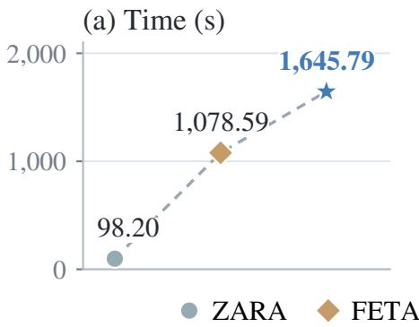

(b) Tokens (k)  
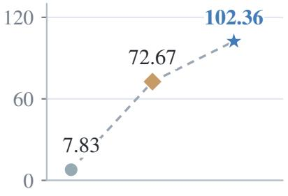  
Figure 5 Mean recorded time and total tokens per query for ZARA, FETA, and standard Agentic4PDM. Here, k denotes 1,000 tokens. Marker shapes identify methods; dashed lines guide the eye

In Figure 5 compares recorded processing time and total token use per query. Mean token usage is 102.36k for Agentic4PDM, 72.67k for FETA, and 7.83k for ZARA, where k denotes one thousand tokens. Their estimated API charges are \$0.0989, \$0.0575, and \$0.0129 per query. Agentic4PDM is meant for on-demand diagnosis of dificult cases, not for real-time monitoring; its time per sample is reported in Appendix F. Relative to FETA, the additional estimated API charge is \$0.0414 per query, accompanied by macro-F1 gains of 18.82 points on GRS, 19.53 points on BFH, and 22.47 points on the full Bel test set. ZARA provides a substantially cheaper option, but has lower macro-F1 in all three settings; on Bel, Agentic4PDM reaches 73.95% versus 44.17% for ZARA. These results suggest that the additional computation may be justified for on-demand diagnosis of complex and high-value industrial equipment. Appendix F details recorded runtime, token usage, LLM calls, and the pricing assumptions.

## 5 Conclusion

We introduce Agentic4PDM, an agentic framework for industrial fault diagnosis under label scarcity and potentially shifting operating conditions. Although raw signal statistics may change, diagnostically meaningful structures such as periodicity, trends, and transients can remain informative and be measured by analytical tools. Agentic4PDM guides LLM agents using these tools through contract-checked gated adjudication (CCGA). The agent identifies ambiguity among candidate classes and selects measurements that could resolve it, while CCGA controls each result’s permitted influence through reference checks rather than the LLM’s confidence. This combines investigation tailored to the current case with external control over evidence use, giving unchecked outputs less evidential authority than corroborative results. Across two bearing benchmarks, an induction-motor benchmark, and real-world customer data, Agentic4PDM achieves the strongest aggregate diagnostic performance among the evaluated deep-learning, time-series foundation-model, and agentic baselines. Our analyses and ablations support the value of the governed investigation and the controls of CCGA.

These results suggest two directions for future research. First, consolidating tools while broadening their functionality could reduce the context needed to describe them, simplify tool selection, and support richer signal analysis. Second, Agentic4PDM records whether a diagnosis is admitted in A, but does not yet recommend follow-up actions. Providing concrete suggestions for additional measurements or inspections could help operators investigate unresolved cases and improve the system’s practical usefulness.

## References

[1] Sulaiman A. Aburakhia, Ryan Myers, and Aballah Shami. A hybrid method for condition monitoring and fault diagnosis of rolling bearings with low system delay. IEEE Transactions on Instrumentation and Measurement, 71: 1–13, 2022.

[2] Abdul Fatir Ansari, Lorenzo Stella, Ali Caner Türkmen, Xi-Yuan Zhang, Pedro Mercado, Huibin Shen, Oleksandr Shchur, Syama Sundar Rangapuram, Sebastian Pineda-Arango, Shubham Kapoor, Jasper Zschiegner, Danielle C. Maddix, Hao Wang, Michael W. Mahoney, Kari Torkkola, Andrew Gordon Wilson, Michael Bohlke-Schneider, and Bernie Wang. Chronos: Learning the language of time series. ArXiv, abs/2403.07815, 2024.

[3] Abdul Fatir Ansari, Oleksandr Shchur, Jaris Kuken, Andreas Auer, Bo-Ran Han, Pedro Mercado, Syama Sundar Rangapuram, Huibin Shen, Lorenzo Stella, Xi-Yuan Zhang, Mononito Goswami, Shubham Kapoor, Danielle C. Maddix, Pablo Guerron, Tony Hu, Junming Yin, Nick Erickson, Prateek Mutalik Desai, Hao Wang, Huzefa Rangwala, George Karypis, Yu-Yang Wang, and Michael Bohlke-Schneider. Chronos-2: From univariate to universal forecasting. ArXiv, abs/2510.15821, 2025.

[4] Andreas Auer, Patrick Podest, Daniel Klotz, Sebastian Böck, Günter Klambauer, and Sepp Hochreiter. TiRex: Zero-shot forecasting across long and short horizons with enhanced in-context learning. In Proceedings of the Advances in Neural Information Processing Systems (NeurIPS), 2025.

[5] Alexandros Bousdekis, Katerina Lepenioti, Dimitris Apostolou, and Gregoris Mentzas. A review of data-driven decision-making methods for industry 4.0 maintenance applications. Electronics, 10(7):828, 2021.

[6] C. Cayrol and M. C. Lagasquie-Schiex. On the acceptability of arguments in bipolar argumentation frameworks. In Lluís Godo, editor, Symbolic and Quantitative Approaches to Reasoning with Uncertainty, pages 378–389, Berlin, Heidelberg, 2005. Springer Berlin Heidelberg. ISBN 978-3-540-31888-0.

[7] Han-Yun Chen and Ching-Hung Lee. Vibration signals analysis by explainable artificial intelligence (xai) approach: Application on bearing faults diagnosis. IEEE Access, 8:134246–134256, 2020.

[8] Shijin Chen, Zeyi Liu, Chenyang Li, Dongliang Zou, Xiao He, and Donghua Zhou. Multi-mode fault diagnosis datasets of three-phase asynchronous motor under variable working conditions. Data in Brief, 65:112583, 2026.

[9] Si-Xin Chen, Lu Zhou, and Yi-Qing Ni. Wheel condition assessment of high-speed trains under various operational conditions using semi-supervised adversarial domain adaptation. Mechanical Systems and Signal Processing, 170: 108853, 2022.

[10] Yongyi Chen, Dan Zhang, Ruqiang Yan, and Min Xie. Applications of domain generalization to machine fault diagnosis: A survey. IEEE/CAA Journal of Automatica Sinica, 12(10):1963–1984, 2025.

[11] Zhaorun Chen, Mintong Kang, and Bo Li. ShieldAgent: Shielding agents via verifiable safety policy reasoning. In Proceedings of the International Conference on Machine Learning (ICML), pages 8313–8344, 2025.

[12] Ben Cohen, Emaad Khwaja, Youssef Doubli, Salahidine Lemaachi, Chris Lettieri, Charles Masson, Hugo Miccinilli, Elise Ram’e, Qi-Qi Ren, Afshin Rostamizadeh, Jean du Terrail, A. M. Toon, Kan Wang, Stephan Xie, Zong-Zhe Xu, Viktoriya Zhukova, David Asker, Ameet Talwalkar, and Othmane Abou-Amal. This time is diferent: An observability perspective on time series foundation models. ArXiv, abs/2505.14766, 2025.

[13] Abhimanyu Das, Weihao Kong, Rajat Sen, and Yichen Zhou. A decoder-only foundation model for time-series forecasting. In Proceedings of the International Conference on Machine Learning (ICML), 2024.

[14] Edoardo Debenedetti, Ilia Shumailov, Tianqi Fan, Jamie Hayes, Nicholas Carlini, Daniel Fabian, Christoph Kern, Chongyang Shi, Andreas Terzis, and Florian Tramèr. Defeating prompt injections by design. In Proceedings of the IEEE Conference on Secure and Trustworthy Machine Learning (SaTML), 2026.

[15] Yufeng Du, Minyang Tian, Srikanth Ronanki, Subendhu Rongali, Sravan Babu Bodapati, Aram Galstyan, Azton Wells, Roy Schwartz, Eliu A. Huerta, and Hao Peng. Context length alone hurts LLM performance despite perfect retrieval. In Findings of the Association for Computational Linguistics (EMNLP Findings), pages 23281–23298, 2025.

[16] Phan Minh Dung. On the acceptability of arguments and its fundamental role in nonmonotonic reasoning, logic programming and n-person games. Artificial Intelligence, 77(2):321–357, 1995. ISSN 0004-3702.

[17] Vijay Ekambaram, Arindam Jati, Pankaj Dayama, Sumanta Mukherjee, Nam H. Nguyen, Wesley M. Giford, Chandra Reddy, and Jayant Kalagnanam. Tiny time mixers (ttms): fast pre-trained models for enhanced

zero/few-shot forecasting of multivariate time series. In Proceedings of the Advances in Neural Information Processing Systems (NeurIPS), 2024.

[18] Emadeldeen Eldele, Mohamed Ragab, Zhenghua Chen, Min Wu, Chee Keong Kwoh, Xiaoli Li, and Cuntai Guan. Time-series representation learning via temporal and contextual contrasting. In Proceedings of the International Joint Conference on Artificial Intelligence (IJCAI), pages 2352–2359, 2021.

[19] Marc Esteva, Juan-Antonio Rodríguez-Aguilar, Carles Sierra, Pere Garcia, and Josep L. Arcos. On the Formal Specification of Electronic Institutions, pages 126–147. Springer Berlin Heidelberg, Berlin, Heidelberg, 2001. ISBN 978-3-540-44682-8.

[20] Jean-Yves Franceschi, Aymeric Dieuleveut, and Martin Jaggi. Unsupervised scalable representation learning for multivariate time series. In Proceedings of the Advances in Neural Information Processing Systems (NeurIPS), pages 4650–4661, 2019.

[21] Azul Garza, Cristian I. Challu, and Max Mergenthaler-Canseco. Timegpt-1. volume abs/2310.03589, 2023.

[22] Mononito Goswami, Konrad Szafer, Arjun Choudhry, Yifu Cai, Shuo Li, and Artur Dubrawski. Moment: A family of open time-series foundation models. In Proceedings of the International Conference on Machine Learning (ICML), 2024.

[23] Yi-Le Gu, Yi-Fan Xiong, Jonathan Mace, Yu-Ting Jiang, Yigong Hu, Baris Kasikci, and Peng Cheng. Argos: Agentic time-series anomaly detection with autonomous rule generation via large language models. ArXiv, abs/2501.14170, 2025.

[24] Hongliang He, Jin-Feng Huang, Qi Li, Xu Wang, Fei-Bin Zhang, Kang Yang, Li Meng, and Fulei Chu. Maintagt:sim2real-guided multimodal large model for intelligent maintenance with chain-of-thought reasoning. volume abs/2412.00481, 2024.

[25] Huan Huang and Natalie Baddour. Bearing vibration data collected under time-varying rotational speed conditions. Data in Brief, 21:1745–1749, 2018. ISSN 2352-3409.

[26] Jie Huang, Xinyun Chen, Swaroop Mishra, Huaixiu Steven Zheng, Adams Wei Yu, Xinying Song, and Denny Zhou. Large language models cannot self-correct reasoning yet. In Proceedings of the International Conference on Learning Representations (ICLR), 2024.

[27] Habib Irani, Yasamin Ghahremani, Arshia Kermani, and Vangelis Metsis. Time series embedding methods for classification tasks: A review. Expert Systems, 42(11):e70148, 2025.

[28] Masoud Jalayer, Amin Kaboli, Carlotta Orsenigo, and Carlo Vercellis. Fault detection and diagnosis with imbalanced and noisy data: A hybrid framework for rotating machinery. ArXiv, abs/2202.04212, 2022.

[29] Andrew K.S. Jardine, Daming Lin, and Dragan Banjevic. A review on machinery diagnostics and prognostics implementing condition-based maintenance. Mechanical Systems and Signal Processing, 20(7):1483–1510, 2006. ISSN 0888-3270.

[30] Carlos E. Jimenez, John Yang, Alexander Wettig, Shunyu Yao, Kexin Pei, Ofir Press, and Karthik Narasimhan. Swe-bench: Can language models resolve real-world github issues?, 2024.

[31] Emaad Khwaja, Chris Lettieri, Gerald Woo, Eden Belouadah, Marc Cenac, Guillaume Jarry, Enguerrand Paquin, Xun-Yi Zhao, V. V. Zhukov, Othmane Abou-Amal, Cheng-Hao Liu, Ameet Talwalkar, and David Asker. Toto 2.0: Time series forecasting enters the scaling era. ArXiv, abs/2605.20119, 2026.

[32] Sanjeev Kumar, Vikash Kumar, Somnath Sarangi, and Om Prakash Singh. Gearbox fault diagnosis: A higher order moments approach. Measurement, 210:112489, 2023.

[33] Daniel Kuzio, Radosław Zimroz, and Agnieszka Wyłomańska. Identification of fault frequency variation in the envelope spectrum in the vibration-based local damage detection in possible changing load/speed conditions. Measurement, 218:113148, 2023.

[34] Philippe Laban, Hiroaki Hayashi, Yingbo Zhou, and Jennifer Neville. LLMs get lost in multi-turn conversation. In Proceedings of the International Conference on Learning Representations (ICLR), 2026.

[35] Pei Lai, Fan Zhang, Tianrui Li, Jin Guo, and Fei Teng. Unlocking the power of knowledge for few-shot fault diagnosis: A review from a knowledge perspective. Information Sciences, 706:121996, 2025. ISSN 0020-0255.

[36] Christian Lessmeier, James Kuria Kimotho, Detmar Zimmer, and Walter Sextro. Condition monitoring of bearing damage in electromechanical drive systems by using motor current signals of electric motors: A benchmark data set for data-driven classification. PHM Society European Conference (PHME16), 2016.

[37] Weijian Li, Hong-Yu Chen, Nabeel Rehemtulla, Ved G. Shah, Dongho Kim, Dennis Wu, Qinjie Lin, Adam A. Miller, and Han Liu. Starembed: Benchmarking time series foundation models on astronomical observations of variable stars. In ICML 2026 Workshop on AI for Physics, 2026.

[38] Zechen Li, Shohreh Deldari, Linyao Chen, Hao Xue, and Flora D. Salim. SensorLLM: Aligning large language models with motion sensors for human activity recognition. In Proceedings of the Conference on Empirical Methods in Natural Language Processing (EMNLP), pages 354–379, 2025.

[39] Zechen Li, Baiyu Chen, Hao Xue, and Flora D. Salim. ZARA: Training-free motion time-series reasoning via evidence-grounded LLM agents. In Proceedings of the Annual Meeting of the Association for Computational Linguistics (ACL), pages 14986–15008, 2026.

[40] Yuxuan Liang, Haomin Wen, Yuqi Nie, Yushan Jiang, Ming Jin, Dongjin Song, Shi-Rui Pan, and Qing-Song Wen. Foundation models for time series analysis: A tutorial and survey. Proceedings of the ACM SIGKDD Conference on Knowledge Discovery and Data Mining (KDD), 2024.

[41] Jing-Xiao Liao, Hang-Cheng Dong, Zhi-Qi Sun, Jinwei Sun, Shiping Zhang, and Feng-Lei Fan. Attention-embedded quadratic network (qttention) for efective and interpretable bearing fault diagnosis. IEEE Transactions on Instrumentation and Measurement, 72:1–13, 2023.

[42] Chenghao Liu, Taha İbrahim Aksu, Juncheng Liu, Xu Liu, Hanshu Yan, Quang Long Pham, Silvio Savarese, Doyen Sahoo, Caiming Xiong, and Jun-Nan Li. Moirai 2.0: When less is more for time series forecasting. ArXiv, abs/2511.11698, 2025.

[43] Xu Liu, Juncheng Liu, Gerald Woo, Taha Aksu, Yuxuan Liang, Roger Zimmermann, Chenghao Liu, Junnan Li, Silvio Savarese, Caiming Xiong, and Doyen Sahoo. Moirai-moe: Empowering time series foundation models with sparse mixture of experts. In Proceedings of the International Conference on Machine Learning (ICML), 2025.

[44] Sarah Lukens, Lucas H. McCabe, J. Gen, and Asma Ali. Large language model agents as prognostics and health management copilots. Annual Conference of the PHM Society (PHM24), 2024.

[45] Pablo Noriega, Amit K. Chopra, Nicoletta Fornara, Henrique Lopes Cardoso, and Munindar P. Singh. Regulated MAS: Social perspective. In Giulia Andrighetto, Guido Governatori, Pablo Noriega, and Leendert W. N. van der Torre, editors, Normative Multi-Agent Systems, volume 4 of Dagstuhl Follow-Ups, pages 93–133. Schloss Dagstuhl – Leibniz-Zentrum für Informatik, Dagstuhl, Germany, 2013.

[46] Patrick Podest, Marco Pichler, Elias Bürger, Levente Zólyomi, Bernhard Voggenberger, Wilhelm Berghammer, Daniel Klotz, Sebastian Böck, Günter Klambauer, and Sepp Hochreiter. TiRex-2: Generalizing TiRex to multivariate data and streaming, 2026.

[47] Henry Prakken. An abstract framework for argumentation with structured arguments. Argument & Computation, 1:93–124, 2010.

[48] Zehan Qi, Xiao Liu, Iat Long Iong, Hanyu Lai, Xueqiao Sun, Jiadai Sun, Xinyue Yang, Yu Yang, Shuntian Yao, Wei Xu, Jie Tang, and Yuxiao Dong. WebRL: Training LLM web agents via self-evolving online curriculum reinforcement learning. In Proceedings of the International Conference on Learning Representations (ICLR), 2025.

[49] Qwen Team. Qwen3.6-27B: Flagship-level coding in a 27b dense model, April 2026.

[50] Robert B. Randall and Jérôme Antoni. Rolling element bearing diagnostics—a tutorial. Mechanical Systems and Signal Processing, 25(2):485–520, 2011.

[51] Kashif Rasul, Arjun Ashok, Andrew Robert Williams, Hena Ghonia, Rishika Bhagwatkar, Arian Khorasani, Mohammad Javad Darvishi Bayazi, George Adamopoulos, Roland Riachi, Nadhir Vincent Hassen, Marin Bilovs, Sahil Garg, Anderson Schneider, Nicolas Chapados, Alexandre Drouin, Valentina Zantedeschi, Yuriy Nevmyvaka, and Irina Rish. Lag-llama: Towards foundation models for probabilistic time series forecasting. volume abs/2310.08278, 2023.

[52] You ren Wang, Guo dong Sun, and Qi Jin. Imbalanced sample fault diagnosis of rotating machinery using conditional variational auto-encoder generative adversarial network. Applied Soft Computing, 92:106333, 2020.

[53] Rebin Saleh, Khanh Pham Dinh, Balázs Villányi, and Truong-Son Hy. Self-evolving multi-agent network for industrial iot predictive maintenance. ArXiv, abs/2602.16738, 2026.

[54] Wade A. Smith and Robert B. Randall. Rolling element bearing diagnostics using the Case Western Reserve University data: A benchmark study. Mechanical Systems and Signal Processing, 64–65:100–131, 2015.

[55] Song-Yuan Sui, Zi-Hang Xu, Yu-Neng Chuang, Kwei-Herng Lai, and Xia Hu. Training-free time series classification via in-context reasoning with llm agents. ArXiv, abs/2510.05950, 2025.

[56] Douglas Thomas and Brian Weiss. Maintenance costs and advanced maintenance techniques in manufacturing machinery: Survey and analysis. International Journal of Prognostics and Health Management, 12(1), 2021.

[57] Haoyu Wang, Christopher M. Poskitt, and Jun Sun. AgentSpec: Customizable runtime enforcement for safe and reliable LLM agents. In Proceedings of the IEEE/ACM 48th International Conference on Software Engineering (ICSE), 2026.

[58] Dongdong Wei, Te Han, Fulei Chu, and Ming Jian Zuo. Weighted domain adaptation networks for machinery fault diagnosis. Mechanical Systems and Signal Processing, 158:107744, 2021.

[59] Gerald Woo, Chenghao Liu, Akshat Kumar, Caiming Xiong, Silvio Savarese, and Doyen Sahoo. Unified training of universal time series forecasting transformers. In Proceedings of the International Conference on Machine Learning (ICML), pages 53140–53164, 2024.

[60] Qingyun Wu, Gagan Bansal, Jieyu Zhang, Yiran Wu, Beibin Li, Erkang Zhu, Li Jiang, Xiaoyun Zhang, Shaokun Zhang, Jiale Liu, Ahmed Hassan Awadallah, Ryen W White, Doug Burger, and Chi Wang. Autogen: Enabling next-gen LLM applications via multi-agent conversations. In Proceedings of the Conference on Language Modeling (COLM), 2024.

[61] Zhen Xiang, Linzhi Zheng, Yanjie Li, Junyuan Hong, Qinbin Li, Han Xie, Jiawei Zhang, Zidi Xiong, Chulin Xie, Carl Yang, Dawn Song, and Bo Li. GuardAgent: Safeguard LLM agents via knowledge-enabled reasoning. In Proceedings of the International Conference on Machine Learning (ICML), pages 68316–68342, 2025.

[62] John Yang, Carlos E Jimenez, Alexander Wettig, Kilian Lieret, Shunyu Yao, Karthik R Narasimhan, and Ofir Press. SWE-agent: Agent-computer interfaces enable automated software engineering. In Proceedings of the Advances in Neural Information Processing Systems (NeurIPS), pages 50528–50652, 2024.

[63] Shunyu Yao, Jefrey Zhao, Dian Yu, Nan Du, Izhak Shafran, Karthik R Narasimhan, and Yuan Cao. React: Synergizing reasoning and acting in language models. In Proceedings of the International Conference on Learning Representations (ICLR), 2023.

[64] Pınar Yolum and Munindar P. Singh. Reasoning about commitments in the event calculus: An approach for specifying and executing protocols. Annals of Mathematics and Artificial Intelligence, 42:227–253, 2004.

[65] Zhihan Yue, Yujing Wang, Juanyong Duan, Tianmeng Yang, Congrui Huang, Yunhai Tong, and Bixiong Xu. TS2Vec: Towards universal representation of time series. In Proceedings of the AAAI Conference on Artificial Intelligence (AAAI), pages 8980–8987, 2022.

[66] Wei Zhang, Gaoliang Peng, Chuanhao Li, Yuanhang Chen, and Zhujun Zhang. A new deep learning model for fault diagnosis with good anti-noise and domain adaptation ability on raw vibration signals. Sensors, 17(2):425, 2017.

[67] Haokun Zhao, Xiang Zhang, Jia-Qi Wei, Yi-Wei Xu, Yu-Ting He, Si-Qi Sun, and Chen-Yu You. Timeseriesscientist: A general-purpose ai agent for time series analysis. ArXiv, abs/2510.01538, 2025.

# Supplement to “Agentic4PDM: Host-Governed Evidence Admissibility for Industrial Fault Diagnosis”

This document provides the supplementary materials for the paper Agentic4PDM: Host-Governed Evidence Admissibility for Industrial Fault Diagnosis, and is organized as follows.

## Contents

System implementation   
A Context Management for Multi-Turn Diagnosis 18   
B Preventing Label Leakage through Client–Server Data Isolation 19   
Part I — Results and analyses   
C Extended Experimental Evaluation 20   
C.1 Performance on BFH, GRS, and Be 20   
C.2 Training-Free Comparison with ZARA and FETA 20   
C.3 Performance Across Three Runs 21   
C.4 Agentic4PDM versus Ensembles of Its Evidence Sources 22   
C.5 Evidence Guidance 22   
D Can the Best Single Tool on Each Dataset Replace Agentic4PDM? 23   
E Backbone Substitution: What the Agent Adds to a Representation 24   
F Empirical Time and Token Use 26   
G How consistent is performance across operating conditions? 28   
Part II — Experimental setup and benchmarks   
H Experimental Setup: Data, Protocol, and Per-Method Configurations 29   
H.1 Datasets, Signal Modalities, and Split Boundaries 29   
H.1.1 Frozen Manifests and Per-Class Support 29   
H.2 Shared Evaluation Protocol and Inventory of Compared Methods 30   
H.3 Configuration of Agentic4PDM 31   
H.4 Training Settings of the Deep-Learning Baselines 32   
H.5 Training Settings of the Foundation-Model Baselines 32   
H.6 Implementation Settings of the Agentic Baselines (FETA and ZARA) 33   
I Benchmark Construction: How the BFH and GRS Challenge Sets Were Built 34   
I.1 Challenge Set I — BFH: A Failure-Severity Stress Test 34   
I.2 Challenge Set II — GRS: A Representative-Coverage Diversity Test 35   
I.3 Evaluation Scale and Class Composition 37   
Part III — Method: notation, protocol, tools, andprompts   
J Summary of Notation for the Method and Inference Path 38   
K Agentic4PDM Inference Protocol: Retrieval, Gates, and Finalization 39   
K.1 Retrieval Protocol: Class-Balanced Reference Selection 39   
K.2 Request Gate: Property Registry 39   
K.3 Packet and Influence Gate: From Measurement to Influence Role 40   
K.4 Publication: What the Host Serializes and Reports 41   
L Tool Registries: What the Agents May Execute 41   
L.1 General-Purpose Inspection Tools 42   
L.2 Smoothing Families and Host-Fixed Parameters 43   
L.3 Channel Priority Tiers and Host Guards 43   
L.4 Quantitative Tools Available to the JUDGE 43   
L.5 Representative Quantitative Tool Pseudocode 45   
M Prompt Templates for Each Agent Role 46   
M.1 Evidence-Preparation Agents 46   
M.2 ANALYSTS and LBAGENTS 47   
M.3 JUDGE and Host Contract 50   
Part IV — Worked examples   
N End-to-End Trace of One Sample, Stage by Stage 51   
O Side-by-Side Comparison: Agentic4PDM, FETA, and ZARA on the Same Sample 64

## A Context Management for Multi-Turn Diagnosis

During development, repeated image inputs and an expanding conversation history caused the Judge’s context to reach the model’s token limit. Both sources accumulate as an investigation proceeds: new measurements introduce additional images, while subsequent turns add interpretations and decisions. We therefore manage image inputs and conversation history separately, retaining recent material in the active context and compact records of earlier material.

1. Image retention. We retain $n _ { \mathrm { i m g } }$ images in the Judge’s active context and allow an extension of up to $n _ { \mathrm { e x t } }$ additional images from the most recent image history. Earlier images are stored as external artifacts rather than repeatedly included as image inputs. Each stored image has a structured record containing its file path, a description of its diagnostic relevance, a timestamp, the originating agent, and the associated sample identifier. These records preserve the link between an earlier observation and its source artifact while reducing repeated image input.

2. Conversation summarization. We retain the initial conversation turn and the most recent $n _ { \mathrm { t u r n } }$ turns, replacing the intervening turns with a structured summary generated by the Judge. The summary captures the key observations and decisions from those turns. Retaining the opening turn preserves the initial task context, while retaining recent turns preserves the immediate reasoning that leads to the next action.

Illustrative examples. The following examples use $n _ { \mathrm { i m g } } = 3 , n _ { \mathrm { e x t } } = 2 .$ , and $n _ { \mathrm { t u r n } } = 2$ to make the retention rules concrete. These values, artifact paths, and diagnostic observations are illustrative; they are not reported experimental settings or results.

Example 1: retaining images without repeating the full image history. Suppose an investigation has produced seven images, $I _ { 1 } , \ldots , I _ { 7 }$ , in chronological order. The active context contains the three most recent images, $I _ { 5 } , I _ { 6 } , I _ { 7 }$ . An extension can include $I _ { 3 }$ and $I _ { 4 } ,$ , increasing the image input to five rather than all seven. Earlier images remain stored with descriptive records. For example, the record for $I _ { 2 }$ could be:

```jsonl
Illustrative record for an archived image
{
"image_id": "I2",
"path": "artifacts/window_123/waveform_overlay.png",
"description": "The query has isolated peaks not visible in the normal reference; their cause remains
unresolved.",
"timestamp": "2026-09-30T10:02:00Z",
"source": "(*@ABAgent@*)",
"related_window": "window_123"
}
```

This record identifies the observation and its source without presenting the earlier waveform image again. The description also preserves the uncertainty in the observation rather than treating the peaks as a confirmed fault.

Example 2: summarizing an extended conversation. Suppose the conversation contains eight turns, $T _ { 1 } , \ldots , T _ { 8 }$ . With $n _ { \mathrm { t u r n } } = 2$ , the active context retains the opening turn $T _ { 1 }$ and the latest turns $T _ { 7 } , T _ { 8 }$ , while turns $T _ { 2 } – T _ { 6 }$ are replaced by a summary. If those middle turns discussed the peaks in Example 1, a compact summary could be:

Illustrative summary of turns 2--6   
{   
"related\_window": "window\_123",   
"summarized\_turns": [2, 6],   
"observations": ["Isolated peaks occur in the query (image I2)."],   
"open\_question": "Do the peaks reflect a fault or a transient disturbance?",

"decision": "Inspect an additional measurement before choosing a class."   
}

The next turn therefore has the initial task, the recent discussion, and a compact account of the earlier evidence and unresolved question. This makes explicit what the summary needs to preserve for the investigation to continue coherently.

Together, these mechanisms reduce the amount of historical material included in each request while maintaining a compact record of the investigation. Their usefulness depends on the image descriptions and conversation summaries retaining the information needed for subsequent diagnostic decisions.

## B Preventing Label Leakage through Client--Server Data Isolation

A diagnostic agent should infer the query’s health status from the permitted evidence. Original dataset paths can undermine this requirement: a directory named after a fault class, or a filename containing a specimen’s condition, can reveal the answer before the signal is inspected. We therefore separate the source-data namespace from the files supplied to the agents. The client reads the source file, while the server creates a new analysis copy with a neutral filename in a job-specific workspace.

From source paths to neutral analysis paths. The implementation applies this separation at three points:

1. Client submission. The evaluation client uploads the query under the fixed multipart filename input.csv. The original query filename and its parent directories are therefore not used as the uploaded file’s identity. Dataset context and optional operating-condition information are supplied as separate fields so that schema resolution and reference selection do not require the original query path.

2. Server staging. The server first writes the upload to a temporary input.csv, then moves it to inputs/sample.csv inside the job workspace. By default, the workspace is named using a randomly generated UUID; a caller may also provide an artifact directory. This relocation replaces the original dataset hierarchy with the server’s analysis namespace. Before inference, normalization drops the query’s label column and retains only the configured time and signal columns.

3. Reference materialization. Retrieved reference signals are also written into the workspace, under paths such as inputs/references/class\_0.csv. The agent receives these aligned copies rather than the original training-file paths, which may contain additional specimen or fault metadata. The class identifier is retained because the reference is an intentionally labeled example; it does not identify the query’s true class.

Separating inference from scoring. The API accepts the query’s true label as evaluation metadata. The server keeps it in the request record and uses it to compute correctness after the diagnostic workflow produces a prediction. During inference, the agents receive the sanitized query, labeled references, and dataset context; the query’s true label is excluded from these inputs. The scoring process can therefore compare the prediction with the ground truth while keeping the evaluation label separate from the evidence used for diagnosis.

Illustrative path transformation. For a hypothetical query whose source directory reveals a fault category, the inference path becomes:

Illustrative query-path transformation (not an experimental sample)

Client source: /data/bearing/fault\_class\_2/specimen\_A/window\_17.csv   
Upload filename: input.csv   
Server input: /analysis/<job\_uuid>/inputs/sample.csv   
Inference CSV: time\_point + configured signal channels   
Scoring record: true\_label = 2 (kept separately from the inference CSV)

The path supplied for signal analysis no longer contains the source fault category or specimen name. This mechanism is path pseudonymization and data relocation. Dataset-level context, labeled references, and baseline predictions remain explicit permitted inputs. The separation addresses accidental disclosure through source paths and query columns; its scope is the inference data flow, with evaluation metadata and diagnostic logs retained by the trusted Host. Filesystem access control and cryptographic confidentiality require their own enforcement.

## C Extended Experimental Evaluation

## C.1 Performance on BFH, GRS, and Bel

Table 2 reports per-dataset results for the standard configuration and baselines on the public BFH/GRS benchmarks, together with full-test-set Bel scores. The training-free comparison is summarized in the following subsection. Chronos-2 Small Agentic4PDM variants are reported separately in Appendix E.

Table 2 Performance comparison of Agentic4PDM against deep-learning, time-series foundation-model, and agentic baselines across three evaluation settings: BFH and GRS on the public benchmarks (UO, PU, and MCC5), and the full customer test set (Bel). ACC and F1-M denote accuracy and macro-F1, respectively; AVG is the unweighted mean across public datasets. Bold indicates the best results in each column.
<table><tr><td rowspan="3">Group</td><td rowspan="3">Method</td><td colspan="6">Baseline-Failure Hard (BFH)</td><td colspan="6">Geometry-Stratified Response-Stability (GRS)</td><td colspan="2">AVG challenge tests</td><td colspan="3"></td><td colspan="2">Our customer test</td></tr><tr><td colspan="2">UO</td><td colspan="2">PU</td><td colspan="2">MCC5</td><td colspan="2">UO</td><td colspan="2">PU</td><td colspan="2"></td><td colspan="2">BFH</td><td colspan="2"></td><td colspan="2">GRS</td></tr><tr><td>ACC</td><td>F1-M</td><td>ACC</td><td>F1-M</td><td>ACC</td><td>F1-M</td><td>ACC</td><td>F1-M</td><td>ACC</td><td>F1-M</td><td>ACC</td><td>MCC5 F1-M</td><td>ACC</td><td>F1-M</td><td>ACC</td><td></td><td>F1-M</td><td>Bel ACC F1-M</td></tr><tr><td>Deep</td><td>CNN-TCC [18]</td><td>21.00</td><td>15.26</td><td>22.00</td><td>19.99</td><td>28.00</td><td>23.74</td><td>27.13</td><td>27.06</td><td>23.73</td><td>19.86</td><td>50.35</td><td>48.89</td><td>23.67</td><td>19.66</td><td>33.74</td><td>31.94</td><td>46.97</td><td>44.08</td></tr><tr><td>learning</td><td>QCNN [41]</td><td>1.00</td><td>0.94</td><td>30.00</td><td>29.06</td><td>8.00</td><td>7.60</td><td>27.92</td><td>27.07</td><td>46.03</td><td>37.19</td><td>53.65</td><td>53.68</td><td>13.00</td><td>12.53</td><td>42.53</td><td>39.31</td><td>53.94</td><td>49.07</td></tr><tr><td></td><td>WDCNN [66]</td><td>4.00</td><td>3.73</td><td>26.00</td><td>24.04</td><td>10.00</td><td>10.75</td><td>26.87</td><td>25.53</td><td>44.26</td><td>35.65</td><td>53.99</td><td>53.61</td><td>13.33</td><td>12.84</td><td>41.71</td><td>38.26</td><td>61.21</td><td>59.16</td></tr><tr><td rowspan="9"></td><td>Moirai 1.1 R Large KNN</td><td>27.00</td><td>28.20</td><td>36.00</td><td>23.64</td><td>9.00</td><td>7.41</td><td>71.30</td><td>71.97</td><td>31.68</td><td>25.12</td><td>42.97</td><td>41.27</td><td>24.00</td><td>19.75</td><td>48.65</td><td>46.12</td><td>52.73</td><td>47.06</td></tr><tr><td>Moirai 1.1 R Large XGBoost (ev.)</td><td>22.00</td><td>25.53</td><td>38.00</td><td>27.15</td><td>34.00</td><td>29.58</td><td>73.13</td><td>73.42</td><td>30.91</td><td>24.11</td><td>49.74</td><td>49.86</td><td>31.33</td><td>27.42</td><td>51.26</td><td>49.13</td><td>50.30</td><td>50.08</td></tr><tr><td>Moirai 1.1 R Large SVM (ev.)</td><td>27.00</td><td>28.90</td><td>31.00</td><td>23.60</td><td>11.00</td><td>7.05</td><td>82.44</td><td>82.79</td><td>34.33</td><td>27.08</td><td>45.83</td><td>45.26</td><td>23.00</td><td>19.85</td><td>54.20</td><td>51.71</td><td>61.52</td><td>57.54</td></tr><tr><td>Moirai 2 Small KNN</td><td>19.00</td><td>20.21</td><td>37.00</td><td>27.83</td><td>18.00</td><td>18.38</td><td>47.97</td><td>47.78</td><td>26.05</td><td>20.37</td><td>31.94</td><td>29.90</td><td>24.67</td><td>22.14</td><td>35.32</td><td>32.69</td><td>49.39</td><td>42.94</td></tr><tr><td>Moirai 2 Small XGBoost</td><td>20.00</td><td>20.69</td><td>35.00</td><td>25.50</td><td>17.00</td><td>17.32</td><td>55.18</td><td>54.84</td><td>28.48</td><td>22.44</td><td>38.80</td><td>38.91</td><td>24.00</td><td>21.17</td><td>40.82</td><td>38.73</td><td>55.76</td><td>55.76</td></tr><tr><td>Moirai 2 Small SVM</td><td>18.00</td><td>20.39</td><td>38.00</td><td>27.92</td><td>1.00</td><td>0.98</td><td>61.73</td><td>59.99</td><td>28.92</td><td>22.68</td><td>37.93</td><td>36.51</td><td>19.00</td><td>16.43</td><td>42.86</td><td>39.73</td><td>61.52</td><td>58.78</td></tr><tr><td>Chronos 2 KNN</td><td>25.00</td><td>20.94</td><td>13.00</td><td>13.31</td><td>24.00</td><td>18.83</td><td>64.09</td><td>64.50</td><td>20.42</td><td>17.67</td><td>30.99</td><td>29.20</td><td>20.67</td><td>17.69</td><td>38.50</td><td>37.12</td><td>59.09</td><td>58.95</td></tr><tr><td>Chronos 2 XGBoost</td><td>21.00</td><td>19.80</td><td>11.00</td><td>10.98</td><td>12.00</td><td>12.11</td><td>59.63</td><td>59.84</td><td>18.76</td><td>19.78</td><td>31.86</td><td>31.69</td><td>14.67</td><td>14.29</td><td>36.75</td><td>37.11</td><td>54.24</td><td>53.21</td></tr><tr><td>Chronos 2 SVM</td><td>29.00</td><td>29.26</td><td>28.00</td><td>24.64</td><td>4.00</td><td>3.39</td><td>75.62</td><td>74.94</td><td>28.04</td><td>22.64</td><td>34.29</td><td>32.78</td><td>20.33</td><td>19.09</td><td>45.98</td><td>43.45</td><td>56.67</td><td>52.19</td></tr><tr><td>Chronos 2 Small KNN Chronos 2 Small XGBoost</td><td>18.00 14.00</td><td>16.65 15.00</td><td></td><td>22.00</td><td>22.29</td><td>23.00</td><td>18.46</td><td>52.16</td><td>52.61</td><td>16.11</td><td>13.76</td><td>24.39</td><td>21.24</td><td>21.00</td><td>19.13 30.89</td><td></td><td>29.20</td><td>52.12 50.00</td></tr><tr><td>Chronos 2 Small SVM</td><td></td><td>12.70</td><td></td><td>22.00 10.00</td><td>17.01 9.76</td><td>12.00 12.00</td><td>11.89 9.15</td><td>59.37 65.01</td><td>59.59 63.76</td><td>16.67 17.77</td><td>15.61 15.14</td><td>28.99 30.03</td><td>27.88 28.06</td><td>16.00 11.67</td><td>14.63 10.54</td><td>35.01</td><td>34.36 35.65</td><td>58.48</td><td>58.42 60.89</td></tr><tr><td>ZARA [39]</td><td></td><td>13.00 39.30</td><td></td><td>39.00</td><td></td><td></td><td>24.90</td><td></td><td></td><td></td><td></td><td></td><td></td><td></td><td></td><td>37.60</td><td></td><td>61.21</td><td></td></tr><tr><td>Agent</td><td></td><td>45.00 34.00</td><td>32.32</td><td>36.00</td><td>40.31 33.84</td><td>35.00 17.00</td><td>17.65</td><td>63.43 53.73</td><td>65.26 53.46</td><td>41.94 35.21</td><td>43.23 30.79</td><td>47.66 38.02</td><td>44.22 36.90</td><td>39.67 29.00</td><td>34.84 27.94</td><td>51.01 42.32</td><td>50.90 40.38</td><td>44.24 52.12</td><td>44.17</td></tr><tr><td>Ours</td><td>FETA [55] AGENTIC4PDM</td><td>62.00 61.93</td><td></td><td>44.00</td><td>36.88</td><td>45.00</td><td>43.60</td><td>86.37</td><td>86.12</td><td>47.24</td><td>38.54</td><td>52.95</td><td>52.9350.33</td><td></td><td>47.47</td><td></td><td></td><td></td><td>51.48 62.19 59.20|74.55 73.95</td></tr></table>

## C.2 Training-Free Comparison with ZARA and FETA

Table 3 Performance comparison of training-free (TF) Agentic4PDM against ZARA and FETA across two public benchmarks, BFH and GRS, on UO, PU, and MCC5. ACC and F1-M denote accuracy and macro-F1, respectively; AVG is the unweighted mean across datasets. TF uses no fitted-model predictions. Bold indicates the best results in each column, including ties.
<table><tr><td rowspan="3" colspan="2">Group Method</td><td rowspan="3"></td><td colspan="6">Baseline-Failure Hard (BFH)</td><td colspan="8">Geometry-Stratified Response-Stability (GRS)</td><td colspan="4">AVG</td></tr><tr><td colspan="2">UO</td><td colspan="2">PU</td><td colspan="2">MCC5</td><td colspan="2">UO</td><td colspan="2"></td><td colspan="2">PU</td><td colspan="2">MCC5</td><td colspan="2">BFH</td><td colspan="2">GRS</td></tr><tr><td>ACC</td><td>F1-M</td><td>ACC</td><td>F1-M</td><td>ACC</td><td></td><td>F1-M</td><td>ACC</td><td>F1-M</td><td>ACC</td><td>F1-M</td><td>ACC</td><td>F1-M</td><td></td><td>ACC F1-M</td><td></td><td>ACC</td><td>F1-M</td></tr><tr><td rowspan="2">Agent</td><td>ZARA [39]</td><td></td><td>45.00</td><td>39.30</td><td>39.00</td><td>40.31</td><td>35.00</td><td>24.90</td><td></td><td>63.43</td><td>65.26</td><td>41.94</td><td>43.23</td><td></td><td>47.66</td><td>44.22</td><td>39.67</td><td>34.84</td><td>51.01</td><td>50.90</td></tr><tr><td>FETA [55]</td><td></td><td>34.00</td><td>32.32</td><td>36.00</td><td>33.84</td><td>17.00</td><td>17.65</td><td></td><td>53.73</td><td>53.46</td><td>35.21</td><td>30.79</td><td>38.02</td><td>36.90</td><td>29.00</td><td>27.94</td><td>42.32</td><td></td><td>40.38</td></tr></table>

Following ZARA’s notion of training-free inference [39], the training-free (TF) variant uses no task-specific trained classifier to predict test labels and does not fine-tune its pretrained models. For Agentic4PDM, this means omitting the fitted SVM and XGBoost predictions. Table 3 reports per-dataset BFH and GRS scores for TF, ZARA, and FETA, together with unweighted means over UO, PU, and MCC5.

Even without fitted-model predictions, TF outperforms ZARA and FETA on all four challenge-average measures, showing that Agentic4PDM remains efective when these predictions are unavailable. Compared with TF, standard mode (Table 2) improves mean GRS accuracy and macro-F1 by 2.23 and 1.76 percentage points, respectively, and mean BFH accuracy by 0.66 points. TF nevertheless achieves higher mean BFH macro-F1 (48.38% versus 47.47%). These results suggest that fitted-model predictions can provide useful candidate-class anchors for the Judge’s reasoning and subsequent tool-based investigation, particularly on GRS, although their benefit varies across challenges and metrics.

## C.3 Performance Across Three Runs

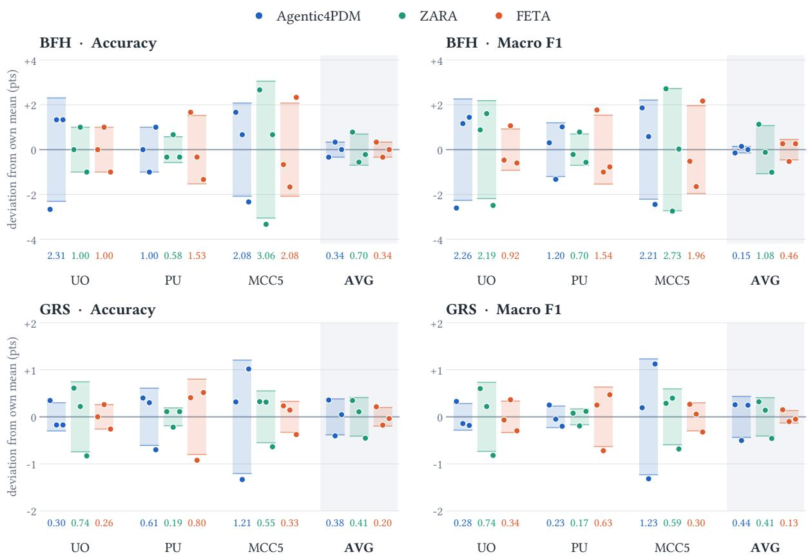  
Within each slot the three dots are runs 1, 2, 3 (left to right). Pale band: ±1 sample s.d.; the number beneath each slot is that s.d.

Figure 6 Variation across three executions of standard Agentic4PDM, ZARA, and FETA on BFH and GRS. For each method, dataset, and metric, scores are centered on their mean across the three executions. The dots therefore show deviations from that mean in percentage points, with runs 1–3 ordered from left to right within each group. Shaded bands span ±1 sample standard deviation (n = 3); the corresponding standard deviation appears below each group. AVG denotes the unweighted mean of the three dataset scores in each execution. BFH and GRS use diferent vertical scales.

Figure 6 summarizes the observed variation between executions. On GRS, the scores averaged over the three datasets vary little for all three methods. On BFH, standard Agentic4PDM has a smaller spread in the average macro F1 than ZARA. Individual datasets show greater variation on BFH than on GRS. Each BFH dataset contains 100 windows, so changing the correctness of one prediction changes accuracy by one percentage point. These comparisons describe the three observed executions; they do not establish the variability expected over a larger number of runs.

## C.4 Agentic4PDM versus Ensembles of Its Evidence Sources

To assess whether a direct combination of the available source judgments can account for the diagnostic performance, we compare Agentic4PDM with Flat source plurality. This ensemble combines the currentsample NAAgent and ABAgent outputs, the final LBAgents conclusion, and predictions from the SVM and XGBoost baselines. It provides a fixed aggregation of these sources against which to compare the full diagnostic workflow.

Flat source plurality. Each valid Analyst and the final LBAgents conclusion contributes one count to every class it selects, with duplicate selections removed within each source. SVM and XGBoost contribute one vote each for their predicted class. The class with a unique highest total is the ensemble prediction; a tie for the highest total or the absence of valid votes produces an abstention. The aggregation uses the saved source outputs and does not learn source weights.

Comparison at matched coverage. For each dataset, we first select the samples on which Flat source plurality produces a prediction, using predictions only, before consulting the true labels. We then score both methods on exactly those samples. Macro-F1 (F1-M) is computed on this covered set by averaging the per-class F1 scores equally over all dataset classes, with undefined class F1 set to zero. Coverage is the fraction of the available successful samples included in the comparison. Table 4 reports F1-M at the ensemble’s coverage.

Table 4 Macro-F1 (F1-M, %) of Flat source plurality and Agentic4PDM on the same covered samples in each dataset. Bold marks the higher score.
<table><tr><td>Method</td><td>MCC5</td><td>PU</td><td>UO</td></tr><tr><td>Flat source plurality</td><td>48.26</td><td>28.45</td><td>85.00</td></tr><tr><td>AGENTIC4PDM</td><td>54.09</td><td>37.90</td><td>87.38</td></tr></table>

Evaluation note. Matched coverage is 77.69% on MCC5, 84.11% on PU, and 89.52% on UO. Agentic4PDM uses saved classes, including diagnostic guesses on unresolved samples. Both rows use the same covered sample identifiers within each dataset.

Result analysis. Agentic4PDM achieves higher macro-F1 than Flat source plurality on all three matched sets, with margins of 5.83 percentage points on MCC5, 9.45 on PU, and 2.38 on UO. The largest diference occurs on PU, where direct aggregation reaches 28.45% macro-F1 and the full workflow reaches 37.90%. These results show that the full workflow’s saved predictions are not reproduced by simply counting the classes supported by its Analysts, LBAgents conclusion, and two baseline models. They are consistent with additional value from the workflow’s investigation and evidence resolution, although this comparison does not isolate the contribution of any individual mechanism.

## C.5 Evidence Guidance

We examine whether the reference preflight provides a useful distinction between corroborative and advisory guidance to the Judge. We measure how often each role is available and compare its correctness on the same query samples. This analysis reuses saved measurement records from the GRS evaluations on MCC5, PU, and UO described in Section 4.1.

For each dataset, we use the GRS query samples in these saved runs. For each query, we take the packets recorded in its ledger and count each measurement once. Each packet carries its role and its winning class (Section 3.5.1).

Coverage. Table 5 reports, for each role, the percentage of GRS query samples that have at least one packet with that role. Every GRS query sample in the saved runs is counted in the denominator, including those with no packet of that role. A query can have packets of both roles, so the two percentages need not sum to 100%.

Correctness. Table 6 compares the two roles on the same queries: it uses only the queries that have at least one corroborative packet and at least one advisory packet. For each of these queries and each role, we compute the fraction of packets with that role whose winning class is the true class of the query. We then average these fractions over the queries, so that each query has equal weight regardless of how many packets it has. A packet with no unique winning class is still counted under the role of its tool and is scored as incorrect. The true classes are used only to score the saved outputs after inference.

Table 5 Influence-role coverage (%). Percentage of GRS query samples with at least one packet of each role in the ledger.  
Table 6 One-packet guidance on the same GRS query samples containing both roles. Scores are percentages; diference is corroborative minus advisory (percentage points).
<table><tr><td>Dataset</td><td>Corroborative coverage</td><td>Advisory coverage</td></tr><tr><td>MCC5</td><td>30.30%</td><td>83.68%</td></tr><tr><td>PU</td><td>64.35%</td><td>86.53%</td></tr><tr><td>UO</td><td>68.15%</td><td>96.85%</td></tr></table>

<table><tr><td>Dataset</td><td>Corroborative</td><td>Advisory</td><td>Difference</td></tr><tr><td>MCC5</td><td>55.56%</td><td>34.26%</td><td>+21.30 pp</td></tr><tr><td>PU</td><td>48.06%</td><td>47.86%</td><td>+0.20 pp</td></tr><tr><td>UO</td><td>82.24%</td><td>64.64%</td><td>+17.60 pp</td></tr></table>

Results in Tables 5 and 6 support two findings:

Finding 1: corroborative evidence appears less often. Table 5 shows lower corroborative coverage on every dataset: 30.30% versus 83.68% on MCC5, 64.35% versus 86.53% on PU, and 68.15% versus 96.85% on UO. Thus, reference-checked guidance is available in fewer samples than advisory guidance.

Finding 2: higher corroborative correctness on matched UO and MCC5 samples. Table 6 shows higher corroborative correctness on UO (82.24% versus 64.64%) and MCC5 (55.56% versus 34.26%). PU is nearly equal (48.06% versus 47.86%). These results support the hypothesis on the matched UO and MCC5 sets, with the clearest descriptive support on UO. Together, the two findings show that corroborative evidence appears less often, yet provides stronger guidance on most datasets (UO and MCC5).

## D Can the Best Single Tool on Each Dataset Replace Agentic4PDM?

A fixed measurement provides a useful comparison for the full diagnostic workflow, but the comparison must use tools that the agent can actually select. The current production selector exposes 25 default ToolCards, one per family, with fixed parameters (Table 24). We therefore select the highest-macro-F1 default on each GRS dataset and evaluate that same configuration across all three datasets. Tool selection uses these evaluated samples, so the results describe the strongest defaults on these sets rather than performance estimated on a separate selection split.

Measurement and scoring. Each tool compares each numeric channel with its class references. A channel votes only when its winning class is unique; a unique largest class-vote count determines the sample prediction. A top tie or the absence of a valid vote is recorded as unknown. Accuracy includes every sample, and macro-F1 averages over the true dataset classes, with unknown predictions contributing false negatives. This uniform ofline comparison does not override the ToolCards’ inference permissions: for example, the residual-level tool supports fault existence, not fault-type adjudication.

Table 7 Macro-F1 (%) of the dataset-winning tools among the 25 selectable defaults and the full Agentic4PDM in the updated GRS audit. Agentic4PDM uses saved-class scoring. Bold marks the highest displayed score in each column.
<table><tr><td>Tool (selected on) / method</td><td>ToolCard / scoring</td><td>MCC5</td><td>PU</td><td>UO</td><td>Mean</td></tr><tr><td>Windowed profile (MCC5)</td><td>quant_windowed_profile_windows_16_ampl itude_11</td><td>36.15</td><td>35.22</td><td>30.17</td><td>33.85</td></tr><tr><td>Crossing-run statistics (PU)</td><td>quant_crossing_run_statistics_q50_js</td><td>22.89</td><td>37.94</td><td>16.73</td><td>25.85</td></tr><tr><td>Distribution KS (UO)</td><td>quant_distribution_ks_raw</td><td>31.78</td><td>32.78</td><td>60.02</td><td>41.53</td></tr><tr><td>AGENTIC4PDM</td><td>Saved class</td><td>52.93</td><td>38.54</td><td>86.12</td><td>59.20</td></tr></table>

Design note. The three fixed tools were selected by macro-F1 within the 25 defaults on the dataset in parentheses, then scored unchanged on the other datasets. Pale yellow marks the selection dataset; pale blue marks the full workflow. Mean weights the three datasets equally. Saved-class scoring includes the agent’s best guesses on unresolved samples.

Dataset dependence and full-workflow performance. The winning default changes with the dataset. Crossingrun statistics ranks first on PU but fifteenth on MCC5 and twentieth on UO, whereas the windowed amplitude profile is more consistent, ranking first, fourth, and fifth on MCC5, PU, and UO. Thus, the defaults include both dataset-specific and more broadly useful measurements. Distribution KS has the highest equal-dataset mean macro-F1 among all 25 defaults (41.53%). The full workflow reaches 59.20% under saved-class scoring. Under saved-class scoring, its margins over each dataset’s best default are 16.78, 0.60, and 26.10 percentage points on MCC5, PU, and UO, respectively.

Scope of the comparison. The audit reuses saved ofline tool predictions; it does not rerun tool or LLM inference. Historical agent implementation hashes difer from the current registry for the 11 tool identifiers observed in the archived runs. The full workflow also uses retrieval, multiple measurements, baseline evidence, and Judge reasoning. These rows therefore provide configuration-level comparisons and full-agent context, rather than a controlled ablation isolating adaptive tool selection. The agent scores here follow the updated audit and its scoring conventions; they should be read within that scope rather than substituted for the main experiment’s aggregate results.

## E Backbone Substitution: What the Agent Adds to a Representation

The main results use Moirai 1.1 R Large (M1.1R). An archived Chronos-2 Small (C2S) experiment substitutes the frozen retrieval encoder and its embedding cache. In standard mode, its SVM and XGBoost heads are fitted to C2S rather than M1.1R embeddings; in TF, neither backbone supplies fitted-model predictions. The LLM, decoding, prompts, budgets, thresholds, and BFH/GRS manifests are shared. These are diferent backbones, not repeat executions of one configuration.

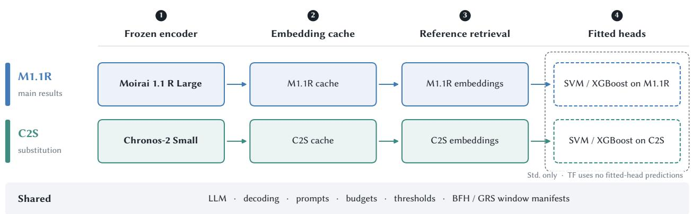

Figure 7 Backbone substitution changes the frozen encoder, embedding cache, retrieval representation, and standard fitted heads. TF uses no fitted-head predictions. All other settings and BFH/GRS windows are shared.  
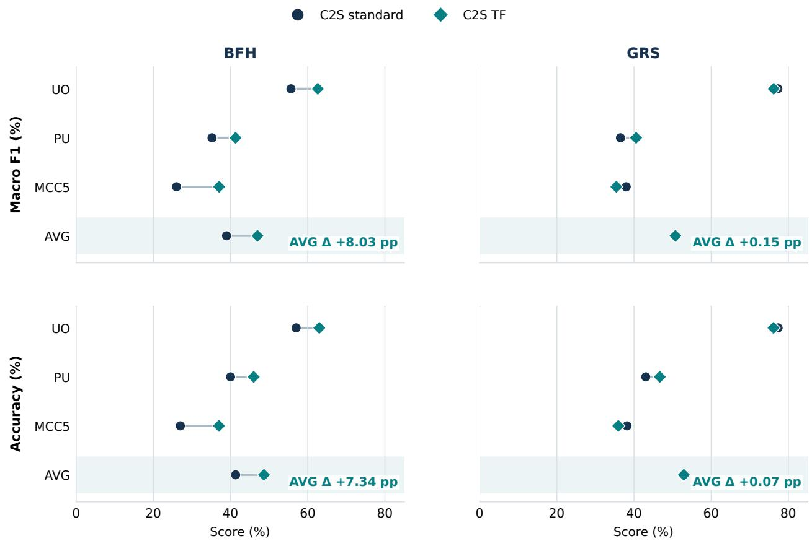  
Figure 8 C2S Agentic4PDM standard and TF on the same frozen BFH and GRS windows. Circles and diamonds show the reported scores; connectors expose the direction and size of each change. ACC and macro F1 are percentages. AVG is the unweighted mean of UO, PU, and MCC5, and its annotation gives TF minus standard in percentage points.

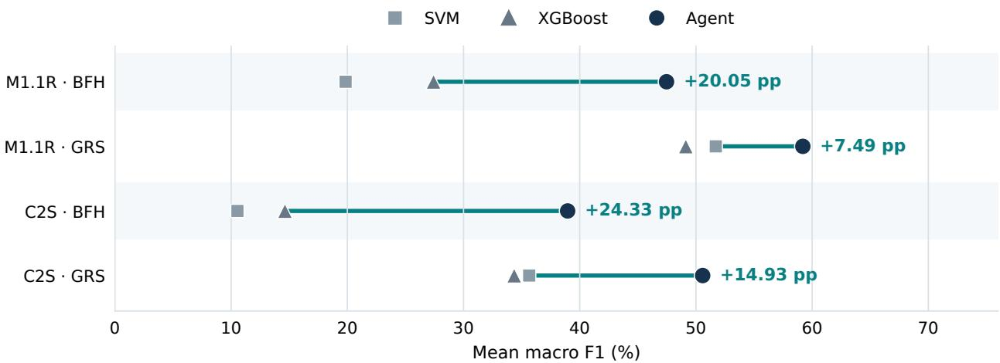  
Figure 9 Mean macro F1 (%) for each standard agent and the two fitted heads built on the same backbone. The labeled gain is over the stronger fitted head in each row. These comparisons are descriptive, not causal.

The agent exceeds both fitted heads for both backbones and both challenges. The C2S gain over its stronger head is larger, although its absolute macro F1 is lower. This separates the workflow’s improvement over a given representation from the quality of the representation itself. The comparison is descriptive: it does not isolate the causal efect of the host gates or quantify run-to-run variability.

## F Empirical Time and Token Use

Table 8 Mean recorded resource use per query sample. Token columns are in thousands (k); time is in seconds. Recorded timer scopes difer across methods, as described below.
<table><tr><td>Method</td><td>Time (s)</td><td>Input (k)</td><td>Output (k)</td><td>Total (k)</td><td>LLM calls</td></tr><tr><td>FETA</td><td>1,078.59</td><td>68.05</td><td>4.62</td><td>72.67</td><td>8.0</td></tr><tr><td>ZARA</td><td>98.20</td><td>5.11</td><td>2.72</td><td>7.83</td><td>4.0</td></tr><tr><td>AGENTIC4PDM (standard)</td><td>1,645.79</td><td>89.88</td><td>12.48</td><td>102.36</td><td>17.4</td></tr></table>

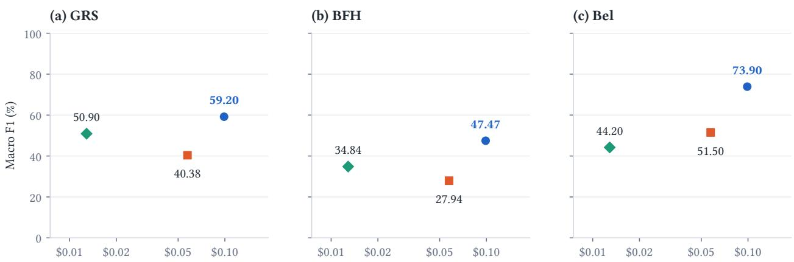  
Estimated LLM API cost per query (USD; log scale)  
Figure 10 Diagnostic macro-F1 versus estimated Qwen3.6-27B API cost per query at Alibaba Cloud’s Singapore/International list prices. Costs follow Eq. 6, using separate input and output token rates. Each method’s mean cost estimate is reused across GRS, BFH, and Bel. These values estimate token-based API charges rather than observed API bills or total deployment costs.

We next examine what the additional diagnostic reasoning of Agentic4PDM costs in practice. Table 8 reports recorded processing time, token use, and LLM calls. The time column includes the stages recorded by each implementation, including retrieval, feature preparation, tool execution, and LLM inference. The timer scopes difer: FETA measures per-worker processing, whereas ZARA and Agentic4PDM measure their full workflows. The time values should therefore be interpreted as descriptive implementation measurements rather than as a strictly controlled latency benchmark. The token counts provide a more direct basis for comparing hosted-LLM usage. We convert the mean input and output tokens into an estimated API charge using Qwen3.6-27B prices of USD 0.60 per million input tokens and USD 3.60 per million output tokens. This calculation prices the recorded token usage only and does not rerun the diagnostic workflows on the hosted service.

For method m, let $\bar { u } _ { m }$ and $\bar { v } _ { m }$ denote the reported mean input and output tokens per query, respectively. The estimated LLM API charge is

$$
{ \widehat { c } } _ { \mathrm { A P I } , m } = { \frac { 0 . 6 0 { \bar { u } } _ { m } + 3 . 6 0 { \bar { v } } _ { m } } { 1 0 ^ { 6 } } } \quad \mathrm { U S D / q u e r y } .\tag{6}
$$

Using the unrounded token means underlying Table 8 gives estimated costs of USD 0.0575 for FETA, USD 0.0129 for ZARA, and USD 0.0989 for standard Agentic4PDM per query.

The three methods spend these resources in substantially diferent ways. FETA records 1,078.59 s per query, of which 1,044.51 s comes from retrieval and only 34.08 s from subsequent inference. Its moderate token consumption therefore does not translate into short processing time: the dominant bottleneck is its per-channel DTW retrieval, which repeatedly aligns the query with labeled reference sequences. FETA illustrates an important distinction between LLM cost and end-to-end computational cost—reducing language-model usage does not necessarily make the complete diagnostic workflow inexpensive.

ZARA lies at the other extreme. It requires only 98.20 s, 7.83k tokens, and four LLM calls per query. Much of its discriminative structure is prepared before inference, allowing the online workflow to operate with relatively little computation. This makes ZARA substantially cheaper at inference time, but also leaves less opportunity to construct new evidence specifically for an ambiguity encountered in the current case.

Agentic4PDM intentionally makes the opposite design choice. It records 1,645.79 s, 102.36k tokens, and 17.4 LLM calls per query. Relative to FETA, this corresponds to approximately 1.53× the recorded processing time and 1.41× the total token use, rather than a twofold increase. The additional computation arises from repeated evidence acquisition and adjudication: the Judge may identify a remaining ambiguity, request a targeted measurement, inspect the returned evidence, reconcile conflicting results, and continue the investigation before committing to a class. In other words, the additional resource use is not incidental overhead; it is the computational cost of allowing the investigation itself to adapt to the current case.

The relevant question is therefore not whether Agentic4PDM is the cheapest workflow, but what diagnostic improvement accompanies this additional expenditure. Figure 10 makes this trade-of explicit. Standard Agentic4PDM costs an estimated USD 0.0989 per query, compared with USD 0.0575 for FETA, or approximately 1.72× as much. In absolute terms, however, the diference is about USD 0.0414 per query. Against this additional estimated API charge, Agentic4PDM improves three-dataset mean macro-F1 over FETA by 18.82 percentage points on GRS (59.20% versus 40.38%) and 19.53 points on BFH (47.47% versus 27.94%). The additional inference therefore accompanies substantial gains both across the coverage-oriented GRS regimes and on the concentrated failure cases represented by BFH.

The comparison with ZARA exposes the other side of the trade-of. ZARA has the lowest estimated API cost, at USD 0.0129 per query, but also achieves lower macro-F1 than Agentic4PDM in all three evaluation settings shown in Figure 10. The gaps are 8.30 percentage points on GRS and 12.63 points on BFH; more importantly, on the unfiltered Bel test set collected from our customer, the gap widens to 29.70 points (73.90% versus 44.20%). Thus, the cheapest online workflow is not necessarily the most efective one, particularly when evaluated on data outside the public benchmark settings

Taken together, these results show a clear resource–performance trade-of. Agentic4PDM pays more at inference time because it performs more sample-specific investigation before deciding, whereas FETA concentrates cost in retrieval and ZARA minimizes online computation through stronger ofline preparation. Under the pricing scenario considered here, the additional LLM cost of Agentic4PDM relative to FETA is only about four cents per query, while the corresponding macro-F1 gains approach twenty percentage points on both GRS and BFH. This does not by itself establish that the method is economically preferable in every industrial deployment. Rather, it makes the relevant deployment question more precise: whether the incremental cost of investigating an escalated case is smaller than the operational value of the diagnostic errors that the additional investigation prevents.

## G How consistent is performance across operating conditions?

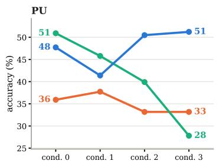

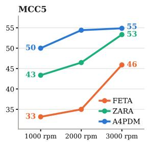  
Figure 11 Accuracy of FETA, ZARA, and Agentic4PDM across the displayed PU operating conditions and MCC5 motor speeds.

Figure 11 examines whether the aggregate advantage of Agentic4PDM is concentrated in particular operating conditions. Across both datasets, Agentic4PDM achieves higher mean accuracy than FETA and ZARA (Table 2) while exhibiting comparatively limited variation across the displayed regimes. On PU, its accuracy spans 10 percentage points across conditions, compared with 23 points for ZARA. On MCC5, the corresponding ranges are 5 points for Agentic4PDM and 10 for ZARA. FETA shows relatively small variation, particularly on PU, but at a substantially lower accuracy level on both datasets. These results indicate that the higher average performance of Agentic4PDM is accompanied by comparatively consistent behavior across the evaluated operating conditions rather than being attributable to a single favorable regime.

## H Experimental Setup: Data, Protocol, and Per-Method Configurations

## H.1 Datasets, Signal Modalities, and Split Boundaries

Table 9 summarizes the four diagnostic datasets, including their class counts, labeled training budgets, fault settings, operating conditions, and available sampling rates. PU and UO cover three-class bearing diagnosis, MCC5 covers four-class motor diagnosis, and Bel provides a separate binary bearing evaluation on data supplied by our customer (Section 4.1). Table 10 reports the total number of test samples and per-class support in the frozen BFH and GRS sets for PU, UO, and MCC5, together with the complete Bel test set (330 samples: 150 normal and 180 abnormal). BFH uses balanced or nearly balanced class quotas to test recovery on concentrated baseline failures, while GRS retains representatives across signal geometry and model-response patterns, yielding class counts determined by the coverage construction. Details of the BFH and GRS test-set selection rules and manifest construction are provided in Appendix I, Benchmark Construction: How the BFH and GRS Challenge Sets Were Built.

Split boundaries. For PU, UO, MCC5 and BEL, the labeled training samples and the test samples come from diferent recordings: no recording contributes samples to both sets, so a test sample and its references never come from the same recording. The preceding sample x<sup>prev</sup> used by the LBAgents is the sample just before the query in its own recording, and it is never part of the labeled training set.

Table 9 Acquisition characteristics and retained-task statistics for PU, UO, MCC5, and Bel. Bel is evaluated separately from BFH and GRS; a dash indicates an unreported sampling rate.
<table><tr><td>Dataset</td><td>Classes</td><td>Train</td><td>Fault generation/ setting</td><td>Operating conditions</td><td>Rate (Hz)</td></tr><tr><td>PU [36]</td><td>3</td><td>150</td><td>Real bearing damage from accelerated lifetime tests</td><td>Condition 0: 900 rpm, 0.7 Nm, 1000 N. Conditions 1–3: 1500 rpm with torque/radial-load pairs 0.1 Nm/1000 N, 0.7 Nm/400 N, and 0.7 Nm/1000 N.</td><td>64,000</td></tr><tr><td>UO [25]</td><td>3</td><td>150</td><td>Inner-/outer-race defect specimens; fabrication method not specified in the source description</td><td>Time-varying speed: A, increasing; B, decreasing; C, increasing then decreasing; D, decreasing then increasing.</td><td>200,000</td></tr><tr><td>MCC5 [8]</td><td>4</td><td>200</td><td>Laboratory motor measurements with rotor, (Conditions 0–2). electrical, and bearing fault configurations</td><td>Frozen scored pool: 20 Nm at 1000, 2000, and 3000 rpm</td><td>12,800</td></tr><tr><td>Bel</td><td>2</td><td>20</td><td>Bearing vibration supplied by our customer; binary normal/abnormal labels, with damage type unspecified</td><td></td><td></td></tr></table>

## H.1.1 Frozen Manifests and Per-Class Support

Table 10 lists the frozen BFH and GRS test-set sizes and per-class sample counts, alongside the Bel test set, which is scored in full without BFH or GRS selection.

Table 10 Test-set sizes and per-class support for the frozen BFH/GRS manifests and the complete Bel test set. Each class count is a number of samples; class counts sum to the total N in each row.

(a) Bearing diagnosis
<table><tr><td>Dataset</td><td>Challenge</td><td>Total N</td><td>Healthy</td><td>Inner-race</td><td>Outer-race</td></tr><tr><td rowspan="2">PU</td><td>BFH</td><td>100</td><td>34</td><td>33</td><td>33</td></tr><tr><td>GRS</td><td>906</td><td>205</td><td>487</td><td>214</td></tr><tr><td rowspan="2">UO</td><td>BFH</td><td>100</td><td>34</td><td>33</td><td>33</td></tr><tr><td>GRS</td><td>763</td><td>197</td><td>221</td><td>345</td></tr></table>

(b) Motor diagnosis: MCC5
<table><tr><td>Challenge</td><td>Total N</td><td>Normal</td><td>Rotor</td><td>Electrical</td><td>Bearing</td></tr><tr><td>BFH</td><td>100</td><td>25</td><td>25</td><td>25</td><td>25</td></tr><tr><td>GRS</td><td>1,152</td><td>233</td><td>341</td><td>175</td><td>403</td></tr></table>

(c) Binary bearing diagnosis: Bel
<table><tr><td>Evaluation set</td><td>Total N</td><td>Normal</td><td>Abnormal</td></tr><tr><td>Complete test set</td><td>330</td><td>150</td><td>180</td></tr></table>

## H.2 Shared Evaluation Protocol and Inventory of Compared Methods

Table 11 groups the comparison methods into deep-learning, foundation-model, and agentic families. The evaluated non-agent baselines include three neural classifiers and 12 combinations of foundation-model representations with classical heads. The latter pair each of four backbones with k-nearest neighbors (KNN), a support vector machine (SVM), or extreme gradient boosting (XGBoost), allowing comparison across representations and classifiers. These non-agent methods produce diagnostic predictions without adaptive evidence construction or Host-governed adjudication.

Using a fixed or pretrained representation with a separately fitted classifier follows an established evaluation paradigm in time-series learning, rather than a task-specific architectural modification. Franceschi et al. learn transferable unsupervised representations and evaluate them with an RBF-kernel SVM [20]. TS2Vec likewise evaluates learned representations with an RBF-kernel SVM across the UCR and UEA archives [65], and MOMENT evaluates pretrained time-series representations using an SVM without task-specific backbone fine-tuning [22]. More directly, StarEmbed evaluates fixed Moirai and Chronos embeddings with KNN, a linear probe, random forest, and an MLP [37]. A broader empirical comparison of time-series embeddings also evaluates KNN, SVM, and XGBoost as downstream classifiers [27]. These precedents motivate the general representation-plus-classifier setting; our particular four-backbone, three-head grid is a controlled comparison within that setting, not a claim that every exact pairing has already been standardized. Varying the head allows us to assess each representation without relying on a single classifier choice.

Table 11 Baseline inventory grouped by model family. Each foundation-model backbone is paired with KNN, SVM, and XGBoost.
<table><tr><td>Model / backbone</td><td>Prediction / reasoning approach</td></tr><tr><td>(a) Deep learning Evaluated baselines</td><td></td></tr><tr><td>CNN-TCC [18] QCNN [41] WDCNN [66]</td><td>Neural classifiers</td></tr><tr><td>(b) Foundation models Evaluated baselines Moirai 1.1 R Large [59]</td><td></td></tr><tr><td>Moirai 2 Small [42] Chronos-2 [3] Chronos-2 Small [3]</td><td>Fixed representations with KNN, SVM, or XGBoost (12 combinations), following MOMENT&#x27;s representation-plus-SVM evaluation [22], StarEmbed&#x27;s fixed-embedding evaluation [37], and the broader embedding comparison [27].</td></tr><tr><td>(c) Agentic methods Evaluated baselines</td><td></td></tr><tr><td>FETA [55]</td><td>Training-set channel ranking, DTW exemplar retrieval, and channel-level LLM reasoning with confidence-based aggregation.</td></tr><tr><td>ZARA [39]</td><td>Offline pairwise feature knowledge; placement-specific, class-wise retrieval and hierarchical feature selection, candidate pruning, and decision reasoning.</td></tr></table>

Evaluation scope. Table 2 groups the deep-learning, foundation-model, and agent results. Implementation settings for FETA and ZARA are given in Appendix H.6.

Table 12 Shared labeled-reference and query-sample settings for the evaluated methods; BFH/GRS manifest sizes and per-class support are reported in Table 10.
<table><tr><td>Protocol item</td><td>Setting</td></tr><tr><td>Labeled reference pool</td><td>50 samples per class: 150 each for PU and UO (3 classes), and 200 for MCC5 (4 classes)</td></tr><tr><td>Query sample</td><td>2048 observations, non-overlapping, using all available dataset channels</td></tr></table>

These values describe the labeled reference pool and each query, not the scored challenge sets. The shared reference budget does not imply identical pretraining resources or computation; Appendix H.1.1 reports the separate BFH/GRS manifest sizes and per-class support.

## H.3 Configuration of Agentic4PDM

To support reproducibility, we document the fixed inference and retrieval settings used for the reported executions.

Operational settings and sensitivity. Challenge construction uses three priority-rule steps, a GRS geometry target of G=250 for all three datasets, and response-stability thresholds (0.70, 0.50) throughout. These are fixed operating choices, not learned parameters or claims of optimality. Increasing G raises geometric resolution and agent-run count, while higher stability thresholds produce smaller, more homogeneous tiers.

Table 13 Main Moirai 1.1 R Large Agentic4PDM configuration. One setting applies to standard and TF on both challenges and all three datasets; TF omits fitted-model outputs. Appendix E specifies the Chronos-2 Small substitution.
<table><tr><td>Component</td><td>Setting</td><td>Value</td></tr><tr><td colspan="3">(a) Language model</td></tr><tr><td></td><td>Model and access</td><td>Qwen3.6-27B vision-language model, served locally through an OpenAI-compatible endpoint; the same model serves every agent</td></tr><tr><td></td><td>Decoding</td><td>role Temperature 0, top-p 1, top-k -1, presence penalty 1.5, seed 0</td></tr><tr><td></td><td>Extended thinking Output limit</td><td>Enabled for the analysis and synthesis roles, 512-token budget 38,048 tokens per request</td></tr><tr><td></td><td>Images</td><td>At most 10 per request, longest side 1400 px</td></tr><tr><td colspan="3">(b) Reference retrieval</td></tr><tr><td></td><td>Encoder</td><td>Frozen Moirai 1.1 R Large, mean pooling over all channels, per-dimension feature scaling</td></tr><tr><td></td><td>Embedding settings Reference selection</td><td>Context length 2048, patch size 32, batch size 100 Uses the shared labeled-reference pool in Table 12; retains the</td></tr><tr><td></td><td></td><td>highest-scoring reference per class by cosine similarity, with no operating-condition filter</td></tr><tr><td colspan="3">(c) Evidence construction Smoothing registry</td></tr><tr><td></td><td></td><td>Five label-free families (Savitzky-Golay, median, exponential weighted mean, median-mean-EWM, low-pass); the agent selects the family per channel and the Host fixes the parameters</td></tr><tr><td></td><td>Channel priorities</td><td>Ordinal levels: high, medium, low (or removed)</td></tr><tr><td></td><td>Verification rounds</td><td>2 for the ANALYST reports and 2 for the smoothing review NAAGENT and ABAGENT comparisons repeated on the previous</td></tr><tr><td></td><td>LBAGENTS</td><td>sample only, when a current-sample comparison remains unresolved</td></tr><tr><td colspan="3">(d) JuDGE and Host budgets</td></tr><tr><td></td><td>JUDGE steps</td><td>At most NJ = 10 per sample, with no minimum; identical in every ablation variant</td></tr><tr><td></td><td>JUDGE images</td><td>6 anchor and 8 active</td></tr><tr><td></td><td>Request gate</td><td>At most 5 tool families offered and 3 tools recommended per round (Section 3.5)</td></tr><tr><td></td><td>Request timeouts Packet gate</td><td>PU archived configuration: 1800 s for stage 1 and 3600 s for stage 2 At most 10 tool executions per round, 60 per sample, and 10 per registered family; the execution budget is enforced by the Host and</td></tr><tr><td></td><td></td><td>is identical in every ablation variant, including those in which this gate is disabled</td></tr><tr><td colspan="3">(e) Fitted-model evidence (standard only)</td></tr><tr><td></td><td>Revealed predictions</td><td>XGBoost and SVM fitted on the same reference samples and on the run&#x27;s backbone representation</td></tr><tr><td></td><td>Reveal order</td><td>Disclosed only after the ANALYST reports are frozen; individual model identities stay hidden</td></tr></table>

## H.4 Training Settings of the Deep-Learning Baselines

The deep-learning comparison includes CNN-TCC, QCNN, and WDCNN. Table 14 groups their shared optimizer and schedule settings, then separates the input-dependent convolution settings for bearing and motor data.

## H.5 Training Settings of the Foundation-Model Baselines

The foundation-model baselines pair four frozen encoders—Moirai 1.1 R Large, Moirai 2 Small, Chronos-2, and Chronos-2 Small—with KNN, SVM, and XGBoost heads. Table 15 summarizes the shared embedding procedure and each head’s settings.

Table 14 Training settings shared by the deep-learning baselines (CNN-TCC, QCNN, and WDCNN).
<table><tr><td colspan="4">Optimizer</td><td colspan="2">Schedule</td><td colspan="3">Architecture</td></tr><tr><td>Algorithm</td><td>β1</td><td>β2</td><td>Learning rate</td><td>Epochs</td><td>Batch size</td><td>Bearing (3 channels)</td><td>Motor (8 channels)</td><td>Common</td></tr><tr><td>Adam</td><td>0.9</td><td>0.95</td><td>10-3</td><td>100</td><td>128</td><td>First convolution: kernel 16, stride</td><td>First convolution:</td><td>64 final channels; dropout 0.35</td></tr></table>

Table 15 Training settings of the foundation-model baselines and their classical heads.
<table><tr><td>Group</td><td>Setting</td><td>Value</td></tr><tr><td colspan="3">(a) Foundation-model representations</td></tr><tr><td></td><td>Backbones</td><td>Moirai 1.1 R Large, Moirai 2 Small, Chronos-2, Chronos-2 Small, all frozen</td></tr><tr><td></td><td>Embedding</td><td>Mean pooling, per-dimension feature scaling, context length 2048, patch size 32, batch size 100</td></tr><tr><td colspan="3">(b) Classical heads on those representations</td></tr><tr><td></td><td>KNN</td><td>k = 5, uniform weights</td></tr><tr><td></td><td>SVM</td><td>RBF kernel, C = 1.0, γ = scale</td></tr><tr><td></td><td>XGBoost</td><td>100 trees, maximum depth 6, learning rate 0.1</td></tr></table>

## H.6 Implementation Settings of the Agentic Baselines (FETA and ZARA)

This subsection documents the implementations of FETA and ZARA used in the BFH and GRS evaluations in Section 4.1. Both use Qwen3.6-27B with deterministic decoding, frozen challenge manifests, a class-balanced reference bank, and common resource limits. Each preserves its own evidence workflow: FETA ranks channels and retrieves DTW exemplars before per-channel reasoning and confidence aggregation, whereas ZARA combines frozen-encoder retrieval with pairwise feature knowledge, candidate pruning, and decision synthesis. The comparison therefore holds these shared evaluation conditions fixed while comparing how the workflows construct and use evidence.

FETA: retrieval and channel-level reasoning. FETA ranks channels using class-separation and approximate nearest-neighbor accuracy scores computed on labeled training data. For each selected channel, it retrieves similar labeled sequences using dynamic time warping (DTW). Independent LLM reasoners compare the query with these examples and return a label and self-assessed confidence; a deterministic aggregator combines their outputs. Its training-free setting means no task-specific parameter training, not the absence of labeled reference data [55].

ZARA: statistical knowledge and hierarchical reasoning. ZARA addresses human activity recognition from motion sensors. Ofline, it constructs activity-pair feature-importance knowledge using statistical features and permutation-based ranking with AutoGluon. At inference, a frozen time-series encoder supports sensorplacement-specific, class-wise retrieval. A Feature Selector identifies coarse discriminative features; an Evidence Pruning agent removes mismatched activities; feature selection is repeated for the surviving candidates; and a Decision Insight agent produces the final label and rationale. Training-free inference therefore coexists with an ofline knowledge-construction stage [39].

Both methods are evaluated on BFH and GRS (Table 2) and are compared architecturally in the baseline inventory (Table 11).

Table 16 Implementation settings for FETA and ZARA in the BFH and GRS evaluations. The table summarizes their method-specific workflows under common evaluation conditions.
<table><tr><td>System</td><td>Method-specific workflow</td><td>Retrieval and prompting</td><td>Common configuration</td><td>Reported comparison</td></tr><tr><td>FETA [55]</td><td>Channel-level reasoning: ranks channels, compares retrieved exemplars, and aggregates per-channel judgments with confidence scores.</td><td>Channel ranking from the labeled reference bank; DTW exemplar retrieval; a and deterministic confidence aggregation.</td><td>Qwen3.6-27B; deterministic decoding; frozen manifests; class-balanced reference bank; per-channel comparison prompt; common resource limits.</td><td>Evaluated on the common BFH/GRS task, split, manifests, reference data, and scoring procedure.</td></tr><tr><td>ZARA [39]</td><td>Feature-guided reasoning: combines pairwise feature knowledge with hierarchical selection, candidate pruning, and decision synthesis.</td><td>Frozen-encoder, class-wise retrieval; pairwise feature-importance knowledge; feature-selection and decision prompts; and candidate pruning.</td><td>Qwen3.6-27B; deterministic decoding; frozen manifests; class-balanced reference bank; common resource limits.</td><td>Evaluated on the common BFH/GRS task, split, manifests, reference data, and scoring procedure.</td></tr></table>

## I Benchmark Construction: How the BFH and GRS Challenge Sets Were Built

Running the complete agentic workflow on every held-out sample is materially more expensive than scoring a conventional classifier in a batched forward pass. Let $\mathcal { D } _ { \mathrm { t e s t } } \bar { = } \{ ( x _ { i } , y _ { i } , d _ { i } ) \} _ { i = 1 } ^ { \bar { N } _ { \mathrm { t e s t } } }$ be a held-out pool, where $d _ { i }$ is the operating condition, and let $q _ { i }$ denote the number of LLM and tool calls consumed by sample $x _ { i }$ Full-pool evaluation costs

$$
Q ( \mathcal { D } _ { \mathrm { t e s t } } ) = \sum _ { i = 1 } ^ { N _ { \mathrm { t e s t } } } q _ { i } .\tag{7}
$$

For agentic systems, reducing $N _ { \mathrm { t e s t } }$ is therefore an evaluation-design requirement rather than a convenience. A single reduction rule is insuficient: selecting only the samples with the highest baseline error can spend the evaluation budget on many near-duplicate examples of one failure pattern, whereas selecting only geometric centroids can omit dificult tails. We therefore use two complementary challenge benchmarks:

1. the Baseline-Failure Hard (BFH) challenge set, which concentrates the budget on failure severity; and 2. the Geometry-Stratified Response-Stability (GRS) diversity set, which spreads the budget over representative coverage across class, condition, signal geometry, and frozen-model response regimes.

Each uses a frozen selection registry that excludes the evaluated agent. We write the BFH and GRS registries as $\mathcal { F } _ { \mathrm { B } } = \{ f _ { m } \} _ { m = 1 } ^ { M _ { \mathrm { B } } }$ and $\mathcal { F } _ { \mathrm { G } } = \{ f _ { m } \} _ { m = 1 } ^ { M _ { \mathrm { G } } }$ , respectively. The registry sizes and members are fixed in the released manifests. These registries are challenge-construction devices, not ensembles or claims that every member is a competitive baseline. What counts as hard in BFH therefore depends on which models sit in the registry: a model that is wrong almost everywhere marks almost every sample as a failure. GRS uses frozen-model response patterns to group samples and retains one representative from every nonempty group. Its construction is driven by representative coverage across signal and response regimes.

The same-backbone non-agent streams used in the empirical comparison are members of the relevant construction registries. BFH maximizes aggregate registry error, so registry-member scores and agent–registry gaps are afected by the sampling rule. An apparent gain can therefore partly be a selection artifact, whose contribution is not isolated by these comparisons. They describe recovery on samples chosen for registry failure and cannot establish unbiased superiority on the full pool. FETA and ZARA are excluded from BFH construction, so we emphasize their matched-sample comparisons while retaining registry scores as descriptive diagnostics. These agent comparisons remain conditional on the BFH manifest. GRS retains one representative per nonempty signal/response group to cover the regimes present in the held-out pool.

## I.1 Challenge Set I --- BFH: A Failure-Severity Stress Test

For each held-out sample, define the frozen-model correct count and error rate

$$
N _ { i } ^ { \mathrm { c o r r e c t } } = \sum _ { m = 1 } ^ { M _ { \mathrm { B } } } \mathbf { 1 } [ f _ { m } ( x _ { i } ) = y _ { i } ] , \qquad h _ { i } = 1 - \frac { N _ { i } ^ { \mathrm { c o r r e c t } } } { M _ { \mathrm { B } } } .\tag{8}
$$

Preprint

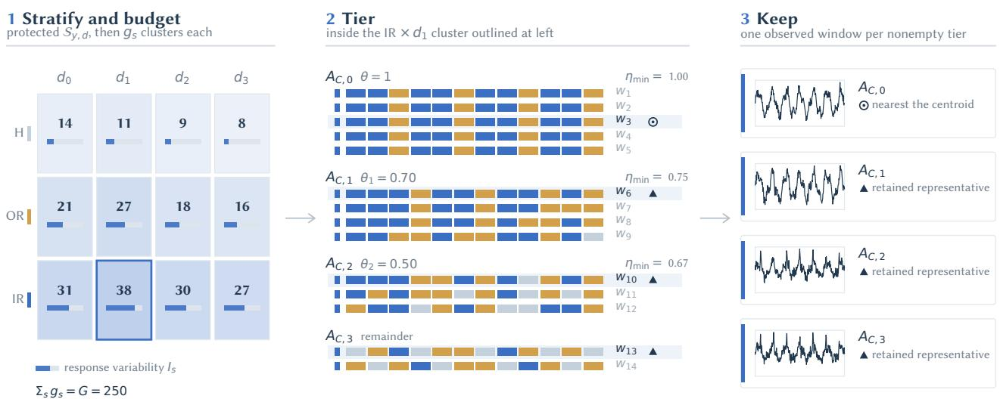  
Figure 12 GRS construction: (1) allocate geometry clusters within class–condition strata; (2) group frozen-model responses into stability tiers; (3) retain one observed representative per nonempty tier. Bars show response variability $I _ { s } ;$ counts show cluster allocations $g _ { s }$ (illustrative total G=250). Stability is measured within each model across samples, not between models.

Thus $h _ { i } = 0$ means that every selection model is correct, while larger $h _ { i }$ means that a greater fraction of the frozen registry models fails. For class-specific quotas $\{ n _ { y } \} _ { y \in \mathcal { Y } }$ , with $\begin{array} { r } { \sum _ { y } n _ { y } = N _ { \mathrm { B F H } } } \end{array}$ , the BFH set is

$$
\mathcal { T } _ { \mathrm { B F H } } = \bigcup _ { y \in \mathcal { V } } \mathrm { T o p } _ { n _ { y } } \left\{ ( x _ { i } , y _ { i } , d _ { i } ) : y _ { i } = y , \ N _ { i } ^ { \mathrm { c o r r e c t } } \geq 1 ; \ h _ { i } \right\} ,\tag{9}
$$

where $\mathrm { T o p } _ { n _ { u } } \{ \cdot ; h _ { i } \}$ returns the $n _ { y }$ largest hardness values and uses a fixed seed only to break exact ties. The current export assigns nearly equal class quotas and excludes $N _ { i } ^ { \mathrm { c o r r e c t } } = 0$ samples as a conservative label-quality guard. This exclusion is a protocol choice, not proof of mislabeling; its count and sensitivity should be reported.

BFH answers a narrow question: can the agent recover samples on which a large fraction of the frozen registry models fails? It is deliberately severe, but $\mathrm { t o p } { - } h _ { i }$ selection may choose many samples that are hard for the same reason. Consequently, BFH can over-sample one recurring signal or model-response pattern and under-cover other classes, conditions, and presentation patterns already present in the held-out pool.

## I.2 Challenge Set II --- GRS: A Representative-Coverage Diversity Test

GRS tests agent performance across the diversity of the held-out pool. Its construction represents operating conditions, signal patterns, and frozen-model response regimes through explicit grouping and representative selection.

Sampling by class and condition ensures coverage of those categories, but does not explicitly account for variation within them. samples from the same class and condition can difer in signal structure or in the predictions they elicit from the frozen models. GRS therefore groups the held-out pool in three stages: by class and condition, by similarity of cached signal embeddings, and by similarity of frozen-model responses. It retains one observed sample from each resulting group (Figure 12). This makes within-category variation an explicit part of benchmark construction and limits repeated representation of the same signal and response group.

Step 1: group similar signals within each class and condition. Each nonempty class–condition stratum is clustered separately using k-means on cached embeddings $\xi _ { i } = \phi ( x _ { i } )$ . A global target G controls the total number of geometry clusters. Every nonempty stratum receives at least one cluster; the remaining clusters are allocated according to stratum size and frozen-model response variability. The allocation priority combines the stratum size $n _ { s }$ with a response-variability measure $I _ { s } ,$ so larger or more response-variable strata receive finer geometric coverage. Bounded largest-remainder apportionment converts these priorities into integer cluster counts, breaking ties by class–condition key and capping each count at the stratum size. This assigns finer geometric coverage to larger or more response-variable strata while retaining every observed class–condition combination.

Step 2: group similar model responses within each cluster. A sample’s response signature is the ordered list of predictions from the $M _ { \mathrm { G } }$ frozen registry models. Within each geometry cluster, samples with identical signatures form initial groups. The largest such group becomes the exact tier: each model gives a constant prediction across its samples, although diferent models may disagree with one another. The remaining groups are merged into broader tiers using a per-model stability threshold:

$$
\eta _ { m } ( A ) = \operatorname* { m a x } _ { k \in \mathcal { Y } } \frac { \left| \left\{ i \in A : f _ { m } ( x _ { i } ) = k \right\} \right| } { \left| A \right| } \geq \theta \quad \mathrm { f o r ~ e v e r y ~ r e g i s t r y ~ m o d e l } \ m .\tag{10}
$$

Here A is a candidate tier. For example, θ = 0.70 requires each model to repeat its own most frequent prediction on at least 70% of the tier’s samples; it does not require agreement between models. The construction processes thresholds 0.70 and 0.50 in order. At each threshold, it scans remaining signature groups by decreasing size, breaking ties by signature, and adds a group when the merged tier still satisfies the threshold. Any groups left after the final threshold form a remainder tier. This is a deterministic grouping rule, not an optimal clustering claim.

Step 3: retain one observed representative per tier. Every nonempty tier contributes exactly one observed sample to the manifest. For the exact tier, the representative is the sample nearest the tier centroid in embedding space, with ties resolved by the fixed sample identifier. The threshold and remainder tiers also contribute one observed representative each. All retained samples come from the held-out pool, and the evaluated agent does not participate in their selection. This gives each nonempty signal/response regime a place in the benchmark.

Subset size. With an exact tier, two threshold tiers, and a possible remainder tier, each geometry cluster contributes between one and four representative samples. The geometry target controls the resolution of signal grouping, while the final subset size depends on the response groups present in the data. The released manifests use fixed geometry targets and report the resulting number of representatives for each evaluation setting (Table 10).

MCC5 healthy class. Under the global target, the healthy class of MCC5 received too few samples in the first construction. We therefore removed its healthy samples and rebuilt the healthy class on its own with G=100, using the same steps, registry, and thresholds; the three fault classes were kept unchanged. The MCC5 manifest thus combines the three fault classes from the G=250 construction with the healthy class from the G=100 construction, which gives at most 350 geometry clusters in total and 1,152 samples, 233 of them healthy (Table 10). This change depended only on class composition, not on any evaluation score, and all methods are scored on the same final manifest.

Configuration and interpretation. The construction uses frozen embeddings, a frozen prediction registry, and fixed selection settings that do not use any evaluated agent’s outputs. The artifact records the seed choices and validation checks for unique real samples, complete assignment of source samples to tiers, and one representative per nonempty tier.

GRS provides a practical test of agent performance across stratified signal and response patterns. Its groups are defined by embeddings and frozen-model predictions, so they do not guarantee identical agent behaviour within a group. Scores give equal weight to selected samples, without weighting by the number of source samples they represent; class balance is not enforced. Every nonempty tier is kept and every tier counts once, so a GRS score describes performance across the response patterns found in the held-out pool rather than a stream in which common patterns would dominate. Together, BFH and GRS test concentrated failure recovery and broader case coverage.

Evaluation protocol. BFH and GRS are evaluated using the same frozen agent configuration. BFH tests recovery on concentrated baseline failures, while GRS tests performance across the stratified signal and response patterns. The selection registry and benchmark manifests do not depend on any evaluated agent’s outputs, and all compared methods are scored on the same selected samples within each challenge. Results are reported separately for the two challenges to distinguish failure recovery from broader case coverage.

## I.3 Evaluation Scale and Class Composition

What the evaluation covers. Each variant evaluated on both challenges is scored on 3121 challenge rows: 300 BFH samples (100 per dataset) and 2821 GRS samples (906 on PU, 763 on UO, 1152 on MCC5). No manifest row is chosen using the outputs of any evaluated agent, and every compared method deep-learning baselines, foundation-model baselines, FETA, ZARA, and both Agentic4PDM variants is scored on the same rows of the final manifests under the same LLM, the same labeled reference budget, and the same resource limits. The small reference budget defines the few-shot setting; it is not the test-set size. The row count assumes no disjointness between BFH and GRS.

Why the matched design carries the comparison. Every method is scored on the same frozen samples, permitting paired comparisons on each challenge. Matched samples do not remove BFH selection bias: the manifest is chosen using registry errors, including errors of the fitted heads used in the comparison. Choosing rows without agent outputs prevents agent-dependent selection, but does not make the test neutral toward registry members. FETA and ZARA do not define the manifest; their comparisons address relative performance on the same failure-focused challenge. GRS instead retains a representative from each nonempty signal/response group, so its comparison is organized around coverage of these regimes. Both challenges give descriptive margins rather than an unbiased estimate of accuracy on the full pool or in deployment; Appendix C.3 reports how far the Agentic4PDM scores move between executions.

Class counts follow the construction, not a sampling choice. Class imbalance is routine in predictivemaintenance diagnosis, where normal-operation records are abundant while some faults are rare or costly to collect [28, 52]. The GRS imbalance has a diferent origin. Retaining one representative per nonempty geometry/response group necessarily yields more cases for classes that occupy more groups, so the counts are a consequence of the coverage rule rather than a sampling decision taken afterwards. Forcing equal counts would require discarding selected groups or altering how they are represented—that is, removing the coverage the manifest exists to provide. The residual imbalance is bounded: every retained class has at least 175 samples, and the largest within-dataset majority-to-minority ratio is 2.38:1. Macro-F1 is reported alongside accuracy so that each class contributes equally, the composite weights datasets and challenges equally rather than letting the largest manifest dominate (Section 4.1), and BFH is separately balanced or near-balanced. Minority-class performance is therefore visible in the headline numbers rather than absorbed by a majority class.

Why BFH is deliberately small. BFH answers one question—can the agent recover cases that many frozen registry models misclassify?—and 100 samples per dataset is the instrument for that question rather than a concession to cost. By Eq. 8 the set takes the hardest $n _ { y }$ samples per class by frozen-model error rate, so enlarging it would descend the hardness ranking and admit progressively easier samples, diluting the very contrast the challenge isolates. Breadth is supplied instead by GRS, which is roughly an order of magnitude larger and spans classes, operating conditions, signal geometry, and frozen-model response regimes. The two challenges are reported separately for this reason: one measures recovery on concentrated failures, the other coverage across diverse regimes, and neither substitutes for the other.

Precedent for bounded evaluation subsets. Scoring agents on a specified subset rather than every available case is standard where per-case inference cost is high: SWE-bench Lite scores 300 of 2294 tasks [30], and

WebRL evaluates 165 of WebArena’s 812 tasks, explicitly citing testing cost [48]. We cite these as established practice, not as license, and we claim no statistical equivalence between software tasks and sensor samples. The case here rests on frozen manifests, matched evaluation across three datasets, and two challenges that isolate complementary failure modes.

## J Summary of Notation for the Method and Inference Path

Table 17 collects the symbols used in the protocol and sample-specific inference path. It includes only notation needed to read the main equations; symbols used only in detailed appendix constructions are defined locally. Benchmark-construction notation for BFH and GRS is likewise defined in Section I.

Table 17 Summary of main notation for the Agentic4PDM protocol and inference path.
<table><tr><td>Symbol</td><td>Meaning</td></tr><tr><td colspan="2">Inputs and reference retrieval</td></tr><tr><td> $x ^ { \star }$   $x ^ { \mathrm { p r e v } }$ </td><td>Query multivariate time-series sample supplied for diagnosis. Immediate predecessor of the query sample, available only through one-step temporal</td></tr><tr><td></td><td>context.</td></tr><tr><td> $T , C$ </td><td>Numbers of observations and sensor channels in one sample, respectively. Diagnosis-label set, its number of classes, and a generic candidate class.</td></tr><tr><td> $\mathcal { V } , Y , y$   $\mathscr { D } _ { \mathrm { r e f } } , N$ </td><td>Labeled training set (the reference pool) and its number of samples.</td></tr><tr><td> $\kappa , F$ </td><td>Read-only knowledge context (operating condition of the input: machine type, rotational</td></tr><tr><td> $\mathcal { R } _ { y } , \mathcal { R } ^ { \star } , r _ { y }$ </td><td>speed, and recorded channels), and the complete inference procedure of Sections 3.4 and  $_ { 3 . 5 . }$  Training samples labeled  $_ y$  in  $\mathcal { D } _ { \mathrm { r e f } } .$  and the class-balanced reference bank</td></tr><tr><td> $\mathcal { R } ^ { \star } ( q )$ </td><td> $\mathcal { R } ^ { \star } = \{ r _ { 0 } , \ldots , r _ { Y - 1 } \}$  , where  $r _ { y } \in \mathcal { R } _ { y }$  is the retrieved class-y reference (Section 3.2). Reference bank of Eq. 1 for a sample q: for each class  $^ { y , }$  the class-y training sample most</td></tr><tr><td>φemb, Scos</td><td>similar to q, excluding q itself;  $\mathcal { R } ^ { \star } = \bar { \mathcal { R } } ^ { \star } ( x ^ { \star } )$  Frozen retrieval embedding and cosine-similarity score.</td></tr><tr><td colspan="2">Request gate and governed follow-up</td></tr><tr><td> $\mathcal { E } _ { t } , \mathcal { H } _ { t }$ </td><td>JuDGE-visible evidence ledger of packets returned before request round  $t ,$  updated as  $\mathcal { E } _ { t + 1 } = \mathcal { E } _ { t } \cup \{ p _ { \tau } \} _ { \tau \in \mathcal { T } _ { t } } ; \mathcal { E }$  denotes the ledger at finalization.  $\mathcal { H } _ { t }$  is the Host-fixed live</td></tr><tr><td> $\Phi _ { t } , \Phi _ { \mathrm { r e g } } , \Phi ( \mathcal { E } _ { t } )$ </td><td>candidate set at round  $t ,$  built from the sources of  $\mathcal { H } _ { 1 }$  and the ledger  $\mathcal { E } _ { t }$  Requested properties, registered property vocabulary, and properties already measured in the ledger (closed).</td></tr><tr><td> $s _ { t } , \tau _ { t }$ </td><td>ToolCards offered for the declared properties, and the batch the JuDGE commits to (Section 3.5.1).</td></tr><tr><td> $\tau , p _ { \tau }$ </td><td>One selected immutable ToolCard and the measurement packet it returns.</td></tr><tr><td> $\mathcal { P } _ { 1 } , \mathcal { P } _ { 2 } , \mathcal { P } _ { 3 }$ </td><td>Channel priority tiers after the Host guards: high, medium, and low. A removed channel is in no tier (Section 3.4).</td></tr><tr><td> ${ \mathcal { P } } ^ { \star }$   $\Phi ( \tau )$ </td><td>The highest nonempty tier; only its channels decide the winning class (Section 3.5.1).</td></tr><tr><td></td><td>Properties measured by ToolCard τ.</td></tr><tr><td colspan="2">Reference preflight and finalization</td></tr><tr><td> $r _ { \scriptscriptstyle { n } } ^ { \mathrm { c t r l } }$   $\check { \mathcal { R } } ^ { \mathrm { a l t } } ( q )$ </td><td>Labeled class-y pseudo-query (control), equal to the retrieved reference  $r _ { y } .$  Alternate bank for a control  $q \colon { \mathcal { R } } ^ { \mathrm { a l t } } ( q ) = { \mathcal { R } } ^ { \star } ( q )$  , which never contains  $q$  itself.</td></tr><tr><td> $\hat { y } _ { \tau } ( \cdot ) , g _ { \mathrm { r e f } } ( \tau )$ </td><td>Winning class of ToolCard τ (Section 3.5.1):  $\hat { y } _ { \tau } ( x ^ { \star } ; { \mathcal { R } } ^ { \star } )$  on the query and</td></tr><tr><td></td><td> $\hat { y } _ { \tau } ( r _ { y } ^ { \mathrm { c t r l } } ; \mathcal { R } ^ { \mathrm { a l t } } ( r _ { y } ^ { \mathrm { c t r l } } ) )$  on a control  $( \perp \mathrm { i f }$  none; Appendix K.3), and the reference preflight, which requires correct recovery of all Y classes.</td></tr><tr><td> $\tilde { y }$   $N _ { J }$ </td><td>Admitted JuDGE proposal;  $\tilde { y } = \perp$  if none was admitted within  $N _ { J }$  steps (Section 3.5.3).</td></tr><tr><td></td><td>JuDGE step budget per sample  $( N _ { J } = 1 0 ;$  Table 13).</td></tr><tr><td> $b _ { 1 } , b _ { 2 }$ </td><td>Fitted-model predictions given to the JuDGE.</td></tr><tr><td> $\hat { y }$ </td><td>Class the protocol reports for the sample:  $\tilde { y }$  if admitted, otherwise the JuDGE&#x27;s last-step class in  $\mathcal { H } _ { 1 }$  , marked as not admitted.</td></tr><tr><td> $\boldsymbol { A }$ </td><td>Record of all actions and results, published with ê.</td></tr></table>

## K Agentic4PDM Inference Protocol: Retrieval, Gates, and Finalization

## K.1 Retrieval Protocol: Class-Balanced Reference Selection

This subsection formalizes the class-balanced retrieval procedure summarized in Section 3.2. Retrieval ranks over the entire labeled reference pool of each class; no operating-condition filter is applied, and the labeled bank is assumed to cover every retained class, $\mathcal { R } _ { y } \ne \emptyset$ for all $y \in \mathcal { V }$ . A mean-pooled Moirai 1.1 R Large embedding maps the query and the candidates to a shared representation, and a per-dimension scaler fitted on eligible training embeddings is applied to both. The system directly ranks each class pool by cosine similarity and retains its k highest-scoring references:

$$
\begin{array} { r } { \mathcal { R } _ { y } ^ { \star } = \mathrm { T o p K } _ { r \in \mathcal { R } _ { y } } \big ( s _ { \mathrm { c o s } } ( x ^ { \star } , r ) , k \big ) , } \\ { s _ { \mathrm { c o s } } ( x , r ) = \frac { \phi _ { \mathrm { e m b } } ( x ) \cdot \phi _ { \mathrm { e m b } } ( r ) } { \left\| \phi _ { \mathrm { e m b } } ( x ) \right\| \left\| \phi _ { \mathrm { e m b } } ( r ) \right\| } . } \end{array}\tag{11}
$$

Selecting one pool per class keeps the reference bank class-balanced by construction. Because ranking is by embedding cosine similarity alone, a retrieved reference is the highest-scoring available exemplar of its class but is not guaranteed to share the query’s operating condition. The reference bank $\mathcal { R } ^ { \star } = \{ \mathcal { R } _ { y } ^ { \star } \} _ { y \in \mathcal { Y } }$ , which with k = 1 is $\{ r _ { y } \} _ { y \in \mathcal { V } }$ as in Section 3.2, is then used for downstream preprocessing, segmentation, and visual comparison. The reported configuration retains the single highest-scoring reference per class; in that case Eq. 11 gives the reference bank $\mathcal { R } ^ { \star } ( x ^ { \star } )$ of Eq. 1, which the reference preflight reuses with a control as the query. This retrieval step does not fit or apply a KNN classifier and does not aggregate neighbor labels.

## K.2 Request Gate: Property Registry

Section 3.5.1 defines the request gate, and Appendix N.3 shows one complete round.

Property registry. Table 18 lists the 48 registered properties. Each describes an aspect of the signal that may remain uncertain, is shared across datasets, and never refers to a class. The Host maps each property to the ToolCards that measure it; a property therefore only determines which cards may be ofered, and neither reveals scores nor chooses a card on the Judge’s behalf.

Table 18 Registered signal properties. Each property names an aspect of the signal that may remain unresolved; none refers to a class.
<table><tr><td>#</td><td>Property</td><td>What it describes</td></tr><tr><td>1</td><td>amplitude_distribution_match</td><td>How the signal's amplitude values are spread, i.e., the shape of their histogram.</td></tr><tr><td>2</td><td>severity_or_offset_distribution_ shift</td><td>Whether the amplitude values are shifted, widened, or offset as a whole.</td></tr><tr><td>3</td><td>global_summary_match</td><td>Whole-sample summary statistics such as level, spread, and peakiness.</td></tr><tr><td>4</td><td>global_severity_or_impulsiveness</td><td>How strong and how spiky the signal is over the whole sample.</td></tr><tr><td>5</td><td>local_ordering_dynamics</td><td>The order in which neighbouring values rise and fall.</td></tr><tr><td>6</td><td>scale_invariant_local_shape</td><td>Local rise-and-fall patterns, regardless of amplitude and time scale.</td></tr><tr><td>7</td><td>local_energy_bursts</td><td>Short bursts of energy that stand out from their surroundings.</td></tr><tr><td>8</td><td>impulsive_energy_distribution</td><td>How impulsive energy is spread across the sample.</td></tr><tr><td>9</td><td>short_memory_linear_dynamics</td><td>How well each value can be predicted from the few values just before it.</td></tr><tr><td>10</td><td>innovation_distribution</td><td>The spread of what that short-term prediction fails to explain.</td></tr><tr><td>11</td><td>unexplained_residual_spectrum</td><td>The frequency content of the part the short-term prediction misses.</td></tr><tr><td>12</td><td>roughness_across_scales</td><td>How rough or irregular the signal looks at coarser and finer scales.</td></tr><tr><td>13</td><td>scale_dependent_structure</td><td>Structure that appears only at particular time scales.</td></tr><tr><td>14</td><td>harmonic_spacing</td><td>The spacing between repeated, evenly spaced frequency peaks.</td></tr><tr><td>15</td><td>modulation_spacing</td><td>How often the slow amplitude envelope repeats.</td></tr><tr><td>16</td><td>recurrence_match</td><td>How the signal repeats itself across time lags.</td></tr><tr><td>17</td><td>periodic_structure</td><td>Whether the signal contains regular periodic patterns, and at what period.</td></tr><tr><td>18</td><td>state_recurrence</td><td>How often the signal returns to states it has visited before.</td></tr><tr><td>19</td><td>thresholded_recurrence_profile</td><td>Returns to earlier states, counted only when they come within a fixed distance.</td></tr><tr><td>20</td><td>global_spectral_shape</td><td>The overall shape of the frequency spectrum.</td></tr><tr><td>21</td><td>broad_band_energy_distribution</td><td>How energy is shared among wide frequency bands.</td></tr><tr><td>22</td><td>nonstationary-profile</td><td>How the signal's behaviour changes over the course of the sample.</td></tr><tr><td>23</td><td>temporal_severity_evolution</td><td>How signal strength changes over time within the sample.</td></tr><tr><td>24</td><td>temporal_impulsiveness_evolution</td><td>How spikiness changes over time within the sample.</td></tr><tr><td>25</td><td>multiscale_transient_energy</td><td>Energy of short transients measured at several time scales.</td></tr><tr><td>26</td><td>dyadic_morphology</td><td>Signal shape viewed at successively halved time scales.</td></tr><tr><td>27</td><td>amplitude_modulation_shape</td><td>The shape of the slow amplitude variation (envelope) carried by the</td></tr><tr><td>28</td><td>burst_repetition_spectrum</td><td>signal. How regularly bursts repeat, seen as peaks in the envelope</td></tr><tr><td>29</td><td>state_persistence</td><td>spectrum. How long the signal stays above or below a level before switching.</td></tr><tr><td>30</td><td>run_length_distribution</td><td>The spread of those stay durations.</td></tr><tr><td>31</td><td>complexity_across_scales</td><td>How complex or unpredictable the signal is at several time scales.</td></tr><tr><td>32</td><td>nonlinear_dynamics</td><td>Irregular patterns that a simple linear model does not capture.</td></tr><tr><td>33</td><td>symbolic_state_occupancy</td><td>How much time the signal spends in each coarse amplitude level.</td></tr><tr><td>34</td><td>symbolic_state_transitions</td><td>How the signal moves between coarse amplitude levels.</td></tr><tr><td>35</td><td>modulation_dynamics</td><td>How the signal's instantaneous frequency and envelope vary over</td></tr><tr><td>36</td><td>instantaneous_frequency_distribu</td><td>time. The spread of the signal's instantaneous frequency.</td></tr><tr><td>37</td><td>tion point_aligned_waveform</td><td>The waveform shape around aligned reference points such as peaks.</td></tr><tr><td>38</td><td>point_aligned_derivative_shape</td><td>The rate of change around those aligned points.</td></tr><tr><td>39</td><td>normalized_spectral_peaks</td><td>The positions and relative heights of the spectral peaks.</td></tr><tr><td>40</td><td>dominant_peak_morphology</td><td>The height, width, and sharpness of the strongest spectral peak.</td></tr><tr><td>41</td><td>time_localized_spectrum</td><td>Frequency content measured over short time segments.</td></tr><tr><td>42</td><td>spectral_event_timing</td><td>When particular frequency events occur within the sample.</td></tr><tr><td>43</td><td>extrema_morphology</td><td>The shape and spacing of local peaks and troughs.</td></tr><tr><td>44</td><td>oscillation_and_transient_profil</td><td>The balance between steady oscillation and short transients.</td></tr><tr><td></td><td></td><td>Shape features that survive as the signal is progressively smoothed.</td></tr><tr><td>45 46</td><td>scale_persistent_morphology smoothed_shape</td><td>The signal's shape after fine detail is smoothed away.</td></tr><tr><td>47</td><td>detrended_shape</td><td>The signal's shape after slow drift is removed.</td></tr><tr><td>48</td><td>local_morphology_without_drift</td><td>Local peak-and-trough shape after slow drift is removed.</td></tr></table>

## K.3 Packet and Influence Gate: From Measurement to Influence Role

Section 3.5.2 defines the packet and influence gate. This appendix shows its two steps on actual packets and adds the points that the main text leaves out. The complete exchange for one round appears in Appendix N.4.

Each step is illustrated with examples from the archived PU run in Appendix N, a three-class problem with classes 0, 1, and 2. Samples are identified by their number. The gate processes each round in two steps, using only Host-owned facts; consequently, Judge text cannot change a packet role. Step 1 follows the Execute step of Section 3.5.1, and Step 2 follows the reference preflight of Section 3.5.2.

Step 1: Is the result usable? As in Section 3.5.1, a packet is excluded if the tool fails or the channels of the highest nonempty tier P<sup>⋆</sup> do not agree on a winning class, and usable otherwise. An excluded packet cannot support any class. The packet nonetheless stays in the ledger and must still be covered by the Judge’s round report (Section 3.5.2), so an unhelpful result cannot disappear.

Example. Table 19 shows the three packets of round 1 for sample 107665. Its channel priorities rank vibration\_1 and phase\_current\_1 as high and phase\_current\_2 as medium. For the fractal-scaling and local-extrema packets, both high-priority channels name the same class, so that class becomes the winning class and the disagreeing medium channel is not consulted. For the autocorrelation packet, the two high-priority channels name Classes 0 and $2 ;$ the medium channel cannot break this disagreement, so the packet has no winning class and is excluded.

Table 19 Step 1 on the round-1 packets of sample 107665: per-channel winners and the resulting winning class.
<table><tr><td>ToolCard</td><td>vibration_1 (high)</td><td>phase_current_1 (high)</td><td>phase_current_2 (medium)</td><td>Winning class</td><td>Step 1</td></tr><tr><td>Fractal scaling</td><td>0</td><td>0</td><td>2</td><td>Class 0</td><td>Usable</td></tr><tr><td>Local extrema</td><td>2</td><td>2</td><td>0</td><td>Class 2</td><td>Usable</td></tr><tr><td>Autocorrelation</td><td>0</td><td>2</td><td>1</td><td>None</td><td>Excluded</td></tr></table>

Step 2: What may this result support on its own? Every usable packet then receives its influence role by Eq. 5: corroborative if its tool passes the reference preflight, and advisory otherwise. An excluded packet gets no role, whatever its preflight result.

The preflight $g _ { \mathrm { r e f } } ( \tau )$ of Eq. 4, shown as “Preflight $g _ { \mathrm { r e f } } \ r ^ { , }$ in Figure 1, is set to 0 by a wrong winning class, no winning class, or a failed run on any control. The controls cover every class in Y rather than only the live candidates, so a tool cannot pass by never having to recognize a class that the current round has set aside. The selectable default quantitative tools are listed in Table 24, and Appendix N.4 shows the preflight record for an actual round.

Example. Table 20 shows two preflight records. For sample 106619, the autocorrelation ToolCard recovers every control, so $g _ { \mathrm { r e f } } ( \tau ) = 1$ and its packet is corroborative. For sample 107665, the fractal-scaling ToolCard recovers the Class 0 control, but on the Class 1 and Class 2 controls it names no class under the channel-priority rule of Step 1; $g _ { \mathrm { r e f } } ( \tau ) = 0$ and its packet is advisory. The preflight is repeated for every sample because it uses that sample’s references and channel priorities, so the same ToolCard can pass for one sample and fail for another.

Table 20 Reference preflight records: the class named by the ToolCard for each control, and the resulting role.
<table><tr><td>Sample</td><td>ToolCard</td><td>Class-0 control</td><td>Class-1 control</td><td>Class-2 control</td><td> $g _ { \mathrm { r e f } } ( \tau )$ </td><td>Role</td></tr><tr><td>106619</td><td>Autocorrelation</td><td>0</td><td>1</td><td>2</td><td>1</td><td>Corroborative</td></tr><tr><td>107665</td><td>Fractal scaling</td><td>0</td><td>none</td><td>none</td><td>0</td><td>Advisory</td></tr></table>

## K.4 Publication: What the Host Serializes and Reports

The Host publishes $\hat { y } = \tilde { y }$ when a proposal is admitted; otherwise it publishes the Judge’s last-step class, which lies in $\mathcal { H } _ { 1 }$ . It serializes the admission status (admitted or not admitted) and the record with yˆ, so a class that was not admitted is distinguishable from an admitted decision.

## L Tool Registries: What the Agents May Execute

The quantitative-tool catalog in Table 24 lists the 25 default ToolCards exposed by the production selector, with their exact identifiers and fixed parameter settings. Input capabilities, requested properties, question scope, and budget may further restrict the eligible set for a given sample.

How the quantitative tools are authored. The tools in Table 24 are written once, ofline, by a stronger model (GPT-5.6) rather than by the inference-time agent. We separate the two roles because writing a numerical measurement that is correct and robust is a diferent task from choosing among measurements: the smaller model that runs Agentic4PDM (Qwen3.6-27B) only selects from the fixed registry and never writes code. Authoring is property-first. GPT-5.6 receives labeled training samples of PU only, retrieves non-overlapping samples from each class, and inspects them both as raw series and as class-overlaid figures. From what it observes, it first names signal properties that appear to vary (for example periodic recurrence, burst repetition, or amplitude distribution; Table 18) and only then writes a quantitative tool that measures each property. A tool is therefore defined by what it measures, not by how well it separates the training classes. We choose this over accuracy-driven selection because a tool that separates the training classes may still not measure the property needed to resolve a particular ambiguity, which is the failure mode that motivates Agentic4PDM. No sample of UO, MCC5, or Bel, and no test sample of any dataset, was shown to GPT-5.6, so on these three datasets the tools are applied to data they were not written for. The description above is suficient to reproduce the results. Authoring does not certify a tool for use. A registered card contains no class identity, label, or performance statistic, and at inference the Host treats a tool’s result as checked evidence only if the tool recovers the known class of every reference control for that sample (the reference preflight in Eq. 4; Appendix K.3).

## L.1 General-Purpose Inspection Tools

Table 21 records every Host-facing action the Judge may request. The Host checks syntax, scope, authorization, and quantitative bindings before dispatch.

Table 21 All seven general tool actions available to the Judge.
<table><tr><td>Action</td><td>Purpose and constrained request interface</td></tr><tr><td>compare_normal compare_abnormal</td><td>Re-check the normal-region overlay or the abnormal pairwise evidence.</td></tr><tr><td></td><td>Request task_objective and judge_feedback; the abnormal action may additionally bound target_classes.</td></tr><tr><td>view_image</td><td>Load one previously supplied figure for next-turn close inspection. Request image_path.</td></tr><tr><td>run_sandbox</td><td>Optional same-transform, full-sample comparative measurement. Request task_objective, sandbox_request, and metric_spec; configurations that isolate the registered quantitative library disable this action.</td></tr><tr><td>select_quantitative_tools</td><td>Declare the unresolved properties Φt; the Host returns the offer St from the 25 default ToolCards (Declare and Offer, Section 3.5.1).</td></tr><tr><td>run_quantitative_tools</td><td>Commit a batch Tt from the offer; the Host checks the request conditions and then runs it (Commit and Execute, Section 3.5.1).</td></tr><tr><td>finalize</td><td>Propose one terminal class decision. It must be standalone and include the Host-required fault-screen contract.</td></tr></table>

## Host-facing tool-call format (runtime template)

STRICT JSON REQUEST   
{   
"reasoning": "<live confusion, discriminating question, and observable>",   
"tool\_calls": [   
{   
"action": "<one valid action from the tool interface>",   
"task\_objective": "<bounded question>"   
}   
]   
}   
ACTION-SPECIFIC FIELDS   
Comparator actions additionally use "judge\_feedback"; "compare\_abnormal" may include "target\_classes". "   
view\_image" requires "image\_path". "run\_sandbox" requires "sandbox\_request" and "metric\_spec". "   
select\_quantitative\_tools" supplies a "question\_spec"; "run\_quantitative\_tools" uses the host-returned

selection identifier and precommitted batch; and "finalize" carries the required decision and evidence   
contracts.   
CONSTRAINT   
Never combine "finalize" with a non-final action. The host validates syntax, authorization, scope, and the   
registered quantitative bindings before execution.

## L.2 Smoothing Families and Host-Fixed Parameters

The SAgent chooses exactly one label-blind family per channel from the fixed registry in Table 22. The Host tunes the reviewed parameter grid and does not accept an LLM-proposed parameter value.

Table 22 Complete Stage-2 smoothing-family registry.
<table><tr><td>Family</td><td>Registered purpose</td></tr><tr><td>savgol</td><td>Light polynomial denoising that preserves local waveform shape.</td></tr><tr><td>median</td><td>Suppress isolated impulses without averaging their amplitude into neighbors.</td></tr><tr><td>ewm</td><td>Track a smooth causal-style local level with bounded lag.</td></tr><tr><td>median_mean_ewm</td><td>Extract a slow robust trend from mixed impulsive and broadband noise.</td></tr><tr><td>lowpass</td><td>Remove high-frequency content while avoiding phase shift.</td></tr></table>

## L.3 Channel Priority Tiers and Host Guards

The CSAgent reads the smoothed, segmented views of all channels and assigns each channel one of the four options in Table 23: a priority tier (high, medium, or low) or removal. When uncertain, it keeps a channel at medium. It may remove a channel only if the channel is a uniform oscillation with no visible modulation or deviation and adds no context against the references.

Table 23 Channel priority tiers assigned by the CSAgent.
<table><tr><td>Tier</td><td>Assigned when</td></tr><tr><td>high</td><td>The channel is a primary discriminator: it shows transient bursts or impulses, a clear envelope change, a region marked as deviant, or class-separating structure whose removal would change the class ranking.</td></tr><tr><td>medium</td><td>The channel is useful but secondary: it gives operating context, such as load or phase-current behavior, or a weak deviation that supports but cannot settle the class. This is the default tier for a kept channel.</td></tr><tr><td>low</td><td>The channel carries weak but real class information and serves only as tie-break support.</td></tr><tr><td>removed</td><td>The channel shows no visible class information.</td></tr></table>

Two deterministic Host guards then act on the agent’s output, and the agent’s original selection is kept beside the corrected one in A. First, if the agent keeps a single channel while two or more are available, the Host restores all channels. Second, the Host scores each channel by the selection score of its strongest diagnostic deviant region in the segmentation. Let $s _ { \mathrm { m a x } }$ be the highest channel score. Every channel scoring at least $\operatorname* { m a x } ( 2 . 5 , 0 . 7 s _ { \operatorname* { m a x } } )$ is restored if it was removed, and it is set to high if it attains $s _ { \mathrm { m a x } }$ or its deviant region is a burst train; otherwise it keeps its tier, with medium for a restored channel. The agent must keep at least one channel. After the guards, every kept channel has exactly one tier, and the tiers high, medium, and low are the priority tiers $\mathcal { P } _ { 1 } , \mathcal { P } _ { 2 } .$ , and $\mathcal { P } _ { 3 }$ of Section 3.4, in this order.

## L.4 Quantitative Tools Available to the Judge

Only the default configuration of each family can enter the production shortlist. Table 24 lists all 25 such cards, including defaults not invoked in the archived runs. Availability is determined by the selector and the request constraints, rather than invocation frequency. Each card has fixed parameters; the agent selects a

card without proposing alternative parameter values. The residual-level card is restricted to fault-existence questions.

Table 24 The 25 default quantitative ToolCards available to the agent. Each entry gives its exact identifier, fixed configuration, and measurement purpose. Eligibility remains subject to the input, requested properties, question scope, and budget.
<table><tr><td>ID</td><td>Selectable ToolCard</td><td>Fixed configuration</td><td>Measurement purpose</td></tr><tr><td>T01</td><td>quant_autocorrelation_lags_128_pearson</td><td>max_lag=128; similarity=pearson</td><td>Compare periodic recurrence across lags without requiring cycle-phase alignment.</td></tr><tr><td>T02</td><td>quant_autoregressive_coefficients_order_ 8_11</td><td>order=8; similarity=11</td><td>Compare short-memory linear dynamics using regularized autoregressive coefficients.</td></tr><tr><td>T03</td><td>quant_cepstral_shape_quefrency_128_pears on</td><td>max_quefrency=128; similarity=pearson</td><td>Compare repeated spectral spacing over normalized quefrency bins.</td></tr><tr><td>T04</td><td>quant_crossing_run_statistics_q50_js</td><td>similarity=js; threshold_ quantile=0.5</td><td>Compare threshold crossings, run lengths, and state persistence.</td></tr><tr><td>T05</td><td>quant_detrended_morphology_linear_residu al_pearson</td><td>representation=linear_ residual; similarity=pearson</td><td>Compare local residual shape after removing a declared slow trend.</td></tr><tr><td></td><td>T06 quant_distribution_ks_raw</td><td>kind=ks; standardize=false</td><td>Compare complete-sample amplitude distributions without requiring point alignment.</td></tr><tr><td>T07</td><td>quant_envelope_spectrum_log_cosine</td><td>domain=envelope; kind=periodogram; similarity=cosine; transform=log</td><td>Compare modulation or burst-repetition spectrum over normalized bins.</td></tr><tr><td>T08</td><td>quant_fractal_scaling_lags_128_pearson</td><td>max_lag=128; similarity=pearson</td><td>Compare how signal roughness changes across lag scales.</td></tr><tr><td>T09</td><td>quant_gaussian_scale_space_sigma_8_pears on</td><td>sigma=8; similarity=pearson</td><td>Compare morphology after a declared smoothing scale.</td></tr><tr><td>T10</td><td>quant_haar_multiscale_level_3_energy_l1</td><td>distance=11; level=3; summary=energy</td><td>Compare Haar detail-coefficient energy across dyadic scales.</td></tr><tr><td>T11</td><td>quant_instantaneous_frequency_sigma_2_hi stogram_js</td><td>comparison=histogram_js; sigma=2</td><td>Compare histograms of instantaneous frequency after fixed smoothing.</td></tr><tr><td>T12</td><td>quant_local_extrema_profile_windows_32_11 distance=l1; window_</td><td>count=32</td><td>Compare peak/trough density, prominence, and spacing over time.</td></tr><tr><td>T13</td><td>quant_multiscale_complexity_scales_16_l1</td><td>distance=11; max_scale=16</td><td>Compare nonlinear complexity under progressive coarse graining.</td></tr><tr><td>T14</td><td>quant_ordinal_patterns_order_4_js</td><td>order=4; similarity=js</td><td>Compare local up/down ordering dynamics independently of amplitude scale.</td></tr><tr><td>T15</td><td>quant_prediction_residual_order_8_ks</td><td>comparison=ks; order=8</td><td>Compare innovations left after a short autoregressive model.</td></tr><tr><td>T16</td><td>quant_recurrence_profile_threshold_0_5_p earson</td><td>max_1ag=128; similarity=pearson; threshold=0.5</td><td>Compare lag-dependent recurrence rates after scale normalization.</td></tr><tr><td>T17</td><td>quant_residual_level_carrier_removed_rms _band_2</td><td>band_bins=2; measure=carrier_removed_ rms</td><td>Compare residual signal level after removing the carrier; fault-existence scope only.</td></tr><tr><td>T18</td><td>quant_sax_symbolic_dynamics_alphabet_6_t ransition</td><td>alphabet_size=6; representation=transition</td><td>Compare transitions between symbolic amplitude states.</td></tr><tr><td>T19</td><td>quant_scalar_features_combined_l1</td><td>distance=l1; feature_ set=combined</td><td>Compare explainable complete-sample robust, impulsive,</td></tr><tr><td>T20</td><td>quant_spectral_peak_morphology_top_16_11</td><td>peak_count=16; similarity=11</td><td>Compare normalized locations and heights of dominant spectral peaks.</td></tr><tr><td></td><td>T21 quant_spectrum_shape_log-js</td><td>domain=signal; kind=periodogram; similarity=js; transform=log</td><td>Compare normalized log-periodogram shape over the complete sample.</td></tr><tr><td>T22</td><td>quant_stft_time_frequency_windows_16_cos ine</td><td>similarity=cosine; window_ count=16</td><td>Compare time-localized spectral-energy maps.</td></tr><tr><td></td><td>T23 quant_teager_energy_sigma_2_histogram_js</td><td>comparison=histogram_js; sigma=2</td><td>Compare local oscillatory energy and transient-burst distributions.</td></tr><tr><td></td><td>T24quant_waveform_shape_raw_pearson</td><td>representation=raw; similarity=pearson</td><td>Compare raw waveform shape at matching sample positions.</td></tr><tr><td></td><td>T25quant_windowed_profile_windows_16_amplit ude_11</td><td>distance=11; feature_ set=amplitude; window_ count=16</td><td>Compare amplitude-summary profiles across 16 consecutive windows.</td></tr></table>

## L.5 Representative Quantitative Tool Pseudocode

## L.5.1 Tool 1: Threshold-Crossing Run Statistics (T04)

## quant\_crossing\_run\_statistics\_q50\_js

This tool turns each signal into a binary sequence using its own median, then measures the lengths of consecutive runs in each state. It compares whether the query and reference sustain excursions for similar durations, while discarding their absolute positions. Run lengths of 32 samples or more share the last histogram bin.

```python
T04 -- state-persistence scoring core
# Fixed parameters: threshold_quantile=0.5, similarity="js"
def run_profile(signal):
states = signal > median(signal)
runs = run_length_encode(states) # (state, length) for each contiguous run
histograms = []
for state in [False, True]:
lengths = [clip(length, 1, 32) for s, length in runs if s == state]
histograms.append(count_lengths(lengths, bins=1..32))
return normalize(concatenate(histograms))
def similarity(query, reference):
p = run_profile(query)
q = run_profile(reference)
distance = jensen_shannon_distance(normalize(p), normalize(q), base=2)
return clip(1 - distance, 0, 1) if is_finite(distance) else 0
```

## L.5.2 Tool 2: Envelope-Spectrum Similarity (T07)

## quant\_envelope\_spectrum\_log\_cosine

This tool extracts the amplitude envelope using the Hilbert transform, then compares the shape of its log-scaled power spectrum. It measures modulation and burst-repetition structure with reduced dependence on waveform phase. Frequencies are represented by normalized FFT bins; the tool does not identify physical defect frequencies in Hz.

# Fixed parameters: domain="envelope", kind="periodogram",   
# transform="log", similarity="cosine"   
def envelope\_spectrum(signal):   
centered = signal - mean(signal)   
envelope = abs(hilbert(centered))   
envelope = envelope - mean(envelope)   
power = abs(rfft(envelope \* hann\_window(len(signal)))) \*\* 2   
power = power[1:] # omit the DC bin   
positive = power[power > 0]   
scale = median(positive) if len(positive) > 0 else 1   
return normalize(log1p(power / max(scale, 1e-12)))   
def similarity(query, reference):   
p = envelope\_spectrum(query)   
q = envelope\_spectrum(reference)   
denominator = norm(p) \* norm(q)   
if denominator <= 1e-12:   
return 0.5   
return clip((dot(p, q) / denominator + 1) / 2, 0, 1)

## M Prompt Templates for Each Agent Role

The templates below include active role contracts and, where explicitly marked, an inactive historical template. Runtime-injected figures, class labels, and file paths are represented by angle-bracket placeholders; the Host interface, acceptance rules, and required output fields are part of each contract.

## M.1 Evidence-Preparation Agents

SAgent (runtime template)   
SYSTEM   
You are reviewing RAW multi-channel time-series visualizations for the input sample and its references.   
Choose the best smoothing method PER CHANNEL for downstream fault inference, then assess confidence in   
that choice.   
INPUT   
Available channels: <all\_channels>   
Sample length: <sample\_length>   
CONSTRAINTS   
Every channel must receive one enabled registered family. Decide per channel from the raw visualization;   
preserve discriminative transients and do not return parameters or tool names. The host tunes a reviewed   
parameter grid.   
JSON OUTPUT   
{   
"reasoning": "<per-channel rationale>",   
"confidence": "<level>",   
"channels": {   
"<channel>": {   
"enabled": true,   
"family": "<family>"   
}   
}   
}

CSAgent (runtime template)   
SYSTEM   
You are reviewing a smoothed multi-channel time-series visualization. Select channels informative for   
fault discrimination and assign each a high, medium, or low importance level.   
CONSTRAINTS   
Remove a channel only when it is uniform cyclic/AC, has no modulation or deviation, and adds no reference  
comparison context. If uncertain, keep it at medium. High priority requires a visible primary   
discriminator.   
JSON OUTPUT   
{   
"selected\_channels": ["<channel>"],   
"removed\_channels": ["<channel>"],   
"channel\_weights": {   
"<channel>": "high"   
},   
"reasoning": "<visible cue>"   
}

Inactive historical template. The following Area-segmentation prompt is retained for provenance only. It is not called on the reported inference path; the Host fixes stable and deviant regions deterministically.

Area-segmentation agent (inactive historical template)   
SYSTEM   
You are reviewing one smoothed signal sample and its highlighted channel views.   
INPUT   
The full signal length is <sample\_length>. Orange dashed markers indicate 25%, 50%, and 75% of the total   
length.   
TASK   
Return one representative normal region and zero or more abnormal regions. The normal region is a stable,   
representative baseline; abnormal regions contain clear deviations, bursts, or rhythmic anomalies rather   
than isolated noise.   
CONSTRAINTS   
Express every boundary as a fraction of the total signal length. Evaluate the proposal from scratch when a   
verification image is supplied. Do not call a prominent fault burst normal merely because it is long, and   
return an empty abnormal list when no clear deviation is visible.   
JSON OUTPUT   
{   
"normal": {   
"start\_pct": 0.05,   
"end\_pct": 0.55   
},   
"abnormal": [   
{   
"start\_pct": 0.60,   
"end\_pct": 0.90   
}   
],   
"reasoning": "visible cue and marker-based boundary rationale"   
}

## M.2 Analysts and LBAgents

The listings below reproduce the archived runtime role contracts. Their normal-region comparator and abnormal-region comparator correspond to NAAgent and ABAgent; the lookback comparator templates are grouped as LBAgents, reapplying the NAAgent and ABAgent comparisons to the preceding sample, respectively. The archived Decision Synthesis Agent is the Judge. These runtime names are retained inside the quoted templates. A predicted\_class field in a NAAgent report is actionable only when its classification\_status is decided; an ambiguous or unknown report names candidate classes but no decided class.

NAAgent (runtime template)   
SYSTEM   
You are the normal-region visual comparator for a multi-class time-series diagnosis.   
INPUT   
Read the supplied input-versus-reference figures first. Compare the stable baseline region only, using the   
allowed channels and their host-provided priority weights.   
CONSTRAINTS   
Assign an absolute similarity band (high, medium, or low) to every candidate class. Use only visible   
structure: baseline texture, quiet-region morphology, and recurrence within the displayed region. Do not   
infer from class order, textbook expectations, or numeric thresholds. If the top band is shared, return an   
ambiguous status and no class vote. If no candidate is answerable, return unknown.   
JSON OUTPUT   
{   
"classification\_status": "decided|ambiguous|unknown|failed",   
"predicted\_class": 0,   
"ambiguous\_classes": [],   
"similarity\_bands": {   
"0": "high",   
"1": "low"   
},   
"reasoning": "sample-specific visible comparison",   
"skeptical\_questions": [],   
"needed\_investigations": []   
}

## ABAgent (runtime template)

SYSTEM   
You are the abnormal-region visual comparator for a multi-class time-series diagnosis.   
INPUT   
Read the focused deviation figures and every input-versus-reference figure. Compare burst morphology,   
active fraction, event duration, and temporal recurrence on the host-selected channels.   
CONSTRAINTS   
Do not assume that the input is faulty: Class 0 remains eligible. Do not use absolute amplitude thresholds,   
hidden labels, baseline-model output, or a class named by the caller as a reason to choose. Assign a band   
to every candidate. A shared top band is ambiguous and casts no vote; all-low evidence is unknown.   
JSON OUTPUT   
{   
"classification\_status": "decided|ambiguous|unknown|failed",   
"predicted\_class": null,   
"ambiguous\_classes": [1, 2],   
"similarity\_bands": {   
"0": "low",   
"1": "medium",   
"2": "medium"   
},   
"reasoning": "named observable that separates or ties candidates",   
"skeptical\_questions": [],   
"needed\_investigations": []   
}

Scope of the Analyst null. The predicted\_class=null value above belongs only to an intermediate Analyst report: it means that Analyst casts no class vote. It is not the public Stage-2 predicted\_class. The admitted proposal, or else the Judge’s last-step class in H , supplies yˆ, so the serialized Stage-2 result always contains a class.

## LBAgents: NAAgent on the preceding sample (runtime template)

SYSTEM   
You are reviewing the preceding window as non-voting temporal context.   
TASK   
Compare the preceding window’s stable region with the same resolved class references and the same   
effective channel priorities used for the current window.   
CONSTRAINTS   
Preserve explicit ties and unavailable figures. A lookback result cannot override a current-window   
comparator or host-authorized measurement, and it cannot create a class vote. Report whether it is   
available, tied, internally inconsistent, or informative.   
JSON OUTPUT   
{   
"status": "available|tied|unavailable|failed",   
"classification\_status": "decided|ambiguous|unknown|failed",   
"predicted\_class": null,   
"ranked\_classes": [],   
"supports\_normal": false,   
"supports\_fault\_classes": [],   
"reasoning": "temporal-context comparison and limitations"   
}

## LBAgents: ABAgent on the preceding sample (runtime template)

SYSTEM   
You are reviewing the preceding window’s focused deviation region as non-voting temporal context.   
TASK   
Compare the previous window’s event morphology and recurrence with every resolved reference class using   
the active channel set. State whether the pattern is tied or class-discriminating without turning that   
result into an authorization.   
CONSTRAINTS   
Do not use the current prediction as an input. Do not infer fault existence from a lookback alone.   
Preserve ambiguity, unavailable regions, and any conflict with the current window in structured fields.   
JSON OUTPUT   
{   
"status": "available|tied|unavailable|failed",   
"classification\_status": "decided|ambiguous|unknown|failed",   
"predicted\_class": null,   
"ranked\_classes": [],   
"supports\_normal": false,   
"supports\_fault\_classes": [],   
"reasoning": "previous-window morphology and explicit non-voting status"   
}

## M.3 Judge and Host Contract

Judge (runtime template)   
SYSTEM   
You are the Decision Synthesis Agent for multi-channel time-series fault analysis.   
MISSION   
Decide the final class; the dataset registry designates one class as normal and all other classes as fault   
types. Do not finalize while material evidence is unresolved. Name the live confusion and the smallest   
discriminating question.   
TOOLS   
Return valid JSON: "reasoning" and "tool\_calls". Results arrive next turn.   
Never combine "finalize" with a non-final call; evidence does not choose a class.   
USER   
[HOST-SUPPLIED EVIDENCE NARRATIVE]   
- class semantics, reference provenance, and selected view/region artifacts   
- normal and abnormal comparator states, including ambiguities   
- baseline arbitration, lookback context, and authorized quantitative records   
WORKSPACE   
Root: <workspace\_dir>   
Use the tool-ready paths in the decision brief; the full audit is in full\_judge\_context.json.   
INSTRUCTIONS   
1. Name the candidates, question, and observable answer that separates them.   
2. Request only the focused comparison, image inspection, or registered action needed to answer that   
question; reconcile disagreements before finalizing.   
3. A blocked, unavailable, or unpreflighted result cannot support a final class.   
EXAMPLE RESPONSE SHAPE (investigation turn)   
{   
"reasoning": "<named question and observable>",   
"tool\_calls": [{   
"action": "compare\_abnormal",   
"task\_objective": "<question>"   
}]   
}   
HOST INTERFACE   
The host validates JSON, dispatches action, and admits "finalize" only after authorization and budget   
checks, followed by the host finalization check.

Runtime meaning of “do not finalize.” Here finalize is a Judge request rather than something the Host publishes. The same instruction is present in the ungoverned prompt; the governed configuration additionally requires the Host to admit a finalize request only after the finalization check. If no admissible call arrives before the step limit, the Host publishes the Judge’s last-step class, which must lie in H , and marks it as not admitted.

JUDGE REQUEST   
Declare the unresolved signal properties to measure, chosen from the registered property list. Then commit   
to a batch of ToolCards from the host’s offer.   
HOST MEASUREMENT   
The host offers only ToolCards that measure a declared property. Before running a committed batch, it   
checks that the batch uses only offered cards, covers every declared property, and declares no property   
measured in an earlier round. A returned packet reports the per-channel rankings, the winning class, and   
the tool’s stated limitations; a packet whose tool failed, or that has no winning class, is excluded and   
supports no class.

FINALJZATION The host admits the proposed class only if it is one of the starting candidate classes and at least one measurement round is complete. It does not validate free-text causal claims. It then serializes the reported class, its record, confidence, reasoning, and the recoverable evidence/action trace.

## N End-to-End Trace of One Sample, Stage by Stage

This section reproduces a five-part workflow trace from the frozen artifact. All five parts follow the same query sample from one archived run. The trace parts are condensed for readability; agent statements, identifiers, tool descriptions, scores, and stated limitations are kept as recorded. Appendix N.4 shows one corroborative packet and one advisory packet for Class 2; a third packet is excluded. Appendix N.5 shows the Host publishing the Judge’s admitted Class 2 together with the record behind it. The trace illustrates the protocol; it is not an additional aggregate evaluation result.

Table 25 Roadmap for the complete workflow trace.
<table><tr><td></td><td>Appendix Protocol event shown</td></tr><tr><td>N.1</td><td>Agent selection of transform families and channel priorities, followed by Host parameter tuning, deterministic segmentation, and channel guards.</td></tr><tr><td>N.2</td><td>Frozen NAAGENT and ABAGENT comparisons that reject the healthy class but leave the two fault classes live.</td></tr><tr><td>N.3</td><td>Uncertainty declaration, score-blind ToolCard offer, pre-result batch commitment, and Host- controlled execution.</td></tr><tr><td>N.4</td><td>Packet provenance checks, reference preflight, influence assignment, and the round report.</td></tr><tr><td>N.5</td><td>JuDGE proposal, Host recheck of the earlier records, and the admitted Class 2 record.</td></tr></table>

The sequence makes the authority boundary observable across time. The agent may shape a view, compare references, state what remains uncertain, select from a sealed ofer, and propose a diagnosis. The Host alone fixes transform parameters and regions, controls when measurements execute, assigns what their packets may support, and decides whether the proposed class is admitted before writing the terminal record.

## N.1 — Evidence Construction: building a view both sides must live with

Taken from one archived run (trace steps 1–2), figures included. Before anything is compared or diagnosed, the system has to decide what the signal looks like. That choice is normally made by whoever is also drawing the conclusion. Here it is split in two, and frozen before any comparison begins.

How Agentic4PDM reaches a diagnosis, in five steps (Appendix N.1--N.5), all on the same sample:

N.1 Evidence Construction → N.2 Comparative Reasoning → N.3 Request Gate → N.4 Packet & Influence Gate → N.5 Finalization

The sample as it arrives. Three channels, 2048 observations: one vibration channel and two phase currents. The currents are clean periodic sinusoids; the vibration channel is noisy and non-periodic, and whatever fault evidence exists is in its texture rather than its level.

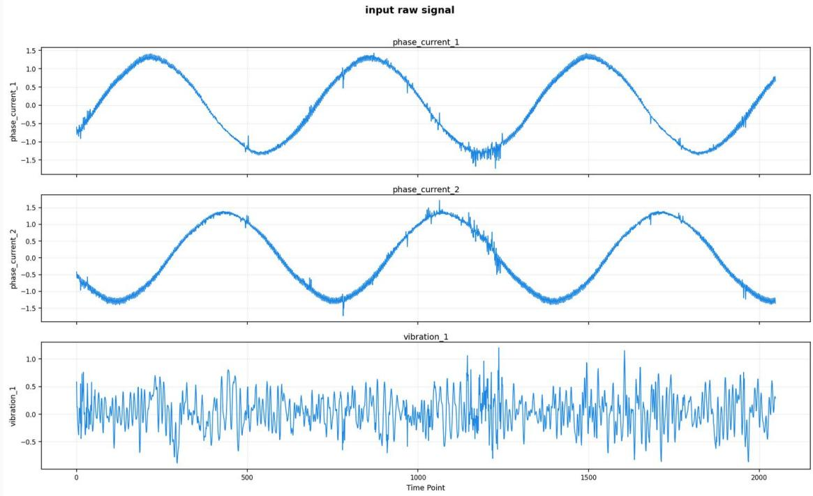  
Step 1 — the agent chooses a transform family, and only that

The smoothing agent is shown the raw signal and a registry of transform families, each with a purpose, its strengths, and the cases where it should be avoided. It returns one family per channel and no parameters at all:

phase\_current\_1 savgol Savitzky--Golay

phase\_current\_2 savgol

vibration\_1 median\_mean\_ewm rolling median + EWM

Its reasoning, in its own words. “For phase\_current\_1 and phase\_current\_2 the signals are clearly periodic sinusoids with high-frequency noise; Savitzky–Golay smooths the noise while preserving the underlying shape and avoiding the phase lag of causal filters. For vibration\_1 the signal is nonstationary with significant impulsive content and bursts. A simple low-pass filter might blur these critical transient spikes; median\_mean\_ewm combines robustness against isolated impulses with trend tracking, extracting the envelope without destroying the diagnostic spike structure.”

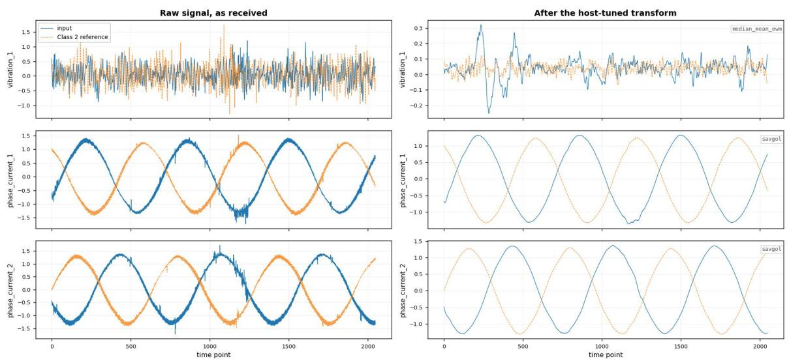

What the transform actually did. The left column is the sample as it arrived, overlaid on the Class 2 reference it will later be compared against; the right column is the same pair after the Host-tuned transform. Two things are worth reading of it.

1. On vibration\_1 the raw traces are indistinguishable — two clouds of dense noise occupying the same ±1.5 band. After median\_mean\_ewm they separate cleanly: the reference settles around +0.05 and the input around −0.02, on an axis two orders of magnitude finer. The diference the Analysts will argue over does not exist in the raw view. It is produced here.

2. On the two phase currents the transform removes the noise and leaves a visible phase ofset between input and reference — which is exactly what the Abnormal Analyst reports in Appendix N.2 as a “sinusoidal match with amplitude/phase ofset”.

Why the split matters. Choosing how hard to smooth is exactly the knob that can make a fault appear or disappear. The registry records the policy in one line — selection\_policy: llm\_selects\_family\_- host\_tunes\_parameters, label\_blind: true — so the agent may say what kind of view it wants, while the actual parameters come from a finite Host-run search under a fidelity floor, with no class labels in scope. The agent never proposes a window length, and the Host never accepts one.

Step 1b — the Host segments the result, deterministically

With the views fixed, an all-channel segmentor marks stable and deviant regions on every signal — input and references alike — before any agent is asked which channels matter. The regions are computed, not proposed.

Step 2 — the agent ranks the channels, under Host guards   
Only now is an agent asked which channels carry diagnostic weight. Here it keeps two and drops one:   
vibration\_1 high ‘‘distinct transient events and large amplitude bursts specifically within the   
highlighted abnormal region’’   
phase\_current\_1 medium kept as operating context   
phase\_current\_2 removed listed under removed\_channels   
The guard behind this. Priorities are agent-assigned, but the Host scores each channel’s diagnostic   
content from the segmentation mask and may restore a channel the agent dropped or raise one it   
under-weighted. That matters here: phase\_current\_2 carries the strongest deviant-region score of any   
channel (prominence z = 15.6), and it is in use downstream at high weight — all three channels appear   
in the Analyst comparisons and in every follow-up measurement. An agent may shape emphasis; it   
cannot quietly discard a channel that carries the signal.   
What is frozen at the end of this stage. The smoothed views, the segment masks, and the channel priorities.   
None of them may be revisited once comparison starts — which is what makes the next stage’s reports   
usable as evidence rather than as opinions formed alongside a conclusion.

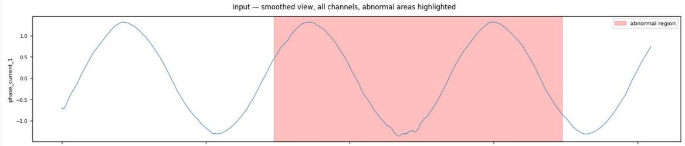

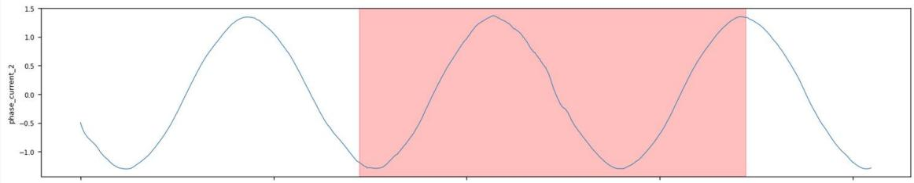

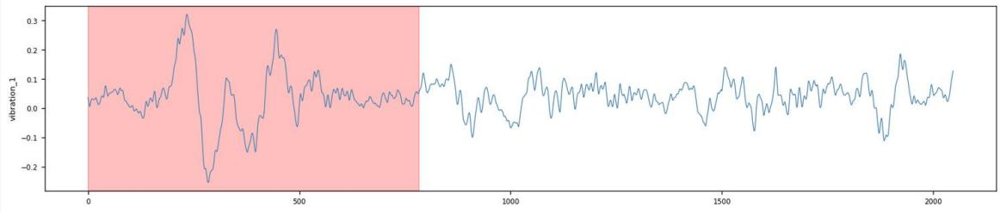  
What it found here. Of 2048 observations, 660 fall in stable regions and 1312 in deviant ones (normal\_ratio 0.32, abnormal\_ratio 0.64). The consolidated deviant span runs 76–1388 with a core at 222–1248; on vibration\_1 the marked span is 0–784, while both current channels are marked far later, around 723–1738.

And the Host qualifies its own finding, in both directions. The same record carries a separate recurrence assessment — recurrence\_classification: recurring\_fault\_like, recurrence\_strength: strong, recurrence\_score: 0.4161 — with guidance that cuts the other way from the usual caution: “recurring impulse clusters were detected; treat sparse abnormal coverage as diagnostically important, do not dismiss it as a healthy isolated transient merely because the marked abnormal region is small.” The segmentor states how much weight its own marking deserves rather than leaving that to whoever reads it.

What this stage establishes. A view of the signal that neither party built alone: the agent names the transform family and the channel emphasis, the Host fixes every parameter, computes every region, and can override a channel judgement it can score. All of it is fixed before the first comparison.

And what it does not. The paper reports this boundary as partial rather than enforced, and the honest reason is visible above. The family choice is still the agent’s, and a family can suppress a texture just as a parameter can. The fidelity floor bounds how much a transform may destroy; it does not prove the retained view is the diagnostic one. Continue to Appendix N.2, where these frozen views are compared against the class references.

## N.2 — Comparative Reasoning: two Analysts, and the tie that starts everything

Same sample as Appendix N.1 (trace steps 3–9), figures included. The frozen views from Evidence Construction are now compared against the class references. Two Analysts run in separate roles, each reports a band per candidate, and both reports are sealed before any model baseline, recurrence evidence or follow-up measurement is disclosed.

How Agentic4PDM reaches a diagnosis, in five steps (Appendix N.1--N.5), all on the same sample:

N.1 Evidence Construction → N.2 Comparative Reasoning → N.3 Request Gate → N.4 Packet & Influence Gate → N.5 Finalization

Two roles, deliberately separated. The Normal Analyst compares representative stable regions and gives every class a band; on its own it can rule out the healthy class but cannot settle a fault type. The Abnormal Analyst compares the focused deviant region against every candidate reference in turn. Neither sees the other’s report, and neither sees the fitted-model predictions or the recurrence evidence, which the Host discloses only afterwards.

The Normal Analyst — is this sample consistent with a healthy baseline?

It does not choose where to look. The stable segment is selected deterministically by the Host — selection\_authority: deterministic, primary\_mode: best\_window — which picks observations 502–1014 of the input, and a separate segment in each reference: Class 0 837–1349, Class 1 395–907, Class 2 1313–1825. All three references have a qualifying quiet stretch here, so all three are compared.

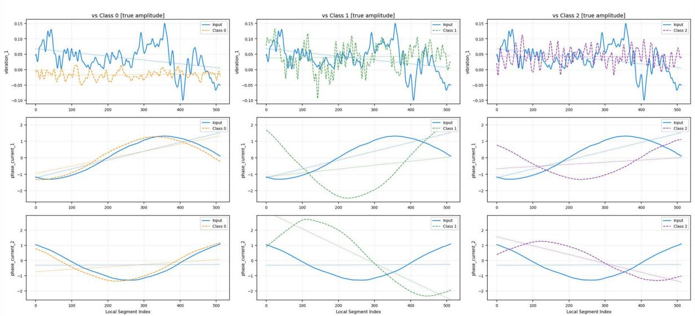  
What it finds. Class 0 is banded low — on vibration\_1 the input sits well above the Class 0 reference, which stays flat near zero. Class 1 and Class 2 are both banded high, and they are high for the same reason: on the vibration channel all three traces share a comparable noisy envelope, and the current channels difer only in phase and ofset.

Its verdict. Equal highest bands stay tied, so the Analyst reports the tie rather than picking between them:

classification\_status: ambiguous predicted\_class: null top\_tied\_classes: [1, 2] confidence: medium

available\_class\_labels: [0, 1, 2] · evidence\_role: normal · source\_view: smoothed

What it has settled, and what it has not. Class 0 — the healthy class — is the one candidate it can rule out from the quiet region. It cannot separate the two fault classes, and says so. That single result is what makes the rest of the case a fault-type question rather than a fault-existence one.

The Abnormal Analyst — and the region it is given to look at

It does not choose its region either. The deviant span comes from the same deterministic segmentor as the stable segment, and it is scored rather than merely marked. On the consolidated all-channel view the input’s deviant span runs 76–1388, with a core at 222–1248 peaking at sample 1225. Per channel the segmentor reports separately:
<table><tr><td>Scope</td><td>deviant span</td><td>core</td><td>peak</td><td>prominence z</td><td>diagnostic?</td></tr><tr><td>all channels</td><td>76-1388</td><td>222-1248</td><td>1225</td><td>10.21</td><td>yes</td></tr><tr><td>vibration_1</td><td>0-784</td><td>220-303</td><td>284</td><td>10.94</td><td>yes</td></tr><tr><td>phase_current_1</td><td>738-1738</td><td>1147-1255</td><td>1238</td><td>7.46</td><td>yes</td></tr><tr><td>phase_current_2</td><td>723-1723</td><td>1180-1262</td><td>1223</td><td>15.57</td><td>yes</td></tr></table>

Two things follow from that table. First, the channels disagree sharply about when the sample is unusual: vibration\_1 marks the opening 784 observations while both current channels mark a span starting past 720, so the consolidated region spans nearly the whole sample rather than being the intersection of confident channels. Second, the strongest deviant-region score in the whole record — prominence z = 15.6 belongs to phase\_current\_2, the channel the agent had proposed to remove in Appendix N.1. The segmentor scores channels independently of who wanted them kept.

The Abnormal Analyst — comparing the deviant region against all three references

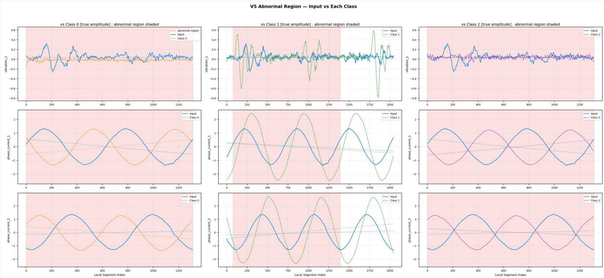

Three candidates, three diferent bands. Unlike the normal region, this comparison separates all three:

Class 2 high vibration\_1 high · phase\_current\_1 medium · phase\_current\_2 high

Class 1 medium vibration\_1 low · phase\_current\_1 high · phase\_current\_2 high

Class 0 low vibration\_1 low · phase\_current\_1 medium · phase\_current\_2 medium

And yet it still refuses to conclude. Class 2 is the sole high band, with no tie to report (top\_tied\_classes:

[]). An Analyst optimising for a confident answer would stop here. This one returns classification\_- status: ambiguous with predicted\_class: null over ambiguous\_classes: [2, 0, 1], and files the reason as a question it cannot answer itself: “does the downstream judge confirm that the vibration\_1 magnitude match with Class 2 is diagnostic rather than coincidental?” and “are there recurrence or envelope-spectrum features that further distinguish Class 2 from the other fault types?”

Why that matters. Leading on one band is not the same as being established. The Analyst has a favourite and declines to promote it to a verdict, because the evidence separating Class 2 from Class 1 is a magnitude match on a single channel — exactly the kind of thing a quantitative measurement can check and a picture cannot.

A closer look — the focused view behind the leading band

For each candidate the analyst is also given a focused rendering of the deviant region at true amplitude. The Class 2 view is shown here — the comparison that produced the only high band, and the one the analyst then declined to treat as decisive.

Input vs Class 2 — Focused Abnormal Region [true amplitude]  
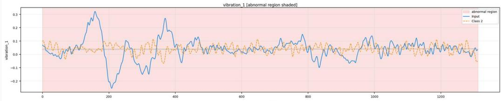

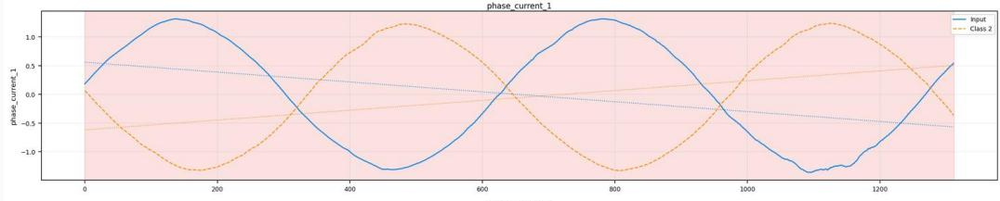

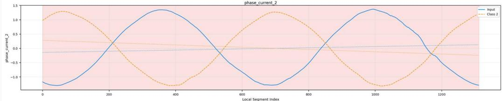

The match is an envelope and magnitude match on the vibration channel. That is real evidence, and it is also exactly what a load change could imitate --- which is what the analyst’s own skeptical question asks about.

The Host — carries the uncertainty forward instead of resolving it

Two Analysts have now run on the same sample, over diferent regions, and neither has produced a class. The normal region ruled out Class 0 and tied Classes 1 and 2. The deviant region ranked Class 2 first but refused to certify that its lead is diagnostic. Neither result is discarded and neither is promoted: what survives is the intersection of what they could establish.

normal: ambiguous, top\_tied\_classes: [1, 2], confidence: medium

abnormal: ambiguous, predicted\_class: null, confidence: low

What that leaves. Fault existence is settled — both Analysts put Class 0 at low — so the remaining question is fault type, between Class 1 and Class 2. That is the live candidate set H<sub>t</sub> = {1, 2} the Judge inherits, and it is why the request in Appendix N.3 is scoped type rather than both.

What is handed forward. Two frozen reports, a live candidate set $\mathcal { H } _ { t } = \{ 1 , 2 \}$ , and a named uncertainty that both Analysts independently pointed at the same way — recurrence and envelope-spectrum structure, which neither of them is permitted to measure. This is the state the Judge inherits at the start of Appendix N.3, and the reason it opens a registered measurement round at all.

What this stage establishes. A comparison that cannot be revised in the light of what comes later. Both reports are sealed before the fitted-model predictions, the recurrence evidence and any follow-up measurement are disclosed, so no downstream result can reach back and rewrite an observation. The roles are split so that the question is this healthy? is answered by an Analyst that cannot settle a fault type. And an unresolved comparison is allowed to stay unresolved: the tie is recorded and carried forward rather than broken by whichever candidate looked marginally better.

And what it does not. A band is a judgement, elicited from a model looking at a picture. Freezing it makes it auditable, not correct — and the same sample can be read diferently under a diferent frozen view, which is the limitation inherited from Appendix N.1. What the protocol adds here is only that the reading is fixed before the evidence that might have been used to justify it. Continue to Appendix N.3, where the Judge must ask for a measurement to break this tie.

## N.3 — The Request Gate: asking for a measurement without being able to shop for one

This exchange reproduces trace steps 18–20 from one archived run: the identifiers, the tool descriptions and the sealed hashes are all copied from the log rather than written for the example; log fields that Section 3.5.1 does not use are omitted. The exchange shows only how a measurement comes to be taken. What each measurement is then allowed to count for is settled later, by the packet and influence gate, and we deliberately leave that out here so the acquisition step can be read on its own.

How Agentic4PDM reaches a diagnosis, in five steps (Appendix N.1--N.5), all on the same sample:

N.1 Evidence Construction → N.2 Comparative Reasoning → N.3 Request Gate → N.4 Packet & Influence Gate → N.5 Finalization

step 18 — naming what is unclear

Where things stand. Both Analysts have finished and neither produced a class. Between them they ruled out Class 0 and left the two fault classes live, so H<sub>t</sub> = {1, 2} over three channels, vibration\_1, phase\_ current\_1 and phase\_current\_2. Nothing has been measured yet, and no score of any kind exists anywhere in the system.

What the Judge asks for. Rather than naming a tool, the Judge names the signal properties it believes would settle the question, drawn from the registered vocabulary:

measured\_signal\_properties: [extrema\_morphology, roughness\_across\_scales,

Why the Host accepts it. All three properties are registered and none has been measured before in this case, so the declaration meets the no-repetition condition of Eq. 3. What matters is the timing: the Judge has now committed to what it wants measured while it still has no idea what is available to measure it.

step 19 — answering with an ofer that carries no scores

The Host seals the request as selection\_request\_id: qsel\_5d8056a5830c1c16bd46 and returns it with scores\_exposed: false and predicted\_class\_exposed: false.

What comes back. Five ToolCards: the Host ofers every default ToolCard that measures a requested property, and roughness\_across\_scales is measured by three of them, which is why three requested properties produce five cards. Every card arrives with its complete description; here is the first one exactly as the Host returns it.

title Local-extrema profile similarity   
purpose Compare peak/trough density, prominence, and spacing over time.   
answers [extrema\_morphology, oscillation\_and\_transient\_profile]   
strengths [direct morphology summary, retains temporal profile]   
blind\_spots [noise creates extrema, window alignment matters]   
avoid\_when [noise scales are not comparable]   
requires {full\_sample: true, minimum\_rows: 256, identical\_csv\_schema: true, ...}   
transform\_steps [{fixed\_params: {distance: l1, window\_count: 32}, support: complete\_sample}]   
scoring\_rule higher similarity ranks first direction: higher\_is\_better   
group / cost local\_extrema / medium version: 1.0.0   
impl\_hash sha256:869a7cdc2327c81b...

And the same for the other four. Summarised by the property that brought them in, what they do, and where the registry says they are weak.

<table><tr><td>Requested property</td><td>ToolCard</td><td>What it does / where it is weak</td></tr><tr><td>extrema_morphology</td><td>quant_local_extrema_profile_windows_ 32_11 local_extrema· medium</td><td>Compare peak/trough density, prominence, and spacing over time. noise creates extrema; window alignment matters</td></tr><tr><td>roughness_across_ scales</td><td>quant_fractal_scaling_lags_128_- pearson multilag_roughness · low</td><td>Compare how signal roughness changes across lag scales. trend sensitive; finite length and lag support affect results</td></tr><tr><td>recurrence_match</td><td>quant_autocorrelation_lags_128_- pearson lag_recurrence ·low</td><td>Compare periodic recurrence across lags without requiring cycle-phase alignment. common operating cycles can match across classes; lag support limits interpretation</td></tr><tr><td colspan="3">Also offered for the same requested property; the JuDGE did not select them.</td></tr><tr><td>roughness_across_ scales</td><td>quant_gaussian_scale_space_sigma_8_ pearson gaussian_scale_space·low</td><td>Compare morphology after a declared smoothing scale. smoothing can erase weak faults; point alignment</td></tr><tr><td>roughness_across_ scales</td><td>quant_multiscale_complexity_scales_ 16_11</td><td>remains relevant Compare nonlinear complexity under progressive coarse graining.</td></tr></table>

What the Host will not say. Alongside the five cards, the Host does not return any score, any ranking of the candidate classes, or any hint of a predicted class.

The line this draws. Notice how much the card gives away. It describes exactly how the measurement would be computed — the transform and its fixed parameters, the similarity metric, the direction that counts as better, the row and schema requirements, even a hash of the precise implementation — and it volunteers the tool’s own weaknesses. What it never contains is any indication of what that tool would return on this particular sample. The Judge can therefore reason carefully about which instrument suits the question, and still cannot anticipate the answer.

step 19 — choosing, before any result exists

The Judge takes all three recommended cards and leaves the two alternates. It must give the Host a reason for each one, and a stated objective for the round as a whole:

selection\_request\_id: qsel\_5d8056a5830c1c16bd46 round\_index: 1   
round\_objective: “Resolve fault type ambiguity between Class 1 and Class 2 using morphology, roughness, and   
recurrence properties.”   
Tool chosen The selection\_reason it had to give   
quant\_local\_extrema\_profile\_windows\_ “Measures peak/trough density and spacing to distinguish burst mor-  
32\_l1 phology patterns between candidates.”   
quant\_fractal\_scaling\_lags\_128\_- “Assesses signal roughness across scales to diferentiate structural   
pearson complexity independent of absolute amplitude.”   
quant\_autocorrelation\_lags\_128\_- “Evaluates periodic recurrence and phase-shift tolerant repetition   
pearson patterns to match fault dynamics.”

step 20 — running the tools, the first moment anything is written   
The three ToolCards execute and three pending records are appended to the evidence ledger:   
qm\_1648602c58c5b3baad84 sealed as 10139940e3f3ef8f...   
qm\_90c0d7a919b3fd0ea53a sealed as 1cccfb014dda865d...   
qm\_05fff8ed9ce86c3db2f2 sealed as f0ca18056c3f8ecc...   
This is the first point in the whole exchange at which a measurement value exists. Each hash seals the   
tool’s identity together with its per-channel output and its stated limitations, so any later change to a   
stored result can be detected.   
Where that leaves the round. extrema\_morphology, roughness\_across\_scales and recurrence\_match   
are now marked as measured.

All three are submitted with channel\_policy: all\_channels\_independent.

What the Host checks before it runs anything. The three request conditions of Eq. 3: the chosen batch lies inside the ofer, the three tools together cover all three requested properties, and none of these properties was measured in an earlier round. The round is then recorded as precommitted\_before\_any\_result: true and pre\_execution\_batch\_validation: passed. Had any of these failed, the Host would have returned a rejection and no tool would have run at all.

after the round — what the ledger now forecloses

The three properties are now marked as measured, and that is binding regardless of what they returned. Had the Judge wanted to continue, it could not have re-requested extrema\_morphology, roughness\_ across\_scales or recurrence\_match under diferent settings; a later round has to name a property the ledger does not already hold, and the round report must cover every packet (Section 3.5.2). A result the Judge dislikes therefore cannot be quietly rerun, and an earlier one cannot be quietly dropped. In this sample the Judge did not open a second round: it proceeded to account for these three packets, which is where the packet and influence gate takes over.

What this exchange does establish. The four steps always happen in this order and the order cannot be reversed: the Judge says what is unclear, the Host answers with an ofer that carries no scores, the Judge commits to a batch, and only then does anything run. Because no measurement value exists until that last step, no value can have influenced either the properties that were declared or the tools that were chosen. Two further rules follow the same logic: a property that has been measured cannot be measured again, so an unwelcome result cannot be retried under new settings; and the batch must cover every declared property, so the Judge cannot declare several properties and then run only the tools for the ones it prefers.

And what it does not. Nothing here speaks to whether a measurement is any good. Cards are ofered on their declared properties alone; the Host matches them to the request, it does not rank them, and it has no opinion about which will prove informative. Whether each of these packets ends up excluded, advisory or corroborative is decided afterwards by the packet and influence gate, on whether the tool ran, whether the top-tier channels agree on a winning class, and the reference preflight — none of which exist at any point in the exchange above.

## N.4 — The Packet and Influence Gate: deciding what a measurement is allowed to count for

This continues the same case as the request-gate example, picking up at trace step 20, the moment the three precommitted tools come back. The request gate has finished its work: the measurements exist. The question now is no longer whether a measurement may be run, but what a measurement that already exists is allowed to count for. The Host settles that in two steps, with the reference preflight between them, and the Judge writes none of them.

How Agentic4PDM reaches a diagnosis, in five steps (Appendix N.1--N.5), all on the same sample:   
N.1 Evidence Construction → N.2 Comparative Reasoning → N.3 Request Gate → N.4 Packet & Influence Gate → N.5 Finalization  
Step 1 — did the registered operation really run on the declared inputs?

All three tools return, each with a complete ranking over the live candidates {1, 2} on all three channels, and none reports a failure. Before considering what any of them means, the Host establishes three facts per packet: that execution was valid and the ranking complete, that the comparison covered the full sample with equal row support, and that channel arbitration produced a single winner. The first two hold everywhere here. The third does not.
<table><tr><td>Packet</td><td>Winner per channel</td><td>Host channel arbitration</td></tr><tr><td>quant_local_extrema_profile_ windows_32_11 local_extrema</td><td>all three → 2 margins .0102 / .0391 / .0225</td><td>decided, winner 2 all valid highest-weight channels agree</td></tr><tr><td>quant_autocorrelation_lags_ 128_pearson lag_recurrence</td><td>all three → 2 margins .0501 / .00001 / .00001</td><td>decided, winner 2 all valid highest-weight channels agree</td></tr><tr><td>quant_fractal_scaling_lags_ 128_pearson multilag_roughness</td><td>vibration_1 → 1 margin .0114 phase_current_1 → 2 phase_current_2 → 2</td><td>conflicting_or_ambiguous no winner: highest-weight channels disagree</td></tr></table>

What decides the arbitration is agreement, not margin size. The second packet separates the candidates by one part in a hundred thousand on both current channels, and is still decided — because all three channels name the same class. The third has a healthier margin on vibration\_1 and is refused a winner because that channel names Class 1 while the other two name Class 2. The Host does not average the channels and does not take the largest margin; it requires the highest-weight channels to agree.

```latex
Between Step 1 and Step 2 — the reference preflight, which decides how far a packet can rise
A clean execution is never enough to corroborate. Before a packet may carry more than advisory weight,
the Host puts the ToolCard through a label-recovery test on evidence whose answer is already known.
Concretely, for each class y in Y it:
1. takes a labelled reference of that class, $r _ { y } ^ { \mathrm { c t r l } } ;$ , and feeds it in as if it were the query;
2. retrieves a fresh bank of references for it with the same retrieval as for the query sample,
$\mathcal { R } ^ { \mathrm { a l t } } ( r _ { y } ^ { \mathrm { c t r l } } ) = \mathcal { R } ^ { \star } ( r _ { y } ^ { \mathrm { c t r l } } )$ , with the identical content excluded so the control cannot simply match
itself;
3. reruns the very same ToolCard τ , unchanged, and reads of which class it names,
$\hat { y } _ { \tau } ( r _ { y } ^ { \mathrm { c t r l } } ; \mathcal { R } ^ { \mathrm { a l t } } ( r _ { y } ^ { \mathrm { c t r l } } ) )$ ; and
4. requires that answer to be y, the label it already knows.
The check passes only if every control class is recovered, so one miss anywhere fails it:
$g _ { \mathrm { r e f } } ( \tau ) = 1 \longleftrightarrow \hat { y } _ { \tau } \big ( r _ { y } ^ { \mathrm { c t r l } } ; \mathcal { R } ^ { \mathrm { a l t } } ( r _ { y } ^ { \mathrm { c t r l } } ) \big ) = y \quad \mathrm { f o r ~ e v e r y ~ } y \in \mathcal { V }$
A missing or duplicated control reference, a tool failure, a tie, or a wrong winning class each make
g<sub>ref</sub>(τ ) = 0. What the result buys is exactly one step on the ladder: g<sub>ref</sub>(τ ) = 1 lets a packet rise from
advisory to corroborative, and nothing more.
What the replay returned here. The Host ran it for all three ToolCards against the three profile classes.
```

One passed cleanly and two did not:
<table><tr><td>ToolCard replayed</td><td> $\hat { y } _ { \tau } ( r _ { 0 } ^ { \mathrm { c t r l } } )$ </td><td> $\hat { y } _ { \tau } ( r _ { 1 } ^ { \mathrm { c t r l } } )$ </td><td> $\hat { y } _ { \tau } ( r _ { 2 } ^ { \mathrm { c t r l } } )$ </td><td>passed</td><td> $g _ { \mathrm { r e f } }$ </td><td>role</td></tr><tr><td>local_extrema_profile</td><td>0√</td><td>1√</td><td>2√</td><td>3 of 3</td><td>1</td><td>corroborative</td></tr><tr><td>autocorrelation</td><td>0√</td><td>1√</td><td>—x</td><td>2 of 3</td><td>0</td><td>advisory</td></tr><tr><td>fractal_scaling</td><td>0√</td><td>—x</td><td>—x</td><td>1 of 3</td><td>0</td><td>(excluded at Step 1)</td></tr></table>

--- marks a control the replay could not resolve at all.

This is the pivot of the whole exchange. local\_extrema\_profile and autocorrelation are indistinguishable on every fact established in Step 1: both executed cleanly, both had all three channels agree, and both were awarded decided with winner Class 2. The replay is the only thing separating them — and the one that fails does so on a single control out of three. Two-thirds correct still gives $g _ { \mathrm { r e f } } = 0$ under strict\_all\_controls: there is no partial credit and no majority vote among controls. One packet becomes corroborative; the other, identical in every visible respect, stays advisory.

A note on the round-opening status line. The round opens with a TOOL PREFLIGHT block reading Status: not\_run alongside strict\_all\_controls=True; required\_controls=3. That is a pre-round status only: at that moment no discriminating question had been selected, so there was nothing to replay. The Host is explicit that it does not mean the registered library is unavailable. The replay above is what happened afterwards, once the batch was dispatched.

What passing means. The replay checks that the exact ToolCard, with its settings and channel-priority procedure, recovers labels that are already known. Passing shows that the tool behaves as registered on this input profile, which is why it lets a packet corroborate a class.

Step 2 — what may each packet do on its own?  
Each packet now receives exactly one influence role, derived from those facts and never from anything the Judge asserted. The order of the test is fail-closed: the exclusion conditions are checked first, so no later evidence of quality can rescue a packet whose channels never agreed.
<table><tr><td>Packet</td><td>Role assigned</td><td>Host&#x27;s stated reason</td></tr><tr><td>local_extrema_profile</td><td>corroborative influence 2 reference_sanity-passed / weak_- advisory</td><td>exact_reference_sanity-passed</td></tr><tr><td>autocorrelation</td><td>advisory influence 1 exploratory / hypothesis_only</td><td>exact_reference_sanity_missing_or_failed</td></tr><tr><td>fractal_scaling</td><td>excluded influence 0</td><td>channel_priority_did_not_produce_a_single_ winner</td></tr></table>

Three packets, three diferent standings. The excluded packet carries no influence at all — an ambiguous result is not spent as faint support for whichever class edged ahead on one channel. The advisory packet may inform a hypothesis. None of the three is erased; all keep full provenance in the ledger.

step 20 — the Judge files its round report

The Judge reports on all three packets and proposes to stop.

Host check — may the round close?

The Host does not let the Judge stop while usable packets still name diferent classes and tool budget remains. Here the only disagreement lies inside the excluded packet, whose channels named diferent classes, and an excluded packet is not usable. The two usable packets both name Class 2, so the round closes and the case moves to finalization (Appendix N.5).

What this exchange establishes. Running successfully and counting towards a diagnosis are diferent things, and only the Host decides the second. Every role is derived from execution, scope, channel agreement and the reference preflight, tested in a fail-closed order, so quality elsewhere cannot repair an ambiguous result. Finally, the Host does not let the Judge stop while usable packets still name diferent classes and tool budget remains. On this sample the full workflow reports Class 2, which matches the ground truth, the inner\_race\_fault.

## N.5 — Finalization: publishing a class from the checked record

The last step of the same sample (trace steps 22–24). Three measurements’ worth of governance now converges on a single question: may the class the Judge believes in be published as the system’s answer? The Judge proposes. It does not decide, and it never writes the field that matters.

How Agentic4PDM reaches a diagnosis, in five steps (Appendix N.1--N.5), all on the same sample:   
N.1 Evidence Construction → N.2 Comparative Reasoning → N.3 Request Gate → N.4 Packet & Influence Gate → N.5 Finalization

## step 22 — the Judge proposes a class

With the round closed, the Judge submits its one finalize action:

```python
predicted_class: 2 confidence: high
```

Its case, in its own words. “Fault existence is established by clear impulsive bursts in 1 that exceed the healthy Class 0 baseline. Fault type is resolved as Class 2: the input’s burst morphology and recurrence closely match the Class 2 reference, whereas Class 1 exhibits much larger, distinct spikes absent in the input. Ambiguous comparators and a tied, non-voting lookback do not override this convergent evidence.”

What this action is, and is not. It is a proposal, in the same sense that the batch commitment in Appendix N.3 was a proposal. The Judge is naming the class it believes the evidence supports and giving its reasons. It is not itself the published record, and it cannot set the confidence that record carries those are the two fields only the Host writes.

step 23 — the Host checks the two admission conditions

The Host does not re-read the signal or rerun a tool. It admits the proposal only if two conditions hold, and it checks both against records already on file:

<table><tr><td>Record</td><td>What it checks on this sample</td><td>Result</td></tr><tr><td>finalize_eligible</td><td>The proposed class is in the candidate set before any passed measurement, H1 = {1, 2}.</td><td></td></tr><tr><td>registered_quantitative_execution_ validation</td><td>At least one measurement round is complete (here, one valid round with three packets).</td><td></td></tr></table>

Why records and not the signal. At this point the Host is deliberately the least informed component in the system. It cannot rerun a tool, edit a record, or look at the waveform, so there is nothing for it to be persuaded by. It only checks whether the records already on file back the proposed class.

step 24 — the published record   
Both conditions hold, and the Host publishes the admitted proposal:   
predicted\_class: 2 yˆ --- the class the system reports   
confidence: "medium"   
Note the confidence. The Judge asked for high. The published record carries medium. Confidence is not   
the proposing agent’s to set.

What this stage establishes. A separation between believing a class and publishing one. The Judge argued for Class 2 but could not write the field that publishes it. The Host published Class 2 only after the records of the earlier steps showed the proposed class in the candidate set before any measurement and at least one completed measurement round. The candidate set and the validation results are stored in the published record, so a reader can trace the published class back to the packets and reports that support it. On this sample the published class also matches the ground truth, Class 2 (inner\_race\_ fault).

## O Side-by-Side Comparison: Agentic4PDM, FETA, and ZARA on the Same Sample

The comparison condenses archived records for readability. Judge turns remain quoted output; explanatory Host lines summarize the structured eligibility and admission records.

One Paderborn test sample (ID 140691, true class 2), turn by turn. host (code), left LLM agent, right no agent in FETA or ZARA sees a plot.


## FETA

Three isolated channel agents; the host adds up their confidence

## Host

Splits the sample into its three channels. Each channel becomes 512 z-normalised numbers. FastDTW finds the 3 nearest labelled training samples for each channel on its own.

Sends three separate text prompts. An agent sees only its own channel: no images, no DTW distances, no other channel, no other agent’s answer.


Channel agent · current 1

Neighbour labels: 1, 2, 0

decision: 0 confidence: 0.70

“. . . its pronounced peak spikes and irregular oscillations closely match the morphological characteristics of Example #3 (label=0).”


Channel agent · current 2

Neighbour labels: 0, 0, 2

decision: 0 confidence: 0.70

“ . . . highly consistent with the majority of retrieved neighbors (two out of three are labeled 0), making class 0 the most probable assignment.”


Channel agent · vibration 1

Neighbour labels: 2, 0, 2

decision: 2 confidence: 0.85

“. . . a prominent high-amplitude burst and rapid oscillations in the latter half, closely matching the distinctive spike pattern seen in the label=2 examples.”

➤ The only agent that names the true class.

Pruning agent · stage 2 ✗ true class lost here

“Keep at least two plausible classes. Return only a JSON array.”

Where the answer is lost Output: class 0 ✗ truth: class 2   
The vibration agent was right and lost two votes to one. Nobody ever reads the three answers together, so the conflict is   
never examined.   
Run-wide (906 samples): when both current channels disagree with vibration, the current pair wins 355 / 355 times;   
vibration alone scores 40.4%, above FETA’s fused 35.2%.

## Host · fusion ✗ true class lost here

Receives only three pairs (class, confidence). The signal, the neighbours and all three reasons are dropped before this step.

class 0 = 0.70 + 0.70 + 0.05 = 1.45   
class 1 = 0.05 + 0.05 + 0.05 = 0.15   
class 2 = 0.05 + 0.05 + 0.85 = 0.95

Largest sum wins ⇒ class 0. No agent is asked why the channels disagree.

## ZARA

Four stage agents in a fixed funnel; two of them never see the sample

## Host · stage 1

Encodes the sample and ranks 150 training rows. Computes three query features. Builds a class table of   
mean ± sd from training data.   
Stage 1 prompt, verbatim excerpt: “Use only the pairwise training-derived importance.”   
0 vs 1: electrical\_current\_\_ch1\_diff\_rms (100.00%)   
0 vs 2: vibration\_\_ch1\_mean (100.00%)   
1 vs 2: electrical\_current\_\_ch2\_diff\_rms (99.55%)   
➤ Not one number from this sample is in the prompt.   
Feature-selection agent · stage 1   
["electrical\_current\_\_ch1\_diff\_rms", "vibration\_\_ch1\_mean",   
"electrical\_current\_\_ch2\_diff\_rms"]


## Host · stage 2


["1", "0"] ➤ Class 2, the true class, is removed here. No later stage can bring it back.

## Host · stage 3

Candidate classes: ["1", "0"]   
1 vs 0: electrical\_current\_\_ch1\_diff\_rms (100.00%) <sup>➤</sup> Again, no number from this sample.


Feature-selection agent · stage 3

["electrical\_current\_\_ch1\_diff\_rms"]

Host · stage 4  
```csv
Sends one feature for the two surviving classes:
class 1: 0.0979152 ± 0.00633841
class 0: 0.0806897 ± 0.00346797
QUERY: 0.107065
```

Decision agent · stage 4

“The query value (0.107065) is significantly closer to the mean of class 1 (0.0979152 ± 0.00633841) than to class 0 (0.0806897 ± 0.00346797). . . ”

"predicted\_class": "1"

Where the answer is lost

Output: class 1 ✗ truth: class 2

The true class left the conversation at stage 2 and could never return; the last agent reasoned correctly over a candidate set that no longer held the answer. The two stages that choose features never see the sample.

Run-wide (906 samples): the true class is pruned in 290 / 906 samples (32.0%); the stage-1 prompt is identical for all 906 samples.

The same Paderborn test sample (ID 140691, true class 2). host (code), left LLM agent, right the Judge sees six plots.

## Agentic4PDM

One Judge investigates; the Host checks every step and grants authority

## Host

Before we start, here is what the two Analysts found. Both reports are sealed, so nothing later can change them.   
The quiet region fits Class 0 or Class 2 equally well, and the fault region fits Class 1 or Class 2 equally well.

Only now do I add the fitted-model predictions: SVM and XGBoost both say Class 0.

## Host · eligibility step

Because the deviant region fits only fault classes (1 or 2), a fault is present. Class 0 is no longer eligible. Which fault class it is remains open.

This explanatory line restores an omitted Host eligibility step from the structured vote review; it is not a newly generated Judge statement.

Judge · step 1

The comparators already tell me what this window looks like: the vibration is spiky and bursty, with a noisy texture. That looks like a fault, and the healthy check has ruled out Class 0.

But they could not separate Class 1 from Class 2, and the size of the signal alone should not decide the fault type. So I want to test exactly what they saw: how the bursts repeat, the shape of the peaks, and how rough the signal is across scales.

Before I pick any tool, this is my question:

“Which fault-type reference (Class 1 or Class 2) best matches the input’s burst recurrence pattern, local extrema structure, and multi-scale roughness?”

The healthy check refers to the Host eligibility step above; the stable-region report remained tied between Classes 0 and 2.

Plots in front of the Judge: normal-region overlay; abnormal-region overlay; input vs Class 0, 1 and 2; previous sample vs Class 0.

What the Judge was told: “input is spiky and high-amplitude”; “Is there a validated recurrence period for the vibration bursts that aligns with one specific fault type?”; and choose the type by “burst recurrence, not amplitude/severity”.

Host · step 2

That question is allowed. Here is what I can ofer: one card per tool family, each saying what it measures and where it can mislead. No card has a score, because nothing has been run yet.

<table><tr><td>ToolCard</td><td>Answers</td><td>Measures</td><td>Can mislead when</td><td>Result</td></tr><tr><td colspan="5">Recommended autocorrelation</td></tr><tr><td>group: lag_recurrence compute cost: low local extrema profile</td><td>burst recurrence peak</td><td>across lags without requiring match across classes; lag cycle-phase alignment.</td><td>Compare periodic recurrence common operating cycles can support limits interpretation Compare peak/trough density, noise creates extrema; window</td><td>hidden</td></tr><tr><td>group: local extrema compute cost: medium</td><td>structure</td><td>prominence, and spacing over alignment matters time.</td><td></td><td>hidden</td></tr><tr><td>fractal scaling group: multilag_roughness compute cost: low</td><td>roughness</td><td>Compare how signal roughness trend sensitive; finite length changes across lag scales.</td><td>and lag support affect results</td><td>hidden</td></tr><tr><td colspan="5">Alternatives gaussian scale space</td></tr><tr><td>group: gaussian_scale_ space compute cost: low</td><td>roughness</td><td>declared smoothing scale.</td><td>Compare morphology after a smoothing can erase weak faults; point alignment remains relevant</td><td>hidden</td></tr><tr><td>group: multiscale complexity compute cost: medium</td><td></td><td>under progressive coarse graining.</td><td>multiscale complexity roughness Compare nonlinear complexity finite-length sensitive; less directly interpretable</td><td>hidden</td></tr></table>

I ruled out the other 18 tool families: 17 do not answer your question, and one (STFT time–frequency) is over your cost limit.

Card text is copied from the ofer. Group = cards that read the same kind of signal behaviour, so they count once. Compute cost = how expensive the tool is to run; it is not a ranking or a recommendation strength. Ofer sealed as qsel\_03de75ed1ab50e4ad776, with scores\_exposed=false and predicted\_class\_exposed=false.

Judge · step 2

Then I will run these three, and I am committing to them now, before any result exists:

• autocorrelation, to see whether the bursts repeat the same way;

• local extrema, to compare how dense and how spaced the peaks are;

• fractal scaling, to compare roughness across scales.

## Host · step 3

Done, and your choice was locked in before anything ran. All three favour Class 2, but they do not carry the same weight:

• autocorrelation also recovered the known labels of the reference controls, so it is corroborative;

• local extrema and fractal scaling were not confirmed by that check, so they are advisory only.

You can read these ratings, but you cannot change them.

Judge · step 3

All three measurements point the same way, and autocorrelation passed its reference check. The predictors said Class 0, but neither comparator gave a clear vote for it. I propose Class 2, with medium confidence.

“Registered quantitative investigation unanimously identifies Class 2. . . ”

## Host · publish ✓ class 2

Class 2 is still a candidate, and a measurement round has been completed.

Publishing Class 2, with medium confidence.

Why the answer survives

Output: class 2 ✓ truth: class 2

The Judge decided what to look at. The Host decided what each result was worth and whether the proposed class could be published.

Run-wide (906 samples): the true class is still live after the Analyst stage in 89.1% of samples (ZARA: 68.0%).