# All-electron machine-learned orbital-free density functional for periodic CHNO systems

Marc K. Ickler1, Andreas Hermann2, Fred A. Hamprecht1\*

1Interdisciplinary Center for Scientific Computing (IWR), Heidelberg University, Heidelberg, 69120, Germany.

2Centre for Science at Extreme Conditions and SUPA, School of Physics and Astronomy, University of Edinburgh, Edinburgh, EH9 3FD, United Kingdom.

\*Corresponding author(s). E-mail(s): fred.hamprecht@iwr.uni-heidelberg.de;

## Abstract

We introduce STRUCTURES-P, a machine-learned all-electron orbital-free density functional for periodic CHNO systems. Electrostatics are evaluated analytically in an atom-centered Gaussian basis, while an equivariant network learns the kinetic and exchange–correlation energy from energies and gradients of nonground-state densities. Minimizing the functional from a superposition of atomic densities recovers the Kohn–Sham ground state: on held-out crystals, the density error falls from 6.7% to 0.4% of the electron count and the energy error reaches 0.25 mHa per atom, half that of a same-architecture interatomic potential. A single functional can be trained for both isolated molecules and periodic systems, and the model generalizes to larger unit cells. It largely preserves relative-energy rankings and reproduces convex-hull vertices on the tested H–N composition slice. Together, these results demonstrate the viability of machine-learned all-electron orbital-free DFT for variational density optimization and energy evaluation in fixed-geometry solids.

## 1 Introduction

Kohn–Sham density functional theory (KS-DFT) 1 is central to predicting material properties, but its reliance on orbitals makes large candidate-structure searches computationally expensive. Orbital-free DFT (OF-DFT) 2 instead minimizes an explicit density functional for the total energy over the electron density itself, without introducing orbitals, yielding the ground-state density as the minimizer and the ground-state energy as the minimum. We refer to the iterative procedure for this variational minimization as density optimization. By avoiding the repeated diagonalization of the Kohn–Sham Hamiltonian, whose cost scales nominally as the cube of the system size, OF-DFT opens a route to lower-scaling electronic-structure calculations3. Its broader application, however, remains limited by the lack of transferable approximations to the noninteracting kinetic energy, particularly for covalently bonded systems and for the non-ground-state densities encountered during variational optimization4. Here we show that a machine-learned functional can be variationally minimized over the explicit all-electron density of three-dimensional periodic crystals. Our model, STRUCTURES-P, combines analytically evaluated periodic electrostatics with a learned kinetic plus exchange–correlation energy, and reaches sub-millihartree-per-atom energy errors on held-out CHNO crystals.

Conventional kinetic-energy density functionals build on the local Thomas–Fermi and gradient-dependent von Weizs¨acker approximations 5–7. The nonlocal Wang– Teter and Wang–Govind–Carter functionals use the linear response of the uniform electron gas and are successful particularly for nearly-free-electron metals 8,9. The Huang–Carter functional extends this approach to semiconductors and covalent solids10, while Laplacian-level semilocal functionals provide another route beyond generalized-gradient approximations 11. These functionals have enabled random structure searching for elemental metals 12. However, accuracy remains strongly dependent on material class and bonding environment, and molecular bonding remains dificult to describe even at equilibrium geometries 4,13. Recent inversion methods recover kinetic and Pauli potentials for prescribed periodic densities, with demonstrations in one-dimensional systems, but do not supply a transferable explicit functional 14.

Machine learning ofers flexible approximations to the nonlocal density dependence of the kinetic-energy functional 15. Early work learned kinetic-energy functionals in model systems or on molecular densities 16–18, but also exposed a central dificulty: a small energy interpolation error does not imply a suficiently accurate functional derivative for variational optimization. Subsequent approaches trained energies and functional derivatives jointly 19, learned separate semilocal functionals and potentials for Gaussian-represented molecular densities 20, explored direct minimization for periodic graphene 21, or imposed the variational principle as a regularizer 22. A semilocal kinetic-energy functional trained on Kohn–Sham functional derivatives also enabled self-consistent OF-DFT for atoms, diatomic molecules, and periodic solids with local pseudopotentials 23. The relevant test is thus not just how accurately a learned functional interpolates energies on reference densities, but whether it can be minimized from an initial density to recover a meaningful density and energy.

Sun and Chen demonstrated self-consistent density optimization with a learned nonlocal kinetic-energy functional for Li, Mg, Al and their alloys using local pseudopotentials 24. A separately trained multichannel extension was evaluated on silicon and III–V semiconductors25. Other periodic studies evaluated learned kinetic energies on Kohn–Sham reference densities or as non-self-consistent corrections 26–28; an MLguided analytical functional also demonstrated self-consistent density optimization for Al and Si29.

Periodic OF-DFT implementations generally employ local pseudopotentials, which replace the nuclear potential and core electrons with a smoother efective interaction. Modern transferable pseudopotentials are usually nonlocal operators 30,31; their energies depend on the one-particle density matrix rather than the density alone. Local pseudopotentials can be accurate in their target environments but are harder to make broadly transferable 32–35. Density-based reconstructions of the density matrix permit nonlocal pseudopotentials at the cost of an additional approximation to the electron– ion energy 36,37. The choice of pseudopotential also changes the short-wavelength kinetic-energy response, coupling errors in the pseudopotential and the kinetic-energy functional 38. An all-electron formulation avoids pseudopotentials but must resolve the rapidly varying core density and evaluate periodic electrostatics. Periodic all-electron OF-DFT has been implemented using projector augmented waves 39, while adaptive finite-element methods have demonstrated direct treatment of singular nuclear potentials in atomic calculations 40. All-electron Gaussian implementations with analytical functionals exist for finite systems 41–43, including recent work recovering near-exact nuclear cusps 44.

Machine learning has also been used to bypass the energy functional and predict densities directly. ELECTRAFI constructs periodic charge densities from local anisotropic Gaussians 45; DeePAW predicts crystal charge densities and formation energies directly 46. Surrogate functionals occupy a middle ground: they are trained using only ground-state data, and their objective is to recover the ground-state density 47 and energy 48 through a prescribed optimization procedure, without requiring the functional to reproduce physical energies away from the ground state.

The present work builds directly on all-electron learned functionals for molecules. KineticNet introduced nonlocal equivariant learning and training densities generated under perturbed external potentials 49. M-OFDFT combined an atom-centered Gaussian density representation with a nonlocal learned functional and demonstrated accuracy and size extrapolation for molecules 50. STRUCTURES25 used Tensor Frames for rotationally equivariant message passing 51 and perturbed-potential training data to achieve stable variational density optimization on QM9 and QMugs 52.

Taken together, prior work has established self-consistent learned OF-DFT for periodic pseudopotential systems and variational all-electron learned functionals for finite molecules. Generalizing the latter to three-dimensional periodic crystals, with minimization over the explicit all-electron density, has not yet been achieved.

STRUCTURES-P is a machine-learned OF-DFT framework based on a Gaussian density representation shared between isolated and periodic systems; here we develop its all-electron periodic formulation for CHNO crystals. The Hartree, electron– nuclear, and nucleus–nucleus contributions are evaluated analytically under periodic boundary conditions, while an equivariant graph neural network represents the noninteracting kinetic plus exchange–correlation energy. The functional is trained on non-ground-state energies and density-coeficient gradients and minimized at fixed electron number (Fig. 1). Evaluated against all-electron PySCF references for heldout crystals, the functional generalizes to larger unit cells and can be jointly trained on isolated molecules and periodic crystals. Relative-enthalpy rankings and an H–N convex-hull comparison test its use for fixed-geometry candidate evaluation. To our knowledge, these results provide the first demonstration of learned OF-DFT enabling variational optimization of the explicit all-electron density under three-dimensional periodic boundary conditions.

## 2 Results

## 2.1 A variational all-electron functional for periodic crystals

STRUCTURES-P extends the molecular STRUCTURES25 functional52 to periodic all-electron systems. It keeps the Gaussian density representation and the variational training strategy, and adds analytically evaluated periodic electrostatics, a periodic label pipeline, an equivariant network with periodic message passing, and a regularized density optimization for crystals. Figure 1 summarizes the inference path: represent the density, evaluate the total energy, and optimize the density coeficients at fixed crystal geometry. We describe this path first, followed by the training data that make the optimization possible.

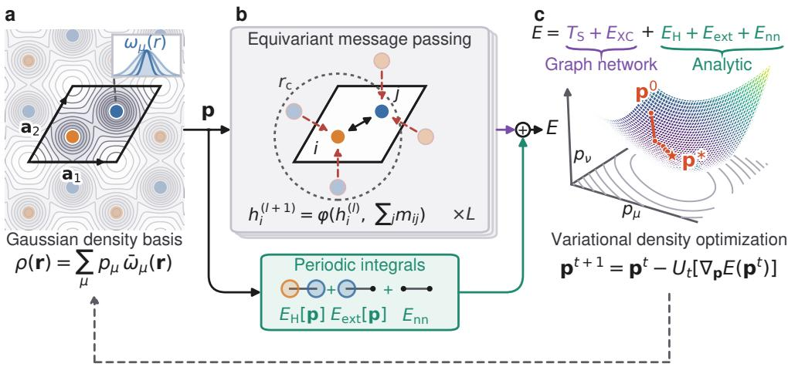  
Fig. 1 Overview of STRUCTURES-P for periodic crystals with Gaussian-type density basis functions, drawn here for a two-dimensional lattice. a The electron density of the primitive cell is represented by coeficients p of atom-centered Gaussians, $\begin{array} { r } { \rho ( \mathbf { r } ) = \sum _ { \mu } p _ { \mu } \bar { \omega } _ { \mu } ( \mathbf { r } ) } \end{array}$ , where $\bar { \omega } _ { \mu }$ includes the lattice images; contours show the resulting periodic densi $\mathrm { t y , }$ the inset the radial profiles of the even-tempered shells. b The same structure defines a periodic graph, on which each atom of the cell receives messages from its neighbors within a cutof $r _ { \mathrm { { c } } } .$ , including periodic images. An equivariant graph network (eSEN) predicts the kinetic and exchange–correlation energy $T _ { \mathrm { S } } + E _ { \mathrm { X C } }$ , while the Hartree, nuclear-attraction, and nucleus–nucleus energies are evaluated analytically from periodic two-center integrals; of these, only $E _ { \mathrm { H } }$ and $E _ { \mathrm { e x t } }$ depend on p. c Together these terms define the total energy, whose gradient with respect to p (by automatic diferentiation) drives a variational density optimization from an initial guess $ { \mathbf { p } } ^ { 0 }$ to an optimized density $\mathbf { p } ^ { * }$ under a fixed-electron-number constraint; the update step $U _ { t }$ is specified in Section 4.5.

We expand the density in atom-centered basis functions, chosen here to be Gaus sians. For a periodic crystal, each density basis function is repeated over the Bravais

lattice L of the unit cell Ω,

$$
\rho ( \mathbf { r } ) = \sum _ { \mu = 1 } ^ { N _ { \mathrm { O F } } } p _ { \mu } \sum _ { \mathbf { T } \in \mathcal { L } } \omega _ { \mu } ( \mathbf { r } - \mathbf { R } _ { a ( \mu ) } - \mathbf { T } ) ,\tag{1}
$$

where $\mu$ runs over the $N _ { \mathrm { O F } }$ basis functions associated with atoms in one unit cell and $a ( \mu )$ denotes the atom carrying basis function $\mu .$ . The same coeficient vector p is shared by all periodic images. We write $\bar { \omega } _ { \mu } ( \mathbf { r } )$ for the lattice sum in Eq. (1). For a fixed density basis, the density is fully specified by p and the crystal geometry ${ \mathcal { M } } = \{ \mathbf { R } _ { a } , Z _ { a } , \mathbf { A } \}$ where ${ \mathbf { R } } _ { a }$ and $Z _ { a }$ are the atomic positions and atomic numbers, and A contains the cell vectors. The basis represents the density, not orbitals. For isolated systems, the expansion reduces to the $\mathbf { T } = \mathbf { 0 }$ term of the lattice sum in Eq. (1). This shared atomcentered density representation allows a jointly trained functional to use one set of parameters for molecules and periodic crystals.

An equivariant graph neural network represents the kinetic and exchange– correlation contribution, $F _ { \theta } ( \mathbf { p } , \mathcal { M } ) \approx T _ { \mathrm { S } } [ \rho ] + E _ { \mathrm { X C } } [ \rho ]$ . Here, $T _ { \mathrm { { S } } }$ is the noninteracting kinetic energy. In the Kohn–Sham partition, EXC contains both the interacting kinetic correction $T \mathrm { ~ - ~ } T _ { \mathrm { S } }$ and the nonclassical electron–electron interaction. Conventional OF-DFT approximates $T _ { \mathrm { { S } } }$ and $E _ { \mathrm { X C } }$ separately. To avoid explicit orbital dependence, conventional implementations typically use local or semilocal exchange–correlation approximations rather than orbital-dependent hybrids. This separation is not a formal requirement of OF-DFT; here, we learn $T _ { \mathrm { S } } + E _ { \mathrm { X C } }$ jointly. The Hartree energy $E _ { \mathrm { H } }$ , electron–nuclear energy $E _ { \mathrm { e x t } }$ , and nucleus–nucleus energy $E _ { \mathrm { n n } }$ are evaluated analytically, giving the total energy

$$
E _ { \theta } ( \mathbf { p } , { \mathcal { M } } ) = F _ { \theta } ( \mathbf { p } , { \mathcal { M } } ) + E _ { \mathrm { H } } ( \mathbf { p } ) + E _ { \mathrm { e x t } } ( \mathbf { p } , { \mathcal { M } } ) + E _ { \mathrm { n n } } ( { \mathcal { M } } ) .\tag{2}
$$

The linear density expansion makes the Hartree energy quadratic in p and the nuclear-attraction energy linear; the nuclear repulsion is independent of p. The matrices and vectors defining the Hartree and nuclear-attraction terms depend only on geometry and are computed once per structure, then reused throughout density optimization. Together with the learned contribution, this permits density optimization without building or diagonalizing a Kohn–Sham Hamiltonian.

At inference time, we minimize this total energy with respect to the density coeficients under a fixed-electron-number constraint,

$$
\mathbf { p } ^ { \star } = \arg \operatorname* { m i n } _ { \mathbf { p } } E _ { \theta } ( \mathbf { p } , \mathcal { M } ) \quad \mathrm { s . t . } \quad \mathbf { q } ^ { \mathrm { T } } \mathbf { p } = N _ { e } .\tag{3}
$$

Here $q _ { \mu } = \int _ { \Omega } \bar { \omega } _ { \mu } ( \mathbf { r } )$ dr and $\begin{array} { r } { N _ { e } = \sum _ { a } Z _ { a } } \end{array}$ , so the constraint keeps the unit cell neutral. Starting from a superposition-of-atomic-densities guess, we use regularized, chargeconserving coeficient updates driven by the energy gradient. The optimizer and its numerical convergence criterion are specified in Section 4.5; the reported densities are endpoints of this regularized optimization, whose convergence criterion does not establish stationarity in every charge-conserving direction.

CHNO

During optimization, intermediate densities generally difer from the Kohn–Sham ground-state density. Training therefore uses non-ground-state samples generated by applying local-potential perturbations to converged Kohn–Sham Fock matrices. The sampled densities are fitted into the Gaussian density basis and supply energy and density-coeficient gradient labels for the learned contribution. Basis construction, periodic integrals, and label generation are detailed in Secs. 4.1–4.3, including the approximations in the gradient labels.

We first test whether density optimization from an atomic-density initialization recovers accurate energies and densities. We then assess whether one jointly trained functional can describe both isolated molecules and periodic crystals, followed by transfer to larger cells. As a complementary test, we assess how accurately the functional ranks candidate crystal structures using relative enthalpies at fixed geometries.

## 2.2 Evaluation setup

The crystals are even-electron CHNO structures, treated as closed-shell, from AIRSS random structure searches at $1 \mathrm { G P a } ^ { 5 3 , 5 4 }$ , a pressure inherited from the source searches and retained for the fixed-geometry enthalpy comparisons. A geometric connectivity analysis (Section 4.3.1) classifies 61% of the 62,109 retained primitive cells as containing only finite bonded components, 10% as chains, 6% as sheets, 1% as threedimensional networks, and 22% as mixed (Fig. 2); the set extends down to single-atom primitive cells. The elemental composition is near-uniform: 23% C, 27% H, 27% N, and 24% O of the 389,359 atoms in these cells. The all-electron PySCF PBE references use the setup described in Section 4.3. All in-distribution validation and test cells have explicit unsmeared ground-state references, which are used to evaluate the optimized energies and densities. We use the final model checkpoint after 50 training epochs. Errors are reported per atom unless stated otherwise. Structure-ranking tests also include the original plane-wave CASTEP results 55.

a Finite components

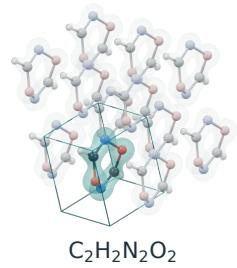  
b Chains

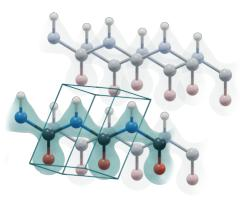  
c Sheets

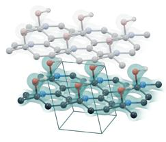  
C5HNO

d Networks

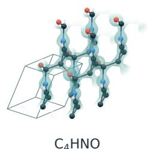  
Fig. 2 Selected test-set crystals illustrating the connectivity classes of the dataset: a finite bonded components (0D), b chains (1D), c sheets (2D), and d three-dimensional networks (3D). Surfaces show fitted Kohn–Sham reference densities at $0 . 2 0 a _ { 0 } ^ { - 3 }$ . Periodic images are faded, and the teal box outlines the primitive cell; the network in d is a single component, so nothing is faded. Atom colors: white (H), gray (C), blue (N), and red (O). Bond cylinders indicate geometric connectivity, not bond order.

## 2.3 In-distribution variational optimization

We evaluate the final periodic model on all 6211 test structures using float64 density optimization with soft regularization $\epsilon = 0 . 1$ . Table 1 separates three evaluations of the same learned functional: its value at the superposition-of-atomic-densities (SAD) initialization, its value at the fitted KS density, and its value after density optimization from SAD. The fitted-KS-density result is a single-point diagnostic of the learned functional, not the initialization used for optimization. For density coeficients p and fitted KS coeficients $\mathbf { p } _ { \mathrm { K S } }$ , we define this error as

$$
\epsilon _ { \rho } = \left[ \int _ { \Omega } \left| \rho _ { \bf p } ( { \bf r } ) - \rho _ { { \bf p } _ { \mathrm { K S } } } ( { \bf r } ) \right| ^ { 2 } \mathrm { d } { \bf r } \right] ^ { 1 / 2 } = \left[ \Delta { \bf p } ^ { \mathrm { T } } { \bf S } _ { \rho } \Delta { \bf p } \right] ^ { 1 / 2 } ,\tag{4}
$$

where $\Delta \mathbf { p } = \mathbf { p } - \mathbf { p } _ { \mathrm { K S } }$ and $\mathbf { S } _ { \rho }$ is the overlap matrix of the periodic density basis, $\begin{array} { r } { [ \mathbf { S } _ { \rho } ] _ { \mu \nu } = \int _ { \Omega } \bar { \omega } _ { \mu } ( \mathbf { r } ) \bar { \omega } _ { \nu } ( \mathbf { r } ) \mathrm { d } \mathbf { r } } \end{array}$ . This is an absolute cell-level error, without normalization by the number of atoms or electrons, and is reported in $a _ { 0 } ^ { - 3 / 2 }$ with electron number treated as dimensionless. We additionally report the $L ^ { 1 }$ density error normalized by the electron count $N _ { \mathrm { e } }$ of the cell,

$$
\eta _ { \rho } = \frac { 1 } { N _ { \mathrm { e } } } \int _ { \Omega } | \rho _ { \mathbf { p } } ( \mathbf { r } ) - \rho _ { \mathbf { p } _ { \mathrm { K S } } } ( \mathbf { r } ) | \mathrm { d } \mathbf { r } ,\tag{5}
$$

which is dimensionless and makes errors comparable across cells with diferent electron counts. We evaluate the integral on the Becke quadrature grid of the Kohn–Sham reference calculation. It is the integrated absolute density diference per electron; for charge-conserving diferences, half of it is the fraction of the charge that has to be moved. Both errors are measured relative to the fitted KS density and exclude the error introduced by fitting the orbital-derived density into the Gaussian basis.

Table 1 Energy and density accuracy on all 6211 in-distribution test structures. The first three rows evaluate STRUCTURES-P at diferent densities; the notation method@density identifies the density at which the energy is evaluated. The eSEN MLIP predicts total energies directly from geometry and is trained without force supervision; it does not provide a density. APBE is a semilocal (GGA) kinetic-energy functional evaluated with PBE exchange–correlation and the same analytic electrostatics at the fitted KS density. The fitted KS density has zero density error by definition. $L ^ { 2 }$ density errors are in $a _ { 0 } ^ { - 3 / 2 } ; L ^ { 1 }$ density errors are per electron, in percent. MAE and median are the mean and median absolute energy errors relative to the PySCF KS total energy.
<table><tr><td colspan="5">Mean</td><td rowspan="2"> $L ^ { 2 }$  Mean  $L ^ { 1 }$  density</td></tr><tr><td>Evaluation</td><td>MAE (mHa/cell)</td><td>Median</td><td>MAE (mHa/cell) (mHa/atom)</td><td>density error  $\bar { \epsilon _ { \rho } }$ </td></tr><tr><td>STRUCTURES-P@SAD</td><td>304</td><td>305</td><td>47.8</td><td>0.235</td><td>error  $\bar { \eta _ { \rho } } \ ( \% )$  6.73</td></tr><tr><td>STRUCTURES-P@KS</td><td>1.61</td><td>0.653</td><td>0.255</td><td>0</td><td>0</td></tr><tr><td>STRUCTURES-P@optimized</td><td>1.58</td><td>0.627</td><td>0.254</td><td>0.0138</td><td>0.413</td></tr><tr><td>APBE@KS</td><td>619</td><td>500</td><td>101</td><td>0</td><td>0</td></tr><tr><td>eSEN MLIP</td><td>3.32</td><td>1.11</td><td>0.496</td><td></td><td></td></tr></table>

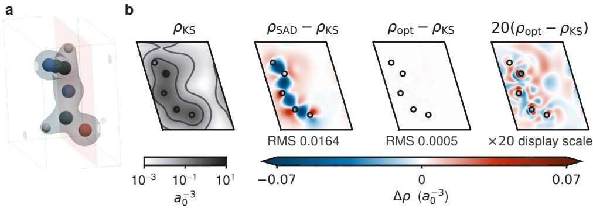

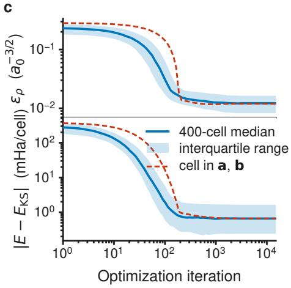

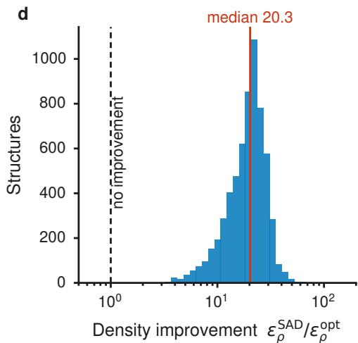  
Fig. 3 Density optimization reduces density and energy errors on the 6211-cell CHNO test set. a Optimized density for a representative test cell with errors near the test-set medians (selection in Section 4.5). The molecule is centered in the cell. The isosurface encloses 75% of the electrons; the shaded plane is used in b. Atom colors: white (H), gray (C), blue $( \mathrm { N } ) _ { - }$ and red (O). b Fitted Kohn– Sham density $\rho _ { \mathrm { K S } }$ (logarithmic scale; contours at 0.01, 0.1, and $\cdot a _ { 0 } ^ { - 3 } )$ , SAD and optimized-density errors, and the latter magnified by 20. All error maps use a common symmetric color scale, and RMS denotes the root-mean-square density diference over the displayed plane in $a _ { 0 } ^ { - 3 }$ . Circles mark atoms within 1.1 a0 of the plane. c Density and absolute energy errors during optimization: median and interquartile range over 400 randomly sampled test cells, with the representative cell overlaid. Converged runs retain their final values. d Distribution of the density-error reduction $\epsilon _ { \rho } ^ { \mathrm { S A D } } / \epsilon _ { \rho } ^ { \mathrm { o p t } }$ over all 6211 structures; dashed and red lines mark no improvement and the median, respectively.

Table 1 shows that optimization from the SAD initialization reduces the energy MAE by two orders of magnitude, to 1.58 mHa/cell (0.254 mHa/atom), and the mean density error by a factor of 17. In the electron-normalized $L ^ { \dot { 1 } }$ measure of Eq. (5), the mean error falls from 6.73% to 0.413%. The optimized energy errors have a 90th percentile of 4.00 mHa/cell and a signed bias of +0.252 mHa/cell.

Figure 3 illustrates the density improvement in real space for a test cell with energy and density errors close to the test-set medians. On a lattice plane through this cell, the SAD initialization misplaces charge in extended lobes between the atoms, while the optimized-density error map is almost featureless on the same color scale [Fig. 3a,b].

The improvement is a property of individual structures and not only of the average: the per-structure ratio $\bar { \epsilon } _ { \rho } ^ { \mathrm { S A } \mathrm { bar { D } } } / \epsilon _ { \rho } ^ { \mathrm { o p t } }$ has a median of 20.3 and exceeds unity for all 6211 structures [Fig. 3d]. Note that this per-structure median is not the same statistic as the factor 17 above, which is the ratio of the mean errors. Most of the reduction occurs early: across the plotted sample the median density error falls within 10% of its final value after roughly 560 iterations [Fig. 3c], whereas the tighter gradient-norm criterion below is met after a median of 1999 cycles, with a 90th percentile of 3181.

The regularized projected-gradient criterion is reached for 6206 of 6211 structures (99.9%). The other five reach the 15000-cycle limit and are included in all statistics. The median unregularized projected-gradient norm at the endpoint is $1 . 9 2 \times 1 0 ^ { - 2 }$ in the optimization coordinates, compared with a median regularized norm of $1 . 0 0 \times 1 0 ^ { - 4 }$ Evaluating the learned functional at the fitted KS density gives an energy MAE of 1.61 mHa/cell. After optimization, the learned energy is no higher than its value at the fitted KS density for 92.8% of structures, and its mean change is −0.368 mHa/cell. The similar energy errors at the optimized and fitted KS densities show that minimization from SAD recovers essentially the same energy accuracy as the reference-density diagnostic, although their signed errors can cancel diferently.

As a density-independent baseline, we train the same eSEN architecture as a machine-learned interatomic potential (MLIP) using ground-state total-energy labels without force supervision. The density embedding and coeficient-gradient loss are disabled. It predicts the total energy directly from the atomic geometry and obtains an MAE of 3.32 mHa/cell (0.496 mHa/atom) on the same test set. The baseline does not provide a density or an energy functional for trial densities, but tests whether the variational formulation remains competitive with direct energy regression.

At the fitted KS densities, the semilocal APBE kinetic-energy functional 11,56 with PBE exchange and correlation gives a much larger MAE of 619 mHa/cell (101 mHa/atom; median 500 mHa) on all 6211 test structures. This is a single-point evaluation at the fitted KS density, not an APBE density optimization. The Wang– Teter functional 8 could not be evaluated because its reciprocal-space kernel exceeded the available accelerator memory.

## 2.4 A unified functional for molecules and periodic crystals

The shared density representation allows us to test whether one learned functional can describe both isolated and periodic systems. We therefore train a single model jointly on QM9 molecules 57 and periodic CHNO crystals and evaluate variational density optimization on held-out systems from both domains.

The joint training set combines 110000 QM9 molecules with the 49687 periodic CHNO training cells; the corresponding validation splits contain 10000 and 6211 systems, and the test splits contain 10831 and 6211 systems. Molecular references use isolated all-electron $\mathrm { P y S C F }$ $\mathrm { P B E / 6 - 3 1 G ( 2 d f , p ) }$ calculations and perturbations of the Fock matrix during SCF, rather than perturbations of a fixed converged Fock matrix as in the periodic data. Each selected density is one training sample, without additional domain weighting; selection details and sample counts are given in Section 4.4.3.

Both domains use the same $T _ { \mathrm { S } } + E _ { \mathrm { X C } }$ target and loss. All parameters of the fourlayer eSEN model, including the element embeddings for H, C, N, O, and F, are shared. Within the network, boundary conditions enter only through graph construction: periodic cells include neighbor edges translated by lattice vectors, while isolated molecules contain no periodic images.

Table 2 Variational test-set accuracy of one jointly trained STRUCTURES-P model on isolated QM9 molecules and periodic CHNO crystals. All model parameters are shared between the two domains. Density errors are in $a _ { 0 } ^ { - 3 / 2 } ;$ convergence refers to the regularized-gradient criterion.
<table><tr><td>Test domain</td><td>N</td><td>MAE (mHa/cell)</td><td>MAE/atom (mHa)</td><td> $L ^ { 2 }$  density error</td><td>Converged (%)</td></tr><tr><td>QM9</td><td>10831</td><td>0.245</td><td>0.0146</td><td>0.0111</td><td>100.0</td></tr><tr><td>Periodic CHNO</td><td>6211</td><td>1.77</td><td>0.280</td><td>0.0197</td><td>99.5</td></tr></table>

Table 2 shows that the same learned functional can be minimized successfully under both isolated and periodic boundary conditions. The median absolute errors are 0.173 mHa/cell for QM9 and 0.727 mHa/cell for periodic CHNO. Supplementary Note 1 compares matched small and large models within the CHNO-only and joint training settings. For the large architecture, the CHNO-only model reaches 1.58 mHa/cell on periodic CHNO, compared with 1.77 mHa/cell for the joint model. Joint training therefore preserves similar periodic accuracy while extending the same functional to isolated molecules, but does not improve the CHNO result in this comparison.

## 2.5 Transferability to larger cells

The in-distribution test contains 6211 cells with 1–9 atoms and 2–72 electrons, whereas the larger-cell test contains 734 cells with 10–24 atoms and 22–176 electrons.

Figure 4 compares the end-to-end error after density optimization inside and beyond the training cell-size regime. The energy MAE rises from 0.254 to 0.414 mHa/atom, while the 90th percentile changes from 0.613 to 0.894 mHa/atom. The median increases from 0.103 to 0.303 mHa/atom, and the mean density error from 0.0138 to 0.0307. The cell-level signed bias is +0.252 mHa in distribution and +1.121 mHa out of distribution. Convergence is reached for 99.9% and 100% of the two sets, respectively. Thus the learned functional and variational optimization retain sub-mHa/atom accuracy on substantially larger fixed periodic cells.

We additionally measure computational cost on 144 structures distributed over six fixed electron-count intervals extending to 135 electrons per cell (Section 4.6). All 144 calculations converge with both the full-pair and local-pair regularizers. In the largest interval, the local-pair approximation reduces efective end-to-end wall time from 140 to 74 s per structure on matched hardware. Its advantage is concentrated in larger cells; small cells show no speedup. These finite-range timings do not establish the asymptotic scaling of the complete implementation.

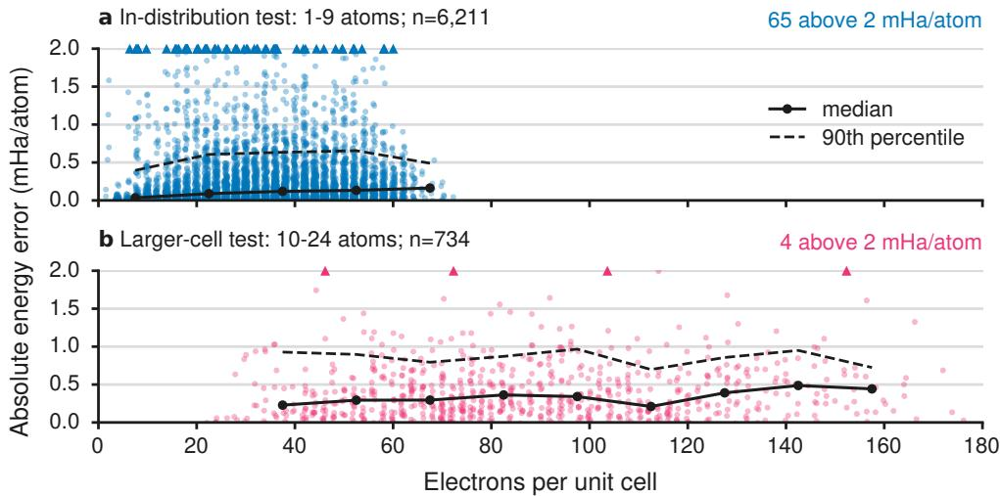  
Fig. 4 The mean optimized-energy error remains below 1 mHa/atom for cells larger than those seen in training. Each point is one structure, with absolute error against the Kohn–Sham reference plotted against electron count: a in-distribution and b larger-cell test. Horizontal jitter of at most 0.4 electrons separates coincident points; it does not afect the statistics. Solid and dashed lines show the median and 90th percentile in fixed 15-electron bins containing at least 12 structures, using all errors. Both panels share the same axes. Triangles on the upper boundary mark errors above 2 mHa/atom, with their counts shown above each panel.

## 2.6 Structure rankings and thermodynamic stability

Absolute energy errors alone do not determine usefulness for crystal-structure prediction, which depends on energy diferences within a composition and on formation enthalpies across compositions. We assess agreement with the PySCF training reference and include CASTEP as an additional comparison. To match the original CASTEP dataset, we use a nominal k-point spacing of 0.10 $\textup { \AA } ^ { - 1 }$ in PySCF. The $\mathrm { C H _ { 2 } }$ investigation shows that this sampling is not fully converged for some structures (Supplementary Note 2). CASTEP–PySCF diferences include methodological and numerical contributions and do not provide a controlled estimate of reference uncertainty.

The low-energy subset in Fig. 5 contains only structures within 150 meV/atom of the PySCF minimum for its composition; neither the model nor CASTEP predictions enter this selection. We select candidates from the 20 most populated compositions and keep compositions with at least ten such candidates, yielding 538 structures across 19 compositions. For each unordered within-composition pair, the pair-energy error is the absolute diference between the two methods’ per-atom enthalpy diferences, and the pair is counted as a rank-order violation when the predicted enthalpy ordering difers from $\mathrm { P y S C F }$ . Formation enthalpies are calculated as $\begin{array} { r } { \Delta h _ { \mathrm { f } } \ = \ h - \sum _ { \alpha } x _ { \alpha } h _ { \alpha } . } \end{array}$ where h is the structure’s enthalpy per atom, $x _ { \alpha }$ is the atomic fraction of element $\begin{array} { r } { \alpha ( \sum _ { \alpha } x _ { \alpha }  = 1 ) } \end{array}$ , and $h _ { \alpha }$ is the lowest elemental enthalpy per atom obtained by the respective method among the evaluated structures. On the H–N edge, PySCF uses $\mathrm { H } _ { 8 }$ and $\mathrm { N _ { 4 } }$ cells, STRUCTURES-P uses $\mathrm { H } _ { 6 }$ and $\mathrm { N _ { 4 } }$ , and CASTEP uses $\mathrm { H } _ { 8 }$ and $\mathrm { N } _ { 8 }$

These formulas describe the contents of the reference cells, not individual molecules. We show the H–N edge because it is the most densely sampled binary slice, whereas coverage of the full quaternary CHNO space is too sparse and uneven for a similarly compact hull comparison.

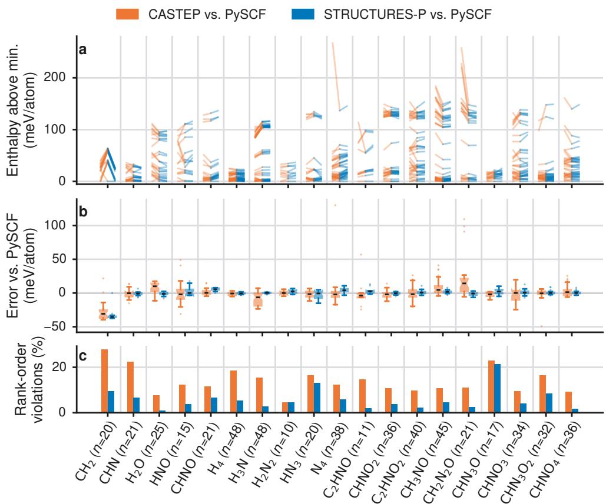  
Fig. 5 STRUCTURES-P reproduces the relative enthalpies of its PySCF training reference more closely than plane-wave CASTEP does. Per-composition enthalpy rankings for CASTEP, PySCF (nominal 0.10 $\textup { \AA } ^ { - 1 }$ k-point spacing), and STRUCTURES-P, using $H = E + p V$ at the ∼1 GPa structure-search pressure. a For each composition (with n structures), the enthalpy of every structure relative to each method’s own composition minimum (meV/atom). Lines connect the same structure between CASTEP and PySCF (orange) and between PySCF and STRUCTURES-P (blue); horizontal segments indicate equal relative enthalpies for the two methods. b Notched box plots of relativeenthalpy deviations from PySCF (boxes: interquartile range; whiskers: 1.5 times that range; notches: approximate 95% confidence intervals for the median, which may extend beyond the quartiles). c Percentage of within-composition structure pairs whose order changes relative to PySCF. Candidates are selected within 150 meV/atom of the PySCF composition minimum.

After removing composition-dependent ofsets, the CASTEP and PySCF relative enthalpies have a Spearman correlation of 0.996, and their within-composition pairenergy diferences disagree by 35.5 meV/atom (1.30 mHa/atom) on average. Only

3.3% of all within-composition pairs change order, although the fraction rises to 29.9% for pairs separated by at most 10 meV/atom. The reference-method disagreements are therefore concentrated among near-degenerate structures.

Figure 5 focuses on the low-energy manifold within 150 meV/atom of the PySCF composition minimum. Across 538 structures and 19 compositions, the model changes 4.7% of the PySCF pair rankings, compared with 13.4% between CASTEP and PySCF. Its relative-enthalpy mean absolute error is 3.4 meV/atom, versus 8.2 meV/atom for CASTEP relative to PySCF. The model selects the PySCF minimum in 14 of 19 compositions, while CASTEP selects it in 5 of 19. At this level of agreement with PySCF, the numerical accuracy of the reference data becomes an important consideration. For CH , finer k-point sampling removes the anomalously large gap above the original PySCF minimum. The model does not reproduce most of this artificial gap, although it still selects the original minimum (Supplementary Fig. 1 and Supplementary Note 2). Across the 516 screened refinement cells, refining the spacing from 0.10 to 0.03 $\mathring { \mathrm { A } } ^ { - 1 }$ changes the PySCF energy by 2.8 meV/atom on average (median 0.4 meV/atom), the same order as the model’s deviation from the original reference on these cells (mean 1.7, median 1.0 meV/atom; Supplementary Fig. 2).

The formation-enthalpy test in Fig. 6 extends the comparison across compositions. On the H–N slice, the model identifies the same minimum structure as PySCF at 10 of 13 stoichiometries and reproduces the hull vertices at H, $\mathrm { H _ { 3 } N } .$ , and N. Its hull difers from the PySCF hull by 0.4 meV/atom on average and at most 0.8 meV/atom. CASTEP gives the same hull vertices, although its formation enthalpies difer more substantially. These hulls describe stability within the evaluated candidate set, not a complete phase diagram.

## 3 Discussion

The central result is that a learned all-electron functional, minimized under periodic boundary conditions from a superposition of atomic densities, recovers Kohn–Sham energies and densities across 6211 held-out CHNO crystals, from molecular crystals to three-dimensional networks, with a mean energy error of 0.25 mHa per atom and a mean density error of 0.4% of the electron count. The model represents only $T _ { \mathrm { { S } } } + E _ { \mathrm { { X C } } } ,$ while the Hartree, electron–nuclear, and nucleus–nucleus contributions are evaluated analytically. Unlike geometry-only machine-learned interatomic potentials, this construction provides both an explicit density and gradients with respect to it. The large reduction in density error from the SAD initialization, together with the similar energy accuracy at the optimized and fitted KS densities, indicates that the non-ground-state training data constrain the functional along the optimization paths relevant here.

The results test both a shared functional for molecules and crystals and transfer to larger cells. A single jointly trained functional can be minimized for both isolated QM9 molecules and periodic CHNO crystals, although joint training does not improve the periodic accuracy in the matched comparison. The periodic model retains submHa/atom accuracy for cells larger than those used in training. Likewise, the relativeenergy tests show useful preservation of fixed-geometry rankings and of the convex hull on the examined H–N slice, with remaining diferences from the PySCF reference.

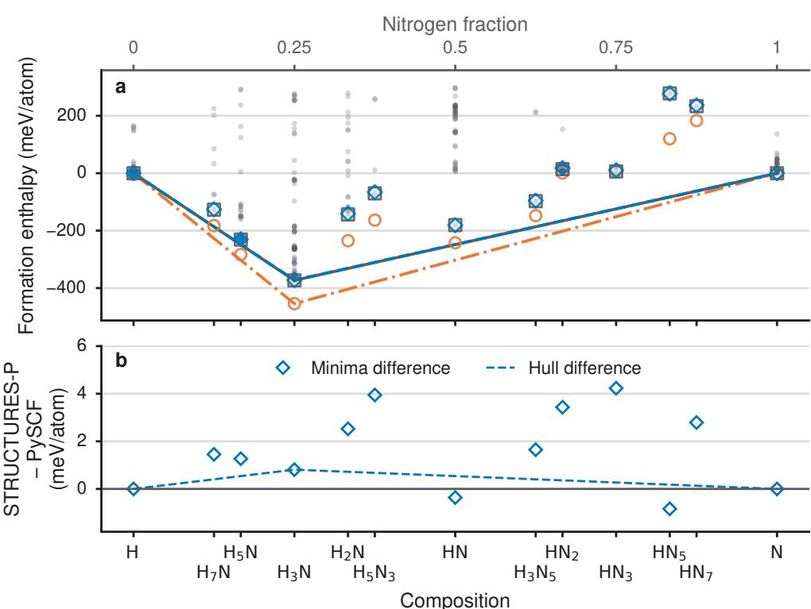  
Fig. 6 Formation-enthalpy convex hull along the H–N edge of the CHNO composition space, using $H = E + p V$ at the ∼1 GPa search pressure and method-specific elemental references from the evaluated candidate set. a Lowest formation enthalpy at each stoichiometry and its convex hull for CASTEP (circles, dash-dotted), PySCF (squares, solid), and STRUCTURES-P (diamonds, dashed). Faint gray points show individual PySCF candidates with formation enthalpies up to 300 meV/atom. Filled diamonds mark the three stoichiometries where STRUCTURES-P and PySCF select diferent structures. All three methods give the H, H3N, and N hull vertices. b STRUCTURES-P minus PySCF for the composition minima (diamonds) and hull (dashed line), resolved on a finer energy scale.

Because no structures are generated or relaxed with the learned functional, these tests do not yet demonstrate a full crystal-structure search.

The present accuracy is tied to the reference method and representation. The reported model errors quantify agreement with the available PySCF references rather than with uniformly converged DFT energies. The PySCF references retain finiteorbital-basis errors for some structures. Larger Gaussian bases can improve accuracy, but difuse functions can cause near-linear dependence and numerical instabilities in some periodic cells, particularly compact high-pressure cells. The PBE approximation and density fit introduce further limitations. The chemical scope explored here is even-electron CHNO crystals, treated as closed-shell, near the pressure of the AIRSS dataset, with the larger-cell test extending system size rather than chemistry or thermodynamic conditions.

Improving the numerical reliability of reference-data generation is an important next step, including systematic k-point convergence checks and more robust orbitalbasis representations. All-electron methods based on numerical atom-centered orbitals, such as FHI-aims 58, Gaussian and augmented plane waves, as in $\mathrm { C P 2 K ^ { 5 9 } }$ , or fullpotential augmented plane waves, such as APW+lo in $\mathrm { W I E N 2 k ^ { 6 0 } }$ , ofer alternative routes to periodic reference densities. Their use here would still require fitting the densities into the Gaussian density representation and constructing consistent nonground-state energy and derivative labels.

Plane-wave pseudopotential calculations ofer another route to periodic reference data, with densities that could also be fitted into the Gaussian density basis. However, the learned target changes: a nonlocal pseudopotential energy depends on the oneparticle density matrix and is not directly available from an arbitrary scalar density. Incorporating this term into a learned functional would therefore require suitable non-ground-state energy and derivative labels, or an additional approximation to the density matrix 36,37.

The dense matrix operations used for global natural reparametrization and regularization are the main scaling bottlenecks in the current implementation (Section 4.6). Changes to the training loss and data generation, together with better-conditioned density bases, could reduce the need for these steps. Block-sparse or matrix-free implementations could also reduce their computational cost.

Taken together, these results establish that a learned all-electron functional can be variationally optimized in periodic systems. Broader chemical and thermodynamic coverage and structural relaxation were outside the scope of this work, but the present formulation does not preclude either. Additional closed-shell chemistry and other pressures enter only through the density basis and the training data, whereas spin-polarized systems would require a spin-density formulation. For relaxation, the electrostatic terms and the learned functional are diferentiable with respect to atomic positions and cell vectors. Forces and stresses at the optimized density can therefore be obtained by automatic diferentiation, up to a correction from the residual gradient along the regularized directions. Natural next steps are to extend the density basis and training data toward broader chemistry and systematically converged references, to test structural relaxation, and to replace the remaining dense regularizer operations by better-conditioned or matrix-free schemes.

## 4 Methods

## 4.1 Density representation in a Gaussian basis

Following M-OFDFT50 and STRUCTURES25 52, we use the atom-centered Gaussian density expansion of Eq. (1) rather than a real-space grid. The even-tempered basis is generated with PySCF’s aug etb from the $6 { \cdot } 3 1 \mathrm { G } ( 2 \mathrm { d f , p } )$ orbital basis, with exponent ratio $\beta = 2 . 5 ^ { 6 1 }$ ; each function has the usual Gaussian radial form times a spherical harmonic, with exponents chosen as a geometric progression.

The total number of electrons in the unit cell is a linear function of the coeficients,

$$
\int _ { \Omega } \rho ( \mathbf { r } ) \mathrm { d } \mathbf { r } = \mathbf { q } ^ { \mathrm { T } } \mathbf { p } = N _ { e } ,\tag{6}
$$

where

$$
q _ { \mu } = \int _ { \Omega } \sum _ { \mathbf { T } \in \mathcal { L } } \omega _ { \mu } ( \mathbf { r } - \mathbf { R } _ { a ( \mu ) } - \mathbf { T } ) \mathrm { d } \mathbf { r } = \int _ { \mathbb { R } ^ { 3 } } \omega _ { \mu } ( \mathbf { r } ) \mathrm { d } \mathbf { r } .\tag{7}
$$

The second equality follows because the lattice-translated unit cells tile space. In practice, $q _ { \mu }$ is evaluated analytically from the Gaussian basis function. We impose this constraint during density optimization. Since $\begin{array} { r } { N _ { e } = \sum _ { a } Z _ { a } , } \end{array}$ , it also keeps the unit cell charge neutral, a prerequisite for the periodic electrostatics of Section 4.2 to be well defined. The linear expansion does not enforce pointwise non-negativity. To quantify violations, we sampled 50 of the 6211 test cells uniformly without replacement and evaluated the integrated negative charge $\begin{array} { r } { N _ { - } = \int _ { \Omega } \mathrm { m a x } [ - \rho ( \mathbf { r } ) , 0 ] } \end{array}$ dr of the optimized densities on a level-3 Becke grid; cells with detected negative density were rechecked on level-4 and level-5 Becke grids and on positive-weight uniform grids. The integrated negative charge was at most $6 \times 1 0 ^ { - 5 }$ electrons per cell (Supplementary Note 3).

The atom-centered basis provides a compact representation of the all-electron density, allowing near-nuclear variations to be resolved with fewer degrees of freedom than a uniform real-space grid. The even-tempered basis used here includes tight, high-exponent functions centered on the nuclei.

## 4.2 Periodic electrostatic energies

The classical electrostatic energy splits into the electron-electron (Hartree) term $E _ { \mathrm { H } } .$ the electron-nucleus (external) term $E _ { \mathrm { e x t } } ,$ and the constant nucleus-nucleus repulsion $E _ { \mathrm { n n } }$ . From here on, $\omega _ { \mu }$ is the lattice-periodic function $\bar { \omega } _ { \mu }$ of Section 2.1, and vPBC is the zero-mean periodic Green’s function of Poisson’s equation, i.e., the periodic Coulomb kernel with its zero-wave-vector component removed. The corresponding Coulomb product is

$$
( f \mid g ) _ { \mathrm { P B C } } = \int _ { \Omega } \int _ { \Omega } f ( \mathbf { r } ) v _ { \mathrm { P B C } } ( \mathbf { r } - \mathbf { r } ^ { \prime } ) g ( \mathbf { r } ^ { \prime } ) \mathrm { d } \mathbf { r } \mathrm { d } \mathbf { r } ^ { \prime } .\tag{8}
$$

The linear density model of Eq. (1) turns $E _ { \mathrm { H } }$ and $E _ { \mathrm { e x t } }$ in Eq. (2) into a quadratic and a linear form in the coeficients,

$$
\begin{array} { r } { E _ { \mathrm { H } } ( \mathbf { p } ) = \frac { 1 } { 2 } \mathbf { p } ^ { \mathrm { T } } \mathbf { J } \mathbf { p } , \qquad E _ { \mathrm { e x t } } ( \mathbf { p } ) = \mathbf { v } _ { \mathrm { e x t } } ^ { \mathrm { T } } \mathbf { p } , } \end{array}\tag{9}
$$

with the Coulomb metric $J _ { \mu \nu } ~ = ~ ( \omega _ { \mu } ~ \mid ~ \omega _ { \nu }$ )PBC and the nuclear-attraction vector $\begin{array} { r } { [ \mathbf { v } _ { \mathrm { e x t } } ] _ { \mu } = - \sum _ { a } Z _ { a } \left( \omega _ { \mu } \mid \delta _ { \mathbf { R } _ { a } } \right) _ { \mathrm { P B C } } } \end{array}$

The bare periodic Coulomb sum defining J diverges for basis functions with nonzero net charge; the zero-mean kernel vPBC makes it well defined. We evaluate J and $\mathbf { v } _ { \mathrm { e x t } }$ with the range-separated periodic Gaussian integral scheme used by $\mathrm { P y S C F ` }$ periodic

Gaussian density fitting (GDF) machinery 61–63. In this scheme the Coulomb kernel is split into a short-ranged and a long-ranged part,

$$
\frac { 1 } { r } = \underbrace { \frac { \mathrm { e r f c } ( \nu r ) } { r } } _ { \mathrm { s h o r t ~ r a n g e } } + \underbrace { \frac { \mathrm { e r f } ( \nu r ) } { r } } _ { \mathrm { l o n g ~ r a n g e } } ,\tag{10}
$$

with a splitting parameter $\nu .$ The short-range contribution is summed over a finite set of real-space lattice images, while the smooth long-range contribution is evaluated as a sum over reciprocal-lattice vectors G using analytic Gaussian Fourier transforms. For the two-center Coulomb metric in the density basis this can be written as

$$
J _ { \mu \nu } = J _ { \mu \nu } ^ { \mathrm { S R } } - \frac { \pi } { \nu ^ { 2 } | \Omega | } q _ { \mu } q _ { \nu } + \frac { 4 \pi } { | \Omega | } \sum _ { { \bf G } \neq 0 } \frac { \exp ( - | { \bf G } | ^ { 2 } / 4 \nu ^ { 2 } ) } { | { \bf G } | ^ { 2 } } \tilde { \omega } _ { \mu } ( { \bf G } ) ^ { * } \tilde { \omega } _ { \nu } ( { \bf G } ) ,\tag{11}
$$

where $J _ { \mu \nu } ^ { \mathrm { S R } }$ is the lattice sum of short-range Gaussian two-center integrals. The second term removes its zero-wave-vector component, and $\tilde { \omega } _ { \mu } ( \mathbf { G } )$ is the Fourier coeficient of the periodically repeated density basis function. The $\mathbf { G } = 0$ mode is omitted consistently from the electron-electron, electron-nucleus, and nucleus-nucleus terms; for neutral cells this omitted component cancels in the total electrostatic energy. In the implementation, $\mathbf { v } _ { \mathrm { e x t } }$ is obtained from the corresponding cross metric between the density basis and $\mathrm { P y S C F ^ { \prime } s }$ all-electron nuclear charge representation, while $E _ { \mathrm { n n } }$ is PySCF’s point-charge Ewald energy.

Because the orbital-free density of Eq. (1) is lattice-periodic, no sampling of the Brillouin zone is required for any of the electrostatic quantities.

Crucially, J and $\mathbf { v } _ { \mathrm { e x t } }$ depend only on the geometry M, not on p. They are computed once per structure and reused throughout density optimization, where the electrostatic energy and its gradient reduce to

$$
\nabla _ { \mathbf { p } } E _ { \mathrm { H } } = \mathbf { J } \mathbf { p } , \qquad \nabla _ { \mathbf { p } } E _ { \mathrm { e x t } } = \mathbf { v } _ { \mathrm { e x t } } .\tag{12}
$$

The linear density expansion requires two-center Coulomb integrals rather than the four-index integrals of an explicit orbital-product formulation. The Hartree energy is a density functional in KS-DFT as well; the benefit here is that its fixed-geometry energy and gradient evaluations reduce to matrix-vector and dot products after precomputation.

## 4.3 Data generation and density fitting

Each training example consists of a crystal geometry ${ \mathcal { M } } .$ a density coeficient vector p, and energy and gradient labels for the learned part of the functional. The model represents $F _ { \theta } ( \mathbf { p } , \mathcal { M } )$ ≈ $T _ { \mathrm { S } } [ \rho ] + E _ { \mathrm { X C } } [ \rho ]$ , while $E _ { \mathrm { H } } , E _ { \mathrm { e x t } }$ , and $E _ { \mathrm { n n } }$ are evaluated analytically (Section 4.2). The label generation therefore has three tasks: generate densities near the Kohn–Sham ground state, represent those densities in the Gaussian density basis, and subtract the analytic electrostatic terms evaluated at the fitted density from the Kohn–Sham energy.

## 4.3.1 Structures and preprocessing

We draw CHNO crystal structures from AIRSS searches performed at 1 GPa 53,54. Compression at this pressure reduces the relative importance of dispersion interactions 64. This pressure is inherited from the source searches and is also used for the fixed-geometry enthalpy comparisons. Before Kohn–Sham calculations, we standardize equivalent representations of the CHNO crystal structures: each structure is reduced to a primitive cell with spglib 65 (without idealizing the geometry), Niggli-reduced, and given a deterministic atom ordering. We restrict this work to the even-electron subset and treat every structure as closed-shell in spin-restricted calculations.

For the main CHNO dataset, the local AIRSS archive contained 124710 structure files. Excluding 176 empty files and five header-only files left 124529 readable structures, of which 62867 had an even electron count. Primitive-cell reduction changed the electron-count parity of 274 of these structures; excluding them left 62593 eligible structures. Of these, 62109 had retained reference labels and entered the training, validation, and test splits. Among the 484 omissions, 358 had documented SCF nonconvergence, including rejection of non-converged checkpoints. The remaining 126 structures lacked reference labels and were not used; job timeouts were the main reason.

The in-distribution split contains 49687 training, 6211 validation, and 6211 test cells with one to nine atoms and 2–72 electrons; structure identifiers do not overlap between splits. The collection includes non-molecular structures: six test cells contain a single atom in the primitive cell (five carbon and one oxygen). The connectivity classes quoted in the Results come from the rank-determination algorithm and dimensionality score of Larsen et al.66 as implemented in $\mathrm { A S E ^ { 6 7 } }$ , with periodic images included and bonds defined by $d _ { i j } < k \left( r _ { i } + r _ { j } \right)$ for covalent radii r; each cell receives the highestscoring dimensionality type over the scanned interval of k; mixed denotes coexisting components of diferent dimensionalities. The labels are cutof sensitive: 19.2% of the cells change class between fixed k = 1.1, 1.2, and 1.3, so the fractions describe geometric connectivity rather than chemically validated bonding, and the 0D class is not a molecular-crystal count. The independent larger-cell test set is excluded from these counts.

The out-of-distribution set comprises 734 independently generated CHNO crystals with 10–24 atoms and 22–176 electrons per cell. These candidates were generated from random compositions and initial geometries and optimized in separate AIRSS searches, resulting predominantly in P1 structures. Because the training cells contain at most nine atoms, the two sets are disjoint by construction. Geometry optimization used a diferent pseudopotential set from the original AIRSS dataset, but all reference energies and densities were recalculated at the fixed geometries using the same all electron PySCF PBE setup. The pseudopotential diference may shift the sampled volume distribution; this test probes transfer to both larger cells and independently generated structures, rather than a controlled size-only extrapolation.

## 4.3.2 Reference Kohn–Sham calculations

For each crystal we first converge an all-electron, spin-restricted periodic Kohn–Sham calculation using the PBE functional68 and the 6-31 ${ \mathrm { G } } ( 2 { \mathrm { d f } } , \mathrm { p } )$ orbital basis in $\mathrm { P y S C F ^ { 6 3 } }$ The k-point mesh is chosen using a reciprocal-space spacing of 0.10 $\textup { \AA } ^ { - 1 }$ , with an SCF energy tolerance of $1 0 ^ { - 9 }$ Ha. We kept this spacing for the full dataset to match the CASTEP reference data and because finer k-point sampling makes the reference calculations considerably more expensive. The periodic reference calculations first use unsmeared occupations; unsuccessful cases are retried with Fermi smearing of 0.001, 0.002, and 0.005 Ha. The converged calculation gives the one-particle density matrices in the orbital basis,

$$
\Gamma _ { \alpha \beta } ^ { \mathbf { k } } = \sum _ { i } C _ { \alpha i } ^ { \mathbf { k } } f _ { i } ^ { \mathbf { k } } C _ { \beta i } ^ { \mathbf { k } * } ,\tag{13}
$$

where α and $\beta$ index the orbital basis functions, i indexes the Kohn–Sham orbitals, $C _ { \alpha i } ^ { \mathbf { k } }$ are their expansion coeficients at k-point k, and $f _ { i } ^ { \mathbf { k } }$ are the orbital occupations. The same calculations provide the Kohn–Sham energy components.

To test the sensitivity of the rankings to Brillouin-zone sampling (Supplementary Note 2), we selected 637 fixed cells: all 538 ranking candidates, all 65 three-atom $\mathrm { C H _ { 2 } }$ cells, and additional method-specific minima and nearby H–N candidates. Each cell was first replayed at its original k-point mesh, which had to reproduce the stored energy within 0.01 meV/atom, and then recomputed with PySCF 2.12.0 at nominal spacings of 0.04 and 0.03 $\textup { \AA } ^ { - 1 }$ with full Γ-including meshes and otherwise unchanged settings (PBE/6-31G(2df,p), Gaussian density fitting, the original quadrature grids, and SCF tolerances of $1 0 ^ { - 1 1 }$ Ha for the energy and $1 0 ^ { - 7 }$ for the orbital gradient). Only unsmeared, converged SCF results with an electron-count error below $1 0 ^ { - 7 }$ were retained; cells with an original occupation flag or a sampled gap below 0.1 eV at any setting were excluded. A composition passes the mesh-stability criterion when every pairwise enthalpy diference changes by less than 0.5 meV/atom between 0.04 and 0.03 $\textup { \AA } ^ { - 1 }$ . All enthalpies retain the original $p V$ term, and the model predictions are unchanged.

## 4.3.3 Perturbed densities

Building on potential-perturbation data augmentation in KineticNet 49, we adopt the density-basis perturbation construction of STRUCTURES25 52, but apply it to the converged Kohn–Sham Fock matrix rather than during SCF iterations. Sampling around this fixed reference decouples the perturbation distribution from the SCF trajectory. A perturbing local potential is sampled in the density basis, $\delta v ( \mathbf { r } ) \ =$ $\begin{array} { r } { \sum _ { \mu } \delta v _ { \mu } \omega _ { \mu } ( \mathbf { r } ) } \end{array}$ , and projected to the orbital basis through the overlap three-center tensor,

$$
\Delta F _ { \alpha \beta } ^ { \mathbf { k } } = \sum _ { \mu } \delta v _ { \mu } \int _ { \Omega } \eta _ { \alpha \mathbf { k } } ^ { * } ( \mathbf { r } ) \omega _ { \mu } ( \mathbf { r } ) \eta _ { \beta \mathbf { k } } ( \mathbf { r } ) d \mathbf { r } .\tag{14}
$$

For each cell, we draw independent standard-normal coeficient vectors $\mathbf { z } _ { i }$ and set $\delta \mathbf { v } _ { i } = r _ { i } \mathbf { z } _ { i } / \sqrt { \mathbf { z } _ { i } ^ { \mathrm { T } } \mathbf { S } _ { \rho } \mathbf { z } _ { i } } .$ with the density-basis overlap matrix $\mathbf { S } _ { \rho }$ of Eq. (4). The 40 amplitudes are descending midpoint quantiles of a probability density that decreases linearly to zero over $[ 0 . 0 1 , 5 . 6 ] E _ { \mathrm { h } } a _ { 0 } ^ { 3 / 2 }$ . They specify the potential norm $r _ { i } = \lVert \delta v _ { i } \rVert _ { L ^ { 2 } ( \Omega ) }$ 2 not the resulting density change.

For each perturbation of Eq. (14), we solve the generalized eigenvalue problem $( F _ { \mathrm { r e f } } ^ { \mathbf { k } } + \Delta F ^ { \mathbf { k } } ) \hat { C } ^ { \mathbf { k } } = S ^ { \mathbf { k } } C ^ { \mathbf { k } } \Lambda ^ { \mathbf { k } }$ once and form the corresponding density matrix. Here, $F _ { \mathrm { r e f } } ^ { \mathbf { k } }$ and $\mathbf { \nabla } _ { \left| S ^ { \mathbf { k } } \right. }$ are the converged reference Fock and orbital-overlap matrices, while $C ^ { \mathbf { k } }$ and the diagonal matrix $\Lambda ^ { \mathbf { k } }$ contain the perturbed generalized eigenvectors and eigenvalues, respectively. For unsmeared references, we reuse the ground-state occupations and include the unperturbed density as an additional sample. For smeared references, each perturbed one-particle problem is instead filled in global zero-temperature Aufbau order across k-points, and the smeared reference density is not included as a training sample. These replay densities are not self-consistent zero-temperature ground states. The training set contains 31672 cells with 40 perturbations plus an explicit groundstate sample and 18015 cells with only the 40 replay samples, giving 2019152 density samples in total. All validation and test cells have 40 perturbations and an explicit unsmeared ground-state sample. The electronic energy labels are evaluated at the sampled density matrices without an electronic-entropy correction.

## 4.3.4 Density fitting

Each sampled $\Gamma ^ { \mathbf { k } }$ defines the Kohn–Sham density

$$
\rho _ { \mathrm { K S } } ( \mathbf { r } ) = \sum _ { \mathbf { k } } w _ { \mathbf { k } } \sum _ { \alpha \beta } \Gamma _ { \beta \alpha } ^ { \mathbf { k } } \eta _ { \alpha \mathbf { k } } ^ { * } ( \mathbf { r } ) \eta _ { \beta \mathbf { k } } ( \mathbf { r } ) ,\tag{15}
$$

where $w _ { \mathbf { k } }$ is the k-point weight. We re-express this density as coeficients p in the Gaussian density basis. The fit minimizes the residual Hartree energy,

$$
\begin{array} { r } { E _ { \mathrm { H } } [ \rho _ { \mathrm { O F } } ( \mathbf { p } ) - \rho _ { \mathrm { K S } } ] = \frac { 1 } { 2 } \mathbf { p } ^ { \mathrm { T } } \mathbf { J } \mathbf { p } - \mathbf { b } ^ { \mathrm { T } } \mathbf { p } + \mathrm { c o n s t } , } \end{array}\tag{16}
$$

where $b _ { \mu } = ( \omega _ { \mu } \mid \rho _ { \mathrm { K S } } ) _ { \mathrm { P B C } }$ . In the periodic implementation, the contraction with the k-point density matrices is

$$
b _ { \mu } = \sum _ { \mathbf { k } } w _ { \mathbf { k } } \sum _ { \alpha \beta } ( \omega _ { \mu } \mid \eta _ { \alpha \mathbf { k } } ^ { * } \eta _ { \beta \mathbf { k } } ) _ { \mathrm { P B C } } \Gamma _ { \beta \alpha } ^ { \mathbf { k } } .\tag{17}
$$

The mixed three-center Coulomb integrals in Eq. (17) use the same periodic Coulomb convention as Eq. (11). In the CHNO calculations we use a doubly constrained fit,

$$
\operatorname* { m i n } _ { \mathbf { p } } \mathbf { \Pi } _ { 2 } ^ { 1 } \mathbf { p } ^ { \mathrm { T } } \mathbf { J } \mathbf { p } - \mathbf { b } ^ { \mathrm { T } } \mathbf { p } \quad \mathrm { s . t . } \quad \mathbf { q } ^ { \mathrm { T } } \mathbf { p } = N _ { e } , \quad \mathbf { v } _ { \mathrm { e x t } } ^ { \mathrm { T } } \mathbf { p } = E _ { \mathrm { e x t } } ^ { \mathrm { K S } } ,\tag{18}
$$

whose stationarity conditions yield the linear Karush–Kuhn–Tucker (KKT) system

$$
\begin{array} { r } { { \bf J } { \bf p } - \lambda _ { N } { \bf q } - \lambda _ { \mathrm { e x t } } { \bf v } _ { \mathrm { e x t } } = { \bf b } , } \end{array}\tag{19}
$$

$$
{ \bf q } ^ { \mathrm { T } } { \bf p } = N _ { e } ,\tag{20}
$$

$$
\mathbf { v } _ { \mathrm { e x t } } ^ { \mathrm { T } } \mathbf { p } = E _ { \mathrm { e x t } } ^ { \mathrm { K S } } .\tag{21}
$$

The resulting density has the correct electron number and exactly reproduces the Kohn–Sham nuclear-attraction energy in the same electrostatic convention used for inference.

The saved quadrature diagnostics for the 6211 test ground states give a mean fitting error $\| \rho _ { \mathrm { O F } } - \rho _ { \mathrm { K S } } \| _ { L ^ { 2 } }$ of $0 . 0 3 1 7 ~ a _ { 0 } ^ { - 3 / 2 }$ and a mean relative $L ^ { 2 }$ error of 0.219%. This fitting error is separate from the learned-model density errors, which use the fitted KS density as their reference.

## 4.3.5 Energy and gradient labels

With $E _ { \mathrm { H } } ( \mathbf { p } )$ and $E _ { \mathrm { e x t } } ( \mathbf { p } )$ known analytically, we fix the $T _ { \mathrm { S } } + E _ { \mathrm { X C } }$ label by requiring the orbital-free total energy to equal the Kohn–Sham reference,

$$
( T _ { \mathrm { S } } + E _ { \mathrm { X C } } ) ( \mathbf { p } ) : = E _ { \mathrm { e l e c } } ^ { \mathrm { K S } } - E _ { \mathrm { H } } ( \mathbf { p } ) - E _ { \mathrm { e x t } } ( \mathbf { p } ) ,\tag{22}
$$

where $E _ { \mathrm { e l e c } } ^ { \mathrm { K S } } = E _ { \mathrm { t o t } } ^ { \mathrm { K S } } - E _ { \mathrm { n n } }$ is the Kohn–Sham electronic energy evaluated at the sampled density matrix, without an electronic-entropy correction. This definition absorbs any density-fitting residual into the learned target and guarantees $E _ { \mathrm { t o t } } ( { \bf p } ) = E _ { \mathrm { t o t } } ^ { \mathrm { K S } }$ after adding the unchanged nuclear repulsion.

The gradient label is motivated by stationarity of the noninteracting system used to generate each sample. At its ground state, the kinetic-energy derivative is the negative of the efective one-particle potential, up to a constant chemical potential that does not afect fixed-electron variations. For a sample generated from the reference Fock matrix with perturbation $\delta \mathbf { v } .$ the stored gradient target for the learned model is

$$
\begin{array} { r } { \mathbf { y } _ { g } : = - \widetilde { \mathbf { v } } _ { \mathrm { e f f } } ^ { \mathrm { r e f } } - \mathbf { S } _ { \rho } \delta \mathbf { v } + \nabla _ { \mathbf { p } } E _ { \mathrm { X C } } ( \mathbf { p } ) , } \end{array}\tag{23}
$$

where $\widetilde { \mathbf { v } } _ { \mathrm { e f f } } ^ { \mathrm { r e f } }$ is the efective potential evaluated at the fitted source density and projected onto the density basis, and $\mathbf { S } _ { \rho }$ is the density-basis overlap matrix of Eq. (4). The unperturbed ground-state sample is the special case $\delta \mathbf { v } = 0$

Here $v _ { \mathrm { e f f } } ^ { \mathrm { r e f } } ( \mathbf { r } )$ is the converged Kohn–Sham efective potential of the reference calculation, which defines $F _ { \mathrm { r e f } }$ . The perturbed one-particle problem has the efective potential $v _ { \mathrm { e f f } } ^ { \mathrm { r e f } } + \delta v$ , so its non-interacting ground state satisfies, up to a constant chemical potential,

$$
\frac { \delta T _ { \mathrm { S } } } { \delta \rho } ( { \bf r } ) = - v _ { \mathrm { e f f } } ^ { \mathrm { r e f } } ( { \bf r } ) - \delta v ( { \bf r } ) .\tag{24}
$$

For the exact functional in a complete basis, projecting this relation onto the density basis gives

$$
\nabla _ { \mathbf { p } } T _ { \mathrm { S } } = - { \mathbf { v } } _ { \mathrm { e f f } } ^ { \mathrm { r e f } } - { \mathbf { S } } _ { \rho } \delta { \mathbf { v } } + \mu { \mathbf { q } } ,\tag{25}
$$

where ${ \bf v } _ { \mathrm { e f f } } ^ { \mathrm { r e f } }$ is the projection of $v _ { \mathrm { e f f } } ^ { \mathrm { r e f } }$ onto the density basis, and the last term lies along the fixed-electron constraint direction and is not learned separately. The implemented target replaces this projection of the potential of the orbital-derived reference density by the potential evaluated at the fitted source density, $\widetilde { \mathbf { v } } _ { \mathrm { e f f } } ^ { \mathrm { r e f } } \ = \mathbf { J } \mathbf { p } _ { \mathrm { r e f } } + \mathbf { v } _ { \mathrm { e x t } } +$ $\nabla _ { \mathbf { p } } E _ { \mathrm { X C } } ( \mathbf { p } _ { \mathrm { r e f } } )$ . Here $\mathbf { p } _ { \mathrm { r e f } }$ fits the source SCF density, including its smearing when

present. The kinetic-gradient target is

$$
\begin{array} { r } { \mathbf { g } _ { \mathrm { k i n } } : = - \widetilde { \mathbf { v } } _ { \mathrm { e f f } } ^ { \mathrm { r e f } } - \mathbf { S } _ { \rho } \delta \mathbf { v } . } \end{array}\tag{26}
$$

Adding the fitted-basis XC gradient $\nabla _ { \mathbf { p } } E _ { \mathrm { X C } } ( \mathbf { p } )$ gives the stored target in Eq. (23). This finite-basis approximation does not make the stored gradient an exact derivative of the residual energy label in Eq. (22). For an explicit unperturbed ground-state sample, $\delta \mathbf { v } = 0$ and $\mathbf { p } = \mathbf { p } _ { \mathrm { r e f } } ,$ so the total gradient vanishes by construction. This is not an independent check of energy–gradient consistency after density fitting. Furthermore, reusing unsmeared source occupations does not enforce a new global Aufbau filling after each perturbation, so the continuum ground-state relation alone does not establish the consistency of every finite-basis sample.

## 4.4 Learned functional and training

## 4.4.1 Coeficient transformation

Training and density optimization use the global symmetric natural reparametrization based on the density-basis overlap matrix $\mathbf { S } _ { \rho } .$ Writing $\mathbf { S } _ { \rho } = U _ { S } \mathrm { d i a g } ( s _ { i } ) U _ { S } ^ { \mathrm { T } }$ , the natural transformation is $T _ { \mathrm { n a t } } = U _ { S } \mathrm { d i a g } ( \sqrt { s _ { i } } ) U _ { S } ^ { \dot { \mathrm { T } } }$ . Its inverse uses $1 / \sqrt { s _ { i } }$ directly, without eigenvalue clipping, shifting, or truncation. A fixed orthogonal transformation O then converts the spherical-harmonic convention from PySCF to e3nn, giving the full transformation $T = O T _ { \mathrm { n a t } }$ . Subscript 0 denotes the original Gaussian-basis representation. The coeficients and dual charge vector transform as $\mathbf { p } ~ = ~ T \mathbf { p } _ { 0 }$ and $\mathbf { q } ~ = ~ T ^ { - \mathrm { T } } \mathbf { q } _ { 0 }$ which preserves ${ \bf q } ^ { \mathrm { T } } { \bf p } = { \bf q } _ { 0 } ^ { \mathrm { T } } { \bf p } _ { 0 } = N _ { e }$ . Gradients and the Coulomb matrix transform as $\mathbf { g } = T ^ { - \mathrm { T } } \mathbf { g } _ { 0 }$ and $\mathbf { J } = T ^ { - \mathrm { \tilde { T } } } \mathbf { J } _ { 0 } T ^ { - 1 }$ , respectively; the external potential vector follows the same dual transformation as the gradient.

## 4.4.2 Functional and training objective

The neural network represents only the kinetic and exchange–correlation part of the orbital-free functional. For a density coeficient vector p and crystal structure M, the model predicts

$$
F _ { \theta } ( \mathbf { p } , \mathcal { M } ) \approx T _ { \mathrm { S } } [ \rho _ { \mathbf { p } } ] + E _ { \mathrm { X C } } [ \rho _ { \mathbf { p } } ] ,\tag{27}
$$

with the total energy assembled as in Eq. (2).

We use a periodic version of the eSEN equivariant graph neural network 69. The graph contains the atoms of the reference unit cell as nodes, with edges to neighboring atoms and their periodic images inside a fixed cutof. Messages from periodic images are accumulated on the corresponding atom in the reference cell, so the model outputs one energy contribution for the unit cell. The Gaussian density coeficients are embedded as equivariant atom-centered features using the angular structure of the density basis. We use the linear-reference and dimension-wise rescaling modules introduced in $\mathrm { M - O F D F T ^ { 5 0 } }$ and adopted in STRUCTURES2552. The linear reference is fitted to training energies and coeficient gradients, capturing their dominant average contributions so that the network learns only the residuals. Dimension-wise rescaling balances the density-feature and target channels.

The model is trained on both energy and functional-gradient labels generated in Section 4.3. For each training density we minimize

$$
\mathcal { L } = w _ { E } \left| F _ { \theta } ( \mathbf { p } , \mathcal { M } ) - y _ { E } \right| + w _ { g } \frac { 1 } { N _ { \mathrm { O F } } } \left\| \Pi _ { N } \left[ \nabla _ { \mathbf { p } } F _ { \theta } ( \mathbf { p } , \mathcal { M } ) - \mathbf { y } _ { g } \right] \right\| _ { 1 } ,\tag{28}
$$

where $y _ { E }$ is the residual energy label of $\operatorname { E q . } \left( 2 2 \right)$ and $\mathbf { y } _ { g }$ is the potential-based gradient target of Eq. (23). Here $\Pi _ { N } = I - \mathbf { q } \mathbf { q } ^ { \mathrm { T } } / ( \mathbf { q } ^ { \mathrm { T } } \mathbf { q } )$ projects onto variations that conserve electron number, in the transformed coeficient representation used for training and optimization (Section 4.4.1). The projection removes the undetermined chemicalpotential contribution along q. In a batch, energy errors are averaged over systems and projected-gradient errors over all density coeficients. The gradient term supervises the slope of the learned energy landscape around each training density, not only its value, so that the derivatives used during inference, obtained by diferentiating Eq. (2) with respect to p, are learned directly.

The CHNO models use four eSEN layers with a 6 a0 cutof and are trained with AdamW and a cosine learning-rate schedule. We use $\ell _ { 1 }$ losses with energy and projected-gradient weights of 0.1 and 0.9, respectively.

## 4.4.3 Training settings and joint sampling

Table 3 lists the training settings for the large CHNO model and the changes used for joint QM9–CHNO training. The joint model uses float32 matrix multiplications and the same energy and projected-gradient loss weights as the CHNO-only model. A smaller model with 32 sphere, 32 edge, and 64 hidden channels (approximately 2.73 instead of 22.75 million parameters), trained with otherwise identical settings, is compared with the large model in Supplementary Note 1.

For joint training, QM9 contributes the 21 perturbed SCF iterates stored at label indices 6–26 and the converged ground state for each molecule; label index 0 stores the initial guess and is not selected. CHNO contributes all stored density samples, as described in Section 4.3.3. The resulting training set contains 2420000 molecular and 2019152 periodic density samples. No additional domain weight is applied, so their counts determine the relative sampling frequency.

## 4.5 Density optimization

To solve the fixed-electron-number problem of Eq. (3), we optimize the density coefficients following M-OFDFT50 and STRUCTURES2552, with periodic electrostatics evaluated analytically here. The total gradient is

$$
\mathbf { g } = \nabla _ { \mathbf { p } } F _ { \theta } ( \mathbf { p } , \mathcal { M } ) + \mathbf { J } \mathbf { p } + \mathbf { v } _ { \mathrm { e x t } } ,\tag{29}
$$

where the first term is obtained by automatic diferentiation of the learned functional and the remaining terms are the analytic electrostatic gradients from Section 4.2. The nuclear–nuclear repulsion is independent of p and therefore does not contribute to the gradient.

Table 3 Training settings for the large CHNO model. The joint QM9–CHNO model uses the same architecture and optimizer, with a batch size of 128 and 25 epochs.
<table><tr><td>Setting</td><td>Value</td></tr><tr><td>eSEN layers; angular limits lmax, mmax</td><td>4; 4, 4</td></tr><tr><td>Sphere, edge, and hidden channels</td><td>128 each</td></tr><tr><td>Radial basis functions; neighbor cutoff</td><td>128; 6 a0</td></tr><tr><td>Maximum neighbors per atom</td><td>300</td></tr><tr><td>Optimizer</td><td>AdamW</td></tr><tr><td>Initial learning rate; schedule</td><td>10  $^ { - 3 } ;$  cosine decay to zero</td></tr><tr><td>AdamW  $\beta _ { 1 } , \beta _ { 2 } ;$  weight decay</td><td>0.95, 0.99; 10−10</td></tr><tr><td>Energy and gradient loss weights  $w _ { E } , w _ { g }$ </td><td>0.1, 0.9</td></tr><tr><td>Batch size; training epochs</td><td>64; 50</td></tr><tr><td>Density representation</td><td>Global symmetric natural reparametrization</td></tr><tr><td>Model / energy-target precision</td><td>float32 / float64</td></tr><tr><td>Random seed</td><td>0</td></tr></table>

To preserve the electron number, we project gradients onto the tangent space of the constraint in Eq. (3),

$$
\Pi _ { N } \mathbf { g } = \mathbf { g } - \mathbf { q } \frac { \mathbf { q } ^ { \mathrm { T } } \mathbf { g } } { \mathbf { q } ^ { \mathrm { T } } \mathbf { q } } .\tag{30}
$$

All coeficient vectors, gradients, and electrostatic matrices used in the optimization are expressed in the transformed coordinates of Section 4.4.1.

Some directions in the coeficient space of the orbital-free density basis are poorly represented in the orbital-product space spanned by the Kohn–Sham basis used to generate the training data. The learned functional is therefore only weakly constrained along these directions, which can destabilize density optimization. To identify them, we construct, once per structure,

$$
B _ { \mu \alpha \beta } ^ { \Gamma } = \int _ { \Omega } \eta _ { \alpha \Gamma } ^ { * } ( \mathbf { r } ) \omega _ { \mu } ( \mathbf { r } ) \eta _ { \beta \Gamma } ( \mathbf { r } ) d \mathbf { r } , \qquad A _ { \mu \nu } = \sum _ { ( \alpha , \beta ) \in \mathcal { P } _ { r _ { c } } } B _ { \mu \alpha \beta } ^ { \Gamma } B _ { \nu \alpha \beta } ^ { \Gamma } .\tag{31}
$$

Here, $B ^ { \Gamma }$ is the three-center overlap tensor between density-basis functions and orbital products, and A is its Gram matrix over the density-basis indices. The functions $\eta _ { \alpha \Gamma }$ are Γ-point orbital basis functions; the regularization matrix uses only their products. For periodic cells, $\mathcal { P } _ { r _ { c } }$ includes ordered orbital-basis pairs whose atomic centers have a minimum-image separation at most $r _ { c } = 2 . 5 \mathrm { ~ \AA ~ }$ , including all same-atom pairs. All density-basis functions are included. This local-pair approximation reduces the cost of constructing A with nearly unchanged energy and density error statistics (Section 4.6); the molecular calculations use all orbital pairs. In the optimized coeficient representation, the orbital-product metric becomes $\stackrel { \sim } { A } = T ^ { - \mathrm { T } } A T ^ { - 1 }$ , and we write $\widetilde { A } = \bar { U } \Lambda U ^ { \mathrm { T } }$ . Its eigenvalues $\lambda _ { i }$ measure how strongly the corresponding coeficient directions overlap with the orbital products included in the metric. We use the soft spectral regularizer

$$
R _ { \epsilon } = ( \widetilde A + \epsilon I ) ^ { - 1 } \widetilde A = U \mathrm { d i a g } \left[ { \frac { \lambda _ { i } } { \lambda _ { i } + \epsilon } } \right] U ^ { \mathrm { T } } .\tag{32}
$$

It smoothly suppresses small-eigenvalue directions without changing the energy evaluated at a fixed density. Without momentum, the update is

$$
\mathbf { p } _ { t + 1 } = \mathbf { p } _ { t } - \tau _ { t } \Pi _ { N } R _ { \epsilon } \Pi _ { N } \mathbf { g } _ { t } ,\tag{33}
$$

where $\tau _ { t }$ is the learning rate at iteration t. The reported calculations use gradient descent with momentum, applied to the full gradient of one structure; the optimizer step is projected back onto the fixed-electron manifold, which preserves ${ \bf q } ^ { \mathrm { T } } { \bf p } = N _ { e }$ also in the presence of optimizer state. We initialize from a superposition-of-atomicdensities guess estimated from training-set atom statistics and normalized to the correct electron number. Unless stated otherwise, density optimization uses $\epsilon = 0 . 1$ ， momentum 0.9, and an adaptive learning-rate schedule initialized at $1 0 ^ { - 3 }$ and bounded between $1 0 ^ { - 3 }$ and $3 \times 1 0 ^ { - 3 }$ . For each structure, the rate follows a sigmoid of the log regularized-gradient norm. A rise in the moving average of this log norm triggers decay of the upper bound toward $1 0 ^ { - 3 }$ . We monitor both the charge-projected gradient norm $\| \Pi _ { N } \mathbf { g } \|$ and its regularized counterpart $\| R _ { \epsilon } \Pi _ { N } \mathbf { g } \|$ ; convergence requires the latter to fall below $1 0 ^ { - 4 }$ . Optimization is stopped after at most $1 . 5 \times 1 0 ^ { 4 }$ cycles. Throughout this work, numerical convergence means satisfying this regularized-gradient criterion. Since $R _ { \epsilon }$ suppresses weakly constrained directions, the criterion does not establish stationarity in all charge-conserving directions. The minimization problem in Eq. (3) defines the objective; the reported densities are the endpoints of this regularized optimization procedure.

The representative cell in Fig. 3 was selected from the test structures closest to the test-set medians in energy error, density error, improvement factor, and cycle count; among these we chose a cell whose molecule lies clear of the cell faces. It lies at the 51st, 47th, 71st, and 41st percentiles of these four quantities, respectively.

## 4.6 Computational cost and size dependence

We report finite-size timings separately from the operation counts for regularizer construction and application discussed below. The benchmark contains 24 structures in each of the fixed intervals 0–20, 20–40, 40–60, 60–80, 80–100, and 100–135 electrons; the first three intervals are drawn from the in-distribution test set and the last three from the larger-cell test set. Density optimization uses float64 arithmetic on one NVIDIA A100 40 GB GPU with eight host threads and batch size 1. The periodic-cell precision used to construct the regularizer is $1 0 ^ { - 6 } ;$ ; other optimization settings follow Section 4.5. Full-pair and local-pair runs use the same structures and run sequentially on the same GPU within each interval. Host-side setup is prefetched and can overlap GPU optimization of another structure, so per-structure component times need not sum to the process throughput. All 144 structures converge with both regularizers and in the PySCF evaluations. The matched all-electron PySCF PBE references use one CPU thread per calculation; the timings therefore provide practical context rather than a hardware-normalized comparison.

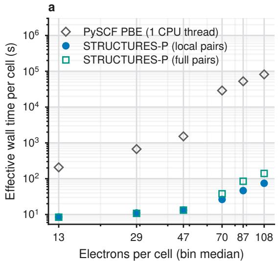

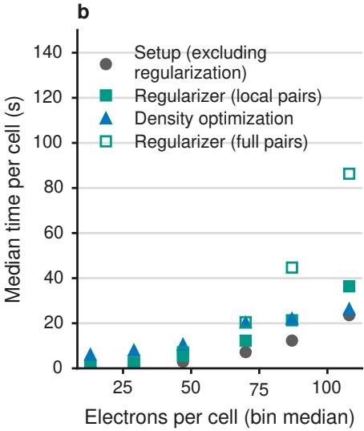  
Fig. 7 Computational cost over the evaluated cell-size range. a Amortized end-to-end wall time per structure for STRUCTURES-P with full-pair and local-pair regularization, including startup and compilation, and mean wall time per matched single-thread PySCF calculation. b Median time per structure for density optimization, construction of the local-pair regularizer, and the remaining static setup; open squares show full-pair regularizer construction.

Figure 7a covers interval medians from 13 to 108 electrons. With local pairs, efective wall time per structure, including startup and compilation, ranges from 8.5 to 74.5 s, compared with 8.4 to 140.1 s for full pairs. The largest interval therefore gives a matched 1.88-fold speedup; the three smallest intervals show no speedup. The onethread PySCF interval means range from 207 s to 81,800 s and provide context, not a controlled speedup comparison. In the largest interval, median regularizer construction falls from 86.3 to 36.4 s, whereas median density optimization changes from 25.7 to 26.3 s. The benefit thus comes from setup, not fewer optimization steps.

At fixed basis size per atom and bounded local coordination, the number of included orbital pairs grows as $O ( N )$ instead of $O ( N ^ { 2 } )$ , with N the number of atoms. The overlap factor then has $O ( N ^ { 2 } )$ entries, and its dense Gram-matrix construction costs $O ( N ^ { 3 } )$ instead of $O ( N ^ { 4 } )$ . The dense change of basis and solution for $R _ { \epsilon }$ also cost $O ( N ^ { 3 } )$ ; this is the realization used for the reported local-pair results. Applying $\widetilde { A }$ through its factors and solving $( \widetilde { A } + \epsilon I ) \mathbf { x } = \widetilde { A } \mathbf { g }$ iteratively can instead cost $O ( q N ^ { 2 } )$ for $q$ iterations, without forming $\widetilde { A }$ or $R _ { \epsilon }$ . This matrix-free alternative does not imply quadratic scaling of the complete calculation, which still contains other dense operations, nor is a size-independent iteration count guaranteed.

On all five periodic test evaluations (four model/training combinations on 6211 cells and the 734-cell larger-system test), replacing full pairs by local pairs changes the energy MAE by at most 0.0051% and the mean density error by at most

0.076%. The same trained functionals and reference labels are used; only the optimization regularizer changes. Isolated-molecule evaluations and single-point fitted-KS and geometry-only baselines are unafected.

## 4.7 Use of AI tools

Large language model assistants (Claude, Anthropic; OpenAI Codex) were used to write and refactor code for the project, including analysis and figure scripts, and to draft and revise the manuscript text. All methods, results, and conclusions were specified and verified by the authors, who take full responsibility for the content.

## Data availability

Supplementary Data 1, which will be available with the journal version of this article, contains the source data underlying the main-text figures, Table 1, and the Supplementary figures, together with the lattice vectors and atomic positions of all 62,109 CHNO cells, with their training, validation, and test assignments, and of the 734 larger cells. The full computational dataset (approximately 500 GB), including Kohn–Sham densities and density-functional labels, is available from the corresponding author on reasonable request. It has not been deposited in a public repository because of its size and associated storage requirements.

## Code availability

The code and trained model checkpoints will be made publicly available on GitHub upon publication.

## Acknowledgements

We warmly thank Graeme Ackland and Maurits Haverkort for very helpful discussions. This work was supported by the Deutsche Forschungsgemeinschaft (DFG) under Germany’s Excellence Strategy EXC-2181/1 – 390900948 (the Heidelberg STRUCTURES Excellence Cluster), by the Wildcard Program of the Carl-Zeiss-Stiftung, and by the Klaus Tschira Stiftung gGmbH (SIMPLAIX program). F.A.H. and A.H. acknowledge support from the Royal Society (Grant No. IES/R2/242159). The authors acknowledge computing support by the state of Baden-W¨urttemberg through bwHPC and the DFG through grant INST 35/1597-1 FUGG, and the data storage service SDS@hd supported by the Ministry of Science, Research and the Arts Baden-W¨urttemberg (MWK) and the DFG through grants INST 35/1803-1 FUGG and INST 35/1804-1 LAGG. Computational support from the UK national high-performance computing service ARCHER2 is gratefully acknowledged; access was obtained via the UKCP consortium and funded by EPSRC grant EP/X035891/1. The funders played no role in study design, data collection, analysis and interpretation of data, or the writing of this manuscript.

## Author contributions

F.A.H. and A.H. conceived the project. M.K.I. developed the code, performed all calculations and experiments, and wrote the manuscript. A.H. generated the largercell test structures. F.A.H. supervised the project. All authors discussed the results, revised the manuscript, and approved the final version.

## Competing interests

The authors declare no competing interests.

## References

1. Kohn, W. & Sham, L. J. Self-consistent equations including exchange and correlation efects. Phys. Rev. 140, A1133–A1138 (1965).

2. Hohenberg, P. & Kohn, W. Inhomogeneous electron gas. Phys. Rev. 136, B864– B871 (1964).

3. Mi, W., Luo, K., Trickey, S. B. & Pavanello, M. Orbital-free density functional theory: An attractive electronic structure method for large-scale first-principles simulations. Chem. Rev. 123, 12039–12104 (2023).

4. Xia, J., Huang, C., Shin, I. & Carter, E. A. Can orbital-free density functional theory simulate molecules? J. Chem. Phys. 136, 084102 (2012).

5. Thomas, L. H. The calculation of atomic fields. Proc. Camb. Philos. Soc. 23, 542–548 (1927).

6. Fermi, E. Eine statistische Methode zur Bestimmung einiger Eigenschaften des Atoms und ihre Anwendung auf die Theorie des periodischen Systems der Elemente. Z. Phys. 48, 73–79 (1928).

7. v. Weizs¨acker, C. F. Zur Theorie der Kernmassen. Z. Phys. 96, 431–458 (1935).

8. Wang, L.-W. & Teter, M. P. Kinetic-energy functional of the electron density. Phys. Rev. B 45, 13196–13220 (1992).

9. Wang, Y. A., Govind, N. & Carter, E. A. Orbital-free kinetic-energy density functionals with a density-dependent kernel. Phys. Rev. B 60, 16350–16358 (1999).

10. Huang, C. & Carter, E. A. Nonlocal orbital-free kinetic energy density functional for semiconductors. Phys. Rev. B 81, 045206 (2010).

11. Constantin, L. A., Fabiano, E. & Della Sala, F. Performance of semilocal kinetic energy functionals for orbital-free density functional theory. J. Chem. Theory

12. Witt, W. C., Shires, B. W. B., Tan, C. W., Jankowski, W. J. & Pickard, C. J. Random structure searching with orbital-free density functional theory. J. Phys. Chem. A 125, 1650–1660 (2021).

13. Borgoo, A., Green, J. A. & Tozer, D. J. Molecular binding in post-Kohn–Sham orbital-free DFT. J. Chem. Theory Comput. 10, 5338–5345 (2014).

14. Majumdar, S., Shi, Z. & Vignale, G. Orbital-free density functional theory for periodic solids: Construction of the Pauli potential. J. Chem. Theory Comput. 21, 6007–6022 (2025).

15. Chen, M., Pavanello, M., Mi, W., Ihara, M. & Manzhos, S. Machine learningenhanced orbital-free density functional theory. J. Chem. Theory Comput. 22, 3127–3143 (2026).

16. Snyder, J. C., Rupp, M., Hansen, K., M¨uller, K.-R. & Burke, K. Finding density functionals with machine learning. Phys. Rev. Lett. 108, 253002 (2012).

17. Yao, K. & Parkhill, J. Kinetic energy of hydrocarbons as a function of electron density and convolutional neural networks. J. Chem. Theory Comput. 12, 1139– 1147 (2016).

18. Seino, J., Kageyama, R., Fujinami, M., Ikabata, Y. & Nakai, H. Semi-local machine-learned kinetic energy density functional with third-order gradients of electron density. J. Chem. Phys. 148, 241705 (2018).

19. Meyer, R., Weichselbaum, M. & Hauser, A. W. Machine learning approaches toward orbital-free density functional theory: Simultaneous training on the kinetic energy density functional and its functional derivative. J. Chem. Theory Comput. 16, 5685–5694 (2020).

20. Fujinami, M., Kageyama, R., Seino, J., Ikabata, Y. & Nakai, H. Orbital-free density functional theory calculation applying semi-local machine-learned kinetic energy density functional and kinetic potential. Chem. Phys. Lett. 748, 137358 (2020).

21. Ryczko, K., Wetzel, S. J., Melko, R. G. & Tamblyn, I. Toward orbital-free density functional theory with small data sets and deep learning. J. Chem. Theory Comput. 18, 1122–1128 (2022).

22. del Mazo-Sevillano, P. & Hermann, J. Variational principle to regularize machinelearned density functionals: The non-interacting kinetic-energy functional. J. Chem. Phys. 159, 194107 (2023).

23. Imoto, F., Imada, M. & Oshiyama, A. Order-N orbital-free density-functional calculations with machine learning of functional derivatives for semiconductors and metals. Phys. Rev. Res. 3, 033198 (2021).

24. Sun, L. & Chen, M. Machine learning based nonlocal kinetic energy density functional for simple metals and alloys. Phys. Rev. B 109, 115135 (2024).

25. Sun, L. & Chen, M. Multi-channel machine learning based nonlocal kinetic energy density functional for semiconductors. Electron. Struct. 6, 045006 (2024).

26. Manzhos, S. & Golub, P. Data-driven kinetic energy density fitting for orbital-free DFT: Linear vs Gaussian process regression. J. Chem. Phys. 153, 074104 (2020).

27. L¨uder, J., Ihara, M. & Manzhos, S. A machine-learned kinetic energy model for light weight metals and compounds of group III-V elements. Electron. Struct. 6, 045002 (2024).

28. Thapa, B., Oellerich, T. G., Emelianenko, M., Suryanarayana, P. & Mazin, I. I. Orbital-free density functionals based on real and reciprocal space separation. npj Comput. Mater. 11, 149 (2025).

29. Manzhos, S., L¨uder, J., Golub, P. & Ihara, M. Machine learning-guided construction of an analytic kinetic energy functional for orbital free density functional theory. Mach. Learn. Sci. Technol. 6, 035002 (2025).

30. Hamann, D. R. Optimized norm-conserving Vanderbilt pseudopotentials. Phys. Rev. B 88, 085117 (2013).

31. van Setten, M. J. et al. The PseudoDojo: Training and grading a 85 element optimized norm-conserving pseudopotential table. Comput. Phys. Commun. 226, 39–54 (2018).

32. Zhou, B., Wang, Y. A. & Carter, E. A. Transferable local pseudopotentials derived via inversion of the Kohn-Sham equations in a bulk environment. Phys. Rev. B 69, 125109 (2004).

33. Huang, C. & Carter, E. A. Transferable local pseudopotentials for magnesium, aluminum and silicon. Phys. Chem. Chem. Phys. 10, 7109–7120 (2008).

34. del Rio, B. G., Dieterich, J. M. & Carter, E. A. Globally-optimized local pseudopotentials for (orbital-free) density functional theory simulations of liquids and solids. J. Chem. Theory Comput. 13, 3684–3695 (2017).

35. Rios-Vargas, V. et al. Pseudopotentials for orbital-free DFT: Capturing nonlocality and correcting functional approximants. Phys. Rev. B 113, 125124 (2026).

36. Xu, Q., Ma, C., Mi, W., Wang, Y. & Ma, Y. Nonlocal pseudopotential energy density functional for orbital-free density functional theory. Nat. Commun. 13, 1385 (2022).

37. Ma, C., Xu, Q., Mi, W., Wang, Y. & Ma, Y. Nonlocal pseudopotential energy density functional for semiconductors. Phys. Rev. B 109, 075144 (2024).

38. Moldabekov, Z. A., Shao, X., Pavanello, M., Vorberger, J. & Dornheim, T. Nonlocal vs local pseudopotentials afect kinetic energy kernels in orbital-free DFT. Electron. Struct. 7, 015006 (2025).

39. Lehtom¨aki, J., Makkonen, I., Caro, M. A., Harju, A. & Lopez-Acevedo, O. Orbitalfree density functional theory implementation with the projector augmented-wave method. J. Chem. Phys. 141, 234102 (2014).

40. Motamarri, P., Iyer, M., Knap, J. & Gavini, V. Higher-order adaptive finiteelement methods for orbital-free density functional theory. J. Comput. Phys. 231, 6596–6621 (2012).

41. Chan, G. K.-L., Cohen, A. J. & Handy, N. C. Thomas–Fermi–Dirac–von Weizs¨acker models in finite systems. J. Chem. Phys. 114, 631–638 (2001).

42. Ryley, M. S., Withnall, M., Irons, T. J. P., Helgaker, T. & Teale, A. M. Robust all-electron optimization in orbital-free density-functional theory using the trustregion image method. J. Phys. Chem. A 125, 459–475 (2021).

43. LeMaitre, P. A. & Thompson, R. B. Gaussian basis functions for an orbital-freerelated density functional theory of atoms. Int. J. Quantum Chem. 123, e27111 (2023).

44. Hutcheon, M. J. & Wibowo-Teale, A. M. Exact nuclear cusps in all-electron orbital-free density functional theory. Phys. Rev. B 110, 195146 (2024).

45. Elsborg, J. et al. Global plane waves from local Gaussians: Periodic charge densities in a blink. In Forty-Third International Conference on Machine Learning (2026). URL https://openreview.net/forum?id=EPKdX56JSc.

46. Su, T. et al. DeePAW: A universal machine learning model for orbital-free ab initio calculations. Preprint (2026). arXiv:2603.18650.

47. Remme, R. & Hamprecht, F. A. Surrogate functionals for machine-learned orbitalfree density functional theory. J. Chem. Phys. 165, 034117 (2026).

48. Wagner, S., Ickler, M. K., Klockow, M. V., Hamprecht, F. A. & Remme, R. Orbital-free surrogate functionals yield transferable interatomic potentials and electron densities. Preprint (2026). arXiv:2609.21882.

49. Remme, R., Kaczun, T., Scheurer, M., Dreuw, A. & Hamprecht, F. A. Kinetic-Net: Deep learning a transferable kinetic energy functional for orbital-free density functional theory. J. Chem. Phys. 159, 144113 (2023).

50. Zhang, H. et al. Overcoming the barrier of orbital-free density functional theory for molecular systems using deep learning. Nat. Comput. Sci. 4, 210–223 (2024).

51. Lippmann, P., Gerhartz, G., Remme, R. & Hamprecht, F. A. Beyond canonicalization: How tensorial messages improve equivariant message passing. In International Conference on Learning Representations, Vol. 2025, 88067– 88087 (2025). URL https://proceedings.iclr.cc/paper files/paper/2025/hash/ db7534a06ace69f4ec95bc89e91d5dbb-Abstract-Conference.html.

52. Remme, R. et al. Stable and accurate orbital-free density functional theory powered by machine learning. J. Am. Chem. Soc. 147, 28851–28859 (2025).

53. Pickard, C. J. AIRSS data for carbon at 10GPa and the C+N+H+O system at 1GPa. Materials Cloud, https://doi.org/10.24435/materialscloud:2020.0026/v1 (2020).

54. Pickard, C. J. & Needs, R. J. Ab initio random structure searching. J. Phys. Condens. Matter 23, 053201 (2011).

55. Clark, S. J. et al. First principles methods using CASTEP. Z. Kristallogr. 220, 567–570 (2005).

56. Constantin, L. A., Fabiano, E., Laricchia, S. & Della Sala, F. Semiclassical neutral atom as a reference system in density functional theory. Phys. Rev. Lett. 106, 186406 (2011).

57. Ramakrishnan, R., Dral, P. O., Rupp, M. & von Lilienfeld, O. A. Quantum chemistry structures and properties of 134 kilo molecules. Sci. Data 1, 140022 (2014).

58. Blum, V. et al. Ab initio molecular simulations with numeric atom-centered orbitals. Comput. Phys. Commun. 180, 2175–2196 (2009).

59. K¨uhne, T. D. et al. CP2K: An electronic structure and molecular dynamics software package – Quickstep: Eficient and accurate electronic structure calculations. J. Chem. Phys. 152, 194103 (2020).

60. Blaha, P. et al. WIEN2k: An APW+lo program for calculating the properties of solids. J. Chem. Phys. 152, 074101 (2020).

61. Sun, Q., Berkelbach, T. C., McClain, J. D. & Chan, G. K.-L. Gaussian and planewave mixed density fitting for periodic systems. J. Chem. Phys. 147, 164119 (2017).

62. Ye, H.-Z. & Berkelbach, T. C. Fast periodic Gaussian density fitting by range separation. J. Chem. Phys. 154, 131104 (2021).

63. Sun, Q. et al. Recent developments in the PySCF program package. J. Chem. Phys. 153, 024109 (2020).

64. Conway, L. J., Pickard, C. J. & Hermann, A. First principles crystal structure prediction. In Comprehensive Inorganic Chemistry III, Vol. 3, 393–420 (Elsevier, 2023).

65. Togo, A., Shinohara, K. & Tanaka, I. Spglib: A software library for crystal symmetry search. Sci. Technol. Adv. Mater. Methods 4, 2384822 (2024).

66. Larsen, P. M., Pandey, M., Strange, M. & Jacobsen, K. W. Definition of a scoring parameter to identify low-dimensional materials components. Phys. Rev. Mater. 3, 034003 (2019).

67. Larsen, A. H. et al. The atomic simulation environment—a Python library for working with atoms. J. Phys. Condens. Matter 29, 273002 (2017).

68. Perdew, J. P., Burke, K. & Ernzerhof, M. Generalized gradient approximation made simple. Phys. Rev. Lett. 77, 3865–3868 (1996).

69. Fu, X. et al. Learning smooth and expressive interatomic potentials for physical property prediction. In Proceedings of the 42nd International Conference on Machine Learning, Vol. 267 of Proceedings of Machine Learning Research, 17875–17893 (PMLR, 2025). URL https://proceedings.mlr.press/v267/fu25h. html.

# Supplementary Information

All-electron machine-learned orbital-free density functional for periodic CHNO systems

Marc K. Ickler1, Andreas Hermann2, and Fred A. Hamprecht1

1Interdisciplinary Center for Scientific Computing (IWR), Heidelberg University, Heidelberg 69120, Germany

2Centre for Science at Extreme Conditions and SUPA, School of Physics and Astronomy, University of Edinburgh, Edinburgh EH9 3FD, United Kingdom

## Supplementary Note 1: Model-size ablation

We compare two eSEN widths while holding the training data, optimization schedule, and densityoptimization protocol fixed within each training family. The small model uses 32 sphere, 32 edge, and 64 hidden channels, whereas the large model uses 128 channels for all three, corresponding to approximately 2.73 and 22.75 million parameters, respectively.

Supplementary Table 1: Model-size ablation for STRUCTURES-P on the complete test sets. The small and large models have approximately 2.73 and 22.75 million parameters, respectively. The variational density optimizations use float64 arithmetic, soft regularization $\epsilon = 0 . 1$ , and the same convergence threshold and cycle limit. Mean $L ^ { 2 }$ is the mean cell-level density error $\epsilon _ { \rho }$ of Eq. (4) of the main text, in $a _ { 0 } ^ { - 3 / 2 }$ ; Conv. (%) is the percentage of structures meeting the regularized-gradient convergence criterion within the cycle limit (main-text Methods, Density optimization). The eSEN MLIP predicts total energies directly from geometry and is trained without force supervision. Density error and convergence do not apply to this baseline.
<table><tr><td colspan="7">(mHa/cell)</td></tr><tr><td>Training setup / test</td><td>Small</td><td>Large</td><td>Mean Small</td><td> $L ^ { 2 }$  Large</td><td>Small</td><td>Conv. (%) Large</td></tr><tr><td>STRUCTURES-P@optimized, CHNO</td><td>1.981</td><td>1.583</td><td>0.0174</td><td></td><td></td><td></td></tr><tr><td>CHNO STRUCTURES-P@optimized, joint / QM9</td><td>0.354</td><td>0.245</td><td>0.0128</td><td>0.0138 0.0111</td><td>99.871 100.000</td><td>99.920 100.000</td></tr><tr><td>STRUCTURES-P@optimized, joint CHNO</td><td>2.299</td><td>1.771</td><td>0.0240</td><td>0.0197</td><td>98.905</td><td>99.549</td></tr><tr><td>eSEN MLIP, CHNO / CHNO</td><td>3.361</td><td>3.316</td><td></td><td></td><td></td><td></td></tr></table>

Increasing the width improves both energy and density accuracy in every matched comparison. The energy MAE decreases by 20.1% for the CHNO-only model, 30.7% for joint-model QM9, and 23.0% for joint-model CHNO; the corresponding density error reductions are 20.7%, 12.8%, and 17.9%. Convergence is unchanged or improved for all three evaluations. In contrast, increasing the width of the geometry-only model reduces its energy MAE by only 1.3%, from 3.361 to 3.316 mHa/cell. Only two widths are compared here. The larger model is therefore the best of the tested configurations, not an established optimum; whether further increases in capacity improve density optimization remains open.

## Supplementary Note 2: K-point reference sensitivity

We recomputed the PySCF references of 637 fixed cells at nominal k-point spacings of 0.04 and 0.03 $\mathring { \mathrm { A } } ^ { - 1 } ;$ the cell selection, replay, refinement, and screening protocol is given in Methods. These checks do not establish basis convergence or the ground state across spin states. Supplementary Figs. 1 and 2 show the $\mathrm { C H _ { 2 } }$ comparison and the distribution of per-cell energy changes.

## K-point refinement of the $\mathrm { { C H } _ { 2 } }$ rankings

Supplementary Fig. 1 revisits the 20 $\mathrm { C H _ { 2 } }$ candidates in the main-text ranking figure, replacing the original nominal 0.10 $\textup { \AA } ^ { - 1 }$ PySCF references with 0.03 $\textup { \AA } ^ { - 1 }$ results. The candidate set, geometries, $p V$ contributions, and model predictions are unchanged. The computational protocol is described in Methods.

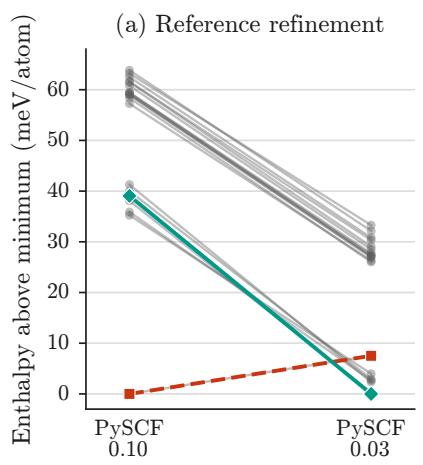  
A: original PySCF / model minimum B: refined PySCF minimum

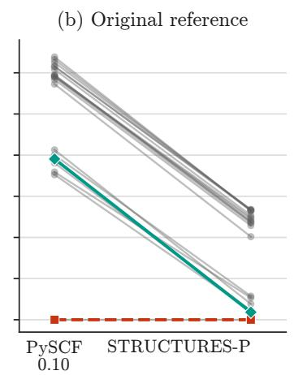

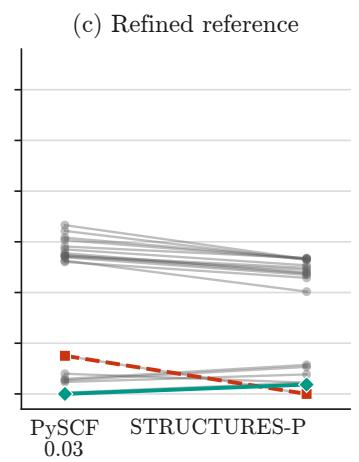  
Supplementary Figure 1: $\mathbf { C H } _ { 2 }$ rankings before and after k-point refinement. Lines connect the same structures between $a )$ the two PySCF settings, b) original PySCF and STRUCTURES-P, and $c )$ refined PySCF and STRUCTURES-P. Each method is referenced to its own minimum over the same 20 candidates. The highlighted structures are $\mathrm { A }$ , the original PySCF and model minimum (CHNO-140055-4417-4), and B, the refined PySCF minimum (CHNO-59219-1291-63). Spacings are in $\textup { \AA } ^ { - 1 }$

Finer sampling removes the isolated minimum in the original PySCF data and changes the lowestenthalpy candidate, while the higher- and lower-enthalpy groups remain distinct. The model follows this broad grouping but still selects the original minimum. For these 20 cells, the largest change in any pairwise enthalpy diference between 0.04 and 0.03 $\textup { \AA } ^ { - 1 }$ is 0.20 meV/atom.

## Reference energy changes and model errors

The broader comparison uses 516 cells with screened results at both refined spacings, out of 637 selected candidates; 465 belong to the main-text ranking figure. These are targeted ranking and near-minimum candidates, not a random sample of the full dataset.

Most changes are small, but a minority reach tens of meV/atom (Supplementary Fig. 2). The mean and median reference changes are 2.78 and 0.43 meV/atom, compared with 1.69 and 0.98 meV/atom for the deviation of STRUCTURES-P from the original reference. The comparison does not establish full k-point convergence: 5 cells still change by more than 5 meV/atom between 0.04 and 0.03 $\textup { \AA } ^ { - 1 }$

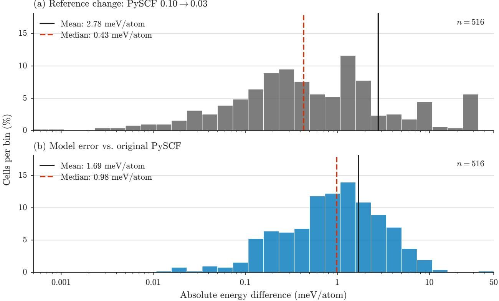  
Supplementary Figure 2: Distributions of reference changes and model errors. Absolute per-atom energy diferences for the same 516 screened cells: $a )$ PySCF at nominal spacings of 0.10 and $0 . 0 3 \textup { \AA } ^ { - 1 }$ ; b) STRUCTURES-P versus the original 0.10 $\mathrm { ~ \AA ^ { - 1 } ~ }$ PySCF reference. Both histograms use the same 30 logarithmically spaced bins and axis scales. Solid black and dashed red lines mark the mean and median, respectively. At fixed geometry and $p V$ , reference energy changes are also enthalpy changes.

The present data support a proof of concept for learned periodic OF-DFT and comparisons of broad energy trends. Reliable crystal-structure ranking, especially the ordering of near-degenerate candidates, will require more accurate reference data with systematic k-point and basis-set convergence checks.

Source data. The per-cell reference energies, $p V$ terms, k-point meshes, and screening statuses of the 637 selected structures underlying Supplementary Figs. 1 and 2 are included in Supplementary Data 1.

## Supplementary Note 3: Negative-density audit

We evaluated the integrated negative charge N− of 50 randomly sampled optimized test densities, using the protocol in Methods. All 50 optimizations converged. On a level-3 Becke grid, 48 cells had no detected negative density. The remaining two cases were confirmed using level-4 and level-5 Becke grids and positive-weight uniform-grid refinements. At level 5, CHNO-12884-189-5 had $N _ { - } = 5 . 9 9 \times 1 0 ^ { - 5 }$ electrons and a minimum density of $^ { \cdot } - 2 . 2 1 \times 1 0 ^ { - 5 }$ electrons $/ a _ { 0 } ^ { 3 }$ , while CHNO-84049- 9284-127 had $N _ { - } = 8 . 4 0 \times 1 0 ^ { - 7 }$ electrons and a minimum density of $- 1 . 1 7 \times 1 0 ^ { - }$ −5 electrons $/ a _ { 0 } ^ { 3 }$ . The corresponding integrated electron counts were 53.999994 and 45.999992, compared with the target values 54 and 46, respectively. Thus the sampled optimized densities can contain small negative regions, but their integrated negative charge is very small relative to the unit-cell electron count.

## Supplementary Data 1: Source data and cell geometries

Supplementary Data 1 (ZIP archive, available with the journal version of this article) contains one CSV file per figure panel or table with the source data underlying the main-text figures, Table 1, and Supplementary Figs. 1 and 2, and the lattice vectors and atomic positions (extended XYZ format, ˚A) of all 62,109 CHNO cells, with their training, validation, and test assignments, and of the 734 larger cells. A README file in the archive describes each file; cells are identified by the same structure identifiers throughout.