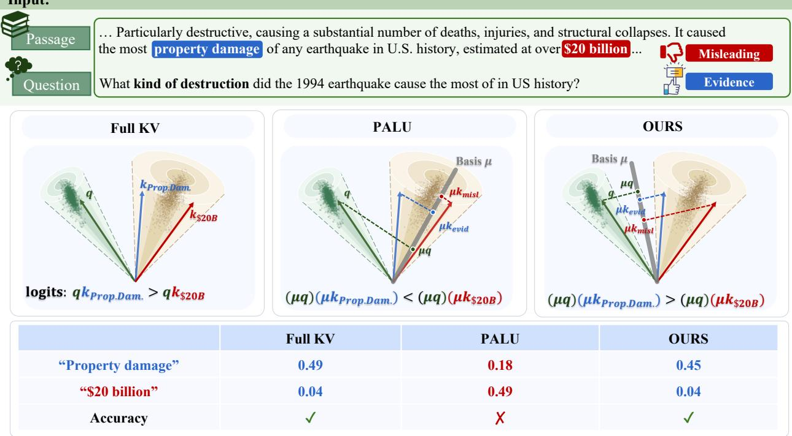
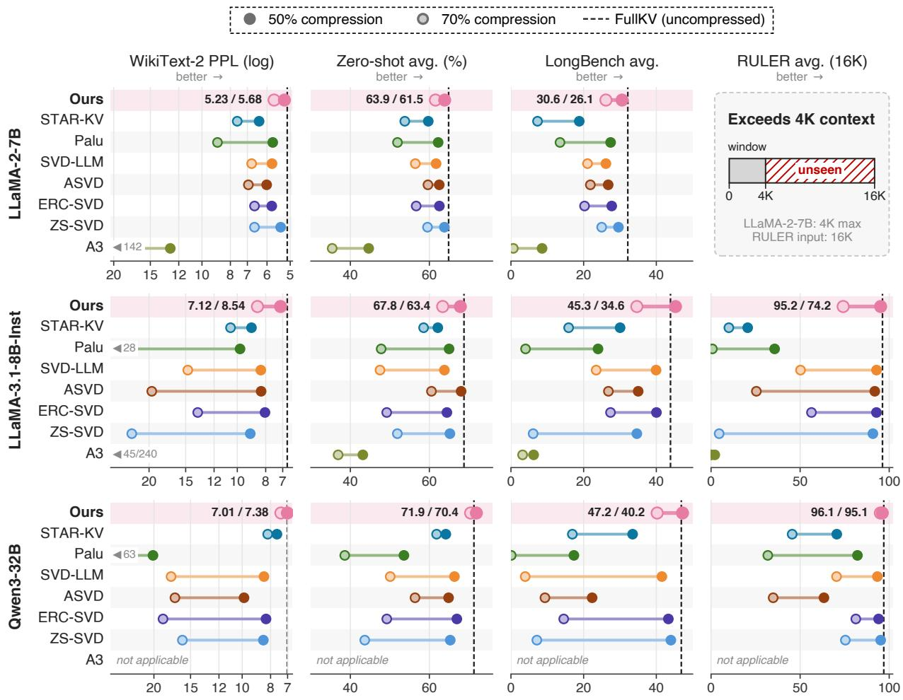
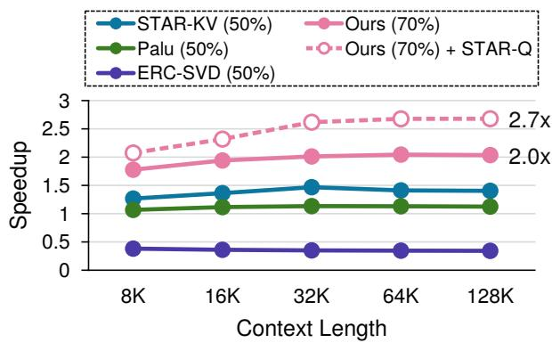
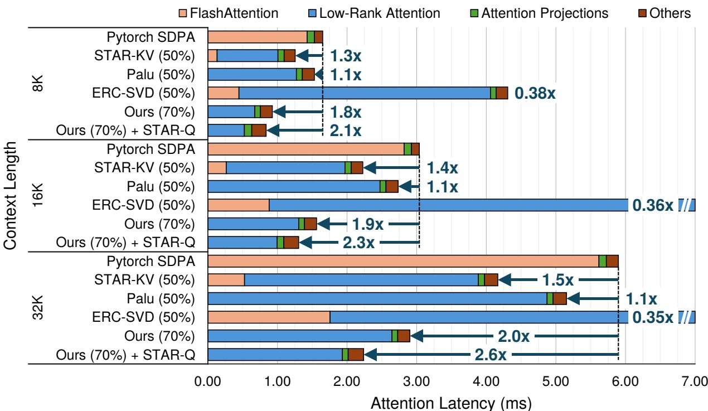

# BELT: BEHAVIOR-ALIGNED LOW-RANK KV CACHE COMPRESSION WITH LEARNED TOP-K RANK ALLOCATION

Yaoyang Liu Peking University

Shuwei Shen JD.com

Jincheng Tang Peking University

Jinguang Liu JD.com

Jinbao Xue Tencent

Hailong Yang BeiHang University

Ke Zhang JD.com

Yinjun Wu Peking University

## ABSTRACT

Long-context inference makes the key-value (KV) cache a major memory bottleneck for large language models. We propose BELT, a low-rank KV cache compression framework. Its key-side objective targets attention distributions rather than raw keys or pre-softmax logits, yielding a quadratic surrogate with a closed-form low-rank solution. A learned global rank allocator uses differentiable soft selection during training and hard selection at deployment to meet a user-specified component budget. Experiments demonstrate improved model quality under aggressive compression and increased decoding throughput at comparable accuracy. Evaluated across three LLMs and multiple benchmarks, BELT achieves up to 70% low-rank KV cache compression while outperforming the strongest baseline by up to 23.3 points on LongBench, and up to 17.8× overall KV cache reduction when combined with quantization. With Triton-based GPU kernels and a quantized cache, BELT delivers up to 2.7× speedup for the attention module and 3.3× end-to-end decoding throughput.

Keywords First keyword · Second keyword · More

## 1 Introduction

Large language models (LLMs) have become ubiquitous in modern AI applications, yet their growing scale—in both model size and context length—poses significant inference challenges. Modern LLMs support 128K-token contexts or more [1, 2, 3], making the key-value (KV) cache a critical inference bottleneck. During autoregressive generation, the cache stores keys and values for preceding tokens, and its memory footprint grows linearly with sequence length, potentially exceeding available GPU memory [4]. Efficient KV cache management is therefore essential, motivating approaches such as token eviction [5, 6], quantization [7, 8], and low-rank decomposition [9, 10].

Among these, low-rank decomposition exploits hidden-dimension redundancy to reduce KV cache memory. Prior work follows two broad directions: adapting general-purpose decomposition methods to the KV cache [11, 12, 13, 14, 15, 16], and developing KV-specific methods tailored to attention and caching dynamics [17, 9, 18, 19, 20, 21]. STAR-KV [10] and A3 [22] represent recent state-of-the-art advances in adaptive rank control and analytical attention approximation, respectively.

Despite this progress, two challenges still remain. First, the compression criterion ofthe state-of-the-art does not reflect the effect ofapproximation errors on attention behavior. Methods based on KV reconstruction do not explicitly account for how key errors interact with queries and the nonlinear softmax map. As illustrated in Figure 1, retaining dominant singular directions of the KV tensors can distort attention and change the generated answer. $\mathbf { A } ^ { 3 }$ moves beyond raw key reconstruction by targeting pre-softmax attention logits, which, however, is not the same as preserving attention probabilities or the resulting attention output. This motivates a key-compression criterion that explicitly accountsfor post-softmax behavior.

Second, allocating ranks across heterogeneous KV projections under a prescribed global budget remains challenging. Uniform allocation ignores differences in compression sensitivity, while sensitivity-based searches and learned threshold methods offer different approaches to adaptive allocation. STAR-KV [10] learns block-specific thresholds with a soft compression penalty, without directly enforcing a prescribed global component budget. Our analysis further identifies these learned thresholds concentrate under certain conditions, potentially limiting allocation effectiveness.

<table><tr><td rowspan=1 colspan=1></td><td rowspan=1 colspan=1>Full KV</td><td rowspan=1 colspan=1>PALU</td><td rowspan=1 colspan=1>OURS</td></tr><tr><td rowspan=1 colspan=1>“Property damage&quot;</td><td rowspan=1 colspan=1>0.49</td><td rowspan=1 colspan=1>0.18</td><td rowspan=1 colspan=1>0.45</td></tr><tr><td rowspan=1 colspan=1>“$20 billion”</td><td rowspan=1 colspan=1>0.04</td><td rowspan=1 colspan=1>0.49</td><td rowspan=1 colspan=1>0.04</td></tr><tr><td rowspan=1 colspan=1>Accuracy</td><td rowspan=1 colspan=1>√</td><td rowspan=1 colspan=1>X</td><td rowspan=1 colspan=1>√</td></tr></table>

Figure 1: Left: Full attention, where each query attends to all context tokens. Middle: State-of-the-art low-rank compression (e.g., vanilla SVD) retains only the dominant KV eigenvector µ, reducing the query–key product from $q ^ { \top }$ k to $( \bar { q } ^ { \top } \mu ) ( \mu ^ { \top } k )$ . Since µ is derived solely from the input-context tokens and ignores subsequent queries, this distorts the attention distribution and can yield an incorrect answer. Right: The dominant eigen-vector derived by ours aligns the query and key decompositions, preserving the downstream attention output and yielding the correct answer.

We address these challenges from two complementary perspectives. First, we design compression objectives to preserve the attention output ofthe uncompressed model. While our value-side construction is closely related to A3 [22], our key-side objective targets attention-distribution preservation rather than pre-softmax logit reconstruction like $\mathbf { A } ^ { 3 }$ . By accounting for query-dependent softmax sensitivity and RoPE interactions, BELT better preserves attention behavior under aggressive compression, as demonstrated empirically. Second, we learn ranks across KV blocks under an explicit global budget. Our allocator learns how to distribute ranks across attention heads according to their compression sensitivity. We use a differentiable relaxation of top-B selection for end-to-end training, followed by hard selection of B components, where B is the user-specified budget.

Extensive experiments evaluate BELT across multiple models, compression budgets, and tasks. At 70% KV cache compression on Qwen3-32B, BELT improves the average score over the strongest evaluated baseline by 23.3 points on LongBench and 13.8 points on RULER. We additionally evaluate perplexity, zero-shot accuracy, and the contributions of the compression bases and rank allocation; combined with 3-bit KV quantization, BELT reaches 17.8× KV cache compression within 2 points of the uncompressed zero-shot accuracy. System-level measurements show up to 3.26× higher decoding throughput and 87% lower KV cache memory than full-cache inference on LLaMA-2-7B with KV quantization. These results demonstrate the practical benefits of attention-aware compression and globally coordinated rank allocation.

In summary, our contributions are:

• We formulate an attention-output-motivated approach to low-rank KV compression, with a key-side metric derived from attention-distribution KL rather than pre-softmax logit reconstruction.

• We derive quadratic compression surrogates with exact weighted-SVD solutions, extend the construction to RoPE and GQA, and explicitly characterize their approximation errors.

• We introduce a learned global rank allocator that enforces a relaxed budget during training and an exact componentcount budget at deployment, while preserving an ordered prefix within each KV block.

• We empirically evaluate model quality, approximation accuracy, rank allocation, and decoding efficiency under aggressive KV cache compression.

## 2 Preliminaries

## 2.1 Attention and KV Cache

We consider a single attention head in a Transformer decoder layer [23]. Let $\ b { X } \in \mathbb { R } ^ { n \times d }$ be the stacked representations of the n preceding tokens stored in the KV cache. For any input token $x \in \mathbb { R } ^ { 1 \times d }$ , each head computes its query, key, and value projections as

$$
q _ { x } = x W _ { Q } , \quad k _ { x } = x W _ { K } , \quad v _ { x } = x W _ { V } ,
$$

where $W _ { Q } , W _ { K } , W _ { V } \in \mathbb { R } ^ { d \times d _ { h } }$ and $d _ { h }$ is the per-head dimension. During autoregressive generation, the queries, keys, and values of the n tokens are obtained from X as

$$
Q = X W _ { Q } , \quad K = X W _ { K } , \quad V = X W _ { V }
$$

so the KV cache stores $K , V \in \mathbb { R } ^ { n \times d _ { h } }$ , which is interacted with q for attention calculation as follows:

$$
\begin{array} { r l } & { o _ { x } ( W _ { K } , W _ { V } ) = a _ { x } ( W _ { K } ) V W _ { O } \in \mathbb { R } ^ { 1 \times d } = a _ { x } ( W _ { K } ) X W _ { V } W _ { O } \in \mathbb { R } ^ { 1 \times d } , } \\ & { \mathrm { w h e r e ~ } a _ { x } ( W _ { K } ) = \mathrm { S o f t m a x } \bigg ( \frac { q _ { x } K } { \sqrt { d _ { h } } } \bigg ) = \mathrm { S o f t m a x } \bigg ( \frac { q _ { x } X W _ { K } } { \sqrt { d _ { h } } } \bigg ) \in \mathbb { R } ^ { 1 \times n } , \mathrm { ~ a n d ~ } W _ { O } \in \mathbb { R } ^ { d _ { h } \times d _ { h } } . } \end{array}\tag{1}
$$

In this formula, $a _ { x } ( W _ { K } )$ is the attention probability vector, where we explicitly highlight its reliance on $W _ { K }$ . Similarly, we use $o _ { x } ( W _ { K } , W _ { V } )$ to denote the final attention output which relies on both $W _ { k }$ and $W _ { V }$ . In practice, Rotary Position Embedding (RoPE) [24] is applied to queries and keys as a non-linear, position-dependent embedding before attention. More detailed description for attention mechanism with RoPE and how BELT is generalized to RoPE is Appendix D.

State-of-the-art large language models typically employ multiple attention heads per layer with two widely adopted strategies: Multi-head attention (MHA) runs h such heads in parallel, while grouped-query attention (GQA) shares each key–value pair among a group of query heads. Our framework aims to compress KV cache at individual heads, which thus applies to both. We start by assuming the use of MHA by default and discuss the extension of BELT to GQA in Appendix C.

## 2.2 Low-Rank KV Cache Compression

Low-rank compression reduces the KV cache size by approximating each key/value projection matrix $W _ { K } \in$ $\mathbb { R } ^ { d \times d _ { h } } , W _ { V } \in \dot { \mathbb { R } } ^ { d \times d _ { h } }$ with a rank-r factorization $( r < d _ { h } )$

$$
W _ { K } \approx \hat { W } _ { K } = W _ { K } ^ { \mathrm { d o w n } } W _ { K } ^ { \mathrm { u p } } , W _ { V } \approx \hat { W } _ { V } = W _ { V } ^ { \mathrm { d o w n } } W _ { V } ^ { \mathrm { u p } }
$$

where $W _ { K } ^ { \mathrm { d o w n } } , W _ { V } ^ { \mathrm { d o w n } } \in \mathbb R ^ { d \times r } , W _ { K } ^ { \mathrm { u p } } , W _ { V } ^ { \mathrm { u p } } \in \mathbb R ^ { r \times d _ { h } }$ and $\hat { W } _ { K } , \hat { W } _ { V } \in \mathbb { R } ^ { d \times d _ { h } }$ , which all have rank at most r. For an input token sequence X, we project it using $\hat { W } _ { K }$ and $\hat { W } _ { V }$ as follows:

$$
X W _ { K } \approx X W _ { K } ^ { \mathrm { d o w n } } W _ { K } ^ { \mathrm { u p } } , X W _ { V } \approx X W _ { V } ^ { \mathrm { d o w n } } W _ { V } ^ { \mathrm { u p } }
$$

where $X W _ { K } ^ { \mathrm { d o w n } } , X W _ { V } ^ { \mathrm { d o w n } } \in \mathbb { R } ^ { n \times r }$ are the compressed KV cache. Instead of storing the full $K , V \in \mathbb { R } ^ { n \times d _ { h } }$ , we cache only the compressed representations $K ^ { \prime } = X W _ { K } ^ { \mathrm { d o w n } }$ and $V ^ { \prime } = X W _ { V } ^ { \mathrm { d o w n } }$ . This reduces the per-token memory footprint from $d _ { h }$ to r during inference. Following prior studies, ${ \mathrm { e . g . , } } [ 1 \dot { 0 } , 9 ] , W _ { K } ^ { \mathrm { d o w n } } , W _ { V } ^ { \mathrm { d o w n } } , W _ { K } ^ { \mathrm { u p } }$ and $W _ { V } ^ { \mathrm { u p } }$ are learned with a small calibration dataset, X.

## 2.3 Inference with Compressed Cache

The overall inference process with low-rank decomposition remains largely the same as that with no compression. The only difference is at the attention computation phase, where low-rank decomposition requires that the input sequence X is first projected down using $W _ { \kappa } ^ { \mathrm { { \tiny { d o w n } } } }$ and $W _ { V } ^ { \mathrm { d o w n } }$ , which is then cached throughout the inference phase, and projected back to $d _ { h }$ dimensions using $\dot { W } _ { K } ^ { \mathrm { u p } }$ and $W u { \dot { p } } _ { V }$ respectively. Weight absorption [25, 9] further accelerates this process by merging $W _ { V } ^ { \mathrm { u p } }$ into the subsequent projection for value tensors. Specifically, the attention output defined in (1) changes from $\overset { \vartriangle } { \boldsymbol { a } _ { x } } ( \dot { \boldsymbol { W } _ { K } } ) \boldsymbol { V } \boldsymbol { W _ { O } }$ to $a _ { x } \dot { ( } W _ { K } \dot { ) } \dot { V ^ { \prime } } W _ { V } ^ { \mathrm { u p } } W _ { O }$ . Since both $\dot { W } _ { V } ^ { \mathrm { u p } }$ and $\dot { W } _ { O }$ are fixed, precomputing

$W _ { O } ^ { \prime } = W _ { V } ^ { \mathrm { u p } } W _ { O } \in \mathbb { R } ^ { r \times d }$ yields $a _ { x } ( W _ { K } ) V ^ { \prime } W _ { O } ^ { \prime }$ , eliminating the need of multiplying projecting $V ^ { \prime }$ back to $d _ { h }$ dimensions at each step. In contrast, a similar absorption does not apply to the key tensor since $\check { W } _ { K } ^ { \mathrm { u p } }$ cannot be absorbed with the RoPE computation due to its non-linearity nor commute it to merge it with other matrices like the query projection $W _ { Q }$

## 3 The BELT Framework

In this section, we first present low-rank decomposition within one head under a given rank budget in Section 3.1. We then generalize the method to multiple heads under a global budget in Section 3.2, and finally combine rank allocation with quantization in Section 3.3.

## 3.1 Low-rank decomposition within one head

## 3.1.1 Decomposition objective

Unlike methods that directly minimize key/value reconstruction error, BELT seeks low-rank projections whose induced attention output remains close to that of the original model, which is formulated as the following loss function defined over every input x from the calibration data X:

$$
J ( \widehat { W } _ { K } , \widehat { W } _ { V } ) = \sum _ { x } \left\| o _ { x } ( W _ { K } , W _ { V } ) - o _ { x } ( \widehat { W } _ { K } , \widehat { W } _ { V } ) \right\| _ { 2 } ^ { 2 } ; \widehat { W } _ { K } ^ { * } , \widehat { W } _ { V } ^ { * } = \operatorname* { m a x } _ { \substack { \operatorname { r a n k } ( \widehat { W } _ { K } ) \leq r _ { K } , \operatorname { r a n k } ( \widehat { W } _ { V } ) \leq r _ { V } } } \mathcal { I } ( \widehat { W } _ { K } , \widehat { W } _ { V } ) .
$$

However, jointly solving $\widehat { W } _ { K } ^ { * } , \widehat { W } _ { V } ^ { * }$ in $J ( \widehat { W } _ { K } , \widehat { W } _ { V } )$ is difficult due to their inter-dependency. Indeed, the above objective, $\mathcal { I } ( \widehat { W } _ { K } , \widehat { W } _ { V } )$ , can be relaxed to the summation of the following two objectives, which decouples the optimization of $\widehat { W } _ { K } ^ { * } , \widehat { W } _ { V } ^ { * }$ :

$$
\begin{array} { r l } & { \mathcal { I } ( \widehat { W } _ { K } , \widehat { W } _ { V } ) \leq 2 \mathcal { L } _ { V } ( \widehat { W } _ { V } ) + 4 M ^ { 2 } \cdot \mathcal { L } _ { K } ( \widehat { W } _ { K } ) , } \\ & { \mathrm { w h e r e : ~ } \mathcal { L } _ { V } ( \widehat { W } _ { V } ) : = \sum _ { x } \left\| a _ { x } X ( W _ { V } - \widehat { W } _ { V } ) W _ { O } \right\| _ { 2 } ^ { 2 } , } \\ & { \mathcal { L } _ { K } ( \widehat { W } _ { K } ) : = \sum _ { x } D _ { \mathrm { K L } } \Big ( a _ { x } ( W _ { K } ) \left\| a _ { x } ( \widehat { W } _ { K } ) \right) , M _ { X , t } : = \operatorname* { m a x } _ { i } \| ( \widehat { Z } _ { X , t } ) _ { i , : } \| _ { 2 } \leq M . } \end{array}\tag{2}
$$

The detailed derivation of the above formula is delayed to Appendix A.

## 3.1.2 Solving ${ \mathcal { L } } _ { V } ( { \widehat { W } } _ { V } )$

Indeed, we can derive a closed-form $\widehat { W } _ { V }$ by solving ${ \mathcal { L } } _ { V } ( { \widehat { W } } _ { V } )$ . To achieve this, we first transform ${ \mathcal { L } } _ { V } ( { \widehat { W } } _ { V } )$ into the following surrogate objective.

Lemma 1. Let $\begin{array} { r } { G _ { V } ^ { 0 } \ = \ \sum _ { x } X _ { x } ^ { \top } a _ { x } ^ { \top } a _ { x } X _ { x } , H _ { V } ^ { 0 } \ = \ W _ { O } W _ { O } ^ { \top } } \end{array}$ . For $\epsilon > 0 ,$ , let $G _ { V } = G _ { V } ^ { 0 } + \epsilon I _ { d } = L _ { V } ^ { \top } L _ { V } , H _ { V } =$ $H _ { V } ^ { 0 } + \epsilon I _ { d _ { h } } = C _ { V } C _ { V } ^ { \top }$ be their positive-definite regularizations and Cholesky factorizations. Define

$$
\mathcal { L } _ { V } ^ { \approx } ( \widehat { W } _ { V } ) = \left\| L _ { V } ( W _ { V } - \widehat { W } _ { V } ) C _ { V } \right\| _ { F } ^ { 2 } .
$$

Then, with $E = W _ { V } - \widehat { W } _ { V } , \mathcal { L } _ { V } ^ { \widetilde { \times } } ( \widehat { W } _ { V } ) - \mathcal { L } _ { V } ( \widehat { W } _ { V } ) = \Delta _ { \epsilon , V } ( E ) \geq 0 ,$

where $\begin{array} { r } { \Delta _ { \epsilon , V } ( E ) = \epsilon \sum _ { x } \| a _ { x } X _ { x } E \| _ { 2 } ^ { 2 } + \epsilon \| E W _ { O } \| _ { F } ^ { 2 } + \epsilon ^ { 2 } \| E \| _ { F } ^ { 2 } } \end{array}$ . In particular, for fixed E and calibration statistics, $\Delta _ { \epsilon , V } ( E ) \stackrel { } { = } O ( \epsilon ) a s \epsilon \stackrel { - } {  } 0 .$

The proof of Lemma 1 is given in Appendix B.1.1. Subsequently, by performing some essential linear algebric transformations and applying Eckart–Young–Mirsky theorem [26, 27], The following theorem gives a closed-form global minimizer of the regularized value surrogate $\dot { \mathcal { L } } _ { V } ^ { \approx }$

Theorem 1. let $\begin{array} { r l r } { L _ { V } W _ { V } C _ { V } } & { { } = } & { \bar { U } _ { V } \bar { \Sigma } _ { V } \bar { R } _ { V } ^ { \top } } \end{array}$ be a thin singular value decomposition, where $\begin{array} { r l } { \bar { \Sigma } _ { V } } & { { } = } \end{array}$ $\mathrm { d i a g } \big ( \bar { \sigma } _ { V , 1 } , \ldots , \bar { \sigma } _ { V , m } \big ) , m = \operatorname * { m i n } ( d , d _ { h } )$ , and $\bar { \sigma } _ { V , 1 } \geq \dots \geq \bar { \sigma } _ { V , m } \geq 0$ . Let $\bar { U } _ { V , 1 : r } , ~ \bar { \Sigma } _ { V , 1 : r }$ , and $\bar { R } _ { V , 1 : r }$ denote the components associated with the largest r singular values. Then one global minimizer of min $\begin{array}{c} \operatorname { r a n k } ( { \widehat { W } } _ { V } ) \leq { r }  \end{array} . { \mathcal { L } } _ { V } ^ { \approx } ( { \widehat { W } } _ { V } )$ is

$$
\widehat { W } _ { V , r } ^ { * } = L _ { V } ^ { - 1 } \bar { U } _ { V , r } \bar { \Sigma } _ { V , r } \bar { R } _ { V , r } ^ { \top } C _ { V } ^ { - 1 } .\tag{3}
$$

The corresponding projection matrix, $W _ { V , 1 : r } ^ { \mathrm { d o w n } } = L _ { V } ^ { - 1 } \bar { U } _ { V , 1 : r } \bar { \Sigma } _ { V , 1 : r } ^ { 1 / 2 } , a n d W _ { V , 1 : r } ^ { \mathrm { u p } } = \bar { \Sigma } _ { V , 1 : r } ^ { 1 / 2 } \bar { R } _ { V , 1 : r } ^ { \top } C _ { V } ^ { - 1 }$

The proof is provided in Appendix B.1.2. The above decomposition via solving ${ \mathcal { L } } _ { V } ( { \widehat { W } } _ { V } )$ is closely related to $\mathbf { A } ^ { 3 }$ [22]; we do not claim the weighted-SVD solution itself as a distinct contribution. Our principal distinction lies in the key-side decomposition described next.

## 3.1.3 Solving $\widehat { \mathcal { L } _ { K } } ( \widehat { W } _ { K } )$

Unlike the value objective, $\widehat { \mathcal { L } _ { K } } ( \widehat { W } _ { K } )$ contains the nonlinear softmax map. Hence, directly solving $\widehat { \mathcal { L } _ { K } } ( \widehat { W } _ { K } )$ cannot yield a closed-form solution. To mitigate this issue, we first approximate $\widehat { \mathcal { L } _ { K } } ( \widehat { W } _ { K } )$ by a quadratic objective using Taylor expansion [28] and Kronecker decomposition [29], which only incurs a small approximation error. Before formally presenting how this approximation is performed in Theorem 2, we first compute the following intermediate quantities, taking as input each query token $x \in { \hat { X } }$ and its corresponding attention probability distribution $a _ { x }$ calculated using (1):

$$
J _ { x } = \mathrm { d i a g } ( a _ { x } ) - a _ { x } ^ { \top } a _ { x } , , A _ { x } : = J _ { x } \mathrm { d i a g } ( 1 / a _ { x } ) J _ { x } , G _ { K , x } ^ { \epsilon } : = \frac { 1 } { 2 d _ { h } } X ^ { \top } A _ { x } X + \epsilon I _ { d } ,\tag{4}
$$

Theorem 2. Let $\begin{array} { r } { M _ { K } \ : = \ \sum _ { x } q _ { x } q _ { x } ^ { \top } \otimes G _ { K , x } ^ { \epsilon } \ \in \ \mathbb { R } ^ { ( d _ { h } d ) \times ( d _ { h } d ) } , } \end{array}$ , and approximate it using its Kronecker rank-1 approximation $M _ { K } \ \approx \ A _ { K } \otimes B _ { K } , A _ { K } \ \in \ \mathbb { R } ^ { d _ { h } \times d _ { h } } , \quad A _ { K } \ \succeq \ 0 , B _ { K } \ \in \ \mathbb { R } ^ { d \times d } , \quad B _ { K } \ \succeq \ 0$ . For $\epsilon \ > \ 0 ,$ , let $B _ { K } + \epsilon I _ { d } = L _ { K } ^ { \top } L _ { K } , A _ { K } + \epsilon I _ { d _ { h } } = C _ { K } C _ { K } ^ { \top }$ be Cholesky decompositions. Then $L _ { K } \in \mathbb { R } ^ { d \times d }$ and $C _ { K } \in \mathbb { R } ^ { d _ { h } \times d _ { h } }$ are invertible. Define the surrogate objective

$$
\mathcal { L } _ { K } ^ { \approx } ( \widehat { W } _ { K } ) : = \left| \left| L _ { K } ( W _ { K } - \widehat { W } _ { K } ) C _ { K } \right| \right| _ { F } ^ { 2 } .
$$

This is a quadratic function of $E : = W _ { K } - \widehat { W } _ { K }$ , which incurs an approximation error

$$
| \mathcal { L } _ { K } ( \widehat { W } _ { K } ) - \mathcal { L } _ { K } ^ { \widetilde { \mathbb { K } } } ( \widehat { W } _ { K } ) | \leq \underbrace { | \mathrm { v e c } ( E ) ^ { \top } \left( M _ { K } - A _ { K } \otimes B _ { K } \right) \mathrm { v e c } ( E ) | } _ { K r o n e c k e r t r u n c a t i o n \ e r m r } + \underbrace { \mathcal { E } _ { \mathrm { T a y l o r } } ( E ) } _ { T a y l o r a p p r o x i m a t i o n \ e r m r } + O ( \epsilon ) ,
$$

where $\mathcal { E } _ { \mathrm { T a y l o r } } ( E )$ represents the overall Taylor approximation error.

The proof and explicit approximation error terms are provided in Appendix B.2.1, and Algorithm 2 in Appendix B.2.3 details the construction of $\mathcal { L } _ { K } ^ { \approx }$ . Our empirical analysis in Section 4 verifies that both Taylor and Kronecker errors are consistently small at the low-rank solutions returned by our method. These results support the accuracy of $\mathcal { L } _ { K } ^ { \approx }$ as an approximation to $\mathcal { L } _ { K }$ at those solutions under the evaluated compression settings. They do not establish a uniform approximation guarantee over all rank-constrained candidates.

Theorem 2 yields a weighted quadratic surrogate with the same algebraic form as the one for ${ \mathcal { L } } _ { V } ( { \widehat { W } } _ { V } )$ . Applying the argument of Theorem 1 therefore gives a closed-form minimizer of $\mathcal { L } _ { K } ^ { \approx }$ (see Corollary 1 in Appendix B.2.2).

## 3.2 Learned Rank Allocation across heads

An LLM contains key and value projections across many heads and layers, and their sensitivity to low-rank compression varies substantially. We therefore allocate a global singular component budget across these heads. In this section, we concatenate all $\dot { W _ { K } } \mathrm { \ ' s }$ and $W _ { V } { ^ \bf { \prime } s }$ across all heads across all layers and index them using $i \in \{ 1 , \ldots , N \}$ . Plus, we use $m _ { i }$ to denote the total numbers of singular components for each $i ,$ and B is the total number of retained components across all i’s. We require $N \leq B \leq \check { \sum _ { i } }$ m and retain at least one component for each i.

To address this problem, we propose to rank all singular components globally throughout training, as summarized in Algorithm 1.

Budget-constrained relaxation. Each block i has a learnable score $s _ { i } ,$ and its j-th singular component receives score $t _ { i , j } = s _ { i } - j$ . We reserve the first component of every block in both training and deployment. For a total budget B, the remaining budget is $b = B - N$ . During training, we use

$$
g _ { i , 1 } = 1 , \qquad g _ { i , j } = \sigma \left( ( t _ { i , j } - \alpha ) / \tau \right) , \quad j \geq 2 ,
$$

where the shared cutoff α is solved using the Newton’s method [30] so that $\begin{array} { r } { \sum _ { i } \sum _ { j = 2 } ^ { m _ { i } } g _ { i , j } = b . } \end{array}$

We differentiate through this constraint using implicit differentiation. Thus training preserves an exact relaxed gate-mass budget, rather than an exact matrix-rank budget. More training details are delayed to Appendix F.1.

Hard allocation. After training, we retain the first component of every block and the b remaining components with the largest scores $t _ { i , j }$ , using deterministic tie-breaking. The resulting ranks satisfy

$$
\begin{array} { r } { 1 \leq r _ { i } \leq m _ { i } , \quad \sum _ { i } r _ { i } = B . } \end{array}
$$

Algorithm 1 Learned global rank allocation across KV blocks   
1: Input: budget $\begin{array} { r } { \overline { { N \le B \le \sum _ { i } m _ { i } } } , } \end{array}$ , calibration set X, temperature $\tau > 0 .$   
2: Output: ranks $\{ r _ { i } \} _ { i = 1 } ^ { N }$ with $\textstyle \sum _ { i } r _ { i } = B .$   
3: Compute and freeze all transformed SVD components using Theorem 1 and Corollary 1.   
4: Set $\begin{array} { r } { \boldsymbol { b } ^ { \star } = \boldsymbol { B } - \boldsymbol { N } ; } \end{array}$ initialize one score s per block.   
5: while not converged do   
6: Set $t _ { i , j } = s _ { i } - j$ and reserve $g _ { i , 1 } = 1 .$   
7: Solve the shared cutoff α so that $\begin{array} { r } { \sum _ { i } \sum _ { j = 2 } ^ { m _ { i } } \sigma ( ( t _ { i , j } - \alpha ) / \tau ) = b . } \end{array}$ using the Newton’s method.   
8: Set $g _ { i , j } = \sigma ( ( t _ { i , j } - \alpha ) / \tau )$ for $j \geq 2$ and gate the fixed transformed singular values.   
9: Compute ${ \mathcal { L } } _ { \mathrm { K D } }$ on X; update $\left\{ s _ { i } \right\}$ by implicitly differentiating through α.   
10: end while   
11: Recompute the scores; retain each block’s first component and the top-b remaining components, breaking ties deterministically.   
12: Set $r _ { i }$ to the number retained in block i.   
13: return $\{ r _ { i } \} _ { i = 1 } ^ { N } .$

## 3.3 Integration with Quantization

To further compress the KV cache, BELT can be combined with existing low-rank KV quantizers without modification. We integrate Palu [9] and STAR-KV [10]. Since the leading coordinates of the compressed representation dominate the quantization range, both quantizers apply an orthogonal transform—a norm-preserving change of basis R with $R ^ { \top } \bar { R } = I$ that mixes coordinates to spread outliers—before quantization. We fuse these transforms into the factors offline, adding no inference cost. Arbitrary learned ranks are handled with orthogonal matrices, and no retraining is required. Full details are in Appendix F.2.

## 4 Experiments

## 4.1 Experiment Settings

Models and Tasks. We evaluate on four LLMs: LLaMA-2-7B [31], LLaMA-3.1-8B-Instruct [32], Qwen3-32B [33], and MPT-7B. They span both MHA (LLaMA-2-7B, MPT-7B) and GQA (LLaMA-3.1-8B-Instruct, Qwen3-32B), as well as RoPE (first three) and NoPE (MPT-7B). For accuracy, we measure perplexity on WikiText-2 [34] and C4 [35], and zero-shot accuracy on six tasks via LM-Evaluation-Harness [36]. For long-context evaluation, we additionally test on LongBench [37] and RULER [38], covering diverse document-level and structured tasks.

Baseline. We compare BELT against two types of baselines for low-rank KV cache compression: (1) general low-rank decomposition methods for LLM compression, including SVD-LLM [11], ASVD [12], Zero Sum SVD [13], and ERC-SVD [14]; and (2) KV-specific low-rank methods, including PALU [9] and the state-of-the-art STAR-KV [10] and A3 [22]. Other baselines such as S2VD [16] are excluded due to code unavailability.

## 4.2 Accuracy Analysis

Perplexity and Zero-Shot Evaluation. Figure 2 shows that BELT maintains model quality under aggressive KV cache compression. On LLaMA-2-7B and LLaMA-3.1-8B-Instruct, BELT consistently achieves the best perplexity and zero-shot accuracy at both 50% and 70% compression, with only marginal degradation from the uncompressed model. In contrast, baselines degrade sharply at 70% compression, with several collapsing entirely. These results demonstrate that BELT preserves generation quality even at high compression rates.

Long Context Evaluation. Figure 2 shows that BELT achieves the best average score at both rates, surpassing even the uncompressed LLaMA-3.1-8B at 50% compression. Baselines competitive on LM-Eval-Harness collapse here, confirming that short-context metrics underestimate long-context damage. Retrieval-intensive tasks (Qasper, TriviaQA) are the most compression-sensitive and where BELT gains the most, while summarization remains insensitive—consistent with our motivation that query–key matching dominates retrieval.

Comparison with Fine-tuning. BELT constructs compressed KV projections without fine-tuning model weights, whereas the methods in Table 1 additionally update weights on LLaMA-3.1-8B-Instruct. Fine-tuning constantly improves the results of all methods, but baselines still fall behind BELT. Direct FT trains low-rank key and value projection matrix from a random orthogonal initialization. Despite using the same objective and training data as BELT+FT, it achieves substantially lower accuracy, which can potentially be attributed to the local minimum issue.

  
Figure 2: Main results at 50% (dark) and 70% (light) KV cache compression. Each row connects one method’s two rates; the dashed line marks the uncompressed model. All axes point right toward better results; perplexity is reversed and logarithmic, with out-of-range values printed at the left end. Numbers beside BELT denote 50%/70% results. RULER uses 16K tokens, exceeding LLaMA-2-7B’s 4K context. A3 is not applicable to Qwen3-32B, whose query/key normalization lies between the projections and RoPE. Per-task results are in Appendix H.4.

## 4.3 System-level Performance Analysis

We measure decoding speed on LLaMA-2-7B in FP16 on a single NVIDIA RTX PRO 6000 (96 GB). The baseline is PyTorch SDPA over the full cache, which dispatches to FlashAttention-2 [39]. Because BELT at 70% compression matches or exceeds the quality of STAR-KV, Palu, and ERC-SVD at 50% (Table 9), we compare BELT at 70% against these baselines at 50%. More details about these configurations are given in Appendix G.

Attention Latency. Figure 3 reports speedups at roughly matched accuracy, where BELT’s better accuracy–speed trade-off yields faster performance at the same recall. BELT consistently outperforms SDPA and all baselines, with its advantage growing at longer contexts, while STAR-Q further boosts the speedup. STAR-KV and Palu remain nearly flat below 1.5×, and BELT at 70% compression already surpasses all baselines at 50%, whereas ERC-SVD is even slower than the uncompressed baseline. Further runtime breakdown in Appendix H.1 shows that attention computation dominates the overhead and that BELT substantially accelerates it.

Generation Throughput. Table 3 reports full-model decoding throughput without prefill, using the largest powerof-two batch that fits in memory. By storing the BELT cache in a small fraction of the FP16 size, STAR-Q enables substantially larger batch sizes than the baselines, yielding a large throughput gain over SDPA, whereas STAR-KV improves throughput only modestly. Even without STAR-Q, BELT still achieves considerable speedups.

Table 1: Fine-tuning the low-rank projection matrix on LLaMA-3.1-8B-Instruct. Bold marks the best result at each compression rate.
<table><tr><td rowspan="2">Method</td><td rowspan="2">Comp (%)</td><td colspan="2">Perplexity↓</td><td colspan="7">Zero-Shot Accuracy (%) ↑</td></tr><tr><td>Wiki2</td><td>C4</td><td>OBQA</td><td>PIQA</td><td>ARC-e</td><td>ARC-c</td><td>Hella</td><td>Wino</td><td>Avg.</td></tr><tr><td rowspan="2">ZS-SVD</td><td>50</td><td>7.72</td><td>14.70</td><td>43.20</td><td>77.53</td><td>77.90</td><td>49.66</td><td>74.66</td><td>72.61</td><td>65.93</td></tr><tr><td>70</td><td>9.34</td><td>22.51</td><td>35.60</td><td>71.98</td><td>65.36</td><td>38.99</td><td>64.90</td><td>65.51</td><td>57.06</td></tr><tr><td rowspan="2">STAR-KV</td><td>50</td><td>8.31</td><td>14.82</td><td>40.20</td><td>76.66</td><td>76.01</td><td>47.61</td><td>71.65</td><td>66.06</td><td>63.03</td></tr><tr><td>70</td><td>9.73</td><td>18.64</td><td>37.20</td><td>74.16</td><td>70.24</td><td>41.89</td><td>65.71</td><td>61.64</td><td>58.48</td></tr><tr><td rowspan="2">Direct FT</td><td>50</td><td>8.66</td><td>17.56</td><td>37.20</td><td>75.95</td><td>72.43</td><td>43.34</td><td>68.56</td><td>59.67</td><td>59.53</td></tr><tr><td>70</td><td>10.65</td><td>27.99</td><td>33.60</td><td>71.11</td><td>59.30</td><td>31.14</td><td>58.94</td><td>53.99</td><td>51.35</td></tr><tr><td rowspan="2">Ours+FT</td><td>50</td><td>6.96</td><td>12.63</td><td>44.20</td><td>79.87</td><td>80.01</td><td>54.95</td><td>78.24</td><td>72.45</td><td>68.29</td></tr><tr><td>70</td><td>7.75</td><td>15.11</td><td>42.80</td><td>77.31</td><td>75.34</td><td>49.40</td><td>75.00</td><td>69.69</td><td>64.92</td></tr></table>

  
Figure 3: Speedup of the attention module over PyTorch SDPA for one decoding step of LLaMA-2-7B at batch size 16, measured over all 32 layers; layers left uncompressed run SDPA. Baselines use 50% compression and Ours uses 70%; the dashed line adds STAR-Q.

Table 2: Quantization results on Qwen3-32B: average KV bit-width, KV cache compression ratio, and average zero-shot accuracy over the six commonsense tasks.
<table><tr><td>Method</td><td>Bit</td><td>Comp.</td><td>Avg. (%)</td></tr><tr><td>Qwen3-32B</td><td>16</td><td>1×</td><td>71.29</td></tr><tr><td>KIVI-2-gs32-r0</td><td>2</td><td>8.0×</td><td>67.90</td></tr><tr><td>Palu (50%)</td><td>4</td><td>8.0×</td><td>52.02</td></tr><tr><td>Palu (50%)</td><td>3</td><td>10.7×</td><td>48.43</td></tr><tr><td>STAR-KV (50%)</td><td>|3.3</td><td>9.7×</td><td>63.30</td></tr><tr><td>Ours (70%) Ours (70%) + Palu-Q</td><td>16 4</td><td>3.3×</td><td>70.45</td></tr><tr><td>Ours (70%) + Palu-Q</td><td>3</td><td>13.3×</td><td>70.12</td></tr><tr><td></td><td></td><td>17.8×</td><td>69.36</td></tr><tr><td>Ours (70%) + STAR-Q</td><td>3.2</td><td>16.7×</td><td>70.28</td></tr></table>

## 4.4 Quantization.

Table 2 reports quantization results on Qwen3-32B. Applying Palu-Q and STAR-Q to BELT at 70% compression yields 13.3× and 16.7× compression at 70.12% and 70.28% accuracy, nearly matching the unquantized model, with 3-bit Palu-Q further raising compression to 17.8× at 69.36%. In contrast, Palu and STAR-KV reach only 48.43% and 63.30% at lower compression (10.7× and 9.7×), and KIVI-2 attains 67.90% at 8×. The accuracy advantage of BELT under low-rank compression thus carries over to the quantized cache.

Table 3: End-to-end generation throughput (tokens/s). The gray text in brackets denotes batch size. Baselines use 50% KV cache compression and BELT uses 70% with STAR-KV.
<table><tr><td>Context Len.</td><td>PyTorch SDPA</td><td>STAR-KV</td><td>Palu</td><td>ERC-SVD</td><td>BELT</td><td>Gain (BELT)</td></tr><tr><td>1K</td><td>2091 (128)</td><td>3092 (256)</td><td>2485 (256)</td><td>855 (256)</td><td>4859 (1024)</td><td>2.32×</td></tr><tr><td>2K</td><td>1044(64)</td><td>1681 (128)</td><td>1340 (128)</td><td>456 (128)</td><td>2935 (512)</td><td>2.81×</td></tr><tr><td>4K</td><td>530 (32)</td><td>867 (64)</td><td>688 (64)</td><td>234 (64)</td><td>1642 (256)</td><td>3.10×</td></tr><tr><td>8K</td><td>271 (16)</td><td>437 (32)</td><td>343 (32)</td><td>117 (32)</td><td>869 (128)</td><td>3.21×</td></tr><tr><td>16K</td><td>137 (8)</td><td>211 (16)</td><td>174 (16)</td><td>58 (16)</td><td>447 (64)</td><td>3.26×</td></tr></table>

Other experiments, e.g., ablation studies and verifying the assumption of our theoretical analysis, are included in Appendix H.

## 5 Related Work

Low-rank decomposition for general LLM compression. A broad line of work decomposes projection weights to reduce model memory and computation, including SVD-LLM [11], ASVD [12], Zero Sum SVD [13], ERC-SVD [14], and S2VD [16]. These methods motivate data-weighted factorizations, but their layer- or weight-reconstruction objectives do not directly reflect attention behavior under KV caching. BELTinstead derives its weighting from attention outputs and attention-distribution curvature.

General KV-cache compression. KV-cache compression has also been studied along the token and precision axes: token-selection methods retain a subset of cached tokens [5, 6, 40, 41, 42, 43], while quantization methods reduce cache precision [44, 45, 8, 46, 7, 47]. These are complementary to low-rank compression, which reduces the hidden dimension rather than the sequence dimension or bit-width. Our joint allocator further treats rank and bit-width as choices under a shared memory budget.

## 6 conclusion

We revisited low-rank KV cache compression and addressed two limitations of existing methods: objectives that minimize KV reconstruction error rather than preserve attention outputs, and rank allocation that collapses to uniform thresholds. We reformulated compression to align with generation outputs, derived a closed-form solution via an approximate objective, and proposed a global rank allocation mechanism with a hard budget that preserves the truly important components across heads. Extensive experiments show consistent accuracy and efficiency gains under aggressive compression, with up to 3.26× faster decoding and 87% lower memory at comparable accuracy.

## Acknowledgments

This was was supported in part by......

## References

[1] Di Liu, Meng Chen, Baotong Lu, Huiqiang Jiang, Zhenhua Han, Qianxi Zhang, Qi Chen, Chengruidong Zhang, Bailu Ding, Kai Zhang, Chen Chen, Fan Yang, Yuqing Yang, and Lili Qiu. Retrievalattention: Accelerating long-context llm inference via vector retrieval, 2024.

[2] Matt Stallone, Vaibhav Saxena, Leonid Karlinsky, Bridget McGinn, Tim Bula, Mayank Mishra, Adriana Meza Soria, Gaoyuan Zhang, Aditya Prasad, Yikang Shen, et al. Scaling granite code models to 128k context. arXiv preprint arXiv:2407.13739, 2024.

[3] Peng Xu, Wei Ping, Xianchao Wu, Chejian Xu, Zihan Liu, Mohammad Shoeybi, and Bryan Catanzaro. Chatqa 2: Bridging the gap to proprietary llms in long context and rag capabilities, 2025.

[4] Jiantong Jiang, Peiyu Yang, Rui Zhang, and Feng Liu. Towards efficient large language model serving: A survey on system-aware kv cache optimization. In Findings of the Association for Computational Linguistics: ACL 2026, pages 38450–38476, 2026.

[5] Zhenyu Zhang, Ying Sheng, Tianyi Zhou, Tianlong Chen, Lianmin Zheng, Ruisi Cai, Zhao Song, Yuandong Tian, Christopher Ré, Clark Barrett, et al. H2o: Heavy-hitter oracle for efficient generative inference of large language models. Advances in neural information processing systems, 36:34661–34710, 2023.

[6] Zichang Liu, Aditya Desai, Fangshuo Liao, Weitao Wang, Victor Xie, Zhaozhuo Xu, Anastasios Kyrillidis, and Anshumali Shrivastava. Scissorhands: Exploiting the persistence of importance hypothesis for llm kv cache compression at test time. Advances in Neural Information Processing Systems, 36:52342–52364, 2023.

[7] Coleman Hooper, Sehoon Kim, Hiva Mohammadzadeh, Michael W Mahoney, Yakun S Shao, Kurt Keutzer, and Amir Gholami. Kvquant: Towards 10 million context length llm inference with kv cache quantization. Advances in Neural Information Processing Systems, 37:1270–1303, 2024.

[8] Yujun Lin, Haotian Tang, Shang Yang, Zhekai Zhang, Guangxuan Xiao, Chuang Gan, and Song Han. Qserve: W4a8kv4 quantization and system co-design for efficient llm serving, 2025.

[9] Chi-Chih Chang, Wei-Cheng Lin, Chien-Yu Lin, Chong-Yan Chen, Yu-Fang Hu, Pei-Shuo Wang, Ning-Chi Huang, Luis Ceze, Mohamed S. Abdelfattah, and Kai-Chiang Wu. Palu: KV-cache compression with low-rank projection. In The Thirteenth International Conference on Learning Representations, 2025.

[10] Priyansh Bhatnagar, Ashkan Moradifirouzabadi, Se-Hyun Yang, SeungJae Lee, Jungwook Choi, and Mingu Kang. Star-kv: Low-rank kv cache compression via soft thresholding for adaptive rank control, 2026.

[11] Xin Wang, Yu Zheng, Zhongwei Wan, and Mi Zhang. Svd-llm: Truncation-aware singular value decomposition for large language model compression, 2025.

[12] Zhihang Yuan, Yuzhang Shang, Yue Song, Dawei Yang, Qiang Wu, Yan Yan, and Guangyu Sun. Asvd: Activation aware singular value decomposition for compressing large language models. arXiv preprint arXiv:2312.05821, 2023.

[13] Ali Abbasi, Chayne Thrash, Haoran Qin, Shansita Sharma, Sepehr Seifi, and Soheil Kolouri. Zero sum svd: Balancing loss sensitivity for low rank llm compression. arXiv preprint arXiv:2602.02848, 2026.

[14] Haolei Bai, Siyong Jian, Tuo Liang, Yu Yin, and Huan Wang. Erc-svd: Error-controlled svd for large language model compression. arXiv preprint arXiv:2505.20112, 2025.

[15] Haolei Bai, Siyong Jian, Tuo Liang, Yu Yin, and Huan Wang. Erc-svd: Error-controlled svd for large language model compression, 2026.

[16] Hao Zhou, Jiapeng Guan, Jie Zhang, Ran Wei, Xudong Zhao, Zhe Jiang, and Xiangyang Ji. S 2 vd: A subspaceaware svd method for efficient llm compression. In ICASSP 2026-2026 IEEE International Conference on Acoustics, Speech and Signal Processing (ICASSP), pages 20506–20510. IEEE, 2026.

[17] Rongzhi Zhang, Kuang Wang, Liyuan Liu, Shuohang Wang, Hao Cheng, Chao Zhang, and Yelong Shen. Lorc: Low-rank compression for llms kv cache with a progressive compression strategy. arXiv preprint arXiv:2410.03111, 2024.

[18] Jaeseong Lee, Seung-won Hwang, Aurick Qiao, Daniel Campos, Zhewei Yao, and Yuxiong He. Tale: Tokenadaptive low-rank kvcache approximation with reconstruction elimination. Transactions of the Association for Computational Linguistics, 13:1298–1318, 2025.

[19] Junlin Mu, Hantao Huang, Jihang Zhang, Minghui Yu, Tao Wang, and Yidong Li. Sals: Sparse attention in latent space for kv cache compression, 2025.

[20] Shiyu Ji, Yixuan Wang, Yijun Liu, Qingfu Zhu, and Wanxiang Che. Echokv: Efficient kv cache compression via similarity-based reconstruction, 2026.

[21] Chi-Chih Chang, Wei-Cheng Lin, Chien-Yu Lin, Hung-Yueh Chiang, Yash Akhauri, Xilai Dai, Huiqiang Jiang, Yucheng Li, Luis Ceze, Kai-Chiang Wu, and Mohamed S. Abdelfattah. xkv: Cross-layer kv-cache compression via aligned singular vector extraction, 2026.

[22] Jeffrey TH Wong, Cheng Zhang, Xinye Cao, Pedro Gimenes, Christos-Savvas Bouganis, George A Constantinides, Wayne Luk, and Yiren Zhao. A3: an analytical low-rank approximation framework for attention. arXiv preprint arXiv:2505.12942, 2025.

[23] Ashish Vaswani, Noam Shazeer, Niki Parmar, Jakob Uszkoreit, Llion Jones, Aidan N. Gomez, Lukasz Kaiser, and Illia Polosukhin. Attention is all you need, 2023.

[24] Jianlin Su, Murtadha Ahmed, Yu Lu, Shengfeng Pan, Wen Bo, and Yunfeng Liu. RoFormer: Enhanced transformer with rotary position embedding. Neurocomputing, 568:127063, 2024.

[25] Aixin Liu, Hao Bei, Haowei Chen, et al. DeepSeek-V2: A strong, economical, and efficient mixture-of-experts language model. arXiv preprint arXiv:2405.04434, 2024.

[26] Carl Eckart and Gale Young. The approximation of one matrix by another of lower rank. Psychometrika, 1(3):211–218, 1936.

[27] Leon Mirsky. Symmetric gauge functions and unitarily invariant norms. The quarterly journal ofmathematics, 11(1):50–59, 1960.

[28] W. Rudin. Principles ofMathematical Analysis. International series in pure and applied mathematics. McGraw-Hill, 1976.

[29] James Hardy Wilkinson. Kronecker’s canonical form and the qz algorithm. Linear Algebra and its Applications, 28:285–303, 1979.

[30] Carl T Kelley. Solving nonlinear equations with Newton’s method. SIAM, 2003.

[31] Hugo Touvron, Louis Martin, Kevin Stone, Peter Albert, Amjad Almahairi, Yasmine Babaei, Nikolay Bashlykov, Soumya Batra, Prajjwal Bhargava, Shruti Bhosale, Dan Bikel, Lukas Blecher, Cristian Canton Ferrer, Moya Chen, Guillem Cucurull, David Esiobu, Jude Fernandes, Jeremy Fu, Wenyin Fu, Brian Fuller, Cynthia Gao, Vedanuj Goswami, Naman Goyal, Anthony Hartshorn, Saghar Hosseini, Rui Hou, Hakan Inan, Marcin Kardas, Viktor Kerkez, Madian Khabsa, Isabel Kloumann, Artem Korenev, Punit Singh Koura, Marie-Anne Lachaux, Thibaut Lavril, Jenya Lee, Diana Liskovich, Yinghai Lu, Yuning Mao, Xavier Martinet, Todor Mihaylov, Pushkar Mishra, Igor Molybog, Yixin Nie, Andrew Poulton, Jeremy Reizenstein, Rashi Rungta, Kalyan Saladi, Alan Schelten, Ruan Silva, Eric Michael Smith, Ranjan Subramanian, Xiaoqing Ellen Tan, Binh Tang, Ross Taylor, Adina Williams, Jian Xiang Kuan, Puxin Xu, Zheng Yan, Iliyan Zarov, Yuchen Zhang, Angela Fan, Melanie Kambadur, Sharan Narang, Aurelien Rodriguez, Robert Stojnic, Sergey Edunov, and Thomas Scialom. Llama 2: Open foundation and fine-tuned chat models, 2023.

[32] Aaron Grattafiori, Abhimanyu Dubey, Abhinav Jauhri, Abhinav Pandey, Abhishek Kadian, Ahmad Al-Dahle, Aiesha Letman, Akhil Mathur, Alan Schelten, Alex Vaughan, Amy Yang, Angela Fan, Anirudh Goyal, Anthony Hartshorn, Aobo Yang, Archi Mitra, Archie Sravankumar, Artem Korenev, Arthur Hinsvark, Arun Rao, Aston Zhang, Aurelien Rodriguez, Austen Gregerson, Ava Spataru, Baptiste Roziere, Bethany Biron, Binh Tang, Bobbie Chern, Charlotte Caucheteux, Chaya Nayak, Chloe Bi, Chris Marra, Chris McConnell, Christian Keller, Christophe Touret, Chunyang Wu, Corinne Wong, Cristian Canton Ferrer, Cyrus Nikolaidis, Damien Allonsius, Daniel Song, Danielle Pintz, Danny Livshits, Danny Wyatt, David Esiobu, Dhruv Choudhary, Dhruv Mahajan, Diego Garcia-Olano, Diego Perino, Dieuwke Hupkes, Egor Lakomkin, Ehab AlBadawy, Elina Lobanova, Emily Dinan, Eric Michael Smith, Filip Radenovic, Francisco Guzmán, Frank Zhang, Gabriel Synnaeve, Gabrielle Lee, Georgia Lewis Anderson, Govind Thattai, Graeme Nail, Gregoire Mialon, Guan Pang, Guillem Cucurell, Hailey Nguyen, Hannah Korevaar, Hu Xu, Hugo Touvron, Iliyan Zarov, Imanol Arrieta Ibarra, Isabel Kloumann, Ishan Misra, Ivan Evtimov, Jack Zhang, Jade Copet, Jaewon Lee, Jan Geffert, Jana Vranes, Jason Park, Jay Mahadeokar, Jeet Shah, Jelmer van der Linde, Jennifer Billock, Jenny Hong, Jenya Lee, Jeremy Fu, Jianfeng Chi, Jianyu Huang, Jiawen Liu, Jie Wang, Jiecao Yu, Joanna Bitton, Joe Spisak, Jongsoo Park, Joseph Rocca, Joshua Johnstun, Joshua Saxe, Junteng Jia, Kalyan Vasuden Alwala, Karthik Prasad, Kartikeya Upasani, Kate Plawiak, Ke Li, Kenneth Heafield, Kevin Stone, Khalid El-Arini, Krithika Iyer, Kshitiz Malik, Kuenley Chiu, Kunal Bhalla, Kushal Lakhotia, Lauren Rantala-Yeary, Laurens van der Maaten, Lawrence Chen, Liang Tan, Liz Jenkins, Louis Martin, Lovish Madaan, Lubo Malo, Lukas Blecher, Lukas Landzaat, Luke de Oliveira, Madeline Muzzi, Mahesh Pasupuleti, Mannat Singh, Manohar Paluri, Marcin Kardas, Maria Tsimpoukelli, Mathew Oldham, Mathieu Rita, Maya Pavlova, Melanie Kambadur, Mike Lewis, Min Si, Mitesh Kumar Singh, Mona Hassan, Naman Goyal, Narjes Torabi, Nikolay Bashlykov, Nikolay Bogoychev, Niladri Chatterji, Ning Zhang, Olivier Duchenne, Onur Çelebi, Patrick Alrassy, Pengchuan Zhang, Pengwei Li, Petar Vasic, Peter Weng, Prajjwal Bhargava, Pratik Dubal, Praveen Krishnan, Punit Singh Koura, Puxin Xu, Qing He, Qingxiao Dong, Ragavan Srinivasan, Raj Ganapathy, Ramon Calderer, Ricardo Silveira Cabral, Robert Stojnic, Roberta Raileanu, Rohan Maheswari, Rohit Girdhar, Rohit Patel, Romain Sauvestre, Ronnie Polidoro, Roshan Sumbaly, Ross Taylor, Ruan Silva, Rui Hou, Rui Wang, Saghar Hosseini, Sahana Chennabasappa, Sanjay Singh, Sean Bell, Seohyun Sonia Kim, Sergey Edunov, Shaoliang Nie, Sharan Narang, Sharath Raparthy, Sheng Shen, Shengye Wan, Shruti Bhosale, Shun Zhang, Simon Vandenhende, Soumya Batra, Spencer Whitman, Sten Sootla, Stephane Collot, Suchin Gururangan, Sydney Borodinsky, Tamar Herman, Tara Fowler, Tarek Sheasha, Thomas Georgiou, Thomas Scialom, Tobias Speckbacher, Todor Mihaylov, Tong Xiao, Ujjwal Karn, Vedanuj Goswami, Vibhor Gupta, Vignesh Ramanathan, Viktor Kerkez, Vincent Gonguet, Virginie Do, Vish Vogeti, Vítor Albiero, Vladan Petrovic, Weiwei Chu, Wenhan Xiong, Wenyin Fu, Whitney Meers, Xavier Martinet, Xiaodong Wang, Xiaofang Wang, Xiaoqing Ellen Tan, Xide Xia, Xinfeng Xie, Xuchao Jia, Xuewei Wang, Yaelle Goldschlag, Yashesh Gaur, Yasmine Babaei, Yi Wen, Yiwen Song, Yuchen Zhang, Yue Li, Yuning Mao, Zacharie Delpierre Coudert, Zheng Yan, Zhengxing Chen, Zoe Papakipos, Aaditya Singh, Aayushi Srivastava, Abha Jain, Adam Kelsey, Adam Shajnfeld, Adithya Gangidi, Adolfo Victoria, Ahuva Goldstand, Ajay Menon, Ajay Sharma, Alex Boesenberg, Alexei Baevski, Allie Feinstein, Amanda Kallet, Amit Sangani, Amos Teo, Anam Yunus, Andrei Lupu, Andres Alvarado, Andrew Caples, Andrew Gu, Andrew Ho, Andrew Poulton, Andrew Ryan, Ankit Ramchandani, Annie Dong, Annie Franco, Anuj Goyal, Aparajita Saraf, Arkabandhu Chowdhury, Ashley Gabriel, Ashwin Bharambe, Assaf Eisenman, Azadeh Yazdan, Beau James, Ben Maurer, Benjamin Leonhardi, Bernie Huang, Beth Loyd, Beto De Paola, Bhargavi Paranjape, Bing Liu, Bo Wu, Boyu Ni, Braden Hancock, Bram Wasti, Brandon Spence, Brani Stojkovic, Brian Gamido, Britt Montalvo, Carl Parker, Carly Burton, Catalina Mejia, Ce Liu, Changhan Wang, Changkyu Kim, Chao Zhou, Chester Hu, Ching-Hsiang Chu, Chris Cai, Chris Tindal, Christoph Feichtenhofer, Cynthia Gao, Damon Civin, Dana Beaty, Daniel Kreymer, Daniel Li, David Adkins, David Xu, Davide Testuggine, Delia David, Devi Parikh, Diana Liskovich, Didem Foss, Dingkang Wang, Duc Le, Dustin Holland, Edward Dowling, Eissa Jamil, Elaine Montgomery, Eleonora Presani, Emily Hahn, Emily Wood, Eric-Tuan Le, Erik Brinkman, Esteban Arcaute, Evan Dunbar, Evan Smothers, Fei Sun, Felix Kreuk, Feng Tian, Filippos Kokkinos, Firat Ozgenel, Francesco Caggioni, Frank Kanayet, Frank Seide, Gabriela Medina Florez, Gabriella Schwarz, Gada Badeer,

Georgia Swee, Gil Halpern, Grant Herman, Grigory Sizov, Guangyi, Zhang, Guna Lakshminarayanan, Hakan Inan, Hamid Shojanazeri, Han Zou, Hannah Wang, Hanwen Zha, Haroun Habeeb, Harrison Rudolph, Helen Suk, Henry Aspegren, Hunter Goldman, Hongyuan Zhan, Ibrahim Damlaj, Igor Molybog, Igor Tufanov, Ilias Leontiadis, Irina-Elena Veliche, Itai Gat, Jake Weissman, James Geboski, James Kohli, Janice Lam, Japhet Asher, Jean-Baptiste Gaya, Jeff Marcus, Jeff Tang, Jennifer Chan, Jenny Zhen, Jeremy Reizenstein, Jeremy Teboul, Jessica Zhong, Jian Jin, Jingyi Yang, Joe Cummings, Jon Carvill, Jon Shepard, Jonathan McPhie, Jonathan Torres, Josh Ginsburg, Junjie Wang, Kai Wu, Kam Hou U, Karan Saxena, Kartikay Khandelwal, Katayoun Zand, Kathy Matosich, Kaushik Veeraraghavan, Kelly Michelena, Keqian Li, Kiran Jagadeesh, Kun Huang, Kunal Chawla, Kyle Huang, Lailin Chen, Lakshya Garg, Lavender A, Leandro Silva, Lee Bell, Lei Zhang, Liangpeng Guo, Licheng Yu, Liron Moshkovich, Luca Wehrstedt, Madian Khabsa, Manav Avalani, Manish Bhatt, Martynas Mankus, Matan Hasson, Matthew Lennie, Matthias Reso, Maxim Groshev, Maxim Naumov, Maya Lathi, Meghan Keneally, Miao Liu, Michael L. Seltzer, Michal Valko, Michelle Restrepo, Mihir Patel, Mik Vyatskov, Mikayel Samvelyan, Mike Clark, Mike Macey, Mike Wang, Miquel Jubert Hermoso, Mo Metanat, Mohammad Rastegari, Munish Bansal, Nandhini Santhanam, Natascha Parks, Natasha White, Navyata Bawa, Nayan Singhal, Nick Egebo, Nicolas Usunier, Nikhil Mehta, Nikolay Pavlovich Laptev, Ning Dong, Norman Cheng, Oleg Chernoguz, Olivia Hart, Omkar Salpekar, Ozlem Kalinli, Parkin Kent, Parth Parekh, Paul Saab, Pavan Balaji, Pedro Rittner, Philip Bontrager, Pierre Roux, Piotr Dollar, Polina Zvyagina, Prashant Ratanchandani, Pritish Yuvraj, Qian Liang, Rachad Alao, Rachel Rodriguez, Rafi Ayub, Raghotham Murthy, Raghu Nayani, Rahul Mitra, Rangaprabhu Parthasarathy, Raymond Li, Rebekkah Hogan, Robin Battey, Rocky Wang, Russ Howes, Ruty Rinott, Sachin Mehta, Sachin Siby, Sai Jayesh Bondu, Samyak Datta, Sara Chugh, Sara Hunt, Sargun Dhillon, Sasha Sidorov, Satadru Pan, Saurabh Mahajan, Saurabh Verma, Seiji Yamamoto, Sharadh Ramaswamy, Shaun Lindsay, Shaun Lindsay, Sheng Feng, Shenghao Lin, Shengxin Cindy Zha, Shishir Patil, Shiva Shankar, Shuqiang Zhang, Shuqiang Zhang, Sinong Wang, Sneha Agarwal, Soji Sajuyigbe, Soumith Chintala, Stephanie Max, Stephen Chen, Steve Kehoe, Steve Satterfield, Sudarshan Govindaprasad, Sumit Gupta, Summer Deng, Sungmin Cho, Sunny Virk, Suraj Subramanian, Sy Choudhury, Sydney Goldman, Tal Remez, Tamar Glaser, Tamara Best, Thilo Koehler, Thomas Robinson, Tianhe Li, Tianjun Zhang, Tim Matthews, Timothy Chou, Tzook Shaked, Varun Vontimitta, Victoria Ajayi, Victoria Montanez, Vijai Mohan, Vinay Satish Kumar, Vishal Mangla, Vlad Ionescu, Vlad Poenaru, Vlad Tiberiu Mihailescu, Vladimir Ivanov, Wei Li, Wenchen Wang, Wenwen Jiang, Wes Bouaziz, Will Constable, Xiaocheng Tang, Xiaojian Wu, Xiaolan Wang, Xilun Wu, Xinbo Gao, Yaniv Kleinman, Yanjun Chen, Ye Hu, Ye Jia, Ye Qi, Yenda Li, Yilin Zhang, Ying Zhang, Yossi Adi, Youngjin Nam, Yu, Wang, Yu Zhao, Yuchen Hao, Yundi Qian, Yunlu Li, Yuzi He, Zach Rait, Zachary DeVito, Zef Rosnbrick, Zhaoduo Wen, Zhenyu Yang, Zhiwei Zhao, and Zhiyu Ma. The llama 3 herd of models, 2024.

[33] An Yang et al. Qwen3 technical report. arXiv preprint arXiv:2505.09388, 2025.

[34] Stephen Merity, Caiming Xiong, James Bradbury, and Richard Socher. Pointer sentinel mixture models, 2016.

[35] Jesse Dodge, Maarten Sap, Ana Marasovic, William Agnew, Gabriel Ilharco, Dirk Groeneveld, Margaret Mitchell,´ and Matt Gardner. Documenting large webtext corpora: A case study on the colossal clean crawled corpus. In Marie-Francine Moens, Xuanjing Huang, Lucia Specia, and Scott Wen-tau Yih, editors, Proceedings ofthe 2021 Conference on Empirical Methods in Natural Language Processing, pages 1286–1305, Online and Punta Cana, Dominican Republic, November 2021. Association for Computational Linguistics.

[36] Lintang Sutawika, Hailey Schoelkopf, Leo Gao, Baber Abbasi, Stella Biderman, Jonathan Tow, ben fattori, Charles Lovering, farzanehnakhaee70, Jason Phang, Anish Thite, Fazz, Aflah, Niklas Muennighoff, Thomas Wang, sdtblck, nopperl, gakada, tttyuntian, et al. EleutherAI/lm-evaluation-harness: v0.4.3. Zenodo, version v0.4.3, July 2024.

[37] Yushi Bai, Xin Lv, Jiajie Zhang, Hongchang Lyu, Jiankai Tang, Zhidian Huang, Zhengxiao Du, Xiao Liu, Aohan Zeng, Lei Hou, Yuxiao Dong, Jie Tang, and Juanzi Li. LongBench: A bilingual, multitask benchmark for long context understanding. In Lun-Wei Ku, Andre Martins, and Vivek Srikumar, editors, Proceedings ofthe 62nd Annual Meeting ofthe Associationfor Computational Linguistics (Volume 1: Long Papers), pages 3119–3137, Bangkok, Thailand, August 2024. Association for Computational Linguistics.

[38] Cheng-Ping Hsieh, Simeng Sun, Samuel Kriman, Shantanu Acharya, Dima Rekesh, Fei Jia, Yang Zhang, and Boris Ginsburg. Ruler: What’s the real context size of your long-context language models?, 2024.

[39] Tri Dao. Flashattention-2: Faster attention with better parallelism and work partitioning, 2023.

[40] Suyu Ge, Yunan Zhang, Liyuan Liu, Minjia Zhang, Jiawei Han, and Jianfeng Gao. Model tells you what to discard: Adaptive kv cache compression for llms, 2024.

[41] Yuhong Li, Yingbing Huang, Bowen Yang, Bharat Venkitesh, Acyr Locatelli, Hanchen Ye, Tianle Cai, Patrick Lewis, and Deming Chen. Snapkv: Llm knows what you are looking for before generation. Advances in Neural Information Processing Systems, 37:22947–22970, 2024.

[42] Zefan Cai, Yichi Zhang, Bofei Gao, Yuliang Liu, Yucheng Li, Tianyu Liu, Keming Lu, Wayne Xiong, Yue Dong, Junjie Hu, et al. Pyramidkv: Dynamic kv cache compression based on pyramidal information funneling. arXiv preprint arXiv:2406.02069, 2024.

[43] Matanel Oren, Michael Hassid, Nir Yarden, Yossi Adi, and Roy Schwartz. Transformers are multi-state rnns. In Proceedings of the 2024 Conference on Empirical Methods in Natural Language Processing, pages 18724–18741, 2024.

[44] Yilong Zhao, Chien-Yu Lin, Kan Zhu, Zihao Ye, Lequn Chen, Size Zheng, Luis Ceze, Arvind Krishnamurthy, Tianqi Chen, and Baris Kasikci. Atom: Low-bit quantization for efficient and accurate llm serving, 2024.

[45] Zirui Liu, Jiayi Yuan, Hongye Jin, Shaochen Zhong, Zhaozhuo Xu, Vladimir Braverman, Beidi Chen, and Xia Hu. Kivi: A tuning-free asymmetric 2bit quantization for kv cache. arXiv preprint arXiv:2402.02750, 2024.

[46] Zunhai Su, Zhe Chen, Wang Shen, Hanyu Wei, Linge Li, Huangqi Yu, and Kehong Yuan. Rotatekv: Accurate and robust 2-bit kv cache quantization for llms via outlier-aware adaptive rotations, 2025.

[47] Yefei He, Luoming Zhang, Weijia Wu, Jing Liu, Hong Zhou, and Bohan Zhuang. Zipcache: Accurate and efficient kv cache quantization with salient token identification. Advances in Neural Information Processing Systems, 37:68287–68307, 2024.

[48] Saleh Ashkboos, Amirkeivan Mohtashami, Maximilian L. Croci, Bo Li, Pashmina Cameron, Martin Jaggi, Dan Alistarh, Torsten Hoefler, and James Hensman. Quarot: Outlier-free 4-bit inference in rotated llms. In Advances in Neural Information Processing Systems, 2024.

[49] Ofir Press, Noah A. Smith, and Mike Lewis. Train short, test long: Attention with linear biases enables input length extrapolation, 2022.

[50] Guilherme Penedo, Hynek Kydlícek, Loubna Ben allal, Anton Lozhkov, Margaret Mitchell, Colin Raffel, Le-ˇ andro Von Werra, and Thomas Wolf. The fineweb datasets: Decanting the web for the finest text data at scale, 2024.

## A Derivation of ${ \widehat { \mathcal { L } _ { V } } } ( { \widehat { W } } _ { V } )$ and $\widehat { \mathcal { L } _ { K } } ( \widehat { W } _ { K } )$

We derive separate value and key criteria from the single-head attention-output error using the notation of Section D.1. For each calibration query $x , X$ denotes its corresponding context matrix; we suppress this dependence to match the main-text notation. Calibration representations and queries are held fixed, and all attention distributions are restricted to their common finite, unmasked support. All objectives below are summed over calibration queries, consistently with Equation 3.1.1.

For brevity, write

$$
a _ { x } = a _ { x } ( W _ { K } ) , \qquad \widehat { a } _ { x } = a _ { x } ( \widehat { W } _ { K } ) .
$$

Using Equation 1, adding and subtracting $a _ { x } X { \widehat { W } } _ { V } W _ { O }$ gives the exact decomposition

$$
\begin{array} { r l } & { o _ { x } ( W _ { K } , W _ { V } ) - o _ { x } ( \widehat { W } _ { K } , \widehat { W } _ { V } ) } \\ & { \quad = \underbrace { a _ { x } X ( W _ { V } - \widehat { W } _ { V } ) W _ { O } } _ { \mathrm { v a l u e ~ p e r t u r b a t i o n } } + \underbrace { ( a _ { x } - \widehat { a } _ { x } ) X \widehat { W } _ { V } W _ { O } } _ { \mathrm { k e y ~ p e r t u r b a t i o n } } . } \end{array}\tag{5}
$$

Applying Young’s inequality to these two terms and summing over queries yields, for every $\xi > 0 ,$

$$
\mathcal { I } ( \widehat { W } _ { K } , \widehat { W } _ { V } ) \leq ( 1 + \xi ) \mathcal { L } _ { V } ( \widehat { W } _ { V } ) + ( 1 + \xi ^ { - 1 } ) \mathcal { L } _ { K , \mathrm { o u t } } ( \widehat { W } _ { K } ; \widehat { W } _ { V } ) ,\tag{6}
$$

where

$$
\mathcal { L } _ { V } ( \widehat { W } _ { V } ) = \sum _ { x } \left\| a _ { x } X ( W _ { V } - \widehat { W } _ { V } ) W _ { O } \right\| _ { 2 } ^ { 2 } ,\tag{7}
$$

$$
\mathcal { L } _ { K , \mathrm { o u t } } ( \widehat { W } _ { K } ; \widehat { W } _ { V } ) = \sum _ { x } \Big | \Big | ( a _ { x } - \widehat { a } _ { x } ) X \widehat { W } _ { V } W _ { O } \Big | \Big | _ { 2 } ^ { 2 } .\tag{8}
$$

Thus ${ \mathcal { L } } _ { V }$ is exactly the output error caused by compressing the value projection while keeping the original attention distributions fixed. The key-output term remains coupled to $\widehat { W } _ { V }$

To obtain a value-independent key criterion, define

$$
\mathcal { L } _ { K } \big ( \widehat { W } _ { K } \big ) = \sum _ { x } D _ { \mathrm { K L } } \Big ( a _ { x } ( W _ { K } ) \Big \Vert a _ { x } \big ( \widehat { W } _ { K } \big ) \Big ) .\tag{9}
$$

For each query, let

$$
M _ { x } ( \widehat { W } _ { V } ) = \operatorname* { m a x } _ { 1 \leq i \leq n } \| ( X \widehat { W } _ { V } W _ { O } ) _ { i , : } \| _ { 2 } .
$$

The triangle inequality gives

$$
\begin{array} { r } { \Big \| ( a _ { x } - \widehat { a } _ { x } ) \widehat { X } \widehat { W } _ { V } W _ { O } \Big \| _ { 2 } \leq M _ { x } ( \widehat { W } _ { V } ) \| a _ { x } - \widehat { a } _ { x } \| _ { 1 } . } \end{array}
$$

Pinsker’s inequality, with natural logarithms, then implies

$$
\begin{array} { r } { \left\| \big ( a _ { x } - \widehat { a } _ { x } \big ) X \widehat { W } _ { V } W _ { O } \right\| _ { 2 } ^ { 2 } \leq 2 M _ { x } ( \widehat { W } _ { V } ) ^ { 2 } D _ { \mathrm { K L } } \big ( a _ { x } \| \widehat { a } _ { x } \big ) . } \end{array}
$$

Summing over queries yields the candidate-dependent bound

$$
\mathcal { L } _ { K , \mathrm { o u t } } ( \widehat { W } _ { K } ; \widehat { W } _ { V } ) \leq 2 \sum _ { x } M _ { x } ( \widehat { W } _ { V } ) ^ { 2 } D _ { \mathrm { K L } } ( a _ { x } \| \widehat { a } _ { x } ) .\tag{10}
$$

Suppose a common finite constant M satisfies

$$
M _ { x } ( \widehat { W } _ { V } ) \leq M
$$

for every calibration query and every value approximation in the considered candidate class. Then

$$
\mathcal { L } _ { K , \mathrm { o u t } } ( \widehat { W } _ { K } ; \widehat { W } _ { V } ) \leq 2 M ^ { 2 } \mathcal { L } _ { K } ( \widehat { W } _ { K } ) .\tag{11}
$$

Taking $\xi = 1$ in Equation 6 gives

$$
\mathcal { I } ( \widehat { W } _ { K } , \widehat { W } _ { V } ) \leq 2 \mathcal { L } _ { V } ( \widehat { W } _ { V } ) + 4 M ^ { 2 } \mathcal { L } _ { K } ( \widehat { W } _ { K } ) .\tag{12}
$$

Scope of the bound. Equation 12 requires the same finite M throughout the considered candidate class; a rank constraint alone does not ensure this condition. Without a uniform norm bound, Equation 10 still holds, but its coefficients depend on $\widehat { W } _ { V }$ . In that setting, $\mathcal { L } _ { K }$ is an upper-bound-motivated, distribution-preserving surrogate, rather than a value-independent upper bound on the unrestricted joint problem.

The value objective has an exact quadratic representation, and its positive-definite regularization admits the weighted-SVD solution in Theorem 1. For the nonlinear key objective, we derive its local quadratic term, apply pre-fitting regularization and a Kronecker approximation, and solve the resulting regularized surrogate in closed form. These solutions exactly minimize their respective surrogates, not necessarily the original joint objective. The analysis concerns attention-output errors on fixed calibration inputs, rather than a guarantee of final autoregressive generation preservation.

## B Theoretical analysis without RoPE

## B.1 Theoretical analysis for $\mathcal { L } _ { V } ^ { \approx } ( \widehat { W } _ { V } )$

## B.1.1 Proof of Lemma 1

Proof. Let

$$
E = W _ { V } - { \widehat W } _ { V } , \qquad u _ { x } = a _ { x } X _ { x } .
$$

Then

$$
G _ { V } ^ { 0 } = \sum _ { x } u _ { x } ^ { \top } u _ { x } , \qquad H _ { V } ^ { 0 } = W _ { O } W _ { O } ^ { \top }
$$

are positive semidefinite. Adding ϵI with $\epsilon > 0$ makes both matrices positive definite, so their Cholesky factors $L _ { V }$ and $C _ { V }$ exist and are invertible.

Aggregated quadratic form. Using the trace identity for a squared Euclidean norm and cyclicity of the trace,

$$
\begin{array} { l } { \displaystyle \mathcal { L } _ { V } ( \widehat { W } _ { V } ) = \sum _ { x } \| u _ { x } E W _ { O } \| _ { 2 } ^ { 2 } } \\ { \displaystyle = \sum _ { x } \mathrm { t r } \left( u _ { x } E H _ { V } ^ { 0 } E ^ { \top } u _ { x } ^ { \top } \right) } \\ { \displaystyle = \sum _ { x } \mathrm { t r } \left( u _ { x } ^ { \top } u _ { x } E H _ { V } ^ { 0 } E ^ { \top } \right) } \\ { \displaystyle = \mathrm { t r } \left( G _ { V } ^ { 0 } E H _ { V } ^ { 0 } E ^ { \top } \right) . } \end{array}
$$

Regularized weighted Frobenius form. By the Cholesky factorizations,

$$
\begin{array} { r l } & { \mathcal { L } _ { V } ^ { \approx } ( \widehat { W } _ { V } ) = \| L _ { V } E C _ { V } \| _ { F } ^ { 2 } } \\ & { \qquad = \mathrm { t r } \left( L _ { V } E C _ { V } C _ { V } ^ { \top } E ^ { \top } L _ { V } ^ { \top } \right) } \\ & { \qquad = \mathrm { t r } \left( G _ { V } E H _ { V } E ^ { \top } \right) } \\ & { \qquad = \mathrm { t r } \left( ( G _ { V } ^ { 0 } + \epsilon I _ { d } ) E ( H _ { V } ^ { 0 } + \epsilon I _ { d _ { h } } ) E ^ { \top } \right) . } \end{array}
$$

Expanding yields

$$
\begin{array} { r l } & { { \mathcal { L } } _ { V } ^ { \approx } ( \widehat { W } _ { V } ) = \mathrm { t r } ( G _ { V } ^ { 0 } E H _ { V } ^ { 0 } E ^ { \top } ) + \epsilon \mathrm { t r } ( G _ { V } ^ { 0 } E E ^ { \top } ) } \\ & { \qquad + \epsilon \mathrm { t r } ( E H _ { V } ^ { 0 } E ^ { \top } ) + \epsilon ^ { 2 } \| E \| _ { F } ^ { 2 } . } \end{array}
$$

The first term is ${ \mathcal { L } } _ { V } ( { \widehat { W } } _ { V } )$ . Furthermore,

$$
\mathrm { t r } ( G _ { V } ^ { 0 } E E ^ { \top } ) = \sum _ { x } \| u _ { x } E \| _ { 2 } ^ { 2 } = \sum _ { x } \| a _ { x } X _ { x } E \| _ { 2 } ^ { 2 } ,
$$

and

$$
\mathrm { t r } ( E H _ { V } ^ { 0 } E ^ { \top } ) = \| E W _ { O } \| _ { F } ^ { 2 } .
$$

Therefore,

$$
\mathcal { L } _ { V } ^ { \approx } ( \widehat { W } _ { V } ) = \mathcal { L } _ { V } ( \widehat { W } _ { V } ) + \Delta _ { \epsilon , V } ( E ) ,
$$

with $\begin{array} { r } { \Delta _ { \epsilon , V } ( E ) = \epsilon \sum _ { x } \| a _ { x } X _ { x } E \| _ { 2 } ^ { 2 } + \epsilon \| E W _ { O } \| _ { F } ^ { 2 } + \epsilon ^ { 2 } \| E \| _ { F } ^ { 2 } } \end{array}$ . Every term in this correction is nonnegative.

$$
0 \leq \Delta _ { \epsilon , V } ( E ) \leq \left[ \epsilon \left( \| G _ { V } ^ { 0 } \| _ { \mathrm { o p } } + \| H _ { V } ^ { 0 } \| _ { \mathrm { o p } } \right) + \epsilon ^ { 2 } \right] \| E \| _ { F } ^ { 2 } .\tag{13}
$$

For fixed E and calibration statistics, this is $O ( \epsilon )$ as $\epsilon  0 ,$ completing the proof.

## B.1.2 Proof of Theorem 1

Proof. By Lemma 1, the rank-constrained value problem is

$$
\operatorname* { m i n } _ { \substack { \mathrm { r a n k } ( \widehat { W } _ { V } ) \leq r } } \left\| L _ { V } W _ { V } C _ { V } - L _ { V } \widehat { W } _ { V } C _ { V } \right\| _ { F } ^ { 2 } .
$$

Define

$$
M _ { V } : = L _ { V } W _ { V } C _ { V } , \qquad Y : = L _ { V } \widehat { W } _ { V } C _ { V } .
$$

Since $L _ { V }$ and $C _ { V }$ are invertible, rank ${ \mathrm { : } } ( Y ) = { \mathrm { r a n k } } ( { \widehat { W } } _ { V } )$ , and the transformation is bijective. The problem is therefore equivalent to

$$
\operatorname* { m i n } _ { \operatorname { r a n k } ( Y ) \leq r } \| M _ { V } - Y \| _ { F } ^ { 2 } .
$$

By the Eckart–Young–Mirsky theorem [26, 27], one global minimizer is

$$
\begin{array} { r } { Y _ { r } ^ { * } = \bar { U } _ { V , r } \bar { \Sigma } _ { V , r } \bar { R } _ { V , r } ^ { \top } , } \end{array}
$$

and the minimum value is $\begin{array} { r } { \sum _ { j = r + 1 } ^ { m } \bar { \sigma } _ { V , j } ^ { 2 } } \end{array}$ . Applying the inverse transformation gives

$$
\widehat { W } _ { V , r } ^ { * } = L _ { V } ^ { - 1 } \bar { U } _ { V , r } \bar { \Sigma } _ { V , r } \bar { R } _ { V , r } ^ { \top } C _ { V } ^ { - 1 } .
$$

## B.2 Theoretical analysis for $\mathcal { L } _ { K } ^ { \approx } ( \widehat { W } _ { K } )$

## B.2.1 Proof of Theorem 2

Before proving Theorem 2, we prove the following lemma for the objective $\mathcal { L } _ { K } ( W _ { K } )$ evaluated on individual input token, i.e., ${ \mathcal { L } } _ { K , x } ( { \widehat { W } } _ { K } ) = D _ { \mathrm { K L } } { \Big ( } a _ { x } ( W _ { K } ) { \Big \| } a _ { x } ( { \widehat { W } } _ { K } ) { \Big ) }$ such that $\begin{array} { r } { \mathcal { L } _ { K } ( \widehat { W } _ { K } ) = \sum _ { x } \mathcal { L } _ { K , x } ( \widehat { W } _ { K } ) } \end{array}$

Lemma 2 (Per-query key-side quadratic approximation). For a query x, let $J _ { x } , A _ { x } , G _ { K , x } ^ { \epsilon }$ be defined in (4), and write

$$
G _ { K , x } = G _ { K , x } ^ { \epsilon } - \epsilon I _ { d } , \qquad H _ { K , x } = q _ { x } q _ { x } ^ { \top } , \qquad H _ { K , x } ^ { \epsilon } = H _ { K , x } + \epsilon I _ { d _ { h } } .
$$

Let

$$
\begin{array} { r } { G _ { K , x } ^ { \epsilon } = L _ { K , x } ^ { \top } L _ { K , x } , \qquad H _ { K , x } ^ { \epsilon } = C _ { K , x } C _ { K , x } ^ { \top } . } \end{array}
$$

be the Choleskey decomposition of $G _ { K , x } ^ { \epsilon }$ and $H _ { K , x } ^ { \epsilon }$ . For $E = W _ { K } - { \widehat { W } } _ { K } , d e f i n e$

$$
\begin{array} { r } { \mathcal { L } _ { K , x } ^ { \approx } ( \widehat { W } _ { K } ) = \| L _ { K , x } E C _ { K , x } \| _ { F } ^ { 2 } . } \end{array}
$$

Then

$$
\begin{array} { r } { \mathcal { L } _ { K , x } ( \widehat { W } _ { K } ) - \mathcal { L } _ { K , x } ^ { \approx } ( \widehat { W } _ { K } ) = \mathcal { R } _ { x } ( E ) - \Delta _ { \epsilon , x } ( E ) , } \end{array}\tag{14}
$$

where

$$
| \mathcal { R } _ { x } ( E ) | \leq \frac { 1 } { 6 d _ { h } ^ { 3 / 2 } } \omega ( X _ { x } E q _ { x } ) ^ { 3 } , \qquad \omega ( v ) : = \operatorname* { m a x } _ { n } v _ { n } - \operatorname* { m i n } _ { n } v _ { n } ,
$$

and

$$
\begin{array} { r } { \Delta _ { \epsilon , x } ( E ) = \epsilon \mathrm { t r } ( G _ { K , x } E E ^ { \top } ) + \epsilon \| E q _ { x } \| _ { 2 } ^ { 2 } + \epsilon ^ { 2 } \| E \| _ { F } ^ { 2 } \geq 0 . } \end{array}
$$

Consequently,

$$
\left| \mathcal { L } _ { K , x } ( \widehat { W } _ { K } ) - \mathcal { L } _ { K , x } ^ { \widetilde { \times } } ( \widehat { W } _ { K } ) \right| \leq \frac { 1 } { 6 d _ { h } ^ { 3 / 2 } } \omega ( X _ { x } E q _ { x } ) ^ { 3 } + \Delta _ { \epsilon , x } ( E ) .\tag{15}
$$

For the one-sided regularization used in Kronecker fitting,

$$
\begin{array} { r } { \mathcal { L } _ { K , x } ( \widehat { W } _ { K } ) = q _ { x } ^ { \top } E ^ { \top } G _ { K , x } ^ { \epsilon } E q _ { x } + \mathcal { R } _ { x } ( E ) - \epsilon \| E q _ { x } \| _ { 2 } ^ { 2 } . } \end{array}\tag{16}
$$

Proof. All attention quantities are restricted to the finite, unmasked support. Let

$$
h _ { x } = z _ { x } ( \widehat { W } _ { K } ) ^ { \top } - z _ { x } ( W _ { K } ) ^ { \top } = - \frac { 1 } { \sqrt { d _ { h } } } X _ { x } E q _ { x }
$$

be the logit-perturbation column vector, and define

$$
F _ { x } ( t ) = \log \left( \sum _ { n } a _ { x , n } e ^ { t h _ { x , n } } \right) , \qquad t \in [ 0 , 1 ] .
$$

The exact softmax KL identity gives

$$
\mathcal { L } _ { K , x } ( \widehat { W } _ { K } ) = F _ { x } ( 1 ) - F _ { x } ( 0 ) - F _ { x } ^ { \prime } ( 0 ) ,
$$

where $F _ { x } ( 0 ) = 0$ and $F _ { x } ^ { \prime } ( 0 ) = a _ { x } h _ { x }$

Define the tilted probabilities and their mean by

$$
a _ { x , n } ^ { ( t ) } = \frac { a _ { x , n } e ^ { t h _ { x , n } } } { \sum _ { j } a _ { x , j } e ^ { t h _ { x , j } } } , \qquad \mu _ { x } ( t ) = \sum _ { n } a _ { x , n } ^ { ( t ) } h _ { x , n } .
$$

Differentiation yields

$$
F _ { x } ^ { \prime \prime } ( 0 ) = h _ { x } ^ { \top } J _ { x } h _ { x } , \qquad F _ { x } ^ { \prime \prime \prime } ( t ) = \sum _ { n } a _ { x , n } ^ { ( t ) } \big ( h _ { x , n } - \mu _ { x } ( t ) \big ) ^ { 3 } .
$$

Taylor’s theorem with integral remainder therefore gives

$$
\mathcal { L } _ { K , x } ( \widehat { W } _ { K } ) = \frac { 1 } { 2 } h _ { x } ^ { \top } J _ { x } h _ { x } + \mathcal { R } _ { x } ( E ) , \qquad \mathcal { R } _ { x } ( E ) = \frac { 1 } { 2 } \int _ { 0 } ^ { 1 } ( 1 - t ) ^ { 2 } F _ { x } ^ { \prime \prime \prime } ( t ) d t .\tag{17}
$$

Since $\mu _ { x } ( t )$ lies between the minimum and maximum entries of $h _ { x }$

$$
| F _ { x } ^ { \prime \prime \prime } ( t ) | \leq \sum _ { n } a _ { x , n } ^ { ( t ) } | h _ { x , n } - \mu _ { x } ( t ) | ^ { 3 } \leq \omega ( h _ { x } ) ^ { 3 } .
$$

Hence

$$
| \mathcal { R } _ { x } ( E ) | \leq \frac { 1 } { 6 } \omega ( h _ { x } ) ^ { 3 } = \frac { 1 } { 6 d _ { h } ^ { 3 / 2 } } \omega ( X _ { x } E q _ { x } ) ^ { 3 } .
$$

To connect this expansion to the previously defined metric, write $D _ { x } = \mathrm { d i a g } ( a _ { x } )$ . Because $D _ { x } ^ { - 1 } a _ { x } ^ { \top } = \mathbf { 1 }$ and $J _ { x } \mathbf { 1 } = 0$

$$
A _ { x } = J _ { x } D _ { x } ^ { - 1 } J _ { x } = J _ { x } D _ { x } ^ { - 1 } ( D _ { x } - a _ { x } ^ { \top } a _ { x } ) = J _ { x } .
$$

Substituting $h _ { x }$ into (17) therefore yields

$$
\begin{array} { r l } & { \qquad \mathcal { L } _ { K , x } ( \widehat { W } _ { K } ) = q _ { x } ^ { \top } E ^ { \top } G _ { K , x } E q _ { x } + \mathcal { R } _ { x } ( E ) } \\ & { \qquad = \mathrm { t r } ( G _ { K , x } E H _ { K , x } E ^ { \top } ) + \mathcal { R } _ { x } ( E ) . } \end{array}\tag{18}
$$

By the Cholesky factorizations and cyclicity of the trace,

$$
\begin{array} { r l } & { { \mathcal L } _ { K , x } ^ { \widetilde { \kappa } } ( \widehat { W } _ { K } ) = \mathrm { t r } \left( G _ { K , x } ^ { \epsilon } E H _ { K , x } ^ { \epsilon } E ^ { \top } \right) } \\ & { \quad \quad \quad = \mathrm { t r } ( G _ { K , x } E H _ { K , x } E ^ { \top } ) + \epsilon \mathrm { t r } ( G _ { K , x } E E ^ { \top } ) } \\ & { \quad \quad \quad + \epsilon \| E q _ { x } \| _ { 2 } ^ { 2 } + \epsilon ^ { 2 } \| E \| _ { F } ^ { 2 } . } \end{array}
$$

The additional terms equal $\Delta _ { \epsilon , x } ( E )$ and are nonnegative. Subtracting this expression from (18) proves (14); the triangle inequality gives (15).

Finally,

$$
q _ { x } ^ { \top } E ^ { \top } G _ { K , x } ^ { \epsilon } E q _ { x } = q _ { x } ^ { \top } E ^ { \top } G _ { K , x } E q _ { x } + \epsilon \| E q _ { x } \| _ { 2 } ^ { 2 } ,
$$

which, together with (18), proves (16).

Lemma 3 (Kronecker–vectorization identity). Let $A \in \mathbb { R } ^ { m \times m }$ and $B \in \mathbb { R } ^ { n \times n }$ be symmetric matrices, and let $E \in \mathbb { R } ^ { n \times m }$ . Then

$$
{ \Big | } \operatorname { v e c } ( E ) ^ { \top } ( A \otimes B ) \operatorname { v e c } ( E ) = \operatorname { t r } \left( B E A E ^ { \top } \right) . { \Big | }
$$

In particular,for any vector $q \in \mathbb { R } ^ { m }$ and any symmetric matrix $G \in \mathbb { R } ^ { n \times n }$

$$
\begin{array} { r } { \boxed { q ^ { \top } E ^ { \top } G E q = \mathrm { v e c } ( E ) ^ { \top } ( q q ^ { \top } \otimes G ) \mathrm { v e c } ( E ) . } } \end{array}
$$

Proof. We prove the general identity first.

Step 1: Vectorization identity. For matrices $P , X , Q$ of compatible dimensions,

$$
\operatorname { v e c } ( P X Q ) = ( Q ^ { \top } \otimes P ) \operatorname { v e c } ( X ) .
$$

Applying this with $P = B , X = E , Q = A .$ , and using $A = A ^ { \top }$ (since A is symmetric),

$$
( A \otimes B ) \operatorname { v e c } ( E ) = \operatorname { v e c } ( B E A ) .
$$

Step 2: Trace inner product. For any matrices $P , Q$ of the same size,

$$
\operatorname { v e c } ( P ) ^ { \top } \operatorname { v e c } ( Q ) = \operatorname { t r } ( P ^ { \top } Q ) .
$$

Applying this with $P = E$ and $Q = B E A$

$$
\operatorname { v e c } ( E ) ^ { \top } \operatorname { v e c } ( B E A ) = \operatorname { t r } \left( E ^ { \top } B E A \right) .
$$

Combining with Step 1,

$$
\operatorname { v e c } ( E ) ^ { \top } ( A \otimes B ) \operatorname { v e c } ( E ) = \operatorname { t r } \left( E ^ { \top } B E A \right) .
$$

Step 3: Cyclicity of the trace. Using cyclicity of the trace,

$$
\mathrm { t r } \big ( E ^ { \top } B E A \big ) = \mathrm { t r } \big ( B E A E ^ { \top } \big ) .
$$

Therefore

$$
\operatorname { v e c } ( E ) ^ { \top } ( A \otimes B ) \operatorname { v e c } ( E ) = \operatorname { t r } \left( B E A E ^ { \top } \right) .
$$

Corollary: per-token identity. Set $A = q q ^ { \top }$ and $B = G$ . Since $q q ^ { \top }$ and G are symmetric, the general identity gives

$$
\operatorname { v e c } ( E ) ^ { \top } ( q q ^ { \top } \otimes G ) \operatorname { v e c } ( E ) = \operatorname { t r } \left( G E q q ^ { \top } E ^ { \top } \right) .
$$

On the other hand, $q ^ { \top } E ^ { \top } G E q$ is a scalar, so it equals its own trace:

$$
\begin{array} { r } { q ^ { \top } E ^ { \top } G E q = \mathrm { t r } \big ( q ^ { \top } E ^ { \top } G E q \big ) = \mathrm { t r } \big ( E ^ { \top } G E q q ^ { \top } \big ) = \mathrm { t r } \big ( G E q q ^ { \top } E ^ { \top } \big ) , } \end{array}
$$

where the last equality follows from cyclicity of the trace. Therefore

$$
q ^ { \top } E ^ { \top } G E q = \operatorname { v e c } ( E ) ^ { \top } ( q q ^ { \top } \otimes G ) \operatorname { v e c } ( E ) .
$$

Then we formally provide the proof of Theorem 2 below:

Proof. Let $E = W _ { K } - \widehat { W } _ { K }$ and $e = \operatorname { v e c } ( E )$ . By (16),

$$
\mathcal { L } _ { K , x } ( \widehat { W } _ { K } ) = q _ { x } ^ { \top } E ^ { \top } G _ { K , x } ^ { \epsilon } E q _ { x } + \mathcal { R } _ { x } ( E ) - \epsilon \| E q _ { x } \| _ { 2 } ^ { 2 } .
$$

Applying Lemma 3 and summing over calibration queries gives

$$
\mathcal { L } _ { K } ( \widehat { W } _ { K } ) = e ^ { \top } M _ { K } e + \sum _ { x } \mathcal { R } _ { x } ( E ) - \Delta _ { \epsilon , \mathrm { p r e } } ( E ) ,\tag{19}
$$

where

$$
M _ { K } = \sum _ { x } ( q _ { x } q _ { x } ^ { \top } ) \otimes G _ { K , x } ^ { \epsilon } , \qquad \Delta _ { \epsilon , \mathrm { p r e } } ( E ) = \epsilon \sum _ { x } \| E q _ { x } \| _ { 2 } ^ { 2 } .
$$

Lemma 2 also gives

$$
\left| \sum _ { x } \mathcal { R } _ { x } ( E ) \right| \leq \frac { 1 } { 6 d _ { h } ^ { 3 / 2 } } \sum _ { x } \omega ( X _ { x } E q _ { x } ) ^ { 3 } .
$$

Let $A _ { K } , B _ { K }$ be the fixed positive-semidefinite Kronecker factors specified in the theorem. Their post-fitting regularizations are positive definite, so $L _ { K }$ and $C _ { K }$ exist and are invertible. Using their Cholesky factorizations and Lemma 3,

$$
\begin{array} { r l } & { \qquad \mathcal { L } _ { K } ^ { \approx } ( \widehat { W } _ { K } ) = \| L _ { K } E C _ { K } \| _ { F } ^ { 2 } } \\ & { \qquad = \mathrm { t r } \left( ( B _ { K } + \epsilon I _ { d } ) E ( A _ { K } + \epsilon I _ { d _ { h } } ) E ^ { \top } \right) } \\ & { \qquad = e ^ { \top } ( A _ { K } \otimes B _ { K } ) e + \Delta _ { \epsilon , \mathrm { p o s t } } ( E ) , } \end{array}
$$

Running Title for Header

where

$$
\Delta _ { \epsilon , \mathrm { p o s t } } ( E ) = \epsilon \mathrm { t r } ( B _ { K } E E ^ { \top } ) + \epsilon \mathrm { t r } ( E A _ { K } E ^ { \top } ) + \epsilon ^ { 2 } \| E \| _ { F } ^ { 2 } .
$$

Both regularization contributions are nonnegative. Writing

$$
\Delta _ { \epsilon , K } ( E ) = \Delta _ { \epsilon , \mathrm { p r e } } ( E ) + \Delta _ { \epsilon , \mathrm { p o s t } } ( E ) ,
$$

and subtracting the surrogate from (19) yields the exact signed decomposition

$$
\begin{array} { r l } {  { \mathcal { L } _ { K } ( \widehat { W } _ { K } ) - \mathcal { L } _ { K } ^ { \approx } ( \widehat { W } _ { K } ) = e ^ { \top } ( M _ { K } - A _ { K } \otimes B _ { K } ) e } } \\ & { + \sum _ { x } \mathcal { R } _ { x } ( E ) - \Delta _ { \epsilon , K } ( E ) . } \end{array}\tag{20}
$$

Taking absolute values gives

$$
\begin{array} { r l } & { \Big | \mathcal { L } _ { K } ( \widehat { W } _ { K } ) - \mathcal { L } _ { K } ^ { \approx } ( \widehat { W } _ { K } ) \Big | \leq \big | e ^ { \top } ( M _ { K } - A _ { K } \otimes B _ { K } ) e \big | } \\ & { \qquad + \frac { 1 } { 6 d _ { h } ^ { 3 / 2 } } \displaystyle \sum _ { x } \omega ( X _ { x } E q _ { x } ) ^ { 3 } + \Delta _ { \epsilon , K } ( E ) . } \end{array}\tag{21}
$$

The three terms in (21) correspond to distinct approximation sources. The first, $\left| e ^ { \top } ( M _ { K } - A _ { K } \otimes B _ { K } ) e \right| ,$ , is the absolute Kronecker approximation error evaluated along the residual $E .$ . The second is an explicit upper bound on the total Taylor expansion error $\begin{array} { r } { | \sum _ { x } \mathcal { R } _ { x } ( E ) } \end{array}$ |. The third, $\Delta _ { \epsilon , K } ( E )$ , accounts for both the pre-fitting ridge and the post-fitting factor regularization. In particular,

$$
\Delta _ { \epsilon , K } ( E ) \leq \epsilon \sum _ { x } \| E q _ { x } \| _ { 2 } ^ { 2 } + \left[ \epsilon \big ( \| A _ { K } \| _ { \mathrm { o p } } + \| B _ { K } \| _ { \mathrm { o p } } \big ) + \epsilon ^ { 2 } \right] \| E \| _ { F } ^ { 2 } .
$$

For fixed $E$ and calibration data, this term is $O ( \epsilon )$ as $\epsilon  0$ , provided the fitted factors remain bounded in operator norm. Without this boundedness condition, the explicit regularization term should be retained rather than abbreviated as $O ( \epsilon )$

## B.2.2 Corollary for decomposing key tensor

Corollary 1. let $\begin{array} { r l r } { L _ { K } W _ { K } C _ { K } } & { { } = } & { \bar { U } _ { K } \bar { \Sigma } _ { K } \bar { R } _ { K } ^ { \top } } \end{array}$ be a thin singular value decomposition, where $\begin{array} { r l } { \bar { \Sigma } _ { K } } & { { } = } \end{array}$ dia $\mathsf { g } ( \bar { \sigma } _ { K , 1 } , \hdots , \bar { \sigma } _ { K , m } ) , m = \mathrm { m i n } ( d , d _ { h } )$ , and $\bar { \sigma } _ { K , 1 } \ \ge \ \cdot \cdot \ \ge \ \bar { \sigma } _ { K , m } \ \ge \ 0$ . Let $\bar { U } _ { K , 1 : r } , ~ \bar { \Sigma } _ { K , 1 : r } ,$ and $\bar { R } _ { K , 1 : r }$ denote the components associated with the largest r singular values. Then one global minimizer of min $\operatorname { r a n k } ( { \widehat { W } } _ { K } ) \leq r  { \mathcal { L } } _ { K } ^ { \approx } ( { \widehat { W } } _ { K } )$ is

$$
\widehat { W } _ { K , 1 : r } ^ { * } = L _ { K } ^ { - 1 } \bar { U } _ { K , 1 : r } \bar { \Sigma } _ { K , 1 : r } \bar { R } _ { K , 1 : r } ^ { \top } C _ { K } ^ { - 1 } .\tag{22}
$$

The corresponding projection matrix, $W _ { K , 1 : r } ^ { \mathrm { d o w n } } = L _ { V } ^ { - 1 } \bar { U } _ { K , 1 : r } \bar { \Sigma } _ { K , 1 : r } ^ { 1 / 2 } , a n d W _ { K , 1 : r } ^ { \mathrm { u p } } = \bar { \Sigma } _ { K , 1 : r } ^ { 1 / 2 } \bar { R } _ { K , 1 : r } ^ { \top } C _ { K } ^ { - 1 } .$

## B.2.3 Overall algorithm for computing $\mathcal { L } _ { K } ^ { \approx } ( W _ { K } )$

Algorithm 2 summarizes the rank-1 Kronecker-factored low-rank approximation of the key projection matrix $W _ { K }$ Given the KV cache X, the query vectors $\{ { q } _ { x } \}$ , and the current key matrix $W _ { K }$ , the algorithm aims to find a rank-r approximation $\widehat { W } _ { K }$ that minimizes a quadratic surrogate of the token-summed KL divergence between the original and approximated attention distributions. The algorithm proceeds in three main stages. First, for each query token x, it computes the attention distribution $p _ { x }$ , the softmax Jacobian $J _ { x }$ , the Fisher weight $A _ { x } .$ , and the regularized per-token left weight $G _ { K , x } ^ { \epsilon } .$ . Second, it assembles the exact Kronecker quadratic form $\begin{array} { r } { M _ { K } = \sum _ { x } q _ { x } q _ { x } ^ { \top } \otimes G _ { K , x } ^ { \epsilon } } \end{array}$ and approximates it by a rank-1 Kronecker product $A _ { K } \otimes B _ { K }$ using alternating least squares. Third, it regularizes and Cholesky-factorizes $A _ { K }$ and $B _ { K }$ to obtain $L _ { K }$ and $C _ { K }$ , and then solves the resulting weighted low-rank approximation problem in closed form via truncated SVD of $L _ { K } W _ { K } C _ { K }$ . The output is the optimal rank-r key matrix $\widehat { W } _ { K } ^ { \star }$ . The alternating least squares step avoids forming the full $( d _ { h } d ) \times ( d _ { h } d )$ matrix $M _ { K }$ , making the algorithm scalable.

Algorithm 2 Rank-1 Kronecker-factored low-rank approximation of $W _ { K }$   
1: Input: KV cache X, query vectors $\{ { q } _ { x } \}$ , current key matrix $W _ { K } .$ , rank r, regularization ϵ.   
2: for each query token x do   
3: Compute attention distribution: $\begin{array} { r } { p _ { x } \gets \mathrm { S o f t m a x } \big ( \frac { 1 } { \sqrt { d _ { h } } } X W _ { K } q _ { x } \big ) } \end{array}$   
4: Compute softmax Jacobian: $J _ { x } \gets \mathrm { d i a g } ( p _ { x } ) - p _ { x } p _ { x } ^ { \top }$   
5: Compute Fisher weight: $A _ { x }  J _ { x }$ diag $( 1 / p _ { x } ) J _ { x } .$   
6: Compute per-token left weight: $\begin{array} { r } { G _ { K , x } ^ { \epsilon } \gets \frac { 1 } { 2 d _ { h } } X ^ { \top } A _ { x } X + \epsilon I _ { d } . } \end{array}$   
7: end for   
8: Form exact Kronecker quadratic form: $\begin{array} { r } { M _ { K }  \sum _ { x } q _ { x } q _ { x } ^ { \top } \otimes G _ { K , x } ^ { \epsilon } . } \end{array}$   
9: Compute rank-1 Kronecker approximation $M _ { K } \approx \bar { A } _ { K } \otimes B _ { K }$ via alternating least squares.   
10: Regularize: $B _ { K } ^ { \epsilon }  B _ { K } + \epsilon \mathring { I _ { d } } , \mathring { A } _ { K } ^ { \epsilon }  A _ { K } + \epsilon I _ { d _ { h } }$   
11: Cholesky: $B _ { K } ^ { \epsilon } = L _ { K } ^ { \top } L _ { K } , A _ { K } ^ { \epsilon } = C _ { K _ { - } } C _ { K } ^ { \top }$   
12: Compute SVD $L _ { K } W _ { K } C _ { K } = U \Sigma V ^ { \top }$   
13: Return $\widehat { W } _ { K } ^ { \star } \gets L _ { K } ^ { - 1 } U _ { r } \Sigma _ { r } V _ { r } ^ { \top } C _ { K } ^ { - 1 }$

## C Extension to Grouped-Query Attention

Grouped-query attention (GQA) shares one key projection and one value projection among multiple query heads. Consequently, compression must assign a single pair of low-rank projections to each KV group, while accounting for the behavior of all query heads in that group.

We first consider one KV group with query-head index set H and size $H = | \mathcal { H } |$ . The group shares

$$
W _ { K } , W _ { V } \in \mathbb { R } ^ { d \times d _ { h } } .
$$

Each query head $h \in \mathcal H$ has its own query $q _ { x , h } \in \mathbb { R } ^ { d _ { h } }$ and output-projection block $O _ { h } \in \mathbb { R } ^ { d _ { h } \times d }$ . For calibration query x, let $X _ { x } \in \mathbb { R } ^ { n _ { x } \times d }$ contain its causal context representations, and let $p _ { x , h } ( W _ { K } ) \in \mathbb { R } ^ { n _ { x } }$ denote the corresponding attention probability column vector. All attention distributions are restricted to the finite, unmasked support.

The contribution of this group to the layer output is

$$
o _ { x } ( W _ { K } , W _ { V } ) = \sum _ { h \in \mathcal { H } } p _ { x , h } ( W _ { K } ) ^ { \top } X _ { x } W _ { V } O _ { h } .\tag{23}
$$

All derivations below condition on the calibration inputs and query vectors.

## C.1 Output-Error Decomposition

Let

$$
E _ { V } = W _ { V } - \widehat { W } _ { V } , \qquad p _ { x , h } = p _ { x , h } ( W _ { K } ) , \qquad \widehat { p } _ { x , h } = p _ { x , h } ( \widehat { W } _ { K } ) .
$$

Adding and subtracting the output obtained with original attention and compressed values yields

$$
\begin{array} { r l } { \boldsymbol { o } _ { x } ( W _ { K } , W _ { V } ) - o _ { x } ( \widehat { W } _ { K } , \widehat { W } _ { V } ) = \underbrace { \displaystyle \sum _ { h \in \mathcal { H } } p _ { x , h } ^ { \top } X _ { x } E _ { V } O _ { h } } _ { v _ { x } } } & { } \\ { + \underbrace { \displaystyle \sum _ { h \in \mathcal { H } } ( p _ { x , h } - \widehat { p } _ { x , h } ) ^ { \top } X _ { x } \widehat { W } _ { V } O _ { h } } _ { k _ { x } } . } \end{array}\tag{24}
$$

Define

$$
\mathcal { I } _ { \mathrm { G Q A } } = \sum _ { x } \Vert o _ { x } ( W _ { K } , W _ { V } ) - o _ { x } ( \widehat { W } _ { K } , \widehat { W } _ { V } ) \Vert _ { 2 } ^ { 2 } ,\tag{25}
$$

$$
\mathcal { L } _ { V , \mathrm { G Q A } } ( \widehat { W } _ { V } ) = \sum _ { x } \| v _ { x } \| _ { 2 } ^ { 2 } ,\tag{26}
$$

$$
\mathcal { L } _ { K , \mathrm { G Q A } } ( \widehat { W } _ { K } ) = \sum _ { x } \sum _ { h \in \mathcal { H } } D _ { \mathrm { K L } } ( p _ { x , h } \| \widehat { p } _ { x , h } ) .\tag{27}
$$

Running Title for Header

Suppose that, on the considered candidate class,

$$
\operatorname* { m a x } _ { x , h , n } \| ( X _ { x } \widehat { W } _ { V } O _ { h } ) _ { n , : } \| _ { 2 } \leq M
$$

for a common finite constant M. Then

$$
\mathcal { T } _ { \mathrm { G Q A } } \leq 2 \mathcal { L } _ { V , \mathrm { G Q A } } + 4 H M ^ { 2 } \mathcal { L } _ { K , \mathrm { G Q A } } .\tag{28}
$$

To verify this, write

$$
k _ { x , h } = ( p _ { x , h } - \widehat { p } _ { x , h } ) ^ { \top } X _ { x } \widehat { W } _ { V } O _ { h } .
$$

The row-norm bound and Pinsker’s inequality imply

$$
\| k _ { x , h } \| _ { 2 } ^ { 2 } \leq M ^ { 2 } \| p _ { x , h } - \widehat { p } _ { x , h } \| _ { 1 } ^ { 2 } \leq 2 M ^ { 2 } D _ { \mathrm { K L } } ( p _ { x , h } \| \widehat { p } _ { x , h } ) .
$$

Using $\begin{array} { r } { \| \sum _ { h } k _ { x , h } \| _ { 2 } ^ { 2 } \leq H \sum _ { h } \| k _ { x , h } \| _ { 2 } ^ { 2 } } \end{array}$ and ∥vx + kx∥2 ≤ 2∥vx∥2 + 2∥kx∥2 gives (28).

As in the single-head case, this is a conditional upper bound: a rank constraint alone does not provide the required uniform row-norm bound.

## C.2 Shared-Key Compression

The shared key projection affects every query head in the group. Accordingly, the key objective (27) aggregates their attention KL divergences before constructing the low-rank approximation.

Let

$$
E _ { K } = W _ { K } - { \widehat W } _ { K } , \qquad e _ { K } = \mathrm { v e c } ( E _ { K } ) .
$$

For each query-head pair (x, h), define

$$
J _ { x , h } = \mathrm { d i a g } ( p _ { x , h } ) - p _ { x , h } p _ { x , h } ^ { \top } .
$$

With RoPE, define the logit-perturbation map

$$
( \mathcal { B } _ { x , h } ) _ { n , : } = \mathrm { v e c } \left( X _ { x , n } ^ { \top } q _ { x , h } ^ { \top } R _ { n - m _ { x } } \right) ^ { \top } .
$$

The corresponding logit perturbation is

$$
\Delta z _ { x , h } = - \frac { 1 } { \sqrt { d _ { h } } } B _ { x , h } e _ { K } .
$$

Applying the logit-space KL expansion separately to each query head gives

$$
\mathcal { L } _ { K , \mathrm { G Q A } } ( \widehat { W } _ { K } ) = e _ { K } ^ { \top } M _ { K , \mathrm { G Q A } } e _ { K } + \sum _ { x , h } \mathcal { R } _ { x , h } ,\tag{29}
$$

where

$$
M _ { K , \mathrm { G Q A } } = \frac { 1 } { 2 d _ { h } } \sum _ { x } \sum _ { h \in \mathcal { H } } \boldsymbol { B } _ { x , h } ^ { \top } \boldsymbol { J } _ { x , h } \boldsymbol { B } _ { x , h } \succeq 0 .\tag{30}
$$

Using $\omega ( v ) = \operatorname* { m a x } _ { n } v _ { n } - \operatorname* { m i n } _ { n } v _ { n }$ , the remainder obeys

$$
| \mathcal { R } _ { x , h } | \leq \frac { 1 } { 6 d _ { h } ^ { 3 / 2 } } \omega ( B _ { x , h } e _ { K } ) ^ { 3 } .\tag{31}
$$

Without RoPE, $B _ { x , h } = q _ { x , h } ^ { \top } \otimes X _ { x }$ , and therefore

$$
M _ { K , \mathrm { G Q A } } = \frac { 1 } { 2 d _ { h } } \sum _ { x , h } ( q _ { x , h } q _ { x , h } ^ { \top } ) \otimes ( X _ { x } ^ { \top } J _ { x , h } X _ { x } ) .
$$

Thus the shared-key extension consists of aggregating the curvature of all associated query heads. The Kronecker fitting and low-rank optimization are performed once for the shared key projection, rather than independently for each query head.

## C.3 Shared-Value Compression

Sharing values requires additional care because the group output sums the contributions of multiple query heads before its error is measured. Define

$$
u _ { x , h } = p _ { x , h } ^ { \top } X _ { x } \in \mathbb { R } ^ { 1 \times d } , \qquad e _ { V } = \mathrm { v e c } ( E _ { V } ) .
$$

Then

$$
v _ { x } = \sum _ { h \in \mathcal { H } } u _ { x , h } E _ { V } O _ { h } .
$$

By column vectorization,

$$
v _ { x } ^ { \top } = T _ { x } e _ { V } , \qquad T _ { x } = \sum _ { h \in \mathcal { H } } ( O _ { h } ^ { \top } \otimes u _ { x , h } ) \in \mathbb { R } ^ { d \times d d _ { h } } .
$$

Consequently, the exact shared-value objective is

$$
\mathcal { L } _ { V , \mathrm { G Q A } } ( \widehat { W } _ { V } ) = e _ { V } ^ { \top } M _ { V , \mathrm { G Q A } } e _ { V } , \qquad M _ { V , \mathrm { G Q A } } = \sum _ { x } T _ { x } ^ { \top } T _ { x } \succeq 0 .\tag{32}
$$

Expanding the metric gives

$$
M _ { V , \mathrm { G Q A } } = \sum _ { x } \sum _ { h , k \in \mathcal { H } } ( O _ { h } O _ { k } ^ { \top } ) \otimes ( u _ { x , h } ^ { \top } u _ { x , k } ) .\tag{33}
$$

The terms with $h \neq$ k capture cross-head interactions in the summed group output.

In general, (32) is not a single Kronecker product. Therefore, the single-head weighted-SVD theorem does not apply unchanged to the exact shared-value objective. A tractable extension approximates $M _ { V , \mathrm { G Q A } }$ by a positive-semidefinite Kronecker product before applying weighted SVD.

For comparison, a headwise surrogate that discards output cross terms would be

$$
\mathcal { L } _ { V , \mathrm { h e a d } } = \sum _ { x , h } \| u _ { x , h } E _ { V } O _ { h } \| _ { 2 } ^ { 2 } ,
$$

with metric

$$
M _ { V , \mathrm { h e a d } } = \sum _ { x , h } ( O _ { h } O _ { h } ^ { \top } ) \otimes ( u _ { x , h } ^ { \top } u _ { x , h } ) .
$$

It satisfies

$$
\begin{array} { r } { \mathcal { L } _ { V , \mathrm { G Q A } } \leq H \mathcal { L } _ { V , \mathrm { h e a d } } , } \end{array}
$$

but remains a sum of Kronecker products in general. Thus even this alternative does not automatically reduce to one exact two-sided weighted Frobenius objective.

When $H = 1$ , the exact value metric reduces to

$$
M _ { V , \mathrm { G Q A } } = ( O _ { 1 } O _ { 1 } ^ { \top } ) \otimes \left( \sum _ { x } u _ { x , 1 } ^ { \top } u _ { x , 1 } \right) ,
$$

recovering the single-head formulation.

## C.4 Common Kronecker Surrogate and Closed-Form Solution

For $S \in \{ K , V \}$ , let $M _ { S , \mathrm { G Q A } }$ denote the corresponding metric above. Fit fixed positive-semidefinite factors

$$
M _ { S , \mathrm { G Q A } } \approx A _ { S } \otimes B _ { S } , \qquad A _ { S } \in \mathbb { R } ^ { d _ { h } \times d _ { h } } , \quad B _ { S } \in \mathbb { R } ^ { d \times d } .
$$

For $\epsilon > 0 .$ , factor

$$
B _ { S } + \epsilon I _ { d } = L _ { S } ^ { \top } L _ { S } , \qquad A _ { S } + \epsilon I _ { d _ { h } } = C _ { S } C _ { S } ^ { \top } .
$$

The surrogate is

$$
\widehat { \mathcal { L } } _ { S , \mathrm { G Q A } } ( \widehat { W } _ { S } ) = \Vert L _ { S } ( W _ { S } - \widehat { W } _ { S } ) C _ { S } \Vert _ { F } ^ { 2 } .
$$

If

$$
\begin{array} { r } { L _ { S } W _ { S } C _ { S } = U _ { S } \Sigma _ { S } V _ { S } ^ { \top } , } \end{array}
$$

then a global rank $^ { - r } S$ minimizer is

$$
\widehat { W } _ { S , r _ { S } } = L _ { S } ^ { - 1 } U _ { S , r _ { S } } \Sigma _ { S , r _ { S } } V _ { S , r _ { S } } ^ { \top } C _ { S } ^ { - 1 } .\tag{34}
$$

This follows because the invertible change of variables $Y = L _ { S } { \widehat { W } } _ { S } C _ { S }$ preserves rank, reducing the problem to ordinary truncated SVD.

For $E _ { S } = W _ { S } - \widehat { W } _ { S }$ and $e _ { S } = \mathrm { v e c } ( E _ { S } )$ , define

$$
\Delta _ { \epsilon , S } ( E _ { S } ) = \epsilon \mathrm { t r } ( B _ { S } E _ { S } E _ { S } ^ { \top } ) + \epsilon \mathrm { t r } ( E _ { S } A _ { S } E _ { S } ^ { \top } ) + \epsilon ^ { 2 } \| E _ { S } \| _ { F } ^ { 2 } .
$$

The value approximation satisfies

$$
\begin{array} { r l } & { \left| \mathcal { L } _ { V , \mathrm { G Q A } } - \widehat { \mathcal { L } } _ { V , \mathrm { G Q A } } \right| \leq \big | e _ { V } ^ { \top } ( M _ { V , \mathrm { G Q A } } - A _ { V } \otimes B _ { V } ) e _ { V } \big | } \\ & { \qquad + \Delta _ { \epsilon , V } ( E _ { V } ) . } \end{array}\tag{35}
$$

The key approximation satisfies

$$
\begin{array} { r l } & { \left| \mathcal { L } _ { K , \mathrm { G Q A } } - \widehat { \mathcal { L } } _ { K , \mathrm { G Q A } } \right| \leq \big | e _ { K } ^ { \top } ( M _ { K , \mathrm { G Q A } } - A _ { K } \otimes B _ { K } ) e _ { K } \big | } \\ & { \qquad + \displaystyle \frac { 1 } { 6 d _ { h } ^ { 3 / 2 } } \sum _ { x , h } \omega ( \mathcal { B } _ { x , h } e _ { K } ) ^ { 3 } + \Delta _ { \epsilon , K } ( E _ { K } ) . } \end{array}\tag{36}
$$

Thus the GQA value construction incurs Kronecker and regularization errors, while the key construction additionally incurs the KL Taylor remainder. Equation (34) exactly minimizes the constructed surrogate, not necessarily the original grouped objective.

## C.5 Multiple Groups and Cache Accounting

The construction is applied separately to each KV group. If a layer has G groups and their output errors are $\Delta o _ { x , 1 } , \dotsc , \Delta o _ { x , G }$ , then

$$
\left\| \sum _ { g = 1 } ^ { G } \Delta o _ { x , g } \right\| _ { 2 } ^ { 2 } \leq G \sum _ { g = 1 } ^ { G } \| \Delta o _ { x , g } \| _ { 2 } ^ { 2 } .
$$

Independent groupwise optimization therefore need not exactly minimize the total layer-output error, whose expansion also contains cross-group terms.

A shared KV group stores only one compressed key representation and one compressed value representation per token. If their ranks are $r _ { K , g }$ and $r _ { V , g }$ , its cache stores $r _ { K , g } + r _ { V , g }$ latent coordinates per token, regardless of the number of query heads in the group. Accordingly, at a common precision and context length, the global rank budget is imposed over KV groups:

$$
\sum _ { \ell , g } \left( r _ { K , \ell , g } + r _ { V , \ell , g } \right) \leq B _ { \mathrm { c a c h e } } ,
$$

rather than counting the shared projections once per query head.

## D Extension to RoPE

## D.1 RoPE-Aware Attention and KV Cache

Rotary Position Embedding (RoPE) [24] injects position information by rotating the query and key vectors before the attention dot product. Let $m _ { x }$ denote the position of the query token x, and let n index the positions of the keys stored in the KV cache. For each position m, let $R _ { m } \in \mathbb { R } ^ { d _ { h } \times d _ { h } }$ be the orthogonal rotation matrix associated with position m. For a query row vector $q _ { x } = x W _ { Q } \in \mathbb { R } ^ { 1 \times d _ { h } }$ and a key row vector $\boldsymbol { k } _ { n } ^ { \smile } = \boldsymbol { X } _ { n } \boldsymbol { W } _ { K } \in \mathbb { R } ^ { 1 \times d _ { h } }$ , where $X _ { n } \in \overset { \bullet } { \mathbb { R } } ^ { 1 \times d }$ is the n-th row of X, RoPE applies

$$
\begin{array} { r l r } { \tilde { q } _ { x } = q _ { x } R _ { m _ { x } } ^ { \top } , } & { { } } & { \tilde { k } _ { n } = k _ { n } R _ { n } ^ { \top } . } \end{array}
$$

The attention logit between query x and key n is therefore

$$
z _ { x , n } ( W _ { K } ) = \frac { \tilde { q } _ { x } \tilde { k } _ { n } ^ { \top } } { \sqrt { d _ { h } } } = \frac { q _ { x } R _ { m _ { x } } ^ { \top } R _ { n } W _ { K } ^ { \top } X _ { n } ^ { \top } } { \sqrt { d _ { h } } } = \frac { q _ { x } R _ { n - m _ { x } } W _ { K } ^ { \top } X _ { n } ^ { \top } } { \sqrt { d _ { h } } } ,
$$

where the relative rotation is

$$
R _ { n - m _ { x } } : = R _ { m _ { x } } ^ { \top } R _ { n } .
$$

The RoPE attention probability vector is

$$
p _ { x } ( W _ { K } ) = \operatorname { S o f t m a x } \bigl ( z _ { x , 1 } ( W _ { K } ) , \ldots , z _ { x , n } ( W _ { K } ) \bigr ) \in \mathbb { R } ^ { 1 \times n } .
$$

The attention output is

$$
o _ { x } ( W _ { K } , W _ { V } ) = p _ { x } ( W _ { K } ) X W _ { V } W _ { O } \in \mathbb { R } ^ { 1 \times d } ,
$$

with $p _ { x } ( W _ { K } )$ computed with RoPE. When RoPE is disabled, $R _ { n - m _ { x } } = I$ , and $p _ { x } ( W _ { K } )$ reduces to the NoPE attention vector $a _ { x } ( W _ { K } )$

For the key-side analysis, under $W _ { K }  \widehat { W } _ { K } = W _ { K } - E$ , the logit perturbation is

$$
\Delta z _ { x , n } = - \frac { 1 } { \sqrt { d _ { h } } } q _ { x } R _ { n - m _ { x } } E ^ { \top } X _ { n } ^ { \top } .
$$

Collecting over n,

$$
\Delta z _ { x } = - \frac { 1 } { \sqrt { d _ { h } } } B _ { x } \mathrm { v e c } ( E ) ,
$$

where $B _ { x } \in \mathbb { R } ^ { n \times d d _ { h } }$ has rows

$$
( B _ { x } ) _ { n , : } = \operatorname { v e c } \left( X _ { n } ^ { \top } q _ { x } R _ { n - m _ { x } } \right) ^ { \top } .
$$

When RoPE is disabled, $R _ { n - m _ { x } } = I$ , and the above notation reduces to the NoPE case with

$$
z _ { x , n } ( W _ { K } ) = { \frac { 1 } { \sqrt { d _ { h } } } } q _ { x } W _ { K } ^ { \top } X _ { n } ^ { \top } , \qquad B _ { x } \mathrm { r e p l a c e d } \mathrm { b y } ( q _ { x } \otimes X _ { n } ^ { \top } ) ^ { \top } .
$$

## D.2 Extension of Lemma 1 and Theorem 1

Let $a _ { x } ^ { \mathrm { R o P E } } = a _ { x } ^ { \mathrm { R o P E } } ( W _ { K } )$ denote the original attention probability row vector computed with RoPE. As in Appendix A, X denotes the context associated with query x, with this dependence suppressed. The attention output is

$$
o _ { x } ( W _ { K } , W _ { V } ) = a _ { x } ^ { \mathrm { R o P E } } X W _ { V } W _ { O } .
$$

RoPE acts on queries and keys, but not on the value or output projections. Holding the original attention distributions fixed, the value objective is therefore

$$
\mathcal { L } _ { V } ( \widehat { W } _ { V } ) = \sum _ { x } \left\| a _ { x } ^ { \mathrm { R o P E } } X ( W _ { V } - \widehat { W } _ { V } ) W _ { O } \right\| _ { 2 } ^ { 2 } .
$$

Writing $E = W _ { V } - { \widehat { W } } _ { V }$ , define the aggregated statistics

$$
G _ { V } ^ { 0 } = \sum _ { x } X ^ { \top } ( a _ { x } ^ { \mathrm { R o P E } } ) ^ { \top } a _ { x } ^ { \mathrm { R o P E } } X , \qquad H _ { V } ^ { 0 } = W _ { O } W _ { O } ^ { \top } .
$$

The same trace calculation as in Lemma 1 gives

$$
\mathcal { L } _ { V } ( \widehat { W } _ { V } ) = \mathrm { t r } ( G _ { V } ^ { 0 } E H _ { V } ^ { 0 } E ^ { \top } ) .
$$

For $\epsilon > 0 .$ , factor

$$
G _ { V } = G _ { V } ^ { 0 } + \epsilon I _ { d } = L _ { V } ^ { \top } L _ { V } , \qquad H _ { V } = H _ { V } ^ { 0 } + \epsilon I _ { d _ { h } } = C _ { V } C _ { V } ^ { \top } .
$$

The regularized surrogate satisfies

$$
\mathcal { L } _ { V } ^ { \approx } ( \widehat { W } _ { V } ) = \| L _ { V } E C _ { V } \| _ { F } ^ { 2 } = \mathcal { L } _ { V } ( \widehat { W } _ { V } ) + \Delta _ { \epsilon , V } ( E ) ,
$$

where

$$
\Delta _ { \epsilon , V } ( E ) = \epsilon \sum _ { x } \| a _ { x } ^ { \mathrm { R o P E } } X E \| _ { 2 } ^ { 2 } + \epsilon \| E W _ { O } \| _ { F } ^ { 2 } + \epsilon ^ { 2 } \| E \| _ { F } ^ { 2 } \geq 0 .
$$

Thus Lemma 1 holds with the RoPE-enabled attention distributions used to compute $G _ { V } ^ { 0 }$ . For fixed $W _ { O }$ and ϵ, $H _ { V }$ and its factor $C _ { V }$ are unchanged.

Since $L _ { V }$ and $C _ { V }$ are invertible, Theorem 1 applies to the regularized surrogate without further modification. If

$$
{ \cal L } _ { V } W _ { V } { \cal C } _ { V } = \bar { U } _ { V } \bar { \Sigma } _ { V } \bar { R } _ { V } ^ { \top } ,
$$

then a global minimizer over rank $( \widehat { W } _ { V } ) \leq r$ is

$$
\widehat { W } _ { V , r } ^ { * } = L _ { V } ^ { - 1 } \bar { U } _ { V , 1 : r } \bar { \Sigma } _ { V , 1 : r } \bar { R } _ { V , 1 : r } ^ { \top } C _ { V } ^ { - 1 } ,
$$

with factors

$$
\begin{array} { r } { W _ { V , 1 : r } ^ { \mathrm { d o w n } } = L _ { V } ^ { - 1 } \bar { U } _ { V , 1 : r } \bar { \Sigma } _ { V , 1 : r } ^ { 1 / 2 } , \qquad W _ { V , 1 : r } ^ { \mathrm { u p } } = \bar { \Sigma } _ { V , 1 : r } ^ { 1 / 2 } \bar { R } _ { V , 1 : r } ^ { \top } C _ { V } ^ { - 1 } . } \end{array}
$$

Even when keys are also compressed, $a _ { x } ^ { \mathrm { R o P E } }$ in this value objective remains the original attention distribution. The additional output error caused by changing attention is accounted for separately by the key-output term in Appendix A. Accordingly, the solution above exactly minimizes the regularized fixed-attention value surrogate, not the joint key–value objective.

## D.3 Extension of Theorem 2

Lemma 4 (Rank-1 Kronecker weighted Frobenius form with $\mathrm { R o P E ) }$ . For each calibration query x at position $m _ { x } ,$ , let $q _ { x } \in \mathbb { R } ^ { d _ { h } }$ be its unrotated query column vector, and let $X _ { x } \in \mathbb { R } ^ { n _ { x } \times d }$ contain the context representations on itsfinite unmasked attention support. Write $X _ { x , n }$ for the n-th row of $X _ { x } ,$ and define

$$
z _ { x , n } ( W _ { K } ) = \frac { 1 } { \sqrt { d _ { h } } } q _ { x } ^ { \top } R _ { n - m _ { x } } W _ { K } ^ { \top } X _ { x , n } ^ { \top } , \qquad p _ { x } = \mathrm { s o f t m a x } ( z _ { x } ( W _ { K } ) ) .
$$

Here $z _ { x }$ and $p _ { x }$ are column vectors and $p _ { x , n } > 0$ . Define

$$
J _ { x } = \mathrm { d i a g } ( p _ { x } ) - p _ { x } p _ { x } ^ { \top } , \qquad ( B _ { x } ) _ { n , : } = \mathrm { v e c } \left( X _ { x , n } ^ { \top } q _ { x } ^ { \top } R _ { n - m _ { x } } \right) ^ { \top } ,
$$

where vec stacks matrix columns.

The exact, unregularized second-order quadratic metric is

$$
M _ { K } ^ { 0 } = \frac { 1 } { 2 d _ { h } } \sum _ { x } B _ { x } ^ { \top } J _ { x } B _ { x } = \frac { 1 } { 2 d _ { h } } \sum _ { x } B _ { x } ^ { \top } J _ { x } \mathrm { d i a g } ( 1 / p _ { x } ) J _ { x } B _ { x } .\tag{37}
$$

For $\epsilon > 0$ , define the pre-fitting regularized metric

$$
P _ { K } = \sum _ { x } ( q _ { x } q _ { x } ^ { \top } ) \otimes I _ { d } , \qquad M _ { K } ^ { \epsilon } = M _ { K } ^ { 0 } + \epsilon P _ { K } .\tag{38}
$$

This regularizer is defined in the unrotated query coordinates.

Let $A _ { K } \succeq 0$ and $B _ { K } \succeq 0$ be fixed factors of a rank-one Kronecker approximation

$$
{ \cal M } _ { K } ^ { \epsilon } \approx A _ { K } \otimes B _ { K } ,
$$

with dimensions $d _ { h } \times d _ { h }$ and $d \times d ,$ respectively. Thefactors may depend on ϵ through thefitting target. Define the post-fitting regularizations

$$
A _ { K } ^ { \epsilon } = A _ { K } + \epsilon I _ { d _ { h } } , \qquad B _ { K } ^ { \epsilon } = B _ { K } + \epsilon I _ { d } ,
$$

and factor

$$
B _ { K } ^ { \epsilon } = L _ { K } ^ { \top } L _ { K } , \qquad A _ { K } ^ { \epsilon } = C _ { K } C _ { K } ^ { \top } .
$$

Then the surrogate

$$
{ \widehat { \mathcal { L } } } _ { K } ( { \widehat { W } } _ { K } ) = \left| \left| L _ { K } ( W _ { K } - { \widehat { W } } _ { K } ) C _ { K } \right| \right| _ { F } ^ { 2 }
$$

has a global minimizer over rank $( \widehat { W } _ { K } ) \leq r$ given by

$$
\widehat { W } _ { K } ^ { \star } = L _ { K } ^ { - 1 } U _ { r } \Sigma _ { r } V _ { r } ^ { \top } C _ { K } ^ { - 1 } ,\tag{39}
$$

where $L _ { K } W _ { K } C _ { K } = U \Sigma V ^ { \top }$ and $U _ { r } , \Sigma _ { r } , V _ { r }$ are its top-r components.

For $E = W _ { K } - \widehat { W } _ { K } , e = \mathrm { v e c } ( E )$ , and

$$
\mathcal { L } _ { K , x } ( \widehat { W } _ { K } ) = D _ { \mathrm { K L } } \left( p _ { x } \| \operatorname { s o f t m a x } ( z _ { x } ( \widehat { W } _ { K } ) ) \right) ,
$$

the approximation error satisfies

$$
\begin{array} { r l } { \displaystyle \left. \sum _ { x } \mathcal { L } _ { K , x } ( \widehat { W } _ { K } ) - \widehat { \mathcal { L } } _ { K } ( \widehat { W } _ { K } ) \right. \leq \displaystyle \underbrace { \left. e ^ { \top } ( M _ { K } ^ { \epsilon } - A _ { K } \otimes B _ { K } ) e \right. } _ { K r o n e c k e r a p p r o x i m a t i o n } } & { } \\ { + \displaystyle \underbrace { \frac { 1 } { 6 d _ { h } ^ { 3 / 2 } } \sum _ { x } \omega ( B _ { x } e ) ^ { 3 } } _ { I a y l o r r e m a i n d e r ~ b o u n d } + \underbrace { \Delta _ { \epsilon } ( E ) } _ { t o t a l r e g u l a r i z a t i o n } , } \end{array}\tag{40}
$$

where

$$
\omega ( v ) = \operatorname* { m a x } _ { n } v _ { n } - \operatorname* { m i n } _ { n } v _ { n }
$$

and

$$
\Delta _ { \epsilon } ( E ) = \Delta _ { \epsilon , \mathrm { p r e } } ( E ) + \Delta _ { \epsilon , \mathrm { p o s t } } ( E ) ,\tag{41}
$$

$$
\Delta _ { \epsilon , \mathrm { p r e } } ( E ) = \epsilon e ^ { \top } P _ { K } e = \epsilon \sum _ { x } \| E q _ { x } \| _ { 2 } ^ { 2 } ,\tag{42}
$$

$$
\Delta _ { \epsilon , \mathrm { p o s t } } ( E ) = \epsilon \mathrm { t r } ( B _ { K } E E ^ { \top } ) + \epsilon \mathrm { t r } ( E A _ { K } E ^ { \top } ) + \epsilon ^ { 2 } \| E \| _ { F } ^ { 2 } .\tag{43}
$$

Both regularization contributions are nonnegative.

When RoPE is disabled, $R _ { n - m _ { x } } = I$ and $B _ { x } =  { q _ { x } ^ { \top } } \otimes X _ { x }$ . Consequently,

$$
M _ { K } ^ { \epsilon } = \sum _ { x } ( q _ { x } q _ { x } ^ { \top } ) \otimes \left( \frac { 1 } { 2 d _ { h } } X _ { x } ^ { \top } J _ { x } X _ { x } + \epsilon I _ { d } \right) ,\tag{44}
$$

recovering the non-RoPE construction with a pre-fitting ridge in the per-query left metric.

Proof. Below is the proof:

Step 1: RoPE-aware logit perturbation. For $E = W _ { K } - \widehat { W } _ { K }$ , define

$$
h _ { x , n } = z _ { x , n } ( \widehat { W } _ { K } ) - z _ { x , n } ( W _ { K } ) = - \frac { 1 } { \sqrt { d _ { h } } } q _ { x } ^ { \top } R _ { n - m _ { x } } E ^ { \top } X _ { x , n } ^ { \top } .
$$

Set $u = X _ { x , n } ^ { \top } \in \mathbb { R } ^ { d }$ and $v = R _ { n - m _ { x } } ^ { \top } q _ { x } \in \mathbb { R } ^ { d _ { h } }$ . The column-vectorization identity gives

$$
\begin{array} { r } { \boldsymbol { u } ^ { \top } \boldsymbol { E } \boldsymbol { v } = \mathrm { v e c } ( \boldsymbol { E } ) ^ { \top } ( \boldsymbol { v } \otimes \boldsymbol { u } ) = \mathrm { v e c } ( \boldsymbol { E } ) ^ { \top } \mathrm { v e c } ( \boldsymbol { u v } ^ { \top } ) . } \end{array}
$$

Therefore,

$$
q _ { x } ^ { \top } R _ { n - m _ { x } } E ^ { \top } X _ { x , n } ^ { \top } = e ^ { \top } \operatorname { v e c } \left( X _ { x , n } ^ { \top } q _ { x } ^ { \top } R _ { n - m _ { x } } \right) .
$$

Stacking over the attention support yields

$$
h _ { x } = - \frac { 1 } { \sqrt { d _ { h } } } B _ { x } e .\tag{45}
$$

Step 2: Direct KL expansion in logit space. For a fixed query x, define

$$
F _ { x } ( t ) = \log \left( \sum _ { n = 1 } ^ { n _ { x } } p _ { x , n } e ^ { t h _ { x , n } } \right) , \qquad t \in [ 0 , 1 ] .
$$

The exact softmax KL identity gives

$$
\mathcal { L } _ { K , x } ( \widehat { W } _ { K } ) = F _ { x } ( 1 ) - F _ { x } ( 0 ) - F _ { x } ^ { \prime } ( 0 ) .\tag{46}
$$

Here $F _ { x } ( 0 ) = 0$ and $F _ { x } ^ { \prime } ( 0 ) = p _ { x } ^ { \top } h _ { x }$

Define

$$
p _ { x , n } ^ { ( t ) } = \frac { p _ { x , n } e ^ { t h _ { x , n } } } { \sum _ { j } p _ { x , j } e ^ { t h _ { x , j } } } , \qquad \mu _ { x } ( t ) = \sum _ { n } p _ { x , n } ^ { ( t ) } h _ { x , n } .
$$

Running Title for Header

Differentiation yields

$$
F _ { x } ^ { \prime \prime } ( 0 ) = h _ { x } ^ { \top } J _ { x } h _ { x } , \qquad F _ { x } ^ { \prime \prime \prime } ( t ) = \sum _ { n } p _ { x , n } ^ { ( t ) } \big ( h _ { x , n } - \mu _ { x } ( t ) \big ) ^ { 3 } .
$$

Taylor’s theorem with integral remainder therefore gives

$$
{ \mathcal { L } } _ { K , x } ( { \widehat { W } } _ { K } ) = { \frac { 1 } { 2 } } h _ { x } ^ { \top } J _ { x } h _ { x } + { \mathcal { R } } _ { x } , \qquad { \mathcal { R } } _ { x } = { \frac { 1 } { 2 } } \int _ { 0 } ^ { 1 } ( 1 - t ) ^ { 2 } F _ { x } ^ { \prime \prime \prime } ( t ) d t .\tag{47}
$$

Since $\mu _ { x } ( t )$ lies between the minimum and maximum entries of $h _ { x }$

$$
| F _ { x } ^ { \prime \prime \prime } ( t ) | \leq \sum _ { n } p _ { x , n } ^ { ( t ) } | h _ { x , n } - \mu _ { x } ( t ) | ^ { 3 } \leq \omega ( h _ { x } ) ^ { 3 } .
$$

It follows that

$$
| \mathcal { R } _ { x } | \leq \frac { 1 } { 6 } \omega ( h _ { x } ) ^ { 3 } = \frac { 1 } { 6 d _ { h } ^ { 3 / 2 } } \omega ( B _ { x } e ) ^ { 3 } .\tag{48}
$$

Step 3: Exact metric and pre-fitting ridge. Substituting (45) into (47) gives

$$
\mathcal { L } _ { K , x } ( \widehat { W } _ { K } ) = \frac { 1 } { 2 d _ { h } } e ^ { \top } B _ { x } ^ { \top } J _ { x } B _ { x } e + \mathcal { R } _ { x } .
$$

To verify the alternative expression for $M _ { K } ^ { 0 }$ , let $D _ { x } = \mathrm { d i a g } ( p _ { x } )$ . Since $D _ { x } ^ { - 1 } p _ { x } = { \bf 1 }$ and $J _ { x } \mathbf { 1 } = 0$

$$
J _ { x } D _ { x } ^ { - 1 } J _ { x } = J _ { x } D _ { x } ^ { - 1 } ( D _ { x } - p _ { x } p _ { x } ^ { \top } ) = J _ { x } - J _ { x } { \bf 1 } p _ { x } ^ { \top } = J _ { x } .
$$

Thus the two expressions in (37) coincide, and

$$
\sum _ { x } \mathcal { L } _ { K , x } ( \widehat { W } _ { K } ) = e ^ { \top } M _ { K } ^ { 0 } e + \sum _ { x } \mathcal { R } _ { x } .\tag{49}
$$

The pre-fitting regularization contributes

$$
\epsilon e ^ { \top } P _ { K } e = \epsilon \sum _ { x } e ^ { \top } \big ( ( q _ { x } q _ { x } ^ { \top } ) \otimes I _ { d } \big ) e = \epsilon \sum _ { x } \| E q _ { x } \| _ { 2 } ^ { 2 } .
$$

Hence

$$
\sum _ { x } { \mathcal { L } } _ { K , x } ( { \widehat { W } } _ { K } ) = e ^ { \top } M _ { K } ^ { \epsilon } e + \sum _ { x } { \mathcal { R } } _ { x } - \Delta _ { \epsilon , \mathrm { p r e } } ( E ) .\tag{50}
$$

The subtraction is essential: the pre-fitting ridge is added to the fitting target, not to the original KL loss.

Step 4: Kronecker approximation and post-fitting ridge. The vectorization identity gives

$$
{ e ^ { \top } ( A _ { K } \otimes B _ { K } ) e } = \mathrm { t r } ( B _ { K } E A _ { K } E ^ { \top } ) .
$$

Using the Cholesky factorizations,

$$
\begin{array} { r l } & { \widehat { \mathcal { L } } _ { K } ( \widehat { W } _ { K } ) = \mathrm { t r } \big ( ( B _ { K } + \epsilon I _ { d } ) E ( A _ { K } + \epsilon I _ { d _ { h } } ) E ^ { \top } \big ) } \\ & { \qquad = e ^ { \top } ( A _ { K } \otimes B _ { K } ) e + \Delta _ { \epsilon , \mathrm { p o s t } } ( E ) . } \end{array}
$$

The pre-fitting correction is nonnegative because $P _ { K } \succeq 0$ , and the post-fitting correction is nonnegative because $A _ { K } , B _ { K } \succeq 0 .$

Combining this equality with (50) yields the exact signed error decomposition

$$
\begin{array} { r l } { \displaystyle \sum _ { x } \mathcal { L } _ { K , x } \big ( \widehat { W } _ { K } \big ) - \widehat { \mathcal { L } } _ { K } \big ( \widehat { W } _ { K } \big ) = e ^ { \top } \big ( M _ { K } ^ { \epsilon } - A _ { K } \otimes B _ { K } \big ) e } & { } \\ { \displaystyle + \sum _ { x } \mathcal { R } _ { x } - \Delta _ { \epsilon } \big ( E \big ) . } & { } \end{array}\tag{51}
$$

Taking absolute values and applying (48) proves (40).

When RoPE is disabled,

$$
\begin{array} { r l r l r } { B _ { x } = q _ { x } ^ { \top } \otimes X _ { x } , } & { } & & { \boldsymbol { B } _ { x } ^ { \top } J _ { x } \boldsymbol { B } _ { x } = ( q _ { x } q _ { x } ^ { \top } ) \otimes ( X _ { x } ^ { \top } J _ { x } X _ { x } ) . } \end{array}
$$

Adding $\epsilon P _ { K }$ therefore gives (44).

Step 5: Closed-form surrogate minimizer. Since $A _ { K } + \epsilon I _ { d _ { h } }$ and $B _ { K } + \epsilon I _ { d }$ are positive definite, $L _ { K }$ and $C _ { K }$ are invertible. Define

$$
T _ { K } = L _ { K } W _ { K } C _ { K } , \qquad Y = L _ { K } \widehat { W } _ { K } C _ { K } .
$$

The map ${ \widehat { W } } _ { K } \mapsto Y$ is bijective and preserves rank. Consequently,

$$
\operatorname* { m i n } _ { \mathrm { \ r a n k } ( \widehat { W } _ { K } ) \leq r } \widehat { \mathcal { L } } _ { K } ( \widehat { W } _ { K } ) = \operatorname* { m i n } _ { \mathrm { \ r a n k } ( Y ) \leq r } \| T _ { K } - Y \| _ { F } ^ { 2 } .
$$

By the Eckart–Young–Mirsky theorem, a global minimizer is $\begin{array} { r } { Y ^ { \star } = U _ { r } \Sigma _ { r } V _ { r } ^ { \top } } \end{array}$ . Applying the inverse transformation proves (39). □

## E Mathematical Comparison with ${ \mathbf A } ^ { 3 }$

$\mathbf { A } ^ { 3 }$ [22] and BELT both use analytical low-rank approximation, but differ in their treatment of key compression. $\mathbf { A } ^ { 3 }$ approximates the attention logits before softmax, whereas BELT derives its key metric from preservation of the attention distributions after softmax. The distinction lies in the approximation objective and its induced metric, rather than in the truncated-SVD operation itself. Our value-side construction is closely related to the attention-aware weighted approximation in $\mathbf { A } ^ { 3 } ;$ we therefore focus this comparison on keys.

## E.1 Notation and the Pre-Softmax Attention Operator

We use the projection convention of Section D.1: $W _ { Q } , W _ { K } \in \mathbb { R } ^ { d \times d _ { h } }$ and token representations are row vectors. Without RoPE, the logits for query x and context $X$ are

$$
z _ { x } ( W _ { K } ) = \frac { 1 } { \sqrt { d _ { h } } } x W _ { Q } W _ { K } ^ { \top } X ^ { \top } .
$$

Thus the bilinear attention operator in representation space is

$$
P = W _ { Q } W _ { K } ^ { \top } \in \mathbb { R } ^ { d \times d } .
$$

Under the alternative convention in which projection matrices act on column-vector representations, the same operator is written as $W _ { Q } ^ { \top } W _ { K }$ . The apparent transpose difference is therefore purely notational.

To describe covariance-weighted logit reconstruction, let Y stack calibration query representations and let X stack context representations. The corresponding logit matrix is

$$
Z = \frac { 1 } { \sqrt { d _ { h } } } Y P X ^ { \top } .
$$

## E.2 $\mathbf { A } ^ { 3 } \colon$ Covariance-Weighted Logit Approximation

The pre-softmax reconstruction criterion underlying the $\mathbf { A } ^ { 3 }$ key construction can be written as

$$
\mathcal { L } _ { \mathrm { l o g i t } } ( \widehat { P } ) = \frac { 1 } { d _ { h } } \| Y ( P - \widehat { P } ) X ^ { \top } \| _ { F } ^ { 2 } .\tag{52}
$$

Let

$$
G _ { Q } = Y ^ { \top } Y , \qquad G _ { X } = X ^ { \top } X ,
$$

and write covariance factorizations

$$
G _ { Q } = U _ { Q } U _ { Q } ^ { \top } , \qquad G _ { X } = U _ { X } U _ { X } ^ { \top } .
$$

Then trace cyclicity gives

$$
\begin{array} { l } { \displaystyle \mathcal { L } _ { \mathrm { l o g i t } } \big ( \widehat { P } \big ) = \frac { 1 } { d _ { h } } \mathrm { t r } \Big ( G _ { Q } \big ( P - \widehat { P } \big ) G _ { X } \big ( P - \widehat { P } \big ) ^ { \top } \Big ) } \\ { \displaystyle = \frac { 1 } { d _ { h } } \| U _ { Q } ^ { \top } ( P - \widehat { P } ) U _ { X } \| _ { F } ^ { 2 } . } \end{array}\tag{53}
$$

When the covariance factors are invertible, minimizing (53) over rank $( \widehat { P } ) \leq r$ reduces to truncated SVD of

$$
U _ { Q } ^ { \top } P U _ { X } = U _ { Q } ^ { \top } W _ { Q } W _ { K } ^ { \top } U _ { X } .
$$

In particular,

$$
\widehat { P } _ { r } = { U } _ { Q } ^ { - \top } \left( { U } _ { Q } ^ { \top } P { U } _ { X } \right) _ { r } { U } _ { X } ^ { - 1 } .
$$

When query and context statistics coincide, $U _ { Q } \ = \ U _ { X }$ , giving the same-covariance transformed operator. With column-oriented projection matrices, this becomes the expression $U _ { X } ^ { \top } W _ { Q } ^ { \top } W _ { K } U _ { X }$

The covariance weighting accounts for the calibration distribution of token representations. However, the reconstruction criterion remains Euclidean in logit space: for a fixed query, its error contribution is the sum of squared perturbations of the logits. It does not explicitly distinguish logit perturbations according to their effect on the resulting softmax distribution.

The formula above describes the unregularized covariance-weighted objective. If positive-definite covariance regularization is used, the SVD instead exactly solves the corresponding regularized weighted objective.

## E.3 Expressing Logit Reconstruction in Key-Weight Space

For a direct comparison with BELT, hold $W _ { Q }$ fixed and write

$$
E = W _ { K } - { \widehat W } _ { K } , \qquad e = \mathrm { v e c } ( E ) .
$$

The logit-perturbation column vector for query x is

$$
h _ { x } = z _ { x } ( \widehat { W } _ { K } ) ^ { \top } - z _ { x } ( W _ { K } ) ^ { \top } = - \frac { 1 } { \sqrt { d _ { h } } } X E q _ { x } ^ { \top } .
$$

Here $q _ { x } = x W _ { Q }$ retains the row-vector convention of the preliminaries, and X denotes the context of the current query. The resulting logit-reconstruction objective is

$$
\mathcal { L } _ { \mathrm { l o g i t } } ( \widehat { W } _ { K } ) = \sum _ { x } \| h _ { x } \| _ { 2 } ^ { 2 } = e ^ { \top } M _ { \mathrm { l o g i t } } e ,\tag{54}
$$

where

$$
M _ { \mathrm { l o g i t } } = \frac { 1 } { d _ { h } } \sum _ { x } ( q _ { x } ^ { \top } q _ { x } ) \otimes ( X ^ { \top } X ) .\tag{55}
$$

If all queries share the same context matrix, this metric factorizes exactly:

$$
M _ { \mathrm { l o g i t } } = \frac { 1 } { d _ { h } } \left( \sum _ { x } q _ { x } ^ { \top } q _ { x } \right) \otimes ( X ^ { \top } X ) .
$$

This separability explains why covariance whitening naturally leads to a weighted-SVD solution for logit reconstruction. For query-dependent causal supports, X varies with $x ,$ and the metric is generally a sum of Kronecker products rather than one product. Thus a single covariance-factor construction corresponds to the particular calibration weighting and support treatment used in that construction.

The bilinear-operator formulation (52) and the fixed-query key-weight formulation (54) should not be identified without specifying the feasible parameterization. The former optimizes a rank-constrained operator ${ \widehat { P } } ,$ , whereas the latter restricts that operator to $W _ { Q } \widehat { W } _ { K } ^ { \top }$ with fixed $W _ { Q }$ . Our comparison of error metrics does not require the two parameterizations to be identical.

## E.4 BELT: Attention-Distribution Curvature

BELT instead starts from

$$
\mathcal { L } _ { K } ( \widehat { W } _ { K } ) = \sum _ { x } D _ { \mathrm { K L } } ( a _ { x } ( W _ { K } )  a _ { x } ( \widehat { W } _ { K } ) ) .\tag{56}
$$

For the original attention row vector $a _ { x } .$ , let

$$
J _ { x } = \mathrm { d i a g } ( a _ { x } ) - a _ { x } ^ { \top } a _ { x } .
$$

The direct logit-space expansion gives

$$
\mathcal { L } _ { K } ( \widehat { W } _ { K } ) = \frac { 1 } { 2 } \sum _ { x } h _ { x } ^ { \top } J _ { x } h _ { x } + \sum _ { x } \mathcal { R } _ { x } ( E ) ,\tag{57}
$$

with the explicit remainder bound derived in Lemma 2.

The unregularized quadratic metric is therefore

$$
M _ { K } ^ { 0 } = \frac { 1 } { 2 d _ { h } } \sum _ { x } ( q _ { x } ^ { \top } q _ { x } ) \otimes ( X ^ { \top } J _ { x } X ) .\tag{58}
$$

Comparing (55) and (58), the essential difference is

$$
\begin{array} { r } { \boxed { X ^ { \top } X \quad \longrightarrow \quad X ^ { \top } J _ { x } X . } } \end{array}
$$

Apart from the overall factor $1 / 2 ,$ logit reconstruction uses the identity metric on logit perturbations, whereas BELT uses the query-dependent softmax curvature $J _ { x }$

The weighting can also be expressed as

$$
X ^ { \top } J _ { x } X = \sum _ { n } a _ { x , n } X _ { n } ^ { \top } X _ { n } - ( a _ { x } X ) ^ { \top } ( a _ { x } X ) .\tag{59}
$$

Thus BELT uses an attention-weighted, centered covariance of context representations. This differs from the uncentered context second moment $X ^ { \top } X$ used by Euclidean logit reconstruction.

## E.5 What the Different Metrics Preserve

Uniform logit shifts. Softmax is invariant to adding the same scalar to every logit:

$$
\mathrm { s o f t m a x } ( z + c \mathbf { 1 } ) = \mathrm { s o f t m a x } ( z ) .
$$

For $h _ { x } = c { \bf 1 }$ , logit reconstruction incurs

$$
\| h _ { x } \| _ { 2 } ^ { 2 } = n _ { x } c ^ { 2 } ,
$$

whereas

$$
h _ { x } ^ { \top } J _ { x } h _ { x } = 0 .
$$

In this case the original attention KL is also exactly zero, not merely zero to second order. BELT’s unregularized curvature therefore respects a symmetry of the attention distribution that raw logit reconstruction does not.

Attention-weighted variation. For an arbitrary perturbation,

$$
h _ { x } ^ { \top } J _ { x } h _ { x } = \sum _ { n } a _ { x , n } h _ { x , n } ^ { 2 } - \left( \sum _ { n } a _ { x , n } h _ { x , n } \right) ^ { 2 } .\tag{60}
$$

Equivalently,

$$
h _ { x } ^ { \top } J _ { x } h _ { x } = \frac { 1 } { 2 } \sum _ { n , m } a _ { x , n } a _ { x , m } ( h _ { x , n } - h _ { x , m } ) ^ { 2 } .\tag{61}
$$

The metric therefore measures changes in relative logits, weighted by the original attention probabilities, rather than absolute logit discrepancies.

For example, with two attended positions and $a _ { x } = \left( p , 1 - p \right)$

$$
h _ { x } ^ { \top } J _ { x } h _ { x } = p ( 1 - p ) ( h _ { x , 1 } - h _ { x , 2 } ) ^ { 2 } ,
$$

while Euclidean logit reconstruction penalizes $h _ { x , 1 } ^ { 2 } + h _ { x , 2 } ^ { 2 }$ . The two criteria thus need not select the same low-rank subspace.

Uniform-attention special case. If $a _ { x } = \mathbf { 1 } ^ { \top } / n _ { x }$ , then

$$
J _ { x } = { \frac { 1 } { n _ { x } } } \left( I - { \frac { 1 } { n _ { x } } } \mathbf { 1 1 } ^ { \top } \right) .
$$

Hence BELT’s local objective becomes

$$
\frac { 1 } { 2 } h _ { x } ^ { \top } J _ { x } h _ { x } = \frac { 1 } { 2 n _ { x } } \left\| h _ { x } - \frac { \mathbf { 1 } ^ { \top } h _ { x } } { n _ { x } } \mathbf { 1 } \right\| _ { 2 } ^ { 2 } .
$$

In this special case, it is proportional to centered logit reconstruction. For nonuniform attention, however, the weighting is generally anisotropic and query dependent.

Local sensitivity and its limitation. The attention-dependent metric can assign little quadratic cost to directions that are locally insensitive under the original attention distribution. This does not imply that arbitrarily large perturbations in those directions are harmless. For example, a sufficiently large change to a low-probability logit can substantially alter attention. The Taylor remainder is therefore essential when assessing the accuracy of the quadratic approximation.

Pre-fitting regularization and subsequent Kronecker approximation can also modify the null directions and relative weights of the exact curvature. The interpretations above describe $M _ { K } ^ { 0 }$ ; the implemented surrogate approximates this metric with the explicit error contributions analyzed in our theorems.

## E.6 RoPE and Position-Dependent Key Sensitivity

Without RoPE, a single bilinear operator $P = W _ { Q } W _ { K } ^ { \top }$ maps query and context representations to logits. With RoPE, the corresponding operator depends on the relative position:

$$
z _ { x , n } ( W _ { K } ) = \frac { 1 } { \sqrt { d _ { h } } } x W _ { Q } R _ { n - m _ { x } } W _ { K } ^ { \top } X _ { n } ^ { \top } .
$$

In general, there is no single position-independent matrix $P$ representing all these interactions.

Let $B _ { x }$ be the RoPE-aware perturbation map defined in Lemma 4, so that

$$
h _ { x } = - \frac { 1 } { \sqrt { d _ { h } } } B _ { x } e .
$$

A RoPE-aware Euclidean logit objective would have metric

$$
M _ { \mathrm { l o g i t } } ^ { \mathrm { R o P E } } = \frac { 1 } { d _ { h } } \sum _ { x } B _ { x } ^ { \top } B _ { x } ,\tag{62}
$$

whereas BELT’s exact local KL metric is

$$
M _ { K } ^ { 0 , \mathrm { R o P E } } = \frac { 1 } { 2 d _ { h } } \sum _ { x } B _ { x } ^ { \top } J _ { x } B _ { x } .\tag{63}
$$

Thus the distinction between identity weighting and softmax-curvature weighting persists even when both criteria account for positional rotations.

Equation (62) describes a RoPE-aware logit-reconstruction criterion for comparison; it is not an assertion that $\mathbf { A } ^ { 3 }$ implements this extension. BELT explicitly incorporates the relative rotations into the perturbation map used to construct its key metric.

## E.7 Tractability and the Scope of Optimality

$\mathbf { A } ^ { 3 }$ obtains an analytical approximation by applying SVD to a covariance-weighted pre-softmax operator. BELT’s query-dependent attention curvature is generally not separable into a single left and right weighting matrix. To obtain a tractable weighted-SVD problem, BELT first adds the specified pre-fitting ridge,

$$
M _ { K } ^ { \epsilon } = M _ { K } ^ { 0 } + \epsilon \sum _ { x } ( q _ { x } ^ { \top } q _ { x } ) \otimes I _ { d } ,
$$

and fits

$$
{ \cal M } _ { K } ^ { \epsilon } \approx A _ { K } \otimes B _ { K } .
$$

After regularizing the fitted factors, the resulting surrogate is

$$
\begin{array} { r } { \mathcal { L } _ { K } ^ { \approx } ( \widehat { W } _ { K } ) = \| L _ { K } ( W _ { K } - \widehat { W } _ { K } ) C _ { K } \| _ { F } ^ { 2 } . } \end{array}
$$

Its global rank-r minimizer is

$$
\widehat { W } _ { K , r } = L _ { K } ^ { - 1 } ( L _ { K } W _ { K } C _ { K } ) _ { r } C _ { K } ^ { - 1 } .
$$

Both methods therefore use standard weighted low-rank approximation once their respective metrics are fixed. The distinction is that $\mathrm { A ^ { 3 } }$ targets pre-softmax reconstruction, while BELT constructs its metric from post-softmax distribution preservation and then approximates that metric to recover a tractable SVD solution. The Kronecker fitting stage is separate from the closed-form SVD stage

BELT does not establish that its solution globally minimizes the original attention $\mathrm { K L } ,$ nor that it universally dominates logit reconstruction. Its approximation involves Taylor, Kronecker, and regularization errors, which must be assessed at the returned solutions. Moreover, attention KL does not directly incorporate the value vectors or downstream network sensitivity; its connection to attention-output preservation is through the conditional bound in Appendix A.

## F Additional method details

## F.1 Budget-Constrained Gates and Their Gradients

Let

$$
\mathcal F = \{ ( i , j ) : 1 \le i \le N , 2 \le j \le m _ { i } \}
$$

be the set of components eligible for allocation after reserving the first component of every block. Write

$$
M _ { \mathrm { f r e e } } = | \mathcal { F } | , \qquad b = B - N , \qquad t _ { i , j } = s _ { i } - j .
$$

For an interior budget $0 < b < M _ { \mathrm { f r e e } } ,$ , define $\alpha ( s )$ through

$$
F ( \alpha , s ) = \sum _ { ( i , j ) \in \mathcal { F } } \sigma \left( \frac { s _ { i } - j - \alpha } { \tau } \right) - b = 0 .\tag{64}
$$

Existence and uniqueness. For finite scores and $\tau > 0 , F$ is continuous and strictly decreasing in α. Furthermore,

$$
\operatorname* { l i m } _ { \alpha \to - \infty } F ( \alpha , s ) = M _ { \mathrm { f r e e } } - b > 0 , \qquad \operatorname* { l i m } _ { \alpha \to + \infty } F ( \alpha , s ) = - b < 0 .
$$

Therefore, (64) has a unique finite solution.

Implicit differentiation. For $( i , j ) \in { \mathcal { F } } ,$ let

$$
g _ { i , j } = \sigma \left( \frac { s _ { i } - j - \alpha } { \tau } \right) , \qquad w _ { i , j } = \frac { g _ { i , j } ( 1 - g _ { i , j } ) } { \tau } ,
$$

and define

$$
W _ { i } = \sum _ { j = 2 } ^ { m _ { i } } w _ { i , j } , \qquad W = \sum _ { i } W _ { i } > 0 .
$$

Holding α fixed,

$$
{ \frac { \partial F } { \partial s _ { k } } } = W _ { k } , \qquad { \frac { \partial F } { \partial \alpha } } = - W .
$$

The implicit function theorem gives

$$
\frac { \partial \alpha } { \partial s _ { k } } = - \frac { \partial F / \partial s _ { k } } { \partial F / \partial \alpha } = \frac { W _ { k } } { W } .\tag{65}
$$

Consequently,

$$
\frac { \partial g _ { i , j } } { \partial s _ { k } } = w _ { i , j } \left( \mathbf { 1 } _ { \{ i = k \} } - \frac { W _ { k } } { W } \right) .\tag{66}
$$

Summing over the free components yields

$$
\sum _ { ( i , j ) \in \mathcal { F } } \frac { \partial g _ { i , j } } { \partial s _ { k } } = W _ { k } - \frac { W _ { k } } { W } W = 0 ,
$$

consistent with the constant relaxed budget.

If $\ell _ { i , j } = \partial \mathcal { L } _ { \mathrm { K D } } / \partial g _ { i , j }$ and the scores affect the loss only through the gates, the score gradient is

$$
\frac { \partial \mathcal { L } _ { \mathrm { K D } } } { \partial s _ { k } } = \sum _ { j = 2 } ^ { m _ { k } } \ell _ { k , j } w _ { k , j } - \frac { W _ { k } } { W } \sum _ { ( i , j ) \in \mathcal { F } } \ell _ { i , j } w _ { i , j } .\tag{67}
$$

The reserved gates $g _ { i , 1 } = 1$ have zero derivatives.

Numerical solution. The forward cutoff can be computed using bisection or safeguarded Newton iteration. The backward pass uses (65)–(67), rather than treating the cutoff as constant. In finite precision, the relaxed budget is satisfied up to the stated root-solving tolerance. Very small temperatures can cause sigmoid saturation and an ill-conditioned cutoff derivative; the implementation should monitor the residual and numerical stability.

Endpoint budgets. When $b = 0 ,$ , all free gates are set to zero. When $b = M _ { \mathrm { f r e e } } ,$ , all free gates are set to one. These cases require no cutoff solve or allocation training.

Hard allocation and prefix preservation. For deployment, retain the first component of every block and select exactly b elements of $\bar { \mathcal F }$ with the largest scores, breaking ties deterministically. For two free components in the same block with $j < k ,$

$$
t _ { i , j } = s _ { i } - j > s _ { i } - k = t _ { i , k } .
$$

Thus selecting component $k$ necessarily selects all preceding free components. Together with the reserved first component, each block retains a prefix, and the final allocation has exactly $\mathrm { ~ \textit ~ { ~ B ~ } ~ }$ components.

The relaxed gate-mass constraint does not imply a hard rank constraint during training. Nor does exact budget satisfaction establish optimality of the learned hard allocation. Its quality and the soft-to-hard discrepancy are evaluated empirically.

## F.2 Integration with Quantization

To further enhance compression beyond low-rank decomposition, we quantize the compressed KV cache. BELT determines only the factors and the rank of each block, and block i still caches the compressed representation $Z _ { i } = X W _ { i } ^ { \mathrm { d o w n } ^ { * } } \in \mathbb { R } ^ { n \times r _ { i } }$ as in prior low-rank methods. Hence existing quantizers for low-rank KV caches apply to BELT without modification. We combine BELT with the quantizers of Palu [9] and STAR-KV [10], denoted Palu-Q and STAR-Q.

Since the j-th column of $W _ { i } ^ { \mathrm { d o w n } }$ is scaled by the square root of the j-th largest singular value (Theorem 1 and Corollary 1), the leading coordinates of $Z _ { i }$ are much larger than the others and dominate the per-token quantization range. Both quantizers therefore apply an orthogonal rotation that spreads these outliers across coordinates [48], followed by per-token asymmetric quantization. With $\mathcal { Q } _ { \beta }$ denoting β-bit quantization, Palu-Q and STAR-Q cache

$$
\begin{array} { r } { \hat { Z } _ { i } = \mathcal { Q } _ { \beta } ( Z _ { i } R _ { i } ) \quad \mathrm { a n d } \quad \hat { Z } _ { i } = \big [ \mathcal { Q } _ { \beta _ { \mathrm { o u t } } } ( Z _ { i } ^ { \mathrm { o u t } } R _ { i } ^ { \mathrm { o u t } } ) \mathcal { Q } _ { \beta _ { \mathrm { i n } } } ( Z _ { i } ^ { \mathrm { i n } } R _ { i } ^ { \mathrm { i n } } ) \big ] , } \end{array}\tag{68}
$$

respectively, where $R _ { i } , R _ { i } ^ { \mathrm { o u t } }$ , and $R _ { i } ^ { \mathrm { { i n } } }$ are orthogonal matrices. STAR-Q quantizes the leading 20% coordinates $Z _ { i } ^ { \mathrm { o u t } }$ with $\beta _ { \mathrm { o u t } } = 4$ bits and the rest $Z _ { i } ^ { \mathrm { i n } }$ with $\beta _ { \mathrm { i n } } = 3$ bits, which requires the leading coordinates to be the dominant ones. BELT satisfies this requirement because every hard allocation retains a prefix of the transformed SVD of each block (Section 3.2). The rotations are fused into the factors offline, i.e., $W _ { i } ^ { \mathrm { d o w n } }  W _ { i } ^ { \mathrm { d o w n } } R _ { i }$ and $W _ { i } ^ { \mathrm { u p } } \gets R _ { i } ^ { \top } W _ { i } ^ { \mathrm { u p } }$ with a block-diagonal $R _ { i }$ for STAR-Q, and thus add no computation at inference. As the learned ranks are arbitrary integers, we use the normalized Walsh–Hadamard matrix when the rotated width is a power of two and a fixed random orthogonal matrix otherwise. As a rank can be as small as one, some blocks are single-signed, so we do not clip the zero point of $\mathcal { Q } _ { \beta } \mathrm { t o } \left[ 0 , 2 ^ { \beta } - 1 \right]$

## G Additional experimental settings

Configurations for System-level Performance Analysis All low-rank methods share STAR-KV’s Triton kernels [10], which we generalize to per-head, grouped, and joint layouts: keys are rebuilt with RoPE on chip, attention weights are applied directly to the compressed values, and packed codes are dequantized on chip with STAR-Q. Since latency depends only on tensor shapes, each cache holds random values in the layout and ranks of the corresponding checkpoint.

## H Additional experimental results

## H.1 Additional system-level analysis results

## H.2 Additional ablation studies

Attention without RoPE To test BELT without rotary embeddings, we follow A3 [22] and use MPT-7B, which encodes position via ALiBi [49]. We keep the main pipeline and data, setting all sequence lengths to 2048. Table 4 shows that BELT incurs accuracy losses close to those on LLaMA-2-7B, the other multi-head attention model, at both compression rates. These results confirm that BELT generalizes to attention without RoPE.

Effect of Rank Allocation. To isolate rank allocation, we fix the key and value bases of BELT on LLaMA-3.1-8B-Instruct and vary only the rank distribution under the same KV cache budget, which is reported in Table 6. Baselines include Static (uniform fractions), Layer-wise search (ASVD/A3 sensitivity-based), and STAR-KV (learned soft thresholds). BELT achieves the lowest perplexity and highest average accuracy at both compression rates. Layer-wise search improves over Static but still trails BELT, while the state-of-the-art STAR-KV falls below Static. We give an analysis of why START-KV fails in Appendix I. A key pattern is that learned allocation shifts ranks from keys to values, retaining only 39–41% in keys versus about half for layer-wise search, and its benefit grows with compression: at 70%, it raises average accuracy by over 10 points over Static with identical bases.

  
Figure 4: Latency breakdown of the attention module in Figure 3, averaged over all 32 layers. Arrows give the speedup over SDPA; the ERC-SVD bars at 16K and 32K are truncated.

Table 4: BELT on MPT-7B, which encodes position with ALiBi instead of RoPE. Perplexity is measured on 2048-token windows.
<table><tr><td rowspan="2">Model</td><td rowspan="2">Comp (%)</td><td colspan="2">Perplexity↓</td><td colspan="7">Zero-Shot Accuracy (%)↑</td></tr><tr><td>Wiki2</td><td>C4</td><td>OBQA</td><td>PIQA</td><td>ARC-e</td><td>ARC-c</td><td>Hella</td><td>Wino</td><td>Avg.</td></tr><tr><td>MPT-7B</td><td>0</td><td>7.70</td><td>9.99</td><td>42.60</td><td>79.22</td><td>74.66</td><td>41.81</td><td>76.15</td><td>69.14</td><td>63.93</td></tr><tr><td rowspan="2">Ours</td><td>50</td><td>7.83</td><td>10.76</td><td>41.20</td><td>78.78</td><td>73.23</td><td>40.36</td><td>74.83</td><td>67.72</td><td>62.69</td></tr><tr><td>70</td><td>8.34</td><td>12.06</td><td>38.80</td><td>76.44</td><td>68.98</td><td>39.08</td><td>71.13</td><td>66.06</td><td>60.08</td></tr></table>

Effect of Key and Value Compression. To isolate each cache, we compress only the keys or only the values from our checkpoints at 50% and 70% compression, without retraining. The results of this experiment are included in Table 5. First, we observe that Values are substantially more sensitive to compression than keys. At 70%, compressing only values degrades accuracy and perplexity more than compressing only keys, even though the latter removes more of the cache. This matches our learned allocation, which assigns fewer ranks to keys (39–41%). At high compression, the combined loss of both caches roughly equals the sum of individual losses, confirming that most degradation comes from the value cache and that keys tolerate much lower ranks.

Effect of Calibration Data. We evaluate the sensitivity of BELT on the calibration data, which is performed on WikiText-2 and reported in Table 7. For this experiment, we rebuild BELT for Qwen3-32B at 50% compression using FineWeb-Edu [50] and the C4 [35] training split instead, keeping all else fixed. Table 7 suggests that accuracy is nearly invariant, varying by only 0.26 points across corpora and consistently exceeding the uncompressed model. Perplexity follows the calibration domain: WikiText-2 yields the lowest WikiText-2 perplexity, while web corpora lower C4 perplexity. The learned rank allocation also preserves its structure. These results show that BELT is robust to the choice of calibration data.

Table 5: Compressing only the keys or only the values on LLaMA-3.1-8B-Instruct. Each variant takes the BELT checkpoint at 50% or 70% compression, keeps its low-rank projections for the compressed cache and the original projections for the other cache, and is not retrained. Comp is the resulting KV cache compression.
<table><tr><td rowspan="2">Method</td><td rowspan="2">Compressed cache</td><td rowspan="2">Comp (%)</td><td colspan="2">Perplexity ↓</td><td colspan="7">Zero-Shot Accuracy (%) ↑</td></tr><tr><td>Wiki2</td><td>C4</td><td>OBQA</td><td>PIQA</td><td>ARC-e</td><td>ARC-c</td><td>Hella</td><td>Wino</td><td> $\operatorname { A v g } .$ </td></tr><tr><td>LLaMA-3.1-8B-Inst</td><td></td><td>0</td><td>6.75</td><td>11.10</td><td>43.00</td><td>79.92</td><td>81.82</td><td>55.12</td><td>79.20</td><td>73.56</td><td>68.77</td></tr><tr><td rowspan="3">Ours (50%)</td><td>Keys and values</td><td>50.0</td><td>7.10</td><td>12.99</td><td>44.20</td><td>79.60</td><td>79.63</td><td>53.92</td><td>77.67</td><td>71.82</td><td>67.81</td></tr><tr><td>Keys only</td><td>30.3</td><td>6.90</td><td>11.99</td><td>44.20</td><td>80.30</td><td>81.40</td><td>54.78</td><td>78.37</td><td>73.24</td><td>68.72</td></tr><tr><td>Values only</td><td>19.7</td><td>6.97</td><td>12.17</td><td>44.80</td><td>79.22</td><td>80.89</td><td>54.52</td><td>78.10</td><td>73.56</td><td>68.52</td></tr><tr><td rowspan="3">Ours (70%)</td><td>Keys and values</td><td>70.0</td><td>8.54</td><td>17.51</td><td>41.80</td><td>76.66</td><td>73.32</td><td>47.01</td><td>72.70</td><td>68.75</td><td>63.37</td></tr><tr><td>Keys only</td><td>37.6</td><td>7.46</td><td>13.39</td><td>42.20</td><td>80.14</td><td>79.38</td><td>52.05</td><td>76.76</td><td>70.48</td><td>66.83</td></tr><tr><td>Values only</td><td>32.4</td><td>8.12</td><td>16.44</td><td>43.20</td><td>76.71</td><td>77.31</td><td>50.60</td><td>73.91</td><td>71.51</td><td>65.54</td></tr></table>

Table 6: Rank allocation on LLaMA-3.1-8B-Instruct with the key and value bases of BELT fixed. All methods share the same KV cache budget; STAR-KV stops once its budgets are met and uses 1.5% and 0.3% fewer ranks at 50% and 70% compression. Bold marks the best result at each compression rate.
<table><tr><td rowspan="2">Method</td><td rowspan="2">Comp (%)</td><td colspan="2">Perplexity↓</td><td colspan="7">Zero-Shot Accuracy (%) ↑</td></tr><tr><td>Wiki2</td><td>C4</td><td>OBQA</td><td>PIQA</td><td>ARC-e</td><td>ARC-c</td><td>Hella</td><td>Wino</td><td>Avg.</td></tr><tr><td>LLaMA-3.1-8B-Inst</td><td>0</td><td>6.75</td><td>11.10</td><td>43.00</td><td>79.92</td><td>81.82</td><td>55.12</td><td>79.20</td><td>73.56</td><td>68.77</td></tr><tr><td rowspan="2">Static</td><td>50</td><td>7.66</td><td>14.92</td><td>42.20</td><td>78.35</td><td>76.73</td><td>50.77</td><td>74.44</td><td>72.53</td><td>65.84</td></tr><tr><td>70</td><td>14.33</td><td>38.64</td><td>34.80</td><td>71.06</td><td>62.12</td><td>34.56</td><td>55.05</td><td>61.64</td><td>53.20</td></tr><tr><td rowspan="2">Layer-wise search</td><td>50</td><td>7.52</td><td>14.65</td><td>42.40</td><td>78.51</td><td>78.58</td><td>53.33</td><td>75.62</td><td>73.01</td><td>66.91</td></tr><tr><td>70</td><td>11.57</td><td>32.02</td><td>37.20</td><td>72.80</td><td>68.77</td><td>41.04</td><td>61.84</td><td>65.19</td><td>57.81</td></tr><tr><td rowspan="2">STAR-KV</td><td>50</td><td>8.18</td><td>16.21</td><td>40.60</td><td>77.31</td><td>75.51</td><td>46.59</td><td>71.07</td><td>68.90</td><td>63.33</td></tr><tr><td>70</td><td>15.42</td><td>40.21</td><td>35.00</td><td>71.33</td><td>60.61</td><td>31.40</td><td>54.45</td><td>58.64</td><td>51.90</td></tr><tr><td rowspan="2">Ours</td><td>50</td><td>7.10</td><td>12.99</td><td>44.20</td><td>79.60</td><td>79.63</td><td>53.92</td><td>77.67</td><td>71.82</td><td>67.81</td></tr><tr><td>70</td><td>8.54</td><td>17.51</td><td>41.80</td><td>76.66</td><td>73.32</td><td>47.01</td><td>72.70</td><td>68.75</td><td>63.37</td></tr></table>

## H.3 Empirical verification for theoretical claims

Evaluation of the bounds for approximating key-side objectives We empirically evaluate the error terms in the bound used for bounding the approximation error in Theorem 2 when $\widehat { W _ { K } } = \widehat { W _ { K } } ^ { * }$ . The evaluation results are included in Table 8, which suggests that these error terms are all quite small, and the sum of Kronecker and Taylor approximation error is also very close to the true gap between $L _ { K } ^ { \approx }$ and $L _ { K }$ , thus empirically justifying the theoretical analysis in Theorem 2.

## H.4 Per-task main results

## I Why star-KV fails?

StarKV [10] proposes a differentiable low-rank compression strategy. It performs SVD-based decomposition and introduces a learnable threshold $\alpha _ { i }$ for each i, which aims to retain components whose singular values exceed $\alpha _ { i }$ Considering that this is non-differentiable, StarKV replaces it with a differentiable tanh-based soft-thresholding operator parameterized by $\alpha _ { i }$ . This operator smoothly approximates the hard threshold while admitting gradients with respect to $\alpha _ { i } ,$ making $\alpha _ { i }$ fully learnable via backpropagation. The thresholds are jointly optimized with a hybrid objective combining a KL divergence between the original and compressed output distributions, $\mathcal { L } _ { K D } ( \alpha )$ , and a compression regularizer $\begin{array} { r } { \mathcal { L } _ { \mathrm { c m p } } = \sum _ { i } e ^ { - \alpha _ { i } } } \end{array}$ that drives αi upward:

$$
\begin{array} { r } { \mathcal { L } _ { \mathrm { S t a r K V } } = \mathcal { L } _ { K D } ( { \pmb { \alpha } } ) + \lambda \mathcal { L } _ { \mathrm { c m p } } , } \end{array}\tag{69}
$$

where ${ \pmb { \alpha } } = ( \alpha _ { 1 } , \dots , \alpha _ { N } )$ and $D _ { \mathrm { K L } }$ denotes the sequence-level KL divergence.

However, the following analysis suggests that this strategy produces nearly identical thresholds across all heads, regardless of their eigenvalue distributions:

Table 7: Sensitivity of BELT to the calibration corpus on Qwen3-32B at 50% KV cache compression. Each corpus supplies both the calibration set of the key and value bases and the rank-allocation training data. WikiText-2 is the corpus of the main experiments (Table 9).
<table><tr><td rowspan="2">Model</td><td rowspan="2">Calibration data</td><td colspan="2">Perplexity↓</td><td colspan="7">Zero-Shot Accuracy (%) ↑</td></tr><tr><td>Wiki2</td><td>C4</td><td>OBQA</td><td>PIQA</td><td>ARC-e</td><td>ARC-c</td><td>Hella</td><td>Wino</td><td>Avg.</td></tr><tr><td>Qwen3-32B</td><td></td><td>7.02</td><td>11.98</td><td>45.80</td><td>80.90</td><td>84.43</td><td>60.84</td><td>82.61</td><td>73.16</td><td>71.29</td></tr><tr><td rowspan="3">Ours (50%)</td><td>WikiText-2</td><td>7.01</td><td>12.35</td><td>45.40</td><td>80.25</td><td>84.18</td><td>64.08</td><td>82.50</td><td>75.06</td><td>71.91</td></tr><tr><td>FineWeb-Edu</td><td>7.11</td><td>12.10</td><td>46.00</td><td>80.58</td><td>85.10</td><td>63.57</td><td>82.23</td><td>74.19</td><td>71.94</td></tr><tr><td>C4</td><td>7.10</td><td>12.07</td><td>47.20</td><td>80.09</td><td>84.72</td><td>62.29</td><td>82.06</td><td>73.72</td><td>71.68</td></tr></table>

<table><tr><td>Kronecker truncation error Taylor approximation error €  $| \mathcal { L } _ { K } ( \widehat { W } _ { K } - \mathcal { L } _ { K } ^ { \approx } ( \widehat { W } _ { K } ) |$ </td><td>0.015933 -0.004157 6.6e-5 0.011775</td></tr></table>

Table 8: Evaluation of the bounds used in Theorem 2 at $\widehat { W _ { K } } ^ { * }$

Theorem 3. At any finite stationary point α∗ of (69), define $\begin{array} { r } { g _ { i } ^ { * } = \partial _ { \alpha _ { i } } \mathcal { L } _ { \mathrm { K D } } ( \alpha ^ { * } ) , \bar { g } ^ { * } = \frac { 1 } { N } \sum _ { i } g _ { i } ^ { * } , \rho ^ { * } = \frac { \operatorname* { m a x } _ { i } | g _ { i } ^ { * } - \bar { g } ^ { * } | } { \bar { g } ^ { * } } } \end{array}$ Then $g _ { i } ^ { * } > 0$ and

$$
\operatorname* { m a x } _ { i } { \alpha _ { i } ^ { * } } - \operatorname* { m i n } _ { i } { \alpha _ { i } ^ { * } } = \log { \frac { \operatorname* { m a x } _ { i } { g _ { i } ^ { * } } } { \operatorname* { m i n } _ { i } { g _ { i } ^ { * } } } } \leq \log { \frac { 1 + \rho ^ { * } } { 1 - \rho ^ { * } } } ,\tag{70}
$$

where the inequality holds whenever $\rho ^ { * } < 1$

Appendix I provides the proof and an extension to nonstationary checkpoints. Our empirical studies suggest that the value of $\rho ^ { * }$ is small at convergence.

We analyze the unconstrained objective

$$
\mathcal { L } ( \pmb { \alpha } ) = \mathcal { L } _ { \mathrm { K D } } ( \pmb { \alpha } ) + \lambda \sum _ { i = 1 } ^ { N } e ^ { - \alpha _ { i } } , \qquad \lambda > 0 .
$$

The positive sign of the exponential regularizer is essential:

$$
\partial _ { \alpha _ { i } } \mathcal { L } = \partial _ { \alpha _ { i } } \mathcal { L } _ { \mathrm { K D } } - \lambda e ^ { - \alpha _ { i } } .
$$

Constrained thresholds or alternative parameterizations require their corresponding stationarity conditions.

## I.1 Proof of Theorem 3

Proof. At a finite stationary point $\ b { \alpha } ^ { * }$

$$
0 = \partial _ { \alpha _ { i } } \mathcal { L } ( \pmb { \alpha } ^ { * } ) = g _ { i } ^ { * } - \lambda e ^ { - \alpha _ { i } ^ { * } } .
$$

Therefore,

$$
g _ { i } ^ { * } = \lambda e ^ { - \alpha _ { i } ^ { * } } > 0 , \qquad \alpha _ { i } ^ { * } = \log \lambda - \log g _ { i } ^ { * } .
$$

In particular, $\bar { g } ^ { * } > 0$ , so $\rho ^ { * }$ is well defined. Taking the maximum and minimum over i gives

$$
\displaystyle \operatorname* { m a x } _ { i } \alpha _ { i } ^ { * } = \log \lambda - \log \operatorname* { m i n } _ { i } g _ { i } ^ { * } , \qquad \displaystyle \operatorname* { m i n } _ { i } \alpha _ { i } ^ { * } = \log \lambda - \log \operatorname* { m a x } _ { i } g _ { i } ^ { * } .
$$

Subtracting yields the exact identity

$$
\operatorname* { m a x } _ { i } \alpha _ { i } ^ { * } - \operatorname* { m i n } _ { i } \alpha _ { i } ^ { * } = \log \frac { \operatorname* { m a x } _ { i } g _ { i } ^ { * } } { \operatorname* { m i n } _ { i } g _ { i } ^ { * } } .
$$

By the definition of $\rho ^ { * }$

$$
( 1 - \rho ^ { * } ) \bar { g } ^ { * } \leq g _ { i } ^ { * } \leq ( 1 + \rho ^ { * } ) \bar { g } ^ { * } .
$$

If $\rho ^ { * } < 1$ , the lower bound is positive, and hence

$$
\operatorname* { m a x } _ { i } \alpha _ { i } ^ { * } - \operatorname* { m i n } _ { i } \alpha _ { i } ^ { * } \leq \log \frac { 1 + \rho ^ { * } } { 1 - \rho ^ { * } } .
$$

The exact identity holds at every finite stationary point. The condition $\rho ^ { * } < 1$ is sufficient for the stated upper bound but is not necessary for positivity of all gradients. For small $\rho ^ { * }$

$$
\log \frac { 1 + \rho ^ { * } } { 1 - \rho ^ { * } } = 2 \rho ^ { * } + O ( ( \rho ^ { * } ) ^ { 3 } ) .
$$

Our empirical studies suggest that $\rho ^ { * }$ lies between 0.5 and 0.72. Hence, the bound log $\big ( \frac { 1 + \rho ^ { * } } { 1 - \rho ^ { * } } \big ) \approx 0 . 1$ , which is a small value.

## I.2 A Measurable Bound Away from Stationarity

At a finite checkpoint $_ { \alpha , }$ define the signed distillation gradients and their mean by

$$
g _ { i } = \partial _ { \alpha _ { i } } { \mathcal { L } } _ { \mathrm { K D } } ( \alpha ) , \qquad { \bar { g } } = { \frac { 1 } { N } } \sum _ { i = 1 } ^ { N } g _ { i } .
$$

Whenever $\bar { g } > 0$ , define

$$
\rho = \frac { \operatorname* { m a x } _ { i } | g _ { i } - \bar { g } | } { \bar { g } } , \qquad \varepsilon = \frac { \| \nabla \mathcal { L } ( \alpha ) \| _ { \infty } } { \bar { g } } .\tag{71}
$$

Thus $\rho$ measures relative gradient dispersion, while ε measures the stationarity residual relative to the mean distillation gradient.

Proposition 1 (Checkpoint-level concentration bound). $I f \bar { g } > 0$ and $\rho + \varepsilon < 1 ,$ , then

$$
D ( \alpha ) : = \operatorname* { m a x } _ { i } \alpha _ { i } - \operatorname* { m i n } _ { i } \alpha _ { i } \leq \log { \frac { 1 + \rho + \varepsilon } { 1 - \rho - \varepsilon } } .\tag{72}
$$

Proof. Write

$$
r _ { i } = \partial _ { \alpha _ { i } } \mathcal { L } ( \pmb { \alpha } ) = g _ { i } - \lambda e ^ { - \alpha _ { i } } .
$$

By the definitions in (71),

$$
| g _ { i } - \bar { g } | \leq \rho \bar { g } , \qquad | r _ { i } | \leq \varepsilon \bar { g } .
$$

Consequently,

$$
( 1 - \rho - \varepsilon ) \bar { g } \le g _ { i } - r _ { i } = \lambda e ^ { - \alpha _ { i } } \le ( 1 + \rho + \varepsilon ) \bar { g } .
$$

The lower endpoint is positive because $\rho + \varepsilon < 1$ . Taking logarithms gives

$$
\log \lambda - \log \left( ( 1 + \rho + \varepsilon ) \bar { g } \right) \leq \alpha _ { i } \leq \log \lambda - \log \left( ( 1 - \rho - \varepsilon ) \bar { g } \right) .
$$

Subtracting the endpoints proves (72).

At exact stationarity, $\varepsilon = 0$ , recovering the bound in Theorem 3. If $\rho + \varepsilon \ge 1$ , the proposition provides no finite certificate; this does not imply that the thresholds are dispersed.

## I.3 Empirical Evaluation

All quantities in the bound can be evaluated at a saved checkpoint. For a calibration objective

$$
\mathcal { L } _ { \mathrm { K D } } ( \alpha ) = \frac { 1 } { \vert \mathcal { C } \vert } \sum _ { s \in \mathcal { C } } \ell _ { s } ( \pmb { \alpha } ) ,
$$

compute the signed gradients

$$
g _ { i } = \frac { 1 } { | \mathcal { C } | } \sum _ { s \in \mathcal { C } } \partial _ { \alpha _ { i } } \ell _ { s } ( { \pmb \alpha } ) .
$$

The model and threshold parameters are held fixed while these gradients are accumulated. The averaging and weighting must match those used to define the training objective.

Next, compute

$$
\bar { g } = \frac { 1 } { N } \sum _ { i } g _ { i } , \qquad \eta = \operatorname* { m a x } _ { i } | g _ { i } - \lambda e ^ { - \alpha _ { i } } | , \qquad D = \operatorname* { m a x } _ { i } \alpha _ { i } - \operatorname* { m i n } _ { i } \alpha _ { i } .
$$

When $\bar { g } > 0 .$ , report

$$
\rho = \frac { \operatorname* { m a x } _ { i } | g _ { i } - \bar { g } | } { \bar { g } } , \qquad \varepsilon = \frac { \eta } { \bar { g } } .
$$

When $\rho + \varepsilon < 1$ , also report the certified upper bound

$$
B = \log { \frac { 1 + \rho + \varepsilon } { 1 - \rho - \varepsilon } }
$$

and compare it with the observed diameter $D .$

These statistics should be evaluated over training and across regularization strengths and random seeds. Gradients should be averaged before computing their dispersion; averaging per-minibatch values of $\rho$ does not produce the same quantity. If only a subset of calibration data is used, the resulting statistics estimate those of the full objective and are not a rigorous certificate for it without controlling estimation error. If $\bar { g } \leq 0 .$ , the relative statistics above are not applicable. If g¯ is close to zero, numerical and sampling errors require particular care.

## I.4 Scope and Interpretation

Theorem 3 is a stationary-point characterization, not a convergence theorem. At stationarity, concentrated positive distillation gradients and concentrated thresholds are linked by an exact identity. Observing both at the same stationary checkpoint therefore does not independently establish that gradient balancing caused threshold concentration.

Although λ cancels explicitly from the stationary spread identity, it can affect the stationary point and its gradients. The result consequently does not imply concentration independent of the regularization strength.

Finally, concentrated thresholds need not imply uniform ranks: the same threshold applied to different singular spectra can retain different numbers of components. Claims about rank-allocation quality must therefore be supported separately.

## J Other related works

KV-specific low-rank compression. KV-specific methods include LoRC [17] and PALU [9] (factorized key/value projections), TALE [18] (token-adaptive ranks), SALS [19] (latent sparse attention), EchoKV [20] (on-demand reconstruction), and xKV [21] (shared subspaces across layers). A3 [22] develops analytical low-rank approximations for attention components, while STAR-KV [10] learns soft thresholds for adaptive rank control. Unlike reconstructioncentered methods, BELT weights approximation error by attention behavior; unlike independent threshold learning, its rank allocator satisfies a hard model-wide budget.

Table 9: Zero-shot evaluation on commonsense reasoning benchmarks using LM-Eval-Harness. We report accuracy (%) under different KV cache compression rates, together with perplexity on WikiText-2 and C4. A3 does not apply to Qwen3-32B. Bold marks the best result at each compression rate.
<table><tr><td rowspan="2">Model</td><td rowspan="2">Comp (%)</td><td colspan="2">Perplexity↓</td><td colspan="6">Zero-Shot Accuracy (%) ↑</td></tr><tr><td>Wiki2 C4</td><td>OBQA</td><td>PIQA</td><td>ARC-e</td><td>ARC-c</td><td>Hella</td><td>Wino</td><td>Avg.</td></tr><tr><td>LLaMA-2-7B</td><td>0</td><td>5.12 6.02</td><td>7.04 44.00 8.22 43.80</td><td>77.64 76.22</td><td>76.26 72.77</td><td>46.16 42.66</td><td>75.98 72.18</td><td>69.22 67.40</td><td>64.88 62.51</td></tr><tr><td>ASVD</td><td>50 70</td><td>6.95 5.78</td><td>9.48 40.80 43.60</td><td>74.54 75.95</td><td>70.08 71.76</td><td>38.65 42.24</td><td>69.15</td><td>64.64</td><td>59.64 62.54</td></tr><tr><td>ERC-SVD</td><td>50 70 50</td><td>6.62 5.77</td><td>8.27 9.46 38.20 7.99 41.80</td><td>72.14 75.79</td><td>62.50</td><td>36.86</td><td>73.17 67.78</td><td>68.51 62.51</td><td>56.66</td></tr><tr><td>SVD-LLM</td><td>70 50</td><td>6.77 5.39</td><td>9.90 37.60 7.71 42.60</td><td>72.47 76.88</td><td>72.52 63.93</td><td>41.81 36.52</td><td>72.49 67.35</td><td>65.82 60.77</td><td>61.70 56.44</td></tr><tr><td>ZS-SVD</td><td>70 50</td><td>6.62 12.83</td><td>10.36 32.71</td><td>41.40 73.34 29.60 63.22</td><td>75.04 65.24</td><td>44.54 39.16</td><td>74.39 70.50</td><td>69.30 67.56</td><td>63.80 59.53</td></tr><tr><td>A3</td><td>70 50</td><td>142.15 5.74</td><td>1581.78 26.80 8.36 42.20</td><td>54.35 76.44</td><td>43.94 29.76</td><td>25.60 20.99</td><td>46.00 28.80</td><td>59.51 51.70</td><td>44.64 35.40</td></tr><tr><td>Palu</td><td>70 50</td><td>8.85 6.38</td><td>14.89 9.15</td><td>33.00 69.64 42.00 75.46</td><td>73.27 57.83</td><td>41.98 31.48</td><td>73.31 59.32</td><td>66.14 60.30</td><td>62.22 51.93</td></tr><tr><td>STAR-KV</td><td>70 50</td><td>7.58 5.23</td><td>11.26 7.37</td><td>35.60 72.36 43.60 77.64</td><td>66.79 58.50</td><td>38.65 33.87</td><td>70.79 62.07</td><td>64.64 60.30</td><td>59.72 53.78</td></tr><tr><td>Ours LLaMA-3.1-8B-Inst</td><td>70 0</td><td>5.68 6.75</td><td>8.46 41.80 11.10 43.00</td><td>76.55 79.92</td><td>75.21 71.09 81.82</td><td>43.86 40.10</td><td>74.77 70.97</td><td>68.19 68.75</td><td>63.88 61.54</td></tr><tr><td>ASVD</td><td>50 70</td><td>8.29 19.57</td><td>14.03 26.68</td><td>43.60 79.49 38.00 74.81</td><td>80.22</td><td>55.12 54.52</td><td>79.20 76.93</td><td>73.56 73.48</td><td>68.77 68.04</td></tr><tr><td>ERC-SVD</td><td>50 70</td><td>8.05 13.65</td><td>15.93 37.88</td><td>40.00 76.12 32.40 65.34</td><td>70.96 75.42</td><td>42.92 49.23</td><td>67.84 73.50</td><td>68.67 72.38</td><td>60.53 64.44</td></tr><tr><td>SVD-LLM</td><td>50 70</td><td>8.31 14.75</td><td>17.87 50.91</td><td>42.00 76.28 32.60 62.51</td><td>54.34 73.91</td><td>29.35 47.35</td><td>49.74 72.06</td><td>64.09 71.27</td><td>49.21 63.81</td></tr><tr><td>ZS-SVD</td><td>50 70</td><td>9.03 22.90</td><td>17.02 185.78</td><td>43.20 77.20</td><td>53.96 76.98</td><td>29.44 49.40</td><td>43.94 72.37</td><td>62.59 72.06</td><td>47.51 65.20</td></tr><tr><td>A3</td><td>50</td><td>44.68</td><td>135.68</td><td>33.20 69.70 32.00 61.53</td><td>61.78 47.90</td><td>32.59 26.11</td><td>53.18 37.18</td><td>60.93 54.22</td><td>51.90 43.16</td></tr><tr><td>Palu</td><td>70 50</td><td>240.31 9.79</td><td>460.40 37.56</td><td>28.20 58.27 42.40 77.86</td><td>33.59 77.74</td><td>21.50 49.66</td><td>29.11 70.89</td><td>50.75 71.43</td><td>36.90 65.00</td></tr><tr><td>STAR-KV</td><td>70 50</td><td>27.78 8.95</td><td>119.11 15.87</td><td>33.40 66.43 39.40 76.06</td><td>49.41 74.87</td><td>30.80 45.65</td><td>50.10 71.05</td><td>56.67 65.82</td><td>47.80 62.14</td></tr><tr><td>Ours</td><td>70 570</td><td>10.54 7.12</td><td>18.72 13.02</td><td>38.00 75.19 43.60 79.71</td><td>69.19 79.67</td><td>40.44 54.44</td><td>66.03 77.77</td><td>62.43 71.90</td><td>58.55 67.85</td></tr><tr><td>Qwen3-32B</td><td>0</td><td>8.54 7.02</td><td>17.51 11.98</td><td>41.80 76.66 45.80 80.90</td><td>73.32 84.43</td><td>47.01</td><td>72.70 82.61</td><td>68.75</td><td>63.37 71.29</td></tr><tr><td>ASVD</td><td>50</td><td>9.86</td><td>15.96</td><td>42.40 77.91</td><td>78.91</td><td>60.84 54.18</td><td>72.02</td><td>73.16 63.77</td><td>64.87</td></tr><tr><td>ERC-SVD</td><td>70 50</td><td>16.95 8.29</td><td>25.64 15.27</td><td>38.60 72.58 43.80 76.93</td><td>69.36 77.53</td><td>42.32 57.25</td><td>60.04 77.13</td><td>55.33 69.14</td><td>56.37 66.96</td></tr><tr><td>SVD-LLM</td><td>70 50</td><td>18.62 8.43</td><td>45.32 16.10</td><td>34.00 65.51 43.80 77.15</td><td>55.93 77.40</td><td>34.39 55.72</td><td>49.70 76.08</td><td>55.80 67.96</td><td>49.22 66.35 50.09</td></tr><tr><td>ZS-SVD</td><td>70 50 70</td><td>17.48 8.47 15.99</td><td>43.04 16.64 38.33</td><td>32.20 66.65 42.00 75.03 28.40</td><td>58.04 78.32 46.59</td><td>35.49 52.30 27.56</td><td>50.44 74.85 43.47</td><td>57.70 69.22</td><td>65.29 43.65</td></tr><tr><td>Palu</td><td>50 70</td><td>20.15 63.34</td><td>43.55 32.80 142.59 25.80</td><td>59.68 66.87 57.18</td><td>64.94</td><td>41.04</td><td>55.58</td><td>56.20 60.14</td><td>53.56</td></tr><tr><td>STAR-KV</td><td>50</td><td>7.61 8.19</td><td>14.42 40.80</td><td>76.01</td><td>36.28 77.40</td><td>24.57 51.19</td><td>36.13 72.54</td><td>51.54 67.09</td><td>38.58 64.17</td></tr><tr><td>Ours</td><td>70 50 70</td><td>16.45 7.01 12.35 7.38 14.16</td><td>38.40 33.40 46.80</td><td>74.70 80.25 78.67</td><td>74.12 84.18 81.86</td><td>48.29 64.08 62.71</td><td>71.53 82.50 79.78</td><td>63.93 75.06 72.85</td><td>61.83 71.91 70.45</td></tr></table>

Table 10: LongBench evaluation under different KV cache compression rates. A3 does not apply to Qwen3-32B. Bold marks the best result at each compression rate.
<table><tr><td>Model</td><td>Comp (%)</td><td>Qasper</td><td>QMSum</td><td>TriviaQA</td><td>MultiQA</td><td>TREC</td><td>MultiNews</td><td>VCSum</td><td>Avg.</td></tr><tr><td>LLaMA-2-7B</td><td>0</td><td>7.37</td><td>20.28</td><td>89.02</td><td>20.68</td><td>68.00</td><td>11.55</td><td>8.14</td><td>32.15</td></tr><tr><td>ASVD</td><td>50 70</td><td>1.84 2.54</td><td>16.51 12.62</td><td>79.32 67.37</td><td>22.62 15.69</td><td>58.00 44.50</td><td>4.51 5.24</td><td>4.50 4.96</td><td>26.76 21.85</td></tr><tr><td>ERC-SVD</td><td>50 70</td><td>4.86 1.00</td><td>17.49 14.47</td><td>84.46 65.76</td><td>20.73 11.44</td><td>57.00 40.50</td><td>6.75 6.95</td><td>2.81 1.60</td><td>27.73 20.25</td></tr><tr><td>SVD-LLM</td><td>50 70</td><td>2.86 3.84</td><td>18.34 14.56</td><td>83.75 63.37</td><td>17.97 12.45</td><td>56.00 44.50</td><td>3.97 7.48</td><td>0.02 1.29</td><td>26.13 21.07</td></tr><tr><td>ZS-SVD</td><td>50 70</td><td>7.24 4.67</td><td>20.02 15.87</td><td>88.18 77.83</td><td>20.70 17.28</td><td>65.50 49.00</td><td>5.24 3.60</td><td>0.15 6.49</td><td>29.58 24.96</td></tr><tr><td>A3</td><td>50 70</td><td>6.46 0.16</td><td>5.80 1.66</td><td>6.61 0.32</td><td>13.82 0.61</td><td>25.50 0.50</td><td>0.08 1.29</td><td>1.67 0.02</td><td>8.56 0.65</td></tr><tr><td>Palu</td><td>50 70</td><td>6.32 1.17</td><td>19.69 13.76</td><td>81.92 21.92</td><td>26.23 7.15</td><td>52.50 44.50</td><td>1.39 5.75</td><td>3.91 0.25</td><td>27.42 13.50</td></tr><tr><td>STAR-KV</td><td>50 70</td><td>4.03 1.59</td><td>7.22 8.60</td><td>65.71 19.37</td><td>16.25 9.33</td><td>38.00 10.00</td><td>0.05 1.88</td><td>0.34 0.39</td><td>18.80 7.31</td></tr><tr><td>Ours</td><td>50 70</td><td>7.66 6.35</td><td>19.63 18.89</td><td>84.58 70.30</td><td>25.68 20.40</td><td>64.50 59.50</td><td>4.51 2.34</td><td>7.47 5.13</td><td>30.57 26.13</td></tr><tr><td>LLaMA-3.1-8B-Inst</td><td>0</td><td>34.46</td><td>22.96</td><td>92.75</td><td>39.48</td><td>75.00</td><td>26.74</td><td>15.93</td><td>43.90</td></tr><tr><td>ASVD</td><td>50 70</td><td>11.88 6.32</td><td>23.09 16.63</td><td>90.58 78.06</td><td>25.65 13.70</td><td>54.00 50.00</td><td>24.67 17.51</td><td>15.20 5.48</td><td>35.01 26.81</td></tr><tr><td>ERC-SVD</td><td>50 70</td><td>24.93 6.51</td><td>23.42 14.84</td><td>87.64 72.13</td><td>38.06 23.79</td><td>72.50 63.50</td><td>24.99 10.92</td><td>8.69 0.08</td><td>40.03 27.40</td></tr><tr><td>SVD-LLM</td><td>50 70</td><td>23.50 2.73</td><td>24.61 13.62</td><td>88.23 60.88</td><td>37.61 18.66</td><td>70.00 62.00</td><td>24.68 6.18</td><td>10.92 0.03</td><td>39.93 23.44</td></tr><tr><td>ZS-SVD</td><td>50 70</td><td>10.55 0.84</td><td>23.91 14.09</td><td>88.82 2.01</td><td>20.46 1.35</td><td>63.50 18.50</td><td>22.18 5.61</td><td>13.07 0.32</td><td>34.64 6.10</td></tr><tr><td>A3</td><td>50 70</td><td>3.14 1.17</td><td>9.63 8.90</td><td>5.36 3.16</td><td>6.74 1.16</td><td>7.50 0.00</td><td>9.35 4.92</td><td>1.96 3.08</td><td>6.24 3.20</td></tr><tr><td>Palu</td><td>50 70</td><td>9.39 1.95</td><td>22.80 12.77</td><td>28.43 2.85</td><td>19.86 2.90</td><td>65.00 0.50</td><td>19.15 6.97</td><td>3.10 0.14</td><td>23.96 4.01</td></tr><tr><td>STAR-KV</td><td>50 70</td><td>10.50 5.02</td><td>18.82 16.22</td><td>77.25 38.57</td><td>20.13 11.14</td><td>55.50 23.00</td><td>18.59 16.17</td><td>9.46 0.99</td><td>30.03 15.87</td></tr><tr><td>Ours</td><td>50 70</td><td>34.08 14.00</td><td>24.09 24.02</td><td>91.70 78.32</td><td>47.54 31.72</td><td>76.50 67.00</td><td>26.56 24.20</td><td>16.46 3.16</td><td>45.28 34.63</td></tr><tr><td>Qwen3-32B</td><td>0 50</td><td>46.69 17.52</td><td>24.02</td><td>90.91</td><td>52.26</td><td>75.00</td><td>24.91</td><td>14.36</td><td>46.88</td></tr><tr><td>ASVD</td><td>70 50</td><td>7.47</td><td>19.80 13.05</td><td>19.12 3.50</td><td>29.59 13.65</td><td>35.00 5.25</td><td>21.31 14.85</td><td>14.01 7.71</td><td>22.34 9.35</td></tr><tr><td>ERC-SVD</td><td>70 50</td><td>42.64 18.86</td><td>24.21 17.77</td><td>87.77 21.70</td><td>47.64 26.82</td><td>67.00 1.50</td><td>25.76 14.93</td><td>8.19 0.06</td><td>43.32 14.52 41.53</td></tr><tr><td>SVD-LLM</td><td>70</td><td>41.41 6.34</td><td>24.20 6.32</td><td>87.39 0.33</td><td>47.72 7.62</td><td>59.00 0.00</td><td>26.08 6.77</td><td>4.90 0.00</td><td>3.91 44.00</td></tr><tr><td>ZS-SVD</td><td>50 70</td><td>43.74 2.27</td><td>21.71 12.22</td><td>86.85 2.13</td><td>47.17 23.08</td><td>69.00 0.00</td><td>24.30 9.99</td><td>15.24 0.20</td><td>7.13</td></tr><tr><td>Palu</td><td>50 70</td><td>22.29 0.18</td><td>17.66 0.28</td><td>18.08 0.00</td><td>28.46 0.00</td><td>7.00 0.00</td><td>25.77 0.00</td><td>2.00 0.00</td><td>17.32 0.07</td></tr><tr><td>STAR-KV</td><td>50 70</td><td>35.28 11.83</td><td>23.17 20.06</td><td>62.58 29.37</td><td>37.71 24.63</td><td>36.00 0.00</td><td>24.74 22.86</td><td>14.87 9.51</td><td>33.48 16.89</td></tr><tr><td>Ours</td><td>50 70</td><td>47.28 40.09</td><td>23.71 23.37</td><td>90.67 79.87</td><td>52.28 48.17</td><td>77.50 64.25</td><td>25.80 25.51</td><td></td><td>13.21 47.21 0.37 40.23</td></tr></table>

Table 11: RULER evaluation at a context length of 16K under different KV cache compression rates. LLaMA-2-7B, whose context window is 4K tokens, is not evaluated, and A3 does not apply to Qwen3-32B. MK1/MK2: NIAH multi-key 1/2; MQ: NIAH multi-query; MV: NIAH multi-value; S1–S3: NIAH single 1–3; FWE: frequent words extraction; SQ: SQuAD QA. Bold marks the best result at each compression rate.
<table><tr><td>Model</td><td>Comp (%)</td><td>MK1</td><td>MK2</td><td>MQ</td><td>MV</td><td>S1</td><td>S2</td><td>S3</td><td>FWE</td><td>SQ</td><td>Avg.</td></tr><tr><td>LLaMA-3.1-8B-Inst</td><td>0</td><td>100.00</td><td>100.00</td><td>99.95</td><td>99.25</td><td>100.00</td><td>100.00</td><td>100.00</td><td>95.00</td><td>71.90</td><td>96.23</td></tr><tr><td>ASVD</td><td>50 70</td><td>99.40 44.60</td><td>97.80 2.60</td><td>99.60 4.30</td><td>98.15 7.10</td><td>100.00 40.60</td><td>99.80 60.40</td><td>98.60 21.00</td><td>73.33 22.33</td><td>60.57 25.85</td><td>91.92 25.42</td></tr><tr><td>ERC-SVD</td><td>50 70</td><td>97.80 79.80</td><td>94.80 36.80</td><td>97.85 70.70</td><td>95.95 73.85</td><td>99.80 97.40</td><td>100.00 88.00</td><td>99.40 18.80</td><td>87.40 6.93</td><td>62.52 34.98</td><td>92.84 56.36</td></tr><tr><td>SVD-LLM</td><td>50 70</td><td>98.80 66.00</td><td>96.40 38.80</td><td>96.10 49.15</td><td>95.95 61.25</td><td>99.80 97.80</td><td>99.60 78.20</td><td>99.60 3.60</td><td>84.20 31.47</td><td>65.45 25.68</td><td>92.88 50.22</td></tr><tr><td>ZS-SVD</td><td>50 70</td><td>99.80 0.00</td><td>96.20 0.00</td><td>93.50 0.00</td><td>86.15 0.00</td><td>100.00 22.60</td><td>100.00 0.00</td><td>99.20 0.00</td><td>82.40 18.27</td><td>60.45 0.13</td><td>90.86 4.56</td></tr><tr><td>A3</td><td>50 70</td><td>1.60 0.00</td><td>0.00 0.00</td><td>0.00 0.00</td><td>1.10 0.00</td><td>0.00 0.00</td><td>0.00 0.00</td><td>0.00 0.00</td><td>13.67 0.80</td><td>2.42 0.40</td><td>2.09 0.13</td></tr><tr><td>Palu</td><td>50 70 50</td><td>15.80 0.00 24.00</td><td>92.80 0.00 0.00</td><td>7.05 0.00 7.45</td><td>10.15 0.00</td><td>99.60 6.20</td><td>22.80 0.00</td><td>2.60 0.00</td><td>62.33 0.00</td><td>8.00 0.53</td><td>35.68 0.75</td></tr><tr><td>STAR-KV</td><td>70 50</td><td>2.20 99.00</td><td>0.00 98.40</td><td>0.10 99.65</td><td>4.65 0.45 99.90</td><td>67.60 54.40 100.00</td><td>33.20 15.00 100.00</td><td>19.20 1.20 99.80</td><td>10.00 4.27 94.33</td><td>18.90 12.33 65.70</td><td>20.56 9.99 95.20</td></tr><tr><td>Ours Qwen3-32B</td><td>70 0</td><td>88.80</td><td>8.60</td><td>97.00</td><td>96.55</td><td>100.00</td><td>99.80</td><td>73.80</td><td>58.13</td><td>44.72</td><td>74.16</td></tr><tr><td>ASVD</td><td>50</td><td>100.00 70.40</td><td>100.00 9.60</td><td>100.00 67.80</td><td>100.00 66.65</td><td>100.00 100.00</td><td>100.00 98.00</td><td>100.00 98.20</td><td>94.93 57.13</td><td>77.77 2.50</td><td>96.97 63.36</td></tr><tr><td>ERC-SVD</td><td>70 50</td><td>31.20 98.80</td><td>0.00 94.40</td><td>14.05 100.00</td><td>34.65 99.90</td><td>94.20 95.60</td><td>92.20 97.60</td><td>21.60 100.00</td><td>18.13 94.33</td><td>7.77 65.70</td><td>34.87 94.04</td></tr><tr><td>SVD-LLM</td><td>70 50</td><td>97.40 92.00</td><td>71.60 95.20</td><td>91.95 99.80</td><td>85.55 100.00</td><td>100.00 98.60</td><td>100.00 95.80</td><td>97.80 99.40</td><td>49.53 94.20</td><td>37.57 65.28</td><td>81.27 93.36</td></tr><tr><td>ZS-SVD</td><td>70 50</td><td>87.80 99.40</td><td>49.40 99.60</td><td>87.85 100.00</td><td>75.20 99.65</td><td>100.00 100.00</td><td>100.00 99.80</td><td>52.20 100.00</td><td>45.93 96.60</td><td>35.55 61.82</td><td>70.44 95.21</td></tr><tr><td>Palu</td><td>70 50</td><td>85.60 99.00</td><td>77.60 79.60</td><td>87.60 80.15</td><td>68.55 72.10</td><td>97.20 100.00</td><td>99.60 100.00</td><td>84.00 99.40</td><td>41.60 65.07</td><td>36.85 44.28</td><td>75.40 82.18</td></tr><tr><td>STAR-KV</td><td>70 50</td><td>56.00 89.00</td><td>0.80 25.00</td><td>16.30 89.20</td><td>25.70 92.05</td><td>99.20 100.00</td><td>55.00 100.00</td><td>23.20 84.20</td><td>0.20 5.73</td><td>10.25 49.98</td><td>31.85 70.57</td></tr><tr><td>Ours</td><td>70 50</td><td>36.40 100.00</td><td>0.00 100.00</td><td>42.00 100.00</td><td>41.10 100.00</td><td>99.40 100.00</td><td>94.80 100.00</td><td>65.80 99.80</td><td>1.80 93.47</td><td>28.47 71.95</td><td>45.53 96.14</td></tr><tr><td></td><td>70</td><td>100.00</td><td>99.40</td><td>99.90</td><td>99.65</td><td>100.00</td><td>99.80</td><td>99.60</td><td>94.13</td><td>62.98</td><td>95.05</td></tr></table>