# BRIDGETWIST: Twisting Schrödinger Bridges for Training-Free Conditional Sampling

Mengyu Li, Qianqian Qu, Jun S. Liu∗

Department of Statistics and Data Science, Tsinghua University, Beijing, China mengyuli@tsinghua.edu.cn quqq22@mails.tsinghua.edu.cn junsliu@tsinghua.edu.cn

## Abstract

Generative models are often required to serve many downstream conditional tasks. In the training-free setting, a pretrained unconditional model is reused as a prior and combined with a task-specific likelihood to sample from the corresponding posterior. While such training-free samplers have been developed for diffusion and flow models, their counterpart for Schrödinger bridge (SB) models remains unexplored, despite the growing appeal of SBs as flexible stochastic transport models between general source and target distributions. We propose BRIDGETWIST, a training-free conditional sampler for pretrained SB generative models, formulated as a tempered twisted sequential Monte Carlo scheme. Its twist is a closed-form plug-in surrogate, obtained by combining the velocity and score fields exposed by SB pretraining into an endpoint predictor and evaluating the likelihood there. Since this surrogate is less reliable near the source, we temper the twist with a time-varying exponent, downweighting its influence at early steps. We further introduce a bridge-shaped inference-time diffusion schedule that concentrates the proposal noise in the interior of the path. Telescoping importance weights then cancel all intermediate twist factors, yielding an asymptotically exact sampler for the posterior. Empirically, BRIDGETWIST outperforms training-free baselines on class-conditional and textprompted image generation, and is competitive with specialized inverse problem solvers on inpainting, deblurring, and super-resolution.

## 1 Introduction

Conditional sampling draws from a generative model subject to specific constraints. In the trainingfree regime, a pretrained unconditional model is treated as a prior $p _ { \theta } ( x ) \approx p _ { \mathrm { d a t a } } ( x )$ and combined with a tractable likelihood $L _ { y } ( x ) = p ( y | x )$ . Bayes’ rule then defines the target posterior $p _ { \theta } ( x | y ) \propto$ $p _ { \theta } ( x ) L _ { y } ( x )$ , allowing a single pretrained model to support many downstream conditional tasks without retraining. Different choices of $L _ { y }$ recover classifier-guided sampling, inverse problems, text-guided generation, and protein motif scaffolding [1–5].

For score-based diffusion and flow matching priors, training-free conditional sampling has been developed along two main lines. Gradient guidance and projection methods modify the unconditional sampling dynamics with likelihood-driven corrections at each step [2, 6–10]; they are simple and effective, but generally introduce irreducible approximation error. Sequential Monte Carlo (SMC) samplers instead propagate a set of particles with reweighting and resampling, yielding consistent posterior samples and often stronger performance in various conditional tasks [11, 1, 12, 3, 13, 14, 5]. Across these training-free methods, an important component is a model-specific endpoint predictor from the current intermediate state; e.g., it is used to form lookahead twists in SMC samplers.

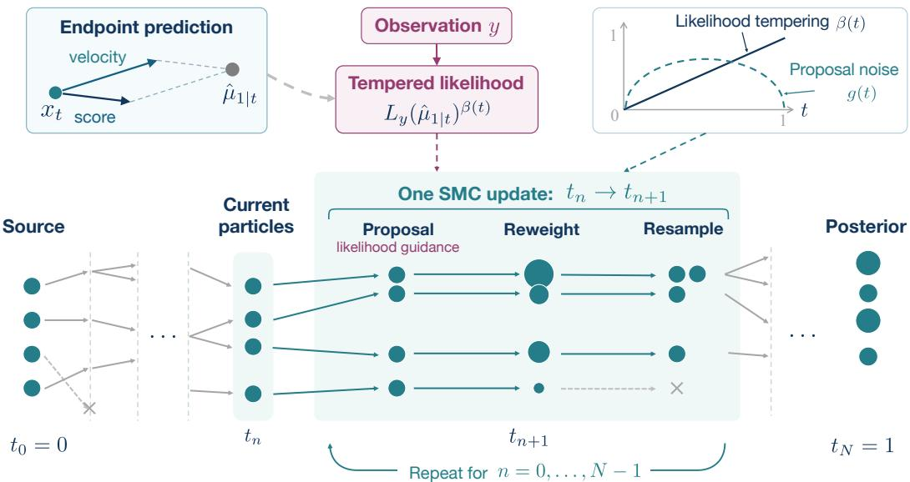  
Figure 1: BRIDGETWIST overview. Schrödinger bridge’s velocity and score predict endpoints for likelihood evaluation. The schedules $\beta ( t )$ and $g ( t )$ control likelihood tempering and proposal noise, respectively. Vertical position denotes state and circle area denotes weight. Resampling copies retain their states and are offset horizontally for visibility. The highlighted SMC update repeats along the time grid, and the terminal weighted particles approximate the target conditional distribution.

Schrödinger bridge (SB) generative models [15–18] provide a recent alternative to diffusion and flow priors. An SB connects a source $X _ { 0 } \sim q _ { 0 }$ to a target $X _ { 1 } \sim q _ { 1 } ;$ among all path laws with these source and target marginals, it selects the one that minimizes the Kullback–Leibler (KL) divergence to a prescribed reference law. This combination of a general source and stochastic transport is useful for image generation [15, 19, 20], image restoration [21, 22], cell trajectory inference [18, 23], and other tasks. Existing SB-based conditional methods [24, 21, 25, 26] train a task-specific network for each likelihood family. Training-free conditional sampling that reuses a pretrained unconditional SB prior remains unexplored.

Under a Brownian reference with diffusion scale $\sigma > 0 .$ , an SB conditioned on its endpoints $( X _ { 0 } , X _ { 1 } )$ is a Brownian bridge. At each $t \in ( 0 , 1 )$ , we can therefore write $X _ { t } = ( 1 - t ) X _ { 0 } + t \bar { X } _ { 1 } + \dot { \varepsilon } _ { t } ,$ where $\varepsilon _ { t } \sim \mathcal { N } ( 0 , \sigma ^ { 2 } t ( 1 - t ) I )$ is independent of $( X _ { 0 } , X _ { 1 } )$ . For endpoint prediction, diffusion samplers use score-based denoising, and flow samplers use velocity-based extrapolation (Table 1). For ${ \mathrm { S B s } } ,$ however, score-only denoising estimates the interpolation $( 1 - t ) X _ { 0 } \dot { + } t X _ { 1 }$ instead of $X _ { 1 }$ , while velocity-only extrapolation omits a score correction. Our key observation is that the probability-flow velocity $v _ { t } ^ { \star }$ and marginal score $s _ { t } ^ { \star }$ are complementary, and combining these two fields gives the endpoint conditional mean: $\mathbb { E } [ X _ { 1 } ^ { \sim } | X _ { t } = x ] ^ { \sim } = x + ( \mathrm { i } - t ) v _ { t } ^ { \star } ( x ) + ( \sigma ^ { 2 } / 2 ) ( 1 - t ) s _ { t } ^ { \star } ( x )$ (Prop. 1). Their neural approximations can be obtained through score and flow matching [18] or from learned forward and backward SB drifts [15, 16].

Table 1: Training-free conditional sampling landscape from an endpoint prediction view.
<table><tr><td>Model class</td><td>What is  $X _ { t } ?$ </td><td>Endpoint signal</td><td>Representative samplers</td></tr><tr><td>Diffusion</td><td>noisy observation of  $X _ { 1 }$ </td><td>score (Tweedie)</td><td>DPS [2], TDS [1], FPS [3]</td></tr><tr><td>Flow matching</td><td>deterministic interpolation of  $( X _ { 0 } , X _ { 1 } )$ </td><td>velocity (Euler)</td><td>FMPS [6], TFTF [5]</td></tr><tr><td>Schrödinger bridge</td><td>noisy interpolation of  $( X _ { 0 } , X _ { 1 } )$ </td><td></td><td>velocity + score (Prop. 1) BRIDGETWIST (this work)</td></tr></table>

Using these pretrained fields, we propose BRIDGETWIST, a tempered twisted SMC sampler (Figure 1). The ideal twist, i.e., the predictive likelihood $\mathbb { E } [ L _ { y } ( X _ { 1 } ) | X _ { t } ]$ , is unavailable analytically, and using pilot rollouts to estimate it [27, 28] requires many network evaluations per particle and step. We instead use a plug-in twist $L _ { y } ( \hat { X } _ { 1 } ( X _ { t } ) )$ to approximate, where $\hat { X } _ { 1 } ( X _ { t } )$ is the velocity–score endpoint prediction. This twist discards uncertainty in $X _ { 1 }$ given $X _ { t }$ and can be over-confident near the source. We therefore temper its influence with a time-varying temperature coefficient. In an isotropic linear-Gaussian model, the tempered plug-in twist can recover the exact twist (Remark 1).

With velocity and score fields, we can vary the diffusion coefficient $g ( t )$ at inference time while preserving the SB marginals (Prop. 2) [18, 29]. We use this flexibility to introduce a bridge-shaped schedule $g ( t ) \propto \sqrt { t ( 1 - t ) }$ , following the time dependence of the Brownian bridge standard deviation. This schedule concentrates noise in the middle of the sampling path. It reduces noise near the source, where guidance is weak, and near the target, where additional noise can disrupt particles already aligned with the conditioning information.

Our contributions. We believe that the following progresses are novel.

• Training-free SB conditioning. BRIDGETWIST is, to our knowledge, the first training-free conditional sampler for pretrained Schrödinger bridges, supporting arbitrary differentiable likelihoods.

• Tempered plug-in twist. We construct a lookahead twist from the velocity–score endpoint predictor and temper its influence along the path, without changing the final target conditional distribution.

• Noise schedule and consistency. We introduce a bridge-shaped diffusion schedule and importance correction; Theorem 1 bounds the $L _ { 2 }$ error for $K$ particles by order $K ^ { - 1 / 2 }$ relative to the learned and discretized posterior.

• Plug-and-play for diverse tasks. BRIDGETWIST achieves leading performance on various image generation and restoration tasks without task-specific retraining.

## 2 Background

Notation. Random objects are denoted by uppercase letters $( \mathrm { e } . \mathrm { g } . , X _ { t } )$ , and their realizations by lowercase ones $( \mathrm { e } . \mathrm { g } . , x _ { t } )$ . We write $\mathcal { N } ( \boldsymbol { \mu } , \boldsymbol { \Sigma } )$ for a Gaussian density and I for the identity matrix. The time index is $t \in [ 0 , 1 ]$ , and its discretization is $t _ { n }$ for $n \in \{ 0 , \ldots \dot { , } N \}$ with $t _ { 0 } = 0$ and $t _ { N } = 1$

## 2.1 Schrödinger bridge generative models

Let $\Omega : = C ( [ 0 , 1 ] , \mathbb { R } ^ { d } )$ be the space of continuous paths in $\mathbb { R } ^ { d }$ , and let $q _ { 0 }$ and $q _ { 1 }$ be the source (or noise) and target (or data) distributions. Let $Q$ be a Brownian reference path measure under which $\mathrm { d } X _ { t } = \sigma \mathrm { d } W _ { t }$ , where $\sigma > 0$ and $W _ { t }$ is the standard Brownian motion. The Schrödinger bridge problem [30, 31] seeks the path measure on Ω closest to $Q$ in Kullback–Leibler divergence subject to the prescribed source and target marginals,

$$
\begin{array} { r } { P ^ { \star } = \underset { P : p _ { 0 } = q _ { 0 } , p _ { 1 } = q _ { 1 } } { \arg \operatorname* { m i n } } \mathrm { K L } ( P \| Q ) , } \end{array}
$$

where $p _ { t }$ denotes the marginal of $P$ at time t. The bridge $P ^ { \star }$ admits a forward stochastic differential equation (SDE),

$$
\mathrm { d } X _ { t } = b _ { t } ^ { \star } ( X _ { t } ) \mathrm { d } t + \sigma \mathrm { d } W _ { t } , \qquad X _ { 0 } \sim q _ { 0 } .\tag{1}
$$

The associated probability-flow ordinary differential equation (ODE) [32, 18] has the same marginal distributions $p _ { t }$ as Eq. (1):

$$
\mathrm { d } X _ { t } = v _ { t } ^ { \star } ( X _ { t } ) \mathrm { d } t , \qquad X _ { 0 } \sim q _ { 0 } .\tag{2}
$$

The drift $b ^ { \star }$ , velocity $v ^ { \star }$ , and score $s ^ { \star }$ are linked by

$$
\begin{array} { r } { b _ { t } ^ { \star } ( x ) = v _ { t } ^ { \star } ( x ) + \frac { 1 } { 2 } \sigma ^ { 2 } s _ { t } ^ { \star } ( x ) , \qquad s _ { t } ^ { \star } ( x ) = \nabla \log p _ { t } ( x ) . } \end{array}
$$

Learning the Schrödinger bridge. Earlier iterative schemes [15, 16] learn the bridge through repeated forward and backward SDE simulations and updates to drift networks. This repeated SDE simulation makes them computationally expensive. Simulation-free score and flow matching [18] circumvents the need to simulate the learned SDE during training. Instead, it draws endpoint pairs $( X _ { 0 } , X _ { 1 } )$ from an entropic optimal transport (OT) coupling and, for each pair, samples an intermediate state $X _ { i }$ t from the corresponding Brownian bridge. Then the conditional bridge velocity and score at $( t , X _ { t } )$ serve as regression targets for $( v _ { \theta } , s _ { \theta } )$ , neural approximations of $( \boldsymbol { v } ^ { \star } , \bar { \boldsymbol { s } } ^ { \star } )$ . Appendix B details the pretraining parameterization used in our experiments.

Given $( v _ { \theta } , s _ { \theta } )$ and a diffusion schedule $g : [ 0 , 1 ] \to \mathbb { R } _ { \geq 0 }$ , to sample from $q _ { 1 }$ , one draws $X _ { 0 } \sim q _ { 0 }$ and simulates

$$
\begin{array} { r } { \mathrm { d } X _ { t } = b _ { \theta , g } ( t , X _ { t } ) \mathrm { d } t + g ( t ) \mathrm { d } W _ { t } , \qquad b _ { \theta , g } ( t , x ) = v _ { \theta } ( t , x ) + \frac { 1 } { 2 } g ( t ) ^ { 2 } s _ { \theta } ( t , x ) . } \end{array}\tag{3}
$$

The choice of $g$ is an inference-time degree of freedom; under exact fields, any continuous $g \geq 0$ preserves the SB marginals $p _ { t }$ [18, 29]. We write $p _ { \theta }$ for the endpoint marginal of $X _ { 1 }$ under learned fields.

## 2.2 Sequential Monte Carlo and twisted SMC

Sequential Monte Carlo is a Bayesian computational framework that approximates a sequence of pathspace distributions $\{ \pi _ { n } \} _ { n = 0 } ^ { N }$ using weighted particles [33–35]. On a grid $0 = t _ { 0 } < \cdots < t _ { N } = 1$ we write $x _ { t _ { 0 : n } } : = ( x _ { t _ { 0 } } , \ldots , x _ { t _ { n } } )$ for the discretized trajectory up to $t _ { n }$ . The framework specifies a sequence of unnormalized targets $\lbrace \gamma _ { n } \rbrace _ { n = 0 } ^ { N } ,$ with normalized densities $\pi _ { n } ( x _ { t _ { 0 : n } } ) \propto \gamma _ { n } ( x _ { t _ { 0 : n } } )$ , and proposal kernels $\{ q _ { n } \} _ { n = 0 } ^ { N } .$ At step $n = 0 , K$ particles $\{ X _ { t _ { 0 } } ^ { ( k ) } \} _ { k = 1 } ^ { K }$ are drawn from $q _ { 0 }$ and assigned normalized weights $W _ { 0 } ^ { ( k ) } \propto \gamma _ { 0 } ( X _ { t _ { 0 } } ^ { ( k ) } ) / q _ { 0 } ( X _ { t _ { 0 } } ^ { ( k ) } )$ . For each subsequent step $n = 1 , \ldots , N$ , the algorithm

• resamples the previous-step particles in proportion to their weights;

• propagates each resampled particle through $q _ { n } ( \cdot \mid x _ { t _ { n - 1 } } ) ;$ ; and

• reweights by the incremental weight ratio $\omega _ { n } ( \dot { x _ { t _ { 0 : n } } } ) = \gamma _ { n } ( x _ { t _ { 0 : n } } ) / [ \gamma _ { n - 1 } ( x _ { t _ { 0 : n - 1 } } ) q _ { n } ( x _ { t _ { n } } | x _ { t _ { n - 1 } } ) ] .$

We write $\pi _ { n } ( \mathrm { d } x _ { t _ { n } } )$ for the marginal of $\pi _ { n }$ at time $t _ { n }$ . Under standard regularity, the weighted empirical measure at $t _ { N }$ converges weakly to $\pi _ { N } \big ( \mathrm { d } \boldsymbol { x } _ { t _ { N } } \big )$ as $K  \infty [ 3 6 , 3 5 ]$

For conditional sampling, the path target is the prior tilted by the terminal likelihood, $\Pi ^ { \star } \bigl ( \mathrm { d } x _ { 0 : 1 } \bigr )$ ∝ $P _ { \theta , g } ( \mathrm { d } x _ { 0 : 1 } ) L _ { y } ( x _ { 1 } )$ , where $P _ { \theta , g }$ is the law of Eq. (3). A naive importance sampler that draws full trajectories from $P _ { \theta , g }$ and reweights by $L _ { y } ( X _ { 1 } )$ can suffer severe weight degeneracy when the conditioning is sharp. Twisted SMC [37, 35] mitigates this by inserting intermediate twisting functions, also called lookahead functions. Under the learned prior $P _ { \theta , g } { \mathrm { , } }$ , the ideal twist is the predictive likelihood

$$
h _ { t } ( x ) : = \mathbb { E } [ L _ { y } ( X _ { 1 } ) \mid X _ { t } = x ] , \qquad t \in [ 0 , 1 ] .\tag{4}
$$

This ideal twist is intractable because it integrates over all future trajectories, and direct Monte Carlo estimation is prohibitively expensive. Existing twisted SMC samplers therefore approximate $h _ { t }$ with model-specific surrogates, using Tweedie’s endpoint mean inside the likelihood for diffusion priors [1], and the Euler one-step endpoint for flow priors [5]. Section 3 develops the counterpart for Schrödinger bridges.

## 3 Method

We consider conditioning information $y$ supplied through a differentiable likelihood $L _ { y } ( x ) = p ( y | x )$ possibly known up to a normalizing constant. Conditional sampling aims to draw from the endpoint posterior $\pi ^ { \star } ( x _ { 1 } ) \propto p _ { \theta } ( x _ { 1 } ) L _ { y } ( x _ { 1 } )$ . This endpoint posterior is the terminal marginal of the path posterior $\Pi ^ { \star }$ defined in Section 2.2.

Section 3.1 constructs a tractable surrogate for the ideal twist $h _ { t } ( x ) = \mathbb { E } [ L _ { y } ( X _ { 1 } ) | X _ { t } = x ]$ . Section 3.2 develops the BRIDGETWIST sampler by combining temporal tempering, guided proposals, a bridge-shaped diffusion schedule, and importance correction. Section 3.3 bounds the resulting finite-particle approximation error.

## 3.1 Plug-in twist from the SB endpoint predictor

We first construct a first-moment surrogate for the ideal twist $h _ { t }$ in (4) from the SB velocity and score and use it as the lookahead of a tempered twisted SMC sampler.

With a Brownian reference, the SB in Eq. (1) conditioned on $( X _ { 0 } , X _ { 1 } )$ is a Brownian bridge, that is, $X _ { t } | ( X _ { 0 } , X _ { 1 } ) \sim \mathcal { N } ( M _ { t } , \sigma ^ { 2 } t ( 1 - t ) I )$ ), where $M _ { t } = ( 1 - t ) X _ { 0 } + t X _ { 1 }$ is the linear interpolation between the endpoints. Writing $D = X _ { 1 } - X _ { 0 }$ for the endpoint displacement gives $X _ { 1 } = M _ { t } + ( 1 - t ) D$ The conditional means of $M _ { t }$ and $D$ given $X _ { t }$ admit closed-form expressions in terms of the velocity and score fields and combine to yield the endpoint conditional mean.

Proposition 1. Suppose the SB marginal density $p _ { t }$ is continuously differentiable on $\mathbb { R } ^ { d } f o r$ every $t \in ( 0 , 1 )$ . Under a Brownian-reference SB with velocity $v ^ { \star }$ and score $s ^ { \star }$ as in Eq. (2), for every $t \in ( 0 , 1 )$ and $x \in \mathbb { R } ^ { d }$

$$
{ \mathbb E } [ M _ { t } \mid X _ { t } = x ] = x + \sigma ^ { 2 } t ( 1 - t ) s _ { t } ^ { \star } ( x ) ,\tag{5}
$$

$$
\begin{array} { r } { \mathbb { E } [ D \mid X _ { t } = x ] = v _ { t } ^ { \star } ( x ) + \frac { 1 - 2 t } { 2 } \sigma ^ { 2 } s _ { t } ^ { \star } ( x ) , } \end{array}\tag{6}
$$

$$
\begin{array} { r } { \mu _ { 1 | t } ^ { \star } ( x ) : = \mathbb { E } [ X _ { 1 } \mid X _ { t } = x ] = x + ( 1 - t ) v _ { t } ^ { \star } ( x ) + \frac { \sigma ^ { 2 } } { 2 } ( 1 - t ) s _ { t } ^ { \star } ( x ) . } \end{array}\tag{7}
$$

Proposition 1 serves two purposes: (i) Eq. (7) provides a closed-form endpoint predictor, that is, a linear extrapolation $\bar { \mu } _ { 1 \vert t } ^ { \star } \bar { ( } x ) = x + ( \bar { 1 } - t ) \bar { b } _ { t } ^ { \star } ( x )$ along the SB forward drift $b ^ { \star }$ . (ii) More importantly, identities $( 5 ) – ( 6 )$ explain why neither single channel suffices on its own: a score-only Tweedie predictor in (5) recovers the interpolation instead of the endpoint, while a velocity-only Euler predictor $x + ( 1 - t ) v _ { t } ^ { \star } ( x )$ omits the score correction in (7); Section 4.3 ablates both. The stochastic interpolant framework of Albergo et al. [29] provides velocity and score relations that leave the endpoint mean implicit. Proposition 1 explicitly recovers this mean for the Brownian bridge interpolant. The proof is in Appendix A.1.

With pretrained neural fields $v _ { \theta }$ and $s _ { \theta } .$ , we obtain a practical endpoint predictor

$$
\begin{array} { r } { \hat { \mu } _ { 1 | t } ( x ) : = x + ( 1 - t ) v _ { \theta } ( t , x ) + \frac { \sigma ^ { 2 } } { 2 } ( 1 - t ) s _ { \theta } ( t , x ) , } \end{array}\tag{8}
$$

and use it to define the twist surrogate

$$
\hat { h } _ { t } ( x ) : = L _ { y } \big ( \hat { \mu } _ { 1 | t } ( x ) \big ) \quad \mathrm { f o r } \quad t \in ( 0 , 1 ) , \qquad \hat { h } _ { 1 } ( x ) = L _ { y } ( x ) .
$$

## 3.2 The BRIDGETWIST sampler

Fix a grid $0 = t _ { 0 } < t _ { 1 } < \cdot \cdot \cdot < t _ { N } = 1$ with $\Delta _ { n } = t _ { n } - t _ { n - 1 }$ , and use the Euler–Maruyama prior kernel

$$
\begin{array} { r } { M _ { n } ( x _ { t _ { n - 1 } } , \mathrm { d } x _ { t _ { n } } ) : = \mathcal { N } \big ( x _ { t _ { n } } ; x _ { t _ { n - 1 } } + b _ { \theta , g } ( t _ { n - 1 } , x _ { t _ { n - 1 } } ) \Delta _ { n } , g ( t _ { n - 1 } ) ^ { 2 } \Delta _ { n } I \big ) \mathrm { d } x _ { t _ { n } } , } \end{array}\tag{9}
$$

with $b _ { \theta , g }$ and $g$ defined in Eq. (3). The corresponding path law is $\begin{array} { r l } { P _ { \theta , g } ^ { ( n ) } ( \mathrm { d } x _ { t _ { 0 : n } } ) } & { { } : = } \end{array}$ $\begin{array} { r } { q _ { 0 } \big ( \mathrm { d } x _ { t _ { 0 } } \big ) \prod _ { i = 1 } ^ { n } M _ { i } \big ( x _ { t _ { i - 1 } } , \mathrm { d } x _ { t _ { i } } \big ) } \end{array}$ for $n \leq N$

Tempered intermediate targets. Even with an exact conditional mean, the plug-in twist discards the conditional spread of $X _ { 1 } | \bar { X } _ { t }$ , so in general

$$
L _ { y } { \big ( } \mathbb { E } [ X _ { 1 } \mid X _ { t } = x ] { \big ) } \neq \mathbb { E } [ L _ { y } ( X _ { 1 } ) \mid X _ { t } = x ] = h _ { t } ( x ) .
$$

Since this spread is large at early times, evaluating the likelihood at a single endpoint prediction can make the twist over-confident (Remark 1). Therefore, we temper the plug-in twist, in the spirit of annealed importance sampling [38, 39], by the exponent $\beta ( t ) = \bar { t } ^ { a }$ with $a \ge 1$ , so that $\beta ( 0 ) = 0$ and $\beta ( 1 ) = 1$ . Letting $\beta _ { n } = \beta ( t _ { n } )$ and $\hat { h } _ { n } = \hat { h } _ { t _ { n } }$ , the intermediate (unnormalized) path targets are

$$
\gamma _ { n } ^ { \beta } ( \mathrm { d } x _ { t _ { 0 : n } } ) : = P _ { \theta , g } ^ { ( n ) } ( \mathrm { d } x _ { t _ { 0 : n } } ) \hat { h } _ { n } ( x _ { t _ { n } } ) ^ { \beta _ { n } } , \qquad \pi _ { n } ^ { \beta } = \gamma _ { n } ^ { \beta } / Z _ { n } ^ { \beta } .
$$

At $n = N , \beta _ { N } = 1$ and $\hat { h } _ { N } = L _ { y } , \mathrm { s o } \gamma _ { N } ^ { \beta } ( \mathrm { d } x _ { t _ { 0 : N } } ) = P _ { \theta , g } ^ { ( N ) } ( \mathrm { d } x _ { t _ { 0 : N } } ) L _ { y } ( x _ { t _ { N } } )$ . Let $p _ { \theta } ^ { ( N ) } ( \mathrm { d } x _ { t _ { N } } )$ denote the endpoint marginal of the discretized prior path law $P _ { \theta , g } ^ { ( N ) }$ . Normalizing $\gamma _ { N } ^ { \beta }$ and integrating out $x _ { t _ { 0 : N - } }$ then gives the desired endpoint posterior $\pi _ { N } ^ { \beta } ( \mathrm { d } x _ { t _ { N } } ) ~ = ~ \pi ^ { \star , ( N ) } ( \mathrm { d } x _ { t _ { N } } )$ ∝ $p _ { \theta } ^ { ( N ) } ( \mathrm { d } x _ { t _ { N } } ) L _ { y } ( x _ { t _ { N } } )$

Guided proposal and telescoping weights. The continuous-time Doob h-transform adds $g ( t ) ^ { 2 } \nabla _ { a }$ log $h _ { t } ( x )$ to the prior drift [37, 1, 35]. Replacing the ideal twist h by the tempered plug-in twist $\hat { h } ^ { \beta }$ , we obtain the guided proposal $q _ { n } = \mathcal { N } ( m _ { q , n } , \Sigma _ { q , n } )$ with covariance $\Sigma _ { q , n } =$ $( g ( t _ { n - 1 } ) ^ { 2 } \Delta _ { n } + \varepsilon ) I , \varepsilon > 0$ , and mean

$$
m _ { q , n } ( x _ { t _ { n - 1 } } ) = x _ { t _ { n - 1 } } + \left[ b _ { \theta , g } ( t _ { n - 1 } , x _ { t _ { n - 1 } } ) + w _ { g } g ( t _ { n - 1 } ) ^ { 2 } \beta _ { n - 1 } \nabla _ { x } \log \hat { h } _ { n - 1 } ( x _ { t _ { n - 1 } } ) \right] \Delta _ { n } ,\tag{10}
$$

where $w _ { g } \geq 0$ is a guidance strength, and the inflation $\varepsilon I$ makes the density ratio $M _ { n } / q _ { n }$ uniformly bounded in $\boldsymbol { x } _ { t _ { n } }$ . The incremental weight

$$
\omega _ { n } ( x _ { t _ { n - 1 } } , x _ { t _ { n } } ) : = { \frac { M _ { n } ( x _ { t _ { n - 1 } } , x _ { t _ { n } } ) { \widehat { h } } _ { n } ( x _ { t _ { n } } ) ^ { \beta _ { n } } } { q _ { n } ( x _ { t _ { n } } \mid x _ { t _ { n - 1 } } , y ) { \widehat { h } } _ { n - 1 } ( x _ { t _ { n - 1 } } ) ^ { \beta _ { n - 1 } } } }\tag{11}
$$

corrects the guided proposal toward $\pi _ { n } ^ { \beta } .$ , and multiplying Eq. (11) over n gives the telescoping identity (Eq. (24) in Appendix A.3). All intermediate twist factors thus cancel in the telescoping product. Therefore, although tempering changes both the intermediate targets and the proposal drift, the endpoint target is unchanged.

Algorithm 1 BRIDGETWIST: tempered twisted SMC for Schrödinger bridges   
Input: Pretrained fields $( v _ { \theta } , s _ { \theta } ) ;$ source q0; likelihood $L _ { y } ;$ grid $t _ { 0 : N } ;$ diffusion schedule $^ { g ; }$ guidance strength   
$w _ { g } ;$ tempering exponent $^ { a ; }$ number of particles K; ESS threshold $\rho \in ( 0 , 1 ]$   
Output: Weighted endpoint particles $\{ ( \hat { X _ { t _ { N } } ^ { ( k ) } } , W _ { N } ^ { ( k ) } ) \} _ { k = } ^ { K }$ approximating $\pi ^ { \star , ( N ) }$   
1: Set $\beta _ { n } = t _ { n } ^ { a }$ and $b _ { \theta , g } ( t , x ) = v _ { \theta } ( t , x ) + \textstyle { \frac { 1 } { 2 } } g ( t ) ^ { 2 } s _ { \theta } ( t , x )$   
2: Sample $X _ { t _ { 0 } } ^ { ( k ) } \sim q _ { 0 }$ and set log $W _ { 0 } ^ { ( k ) } = \beta _ { 0 }$ log $\hat { h } _ { 0 } \big ( X _ { t _ { 0 } } ^ { ( k ) } \big )$ for $k = 1 , \ldots , K$ ; normalize $\{ W _ { 0 } ^ { ( k ) } \} _ { k = 1 } ^ { K }$   
3: for $n = 1 , \ldots , N$ do   
4: If $\begin{array} { r } { \mathrm { E S S } _ { n - 1 } : = 1 / \sum _ { k } ( W _ { n - 1 } ^ { ( k ) } ) ^ { 2 } < \rho K } \end{array}$ , resample ancestors $A _ { n - 1 } ^ { ( 1 : K ) }$ and reset log $W _ { n - 1 } ^ { ( k ) } = - \log$ $K ;$   
otherwise set $A _ { n - 1 } ^ { ( k ) } = k .$ ▷ resampling   
5: for $k = 1 , \cdots , K$ do ▷ propagation and reweighting   
6: Let $\bar { X } _ { t _ { n - 1 } } ^ { ( k ) } = X _ { t _ { n - 1 } } ^ { ( A _ { n - 1 } ^ { ( k ) } ) }$ and evaluate $\nabla _ { x }$ log $\hat { h } _ { n - 1 } \big ( \bar { X } _ { t _ { n - 1 } } ^ { ( k ) } \big ) .$   
7: Sample $X _ { t _ { n } } ^ { ( k ) } \sim q _ { n } ( \cdot | \bar { X } _ { t _ { n - 1 } } ^ { ( k ) } , y )$ from Eq. (10).   
8: Update log $W _ { n } ^ { ( k ) } = \log \bar { W _ { n - 1 } ^ { ( k ) } } + \log \omega _ { n } ( \bar { X } _ { t _ { n - 1 } } ^ { ( k ) } , X _ { t _ { n } } ^ { ( k ) } )$ by Eq. (11).   
9: end for   
10: Normalize $\{ W _ { n } ^ { ( k ) } \} _ { k = 1 } ^ { K }$   
11: end for   
12: return $\{ ( \boldsymbol { X } _ { t _ { N } } ^ { ( k ) } , \boldsymbol { W } _ { N } ^ { ( k ) } ) \} _ { k = 1 } ^ { K } .$

Remark 1 (Tempering as variance matching). Suppose $X _ { 1 } | X _ { t } = x \sim \mathcal { N } ( \mu _ { 1 | t } ^ { \star } ( x ) , \sigma _ { 1 | t } ^ { 2 } I )$ and $L _ { y } ( x ) = \mathcal { N } ( y ; x , \sigma _ { y } ^ { 2 } I )$ . Then $h _ { t } ( x ) = \mathcal { N } ( y ; \mu _ { 1 \mid t } ^ { \star } ( x ) , ( \sigma _ { y } ^ { 2 } + \sigma _ { 1 \mid t } ^ { 2 } ) I )$ . For an exact conditional mean $\hat { \mu } _ { 1 | t } = \mu _ { 1 | t } ^ { \star } ,$ variance matching gives

$$
\beta ^ { \star } ( t ) = \frac { \sigma _ { y } ^ { 2 } } { \sigma _ { y } ^ { 2 } + \sigma _ { 1 | t } ^ { 2 } } , \qquad \hat { h } _ { t } ( x ) ^ { \beta ^ { \star } ( t ) } \propto h _ { t } ( x ) .
$$

With $w _ { g } = 1$ and $\beta ( t ) = \beta ^ { \star } ( t )$ , the guidance in (10) recovers the exact h-transform drift correction. As $\sigma _ { 1 | t } ^ { 2 }$ decreases toward the endpoint, $\beta ^ { \star } ( t )$ increases to one, motivating $\beta ( t ) = t ^ { a }$ as a monotone surrogate that requires no variance estimate. Appendix A.4 gives the proof and the extension to observations of a subset of coordinates.

Bridge-shaped diffusion schedule. At inference time, g is flexible (Section 2.1). A constant $g ( t ) \equiv \sigma$ matches the Brownian reference but allocates a uniform proposal variance $\sigma ^ { 2 } \Delta _ { n }$ across $n .$ This is mismatched with the conditional bridge variance $\sigma ^ { 2 } t ( 1 - t )$ , which instead vanishes at both endpoints, and the excess proposal noise can increase the variance of importance weights near $t \in \{ 0 , 1 \}$ . We therefore introduce a bridge-shaped schedule $g ( t ) = c _ { g } \sigma \sqrt { t ( 1 - t ) + \delta _ { g } } ,$ , where $c _ { g } > 0$ is an inference diffusion scale and the small $\delta _ { g } > 0$ keeps g positive at $t \in \{ 0 , 1 \}$ Remark 2 (Interaction between tempering and diffusion). The exponent $\beta ( t )$ sets how much the sampler trusts the plug-in lookahead, while $g ( t )$ allocates the proposal noise along the path. Small $g ( t )$ is intended to limit unguided perturbations near $t = 0 ,$ , where the source already supplies particle diversity, and to avoid disturbing particles aligned with the likelihood near $t = 1$ . Larger interior noise supports exploration. Ignoring the small floor $\delta _ { g } .$ , the two schedules combine in Eq. (10) through the scalar guidance coefficient $g ( \bar { t } ) ^ { 2 } \beta ( t ) \propto t ^ { a + 1 } ( 1 - t )$ , which peaks at $t = ( a + 1 ) / ( a + 2 ) , \mathrm { o r } t = 2 / 3$ for the default $a = 1$

Algorithm and complexity. Algorithm 1 summarizes the proposed BRIDGETWIST sampler, with stratified resampling triggered when the effective sample size (ESS) falls below $\rho K$ . Each step requires one forward evaluation of $( v _ { \theta } , s _ { \theta } )$ per particle and one backward pass through the endpoint predictor and the likelihood, so the total cost is $\dot { \mathcal { O } } ( K N )$ network evaluations and $\mathcal { O } ( \breve { K } N )$ likelihood gradients, the same order as gradient-guided samplers [2, 6] and twisted SMC samplers [1, 5].

## 3.3 Finite-particle accuracy

Let $h _ { n } ( x ) : = \mathbb { E } [ L _ { y } ( X _ { 1 } ) | X _ { t _ { n } } = x ]$ and $P _ { n , N } ^ { y } ( x , \mathrm { d } z ) : = \mathbb { P } ( X _ { 1 } \in \mathrm { d } z | X _ { t _ { n } } = x , y )$ denote the exact twist and the posterior transition kernel from step n to step N under the discretized prior. Write $\sec ( f ) : = \operatorname { s u p } ^ { \cdot } f - \operatorname { i n f } f$ and $\varrho ( P ) : = \operatorname* { s u p } _ { \mathrm { o s c } ( f ) \leq 1 } { \mathrm { o s c } ( P f ) } \in [ 0 , 1 ]$ for the oscillation of $f$ and the

contraction coefficient of a Markov kernel $P ,$ , respectively. The norm $\| \cdot \| _ { L _ { 2 } }$ denotes the root mean square over the sampler’s randomness.

Theorem 1. Under the regularity conditions stated in Appendix A.3,for every bounded measurable $\varphi : \mathbb { R } ^ { d } $ R and every $\bar { K } \geq 1$ , the weighted empirical measure produced by Algorithm 1 with stratified resampling satisfies

$$
\Big \lVert \sum _ { k = 1 } ^ { K } W _ { N } ^ { ( k ) } \varphi ( X _ { t _ { N } } ^ { ( k ) } ) - \mathbb { E } _ { \pi ^ { \star } , ( N ) } [ \varphi ] \Big \rVert _ { L _ { 2 } } \le \frac { C _ { N } } { \sqrt { K } } \operatorname { o s c } ( \varphi ) , \quad C _ { N } = 2 \sum _ { n = 0 } ^ { N } \alpha _ { n } R _ { n , N } ^ { 2 } \varrho ( P _ { n , N } ^ { y } ) ,\tag{12}
$$

where $\alpha _ { n } ~ < ~ \infty$ is independent of K and controls the one-step sampling error, and $R _ { n , N } : =$ supx $\{ h _ { n } ( x ) / \hat { h } _ { n } ( x ) ^ { \beta _ { n } } \} / \operatorname* { i n f } _ { x } \{ h _ { n } ( x ) / \hat { h } _ { n } ( x ) ^ { \beta _ { n } } \}$ measures the relative twist mismatch.

The endpoint predictor and tempering directly influence $R _ { n , N }$ , which equals one when $\hat { h } _ { n } ^ { \beta _ { n } } \propto h _ { n } ;$ Remark 1 gives the corresponding Gaussian example. The local error constant $\alpha _ { n }$ reflects the guided proposal, diffusion schedule, and resampling threshold $\rho ,$ while $\varrho ( P _ { n , N } ^ { y } )$ is the contraction coefficient of $P _ { n , N } ^ { y }$ . For a fixed grid, Eq. (12) gives $L _ { 2 }$ convergence of the weighted estimates to expectations under $\pi ^ { \star , ( N ) }$ , the posterior induced by the learned and discretized prior, at the rate of $K ^ { - 1 / 2 }$

## 4 Experiments

We compare BRIDGETWIST with flow matching posterior sampling (FMPS) [6], training-free targeted flow (TFTF) [5], twisted diffusion sampler (TDS) [1], diffusion posterior sampling [2] adapted to the SB prior (DPS-SB), and terminal importance sampling (IS). MNIST provides a sanity check [40]; CIFAR-10 and 256 × 256 CelebA-HQ provide the main image benchmarks [41, 42]. Pretraining and implementation details are in Appendices $\mathrm { \bf B - C } ;$ additional results are in Appendix D. The code is publicly available at https://github.com/Mengyu8042/BridgeTwist.

## 4.1 Toy example

We first evaluate BRIDGETWIST on a two-dimensional toy example [5]. The target distribution is the Gaussian mixture $q _ { 1 } = 0 . 7 5 \mathcal { N } ( ( - \sqrt { 2 } , - \sqrt { 2 } ) , I / 4 ) + 0 . 2 5 \mathcal { N } ( ( \sqrt { 2 } , \sqrt { 2 } ) , I / 4 )$ , the source is $q _ { 0 } = \mathcal { N } ( 0 , I )$ , and the Brownian reference has $\sigma = 1$ . We condition on $\boldsymbol { y } = ( 0 , 0 )$ through the Gaussian likelihood $L _ { y } ( x _ { 1 } ) = \mathcal { N } ( y ; x _ { 1 } , I / 4 )$ . In this setting, the target posterior is available analytically as $\pi ^ { \star } ( x _ { 1 } ) = 0 . 7 5 { \mathcal N } ( x _ { 1 } ; ( - \sqrt 2 / 2 , - \sqrt 2 / 2 ) , I / 8 ) + 0 . 2 5 { \mathcal N } ( x _ { 1 } ; ( \sqrt 2 / 2 , \sqrt 2 / 2 ) , I / 8 )$ All velocity and score fields are computed in closed form, so this experiment isolates the conditional sampler from neural network approximation errors (Appendix C.1).

We use $N = 1 0 0$ discretization steps and $K \in \{ 1 0 0 , 2 0 0 , 5 0 0 , 1 0 0 0 , 2 0 0 0 \}$ particles, and report the maximum mean discrepancy (MMD) to the analytic posterior over 50 repetitions. The left panel of Figure 2 shows that BRIDGETWIST achieves the lowest MMD. Its empirical $\mathbf { M M D ^ { 2 } }$ decays approximately as $K ^ { - 1 }$ , with a fitted log-log slope of −1.01. SMC-based methods improve as $\dot { K }$ increases, with BRIDGETWIST outperforming both flow-based TFTF and diffusion-based TDS. FMPS and DPS-SB plateau at higher errors because they use approximate guidance without importance weight correction, leaving bias that persists as K increases. The right panel indicates that BRIDGETWIST closely matches the two posterior modes and their relative mass.

## 4.2 Image conditional sampling

For a fair comparison, all methods use uniform grids with $N = 8 0 0$ steps. BRIDGETWIST, DPS-SB, and IS share the Schrödinger bridge prior; FMPS and TFTF share the flow prior; and TDS uses its native DDPM (MNIST) and iDDPM (CIFAR-10) priors.

Class-conditional sampling. A frozen classifier defines $L _ { y } ( x _ { 1 } ) = p _ { \psi } ( y | x _ { 1 } )$ on MNIST and CIFAR-10. We measure accuracy with the likelihood classifier $ { \left( \mathrm { A C C } _ { L } \right) }$ and an independent external classifier $( \operatorname { A C C } _ { E } )$ . Kernel inception distance (KID) [43], Density, and Coverage [44] evaluate sample quality and coverage against real images within each class. Table 2 shows that BRIDGETWIST combines high external accuracy with low KID and broad coverage; Figure 3 illustrates class alignment and diversity.

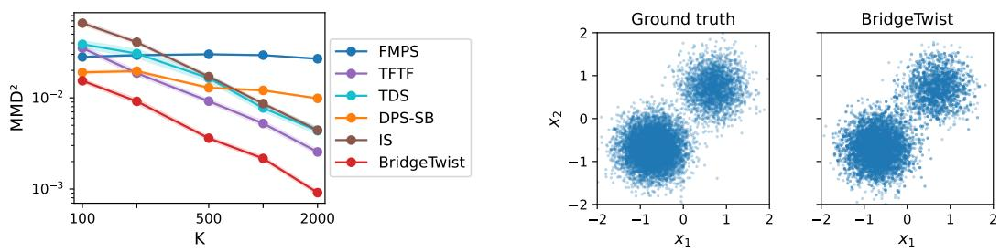  
Figure 2: Toy benchmark. Left: $\mathrm { { \bf M M D } ^ { 2 } }$ to the analytic posterior as the number of particles K increases. Right: ground-truth posterior samples and BRIDGETWIST samples, with $1 0 ^ { 4 }$ samples in each panel.

Table 2: Class-conditional metrics at $K = 6 4$ . Dens./Cov. denote Density/Coverage. Results are averaged over 100 random seeds. Bold marks the best value in each column.
<table><tr><td></td><td colspan="5">MNIST</td><td colspan="5">CIFAR-10</td></tr><tr><td>Method</td><td> $\mathsf { A C C } _ { L }$  ↑</td><td> $\mathbf { A C C } _ { E }$  ↑</td><td>KID↓</td><td>Dens. ↑</td><td>Cov. ↑</td><td> $\mathbf { A C C } _ { L }$  ←</td><td> $\operatorname { A C C } _ { E }$  ↑</td><td>KID</td><td>Dens. ↑</td><td>Cov. ↑</td></tr><tr><td>FMPS</td><td>0.997</td><td>0.453</td><td>0.0202</td><td>0.026</td><td>0.007</td><td>0.899</td><td>0.514</td><td>0.1807</td><td>0.504</td><td>0.390</td></tr><tr><td>TFTF</td><td>0.977</td><td>0.910</td><td>0.0018</td><td>0.954</td><td>0.534</td><td>0.986</td><td>0.934</td><td>0.0572</td><td>1.161</td><td>0.600</td></tr><tr><td>TDS</td><td>0.992</td><td>0.942</td><td>0.0015</td><td>0.923</td><td>0.415</td><td>0.947</td><td>0.869</td><td>0.129</td><td>1.159</td><td>0.342</td></tr><tr><td>DPS-SB</td><td>0.999</td><td>0.619</td><td>0.0010</td><td>0.633</td><td>0.495</td><td>0.978</td><td>0.585</td><td>0.1051</td><td>0.410</td><td>0.302</td></tr><tr><td>IS</td><td>0.997</td><td>0.920</td><td>0.0007</td><td>1.001</td><td>0.146</td><td>0.971</td><td>0.865</td><td>0.0744</td><td>0.755</td><td>0.113</td></tr><tr><td>BRIDGETWIST</td><td>0.999</td><td>0.952</td><td>0.0003</td><td>1.154</td><td>0.617</td><td>0.997</td><td>0.979</td><td>0.0403</td><td>1.288</td><td>0.596</td></tr></table>

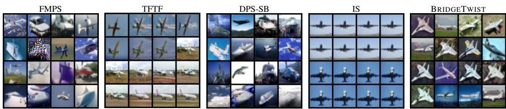  
Figure 3: CIFAR-10 airplane samples at $K = 1 6 ,$ after resampling based on the terminal weights.  
Table 3 compares methods at equal total numbers of backbone function evaluations (NFEs), counting each forward or backward pass once per particle. Baselines adjust K to fit the NFE budgets $\{ B _ { 1 } , B _ { 2 } , B _ { 3 } , B _ { 4 } \}$ , defined by BRIDGETWIST at $K \in \{ 4 , 1 6 , 6 4 , 2 5 6 \}$ . FMPS leads at the smallest budget, while BRIDGETWIST performs the best at all the larger budgets. Appendix D.1 compares runtime and memory usage.

Table 3: CIFAR-10 $\mathbf { A C C } _ { E }$ at matched total NFEs. Subscripts give standard deviations across repetitions. Bold marks the best value.
<table><tr><td>Method \ total NFE</td><td> $B _ { 1 } = 6 { , } 4 0 8$ </td><td> $B _ { 2 } = 2 5 { , } 6 3 2$ </td><td> $B _ { 3 } = 1 0 2 , 5 2 8$ </td><td> $B _ { 4 } = 4 1 0 , 1 1 2$ </td></tr><tr><td>FMPS</td><td> $\mathbf { 0 . 7 7 5 _ { \pm 0 . 0 1 6 } }$ </td><td> $0 . 8 1 3 { \scriptstyle \pm 0 . 0 1 5 }$ </td><td> $0 . 8 1 4 { \scriptstyle \pm 0 . 0 0 9 }$ </td><td> $0 . 8 1 4 _ { \pm 0 . 0 0 4 }$ </td></tr><tr><td>TFTF</td><td> $0 . 5 5 5 { \scriptstyle \pm 0 . 1 4 5 }$ </td><td> $0 . 7 7 0 { \scriptstyle \pm 0 . 1 1 6 }$ </td><td> $0 . 9 3 6 _ { \pm 0 . 0 5 4 }$ </td><td> $0 . 9 6 1 _ { \pm 0 . 0 3 2 }$ </td></tr><tr><td>DPS-SB</td><td> $0 . 6 1 3 { \scriptstyle \pm 0 . 0 6 4 }$ </td><td> $0 . 6 0 6 _ { \pm 0 . 0 3 4 }$ </td><td> $0 . 6 0 1 { \scriptstyle \pm 0 . 0 2 5 }$ </td><td> $0 . 5 8 6 _ { \pm 0 . 0 0 8 }$ </td></tr><tr><td>IS</td><td> $0 . 5 6 8 { \scriptstyle \pm 0 . 0 5 8 }$ </td><td> $0 . 8 1 5 { \scriptstyle \pm 0 . 0 5 9 }$ </td><td> $0 . 8 6 6 _ { \pm 0 . 0 2 1 }$ </td><td> $0 . 8 8 5 { \scriptstyle \pm 0 . 0 1 2 }$ </td></tr><tr><td>TDS</td><td> $0 . 5 8 5 _ { \pm 0 . 1 2 0 }$ </td><td> $0 . 6 3 8 { \scriptstyle \pm 0 . 0 9 8 }$ </td><td> $0 . 8 7 5 _ { \pm 0 . 1 1 3 }$ </td><td> $0 . 9 1 8 _ { \pm 0 . 0 5 9 }$ </td></tr><tr><td>BRIDGETWIST</td><td> $0 . 6 3 0 { \scriptstyle \pm 0 . 1 1 2 }$ </td><td> $\mathbf { 0 . 9 1 4 _ { \pm 0 . 0 6 1 } }$ </td><td> $\mathbf { 0 . 9 7 9 { \scriptstyle \pm 0 . 0 0 9 } }$ </td><td> $\mathbf { 0 . 9 8 4 _ { \pm 0 . 0 0 6 } }$ </td></tr></table>

Text-prompted image generation. On CelebA-HQ, text prompts specify facial attributes, and a CLIP energy defines the text likelihood $L _ { y } ( x _ { 1 } ) \propto \exp \{ \lambda$ sim $\left( \phi _ { I } ( x _ { 1 } ) , \phi _ { T } ( y ) ) \right\}$ [45]. We evaluate the CLIP similarity under the likelihood model $( \mathrm { C L I P } _ { L } ) ,$ all-attributes accuracy from an independent classifier $( \operatorname { A C C } _ { E } )$ , and pairwise LPIPS diversity within each prompt [46, 47]. Table 4 shows that BRIDGETWIST attains the best prompt-image alignment and highest diversity simultaneously. Figure 4 shows representative samples from BRIDGETWIST.

Table 4: Text-prompted image generation on CelebA-HQ at $K = 2 5$ . Subscripts give standard deviations; bold marks the best value.
<table><tr><td>Method</td><td> $\mathrm { C L I P } _ { L } \uparrow$ </td><td> $\mathsf { A C C } _ { E } \uparrow$ </td><td>LPIPS div. ↑</td></tr><tr><td>FMPS</td><td> $0 . 3 0 7 { \scriptstyle \pm 0 . 0 0 1 }$ </td><td> $0 . 6 8 9 { \scriptstyle \pm 0 . 0 2 0 }$ </td><td> $0 . 0 1 2 _ { \pm 0 . 0 0 3 }$ </td></tr><tr><td>TFTF</td><td> $0 . 2 9 6 _ { \pm 0 . 0 0 2 }$ </td><td> $0 . 8 0 3 _ { \pm 0 . 0 4 2 }$ </td><td> $0 . 5 0 1 { \scriptstyle \pm 0 . 0 3 2 }$ </td></tr><tr><td>DPS-SB</td><td> $0 . 3 0 6 { \scriptstyle \pm 0 . 0 0 2 }$ </td><td> $0 . 7 9 4 { \scriptstyle \pm 0 . 0 2 4 }$ </td><td> $0 . 5 9 9 { \scriptstyle \pm 0 . 0 5 4 }$ </td></tr><tr><td>BRIDGETWIST</td><td> $\mathbf { 0 . 3 1 1 { \scriptstyle \pm 0 . 0 0 2 } }$ </td><td> $\mathbf { 0 . 8 2 7 { \scriptstyle \pm 0 . 0 4 4 } }$ </td><td> $\mathbf { 0 . 6 1 3 { \scriptstyle \pm 0 . } }$  048</td></tr></table>

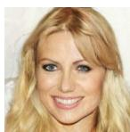  
“a smiling woman with blonde hair and bangs”

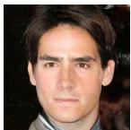

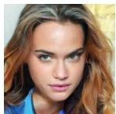  
“a man with black hair and an exposed forehead”  
Figure 4: Text-prompted samples.  
“a woman with a serious expression”

Super-resolution, deblurring, and inpainting. We further compare with recent image restoration solvers, including PnP-Flow [10], Flower [48], and FlowDPS [49], on CelebA-HQ 4× superresolution and Gaussian deblurring, and on CIFAR-10 inpainting with half-image and random 50% masks. BRIDGETWIST achieves the highest peak signal-to-noise ratio (PSNR) and structural similarity (SSIM) on deblurring and ranks a close second to PnP-Flow on super-resolution (Table 5). On CIFAR-10, it also achieves the highest SSIM under both inpainting masks. These results show that BRIDGETWIST is competitive with specialized image restoration solvers while supporting more general conditioning. See Appendices D.3 and D.4 for additional results.  
Table 5: Image restoration on CelebA-HQ and CIFAR-10. Subscripts give standard deviations; dashes indicate unavailable results; bold marks the best value.
<table><tr><td></td><td colspan="4">CelebA-HQ</td><td colspan="2">CIFAR-10</td></tr><tr><td></td><td colspan="2">Super-resolution</td><td colspan="2">Deblurring</td><td colspan="2">Inpainting</td></tr><tr><td>Method</td><td>PSNR ↑</td><td>SSIM ↑</td><td>PSNR ↑</td><td>SSIM ↑</td><td></td><td>SSIM (half) ↑ SSIM (random) ↑</td></tr><tr><td>PnP-Flow</td><td> $\mathbf { 2 8 . 4 7 _ { \pm 1 . 0 5 } }$ </td><td> $\mathbf { 0 . 8 4 3 _ { \pm 0 . 0 2 0 } }$ </td><td> $3 0 . 6 4 { \scriptstyle \pm 1 . 0 8 }$ </td><td> $0 . 8 1 8 { \scriptstyle \pm 0 . 0 1 9 }$ </td><td> $0 . 6 2 3 { \scriptstyle \pm 0 . 1 0 4 }$ </td><td> $0 . 9 4 0 _ { \pm 0 . 1 0 9 }$ </td></tr><tr><td>Flower</td><td> $2 7 . 8 8 _ { \pm 0 . 9 9 }$ </td><td> $0 . 8 2 7 { \scriptstyle \pm 0 . 0 1 9 }$ </td><td> $3 0 . 9 1 _ { \pm 1 . 0 7 }$ </td><td> $0 . 8 3 9 _ { \pm 0 . 0 1 5 }$ </td><td></td><td></td></tr><tr><td>FlowDPS</td><td> $2 6 . 4 3 { \scriptstyle \pm 1 . 8 6 }$ </td><td> $0 . 7 9 5 { \scriptstyle \pm 0 . 0 2 5 }$ </td><td> $2 9 . 1 2 _ { \pm 0 . 9 4 }$ </td><td> $0 . 8 1 9 { \scriptstyle \pm 0 . 0 2 8 }$ </td><td></td><td></td></tr><tr><td>FMPS</td><td> $2 3 . 6 8 _ { \pm 1 . 4 2 }$ </td><td> $0 . 6 2 2 _ { \pm 0 . 0 4 2 }$ </td><td> $1 7 . 9 2 _ { \pm 1 . 6 7 }$ </td><td> $0 . 6 8 9 _ { \pm 0 . 0 3 8 }$ </td><td> $0 . 2 4 0 _ { \pm 0 . 1 1 4 }$ </td><td> $0 . 5 5 4 { \scriptstyle \pm 0 . 1 0 6 }$ </td></tr><tr><td>TFTF</td><td> $2 3 . 7 8 _ { \pm 0 . 9 5 }$ </td><td> $0 . 7 7 2 _ { \pm 0 . 0 3 2 }$ </td><td> $2 7 . 9 8 _ { \pm 0 . 8 3 }$ </td><td> $0 . 7 3 7 { \scriptstyle \pm 0 . 0 3 2 }$ </td><td> $0 . 5 3 2 _ { \pm 0 . 0 7 1 }$ </td><td> $0 . 8 7 5 { \scriptstyle \pm 0 . 0 5 4 }$ </td></tr><tr><td>DPS-SB</td><td> $2 8 . 0 6 _ { \pm 0 . 9 7 }$ </td><td> $0 . 7 9 1 { \scriptstyle \pm 0 . 0 2 0 }$ </td><td> $2 9 . 4 9 _ { \pm 0 . 8 2 }$ </td><td> $0 . 7 0 8 _ { \pm 0 . 0 1 2 }$ </td><td> $0 . 5 1 8 { \scriptstyle \pm 0 . 0 8 6 }$ </td><td> $0 . 7 8 2 _ { \pm 0 . 0 8 2 }$ </td></tr><tr><td>BRIDGETWIST</td><td> $2 8 . 3 3 { \scriptstyle \pm 0 . 8 8 }$ </td><td> $0 . 8 3 6 _ { \pm 0 . 0 2 4 }$ </td><td> $\mathbf { 3 1 . 1 3 _ { \pm 0 . 9 7 } }$ </td><td> $\mathbf { 0 . 8 4 7 _ { \pm 0 . 0 2 0 } }$ </td><td> $\mathbf { 0 . 6 5 5 { \scriptstyle \pm 0 . 0 7 2 } }$ </td><td> $\mathbf { 0 . 9 4 3 _ { \pm 0 . 0 8 7 } }$ </td></tr></table>

## 4.3 Ablation studies

Table 6 compares endpoint predictor channels under the same SB prior on CIFAR-10. Replacing the full predictor with either the velocity-only Euler predictor or the score-only Tweedie predictor from Section 3.1 substantially degrades both class alignment and sample quality. See Appendices D.5 and D.6 for more diagnostics.

Table 6: CIFAR-10 predictor ablation at $K =$ 16. Bold marks the best value in each column.
<table><tr><td>Predictor</td><td> $\mathbf { A C C } _ { L }$  ←</td><td> $\mathsf { A C C } _ { E } \uparrow$ </td><td>KID↓</td></tr><tr><td>Velocity-only</td><td>0.526</td><td>0.485</td><td>0.2805</td></tr><tr><td>Score-only</td><td>0.711</td><td>0.514</td><td>0.2339</td></tr><tr><td>BRIDGETWIST</td><td>0.948</td><td>0.914</td><td>0.0873</td></tr></table>

Table 7 isolates the h-transform guidance, tempering, and importance weight correction under the same SB prior on MNIST and CIFAR-10. IS weights and resamples particles only at the endpoint, whereas DPS-SB uses guidance without importance correction. On CIFAR-10, both yield lower $\mathsf { A C C } _ { E }$ and higher KID than BRIDGETWIST, as do variants without h-transform guidance or tempering. On MNIST, removing tempering slightly increases $\mathsf { A C C } _ { E }$ while worsening KID.

Table 8 varies the tempering exponent $a \in \{ 0 , 1 , 2 , 3 \}$ in $\beta ( t ) = t ^ { a }$ and compares bridge-shaped, constant, and cosine diffusion schedules g(t) on CIFAR-10. The default combination of linear tempering $( a = 1 )$ and the bridge-shaped schedule performs the best. Tempering is important, since removing it (a = 0) largely degrades performance, whereas BRIDGETWIST is insensitive to the specific choice among $a \in \{ 1 , 2 , 3 \}$ For each a, our bridge-shaped design outperforms the common constant and cosine schedules. Appendix D.7 evaluates tempering in TDS and TFTF.

In summary, these ablations under the same SB prior support attributing the gains to the velocity–score endpoint predictor, h-transform guidance, tempering, and bridge-shaped diffusion. Appendix C.2 further shows the gains of BRIDGETWIST do not come from a better prior model.

Table 7: Sampler omponent ablation at $K = 6 4$ under the same SB prior. Bold marks the best value in each column.
<table><tr><td colspan="4"></td><td colspan="2">MNIST</td><td colspan="2">CIFAR-10</td></tr><tr><td>Variant</td><td>h-transform tempering</td><td></td><td>weight corr.</td><td>ACCE↑</td><td>KID↓</td><td> $\mathsf { A C C } _ { E } \uparrow$ </td><td>KID↓</td></tr><tr><td>IS</td><td>X</td><td>X</td><td>endpoint only</td><td>0.920</td><td>0.0007</td><td>0.865</td><td>0.0744</td></tr><tr><td>DPS-SB</td><td>√</td><td>X</td><td>×</td><td>0.619</td><td>0.0010</td><td>0.585</td><td>0.1051</td></tr><tr><td>BRIDGETWIST w/o h-transform</td><td>×</td><td>√</td><td>√</td><td>0.932</td><td>0.0003</td><td>0.925</td><td>0.0437</td></tr><tr><td>BRIDGETWIST w/o tempering</td><td>√</td><td>×</td><td>√</td><td>0.958</td><td>0.0004</td><td>0.938</td><td>0.0813</td></tr><tr><td>BRIDGETWIST</td><td>√</td><td>√</td><td>√</td><td>0.952</td><td>0.0003</td><td>0.979</td><td>0.0403</td></tr></table>

Table 8: Joint tempering and diffusion ablation on CIFAR-10 at $K = 6 4$ . Each entry reports $\operatorname { A C C } _ { E }$ (↑) / KID (↓). Bold marks the best values.
<table><tr><td> $a \setminus g ( t )$ </td><td>bridge-shaped (default)</td><td>constant  $( c _ { g } \sigma )$ </td><td>cosine  $( c _ { g } \sigma \cos ( \pi t / 2 ) )$ </td></tr><tr><td>a = 0 (no tempering)</td><td>0.938 / 0.0813</td><td>0.932 / 0.1489</td><td>0.897 / 0.0920</td></tr><tr><td>a = 1 (default)</td><td>0.979 / 0.0403</td><td>0.967 / 0.1099</td><td>0.945 / 0.0534</td></tr><tr><td> $a = 2$ </td><td>0.971 / 0.0426</td><td>0.970 / 0.1034</td><td>0.916 / 0.0487</td></tr><tr><td> $a = 3$ </td><td>0.967 / 0.0470</td><td>0.946 / 0.1013</td><td>0.909 / 0.0493</td></tr></table>

## 5 Discussion

We introduce BRIDGETWIST, a training-free conditional sampler that reuses pretrained unconditional Schrödinger bridge models. Central to our approach are three contributions to SB conditioning: a plug-in lookahead built from the velocity–score endpoint predictor, temporal tempering that moderates this lookahead when conditional endpoint uncertainty is large, and a bridge-shaped diffusion schedule that concentrates exploration in the path interior. These designs guide and reweight particles through a sequence of intermediate targets toward the endpoint posterior. We establish a finite-particle error bound for estimates under the posterior, and demonstrate competitive performance across class-conditional and text-prompted image generation, and image restoration.

Beyond the sampler itself, the endpoint predictor offers a two-channel view that connects the transport perspective of flow models with the denoising perspective of diffusion models. For an SB under a Brownian reference, the velocity channel describes transport along the bridge, while the score channel corrects for noise in the current state. Our ablations support combining both channels to improve class alignment and sample quality.

Limitations and future work. First, BRIDGETWIST currently is restricted to Schrödinger bridges with the Brownian reference, and extending it to other references require reference-specific endpoint predictors. Second, its twist approximation uses only the conditional endpoint mean and can be inaccurate for strongly curved likelihoods or multimodal conditional endpoint laws. The second-order extension in Appendix D.8 improves some low-dimensional cases, but full covariance estimation is expensive in high dimensions and requires scalable approximations. Third, the sampler targets the posterior induced by the learned and discretized prior, leaving prior-learning and discretization errors. Fourth, preparing the SB prior also requires an additional score head, with a one-time computational overhead relative to directly using pretrained flow or diffusion models. Finally, future work also includes protein design and broader single-cell transport applications, building on the initial example in Appendix D.9.

## Acknowledgments and Disclosures

The authors thank the anonymous referees for their insightful and constructive comments, which have led to an improved version of the paper. This work was supported by the National Natural Science Foundation of China (Grant No. 12601554), the China Postdoctoral Science Foundation (Grant No. 2025M783111), and the Shenzhen Science and Technology Program (Grant No. AI2026019). The authors declare no competing interests.

## References

[1] Luhuan Wu, Brian L. Trippe, Christian A. Naesseth, David M. Blei, and John P. Cunningham. Practical and asymptotically exact conditional sampling in diffusion models. In Advances in Neural Information Processing Systems, volume 36, pages 31372–31403. Curran Associates, Inc., 2023.

[2] Hyungjin Chung, Jeongsol Kim, Michael Thompson McCann, Marc Louis Klasky, and Jong Chul Ye. Diffusion posterior sampling for general noisy inverse problems. In The Eleventh International Conference on Learning Representations (ICLR), 2023.

[3] Zehao Dou and Yang Song. Diffusion posterior sampling for linear inverse problem solving: A filtering perspective. In The Twelfth International Conference on Learning Representations (ICLR), 2024.

[4] James Matthew Young and O. Deniz Akyildiz. On diffusion posterior sampling via sequential Monte Carlo for zero-shot scaffolding of protein motifs. Transactions on Machine Learning Research, 2025.

[5] Qianqian Qu and Jun S. Liu. TFTF: Training-free targeted flow for conditional sampling. In Proceedings of the 43rd International Conference on Machine Learning, volume 306 of Proceedings of Machine Learning Research, pages 102577–102606. PMLR, 2026.

[6] Kaiyu Song, Hanjiang Lai, Yan Pan, Kun Yue, and Jian Yin. Flow-matching posterior sampling: A training-free conditional generation for flow matching. IEEE Transactions on Image Processing, 35:5970–5981, 2026.

[7] Bahjat Kawar, Michael Elad, Stefano Ermon, and Jiaming Song. Denoising diffusion restoration models. In Advances in Neural Information Processing Systems, volume 35, pages 23593–23606. Curran Associates, Inc., 2022.

[8] Jiaming Song, Arash Vahdat, Morteza Mardani, and Jan Kautz. Pseudoinverse-guided diffusion models for inverse problems. In The Eleventh International Conference on Learning Representations (ICLR), 2023.

[9] Luran Wang, Chaoran Cheng, Yizhen Liao, Yanru Qu, and Ge Liu. Training free guided flow-Matching with optimal control. In The Thirteenth International Conference on Learning Representations (ICLR), 2025.

[10] Ségolène Tiffany Martin, Anne Gagneux, Paul Hagemann, and Gabriele Steidl. PnP-flow: Plugand-Play image restoration with flow matching. In The Thirteenth International Conference on Learning Representations (ICLR), 2025.

[11] Brian L. Trippe, Jason Yim, Doug Tischer, David Baker, Tamara Broderick, Regina Barzilay, and Tommi S. Jaakkola. Diffusion probabilistic modeling of protein backbones in 3D for the motifscaffolding problem. In The Eleventh International Conference on Learning Representations (ICLR), 2023.

[12] Gabriel Cardoso, Yazid Janati El Idrissi, Sylvain Le Corff, and Eric Moulines. Monte Carlo guided Denoising Diffusion models for Bayesian linear inverse problems. In The Twelfth International Conference on Learning Representations (ICLR), 2024.

[13] Marta Skreta, Tara Akhound-Sadegh, Viktor Ohanesian, Roberto Bondesan, Alan Aspuru-Guzik, Arnaud Doucet, Rob Brekelmans, Alexander Tong, and Kirill Neklyudov. Feynman-Kac correctors in diffusion: Annealing, guidance, and product of experts. In Proceedings of the 42nd International Conference on Machine Learning, volume 267 of Proceedings ofMachine Learning Research, pages 55906–55949. PMLR, 2025.

[14] Raghav Singhal, Zachary Horvitz, Ryan Teehan, Mengye Ren, Zhou Yu, Kathleen McKeown, and Rajesh Ranganath. A general framework for inference-time scaling and steering of diffusion models. In Proceedings of the 42nd International Conference on Machine Learning, volume 267 of Proceedings ofMachine Learning Research, pages 55810–55827. PMLR, 2025.

[15] Valentin De Bortoli, James Thornton, Jeremy Heng, and Arnaud Doucet. Diffusion Schrödinger bridge with applications to score-based generative modeling. In Advances in Neural Information Processing Systems, volume 34, pages 17695–17709. Curran Associates, Inc., 2021.

[16] Yuyang Shi, Valentin De Bortoli, Andrew Campbell, and Arnaud Doucet. Diffusion Schrödinger bridge matching. In Advances in Neural Information Processing Systems, volume 36, pages 62183–62223. Curran Associates, Inc., 2023.

[17] Nikita Gushchin, Daniil Selikhanovych, Sergei Kholkin, Evgeny Burnaev, and Alexander Korotin. Adversarial Schrödinger bridge matching. In Advances in Neural Information Processing Systems, volume 37, pages 89612–89651. Curran Associates, Inc., 2024. doi: 10.52202/079017-2845.

[18] Alexander Y. Tong, Nikolay Malkin, Kilian Fatras, Lazar Atanackovic, Yanlei Zhang, Guillaume Huguet, Guy Wolf, and Yoshua Bengio. Simulation-free Schrödinger bridges via score and flow matching. In Proceedings ofthe 27th International Conference on Artificial Intelligence and Statistics, volume 238 of Proceedings of Machine Learning Research, pages 1279–1287. PMLR, 2024.

[19] Tianrong Chen, Guan-Horng Liu, and Evangelos A. Theodorou. Likelihood training of Schrödinger bridge using forward-backward SDEs theory. In International Conference on Learning Representations (ICLR), 2022.

[20] Eslam Abdelrahman, Liangbing Zhao, Vincent Tao Hu, Matthieu Cord, Patrick Perez, and Mohamed Elhoseiny. ToddlerDiffusion: Interactive structured image generation with cascaded Schrödinger bridge. In International Conference on Learning Representations (ICLR), 2025.

[21] Guan-Horng Liu, Arash Vahdat, De-An Huang, Evangelos A. Theodorou, Weili Nie, and Anima Anandkumar. I2SB: Image-to-image Schrödinger Bridge. In Proceedings of the 40th International Conference on Machine Learning, volume 202 of Proceedings of Machine Learning Research, pages 22042–22062. PMLR, 2023.

[22] Jingjun Yi, Qi Bi, Hao Zheng, Huimin Huang, Yixian Shen, Haolan Zhan, Wei Ji, Yawen Huang, Yuexiang Li, Xian Wu, and Yefeng Zheng. Degradation-aware dynamic Schrödinger bridge for unpaired image restoration. In Advances in Neural Information Processing Systems, volume 38, pages 2415–2439. Curran Associates, Inc., 2025.

[23] Clémence Fournié, Elias Ventre, Ulysse Herbach, Aymeric Baradat, Olivier Gandrillon, and Fabien Crauste. Cell trajectory inference based on Schrödinger problem and a mechanistic model of stochastic gene expression. npj Systems Biology and Applications, 12(1):120, 2026.

[24] Yuyang Shi, Valentin De Bortoli, George Deligiannidis, and Arnaud Doucet. Conditional simulation using diffusion Schrödinger bridges. In Proceedings ofthe Thirty-Eighth Conference on Uncertainty in Artificial Intelligence, volume 180 of Proceedings of Machine Learning Research, pages 1792–1802. PMLR, 2022.

[25] Hanwen Huang and Manyu Huang. Schrödinger bridge based deep conditional generative learning. Journal of Multivariate Analysis, 210:105486, 2025. doi: 10.1016/j.jmva.2025. 105486.

[26] Chang Li, Zehua Chen, Fan Bao, and Jun Zhu. Bridge-SR: Schrödinger Bridge for efficient SR. In ICASSP 2025 - 2025 IEEE International Conference on Acoustics, Speech and Signal Processing (ICASSP), pages 1–5. IEEE, 2025. doi: 10.1109/ICASSP49660.2025.10890104.

[27] Ming Lin, Rong Chen, and Per Mykland. On generating Monte Carlo samples of continuous diffusion bridges. Journal ofthe American Statistical Association, 105(490):820–838, 2010.

[28] Ming Lin, Rong Chen, and Jun S. Liu. Lookahead strategies for sequential Monte Carlo. Statistical Science, 28(1):69–94, 2013.

[29] Michael S. Albergo, Nicholas M. Boffi, and Eric Vanden-Eijnden. Stochastic interpolants: A unifying framework for flows and diffusions. Journal of Machine Learning Research, 26(209): 1–80, 2025.

[30] Erwin Schrödinger. Sur la théorie relativiste de l’électron et l’interprétation de la mécanique quantique. Annales de l’Institut Henri Poincaré, 2(4):269–310, 1932.

[31] Christian Léonard. A survey of the Schrödinger problem and some of its connections with optimal transport. Discrete and Continuous Dynamical Systems, 34(4):1533–1574, 2014.

[32] Yang Song, Jascha Sohl-Dickstein, Diederik P. Kingma, Abhishek Kumar, Stefano Ermon, and Ben Poole. Score-based generative modeling through stochastic differential equations. In The Ninth International Conference on Learning Representations (ICLR), 2021.

[33] Jun S. Liu and Rong Chen. Sequential Monte Carlo methods for dynamic systems. Journal of the American Statistical Association, 93(443):1032–1044, 1998.

[34] Jun S. Liu. Monte Carlo Strategies in Scientific Computing. Springer, 2001.

[35] Nicolas Chopin and Omiros Papaspiliopoulos. An Introduction to Sequential Monte Carlo. Springer, 2020.

[36] Pierre Del Moral. Feynman-Kac Formulae: Genealogical and Interacting Particle Systems with Applications. Probability and its Applications. Springer, 2004.

[37] Nick Whiteley and Anthony Lee. Twisted particle filters. The Annals of Statistics, 42(1): 115–141, 2014.

[38] Radford M. Neal. Annealed importance sampling. Statistics and Computing, 11(2):125–139, 2001.

[39] Pierre Del Moral, Arnaud Doucet, and Ajay Jasra. Sequential Monte Carlo samplers. Journal ofthe Royal Statistical Society: Series B (Statistical Methodology), 68(3):411–436, 2006.

[40] Yann LeCun, Léon Bottou, Yoshua Bengio, and Patrick Haffner. Gradient-based learning applied to document recognition. Proceedings ofthe IEEE, 86(11):2278–2324, 1998.

[41] Alex Krizhevsky. Learning multiple layers of features from tiny images. Technical report, University of Toronto, 2009.

[42] Tero Karras, Timo Aila, Samuli Laine, and Jaakko Lehtinen. Progressive growing of GANs for improved quality, stability, and variation. In International Conference on Learning Representations (ICLR), 2018.

[43] Mikołaj Binkowski, Danica J. Sutherland, Michael Arbel, and Arthur Gretton. Demystifying ´ MMD GANs. In International Conference on Learning Representations (ICLR), 2018.

[44] Muhammad Ferjad Naeem, Seong Joon Oh, Youngjung Uh, Yunjey Choi, and Jaejun Yoo. Reliable fidelity and diversity metrics for generative models. In Proceedings ofthe 37th International Conference on Machine Learning, volume 119 of Proceedings of Machine Learning Research, pages 7176–7185. PMLR, 2020.

[45] Alec Radford, Jong Wook Kim, Chris Hallacy, Aditya Ramesh, Gabriel Goh, Sandhini Agarwal, Girish Sastry, Amanda Askell, Pamela Mishkin, Jack Clark, Gretchen Krueger, and Ilya Sutskever. Learning transferable visual models from natural language supervision. In Proceedings of the 38th International Conference on Machine Learning, volume 139 of Proceedings of Machine Learning Research, pages 8748–8763. PMLR, 2021.

[46] Richard Zhang, Phillip Isola, Alexei A. Efros, Eli Shechtman, and Oliver Wang. The unreasonable effectiveness of deep features as a perceptual metric. In Proceedings of the IEEE Conference on Computer Vision and Pattern Recognition, pages 586–595, 2018.

[47] Jun-Yan Zhu, Richard Zhang, Deepak Pathak, Trevor Darrell, Alexei A. Efros, Oliver Wang, and Eli Shechtman. Toward multimodal image-to-image translation. In Advances in Neural Information Processing Systems, volume 30. Curran Associates, Inc., 2017.

[48] Mehrsa Pourya, Bassam El Rawas, and Michael Unser. Flower: A flow-matching solver for inverse problems. In The Fourteenth International Conference on Learning Representations (ICLR), 2026.

[49] Jeongsol Kim, Bryan Sangwoo Kim, and Jong Chul Ye. FlowDPS: Flow-driven posterior sampling for inverse problems. In Proceedings of the IEEE/CVF International Conference on Computer Vision, pages 12328–12337, 2025.

[50] Xingchao Liu, Chengyue Gong, and Qiang Liu. Flow straight and fast: Learning to generate and transfer data with rectified flow. In International Conference on Learning Representations (ICLR), 2023.

[51] Kaiming He, Xiangyu Zhang, Shaoqing Ren, and Jian Sun. Deep residual learning for image recognition. In Proceedings of the IEEE Conference on Computer Vision and Pattern Recognition, pages 770–778, 2016.

[52] Zhuang Liu, Hanzi Mao, Chao-Yuan Wu, Christoph Feichtenhofer, Trevor Darrell, and Saining Xie. A ConvNet for the 2020s. In Proceedings of the IEEE/CVF Conference on Computer Vision and Pattern Recognition, pages 11976–11986, 2022.

[53] Mehdi Cherti, Romain Beaumont, Ross Wightman, Mitchell Wortsman, Gabriel Ilharco, Cade Gordon, Christoph Schuhmann, Ludwig Schmidt, and Jenia Jitsev. Reproducible scaling laws for contrastive language-image learning. In Proceedings of the IEEE/CVF Conference on Computer Vision and Pattern Recognition, pages 2818–2829, 2023.

[54] Gao Huang, Zhuang Liu, Laurens van der Maaten, and Kilian Q. Weinberger. Densely connected convolutional networks. In Proceedings of the IEEE Conference on Computer Vision and Pattern Recognition, pages 4700–4708, 2017.

[55] Yanbo Xu, Yueqin Yin, Liming Jiang, Qianyi Wu, Chengyao Zheng, Chen Change Loy, Bo Dai, and Wayne Wu. TransEditor: Transformer-based dual-space GAN for highly controllable facial editing. In Proceedings of the IEEE/CVF Conference on Computer Vision and Pattern Recognition, pages 7683–7692, 2022.

[56] Kevin R. Moon, David van Dijk, Zheng Wang, Scott Gigante, Daniel B. Burkhardt, William S. Chen, Kristina Yim, Antonia van den Elzen, Matthew J. Hirn, Ronald R. Coifman, Natalia B. Ivanova, Guy Wolf, and Smita Krishnaswamy. Visualizing structure and transitions in highdimensional biological data. Nature Biotechnology, 37(12):1482–1492, 2019.

[57] Geoffrey Schiebinger, Jian Shu, Marcin Tabaka, Brian Cleary, Vidya Subramanian, Aryeh Solomon, Joshua Gould, Siyan Liu, Stacie Lin, Peter Berube, Lia Lee, Jenny Chen, Justin Brumbaugh, Philippe Rigollet, Konrad Hochedlinger, Rudolf Jaenisch, Aviv Regev, and Eric S. Lander. Optimal-transport analysis of single-cell gene expression identifies developmental trajectories in reprogramming. Cell, 176(4):928–943.e22, 2019.

## Appendix contents

A Proofs 16   
A.1 Proof of Proposition 1 . 16   
A.2 Inference SDE preserves the SB marginal 17   
A.3 Proof of Theorem 1 18   
A.4 Proof of Remark 1 23   
B Pretraining details 23   
C Implementation details 24   
C.1 Two-dimensional toy benchmark . 24   
C.2 Unconditional models and likelihoods 25   
C.3 Hyperparameters and metrics . 26   
D Additional results 27   
D.1 Computation cost . 27   
D.2 Joint particle and time-step allocation 27   
D.3 Qualitative samples . 27   
D.4 Expanded CIFAR-10 inpainting comparison 28   
D.5 Calibration of the endpoint predictor 28   
D.6 SMC diagnostics 30   
D.7 Tempering in TDS and TFTF 31   
D.8 Second-order twist extension . 31   
D.9 Conditional transition with a non-Gaussian source 32

## A Proofs

In this appendix, we prove main theoretical results. Appendix A.1 proves the endpoint decomposition in Proposition 1, Appendix $\mathrm { A } . 2$ proves the marginal preservation property of the inference SDE, and Appendix A.3 proves the finite-particle bound of Theorem 1; Appendix A.4 proves Remark 1.

We work in the Brownian-reference Schrödinger bridge setup of Section 2.1: conditional on $( X _ { 0 } , X _ { 1 } )$

$$
X _ { t } \mid ( X _ { 0 } , X _ { 1 } ) \sim { \mathcal { N } } ( M _ { t } , \tau _ { t } ^ { 2 } I ) , \qquad M _ { t } = ( 1 - t ) X _ { 0 } + t X _ { 1 } , \qquad \tau _ { t } ^ { 2 } = \sigma ^ { 2 } t ( 1 - t ) .
$$

We also write $D = X _ { 1 } - X _ { 0 }$ . Throughout, p denotes the SB marginal density and is assumed to be continuously differentiable on $\mathbb { R } ^ { d }$ for $t \in ( 0 , 1 )$ .

## A.1 Proof of Proposition 1

Proof. Fix $t \in ( 0 , 1 )$ and $x \in \mathbb { R } ^ { d }$ . The Brownian reference SB is a mixture of Brownian bridges over its endpoint coupling. Conditional on $X _ { t } = x$ and $X _ { 1 } = x _ { 1 }$ , the future path is therefore a Brownian bridge from (t, x) to $( 1 , x _ { 1 } )$ , satisfying

$$
\mathrm { d } X _ { s } = \frac { x _ { 1 } - X _ { s } } { 1 - s } \mathrm { d } s + \sigma \mathrm { d } \widetilde { W } _ { s } , \qquad t \leq s < 1 ,
$$

where $\widetilde { W }$ is Brownian motion under the conditional law. Averaging this drift at time t over $X _ { 1 } | X _ { t } = x$ gives

$$
b _ { t } ^ { \star } ( x ) = \mathbb { E } \left[ \frac { X _ { 1 } - X _ { t } } { 1 - t } \Big | X _ { t } = x \right] = \frac { \mathbb { E } [ X _ { 1 } \mid X _ { t } = x ] - x } { 1 - t } .
$$

Using $b _ { t } ^ { \star } = v _ { t } ^ { \star } + \sigma ^ { 2 } s _ { t } ^ { \star } / 2$ and rearranging gives

$$
\operatorname { \mathbb { E } } [ X _ { 1 } \mid X _ { t } = x ] = x + ( 1 - t ) v _ { t } ^ { \star } ( x ) + { \frac { \sigma ^ { 2 } } { 2 } } ( 1 - t ) s _ { t } ^ { \star } ( x ) .\tag{13}
$$

To recover $\mathbb { E } [ M _ { t } | X _ { t } = x ]$ , let $\nu _ { t }$ be the law of $M _ { t }$ and $\phi _ { \tau _ { t } }$ the $\mathcal { N } ( 0 , \tau _ { t } ^ { 2 } I )$ density. Since $X _ { t } | M _ { t } \sim$ $\mathcal { N } ( M _ { t } , \tau _ { t } ^ { 2 } I )$ , the marginal density of $X _ { t }$ is the convolution

$$
p _ { t } ( x ) = \int \phi _ { \tau _ { t } } ( x - m ) \nu _ { t } ( \mathrm { d } m ) .\tag{14}
$$

Differentiating Eq. (14) with respect to x gives

$$
\begin{array} { r l } & { \nabla _ { x } p _ { t } ( x ) = \displaystyle \int \nabla _ { x } \phi _ { \tau _ { t } } ( x - m ) \nu _ { t } ( \mathrm { d } m ) } \\ & { \qquad = - \frac { 1 } { \tau _ { t } ^ { 2 } } \displaystyle \int ( x - m ) \phi _ { \tau _ { t } } ( x - m ) \nu _ { t } ( \mathrm { d } m ) } \\ & { \qquad = - \frac { 1 } { \tau _ { t } ^ { 2 } } \bigg [ x p _ { t } ( x ) - \displaystyle \int m \phi _ { \tau _ { t } } ( x - m ) \nu _ { t } ( \mathrm { d } m ) \bigg ] . } \end{array}\tag{15}
$$

By Bayes’ rule, the conditional law of $M _ { t }$ given $X _ { t } = x$ is $\phi _ { \tau _ { t } } ( x - m ) \nu _ { t } ( \mathrm { d } m ) / p _ { t } ( x )$ , so

$$
\int m \phi _ { \tau _ { t } } ( x - m ) \nu _ { t } ( \mathrm { d } m ) = p _ { t } ( x ) \mathbb { E } [ M _ { t } \mid X _ { t } = x ] .
$$

Dividing Eq. (15) by $p _ { t } ( x )$ and rearranging yields Tweedie’s identity for the interpolation $M _ { t }$

$$
\begin{array} { r } { \mathbb { E } [ M _ { t } \mid X _ { t } = x ] = x + \tau _ { t } ^ { 2 } \nabla _ { x } \log p _ { t } ( x ) = x + \sigma ^ { 2 } t ( 1 - t ) s _ { t } ^ { \star } ( x ) . } \end{array}\tag{16}
$$

Finally, $X _ { 1 } = M _ { t } + ( 1 - t ) D$ and Eqs. (13) and (16) yield

$$
\mathbb { E } [ D \mid X _ { t } = x ] = { \frac { \mathbb { E } [ X _ { 1 } \mid X _ { t } = x ] - \mathbb { E } [ M _ { t } \mid X _ { t } = x ] } { 1 - t } } = v _ { t } ^ { \star } ( x ) + { \frac { 1 - 2 t } { 2 } } \sigma ^ { 2 } s _ { t } ^ { \star } ( x ) .\tag{17}
$$

Corollary 1 (Source-side conditional mean). Under the same assumptions,for every $t \in ( 0 , 1 )$ and $\boldsymbol { x } \in \mathbb { R } ^ { d } ,$

$$
\mathbb { E } [ X _ { 0 } \mid X _ { t } = x ] = x - t { v _ { t } ^ { \star } } ( x ) + \frac { \sigma ^ { 2 } } { 2 } t { s _ { t } ^ { \star } } ( x ) .
$$

Proof. The source state satisfies $X _ { 0 } = M _ { t } - t D$ . Combining (16) and (17),

$$
\begin{array} { r l } & { \mathbb { E } [ X _ { 0 } \mid X _ { t } = x ] = \mathbb { E } [ M _ { t } \mid X _ { t } = x ] - t \mathbb { E } [ D \mid X _ { t } = x ] } \\ & { \qquad = x + \sigma ^ { 2 } t ( 1 - t ) s _ { t } ^ { \star } ( x ) - t v _ { t } ^ { \star } ( x ) - t \frac { 1 - 2 t } { 2 } \sigma ^ { 2 } s _ { t } ^ { \star } ( x ) } \\ & { \qquad = x - t v _ { t } ^ { \star } ( x ) + \sigma ^ { 2 } t \left[ ( 1 - t ) - \frac { 1 - 2 t } { 2 } \right] s _ { t } ^ { \star } ( x ) } \\ & { \qquad = x - t v _ { t } ^ { \star } ( x ) + \frac { \sigma ^ { 2 } } { 2 } t s _ { t } ^ { \star } ( x ) . } \end{array}
$$

## A.2 Inference SDE preserves the SB marginal

Proposition 2. Let $g \in C ( [ 0 , 1 ] , \mathbb { R } _ { \geq 0 } )$ be an inference diffusion schedule. The Brownian-reference Schrodinger bridge SDE (1) is

$$
\mathrm { d } \bar { X } _ { t } = b _ { t } ^ { \star } ( \bar { X } _ { t } ) \mathrm { d } t + \sigma \mathrm { d } W _ { t } , \quad b _ { t } ^ { \star } ( x ) = v _ { t } ^ { \star } ( x ) + \frac 1 2 \sigma ^ { 2 } s _ { t } ^ { \star } ( x ) , \quad \bar { X } _ { 0 } \sim q _ { 0 } ,\tag{18}
$$

with $s _ { t } ^ { \star } ( x ) = \nabla \log p _ { t } ( x )$ and $q _ { 0 } = p _ { 0 }$ . Define the inference-time drift

$$
b _ { \theta , g } ( t , x ) : = v _ { t } ^ { \star } ( x ) + \frac 1 2 g ( t ) ^ { 2 } s _ { t } ^ { \star } ( x ) ,
$$

and the corresponding inference SDE

$$
\mathrm { d } X _ { t } = b _ { \theta , g } ( t , X _ { t } ) \mathrm { d } t + g ( t ) \mathrm { d } W _ { t } , \qquad X _ { 0 } \sim q _ { 0 } .\tag{19}
$$

For any such $^ { g , }$ the marginal density of $X _ { t }$ under (19) equals the SB marginal density $p _ { t }$ of (18) for every $t \in ( 0 , 1 )$

Proof. The SB probability-flow ODE associated with the marginal velocity $v ^ { \star }$ transports $p _ { 0 } = q _ { 0 }$ along the marginal densities $\{ p _ { t } \} _ { t \in ( 0 , 1 ) }$ . Equivalently, these densities satisfy the continuity equation

$$
\partial _ { t } p _ { t } ( x ) = - \nabla \cdot [ p _ { t } ( x ) \boldsymbol { v } _ { t } ^ { \star } ( x ) ] .\tag{20}
$$

Let $\tilde { p } _ { t }$ denote the marginal density of the SDE (19). Its Fokker–Planck equation is

$$
\partial _ { t } \tilde { p } _ { t } ( x ) = - \nabla \cdot [ \tilde { p } _ { t } ( x ) b _ { \theta , g } ( t , x ) ] + \frac { 1 } { 2 } g ( t ) ^ { 2 } \Delta \tilde { p } _ { t } ( x ) ,\tag{21}
$$

with initial condition $\tilde { p } _ { 0 } = q _ { 0 }$ . Because the SB source constraint gives $p _ { 0 } = q _ { 0 }$ , the two initial conditions coincide. We now check that the SB density $p _ { t }$ also solves (21). Substituting $p _ { t }$ in the right-hand side of (21), and using $\begin{array} { r } { b _ { \theta , g } = v ^ { \star } + \frac { 1 } { 2 } g ^ { 2 } s ^ { \star } } \end{array}$ , gives

$$
\begin{array} { l } { - \nabla \cdot [ p _ { t } b _ { \theta , g } ] + \displaystyle \frac { 1 } { 2 } g ( t ) ^ { 2 } \Delta p _ { t } } \\ { = - \nabla \cdot [ p _ { t } \boldsymbol { v } ^ { \star } ] - \displaystyle \frac { 1 } { 2 } g ( t ) ^ { 2 } \nabla \cdot [ p _ { t } \boldsymbol { s } ^ { \star } ] + \displaystyle \frac { 1 } { 2 } g ( t ) ^ { 2 } \Delta p _ { t } . } \end{array}\tag{22}
$$

Since $s _ { t } ^ { \star } ( x ) = \nabla \log p _ { t } ( x )$

$$
p _ { t } ( \boldsymbol { x } ) s _ { t } ^ { \star } ( \boldsymbol { x } ) = p _ { t } ( \boldsymbol { x } ) \nabla \log p _ { t } ( \boldsymbol { x } ) = \nabla p _ { t } ( \boldsymbol { x } ) ,
$$

and hence

$$
\nabla \cdot \left[ p _ { t } \boldsymbol { s } ^ { \star } \right] = \nabla \cdot \left[ \nabla p _ { t } \right] = \Delta p _ { t } .
$$

The last two terms in (22) therefore cancel exactly:

$$
- \frac { 1 } { 2 } g ( t ) ^ { 2 } \nabla \cdot [ p _ { t } s ^ { \star } ] + \frac { 1 } { 2 } g ( t ) ^ { 2 } \Delta p _ { t } = 0 .
$$

Then the right-hand side of (22) reduces to $- \nabla \cdot \left[ p _ { t } \boldsymbol { v } ^ { \star } \right]$ , which equals $\partial _ { t } p _ { t }$ by the continuity equation (20). Thus $p _ { t }$ satisfies the same Fokker–Planck equation and the same initial condition as $\tilde { p } _ { t }$ , and hence $\tilde { p } _ { t } = p _ { t }$ for all $t \in ( 0 , 1 )$

This result is independent of the specific choice of $g .$ Changing g adds both a diffusion term and the drift term $\begin{array} { r } { \frac { 1 } { 2 } g ( t ) ^ { 2 } \dot { \nabla } \log p _ { t } } \end{array}$ with the same coefficient, so the two contributions cancel at the density level. This is the flexible schedule property used in Section 3.2. □

## A.3 Proof of Theorem 1

Theorem 1 uses the following regularity conditions on the tempered twist and the Gaussian proposal kernels of Algorithm 1.

Assumption 1 (Endpoint twist consistency). For all $x \in \mathbb { R } ^ { d } , \hat { h } _ { N } ( x ) ^ { \beta _ { N } } = L _ { y } ( x )$

Assumption 2 (Bounded likelihood and twist). There are constants $0 < \ell _ { n } \leq u _ { n }$ < ∞ such that $\ell _ { n } \leq \hat { h } _ { n } ( x ) ^ { \beta _ { n } } \leq u _ { n }$ for all $x \in \mathbb { R } ^ { d }$ and $n \in \{ 0 , \ldots , N \}$ ; in particular, $\ell _ { N } \leq L _ { y } ( x ) \leq u _ { N } ,$

Assumption 3 (Bounded log-twist gradient). For each n with $\beta _ { n } > 0 ,$ , the map $x \mapsto \log \hat { h } _ { n } ( x ) ^ { \beta _ { n } }$ is continuously differentiable and has uniformly bounded gradient.

Assumption 4 (Proposal coverage). For every n, the prior covariance is nondegenerate, $i . e . , \sigma _ { M , n } ^ { 2 } : =$ $g ( t _ { n - 1 } ) ^ { 2 } \Delta _ { n } > 0 ,$ , and the proposal covariance $\Sigma _ { q , n }$ of Section 3.2 strictly dominates it:

$$
\Sigma _ { M , n } = \sigma _ { M , n } ^ { 2 } I , \qquad \Sigma _ { q , n } = ( \sigma _ { M , n } ^ { 2 } + \varepsilon ) I , \qquad \varepsilon > 0 .
$$

The nondegeneracy condition is satisfied by the bridge-shaped schedule with $\delta _ { g } > 0$ used in the experiments and by any strictly positive inference diffusion schedule on the discretization grid.

Mildness of the assumptions. Assumption 1 holds by construction because $\beta _ { N } = 1$ and $\hat { h } _ { N } ( x ) =$ $L _ { y } ( x )$ . Assumption 2 is satisfied by bounded likelihoods with a positive floor and by CLIP likelihoods with bounded similarity scores and a finite guidance scale λ. It also implies $\ell _ { N } \leq h _ { n } ( x ) \leq u _ { N }$ so the relative twist mismatch $R _ { n , N }$ in Theorem 1 is finite. Assumption 3 follows from bounded likelihood gradients and bounded Jacobians of $( v _ { \theta } , s _ { \theta } )$ through the chain rule applied to Eq. (8), matching the regularity used in diffusion twisting analyses [1, Appendix $\mathrm { A } . 5 ] $ the explicit chain-rule derivation is recorded below. Assumption 4 is the standard absolute-continuity safeguard: the small εI inflation gives the proposal heavier Gaussian tails than the prior kernel.

Lemma 1 (Ratio estimator). Let $( Z _ { i } , F _ { i } ) _ { i = 1 } ^ { K }$ be independent pairs with $Z _ { i } > 0 , \mathbb { E } [ Z _ { i } ^ { 2 } ] < \infty ,$ , and $F _ { i } \in [ m , M ]$ almost surely. For $\theta : = \textstyle \sum _ { i } \mathbb { E } [ Z _ { i } F _ { i } ] / \sum _ { i } \mathbb { E } [ Z _ { i } ]$ and $\begin{array} { r } { \hat { \theta } : = \sum _ { i } Z _ { i } F _ { i } / \sum _ { i } Z _ { i } , } \end{array}$ , we have

$$
\mathbb { E } [ ( \hat { \theta } - \theta ) ^ { 2 } ] \leq 8 ( M - m ) ^ { 2 } \frac { \sum _ { i } \mathbb { E } [ Z _ { i } ^ { 2 } ] } { ( \sum _ { i } \mathbb { E } [ Z _ { i } ] ) ^ { 2 } } .
$$

Proof. Set $\begin{array} { r } { D : = \sum _ { i } Z _ { i } , d : = \mathbb { E } [ D ] } \end{array}$ , and $\begin{array} { r } { Y : = \sum _ { i } Z _ { i } ( F _ { i } - \theta ) } \end{array}$ . Independence gives $\mathbb { E } [ Y ] = 0$ $\begin{array} { r } { \mathbb { E } [ Y ^ { 2 } ] \leq ( M - m ) ^ { 2 } \sum _ { i } \mathbb { E } [ Z _ { i } ^ { 2 } ] } \end{array}$ , and $\begin{array} { r } { \mathbb { P } ( D < d / 2 ) \le 4 \sum _ { i } \mathbb { E } [ Z _ { i } ^ { 2 } ] / d ^ { 2 } } \end{array}$ by Chebyshev’s inequality. Since $\hat { \theta } - \theta = Y / D$ and $\begin{array} { r } { | \hat { \theta } - \theta | \leq M - m . } \end{array}$ , splitting on $D \geq d / 2$ yields

$$
\mathbb { E } [ ( \hat { \theta } - \theta ) ^ { 2 } ] \leq \frac { 4 \mathbb { E } [ Y ^ { 2 } ] } { d ^ { 2 } } + ( M - m ) ^ { 2 } \mathbb { P } ( D < d / 2 ) \leq \frac { 8 ( M - m ) ^ { 2 } \sum _ { i } \mathbb { E } [ Z _ { i } ^ { 2 } ] } { d ^ { 2 } } .
$$

Step 1: verify the Feynman–Kac target and endpoint marginal. Let $Q _ { N }$ denote the proposal path law used by Algorithm 1,

$$
Q _ { N } ( \mathrm { d } x _ { t _ { 0 : N } } ) = q _ { 0 } ( \mathrm { d } x _ { t _ { 0 } } ) \prod _ { n = 1 } ^ { N } q _ { n } ( x _ { t _ { n } } \mid x _ { t _ { n - 1 } } , y ) \mathrm { d } x _ { t _ { n } } ,
$$

where $q _ { 0 }$ is the SB source distribution; the algorithm initializes particles directly from $q _ { 0 }$ which is also the initial marginal of the discretized SB prior path measure $P _ { \theta , g } ^ { ( N ) } ( \mathrm { { d } } x _ { t _ { 0 : N } } ) \ =$ $\begin{array} { r l } { { q _ { 0 } } ( \mathrm { d } x _ { t _ { 0 } } ) \prod _ { n = 1 } ^ { N } M _ { n } ( x _ { t _ { n - 1 } } , \mathrm { d } x _ { t _ { n } } ) } & { { } } \end{array}$ defined in Section 3.2. The algorithm attaches the initial weight $\hat { h } _ { 0 } ( x _ { t _ { 0 } } ) ^ { \beta _ { 0 } }$ and then the incremental weights (11). Therefore the unnormalized path measure represented by the weighted particles at step $\bar { N }$ is

$$
\Gamma _ { N } ^ { \beta } ( \mathrm { d } x _ { t _ { 0 : N } } ) = Q _ { N } ( \mathrm { d } x _ { t _ { 0 : N } } ) \hat { h } _ { 0 } ( x _ { t _ { 0 } } ) ^ { \beta _ { 0 } } \prod _ { n = 1 } ^ { N } \omega _ { n } ( x _ { t _ { n - 1 } } , x _ { t _ { n } } ) .\tag{23}
$$

Substituting the definition of $\omega _ { n }$ gives the telescoping product

$$
\begin{array} { l } { \displaystyle \hat { h } _ { 0 } ( x _ { t _ { 0 } } ) ^ { \beta _ { 0 } } \prod _ { n = 1 } ^ { N } \omega _ { n } ( x _ { t _ { n - 1 } } , x _ { t _ { n } } ) = \hat { h } _ { 0 } ( x _ { t _ { 0 } } ) ^ { \beta _ { 0 } } \prod _ { n = 1 } ^ { N } \frac { M _ { n } ( x _ { t _ { n - 1 } } , x _ { t _ { n } } ) \hat { h } _ { n } ( x _ { t _ { n } } ) ^ { \beta _ { n } } } { q _ { n } ( x _ { t _ { n } } \mid x _ { t _ { n - 1 } } , y ) \hat { h } _ { n - 1 } ( x _ { t _ { n - 1 } } ) ^ { \beta _ { n - 1 } } } } \\ { = \frac { \prod _ { n = 1 } ^ { N } M _ { n } ( x _ { t _ { n - 1 } } , x _ { t _ { n } } ) } { \prod _ { n = 1 } ^ { N } q _ { n } ( x _ { t _ { n } } \mid x _ { t _ { n - 1 } } , y ) } \hat { h } _ { N } ( x _ { t _ { N } } ) ^ { \beta _ { N } } . } \end{array}\tag{24}
$$

All intermediate twist powers cancel pairwise, and only the endpoint twist remains. Multiplying (24) by the proposal path measure in (23) yields

$$
\Gamma _ { N } ^ { \beta } ( \mathrm { d } x _ { t _ { 0 : N } } ) = q _ { 0 } ( \mathrm { d } x _ { t _ { 0 } } ) \prod _ { n = 1 } ^ { N } M _ { n } ( x _ { t _ { n - 1 } } , \mathrm { d } x _ { t _ { n } } ) \hat { h } _ { N } ( x _ { t _ { N } } ) ^ { \beta _ { N } } = P _ { \theta , g } ^ { ( N ) } ( \mathrm { d } x _ { t _ { 0 : N } } ) \hat { h } _ { N } ( x _ { t _ { N } } ) ^ { \beta _ { N } } ,
$$

where the second equality uses the factorization of $P _ { \theta , g } ^ { ( N ) }$ recorded above. By Assumption 1, $\hat { h } _ { N } ( x _ { t _ { N } } ) ^ { \beta _ { N } } = L _ { y } ( x _ { t _ { N } } )$ , and hence

$$
\Gamma _ { N } ^ { \beta } ( \mathrm { d } x _ { t _ { 0 : N } } ) = P _ { \theta , g } ^ { ( N ) } ( \mathrm { d } x _ { t _ { 0 : N } } ) L _ { y } ( x _ { t _ { N } } ) .\tag{25}
$$

Thus the final Feynman–Kac target is the discretized SB prior path law tilted only by the true endpoint likelihood. The intermediate twists and the tempering schedule affect the proposal and weight variance, but not the final target. Normalizing this path measure also identifies its endpoint marginal. Let $Z _ { N } ^ { \beta } = \Gamma _ { N } ^ { \beta } ( 1 )$ and $\pi _ { N } ^ { \beta } = \mathrm { T } _ { N } ^ { \beta } / Z _ { N } ^ { \beta }$ . For any bounded measurable $\varphi : \mathbb { R } ^ { d }  \mathbb { R }$ , (25) gives

$$
\begin{array} { r l r } {  { \int { \varphi ( x _ { t _ { N } } ) \pi _ { N } ^ { \beta } ( \mathrm { d } x _ { t _ { 0 : N } } ) } = \frac { \int { \varphi ( x _ { t _ { N } } ) L _ { y } ( x _ { t _ { N } } ) P _ { \theta , g } ^ { ( N ) } ( \mathrm { d } x _ { t _ { 0 : N } } ) } } { \int L _ { y } ( x _ { t _ { N } } ) P _ { \theta , g } ^ { ( N ) } ( \mathrm { d } x _ { t _ { 0 : N } } ) } } } \\ & { } & { = \frac { \int { \varphi ( x _ { t _ { N } } ) L _ { y } ( x _ { t _ { N } } ) p _ { \theta } ^ { ( N ) } ( \mathrm { d } x _ { t _ { N } } ) } } { \int L _ { y } ( x _ { t _ { N } } ) p _ { \theta } ^ { ( N ) } ( \mathrm { d } x _ { t _ { N } } ) } } \\ & { } & { = \mathbb { E } _ { X _ { t _ { N } } \sim \pi ^ { \star , ( N ) } } [ \varphi ( X _ { t _ { N } } ) ] . } \end{array}\tag{26}
$$

The second equality integrates out $x _ { t _ { 0 : N - 1 } }$ under the discretized SB prior path law, whose endpoint marginal is $p _ { \theta } ^ { ( N ) }$ . This proves that the endpoint marginal of $\pi _ { N } ^ { \beta }$ is exactly the posterior $\pi ^ { \star , ( N ) }$ appearing in Theorem 1.

Step 2: bound the incremental weights. The incremental weight factors as

$$
\omega _ { n } ( x _ { t _ { n - 1 } } , x _ { t _ { n } } ) = { \frac { { \hat { h } } _ { n } ( x _ { t _ { n } } ) ^ { \beta _ { n } } } { { \hat { h } } _ { n - 1 } ( x _ { t _ { n - 1 } } ) ^ { \beta _ { n - 1 } } } } { \frac { M _ { n } ( x _ { t _ { n - 1 } } , x _ { t _ { n } } ) } { q _ { n } ( x _ { t _ { n } } \mid x _ { t _ { n - 1 } } , y ) } } .
$$

By Assumption 2, the first factor lies in $[ \ell _ { n } / u _ { n - 1 } , u _ { n } / \ell _ { n - 1 } ]$ and is uniformly bounded on the finite grid. It remains to bound the Gaussian density ratio.

Write

$$
M _ { n } ( \cdot \mid x _ { t _ { n - 1 } } ) = \mathcal { N } ( m _ { M , n } , a _ { n } I ) , \qquad q _ { n } ( \cdot \mid x _ { t _ { n - 1 } } , y ) = \mathcal { N } ( m _ { q , n } , c _ { n } I ) ,
$$

where $a _ { n } : = g ( t _ { n - 1 } ) ^ { 2 } \Delta _ { n } > 0 , c _ { n } : = a _ { n } + \varepsilon$ , and $\delta _ { n } : = m _ { q , n } - m _ { M , n }$ . By Eqs. (9) and (10),

$$
\begin{array} { r l } & { \delta _ { n } ( x _ { t _ { n - 1 } } ) = w _ { g } g ( t _ { n - 1 } ) ^ { 2 } \Delta _ { n } \beta _ { n - 1 } \nabla _ { x } \log \hat { h } _ { n - 1 } ( x _ { t _ { n - 1 } } ) } \\ & { ~ = w _ { g } g ( t _ { n - 1 } ) ^ { 2 } \Delta _ { n } \nabla _ { x } \log \bigl ( \hat { h } _ { n - 1 } ( x _ { t _ { n - 1 } } ) ^ { \beta _ { n - 1 } } \bigr ) . } \end{array}
$$

If $\beta _ { n - 1 } = 0$ or $w _ { g } = 0$ , this shift is zero; otherwise Assumption 3, together with continuity of $g$ on $[ 0 , 1 ] .$ , the finite hyperparameter $w _ { g } \geq 0 ;$ , and the finite grid, implies that $\| \delta _ { n } ( x _ { t _ { n - 1 } } ) \|$ is uniformly bounded over $\left( n , x _ { t _ { n - 1 } } \right)$ . For $z : = x _ { t _ { n } } - m _ { M , n }$

$$
\begin{array} { r l r } {  { \log \frac { M _ { n } ( x _ { t _ { n - 1 } } , x _ { t _ { n } } ) } { q _ { n } ( x _ { t _ { n } } \mid x _ { t _ { n - 1 } } , y ) } = \frac d 2 \log \frac { c _ { n } } { a _ { n } } - \frac { 1 } { 2 a _ { n } } \| z \| ^ { 2 } + \frac { 1 } { 2 c _ { n } } \| z - \delta _ { n } \| ^ { 2 } } } \\ & { } & \\ & { } & { \quad = \frac d 2 \log \frac { c _ { n } } { a _ { n } } - \frac { c _ { n } - a _ { n } } { 2 a _ { n } c _ { n } } \| z \| ^ { 2 } - \frac { 1 } { c _ { n } } \langle z , \delta _ { n } \rangle + \frac { 1 } { 2 c _ { n } } \| \delta _ { n } \| ^ { 2 } } \\ & { } & { \quad \leq \frac d 2 \log \frac { c _ { n } } { a _ { n } } - \frac { \varepsilon } { 2 a _ { n } c _ { n } } \| z \| ^ { 2 } + \frac { 1 } { c _ { n } } \| z \| \| \delta _ { n } \| + \frac { 1 } { 2 c _ { n } } \| \delta _ { n } \| ^ { 2 } . } \end{array}\tag{27}
$$

For any $r \geq 0 .$

$$
- \frac { \varepsilon } { 2 a _ { n } c _ { n } } r ^ { 2 } + \frac { \| \delta _ { n } \| } { c _ { n } } r \leq \frac { a _ { n } } { 2 c _ { n } \varepsilon } \| \delta _ { n } \| ^ { 2 } ,
$$

which is the maximum of the scalar quadratic in r. Applying this bound to $r = \| z \|$ in (27) gives

$$
\log \frac { M _ { n } ( x _ { t _ { n - 1 } } , x _ { t _ { n } } ) } { q _ { n } ( x _ { t _ { n } } \mid x _ { t _ { n - 1 } } , y ) } \leq \frac { d } { 2 } \log \frac { c _ { n } } { a _ { n } } + \frac { \| \delta _ { n } \| ^ { 2 } } { 2 \varepsilon } .
$$

Because the time grid is finite, Assumption 4 makes the determinant term $\textstyle { \frac { d } { 2 } } \log ( c _ { n } / a _ { n } )$ finite uniformly over n. The bound on $\delta _ { n }$ derived from Assumption 3 makes the second term uniformly finite. Therefore $M _ { n } / q _ { n }$ is uniformly bounded over $( n , x _ { t _ { n - 1 } } , x _ { t _ { n } } )$ . Combining this with Assumption 2, each $\omega _ { n }$ is positive and uniformly bounded. The initial weight $\hat { h } _ { 0 } ^ { \beta _ { 0 } }$ is also bounded by Assumption 2.

Step 3: describe the exact distribution updates. We next write the exact updates that the particles approximate, so that we can isolate the error introduced at each step and follow its effect on the endpoint. Write $H _ { n } : = \hat { h } _ { n } ^ { \beta _ { n } }$ . Starting from a state x at step $n - 1$ , propagation and weighting give the following expected contribution of a bounded test function $f _ { i }$

$$
Q _ { n } f ( x ) : = \int q _ { n } ( x ^ { \prime } \mid x , y ) \omega _ { n } ( x , x ^ { \prime } ) f ( x ^ { \prime } ) \mathrm { d } x ^ { \prime } = { \frac { 1 } { H _ { n - 1 } ( x ) } } \int M _ { n } ( x , \mathrm { d } x ^ { \prime } ) H _ { n } ( x ^ { \prime } ) f ( x ^ { \prime } ) .
$$

The equality follows by substituting the incremental weight, which cancels the proposal density. For a probability law $\mu$ at step $n - 1$ , write $\textstyle \mu ( f ) : = \int f ( x ) \mu ( \mathrm { d } x )$ . Averaging these contributions and dividing by the total weight gives the exact updated expectation

$$
\Phi _ { n } ( \mu ) ( f ) : = \frac { \mu ( Q _ { n } f ) } { \mu ( Q _ { n } { \bf 1 } ) } .
$$

Since $\beta _ { 0 } = 0$ and $H _ { 0 } \equiv 1$ , the exact intermediate marginals start at $\eta _ { 0 } ~ = ~ q _ { 0 }$ and satisfy $\eta _ { n } =$ $\Phi _ { n } ( \eta _ { n - 1 } )$ . Step 1 identifies their terminal marginal as $\eta _ { N } = \pi ^ { \star , ( N ) }$

To describe the remaining updates from step p to step $n ,$ let $M _ { p + 1 : n }$ denote the composition of the prior kernels over those steps. Repeated propagation and weighting compose the operators $Q _ { p + 1 } , \ldots , Q _ { n }$ . As in Step 1, the intermediate twist factors cancel, giving

$$
Q _ { p , n } f ( x ) : = ( Q _ { p + 1 } \cdot \cdot \cdot Q _ { n } f ) ( x ) = { \frac { 1 } { H _ { p } ( x ) } } \int M _ { p + 1 : n } ( x , \mathrm { d } z ) H _ { n } ( z ) f ( z ) .
$$

Thus the exact continuation of a law $\mu$ from step p to step n is

$$
\Phi _ { p , n } ( \mu ) ( f ) : = { \frac { \mu ( Q _ { p , n } f ) } { \mu ( Q _ { p , n } { \bf 1 } ) } } ,
$$

with $Q _ { n , n } = I$ and $\Phi _ { n , n } ( \mu ) = \mu$ when no updates remain. In particular, $\Phi _ { n - 1 , n } = \Phi _ { n }$

At the endpoint, $H _ { N } = L _ { y }$ and $\begin{array} { r } { h _ { p } ( x ) = \int M _ { p + 1 : N } ( x , \mathrm { d } z ) L _ { y } ( z ) } \end{array}$ . Normalizing this likelihoodweighted prior transition gives the posterior transition kernel

$$
P _ { p , N } ^ { y } ( x , \mathrm { d } z ) = \frac { M _ { p + 1 : N } ( x , \mathrm { d } z ) L _ { y } ( z ) } { h _ { p } ( x ) } .
$$

Consequently, the remaining weighted contribution factors as

$$
Q _ { p , N } f ( x ) = \frac { 1 } { H _ { p } ( x ) } \int M _ { p + 1 : N } ( x , \mathrm { d } z ) L _ { y } ( z ) f ( z ) = \frac { h _ { p } ( x ) } { H _ { p } ( x ) } P _ { p , N } ^ { y } f ( x ) ,
$$

where $P _ { p , N } ^ { y } f ( x )$ is the conditional expectation of the endpoint function $f$ under this kernel. Define the total remaining weight by $u _ { p , N } : = Q _ { p , N } \mathbf { 1 } = h _ { p } / H _ { p }$ . The exact continuation therefore first reweights the current law by $u _ { p , N }$ and then applies the posterior transition,

$$
\Phi _ { p , N } ( \mu ) ( f ) = \frac { \mu ( u _ { p , N } P _ { p , N } ^ { y } f ) } { \mu ( u _ { p , N } ) } .
$$

Here $u _ { N , N } \equiv 1$ and $P _ { N , N } ^ { y } = I$ . Assumption 2 gives $\ell _ { N } / u _ { p } \leq u _ { p , N } ( x ) \leq u _ { N } / \ell _ { p } $ , so its relative variation is sup $u _ { p , N } / \operatorname* { i n f } u _ { p , N } = R _ { p , N } < \infty$ . This factorization separates the weight correction and the posterior transition whose effects on error we bound in Step 5.

Step 4: bound the error introduced at one step. We now compare one particle update with the exact update from the same starting particles. Write the weighted particle estimate of a test function as $\begin{array} { r } { \eta _ { n } ^ { K } ( \bar { f } ) : = \sum _ { i = 1 } ^ { K } W _ { n } ^ { ( i ) } f ( X _ { t _ { n } } ^ { ( i ) } ) } \end{array}$ . For $n \geq 1$ , define its comparison law by

$$
\tilde { \eta } _ { n } ^ { K } : = \Phi _ { n } ( \eta _ { n - 1 } ^ { K } ) , \qquad \tilde { \eta } _ { 0 } ^ { K } : = \eta _ { 0 } .
$$

The difference $\eta _ { n } ^ { K } - \tilde { \eta } _ { n } ^ { K }$ isolates the sampling error added at step n while holding the previous particle approximation fixed. Let $\mathcal { F } _ { n - 1 } ^ { K }$ be the sigma-field generated by the particle history through step $n - 1 { : }$ ; this history determines the ESS resampling decision. For every bounded $\mathcal { F } _ { n - 1 } ^ { \bar { K } }$ -measurable test function $f ,$ we will show

$$
\mathbb { E } \Big [ \big | ( \eta _ { n } ^ { K } - \tilde { \eta } _ { n } ^ { K } ) ( f ) \big | ^ { 2 } \Big | \mathcal { F } _ { n - 1 } ^ { K } \Big ] ^ { 1 / 2 } \le \frac { \alpha _ { n } } { \sqrt { K } } \ o s c ( f ) , \qquad n \in \{ 0 , \dotsc , N \} ,\tag{28}
$$

where $\alpha _ { n }$ is deterministic and independent of K. $\mathbf { A } \mathbf { t } n = 0$ , the bound is unconditional with deterministic $f .$ . The independent samples from $q _ { 0 }$ have equal weights, so $\mathrm { V a r } [ \eta _ { 0 } ^ { K } ( f ) ] \leq \mathrm { o s c } ( f ) ^ { 2 } / ( 4 K )$ and we can take $\alpha _ { 0 } = 1 / 2$

For $n \geq 1$ , the first two conditional moments of an incremental weight are

$$
m _ { n } ( x ) : = \int q _ { n } ( x ^ { \prime } \mid x , y ) \omega _ { n } ( x , x ^ { \prime } ) \mathrm { d } x ^ { \prime } = Q _ { n } { \bf 1 } ( x ) , \qquad v _ { n } ( x ) : = \int q _ { n } ( x ^ { \prime } \mid x , y ) \omega _ { n } ( x , x ^ { \prime } ) ^ { 2 } \mathrm { d } x ^ { \prime } .
$$

Assumption 2 bounds the mean weight, and Step 2 bounds each realized weight by a finite constant $\bar { \omega } _ { n }$ . These bounds imply

$$
\underline { m } _ { n } : = \frac { \ell _ { n } } { u _ { n - 1 } } \le m _ { n } ( x ) \le \frac { u _ { n } } { \ell _ { n - 1 } } = : \overline { m } _ { n } , \qquad v _ { n } ( x ) \le \bar { \omega } _ { n } m _ { n } ( x ) \le \kappa _ { n } m _ { n } ( x ) ^ { 2 } ,
$$

where $\kappa _ { n } : = \bar { \omega } _ { n } / \underline { m } _ { n }$ and $b _ { n } : = { \overline { { m } } } _ { n } / { \underline { { m } } } _ { n }$ . We apply Lemma 1 with $F _ { i } : = f ( X _ { t _ { n } } ^ { ( i ) } )$ , choosing $Z _ { i }$ according to the resampling decision.

If resampling occurs, the reset weights are equal, so we can take $Z _ { i } : = \omega _ { n } ( \bar { X } _ { t _ { n - 1 } } ^ { ( i ) } , X _ { t _ { n } } ^ { ( i ) } )$ and obtain $\hat { \theta } = \eta _ { n } ^ { K } ( f )$ . Stratified resampling uses independent uniforms on the K strata, followed by independent proposal draws, making the pairs $( \bar { Z _ { i } } , F _ { i } )$ independent conditional on $\mathcal { F } _ { n - 1 } ^ { K }$ . Its expected ancestor counts satisfy

$$
\sum _ { i = 1 } ^ { K } \mathbb { P } ( A _ { n - 1 } ^ { ( i ) } = j \mid \mathcal { F } _ { n - 1 } ^ { K } ) = K W _ { n - 1 } ^ { ( j ) } .
$$

Summing over the ancestors and proposal draws therefore gives

$$
\begin{array} { r } { \theta = \frac { \displaystyle \sum _ { i } \mathbb { E } [ Z _ { i } F _ { i } \mid \mathcal { F } _ { n - 1 } ^ { K } ] } { \displaystyle \sum _ { i } \mathbb { E } [ Z _ { i } \mid \mathcal { F } _ { n - 1 } ^ { K } ] } = \frac { K \eta _ { n - 1 } ^ { K } ( Q _ { n } f ) } { K \eta _ { n - 1 } ^ { K } ( m _ { n } ) } = \widetilde { \eta } _ { n } ^ { K } ( f ) , } \\ { \frac { \displaystyle \sum _ { i } \mathbb { E } [ Z _ { i } ^ { 2 } \mid \mathcal { F } _ { n - 1 } ^ { K } ] } { \displaystyle ( \sum _ { i } \mathbb { E } [ Z _ { i } \mid \mathcal { F } _ { n - 1 } ^ { K } ] ) ^ { 2 } } = \frac { \eta _ { n - 1 } ^ { K } ( v _ { n } ) } { K \eta _ { n - 1 } ^ { K } ( m _ { n } ) ^ { 2 } } \le \frac { \kappa _ { n } b _ { n } ^ { 2 } } { K } . \qquad } \end{array}
$$

If resampling is skipped, we include the previous particle weights by setting

$$
Z _ { i } : = W _ { n - 1 } ^ { ( i ) } \omega _ { n } ( X _ { t _ { n - 1 } } ^ { ( i ) } , X _ { t _ { n } } ^ { ( i ) } ) .
$$

The proposal draws again give conditionally independent pairs and $\hat { \theta } = \eta _ { n } ^ { K } ( f )$ . In this case,

$$
\begin{array} { r l r } & { } & { \theta = \frac { \eta _ { n - 1 } ^ { K } ( Q _ { n } f ) } { \eta _ { n - 1 } ^ { K } ( m _ { n } ) } = \tilde { \eta } _ { n } ^ { K } ( f ) , } \\ & { } & { \frac { \sum _ { i } \mathbb { E } [ Z _ { i } ^ { 2 } \mid \mathcal { F } _ { n - 1 } ^ { K } ] } { ( \sum _ { i } \mathbb { E } [ Z _ { i } \mid \mathcal { F } _ { n - 1 } ^ { K } ] ) ^ { 2 } } = \frac { \sum _ { i } ( W _ { n - 1 } ^ { ( i ) } ) ^ { 2 } v _ { n } ( X _ { t _ { n - 1 } } ^ { ( i ) } ) } { \eta _ { n - 1 } ^ { K } ( m _ { n } ) ^ { 2 } } \le \kappa _ { n } b _ { n } ^ { 2 } \sum _ { i } ( W _ { n - 1 } ^ { ( i ) } ) ^ { 2 } \le \frac { \kappa _ { n } b _ { n } ^ { 2 } } { \rho K } . } \end{array}
$$

The last inequality follows because skipping resampling requires $\mathrm { E S S } _ { n - 1 } \geq \rho K$ . Since $\rho \leq 1$ , both cases satisfy the second-moment bound $\dot { } \kappa _ { n } \bar { b _ { n } ^ { 2 } } / ( \rho K )$ . Lemma 1, applied conditionally on the particle history, proves Eq. (28) with $\alpha _ { n } = b _ { n } \sqrt { 8 \kappa _ { n } / \rho }$

Step $\mathbf { 5 } \colon$ propagate the one-step errors to the endpoint. We finally express the terminal error as a sum of the one-step sampling errors, each followed by the remaining exact updates. For $p \geq 1$ , the definition of $\tilde { \eta } _ { p } ^ { K }$ gives

$$
\Phi _ { p , N } \bigl ( \tilde { \eta } _ { p } ^ { K } \bigr ) = \Phi _ { p , N } \bigl ( \Phi _ { p } \bigl ( \eta _ { p - 1 } ^ { K } \bigr ) \bigr ) = \Phi _ { p - 1 , N } \bigl ( \eta _ { p - 1 } ^ { K } \bigr ) .
$$

The second equality combines the exact update from step $p - 1$ to step p with the remaining exact updates. When we sum the differences between the particle laws and their comparison laws, these consecutive terms cancel. Using $\Phi _ { N , N } ( \eta _ { N } ^ { K } ) = \eta _ { N } ^ { K }$ and $\Phi _ { 0 , N } ( \eta _ { 0 } ) = \eta _ { N }$ , we obtain

$$
\eta _ { N } ^ { K } - \eta _ { N } = \sum _ { p = 0 } ^ { N } \left[ \Phi _ { p , N } ( \eta _ { p } ^ { K } ) - \Phi _ { p , N } ( \tilde { \eta } _ { p } ^ { K } ) \right] .
$$

To apply Step 4 to each summand, we rewrite the propagated difference as a one-step error evaluated on a transformed test function. Fix p and write $\dot { \mu } : = \dot { \eta } _ { p } ^ { K } , \nu : = \tilde { \eta } _ { p } ^ { K }$ , and $B : = \Phi _ { p , N } ( \nu ) ( \varphi )$ . The factorization in Step 3 gives

$$
\begin{array} { l } { \displaystyle \Phi _ { p , N } ( \mu ) ( \varphi ) - \Phi _ { p , N } ( \nu ) ( \varphi ) = \frac { \mu ( u _ { p , N } P _ { p , N } ^ { y } \varphi ) } { \mu ( u _ { p , N } ) } - B } \\ { \displaystyle = \frac { ( \mu - \nu ) \big ( u _ { p , N } ( P _ { p , N } ^ { y } \varphi - B ) \big ) } { \mu ( u _ { p , N } ) } , } \end{array}
$$

where the last equality uses $\nu \big ( u _ { p , N } ( P _ { p , N } ^ { y } \varphi - B ) \big ) = 0$ . Define

$$
D \varphi ( x ) : = \frac { u _ { p , N } ( x ) } { \nu ( u _ { p , N } ) } \big ( P _ { p , N } ^ { y } \varphi ( x ) - B \big ) .
$$

Then the propagated difference becomes

$$
\Phi _ { p , N } ( \mu ) ( \varphi ) - \Phi _ { p , N } ( \nu ) ( \varphi ) = \frac { \nu ( u _ { p , N } ) } { \mu ( u _ { p , N } ) } ( \mu - \nu ) ( D \varphi ) .
$$

Because $\nu = \tilde { \eta } _ { p } ^ { K }$ depends only on the particle history through step $p - 1$ , the function $D \varphi$ is $\mathcal { F } _ { p - 1 } ^ { K }$ -measurable and can be used in Eq. (28). $\mathbf { A } \mathbf { t } p = 0$ , it is deterministic.

It remains to bound the prefactor and the oscillation of this test function. The definition of $R _ { p , N }$ gives

$$
\frac { \nu ( u _ { p , N } ) } { \mu ( u _ { p , N } ) } \leq \frac { \operatorname* { s u p } u _ { p , N } } { \operatorname* { i n f } u _ { p , N } } = R _ { p , N } .
$$

Also, B is a weighted average of $P _ { p , N } ^ { y } \varphi ;$ , so it lies between that function’s infimum and supremum. Since $u _ { p , N } ( x ) / \nu ( u _ { p , N } ) \leq R _ { p , N }$ , we have

$$
\displaystyle \operatorname { o s c } ( D \varphi ) \leq 2 \operatorname { s u p } _ { r } | D \varphi ( x ) | \leq 2 R _ { p , N } \operatorname { o s c } ( P _ { p , N } ^ { y } \varphi ) \leq 2 R _ { p , N } \varrho ( P _ { p , N } ^ { y } ) \operatorname { o s c } ( \varphi ) .
$$

Applying the conditional bound in Eq. (28) and then taking expectations yields

$$
\Big \| \Phi _ { p , N } \big ( \eta _ { p } ^ { K } \big ) \big ( \varphi \big ) - \Phi _ { p , N } \big ( \tilde { \eta } _ { p } ^ { K } \big ) \big ( \varphi \big ) \Big \| _ { L _ { 2 } } \leq \frac { 2 \alpha _ { p } R _ { p , N } ^ { 2 } \varrho \big ( P _ { p , N } ^ { y } \big ) } { \sqrt { K } } \operatorname { o s c } ( \varphi ) .
$$

Finally, the triangle inequality in $L _ { 2 }$ sums these propagated errors,

$$
\| \eta _ { N } ^ { K } ( \varphi ) - \eta _ { N } ( \varphi ) \| _ { L _ { 2 } } \leq \frac { 2 \operatorname { o s c } ( \varphi ) } { \sqrt { K } } \sum _ { p = 0 } ^ { N } \alpha _ { p } R _ { p , N } ^ { 2 } \varrho ( P _ { p , N } ^ { y } ) .
$$

Since $\eta _ { N } = \pi ^ { \star , ( N ) }$ by Step 1, this is Eq. (12) with the stated constant $C _ { N }$

## A.4 Proof of Remark 1

Under the assumptions of Remark $1 , X _ { 1 } | X _ { t } = x \sim \mathcal { N } ( \mu _ { 1 | t } ^ { \star } ( x ) , \sigma _ { 1 | t } ^ { 2 } I )$ , so the exact twist is the Gaussian convolution

$$
h _ { t } ( \boldsymbol { x } ) = \int \mathcal { N } ( y ; x _ { 1 } , \sigma _ { y } ^ { 2 } I ) \mathcal { N } ( x _ { 1 } ; \mu _ { 1 | t } ^ { \star } ( \boldsymbol { x } ) , \sigma _ { 1 | t } ^ { 2 } I ) \mathrm { d } x _ { 1 } = \mathcal { N } \big ( y ; \mu _ { 1 | t } ^ { \star } ( \boldsymbol { x } ) , ( \sigma _ { y } ^ { 2 } + \sigma _ { 1 | t } ^ { 2 } ) I \big ) .
$$

The plug-in twist is $\hat { h } _ { t } ( x ) = \mathcal { N } ( y ; \mu _ { 1 \mid t } ^ { \star } ( x ) , \sigma _ { y } ^ { 2 } I )$ , so for any $\beta > 0$

$$
\hat { h } _ { t } ( x ) ^ { \beta } = ( 2 \pi \sigma _ { y } ^ { 2 } ) ^ { - \beta d / 2 } \exp \Big ( - \frac { \beta \lVert y - \mu _ { 1 \lvert t } ^ { \star } ( x ) \rVert ^ { 2 } } { 2 \sigma _ { y } ^ { 2 } } \Big ) .
$$

With $\beta = \beta ^ { \star } ( t ) = \sigma _ { y } ^ { 2 } / ( \sigma _ { y } ^ { 2 } + \sigma _ { 1 | t } ^ { 2 } )$ , the exponent equals $- \| y - \mu _ { 1 | t } ^ { \star } ( x ) \| ^ { 2 } / \{ 2 ( \sigma _ { y } ^ { 2 } + \sigma _ { 1 | t } ^ { 2 } ) \}$ ; hence $\hat { h } _ { t } ( x ) ^ { \beta ^ { \star } ( t ) } = c _ { t } h _ { t } ( x )$ with $c _ { t } = ( 2 \pi \sigma _ { y } ^ { 2 } ) ^ { - \beta ^ { \star } ( t ) d / 2 } \lbrace 2 \pi ( \sigma _ { y } ^ { 2 } + \sigma _ { 1 | t } ^ { 2 } ) \rbrace ^ { d / 2 }$ independent of x. Taking logarithms and gradients gives ∇ log $\hat { h } _ { t } ^ { \beta ^ { \star } ( t ) } = \nabla$ log $h _ { t } .$ , so with $w _ { g } = 1$ the guidance term in Eq. (10) equals the exact h-transform drift correction $g ( t ) ^ { 2 } \nabla \log h _ { t }$ . The factors $c _ { t _ { n } } / c _ { t _ { n - 1 } }$ multiply every incremental weight (11) by the same particle-independent constant and cancel after normalization, so the tempered plug-in twist and the exact twist induce the same sampler.

The result also extends to observing only a subset of the coordinates of $x _ { 1 }$ . In the model $y = A x _ { 1 } + \eta$ with $\eta \sim \mathcal { N } ( 0 , \sigma _ { y } ^ { 2 } I )$ , the matrix A selects the observed coordinates, such as the unmasked pixels of an image. Since $A A ^ { \top } = I$ in the observation space, the same computation gives $h _ { t } ( x ) =$ $\mathcal { N } \big ( y ; A \mu _ { 1 \vert t } ^ { \star } ( x ) , ( \sigma _ { y } ^ { 2 } + \sigma _ { 1 \vert t } ^ { 2 } ) I \big )$ , so $\hat { h } _ { t } ( x ) ^ { \beta ^ { \star } ( t ) } \propto h _ { t } ( x )$ holds with the same $\beta ^ { \star } ( t )$

## B Pretraining details

This appendix provides the SB pretraining convention assumed by the main text. We follow the simulation-free score-and-flow matching (SF2M) framework [18] but with a different parameterization, detailed below.

Score and flow matching. Under a Brownian reference with diffusion coefficient σ, the Schrödinger bridge’s endpoint coupling is the entropic optimal transport (OT) coupling with squared Euclidean cost and regularization strength $2 \sigma ^ { 2 }$ . For endpoints $( x _ { 0 } , x _ { 1 } )$ drawn from this coupling and $t \sim \mathrm { U n i f } ( 0 , 1 )$ the corresponding Brownian bridge sample is

$$
x _ { t } = ( 1 - t ) x _ { 0 } + t x _ { 1 } + \sigma { \sqrt { t ( 1 - t ) } } \varepsilon , \qquad \varepsilon \sim { \mathcal { N } } ( 0 , I ) .
$$

Writing $m _ { t } = ( 1 - t ) x _ { 0 } + t x _ { 1 }$ , its conditional probability-flow velocity and score are

$$
u _ { t } ^ { \circ } ( x \mid x _ { 0 } , x _ { 1 } ) = x _ { 1 } - x _ { 0 } + { \frac { 1 - 2 t } { 2 t ( 1 - t ) } } ( x - m _ { t } ) , \qquad s _ { t } ^ { \circ } ( x \mid x _ { 0 } , x _ { 1 } ) = - { \frac { x - m _ { t } } { \sigma ^ { 2 } t ( 1 - t ) } } .
$$

The standard SF2M objective jointly regresses these two targets [18],

$$
\mathbb { E } \big [ \| v _ { \theta } ( t , X _ { t } ) - u _ { t } ^ { \circ } ( X _ { t } \mid X _ { 0 } , X _ { 1 } ) \| ^ { 2 } + w ( t ) ^ { 2 } \| s _ { \theta } ( t , X _ { t } ) - s _ { t } ^ { \circ } ( X _ { t } \mid X _ { 0 } , X _ { 1 } ) \| ^ { 2 } \big ] ,
$$

where $w ( t ) > 0$ weights the score loss and the expectation is over the pair $( X _ { 0 } , X _ { 1 } )$ , time, and bridge noise. In our implementation, we approximate the endpoint coupling using minibatch exact OT, following Tong et al. [18].

Displacement and noise parameterization. Holding $x _ { 0 } , \ x _ { 1 }$ , and ε fixed, differentiating the interpolation in t gives the conditional probability-flow velocity

$$
u _ { t } ^ { \circ } ( x _ { t } \mid x _ { 0 } , x _ { 1 } ) = \underbrace { x _ { 1 } - x _ { 0 } } _ { \mathrm { d i s p l a c e m e n t } D } + \underbrace { \sigma \frac { 1 - 2 t } { 2 \sqrt { t ( 1 - t ) } } \varepsilon } _ { \mathrm { n o i s e c o r r e c t i o n t e r m } } ,
$$

whose noise correction coefficient $\sigma ( 1 - 2 t ) / ( 2 \sqrt { t ( 1 - t ) } )$ diverges as $t  0$ or $t  1$ . Directly regressing this velocity would inherit this divergence, so we predict $D$ and ε separately and reconstruct the velocity $v _ { \boldsymbol { \theta } } ( t , \boldsymbol { x } )$ analytically. We instantiate a displacement channel $d _ { \theta } ( t , x )$ targeting $D =$ $x _ { 1 } - x _ { 0 }$ and a noise channel $\varepsilon _ { \boldsymbol { \theta } } ( t , \boldsymbol { x } )$ targeting ε. We consider a joint model with a shared UNet backbone and two heads, and a dual model that uses two independent UNets. Both are trained with the same loss, and experiments use the joint version for efficiency unless noted. The loss is

$$
\mathbb { E } \left[ \Vert d _ { \theta } ( t , x _ { t } ) - ( x _ { 1 } - x _ { 0 } ) \Vert ^ { 2 } + \lambda ( t ) \Vert \varepsilon _ { \theta } ( t , x _ { t } ) - \varepsilon \Vert ^ { 2 } \right] ,
$$

where $\lambda ( t ) > 0$ weights the noise regression and the expectation is over pairs $( x _ { 0 } , x _ { 1 } )$ , times, and Gaussian noise.

Recovering velocity and score. The noise head is converted to the score convention used in the main text, $s _ { \theta } ( t , x ) \approx \nabla \log p _ { t } ( x )$ . Since $\nabla _ { x _ { t } } \log { p ( x _ { t } | x _ { 0 } , x _ { 1 } ) } = - \varepsilon / ( \sigma \sqrt { t ( 1 - t ) } )$ , the noise head converts to the score as

$$
s _ { \theta } ( t , x ) = - \frac { \varepsilon _ { \theta } ( t , x ) } { \sigma \sqrt { t ( 1 - t ) } } .
$$

The velocity is reconstructed from the displacement identity

$$
\mathbb { E } [ D \mid X _ { t } = x ] = v _ { t } ^ { \star } ( x ) + \frac { 1 - 2 t } { 2 } \sigma ^ { 2 } s _ { t } ^ { \star } ( x ) .
$$

Thus the implemented velocity channel is

$$
v _ { \theta } ( t , x ) = d _ { \theta } ( t , x ) - \frac { 1 - 2 t } { 2 } \sigma ^ { 2 } s _ { \theta } ( t , x ) .
$$

With this convention, the endpoint predictor used by BRIDGETWIST is exactly Eq. (8). If an implementation stores the scaled score $s _ { \mathrm { s c } } ( t , x ) = ( \sigma ^ { 2 } / 2 ) s _ { \theta } ( t , x )$ , then Eq. (8) is evaluated as

$$
\hat { \mu } _ { 1 | t } ( x ) = x + ( 1 - t ) v _ { \theta } ( t , x ) + ( 1 - t ) s _ { \mathrm { s c } } ( t , x ) .
$$

## C Implementation details

## C.1 Two-dimensional toy benchmark

For the toy setup in Section 4.1, we use the independent coupling $X _ { 0 } \sim q _ { 0 } , X _ { 1 } \sim q _ { 1 }$ and the Brownian-bridge interpolant $X _ { t } = ( 1 - t ) X _ { 0 } + t X _ { 1 } + \sigma { \sqrt { t ( 1 - t ) } } \epsilon$ . Under this interpolant the component marginal is $p _ { t } ( x | k ) = \mathcal { N } ( x ; t \mu _ { k } , \sigma _ { t } ^ { 2 } I )$ with $\sigma _ { t } ^ { 2 } \overset { \cdot } { = } ( \mathrm { i } - t ) ^ { \overset { . } { 2 } } + \sigma ^ { 2 } t ( 1 - t ) + t ^ { 2 } \overset { \cdot } { \underset { . } { \operatorname { \cdot } } }$ , and the responsibilities are

$$
\gamma _ { k } ( t , x ) = \frac { \pi _ { k } \mathcal { N } ( x ; t \mu _ { k } , \sigma _ { t } ^ { 2 } I ) } { \sum _ { j } \pi _ { j } \mathcal { N } ( x ; t \mu _ { j } , \sigma _ { t } ^ { 2 } I ) } .
$$

The analytic score and probability-flow velocity used by BRIDGETWIST, DPS-SB, and IS are

$$
s _ { t } ^ { \star } ( x ) = \sum _ { k } \gamma _ { k } ( t , x ) \frac { - ( x - t \mu _ { k } ) } { \sigma _ { t } ^ { 2 } } , \qquad v _ { t } ^ { \star } ( x ) = \sum _ { k } \gamma _ { k } ( t , x ) \biggl [ \mu _ { k } + \frac { \dot { \sigma } _ { t } ^ { 2 } } { 2 \sigma _ { t } ^ { 2 } } ( x - t \mu _ { k } ) \biggr ] ,
$$

with $\dot { \sigma } _ { t } ^ { 2 } = - 2 ( 1 - t ) + \sigma ^ { 2 } ( 1 - 2 t ) + t / 2 .$

FMPS and TFTF instead use the deterministic flow-matching path between the same distributions $q _ { 0 }$ and $q _ { 1 }$ , whose component variance is $\tilde { \sigma } _ { t } ^ { 2 } = ( 1 - t ) ^ { 2 } + t ^ { 2 } \overline { { / 4 } }$ (with $\tilde { \gamma } _ { k }$ defined by substituting $\tilde { \sigma } _ { t } ^ { 2 }$ above) and whose velocity is

$$
v _ { t } ^ { \mathrm { F M } } ( x ) = \sum _ { k } \tilde { \gamma } _ { k } ( t , x ) \left[ \mu _ { k } + \frac { t / 4 - ( 1 - t ) } { \tilde { \sigma } _ { t } ^ { 2 } } ( x - t \mu _ { k } ) \right] .
$$

For TDS, we use the standard variance-preserving (VP) diffusion marginal with the same endpoint mixture $q _ { 1 }$ :

$$
X _ { t } = a _ { t } X _ { 1 } + r _ { t } Z , \qquad a _ { t } = \sin ( \pi t / 2 ) , \quad r _ { t } = \cos ( \pi t / 2 ) , \quad Z \sim \mathcal { N } ( 0 , I ) .
$$

Thus, $p _ { t } ( x | k ) = \mathcal { N } ( x ; a _ { t } \mu _ { k } , V _ { t } I )$ with $V _ { t } = a _ { t } ^ { 2 } / 4 + r _ { t } ^ { 2 }$ , and

$$
\gamma _ { k } ^ { \mathrm { V P } } ( t , x ) = \frac { \pi _ { k } \mathcal { N } ( x ; a _ { t } \mu _ { k } , V _ { t } I ) } { \sum _ { j } \pi _ { j } \mathcal { N } ( x ; a _ { t } \mu _ { j } , V _ { t } I ) } .
$$

The analytic VP score used by TDS is

$$
s _ { t } ^ { \mathrm { V P } } ( x ) = \sum _ { k } \gamma _ { k } ^ { \mathrm { V P } } ( t , x ) \frac { - ( x - a _ { t } \mu _ { k } ) } { V _ { t } } .
$$

where $\dot { a } _ { t } = ( \pi / 2 ) r _ { t } , \dot { r } _ { t } = - ( \pi / 2 ) a _ { t }$ , and $\dot { V } _ { t } = 2 ( a _ { t } \dot { a } _ { t } / 4 + r _ { t } \dot { r } _ { t } )$ . The Tweedie endpoint predictor in TDS is

$$
\mu _ { 1 | t } ^ { \mathrm { V P } } ( x ) = \sum _ { k } \gamma _ { k } ^ { \mathrm { V P } } ( t , x ) \left[ \mu _ { k } + \frac { a _ { t } / 4 } { V _ { t } } ( x - a _ { t } \mu _ { k } ) \right] .
$$

## C.2 Unconditional models and likelihoods

The unconditional SB models used by BRIDGETWIST, DPS-SB, and IS are pretrained as described in Appendix B, with target $q _ { 1 }$ given by MNIST, CIFAR-10, or CelebA-HQ, source $q _ { 0 } = \mathcal { N } ( 0 , I )$ in pixel space, and Brownian reference $\sigma = 1$ for MNIST and CIFAR-10 and $\sigma = 0 . 2 5$ for CelebA-HQ. For a fair comparison, FMPS [6] and TFTF [5] use the same unconditional flow matching checkpoints as TFTF, rather than the velocity field learned by the SB. We initialize the displacement head $d _ { \theta } ( t , x )$ in our SB pretraining from these checkpoints, so the compared methods have approximately matched network capacity.

Base models. For MNIST, the initialization is the pretrained U-Net used by TFTF [5]. For CIFAR-10 and CelebA-HQ, the initialization is the pretrained rectified flow model of Liu et al. [50] from its public RectifiedFlow release.2

Table 9 reports the parameter counts and the unconditional FID (10k samples against the training set) of the priors used by the compared methods. The SB prior adds one score head to the rectified-flow architecture, so the parameter counts match within 0.1%, and its unconditional FID is slightly worse than that of the flow and diffusion checkpoints; the conditional gains of BRIDGETWIST therefore do not come from a larger or better base model. The SB prior is initialized from the TFTF checkpoint and fine-tuned for 40,000 steps with the additional score head, which takes about 5.5 GPU hours on an RTX 5090 for CIFAR-10, a one-time overhead relative to using a pretrained flow or diffusion model directly.

Table 9: Parameter count and unconditional FID (10k samples) of the pretrained priors. NA marks the absence of a released checkpoint.
<table><tr><td>Prior model</td><td>MNIST params / FID</td><td>CIFAR-10 params / FID</td><td>CelebA-HQ params / FID</td></tr><tr><td>Rectified flow (TFTF checkpoint)</td><td>14.9777M / 5.22</td><td>61.8044M / 7.26</td><td>65.5745M / 48.40</td></tr><tr><td>DDPM / iDDPM (TDS checkpoint)</td><td>14.4154M /2.27</td><td>52.5464M / 7.33</td><td>NA</td></tr><tr><td>SB (ours)</td><td>14.9782M / 6.53</td><td>61.8079M / 8.49</td><td>65.6160M / 51.54</td></tr></table>

Likelihood models. For MNIST and CIFAR-10 class-conditional sampling, the likelihood classifier is a frozen ResNet-50 [51] from the minimal-diffusion release.3 For inpainting, super-resolution, and deblurring, we use the Gaussian likelihood $L _ { y } ( x _ { 1 } ) = \mathcal { N } ( y ; A x _ { 1 } , \sigma _ { y } ^ { 2 } \bar { I ) }$ . The observation operator A selects the observed pixels for inpainting, performs 4× bicubic downsampling for super-resolution, and applies a $9 \times 9$ Gaussian blur with standard deviation 2 for deblurring. The observation noise standard deviation is $\sigma _ { y } = 0 . 0 5$ for MNIST inpainting, 0.1 for CIFAR-10 inpainting, and 0.03 for both CelebA-HQ restoration tasks. For CelebA-HQ text-prompted image generation, the likelihood is computed with a ConvNext-XXLarge CLIP model from OpenCLIP [45, 52, 53].4 The likelihood takes the form $L _ { y } ( x _ { 1 } ) \propto \exp \{ \lambda$ sim $( \phi _ { I } ( x _ { 1 } ) , \phi _ { T } ( y ) ) \}$ , where $\phi _ { I }$ and $\phi _ { T }$ are image and text embeddings, sim is cosine similarity, and λ sets the energy scale.

External evaluators. For MNIST, external accuracy is measured by a separately trained Super Learner classifier.5 For CIFAR-10, external accuracy is measured by a DenseNet-121 classifier [54] from a public CIFAR-10 model release.6 For CelebA-HQ, external prompt alignment is measured by the attribute classifiers released with TransEditor [55].7

## C.3 Hyperparameters and metrics

Toy example. BRIDGETWIST uses guidance strength $w _ { g } = 0 . 5$ , bridge-shaped diffusion schedule $g ( t ) = c _ { g } \sigma \sqrt { t ( 1 - t ) + \delta _ { g } }$ with $c _ { g } = 1$ , ESS threshold $\rho = 0 . 8$ , and systematic resampling activated from $t = 0 . 1$ onward, with the small constants $\delta _ { q } = \varepsilon = 1 0 ^ { - 6 }$ . Guidance-baseline strengths are tuned by grid search: $r = 0 . 2$ for FMPS and $\zeta = 0 . 5$ for DPS-SB. TFTF uses the default three-phase schedule [5].

Image experiments. BRIDGETWIST uses guidance strength $w _ { g } = 1$ for class-conditional sampling and text-prompted image generation and $w _ { g } = 2$ for inpainting, the same bridge-shaped schedule with $c _ { g } = 4 ,$ , and ESS threshold $\rho = 0 . 5 \dot { ; }$ the remaining settings are same to the toy example. Guidance-baseline strengths are still tuned by grid search: r = 1 for FMPS and $\zeta = 2 0 0$ for DPS-SB on MNIST and CIFAR-10; $r = 0 . 0 0 3$ for FMPS and ζ = 50 for DPS-SB on CelebA-HQ.

CIFAR-10 inpainting baselines. DAPS and SITCOM use the unconditional iDDPM prior used by TDS; PnP-Flow uses the rectified-flow prior used by TFTF. DAPS uses 200 annealing steps, five ODE substeps and 100 Langevin updates per annealing step, a Langevin learning rate of $5 \times 1 0 ^ { - 5 }$ and $\tau = 0 . 0 1$ . SITCOM uses 20 DDIM steps with up to 30 Adam iterations per step, a learning rate of 0.02, a projection scale of 0.5, and a noise-level parameter of 0.1. PnP-Flow uses 100 steps and a learning rate of 1.0, with $\alpha = 0 . 5$ for half-image masks and $\alpha = 0 . 0 1$ for random 50% masks.

CelebA-HQ restoration baselines. PnP-Flow, Flower, FlowDPS, TFTF, and FMPS share the rectified-flow prior in Table 9, their native model class. DAPS and SITCOM are excluded from this comparison because no compatible released CelebA-HQ diffusion checkpoint is available. PnP-Flow uses 100 steps and a learning rate of 1.0, with $\alpha = 0 . 0 1$ for deblurring and $\alpha = 0 . 3$ for superresolution. Flower uses 100 steps with up to 50 conjugate-gradient iterations per step. The stochastic time progression is $x  ( t + \delta ) x ^ { \star } + \bar { ( 1 - t - \delta ) } \bar { z _ { 0 } }$ , with $\delta = 1 / 1 0 0$ and time grid $t = \delta i$ for $i = 0 , \ldots , 9 9$ . We retain the original time parameterization and the [−1, 1] image convention without additional output rescaling. FlowDPS uses 28 solver iterations, each with three data-consistency gradient updates of step size 15. The baselines use their released configurations, with no additional tuning of learning rates or other hyperparameters on these two restoration tasks.

Metrics. All metrics are computed on endpoint samples after resampling under the final particle weights. For class-conditional sampling, each metric is averaged over K particles, 10 classes, and 100 replications per-class. Density and Coverage [44] are computed per class between the generated samples and 1,000 real training images of that class in Inception feature space with $k = 5$ nearest neighbours, and averaged over classes. For text-prompted image generation, each metric is averaged over K particles, 40 prompts, and 5 replications per-prompt. LPIPS diversity is the mean pairwise LPIPS distance [46] among the samples generated for the same prompt. For inpainting, we use half-image and random $5 0 \%$ masks and evaluate SSIM on the full reconstruction. For the CelebA-HQ inverse problems, PSNR and SSIM are averaged over 100 test images and three independent runs per image, with standard deviations computed over all images and runs.

The main image experiments were conducted on an NVIDIA RTX 5090 GPU.

## D Additional results

## D.1 Computation cost

Table 10 reports the number of forward and backward backbone evaluations (NFEs), the wall-clock time, and the peak GPU memory of one CIFAR-10 class-conditional run at $K = 6 4$ and $N = 8 0 0$ using the configurations of Table 2. BRIDGETWIST obtains $( v _ { \theta } , s _ { \theta } )$ from one shared-backbone evaluation and performs one input-gradient backward pass per particle and time step; its wall-clock time and peak memory are comparable to those of the gradient-based baselines, and its $\mathcal { O } ( K N )$ cost is of the same order as that of TFTF, TDS, and FMPS.

Table 10: Computation cost of one CIFAR-10 class-conditional run at $K = 6 4$ and $N = 8 0 0 \mathrm { : }$ forward and backward backbone evaluations, wall-clock time, and peak GPU memory.
<table><tr><td>Method</td><td>forward NFE</td><td>backward NFE</td><td>time (s)</td><td>memory (GB)</td></tr><tr><td>FMPS</td><td>51,200</td><td>51,200</td><td>48.1</td><td>6.9</td></tr><tr><td>TFTF</td><td>51,200</td><td>22,336</td><td>46.1</td><td>6.9</td></tr><tr><td>DPS-SB</td><td>51,200</td><td>51,200</td><td>50.9</td><td>6.7</td></tr><tr><td>IS</td><td>51,200</td><td>0</td><td>20.7</td><td>1.3</td></tr><tr><td>TDS</td><td>51,200</td><td>51,200</td><td>45.3</td><td>7.0</td></tr><tr><td>BRIDGETWIST</td><td>51,264</td><td>51,264</td><td>50.1</td><td>6.7</td></tr></table>

## D.2 Joint particle and time-step allocation

We vary the particle count K and time-step count N jointly for BRIDGETWIST under total forward-plus-backward backbone evaluation (NFE) budgets $\bar { B } \in \{ 2 5 6 3 2 , 1 0 2 5 2 8 \}$ . For each $N \in \{ 1 0 0 , 2 0 0 , 4 0 0 , 8 0 0 \}$ , we choose $K = \lfloor B / [ 2 ( N + 1 ) ] \rfloor$ , the largest integer particle count with $\mathrm { N F E } = 2 ( N + 1 ) K \leq B ;$ the actual counts are reported in Table 11.

Figure 5 and Table 11 report the quality metrics and computational costs, respectively. We evaluate the K endpoint samples after systematic resampling from the terminal weights. The results show that the allocation between K and N affects quality under a fixed computational budget, and a relatively large time-step count $N \left( { \mathrm { e . g . , } N = 4 0 0 } \right)$ can be beneficial.

## D.3 Qualitative samples

Figure 6 compares MNIST half-mask inpainting, and Figure 7 shows BRIDGETWIST reconstructions for the super-resolution and deblurring tasks of Table 5.

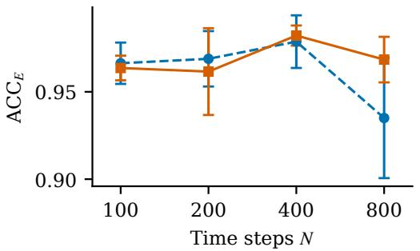

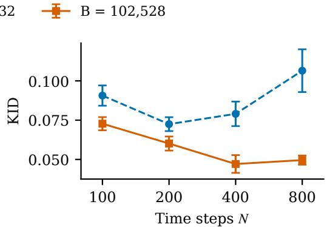  
Figure 5: CIFAR-10 quality under two total backbone-NFE ceilings B. Points and error bars show the mean and sample standard deviation based on ten classes and five repetitions per-class. Higher $\mathbf { A C C } _ { E }$ and lower KID are preferred.

Table 11: Particle allocation and sampling costs. Memory gives mean peak allocation.
<table><tr><td>N</td><td>K</td><td>Actual NFE</td><td>Time (s)</td><td>Memory (GiB)</td></tr><tr><td></td><td colspan="3"> $B = 2 5 { , } 6 3 2$ </td></tr><tr><td>100</td><td>126</td><td>25,452</td><td> $4 5 . 8 1 _ { \pm 0 . 0 7 }$ </td><td>6.708</td></tr><tr><td>200</td><td>63</td><td>25,326</td><td> $4 4 . 4 9 _ { \pm 0 . 1 9 }$ </td><td>6.678</td></tr><tr><td>400</td><td>31</td><td>24,862</td><td> $4 2 . 1 6 _ { \pm 0 . 0 7 }$ </td><td>3.468</td></tr><tr><td>800</td><td>16</td><td>25,632</td><td> $8 0 . 1 1 _ { \pm 0 . 0 2 }$ </td><td>2.175</td></tr><tr><td colspan="5"> $B = 1 0 2 , 5 2 8$ </td></tr><tr><td>100</td><td>507</td><td>102,414</td><td> $1 7 7 . 8 0 { \scriptstyle \pm 0 . 2 0 }$ </td><td>6.782</td></tr><tr><td>200</td><td>255</td><td>102,510</td><td> $1 8 9 . 0 3 _ { \pm 2 0 . 7 2 }$ </td><td>6.732</td></tr><tr><td>400</td><td>127</td><td>101,854</td><td> $1 8 3 . 2 1 _ { \pm 0 . 1 8 }$ </td><td>6.708</td></tr><tr><td>800</td><td>64</td><td>102,528</td><td> $1 7 8 . 7 8 { \scriptstyle \pm 0 . 2 8 }$ </td><td>6.701</td></tr></table>

## D.4 Expanded CIFAR-10 inpainting comparison

Table 12 adds DAPS, SITCOM, and TDS to the CIFAR-10 inpainting comparison. The methods use the prior families and settings in Appendix C.3. BRIDGETWIST attains the highest SSIM for both masks.

Table 12: CIFAR-10 inpainting quality and cost. Time is per image.
<table><tr><td>Method</td><td>Time (s)</td><td>Peak memory (GB)</td><td>SSIM, half ↑</td><td>SSIM, random ↑</td></tr><tr><td>DAPS</td><td>20.21</td><td>0.57</td><td>0.626</td><td>0.908</td></tr><tr><td>SITCOM</td><td>3.82</td><td>0.71</td><td>0.645</td><td>0.907</td></tr><tr><td>TDS</td><td>2.26</td><td>1.78</td><td>0.630</td><td>0.927</td></tr><tr><td>PnP-Flow</td><td>5.08</td><td>0.60</td><td>0.623</td><td>0.940</td></tr><tr><td>FMPS</td><td>2.27</td><td>1.64</td><td>0.240</td><td>0.554</td></tr><tr><td>TFTF</td><td>2.56</td><td>1.86</td><td>0.532</td><td>0.875</td></tr><tr><td>DPS-SB</td><td>2.44</td><td>1.59</td><td>0.518</td><td>0.782</td></tr><tr><td>BRIDGETWIST</td><td>2.42</td><td>1.59</td><td>0.655</td><td>0.943</td></tr></table>

## D.5 Calibration of the endpoint predictor

We measure the gap between the plug-in predictor $\hat { \mu } _ { 1 | t }$ and $\mathbb { E } [ X _ { 1 } | X _ { t } ]$ along the trajectory. For a state $x _ { t } ,$ we estimate $\mathbb { E } [ X _ { 1 } | X _ { t } = x _ { t } ]$ by the Monte Carlo average $\bar { \mu } _ { \mathrm { M C } }$ of 128 suffix trajectories of the prior dynamics started at $( t , x _ { t } )$ and report $\mathrm { e r r } ^ { 2 } ( \hat { \mu } _ { 1 \mid t } ) = \| \hat { \mu } _ { 1 \mid t } ^ { - } ( x _ { t } ) - \bar { \mu } _ { \mathrm { M C } } \| ^ { 2 } / d .$ . Table 13 shows that the error is largest near $t = 0$ and decays with t. Writing $\hat { b } ^ { \star }$ for the SB drift and $b _ { \theta , g }$ for the sampler

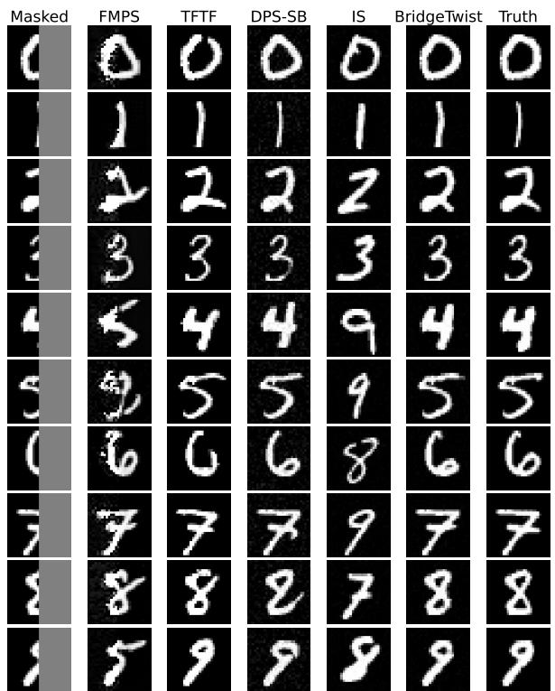

Figure 6: MNIST half-mask inpainting comparison. Each row shows one digit example; columns show the masked input, FMPS, TFTF, DPS-SB, IS, BRIDGETWIST, and the ground truth.  
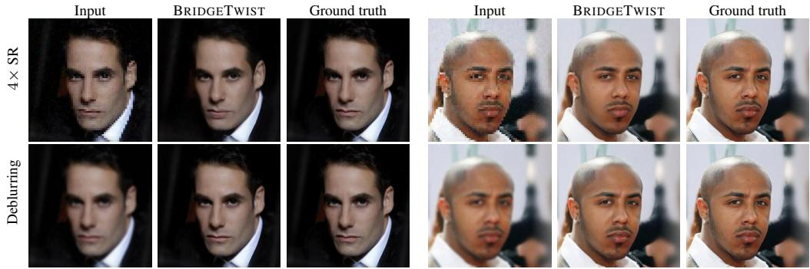  
Figure 7: CelebA-HQ reconstructions from BRIDGETWIST for 4× super-resolution (top) and Gaussian deblurring (bottom). Each triplet shows the observation, the BRIDGETWIST reconstruction, and the ground truth.

drift, the gap has the form

$$
\widehat { \mu } _ { 1 | t } ( x ) - \mathbb { E } [ X _ { 1 } \mid X _ { t } = x ] = \mathbb { E } \Big [ \int _ { t } ^ { 1 } \big ( b _ { t } ^ { \star } ( x ) - b _ { \theta , g } ( u , X _ { u } ) \big ) \mathrm { d } u \Big | X _ { t } = x \Big ] ,
$$

so as t → 1, the interval (t, 1) shrinks and $X _ { u }$ stays near x within it, and the integrand and the range of integration vanish together.

Table 13: Calibration error $\mathrm { e r r } ^ { 2 } ( \hat { \mu } _ { 1 | t } )$ of the endpoint predictor against Monte Carlo estimates of $\mathbb { E } [ X _ { 1 } | X _ { t } ]$ at different times t.
<table><tr><td>t</td><td>0.05</td><td>0.1</td><td>0.3</td><td>0.5</td><td>0.7</td><td>0.9</td><td>0.95</td></tr><tr><td>Toy example</td><td>0.5572</td><td>0.4587</td><td>0.1303</td><td>0.0193</td><td>0.0034</td><td>0.00066</td><td>0.00031</td></tr><tr><td>CIFAR-10</td><td>0.00334</td><td>0.00164</td><td>0.00129</td><td>0.00157</td><td>0.00072</td><td>0.00044</td><td>0.00052</td></tr></table>

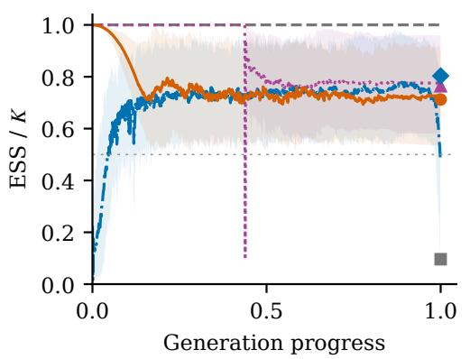

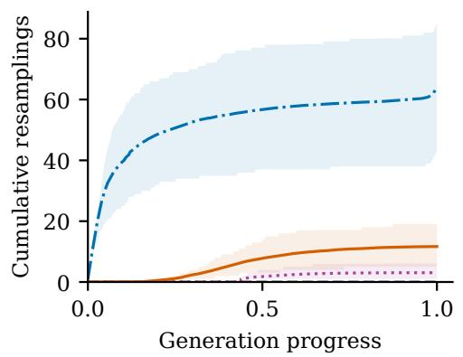  
Figure 8: CIFAR-10 ESS and resampling trajectories at $K = 6 4$ and $N = 8 0 0$ . Curves are means over ten classes and ten repetitions per class; shading gives the 10th–90th percentile range across the 100 runs. Left: pre-resampling ESS/K, with the 0.5 threshold and separate markers for terminal ESS after the final weight update. Right: cumulative counts of resampling events.

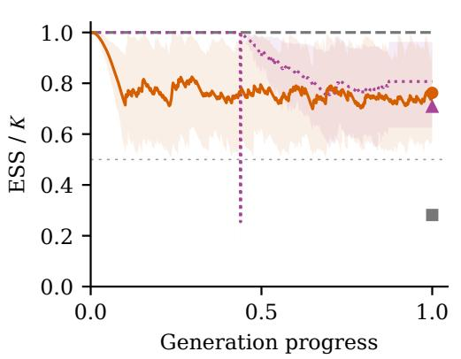

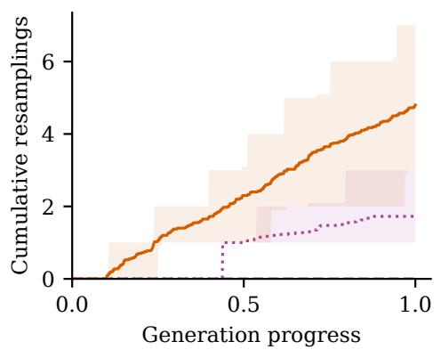  
Figure 9: CelebA-HQ ESS and resampling trajectories at $K = 2 5$ and $N = 8 0 0$ . Curves are means over 40 attribute prompts with one run per prompt, and shading gives the 10th–90th percentile range across these prompt trials. Left: pre-resampling $\mathrm { { \bar { E } S S } } / K$ , with the 0.5 threshold and separate terminal ESS markers. Right: cumulative counts of resampling events.

## D.6 SMC diagnostics

We record the ESS and resampling trajectories for CIFAR-10 class-conditional sampling and CelebA-HQ text-prompted image generation in Figures 8 and 9, respectively. The ESS threshold is 0.5; BRIDGETWIST enables resampling after the first 10% of the path, while TFTF resamples only in its stochastic phase. IS has uniform intermediate weights and weights samples only at the endpoint, so its intermediate ESS/K is one by construction.

Table 14 summarizes for both datasets. On CIFAR-10, BRIDGETWIST maintains a comparable timeaveraged ESS to TDS with substantially fewer resampling events. On CelebA-HQ, BRIDGETWIST has a higher terminal ESS than IS and TFTF, while TFTF has a higher time-averaged ESS and fewer resampling events than BRIDGETWIST.

Table 14: SMC diagnostics along the full trajectories. A dash marks the absence of a compatible checkpoint.
<table><tr><td></td><td colspan="3">CIFAR-10</td><td colspan="3">CelebA-HQ</td></tr><tr><td>Method</td><td>step-avg. ESS/K</td><td>resamplings final ESS/K</td><td></td><td>step-avg. ESS/K resamplings final ESS/K</td><td></td><td></td></tr><tr><td>IS</td><td>1.000</td><td>0</td><td>0.096</td><td>1.000</td><td>0</td><td>0.282</td></tr><tr><td>TFTF</td><td>0.875</td><td>3.05</td><td>0.763</td><td>0.902</td><td>1.73</td><td>0.708</td></tr><tr><td>TDS</td><td>0.705</td><td>64.25</td><td>0.803</td><td></td><td></td><td></td></tr><tr><td>BRIDGETWIST</td><td>0.756</td><td>11.67</td><td>0.712</td><td>0.770</td><td>4.80</td><td>0.762</td></tr></table>

## D.7 Tempering in TDS and TFTF

We apply our linear tempering schedule $\beta ( t ) = t$ to the twists in TDS and TFTF, retaining each method’s prior and guided-proposal construction. Table 15 reports the comparisons on CIFAR-10. All runs use $K = { \bar { 6 } } 4$ particles and $N = 8 0 0$ steps. Tempering improves TDS, consistent with correcting its plug-in over-confidence, and it slightly reduces TFTF’s accuracy, consistent with TFTF’s early unconditional phase already suppressing guidance. TDS with tempering remains below BRIDGETWIST, which additionally uses an SB-specific bridge-shaped inference schedule, a flexibility with no counterpart under TDS.

Table 15: TDS, TFTF, their linearly tempered variants, and BRIDGETWIST on CIFAR-10.
<table><tr><td>Method</td><td> $\mathbf { A C C } _ { L }$  个</td><td> $\mathbf { A C C } _ { E }$  ↑</td><td>KID↓</td></tr><tr><td>TDS</td><td>0.947</td><td>0.869</td><td>0.129</td></tr><tr><td>TDS + tempering</td><td>0.995</td><td>0.951</td><td>0.068</td></tr><tr><td>TFTF</td><td>0.986</td><td>0.934</td><td>0.057</td></tr><tr><td>TFTF + tempering</td><td>0.984</td><td>0.923</td><td>0.051</td></tr><tr><td>BRIDGETWIST</td><td>0.997</td><td>0.979</td><td>0.040</td></tr></table>

## D.8 Second-order twist extension

The first-order twist evaluates the likelihood at the conditional endpoint mean estimate and discards conditional endpoint uncertainty. A second-order approximation represents the conditional endpoint law by a Gaussian with mean ${ \hat { \mu } } _ { 1 | t } ( x )$ and covariance $\widehat { \Sigma } _ { 1 | t } ( x )$ . For a linear Gaussian observation $y = A x _ { 1 } + \eta .$ , where $y \in \mathbb { R } ^ { m } , x _ { 1 } \in \mathbb { R } ^ { d } , A \in \mathbb { R } ^ { m \times d }$ , and $\eta \sim \mathcal { N } ( 0 , R )$ with $R \succ 0$ , integrating the likelihood gives

$$
\hat { h } _ { t } ^ { ( 2 ) } ( x ) = \int \mathcal { N } ( y ; A z , R ) \mathcal { N } ( z ; \hat { \mu } _ { 1 | t } ( x ) , \widehat { \Sigma } _ { 1 | t } ( x ) ) \mathrm { d } z = \mathcal { N } ( y ; A \hat { \mu } _ { 1 | t } ( x ) , R + A \widehat { \Sigma } _ { 1 | t } ( x ) A ^ { \top } ) .
$$

Thus, endpoint uncertainty increases the covariance in the predictive likelihood.

For the two-dimensional toy in Appendix C.1, $A = I$ and $R = \sigma _ { y } ^ { 2 } I ,$ . We compare the first-order twist with second-order twists using either the exact conditional covariance or a Jacobian-based covariance estimate. For the estimated variant, let $\mu _ { M \mid t } ^ { \star } ( x ) = x + \tau _ { t } ^ { 2 } s _ { t } ^ { \star } ( x )$ denote $\mathbb { E } [ M _ { t } | X _ { t } = x ]$ where $\tau _ { t } ^ { 2 } = \sigma ^ { 2 } t ( 1 - t )$ . We use

$$
\Sigma _ { M | t } ( x ) : = \operatorname { C o v } ( M _ { t } \mid X _ { t } = x ) = \tau _ { t } ^ { 2 } \big [ I + \tau _ { t } ^ { 2 } \nabla _ { x } s _ { t } ^ { \star } ( x ) \big ] ,
$$

$$
G _ { t } ( \boldsymbol { x } ) : = I + ( 1 - t ) \left[ \nabla _ { z } v _ { t } ^ { \star } ( z ) + \frac { \sigma ^ { 2 } } { 2 } ( 1 - 2 t ) \nabla _ { z } s _ { t } ^ { \star } ( z ) \right] _ { z = \mu _ { M \mid t } ^ { \star } ( \boldsymbol { x } ) } ,
$$

$$
\widehat { \Sigma } _ { 1 | t } ( \boldsymbol { x } ) : = G _ { t } ( \boldsymbol { x } ) \Sigma _ { M | t } ( \boldsymbol { x } ) G _ { t } ( \boldsymbol { x } ) ^ { \top } .
$$

All Jacobians are evaluated analytically in this two-dimensional experiment.

Table 16 reports the comparison at $K = 2 0 0 0$ and $N = 1 0 0$ , with 50 independent repetitions per observation-noise level. Both second-order variants improve the results at the tighter observationnoise levels, while the differences are small at $\sigma _ { y } \in \{ 0 . 5 , 1 . 0 \}$ . Constructing the full covariance in high-dimensional image spaces requires additional Jacobian operations, so the image experiments retain the first-order twist.

Table 16: First- and second-order twists on the two-dimensional toy. Entries are the square root of the mean MMD2, with smaller values preferred.
<table><tr><td>Twist  $/ \sigma _ { y }$ </td><td>1.0</td><td>0.5</td><td>0.3</td><td>0.1</td><td>0.05</td></tr><tr><td>First-order</td><td>0.032</td><td>0.033</td><td>0.134</td><td>0.062</td><td>0.059</td></tr><tr><td>Second-order, exact covariance</td><td>0.032</td><td>0.031</td><td>0.037</td><td>0.025</td><td>0.016</td></tr><tr><td>Second-order, estimated covariance</td><td>0.033</td><td>0.031</td><td>0.037</td><td>0.028</td><td>0.020</td></tr></table>

## D.9 Conditional transition with a non-Gaussian source

To illustrate the applicability of BRIDGETWIST to non-Gaussian sources, we evaluate BRIDGETWIST on the PHATE embryoid-body scRNA-seq data [56] (Mendeley v6n743h5ng). We transport an early capture block (T4\_5C) to a late block (T6\_7D) while conditioning on a high proliferationmarker score at the endpoint, using 2048 cells per block, 30 principal components of 2000 highly variable genes, K = 2048, and N = 150. We use the posterior proxy inferred from the official Waddington-OT transport map [57] as the reference, which is independent of all samplers.

To target cells with high proliferation-marker expression, we construct a single score from the expression of MKI67, TOP2A, PCNA, CENPF, TYMS, and UBE2C. We condition on a noisy observation of this score at its 95th percentile under the Waddington-OT descendant distribution.

Table 17 reports the energy distance and the sliced Wasserstein-2 distance to the reference; BRID-GETWIST attains the lowest values of both, and TFTF degrades severely. This stochastic transport from a non-Gaussian source illustrates an SB-specific use case for BRIDGETWIST.

Table 17: Conditional transition on PHATE scRNA-seq data with a non-Gaussian source. Bold marks the best value in each column.
<table><tr><td>Method</td><td>Energy distance ↓</td><td>Sliced  $W _ { 2 } \downarrow$ </td></tr><tr><td>FMPS</td><td>0.0650</td><td>0.0599</td></tr><tr><td>TFTF</td><td>3.1958</td><td>0.4919</td></tr><tr><td>DPS-SB</td><td>0.0463</td><td>0.0550</td></tr><tr><td>IS</td><td>0.0701</td><td>0.0610</td></tr><tr><td>BRIDGETWIST</td><td>0.0374</td><td>0.0470</td></tr></table>

## NeurIPS Paper Checklist

## 1. Claims

Question: Do the main claims made in the abstract and introduction accurately reflect the paper’s contributions and scope?

Answer: [Yes].

Justification: The claims are stated in the abstract and Section 1; the theoretical scope is specified in Section 3.3, and limitations are discussed in Section 5.

Guidelines:

• The answer [N/A] means that the abstract and introduction do not include the claims made in the paper.

• The abstract and/or introduction should clearly state the claims made, including the contributions made in the paper and important assumptions and limitations. A [No] or [N/A] answer to this question will not be perceived well by the reviewers.

• The claims made should match theoretical and experimental results, and reflect how much the results can be expected to generalize to other settings.

• It is fine to include aspirational goals as motivation as long as it is clear that these goals are not attained by the paper.

## 2. Limitations

Question: Does the paper discuss the limitations of the work performed by the authors? Answer: [Yes].

Justification: Section 5 discusses the restriction to a Brownian reference, limitations of the plug-in twist, errors from prior learning and discretization, and the additional pretraining cost. Guidelines:

• The answer [N/A] means that the paper has no limitation while the answer [No] means that the paper has limitations, but those are not discussed in the paper.

• The authors are encouraged to create a separate “Limitations” section in their paper.

• The paper should point out any strong assumptions and how robust the results are to violations of these assumptions (e.g., independence assumptions, noiseless settings, model well-specification, asymptotic approximations only holding locally). The authors should reflect on how these assumptions might be violated in practice and what the implications would be.

• The authors should reflect on the scope of the claims made, e.g., if the approach was only tested on a few datasets or with a few runs. In general, empirical results often depend on implicit assumptions, which should be articulated.

• The authors should reflect on the factors that influence the performance of the approach. For example, a facial recognition algorithm may perform poorly when image resolution is low or images are taken in low lighting. Or a speech-to-text system might not be used reliably to provide closed captions for online lectures because it fails to handle technical jargon.

• The authors should discuss the computational efficiency of the proposed algorithms and how they scale with dataset size.

• If applicable, the authors should discuss possible limitations of their approach to address problems of privacy and fairness.

• While the authors might fear that complete honesty about limitations might be used by reviewers as grounds for rejection, a worse outcome might be that reviewers discover limitations that aren’t acknowledged in the paper. The authors should use their best judgment and recognize that individual actions in favor of transparency play an important role in developing norms that preserve the integrity of the community. Reviewers will be specifically instructed to not penalize honesty concerning limitations.

## 3. Theory assumptions and proofs

Question: For each theoretical result, does the paper provide the full set of assumptions and a complete (and correct) proof?

Answer: [Yes].

Justification: Appendix A gives the assumptions and proofs for Propositions 1 and 2, Theorem 1, and Remark 1.

Guidelines:

• The answer [N/A] means that the paper does not include theoretical results.

• All the theorems, formulas, and proofs in the paper should be numbered and cross-referenced.

• All assumptions should be clearly stated or referenced in the statement of any theorems.

• The proofs can either appear in the main paper or the supplemental material, but if they appear in the supplemental material, the authors are encouraged to provide a short proof sketch to provide intuition.

• Inversely, any informal proof provided in the core of the paper should be complemented by formal proofs provided in appendix or supplemental material.

• Theorems and Lemmas that the proof relies upon should be properly referenced.

## 4. Experimental result reproducibility

Question: Does the paper fully disclose all the information needed to reproduce the main experimental results of the paper to the extent that it affects the main claims and/or conclusions of the paper (regardless of whether the code and data are provided or not)?

Answer: [Yes].

Justification: Section 4 specifies tasks, baselines, particle counts, sampler steps, and metrics; Appendix C additionally provides analytic fields for the toy benchmark, the unconditional pretraining setup, conditional likelihoods, hyperparameters and settings, and compute resources. Guidelines:

• The answer [N/A] means that the paper does not include experiments.

• If the paper includes experiments, a [No] answer to this question will not be perceived well by the reviewers: Making the paper reproducible is important, regardless of whether the code and data are provided or not.

• If the contribution is a dataset and/or model, the authors should describe the steps taken to make their results reproducible or verifiable.

• Depending on the contribution, reproducibility can be accomplished in various ways. For example, if the contribution is a novel architecture, describing the architecture fully might suffice, or if the contribution is a specific model and empirical evaluation, it may be necessary to either make it possible for others to replicate the model with the same dataset, or provide access to the model. In general. releasing code and data is often one good way to accomplish this, but reproducibility can also be provided via detailed instructions for how to replicate the results, access to a hosted model (e.g., in the case of a large language model), releasing of a model checkpoint, or other means that are appropriate to the research performed.

• While NeurIPS does not require releasing code, the conference does require all submissions to provide some reasonable avenue for reproducibility, which may depend on the nature of the contribution. For example

(a) If the contribution is primarily a new algorithm, the paper should make it clear how to reproduce that algorithm.

(b) If the contribution is primarily a new model architecture, the paper should describe the architecture clearly and fully.

(c) If the contribution is a new model (e.g., a large language model), then there should either be a way to access this model for reproducing the results or a way to reproduce the model (e.g., with an open-source dataset or instructions for how to construct the dataset).

(d) We recognize that reproducibility may be tricky in some cases, in which case authors are welcome to describe the particular way they provide for reproducibility. In the case of closed-source models, it may be that access to the model is limited in some way (e.g., to registered users), but it should be possible for other researchers to have some path to reproducing or verifying the results.

## 5. Open access to data and code

Question: Does the paper provide open access to the data and code, with sufficient instructions to faithfully reproduce the main experimental results, as described in supplemental material? Answer: [Yes].

Justification: A code release with pretrained checkpoints and scripts to reproduce the main experimental results is provided in the supplementary material.

Guidelines:

• The answer [N/A] means that paper does not include experiments requiring code.

• Please see the NeurIPS code and data submission guidelines (https://neurips.cc/public/ guides/CodeSubmissionPolicy) for more details.

• While we encourage the release of code and data, we understand that this might not be possible, so [No] is an acceptable answer. Papers cannot be rejected simply for not including code, unless this is central to the contribution (e.g., for a new open-source benchmark).

• The instructions should contain the exact command and environment needed to run to reproduce the results. See the NeurIPS code and data submission guidelines (https://neurips.cc/ public/guides/CodeSubmissionPolicy) for more details.

• The authors should provide instructions on data access and preparation, including how to access the raw data, preprocessed data, intermediate data, and generated data, etc.

• The authors should provide scripts to reproduce all experimental results for the new proposed method and baselines. If only a subset of experiments are reproducible, they should state which ones are omitted from the script and why.

• At submission time, to preserve anonymity, the authors should release anonymized versions (if applicable).

• Providing as much information as possible in supplemental material (appended to the paper) is recommended, but including URLs to data and code is permitted.

## 6. Experimental setting/details

Question: Does the paper specify all the training and test details (e.g., data splits, hyperparameters, how they were chosen, type of optimizer) necessary to understand the results?

Answer: [Yes].

Justification: Section 4 specifies the tasks, baselines, particle counts, sampler steps, and evaluation metrics. Appendix B describes the pretraining parameterization; Appendix C gives the pretrained models, likelihoods, sampler hyperparameters, baseline settings, and metric averaging conventions. Guidelines:

• The answer [N/A] means that the paper does not include experiments.

• The experimental setting should be presented in the core of the paper to a level of detail that is necessary to appreciate the results and make sense of them.

• The full details can be provided either with the code, in appendix, or as supplemental material.

## 7. Experiment statistical significance

Question: Does the paper report error bars suitably and correctly defined or other appropriate information about the statistical significance of the experiments?

Answer: [Yes].

Justification: Section 4 reports the standard deviations of metrics based on multiple independent replications.

Guidelines:

• The answer [N/A] means that the paper does not include experiments.

• The authors should answer [Yes] if the results are accompanied by error bars, confidence intervals, or statistical significance tests, at least for the experiments that support the main claims of the paper.

• The factors of variability that the error bars are capturing should be clearly stated (for example, train/test split, initialization, random drawing of some parameter, or overall run with given experimental conditions).

• The method for calculating the error bars should be explained (closed form formula, call to a library function, bootstrap, etc.)

• The assumptions made should be given (e.g., Normally distributed errors).

• It should be clear whether the error bar is the standard deviation or the standard error of the mean.

• It is OK to report 1-sigma error bars, but one should state it. The authors should preferably report a 2-sigma error bar than state that they have a 96% CI, if the hypothesis of Normality of errors is not verified.

• For asymmetric distributions, the authors should be careful not to show in tables or figures symmetric error bars that would yield results that are out of range (e.g., negative error rates).

• If error bars are reported in tables or plots, the authors should explain in the text how they were calculated and reference the corresponding figures or tables in the text.

## 8. Experiments compute resources

Question: For each experiment, does the paper provide sufficient information on the computer resources (type of compute workers, memory, time of execution) needed to reproduce the experiments?

Answer: [Yes].

Justification: Appendix C states that all experiments were conducted on one NVIDIA RTX 5090 GPU.

Guidelines:

• The answer [N/A] means that the paper does not include experiments.

• The paper should indicate the type of compute workers CPU or GPU, internal cluster, or cloud provider, including relevant memory and storage.

• The paper should provide the amount of compute required for each of the individual experimental runs as well as estimate the total compute.

• The paper should disclose whether the full research project required more compute than the experiments reported in the paper (e.g., preliminary or failed experiments that didn’t make it into the paper).

## 9. Code of ethics

Question: Does the research conducted in the paper conform, in every respect, with the NeurIPS Code of Ethics https://neurips.cc/public/EthicsGuidelines?

Answer: [Yes].

Justification: The work uses existing public image datasets and the PHATE embryoid-body singlecell RNA-sequencing dataset for computational experiments, without recruiting participants or collecting new human-subject data.

Guidelines:

• The answer [N/A] means that the authors have not reviewed the NeurIPS Code of Ethics.

• If the authors answer [No], they should explain the special circumstances that require a deviation from the Code of Ethics.

• The authors should make sure to preserve anonymity (e.g., if there is a special consideration due to laws or regulations in their jurisdiction).

## 10. Broader impacts

Question: Does the paper discuss both potential positive societal impacts and negative societal impacts of the work performed?

Answer: [N/A].

Justification: The paper presents a training-free sampler for pretrained Schrödinger bridge generative models. It inherits the broader-impact profile of generic conditional generative modeling without introducing new specific risks.

Guidelines:

• The answer [N/A] means that there is no societal impact of the work performed.

• If the authors answer [N/A] or [No], they should explain why their work has no societal impact or why the paper does not address societal impact.

• Examples of negative societal impacts include potential malicious or unintended uses (e.g., disinformation, generating fake profiles, surveillance), fairness considerations (e.g., deployment of technologies that could make decisions that unfairly impact specific groups), privacy considerations, and security considerations.

• The conference expects that many papers will be foundational research and not tied to particular applications, let alone deployments. However, if there is a direct path to any negative applications, the authors should point it out. For example, it is legitimate to point out that an improvement in the quality of generative models could be used to generate Deepfakes for disinformation. On the other hand, it is not needed to point out that a generic algorithm for optimizing neural networks could enable people to train models that generate Deepfakes faster.

• The authors should consider possible harms that could arise when the technology is being used as intended and functioning correctly, harms that could arise when the technology is being used as intended but gives incorrect results, and harms following from (intentional or unintentional) misuse of the technology.

• If there are negative societal impacts, the authors could also discuss possible mitigation strategies (e.g., gated release of models, providing defenses in addition to attacks, mechanisms for monitoring misuse, mechanisms to monitor how a system learns from feedback over time, improving the efficiency and accessibility of ML).

## 11. Safeguards

Question: Does the paper describe safeguards that have been put in place for responsible release of data or models that have a high risk for misuse (e.g., pre-trained language models, image generators, or scraped datasets)?

Answer: [N/A].

Justification: The paper does not release a high-risk foundation model or a scraped dataset. Guidelines:

• The answer [N/A] means that the paper poses no such risks.

• Released models that have a high risk for misuse or dual-use should be released with necessary safeguards to allow for controlled use of the model, for example by requiring that users adhere to usage guidelines or restrictions to access the model or implementing safety filters.

• Datasets that have been scraped from the Internet could pose safety risks. The authors should describe how they avoided releasing unsafe images.

• We recognize that providing effective safeguards is challenging, and many papers do not require this, but we encourage authors to take this into account and make a best faith effort.

## 12. Licenses for existing assets

Question: Are the creators or original owners of assets (e.g., code, data, models), used in the paper, properly credited and are the license and terms of use explicitly mentioned and properly respected?

Answer: [Yes].

Justification: All existing methods, datasets, and pretrained checkpoints used in this work are properly cited in Sections 1–4 and Appendix C; their licenses are documented in the README of the supplementary code release.

Guidelines:

• The answer [N/A] means that the paper does not use existing assets.

• The authors should cite the original paper that produced the code package or dataset.

• The authors should state which version of the asset is used and, if possible, include a URL.

• The name of the license (e.g., CC-BY 4.0) should be included for each asset.

• For scraped data from a particular source (e.g., website), the copyright and terms of service of that source should be provided.

• If assets are released, the license, copyright information, and terms of use in the package should be provided. For popular datasets, paperswithcode.com/datasets has curated licenses for some datasets. Their licensing guide can help determine the license of a dataset.

• For existing datasets that are re-packaged, both the original license and the license of the derived asset (if it has changed) should be provided.

• If this information is not available online, the authors are encouraged to reach out to the asset’s creators.

## 13. New assets

Question: Are new assets introduced in the paper well documented and is the documentation provided alongside the assets?

Answer: [Yes].

Justification: The supplementary release contains the reproduction code and the pretrained SB checkpoints used to produce the reported results, documented in the README. No new datasets or benchmark assets are introduced.

Guidelines:

• The answer [N/A] means that the paper does not release new assets.

• Researchers should communicate the details of the dataset/code/model as part of their submissions via structured templates. This includes details about training, license, limitations, etc.

• The paper should discuss whether and how consent was obtained from people whose asset is used.

• At submission time, remember to anonymize your assets (if applicable). You can either create an anonymized URL or include an anonymized zip file.

## 14. Crowdsourcing and research with human subjects

Question: For crowdsourcing experiments and research with human subjects, does the paper include the full text of instructions given to participants and screenshots, if applicable, as well as details about compensation (if any)?

Answer: [N/A].

Justification: The experiments do not involve crowdsourcing or human subject studies. Guidelines:

• The answer [N/A] means that the paper does not involve crowdsourcing nor research with human subjects.

• Including this information in the supplemental material is fine, but if the main contribution of the paper involves human subjects, then as much detail as possible should be included in the main paper.

• According to the NeurIPS Code of Ethics, workers involved in data collection, curation, or other labor should be paid at least the minimum wage in the country of the data collector.

15. Institutional review board (IRB) approvals or equivalent for research with human subjects Question: Does the paper describe potential risks incurred by study participants, whether such risks were disclosed to the subjects, and whether Institutional Review Board (IRB) approvals (or an equivalent approval/review based on the requirements of your country or institution) were obtained?

Answer: [N/A].

Justification: The experiments do not involve crowdsourcing or human subject studies.

• The answer [N/A] means that the paper does not involve crowdsourcing nor research with human subjects.

• Depending on the country in which research is conducted, IRB approval (or equivalent) may be required for any human subjects research. If you obtained IRB approval, you should clearly state this in the paper.

• We recognize that the procedures for this may vary significantly between institutions and locations, and we expect authors to adhere to the NeurIPS Code of Ethics and the guidelines for their institution.

• For initial submissions, do not include any information that would break anonymity (if applicable), such as the institution conducting the review.

## 16. Declaration of LLM usage

Question: Does the paper describe the usage of LLMs if it is an important, original, or nonstandard component of the core methods in this research? Note that if the LLM is used only for writing, editing, or formatting purposes and does not impact the core methodology, scientific rigor, or originality of the research, declaration is not required.

Answer: [N/A].

Justification: The core methodology does not use LLMs as an original or non-standard component. Guidelines:

• The answer [N/A] means that the core method development in this research does not involve LLMs as any important, original, or non-standard components.

• Please refer to our LLM policy in the NeurIPS handbook for what should or should not be described.