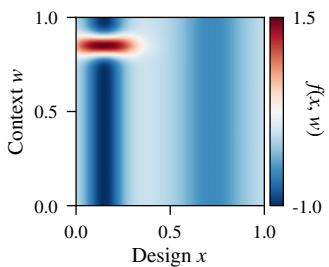
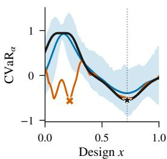
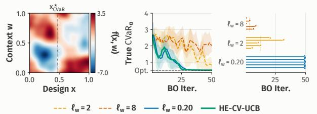
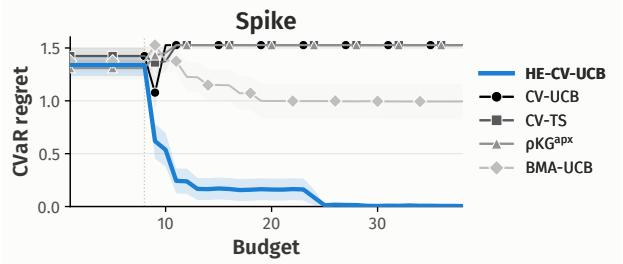
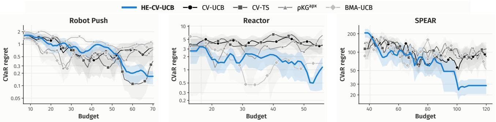
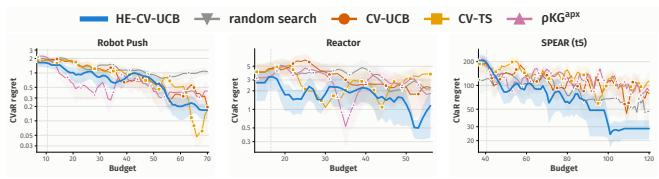
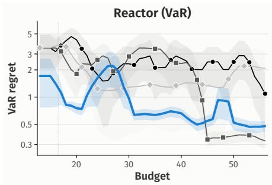
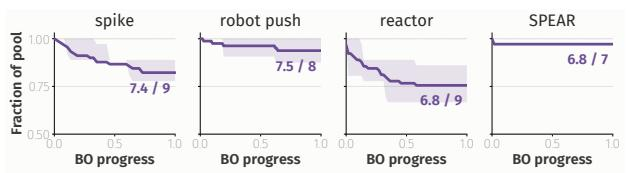
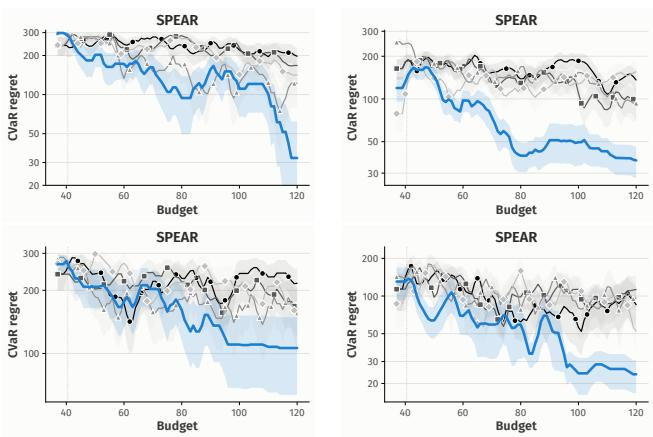
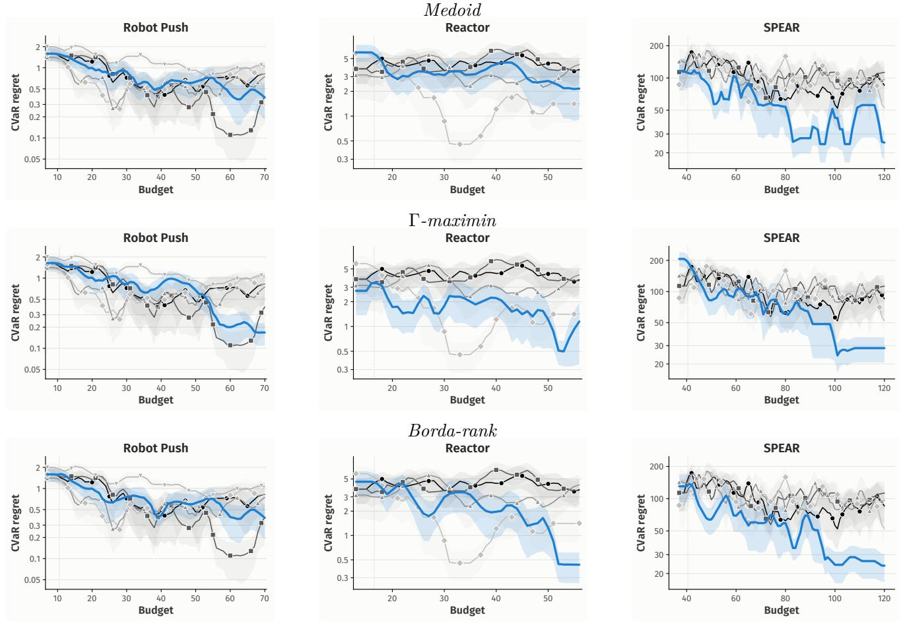

# Bayesian Optimization of CVaR with Unknown Hyperparameters

Valentin Margraf1,2, Jonas Hanselle1,2,3, Viktor Bengs3, Serafima Lebedeva3,6, Eyke Hüllermeier1,2,3, Marcel Wever4,5

1LMU Munich

2Munich Center for Machine Learning (MCML)

3German Research Center for Artificial Intelligence (DFKI)

4Leibniz University Hannover

5L3S Research Center

6RPTU Kaiserslautern-Landau

## Abstract

We study Bayesian optimization of the Conditional Value-at-Risk (CVaR) of an expensive black-box function that depends on a decision and an environmental variable. Existing no-regret algorithms assume that the correct Gaussian process (GP) kernel and its hyperparameters are known. In practice, however, they must be estimated from limited data, often yielding a misspecified surrogate. This is especially damaging for CVaR because misspecification can distort the estimated tail-risk and thus lead to catastrophic decisions. We propose HE-CV-UCB, the first no-regret algorithm for CVaR Bayesian optimization with unknown GP hyperparameters. Given a finite candidate set containing a well-specified model, HE-CV-UCB adaptively eliminates those inconsistent with the observed data, actively queries where the survivors disagree, and returns a design that is robust across the surviving candidates. We prove that it attains cumulative regret matching the oracle rate of CV-UCB up to a factor depending only on the candidate set’s size. Across synthetic benchmarks and three real-world applications, HE-CV-UCB achieves competitive performance and frequently outperforms existing CVaR Bayesian optimization methods.

## 1 Introduction

Bayesian optimization (BO) is a popular framework for optimizing expensive black-box functions Garnett [2023], with applications spanning materials design Zhang et al. [2020], drug discovery Colliandre and Muller [2024], and hyperparameter optimization Snoek et al. [2012], Lindauer et al. [2022]. BO proceeds iteratively by fitting a probabilistic surrogate model to the evaluations observed so far, typically a Gaussian process (GP) Rasmussen and Williams [2006], and selecting new evaluations through an acquisition function that balances exploration and exploitation. In many real-world applications, however, the outcome depends not only on the controllable decision variable but also on uncertain environmental conditions. A portfolio allocation is exposed to stochastic market movements Liang et al. [2017], Millar and Li [2025], a treatment plan to variability in patient response An et al. [2017], and an solver configuration to diferences in problem-instance dificulty Hutter et al. [2014]. Classical BO typically optimizes expected performance. In safety-critical applications, however, optimizing the average can be misleading: a decision with excellent expected performance may still incur catastrophic losses under unfavorable conditions. A portfolio may collapse during a market downturn, a treatment may fail for a vulnerable pa tient, or a solver configuration may time out on particularly dificult instances. This motivates risk-sensitive objectives such as Conditional Value-at-Risk (CVaR), which measures the expected outcome among the worst (1 − α)-fraction of realizations for a risk level $\alpha \in ( 0 , 1 )$

  
Truth ℓw = 0.04 ℓw = 3.0 Opt. Bad  
Figure 1: Surrogate misspecification distorts CVaR estimation. Left: the objective $f ( x , w )$ , with a sharp ridge at $\begin{array} { r } {  { w } \approx \ 0 . 8 5 } \end{array}$ for $x ~ \lesssim ~ 0 . 4$ . Right: the true $\operatorname { C V a R } _ { \alpha } [ f ( x , W ) ]$ over designs x (black). A wellspecified surrogate $( \ell _ { w } = 0 . 0 4$ , blue) resolves the ridge and its CVaR band contains the truth, while the oversmoothed surrogate $( \ell _ { w } = 3 . 0 $ , orange) is tail-blind and recommends a near-worst design (x ≈ 0.22).

Existing CVaR BO algorithms, such as CV-UCB and CV-TS [Nguyen et al., 2021b], achieve sublinear regret under the assumption that the Gaussian process is correctly specified. In practice, this assumption is rarely satisfied. Kernel families are chosen heuristically, and their hyperparameters are typically selected from limited observations by maximum-likelihood or maximum-a-posteriori estimation, procedures that can be unreliable in finite-data regimes [Lalchand and Rasmussen, 2019] and thus result in misspecified surrogates. Surrogate misspecification is particularly harmful for CVaR optimization because it can translate into inaccurate risk estimates and consequently unsafe decisions, as illustrated in Figure 1. While several algorithms address unknown hyperparameters in mean-based Bayesian optimization [Berkenkamp et al., 2019, Bogunovic and Krause, 2021, Ziomek et al., 2024, 2025], the corresponding problem for CVaR optimization has remained unexplored.

We close this gap with Hyperparameter-Elimination CVaR-UCB (HE-CV-UCB), the first no-regret algorithm for CVaR Bayesian optimization that does not require the true kernel hyperparameters to be known. Instead, HE-CV-UCB assumes only that the true model belongs to a finite candidate set. Building on the hyperparameter-elimination framework of Ziomek et al. [2025], our algorithm maintains this set of candidates, discards those whose predictions become statistically inconsistent with the observed data, actively queries where the surviving candidates disagree, and recommends a design that is robust across the remaining candidates. Such candidate sets can be obtained for example from surrogates fitted on related tasks, hyperparameter posterior samples, or domain knowledge. Our contributions are as follows.

• We identify surrogate misspecification as a key challenge for CVaR Bayesian optimization because it can lead to inaccurate risk estimates and thus catastrophic decisions.

• We propose HE-CV-UCB, the first no-regret algorithm for CVaR Bayesian optimization with unknown kernel hyperparameters, which maintains a finite set of candidate models, actively eliminates those inconsistent with the observations, and recommends a design that is robust across the surviving candidates.

• We prove that HE-CV-UCB achieves cumulative regret $\mathcal { O } \big ( | \Theta | B + | \Theta | \sqrt { \xi _ { T } T } + \beta _ { T } | \Theta | \sqrt { T \gamma _ { T } } \big )$ , recovering the oracle rate of CV-UCB up to a multiplicative factor of |Θ|.

• We demonstrate on synthetic benchmarks and three real-world applications that HE-CV-UCB achieves statistically significant improvements over competing methods while never being significantly outperformed.

## 2 Related Work

Risk-averse Bayesian optimization. Bayesian optimization with environmental uncertainty has been studied under diferent objectives, ranging from expectation-based criteria to robust formulations that optimize against worst-case realizations [Bogunovic et al., 2018, Kirschner et al., 2020]. Risk measures such as Value-at-Risk (VaR) and Conditional Value-at-Risk provide an intermediate approach by focusing on adverse outcomes in the tail of the induced outcome distribution. Cakmak et al. [2020] proposed acquisition functions for general risk measures, including CVaR, but without regret guarantees. On the theoretical side, Nguyen et al. [2021a] studied Bayesian optimization of VaR, and Nguyen et al. [2021b] introduced CV-UCB and CV-TS, the first algorithms with sublinear cumulative regret for CVaR. These guarantees, however, rely on a correctly specified GP surrogate with known kernel hyperparameters.

Unknown kernel hyperparameters. Several works address unknown kernel hyperparameters and model misspecification in expectation-based Bayesian optimization. Practical approaches marginalize over hyperparameter posteriors [Snoek et al., 2012, Lalchand and Rasmussen, 2019], but typically lack regret guarantees. On the theoretical side, Bogunovic and Krause [2021] analyze regret under bounded misspecification. Berkenkamp et al. [2019] adapt the kernel lengthscale online to guarantee inclusion of the true function in the reproducing kernel Hilbert space (RKHS) of the selected kernel, though the schedule is data-independent and known to be over-exploratory. Ziomek et al. [2024] maintain multiple GP bandit learners with diferent lengthscales and eliminate learners whose performance becomes statistically inferior. More recently, Ziomek et al. [2025] propose PE-GP-UCB for the time-varying setting, which handles uncertainty over a finite collection of GP surrogates, including diferent kernels, hyperparameters, and priors. Sandberg and Chehreghani [2026] extend their framework to Thompson sampling. All of these approaches, however, focus on expectationbased objectives.

Hyperparameter uncertainty in risk-averse Bayesian optimization, however, remains unexplored. To the best of our knowledge, HE-CV-UCB is the first no-regret algorithm for CVaR Bayesian optimization that does not assume the true kernel hyperparameters to be known. We build on the elimination framework of Ziomek et al. [2025] and extend it to CVaR optimization, where uncertainty over the surrogate afects a tail-risk functional rather than the objective value directly.

## 3 CVaR Bayesian Optimization

We consider an unknown objective function $f : \mathcal { X } \times$ $\mathcal { W }  \mathbb { R }$ , where $\mathcal { X } \subset \mathbb { R } ^ { d }$ is the design space and $\mathcal { W } \subset \mathbb { R } ^ { d _ { W } }$ is the support of an environmental random variable W with distribution $\mathbb { P } _ { W }$ . We assume PW is known or can be estimated, and represent it by a finite set of environmental scenarios on which all CVaR quantities are evaluated. We treat large values of f as undesirable, e.g., loss, runtime, or prediction error, and seek a design x that minimizes

$$
x ^ { \star } \in \arg \operatorname* { m i n } _ { x \in \mathcal { X } } \mathrm { C V a R } _ { \alpha } [ f ( x , W ) ] .\tag{1}
$$

The risk measure is taken with respect to $W \sim { \mathbb P } _ { W }$ for a fixed design x. Formally, for a real-valued random variable $Z$ with $\mathbb { E } | Z | < \infty$ and risk level $\alpha \in ( 0 , 1 )$

the Value-at-Risk is the α-quantile $\mathrm { V a R } _ { \alpha } [ Z ] : = \operatorname* { i n f } \{ z \in$ $\mathbb { R } : \mathbb { P } ( Z \leq z ) \geq \alpha \}$ , and the Conditional Value-at-Risk is the average over the worst $( 1 - \alpha )$ -fraction of outcomes $\begin{array} { r } { \mathrm { C V a R } _ { \alpha } [ Z ] : = \frac { 1 } { 1 - \alpha } \int _ { \alpha } ^ { 1 } \mathrm { V a R } _ { \alpha ^ { \prime } } [ Z ] \mathrm { d } \alpha ^ { \prime } } \end{array}$ . Larger α corresponds to greater risk aversion, with $\alpha  0$ recovering the expectation E[Z].

During optimization, the algorithm does not observe random realizations of W. Instead, at iteration t it actively selects a query $( x _ { t } , w _ { t } ) \in \mathcal { X } \times \mathcal { W }$ and observes a noisy evaluation

$$
y _ { t } = f ( x _ { t } , w _ { t } ) + \varepsilon _ { t } , \qquad \varepsilon _ { t } \sim \mathcal { N } ( 0 , \sigma _ { \varepsilon } ^ { 2 } ) .\tag{2}
$$

After optimization, only the recommended design is deployed, while the realized environment is drawn according to $W \sim \mathbb { P } _ { W }$ . We measure performance by the cumulative regret $\textstyle R _ { T } : = \sum _ { t = 1 } ^ { T } r _ { t }$ with per-round regret $r _ { t } : = \mathrm { C V a R } _ { \alpha } [ f ( x _ { t } , W ) ] - \mathrm { \bar { C } } \mathrm { \bar { V a } } \mathrm { R } _ { \alpha } [ f ( x ^ { \star } , W ) ]$ . An algorithm is called no-regret if $R _ { T } / T \to 0$

We model $f$ using a Gaussian process surrogate indexed by θ, which specifies the kernel k and its hyperparameters. Given observations $\begin{array} { r l } { \mathcal { D } _ { t - 1 } } & { { } = } \end{array}$ $\{ ( x _ { i } , w _ { i } , y _ { i } ) \} _ { i = 1 } ^ { t - 1 }$ , the GP posterior provides a predictive mean $\mu _ { t - 1 } ^ { \theta } ( x , w )$ and standard deviation $\sigma _ { t - 1 } ^ { \theta } ( x , w )$ We work in the frequentist setting and treat f as a fixed unknown function. A surrogate $\theta$ is well specified if f belongs to the RKHS induced by $k _ { \theta }$ and satisfies $\| f \| _ { \mathcal { H } _ { k _ { \theta } } } ~ \le ~ B$ . Under this assumption, standard GP confidence bounds imply that, for confidence level $\delta \in ( 0 , 1 )$ , the choice $\begin{array} { r l r } { \beta _ { t } ^ { \theta } } & { { } = } & { B + } \end{array}$ $\sigma _ { \varepsilon } ( 2 ( \gamma _ { t - 1 } ^ { \theta } + 1 + \ln ( \operatorname { i } / \delta ) ) ^ { 1 / 2 }$ yields pointwise confidence intervals $l _ { t - 1 } ^ { \theta } ( x , w ) \leq f ( x , w ) \leq u _ { t - 1 } ^ { \theta } ( x , w )$ for all $( x , w ) \in \mathcal { X } \times \mathcal { W }$ and all $t \geq 1$ with probability at least $1 - \delta$ [Chowdhury and Gopalan, 2017], where $u _ { t - 1 } ^ { \theta } ( x , w ) \ \stackrel {  } { = } \ \mu _ { t - 1 } ^ { \theta } ( x , w ) + \beta _ { t } ^ { \theta } \sigma _ { t - 1 } ^ { \theta } ( x , w )$ and $l _ { t - 1 } ^ { \theta } ( x , \bar { w ) } \stackrel { - } { = } \mu _ { t - 1 } ^ { \theta } ( x , w ) - \beta _ { t } ^ { \theta } \sigma _ { t - 1 } ^ { \theta } ( x , \bar { w } )$ . Here, $\gamma _ { t } ^ { \theta } : =$ max $\begin{array} { r } { A \subset { \mathcal { X } } \times { \mathcal { W } } , | A | = t ~ { \frac { 1 } { 2 } } \log \operatorname* { d e t } ( I + \sigma _ { \varepsilon } ^ { - 2 } K _ { A } ^ { \theta } ) } \end{array}$ is the maximum information gain associated with kernel $k _ { \theta } .$ , where $K _ { A } ^ { \theta }$ is the kernel matrix induced by $k _ { \theta }$ on any set A of t query points in $\mathcal { X } \times \mathcal { W }$ . As standard in GP bandit analyses, we further assume that $k _ { \theta } ( ( x , w ) , ( x , w ) ) \leq 1$

CV-UCB [Nguyen et al., 2021b] lifts the pointwise bands to CVaR bounds $c _ { u } ( x ; \alpha ) = \mathrm { C V a R } _ { \alpha } [ u ( x , W ) ]$ and $c _ { l } ( x ; \alpha ) = \mathrm { C V a R } _ { \alpha } [ l ( x , W ) ]$ , which by monotonicity of $\mathrm { C V a R ~ s a t i s f y } c _ { l } ( x ; \alpha ) ~ \leq ~ \mathrm { C V a R } _ { \alpha } [ f ( x , W ) ] \leq$ $c _ { u } ( x ; \alpha )$ . CV-UCB then selects the design optimistically, $\begin{array} { r } { x _ { t } \ \in \ \arg \operatorname* { m i n } _ { x \in \mathcal { X } } c _ { l } ( x ; \alpha ) } \end{array}$ , and queries the environment at a lacing value, a context whose pointwise band gap upper-bounds the CVaR band gap at the selected design. For a single surrogate this is attained at $w _ { t } \in \arg \operatorname* { m a x } _ { w \in \mathcal { W } } \sigma _ { t - 1 } ( x _ { t } , w )$ , which maximizes $u _ { t - 1 } - l _ { t - 1 } = 2 \beta _ { t } \sigma _ { t - 1 } .$ . If the surrogate is wellspecified, CV-UCB achieves sublinear regret.1

In practice, however, the kernel and its hyperparameters are unknown and must be estimated from finite data. Consequently, the confidence guarantees above may fail, and a misspecified surrogate can produce in accurate CVaR estimates and lead to poor decisions (Figure 1).

## 4 CVaR BO with Unknown Hyperparameters

We now develop HE-CV-UCB, a no-regret algorithm for CVaR Bayesian optimization that does not require a well-specified surrogate to be known. Instead, we assume a finite candidate set Θ of GP models containing the unknown correct candidate $\theta ^ { \star }$ , and extend the elimination framework of Ziomek et al. [2025] to the CVaR setting. Candidates are eliminated based on statistical inconsistency with the observed data, while the acquisition rule reasons over the surviving candidates to construct valid CVaR bounds. Since the optimistic and pessimistic bounds may originate from diferent candidates, the resulting procedure requires a two-sided elimination mechanism and a generalized lacing argument.

## 4.1 Proposed algorithm

Each GP surrogate $\theta \in \Theta$ provides posterior mean $\mu _ { t - 1 } ^ { \theta } ( x , w )$ and standard deviation $\sigma _ { t - 1 } ^ { \theta } ( x , w )$ . We define the corresponding pointwise confidence bounds as $u _ { t - 1 } ^ { \theta } : = \mu _ { t - 1 } ^ { \theta } + \beta _ { t } ^ { \theta } \bar { \sigma _ { t - 1 } ^ { \theta } }$ and $l _ { t - 1 } ^ { \theta } : = \mu _ { t - 1 } ^ { \theta } - \beta _ { t } ^ { \theta } \sigma _ { t - 1 } ^ { \theta }$ For the correct candidate $\theta ^ { \star }$ , these bounds contain the unknown objective with high probability, i.e., $l _ { t - 1 } ^ { \theta ^ { \star } } ( x , w ) \ \leq \ f ( x , w ) \ \leq \ u _ { t - 1 } ^ { \theta ^ { \star } } ( x , w )$ . Since CVaR is monotone, this implies valid CVaR confidence bounds $c _ { l _ { t - 1 } } ^ { \theta ^ { \star } } ( x ; \alpha ) ~ \leq ~ \mathrm { C V a R } _ { \alpha } [ f ( x , W ) ] ~ \leq ~ c _ { u _ { t - 1 } } ^ { \theta ^ { \star } } ( x ; \alpha )$ , with $c _ { u _ { t - 1 } } ^ { \theta } ( x ; \alpha ) : = \mathrm { C V a R } _ { \alpha } [ u _ { t - 1 } ^ { \theta } ( x , W ) ]$ and $c _ { l _ { t - 1 } } ^ { \theta } ( x ; \alpha )$ := $\mathrm { C V a R } _ { \alpha } [ l _ { t - 1 } ^ { \theta } ( x , W ) ]$ . Let $\Theta _ { t - 1 } \subseteq \Theta$ denote the candidates surviving at the beginning of iteration t.

Doubly-optimistic decision. At each iteration, the algorithm selects a design and a candidate jointly by minimizing the lower CVaR confidence bound,

$$
( x _ { t } , \theta _ { t } ) \in \arg \operatorname* { m i n } _ { ( x , \theta ) \in \mathcal { X } \times \Theta _ { t - 1 } } c _ { l _ { t - 1 } } ^ { \theta } ( x ; \alpha ) .\tag{3}
$$

This choice is optimistic in two respects: it searches for the most promising design and simultaneously trusts the most optimistic surviving surrogate (the candidate that promises the lowest CVaR). Because $\theta ^ { \star } \in \Theta _ { t - 1 }$ as long as the correct candidate is not eliminated, the selected value provides a lower bound on the unknown optimum: $c _ { l _ { t - 1 } } ^ { \theta _ { t } } ( x _ { t } ; \alpha ) \leq c _ { l _ { t - 1 } } ^ { \theta ^ { \star } } ( x ^ { \star } ; \alpha ) \leq \mathrm { C V a R } _ { \alpha } [ f ( x ^ { \star } , W ) ]$

To obtain an upper bound on the CVaR of the selected design, we select the most pessimistic surviving candidate at $x _ { t }$

$$
\vartheta _ { t } \in \arg \operatorname* { m a x } _ { \theta \in \Theta _ { t - 1 } } c _ { u _ { t - 1 } } ^ { \theta } ( x _ { t } ; \alpha ) .\tag{4}
$$

Again, because $\theta ^ { \star }$ remains feasible, $c _ { u _ { t - 1 } } ^ { \vartheta _ { t } } ( x _ { t } ; \alpha ) \ \geq$ $c _ { u _ { t - 1 } } ^ { \theta ^ { \star } } ( x _ { t } ; \alpha ) \geq \mathrm { C V a R } _ { \alpha } [ f ( x _ { t } , W ) ]$ . The two selected candidates need not coincide: $\theta _ { t }$ represents the most optimistic explanation of the optimum, whereas $\vartheta _ { t }$ represents the most conservative explanation of the selected design. Combining the two bounds yields a bound on the per-round regret

$$
r _ { t } \leq c _ { u _ { t - 1 } } ^ { \vartheta _ { t } } ( x _ { t } ; \alpha ) - c _ { l _ { t - 1 } } ^ { \theta _ { t } } ( x _ { t } ; \alpha ) .\tag{5}
$$

Lacing value. The right-hand side of (5) is a functional over the full environmental distribution, while only one environmental realization can be queried per iteration. Following the terminology of CV-UCB [Nguyen et al., 2021b], we call a query point a lacing value if the pointwise confidence gap at that point upper-bounds the corresponding CVaR gap. Since our optimistic and pessimistic bounds may come from diferent surviving surrogates, we select

$$
w _ { t } \ \in \ \arg \operatorname* { m a x } _ { w \in \mathcal { W } } \underbrace { \left[ u _ { t - 1 } ^ { \vartheta _ { t } } ( x _ { t } , w ) - l _ { t - 1 } ^ { \theta _ { t } } ( x _ { t } , w ) \right] } _ { = : G _ { t } ( w ) } .\tag{6}
$$

Unlike standard CV-UCB, the two functions defining the gap need not be ordered pointwise, so $G _ { t } ( w )$ may be negative. Nevertheless, Lemma 2 gives $r _ { t } \le G _ { t } ( w _ { t } )$ showing that the selected query controls the instantaneous regret. Hence, $w _ { t }$ is a lacing value for the crosssurrogate confidence gap. The resulting gap captures both posterior uncertainty within each candidate and disagreement between candidates:

$$
\begin{array} { r l r } & { } & { u _ { t - 1 } ^ { \vartheta _ { t } } ( x _ { t } , w ) - l _ { t - 1 } ^ { \theta _ { t } } ( x _ { t } , w ) = \underbrace { \mu _ { t - 1 } ^ { \vartheta _ { t } } ( x _ { t } , w ) - \mu _ { t - 1 } ^ { \theta _ { t } } ( x _ { t } , w ) } _ { \mathrm { m e a n ~ d i s a g r e e m e n t } } } \\ & { } & { + \beta _ { t } ^ { \vartheta _ { t } } \sigma _ { t - 1 } ^ { \vartheta _ { t } } ( x _ { t } , w ) + \beta _ { t } ^ { \theta _ { t } } \sigma _ { t - 1 } ^ { \theta _ { t } } ( x _ { t } , w ) , } \end{array}
$$

When $\theta _ { t } = \vartheta _ { t }$ , the disagreement term vanishes and the gap reduces to the standard GP confidence width. Otherwise, the algorithm actively queries regions where surviving candidates disagree.

Elimination criteria. Since the candidate set Θ may contain misspecified surrogates, we eliminate candidates whose predictions become statistically incompatible with the observations. Importantly, the analysis does not require identifying the true surrogate $\theta ^ { \star }$ uniquely: Theorem 3 only requires that at least one correctly specified candidate survives with high probability. Additional surviving candidates may increase conservatism but cannot invalidate the guarantee.

At each iteration, we test the two candidates that define the current CVaR bounds: the optimistic candidate $\theta _ { t }$ and the pessimistic candidate $\vartheta _ { t }$ . Their residuals are $\eta _ { t } : = y _ { t } - \mu _ { t - 1 } ^ { \theta _ { t } } ( x _ { t } , w _ { t } )$ and $\hat { \eta } _ { t } : = y _ { t } - \mu _ { t - 1 } ^ { \vartheta _ { t } } ( x _ { t } , w _ { t } )$ For a candidate θ, let $S _ { t } ^ { \theta } = \{ i \leq t : \theta _ { i } = \theta \}$ and $\hat { S } _ { t } ^ { \theta } = \{ i \le t : \vartheta _ { i } = \theta \}$ denote the iterations on which θ contributed to the optimistic or pessimistic bound, respectively.

For a candidate θ that is selected as either an optimistic or pessimistic bound, the corresponding residuals decompose into observation noise and model error: $\eta _ { i } = \varepsilon _ { i } + \left( f ( x _ { i } , w _ { i } ) - \mu _ { i - 1 } ^ { \theta } ( x _ { i } , w _ { i } ) \right)$ . For a correctly specified candidate, the model error is controlled by the GP confidence bound, $| f ( x _ { i } , w _ { i } ) - \mu _ { i - 1 } ^ { \theta } ( x _ { i } , w _ { i } ) | \leq$ $\beta _ { i } ^ { \theta } \sigma _ { i - 1 } ^ { \theta } ( x _ { i } , w _ { i } )$ , while the accumulated observation noise is bounded by the following concentration result, which adapts Lemma 5.1 of Ziomek et al. [2025] to our setting.

Algorithm 1: HE-CV-UCB   
Require: Candidate set Θ; risk level $\alpha ;$ confidence   
parameters $\{ \beta _ { t } ^ { \theta } \} _ { \theta \in \Theta }$ and $\{ \xi _ { t } \}$ ; horizon $T ;$ initial   
data $\mathcal { D } _ { 0 }$   
1: $\begin{array} { r } { \Theta _ { 0 }  \Theta ; \quad S _ { 0 } ^ { \theta } , \hat { S } _ { 0 } ^ { \theta }  \varnothing } \end{array}$ for all $\theta \in \Theta$   
2: for $t = 1 , \dots , T$ do   
3: Fit a GP posterior for every $\theta \in \Theta _ { t - 1 }$   
4: $( x _ { t } , \theta _ { t } ) \in \arg \operatorname* { m i n } _ { ( x , \theta ) \in \mathcal { X } \times \Theta _ { t - 1 } } c _ { l _ { t - 1 } } ^ { \theta } ( x ; \alpha )$ ▷ (3)   
5: $\vartheta _ { t } \in \arg \operatorname* { m a x } _ { \theta \in \Theta _ { t - 1 } } c _ { u _ { t - 1 } } ^ { \theta } ( x _ { t } ; \alpha )$ ▷ (4)   
6: $w _ { t } \in \arg \operatorname* { m a x } _ { w \in \mathcal { W } } [ u _ { t - 1 } ^ { \vartheta _ { t } } ( x _ { t } , w ) - l _ { t - 1 } ^ { \theta _ { t } } ( x _ { t } , w ) ]$ ▷ (6)   
7: ${ \mathrm { O b s e r v e ~ } } y _ { t } = f ( x _ { t } , w _ { t } ) + \varepsilon _ { t }$   
8: $\mathcal { D } _ { t }  \mathcal { D } _ { t - 1 } \cup \{ ( x _ { t } , w _ { t } , y _ { t } ) \}$   
9: $\eta _ { t } \gets y _ { t } - \mu _ { t - 1 } ^ { \theta _ { t } } ( x _ { t } , w _ { t } )$   
10: $\hat { \eta } _ { t } \gets y _ { t } - \mu _ { t - 1 } ^ { \vartheta _ { t } } ( x _ { t } , w _ { t } )$   
11: Update $S _ { t } ^ { \theta _ { t } } \gets S _ { t - 1 } ^ { \theta _ { t } } \cup \{ t \} , \hat { S } _ { t } ^ { \vartheta _ { t } } \gets \hat { S } _ { t - 1 } ^ { \vartheta _ { t } } \cup $ {t}   
12: $\Theta _ { t } \gets \Theta _ { t - 1 }$   
13: if criterion (7) holds then   
14: $\Theta _ { t } \gets \Theta _ { t } \setminus \{ \theta _ { t } \}$   
15: if criterion (8) holds then   
16: $\Theta _ { t } \gets \Theta _ { t } \setminus \{ \vartheta _ { t } \}$   
17: return xˆ ∈ arg min max CVaRα[µθ (x, W)]   
x∈{x1,...,xT} θ∈ΘT

Lemma 1 (Noise concentration). Let $\delta _ { B } \in ( 0 , 1 )$ and set $\xi _ { t } = 2 \sigma _ { \varepsilon } ^ { 2 } \log ( 2 | \Theta | \pi ^ { 2 } t ^ { 2 } / 3 \delta _ { B } )$ . Then with probability at least $1 - \delta _ { B } , f o r$ all $\theta \in \Theta$ , all $t \leq T _ { \mathrm { { i } } }$ , and both $S \in \{ S _ { t } ^ { \theta } , \hat { S } _ { t } ^ { \theta } \}$ , it holds $\begin{array} { r } { \left| \sum _ { i \in S } \varepsilon _ { i } \right| \leq \sqrt { \xi _ { t } | S | } } \end{array}$

Combining the noise and model-error bounds gives a threshold that a correctly specified candidate cannot exceed with high probability. We therefore remove the optimistic candidate $\theta _ { t }$ whenever

$$
\Big | \sum _ { i \in S _ { t } ^ { \theta _ { t } } } \eta _ { i } \Big | > \sqrt { \xi _ { t } | S _ { t } ^ { \theta _ { t } } | } + \sum _ { i \in S _ { t } ^ { \theta _ { t } } } \beta _ { i } ^ { \theta _ { t } } \sigma _ { i - 1 } ^ { \theta _ { t } } ( x _ { i } , w _ { i } )\tag{7}
$$

and, symmetrically, remove the pessimistic candidate $\vartheta _ { t }$ if

$$
\Big | \sum _ { i \in \hat { S } _ { t } ^ { \vartheta _ { t } } } \hat { \eta } _ { i } \Big | > \sqrt { \xi _ { t } | \hat { S } _ { t } ^ { \vartheta _ { t } } | } + \sum _ { i \in \hat { S } _ { t } ^ { \vartheta _ { t } } } \beta _ { i } ^ { \vartheta _ { t } } \sigma _ { i - 1 } ^ { \vartheta _ { t } } ( x _ { i } , w _ { i } ) .\tag{8}
$$

With high probability, the correctly specified candidate $\theta ^ { \star }$ violates neither criterion and is therefore never eliminated. Conversely, a candidate that violates one of the criteria has accumulated residual errors that are incompatible with its own confidence model and the observed data. The two criteria are evaluated independently, so an iteration may eliminate the optimistic candidate, the pessimistic candidate, both, or neither; we provide the detailed procedure in Algorithm 1.

## 4.2 Regret guarantee

We now show that the elimination and lacing mechanisms together provide a no-regret guarantee. The key step is to relate the CVaR regret incurred by the selected design to the cross-surrogate confidence gap at the environmental queries.

The gap $G _ { t } ( w )$ contains a mean-disagreement term and may therefore be negative, i.e., the optimistic and pessimistic bounds need not be pointwise ordered. We use the following CVaR diference inequality, which only requires an upper bound on the diference between the two random variables.

Lemma 2 (CVaR shift). For integrable $X , Y$ on a common probability space and $\alpha \in ( 0 , 1 ) , \operatorname { C V a R } _ { \alpha } [ X ] -$ $\mathrm { C V a R } _ { \alpha } [ \bar { Y } ] \leq \mathrm { e s s } \operatorname { s u p } ( X - Y )$

Lemma 2 follows from the monotonicity and translation invariance of CVaR; the proof is provided in the Appendix. Applying the lemma with $X = u _ { t - 1 } ^ { \vartheta _ { t } } ( x _ { t } , W )$ and $Y = l _ { t - 1 } ^ { \theta _ { t } } ( x _ { t } , W )$ yields $r _ { t } \le \textstyle \mathrm { e s s } \operatorname* { s u p } _ { w \in \mathcal { W } } ( u _ { t - 1 } ^ { \vartheta _ { t } } ( x _ { t } , w ) -$ $l _ { t - 1 } ^ { \theta _ { t } } ( x _ { t } , w ) ) = G _ { t } ( w _ { t } )$ , where the last equality follows from the definition of the lacing value. Hence, the selected environmental query controls the instantaneous regret, which enables the following cumulative regret bound (the full proof is given in the Appendix).

Theorem 3 (Cumulative regret of HE-CV-UCB). Assume $f \in \mathcal { H } _ { k _ { \theta } } ,$ with $\| f \| _ { \mathcal { H } _ { k _ { \theta ^ { \star } } } } \ \leq B$ for some $\theta ^ { \star } \in \Theta$ $\varepsilon _ { t } \sim \mathcal { N } ( 0 , \sigma _ { \varepsilon } ^ { 2 } )$ i.i.d., and $k _ { \theta } \ \leq \ 1$ for all $\theta \in \Theta$ . Set $\beta _ { t } ^ { \theta } \ = \ B + \sigma _ { \varepsilon } ( 2 ( \gamma _ { t - 1 } ^ { \theta } + 1 + \ln ( 2 / \delta ) ) ) ^ { 1 / 2 }$ and $\begin{array} { r l } { \xi _ { t } } & { { } = } \end{array}$ $2 \sigma _ { \varepsilon } ^ { 2 } \log ( 4 | \Theta | \pi ^ { 2 } t ^ { 2 } / 3 \delta )$ . Then with probability at least $1 - \delta$ , the cumulative regret satisfies

$$
R _ { T } \ \leq \ { \mathcal O } \big ( | \Theta | B + | \Theta | \sqrt { \xi _ { T } T } + \beta _ { T } | \Theta | \sqrt { T \gamma _ { T } } \big ) ,
$$

with $\beta _ { T } : = \operatorname* { m a x } _ { \theta } \beta _ { T } ^ { \theta }$ and $\gamma _ { T } : = \operatorname* { m a x } _ { \theta } \gamma _ { T } ^ { \theta }$

For kernels satisfying $\gamma _ { T } = o ( \sqrt { T } )$ and a fixed finite candidate set, the bound is sublinear in T. Thus, HE-CV-UCB achieves no-regret learning without knowing the true kernel hyperparameters. The factor |Θ| arises from the two-sided elimination procedure: unlike singlecriterion elimination, the optimistic and pessimistic residual sequences can be interrupted by eliminations of the opposite candidate, requiring an additional charge for such gaps in the residual history.

Note that the guarantee concerns the sequence of queried designs $\{ x _ { t } \} _ { t = 1 } ^ { T }$ . Sublinear cumulative regret implies that the best queried design satisfies mi $\mathsf { 1 } _ { t \leq T } r _ { t } \leq$ $R _ { T } / T \to 0 , { \mathrm { i . e . } }$ , at least one evaluated design achieves vanishing instantaneous regret.

Robust recommendation. After T iterations the algorithm must commit to a single design. We return the Γ-maximin design over the surviving candidate set, i.e., the design that minimizes the worst-case posterior mean CVaR across the remaining models Seidenfeld [2004]:

$$
\hat { x } \in \arg \operatorname* { m i n } _ { x \in \{ x _ { 1 } , \ldots , x _ { T } \} } \operatorname* { m a x } _ { \theta \in \Theta _ { T } } \mathrm { C V a R } _ { \alpha } [ \mu _ { T } ^ { \theta } ( x , W ) ] .\tag{9}
$$

Thus, unlike the acquisition rule, which selects the most optimistic candidate, the final recommendation is conservative and accounts for remaining model uncertainty. It selects the explored design with the smallest worst-case posterior mean CVaR among all surviving candidates.

## 5 Experiments

We empirically evaluate our algorithm across a range of synthetic and real-world benchmarks to assess its ability to handle surrogate uncertainty in CVaR Bayesian optimization. In particular, we conduct experiments to answer the following research questions:

RQ1. If the assumptions of Theorem 3 hold, does HE-CV-UCB recover the performance of an oracle CV-UCB using the correct surrogate?

RQ2. When candidates fit the bulk well but oversmooth the tail, can HE-CV-UCB identify and overcome this failure mode of likelihood-based selection and averaging?

RQ3. Does HE-CV-UCB remain efective on realworld transfer tasks, where we can not guarantee that the correct model is in the pool?

RQ4. How does HE-CV-UCB compare to fitting a single surrogate on the target by MLE without transfer?

To answer RQ1 and RQ2, we construct Θ synthetically from GPs with diferent lengthscales over w. To answer RQ3 and RQ4, we consider real-world optimization tasks in a transfer BO setting. In practice, many optimization problems are solved repeatedly on related tasks, so previously collected observations are often available and can be used to fit surrogate models ofline before transferring them to a new target task [Feurer et al., 2018]. We therefore fit one surrogate per source task and transfer the resulting models to a held-out target. The transferred surrogates naturally form the candidate set Θ. Unlike the synthetic construction, we here cannot guarantee that a correctly specified surrogate is in the pool, so the real-world experiments test $H E \mathrm { - } C V \mathrm { - } U C B$ beyond the assumptions of Theorem 3.

For RQ2-RQ3, all compared methods receive the same transferred candidate pool. We compare against the following CVaR-BO baselines: CV-UCB, CV-TS [Nguyen et al., 2021b], and $\rho \mathrm { - K G ^ { \mathrm { a p x } } }$ [Cakmak et al., 2020]. To ensure a fair comparison in the transfer setting, each of theses baseline selects from the transferred pool at every iteration the surrogate with the highest marginal likelihood on the target and then applies its respective acquisition function. As an additional baseline, we consider BMA-UCB, which aggregates the transferred surrogates by marginal-likelihood weighting and applies CV-UCB to the resulting predictive mixture. For RQ4, we study the value of the transferred candidate pool by comparing HE-CV-UCB against singletask surrogates fitted from scratch on the target by MLE, which corresponds to the original setting of CV-UCB, CV-TS, and $\rho \mathrm { - K G ^ { a p x } }$ . This comparison isolates whether access to related source tasks provides an advantage over learning a surrogate solely from target observations. Shared hyperparameters $( \beta = 3 )$ , initial designs, and GP conditioning are matched across methods, and we report the CVaR regret of the final recommended design. All methods are implemented in BoTorch [Balandat et al., 2020]; full implementa tion details, additional results, and ablation studies are

  
Figure 2: Candidate pool of three GPs: the one generating the objective $( \ell _ { w } \ = \ 0 . 2 0$ , oracle) and two oversmoothers $( \ell _ { w } ~ \in ~ \{ 2 . 0 , 8 . 0 \} )$ . Left: the GP sample $f ( x , w )$ . Middle: simple regret of the recommended design, averaged over 5 seeds. Right: HE-CV-UCB eliminates both oversmoothers after a median of 4 and 13 iterations, respectively.

provided in the Appendix.

## 5.1 Toy example (RQ1)

To answer RQ1, we sample a two-dimensional test function from a GP with lengthscales $\ell _ { x } = \ell _ { w } = 0 . 2$ We provide HE-CV-UCB with a pool of three candidates: the data-generating GP (oracle) and two misspecified GPs with the same design-space lengthscale $\ell _ { x } = 0 . 2$ but overly large environmental lengthscales $( \ell _ { w } \in \{ 2 . 0 , 8 . 0 \} )$ . The pool thus contains the correctly specified data-generating GP, allowing us to investigate whether HE-CV-UCB recovers oracle performance without knowing which candidate generated the objective.

We run HE-CV-UCB on this pool and, and compare against CV-UCB on each candidate separately: the run on the oracle is the performance ceiling, and the runs on the two oversmoothers show the failure mode. As Figure 2 shows, HE-CV-UCB eliminates both oversmoothed candidates while retaining the oracle across all seeds, and the simple regret of its recommended design converges to the oracle’s. This confirms that HE-CV-UCB can discard tail-blind surrogates and recover oracle performance when the data-generating GP is included in the candidate pool.

## 5.2 Synthetic experiment (RQ2)

To answer RQ2, we construct a synthetic objective that exposes the failure mode of likelihood-based model evaluation. We use the spike objective from the left panel of Figure 1, where a narrow region of the environmental space determines the CVaR-optimal design. The candidate pool consists of GPs whose lengthscales over w bracket the true spike width, and the design-space lengthscale is fixed to $\ell _ { x } = 0 . 1$ for all of them. Misspecification is thus confined to the dimension that drives the tail, which is precisely where marginal likelihood is blind: an oversmoothed surrogate fits the bulk well and attains high likelihood while missing the rare events that dominate the CVaR. The baselines CV-UCB, CV-$\mathrm { T S } ,$ and $\rho \mathrm { - K G ^ { \mathrm { a p x } } }$ select by likelihood and BMA-UCB averages by likelihood weights, so all baselines inherit this blind spot.

  
Figure 3: CVaR regret on the synthetic spike function averaged over 10 seeds. The baselines select or average high-likelihood source GPs that are tail-blind, HE-CV-UCB removes the oversmoothers and reaches zero regret.

As can be see in Figure 3, the baselines increasingly favor regions with poor CVaR performance, BMA-UCB plateaus at a CVaR regret around 1, and HE-CV-UCB reaches near-zero regret. The diference is in how HE-CV-UCB chooses queries: rather than scoring global fit, it evaluates where the surviving candidates disagree, and since they already agree across the bulk, this disagreement concentrates in the tail. The lacing rule thus acquires exactly the observations that separate a spikeresolving surrogate from an oversmoothed one, which is why HE-CV-UCB succeeds where likelihood-based selection and averaging fail, answering RQ2.

## 5.3 Real-world experiments (RQ3)

We now want to investigate whether HE-CV-UCB stays efective on real world tasks. On each benchmark we fix a target task and derive its sources by varying a single interpretable factor of the problem, fitting one $\mathrm { G P }$ per source ofline. The three benchmarks span the misspecification spectrum, from mild (a small goal rotation) to severe (a large change of scale).

Robot push. Taken from Nguyen et al. [2021b], this task has a robot pushing an object toward a fixed goal by choosing its position and push duration $x \in \mathcal { X }$ $( d _ { x } = 3 )$ . An uncontrollable perturbation W $( d _ { W } = 2 )$ displaces the robot’s start location, and the loss is the object’s residual distance to the goal. Small displacements barely deflect the object while large ones cause it to miss badly, motivating CVaRα.

We construct K = 8 source tasks by displacing the fixed goal to diferent positions. The push dynamics are identical across all tasks, so a source surrogate captures the correct dynamics but places the optimum in the wrong location. This is the benign end of the spectrum: every source models the target reasonably, so committing to the "wrong" one costs little, and the tail-blindness that hurts likelihood-based baselines elsewhere is not exposed here. As can be seen in Figure 4 (lef), CV-UCB, BMA-UCB and $\rho \mathrm { - K G ^ { a p x } }$ perform similarly. HE-CV-UCB matches the performance of the strongest baseline, CV-TS, while exhibiting a more consistent decrease in CVaR regret over the optimization horizon.

  
Figure 4: CVaR regret of the recommended design vs. budget on robot pushing (left), the exothermic batch reactor (middle), and SAT solver configuration (right). HE-CV-UCB matches the best baselines on robot pushing and reaches substantially lower CVaR regret on the reactor and SAT. Mean ± 1 SEM over 10 seeds.

  
Figure 5: CVaR regret comparing to from-scratch singletask models (no transfer). Mean ± 1 SEM over 10 seeds.

Exothermic batch reactor. We tune the operating conditions of a chemical reactor whose reaction releases heat [Misicko et al., 2026]. The decision $x \in \mathcal { X }$ $( d _ { x } = 3 )$ is an operating recipe (reaction rate, reactant concentration, cooling intensity), and an uncontrollable disturbance W $( d _ { W } = 3 )$ captures what varies from run to run: excess heat from impurities, degraded cool ing, and initial-temperature uncertainty. The loss is the operating cost plus a large penalty whenever the peak temperature exceeds a safety threshold. Because the cheapest recipes are also those most likely to incur this rare but catastrophic failure, minimizing average cost can be unsafe, whereas $\mathrm { C V a R } _ { \alpha }$ explicitly accounts for this tail risk. We derive the sources by varying the reactor size while keeping the chemistry fixed, mirroring industrial scale-up from small bench reactors to an unseen production vessel. This induces systematic misspecification: as volume grows faster than surface area, cooling becomes less efective, so models fit on smaller reactors underestimate the target’s failure tail.

This represents the severe end of the misspecification spectrum. HE-CV-UCB attains the lowest final CVaR regret (Figure 4, middle). BMA-UCB is competitive early on, but its likelihood weighting favors source models that underestimate tail risk, causing performance to deteriorate later. The remaining baselines commit to individual source models that fail to capture the target’s failure region.

Algorithm configuration. We configure the Spear SAT solver $( d _ { x } = 2 6 )$ [Babic and Hutter, 2007] on the SWV software-verification benchmark from AClib [Hutter et al., 2014], using its pre-computed runtime matrix over 1000 configurations and 604 instances. The decision x is a solver configuration, the environment W is a problem instance described by its SATzilla features, and the loss is the configured solver’s runtime, right-censored at 300s. Runtimes are heavy-tailed: a configuration solves most instances quickly but can be orders of magnitude slower on a few hard ones, so the average hides exactly the failures $\mathrm { C V a R } _ { \alpha }$ targets. We derive the sources by varying the instance population: runtime data from related instance distributions is avail able, while the target distribution is unseen. We cluster the instances into $K = 8$ structural sub-families, hold one out as the target, and use each remaining family as a source task, requiring the solver to be configured for an unseen instance distribution.

As shown in Figure 4 (right), HE-CV-UCB achieves the lowest average CVaR regret. The competing methods perform similarly and remain substantially worse, with final CVaR regrets above 50. This gap reflects the dificulty of selecting a single source model: likelihoodbased selection can favor models that perform well on the majority of instances while failing to capture the rare hard instances that dominate the CVaR objective. By retaining multiple plausible surrogates and querying where they disagree, HE-CV-UCB avoids committing prematurely to a source model that underestimates the failure tail.

## 5.4 Value of transfer models (RQ4).

To quantify the benefit of transferred candidate models, we compare HE-CV-UCB against single-task surrogates fitted from scratch on the target by MLE, corresponding to the original setting of CV-UCB, CV-TS, and $\rho { \mathrm { - K G } } ^ { \mathrm { a p x } }$ together with random search. This comparison isolates whether access to related source tasks improves CVaR optimization over learning a surrogate solely from target observations. As can be seen in Figure $5 ,$ HE-CV-UCB reaches substantially lower final CVaR regret than the best from-scratch model on the reactor and SAT tasks. On the robot pushing task, by contrast, CV-TS performs best. These results show that the benefit of transfer depends on how dificult it is to identify the tail-relevant structure of the target task: when the tail is easy to resolve from target observations alone, a single surrogate can sufice, whereas transfer becomes valuable when the tail behavior is dificult to infer from limited target data.

## 6 Conclusion

Optimizing CVaR requires accurately estimating the tail of the outcome distribution. When the GP surrogate is misspecified, tail estimates can be severely distorted, leading to poor risk-sensitive decisions. Existing CVaR Bayesian optimization algorithms typically assume that the correct surrogate model and its hyperparameters are known, an assumption that rarely holds in practice.

We addressed this limitation with HE-CV-UCB, the first no-regret algorithm for CVaR Bayesian optimization with unknown kernel hyperparameters. Instead of committing to a single surrogate, HE-CV-UCB maintains a finite set of plausible GP models, eliminates models that become inconsistent with the observations, queries where the surviving models disagree, and returns a decision that is robust to the remaining model uncertainty. We proved a cumulative regret bound matching the oracle rate of CV-UCB up to a factor linear in the candidate-set size, and demonstrated empirically that HE-CV-UCB achieves significant improvements over competing methods while never being significantly outperformed.

Limitations and future work. Our theoretical guarantee assumes that a correctly specified surrogate is contained in the candidate set. The real-world experiments suggest that HE-CV-UCB remains efective beyond this setting, but deriving regret guarantees that degrade with the misspecification of the best candidate, in the spirit of Bogunovic and Krause [2021], remains an open direction. Our regret bound also incurs a factor |Θ| due to the two-sided elimination procedure, compared to the p|Θ| dependence obtained for single-criterion elimination; whether this gap is fundamental remains open. Finally, the proposed elimination framework is independent of the acquisition strategy, suggesting extensions to other risk-aware Bayesian optimization methods such as Thompson sampling and knowledge-gradient approaches.

## References

Yu An, Jianming Liang, Steven E. Schild, Martin Bues, and Wei Liu. Robust treatment planning with conditional value at risk chance constraints in intensitymodulated proton therapy. Medical Physics, 44(1): 28–36, 2017. doi: https://doi.org/10.1002/mp.12001.

Domagoj Babic and Frank Hutter. Spear theorem prover. Solver description, SAT competition, 2007, 2007.

M. Balandat, B. Karrer, D. Jiang, S. Daulton, B. Letham, A. Wilson, and E. Bakshy. Botorch: A framework for eficient monte-carlo Bayesian opti mization. In H. Larochelle, M. Ranzato, R. Hadsell, M.-F. Balcan, and H. Lin, editors, Proceedings of the 34th International Conference on Advances in Neural Information Processing Systems (NeurIPS’20). Curran Associates, 2020.

Felix Berkenkamp, Angela Schoellig, and Andreas Krause. No-regret Bayesian optimization with unknown hyperparameters. Journal of Machine Learning Research, 20:50:1–50:24, 2019.

I. Bogunovic and A. Krause. Misspecified Gaussian process bandit optimization. In M. Ranzato, A. Beygelzimer, K. Nguyen, P. Liang, J. Vaughan, and Y. Dauphin, editors, Proceedings of the 35th International Conference on Advances in Neural Information Processing Systems (NeurIPS’21). Curran Associates, 2021.

Ilija Bogunovic, Jonathan Scarlett, Stefanie Jegelka, and Volkan Cevher. Adversarially robust optimization with gaussian processes. In Samy Bengio, Hanna M. Wallach, Hugo Larochelle, Kristen Grauman, Nicolò Cesa-Bianchi, and Roman Garnett, editors, Advances in Neural Information Processing Systems 31: Annual Conference on Neural Information Processing Systems 2018, NeurIPS 2018, December 3-8, 2018, Montréal, Canada, pages 5765–5775, 2018.

Sait Cakmak, Raul Astudillo, Peter I. Frazier, and Enlu Zhou. Bayesian optimization of risk measures. In Advances in Neural Information Processing Systems 33: Annual Conference on Neural Information Processing Systems 2020, NeurIPS 2020, December 6-12, 2020, virtual, 2020.

Sayak Ray Chowdhury and Aditya Gopalan. On kernel ized multi-armed bandits. In D. Precup and Y. Teh, editors, Proceedings of the 34th International Conference on Machine Learning (ICML’17), volume 70, pages 844–853. Proceedings of Machine Learning Research, 2017.

Léa Colliandre and Céline Muller. Bayesian optimization in drug discovery. Methods in Molecular Biology, 2716:101–136, 2024. doi: 10.1007/978-1-0716-3449- 3\_5.

M. Feurer, B. Letham, and E. Bakshy. Scalable meta-learning for Bayesian optimization. arXiv:1802.02219v1 [stat.ML], 2018.

R. Garnett. Bayesian Optimization. Cambridge University Press, 2023. Available for free at https: //bayesoptbook.com/.

F. Hutter, M. López-Ibánez, C. Fawcett, M. Lindauer, H. Hoos, K. Leyton-Brown, and T. Stützle. AClib: a benchmark library for algorithm configuration. In P. Pardalos and M. Resende, editors, Proceedings of the Eighth International Conference on Learning and Intelligent Optimization (LION’14), Lecture Notes in Computer Science, pages 36–40. Springer, 2014.

J. Kirschner, I. Bogunovic, S. Jegelka, and A. Krause. Distributionally robust Bayesian optimization. In S. Chiappa and R. Calandra, editors, Proceedings of the 23rd International Conference on Artificial Intelligence and Statistics (AISTATS’20), pages 2174– 2184. Proceedings of Machine Learning Research, 2020.

Vidhi Lalchand and Carl Edward Rasmussen. Approximate inference for fully bayesian gaussian process regression. In Symposium on Advances in Approximate Bayesian Inference, AABI 2019, Vancouver, BC, Canada, December 8, 2019, Proceedings of Machine Learning Research, pages 1–12. PMLR, 2019. URL http://proceedings.mlr.press/v118/ lalchand20a.html.

Tor Lattimore and Csaba Szepesvári. Bandit Algorithms. Cambridge University Press, 2020.

Caiqin Liang, Liu Bin, Xia Xiangyang, and Xiao Wen. Ep-cvar risk measure approach and its application in portfolio optimization. Journal of Interdisciplinary Mathematics, 20:1073 – 1088, 2017. URL https:// api.semanticscholar.org/CorpusID:158666436.

M. Lindauer, K. Eggensperger, M. Feurer, A. Biedenkapp, D. Deng, C. Benjamins, T. Ruhkopf, R. Sass, and F. Hutter. SMAC3: A versatile bayesian optimization package for Hyperparameter Optimization. Journal of Machine Learning Research, 23(54): 1–9, 2022.

Robert Millar and Jinglai Li. Bayesian optimization for cvar-based portfolio optimization. In Bogdan Filipic, editor, Proceedings of the Genetic and Evolutionary Computation Conference, GECCO 2025, NH Malaga Hotel, Malaga, Spain, July 14-18, 2025, pages 1424– 1432. ACM, 2025. URL https://doi.org/10.1145/ 3712256.3726307.

Tobias K. Misicko, Joaquin Herrero, Jacob C. Robinson, Daniela S. Mainardi, and Yang Xiao. Thermal runaway of chemical reactors: An experimental, modeling, and machine-learning investigation. Industrial & Engineering Chemistry Research, 65(4):2057–2070, 2026. doi: 10.1021/acs.iecr.5c04085.

Quoc Phong Nguyen, Zhongxiang Dai, Bryan Kian Hsiang Low, and Patrick Jaillet. Value-at-risk optimization with gaussian processes. In Marina Meila and Tong Zhang, editors, Proceedings of the

38th International Conference on Machine Learning, ICML 2021, 18-24 July 2021, Virtual Event, Proceedings of Machine Learning Research, pages 8063–8072. PMLR, 2021a.

Quoc Phong Nguyen, Zhongxiang Dai, Bryan Kian Hsiang Low, and Patrick Jaillet. Optimizing conditional value-at-risk of black-box functions. In Marc’Aurelio Ranzato, Alina Beygelzimer, Yann N. Dauphin, Percy Liang, and Jennifer Wortman Vaughan, editors, Advances in Neural Information Processing Systems 34: Annual Conference on Neural Information Processing Systems 2021, NeurIPS 2021, December 6-14, 2021, virtual, pages 4170–4180, 2021b.

C. Rasmussen and C. Williams. Gaussian Processes for Machine Learning. The MIT Press, 2006.

Jack Sandberg and Morteza Haghir Chehreghani. Adaptive prior selection in gaussian process bandits with thompson sampling. arXiv:2502.01226, 2026.

T. Seidenfeld. A contrast between two decision rules for use with (convex) sets of probabilities: Γ-maximin versus E-admissibility. Synthese, 140, 2004.

J. Snoek, H. Larochelle, and R. Adams. Practical Bayesian optimization of machine learning algorithms. In P. Bartlett, F. Pereira, C. Burges, L. Bottou, and K. Weinberger, editors, Proceedings of the 26th International Conference on Advances in Neural Information Processing Systems (NeurIPS’12), pages 2960–2968. Curran Associates, 2012.

N. Srinivas, A. Krause, S. Kakade, and M. Seeger. Gaussian process optimization in the bandit setting: No regret and experimental design. In J. Fürnkranz and T. Joachims, editors, Proceedings of the 27th International Conference on Machine Learning (ICML’10), pages 1015–1022. Omnipress, 2010.

Yichi Zhang, Daniel W. Apley, and Wei Chen. Bayesian optimization for materials design with mixed quantitative and qualitative variables. Scientific Reports, 10(4924), 2020.

Juliusz Ziomek, Masaki Adachi, and Michael A Osborne. Bayesian optimisation with unknown hyperparameters: Regret bounds logarithmically closer to optimal. In The Thirty-eighth Annual Conference on Neural Information Processing Systems. Curran Associates, 2024.

Juliusz Ziomek, Masaki Adachi, and Michael A. Os borne. Time-varying gaussian process bandits with unknown prior. In International Conference on Artificial Intelligence and Statistics, AISTATS 2025, Mai Khao, Thailand, 3-5 May 2025, 2025.

## Appendix

## A Proofs

In this section we derive a regret bound for our proposed algorithm. The proof of Theorem 3 conditions on two probabilistic events that hold jointly with high probability: a GP confidence band for the true hyperparameter $\theta ^ { \star }$ (Lemma 4), and a noise concentration bound on the side-stratified residual sums (Lemma 1). We proceed in five steps: $\theta ^ { \star }$ is never eliminated (Step 1); the per-round regret is bounded by the band gap at the query (Step 2); the iterations at which eliminations fire contribute at most an additive constant (Step 3); the residual sums over the remaining iterations are controlled by the elimination thresholds themselves (Step 4); and the pieces are assembled (Step 5).

Lemma 2 (recalled). For integrable random variables $X , Y$ on a common probability space and $\alpha \in$ (0, 1),

$$
\operatorname { C V a R } _ { \alpha } [ X ] - \operatorname { C V a R } _ { \alpha } [ Y ] \leq \operatorname { e s s } \operatorname* { s u p } ( X - Y ) .
$$

Proof. Let $\delta =$ ess sup $X - Y )$ . If $\delta = \infty ,$ the result is trivial. Otherwise, $X \ \leq \ Y + \delta$ almost surely. By monotonicity of CVaR,

$$
\operatorname { C V a R } _ { \alpha } [ X ] \leq \operatorname { C V a R } _ { \alpha } [ Y + \delta ] .
$$

Using translation invariance of CVaR,

$$
\operatorname { C V a R } _ { \alpha } [ Y + \delta ] = \operatorname { C V a R } _ { \alpha } [ Y ] + \delta ,
$$

which proves the claim.

Lemma 4 (GP confidence band, Chowdhury and Gopalan, 2017). Let $\textit { f } \in \mathcal { H } _ { k }$ with $\Vert { f } \Vert _ { \mathcal { H } _ { k } } ~ \leq ~ B$ for a kernel $k \ \leq \ 1$ , and let $\varepsilon _ { t }$ be conditionally $\sigma _ { \varepsilon }$ -sub-Gaussian. Let $\mu _ { t - 1 } , \sigma _ { t - 1 }$ denote the posterior mean and standard deviation of a GP with kernel k and noise variance $\sigma _ { \varepsilon } ^ { 2 }$ after $t - 1$ queries, and set $\beta _ { t } \ =$ $B + \sigma _ { \varepsilon } \sqrt { 2 ( \gamma _ { t - 1 } + 1 + \ln ( 1 / \delta ) ) }$ , where $\gamma _ { t - 1 }$ is the maximum information gain of the kernel after t − 1 queries. Then with probability at least $1 - \delta$

$$
| f ( x ) - \mu _ { t - 1 } ( x ) | ~ \leq ~ \beta _ { t } \sigma _ { t - 1 } ( x ) \qquad \forall x \in \mathcal { X } , ~ t \geq 1 .
$$

Applying Lemma 4 to the $\theta ^ { \star } { \mathrm { - G P } }$ on the joint domain $\mathcal { X } \times \mathcal { W }$ with confidence level $\delta _ { A }$ gives Event A: for all $( x , w ) \in \mathcal { X } \times \mathcal { W }$ and all $t \geq 1$

$$
| f ( x , w ) - \mu _ { t - 1 } ^ { \theta ^ { \star } } ( x , w ) | \ \leq \ \beta _ { t } ^ { \theta ^ { \star } } \sigma _ { t - 1 } ^ { \theta ^ { \star } } ( x , w ) .\tag{10}
$$

For the second event, we adapt the noise concentration lemma of Ziomek et al. [2025, Lemma 5.1] to our side-stratified setting. Recall the stratified index sets $S _ { t } ^ { \theta } = \{ i \le t : \theta _ { i } = \theta \}$ and $\hat { S } _ { t } ^ { \theta } = \{ i \le t : \vartheta _ { i } = \theta \}$ . The only modification relative to Ziomek et al. [2025] is a union bound over both stratified sets per candidate, which contributes the factor 2|Θ| inside the logarithm of $\xi _ { t }$ .

Lemma 1 (recalled). With $\begin{array} { r l r l } { \xi _ { t } } & { { } } & { = } & { { } } \end{array}$ $2 \sigma _ { \varepsilon } ^ { 2 } \log ( 2 | \Theta | \pi ^ { 2 } t ^ { 2 } / 3 \delta _ { B } ) , \ \mathbb { P } \big ( \forall \theta ~ \in ~ \Theta , ~ \forall t ~ \le ~ T , ~ \forall S ~ \in ~$ $\begin{array} { r } { \{ S _ { t } ^ { \theta } , \hat { S } _ { t } ^ { \theta } \} : ~ \left| \sum _ { i \in S } \varepsilon _ { i } \right| \le \sqrt { \xi _ { t } | S | } ~ \ge ~ 1 - \delta _ { B } . } \end{array}$

Proof. Fix $\theta ~ \in ~ \Theta$ and a side $S ~ \in ~ \{ S _ { t } ^ { \theta } , \hat { S } _ { t } ^ { \theta } \}$ . Let $v _ { 1 } , \ldots , v _ { T }$ be an i.i.d. sequence of $\sigma _ { \varepsilon }$ -sub-Gaussian variables, sampled before the experiment as hidden state. Whenever $S$ is expanded at some iteration $t ,$ set the noise of that iteration to $\varepsilon _ { t } = v _ { i }$ with $i = | S |$ . The constructed noise has the same distribution as the original i.i.d. noise.

The standard sub-Gaussian Hoefding bound [Lattimore and Szepesvári, 2020] gives, for any $n \leq T$

$$
\begin{array} { r } { \mathbb { P } \Big ( \Big | \sum _ { i = 1 } ^ { n } v _ { i } \Big | \geq \sqrt { A n } \Big ) \ \leq \ 2 \exp \Big ( - \frac { A } { 2 \sigma _ { \varepsilon } ^ { 2 } } \Big ) . } \end{array}
$$

Define $\begin{array} { r } { E _ { n } \ : = \ \left\{ \left| \sum _ { i = 1 } ^ { n } v _ { i } \right| \ > \ \sqrt { \xi _ { n } n } \right\} } \end{array}$ . With $\xi _ { n } \ =$ $2 \sigma _ { \varepsilon } ^ { 2 } \log ( 2 | \Theta | \pi ^ { 2 } n ^ { 2 } / \bar { 3 } \overline { { \delta _ { B } } } )$ , the Hoefding bound gives

$$
\begin{array} { r } { \mathbb { P } ( E _ { n } ) \ \le \ 2 \exp \Big ( - \frac { \xi _ { n } } { 2 \sigma _ { \varepsilon } ^ { 2 } } \Big ) \ = \ 2 \cdot \frac { 3 \delta _ { B } } { 2 | \Theta | \pi ^ { 2 } n ^ { 2 } } \ = \ \frac { 3 \delta _ { B } } { | \Theta | \pi ^ { 2 } n ^ { 2 } } . } \end{array}
$$

Since $| S | \le T ,$

$$
\begin{array} { r l r } & { } & { \mathbb { P } \Big ( \exists t : \Big | \sum _ { i \in S } \varepsilon _ { i } \Big | > \sqrt { \xi _ { t } | S | } \Big ) = \mathbb { P } \Big ( \bigcup _ { n = 1 } ^ { | S | } E _ { n } \Big ) } \\ & { } & { \leq \mathbb { P } \Big ( \bigcup _ { n = 1 } ^ { T } E _ { n } \Big ) \leq \sum _ { n = 1 } ^ { T } \mathbb { P } ( E _ { n } ) } \\ & { } & { \leq \frac { 3 \delta _ { B } } { | \Theta | \pi ^ { 2 } } \displaystyle \sum _ { n = 1 } ^ { \infty } \frac { 1 } { n ^ { 2 } } = \frac { 3 \delta _ { B } } { | \Theta | \pi ^ { 2 } } \cdot \frac { \pi ^ { 2 } } { 6 } = \frac { \delta _ { B } } { 2 | \Theta | } . } \end{array}
$$

A union bound over the $2 | \Theta |$ choices of $( \theta , S )$ gives total failure probability at most $\delta _ { B }$ □

We call the event in Lemma 1 Event B. By a union bound, Events A and B hold jointly with probability at least $1 - \delta$ where we set $\delta _ { A } = \delta _ { B } = \delta / 2$ . The remainder of the proof is deterministic conditional on this good event. We now restate the theorem and give the full proof.

Theorem 5 (Cumulative regret of HE-CV-UCB, restated). Assume $f \in \mathcal { H } _ { k _ { \theta } \star }$ with $\| f \| _ { \mathcal { H } _ { k _ { \theta ^ { \star } } } } \le B$ for some $\theta ^ { \star } \in \Theta$ and that $\varepsilon _ { t } \sim \mathcal { N } ( 0 , \sigma _ { \varepsilon } ^ { 2 } )$ i.i.d., with $k _ { \theta } ~ \leq ~ 1$ for all $\theta \in \Theta$ . Set $\beta _ { t } ^ { \theta } = B + \sigma _ { \varepsilon } \sqrt { 2 ( \gamma _ { t - 1 } ^ { \theta } + 1 + \ln ( 2 / \delta ) ) }$ and $\xi _ { t } = 2 \sigma _ { \varepsilon } ^ { 2 } \log ( 4 | \Theta | \pi ^ { 2 } t ^ { 2 } / 3 \delta )$ . Then with probability at least 1 − δ the cumulative regret of Algorithm 1 after $T$ iterations satisfies

$$
R _ { T } \ \leq \ { \mathcal O } \Big ( | \Theta | B + | \Theta | \sqrt { \xi _ { T } T } + \beta _ { T } | \Theta | \sqrt { T \gamma _ { T } } \Big ) ,\tag{11}
$$

where $\beta _ { T } : = \operatorname* { m a x } _ { \theta \in \Theta } \beta _ { T } ^ { \theta }$ and $\gamma _ { T } : = \operatorname* { m a x } _ { \theta \in \Theta } \gamma _ { T } ^ { \theta }$

The argument has five steps. Steps 1–2 reduce the per-round regret to a quantity the algorithm observes: the correct candidate θ∗ is never eliminated (Step 1), so its confidence bands remain valid and bound one round’s regret by the gap between the two selected candidates at the query $\left( { \mathrm { S t e p ~ 2 } } \right)$ . Steps 3–5 bound the residual part over the horizon: the few rounds where an elimination fires are charged a constant (Step 3), the residuals on all other rounds are controlled by the elimination thresholds themselves (Step 4), and the pieces are assembled into the rate (Step 5)

Step 1: Preservation of $\theta ^ { \star }$ . We first show the correct candidate is never discarded, so it remains available as a valid reference. Specifically, we show that neither the upper-side nor the lower-side elimination criterion can fire on $\theta ^ { \star }$ . Consider any iteration t at which $\theta _ { t } = \theta ^ { \star }$ and the criterion (7) is checked. For each $i \in S _ { t } ^ { \theta ^ { \star } }$ the residual $\eta _ { i }$ decomposes as

$$
\eta _ { i } \ = \ y _ { i } - \mu _ { i - 1 } ^ { \theta ^ { \star } } ( x _ { i } , w _ { i } ) \ = \ \varepsilon _ { i } + \big ( f ( x _ { i } , w _ { i } ) - \mu _ { i - 1 } ^ { \theta ^ { \star } } ( x _ { i } , w _ { i } ) \big ) .
$$

Applying the triangle inequality together with Events A and B,

$$
\begin{array} { r l r } & { } & { \Big | \sum _ { i \in S _ { t } ^ { \theta ^ { \star } } } \eta _ { i } \Big | } \\ & { \leq } & { \Big | \sum _ { i \in S _ { t } ^ { \theta ^ { \star } } } \varepsilon _ { i } \Big | + \sum _ { i \in S _ { t } ^ { \theta ^ { \star } } } \Big | f ( x _ { i } , w _ { i } ) - \mu _ { i - 1 } ^ { \theta ^ { \star } } ( x _ { i } , w _ { i } ) \Big | } \\ & { } & { \leq \sqrt { \xi _ { t } | S _ { t } ^ { \theta ^ { \star } } | } + \sum _ { i \in S _ { t } ^ { \theta ^ { \star } } } \beta _ { i } ^ { \theta ^ { \star } } \sigma _ { i - 1 } ^ { \theta ^ { \star } } ( x _ { i } , w _ { i } ) , } \end{array}
$$

which is exactly the right-hand side of (7). Hence the criterion does not fire and $\theta ^ { \star }$ is not eliminated from the upper side. For the lower side the argument is identical with $\eta _ { i }$ replaced by $\hat { \eta } _ { i } ~ = ~ y _ { i } - \mu _ { i - 1 } ^ { \theta ^ { \star } } ( x _ { i } , w _ { i } )$ and $S _ { t } ^ { \theta ^ { \star } }$ replaced by $\hat { S } _ { t } ^ { \theta ^ { \star } }$ . Therefore $\theta ^ { \star }$ is never eliminated, and $\theta ^ { \star } \in \Theta _ { t }$ for all $t \geq 0$

Step 2: Per-round regret. Since $\theta ^ { \star } \in \Theta _ { t - 1 }$ for all t (Step 1), Event A combined with the integral representation of CVaR [Nguyen et al., 2021b] gives, for every $x \in \mathcal { X }$

$$
c _ { l _ { t - 1 } } ^ { \theta ^ { \star } } ( x ; \alpha ) \ \leq \ \mathrm { C V a R } _ { \alpha } [ f ( x , W ) ] \ \leq \ c _ { u _ { t - 1 } } ^ { \theta ^ { \star } } ( x ; \alpha ) .
$$

We bound the two terms of $r _ { t } = \mathrm { C V a R } _ { \alpha } [ f ( x _ { t } , W ) ] -$ $\operatorname { C V a R } _ { \alpha } [ f ( x ^ { \star } , W ) ]$ separately.

Upper bound at $x _ { t }$ . By the pessimistic rule $( 4 ) , \vartheta _ { t }$ maximises $c _ { u _ { t - 1 } } ^ { \theta } ( x _ { t } ; \alpha )$ over $\Theta _ { t - 1 } ;$ since $\theta ^ { \star } \in \Theta _ { t - 1 }$ is a feasible choice,

$$
\begin{array} { r } { \mathrm { C V a R } _ { \alpha } [ f ( x _ { t } , W ) ] \ \leq \ c _ { u _ { t - 1 } } ^ { \theta ^ { \star } } ( x _ { t } ; \alpha ) \ \leq \ c _ { u _ { t - 1 } } ^ { \vartheta _ { t } } ( x _ { t } ; \alpha ) . } \end{array}
$$

Lower bound at $x ^ { \star }$ . By the doubly-optimistic rule $( 3 ) , ( x _ { t } , \theta _ { t } )$ minimises $c _ { l _ { t - 1 } } ^ { \theta } \left( x ; \alpha \right)$ over $\mathcal { X } \times \Theta _ { t - 1 } ;$ since $( x ^ { \star } , \theta ^ { \star } )$ is one element of this set,

$$
c _ { l _ { t - 1 } } ^ { \theta _ { t } } ( x _ { t } ; \alpha ) \ \leq \ c _ { l _ { t - 1 } } ^ { \theta ^ { \star } } ( x ^ { \star } ; \alpha ) \ \leq \ \mathrm { C V a R } _ { \alpha } [ f ( x ^ { \star } , W ) ] .
$$

Combining the two,

$$
r _ { t } \ \leq \ c _ { u _ { t - 1 } } ^ { \vartheta _ { t } } ( x _ { t } ; \alpha ) - c _ { l _ { t - 1 } } ^ { \theta _ { t } } ( x _ { t } ; \alpha ) .\tag{12}
$$

Both steps combine only the defining property of the maximiser or minimiser with the validity of the $\theta ^ { \star } .$ band; no assumption is placed on the bands of any other candidate.

The right-hand side of (12) is the diference of the CVaRs of two random variables on the common probability space $( \mathcal { W } , \mathbb { P } _ { W } )$ . Applying Lemma 2 with $X = u _ { t - 1 } ^ { \vartheta _ { t } } ( x _ { t } , W )$ and $Y = l _ { t - 1 } ^ { \theta _ { t } } ( x _ { t } , W )$ , and recalling $G _ { t } ( w ) = u _ { t - 1 } ^ { \vartheta _ { t } } ( x _ { t } , w ) - l _ { t - 1 } ^ { \theta _ { t } } ( x _ { t } , w )$

$$
c _ { u _ { t - 1 } } ^ { \vartheta _ { t } } ( x _ { t } ; \alpha ) - c _ { l _ { t - 1 } } ^ { \theta _ { t } } ( x _ { t } ; \alpha ) \ \leq \ \operatorname { e s s } _ { W } \operatorname { s u p } G _ { t } ( W )\tag{13}
$$

$$
\leq \operatorname* { m a x } _ { w \in \mathcal { W } } G _ { t } ( w ) = G _ { t } ( w _ { t } ) ,\tag{14}
$$

where the last two steps use that the pointwise maximum dominates the essential supremum and that $w _ { t }$ attains it by the lacing-value rule (6). Hence

$$
r _ { t } \ \leq \ u _ { t - 1 } ^ { \vartheta _ { t } } ( x _ { t } , w _ { t } ) - l _ { t - 1 } ^ { \theta _ { t } } ( x _ { t } , w _ { t } ) .\tag{15}
$$

It remains to expand the right-hand side. Using $u _ { t - 1 } ^ { \theta }$ $\mu _ { t - 1 } ^ { \theta } + \beta _ { t } ^ { \theta } \sigma _ { t - 1 } ^ { \theta }$ and $l _ { t - 1 } ^ { \theta } = \bar { \mu _ { t - 1 } ^ { \theta } } - \beta _ { t } ^ { \theta } \sigma _ { t - 1 } ^ { \theta }$ , together with $\mu _ { t - 1 } ^ { \theta _ { t } } ( x _ { t } , w _ { t } ) = y _ { t } - \eta _ { t }$ and $\mu _ { t - 1 } ^ { \vartheta _ { t } } ( x _ { t } , w _ { t } ) = y _ { t } - \hat { \eta } _ { t }$ ，

$$
\begin{array} { r l } { r _ { t } \ \leq \ { u } _ { t - 1 } ^ { \vartheta _ { t } } ( x _ { t } , w _ { t } ) - l _ { t - 1 } ^ { \theta _ { t } } ( x _ { t } , w _ { t } ) } \\ { = \ \big ( \mu _ { t - 1 } ^ { \vartheta _ { t } } ( x _ { t } , w _ { t } ) - \mu _ { t - 1 } ^ { \theta _ { t } } ( x _ { t } , w _ { t } ) \big ) } \\ & { \ + \beta _ { t } ^ { \vartheta _ { t } } \sigma _ { t - 1 } ^ { \vartheta _ { t } } ( x _ { t } , w _ { t } ) + \beta _ { t } ^ { \theta _ { t } } \sigma _ { t - 1 } ^ { \theta _ { t } } ( x _ { t } , w _ { t } ) } \\ { = \ ( \eta _ { t } - \hat { \eta } _ { t } ) + \beta _ { t } ^ { \theta _ { t } } \sigma _ { t - 1 } ^ { \theta _ { t } } ( x _ { t } , w _ { t } ) + \beta _ { t } ^ { \vartheta _ { t } } \sigma _ { t - 1 } ^ { \vartheta _ { t } } ( x _ { t } , w _ { t } ) . } \end{array}\tag{16}
$$

Step 3: Splitting into critical and non-critical iterations. Rounds where an elimination fires can incur large regret, however, because we have finitely many models, their total cost is not growing with T. Define the set of critical iterations as those where at least one of the elimination criteria fires:

$$
c : = \{ 1 \leq t \leq T : ( 7 ) \mathrm { o r } ( 8 ) \mathrm { t r i g g e r s ~ a t } t \} .
$$

Each $t \in { \mathcal { C } }$ removes at least one element from $\Theta _ { t }$ . Since $\theta ^ { \star }$ is never eliminated (Step 1), at most $| \Theta | - 1$ elements can be removed across all iterations, so $| { \mathcal { C } } | \leq | \Theta | - 1 \leq$ |Θ|.

On critical iterations the algorithm may incur large per-round regret: a wrong surrogate selected optimistically can lead the algorithm to query a poor point. We absorb this into a trivial bound. Since $k _ { \theta ^ { \star } } \leq 1$ and $\| f \| _ { \mathcal { H } _ { k _ { \theta } \star } } \ \leq \ B$ , we have $| f ( x , w ) | \leq B$ for all $( x , w )$ ， hence $| \mathrm { C V a R } _ { \alpha } [ f ( x , W ) ] | \le B$ and $r _ { t } \le 2 B$ for any t. Crucially, although the regret on each critical iteration can be large, the number of critical iterations is bounded by |Θ| independent of the horizon T. The cost of elimination is therefore an additive constant in $T _ { \cdot }$ not a term that grows with the horizon.

Step 4: Bounding the residual sums on noncritical iterations. Fix a candidate θ and let $S _ { T } ^ { \theta } =$ $\{ t _ { 1 } < t _ { 2 } < \cdots \}$ be the rounds at which θ was the optimistic selection $( \theta _ { t } = \theta )$ , in time order; we refer to this as $\theta \mathrm { { s } }$ stream. Write $\begin{array} { r } { P _ { j } : = \sum _ { k \le j } \eta _ { t _ { k } } } \end{array}$ for the running residual total after $\theta \mathrm { { s } }$ first j selections, and call a subset of the stream an initial run if it is a prefix $\{ t _ { 1 } , \ldots , t _ { j } \}$ , that is, if it contains no gaps.

In our setting each round feeds two streams, an optimistic and a pessimistic one, and a round is critical whenever either fires. Consequently, when we sum $\textstyle \sum _ { t \not \in { \mathcal { C } } } \eta _ { t }$ over the optimistic stream, a round i may be excluded because the lower criterion fired there, potentially on a diferent candidate, even though θ itself survived and was selected again afterwards. Such a round lies in the interior of θ’s stream, so the surviving rounds no longer form an initial ru. The rest of this step controls exactly these interior omissions. Let

$$
\Phi _ { T } ^ { \theta } : = \sqrt { \xi _ { T } | S _ { T } ^ { \theta } | } + \sum _ { i \in S _ { T } ^ { \theta } } \beta _ { i } ^ { \theta } \sigma _ { i - 1 } ^ { \theta } ( x _ { i } , w _ { i } )
$$

denote the elimination threshold from (7), which is non-decreasing in $T$

Running totals of a surviving candidate stay under the threshold. The criterion (7) compares exactly the running total $| P _ { j } |$ against $\Phi _ { t _ { j } } ^ { \theta }$ at each selection $t _ { j }$ . If θ is still alive after round $t _ { j } ,$ , then the criterion did not fire there, so $| P _ { j } | \leq \Phi _ { t _ { i } } ^ { \theta } \leq \dot { \Phi } _ { T } ^ { \theta }$ by monotonicity. Since θ can be eliminated by this criterion at most once, and only at its final selection max $S _ { T } ^ { \theta }$ , the inequality $| P _ { j } | \leq \Phi _ { T } ^ { \dot { \theta } }$ holds for every j except possibly the last.

Two kinds of excluded rounds. We want $\textstyle \sum _ { t \not \in { \mathcal { C } } } \eta _ { t }$ , the residual sum over rounds where no elimination fired, so two kinds of θ-rounds drop out. First, θ may have been eliminated itself, by (7); this happens at its last selection, so dropping that round leaves the initial run $t _ { 1 } , \ldots , t _ { j - 1 }$ , whose total $P _ { j - 1 }$ is already bounded by $\Phi _ { T } ^ { \theta }$ . Second, a round $t _ { j } \in S _ { T } ^ { \theta }$ may drop out because the other criterion (8) eliminated a diferent candidate $\vartheta _ { t _ { j } } \neq \theta$ there. Such a round can sit anywhere in $\theta \mathrm { { s } }$ sequence, so removing it leaves a gap rather than an initial run, and the running-total bound no longer applies to the remaining sum directly.

Recovering an omitted residual. For such an excluded round $t _ { j } \gets$ never the last selection of $\theta ,$ hence a round at which (7) did not fire — both $P _ { j }$ and $P _ { j - 1 }$ are under the threshold, and the lone residual is their diference,

$$
| \eta _ { t _ { j } } | ~ = ~ | P _ { j } - P _ { j - 1 } | ~ \le ~ | P _ { j } | + | P _ { j - 1 } | ~ \le ~ 2 \Phi _ { T } ^ { \theta } .\tag{17}
$$

Assembling the sum. Let $F _ { u }$ and $F _ { l }$ be the rounds at which (7) and (8) fire, so $\mathcal { C } = F _ { u } \cup F _ { l }$ and $\{ t \notin { \mathcal { C } } \} =$ $\{ t \not \in F _ { u } \} \setminus ( F _ { l } \setminus F _ { u } )$ . Summing over candidates,

$$
\sum _ { t \notin \mathcal { C } } \eta _ { t } = \sum _ { t \notin F _ { u } } \eta _ { t } - \sum _ { t \in F _ { l } \setminus F _ { u } } \eta _ { t } .
$$

The first sum is $\begin{array} { r } { \sum _ { \theta } \sum _ { i \in S _ { T } ^ { \theta } \setminus F _ { u } } \eta _ { i } } \end{array}$ , an initial run for each $\theta ,$ hence at most $\sum _ { \theta } \Phi _ { T } ^ { \theta }$ by the running-total bound. The second ranges over the rounds excluded by the opposite criterion; there are at most $| F _ { l } \setminus F _ { u } | \le$ $| { \mathcal { C } } | \leq | \Theta |$ of them, each bounded by (17). Writing $\begin{array} { r } { \dot { b } _ { \theta } ^ { u } : = | \dot { ( } F _ { l } \setminus F _ { u } ) \cap S _ { T } ^ { \theta } | \ ( \mathrm { s o } \sum _ { \theta } b _ { \theta } ^ { u } \le | \Theta | ) } \end{array}$ 2

$$
\begin{array} { r } { \Big | \sum _ { t \not \in \mathcal { C } } \eta _ { t } \Big | \le \sum _ { \theta } \Phi _ { T } ^ { \theta } + 2 \sum _ { \theta } b _ { \theta } ^ { u } \Phi _ { T } ^ { \theta } . } \end{array}\tag{18}
$$

The same bound holds for $| \textstyle \sum _ { t \not \in { \mathcal { C } } } { \hat { \eta } } _ { t } |$ with $( \hat { \eta } , \hat { S } _ { T } ^ { \theta } , \hat { \Phi } _ { T } ^ { \theta } )$ and counts $\hat { b } _ { \theta } : = | ( F _ { u } \backslash F _ { l } ) \cap \hat { S } _ { T } ^ { \theta } | , \sum _ { \theta } \hat { b } _ { \theta } \leq | \Theta |$ . The extra term beyond the single-criterion analysis of Ziomek et al. [2025] is the second sum in (18): with two criteria, an elimination on one side can remove a mid-sequence round from the other side’s residual stream, and (17) charges each of the at most |Θ| such removals two thresholds.

Step 5: Cumulative regret. We now combine the three contributions; the few costly elimination rounds, the residual sums, and the usual GP-uncertainty widths into the final rate. With $r _ { t } \le 2 B$ on C (Step 3) and the per-round bound (16) on $t \not \in { \mathcal { C } } ,$

$$
\begin{array} { r } { R _ { T } \ \leq \ \underbrace { 2 | { \mathcal C } | \ B } _ { \mathrm { ( A ) } } + \ \underbrace { \left| \sum _ { t \notin { \mathcal C } } \hat { \eta } _ { t } \right| + \left| \sum _ { t \notin { \mathcal C } } \eta _ { t } \right| } _ { \mathrm { ( B ) } } } \\ { + \ \underbrace { \sum _ { t \notin { \mathcal C } } \big ( \beta _ { t } ^ { \theta _ { t } } \sigma _ { t - 1 } ^ { \theta _ { t } } + \beta _ { t } ^ { \vartheta _ { t } } \sigma _ { t - 1 } ^ { \vartheta _ { t } } \big ) \big ( x _ { t } , w _ { t } \big ) } _ { \mathrm { ( C ) } } . } \end{array}
$$

Two recurring bounds. Cauchy–Schwarz with $\begin{array} { r } { \sum _ { \theta } | S _ { T } ^ { \theta } | = T } \end{array}$ gives $\begin{array} { r } { \sum _ { \theta } \sqrt { \xi _ { T } \vert S _ { T } ^ { \theta } \vert } \le \sqrt { \vert \Theta \vert \xi _ { T } T } ; } \end{array}$ and $\beta _ { t } ^ { \theta } \leq \beta _ { T }$ with the per-surrogate maximum-informationgain bound of Srinivas et al. [2010, Lemma 5.4], $\begin{array} { r } { \sum _ { i \in S _ { T } ^ { \theta } } ( \sigma _ { i - 1 } ^ { \theta } ) ^ { 2 } \le C \gamma _ { T } } \end{array}$ , gives both $\begin{array} { r } { \sum _ { \theta } \sum _ { i \in S _ { T } ^ { \theta } } \beta _ { i } ^ { \theta } \sigma _ { i - 1 } ^ { \theta } \overset { . } { \le } } \end{array}$ $\beta _ { T } \sqrt { C \left| \Theta \right| T \gamma _ { T } }$ and, per surrogate, $\begin{array} { r } { \sum _ { i \in S _ { T } ^ { \theta } } \beta _ { i } ^ { \theta } \sigma _ { i - 1 } ^ { \theta } \le } \end{array}$ $\beta _ { T } \sqrt { C \gamma _ { T } T }$ . Hence

$$
\begin{array} { r } { \sum _ { \theta } \Phi _ { T } ^ { \theta } \leq \sqrt { | \Theta | \xi _ { T } T } + \beta _ { T } \sqrt { C | \Theta | T \gamma _ { T } } , } \\ { \Phi _ { T } ^ { \theta } \leq \sqrt { \xi _ { T } T } + \beta _ { T } \sqrt { C \gamma _ { T } T } = : \Phi _ { T } ^ { \star } \forall \theta , } \end{array}
$$

and the same two bounds hold for $\hat { \Phi } _ { T } ^ { \theta }$ on the lower side.

Term $( A )$ . By Step $3 , | { \mathcal { C } } | \leq | \Theta | , \operatorname { s o } \left( { \mathrm { A } } \right) \leq 2 | \Theta | B$

Term (B). By (18), its lower-side analogue, and $\begin{array} { r } { \sum _ { \theta } b _ { \theta } ^ { u } , \ \sum _ { \theta } \hat { b } _ { \theta } \leq | \Theta | } \end{array}$

$$
\begin{array} { r l r } & { } & { \mathrm { ( B ) } \ \leq \ \sum _ { \theta } \Phi _ { T } ^ { \theta } + \sum _ { \theta } \hat { \Phi } _ { T } ^ { \theta } + 4 | \Theta | \Phi _ { T } ^ { \star } } \\ & { } & { \quad \leq \ 2 \sqrt { | \Theta | \xi _ { T } T } + 2 \beta _ { T } \sqrt { C | \Theta | T \gamma _ { T } } + 4 | \Theta | \Phi _ { T } ^ { \star } . } \end{array}
$$

Term $( C )$ . As in the original argument, $\beta _ { t } ^ { \theta _ { t } } \leq \beta _ { T }$ and the per-surrogate information-gain bound give $\mathrm { ( C ) \leq }$ $2 \beta _ { T } \sqrt { C \left| \Theta \right| T \gamma _ { T } }$

Combining. Substituting $\begin{array} { r } { \Phi _ { T } ^ { \star } \leq \sqrt { \xi _ { T } T } + \beta _ { T } \sqrt { C \gamma _ { T } T } } \end{array}$ the bystander contribution $4 | \Theta | \Phi _ { T } ^ { \star }$ dominates every $\sqrt { | \Theta | }$ · term, so

$$
\begin{array} { r l r } { { \normalcolor { \cal R } _ { T } \ \leq \ 2 | \Theta | \ B + 4 | \Theta | \big ( \sqrt { \xi _ { T } T } + \beta _ { T } \sqrt { C \gamma _ { T } T } \big ) } } & { { } } & { { } } \\ { { \normalcolor + { \cal O } \big ( \sqrt { | \Theta | \xi _ { T } T } + \beta _ { T } \sqrt { | \Theta | T \gamma _ { T } } \big ) } } & { { } } & { { } } \\ { { \normalcolor = \ { \cal O } \Big ( | \Theta | \ B + | \Theta | \sqrt { \xi _ { T } T } + \beta _ { T } | \Theta | \sqrt { T \gamma _ { T } } \Big ) , } } & { { } } \end{array}
$$

which is the claimed bound (11). For a fixed finite candidate set, the bound implies sublinear regret whenever $\gamma _ { T } = o ( \sqrt { T } )$ , since $\beta _ { T } = \mathcal { O } ( \sqrt { \gamma _ { T } + 1 } )$ and $\xi _ { T } =$ O(log T) for the standard kernels of Srinivas et al. [2010]. □

Remark 6 (On the |Θ| versus $\sqrt { | \Theta | }$ dependence). The bound (11) carries |Θ| as a prefactor on the two horizondependent terms, whereas the single-criterion bound of Ziomek et al. [2025] carries only $\sqrt { | \Theta | }$ . The discrepancy is due entirely to the correction term in (18), and its source is the initial-run property of Step 4. With a single elimination criterion, a candidate’s surviving rounds always form an initial run—it is excluded from its own residual sum only when it is itself eliminated, at its last selection—so the sum is controlled in one step by the running-total bound. With two criteria the property fails: a round may be excluded because the opposite criterion eliminated a diferent candidate, leaving a gap in the interior of the stream. Each such round must then be bounded individually rather than pooled, and (17) charges it the full threshold $\Phi _ { T } ^ { \star } =$ $\mathcal { O } ( \sqrt { \xi _ { T } T } + \beta _ { T } \sqrt { \gamma _ { T } T } )$ . There are up to |Θ| of them, so their aggregate $\mathcal { O } ( | \Theta | \Phi _ { T } ^ { \star } )$ multiplies the threshold by the count linearly, which dominates the $\sqrt { | \Theta | }$ terms and yields the |Θ| prefactor.

## B Experimental Details

This appendix gives the full experimental protocol: the representation of the environmental distribution $P _ { W }$ the computation of the posterior CVaR bands, the four benchmark problems and how their related source tasks are generated, the per-iteration computational cost, the final hyper-parameters, and the computing environment.

## B.1 Environmental distribution $P _ { W }$

We represent the context law Pu $P _ { W }$ by a fixed set of M low-discrepancy (Sobol) atoms $\{ w _ { 1 } , \ldots , w _ { M } \}$ , drawn once at problem construction with a fixed seed and reused across all designs x and all iterations. Unless stated otherwise $P _ { W }$ is uniform on the context box; for problems whose disturbance concentrates around a nominal operating point we instead place the atoms under a truncated-normal law. This shared atom set defines the empirical tail average over which every CVaR quantity below is computed.

## B.2 Computing the posterior CVaR bands

Each candidate $\theta \in \Theta$ is a Gaussian-process surrogate with frozen hyper-parameters (kernel, length-scales, output-scale, noise); conditioning on the t observations yields, at any design x, a closed-form per-atom posterior mean $\mu ^ { \boldsymbol { \theta } } ( x , w _ { j } )$ and standard deviation $\sigma ^ { \theta } ( x , w _ { j } )$ for each of the M context atoms $w _ { j }$ . We form the two bands analytically from these per-atom moments: each band is the empirical CVaR of the shifted posterior mean over the atoms, i.e. the mean of its largest $k = \lceil ( 1 - \alpha ) M \rceil$ entries,

$$
c _ { u } ^ { \theta } ( x ; \alpha ) = \widehat { \mathrm { C V a R } } _ { \alpha } \big [ \mu ^ { \theta } ( x , W ) + \beta \sigma ^ { \theta } ( x , W ) \big ]\tag{19}
$$

$$
= \textstyle { \frac { 1 } { k } } \sum _ { i } \left( \mu _ { j } ^ { \theta } + \beta \sigma _ { j } ^ { \theta } \right) ,\tag{20}
$$

$$
c _ { l } ^ { \theta } ( x ; \alpha ) = \widehat { \mathrm { C V a R } } _ { \alpha } \big [ \mu ^ { \theta } ( x , W ) - \beta \sigma ^ { \theta } ( x , W ) \big ] ,
$$

$$
k = \lceil ( 1 - \alpha ) M \rceil .\tag{21}
$$

(22)

Because the atoms are fixed and shared across designs and iterations, both bands are deterministic functionals of the GP posteriors: no posterior sampling is involved, so acquisition and elimination compare candidates without Monte-Carlo noise. The same atoms enter every candidate’s band, so band diferences across designs or across candidates carry no atom-set variability.

## B.3 Benchmark suite

Table 1 summarizes the four benchmarks; all use the same transfer method set: HE-CV-UCB against the single-selection baselines (CV-UCB, CV-TS, $\rho \mathrm { - K G ^ { a p x } ) }$ , BMA-UCB and the band hyper-parameters $\beta { = } 3 . 0$ $\xi = 0 . 5$

Spike (mechanism illustration). A 2-dimensional analytic testbed with a low-measure tail spike at w ≈ 0.85 over a mean-optimal trap at x≈0.15 and a CVaRsafe design at x ≈ 0.72. This is a controlled illustration of the mechanism, not a real-world claim; the truth is analytic so the CVaR oracle is exact up to the dense evaluation grid.

Robot push (goal-transfer). The single-robot Box2D pushing task of Nguyen et al. [2021b]: the design $x = \left( r _ { x } , r _ { y } , t _ { p } \right) \ \left( d _ { x } { = } 3 \right)$ sets the robot’s start location and push duration, and the context W $\left( d _ { W } = 2 \right)$ is an uncontrollable perturbation of the robot’s start location, drawn from a truncated-normal actuation law centered at the nominal start. The loss is the residual distance between the pushed object and a fixed goal; small perturbations barely deflect the object while large ones cause it to miss badly, which is the tail that $\mathrm { C V a R } _ { \alpha }$ targets. The transfer axis is the goal location: we obtain the $K { = } 8$ sources by displacing the target goal to eight diferent nearby positions, and fit one frozen GP expert per source goal from an independent risk-averse BO campaign on that goal, snapshotted at budget 120 (= 8 experts). Because the push dynamics are identical across all goals, each source captures the correct dynamics but places the CVaR-optimal design at a slightly wrong location; this is the benign end of the misspecification spectrum, where every source models the target reasonably and committing to the wrong one costs little.

Reactor (scale-up transfer). A cooled batchreactor thermal-runaway model [Misicko et al., 2026]. The design $x = \left( \mathrm { D a } , \chi , c _ { 0 } \right) \left( d _ { x } { = } 3 \right)$ is an operating recipe (throughput via the Damköhler number, cooling multiplier, initial reactant concentration), and the context $W = \left( \Delta B , \varphi , \theta _ { 0 } \right) \left( d _ { W } { = } 3 \right)$ is an uncontrollable disturbance collecting a feed-impurity exotherm, a coolingfault multiplier, and control-noise on the initial temperature. The loss is the operating cost plus a large penalty whenever the peak temperature exceeds the safety threshold; because the cheapest recipes are also the most likely to trigger this rare but catastrophic runaway, minimizing average cost is unsafe and $\mathrm { C V a R } _ { \alpha }$ is the appropriate objective. The transfer axis is reactor scale, encoded through the Stanton number, mirroring industrial scale-up from small bench reactors to an unseen production vessel: as volume grows faster than surface area, cooling becomes less efective, so experts fit on smaller reactors systematically underestimate the target’s failure tail. Each of the 9 leave-one-out source scales contributes one frozen expert, fit from a risk-averse BO campaign on that scale and snapshotted at budget 60 (= 9 experts). This is the severe end of the spectrum.

<table><tr><td>Benchmark</td><td> $d _ { x }$ </td><td> $d _ { W }$ </td><td>|Θ|</td><td> $n _ { \mathrm { i n i t } }$ </td><td>budget seeds</td><td></td><td>α</td></tr><tr><td>Spike (synthetic)</td><td>1</td><td>1</td><td>9</td><td>8</td><td>30</td><td>10</td><td>0.90</td></tr><tr><td>Robot push (goal-transfer)</td><td>3</td><td>2</td><td>8</td><td>10</td><td>60</td><td>10</td><td>0.70</td></tr><tr><td>SPEAR (cluster-transfer)</td><td>26</td><td>10</td><td>7</td><td>40</td><td>80</td><td>10</td><td>0.70</td></tr><tr><td>Reactor (scale-transfer)</td><td>3</td><td>3</td><td>9</td><td>16</td><td>40</td><td>10</td><td>0.98</td></tr></table>

Table 1: Benchmark configurations. Budget is BO iterations after the initial design; total evaluations = $n _ { \mathrm { i n i t } }$ +budget. α is the confidence-level CVaR parameter (worst $1 - \alpha$ fraction).

SPEAR (algorithm-configuration transfer). Real AClib data [Hutter et al., 2014]: 604 SWV software-verification SAT instances × 1000 preevaluated Spear configurations [Babic and Hutter, 2007]. The design x is a 26-parameter solver configuration $( d _ { x } \mathrm { = } 2 6 )$ ; the context W is a problem instance, represented by its SATzilla features reduced to a $d _ { W } { = } 1 0$ -dimensional PCA of the 138 raw features (the $\mathrm { P C A }$ keeps the acquisition and elimination search low-dimensional while retaining the instance structure that drives runtime); and the loss is the configured solver’s runtime, right-censored at 300 s. Runtimes are heavy-tailed a configuration solves most instances quickly but can be orders of magnitude slower on a few hard ones, so the average hides exactly the failures $\mathrm { C V a R } _ { \alpha }$ targets. The transfer axis is the instance population: we k-means cluster the instances into K=8 structural sub-families, hold one out as the target distribution over W, and let each of the remaining $7$ source clusters contribute one frozen expert, fit from a risk-averse BO campaign on that cluster and snapshotted at budget 300 (= 7 experts). The learner must thus configure the solver for an unseen instance distribution. Ground-truth CVaR is exact, computed over the held-out cluster’s real instances.

## B.4 Computational cost

Per-iteration work. Because pool members have frozen hyper-parameters, there is no per-iteration MLE refit: each surviving member is a GP conditioned on the t observations, costing one $O ( t ^ { 3 } )$ Cholesky plus $O ( M t ^ { 2 } )$ for the M per-atom posterior evaluations. One BO iteration therefore costs $O \big ( | \Theta _ { \mathrm { s u r v } } | ( t ^ { 3 } + M t ^ { 2 } ) \big )$ plus the acquisition optimization $( | \Theta _ { \mathrm { s u r v } } |$ per-member $c _ { l }$ minimizations). Cost grows linearly in |Θ|, with dW through M (the atom count), and with $d _ { x }$ only through kernel evaluations. Implementation economies: frozen experts (no hyper-parameter optimization), analytic per-atom bands (no posterior sampling), a shared fixed atom set reused across designs and iterations, and elimination that monotonically shrinks $| \Theta _ { \mathrm { s u r v } } |$ over a run.

## B.5 Final hyper-parameters

All values are fixed across seeds; none are tuned per seed or per run.

• Band: $\beta = 3 . 0$ (raw σ-coeficient, i.e. band $\mu \pm \beta \sigma )$

• CVaR level α: per Table 1 $( \alpha \in \{ 0 . 7 0 , 0 . 9 0 , 0 . 9 8 \} )$ 1 chosen by the problem’s tail-mass rationale.

• Budget: $n _ { \mathrm { i n i t } }$ , budget per Table 1.

• Experts: kernels {Matérn-3/2, Matérn-5/2, RBF}, fitted on ofline tasks.

• Recommender: pessimistic (Γ-maximin) is the default; we additionally report the medoid and borda-rank recommenders, all scored from the same run.

## B.6 Software and hardware

All experiments were conducted using 2 CPU cores and 8 GiB of RAM. The HPC nodes utilized for the computations are equipped with two AMD Milan 7763 processors and a total of 256 GiB of main memory.

## C Additional Results

## C.1 Significance tests

We test all methods that receive the same transferred candidate pool: HE-CV-UCB, CV-UCB, CV-TS, $\rho { \mathrm { - K G } } ^ { \mathrm { a p x } }$ and BMA-UCB on the four benchmarks the experiment section reports: the synthetic spike testbed and the three real-world applications. Because every method is run from the same initial designs and the same GP conditioning on each seed, runs are matched across methods and every comparison is paired. We summarize each run by two scalars: the final CVaR regret of the design recommended at the last budget, and the anytime CVaR regret, i.e. the regret of the recommended design averaged over the BO phase, which summarizes the whole curve the figures show rather than a single endpoint. On each pair of methods we run the two-sided exact Wilcoxon signed-rank test on the per-seed values at $\alpha = 0 . 0 5 ;$ each pair is tested on its own, without a multiplicity correction. All tests use seeds 0–9, and HE-CV-UCB is scored by the Γ-maximin read-out used in the main text. HE-CV-UCB is the only method that is never significantly outperformed under either metric, and it accumulates the most significant wins under both (4 on final regret, 6 on anytime regret). BMA-UCB is the strongest baseline overall and is the only one besides HE-CV-UCB to win any comparison, though it also takes a loss.

<table><tr><td>Method</td><td>final W/T/L</td><td>AUC W/T/L</td></tr><tr><td>HE-CV-UCB</td><td>4/12/0</td><td> $6 / 1 0 / 0$ </td></tr><tr><td> $\rho \mathrm { K G } ^ { \mathrm { a p x } }$ </td><td>1/14/1</td><td> $0 / 1 5 / 1$ </td></tr><tr><td>CV-TS</td><td>0/15/1</td><td> $0 / 1 4 / 2$ </td></tr><tr><td>BMA-UCB</td><td>0/15/1</td><td>2/13/1</td></tr><tr><td>CV-UCB</td><td>0/14/2</td><td> $0 / 1 2 / 4$ </td></tr></table>

Table 2: Significant wins/ties/losses over every pair of methods that share the transferred candidate pool, pooled over the four benchmarks (spike, robot pushing, reactor and SPEAR. Each entry is a paired two-sided exact Wilcoxon signed-rank test over the shared seeds: a win denotes significantly lower regret $\left( p < 0 . 0 5 \right)$ , a loss significantly higher, and a tie no significant diference.

  
Figure 6: Reactor under $\operatorname { V a R } _ { 0 . 9 8 } \colon$ VaR regret vs. budget. The method ordering matches the CVaR result. Mean ± 1 SEM.

## C.2 Robustness to the recommender rule

The main text reports HE-CV-UCB with the pessimistic recommender. Since the recommendation is a post-hoc read-out of the surviving pool $\Theta _ { T }$ that does not afect which designs are queried, we can re-score every run under three rules from identical data. Each rule scores a queried design x by aggregating its posteriormean CVaR $m _ { \theta } ( x ) : = \mathrm { C V a R } _ { \alpha } [ \mu _ { T } ^ { \theta } ( x , W ) ]$ across the surviving candidates $\theta \in \Theta _ { T }$ , and returns the queried design that scores best:

• Γ-maximin: ${ \hat { x } } \in$ arg min ${ \bf \nabla } _ { \cdot x } \operatorname* { m a x } _ { \theta \in \Theta _ { T } } m _ { \theta } ( x )$ , the design with the lowest worst-case CVaR over survivors.

• Medoid: return the queried design closest to the survivor-averaged prediction, i.e. minimizing $\begin{array} { r } { \sum _ { \theta \in \Theta _ { T } } \left( m _ { \theta } ( x ) \ - \ \bar { m } ( x ) \right) ^ { 2 } } \end{array}$ with $\begin{array} { r l } { \bar { m } ( x ) } & { { } = } \end{array}$ $\begin{array} { r } { \frac { 1 } { \vert \Theta _ { T } \vert } \sum _ { \theta } m _ { \theta } ( x ) } \end{array}$ ; this favors designs on which the survivors agree.

• Borda-rank: for each survivor θ, rank the queried designs by $m _ { \theta } ( \cdot ) ;$ ; return the design with the best total (Borda) rank summed over survivors, a robust ordinal aggregate insensitive to the scale of any single candidate.

Figure 9 shows the three real-world tasks under each rule. The conclusion is unchanged in every panel: HE-CV-UCB matches the baselines on robot push and reaches lower CVaR regret on the reactor and SPEAR regardless of which rule is used, so the advantage is not a byproduct of a particular read-out.

  
Figure 7: Fraction of candidate surrogates surviving over the BO run. On spike and the reactor, HE-CV-UCB prunes source surrogates; on robot push and SPEAR the pool remains essentially intact.

  
Figure 8: SPEAR across targets and pool budgets: $t _ { 1 } / t _ { 5 }$ at snapshot budgets 120 and 300 (left to right). Mean ± 1 SEM.

## C.3 Ablation over targets and pool budgets (SPEAR)

The SPEAR setup involves two design choices whose efect on the result is worth isolating: which cluster is held out as the target distribution over W, and the snapshot budget at which the source experts are frozen. We ablate both. Figure 8 reports two target clusters $( t _ { 1 } , t _ { 5 } )$ crossed with two snapshot budgets (120, 300). $H E \mathrm { - } C V \mathrm { - } U C B$ attains the lowest final CVaR regret in all four combinations, and the margin is stable across them: neither the choice of target nor the amount of source data changes the qualitative picture. The singleselection baselines periodically commit to a source that times out on the held-out instances, precisely the failure HE-CV-UCB avoids by hedging over the surviving pool rather than committing to one member.

## C.4 Elimination dynamics

Figure 7 tracks the fraction of the candidate pool that survives over the BO run. Elimination is deliberately conservative: a candidate is removed only once its accumulated residuals are statistically inconsistent with the data, so a correctly specified surrogate is never discarded with high probability. As the main text notes, the guarantee requires only that some correct candidate survive; additional survivors add conservatism but do not invalidate it. We therefore expect and observe that elimination fires only where the pool contains members the data can rule out: it prunes the confidently tailblind sources on the spike and the reactor, and stays essentially inert on SPEAR and robot push, where every candidate is already a reasonable model of the target.

Low elimination is thus the predicted behavior on a well-specified pool, not a degenerate case, because HE-CV-UCB rests on two complementary mechanisms. When candidates are separable, elimination prunes the confidently-wrong ones. When they are not (as on SPEAR) elimination correctly abstains and $\Theta _ { T }$ ≈ $\Theta ,$ and the second mechanism takes over: a singleselection baseline must still commit to one surrogate, and marginal likelihood cannot tell which of several equally plausible candidates best captures the tail, so whichever it picks occasionally lands on a source that times out on the held-out instances. HE-CV-UCB instead returns the design that is best in the worst case over all surviving candidates, so it never places that bet. When elimination is inert, HE-CV-UCB reduces to this robust recommendation over the transferred pool—losing nothing, since no candidate is statistically ruled out—while on the spike and reactor elimination sharpens it further by removing members that would otherwise enter the worst-case recommendation.

## C.5 An alternative risk measure: VaR

Value-at-Risk is the other standard tail summary alongside CVaR. At level $\alpha , \mathrm { V a R } _ { \alpha } [ Z ]$ is simply the α-quantile of the outcome $Z = f ( x , W )$ : the threshold that the loss stays below with probability $\alpha . \mathrm { C V a R } _ { \alpha } [ Z ]$ is the average of the worst $( 1 - \alpha )$ fraction of outcomes, i.e. the mean of $Z$ conditional on exceeding $\operatorname { V a R } _ { \alpha } [ Z ]$ . The two therefore answer diferent questions: VaR asks how bad is the boundary of the tail, while CVaR asks how bad is the tail on average. This makes VaR blind to the shape of the tail beyond the quantile, two designs with the same $\mathrm { V a R } _ { \alpha }$ can have very diferent worst-case behavior, whereas CVaR integrates over it and is sensitive to rare, extreme losses. CVaR is also coherent (in particular subadditive), a property VaR lacks, which is why CVaR is usually preferred in risk-averse optimization. Nonetheless VaR remains widely used, and reporting it here lets us check that our gains are not an artifact of the specific functional we optimize.

Importantly, nothing in $H E \mathrm { - } C V \mathrm { - } U C B$ is tied to CVaR. The pointwise confidence bands, the elimination criteria, and the robust recommendation interact with the risk functional only through a monotone, translationinvariant read-out of the context distribution, the two properties the CVaR-shift argument (Lemma 1) actually uses. VaR satisfies both, so the entire machinery applies to it unchanged, simply by replacing every $\mathrm { C V a R } _ { \alpha } [ \cdot ]$ with $\operatorname { V a R } _ { \alpha } [ \cdot ]$ in the bands and the acquisition rule.

Figure 6 re-runs the reactor experiment with the objective and the bands re-instantiated at $\mathrm { V a R _ { 0 . 9 8 } }$ in place of $\mathrm { C V a R _ { 0 . 9 8 } } ;$ all other settings are held fixed. HE-CV-UCB again separates from the baselines and attains the lowest final VaR regret, confirming that its advantage comes from the credal treatment of the source pool—eliminating tail-misjudging members and hedging over the survivors—rather than from any property specific to the CVaR functional. We note that this concerns the algorithm; the regret guarantee additionally relies on a lacing-value construction (Step 2 of the proof), which we establish for CVaR and which admits a VaR analogue via the V-UCB analysis of Nguyen et al. [2021a], but a unified guarantee across risk measures is left to future work.

  
Figure 9: CVaR regret vs. budget on robot push (left), reactor (middle), and SPEAR (right) under the three recommender rules (rows).