# Beyond Task Success: A Theory of Representation Reuse

Zibo Meng Andrew C. M. Austin Alin Achim

## Abstract

A learned representation is useful beyond its source task only if later tasks can make use of what the encoder has already learned. This matters most when the new task has limited supervision. Source-task performance, however, gives no guarantee that the representation itself will remain useful once the original head is removed. We study representation reuse with respect to a specified family of future tasks. For such a family, we define the task-relevant state as the coarsest deterministic state sufficient for all of its tasks. A larger task family can require a finer state, and losing a required distinction makes at least one future task unrecoverable on a target support containing that conflict. Exact reuse also depends on how the retained information is presented to the downstream rule. We separate this into structural accessibility, which concerns whether the required distinctions remain recoverable, and coordinate consistency, which concerns whether those distinctions can be interpreted by the same downstream rule across samples. Both failure modes appear separately in the experiments. Reuse improves as task-relevant distinctions become more accessible. Reversible sample-dependent coordinate changes can sharply reduce reuse even when the representation remains recoverable, and inverting the applicable coordinate change restores performance. The same accessibility–reuse ordering appears in prospectively specified CIFAR-100 experiments with both ResNet-18 and DenseNet-121. Finally, preserving a candidate state that contains the distinctions needed by the anticipated task family improves reuse on compatible heldout tasks, with the clearest benefit when target supervision is limited. Representation reuse is therefore relative to the tasks that follow source learning: a useful representation must retain the distinctions those tasks need and make them available in a form that a shared downstream rule can use.

## 1 Introduction

A learned representation may be reused after its original task changes. Once the source head is replaced, later tasks depend on distinctions retained and made usable by the encoder, especially when target supervision is limited. Source-task performance only shows that the encoder and source head work well together; it does not reveal which distinctions remain available or can be interpreted consistently across samples. Two models can therefore match on the source task yet differ substantially in reuse.

Consider a synthetic-aperture radar (SAR) encoder trained for target recognition and later reused, with few labeled examples, for change detection or correspondence. Two encoders can match in classification accuracy yet expose different information about local geometry, spatial arrangement, or scattering structure. Source accuracy therefore cannot determine which representation will support the new task. This motivates our general question: which distinctions must remain usable when the task changes?

Learned representations are commonly evaluated by frozen probes, feature transfer, transferability, and sample-efficient adaptation (Alain and Bengio, 2017; Yosinski et al., 2014; Kornblith et al., 2019b; Nguyen et al., 2020; Chen et al., 2024). Other work asks what pretraining transfers and how source-induced feature spaces interact with target tasks and supervision (Neyshabur et al., 2020; Tahir et al., 2025; Lauditi et al., 2026), or studies sufficiency, minimality, invariance, equivariance, and identifiability of learned representa tions (Achille and Soatto, 2018; Tian et al., 2020; Wang et al., 2022; Gupta et al., 2024; Khemakhem et al., 2020; Roeder et al., 2021; Reizinger et al., 2025; Nelson et al., 2026). Our question begins after the source decision rule is removed. Different future tasks can require different distinctions, so reuse cannot in general be described by a single task-independent score. We therefore define reuse with respect to a specified family of future tasks.

For a future-task family H, we define the task-relevant state $s _ { \mathcal { H } } ^ { \star }$ as the coarsest deterministic state sufficient for every task in the family. It captures the distinctions that must remain available to support all tasks in H. If $\mathcal { H } _ { 1 } \subseteq \mathcal { H } _ { 2 }$ , then $s _ { \mathcal { H } _ { 2 } } ^ { \star }$ is at least as fine as $s _ { \mathcal { H } _ { 1 } } ^ { \star }$ . Collapsing a distinction required by $s _ { \mathcal { H } } ^ { \star }$ makes at least one task in H unrecoverable on a target support containing that conflict. Reuse is therefore defined by the distinctions required by the specified future-task family, not by the total amount of information retained by the representation.

Recovering the required distinctions is not sufficient for exact reuse. Their representation must also admit a common downstream interpretation. Structural accessibility concerns whether the required distinctions are recoverable from the representation. Coordinate consistency concerns whether the same downstream rule can interpret them across samples. A single globally shared reversible reparameterization can be absorbed by the decoder under unrestricted decoding. Sample-dependent conventions may prevent a common decoder even when the representation remains recoverable.

Source-matched models can still differ sharply in reuse. On CIFAR-100, nine matched representation pairs have a mean absolute source-performance gap of only 0.0036, while C1 exceeds C0 by 0.1718 in low-shot reuse. Reversible coordinate changes expose a separate failure: reuse falls from 0.4096 under a common convention to 0.0154 under sample-wise conventions even though the representation remains recoverable; inverting the applicable convention restores reuse to 0.4096. In prospectively specified CIFAR 100 experiments, held-out reuse increases from Q1 through Q5 for both ResNet-18 and DenseNet-121. On compatible held-out tasks, preserving a state that contains the distinctions required by the anticipated task family improves low-shot reuse by 0.1715; the full-support gain is 0.0241 and its confidence interval includes zero. The practical effect is clearest when target supervision is limited, where the measured reuse advantage is largest.

Contributions. We separate representation reuse from source-task success and show that source-matched representations can differ in reuse and can change ordering across future-task families. We formalize this dependence by defining the coarsest deterministic state sufficient for a specified family, deriving refinement and insufficient-state impossibility results, and characterizing exact reuse through structural accessibility and coordinate consistency. Intervention and rescue experiments test these two failure modes, including reversible coordinate changes that preserve recoverability while reducing blind reuse. We then connect the theory to source learning: preserving a candidate state that refines the anticipated task requirements improves low-shot reuse on compatible held-out tasks, without implying a task-independent advantage for unrelated families.

## 2 A Task-Relative Theory of Representation Reuse

## 2.1 From Source-Task Learning to Representation Reuse

Let $U _ { \theta } : \mathcal { X }  \mathcal { Z }$ be an encoder and $q _ { \psi } : \mathcal { Z }  \mathcal { V } _ { s }$ a source head. Source learning minimizes

$$
\mathcal { R } _ { \mathrm { s r c } } ( \theta , \psi ) = \mathbb { E } _ { ( x , y _ { s } ) \sim P _ { s } } \left[ \ell _ { s } \left( q _ { \psi } ( U _ { \theta } ( x ) ) , y _ { s } \right) \right] .\tag{1}
$$

Let $( \theta ^ { * } , \psi ^ { * } )$ be a minimizer and write $U = U _ { \theta ^ { * } }$ . Low source-task risk concerns the composite predictor $q _ { \psi ^ { * } } \circ U$ and does not determine which targets remain recoverable once the source head is removed.

For a target $h : \mathcal { X }  \mathcal { Y } _ { t }$ , target distribution $P _ { t } .$ , and downstream class $\mathcal { D } \subseteq \{ d : \mathcal { Z } \to \mathcal { V } _ { t } \}$ , define

$$
{ \mathcal { R } } _ { \mathrm { r e u s e } } \left( U ; h , { \mathcal { D } } \right) = \operatorname* { i n f } _ { d \in { \mathcal { D } } } \mathbb { E } _ { x \sim P _ { t } } \left[ \ell _ { t } \left( d ( U ( x ) ) , h ( x ) \right) \right] .\tag{2}
$$

This population quantity is distinct from estimating a downstream rule from finite target supervision.

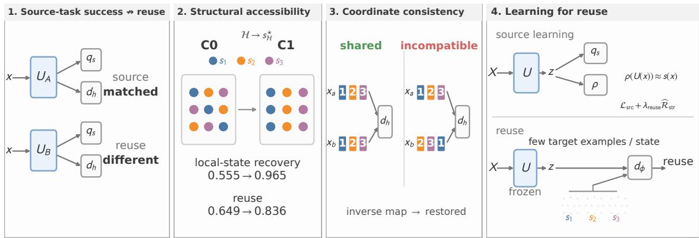  
Figure 1: Representation reuse. (1) Matched source performance need not imply matched reuse. (2) Future-task distinctions must remain structurally accessible. (3) Retained distinctions must admit a shared interpretation. (4) Structure-preserving source learning promotes recoverability of an anticipated candidate state.

For deterministic h, exact reuse under unrestricted deterministic decoding means that there exist $d _ { h }$ : $\mathcal { Z }  \mathcal { V } _ { t }$ and $\Omega _ { t } \subseteq \operatorname { s u p p } ( P _ { t } )$ with $P _ { t } ( \Omega _ { t } ) = 1$ such that

$$
h ( x ) = d _ { h } ( U ( x ) ) , \qquad \forall x \in \Omega _ { t } .\tag{3}
$$

Population-risk maps are assumed measurable. The exact existence results below are deterministic statements; the corresponding measurability qualification is given in the Appendix.

In our primary experiments, source learning uses pairwise relations. Let $q _ { \psi } ^ { \mathrm { r e l } } : \mathcal { Z } \times \mathcal { Z } \to \mathcal { R }$ be the relational source head, with population objective

$$
\begin{array} { r } { \mathcal { L } _ { \mathrm { r e l } } ( \theta , \psi ) = \mathbb { E } _ { ( x _ { i } , x _ { j } , r _ { i j } ) } \left[ \ell _ { \mathrm { r e l } } \left( q _ { \psi } ^ { \mathrm { r e l } } \left( U _ { \theta } ( x _ { i } ) , U _ { \theta } ( x _ { j } ) \right) , r _ { i j } \right) \right] . } \end{array}\tag{4}
$$

We write ${ \widehat { \mathcal { L } } } _ { \mathrm { s r c } }$ for the empirical source-learning loss actually optimized in the corresponding experimental setting.

## 2.2 The Task-Relevant State of a Future-Task Family

Learning representations that support multiple related tasks has a long history in inductive-bias learning and multitask representation learning (Baxter, 2000; Maurer et al., 2016). We instead treat the future-task family as specified and ask for the coarsest deterministic state sufficient for every task in that family.

Let $\mathcal { H } = \{ h _ { 1 } , \ldots , h _ { M } \}$ be a finite family of deterministic future tasks. Define

$$
\begin{array} { r } { x \sim _ { \mathcal { H } } x ^ { \prime } \iff h ( x ) = h ( x ^ { \prime } ) \forall h \in \mathcal { H } , } \end{array}\tag{5}
$$

and

$$
s _ { \mathcal { H } } ^ { \star } ( x ) = [ x ] _ { \mathcal { H } } , \qquad S _ { \mathcal { H } } ^ { \star } = \mathcal { X } / { \sim } _ { \mathcal { H } } .\tag{6}
$$

A deterministic state $s : \mathcal { X } \to \mathcal { S }$ is sufficient for H if every $h \in \mathcal H$ factors through s. By construction, every task factors through $s _ { \mathcal { H } } ^ { \star } ,$ and every sufficient s satisfies

$$
s _ { \mathcal { H } } ^ { \star } = r \circ s\tag{7}
$$

for some deterministic $r : \mathcal { S } \to \mathcal { S } _ { \mathcal { H } } ^ { \star }$ . Thus, up to relabeling, $s _ { \mathcal { H } } ^ { \star }$ is the coarsest deterministic state sufficient for the family. This construction is related to prior notions of sufficient and minimal representations (Achille and Soatto, 2018; Tian et al., 2020; Wang et al., 2022), but here sufficiency is defined relative to an explicit family of future tasks.

Lemma 1 (Task-Family Refinement). If $\mathcal { H } _ { 1 } \subseteq \mathcal { H } _ { 2 }$ , then there exists a deterministic map $r _ { 2 1 }$ such that

$$
s _ { \mathcal { H } _ { 1 } } ^ { \star } = r _ { 2 1 } \circ s _ { \mathcal { H } _ { 2 } } ^ { \star } .\tag{8}
$$

Hence enlarging the future-task family cannot make its required state strictly coarser.

Corollary 1 (Insufficient-State Impossibility). If $s _ { \mathcal { H } } ^ { \star }$ does not factor through a state $s : \mathcal { X } \to \mathcal { S } .$ , then there exist $x _ { a } , x _ { b } \in \mathcal { X }$ and $h \in \mathcal H$ such that

$$
s ( x _ { a } ) = s ( x _ { b } ) , \qquad h ( x _ { a } ) \neq h ( x _ { b } ) .\tag{9}
$$

No deterministic decoder acting only through s can recover that task exactly on a support containing both inputs. A strictly positive distributional error lower bound additionally requires non-degenerate conditional target labels on a set of positive state measure; see the Appendix.

## 2.3 Exact Reuse Through an Effective Interface

The task-relevant state specifies which distinctions must remain available. Exact reuse also depends on whether those distinctions admit a consistent interpretation through the representation exposed to a downstream rule. Throughout this subsection, decoding is unrestricted and deterministic.

Prior identifiability results study when learned representations are recoverable or aligned only up to shared transformation classes (Khemakhem et al., 2020; Roeder et al., 2021; Reizinger et al., 2025; Nelson et al., 2026). Related work on representation comparison likewise makes explicit that the notion of equivalence depends on which coordinate transformations are treated as immaterial (Kornblith et al., 2019a). Given the representation interface exposed to reuse, we ask whether all admissible realizations admit one common downstream interpretation.

For each $x \in \mathcal { X }$ , let ${ \mathcal { G } } ( x ) \subseteq { \mathrm { B i j } } ( { \mathcal { Z } } )$ be a nonempty family of admissible reversible coordinate transformations with id $\in \mathcal G ( x )$ . The admissible family is fixed by the reuse setting independently of observed outcomes. Define the effective interface

$$
\mathcal { E } _ { U } ^ { \mathcal { G } } ( x ) = \{ g ( U ( x ) ) : g \in \mathcal { G } ( x ) \} .\tag{10}
$$

A target $h$ is exactly reusable over this interface if, for some full-measure $\Omega _ { t } \subseteq \operatorname { s u p p } ( P _ { t } )$ , one decoder d satisfies

$$
d ( z ) = h ( x ) , \qquad \forall x \in \Omega _ { t } , \forall z \in \mathcal { E } _ { U } ^ { \mathcal { G } } ( x ) .\tag{11}
$$

Theorem 1 (Effective-Interface Reuse Criterion). A deterministic target h is exactly reusable over the effective interface if and only if there exists a full-measure $\Omega _ { t } \subseteq \operatorname { s u p p } ( P _ { t } )$ such that

$$
\begin{array} { r } { \mathcal { E } _ { U } ^ { \mathcal { G } } ( x _ { a } ) \cap \mathcal { E } _ { U } ^ { \mathcal { G } } ( x _ { b } ) \neq \emptyset \quad \Longrightarrow \quad h ( x _ { a } ) = h ( x _ { b } ) , \qquad \forall x _ { a } , x _ { b } \in \Omega _ { t } . } \end{array}\tag{12}
$$

Failure occurs exactly when two inputs requiring different target outputs can present a common effective representation to the shared decoder. The proof and measurability qualification are given in Appendix A.2.

## Structural accessibility and coordinate consistency. Define

$$
\begin{array} { r } { \mathcal A _ { U , h } ( \Omega _ { t } ) = \left\{ ( x _ { a } , x _ { b } ) \in \Omega _ { t } ^ { 2 } : U ( x _ { a } ) = U ( x _ { b } ) , \ h ( x _ { a } ) \neq h ( x _ { b } ) \right\} , } \end{array}\tag{13}
$$

$$
\begin{array} { r } { K _ { U , h } ^ { \mathcal { G } } ( \Omega _ { t } ) = \left\{ ( x _ { a } , x _ { b } ) \in \Omega _ { t } ^ { 2 } : U ( x _ { a } ) \neq U ( x _ { b } ) , \mathcal { E } _ { U } ^ { \mathcal { G } } ( x _ { a } ) \cap \mathcal { E } _ { U } ^ { \mathcal { G } } ( x _ { b } ) \neq \emptyset , \ h ( x _ { a } ) \neq h ( x _ { b } ) \right\} . } \end{array}\tag{14}
$$

Structural accessibility holds when $\boldsymbol { \mathcal { A } } _ { U , h } ( \Omega _ { t } ) = \boldsymbol { \mathcal { O } }$ , and coordinate consistency when ${ \cal { K } } _ { U , h } ^ { \mathcal { G } } ( \Omega _ { t } ) = \emptyset$ . Because id $\in \mathcal G ( x )$ , these distinguish the two ways the criterion can fail: a required distinction may already be collapsed by U, or distinct base representations may become incompatible through their effective interfaces.

For the identity-interface special case $\mathcal { G } ( x ) = \{ \mathrm { i d } \}$ , coordinate conflicts vanish and structural accessibility alone is sufficient for unrestricted exact reuse. The graded conditional-accessibility quantity used in Section 3 is an empirical intervention diagnostic, not this binary exact condition; no universal monotonicity with restricted reuse follows from Theorem 1.

Corollary 2 (Family Reuse as Task-State Recovery). For finite H under a common target distribution, exact reuse of every task over a common full-measure support $\Omega _ { \mathcal { H } }$ is equivalent to recovery of the family state:

$$
\begin{array} { r l } & { \forall h \in \mathcal { H } , \exists d _ { h } : d _ { h } ( z ) = h ( x ) } \\ & { \quad \forall x \in \Omega _ { \mathcal { H } } , \forall z \in \mathcal { E } _ { U } ^ { \mathcal { G } } ( x ) } \\ & { \quad \Longleftrightarrow \exists \rho : \rho ( z ) = s _ { \mathcal { H } } ^ { \star } ( x ) \quad \forall x \in \Omega _ { \mathcal { H } } , \forall z \in \mathcal { E } _ { U } ^ { \mathcal { G } } ( x ) . } \end{array}\tag{15}
$$

Proposition 1 (Shared-Coordinate Invariance). For any bijection $\tau : \mathcal { Z } \to \mathcal { Z }$ , let

$$
\widetilde U = \tau \circ U , \qquad \widetilde { \mathcal { G } } ( x ) = \big \{ \tau \circ g \circ \tau ^ { - 1 } : g \in \mathcal { G } ( x ) \big \} .
$$

Then

$$
\mathcal { E } _ { \widetilde { U } } ^ { \widetilde { \mathcal { G } } } ( x ) = \tau \big ( \mathcal { E } _ { U } ^ { \mathcal { G } } ( x ) \big ) ,
$$

and $d \circ \tau ^ { - 1 }$ decodes the transformed representation whenever d decodes the original one. Hence a globally shared bijective reparameterization preserves unrestricted exact reuse.

For a restricted decoder class D, define

$$
{ \widetilde { D } } = \{ d \circ \tau ^ { - 1 } : d \in { \mathcal { D } } \} .
$$

Comparing (U, D) with $( \widetilde { U } , \widetilde { \mathcal { D } } )$ preserves the corresponding reuse risk. If the same fixed decoder class is used before and after reparameterization, closure under the corresponding forward and inverse compositions is a sufficient condition for the same invariance.

For $\boldsymbol { x } _ { 1 : m } = ( x _ { 1 } , \dots , x _ { m } )$ , define

$$
U ^ { ( m ) } ( x _ { 1 : m } ) = ( U ( x _ { 1 } ) , \ldots , U ( x _ { m } ) ) .
$$

Let $\mathcal { G } ^ { ( m ) } ( x _ { 1 : m } )$ act componentwise:

$$
\mathcal { G } ^ { ( m ) } ( x _ { 1 : m } ) = \left\{ ( g _ { 1 } , \dots , g _ { m } ) : g _ { j } \in \mathcal { G } ( x _ { j } ) \right\} ,
$$

with

$$
( g _ { 1 } , \ldots , g _ { m } ) \left( U ( x _ { 1 } ) , \ldots , U ( x _ { m } ) \right) = \left( g _ { 1 } ( U ( x _ { 1 } ) ) , \ldots , g _ { m } ( U ( x _ { m } ) ) \right) .
$$

The joint effective interface is therefore

$$
\mathcal { E } _ { U ^ { ( m ) } } ^ { \mathcal { G } ^ { ( m ) } } ( x _ { 1 : m } ) = \prod _ { j = 1 } ^ { m } \mathcal { E } _ { U } ^ { \mathcal { G } } ( x _ { j } ) .\tag{16}
$$

## 2.4 Learning for Reuse Under Candidate-State and Decoder Constraints

Multitask learning commonly uses related auxiliary objectives to shape a shared representation (Caruana, 1997; Maurer et al., 2016). Here the candidate state is tied explicitly to an anticipated future-task family and is related to the corresponding task-relevant state through Eq. (18).

Let $s : \mathcal { X } \to \mathcal { S }$ be a candidate state. For an m-input downstream setting, let

$$
\Phi _ { m } \subseteq \{ \phi : { \mathcal { S } } ^ { m } \to { \mathcal { V } } _ { t } \}
$$

be a class of composition rules and define

$$
\mathcal { H } _ { S } ^ { ( m ) } = \left\{ h _ { \phi } : h _ { \phi } ( x _ { 1 : m } ) = \phi ( s ( x _ { 1 } ) , \ldots , s ( x _ { m } ) ) , \phi \in \Phi _ { m } \right\} .\tag{17}
$$

Writing

$$
\begin{array} { r } { s ^ { ( m ) } ( x _ { 1 : m } ) = \left( s ( x _ { 1 } ) , \dots , s ( x _ { m } ) \right) , } \end{array}
$$

any finite anticipated family $\mathcal { H } \subseteq \mathcal { H } _ { S } ^ { ( m ) }$ satisfies

$$
s _ { \mathcal { H } } ^ { \star } = r \circ s ^ { ( m ) }\tag{18}
$$

for some $r : { \mathcal { S } } ^ { m } \to { \mathcal { S } } _ { \mathcal { H } } ^ { \star } .$ . Thus the tuple extension of the candidate state refines the task-relevant state required by the anticipated family.

Let $\mathcal { D } _ { \mathrm { s t r } }$ be a class of readouts $\rho : \mathcal { Z }  \mathcal { S }$ . Targeting candidate-state recoverability during source learning corresponds to

$$
\mathcal { R } _ { \mathrm { s t r } } \left( U ; s , \mathcal { D } _ { \mathrm { s t r } } \right) = \operatorname* { i n f } _ { \rho \in \mathcal { D } _ { \mathrm { s t r } } } \mathbb { E } _ { X \sim P _ { s } ^ { X } } \left[ \ell _ { \mathrm { s t r } } \left( \rho ( U ( X ) ) , s ( X ) \right) \right] .\tag{19}
$$

For the discrete states used experimentally, we optimize

$$
\widehat { \mathcal { R } } _ { \mathrm { s t r } } ( \theta , \omega ) = - \frac { 1 } { N } \sum _ { i = 1 } ^ { N } \log p _ { \omega } \left( s _ { i } \mid U _ { \theta } ( x _ { i } ) \right)\tag{20}
$$

and train with

$$
\begin{array} { r } { \mathcal { L } _ { \mathrm { S P R } } ( \boldsymbol { \theta } , \boldsymbol { \psi } , \omega ) = \widehat { \mathcal { L } } _ { \mathrm { s r c } } ( \boldsymbol { \theta } , \boldsymbol { \psi } ) + \lambda _ { \mathrm { r e u s e } } \widehat { \mathcal { R } } _ { \mathrm { s t r } } ( \boldsymbol { \theta } , \omega ) . } \end{array}\tag{21}
$$

SPR targets the structural-accessibility side of the theory. It does not directly enforce coordinate consistency, and the structural readout is discarded before reuse evaluation.

Proposition 2 (Candidate-State Recovery Suffices for Reuse). Let $P _ { t } ^ { ( m ) }$ be a downstream distribution on ${ \boldsymbol { \mathcal { X } } } ^ { m }$ . Suppose there exist $\Omega _ { t } \subseteq { \mathcal { X } }$ and $\rho : \mathcal { Z } \to \mathcal { S }$ such that

$$
P _ { t } ^ { ( m ) } ( \Omega _ { t } ^ { m } ) = 1\tag{22}
$$

and

$$
\rho ( z ) = s ( x ) , \qquad \forall x \in \Omega _ { t } , \forall z \in \mathcal { E } _ { U } ^ { \mathcal { G } } ( x ) .\tag{23}
$$

Then every $h _ { \phi } \in \mathcal { H } _ { S } ^ { ( m ) }$ is exactly reusable over the joint effective interface via

$$
d _ { \phi } ( z _ { 1 } , \dots , z _ { m } ) = \phi ( \rho ( z _ { 1 } ) , \dots , \rho ( z _ { m } ) ) .\tag{24}
$$

The proposition assumes candidate-state recovery on the target effective interface. The source-domain SPR objective promotes such recoverability during training but does not itself establish this target-domain con dition.

Restricted reuse under decoder constraints. For restricted reuse, we fix the realized coordinates of U and separate decoder-class restriction from coordinate ambiguity. Let

$$
\mathcal { Q } _ { s } \subseteq \{ a : \mathcal { Z } \to S \}
$$

be a nonempty class of target-domain candidate-state readouts, and let

$$
{ \mathcal { D } } _ { m } \subseteq \{ d : { \mathcal { Z } } ^ { m } \to { \mathcal { V } } _ { t } \}
$$

be a nonempty downstream decoder class.

For $X _ { 1 : m } \sim P _ { t } ^ { ( m ) }$ , define under 0–1 loss

$$
\epsilon _ { s } ( a ) = \frac { 1 } { m } \sum _ { j = 1 } ^ { m } \operatorname* { P r } \left[ a ( U ( X _ { j } ) ) \neq s ( X _ { j } ) \right] ,\tag{25}
$$

$$
\eta _ { \phi } ( a ) = \operatorname* { i n f } _ { d \in \mathcal { D } _ { m } } \operatorname* { P r } \left[ d ( U ^ { ( m ) } ( X _ { 1 : m } ) ) \neq \phi ( a ( U ( X _ { 1 } ) ) , \ldots , a ( U ( X _ { m } ) ) ) \right] ,\tag{26}
$$

$$
\alpha _ { \phi } = \operatorname* { i n f } _ { d \in \mathcal { D } _ { m } } \operatorname* { P r } \left[ d ( U ^ { ( m ) } ( X _ { 1 : m } ) ) \neq h _ { \phi } ( X _ { 1 : m } ) \right] .\tag{27}
$$

For a fixed $^ { a , }$ write

$$
G _ { \phi , a } = \phi ( a ( U ( X _ { 1 } ) ) , \dots , a ( U ( X _ { m } ) ) ) .
$$

Proposition 3 (Restricted-Reuse Sandwich). For every $a \in \mathcal { Q } _ { s }$

$$
\vert \alpha _ { \phi } - \eta _ { \phi } ( a ) \vert \leq \operatorname* { P r } \left[ G _ { \phi , a } \neq h _ { \phi } ( X _ { 1 : m } ) \right] \leq m \epsilon _ { s } ( a ) .\tag{28}
$$

Consequently,

$$
\operatorname* { s u p } _ { a \in \mathcal { Q } _ { s } } \left[ \eta _ { \phi } ( a ) - m \epsilon _ { s } ( a ) \right] _ { + } \leq \alpha _ { \phi } \leq \operatorname* { i n f } _ { a \in \mathcal { Q } _ { s } } \left[ \eta _ { \phi } ( a ) + m \epsilon _ { s } ( a ) \right] .\tag{29}
$$

The same readout couples recoverability and restricted composition, so better candidate-state recovery need not monotonically improve restricted reuse; Appendix A.10 gives a counterexample. For finite $\mathcal { D } _ { m }$ , fitting from n i.i.d. target tuples adds the standard $O ( \sqrt { \log | \mathcal { D } _ { m } | / n } )$ estimation term (Appendix A.9). SPR optimizes a source-domain surrogate and directly optimizes neither $\eta _ { \phi } .$ , this finite-sample term, nor coordinate consistency; Section 3 evaluates the corresponding empirical behavior.

## 3 Experiments

The experiments follow the three questions raised by the theory. First, can representations with matched source-task performance nevertheless support substantially different future tasks after the source head is removed? Second, when reuse differs, can the failure be separated into loss of task-relevant distinctions and loss of a shared downstream interpretation? Third, if the future-task family is anticipated, can source learning preserve the required distinctions so that later tasks reuse the representation more effectively under limited target supervision?

C0 (Source-only) uses only the source objective. C1 (SPR) adds Eq. (21). C4 (Globally relabeled SPR) uses the same objective after one fixed bijective relabeling of candidate-state labels; representation coordinates are unchanged. Unless stated otherwise, reuse evaluation discards the source head, freezes the encoder, and fits a new downstream rule. Implementation details, admissibility criteria, and statistical procedures are given in the Appendix.

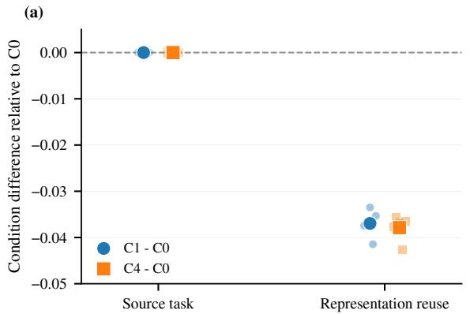

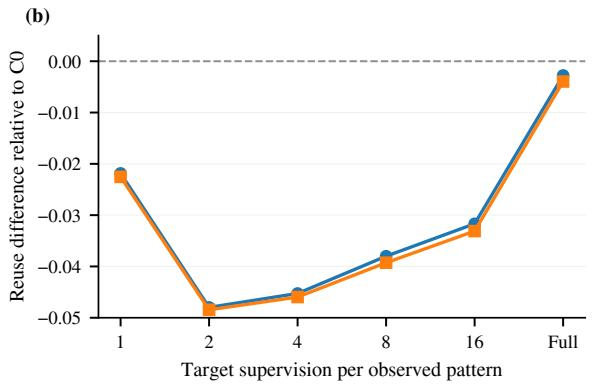  
Figure 2: Source-task performance does not determine reuse. (a) Paired reuse differences under exact source matching. (b) Mean reuse differences as target supervision increases; the dashed line denotes zero.

## 3.1 Source-Task Success Does Not Determine Representation Reuse

This section tests whether source-task success can rank learned representations for future reuse; it does not assume that SPR should improve every replacement task family. Under a task-relative account, representa tions with matched source performance can differ in reuse, and their ordering need not be preserved across future-task families that require different distinctions.

Exact source matching and target supervision. On Shapes3D (Kim and Mnih, 2018), five seeds for each of C0, C1, and C4 all achieve exactly 1.0000 source validation accuracy. We use low-shot reuse for the predefined aggregate over the five limited-supervision budgets $K \in \{ 1 , 2 , 4 , 8 , 1 6 \}$ . Across 1004 admissible novel-rule evaluations, mean low-shot reuse is 0.6410, 0.6040, and 0.6031, respectively; the paired C1–C0 and C4–C0 differences are −0.0370 and −0.0379, with the same sign for all five seeds (Figure 2(a)). With full target support, these differences contract to −0.0028 and −0.0040 (Figure 2(b)). The source-matched representations differ in reuse, with a larger separation under limited target supervision.

Extension across data and source-learning settings. On CIFAR-100 (Krizhevsky, 2009), nine matched representation pairs have a mean absolute source-performance gap of 0.0036, while C1 exceeds C0 in lowshot reuse by 0.1718. Under an ordinary supervised-classification source task, source accuracy is similarly close (0.7535 versus 0.7602), while the held-out-rule reuse difference is +0.0768. Source-matched repre sentations therefore need not have matched reuse, and their ordering can change across future-task families that require different distinctions. In our experiments, preserving a candidate state helps tasks that depend on that state but does not make the resulting representation uniformly better for unrelated replacement families. This family dependence is consistent with the task-relative account.

## 3.2 Structural Accessibility and Coordinate Consistency

We test finite-supervision counterparts of the two exact-reuse requirements in Section 2.3. These measurements are empirical diagnostics, not the exact conflict sets defined by the theory.

Candidate-state recoverability. Across five matched seeds, C1 raises aligned held-out state macro-F1 from $0 . 5 5 4 7 \pm 0 . 1 8 0 7 \mathrm { t o } 0 . 9 6 4 6 \pm 0 . 0 0 5 2 , \hphantom { 0 . 0 0 0 0 0 }$ a paired gain of 0.4099 (95% CI [0.2719, 0.5479]). Low-shot reuse rises from $0 . 6 4 9 1 \pm 0 . 1 1 3 0 \mathrm { \ t o \ } 0 . 8 3 5 6 \pm 0 . 0 2 7 4$ , with a paired gain of 0.1866 ([0.1012, 0.2875]), positive in all five seeds (Figure 3(a)). C4 reaches similar recoverability $( 0 . 9 5 7 2 \pm 0 . 0 1 0 9 )$ and differs from C1 in reuse by $- 0 . 0 0 7 2 \ ( [ - 0 . 0 3 7 5 , 0 . 0 2 0 3 ] )$ ), consistent with insensitivity to a global relabeling of candidate-state symbols. Random-auxiliary and Shuffled-state controls have lower recoverability and reuse; C1 exceeds them in reuse by 0.5845 and 0.6576, respectively, with the same sign in all five seeds. The aligned macro-F1 is diagnostic only and is never supplied to the downstream reuse evaluator.

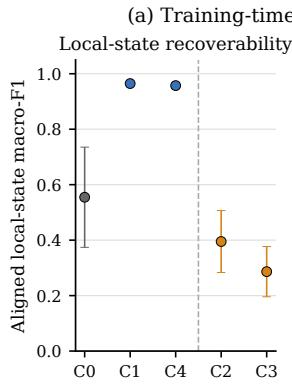

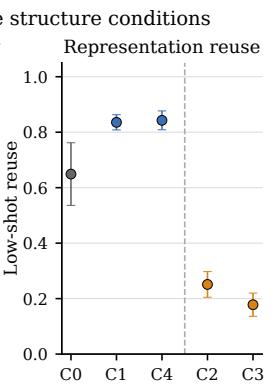  
(b) Coordinate inconsistency and representation reuse

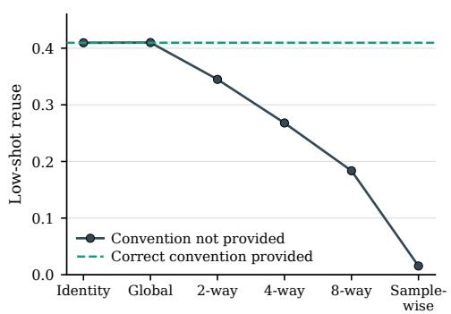  
Figure 3: Accessibility and coordinate tests. (a) State recoverability and low-shot reuse for C0, C1, C4, Random auxiliary (C2), and Shuffled-state (C3). (b) Reuse under reversible coordinate interventions; increasingly heterogeneous sample-dependent conventions reduce blind reuse, while convention-aware inversion returns reuse to the Identity condition. Error bars show one standard deviation.

Recoverable information can still be unusable. We apply reversible coordinate transformations to the same frozen representation. Reuse is 0.4096 under Identity and 0.4099 under one globally shared reparameterization, but falls to 0.3449, 0.2679, 0.1836, and 0.0154 under 2-way, 4-way, 8-way, and sample-wise conventions, respectively (Figure 3(b)). The same ordering holds for all three source-training seeds. Every transformation is invertible. Supplying the applicable convention and applying its inverse restores reuse to 0.4096 in every condition, with zero reconstruction difference from the common-reference representation. The information needed for reuse therefore remains recoverable, yet a shared downstream rule fails when different samples expose that information through incompatible coordinate conventions.

Prospective natural-image replication. We test five protocol-defined CIFAR-100 conditions Q1–Q5 with normalized conditional-accessibility values approximately 0, 0.4182, 0.6555, 0.8277, and 1.0000. These are predefined intervention levels, not post hoc estimates of information retained by $U ; \mathbf { Q } 1 = 0$ refers only to the controlled conditional component. Construction and normalization details are given in the Appendix.

Held-out reuse increases from Q1 through Q5 for both architectures. ResNet-18 rises from 0.2670 to $0 . 3 2 1 3 ( \Delta _ { 5 - 1 } = + 0 . 0 5 4 2 )$ , and DenseNet-121 from 0.2811 to 0.3261 $( \Delta _ { 5 - 1 } = + 0 . 0 4 5 0 )$ . Full conditionwise values are reported in Table 5 of Appendix C.6. At the representation-seed level, all five accessibility– reuse slopes are positive for each architecture. Mean slopes are 0.0516 for ResNet-18 (95% exact-bootstrap CI [0.0485, 0.0547]) and 0.0460 for DenseNet-121 ([0.0440, 0.0477]). The seed-level estimand and resampling procedure are given in the Appendix.

The result is specific to the predefined accessibility hierarchy, future-task family, and intervention construction. Proposition 3 does not imply a universal monotonic relationship between accessibility and re stricted reuse.

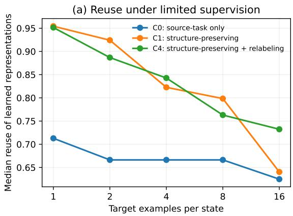

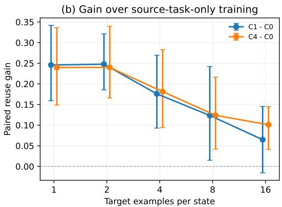  
Figure 4: Structure preservation improves reuse primarily under limited target supervision. (a) Reuse across the predefined target-supervision conditions for C0, C1, and C4. (b) Paired seed-level gains over C0: C1 improves low-shot reuse by 0.1715, whereas the full-support gain is 0.0241 and its confidence interval includes zero. C4 shows the same supervision-localized pattern. Panel (a) is descriptive; panel (b) reports the paired estimand with bootstrap 95% confidence intervals.

## 3.3 Structure-Preserving Learning Improves Reuse under Limited Target Supervision

On held-out tasks whose task-relevant states are refined by the candidate state promoted during source learning, the reuse gain is concentrated under limited target supervision. Across $K \in \{ 1 , 2 , 4 , 8 , 1 6 \}$ examples per state, the paired C1–C0 low-shot gain is 0.1715 (95% CI [0.0986, 0.2591]), and the C4–C0 gain is 0.1771 ([0.1172, 0.2593]); both are positive in all five matched seeds (Figure 4). Under full target support, the corresponding gains are 0.0241 ([−0.0260, 0.0992]) and 0.0300 ([−0.0201, 0.0990]).

These tasks instantiate $\mathcal { H } _ { S } ^ { ( m ) }$ from Eq. (17): they share the candidate state s and vary the composition rule $\phi ,$ so their task-relevant states are refined by $s ^ { ( m ) }$ as in Eq. (18). The primary paired analysis retains 21 of 24 registered family–rule evaluations after a representation-independent admissibility screen; registry construction and class support are given in the Appendix.

Let $\Delta _ { \mathrm { L S } } ( C )$ and $\Delta _ { \mathrm { f u l l } } ( C )$ denote paired gains under the predefined limited-supervision and full-support regimes, respectively. Define

$$
\Gamma ( C ) = \Delta _ { \mathrm { L S } } ( C ) - \Delta _ { \mathrm { f u l l } } ( C ) .\tag{30}
$$

We obtain $\Gamma ( \mathrm { C 1 } ) = 0 . 1 4 7 4 ( 9 5 \% \mathrm { C I } [ 0 . 1 0 4 4 , 0 . 1 9 0 5 ] )$ and $\Gamma ( \mathrm { C 4 } ) = 0 . 1 4 7 1 ~ ( [ 0 . 1 1 9 3 , 0 . 1 7 4 9 ] )$ . Both Γ values are positive, while both full-support intervals include zero. The advantage of C1 and C4 over C0 is concentrated under limited target supervision. In this setting, distinctions already accessible from the frozen representation matter most when the downstream learner has few labeled target examples.

The direct C1–C4 low-shot contrast is −0.0056 (95% CI [−0.0284, 0.0173]), with no consistent direction across seeds, consistent with insensitivity to a global relabeling of candidate-state symbols. The gain reported here is specific to the predefined held-out tasks that factor through s. As Section 3.1 shows, families requiring different distinctions can induce a different ordering of the same source-matched representations.

## 4 Conclusion

A representation can solve its source task well and still be difficult to reuse once the source head is removed. Our framework separates two failures: distinctions required by later tasks may no longer be recoverable, or they may remain recoverable but be exposed through coordinates that a shared downstream rule cannot interpret consistently. The reversible coordinate experiment isolates the second case: reuse falls under sample-dependent conventions and returns when the applicable convention is inverted.

The practical consequence is clearest when target supervision is limited. The predefined accessibility ordering repeats with both ResNet-18 and DenseNet-121, and preserving a candidate state that refines the held-out task requirements improves low-shot reuse while the full-support intervals include zero. The benefit is family-specific: future tasks requiring different distinctions can change the ordering of source-matched representations. Representation reuse should therefore be evaluated relative to the tasks that follow source learning—whether the distinctions they require remain available in a form that a shared downstream rule can use.

AI use statement. Generative AI tools were used to assist with literature organization, translation, language editing, and limited implementation support during the preparation of this work. All scientific claims, theoretical statements, experimental designs, implementations, numerical results, and final manuscript content were reviewed and verified by the authors. The authors take full responsibility for the content of this paper.

## References

Alessandro Achille and Stefano Soatto. Emergence of invariance and disentanglement in deep representations. In 2018 Information Theory and Applications Workshop (ITA), pages 1–9, 2018. doi: 10.1109/ITA.2018.8503149.

Guillaume Alain and Yoshua Bengio. Understanding Intermediate Layers Using Linear Classifier Probes. In International Conference on Learning Representations, 2017. URL https://mlanthology.org/ iclr/2017/alain2017iclr-understanding/.

Jonathan Baxter. A model of inductive bias learning. J. Artif. Int. Res., 12(1):149–198, March 2000. ISSN 1076-9757.

Rich Caruana. Multitask learning. Machine Learning, 28(1):41–75, Jul 1997. doi: 10.1023/a: 1007379606734. URL http://dx.doi.org/10.1023/A:1007379606734.

Annie Chen, Yoonho Lee, Amrith Setlur, Sergey Levine, and Chelsea Finn. Project and probe: Sampleefficient adaptation by interpolating orthogonal features. In B. Kim, Y. Yue, S. Chaudhuri, K. Fragkiadaki, M. Khan, and Y. Sun, editors, International Conference on Learning Representations, volume 2024, pages 11788–11811, 2024. URL https://proceedings.iclr.cc/paper\_files/paper/2024/ file/3209cf3312b2cbb68e33644362ddc2bd-Paper-Conference.pdf.

Sharut Gupta, Joshua Robinson, Derek Lim, Soledad Villar, and Stefanie Jegelka. Structuring representation geometry with rotationally equivariant contrastive learning. In The Twelfth International Conference on Learning Representations, 2024. URL https://openreview.net/forum?id=lgaFMvZHSJ.

Kaiming He, Xiangyu Zhang, Shaoqing Ren, and Jian Sun. Deep residual learning for image recognition. In 2016 IEEE Conference on Computer Vision and Pattern Recognition (CVPR), pages 770–778, 2016. doi: 10.1109/CVPR.2016.90.

Gao Huang, Zhuang Liu, Laurens Van Der Maaten, and Kilian Q. Weinberger. Densely connected convolutional networks. In 2017 IEEE Conference on Computer Vision and Pattern Recognition (CVPR), pages 2261–2269, 2017. doi: 10.1109/CVPR.2017.243.

Ilyes Khemakhem, Diederik Kingma, Ricardo Monti, and Aapo Hyvarinen. Variational autoencoders and nonlinear ica: A unifying framework. In Silvia Chiappa and Roberto Calandra, editors, Proceedings of the Twenty Third International Conference on Artificial Intelligence and Statistics, volume 108 of Proceedings ofMachine Learning Research, pages 2207–2217. PMLR, 26–28 Aug 2020. URL https: //proceedings.mlr.press/v108/khemakhem20a.html.

Hyunjik Kim and Andriy Mnih. Disentangling by factorising. In Jennifer Dy and Andreas Krause, editors, Proceedings of the 35th International Conference on Machine Learning, volume 80 of Proceedings of Machine Learning Research, pages 2649–2658. PMLR, 10–15 Jul 2018. URL https: //proceedings.mlr.press/v80/kim18b.html.

Simon Kornblith, Mohammad Norouzi, Honglak Lee, and Geoffrey Hinton. Similarity of neural network representations revisited. In Kamalika Chaudhuri and Ruslan Salakhutdinov, editors, Proceedings of the 36th International Conference on Machine Learning, volume 97 of Proceedings ofMachine Learning Research, pages 3519–3529. PMLR, 09–15 Jun 2019a. URL https://proceedings.mlr.press/ v97/kornblith19a.html.

Simon Kornblith, Jonathon Shlens, and Quoc V. Le. Do better imagenet models transfer better? In 2019 IEEE/CVF Conference on Computer Vision and Pattern Recognition (CVPR), pages 2656–2666, 2019b. doi: 10.1109/CVPR.2019.00277.

Alex Krizhevsky. Learning multiple layers of features from tiny images. Technical report, University of Toronto, 2009. URL https://www.cs.toronto.edu/˜kriz/ learning-features-2009-TR.pdf.

Clarissa Lauditi, Blake Bordelon, and Cengiz Pehlevan. Transfer learning in infinite width feature learning networks. In C. Vondrick, B. Hariharan, C. Raffel, L. Pinto, D. Yang, and A. Faust, editors, International Conference on Learning Representations, volume 2026, pages 53982– 54028, 2026. URL https://proceedings.iclr.cc/paper\_files/paper/2026/file/ 58ab5d6ea13c87550a2eb51c4aa1420f-Paper-Conference.pdf.

Andreas Maurer, Massimiliano Pontil, and Bernardino Romera-Paredes. The benefit of multitask representation learning. J. Mach. Learn. Res., 17(1):2853–2884, January 2016. ISSN 1532-4435.

Walter Nelson, Marco Fumero, THEOFANIS KARALETSOS, and Francesco Locatello. Statistical and structural identifiability in representation learning. In C. Vondrick, B. Hariharan, C. Raffel, L. Pinto, D. Yang, and A. Faust, editors, International Conference on Learning Representations, volume 2026, pages 151985–152020, 2026. URL https://proceedings.iclr.cc/paper\_files/paper/ 2026/file/f67e5f99b23b108a3a6665f410034bcd-Paper-Conference.pdf.

Behnam Neyshabur, Hanie Sedghi, and Chiyuan Zhang. What is being transferred in transfer learning? In H. Larochelle, M. Ranzato, R. Hadsell, M.F. Balcan, and H. Lin, editors, Advances in Neural Information Processing Systems, volume 33, pages 512–523. Curran Associates, Inc., 2020. URL https://proceedings.neurips.cc/paper\_files/paper/2020/file/ 0607f4c705595b911a4f3e7a127b44e0-Paper.pdf.

Cuong V. Nguyen, Tal Hassner, Matthias Seeger, and Cedric Archambeau. Leep: a new measure to evaluate transferability of learned representations. In Proceedings of the 37th International Conference on Machine Learning, ICML’20. JMLR.org, 2020.

Patrik Reizinger, Alice Bizeul, Attila Juhos, Julia E Vogt, Randall Balestriero, Wieland Brendel, and David Klindt. Cross-entropy is all you need to invert the data generating process. In Y. Yue, A. Garg, N. Peng, F. Sha, and R. Yu, editors, International Conference on Learning Representations, volume 2025, pages 38186–38216, 2025. URL https://proceedings.iclr.cc/paper\_files/paper/2025/ file/5ee7ed60a7e8169012224dec5fe0d27f-Paper-Conference.pdf.

Geoffrey Roeder, Luke Metz, and Durk Kingma. On linear identifiability of learned representations. In Marina Meila and Tong Zhang, editors, Proceedings of the 38th International Conference on Machine Learning, volume 139 of Proceedings ofMachine Learning Research, pages 9030–9039. PMLR, 18–24 Jul 2021. URL https://proceedings.mlr.press/v139/roeder21a.html.

Javan Tahir, Surya Ganguli, and Grant M. Rotskoff. Features are fate: a theory of transfer learning in high-dimensional regression. In Aarti Singh, Maryam Fazel, Daniel Hsu, Simon Lacoste-Julien, Felix Berkenkamp, Tegan Maharaj, Kiri Wagstaff, and Jerry Zhu, editors, Proceedings of the 42nd International Conference on Machine Learning, volume 267 of Proceedings of Machine Learning Research, pages 58142–58168. PMLR, 13–19 Jul 2025. URL https://proceedings.mlr.press/v267/ tahir25a.html.

Yonglong Tian, Chen Sun, Ben Poole, Dilip Krishnan, Cordelia Schmid, and Phillip Isola. What makes for good views for contrastive learning? In H. Larochelle, M. Ranzato, R. Hadsell, M.F. Balcan, and H. Lin, editors, Advances in Neural Information Processing Systems, volume 33, pages 6827–6839. Curran Associates, Inc., 2020. URL https://proceedings.neurips.cc/paper\_files/paper/2020/ file/4c2e5eaae9152079b9e95845750bb9ab-Paper.pdf.

Haoqing Wang, Xun Guo, ZhiHong Deng, and Yan Lu. Rethinking minimal sufficient representation in con trastive learning. In 2022 IEEE/CVF Conference on Computer Vision and Pattern Recognition (CVPR), pages 16020–16029, 2022. doi: 10.1109/CVPR52688.2022.01557.

Jason Yosinski, Jeff Clune, Yoshua Bengio, and Hod Lipson. How transferable are features in deep neural networks? In Z. Ghahramani, M. Welling, C. Cortes, N. Lawrence, and K. Weinberger, editors, Advances in Neural Information Processing Systems, volume 27. Curran Associates, Inc., 2014. URL https://proceedings.neurips.cc/paper\_files/paper/2014/ file/532a2f85b6977104bc93f8580abbb330-Paper.pdf.

## A Formal Details and Proofs

## A.1 Minimal State for a Finite Future-Task Family

Let H be a finite family of deterministic target tasks on X. Define

$$
x \sim _ { \mathcal { H } } x ^ { \prime } \quad \iff \quad h ( x ) = h ( x ^ { \prime } ) \quad \forall h \in { \mathcal { H } } .
$$

The corresponding task-relevant state is

$$
s _ { \mathcal { H } } ^ { \star } ( x ) = [ x ] _ { \mathcal { H } } .
$$

For every $h \in { \mathcal { H } } , h ( x )$ is constant on each equivalence class. Hence there exists a function $\phi _ { h }$ such that

$$
h = \phi _ { h } \circ s _ { \mathcal { H } } ^ { \star } .
$$

Thus $s _ { \mathcal { H } } ^ { \star }$ is sufficient for every task in $\mathcal { H }$

It is also the coarsest deterministic state with this property. Suppose

$$
s : \mathcal { X } \to \mathcal { S }
$$

supports every task in H, so that for each $h \in \mathcal H$ there exists $\widetilde { \phi } _ { h }$ satisfying

$$
h = \widetilde { \phi } _ { h } \circ s .
$$

If

$$
s ( x ) = s ( x ^ { \prime } ) ,
$$

then

$$
h ( x ) = \widetilde { \phi } _ { h } \big ( s ( x ) \big ) = \widetilde { \phi } _ { h } \big ( s ( x ^ { \prime } ) \big ) = h ( x ^ { \prime } ) \qquad \forall h \in \mathcal { H } .
$$

Therefore

$$
x \sim _ { \mathcal { H } } x ^ { \prime } ,
$$

so $s _ { \mathcal { H } } ^ { \star }$ is constant on every fiber of s. Consequently, there exists a deterministic map r such that

$$
s _ { \mathcal { H } } ^ { \star } = r \circ s .
$$

Hence every deterministic state sufficient for the entire family refines $s _ { \mathcal { H } } ^ { \star }$ . Any other coarsest deterministic sufficient state induces the same partition of X and differs from $s _ { \mathcal { H } } ^ { \star }$ only by a bijective relabeling of its state values.

Task-family refinement. Let

$$
\mathcal { H } _ { 1 } \subseteq \mathcal { H } _ { 2 } .
$$

If

$$
\begin{array} { r } { s _ { \mathcal { H } _ { 2 } } ^ { \star } ( x ) = s _ { \mathcal { H } _ { 2 } } ^ { \star } ( x ^ { \prime } ) , } \end{array}
$$

then every task in $\mathcal { H } _ { 2 }$ takes the same value on x and $x ^ { \prime } .$ Because $\mathcal { H } _ { 1 } \subseteq \mathcal { H } _ { 2 }$ , the same is true for every task in $\mathcal { H } _ { 1 }$ , and therefore

$$
\begin{array} { r } { s _ { \mathcal { H } _ { 1 } } ^ { \star } ( x ) = s _ { \mathcal { H } _ { 1 } } ^ { \star } ( x ^ { \prime } ) . } \end{array}
$$

Thus $s _ { \mathcal { H } _ { 1 } } ^ { \star }$ is constant on every fiber of $s _ { \mathcal { H } _ { 2 } } ^ { \star }$ , so there exists a deterministic map $r _ { 2 1 }$ satisfying

$$
s _ { \mathcal { H } _ { 1 } } ^ { \star } = r _ { 2 1 } \circ s _ { \mathcal { H } _ { 2 } } ^ { \star } .
$$

Enlarging the future-task family therefore cannot make its required state strictly coarser.

Insufficient-state impossibility. Let

$$
s : \mathcal { X } \to \mathcal { S } .
$$

Suppose $s _ { \mathcal { H } } ^ { \star }$ does not factor through s. Then $s _ { \mathcal { H } } ^ { \star }$ is not constant on at least one fiber of $s ,$ so there exist $x _ { a } , x _ { b } \in \mathcal { X }$ such that

$$
s ( x _ { a } ) = s ( x _ { b } ) , \qquad s _ { \mathcal { H } } ^ { \star } ( x _ { a } ) \neq s _ { \mathcal { H } } ^ { \star } ( x _ { b } ) .
$$

By definition of $s _ { \mathcal { H } } ^ { \star } .$ , there exists some $h \in \mathcal H$ for which

$$
h ( x _ { a } ) \neq h ( x _ { b } ) .
$$

Any deterministic decoder that observes only $s ( x )$ must assign the same output to $x _ { a }$ and $x _ { b } .$ and therefore cannot recover that task exactly on a target support containing both inputs.

This conclusion is pointwise. A strictly positive population-risk lower bound requires the conflicting target labels to remain indistinguishable on a set with positive probability under the target distribution.

Distributional Bayes obstruction. Let

$$
S = s ( X ) , \qquad Y = h ( X ) ,
$$

where $\mathcal { V } _ { t }$ is finite and the relevant regular conditional distribution exists. Define

$$
B _ { s } ( h ) = \mathbb { E } _ { S } \left[ 1 - \operatorname* { m a x } _ { y \in \mathcal { Y } _ { t } } \operatorname* { P r } ( Y = y \mid S ) \right] .\tag{31}
$$

This is the Bayes error of predicting $h ( X )$ from $s ( X )$ . For every measurable decoder $\delta : \mathcal { S }  \mathcal { V } _ { t }$

$$
\operatorname* { P r } [ \delta ( S ) \neq Y ] \geq B _ { s } ( h ) .
$$

Moreover, if

$$
U = f \circ s
$$

for a deterministic measurable map $f ,$ every measurable decoder acting through U is also a measurable function of S. Hence

$$
\operatorname* { i n f } _ { d } \operatorname* { P r } [ d ( U ( X ) ) \neq h ( X ) ] \geq B _ { s } ( h ) .
$$

The quantity $B _ { s } ( h )$ is strictly positive precisely when

$$
1 - \operatorname* { m a x } _ { y } \operatorname* { P r } ( Y = y \mid S ) > 0
$$

on a set of state values having positive $P _ { S ^ { - } } \mathrm { m e a s u r e } .$ Thus positive distributional error requires non-degenerate conditional target labels on a set of positive measure; it does not require any individual state value to have positive probability.

## A.2 Proof of Theorem 1

Let $\Omega \subseteq \operatorname { s u p p } ( P _ { t } )$ satisfy

$$
P _ { t } ( \Omega ) = 1 .
$$

For every $x \in \Omega$ , let

$$
\mathcal { E } _ { U } ^ { \mathcal { G } } ( x ) = \{ g ( U ( x ) ) : g \in \mathcal { G } ( x ) \}
$$

denote the effective interface.

We prove that exact reuse over the effective interface is possible if and only if

$$
{ \mathcal { E } } _ { U } ^ { \mathcal { G } } ( x _ { a } ) \cap { \mathcal { E } } _ { U } ^ { \mathcal { G } } ( x _ { b } ) \neq \emptyset \quad \implies \quad h ( x _ { a } ) = h ( x _ { b } )\tag{32}
$$

for all $x _ { a } , x _ { b } \in \Omega$

Necessity. Suppose there exists one deterministic decoder d satisfying

$$
d ( z ) = h ( x ) , \qquad \forall x \in \Omega , \quad \forall z \in \mathcal { E } _ { U } ^ { \mathcal { G } } ( x ) .
$$

Take any $x _ { a } , x _ { b } \in \Omega$ such that

$$
z \in \mathcal { E } _ { U } ^ { \mathcal { G } } ( x _ { a } ) \cap \mathcal { E } _ { U } ^ { \mathcal { G } } ( x _ { b } ) .
$$

Then

$$
h ( x _ { a } ) = d ( z ) = h ( x _ { b } ) ,
$$

which establishes Eq. (32).

Sufficiency. Assume Eq. (32). Define

$$
\mathcal { Z } _ { \Omega } = \bigcup _ { x \in \Omega } \mathcal { E } _ { U } ^ { \mathcal { G } } ( x ) .
$$

For $z \in \mathcal { Z } _ { \Omega }$ , choose any $x \in \Omega$ satisfying

$$
z \in \mathcal { E } _ { U } ^ { \mathcal { G } } ( x )
$$

and define

$$
d ( z ) = h ( x ) .
$$

This definition is well posed. If the same z belongs to the effective interfaces of both $x _ { a }$ and $x _ { b } ,$ , then Eq. (32) gives

$$
h ( x _ { a } ) = h ( x _ { b } ) .
$$

Extend d arbitrarily from ${ \mathcal { Z } } _ { \Omega }$ to the remainder of Z. The resulting decoder satisfies

$$
d ( z ) = h ( x ) , \qquad \forall x \in \Omega , \quad \forall z \in \mathcal { E } _ { U } ^ { \mathcal { G } } ( x ) .
$$

Therefore exact reuse holds on a full-measure support.

Measurability qualification. The argument above establishes existence of an unrestricted deterministic decoder as a set-theoretic exact-decoding statement. The overlap condition alone does not, under arbitrary measurable-space structures, guarantee that the induced decoder or an arbitrary extension is measurable.

Accordingly, Theorem 1 is interpreted first as a deterministic exact-decoding criterion on the relevant full-measure support. Whenever the result is translated into a zero population-risk statement involving an expectation, the induced decoder is additionally required to be measurable. This regularity condition is separate from restriction to a particular parametric decoder class.

## A.3 Accessibility and Coordinate Consistency

Recall

$$
\begin{array} { r } { A _ { U , h } ( \Omega ) = \left\{ ( x _ { a } , x _ { b } ) \in \Omega ^ { 2 } : h ( x _ { a } ) \neq h ( x _ { b } ) , U ( x _ { a } ) = U ( x _ { b } ) \right\} , } \end{array}
$$

and

$$
\begin{array} { r } { \mathcal { K } _ { U , h } ^ { \mathcal { G } } ( \Omega ) = \left\{ ( x _ { a } , x _ { b } ) \in \Omega ^ { 2 } : \begin{array} { l l } { h ( x _ { a } ) \neq h ( x _ { b } ) , } \\ { U ( x _ { a } ) \neq U ( x _ { b } ) , } \\ { \mathcal { E } _ { U } ^ { \mathcal { G } } ( x _ { a } ) \cap \mathcal { E } _ { U } ^ { \mathcal { G } } ( x _ { b } ) \neq \emptyset } \end{array} \right\} . } \end{array}
$$

Consider any target-inconsistent pair whose effective interfaces overlap. If

$$
U ( x _ { a } ) = U ( x _ { b } ) ,
$$

the pair belongs to $\boldsymbol { \mathcal { A } } _ { U , h } ( \Omega )$ . Otherwise it belongs to $\mathcal { K } _ { U , h } ^ { \mathcal { G } } ( \Omega )$

Conversely, because id $\in \mathcal G ( x )$

$$
U ( x _ { a } ) = U ( x _ { b } ) \quad \Longrightarrow \quad { \mathcal { E } } _ { U } ^ { \mathcal { G } } ( x _ { a } ) \cap { \mathcal { E } } _ { U } ^ { \mathcal { G } } ( x _ { b } ) \neq \emptyset .
$$

Hence

$$
\left\{ ( \boldsymbol { x } _ { a } , \boldsymbol { x } _ { b } ) \in \Omega ^ { 2 } : \begin{array} { l } { h ( \boldsymbol { x } _ { a } ) \neq h ( \boldsymbol { x } _ { b } ) , } \\ { \mathcal { E } _ { U } ^ { \mathcal { G } } ( \boldsymbol { x } _ { a } ) \cap \mathcal { E } _ { U } ^ { \mathcal { G } } ( \boldsymbol { x } _ { b } ) \neq \emptyset } \end{array} \right\} = A _ { U , h } ( \Omega ) \stackrel { . } { \cup } \mathcal { K } _ { U , h } ^ { \mathcal { G } } ( \Omega ) .
$$

Theorem 1 is therefore equivalent to requiring both conflict sets to be empty on the relevant full-measure support. Structural accessibility asks whether a target-relevant distinction has already been collapsed by the representation. Coordinate consistency asks whether distinct retained representations remain jointly interpretable by one shared decoder over the admissible interface.

## A.4 Task-Family Reuse and Recovery of the Task-Relevant State

Let H be finite and suppose all tasks are evaluated under the same target distribution $P _ { t }$

If every task $h \in \mathcal H$ admits a full-measure support $\Omega _ { h }$ on which exact reuse holds, then

$$
{ \Omega } _ { \mathcal { H } } = \bigcap _ { h \in \mathcal { H } } { \Omega } _ { h }
$$

also satisfies

$$
P _ { t } ( \Omega _ { \mathcal { H } } ) = 1 .
$$

First consider the identity interface. If there exists

$$
\rho : \mathcal { Z } \to \mathrm { r a n g e } ( s _ { \mathcal { H } } ^ { \star } )
$$

such that

$$
\rho ( U ( x ) ) = s _ { \mathcal { H } } ^ { \star } ( x )
$$

on $\Omega _ { \mathcal { H } } .$ , then for each $h \in { \mathcal { H } } .$

$$
h = \phi _ { h } \circ s _ { \mathcal { H } } ^ { \star } ,
$$

and therefore

$$
d _ { h } = \phi _ { h } \circ \rho
$$

exactly reuses the representation.

Conversely, suppose every task in H is exactly reusable. If

$$
U ( x ) = U ( x ^ { \prime } ) ,
$$

then every task-specific decoder must return the same value on x and $x ^ { \prime } .$ . Thus

$$
h ( \boldsymbol { x } ) = h ( \boldsymbol { x } ^ { \prime } ) \qquad \forall h \in \mathcal { H } ,
$$

so

$$
x \sim _ { \mathcal { H } } x ^ { \prime } .
$$

Hence $s _ { \mathcal { H } } ^ { \star } ( x )$ is determined by $U ( x )$ , and a shared state readout exists on the common support.

The same argument applies to the effective interface. Exact reuse of every task in the finite family is equivalent to the existence of one state readout satisfying

$$
\rho ( z ) = s _ { \mathcal { H } } ^ { \star } ( x ) , \qquad \forall x \in \Omega _ { \mathcal { H } } , \quad \forall z \in \mathcal { E } _ { U } ^ { \mathcal { G } } ( x ) .
$$

The quantifier structure is

$$
\forall h \in \mathcal { H } , \exists d _ { h } ,
$$

rather than the existence of one decoder implementing all distinct tasks simultaneously.

When these deterministic constructions are interpreted through population risks, the same measurability convention as in Appendix A.2 applies.

## A.5 Proof of Proposition 1

Let

$$
\tau : \mathcal { Z } \to \mathcal { Z }
$$

be a globally shared bijection and define

$$
\tilde { U } = \tau \circ U .
$$

For each x, define

$$
\widetilde { \mathcal { G } } ( x ) = \left\{ \tau \circ g \circ \tau ^ { - 1 } : g \in \mathcal { G } ( x ) \right\} .
$$

Then

$$
\begin{array} { r l } & { \mathcal { E } _ { \widetilde { U } } ^ { \widetilde { \mathcal { G } } } ( x ) = \big \{ ( \tau \circ g \circ \tau ^ { - 1 } ) \big ( \tau ( U ( x ) ) \big ) : g \in \mathcal { G } ( x ) \big \} } \\ & { \quad \quad \quad = \big \{ \tau ( g ( U ( x ) ) ) : g \in \mathcal { G } ( x ) \big \} } \\ & { \quad \quad = \tau \left( \mathcal { E } _ { U } ^ { \mathcal { G } } ( x ) \right) . } \end{array}
$$

Suppose d exactly decodes the original effective interface. Define

$$
{ \widetilde { d } } = d \circ \tau ^ { - 1 } .
$$

For any

$$
\widetilde { z } \in \mathcal { E } _ { \widetilde { U } } ^ { \widetilde { \mathcal { G } } } ( x ) ,
$$

there exists $z \in \mathcal { E } _ { U } ^ { \mathcal { G } } ( x )$ with $\widetilde { z } = \tau ( z )$ . Thus

$$
\widetilde d ( \widetilde z ) = d ( z ) = h ( x ) .
$$

The converse follows by applying the same argument with $\tau ^ { - 1 }$ . Therefore a globally shared bijective reparameterization preserves exact reuse when the admissible ambiguity family is transformed consistently.

Restricted decoder classes. For a restricted decoder class D, define

$$
\begin{array} { r } { \widetilde { D } = \left\{ d \circ \tau ^ { - 1 } : d \in { \cal D } \right\} . } \end{array}
$$

For the same target distribution and loss,

$$
\mathcal { R } _ { \mathrm { r e u s e } } \left( \widetilde { U } ; h , \widetilde { D } \right) = \mathcal { R } _ { \mathrm { r e u s e } } \left( U ; h , \mathcal { D } \right) .
$$

Thus restricted reuse is invariant when the decoder class is transported together with the coordinate change.

If the same fixed decoder class is used before and after reparameterization, closure under the correspond ing forward and inverse compositions is a sufficient condition for the same invariance. It is not asserted to be necessary for a particular representation–task pair.

When these identities are interpreted as population-risk statements, $\tau , \tau ^ { - 1 }$ , and the corresponding transported decoders are additionally required to be measurable so that the induced random variables and expectations are well defined. This is the same population-risk regularity convention used in Appendix A.2.

## A.6 Joint Effective Interfaces

For an m-input downstream task, let

$$
x _ { 1 : m } = ( x _ { 1 } , \ldots , x _ { m } ) \in \chi ^ { m }
$$

and let $P _ { t } ^ { ( m ) }$ be the target distribution on $\mathcal { X } ^ { m }$ . No product or independence assumption is required.

Define

$$
U ^ { ( m ) } ( x _ { 1 : m } ) = ( U ( x _ { 1 } ) , \ldots , U ( x _ { m } ) ) .
$$

Let $\mathcal { G } ^ { ( m ) } ( x _ { 1 : m } )$ contain componentwise transformations

$$
g _ { 1 : m } ( z _ { 1 } , \ldots , z _ { m } ) = ( g _ { 1 } ( z _ { 1 } ) , \ldots , g _ { m } ( z _ { m } ) ) , \qquad g _ { j } \in \mathcal { G } ( x _ { j } ) .
$$

Then

$$
\mathcal { E } _ { U ^ { ( m ) } } ^ { \mathcal { G } ^ { ( m ) } } ( x _ { 1 : m } ) = \left\{ g _ { 1 : m } \big ( U ( x _ { 1 } ) , \ldots , U ( x _ { m } ) \big ) : g _ { 1 : m } \in \mathcal { G } ^ { ( m ) } ( x _ { 1 : m } ) \right\} .
$$

Because the transformation family acts componentwise,

$$
\mathcal { E } _ { U ^ { ( m ) } } ^ { \mathcal { G } ^ { ( m ) } } ( x _ { 1 : m } ) = \prod _ { j = 1 } ^ { m } \mathcal { E } _ { U } ^ { \mathcal { G } } ( x _ { j } ) .
$$

For a candidate state

$$
s : \mathcal { X } \to \mathcal { S } ,
$$

the corresponding tuple state is

$$
s ^ { ( m ) } ( x _ { 1 : m } ) = ( s ( x _ { 1 } ) , \ldots , s ( x _ { m } ) ) .
$$

For $\Phi _ { m } \subseteq \{ \phi : S ^ { m } \to \mathcal { V } _ { t } \}$ , the induced family is

$$
\mathcal { H } _ { S } ^ { ( m ) } = \left\{ h _ { \phi } : h _ { \phi } ( x _ { 1 : m } ) = \phi ( s ^ { ( m ) } ( x _ { 1 : m } ) ) , \quad \phi \in \Phi _ { m } \right\} .
$$

## A.7 Proof of Proposition 2

Suppose there exist $\Omega _ { t } \subseteq { \mathcal { X } }$ with

$$
P _ { t } ^ { ( m ) } ( \Omega _ { t } ^ { m } ) = 1
$$

and a readout

$$
\rho : \mathcal { Z } \to \mathcal { S }
$$

such that

$$
\rho ( z ) = s ( x ) , \qquad \forall x \in \Omega _ { t } , \quad \forall z \in \mathcal { E } _ { U } ^ { \mathcal { G } } ( x ) .
$$

Take any $h _ { \phi } \in \mathcal { H } _ { S } ^ { ( m ) }$ and define

$$
d _ { \phi } ( z _ { 1 } , \ldots , z _ { m } ) = \phi ( \rho ( z _ { 1 } ) , \ldots , \rho ( z _ { m } ) ) .
$$

For any

$$
\boldsymbol { x } _ { 1 : m } \in \Omega _ { t } ^ { m }
$$

and

$$
z _ { 1 : m } \in \mathcal { E } _ { U ^ { ( m ) } } ^ { \mathcal { G } ^ { ( m ) } } ( x _ { 1 : m } ) ,
$$

the componentwise product identity gives

$$
z _ { j } \in \mathcal { E } _ { U } ^ { \mathcal { G } } ( x _ { j } ) , \qquad j = 1 , \dotsc , m .
$$

Hence

$$
\rho ( z _ { j } ) = s ( x _ { j } )
$$

for every component and therefore

$$
d _ { \phi } ( z _ { 1 : m } ) = \phi ( s ( x _ { 1 } ) , \ldots , s ( x _ { m } ) ) = h _ { \phi } ( x _ { 1 : m } ) .
$$

Thus every task in $\mathcal { H } _ { S } ^ { ( m ) }$ is exactly reusable over the joint effective interface.

The proposition assumes candidate-state recovery on the target effective interface. The SPR objective in Eq. (21) promotes recoverability during source learning but does not itself imply this target-domain condi tion.

When the deterministic decoder above is interpreted through population risk, the measurability convention in Appendix A.2 applies.

## A.8 Proof of Proposition 3: Restricted-Reuse Sandwich

Let

$$
X _ { 1 : m } = ( X _ { 1 } , \ldots , X _ { m } ) \sim P _ { t } ^ { ( m ) }
$$

and fix $a \in \mathcal { Q } _ { s }$ . Write

$$
Y = h _ { \phi } ( X _ { 1 : m } )
$$

and

$$
G = G _ { \phi , a } = \phi \left( a ( U ( X _ { 1 } ) ) , \ldots , a ( U ( X _ { m } ) ) \right) .
$$

For every fixed $d \in \mathcal { D } _ { m }$

$$
\left| \mathbf { 1 } \{ d ( U ^ { ( m ) } ( X _ { 1 : m } ) ) \neq Y \} - \mathbf { 1 } \{ d ( U ^ { ( m ) } ( X _ { 1 : m } ) ) \neq G \} \right| \leq \mathbf { 1 } \{ Y \neq G \} .
$$

Taking expectations gives

$$
| R _ { Y } ( d ) - R _ { G } ( d ) | \leq \operatorname* { P r } [ Y \neq G ] .\tag{33}
$$

By definition,

$$
\alpha _ { \phi } = \operatorname* { i n f } _ { d \in { \mathcal { D } } _ { m } } R _ { Y } ( d ) , \qquad \eta _ { \phi } ( a ) = \operatorname* { i n f } _ { d \in { \mathcal { D } } _ { m } } R _ { G } ( d ) .
$$

A uniform inequality $| R _ { Y } ( d ) - R _ { G } ( d ) | \leq c$ for every d implies

$$
\left| \operatorname* { i n f } _ { d } R _ { Y } ( d ) - \operatorname* { i n f } _ { d } R _ { G } ( d ) \right| \leq c .
$$

Therefore

$$
| \alpha _ { \phi } - \eta _ { \phi } ( a ) | \leq \operatorname* { P r } [ G _ { \phi , a } \neq h _ { \phi } ( X _ { 1 : m } ) ] .\tag{34}
$$

Define

$$
{ \widehat { S } } _ { j } = a ( U ( X _ { j } ) ) , \qquad S _ { j } = s ( X _ { j } ) .
$$

If all $\widehat { S } _ { j } = S _ { j }$ , then

$$
G _ { \phi , a } = h _ { \phi } ( X _ { 1 : m } ) .
$$

Thus

$$
\{ G _ { \phi , a } \neq h _ { \phi } ( X _ { 1 : m } ) \} \subseteq \bigcup _ { j = 1 } ^ { m } \{ { \widehat { S } } _ { j } \neq S _ { j } \} .
$$

By the union bound,

$$
\begin{array} { l } { \displaystyle \operatorname* { P r } [ G _ { \phi , a } \neq h _ { \phi } ( X _ { 1 : m } ) ] \leq \sum _ { j = 1 } ^ { m } \operatorname* { P r } [ a ( U ( X _ { j } ) ) \neq s ( X _ { j } ) ] } \\ { \displaystyle = m \epsilon _ { s } ( a ) . } \end{array}\tag{35}
$$

(36)

No independence among the components of $X _ { 1 : m }$ is required.

Combining Eqs. (34) and (36) gives

$$
\eta _ { \phi } ( a ) - m \epsilon _ { s } ( a ) \leq \alpha _ { \phi } \leq \eta _ { \phi } ( a ) + m \epsilon _ { s } ( a ) .
$$

Since $\alpha _ { \phi } \geq 0 ;$

$$
\begin{array} { r } { [ \eta _ { \phi } ( a ) - m \epsilon _ { s } ( a ) ] _ { + } \leq \alpha _ { \phi } . } \end{array}
$$

Taking the supremum of the lower bounds and the infimum of the upper bounds over $a \in \mathcal { Q } _ { s }$ gives

$$
\operatorname* { s u p } _ { a \in \mathcal { Q } _ { s } } [ \eta _ { \phi } ( a ) - m \epsilon _ { s } ( a ) ] _ { + } \leq \alpha _ { \phi } \leq \operatorname* { i n f } _ { a \in \mathcal { Q } _ { s } } [ \eta _ { \phi } ( a ) + m \epsilon _ { s } ( a ) ] .
$$

The same readout a determines both terms. Candidate-state recoverability and restricted composition therefore cannot in general be optimized independently, and the result does not imply a monotone ordering of representations by state-recovery error alone.

## A.9 Finite-Sample Extension for a Finite Decoder Class

For $d \in \mathcal { D } _ { m }$ , define

$$
\mathcal { R } _ { \phi } ( d ) = \operatorname* { P r } [ d ( U ^ { ( m ) } ( X _ { 1 : m } ) ) \neq h _ { \phi } ( X _ { 1 : m } ) ] .
$$

Then

$$
\alpha _ { \phi } = \operatorname* { i n f } _ { d \in { \mathscr { D } _ { m } } } \mathscr { R } _ { \phi } ( d ) .
$$

Let

$$
X _ { 1 : m } ^ { ( 1 ) } , \ldots , X _ { 1 : m } ^ { ( n ) } \overset { \mathrm { i . i . d . } } { \sim } P _ { t } ^ { ( m ) }
$$

and define

$$
\displaystyle \widehat { \mathcal { R } } _ { \phi , n } ( d ) = \frac { 1 } { n } \sum _ { i = 1 } ^ { n } \mathbf { 1 } \left\{ d ( U ^ { ( m ) } ( X _ { 1 : m } ^ { ( i ) } ) ) \neq h _ { \phi } ( X _ { 1 : m } ^ { ( i ) } ) \right\} .
$$

Let

$$
\widehat { d } _ { n } \in \arg \operatorname* { m i n } _ { d \in \mathcal { D } _ { m } } \widehat { \mathcal { R } } _ { \phi , n } ( d ) .
$$

If $\mathcal { D } _ { m }$ is finite, Hoeffding’s inequality and a union bound imply that with probability at least $1 - \delta .$

$$
\operatorname* { s u p } _ { d \in \mathcal { D } _ { m } } \Big | \mathcal { R } _ { \phi } ( d ) - \widehat { \mathcal { R } } _ { \phi , n } ( d ) \Big | \leq \Delta _ { n } , \qquad \Delta _ { n } = \sqrt { \frac { \log ( 2 | \mathcal { D } _ { m } | / \delta ) } { 2 n } } .\tag{37}
$$

On this event,

$$
\begin{array} { r } { \mathcal { R } _ { \phi } ( \widehat { d } _ { n } ) \leq \alpha _ { \phi } + 2 \Delta _ { n } . } \end{array}
$$

Using the upper side of Proposition 3 gives

$$
\mathcal { R } _ { \phi } ( \widehat { d } _ { n } ) \leq \operatorname* { i n f } _ { a \in \mathcal { Q } _ { s } } \left[ \eta _ { \phi } ( a ) + m \epsilon _ { s } ( a ) \right] + \sqrt { \frac { 2 \log ( 2 | D _ { m } | / \delta ) } { n } } .\tag{38}
$$

The three terms have distinct roles: candidate-state recovery, restricted composition, and finite-sample estimation. The bound does not imply that the difference between two learned representations must increase as n decreases.

The experimental target-supervision protocols use held-out patterns and do not directly instantiate the i.i.d. quantity n above. Eq. (38) should therefore be read as a conceptual finite-sample decomposition; it does not predict the supervision-localized effect in Section 3.3.

## A.10 Better Candidate-State Recovery Need Not Improve Restricted Reuse

Let

$$
S = ( S _ { 1 } , S _ { 2 } ) \sim \mathrm { U n i f } ( \{ 0 , 1 \} ^ { 2 } )
$$

and let the candidate state be

$$
s ( S ) = S .
$$

Consider the target

$$
h ( S ) = S _ { 1 } \oplus S _ { 2 }
$$

and two representations

$$
U _ { 0 } ( S ) = ( S _ { 1 } \oplus S _ { 2 } , 0 ) , \qquad U _ { 1 } ( S ) = ( S _ { 1 } , S _ { 2 } ) .
$$

Define the optimal full-state recovery error

$$
\epsilon _ { s } ^ { \star } ( U ) = \operatorname* { i n f } _ { a } \operatorname* { P r } [ a ( U ( S ) ) \neq s ( S ) ] ,
$$

where the infimum ranges over deterministic state readouts.

The full state is exactly recoverable from $U _ { 1 }$ , so

$$
\epsilon _ { s } ^ { \star } ( U _ { 1 } ) = 0 .
$$

From $U _ { 0 }$ , only parity is available. Conditional on either parity value, two full candidate states are equally possible, so

$$
\epsilon _ { s } ^ { \star } ( U _ { 0 } ) = \frac { 1 } { 2 } .
$$

Now restrict downstream decoders to affine threshold functions

$$
\mathcal { D } _ { \mathrm { a f f } } = \left\{ z \mapsto \mathbf { 1 } \{ w ^ { \top } z + b \geq 0 \} : w \in \mathbb { R } ^ { 2 } , b \in \mathbb { R } \right\} .
$$

For $U _ { 0 }$ , the target is the first representation coordinate, so

$$
\mathcal { R } _ { \mathrm { r e u s e } } ( U _ { 0 } ; h , \mathcal { D } _ { \mathrm { a f f } } ) = 0 .
$$

For $U _ { 1 }$ , XOR on the Boolean square is not linearly separable. The minimum affine-threshold error is

$$
\mathcal { R } _ { \mathrm { r e u s e } } ( U _ { 1 } ; h , \mathcal { D } _ { \mathrm { a f f } } ) = \frac { 1 } { 4 } .
$$

Consequently,

$$
\epsilon _ { s } ^ { \star } ( U _ { 1 } ) < \epsilon _ { s } ^ { \star } ( U _ { 0 } ) ,
$$

while

$$
\mathcal { R } _ { \mathrm { r e u s e } } ( U _ { 1 } ; h , \mathcal { D } _ { \mathrm { a f f } } ) > \mathcal { R } _ { \mathrm { r e u s e } } ( U _ { 0 } ; h , \mathcal { D } _ { \mathrm { a f f } } ) .
$$

For the singleton family $\mathcal { H } = \{ h \}$ , the minimal task-relevant state is, up to relabeling, parity itself. Thus $U _ { 0 }$ preserves exactly the distinction needed for the task, whereas $U _ { 1 }$ preserves a larger candidate state whose required composition is not realizable by the restricted decoder class.

The counterexample concerns the interaction between candidate-state recovery and decoder-class restriction. Here $U _ { 1 }$ recovers the full candidate state exactly, yet the required XOR composition is not realizable by $\mathcal { D } _ { \mathrm { a f f } }$ . Candidate-state recovery alone therefore does not order representations by restricted reuse.

## B Experimental Setting and Evaluation Protocols

This section specifies the experimental conditions, frozen-representation evaluation protocols, admissibility rules, diagnostic measurements, and statistical estimands used in Section 3.

## B.1 Experimental Conditions

The experiments use five source-learning conditions.

C4 changes only the symbolic state naming,

$$
s ( x ) \longmapsto \pi ( s ( x ) ) , \qquad \pi : S \to S
$$

with π bijective. It does not transform representation coordinates and is therefore distinct from Proposition 1 and from the coordinate intervention below.

Table 1: Source-learning conditions. C2 and C3 are structural controls.
<table><tr><td>ID</td><td>Name</td><td>Definition</td></tr><tr><td>C0</td><td>Source-only</td><td>Optimizes the source-task objective without structural supervision.</td></tr><tr><td>C1</td><td>SPR</td><td>Adds the structure-preserving objective in Eq. (21) using candidate- state labels.</td></tr><tr><td>C2</td><td>Random auxiliary</td><td>Uses random three-state auxiliary targets in place of the candidate state.</td></tr><tr><td>C3</td><td>Shuffled-state</td><td>Permutes candidate-state targets across observations, breaking their observation-state correspondence.</td></tr><tr><td></td><td>C4 Globally relabeled SPR</td><td>Uses the same structural supervision as C1 after one fixed, globally shared bijective relabeling of candidate-state labels.</td></tr></table>

## B.2 Candidate State and Held-Out Task Construction

In the controlled relational setting, the candidate state has three values,

$$
\mathcal { S } = \{ \mathrm { M A T C H } , \mathrm { M I S M A T C H } , \mathrm { U N K N O W N } \} ,
$$

abbreviated as

$$
M , \qquad D , \qquad U .
$$

For two inputs,

$$
s ^ { ( 2 ) } ( x _ { 1 } , x _ { 2 } ) = ( s ( x _ { 1 } ) , s ( x _ { 2 } ) ) \in \mathcal { S } ^ { 2 } .
$$

Ordered configurations that differ only by permutation are grouped into six composition families,

$$
M M , \quad M D , \quad M U , \quad D D , \quad D U , \quad U U .
$$

For example, MD contains both (M, D) and $( D , M )$ . The downstream rules used here are symmetric, so this grouping does not alter their target values.

The four replacement rules are

$$
\begin{array} { r l } { \mathrm { A N Y \mathrm { \underline { { ~ M A T C H } } } , } \quad } & { \mathrm { A N Y \mathrm { \underline { { ~ M I S M A T C H } } } , } \quad \quad \mathrm { A N Y \mathrm { \underline { { ~ U N K N O W N } } , } \quad } \quad \mathrm { H O M O G E N E O U S } . } \\ { \mathrm { F o r } s _ { 1 } , s _ { 2 } \in \mathcal { S } , } \end{array}
$$

$$
\begin{array} { r l } & { \phi _ { \mathrm { A M } } ( s _ { 1 } , s _ { 2 } ) = \mathbf { 1 } \{ M \in \{ s _ { 1 } , s _ { 2 } \} \} , } \\ & { \phi _ { \mathrm { A D } } ( s _ { 1 } , s _ { 2 } ) = \mathbf { 1 } \{ D \in \{ s _ { 1 } , s _ { 2 } \} \} , } \\ & { \phi _ { \mathrm { A U } } ( s _ { 1 } , s _ { 2 } ) = \mathbf { 1 } \{ U \in \{ s _ { 1 } , s _ { 2 } \} \} , } \\ & { \phi _ { \mathrm { H } } ( s _ { 1 } , s _ { 2 } ) = \mathbf { 1 } \{ s _ { 1 } = s _ { 2 } \} . } \end{array}
$$

Thus the candidate-state mapping remains fixed while the downstream composition rule changes, directly instantiating $\mathcal { H } _ { S } ^ { ( 2 ) }$

Leave-one-composition-out construction. Each fold withholds one composition family from source learning and downstream readout adaptation. The six folds respectively hold out

$$
M M , \quad M D , \quad M U , \quad D D , \quad D U , \quad U U .
$$

For the representation-independent oracle audit, a state pair $( z _ { 1 } , z _ { 2 } ) \in S ^ { 2 }$ is represented by the sixdimensional semantic interface

$$
\psi ( z _ { 1 } , z _ { 2 } ) = \mathrm { c o n c a t } \left( e ( z _ { 1 } ) + e ( z _ { 2 } ) , \ : e ( z _ { 1 } ) \odot e ( z _ { 2 } ) \right) ,\tag{39}
$$

where $e ( z ) \in \{ 0 , 1 \} ^ { 3 }$ is the one-hot encoding of the candidate state.

Oracle ridge readout. For one replacement rule and one held-out composition, let

$$
\{ ( \psi _ { i } , y _ { i } ) \} _ { i = 1 } ^ { n } , \qquad n = 5 ,
$$

denote the five non-held-out oracle composition prototypes and their binary targets. Targets are encoded as

$$
t _ { i } = 2 y _ { i } - 1 \in \{ - 1 , + 1 \} .
$$

The oracle evaluator fits

$$
( \widehat { w } , \widehat { b } ) = \arg \operatorname* { m i n } _ { w , b } \left\{ \frac { 1 } { n } \sum _ { i = 1 } ^ { n } \left( t _ { i } - w ^ { \top } \psi _ { i } - b \right) ^ { 2 } + \lambda _ { \mathrm { r i d g e } } \| w \| _ { 2 } ^ { 2 } \right\} , \qquad \lambda _ { \mathrm { r i d g e } } = 1 0 ^ { - 3 } .\tag{40}
$$

The intercept $\widehat { b }$ is not regularized. The semantic feature vectors in Eq. (39) are used directly without percoordinate centering or standardization; “normalized” refers to the $1 / n$ normalization of the squared-error objective, equivalently of the Gram and right-hand-side terms. For the held-out prototype $\psi _ { * }$ , the binary prediction is

$$
\widehat { y } _ { * } = \mathbf { 1 } \left\{ \widehat { w } ^ { \top } \psi _ { * } + \widehat { b } \geq 0 \right\} .\tag{41}
$$

This leave-one-composition-out calculation determines whether a family–rule cell lies within the extrapolation capability of the specified downstream readout when the true candidate states are available. It is therefore a property of the oracle state interface and fixed readout protocol, not of any learned representation.

Crossing six held-out composition families with four replacement rules gives

$$
6 \times 4 = 2 4
$$

candidate cells. The oracle-solvability criterion retains

$$
2 1
$$

of them.

This 24 → 21 restriction is not a generic two-class-support filter. The target on an individual heldout composition prototype may be constant. The relevant question is whether a readout fitted on the five non-held-out oracle prototypes extrapolates the correct target to the held-out prototype.

## B.3 Frozen-Representation Reuse Protocol

All reuse experiments separate source learning from downstream adaptation. After source learning,

1. the source-task head is discarded;

2. the encoder is frozen;

3. replacement-task gradients do not update the encoder; and

4. a new downstream rule is fitted using target-task supervision.

For the primary held-out-family analysis, five independently trained representations are compared under matched source-training seeds.

Target supervision varies over

$$
K \in \{ 1 , 2 , 4 , 8 , 1 6 \}
$$

examples per state together with a full-support condition. Adaptation measurements are paired across compared representation conditions according to the pre-specified evaluator.

The auxiliary structural readout used during source learning is discarded and is never supplied to the downstream reuse evaluator.

## B.4 Source-Matched Novel-Rule Evaluation

The Shapes3D experiment in Section 3.1 tests whether identical source-task performance determines reuse.

The pre-specified candidate registry contains

## 2032

rule–evaluation cells. A representation-independent audit partitions these into 1008 oracle-solvable, 1008 oracle-unsolvable, 16 single-class

cells. Novelty and admissibility screening retains

1004

of the oracle-solvable cells for the source-matched analysis. All five source-training seeds under C0, C1, and C4 attain source validation accuracy

1.0000,

yielding 15 exactly source-matched models.

Registry inclusion is determined independently of the measured reuse performance of the learned representations.

## B.5 Representation-Independent Admissibility Criteria

Admissibility is determined without using the performance of C0, C1, C4, or any other learned representation.

Source-matched novel-rule protocol. Candidate cells are screened by the representation-independent oracle, novelty, and registry criteria described above. The resulting primary registry contains

1004

cells.

Held-out candidate-state protocol. For each of the 24 family–rule cells, candidate states are converted to the semantic interface in Eq. (39). The oracle ridge readout in Eq. (40) is fitted using the five non-held-out composition prototypes and evaluated on the sixth using Eq. (41). A cell is designated oracle-solvable when this prediction equals the registered target on the held-out composition.

The resulting disposition is:

The three excluded cells are

$$
M M \times { \mathrm { H O M O G E N E O U S } } , \qquad { \mathit { D D } } \times { \mathrm { H O M O G E N E O U S } } , \qquad U U \times { \mathrm { H O M O G E N E O U S } } .
$$

For each of these cells, the held-out target is 1, whereas the leave-one-composition-out oracle readout predicts 0.

When all six oracle composition prototypes are simultaneously available, all four replacement rules are realizable by the same oracle interface and readout family. The three exclusions are therefore specific to leave-one-composition-out readout extrapolation. They are neither single-class exclusions nor evidence that a learned representation has lost the corresponding candidate state.

The same 21-cell registry is used for every source-learning condition, representation seed, target-supervision level, and paired comparison.

Table 2: Leave-one-composition-out oracle disposition of the 24 candidate family–rule cells. “Included” means that the fixed downstream readout extrapolates the replacement rule correctly from the five non-heldout oracle composition prototypes to the held-out prototype.
<table><tr><td>Held-out family</td><td>ANY_MATCH</td><td>ANY_MISMATCH</td><td>ANY_UNKNOWN</td><td>HOMOGENEOUS</td></tr><tr><td>MM</td><td>Included</td><td>Included</td><td>Included</td><td>Excluded</td></tr><tr><td>MD</td><td>Included</td><td>Included</td><td>Included</td><td>Included</td></tr><tr><td>MU</td><td>Included</td><td>Included</td><td>Included</td><td>Included</td></tr><tr><td>DD</td><td>Included</td><td>Included</td><td>Included</td><td>Excluded</td></tr><tr><td>DU</td><td>Included</td><td>Included</td><td>Included</td><td>Included</td></tr><tr><td>UU</td><td>Included</td><td>Included</td><td>Included</td><td>Excluded</td></tr></table>

## B.6 Aligned State-Recoverability Diagnostic

Section 3.2 uses state macro-F1 as a diagnostic of candidate-state recoverability from the frozen representation.

Let $\Pi _ { 3 }$ denote the 3! permutations of the three state labels. $\operatorname { I f } { \widehat { s } } ( x )$ is a diagnostic state prediction, define

$$
\operatorname { F 1 } _ { \mathrm { a l i g n e d } } = \operatorname* { m a x } _ { \pi \in \Pi _ { 3 } } \operatorname { M a c r o F 1 } \left( \pi ( { \widehat { s } } ( x ) ) , s ( x ) \right) .
$$

The global permutation removes arbitrary naming differences among the three states. It does not modify the frozen representation and is not supplied to the downstream reuse evaluator. The metric is therefore a diagnostic of whether the three-state structure is recoverable up to one global relabeling, not the reuse score itself.

## B.7 Coordinate-Intervention and Rescue Protocol

Coordinate interventions are applied after representation learning to the same frozen representation. Each transformation is bijective, so the original representation remains exactly recoverable when the applicable convention is known.

The intervention conditions are:

• Identity: no coordinate transformation;

• Global: one reversible transformation shared by all samples;

• 2-way: samples use one of two reversible conventions;

• 4-way: samples use one of four conventions;

• 8-way: samples use one of eight conventions;

• Sample-wise: convention identity varies at the sample level.

The blind downstream evaluator receives the transformed representation but not the applicable convention identity. The multi-convention conditions therefore increase the heterogeneity of sample-dependent coordinate conventions while withholding the information needed to invert them.

These finite-supervision interventions provide an empirical diagnostic of shared interpretability. They do not correspond one-to-one to the exact coordinate-conflict set ${ \mathcal { K } } _ { U , h } ^ { \bar { \mathcal { G } } }$

For the rescue condition, the convention identity is supplied and the exact inverse transformation is applied before downstream decoding. The reconstruction audit gives

$$
\operatorname* { m a x } _ { i } \| \widehat { z } _ { i } - z _ { i } \| = 0 ,
$$

and the convention-aware evaluator returns to Identity-level reuse.

## B.8 Prospective Conditional-Accessibility Protocol

A separate CIFAR-100 protocol varies task-relevant conditional distinctions during source learning and evaluates frozen-representation reuse across the resulting intervention levels.

Let C denote the CIFAR-100 coarse class and F the corresponding fine class. Each coarse class contains five fine classes. For intervention level

$$
q \in \{ 1 , 2 , 3 , 4 , 5 \} ,
$$

the source-learning protocol uses a deterministic auxiliary target

$$
A _ { q } = m _ { q } ( C , { \cal F } ) .\tag{42}
$$

The mappings $m _ { q }$ are fixed before representation training and remain the same across representation seeds and across the two tested encoder architectures.

Five-state partition construction. Within each coarse class, the five fine states are grouped by the auxiliary mapping. Under the balanced five-state calibration distribution, the five intervention levels have the following block-size profiles:

$$
\begin{array} { r c l } { { Q 1 } } & { { : } } & { { ( 5 ) , } } \\ { { Q 2 } } & { { : } } & { { ( 3 , 2 ) , } } \\ { { Q 3 } } & { { : } } & { { ( 2 , 2 , 1 ) , } } \\ { { Q 4 } } & { { : } } & { { ( 2 , 1 , 1 , 1 ) , } } \\ { { Q 5 } } & { { : } } & { { ( 1 , 1 , 1 , 1 , 1 ) . } } \end{array}
$$

Thus Q1 assigns all five fine states to one auxiliary value, whereas Q5 distinguishes all five. The intermediate conditions have progressively lower calibrated residual fine-state uncertainty, but this block-size ordering alone is not used to assert a nested-refinement relation between their identity-level partitions.

For each coarse class $^ { c , }$ let

$$
\mathcal { F } _ { c } = \{ f _ { c , 1 } , \dots , f _ { c , 5 } \}
$$

denote its five fine classes. The actual experimental auxiliary target is determined by the fixed lookup

$$
m _ { q } ( c , f _ { c , j } ) , \qquad q = 1 , \ldots , 5 , \quad j = 1 , \ldots , 5 .
$$

The identity-level assignments are frozen before representation training and are identical across representation seeds and encoder architectures. The anonymous protocol configuration records these lookup tables explicitly. The information-theoretic calibration below depends on the induced partition sizes; the learnedrepresentation analysis uses the actual frozen lookup rather than only the block-size profile.

Information-theoretic calibration. Let

$$
H _ { q } = H _ { \mathrm { { c a l } } } \left( F \mid C , A _ { q } \right)
$$

denote the conditional entropy under the fixed balanced calibration distribution. For a partition $\mathcal { P } _ { q }$ of the five fine states,

$$
H _ { q } = \frac { 1 } { 5 } \sum _ { B \in \mathcal { P } _ { q } } | B | \log _ { 2 } | B | .
$$

The Q1 baseline is

$$
H _ { 1 } = \log _ { 2 } { 5 } = 2 . 3 2 1 9 2 8 0 9 4 9  { \mathrm { \ b i t s } } .
$$

Table 3: Conditional-accessibility calibration. The quantities are determined by the predefined auxiliarytarget construction, not by learned representation performance.
<table><tr><td>Level</td><td> $\overline { { H _ { \mathrm { { c a l } } } ( F \mid C , A _ { q } ) } }$ </td><td> $a _ { q }$ </td><td>Oracle fine-state Bayes accuracy</td></tr><tr><td>Q1</td><td>2.3219281</td><td>0.0000000</td><td>0.2</td></tr><tr><td>Q2</td><td>1.3509775</td><td>0.4181657</td><td>0.4</td></tr><tr><td>Q3</td><td>0.8000000</td><td>0.6554588</td><td>0.6</td></tr><tr><td>Q4</td><td>0.4000000</td><td>0.8277294</td><td>0.8</td></tr><tr><td>Q5</td><td>0.0000000</td><td>1.0000000</td><td>1.0</td></tr></table>

We define the normalized conditional-accessibility coordinate

$$
a _ { q } = 1 - \frac { H _ { \mathrm { c a l } } ( F \mid C , A _ { q } ) } { H _ { 1 } } .\tag{43}
$$

The resulting intervention levels are:

The intervention level is therefore a property of the predefined auxiliary target, not a post-hoc estimate of how much fine-state information the learned representation actually retains.

Where the intervention acts. The variable $A _ { q }$ is used only as an auxiliary source-training target. It is not concatenated to the frozen representation and is not supplied to the downstream readout.

For a fixed architecture and matched seed identifier, Q1–Q5 correspond to five separately trained representations,

$$
U _ { s , 1 } , \dotsc , U _ { s , 5 } .
$$

The five runs use the same source-task protocol but differ in the predefined auxiliary target. After source learning, the auxiliary head is discarded, the encoder is frozen, and held-out future-rule reuse is evaluated under a common downstream protocol.

The Q1–Q5 curve therefore compares representations produced by different predefined source-learning interventions. It is not obtained by progressively revealing side information to a single frozen encoder.

Endpoint interpretation. The value

$$
a _ { 1 } = 0
$$

means that Q1 provides no reduction in the calibrated residual uncertainty about F relative to the Q1 baseline. It does not mean that the learned representation contains no information useful for downstream tasks.

Similarly,

$$
a _ { 5 } = 1
$$

means that the Q5 auxiliary construction fully resolves the controlled fine-state component under the calibration distribution. It does not imply that every downstream distinction is perfectly represented.

Source matching and replication. For each architecture, source-task matching is evaluated separately for

$$
\mathrm { 5 ~ m a t c h e d ~ s e e d ~ b l o c k s \times 5 ~ Q ~ l e v e l s = 2 5 }
$$

trained representations. The accessibility construction, future-task protocol, data split, and source-matching rule remain fixed across Q levels.

The empirical claim is restricted to this predefined source-learning intervention: under source matching, condition-level mean held-out reuse increases across Q1–Q5 for both tested encoder architectures. The experiment does not establish universal monotonicity for arbitrary representations, auxiliary objectives, task families, or decoder classes.

## B.9 Statistical Estimands and Replication Units

Primary held-out-family analysis. Let $A _ { s , C } ( K )$ denote aggregate reuse accuracy for source-training seed $s ,$ condition $C ,$ and target-supervision level K, evaluated over the fixed 21-cell registry.

Define

$$
A _ { s , C } ^ { \mathrm { L S } } = \frac { 1 } { 5 } \sum _ { K \in \{ 1 , 2 , 4 , 8 , 1 6 \} } A _ { s , C } ( K ) .
$$

For a comparison condition C against Source-only C0, define

$$
\delta _ { s , C } ^ { \mathrm { L S } } = A _ { s , C } ^ { \mathrm { L S } } - A _ { s , \mathrm { C 0 } } ^ { \mathrm { L S } } ,
$$

and

$$
\Delta _ { \mathrm { L S } } ( C ) = \frac { 1 } { S } \sum _ { s = 1 } ^ { S } \delta _ { s , C } ^ { \mathrm { L S } } , \qquad S = 5 .
$$

Analogously,

$$
\delta _ { s , C } ^ { \mathrm { f u l l } } = A _ { s , C } ( \mathrm { F u l l } ) - A _ { s , \mathrm { C 0 } } ( \mathrm { F u l l } ) ,
$$

and

$$
\Delta _ { \mathrm { f u l l } } ( C ) = \frac { 1 } { S } \sum _ { s = 1 } ^ { S } \delta _ { s , C } ^ { \mathrm { f u l l } } .
$$

The supervision-localized contrast is

$$
\Gamma ( C ) = \Delta _ { \mathrm { L S } } ( C ) - \Delta _ { \mathrm { f u l l } } ( C ) .
$$

The independently trained source representation is the primary replication unit. Repeated task cells, adaptation draws, and supervision levels contribute to a seed-level aggregate and are not counted as inde pendent representation replicates.

Confidence intervals for paired representation comparisons resample at the representation-seed level, preserving all within-seed task, adaptation, and supervision measurements as one block.

Conditional-accessibility analysis. For architecture A, matched seed block $s ,$ and intervention level $q ,$ let

$$
R _ { A , s , q }
$$

denote the frozen held-out reuse aggregate of the separately trained Q-specific representation.

The condition-level mean is

$$
\overline { { R } } _ { A , q } = \frac { 1 } { 5 } \sum _ { s = 1 } ^ { 5 } R _ { A , s , q } .
$$

The endpoint contrast is

$$
\Delta _ { 5 - 1 } ( A ) = \overline { { R } } _ { A , 5 } - \overline { { R } } _ { A , 1 } ,
$$

computed before display rounding.

For each matched seed block, the accessibility–reuse trend is summarized by the ordinary least-squares slope

$$
\widehat { \beta } _ { A , s } = \frac { \sum _ { q = 1 } ^ { 5 } ( a _ { q } - \overline { { a } } ) ( R _ { A , s , q } - \overline { { R } } _ { A , s } ) } { \sum _ { q = 1 } ^ { 5 } ( a _ { q } - \overline { { a } } ) ^ { 2 } } ,\tag{44}
$$

where

$$
\overline { { { a } } } = \frac { 1 } { 5 } \sum _ { q = 1 } ^ { 5 } a _ { q } , \qquad \overline { { { R } } } _ { A , s } = \frac { 1 } { 5 } \sum _ { q = 1 } ^ { 5 } R _ { A , s , q } .
$$

The architecture-level slope is

$$
\overline { { \beta } } _ { A } = \frac { 1 } { 5 } \sum _ { s = 1 } ^ { 5 } \widehat { \beta } _ { A , s } .
$$

The five Q-specific models belonging to one seed identifier form one matched block. They are separately trained representations, but their Q1–Q5 trajectory is kept together for inference.

For the reported bootstrap interval, complete seed blocks are resampled with replacement. With five seed blocks, exhaustive ordered resampling contains

$$
5 ^ { 5 } = 3 1 2 5
$$

bootstrap samples. For each resample, the architecture-level statistic is the mean of the selected seed-block slopes. The reported 95% interval is the equal-tailed percentile interval of this exhaustively enumerated empirical bootstrap distribution. Here “exact bootstrap” refers to exact enumeration of the bootstrap resampling space, not to exact finite-sample confidence coverage.

Two empirical statements are kept separate:

1. the five condition-level means $\overline { { R } } _ { A , 1 } , \ldots , \overline { { R } } _ { A , 5 }$ are strictly ordered; and

2. all five seed-block slopes ${ \widehat { \beta } } _ { A , s }$ are positive.

A positive seed-block slope does not imply that every adjacent Q transition is positive within that block.

## B.10 Relationship Between Experimental Protocols

The experiments address different parts of the claim–evidence chain, and their absolute accuracies are not treated as directly interchangeable.

The Shapes3D source-matched novel-rule registry tests the empirical separation

$$
\mathrm { s o u r c e - t a s k ~ s u c c e s s } \not \Rightarrow \mathrm { r e p r e s e n t a t i o n ~ r e u s e } .
$$

The structural intervention tests whether preserving a candidate state is accompanied by increased candidate-state recoverability and reuse on tasks using that state.

The coordinate intervention instead manipulates the availability of a shared coordinate convention while keeping the original frozen representation recoverable through inversion.

The 21-cell held-out-family protocol tests the constructive case in which anticipated tasks factor through the candidate state. It is therefore the empirical counterpart of the candidate-state construction in Section 2.4, not a claim that SPR improves every replacement-task family.

Finally, the CIFAR-100 conditional-accessibility experiment varies a predefined auxiliary source-learning intervention under source matching and tests whether the resulting intervention–reuse relationship is reproduced with two encoder architectures. The calibrated coordinate $a _ { q }$ characterizes the auxiliary sourcelearning condition and is not a direct measurement of structural accessibility in the trained representation.

Scientific comparisons are therefore made within protocol using paired or pre-specified contrasts; absolute accuracies from these distinct protocols are not compared as scientific contrasts.

## C Supporting Experimental Results

## C.1 Source-Matched Reuse Separation

In the Shapes3D protocol, all five seeds under C0, C1, and C4 achieve source validation accuracy

1.0000.

Across the 1004 admissible novel-rule evaluations, mean low-shot reuse is

$$
0 . 6 4 1 0 \quad { \mathrm { f o r ~ C 0 } } ,
$$

$$
0 . 6 0 4 0 \quad \mathrm { f o r } \mathrm { C 1 } ,
$$

and

$$
0 . 6 0 3 1 \quad { \mathrm { f o r } } \mathbf { C } 4 .
$$

The paired low-shot differences relative to C0 are

$$
- 0 . 0 3 7 0 \quad \mathrm { f o r } \mathrm { C } 1 , \qquad - 0 . 0 3 7 9 \quad \mathrm { f o r } \mathrm { C } 4 ,
$$

with the same direction across all five paired source seeds.

Under full target support, the corresponding differences contract to

$$
- 0 . 0 0 2 8 \qquad \mathrm { a n d } \qquad - 0 . 0 0 4 0 .
$$

Thus identical source-task validation accuracy does not determine frozen-representation reuse, and the observed separation is substantially larger under limited target supervision.

Figure 5 exposes the corresponding seed-level replication structure and the heterogeneity across the fixed admissible novel-rule registry.

## C.2 Candidate-State Recoverability and Structural Controls

Across five matched seeds, aligned held-out state macro-F1 changes from

$$
0 . 5 5 4 7 \pm 0 . 1 8 0 7
$$

under C0 to

$$
0 . 9 6 4 6 \pm 0 . 0 0 5 2
$$

under C1. The paired change is

$$
+ 0 . 4 0 9 9 , \qquad 9 5 \% \mathrm { C I } = [ 0 . 2 7 1 9 , 0 . 5 4 7 9 ] .
$$

Low-shot reuse changes from

$$
0 . 6 4 9 1 \pm 0 . 1 1 3 0
$$

to

$$
0 . 8 3 5 6 \pm 0 . 0 2 7 4 ,
$$

with paired difference

$$
+ 0 . 1 8 6 6 , \qquad 9 5 \% \mathrm { C I } = [ 0 . 1 0 1 2 , 0 . 2 8 7 5 ] .
$$

The reuse contrast is positive for all five paired seeds.

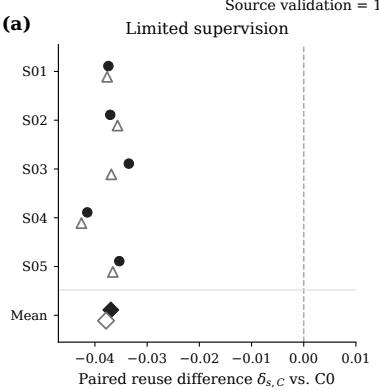

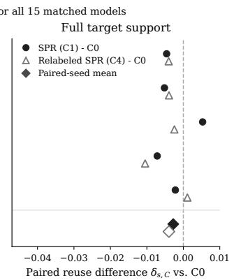

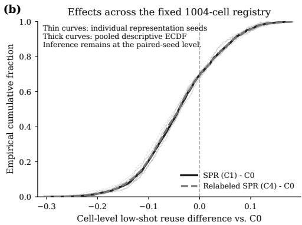  
Figure 5: Paired audit of source-matched reuse separation. All C0, C1, and C4 representations achieve identical source-task validation accuracy (1.0000 across all 15 trained models). (a) Paired reuse differences relative to the corresponding C0 representation for each independently trained source seed. Under limited target supervision, C1 and C4 show the same direction of separation from C0 across all five seeds, whereas the differences contract substantially under full target support. (b) Descriptive distributions of cell-level lowshot paired effects across the fixed 1004-cell admissible novel-rule registry. Thin curves show individual representation seeds and thick curves show pooled descriptive empirical cumulative distribution functions. Registry cells expose heterogeneity across replacement tasks but are not treated as independent statistical replicates; inference is performed at the paired representation-seed level.

C4 retains similar state recoverability:

$$
0 . 9 5 7 2 \pm 0 . 0 1 0 9
$$

versus

$$
0 . 9 6 4 6 \pm 0 . 0 0 5 2
$$

for C1. The direct C1–C4 reuse contrast is

$$
- 0 . 0 0 7 2 , \qquad 9 5 \% \mathrm { C I } = [ - 0 . 0 3 7 5 , 0 . 0 2 0 3 ] .
$$

Random auxiliary and Shuffled-state controls do not reproduce the C1 reuse level. The paired C1 advantages are

and

$$
\begin{array} { r }  + 0 . 5 8 4 5 \ \end{array}
$$

respectively, with the same direction across all five matched seeds.

Within this protocol, task-aligned candidate-state preservation is associated with higher recoverability and reuse. This association does not establish a general monotone relationship between arbitrary approxi mate state recovery and restricted reuse.

Figure 6 summarizes the condition-level relationship between held-out candidate-state recoverability and low-shot frozen reuse, and shows the paired C1–C0 gains for each independently trained source seed.

## C.3 Coordinate-Convention Intervention and Rescue

The same frozen representation is evaluated after reversible coordinate interventions.

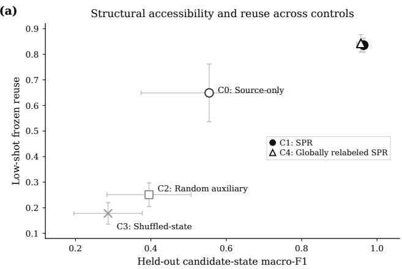

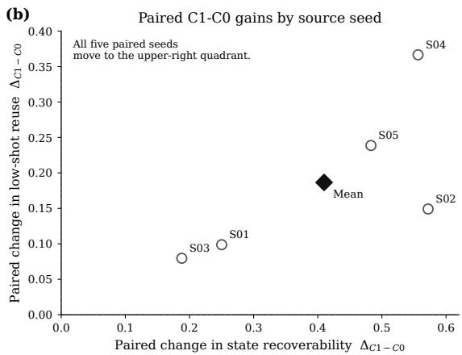  
Figure 6: Structural accessibility and low-shot reuse under matched controls. (a) Condition-level relationship between held-out candidate-state recoverability and low-shot frozen reuse across Source-only (C0), SPR (C1), Random auxiliary (C2), Shuffled-state (C3), and Globally relabeled SPR (C4). Markers show condition means and error bars show standard deviations across five independently trained source seeds. Improving candidate-state recoverability is accompanied by improved low-shot reuse; auxiliary training without task-aligned state structure (C2) or with broken observation–state correspondence (C3) does not reproduce the effect, whereas a globally shared relabeling of the preserved state space (C4) remains close to C1. (b) Paired C1–C0 gains for each source seed in held-out candidate-state recoverability and low-shot reuse. All five paired seeds lie in the upper-right quadrant; both gains are positive for every source seed.

Mean low-shot reuse is

## 0.4096

under Identity and

## 0.4099

under one globally shared transformation. Under increasingly heterogeneous sample-dependent conventions, reuse is

$$
0 . 3 4 4 9 , \quad 0 . 2 6 7 9 , \quad 0 . 1 8 3 6 , \quad 0 . 0 1 5 4
$$

for 2-way, 4-way, 8-way, and sample-wise conditions, respectively.

The ordering is reproduced for each of the three source-training seeds, and the Identity-to-sample-wise difference is

0.3942.

When convention identity is supplied and the corresponding inverse is applied, reuse returns to

0.4096

in every condition. The reconstruction audit gives

$$
\operatorname* { m a x } _ { i } \left\| { \widehat { z } } _ { i } - z _ { i } \right\| = 0 .
$$

Within this finite-supervision intervention, the degradation is associated with unavailable sample-specific coordinate conventions; convention-aware inversion exactly recovers the common-coordinate representa tion. This intervention is not a direct numerical measurement of the exact coordinate-conflict set in Theo rem 1.

Figure 7 summarizes the coordinate-consistency continuum and the corresponding gauge-aware rescue, and exposes the blind-decoder penalty separately for each independently trained source representation.

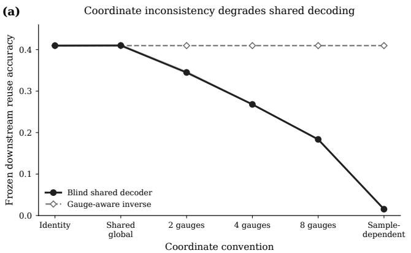

(b) Blind-decoder penalty increases within every source seed  
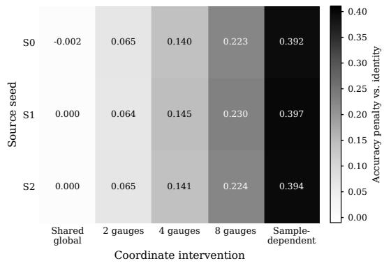  
Figure 7: Coordinate inconsistency degrades shared decoding and is exactly rescued by conventionaware inversion. (a) Frozen downstream reuse under increasingly heterogeneous reversible coordinate conventions. A single globally shared reparameterization leaves blind reuse essentially unchanged relative to the identity convention, whereas reuse decreases progressively as the number of unresolved conventions increases, reaching its minimum under sample-dependent conventions. Supplying the applicable inverse convention restores the identity-level reuse accuracy for every intervention condition; the frozen reconstruction audit reports zero residual relative to the common-coordinate representation. (b) Blind-decoder accuracy penalty relative to the identity convention for each independently trained source representation. For every source seed, the penalty increases from the shared-global control through the 2-, 4-, and 8-convention interventions to the sample-dependent condition.

## C.4 Reuse Across Held-Out Candidate-State Task Families

The primary compatible-family analysis uses the fixed 21-cell admissible registry and

$$
K \in \{ 1 , 2 , 4 , 8 , 1 6 \}
$$

for the limited-supervision regime.

For C1 relative to C0,

$$
\Delta _ { \mathrm { L S } } = + 0 . 1 7 1 5 , \qquad 9 5 \% \mathrm { C I } = [ 0 . 0 9 8 6 , 0 . 2 5 9 1 ] ,
$$

whereas

$$
\Delta _ { \mathrm { f u l l } } = + 0 . 0 2 4 1 , \qquad 9 5 \% \mathrm { C I } = [ - 0 . 0 2 6 0 , 0 . 0 9 9 2 ] .
$$

Hence

$$
\Gamma = + 0 . 1 4 7 4 , \qquad 9 5 \% \mathrm { C I } = [ 0 . 1 0 4 4 , 0 . 1 9 0 5 ] .
$$

For C4 relative to C0,

$$
\Delta _ { \mathrm { L S } } = + 0 . 1 7 7 1 , \qquad 9 5 \% \mathrm { C I } = [ 0 . 1 1 7 2 , 0 . 2 5 9 3 ] ,
$$

$$
\Delta _ { \mathrm { f u l l } } = + 0 . 0 3 0 0 , \qquad 9 5 \% \mathrm { C I } = [ - 0 . 0 2 0 1 , 0 . 0 9 9 0 ] ,
$$

and

$$
\Gamma = + 0 . 1 4 7 1 , \qquad 9 5 \% \mathrm { C I } = [ 0 . 1 1 9 3 , 0 . 1 7 4 9 ] .
$$

The direct C1–C4 limited-supervision contrast is

$$
- 0 . 0 0 5 6 , \qquad 9 5 \% \mathrm { C I } = [ - 0 . 0 2 8 4 , 0 . 0 1 7 3 ] ,
$$

Table 4: Paired held-out-family reuse effects relative to Source-only. The inferential unit is the matched representation-training seed.
<table><tr><td>Condition</td><td> $\Delta _ { \mathrm { L S } }$ </td><td> $\Delta _ { \mathrm { f u l l } }$ </td><td>Γ</td></tr><tr><td>SPR 95% CI</td><td> $+ 0 . 1 7 1 5$  [0.0986, 0.2591]</td><td> $+ 0 . 0 2 4 1$  [-0.0260, 0.0992]</td><td>+0.1474 [0.1044, 0.1905]</td></tr><tr><td>Globally relabeled SPR</td><td>+0.1771</td><td>+0.0300</td><td>+0.1471</td></tr><tr><td>95% CI</td><td>[0.1172, 0.2593]</td><td>[-0.0201, 0.0990]</td><td>[0.1193, 0.1749]</td></tr></table>

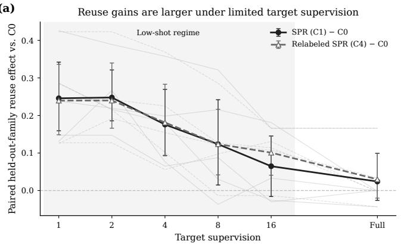

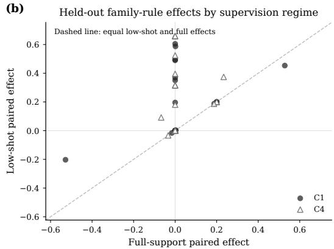  
Figure 8: Held-out-family reuse gains are concentrated under limited target supervision. (a) Paired reuse effects relative to Source-only across target-supervision levels $K \in \{ 1 , 2 , 4 , 8 , 1 6 \}$ and the full-support condition. Solid circles denote SPR (C1) and open triangles denote Globally relabeled SPR (C4); thick curves show paired means across the five representation-training seeds, error bars show bootstrap 95% confidence intervals, and faint curves show the corresponding seed-level paired effects. For both conditions, paired reuse gains are larger at each predefined limited-supervision level than under full target support. (b) Descriptive low-shot and full-support paired effects for the 21 admissible held-out family–rule evaluations. Points above the diagonal have larger low-shot than full-support effects. The cell-level distribution shows heterogeneity across replacement tasks and is descriptive; inferential comparisons remain defined at the paired representation-training-seed level.

with no consistent direction across seeds.

The positive Γ contrasts indicate larger reuse gains under limited target supervision. The full-support effects for C1 and C4 remain unresolved because both confidence intervals include zero.

Figure 8 reports the corresponding supervision profile and the variation of paired effects across the admissible held-out family–rule evaluations.

## C.5 Evidence Beyond the Primary Controlled Setting

Natural-image source-matched evidence. Across nine matched representation pairs on CIFAR-100, the mean absolute within-pair source-performance gap is

$$
0 . 0 0 3 6 ,
$$

while the low-shot SPR–Source-only reuse difference is

$$
+ 0 . 1 7 1 8 .
$$

Table 5: Condition-level mean held-out reuse in the conditional-accessibility replications. Q5–Q1 is computed from the unrounded condition means.
<table><tr><td>Encoder</td><td>Q1</td><td>Q2</td><td>Q3</td><td></td><td>Q4</td><td>Q5 Q5-Q1</td></tr><tr><td>ResNet-18</td><td>0.2670415 0.2916385</td><td></td><td>0.3000700</td><td>0.3075740</td><td>0.3212570</td><td>0.0542155</td></tr><tr><td>DenseNet-121</td><td>0.28105900.3001825</td><td></td><td></td><td></td><td>0.30807300.32164650.3260565</td><td>0.0449975</td></tr></table>

Alternative source-learning formulation. Under ordinary supervised classification, source accuracy is

0.7535

for Source-only and

0.7602

for SPR. After freezing the representations, the held-out-rule reuse difference is

+0.0768

in favor of SPR.

The source-success/reuse separation is also observed beyond the primary relational construction. This evidence does not establish universal superiority of one source objective across arbitrary future-task families.

## C.6 Prospective Natural-Image Accessibility Replications

The CIFAR-100 experiments vary the predefined conditional-accessibility source-learning intervention while enforcing source-task matching. For each architecture, a matched seed block contains five separately trained Q-specific representations. Q1–Q5 are not different amounts of side information supplied to one fixed encoder.

For both encoders, the condition-level means satisfy

$$
Q 1 < Q 2 < Q 3 < Q 4 < Q 5 .
$$

This statement concerns means across the five matched seed blocks and does not assert strict adjacent monotonicity within every individual seed block.

ResNet-18. The five seed-level intervention–reuse slopes are

$$
0 . 0 4 7 4 3 1 1 , \quad 0 . 0 5 3 3 0 7 6 , \quad 0 . 0 4 7 3 9 0 5 , \quad 0 . 0 5 2 9 6 2 6 , \quad 0 . 0 5 6 9 8 7 5 .
$$

All five are positive. Their mean is

$$
0 . 0 5 1 6 1 5 9 ,
$$

with exhaustive seed-block bootstrap 95% interval

$$
[ 0 . 0 4 8 5 2 1 2 , \ 0 . 0 5 4 7 1 0 6 ] .
$$

All

$$
2 5 / 2 5
$$

Q-specific source-training runs satisfy the pre-specified source-matching criterion.

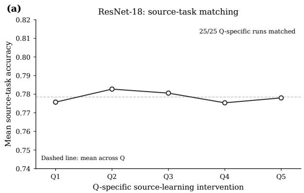

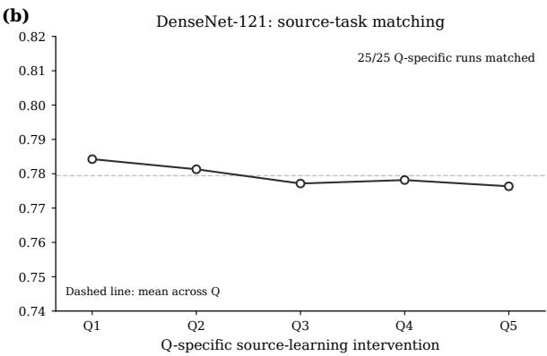  
Figure 9: Source-task matching across Q-specific natural-image replications. (a) Mean source-task accuracy across the Q1–Q5 source-learning interventions for the ResNet-18 replication. Each Q level corresponds to a separately trained representation, and all 25 architecture–seed–Q source-training runs satisfy the pre-specified source-matching criterion. The dashed horizontal line denotes the mean source-task accuracy across the five Q conditions. (b) The corresponding source-task matching audit for the DenseNet-121 replication. All 25 Q-specific DenseNet-121 runs likewise satisfy the same pre-specified matching criterion. Together with Figure 10, this audit separates the observed intervention–reuse relationship from uncontrolled failure of the source-task matching protocol; it does not require source-task accuracy to be numerically identical across Q conditions.

## DenseNet-121. The five seed-level intervention–reuse slopes are

$$
0 . 0 4 2 5 4 2 1 , \quad 0 . 0 4 5 6 5 5 3 , \quad 0 . 0 4 6 7 8 0 9 , \quad 0 . 0 4 9 0 2 4 5 , \quad 0 . 0 4 5 8 5 8 0 .
$$

Again all five are positive. Their mean is

$$
0 . 0 4 5 9 7 2 2 ,
$$

with exhaustive seed-block bootstrap 95% interval

$$
[ 0 . 0 4 4 0 1 2 5 , \ 0 . 0 4 7 7 2 8 0 ] .
$$

All

$$
2 5 / 2 5
$$

Q-specific DenseNet-121 runs satisfy the same pre-specified source-matching criterion.

The monotone condition-level ordering is therefore an ordering across predefined auxiliary sourcelearning interventions. It should not be interpreted as obtaining five reuse points by progressively revealing side information to one fixed encoder, nor as directly measuring the amount of task-relevant information retained by each learned representation.

The positive intervention–reuse relationship is reproduced across the two tested encoder architectures under the same CIFAR-100 hierarchy and future-task construction. They do not establish architectureindependent universality or a general theorem that increasing a source-side auxiliary accessibility coordinate must monotonically improve restricted reuse.

Figure 9 complements the reuse results above with a source-task matching audit across the Q1–Q5 interventions for both encoder replications.

Figure 10 visualizes the condition-level Q1–Q5 trajectories and the corresponding seed-level intervention– reuse slopes for the two architecture replications.

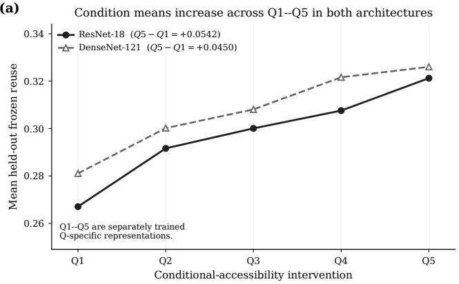

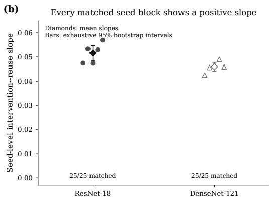  
Figure 10: Conditional-accessibility intervention–reuse relationship across two encoder architectures. (a) Held-out frozen reuse across the predefined Q1–Q5 source-learning interventions for ResNet-18 and DenseNet-121. Solid circles denote ResNet-18 and dashed open triangles denote DenseNet-121. For each architecture, the legend reports the corresponding endpoint contrast $Q 5 - Q 1$ . Condition means increase from Q1 to Q5 for both architectures. Q1–Q5 denote separately trained intervention-specific representations and should not be interpreted as progressively revealing additional side information to one fixed encoder. (b) Seed-level intervention–reuse slopes for the two architecture replications. Individual markers denote matched seed blocks, diamonds denote mean slopes, and vertical bars denote exhaustive seed-block bootstrap 95% intervals. All seed-level slopes are positive for both architectures. All 25 Q-specific sourcetraining runs for each architecture satisfy the pre-specified source-matching criterion.

## D Implementation and Reproducibility Details

This section records implementation properties required to interpret and reproduce the claim-supporting experiments. Protocol definitions and statistical estimands are given in Appendix B; numerical results are given in Appendix C.

## D.1 Datasets and Split Discipline

The primary controlled experiments use Shapes3D. Natural-image extensions and the conditional-accessibility replications use CIFAR-100.

Source learning and reuse evaluation are separated at both the model and protocol levels. The source model is trained before target adaptation begins. The source head is subsequently removed and the encoder is frozen. Target labels used to fit replacement rules never update the encoder.

In the held-out-composition benchmark, each evaluation fold withholds one of the six composition families from source training. The six held-out families are

$$
M M , \quad M D , \quad M U , \quad D D , \quad D U , \quad U U .
$$

The natural-image confirmatory experiments use fixed source, adaptation, and evaluation partitions. The conditional-accessibility replications use the same split construction and future-task protocol across Q levels and across the two encoder architectures. The official TEST partition is not used by these confirmatory evaluations.

Target-adaptation draws, task cells, and Q conditions are never counted as additional independently trained representation replicates.

## D.2 Encoder and Source-Head Architectures

Within each controlled comparison, the encoder architecture is fixed across the source-learning conditions being compared. Source-task and auxiliary heads are training components only and are removed before reuse evaluation.

The ResNet replication uses a CIFAR-adapted ResNet-18 encoder (He et al., 2016) followed by a 128- dimensional representation projection.

The cross-architecture replication uses DenseNet-121 (Huang et al., 2017) initialized without pretrained weights. For CIFAR-sized inputs, its initial convolution is replaced by a

$$
3 \to 6 4
$$

convolution with kernel size 3, stride 1, padding 1, and no bias, and the initial pooling operation is removed.   
The original classifier is removed and the backbone output is projected to 128 dimensions.

The two architecture replications use the same conditional-accessibility construction, future-task protocol, representation dimension, and downstream evaluation logic. Q1–Q5 are not redefined for the second architecture.

## D.3 Source-Training Objectives and Matching

For the primary relational experiments, all compared representation conditions optimize the same relational source objective. C1 additionally optimizes the empirical structural loss,

$$
\begin{array} { r } { \mathcal { L } _ { \mathrm { S P R } } = \widehat { \mathcal { L } } _ { \mathrm { s r c } } + \lambda _ { \mathrm { r e u s e } } \widehat { \mathcal { R } } _ { \mathrm { s t r } } . } \end{array}
$$

C4 uses the same structural objective after one fixed global bijection of candidate-state labels. C2 and C3 retain the auxiliary-training scaffold while replacing the task-aligned structural target by random or shuffled targets.

In the exact Shapes3D comparison, all C0, C1, and C4 models attain source validation accuracy

$$
1 . 0 0 0 0 .
$$

Conditional-accessibility source learning. The Q1–Q5 experiment trains a separate representation for each architecture–seed–Q combination. For level q, the auxiliary target is

$$
A _ { q } = m _ { q } ( C , { \cal F } ) .
$$

The auxiliary-loss coefficient is fixed at

$$
\lambda _ { \mathrm { a u x } } = 1 . 0 .
$$

The auxiliary target is used only during source representation learning. It is neither concatenated to the representation nor supplied to the downstream task.

For a matched seed block, all five Q runs share the same source-task, optimization, split, and evaluation protocol and differ only in the predefined Q-specific auxiliary target.

For ResNet-18, the five matched seed identifiers are

$$
1 0 1 , \quad 2 0 2 , \quad 3 0 3 , \quad 4 0 4 , \quad 5 0 5 ,
$$

and all 25 architecture–seed–Q runs satisfy the source-matching interval

$$
[ 0 . 7 7 , \ 0 . 7 9 ] .
$$

For DenseNet-121, the five matched seed identifiers are

$$
1 1 0 1 , \quad 1 2 0 2 , \quad 1 3 0 3 , \quad 1 4 0 4 , \quad 1 5 0 5 ,
$$

and all 25 runs satisfy the same source-matching criterion.

## D.4 Downstream Reuse Readout

Every reported reuse evaluation operates on frozen encoder outputs. The source head and training-time structural head are unavailable to the downstream evaluator.

For limited-supervision experiments, the downstream rule is fitted only from the registered targetadaptation observations for the corresponding budget. The candidate-state task-family experiment evaluates

$$
K \in \{ 1 , 2 , 4 , 8 , 1 6 \}
$$

examples per state and a full-support condition.

Adaptation indices are paired across representation conditions whenever a paired model contrast is reported. Thus C1–C0, C4–C0, and related paired effects use common evaluation tasks and matched adaptation realizations.

Readout class, optimization, and regularization are fixed within each evaluation protocol and are not tuned independently for each representation condition. Protocols using distinct evaluators are analyzed separately; their absolute accuracies are not interpreted as measurements on one common scale.

## D.5 State-Recoverability Diagnostic

The recoverability experiment fits a diagnostic state readout to the frozen representation and reports macro-F1 after one global three-state label alignment. The alignment searches over the six permutations of {M, D, U} and selects a single global relabeling for the diagnostic metric.

This is permutation-invariant metric alignment. It does not modify the encoder and is not supplied as side information to the downstream reuse evaluator.

The same diagnostic is used for C0, C1, C4, Random auxiliary, and Shuffled-state.

## D.6 Coordinate-Transformation Implementation

All coordinate interventions are applied after representation learning to the same frozen representation.

The transformation bank consists of reversible coordinate maps. Identity applies no transformation; Global applies one transformation shared by all samples; 2-way, 4-way, and 8-way use increasingly heterogeneous sample-dependent convention sets; and the sample-wise condition varies the convention at the sample level. Convention identity is withheld from the blind downstream decoder.

For the rescue evaluation, convention identity is supplied and its exact inverse is applied before downstream evaluation. The reconstruction audit records

$$
\operatorname* { m a x } _ { i } \left\| { \widehat { z } } _ { i } - z _ { i } \right\| = 0 ,
$$

and reuse returns to

$$
0 . 4 0 9 6
$$

in every rescued condition.

The rescue removes the imposed coordinate intervention; it does not retrain the representation or provide additional task information.

## D.7 Task Registry and Admissibility Implementation

All primary registry decisions are representation independent.

For the Shapes3D novel-rule analysis, the executable registry reproduces the partition

$$
2 0 3 2 = 1 0 0 8 + 1 0 0 8 + 1 6
$$

into oracle-solvable, oracle-unsolvable, and single-class candidate cells, and the final novelty/admissibility criteria retain 1004 cells.

For the held-out candidate-state analysis, the executable oracle audit applies the semantic interface in Eq. (39), the ridge objective in Eq. (40), the zero-threshold binary rule in Eq. (41), and the leave-onecomposition-out procedure defined in Appendix B.5. It reproduces the 21 included and three excluded cells in Table 2.

The resulting registries are fixed before learned-representation comparisons and reused unchanged across source-learning conditions, seeds, and supervision levels.

## D.8 Statistical Aggregation and Confidence Intervals

The primary inferential unit for representation comparisons is the independently trained representation seed.

For the held-out candidate-state family, repeated target-adaptation measurements are first aggregated within each seed–condition–supervision cell. The fixed admissible task registry is then aggregated to form $A _ { s , C } ( K )$ . Limited-supervision effects, full-support effects, and Γ are computed from the seed-level paired estimands defined in Appendix B.9.

Confidence intervals for paired representation comparisons resample complete representation-seed blocks so that repeated task and adaptation measurements from the same trained representation remain grouped.

For the conditional-accessibility experiment, one matched seed block contains five separately trained Q-specific models. The Q1–Q5 trajectory remains intact during resampling. The seed-level trend coefficient is Eq. (44), and the architecture-level trend is the arithmetic mean of the five seed-level coefficients.

Exact bootstrap inference enumerates the

$$
5 ^ { 5 } = 3 1 2 5
$$

ordered resamples of the five matched seed blocks. The reported 95% interval is the equal-tailed percentile interval of the resulting distribution of the mean trend coefficient. Here “exact” means that the complete finite bootstrap resampling space is enumerated; it does not denote an exact finite-sample coverage guarantee.

Condition-level monotonicity and positivity of the five seed-level slopes are reported separately because they are logically distinct empirical properties.