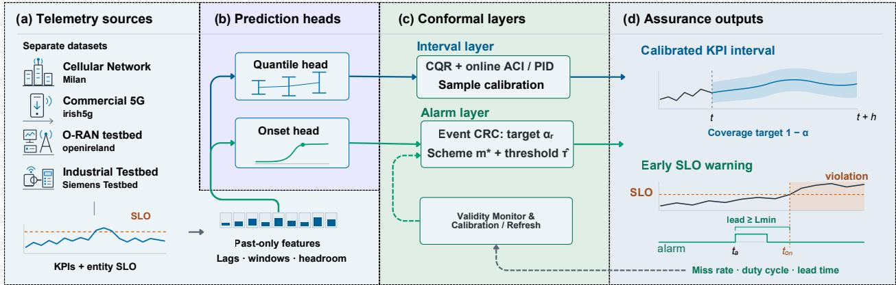
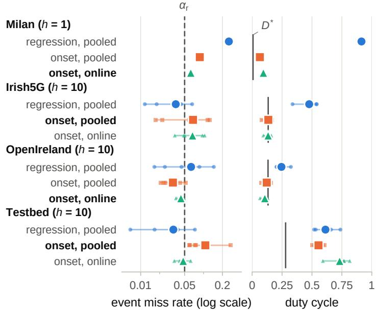
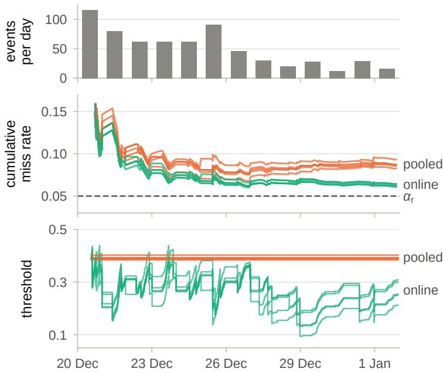
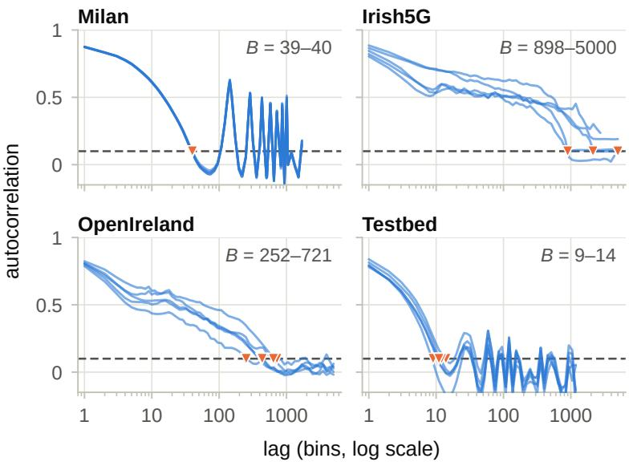

# CALM-5G: EVENT-LEVEL CONFORMAL RISK CONTROL FOR PREDICTIVE SERVICE-ASSURANCE ALARMS

Ömer Faruk ˙I¸scanlı Siemens A. ¸S., Istanbul, Türkiye faruk.iscanli@siemens.com ORCID: 0009-0009-6006-7120

Yagmur Sabucu Sandal ˘ Siemens A. ¸S., Istanbul, Türkiye yagmur.sabucu@siemens.com ORCID: 0000-0002-6356-452X

## ABSTRACT

Predictive service assurance converts forecasts of key performance indicators into alarms, and that conversion decides whether the assurance function is deployable. We present CALM-5G, an assurance layer that operates above any forecasting backbone and issues alarms with distribution-free, finitesample guarantees. It calibrates on service-level violation events, scores violation onset directly, selects its calibration scheme out of sample, and reports the alarm duty cycle with every certified miss rate. Four corpora are evaluated separately, namely a production cellular network, commercial 5G traces, an open radio access network testbed and our 5G standalone testbed. Risk control on the regression-derived score yields duty cycles of 0.24 to 0.91. Onset targeting with cross-validated calibration reduces time-in-alarm by 56.3% to 89.7% on three corpora, with no significant change on the fourth. The realised miss rate stays within a two-standard-error tolerance on three corpora and within one standard error of it on the fourth. Under label shift, pooled batch calibration exceeds that tolerance structurally, by 10.9 standard errors on the production corpus. Online calibration restores compliance. Calibration schemes cannot be ranked on the split that fits their thresholds. Miss rate and duty cycle are certified jointly where within-entity dependence leaves sufficient calibration units.

Keywords 5G, alarm management, concept drift, conformal prediction, conformal risk control, network management, service assurance, service-level objectives.

## 1 Introduction

Mobile network management is shifting from repairing faults after they are reported towards acting before a degradation reaches the subscriber. The control loops being deployed read performance measurements on a fixed cadence and issue actions within it [1], and service assurance couples that monitoring with analytics [2]. Forecasts of key performance indicators (KPIs) have become a standard input to these loops [3]. A forecast, however, is not yet a decision. Before it can drive an action it must be reduced to an alarm, and that reduction determines whether the assurance function is usable. An alarm raised too late prevents nothing, and an alarm raised too often is disabled by the operations team. Neither failure is visible in the accuracy of the predictor.

This paper treats that reduction as the object to be calibrated. It presents CALM, an assurance layer that operates above an arbitrary forecasting backbone and converts its output into alarms with distribution-free guarantees (Fig. 1). CALM-5G denotes the instantiation for 5G management evaluated here.

## 1.1 Related Work

The predictive component is mature. Learned models predict throughput from radio and context measurements [4], estimate latency reliability from operator counters [5] and forecast KPIs for anticipatory resource allocation [3]. A parallel line closes the loop at the radio access network (RAN) intelligent controller and enforces service-level agreements [6]. Both lines judge the learned component by a population-averaged error or reward. Such summaries describe behaviour over a test set and carry no commitment once the deployment distribution moves. Where an end-to-end bound is established, it is supplied by an analytical traffic model and not by the learned predictor [7]. That non-stationarity is itself well documented. Concept drift is a mature subject [8], model decay after deployment has been characterised for networks [9], and recent drift detectors are evaluated on public corpora that are also used here [10, 11]. This literature establishes when to retrain. It does not quantify how reliable the decisions of a model remain while the shift is in progress.

  
Figure 1: CALM architecture. Four telemetry sources are evaluated separately. A quantile forecaster and a classifier of violation onset are fitted on features that use only past bins. The interval layer wraps the quantile head with conformalised quantile regression and online adaptation. The alarm layer thresholds a score with event-level conformal risk control at the nominal miss rate $\alpha _ { \mathrm { r } }$ under a calibration scheme $m ^ { \star }$ selected on held-out folds, and a validity monitor requests recalibration or retraining. The outputs are a calibrated KPI interval and an early warning that precedes the event onset by at least $L _ { \mathrm { m i n } }$

Predictive uncertainty offers a route to per-decision trust, but not by itself a guarantee. Ensemble estimates lose calibration under dataset shift [12, 13]. A comparison of four families of interval estimators reported large, datasetdependent deviations from nominal coverage and identified conformal prediction as the general repair [14]. Conformal methods have accordingly been adopted in wireless systems for demodulation, modulation classification and channel prediction [15] and for the scheduling of ultra-reliable traffic [16]. Closer to network management, they provide counterfactual KPI estimates at the RAN intelligent controller [17] and context-dependent calibration by meta-learning [18]. Online conformal risk control further provides long-run guarantees on the false-negative rate of remote and edge inference [19, 20]. In all of these works the calibrated quantity is defined per sample or per decision. None takes the service-level violation event with a lead requirement as its unit, reports the alarm duty that a miss-rate guarantee implies, or addresses how the calibration scheme should be selected for a given deployment.

Three requirements therefore remain unmet where a forecast becomes an alarm. First, the guarantee should be stated on the object the operator is accountable for, namely the violation event together with the lead time an action requires. Bins within an entity are strongly autocorrelated and inflate any effective sample size computed from them. Second, controlling the miss rate is not a specification. Risk control leaves the alarm rate free, and the admissible threshold set always contains the always-alarm policy. The alarm budget must therefore be reported alongside the miss rate and, where the data permit, certified with it. Third, the calibration scheme cannot be assumed. Entities differ in level by orders of magnitude, so the appropriate scheme is a property of the deployment. It cannot, however, be chosen on the split used to fit its threshold, because every candidate complies there by construction.

## 1.2 Contributions

CALM addresses these requirements. It separates an interval layer, which reports predictive uncertainty on the continuous service metric, from an alarm layer, which makes the assurance decision. Our contributions are as follows.

C1) A drift characterisation that precedes any claim of adaptivity. Two months of a production cellular network contain two change points, with a label shift that reduces the violation rate by almost an order of magnitude from training to test. The baseline violation rate of our own 5G standalone testbed varies by a factor of nine across identically scripted runs.

C2) CALM itself, which combines conformalised quantile regression, online conformal updating, event-level conformal risk control and abstention. We show that pooled batch calibration exceeds its nominal miss rate structurally under label shift, and that online calibration restores compliance.

C3) A mapping of the framework onto the AI/ML lifecycle management procedures of $^ { 5 \mathrm { G } }$ management systems, together with an offline actionability analysis that quantifies the lead time and alarm budget an actuator would face.

C4) A four-corpus evaluation under a no-pooling contract. It includes a testbed corpus with simultaneous application- and RAN-layer observability, a layer ablation with a time-resolution control, and a compute footprint measured with the onset classifier in the inference path.

C5) An alarm-rate result. Risk control applied to a regression-derived score yields duty cycles of 0.24 to 0.91, and on two corpora its miss rate is indistinguishable from that of a random alarm with the same duty. Onset targeting with cross-validated calibration reduces time-in-alarm by 56.3% to 89.7% on three of the four corpora, with intervals excluding zero, and the reduction is not significant on the fourth. The realised miss rate stays within a two-standard-error tolerance on three corpora and within one standard error of it on the fourth.

C6) A selection and certification result of wider applicability. Conformal calibration schemes cannot be ranked on the split used to fit their thresholds, because the in-sample criterion admits every candidate by construction. Both in-sample procedures examined here selected a scheme that failed out of sample, and held-out scoring with deployment-matched folds resolves the failure. Miss rate and alarm budget are further certified jointly in 12 of 20 corpus–seed combinations under block dependence.

Section 2 specifies the framework, Section 3 the evaluation setup and Section 4 the results, and Section 5 concludes.

## 2 Framework

This section specifies the system model, the two conformal layers, the calibration procedure that makes them valid under the entity structure of operational network data, and the end-to-end procedure that Algorithm 1 summarises.

## 2.1 Entities, Service-Level Events and Splits

A managed network is partitioned into entities $i \in \mathcal { E }$ , the unit at which the assurance decision is taken, such as a cell, a flow or a measurement session. Time is divided into bins of duration $\Delta .$ . For entity i and bin t we observe a service metric $y _ { i , t }$ and a feature vector $x _ { i , t }$ built only from bins up to t − 1. The service-level objective (SLO) is a threshold rule, and bin (i, t) is violating when

$$
v _ { i , t } = \mathbf { 1 } [ \rho _ { i } ( y _ { i , t } ) > \theta _ { i } ] ,\tag{1}
$$

where $\rho _ { i }$ orients the metric so that an upper excursion is the violation and $\theta _ { i }$ is the threshold of entity i. For a throughput floor, $\rho _ { i } ( y ) = - y$ . A violation event is a maximal run of violating bins of one entity, with onset $t _ { k } ^ { \mathrm { o n } }$ and duration $d _ { k }$ bins. Events, not bins, are the unit of assurance. An operator is concerned with the degradations that arrived unwarned, not with the bins inside a degradation that was already flagged.

Data are split into training, calibration and test parts according to the intended deployment. Where entities persist, the split is chronological within each entity. Where the model is to serve unseen entities, the split is grouped so that no entity appears in two parts. This choice propagates to every calibration decision below, so entity identity is treated as a first-class object and not as one more categorical feature.

## 2.2 Features and Prediction Heads

Features comprise lags of the service metric and of the auxiliary counters, rolling means and standard deviations over windows that end at $t - 1$ , and time-of-day and day-of-week encodings. The onset head adds rolling quantiles and their slopes, the interquartile range, and the headroom $\theta _ { i } - \rho _ { i } ( y _ { i , t - 1 } )$ with its slope. Lags and windows are specified in bins so that the same specification transfers across the corpora of Table 1. Lags reach back 144 bins (one day) on Milan, 60 on Irish5G and 30 on OpenIreland and the Testbed.

Two heads are fitted on the training part with gradient-boosted trees (300 trees, learning rate 0.05, 31 leaves, deterministic single-thread fitting, no tuning). The framework is agnostic to this choice, and the guarantees below hold for any measurable score. For a miscoverage level $\alpha ,$ the quantile head estimates the $\alpha / 2$ and $1 - \alpha / 2$ quantiles, $\hat { q } _ { \mathrm { l o } } ( x _ { i , t } )$ and $\hat { q } _ { \mathrm { h i } } ( x _ { i , t } )$ , of $y _ { i , t + h }$ under the pinball loss for a horizon of h bins. The onset head is a classifier of

$$
z _ { i , t } ^ { ( h ) } = \mathbf { 1 } [ \exists k : t < t _ { k } ^ { \mathrm { o n } } \leq t + h ] ,\tag{2}
$$

the indicator that a new violation begins within the horizon. It is trained on bins that are not themselves violating, because a system already in violation cannot be warned of that violation, and whose horizon lies inside the record. The positive class is reweighted by the class ratio, and the output $r _ { i , t } \in [ 0 , 1 ]$ is used as a score. Where the SLO rule

smooths the metric over W bins we require $h \geq W$ , so that no part of the regression target $y _ { i , t + h }$ is observable when the prediction is made

## 2.3 Interval Layer

The interval layer wraps the quantile head with conformalised quantile regression (CQR) [21]. With calibration scores $E _ { j } = \operatorname* { m a x } \{ \hat { q } _ { \mathrm { l o } } ( x _ { j } ) - y _ { j } , \ y _ { j } - \hat { q } _ { \mathrm { h i } } ( x _ { j } ) \}$ and $\hat { E }$ their $\lceil ( n + 1 ) ( 1 - \alpha ) \rceil$ ⌉-th smallest value, the interva

$$
\mathcal { C } ( \boldsymbol { x } ) = \left[ \hat { q } _ { \mathrm { l o } } ( \boldsymbol { x } ) - \hat { E } , ~ \hat { q } _ { \mathrm { h i } } ( \boldsymbol { x } ) + \hat { E } \right]\tag{3}
$$

covers a new sample with probability at least $1 - \alpha$ when calibration and test samples are exchangeable. Operational telemetry is not stationary, so the framework also streams two online variants per entity. Adaptive conformal inference (ACI) [22] updates the working level as

$$
\alpha _ { t + 1 } = \alpha _ { t } + \gamma ( \alpha - \operatorname { e r r } _ { t } ) , \qquad \operatorname { e r r } _ { t } = { \bf 1 } [ y _ { t } \notin \mathcal { C } _ { t } ] ,\tag{4}
$$

where $\mathcal { C } _ { t }$ is (3) with $\hat { E }$ replaced by the $\left( 1 - \alpha _ { t } \right)$ quantile of the last 1000 scores, $\gamma = 0 . 0 2$ , and $\alpha _ { t }$ is clipped to [0.001, 0.999]. Without clipping, ACI carries a distribution-free bound on the long-run miscoverage frequency, so for the clipped variant we rely on its measured coverage. A conformal proportional-integral-derivative (PID) controller [23] augments the proportional term of (4) with an integrator over the realised coverage error, which is better matched to telemetry with trends and seasonality. Table 2 compares all constructions.

## 2.4 Alarm Layer

An alarm is raised when a score $s _ { i , t }$ reaches a threshold, $a _ { i , t } ( \tau ) = \mathbf { 1 } [ s _ { i , t } \geq \tau ]$ . In the reference configuration the score is the onset score $s _ { i , t } = r _ { i , t }$ . The layer is score-agnostic. As a comparator we retain the regression score, which is the upper end of the CQR interval after orientation by $\rho _ { i }$ and corresponds to the conventional forecast-then-threshold construction.

Event k of entity i is detected when an alarm is raised in the h bins before its onset and at least $L _ { \mathrm { m i n } }$ bins ahead of it, with $L _ { \mathrm { m i n } } = 1$ bin throughout. With the event score

$$
S _ { k } = \operatorname* { m a x } _ { t _ { k } ^ { \mathrm { o n } } - h \leq t \leq t _ { k } ^ { \mathrm { o n } } - L _ { \operatorname* { m i n } } } s _ { i , t } ,\tag{5}
$$

the miss loss is $\ell _ { k } ( \tau ) = { \bf 1 } [ S _ { k } < \tau ]$ , which is non-decreasing in $\tau .$ For a nominal event false-negative rate (FNR), or miss rate, $\alpha _ { \mathrm { r } }$ , conformal risk control (CRC) [24] on the n calibration events selects

$$
\hat { \tau } = \operatorname* { m a x } \Bigl \{ \tau \in \{ S _ { k } \} _ { k = 1 } ^ { n } : \frac { | \{ k : S _ { k } < \tau \} | + 1 } { n + 1 } \leq \alpha _ { \mathrm { r } } \Bigr \} ,\tag{6}
$$

the largest threshold that satisfies the corrected constraint, and therefore the one with the lowest alarm rate. If the calibration events and a test event are exchangeable, then

$$
\mathbb { E } \left[ \ell _ { n + 1 } ( \hat { \tau } ) \right] \leq \alpha _ { \mathrm { r } } ,\tag{7}
$$

where the expectation is taken jointly over the calibration events and the test event.

Two properties of (7) delimit its scope and motivate the remainder of this section. First, the guarantee is on an expectation and not on the miss rate realised in a single test window. Compliance on a test split with $n _ { \mathrm { t e } }$ events is therefore judged against the evaluation tolerance

$$
\alpha _ { \mathrm { r } } ^ { + } = \alpha _ { \mathrm { r } } + 2 \sqrt { \alpha _ { \mathrm { r } } ( 1 - \alpha _ { \mathrm { r } } ) / n _ { \mathrm { t e } } } ,\tag{8}
$$

which adds two event-level binomial standard errors to the nominal level. Deviations are given in standard errors.

Second, the guarantee constrains the miss rate alone, since nothing in (6) limits how often the alarm is raised. We therefore report the duty cycle, or time-in-alarm,

$$
D ( \tau ) = \frac { 1 } { | \mathscr { D } | } \sum _ { ( i , t ) \in \mathscr { D } } a _ { i , t } ( \tau )\tag{9}
$$

over all bins of the evaluated split alongside every miss rate, and read it against two references (Fig. 2). The first is the occupancy

$$
D ^ { \star } = \frac { 1 } { \vert { D } \vert } \sum _ { k } \left( h + d _ { k } \right)\tag{10}
$$

of an oracle that raises the alarm h bins before each onset and holds it until the event ends, counted per event. $D ^ { \star }$ is set by the event rate and the horizon, and duty cycles are reported as multiples of it. The second reference is a duty-matched chance level, defined as the miss rate of the same alarm sequence after an independent circular shift inside every entity, averaged over 200 draws. The shift preserves the duty and the autocorrelation of the alarm and removes its alignment with the events. It therefore separates alarm timing from alarm occupancy.

An abstention option exists for decisions close to the boundary. When the margin $| s _ { i , t } - \hat { \tau } |$ falls below a budgeted quantile of the calibration margins, the decision is deferred to the operator. Abstained bins and the retained fraction are reported separately.

## 2.5 Calibration Schemes and Their Selection

A single τˆ is valid marginally over entities but can be poor conditionally when entity levels span orders of magnitude. It saturates on high-level entities, which then alarm almost continuously, while the events of low-level entities are systematically missed. Whether a conditional scheme is warranted is an empirical question about a deployment. CALM therefore supports five schemes among which the deployment selects, all of which reduce to a threshold rule on fixed heads.

M0 Pooled batch. One τˆ from (6) over all calibration events.

M1 Online. Starting from the pooled threshold, the threshold is updated after each event that has ended as

$$
\tau _ { k + 1 } = \tau _ { k } - \eta ( e _ { k } - \alpha _ { \mathrm { r } } ) , \qquad e _ { k } = { \bf 1 } [ S _ { k } < \tau _ { k } ] ,\tag{11}
$$

with η equal to 0.3 standard deviations of the calibration event scores. Events of all entities are processed in the order in which they end.

M2 Covariate-conditional. Bins are grouped by quantiles of a covariate that is known at prediction time and defined for unseen entities, namely the trailing level of the service metric. Equation (6) is then applied per group, as in group-conditional conformal prediction [25]. The number of groups is the largest of 3, 5 and 10 that leaves at least 30 calibration events in each.

M3 Online conditional. M1 inside the groups of M2.

M4 Entity-standardised. Scores are centred and scaled per entity before a pooled threshold is applied.

Summing (11) over T events gives the identity

$$
{ \frac { 1 } { T } } \sum _ { k = 1 } ^ { T } e _ { k } - \alpha _ { \mathrm { { r } } } = { \frac { \tau _ { 1 } - \tau _ { T + 1 } } { \eta T } } ,\tag{12}
$$

which holds for any sequence of events. The online miss rate therefore converges to $\alpha _ { \mathrm { r } }$ at rate $1 / T$ as long as the threshold remains bounded, without any distributional assumption (Fig. 3). This is the event-level counterpart of the long-run guarantees established for per-decision losses in [19, 20].

The scheme is itself a modelling decision and must be chosen without the test part. It cannot be chosen by scoring the schemes on the calibration part, because (6) fits the threshold there and every scheme then attains a miss rate of approximately $\alpha _ { \mathrm { r } }$ by construction. CALM therefore selects by cross-validation inside the calibration part, with folds that mirror the deployment split. Folds are grouped by entity where the target is unseen entities. Where entities persist, folds are contiguous forward-in-time blocks, each scored by thresholds fitted on earlier blocks only.

With $\hat { D } _ { m }$ the mean held-out duty of scheme m over repetitions, the rule is

$$
m ^ { \star } = \arg \operatorname* { m i n } _ { m \in \mathcal { A } } \bar { D } _ { m } ,\tag{13}
$$

where the admissible set A contains the schemes that satisfy three conditions. The held-out miss rate must lie within the tolerance (8) on at least four of five repetitions, and the largest held-out duty must not exceed twice the median. In addition, no held-out fold may show a duty below 0.01 together with a miss rate above 0.5, which rejects schemes that leave individual entities silent. A fold must hold at least 30 events and two entities, and corpora whose calibration part cannot supply them fall back to a single-repetition selection.

## 2.6 Joint Miss-Rate and Alarm-Budget Certification

Where an explicit alarm budget is required, the threshold rule is replaced by a hysteretic state machine with configuration $\lambda = \left( u , w , c , \varrho , \tau _ { \mathrm { o n } } , \tau _ { \mathrm { o f f } } \right)$ . The alarm starts when u of the last w bins satisfy $s _ { i , t } \geq \tau _ { \mathrm { o n } } .$ , ends after c consecutive bins below $\tau _ { \mathrm { o f f } }$ , and no new notification is issued for $\varrho$ bins after it ends. A notification is emitted only when an alarm starts, so the notification count and the time-in-alarm are distinct quantities. A grid Λ of 648 configurations is searched, and Learn-then-Test (LTT) [26] supplies the multiplicity control. For a risk level $\alpha _ { \mathrm { J } }$ , an alarm budget β and each λ, it tests the nulls

$$
{ \cal H } _ { 1 } ( \lambda ) : ~ R ( \lambda ) > \alpha _ { \mathrm { J } } , \qquad { \cal H } _ { 2 } ( \lambda ) : ~ D ( \lambda ) > \beta\tag{14}
$$

on the miss rate R and the duty D. The Hoeffding–Bentkus p-values are combined as max $\{ p _ { 1 } , p _ { 2 } \}$ and rejected under a Bonferroni correction over the grid at $\delta = 0 . 1$ . For independent calibration units and a fixed pair $( \alpha _ { \mathrm { J } } , \beta )$ , every surviving configuration then satisfies both constraints with probability at least $1 - \delta$ . Among the survivors whose median calibration lead is at least $L _ { \mathrm { { J } } } ,$ CALM adopts the configuration with the smallest calibration duty. Minimising the notification count instead would favour an alarm that never ends.

The budget is not fixed in advance. Two budgets are admissible, the tighter $2 D _ { \mathrm { c a l } } ^ { \star }$ and the looser calibration duty of the regression baseline, and each is paired in turn with the risk levels 0.05, 0.10 and 0.20. The procedure evaluates these pairs in order on calibration data and stops at the first that admits a survivor, so a corpus certifies at the tightest budget and risk level that its event process allows. The risk levels are nested and the p-values are non-increasing in the level, so for a given budget the guarantee holds simultaneously over the three levels. The level is reported with every certificate

Alarm indicators are strongly autocorrelated (Fig. 4). The duty p-value is therefore computed on the means of contiguous within-entity blocks of $\check { B }$ bins. The block length B is the first lag at which the calibration autocorrelation of the alarm indicator falls below 0.1, and the number of blocks is taken as the effective sample size. The miss-rate p-value treats calibration events as units. Results with one unit per bin and one per entity bracket this choice, and a set that is non-empty only under the per-bin model carries no duty certificate.

## 2.7 Lifecycle Monitoring and Procedure

Validity is monitored during operation from quantities that the framework already produces. A monitor combines the rolling coverage gap of the interval layer with a change-detection statistic on the stream of conformity scores and moves between STABLE, DEGRADED and RECOVERING states. These states request, in order of cost, recalibration, retraining and rollback. Recalibration is attempted first because it is less costly and suffices when drift is confined to the score distribution. The states and transitions correspond to the AI/ML lifecycle management procedures standardised for 5G management systems. Model training, testing and deployment map onto 3GPP TS 28.105, the retraining and rollback transitions onto the closed control loop management of TS 28.567, and the measurement path onto the analytics accuracy information of TS 23.288. In Algorithm 1, every step before the online loop reads the training and calibration parts only.

## 2.8 Assumptions and Scope

The guarantees rest on stated conditions. The coverage of (3) and the risk bound (7) hold under exchangeability of calibration and test units, and (7) is an expectation over the calibration draw. The online update (11) satisfies (12) for every event sequence without a distributional condition, provided that each event outcome is observed. The joint certificate assumes independent blocks and events. These guarantees hold for each scheme as a fixed procedure. Scheme selection is empirical, and its outcome is validated on the untouched test part. Operational telemetry departs from exchangeability, and it is precisely for that reason that the online variants and the event-level calibration unit are constitutive of the design and not refinements of it. The framework observes and advises. The alarm stream that it produces is the input to whatever control action a deployment exposes, and the outcome of a particular actuation policy is outside its scope.

## 3 Evaluation Setup

## 3.1 Corpora and Service-Level Rules

Table 1 lists the four corpora, which are never pooled. Each has its own loader, SLO rule, bin size, feature windows and split, and no model or threshold is shared.

Milan is the Telecom Italia call-detail-record dataset [27,28], which reports the internet activity per grid cell in 10-minute bins from 1 November 2013 to 1 January 2014. We use 200 cells, the 150 busiest on the first day and 50 drawn at random from the rest. A bin is violating when the activity exceeds the 95th percentile of the cell over the training period. The split is chronological, so the test period, 20 December to 1 January, coincides with the Christmas holiday. This corpus contributes scale and a longitudinal shift from a production network, while the other three supply radio realism.

Algorithm 1 CALM construction, scheme selection, optional budget certification and online operation   
Input: telemetry $\{ ( x _ { i , t } , y _ { i , t } ) \}$ , thresholds {θ }, levels α, α , horizon h   
1: Label violations by (1) and onset targets by (2), then split by deployment   
2: Fit the quantile head and the onset head on the training part   
3: Eˆ ← CQR quantile on the calibration part, and start (4) per entity   
4: for each scheme m $\in \{ \mathrm { M } 0 , \dots , \mathrm { M } 4 \}$ and each fold F do   
5: Fit the thresholds of m by (6) on the fitting folds   
6: Record miss rate and duty (9) of m on F   
7: end for   
8: $m ^ { \star } \gets ( 1 3 ) ,$ , refitted on the whole calibration part   
9: if an alarm budget $\beta$ is required then   
10: B ← first lag with calibration autocorrelation below 0.1   
11: Test (14) for all $\lambda \in \Lambda$ on events and blocks   
12: Adopt the survivor with lead $\geq L _ { \mathrm { J } }$ and the smallest calibration duty   
13: end if   
14: for each arriving bin (i, t) do   
15: Emit $\mathcal { C } _ { t } ( x _ { i , t } )$ and update $\alpha _ { t }$ by (4) when the label arrives   
16: Raise the alarm if $s _ { i , t } \geq \tau ,$ or by the state machine $\lambda ^ { \star }$   
17: When an event ends, update τ by (11) if m⋆ is online   
18: Update the monitor and recalibrate, retrain or roll back on demand   
19: end for

Irish5G contains 64 traces of a commercial 5G network sampled at 1 s [29]. OpenIreland comprises 20 runs of an O-RAN testbed at 100 ms with benign and attack traffic [30], where the attack rows are held out as a stress partition. For both corpora the SLO is a sustained throughput floor. A bin is violating when the 10-bin mean downlink throughput falls below a floor of 3 and 11.2 kbit/s, which yields violation rates of 4.8% and 5.9%. Both corpora are split by trace or run.

## 3.2 Testbed

The fourth corpus was recorded on our own 5G standalone testbed. It consists of an OpenAirInterface gNB and one user equipment (UE) on USRP B210 software-defined radios with a containerised core. The carrier spans 24 physical resource blocks at 30 kHz subcarrier spacing with seven downlink and two uplink slots per period. The uplink carrie live telemetry of a servo drive, which a gateway on the UE host reads from a Siemens S7-1200 programmable logic controller and publishes over MQTT at about 13 kbit/s. The evaluation therefore includes measurements from physical industrial equipment alongside the public corpora.

On a capacity-limited uplink, degradation appears as queueing delay and not as loss, so the SLO is placed on delay. A 1-s bin is violating when the 95th percentile of the round-trip time of a 50-Hz echo probe exceeds 50 ms. The probe carries four timestamps, so no clock synchronisation between the hosts is required. Impairment episodes are created by a rate-controlled UDP load that rises linearly from a base of 2.5 Mbit/s to a peak of 3.8–6.0 Mbit/s, is held and then released. A ramp is used because a step has no precursor and would make any measured lead time an artefact of the schedule. RAN counters arrive every 1.28 s and are forward-filled by at most two bins, with the number of stale bins exposed as a feature.

Eighteen runs (6.1 h) are retained under fixed loader rules on probe loss, baseline stability, RAN coverage and log alignment. The violation rate of their baseline phases, which are scripted identically across runs, ranges from 0.0096 to 0.0862. This factor of nine is uncontrolled and not induced, so the Testbed most directly stresses exchangeability between calibration and test. It is also the only corpus in this evaluation with application-layer delay and RAN counters observed on the same link, at the scale of one link, one UE and one cell.

Table 1: Corpora, Service-Level Rules and Splits. Ranges Are Over the Five Seeds
<table><tr><td></td><td>Milan</td><td>Irish5G</td><td>OpenIreland</td><td>Testbed</td></tr><tr><td>Bin  $\Delta$ </td><td>10min</td><td>1s</td><td>100 ms</td><td>1s</td></tr><tr><td>Entities</td><td>200 cells</td><td>64 traces</td><td>20 runs</td><td>18 runs</td></tr><tr><td>Metric</td><td>activity</td><td>throughput</td><td>throughput</td><td>p95 delay</td></tr><tr><td>SLO rule</td><td>&gt; cell  $p _ { 9 5 }$ </td><td>&lt; 3 kbit/s</td><td>&lt; 11.2 kbit/s</td><td>&gt; 50 ms</td></tr><tr><td>Split</td><td>chronol.</td><td>by trace</td><td>by run</td><td>by run</td></tr><tr><td>Train/cal./test</td><td>60/20/20%</td><td>38/13/13</td><td>12/4/4</td><td>8/6/4</td></tr><tr><td>Horizon h (bins)</td><td>1</td><td>10</td><td>10</td><td>10</td></tr><tr><td>Violation rate</td><td>0.036</td><td>0.048</td><td>0.059</td><td>0.037</td></tr><tr><td>Test bins  $( 1 0 ^ { 3 } )$ </td><td>357</td><td>19-26</td><td>59-265</td><td>4.1-5.0</td></tr><tr><td>Test events</td><td>654</td><td>167-227</td><td>363-2024</td><td>96-146</td></tr><tr><td>Event length (bins)</td><td>3.1</td><td>4.4-8.0</td><td>7.5-11.0</td><td>1.4-1.6</td></tr></table>

## 3.3 Protocol

All layers use $\alpha = 0 . 1 0$ and $\alpha _ { \mathrm { r } } = 0 . 0 5$ , and each corpus has a primary horizon (Table 1). Results are reported over five seeds, which change the learner and, on the grouped corpora, the entity split. Intervals written as mean [lo, hi] are 95% bootstrap intervals over the seeds, and ranges give the minimum and maximum. Diagnostics that isolate a single mechanism are run on one seed and are identified as such. Within a seed, no test data enter feature construction, model fitting or threshold fitting, and the Milan thresholds $\theta _ { i }$ are computed on the training period. Re-running one configuration per corpus reproduces all 350 metric values exactly.

The interval layer is compared with the uncalibrated quantile head, split conformal prediction around a point forecast, a Gaussian interval from the training residuals and the spread of a ten-member bagged ensemble. The alarm layer is compared against the regression score with pooled CRC, which is the conventional regression-then-threshold construction, and against the onset score with pooled CRC, which changes only the score (Table 3). The adopted configuration is the onset score with the scheme that (13) returns, and Table 4 lists all schemes. Where the adopted calibration is pooled, on Irish5G and the Testbed, the two onset configurations coincide and the whole gain is attributable to the score. Events are identified inside each split, and an event that begins in the first bin of a test block cannot be warned and is conservatively counted as a miss. The lead requirements $L _ { \mathrm { J } }$ of the joint certification are 1, 5, 5 and 3 bins, and Table 5 lists its levels.

## 4 Results

## 4.1 Interval Layer and Adaptation Under Drift

At the primary horizon the online conformal layer attains its nominal level on all four corpora (Table 2), with ACI reaching a coverage of 0.8995, 0.9002, 0.8995 and 0.9005 against a target of 0.90. Static CQR deviates slightly (0.878–0.914), the PID controller over-covers (0.931–0.953), and split conformal prediction over-covers on Milan with intervals 46% wider than those of CQR. The non-conformal references bracket the failure modes that the conformal layer excludes. The Gaussian interval over-covers at 0.988 on Milan, whereas the bagged ensemble collapses to 0.108, which confirms that an ensemble spread is not a calibrated interval [12, 13]. On a random split of the same data, where exchangeability holds by construction, CQR covers 0.889–0.904, so its deviations are attributable to shift. Validity does not come at the expense of sharpness, since the quantile head attains 0.32, 0.24, 0.24 and 0.49 times the pinball loss of the persistence baseline.

Drift is characterised before adaptivity is claimed. The two months of the production network contain two change points, with shifts of 139.6 and 159.4 activity units affecting 70.8% and 75.0% of the cells. The violation rate falls from 0.050 in training to 0.026 in calibration and 0.006 in test, the label shift that the alarm layer must withstand. In the change-point windows the coverage of the static layer deviates from nominal by up to 0.0707, against 0.0026 in calibration, while ACI maintains 0.90. Day by day and over all seeds, static CQR covers between 0.826 and 0.926 and split conformal prediction between 0.886 and 0.977, while ACI stays within 0.893–0.917.

The OpenIreland stress partition adds a labelled abrupt shift, with all models fitted on benign data only. ACI and PID recover there in 4.5 and 0 bins, against 63.75 bins for the static layer, at a width inflation of 1.21 to 1.27. Drift-triggered lifecycle management dominates periodic retraining where a continuous timeline exists. It attains a coverage of 0.9508 with 0.6 retrains against 0.6459 with 53 on Milan, and 0.8537 with 0.4 against 0.7456 with 8 on the Testbed.

Table 2: Interval Layer at the Primary Horizon. Coverage of Nominal 90% Intervals as the Mean Over Five Seeds, With the Mean Width Relative to Static CQR in Parentheses
<table><tr><td></td><td>Milan</td><td>Irish5G</td><td>OpenIreland</td><td>Testbed</td></tr><tr><td>Quantile head</td><td>0.920 (1.02)</td><td>0.846 (0.95)</td><td>0.888 (1.00)</td><td>0.827 (0.93)</td></tr><tr><td>CQR, static</td><td>0.878 (1.00)</td><td>0.909 (1.00)</td><td>0.896 (1.00)</td><td>0.914 (1.00)</td></tr><tr><td>ACI, online</td><td>0.900 (0.96)</td><td>0.900 (1.13)</td><td>0.900 (1.04)</td><td>0.900 (1.05)</td></tr><tr><td>Conformal PID</td><td>0.953 (1.12)</td><td>0.934 (1.24)</td><td>0.941 (1.13)</td><td>0.931 (1.06)</td></tr><tr><td>Split conformal</td><td>0.954 (1.46)</td><td>0.884 (2.39)</td><td>0.900 (1.24)</td><td>0.900 (1.17)</td></tr><tr><td>Gaussian</td><td>0.988 (2.45)</td><td>0.894 (1.61)</td><td>0.926 (1.40)0.940 (1.51)</td><td></td></tr><tr><td>Bagged ensemble 0.108 (0.06) 0.125 (0.16) 0.045 (0.05) 0.403 (0.38)</td><td></td><td></td><td></td><td></td></tr></table>

## 4.2 Alarm Rate Under Risk Control

With the regression score, pooled CRC at $\alpha _ { \mathrm { r } } = 0 . 0 5$ yields duty cycles of 0.914, 0.477, 0.245 and 0.613 (Table 3, Fig. 2). Since (6) returns the largest admissible threshold, these are the lowest duty cycles that this score admits at that level.

Two mechanisms are separable. On Irish5G, OpenIreland and the Testbed the mean interval width is 135.4, 5.65 and 2.76 times the distance from the benign operating point to the SLO threshold. No threshold on that score can therefore be both sensitive and selective. On Milan the ratio is 0.166 and the cause is scale. Cell thresholds span 4.83 to 4111.94 activity units, and a pooled threshold in those units holds the alarm active for more than 99% of the time in 167–169 of the 200 cells. A single-seed diagnostic that removes the level of each cell from the score, with the threshold left pooled, reduces the duty from 0.914 to 0.171 at an event FNR of 0.055. The binding defect on Milan is therefore scale and not the score.

The chance level quantifies the information in these alarms. On Irish5G and the Testbed the regression-score alarm misses 3.6% and 3.3% of the events, whereas its randomly shifted copy misses 5.8% and 6.6%. The observed value lies inside the central 95% of the shifted draws on four and five of five seeds, so the nominal level is met largely through occupancy.

On Milan, Irish5G and OpenIreland the adopted configuration stays within its tolerance and reduces time-in-alarm by 89.7% [89.3, 90.3] on Milan, 71.1% [65.5, 77.9] on Irish5G and 56.3% [47.5, 64.1] on OpenIreland, with intervals excluding zero. Compliance is judged on the across-seed mean deviation in standard errors and not on the point estimate (Table 3). On Milan and OpenIreland the adopted configuration improves both the miss rate and the duty. On Milan its duty of 0.094 also lies below the 0.171 of the level-corrected regression score. Its miss rate lies below the chance level on every corpus, by a factor of 1.8 on the Testbed and of 2.5 to 18 elsewhere.

Duty cycles are read against the reference occupancy. The adopted alarm operates at 1.0 and 0.8 times D⋆ on Irish5G and OpenIreland. Multiples below one are attainable because an alarm may start later than h bins before the onset. On Milan the multiple is larger, at 12.6, because the low event rate of that corpus yields a low reference. On the Testbed, events last 1.5 s on average and recur about every 40 s, so the reference occupancy is the highest of the four, at $D ^ { \star } = 0 . 2 8$ , which limits the achievable reduction. The reduction there is 7.3% [−8.2, 22.0], an interval including zero, and the realised FNR lies within one standard error of the tolerance.

The gain on the first three corpora persists at the other stored horizons. The reduction is 92% and 93% on Milan at h = 3 and 6, 47% and 57% on OpenIreland at h = 30 and 100, and 64% and 31% on Irish5G at h = 30 and 120.

The ablations attribute the gain. Substituting the regression score raises the duty, in absolute terms, by 0.820, 0.342 and 0.139 on the first three corpora, with intervals excluding zero. Substituting pooled calibration where it is not the adopted scheme lowers the duty on Milan by 0.029 but moves the event FNR to 0.0872, outside the tolerance, and raises the duty on OpenIreland by 0.016. Removing risk control, with a fixed threshold at the calibration quantile that matches the onset base rate, gives duties of 0.002, 0.075, 0.066 and 0.190 at event FNRs of 0.956, 0.201, 0.178 and 0.404. A fixed threshold therefore yields a different operating point and not a less costly alarm. Abstention acts on the retained decisions. On the regression baseline, abstaining the most ambiguous 29.4% of Milan decisions lowers the event FNR from 0.2456 to 0.0017, and 9.7% of Testbed decisions from 0.0366 to 0.0080.

Under the adopted configuration the median lead inside the detection window is 6–10 bins on the grouped corpora and one bin on Milan. This corresponds to 9–10 s on Irish5G, 10 s on the Testbed and 0.6–0.9 s on OpenIreland. New alarms start 0.063, 55, 642 and 168 times per hour, a rate that the state machine of Section 2.6 reduces.

Table 3: Alarm Layer at the Primary Horizon. Dev. Is the Mean Deviation of the Event FNR From the Tolerance in Standard Errors, With Negative Values Inside, and Chance Is the Miss Rate After Random Circular Shifts. Bold Marks the Adopted Configuration
<table><tr><td></td><td>Corpus Score, calibration</td><td>Duty</td><td>Event FNR</td><td>Tol.</td><td>Dev. (SE)</td><td>Chance</td></tr><tr><td rowspan="3">Milan</td><td>regr., pooled</td><td>0.9138</td><td>0.2529</td><td rowspan="3">0.0670</td><td>+10.9</td><td>0.30</td></tr><tr><td>onset, pooled</td><td>0.0644</td><td>0.0872</td><td>+1.8</td><td>0.72</td></tr><tr><td>onset, online</td><td>0.0938</td><td>0.0627</td><td>-0.5</td><td>0.64</td></tr><tr><td rowspan="2">Irish5G</td><td>regr., pooled</td><td>0.4767</td><td>0.0362</td><td rowspan="2">0.0815</td><td>-3.5</td><td>0.06</td></tr><tr><td>onset, pooled</td><td>0.1352</td><td>0.0680</td><td>-0.8</td><td>0.17</td></tr><tr><td rowspan="3"></td><td>regr., pooled</td><td>0.2449</td><td>0.0634</td><td rowspan="3">0.0671</td><td>-0.4</td><td>0.55</td></tr><tr><td>OpenIr. onset, pooled</td><td>0.1221</td><td>0.0326</td><td>-5.1</td><td>0.78</td></tr><tr><td>onset, online</td><td>0.1058</td><td>0.0437</td><td>-3.0</td><td>0.80</td></tr><tr><td rowspan="2">Testbed</td><td>regr., pooled</td><td>0.6127</td><td>0.0331</td><td rowspan="2">0.0914</td><td>-3.6</td><td>0.07</td></tr><tr><td>onset, pooled</td><td>0.5545</td><td>0.1068</td><td>+0.6</td><td>0.19</td></tr></table>

  
Figure 2: Miss rate and duty cycle of three configurations at the primary horizon. Small marks are seeds, large marks their mean, and bold labels the adopted configuration. The dashed line is the nominal miss rate and the vertical ticks the reference occupancy $D ^ { \star }$ of each corpus.

## 4.3 Miss-Rate Compliance Under Label Shift

Because (7) holds in expectation and not per test window, compliance is judged on the across-seed mean and its deviation in standard errors. On Milan, where the seeds share one chronological split, a bootstrap over cells adds a sampling reference. The regression baseline realises an event FNR of 0.2529 [0.2523, 0.2535] against a tolerance of 0.0670, a deviation of +10.9 SE that is present on all five seeds. The violation is structural and not sampling noise. The five cells in which the pooled threshold almost never alarms hold 3% of the calibration events but 19% of the test events, and they account for 121 of the 165–166 misses. During the holiday, violations move to cells the pooled threshold does not reach.

Changing only the score gives 0.0872 [0.0844, 0.0905], still +1.8 SE and above the tolerance on all five seeds. Only online calibration returns the realised FNR inside the tolerance, at 0.0627 [0.0615, 0.0639] and −0.5 SE, on every seed. The two contributions share a mechanism. The pooled threshold that exceeds the tolerance under label shift also produces the excessive alarm rate above, so one change addresses both.

  
Figure 3: Milan test period under the onset score, with one line per seed. The top panel shows the events per day, the middle panel the cumulative miss rate of the pooled and the online threshold against the nominal level (dashed), and the bottom panel the two thresholds.

Fig. 3 follows the test period. Events per day fall from 116 on the first day to 12–30 in the last six days. The online threshold adapts within the first day and remains below the pooled value for most of the period. From the second day on, the online threshold misses 4.8–5.2% of the events, in line with the nominal level, against 7.2–8.6% for the pooled threshold. Two effects account for the online excess. Six events begin in the first test bin of their cell and cannot be warned, which contributes 0.009. Over the other 648 events the online miss rate is 0.052–0.056, against 0.074–0.085 for the pooled threshold, and identity (12) attributes the remainder to the net drop of the online threshold. The reported miss rate uses the threshold in force at each bin and differs from the loss in (12) by at most two events. A bootstrap over cells gives 95% intervals whose lower end is 0.057–0.072 for the pooled miss rate and 0.041–0.045 for the online one. The pooled threshold therefore exceeds the nominal level beyond what cell-level sampling explains, whereas the online one does not.

The Testbed corroborates this in a control with the regression score at h = 5. Over 200 random partitions of twelve runs into calibration and evaluation halves, exchangeable at the run level by construction, the mean miss rate of pooled CRC is 0.053, in agreement with (7). Individual windows scatter around that mean, and 21% of the 400 evaluations exceed the batch tolerance, whereas none does under online calibration.

## 4.4 Selecting the Calibration Scheme

Table 4 compares what each scheme shows on the calibration part, on held-out folds and on the test part. The folds are five forward blocks on Milan and entity-grouped partitions into three and two folds on the Testbed and OpenIreland. On the calibration part the mean miss rate of every scheme lies between 0.017 and 0.050 on every corpus. An in-sample compliance criterion therefore admits all five schemes, and selection on it reduces to minimum calibration duty. Scored on the same test data, each of the two in-sample procedures produces a failure on one corpus. Single-seed selection adopts the entity-standardised scheme on OpenIreland, which fails structurally at test, whereas multi-seed selection adopts the pooled scheme on Milan, which exceeds the tolerance systematically. Cross-validated selection avoids both failures.

Cross-validation proves decisive on OpenIreland, where the entity-standardised scheme is excluded by both the silententity and the compliance conditions. In one seed a held-out fold is silent, and the held-out event FNR reaches 0.667, or 9.9 times the tolerance. The compliance condition is met on three of five seeds only. The pooled scheme also meets it on three, which leaves online calibration as the single admissible scheme. At test the rejected scheme misses 93.8% of the events of one seed at a duty of 0.014. On that seed, 777 of the 778 misses fall in two runs whose standardised score never reaches the threshold (1.95 and 1.09 against 2.28). The cause is that per-entity standardisation removes the level differences between entities on which a pooled threshold operates.

Table 4: Calibration Schemes. Mean Miss Rate (R) and Duty (D) Over Five Seeds. Brackets Count the Seeds Whose Held-Out Miss Rate Lies Inside the Tolerance, a Dash Marks Folds Not Defined on Every Seed, and the Adopted Scheme Is Set in Bold
<table><tr><td colspan="2">M0</td><td>Cal.</td><td colspan="2">Held-out</td><td colspan="2">Test</td></tr><tr><td colspan="2">M1 Milan M2</td><td>R 0.050 0.049</td><td>R 0.032 [5] 0.056 [5] 0.028 [5]</td><td>D 0.262 0.234 0.284</td><td>R 0.087 0.063 0.072</td><td>D 0.064 0.094 0.075</td></tr><tr><td colspan="2">Iishh5cG M1</td><td>M3 0.045 M4 0.050 M0 0.038 0.050</td><td>0.044 [5] 0.032 [5]</td><td>0.264 0.268</td><td>0.069 0.094 0.068 0.067</td><td>0.087 0.060 0.135 0.134</td></tr><tr><td colspan="2">OPppenli: M4</td><td>M4 0.038 MO 0.049 M1 0.045 0.049</td><td>0.066 [3] 0.057 [4]</td><td>0.119 0.117</td><td>0.045 0.033 0.044</td><td>0.524 0.122 0.106</td></tr><tr><td rowspan="2">Testbed M4</td><td rowspan="2">M0 M1 M2 M3</td><td rowspan="2">0.041 0.050 0.017 0.039</td><td rowspan="2">0.189 [3] 0.043 [5] 0.048 [5]</td><td rowspan="2">0.111 0.625</td><td rowspan="2">0.209 0.107 0.047</td><td rowspan="2">0.114 0.555 0.731</td></tr><tr><td>0.649 0.066 0.044</td></tr></table>

The adopted configuration is online calibration on Milan and OpenIreland and pooled calibration on Irish5G and the Testbed. On Milan the selected online scheme is the only one of the five whose test miss rate lies within the tolerance. No entity-conditional scheme survives on any corpus, which is why the framework treats the scheme as selected and not as assumed. On Irish5G one seed holds 55 calibration events, below the declared minimum of 30 per held-out fold at any fold count. The scheme is therefore selected with a single-seed procedure and is reported accordingly. The choice is immaterial there, since the pooled and the online scheme yield the same test operating point.

## 4.5 Joint Certification and Dependence Structure

Fig. 4 shows why the unit of the duty test matters. The alarm indicator is strongly autocorrelated on every corpus, with a lag-one autocorrelation of 0.78–0.89. The block length B is 39–40 bins on Milan, 9–14 on the Testbed, 252–721 on OpenIreland and 898 to the search limit of 5000 on Irish5G. Once the block length is taken from that autocorrelation, the number of effective calibration units falls by one to three orders of magnitude relative to the number of bins (Table 5). Between 13 and 9200 blocks remain, against $\mathbf { \bar { 5 . 6 } } \times 1 0 ^ { 3 } \ : \mathrm { t o 3 . 6 } \times 1 0 ^ { 5 }$ calibration bins.

Certifying the alarm budget alongside the miss rate succeeds in 12 of the 20 corpus–seed combinations. On Milan the surviving set holds 489–525 configurations on every seed at the nominal risk level. On the first seed the set is unchanged under whole-cell units, so the daily periodicity visible in Fig. 4 does not alter that certificate. On OpenIreland four seeds admit 105–393 configurations at $\alpha _ { \mathrm { J } } = 0 . 1 0$ and a budget of twice the calibration reference occupancy, and on the Testbed three seeds admit 6–81 configurations at $\alpha _ { \mathrm { J } } = 0 . 2 0$ . At test, every certified policy respects its duty budget. The realised miss rate lies within the tolerance of its level in eleven of the twelve cases, in line with the confidence level 1 − δ. On the first seed the realised miss rates are 0.0489 on Milan and 0.0729 on the Testbed, against levels of 0.05 and 0.20. The levels differ across corpora because the search of Section 2.6 stops at the first pair that admits a survivor.

Where a certificate exists, its additional duty cost is modest. The certified policies reduce the notification starts by 33–65% at a duty increase of at most 18%. On Milan the starts fall by 42%, from 0.063 to 0.036 per hour, and on OpenIreland from 570 to 325 per hour. On Irish5G the block length exceeds the median trace length on four of the five seeds, so a block is a trace and the effective sample is reduced to 13–31 units. No certificate is issued there, because the configuration set is non-empty only under the per-bin statistic. The limiting factor is therefore certificate availability and not its duty cost.

  
Figure 4: Within-entity autocorrelation of the calibration alarm indicator under the adopted scheme, with one curve per seed. Triangles mark the block length B, the first lag below 0.1 (dashed).

Table 5: Dependence Structure and Joint Certification Over Five Seeds. Blocks Is the Effective Number of Calibration Units, and Certified Counts the Seeds With a Non-Empty Surviving Set
<table><tr><td>Corpus</td><td>B</td><td>Blocks</td><td>(αJ,β)</td><td>Certified</td></tr><tr><td>Milan</td><td>39-40</td><td>9000-9200</td><td>(0.05, 0.93)</td><td>5 of 5</td></tr><tr><td>Irish5G</td><td>898-5000</td><td>13-31</td><td>(0.10, 0.20)</td><td>0 of 5</td></tr><tr><td>OpenIreland</td><td>252-721</td><td>165-446</td><td>(0.10, 0.24)</td><td>4 of 5</td></tr><tr><td>Testbed</td><td>9-14</td><td>402-838</td><td>(0.20, 0.76)</td><td>3 of 5</td></tr></table>

## 4.6 Layer Observability, Actionability and Footprint

The Testbed answers a question that the public corpora cannot, namely how much predictive skill each observability layer carries. Calendar features are removed and all feature sets are scored on identical bins. The pinball loss with application-layer features is lower than with RAN features by 0.389, 0.349 and 0.485 ms at h = 5, 10 and 20, with intervals excluding zero. Their union is indistinguishable from the application layer alone. This is not a sampling-rate artefact. With application features sampled at the RAN instants and forward-filled identically, the RAN set remains worse by 0.444, 0.458 and 0.446 ms. On the decision-relevant metric, the event FNR difference between the two layers is −0.010, +0.003 and +0.008, with intervals including zero. Application-layer history predicts the delay value better but carries no measurable advantage in anticipating the event, so an assurance function without RAN counter access is not disabled.

The actionability analysis is an offline upper bound obtained without applying a control action. In a single-seed replay with the regression score and online calibration at h = 5, 80 of 96 events are preceded by an alarm with a median lead of 5 s, the length of the window. With the actuator reach held at 20 s, the fraction of violating bins that an actuation window could cover is 0.962, 0.895 and 0.789 at reaction times of 1, 5 and 10 s. This bound is read alongside its alarm cost of 24.7 alarm bins per minute, of which 85.2% are false.

Compute latency, measured on one CPU core, is negligible relative to the bin periods. With the onset classifier in the inference path, per-bin prediction costs 3.9–10.4 µs when amortised over batches of 20 000 rows. The online conformal update costs 0.2–9.7 µs. Against bin periods of 0.1 s to 10 min, this leaves a margin of four to nine orders of magnitude. Peak memory of 0.5–5.4 GB is incurred only in offline fitting.

## 4.7 Discussion and Limitations

Three practical implications follow. First, an operating point is characterised by three numbers, namely the miss rate, the duty relative to $D ^ { \star }$ and the chance level. A miss rate close to chance indicates that the nominal level was met through occupancy. Second, online calibration is the safer default wherever violations are measured after the fact, which holds for every SLO used here. Its long-run miss rate does not rest on exchangeability, and (12) makes its finite-window excess auditable from the threshold log. Third, the number of blocks should be computed before a joint certificate is attempted. With tens of blocks no tight budget can be tested. Once a block spans an entity, more entities are required, not more bins.

Four conditions bound the scope of these results. Milan is load derived from call detail records of a production network and not 5G radio data. The Testbed comprises one link, one UE and one cell over six hours, the scale at which its alarm-layer result applies. The risk bound holds in expectation over the calibration draw and not per test split. The duty certificates hold under the block dependence model, and on the Testbed they are issued at a risk level four times the nominal one.

## 5 Conclusion

This paper treated the conversion of a KPI forecast into an operational alarm as the object to be calibrated. CALM calibrates on service-level violation events, scores their onset directly, selects its conformal calibration scheme by held-out scoring inside the calibration split, and reports the alarm duty cycle against the occupancy of a full-knowledge oracle. On three of four heterogeneous corpora the resulting layer stays within its miss-rate tolerance while reducing time-in-alarm by 56.3% to 89.7%. On the fourth the gain is not significant.

Two findings generalise beyond this framework. First, pooled batch calibration exceeds its miss-rate tolerance structurally under label shift, by 10.9 standard errors on the production corpus, and online calibration restores compliance. The choice between the two is therefore a validity question on operational telemetry and not an efficiency one. Second, conformal calibration schemes cannot be ranked on the split used to fit their thresholds. Both in-sample procedures selected a scheme that failed out of sample, and held-out scoring with deployment-matched folds resolved the failure.

One mechanism underlies both findings. Entity heterogeneity and within-entity correlation reduce the number of independent calibration units by one to three orders of magnitude relative to the number of bins. This reduction also determines where the alarm budget can be certified jointly with the miss rate. The layer observes and advises, and the actuation policy that consumes its alarms remains a deployment choice.

## References

[1] S. Marinova and A. Leon-Garcia, “Intelligent O-RAN beyond 5G: Architecture, use cases, challenges, and opportunities,” IEEE Access, vol. 12, pp. 27 088–27 114, 2024.

[2] M. Xie, Q. Zhang, A. J. Gonzalez, P. Gronsund, P. Palacharla, and T. Ikeuchi, “Service assurance in 5G networks: A study ofjoint monitoring and analytics,” in Proc. IEEE Int. Symp. Pers. Indoor Mobile Radio Commun. (PIMRC), 2019, pp. 1–7.

[3] L. Lo Schiavo, G. García, M. Gramaglia, M. Fiore, A. Banchs, and X. Costa-Pérez, “The TES framework: Joint statistical modeling and machine learning for network KPI forecasting,” IEEE Trans. Netw. Service Manag., vol. 23, pp. 350–364, 2026.

[4] A. Narayanan et al., “Lumos5G: Mapping and predicting commercial mmWave 5G throughput,” in Proc. ACM Internet Meas. Conf. (IMC), 2020, pp. 176–193.

[5] F. Conserva, C. Gijón, M. Toril, D. Micheli, M. Fodrini, and R. Verdone, “Estimating latency-reliability in B5G radio access networks: An AI-empowered approach,” IEEE Trans. Veh. Technol., vol. 75, no. 2, pp. 2701–2716, 2026.

[6] E. Moro, M. Polese, A. Capone, and T. Melodia, “An Open RAN framework for the dynamic control of 5G service level agreements,” in Proc. IEEE Conf. Netw. Funct. Virtualization Softw. Defined Netw. (NFV-SDN), 2023, pp. 141–146.

[7] Q. Xu, J. Wang, and K. Wu, “Learning-based dynamic resource provisioning for network slicing with ensured end-to-end performance bound,” IEEE Trans. Netw. Sci. Eng., vol. 7, no. 1, pp. 28–41, 2020.

[8] J. Lu, A. Liu, F. Dong, F. Gu, J. Gama, and G. Zhang, “Learning under concept drift: A review,” IEEE Trans. Knowl. Data Eng., vol. 31, no. 12, pp. 2346–2363, 2019.

[9] D. M. Manias, A. Chouman, and A. Shami, “Model drift in dynamic networks,” IEEE Commun. Mag., vol. 61, no. 10, pp. 78–84, 2023.

[10] M. Ameur, B. Brik, and A. Ksentini, “Dual self-attention is what you need for model drift detection in 6G networks,” IEEE Trans. Mach. Learn. Commun. Netw., vol. 3, pp. 690–709, 2025.

[11] M. R. Fentazi, M. Hassani, A. Ksentini, A. Mekrache, and M. Bessedik, “AIEuroLens: Explainable AI framework for drift detection applied to 5G time-series data,” in Proc. IEEE Global Commun. Conf. (GLOBECOM), 2025, pp. 2336–2341.

[12] B. Lakshminarayanan, A. Pritzel, and C. Blundell, “Simple and scalable predictive uncertainty estimation using deep ensembles,” in Proc. Adv. Neural Inf. Process. Syst. (NeurIPS), vol. 30, 2017.

[13] Y. Ovadia et al., “Can you trust your model’s uncertainty? Evaluating predictive uncertainty under dataset shift,” in Proc. Adv. Neural Inf. Process. Syst. (NeurIPS), vol. 32, 2019.

[14] N. Dewolf, B. De Baets, and W. Waegeman, “Valid prediction intervals for regression problems,” Artif. Intell. Rev., vol. 56, no. 1, pp. 577–613, 2023.

[15] K. M. Cohen, S. Park, O. Simeone, and S. Shamai Shitz, “Calibrating AI models for wireless communications via conformal prediction,” IEEE Trans. Mach. Learn. Commun. Netw., vol. 1, pp. 296–312, 2023.

[16] K. M. Cohen, S. Park, O. Simeone, P. Popovski, and S. Shamai, “Guaranteed dynamic scheduling of ultra-reliable low-latency traffic via conformal prediction,” IEEE Signal Process. Lett., vol. 30, pp. 473–477, 2023.

[17] Q. Hou, S. Park, M. Zecchin, Y. Cai, G. Yu, and O. Simeone, “What if we had used a different app? Reliable counterfactual KPI analysis in wireless systems,” IEEE Trans. Cogn. Commun. Netw., vol. 11, no. 5, pp. 3529–3543, 2025.

[18] S. Yoo, S. Park, P. Popovski, J. Kang, and O. Simeone, “Calibrating wireless AI via meta-learned context-dependent conformal prediction,” IEEE Trans. Signal Process., vol. 74, pp. 423–438, 2026.

[19] M. Zhu et al., “Conformal distributed remote inference in sensor networks under reliability and communication constraints,” IEEE Trans. Signal Process., vol. 73, pp. 1485–1500, 2025.

[20] F. Binucci, O. Simeone, and P. Banelli, “Conformal Lyapunov optimization: Optimal resource allocation under deterministic reliability constraints,” IEEE Trans. Signal Process., vol. 73, pp. 4521–4538, 2025.

[21] Y. Romano, E. Patterson, and E. J. Candès, “Conformalized quantile regression,” in Proc. Adv. Neural Inf. Process. Syst. (NeurIPS), vol. 32, 2019.

[22] I. Gibbs and E. J. Candès, “Adaptive conformal inference under distribution shift,” in Proc. Adv. Neural Inf. Process. Syst. (NeurIPS), vol. 34, 2021, pp. 1660–1672.

[23] A. N. Angelopoulos, E. J. Candès, and R. J. Tibshirani, “Conformal PID control for time series prediction,” in Proc. Adv. Neural Inf. Process. Syst. (NeurIPS), vol. 36, 2023.

[24] A. N. Angelopoulos, S. Bates, A. Fisch, L. Lei, and T. Schuster, “Conformal risk control,” in Proc. Int. Conf. Learn. Represent. (ICLR), 2024.

[25] P. Melki, L. Bombrun, B. Diallo, J. Dias, and J.-P. Da Costa, “Group-conditional conformal prediction via quantile regression calibration for crop and weed classification,” in Proc. IEEE/CVF Int. Conf. Comput. Vis. Workshops (ICCVW), 2023, pp. 614–623.

[26] A. N. Angelopoulos, S. Bates, E. J. Candès, M. I. Jordan, and L. Lei, “Learn then test: Calibrating predictive algorithms to achieve risk control,” Ann. Appl. Stat., vol. 19, no. 2, pp. 1641–1662, 2025.

[27] G. Barlacchi et al., “A multi-source dataset of urban life in the city of Milan and the Province of Trentino,” Sci. Data, vol. 2, p. 150055, 2015.

[28] Telecom Italia, “Telecommunications — SMS, call, internet — MI,” Harvard Dataverse, 2015.

[29] D. Raca, D. Leahy, C. J. Sreenan, and J. J. Quinlan, “Beyond throughput, the next generation: A 5G dataset with channel and context metrics,” in Proc. 11th ACM Multimedia Syst. Conf. (MMSys), 2020, pp. 303–308.

[30] B. M. Xavier, M. Dzaferagic, M. Martinello, and M. Ruffini, “Performance measurement dataset for Open RAN with user mobility and security threats,” Comput. Netw., vol. 253, p. 110710, 2024.