# COCA: CRITERION-AWARE CREDIT ASSIGNMENT FOR RUBRIC-BASED REINFORCEMENT LEARNING

Guangcheng Zhu12∗ Yingfan Ma2∗ Xing Zheng2 Haobo Wang1† Shenzhi Yang12 Kai Tang12 Zhengqing Zang12 Bowen Song2† Weiqiang Wang2 Gang Chen1

1 Zhejiang University 2 Ant Group

{zhuguangcheng,wanghaobo,yangshenzhi,tk0819,zangzq,cg}@zju.edu.cn {mayingfan.myf,feishang.zx,bowen.sbw,weiqiang.wwq}@antgroup.com

## ABSTRACT

Rubric-based reinforcement learning (RL) evaluates responses against explicit criteria to construct rewards, offering a viable way to train large language models on open-ended tasks. However, standard methods compress criterion-level feedback into scalar rewards and assign uniform token advantages, leaving structured rubric supervision underutilized. Recent work seeks finer-grained guidance by treating rubrics as privileged information to derive self-distillation targets, but the resulting learning signal is not grounded in criterion outcomes and can lead to reward degradation. This motivates us to reframe the problem as criterion-aware credit assignment, where privileged rubric information serves as a relevance cue for credit allocation rather than a source of imitation targets. Accordingly, we propose CoCA, which derives criterion-level credits from group-relative outcomes and allocates them across tokens based on criterion-induced distribution shifts, yielding both outcome-grounded and fine-grained learning signals. Empirically, CoCA achieves an average gain of +4.2% over standard rubric-based RL across medicine and science benchmarks, demonstrating more effective learning on open-ended tasks. Our code is available at https://github.com/gczhu/CoCA.

## 1 INTRODUCTION

Scaling reinforcement learning (RL) to open-ended tasks remains a central challenge in the posttraining of large language models (LLMs) (Zhang et al., 2025a; Jia et al., 2025; Jiang et al., 2026). Unlike verifiable tasks, which often permit deterministic evaluation, open-ended tasks such as medical consultation (Arora et al., 2025) and scientific explanation (Zhao et al., 2025) admit diverse valid responses and require multidimensional quality assessment. This makes it difficult to construct reliable and scalable reward signals. Rubrics provide a promising approach by decomposing overall response quality into explicit, fine-grained criteria that can be assessed individually (Hashemi et al., 2024; Viswanathan et al., 2025; Liu et al., 2026b). By specifying the requirements of a high-quality response along multiple dimensions, they offer a structured and interpretable foundation for scalable supervision in open-ended tasks (Huang et al., 2025; Yu et al., 2025; Liu et al., 2026a).

To translate this supervision into policy updates, standard rubric-based RL (Gunjal et al., 2026; Shao et al., 2026; Bi et al., 2026) uses an LLM judge (Zheng et al., 2023) to evaluate each rollout against the rubric criteria, aggregates the criterion-level outcomes into a scalar reward, and optimizes the policy with Group Relative Policy Optimization (GRPO) (Shao et al., 2024). Although this pipeline makes rubric feedback compatible with standard policy optimization, it reduces the multidimensional assessment to a single response-level learning signal. As illustrated in the left panel of Figure 1, scalar aggregation can assign the same reward to responses with different criterion profiles, obscuring their distinct strengths and weaknesses. Moreover, applying the same response-level advantage to every token may reinforce criterion-violating content when the advantage is positive and suppress criterion-satisfying content when it is negative. Consequently, this pipeline performs finegrained evaluation but learns from coarse response-level supervision, limiting how effectively the policy can exploit the structured feedback provided by rubrics.

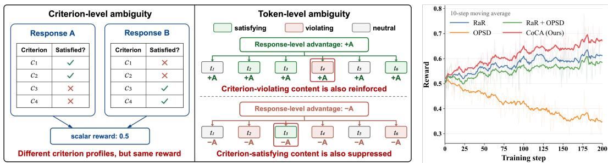  
Figure 1: (Left) The mismatch between criterion-level evaluation and response-level learning signals in standard rubric-based RL. (Right) Training dynamics across methods on RaR-Medicine over the first 200 steps.

This mismatch has prompted recent attempts (Rezaei et al., 2026; Gu et al., 2026; Bablani et al., 2026) to derive token-level guidance through on-policy self-distillation (OPSD) (Zhao et al., 2026; Hubotter et al., 2026). Specifically, these methods train the policy on its own rollouts to match the¨ next-token distribution of a self-teacher that receives rubrics as privileged context. This distillation loss is used either as a standalone objective or as an auxiliary objective in rubric-based RL, with the expectation that such fine-grained guidance will help the policy learn more effectively from rubrics. However, as shown in the right panel of Figure 1, reward declines when OPSD is optimized alone and adding it as an auxiliary loss degrades the performance of rubric-based RL. Our theoretical analysis highlights a gap between better generation and reliable guidance: although a rubric-conditioned teacher can perform better overall, matching its predictions need not improve criterion satisfaction. OPSD determines what to reinforce or suppress from teacher–student prediction differences rather than observed criterion outcomes, so closer imitation can come at the cost of lower reward. This motivates us to reframe the problem as criterion-aware credit assignment.

Our key insight is to separate credit determination from allocation: observed outcomes determine the sign and budget of each criterion’s credit, while privileged rubric information serves as a relevance cue for allocating credit across tokens. Based on this insight, we propose CoCA, a criterion-aware credit assignment framework for rubric-based RL. Specifically, we first use group-relative criterion outcomes to decompose the response-level advantage into signed criterion-level credits, a step we call credit grounding. We then compute the magnitude of criterion-induced next-token distribution shifts as a proxy for token relevance. Rather than matching the rubric-conditioned distributions as in OPSD, we use this relevance to redistribute each criterion’s credit across tokens, a step we call credit resolution. Finally, we aggregate the resolved credits into token-level advantages, yielding outcome-grounded and fine-grained policy updates. Our experiments in medicine and science show that CoCA outperforms all baselines, improving over standard rubric-based RL by +4.2% on average. Criterion-level analyses further show that CoCA corrects unmet criteria more effectively while better preserving those already satisfied. Together, these results demonstrate that CoCA makes more effective use of structured rubric feedback and enables more targeted learning.

## 2 PRELIMINARIES

Rubric-based RL. Rubrics specify response quality through a set of weighted, independently assessable criteria. Formally, a training example $( x , \mathcal { R } ) \sim \mathcal { D }$ consists of a question x and its associated rubric $\mathcal { R } = \{ ( c _ { j } , s _ { j } ) \} _ { i = 1 } ^ { M }$ , where $c _ { j }$ denotes the j-th evaluation criterion, $s _ { j }$ its point value, and M the number of criteria. Following prior work (Arora et al., 2025; Gunjal et al., 2026), we adopt a binary checklist-style scoring protocol and use GRPO (Shao et al., 2024) as the base RL algorithm. For each question $x ,$ the rollout policy $\pi _ { \theta _ { \mathrm { o l d } } }$ samples a group of $G$ responses $\{ y _ { i } \} _ { i = 1 } ^ { G }$ . An LLM judge evaluates each response $y _ { i }$ against each criterion $c _ { j } ,$ yielding $z _ { i j } \in \{ 0 , 1 \}$ , with $z _ { i j } = 1$ if $y _ { i }$ meets $c _ { j }$ These criterion-level judgments are aggregated into a scalar reward $\begin{array} { r } { R _ { i } = \sum _ { j } \bar { s } _ { j } z _ { i j } / \sum _ { j : s _ { i } > 0 } \bar { s _ { j } } } \end{array}$ To avoid assigning disproportionate weight to rollout groups with low reward variance, we follow Dr. GRPO (Liu et al., 2025) and omit normalization by the within-group reward standard deviation. We thus define the group-relative advantage as $A _ { i } = R _ { i } - { \bar { R } }$ , where $\begin{array} { r } { \bar { R } = \frac { 1 } { G } \sum _ { k = 1 } ^ { G } R _ { k } } \end{array}$ is the mean reward within the group. The policy πθ is then optimized using the GRPO loss:

$$
\begin{array} { r } { \mathcal { L } _ { \mathrm { G R P O } } = - \mathbb { E } _ { x \sim \mathcal { D } , \{ y _ { i } \} _ { i = 1 } ^ { G } \sim \pi _ { \theta _ { \mathrm { o d d } } } \cdot | x } \left[ \frac { 1 } { G } \sum _ { i = 1 } ^ { G } \frac { 1 } { | y _ { i } | } \sum _ { t = 1 } ^ { | y _ { i } | } \operatorname* { m i n } \bigl ( \rho _ { i , t } A _ { i } , \mathrm { c l i p } ( \rho _ { i , t } , 1 - \epsilon , 1 + \epsilon ) A _ { i } \bigr ) \right] } \end{array}\tag{1}
$$

where $\rho _ { i , t } = \pi _ { \theta } ( y _ { i , t } | x , y _ { i , < t } ) / \pi _ { \theta _ { \mathrm { o l d } } } ( y _ { i , t } | x , y _ { i , < t } )$ is the importance ratio and ϵ is the clipping factor. Hence, criterion-level evaluations are reduced to a response-level advantage shared by all tokens, without explicitly using each criterion’s outcome to guide targeted updates to the relevant tokens.

Rubric-conditioned OPSD. Beyond their role in reward computation, rubrics can serve as privileged information $\xi$ for token-level supervision through OPSD (Zhao et al., 2026; Hubotter et al.,¨ 2026). Formally, for an on-policy rollout $y _ { i }$ , let $h _ { i , t } = ( x , y _ { i , < t } )$ and $h _ { i , t } ( \xi ) = ( x , \xi , y _ { i , < t } )$ denote the ordinary and privileged contexts at position $t ,$ respectively. OPSD trains the policy by matching its next-token distribution under $h _ { i , t }$ to that under $h _ { i , t } ( \xi )$ . We consider the reverse-KL objective:

$$
\begin{array} { r } { \mathcal { L } _ { \mathrm { O P S D } } = \mathbb { E } _ { \boldsymbol { x } \sim \mathcal { D } , y _ { i } \sim \pi _ { \theta } ( \cdot \vert \boldsymbol { x } ) } \left[ \frac { 1 } { \vert y _ { i } \vert } \sum _ { t = 1 } ^ { \vert y _ { i } \vert } D _ { \mathrm { K L } } \left( \pi _ { \theta } ( \cdot \vert h _ { i , t } ) \vert \vert \mathrm { s g } [ \pi _ { \theta } ( \cdot \vert h _ { i , t } ( \xi ) ) ] \right) \right] . } \end{array}\tag{2}
$$

Here, $\mathrm { s g } [ \cdot ]$ denotes the stop-gradient operator, and the distribution under $h _ { i , t } ( \xi )$ serves as a detached self-teacher. In the rubric-conditioned setting, ξ is instantiated as either the full criterion set $\{ c _ { j } \} _ { j = 1 } ^ { M }$ or a selected subset. The resulting self-teacher translates these quality requirements into target nexttoken distributions for policy optimization.

## 3 CREDIT ASSIGNMENT IN RUBRIC-BASED POLICY OPTIMIZATION

Rubric evaluation yields criterion-level outcomes that typically depend on different token decisions within a response. Accordingly, translating this structured feedback into targeted policy updates involves two complementary components: credit grounding determines a signed credit budget for each criterion from observed outcomes, whereas credit resolution allocates these budgets across relevant tokens while preserving their values. Formally, for response $y _ { i } ,$ let $\mathbf { z } _ { i } = ( z _ { i 1 } , \ldots , z _ { i M } ) ^ { \top }$ Credit grounding uses a rule $g$ to map these outcomes to a vector of signed criterion credits:

$$
\mathbf { a } _ { i } = g ( \mathbf { z } _ { i } ; \mathcal { R } , \mathcal { B } ) = \left( A _ { i 1 } , \ldots , A _ { i M } \right) ^ { \top } ,\tag{3}
$$

where $A _ { i j }$ is the credit budget for criterion $c _ { j }$ , and B denotes optional reference statistics derived from evaluation outcomes. Given these budgets, credit resolution determines their allocation across token positions. We represent this allocation by a criterion–token credit matrix $\mathbf { C } _ { i } \in \mathbb { R } ^ { M \times T _ { i } }$ , where $T _ { i } = | y _ { i } |$ is the response length and $[ \mathbf { C } _ { i } ] _ { j , t }$ denotes the credit assigned to token t for criterion $c _ { j }$ . We consider allocations that preserve each criterion budget as its mean credit over tokens:

$$
\begin{array} { r } { \mathcal { C } _ { i } ( \mathbf { a } _ { i } ) = \left\{ \mathbf { C } \in \mathbb { R } ^ { M \times T _ { i } } : \frac { 1 } { T _ { i } } \mathbf { C 1 } _ { T _ { i } } = \mathbf { a } _ { i } \right\} , \qquad \alpha _ { i } ( \mathbf { C } ) = \mathbf { C } ^ { \top } \mathbf { 1 } _ { M } , } \end{array}\tag{4}
$$

where $\mathcal { C } _ { i } ( \mathbf { a } _ { i } )$ denotes the set of grounding-preserving resolutions and $\pmb { \alpha } _ { i } ( \mathbf { C } ) \in \mathbb { R } ^ { T _ { i } }$ is the resulting token-level credit vector. We use $\mathbf { C } _ { i } ^ { * } \in \bar { \mathcal { C } } _ { i } \bar { ( \mathbf { a } _ { i } ) }$ to denote an oracle resolution of the criterion budgets.

## 3.1 RUBRIC-BASED RL: OUTCOME-GROUNDED BUT UNDER-RESOLVED

We first interpret standard rubric-based RL within this framework. Let $\begin{array} { r } { \bar { z } _ { j } = \frac { 1 } { G } \sum _ { k = 1 } ^ { G } z _ { k j } } \end{array}$ denote the mean score for criterion $j$ across the rollout group. By the linearity of group-relative centering, the response-level advantage $A _ { i }$ can be decomposed exactly into criterion-level contributions, each determined by a criterion’s weight and its score relative to the group mean:

$$
A _ { i j } = { \frac { s _ { j } ( z _ { i j } - { \bar { z } } _ { j } ) } { \sum _ { \ell : s _ { \ell } > 0 } s _ { \ell } } } , \qquad A _ { i } = \sum _ { j = 1 } ^ { M } A _ { i j } .\tag{5}
$$

Here, the grounding rule $g$ uses $\{ \bar { z } _ { j } \} _ { j = 1 } ^ { M }$ as the reference statistics B. Each budget thus reflects the response’s weighted performance relative to the group on the corresponding criterion. However, standard rubric-based RL uses the aggregate advantage $A _ { i } = \mathbf { 1 } _ { M } ^ { \top } \mathbf { a } _ { i }$ and assigns it uniformly to every token. This is equivalent to the allocation $\mathbf { a } _ { i } \mathbf { 1 } _ { T _ { i } } ^ { \top } \in \mathcal { C } _ { i } ( \mathbf { a } _ { i } )$ , which preserves the criterion budgets but does not account for which tokens are relevant to each criterion. To formalize this loss of resolution, let $\mathcal { U } _ { i } = \{ \mathbf { u } \mathbf { 1 } _ { T _ { i } } ^ { \top } : \mathbf { u } \in \mathbb { R } ^ { M } \}$ denote the subspace of criterion–token credit matrices that are uniform across tokens, and let $\Pi _ { { \cal M } _ { i } }$ denote the orthogonal projection onto this subspace.

Proposition 1 (Credit resolution collapse in rubric-based RL). For any oracle resolution $\mathbf { C } _ { i } ^ { * } \in$ $\mathcal { C } _ { i } ( \mathbf { a } _ { i } )$ , the token credit induced by rubric-based RL and the corresponding projection error satisfy

$$
\begin{array} { r } { \left( \mathbf { 1 } _ { M } ^ { \top } \mathbf { a } _ { i } \right) \mathbf { 1 } _ { T _ { i } } = A _ { i } \mathbf { 1 } _ { T _ { i } } = \alpha _ { i } ( \Pi _ { \mathcal { U } _ { i } } ( \mathbf { C } _ { i } ^ { * } ) ) , \quad \frac { 1 } { T _ { i } } \left. \mathbf { C } _ { i } ^ { * } - \Pi _ { \mathcal { U } _ { i } } ( \mathbf { C } _ { i } ^ { * } ) \right. _ { F } ^ { 2 } = \sum _ { j = 1 } ^ { M } \operatorname { V a r } _ { t } \left( [ \mathbf { C } _ { i } ^ { * } ] _ { j , t } \right) . } \end{array}\tag{6}
$$

Moreover, the linear map $\mathbf { a } \mapsto ( \mathbf { 1 } _ { M } ^ { \top } \mathbf { a } ) \mathbf { 1 } _ { T _ { i } }$ has rank one and kernel $\mathbf { 1 } _ { M } ^ { \perp }$ . Consequently, any nonzero criterion budget vector $\mathbf { a } _ { i } \in \mathbf { 1 } _ { M } ^ { \perp }$ yields a zero token-credit vector, while any position t satisfying $A _ { i } [ \alpha _ { i } ( \mathbf { C } _ { i } ^ { * } ) ] _ { t } < 0$ is assigned credit whose sign is opposite to its oracle token credit.

Proposition 1 shows that criterion aggregation retains only the sum $A _ { i } ,$ obscuring the underlying pattern of strengths and weaknesses and allowing opposing criterion credits to cancel. Uniform allocation further removes within-criterion variation across tokens, giving every token the same credit $A _ { i }$ even when the oracle calls for reinforcing some tokens and suppressing others. The resulting learning signal remains outcome-grounded but leaves criterion-specific token credit under-resolved.

## 3.2 OPSD: FINE-GRAINED BUT NOT NECESSARILY OUTCOME-GROUNDED

In contrast, OPSD provides token-specific guidance by matching the policy to a rubric-conditioned self-teacher. Although this teacher may generate better responses on its own, its value for distillation depends on the matching updates it induces. Yet, these updates are determined by teacher–student prediction differences without accounting for which rubric criteria the sampled response satisfies or violates. Improving the match to the teacher need not improve criterion satisfaction and may instead reduce reward. To examine this gap locally, let $r _ { i , t } ( a ; \xi ) \bar { = } \log \pi _ { \theta } ( a | h _ { i , t } ( \xi ) ) \mathrm { - l o g } \pi _ { \theta } ( a | h _ { i , t } )$ denote the teacher-induced matching signal at token context $h _ { i , t }$ , and define $J ( \theta ; h ) = \mathbb { E } _ { a \sim \pi _ { \theta } ( . | h ) } [ R ( a ) ]$

Proposition 2 (OPSD matching can reduce reward). Consider the next-token decision at $h _ { i , t }$ as a one-step contextual bandit with finite action space $\nu ,$ a reward function $R : \mathcal { V } \to \mathbb { R }$ , and a tabular softmax policy. Let θ′ be obtained by a natural-gradient descent step of size $\eta > 0$ on the KL term ofEq. (2), using the local Fisher information and holding the self-teacherfixed. Then, as $\eta  0$

$$
\begin{array} { r } { J ( \theta ^ { \prime } ; h _ { i , t } ) - J ( \theta ; h _ { i , t } ) = \eta \operatorname { C o v } _ { a \sim \pi _ { \theta } ( \cdot | h _ { i , t } ) } ( R ( a ) , r _ { i , t } ( a ; \xi ) ) + \mathcal { O } ( \eta ^ { 2 } ) . } \end{array}\tag{7}
$$

When $| \nu | \geq 3 ,$ there exist instances for which $J ( \theta ; h _ { i , t } ( \xi ) ) > J ( \theta ; h _ { i , t } )$ while the covariance in Eq. (7) is strictly negative, implying $\begin{array} { r } { \dot { J } ( \theta ^ { \prime } ; h _ { i , t } ) < \dot { J } ( \theta ; h _ { i , t } ) \dot { f } o r s u f f i c i e n t l y } \end{array}$ small $\eta > 0$

Thus, the first-order reward change depends on how the matching signal aligns with reward under the student policy. Intuitively, the local matching update favors actions with larger teacher–student log-probability differences. The teacher’s higher expected reward reflects the quality of its overall action distribution, but does not guarantee that these relative preferences align with reward. When this alignment is negative, a sufficiently small matching step reduces the local distillation loss while lowering expected reward. This local failure mode provides a plausible explanation for the reward degradation observed with OPSD in Figure 1.

Remark 1. Proposition 2 also helps explain why introducing an auxiliary OPSD loss can undermine rubric-based RL. The added teacher-matching signal lacks outcome grounding and may counteract reward-driven learning, while leaving the original coarse credit allocation unchanged. We therefore seek to refine the allocation of outcome-grounded credit rather than add an independent imitation objective. Accordingly, privileged rubric information should serve as a relevance cue rather than a source of imitation targets, guiding token-level allocation while observed outcomes determine each criterion’s signed credit budget.

## 4 COCA: CRITERION-AWARE CREDIT ASSIGNMENT

Building on this principle, we propose CoCA, a criterion-aware credit assignment framework for rubric-based RL. As illustrated in Figure 2, CoCA assigns credit in two stages. Credit grounding determines each criterion’s signed contribution to a response via within-group comparisons of rubric outcomes, while credit resolution allocates that contribution to tokens based on token–criterion relevance. These stages provide criterion-aware token-level learning signals for GRPO optimization.

## 4.1 TOKEN-LEVEL ADVANTAGE CONSTRUCTION

Credit grounding. We instantiate the grounding rule $g$ with the group-relative decomposition in Eq. (5). For each response $y _ { i }$ , this yields signed criterion budgets $A _ { i j }$ satisfying $\textstyle \sum _ { j } A _ { i j } = A _ { i }$

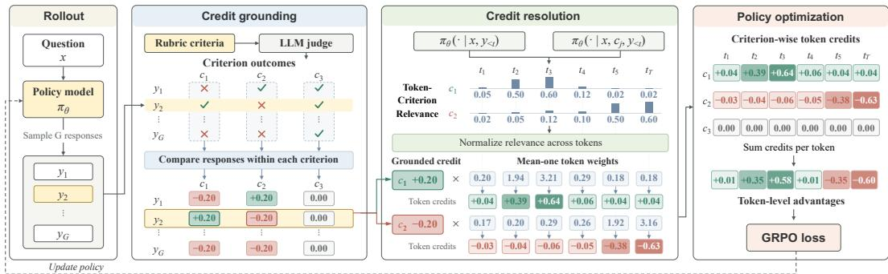  
Figure 2: Overview of CoCA. Sampled responses are first evaluated against a shared rubric to derive signed criterion credits through within-group comparisons. Guided by relevance cues from criterion-conditioned distribution shifts, these credits are then allocated across tokens while preserving each criterion’s signed budget. Finally, the resolved credits are aggregated into token-level advantages for GRPO optimization.

Credit resolution. To resolve each budget $A _ { i j }$ , we use criterion $c _ { j }$ as privileged information and compare the frozen rollout policy’s next-token distributions under $h _ { i , t }$ and $h _ { i , t } ( c _ { j } )$ . We collect the relevance scores in $\mathbf { d } _ { i j } = ( d _ { i j , 1 } , \ldots , d _ { i j , T _ { i } } ) ^ { \top }$ , where

$$
d _ { i j , t } = \mathrm { s g } [ D _ { \mathrm { J S } } ( \pi _ { \theta _ { \mathrm { o l d } } } ( \cdot \mid h _ { i , t } ) \mid  \pi _ { \theta _ { \mathrm { o l d } } } ( \cdot \mid h _ { i , t } ( c _ { j } ) ) ) ] .\tag{8}
$$

Jensen–Shannon divergence provides a symmetric, bounded measure of how strongly criterion conditioning changes the next-token distribution. We use this sensitivity as an unsigned relevance cue, while retaining $A _ { i j }$ as the outcome-grounded credit budget. We then transform these scores into positive token weights with mean one:

$$
\begin{array} { r } { \omega _ { i j } = T _ { i } \mathrm { s o f t m a x } ( \beta \mathbf { d } _ { i j } ) , \qquad \frac { 1 } { T _ { i } } \mathbf { 1 } _ { T _ { i } } ^ { \top } \boldsymbol { \omega } _ { i j } = 1 . } \end{array}\tag{9}
$$

The parameter $\beta \geq 0$ controls allocation concentration. Multiplying $A _ { i j }$ by these weights preserves its sign and ensures that the mean token credit equals $A _ { i j }$ . For efficiency, we restrict nonuniform allocation to $S _ { i } = \mathrm { T o p K } _ { j : A _ { i j } \neq 0 } ( | A _ { i j } | , k )$ , which contains up to k criteria with the largest credit magnitudes. These criteria capture the response’s most pronounced strengths and weaknesses relative to the rollout group. We compute relevance only for the selected criteria and set $\omega _ { i j } = \mathbf { 1 } _ { T _ { i } }$ for $j \notin S _ { i }$ . This requires at most k additional criterion-conditioned forward passes per response.

Aggregation and policy optimization. Finally, we form the criterion–token credits and aggregate them across criteria to obtain token-level advantages:

$$
\begin{array} { r } { [ \widehat { \mathbf { C } } _ { i } ] _ { j , t } = A _ { i j } [ \omega _ { i j } ] _ { t } , \qquad \widehat { A } _ { i , t } = [ \alpha _ { i } ( \widehat { \mathbf { C } } _ { i } ) ] _ { t } = A _ { i } + \sum _ { j \in S _ { i } } A _ { i j } \left( [ \omega _ { i j } ] _ { t } - 1 \right) . } \end{array}\tag{10}
$$

When opposing criterion budgets are allocated differently across tokens, the resulting advantages can remain nonzero even if $A _ { i } = 0$ . We then optimize the policy using $\widehat { A } _ { i , t }$ t in place of $A _ { i }$ in Eq. (1), without introducing an auxiliary teacher-matching loss.

## 4.2 GROUNDING PRESERVATION AND RESOLUTION IMPROVEMENT

We examine when criterion-induced relevance reduces credit allocated to irrelevant tokens compared with uniform allocation. For each selected criterion $c _ { j } .$ , let $\emptyset \neq T _ { i j } \subsetneq \{ 1 , \dots , T _ { i } \}$ denote its relevant token positions, specified without using the relevance scores. Let $\Delta _ { i j }$ denote the mean score on $\mathcal { T } _ { i j }$ minus that on its complement, and let $\begin{array} { r } { b _ { i j } = \operatorname* { m a x } _ { t } d _ { i j , t } - \operatorname* { m i n } _ { t } d _ { i j , t } } \end{array}$ denote the score range.

Proposition 3 (Grounding-preserving resolution improvement). For any $\beta \geq 0 ,$ , CoCA preserves each criterion’s budget and the sign ofits token-level contributions, with $\widehat { \mathbf { C } } _ { i } ( \beta ) \in \mathcal { C } _ { i } ( \mathbf { a } _ { i } )$ . For each selected criterion $j \in S _ { i }$ with $\Delta _ { i j } > 0 ,$ , thefollowing holds whenever $0 < \beta < \mathrm { \ ' } 8 \Delta _ { i j } / b _ { i j } ^ { 2 } \mathrm { \ ' }$

$$
\begin{array} { r } { \frac { 1 } { T _ { i } } \sum _ { t \notin \mathcal { T } _ { i j } } \left| [ \widehat { \mathbf { C } } _ { i } ( \beta ) ] _ { j , t } \right| < | A _ { i j } | \left( 1 - \frac { | \mathcal { T } _ { i j } | } { T _ { i } } \right) . } \end{array}\tag{11}
$$

The right-hand side gives the same quantity under uniform allocation.

Table 1: Experimental results (%) on medical and scientific benchmarks, using Qwen3-8B as the base model and gpt-oss-120b as the judge. Avg. denotes the mean score across all seven benchmarks, and the best results are highlighted in bold. Arrows indicate improvements (↑) or declines (↓) relative to the initial model.
<table><tr><td rowspan="2">Method</td><td colspan="4">Medicine</td><td colspan="3">Science</td><td rowspan="2">Avg.</td></tr><tr><td>RaR-Medicine HealthBench LLMEval-Med</td><td></td><td></td><td>MedQA</td><td>RaR-Science ResearchQA</td><td></td><td>GPQA-D</td></tr><tr><td>Initial</td><td>54.2 (0.0)</td><td>41.9 (0.0)</td><td>51.1 (0.0)</td><td>72.0 (0.0)</td><td>67.6 (0.0)</td><td>50.7 (0.0)</td><td>49.7 (0.0)</td><td>55.3 (0.0)</td></tr><tr><td>RaR</td><td>65.0 (↑10.8)</td><td>47.5 (↑5.6)</td><td>55.4 (↑4.3)</td><td>73.8 (↑1.8)</td><td>72.4 (↑4.8)</td><td>56.6 (↑5.9)</td><td>51.6 (↑1.9)</td><td>60.3 (↑5.0)</td></tr><tr><td>OPSD</td><td>44.7 (↓9.5)</td><td>30.6 (↓11.3)</td><td>48.8 (↓2.3)</td><td>69.0 (↓3.0)</td><td>65.5 (↓2.1)</td><td>47.5 (↓3.2)</td><td>46.6 (↓3.1)</td><td>50.4 (↓4.9)</td></tr><tr><td>RaR+OPSD</td><td>61.8 (↑7.6)</td><td>42.1 (↑0.2)</td><td>53.4 (↑2.3)</td><td>72.1 (↑0.1)</td><td>67.9 (↑0.3)</td><td>50.6 (↓0.1)</td><td>48.8 (↓0.9)</td><td>56.7 (↑1.4)</td></tr><tr><td>RuscaRL</td><td>58.4 (↑4.2)</td><td>45.3 (↑3.4)</td><td>55.6 (↑4.5)</td><td>73.8 (↑1.8)</td><td>67.9 (↑0.3)</td><td>53.1 (↑2.4)</td><td>44.4 (↓5.3)</td><td>56.9 (↑1.6)</td></tr><tr><td>HeRL</td><td>67.5 (↑13.3)</td><td>49.8 (↑7.9)</td><td>56.7 (↑5.6)</td><td>73.3 (↑1.3)</td><td>72.7 (↑5.1)</td><td>58.4 (↑7.7)</td><td>51.6 (↑1.9)</td><td>61.4 (↑6.1)</td></tr><tr><td>POW3R</td><td>66.7 (↑12.5)</td><td>49.3 (↑7.4)</td><td>55.3 (↑4.2)</td><td>72.4 (↑0.4)</td><td>72.9 (↑5.3)</td><td>58.8 (↑8.1)</td><td>52.0 (↑2.3)</td><td>61.1 (↑5.8)</td></tr><tr><td>CoRT</td><td>67.1 (↑12.9)</td><td>48.0 (↑6.1)</td><td>55.7 (↑4.6)</td><td>75.9 (↑3.9)</td><td>72.6 (↑5.0)</td><td>58.1 (↑7.4)</td><td>47.7 (↓2.0)</td><td>60.7 (↑5.4)</td></tr><tr><td>CoCA (ours)</td><td>69.8 (↑15.6)</td><td>54.3 (↑12.4)</td><td>61.8 (↑10.7)</td><td>77.6 (↑5.6)</td><td>74.2 (↑6.6)</td><td>59.6 (↑8.9)</td><td>54.4 (↑4.7)</td><td>64.5 (↑9.2)</td></tr></table>

Proposition 3 shows that perfect token rankings are unnecessary: a positive mean-score gap suffices to reduce off-target credit when allocation concentration is appropriately controlled. Specifically, the bound permits stronger concentration for larger mean-score gaps but becomes more restrictive as the score range widens. Thus, criterion-induced relevance can improve resolution while preserving the signed budgets grounded in observed outcomes.

## 5 EXPERIMENTS

## 5.1 EXPERIMENTAL SETUP

Datasets and Benchmarks. Following previous work (Gunjal et al., 2026), we evaluate CoCA on medical and scientific QA tasks, with separate policies trained on RaR-Medicine and RaR-Science, respectively. We use the corresponding test splits for in-domain evaluation. To assess generalization, we further evaluate on HealthBench (Arora et al., 2025), LLMEval-Med (Zhang et al., 2025b), and MedQA (Jin et al., 2021) for medicine, and ResearchQA (Yifei et al., 2026) and GPQA-Diamond (GPQA-D) (Rein et al., 2024) for science. See Appendix B.1 for more dataset and evaluation details.

Models and Configurations. We use Qwen3-8B (Yang et al., 2025) as the default base model and gpt-oss-120b as the default rubric judge. Additional results across model sizes, architectures, and judges are provided in Appendix C.1. We build our algorithm on the verl framework (Sheng et al., 2025) and train with a learning rate of $1 0 ^ { - 6 } .$ , a batch size of 64 prompts, and G = 8 rollouts per prompt. All experiments are conducted on 8×A100 GPUs, with all methods trained for 400 steps to allow sufficient optimization. For credit assignment, we set the criterion budget to k = 2 for each rollout and set the allocation concentration parameter β to 5 for medicine and 3 for science. Detailed experimental protocols and training hyperparameter settings are provided in Appendix B.2.

Baselines. We compare CoCA with seven representative baselines: (1) RaR (Gunjal et al., 2026) uses GRPO with response-level rubric rewards; (2) OPSD (Zhao et al., 2026) performs on-policy self-distillation with rubrics as privileged teacher context; (3) RaR+OPSD combines rubric-based GRPO with an auxiliary OPSD objective; (4) RuscaRL (Zhou et al., 2026) uses rubric scaffolds to guide rollout generation during training; (5) HeRL (Zhang et al., 2026b) guides exploration using failed rollouts and their unmet criteria as hindsight feedback; (6) POW3R (Tyagi et al., 2026) adaptively reweights rubric criteria based on within-group variation in criterion outcomes; and (7) CoRT (Zhang et al., 2026a) uses token-level likelihood contrasts from counterfactual rubric replay to redistribute response-level advantages. More baseline details can be found in Appendix B.3.

## 5.2 MAIN RESULTS

CoCA achieves SOTA performance. As shown in Table 1, CoCA achieves the best performance on all seven benchmarks, reaching an average score of 64.5% and improving over RaR, the standard rubric-based RL baseline, by 4.2%. These gains highlight the importance of translating criterionlevel feedback into targeted token-level updates for effective rubric-based learning. Notably, RaR + OPSD even underperforms RaR on every benchmark and trails CoCA by 7.8% on average, showing that directly optimizing an auxiliary rubric-conditioned distillation objective can undermine rewarddriven learning. Moreover, CoCA surpasses CoRT, which also targets credit assignment in rubricbased RL, by 3.8% on average. This gap suggests that resolving credit for individual criteria is more effective than reweighting response-level advantages across tokens, as done in CoRT. Collectively, CoCA enables more effective rubric-based RL through criterion-aware credit assignment.

Table 2: Ablation results (%) for credit allocation mechanisms. Arrows indicate changes relative to CoCA.
<table><tr><td rowspan="2">Method</td><td colspan="4">Medicine</td><td colspan="3">Science</td><td rowspan="2">Avg.</td></tr><tr><td></td><td>RaR-Medicine HealthBench LLMEval-Med MedQA</td><td></td><td></td><td>RaR-Science ResearchQA</td><td></td><td>GPQA-D</td></tr><tr><td>CoCA</td><td>69.8 (0.0)</td><td>54.3 (0.0)</td><td>61.8 (0.0)</td><td>77.6 (0.0)</td><td>74.2 (0.0)</td><td>59.6 (0.0)</td><td>54.4 (0.0)</td><td>64.5 (0.0)</td></tr><tr><td>Uniform</td><td> $6 5 . 0 \ ( \downarrow 4 . 8 )$ </td><td> $4 7 . 5 \ ( \downarrow 6 . 8 )$ </td><td> $5 5 . 4 ( \downarrow 6 . 4 )$ </td><td> $7 3 . 8 \ ( \downarrow 3 . 8 )$ </td><td> $7 2 . 4 \left( \downarrow 1 . 8 \right)$ </td><td> $5 6 . 6 \left( \downarrow 3 . 0 \right)$ </td><td> $5 1 . 6 \left( \downarrow 2 . 8 \right)$ </td><td>60.3 (↓4.2)</td></tr><tr><td>Shufled</td><td> $5 0 . 7 \ ( \downarrow 1 9 . 1 )$ </td><td> $3 9 . 4 \ ( \downarrow 1 4 . 9 )$ </td><td> $5 3 . 1 \ ( \downarrow 8 . 7 )$ </td><td> $6 9 . 2 \ ( \downarrow 8 . 4 )$ </td><td> $6 5 . 2 \ ( \downarrow 9 . 0 )$ </td><td> $5 0 . 5 \ : ( \downarrow 9 . 1 )$ </td><td> $4 3 . 8 \ ( \downarrow 1 0 . 6 )$ </td><td>53.1 (↓11.4)</td></tr><tr><td>Shared</td><td> $6 7 . 7 \ ( \downarrow 2 . 1 )$ </td><td> $5 0 . 1 \ ( \downarrow 4 . 2 )$ </td><td> $5 7 . 6 \left( \downarrow 4 . 2 \right)$ </td><td> $7 3 . 9 \ ( \downarrow 3 . 7 )$ </td><td> $7 2 . 7 \ ( \downarrow 1 . 5 )$ </td><td> $5 7 . 7 \left( \downarrow 1 . 9 \right)$ </td><td> $5 2 . 0 \ ( \downarrow 2 . 4 )$ </td><td> $6 1 . 7 \left( \downarrow 2 . 8 \right)$ </td></tr></table>

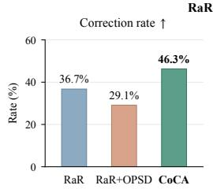

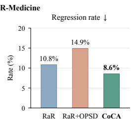

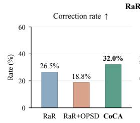

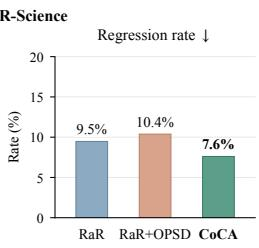  
Figure 3: Criterion-level correction (↑) and regression (↓) rates on RaR-Medicine and RaR-Science datasets. Correction measures the fraction of initially unmet criteria that become satisfied after training, while regression measures the fraction of initially satisfied criteria that become unmet.

CoCA enables more targeted rubric-based learning. To distinguish criterion-level gains and losses obscured by aggregate scores, we measure correction and regression rates relative to the initial model on the same test questions. As shown in Figure 3, CoCA achieves the highest correction and lowest regression rates in both domains. Compared with RaR, correction rates increase from 36.7% to 46.3% in medicine and from 26.5% to 32.0% in science. Meanwhile, regression rates decrease from 10.8% to 8.6% and from 9.5% to 7.6%, respectively. By comparison, RaR+OPSD exhibits the opposite pattern, combining fewer corrections with more regressions than RaR in both domains. This contrast highlights CoCA’s more targeted rubric-based learning: it corrects unmet criteria more effectively while better preserving those already satisfied.

## 5.3 FURTHER ANALYSIS

Analysis of paradigm limitations. To investigate optimization challenges in rubric-based RL and OPSD, we quantify two types of signal conflict during training: (i) criterion credit conflict, where a rollout’s response-level advantage and at least one criterion credit have opposite signs; (ii) distillation misalignment, where OPSD and outcome-grounded learning yield negatively aligned logit gradients for the same criterion–token pair. As shown in Figure 4a, criterion credit conflict reaches 54.6% in medicine and 50.4% in science, while distillation misalignment reaches 49.0% and 48.8%, respectively. These frequent conflicts indicate that rubric-based RL can reinforce criterion-violating content or suppress criterion-satisfying content, while OPSD often conflicts with outcome-grounded learning at the logit level. This sheds light on the performance limitations of both paradigms.

Ablation of credit allocation mechanisms. Table 2 compares CoCA with three allocation vari ants. Uniform assigns equal weights to all response tokens, reducing the average score by 4.2% relative to CoCA. This decrease supports the benefit of resolving criterion-level credit through nonuniform token allocation. Shuffled applies the same random permutation of token positions to the allocation weights of all criteria within each response. This preserves the full distribution of aggregated token advantages while disrupting their alignment with the response tokens. Its average score drops by 11.4%, highlighting the importance of assigning credit to appropriate token positions. Furthermore, to examine the role of criterion-specific allocation, we introduce Shared, which redistributes the response-level advantage using token weights averaged across the selected criteria. The resulting 2.8% decrease in average score supports using distinct allocation profiles for different criteria. These results demonstrate that CoCA achieves more effective credit resolution by allocating each criterion’s credit according to its token relevance.

Table 3: Ablation results (%) for relevance measures. Arrows indicate changes relative to CoCA.
<table><tr><td rowspan="2">Measure</td><td colspan="4">Medicine</td><td colspan="3">Science</td><td rowspan="2">Avg.</td></tr><tr><td>RaR-Medicine HealthBench LLMEval-Med MedQA</td><td></td><td></td><td></td><td>RaR-Science ResearchQA</td><td></td><td>GPQA-D</td></tr><tr><td>JSD (CoCA)</td><td>69.8 (0.0)</td><td> ${ \pmb 5 4 . 3 } \ ( 0 . 0 )$ </td><td>61.8 (0.0)</td><td>77.6 (0.0)</td><td>74.2 (0.0)</td><td>59.6 (0.0)</td><td>54.4 (0.0)</td><td>64.5 (0.0)</td></tr><tr><td>Forward KL</td><td> $6 0 . 8 \ ( \downarrow 9 . 0 )$ </td><td> $4 8 . 8 \ ( \downarrow 5 . 5 )$ </td><td> $5 7 . 3 \ ( \downarrow 4 . 5 )$ </td><td> $7 3 . 5 ( \downarrow 4 . 1 ) $ </td><td> $7 0 . 3 \ ( \downarrow 3 . 9 )$ </td><td> $5 4 . 5 \ ( \downarrow 5 . 1 )$ </td><td> $4 9 . 1 \ ( \downarrow 5 . 3 )$ </td><td> $5 9 . 2 ( \downarrow 5 . 3 )$ </td></tr><tr><td>Reverse KL</td><td> $6 6 . 7 \ ( \downarrow 3 . 1 )$ </td><td> $4 9 . 7 \ ( \downarrow 4 . 6 )$ </td><td> $5 7 . 1 \ ( \downarrow 4 . 7 )$ </td><td> $7 5 . 9 \ : ( \downarrow 1 . 7 )$ </td><td> $7 2 . 9 \ ( \downarrow 1 . 3 )$ </td><td> $5 7 . 2 \ ( \downarrow 2 . 4 )$ </td><td> $5 2 . 4 \ : ( \downarrow 2 . 0 )$ </td><td> $6 1 . 7 \left( \downarrow 2 . 8 \right)$ </td></tr><tr><td>Log-ratio</td><td> $5 3 . 4 \ ( \downarrow 1 6 . 4 )$ </td><td> $4 1 . 4 \ : ( \downarrow 1 2 . 9 )$ </td><td> $5 0 . 8 \ ( \downarrow 1 1 . 0 )$ </td><td> $7 0 . 0 \left( \downarrow 7 . 6 \right)$ </td><td> $6 6 . 9 \ ( \downarrow 7 . 3 )$ </td><td> $5 0 . 7 \ ( \downarrow 8 . 9 )$ </td><td> $4 6 . 3 \ : ( \downarrow 8 . 1 )$ </td><td> $5 4 . 2 \ : ( \downarrow 1 0 . 3 )$ </td></tr></table>

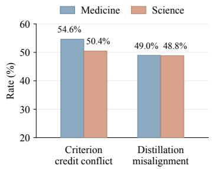  
(a) Signal conflict rates

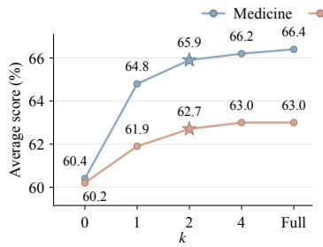

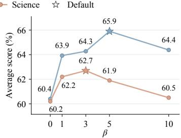  
(b) Sensitivity to budget k and allocation concentration $\beta$  
Figure 4: (a) Rates of two signal conflicts: response-level advantages versus criterion-level credits, and distil lation gradients versus outcome-grounded gradients. (b) Effects of k and $\beta$ on average scores in each domain.

Ablation of relevance measures. To examine how relevance estimation affects credit allocation, we compare JSD with alternative measures in Table 3. Replacing JSD with forward KL and reverse KL reduces the average score by 5.3% and 2.8%, respectively. Compared with these asymmetric, unbounded divergences, JSD treats both distributions symmetrically and limits extreme relevance scores, which offers a plausible explanation for its advantage. We further consider the signed logprobability ratio, which favors generated tokens whose probabilities increase under criterion conditioning. This substitution reduces the average score by 10.3%, showing that full-distribution changes provide more informative allocation signals than the directional probability shift of the generated token alone. These comparisons support JSD as an effective relevance measure for credit allocation.

Hyperparameter sensitivity. We study CoCA’s sensitivity to two key hyperparameters: the criterion budget k and allocation concentration β. As shown in Figure 4b, even k = 1 improves average scores over uniform allocation $( k = 0 )$ by 4.4% in medicine and 1.7% in science. Beyond $k = 2 ,$ gains are marginal: selecting all criteria adds only 0.5% and 0.3%, respectively. These results indicate that prioritizing criteria with the largest absolute credits captures most of the benefit of full allocation. Thus, $k = 2$ offers a practical balance between performance and computation, requiring at most two additional forward passes per rollout. For $\beta ,$ performance peaks at 5 in medicine and 3 in science. This pattern favors moderate concentration, suggesting that small values dilute updates to relevant tokens, while large values can neglect other tokens needed for criterion satisfaction.

Case study of criterion–token relevance. To qualitatively assess whether criterion-induced distribution shifts capture token-level relevance, Figure 5 presents a medical response under a criterion concerning when to seek medical attention. Higher relevance scores concentrate on the parts of the response that provide the corresponding recommendation and describe the conditions under which it applies, while the general care advice receives much lower scores. Notably, this contrast indicates that the relevance signal captures criterion-specific semantics rather than general topical relevance. Such precise localization enables CoCA to perform targeted credit assignment at the token level.

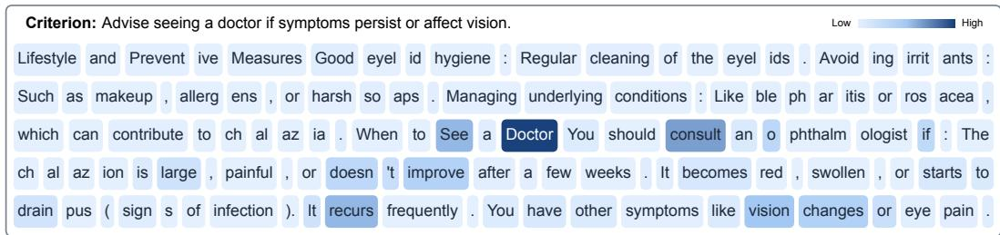  
Figure 5: Visualization of criterion–token relevance in a medical response. Darker colors indicate higher JSD between next-token distributions with and without criterion conditioning.

## 6 RELATED WORK

Rubrics as rewards. Rubric-based RL evaluates open-ended responses against explicit criteria, typically aggregating the resulting judgments into a scalar reward (Gunjal et al., 2026; Viswanathan et al., 2025; Huang et al., 2025). To strengthen the learning signal, existing methods refine criteria as the policy evolves (Shao et al., 2026; Li et al., 2026), adjust criterion weights (Tyagi et al., 2026), or alternate optimization across criterion categories (Lan et al., 2026). However, these methods retain response-level rewards. To provide finer-grained supervision, another line of work localizes criterion feedback to reasoning steps or token spans (Xu et al., 2026b; Xie et al., 2026; Gandhi et al., 2026; Jin et al., 2026). Their reliance on explicit attribution signals or separately trained relevance models adds supervision and computational overhead that complicates scaling. More fundamentally, these advances do not by themselves ensure that each criterion’s signed contribution to the response-level advantage is preserved, motivating our focus on criterion-aware credit assignment.

Rubrics as guidance. Beyond defining rewards, rubrics also provide training-time guidance for policy learning. One line of work guides rollout generation with rubric instructions or feedback to promote exploration (Zhou et al., 2026; Bi et al., 2026; Zhang et al., 2026b; Hou et al., 2026). However, training on rubric-guided prefixes creates a mismatch with unguided inference, introducing exposure bias and a risk of compounding errors. To avoid this mismatch, another line adopts OPSD, which uses a rubric-informed teacher to provide token-level supervision on rollouts sampled from the unguided student (Gu et al., 2026; Rezaei et al., 2026; Bablani et al., 2026; Ye et al., 2026; Wang et al., 2026). Such distillation can serve as a standalone optimization objective or be combined with GRPO as an auxiliary objective. Although these methods provide dense supervision, they introduce a separate imitation objective that may conflict with reward-driven optimization. We therefore use privileged rubric information as a relevance cue for outcome-grounded credit allocation.

Credit assignment. In classical RL, temporal credit is assigned by estimating advantages from value functions (Schulman et al., 2016), redistributing delayed rewards (Arjona-Medina et al., 2019), or inferring action contributions from subsequent outcomes (Harutyunyan et al., 2019; Meulemans et al., 2023). For LLMs trained with RL on verifiable tasks, methods infer local rewards or advantages using implicit reward models (Cui et al., 2026) or shared rollout prefixes (Tran et al., 2026), while others concentrate policy updates on high-entropy tokens (Wang et al., 2025). Rubric-based RL poses an additional challenge: a response may satisfy some criteria while violating others, so redistributing an aggregate advantage alone cannot distinguish their opposing contributions. CoRT derives positive token weights through counterfactual rubric replay (Zhang et al., 2026a), but applies them to a single response-level advantage, tying all token advantages to its sign. Hence, the key is to preserve each criterion’s signed contribution during token-level credit assignment.

## 7 CONCLUSION

In this work, we propose CoCA, a criterion-aware credit assignment framework for rubric-based RL. Our core insight is that effective learning from rubrics requires preserving the distinct contributions of individual criteria and assigning their credit to relevant parts of a response. CoCA realizes this principle by deriving signed criterion credits from observed outcomes and using privileged rubric information to guide their allocation across tokens. This translates criterion-level feedback into finegrained, outcome-grounded policy updates. Experiments across medicine and science show CoCA outperforms standard rubric-based RL by 4.2%, with higher correction and lower regression rates. We hope our work encourages greater attention to credit assignment as a bridge between structured evaluation and policy optimization, paving the way toward more effective RL for open-ended tasks.

## AI USE STATEMENT

We used generative AI for literature retrieval and discovery, coding assistance, and improving the grammar, clarity, and readability of author-written text. In our experimental pipeline, gpt-oss-120b and DeepSeek-V4.1-Flash served as rubric-based judges, while GPT-6 Astra generated word-level annotations for the criterion–token relevance analysis. These experimental uses and their validation procedures are described in the appendix. The authors reviewed all AI-assisted work and take full responsibility for the content of the paper.

## ETHICS STATEMENT

This work develops and evaluates a criterion-aware reinforcement learning method using only publicly available datasets and benchmarks in medical and scientific QA. The medical benchmarks serve as research testbeds for assessing open-ended response quality and generalization. Accordingly, our results should not be interpreted as evidence of clinical safety or suitability for clinical use.

## REPRODUCIBILITY STATEMENT

Complete proofs of the theoretical results are provided in Appendix A. We document the datasets and data splits, evaluation protocols, prompts, training and implementation settings, and baseline reproduction details in Appendix B. The source code, configuration files, and evaluation scripts are included in the anonymous supplementary material.

## REFERENCES

Jose A. Arjona-Medina, Michael Gillhofer, Michael Widrich, Thomas Unterthiner, Johannes Brandstetter, and Sepp Hochreiter. RUDDER: Return decomposition for delayed rewards. In Advances in Neural Information Processing Systems, volume 32. Curran Associates, Inc., 2019.

Rahul K Arora, Jason Wei, Rebecca Soskin Hicks, Preston Bowman, Joaquin Quinonero-Candela, ˜ Foivos Tsimpourlas, Michael Sharman, Meghan Shah, Andrea Vallone, Alex Beutel, et al. Health-Bench: Evaluating large language models towards improved human health. arXiv preprint arXiv:2505.08775, 2025.

Deepika Bablani, Ajay Gupta, and Wanming Chen. Rubrics as privileged information for openended generation. arXiv preprint arXiv:2608.02948, 2026.

Baolong Bi, Shenghua Liu, Yiwei Wang, Siqian Tong, Lingrui Mei, Yuyao Ge, Yilong Xu, Jiafeng Guo, and Xueqi Cheng. Reward and guidance through rubrics: Promoting exploration to improve multi-domain reasoning. In Forty-third International Conference on Machine Learning, 2026.

Ganqu Cui, Lifan Yuan, Zefan Wang, Hanbin Wang, Yuchen Zhang, Jiacheng Chen, Wendi Li, Bingxiang He, Yuchen Fan, Tianyu Yu, Qixin Xu, Weize Chen, Jiarui Yuan, Huayu Chen, Kaiyan Zhang, Xingtai Lv, Shuo Wang, Yuan Yao, Xu Han, Hao Peng, Yu Cheng, Zhiyuan Liu, Maosong Sun, Bowen Zhou, and Ning Ding. Process reinforcement through implicit rewards. Transactions on Machine Learning Research, 2026.

Shubham Gandhi, Saurabh Goyal, Kiran Kate, and Yara Rizk. DRACO: Fine-grained credit assignment with dynamic rubrics for long-horizon agent training. arXiv preprint arXiv:2609.04094, 2026.

Siyi Gu, Jialin Chen, Sophia Zhou, Arman Cohan, and Rex Ying. Rethinking reward supervision: Rubric-conditioned self-distillation. arXiv preprint arXiv:2606.19327, 2026.

Anisha Gunjal, Anthony Wang, Elaine Lau, Vaskar Nath, Yunzhong He, Bing Liu, and Sean Hendryx. Rubrics as rewards: Reinforcement learning beyond verifiable domains. In International Conference on Learning Representations, pp. 127924–127945, 2026.

Anna Harutyunyan, Will Dabney, Thomas Mesnard, Mohammad Gheshlaghi Azar, Bilal Piot, Nicolas Heess, Hado van Hasselt, Gregory Wayne, Satinder Singh, Doina Precup, and Remi Munos. Hindsight credit assignment. In Advances in Neural Information Processing Systems, volume 32. Curran Associates, Inc., 2019.

Helia Hashemi, Jason Eisner, Corby Rosset, Benjamin Van Durme, and Chris Kedzie. LLM-rubric: A multidimensional, calibrated approach to automated evaluation of natural language texts. In Proceedings of the 62nd Annual Meeting of the Association for Computational Linguistics (Volume 1: Long Papers), pp. 13806–13834. Association for Computational Linguistics, 2024. doi: 10.18653/v1/2024.acl-long.745.

Jinkun Hou, Zhuo Liu, Huimin Ren, Hongsheng Xin, Pan Zhou, and Kun Zhan. RISE-RL: Rubric-informed selective exploration for open-ended reinforcement learning. arXiv preprint arXiv:2608.09123, 2026.

Zenan Huang, Yihong Zhuang, Guoshan Lu, Zeyu Qin, Haokai Xu, Tianyu Zhao, Ru Peng, Jiaqi Hu, Zhanming Shen, Xiaomeng Hu, et al. Reinforcement learning with rubric anchors. arXiv preprint arXiv:2508.12790, 2025.

Jonas Hubotter, Frederike L ¨ ubeck, Lejs Behric, Anton Baumann, Marco Bagatella, Daniel Marta,¨ Ido Hakimi, Idan Shenfeld, Thomas Kleine Buening, Carlos Guestrin, and Andreas Krause. Reinforcement learning via self-distillation. In Forty-third International Conference on Machine Learning, 2026.

Ruipeng Jia, Yunyi Yang, Yongbo Gai, Kai Luo, Shihao Huang, Jianhe Lin, Xiaoxi Jiang, and Guanjun Jiang. Writing-Zero: Bridge the gap between non-verifiable tasks and verifiable rewards. arXiv preprint arXiv:2506.00103, 2025.

Yuxin Jiang, Yufei Wang, Qiyuan Zhang, Xingshan Zeng, Liangyou Li, Jierun Chen, Chaofan Tao, Haoli Bai, and Lifeng Shang. From verifiable dot to reward chain: Harnessing verifiable reference-based rewards for reinforcement learning of open-ended generation. In International Conference on Learning Representations, pp. 16575–16593, 2026.

Di Jin, Eileen Pan, Nassim Oufattole, Wei-Hung Weng, Hanyi Fang, and Peter Szolovits. What disease does this patient have? a large-scale open domain question answering dataset from medical exams. Applied Sciences, 11(14):6421, 2021. doi: 10.3390/app11146421.

Rui Jin, Jikai Chen, Yihan Chen, Hao Zhou, Demin Zhu, Kaichen Yang, Dong Wang, Linjian Mo, and Chenyi Zhuang. Rubric-to-code credit assignment for reinforcement learning. arXiv preprint arXiv:2608.27906, 2026.

Guangchen Lan, Lian Xiong, Xin Zhou, Hejie Cui, Yuwei Zhang, Mao Li, Zhenyu Shi, Besnik Fetahu, Lihong Li, and Xian Li. Alternating reinforcement learning with contextual rubric rewards: Beyond the scalarization strategy. arXiv preprint arXiv:2603.15646, 2026.

Siyuan Li, Xinxin Song, Ruinian Chen, Jingjing Fan, Tingxiong Xiao, Yangen Hu, Ke Zeng, and Jinli Suo. CARE: Contrastive anchor-based rubric evolution for large language model posttraining. arXiv preprint arXiv:2609.00892, 2026.

Tianci Liu, Ran Xu, Tony Yu, Ilgee Hong, Carl Yang, Tuo Zhao, and Haoyu Wang. OpenRubrics: Towards scalable synthetic rubric generation for reward modeling and LLM alignment. In Pro ceedings of the 64th Annual Meeting of the Association for Computational Linguistics (Volume 1: Long Papers), pp. 17417–17437. Association for Computational Linguistics, 2026a. doi: 10.18653/v1/2026.acl-long.791.

Wenhan Liu, Jiajie Jin, Zhaoheng Huang, Tongyu Wen, Guanting Dong, Ziliang Zhao, Yutao Zhu, Zhicheng Dou, and Ji-Rong Wen. The rules of the game: A survey of rubrics for large language models, 2026b.

Zichen Liu, Changyu Chen, Wenjun Li, Penghui Qi, Tianyu Pang, Chao Du, Wee Sun Lee, and Min Lin. Understanding r1-zero-like training: A critical perspective. In Conference on Language Modeling (COLM), 2025.

Alexander Meulemans, Simon Schug, Seijin Kobayashi, Nathaniel Daw, and Gregory Wayne. Would i have gotten that reward? long-term credit assignment by counterfactual contribution analysis. In Advances in Neural Information Processing Systems, volume 36, pp. 68685–68735. Curran Associates, Inc., 2023. doi: 10.52202/075280-3006.

Team Olmo, Allyson Ettinger, Amanda Bertsch, Bailey Kuehl, David Graham, David Heineman, Dirk Groeneveld, Faeze Brahman, Finbarr Timbers, Hamish Ivison, et al. Olmo 3. arXiv preprint arXiv:2512.13961, 2025.

David Rein, Betty Li Hou, Asa Cooper Stickland, Jackson Petty, Richard Yuanzhe Pang, Julien Dirani, Julian Michael, and Samuel R. Bowman. GPQA: A graduate-level google-proof Q&A benchmark. In First Conference on Language Modeling, 2024.

MohammadHossein Rezaei, Anas Mahmoud, Zihao Wang, Utkarsh Tyagi, Advait Gosai, Razvan-Gabriel Dumitru, Aakash Sabharwal, Bing Liu, and Yunzhong He. Rubric-guided self-distillation: Post-training without rubric verifiers. arXiv preprint arXiv:2606.12507, 2026.

John Schulman, Philipp Moritz, Sergey Levine, Michael I. Jordan, and Pieter Abbeel. Highdimensional continuous control using generalized advantage estimation. In International Conference on Learning Representations, 2016.

Rulin Shao, Akari Asai, Shannon Zejiang Shen, Hamish Ivison, Varsha Kishore, Jingming Zhuo, Xinran Zhao, Molly Park, Samuel G. Finlayson, David Sontag, Tyler Murray, Sewon Min, Pradeep Dasigi, Luca Soldaini, Faeze Brahman, Wen-tau Yih, Tongshuang Wu, Luke Zettlemoyer, Yoon Kim, Hannaneh Hajishirzi, and Pang Wei Koh. Reinforcement learning with evolving rubrics for deep research. In Forty-third International Conference on Machine Learning, 2026.

Zhihong Shao, Peiyi Wang, Qihao Zhu, Runxin Xu, Junxiao Song, Xiao Bi, Haowei Zhang, Mingchuan Zhang, Y. K. Li, Y. Wu, and Daya Guo. DeepSeekMath: Pushing the limits of mathematical reasoning in open language models. arXiv preprint arXiv:2402.03300, 2024.

Guangming Sheng, Chi Zhang, Zilingfeng Ye, Xibin Wu, Wang Zhang, Ru Zhang, Yanghua Peng, Haibin Lin, and Chuan Wu. HybridFlow: A flexible and efficient RLHF framework. In Proceedings of the Twentieth European Conference on Computer Systems, pp. 1279–1297. Association for Computing Machinery, 2025. doi: 10.1145/3689031.3696075.

Hieu Tran, Zonghai Yao, and Hong Yu. Exploiting tree structure for credit assignment in reinforcement learning with large language models. In Findings of the Association for Computational Linguistics: ACL 2026, pp. 10795–10810. Association for Computational Linguistics, 2026. doi: 10.18653/v1/2026.findings-acl.524.

Utkarsh Tyagi, Xingang Guo, MohammadHossein Rezaei, Daniel George, Anas Mahmoud, Jackson Lee, Bing Liu, and Yunzhong He. Not every rubric teaches equally: Policy-aware rubric rewards for RLVR. arXiv preprint arXiv:2605.20164, 2026.

Vijay Viswanathan, Yanchao Sun, Xiang Kong, Meng Cao, Graham Neubig, and Sherry Wu. Check lists are better than reward models for aligning language models. In Advances in Neural Information Processing Systems, volume 38, pp. 114728–114754. Curran Associates, Inc., 2025. doi: 10.52202/085713-3824.

Shenzhi Wang, Le Yu, Chang Gao, Chujie Zheng, Shixuan Liu, Rui Lu, Kai Dang, Xiong-Hui Chen, Jianxin Yang, Zhenru Zhang, Yuqiong Liu, An Yang, Andrew Zhao, Yang Yue, Shiji Song, Bowen Yu, Gao Huang, and Junyang Lin. Beyond the 80/20 rule: High-entropy minority tokens drive effective reinforcement learning for LLM reasoning. In Advances in Neural Information Processing Systems, volume 38, pp. 115452–115486. Curran Associates, Inc., 2025. doi: 10. 52202/085713-3850.

Yuhan Wang, Zhengxi Lu, Yuchen Yan, Kaitao Song, Wenqi Zhang, Weiming Lu, Jun Xiao, Yueting Zhuang, and Yongliang Shen. PaperGym: Rubric-centered evolution for research-plan generation. arXiv preprint arXiv:2608.31119, 2026.

Weichu Xie, Haozhe Zhao, Wenpu Liu, Yongfu Zhu, Liang Chen, Minghao Ye, Zirong Chen, Yuqi Xu, Shuai Dong, Ziyue Wang, et al. Step-wise rubric rewards for LLM reasoning. arXiv preprint arXiv:2605.17291, 2026.

Anyi Xu, B Li, Bangcai Lin, Bing Xue, BingCheng Xian, Bingzheng Xu, Bochao Wu, Bowei Zhang, Boyi Deng, CC Yu, et al. Deepseek-v4. 1-flash: Pushing the limits of kv cache compression. arXiv preprint arXiv:2609.19969, 2026a.

Tianze Xu, Yanzhao Zheng, Pengrui Lu, Lyumanshan Ye, Yong Wu, Zhentao Zhang, Yuanqiang Yu, Chao Ma, Jihuai Zhu, Pengfei Liu, et al. Rubrics to tokens: Bridging response-level rubrics and token-level rewards in instruction following tasks. arXiv preprint arXiv:2604.02795, 2026b.

An Yang, Anfeng Li, Baosong Yang, Beichen Zhang, Binyuan Hui, Bo Zheng, Bowen Yu, Chang Gao, Chengen Huang, Chenxu Lv, et al. Qwen3 technical report. arXiv preprint arXiv:2505.09388, 2025.

Tianzhu Ye, Li Dong, Guanheng Chen, He Zhu, Xun Wu, Shaohan Huang, and Furu Wei. LLM-asa-coach: Experiential learning for non-verifiable tasks. arXiv preprint arXiv:2607.18110, 2026.

Li S. Yifei, Allen Chang, Chaitanya Malaviya, and Mark Yatskar. ResearchQA: Evaluating scholarly question answering at scale across 75 fields with survey-mined questions and rubrics. Transactions of the Association for Computational Linguistics, 14:1365–1389, 2026. doi: 10.1162/tacl.a.732.

Fangyi Yu, Nabeel Seedat, Dasha Herrmannova, Frank Schilder, and Jonathan Richard Schwarz. Beyond pointwise scores: Decomposed criteria-based evaluation of LLM responses. In Proceedings of the 2025 Conference on Empirical Methods in Natural Language Processing: Industry Track, pp. 1931–1954. Association for Computational Linguistics, 2025. doi: 10.18653/v1/2025. emnlp-industry.136.

Bo-Wen Zhang, Junwei He, Wen Wang, Song-Lin Lv, Wentao Ma, Rongyi Lin, Shuhan Zhong, and Lan-Zhe Guo. CoRT: Counterfactual replay for token-level rubric-guided policy optimization. arXiv preprint arXiv:2607.25659, 2026a.

Kaiyan Zhang, Yuxin Zuo, Bingxiang He, Youbang Sun, Runze Liu, Che Jiang, Yuchen Fan, Kai Tian, Guoli Jia, Pengfei Li, et al. A survey of reinforcement learning for large reasoning models. arXiv preprint arXiv:2509.08827, 2025a.

Ming Zhang, Yujiong Shen, Zelin Li, Huayu Sha, Binze Hu, Yuhui Wang, Chenhao Huang, Shichun Liu, Jingqi Tong, Changhao Jiang, Mingxu Chai, Zhiheng Xi, Shihan Dou, Tao Gui, Qi Zhang, and Xuanjing Huang. LLMEval-Med: A real-world clinical benchmark for medical LLMs with physician validation. In Findings of the Association for Computational Linguistics: EMNLP 2025, pp. 4888–4914. Association for Computational Linguistics, 2025b. doi: 10.18653/v1/2025. findings-emnlp.263.

Wenjian Zhang, Kongcheng Zhang, Jiaxin Qi, Jianqiang Huang, and Baisheng Lai. Experience is the best teacher: Motivating effective exploration in reinforcement learning for LLMs. In Forty-third International Conference on Machine Learning, 2026b.

Siyan Zhao, Zhihui Xie, Mengchen Liu, Jing Huang, Guan Pang, Feiyu Chen, and Aditya Grover. Self-distilled reasoner: On-policy self-distillation for large language models. In Forty-third International Conference on Machine Learning, 2026.

Yilun Zhao, Kaiyan Zhang, Tiansheng Hu, Sihong Wu, Ronan Le Bras, Yixin Liu, Robert Tang, Joseph Chee Chang, Jesse Dodge, Jonathan Bragg, Chen Zhao, Hanna Hajishirzi, Doug Downey, and Arman Cohan. SciArena: An open evaluation platform for non-verifiable scientific literaturegrounded tasks. In Advances in Neural Information Processing Systems, volume 38. Curran As sociates, Inc., 2025. doi: 10.52202/085713-3532.

Lianmin Zheng, Wei-Lin Chiang, Ying Sheng, Siyuan Zhuang, Zhanghao Wu, Yonghao Zhuang, Zi Lin, Zhuohan Li, Dacheng Li, Eric Xing, Hao Zhang, Joseph Gonzalez, and Ion Stoica. Judging LLM-as-a-judge with MT-bench and Chatbot Arena. In Advances in Neural Information Processing Systems, volume 36, pp. 46595–46623. Curran Associates, Inc., 2023. doi: 10.52202/075280-2020.

Yang Zhou, Sunzhu Li, Shunyu Liu, Wenkai Fang, Kongcheng Zhang, Jiale Zhao, Jingwen Yang, Yihe Zhou, Jianwei Lv, Tongya Zheng, Hengtong Lu, Wei Chen, Yan Xie, and Mingli Song. Breaking the exploration bottleneck: Rubric-scaffolded reinforcement learning for open-ended LLM reasoning. In Forty-third International Conference on Machine Learning, 2026.

## A THEORETICAL PROOFS

## A.1 PROOF OF PROPOSITION 1

Proposition 1 (Credit resolution collapse in rubric-based RL). For any oracle resolution $\mathbf { C } _ { i } ^ { * } \in$ $\mathcal { C } _ { i } ( \mathbf { a } _ { i } )$ , the token credit induced by rubric-based RL and the corresponding projection error satisfy

$$
\begin{array} { r } { \left( \mathbf { 1 } _ { M } ^ { \top } \mathbf { a } _ { i } \right) \mathbf { 1 } _ { T _ { i } } = A _ { i } \mathbf { 1 } _ { T _ { i } } = \alpha _ { i } ( \Pi _ { \mathcal { U } _ { i } } ( \mathbf { C } _ { i } ^ { * } ) ) , \quad \frac { 1 } { T _ { i } } \left. \mathbf { C } _ { i } ^ { * } - \Pi _ { \mathcal { U } _ { i } } ( \mathbf { C } _ { i } ^ { * } ) \right. _ { F } ^ { 2 } = \sum _ { j = 1 } ^ { M } \operatorname { V a r } _ { t } \left( [ \mathbf { C } _ { i } ^ { * } ] _ { j , t } \right) . } \end{array}\tag{6}
$$

Moreover, the linear map $\mathbf { a } \mapsto ( \mathbf { 1 } _ { M } ^ { \top } \mathbf { a } ) \mathbf { 1 } _ { T _ { i } }$ has rank one and kernel $\mathbf { 1 } _ { M } ^ { \perp }$ . Consequently, any nonzero criterion budget vector $\mathbf { a } _ { i } \in \mathbf { 1 } _ { M } ^ { \perp }$ yields a zero token-credit vector, while any position t satisfying $A _ { i } [ \alpha _ { i } ( \mathbf { C } _ { i } ^ { * } ) ] _ { t } \mathrm { ~ < ~ } 0$ is assigned credit whose sign is opposite to its oracle token credit.

Proof. Fix a rollout i and an oracle resolution $\mathbf { C } _ { i } ^ { * } \in \mathcal { C } _ { i } ( \mathbf { a } _ { i } )$ . Recall that $\mathcal { U } _ { i } = \{ \mathbf { u } \mathbf { 1 } _ { T _ { i } } ^ { \top } : \mathbf { u } \in \mathbb { R } ^ { M } \}$ consists of matrices whose rows are constant across tokens. For any $\mathbf { C } \in \mathbb { R } ^ { M \times T _ { i } }$ , write $\mu _ { j } ~ =$ $T _ { i } ^ { - 1 } \sum _ { t } C _ { j , t }$ for its j-th row mean. Centering each row gives

$$
\begin{array} { l } { \| { \bf C } - { \bf u } { \bf 1 } _ { T _ { i } } ^ { \top } \| _ { F } ^ { 2 } = \displaystyle \sum _ { j = 1 } ^ { M } \sum _ { t = 1 } ^ { T _ { i } } \bigl ( ( C _ { j , t } - \mu _ { j } ) + ( \mu _ { j } - u _ { j } ) \bigr ) ^ { 2 } } \\ { = \displaystyle \sum _ { j = 1 } ^ { M } \sum _ { t = 1 } ^ { T _ { i } } ( C _ { j , t } - \mu _ { j } ) ^ { 2 } + T _ { i } \sum _ { j = 1 } ^ { M } ( u _ { j } - \mu _ { j } ) ^ { 2 } . } \end{array}
$$

The cross terms vanish because $\begin{array} { r } { \sum _ { t } ( C _ { j , t } - \mu _ { j } ) = 0 } \end{array}$ for every row. The first term is independent of u, while the second is uniquely minimized at $u _ { j } = \mu _ { j }$ . Thus, projection replaces each row by its mean. Since $T _ { i } ^ { - 1 } \mathbf { C } _ { i } ^ { * } \mathbf { 1 } _ { T _ { i } } = \mathbf { a } _ { i }$ by the budget constraint,

$$
\Pi _ { { \mathcal { U } } _ { i } } ( \mathbf { C } ) = \left( \frac { 1 } { T _ { i } } \mathbf { C } \mathbf { 1 } _ { T _ { i } } \right) \mathbf { 1 } _ { T _ { i } } ^ { \top } , \qquad \Pi _ { { \mathcal { U } } _ { i } } ( \mathbf { C } _ { i } ^ { * } ) = \mathbf { a } _ { i } \mathbf { 1 } _ { T _ { i } } ^ { \top } .
$$

Using $\alpha _ { i } ( \mathbf { C } ) = \mathbf { C } ^ { \top } \mathbf { 1 } _ { M }$ and $\mathbf { 1 } _ { M } ^ { \top } \mathbf { a } _ { i } = A _ { i }$ , we obtain

$$
\alpha _ { i } ( \Pi _ { \mathcal { U } _ { i } } ( \mathbf { C } _ { i } ^ { * } ) ) = ( \mathbf { a } _ { i } \mathbf { 1 } _ { T _ { i } } ^ { \top } ) ^ { \top } \mathbf { 1 } _ { M } = ( \mathbf { 1 } _ { M } ^ { \top } \mathbf { a } _ { i } ) \mathbf { 1 } _ { T _ { i } } = A _ { i } \mathbf { 1 } _ { T _ { i } } .
$$

This is the token-credit vector used by rubric-based RL, regardless of the oracle’s allocation within each row. Moreover, because the j-th row of $\mathbf { C } _ { i } ^ { * }$ has mean $A _ { i j }$

$$
\frac { 1 } { T _ { i } } \left. \mathbf { C } _ { i } ^ { * } - \Pi _ { M _ { i } } ( \mathbf { C } _ { i } ^ { * } ) \right. _ { F } ^ { 2 } = \sum _ { j = 1 } ^ { M } \frac { 1 } { T _ { i } } \sum _ { t = 1 } ^ { T _ { i } } \bigl ( [ \mathbf { C } _ { i } ^ { * } ] _ { j , t } - A _ { i j } \bigr ) ^ { 2 } = \sum _ { j = 1 } ^ { M } \mathrm { V a r } _ { t } ( [ \mathbf { C } _ { i } ^ { * } ] _ { j , t } ) ,
$$

where $\operatorname { V a r } _ { t }$ uses the uniform distribution over the $T _ { i }$ token positions. Thus, the projection discards exactly the within-criterion variation measured by this identity.

Finally, the budget-to-token map is represented by $\mathbf { L } _ { i } = \mathbf { 1 } _ { T _ { i } } \mathbf { 1 } _ { M } ^ { \top }$ . Both factors in this outer product are nonzero, so ran $\mathbf { \nabla } [ \mathbf { L } _ { i } ) = 1$ . Furthermore,

$$
\mathbf { L } _ { i } \mathbf { a } = 0 \quad \Longleftrightarrow \quad \mathbf { 1 } _ { M } ^ { \top } \mathbf { a } = 0 , \qquad \mathrm { k e r } \mathbf { L } _ { i } = \mathbf { 1 } _ { M } ^ { \perp } .
$$

Every nonzero vector in this kernel gives zero token credit despite its nonzero criterion contributions. Since rubric-based RL assigns $A _ { i }$ at every position, the condition $A _ { i } [ \alpha _ { i } ( \mathbf { C } _ { i } ^ { * } ) ] _ { t } < 0$ means that the assigned and oracle token credits are nonzero and have opposite signs. □

## A.2 PROOF OF PROPOSITION 2

Proposition 2 (OPSD matching can reduce reward). Consider the next-token decision at $h _ { i , t }$ as a one-step contextual bandit withfinite action space V, a rewardfunction $R : \mathcal { V } \to \mathbb { R }$ , and a tabular softmax policy. Let $\theta ^ { \prime }$ be obtained by a natural-gradient descent step of size $\eta > 0$ on the KL term ofEq. (2), using the local Fisher information and holding the self-teacherfixed. Then, as $\eta  0 ,$

$$
J ( \theta ^ { \prime } ; h _ { i , t } ) - J ( \theta ; h _ { i , t } ) = \eta \operatorname { C o v } _ { a \sim \pi _ { \theta } ( \cdot | h _ { i , t } ) } { \left( R ( a ) , r _ { i , t } ( a ; \xi ) \right) } + \mathcal { O } ( \eta ^ { 2 } ) .\tag{7}
$$

When $| \nu | \geq 3 ,$ there exist instances for which $J ( \theta ; h _ { i , t } ( \xi ) ) > J ( \theta ; h _ { i , t } )$ while the covariance in $E q . ( 7 )$ is strictly negative, implying $\dot { J ( \theta ^ { \prime } ; h _ { i , t } ) } < \dot { J ( \theta ; h _ { i , t } ) }$ for sufficiently small $\eta > 0$

Proof. We first derive the local natural-gradient update and its first-order effect on reward. We then construct a higher-reward teacher for which this effect is negative. Throughout the proof, the action space is finite and all logarithms are natural.

Local matching update. At the fixed context $h = h _ { i , t } .$ , write p for the student distribution, q for the detached teacher distribution, and r for their matching signal:

$$
\begin{array} { r } { p _ { a } = \pi _ { \theta } ( a \mid h ) , \qquad q _ { a } = \pi _ { \theta } ( a \mid h _ { i , t } ( \xi ) ) , \qquad r _ { a } = \log \frac { q _ { a } } { p _ { a } } . } \end{array}
$$

These quantities are evaluated before the update, and q is held fixed when differentiating the matching objective. Finite softmax logits ensure $p _ { a } , q _ { a } > 0$ , so every $r _ { a }$ is finite. Let $n = | \nu |$ and let $\pmb { \vartheta } \in \mathbb { R } ^ { n }$ denote the student logits at this fixed context. The local reverse-KL loss is

$$
\ell ( \pmb { \vartheta } ) = D _ { \mathrm { K L } } ( p \| q ) = \sum _ { a \in \mathcal { V } } p _ { a } \log \frac { p _ { a } } { q _ { a } } , \qquad p _ { a } = \frac { e ^ { \vartheta _ { a } } } { \sum _ { b \in \mathcal { V } } e ^ { \vartheta _ { b } } } .
$$

Writing ${ \bf e } _ { a }$ for the coordinate vector of action a, softmax differentiation gives

$$
\nabla \vartheta \log p _ { a } = \mathbf { e } _ { a } - p , \qquad { \frac { \partial p _ { a } } { \partial \vartheta _ { b } } } = p _ { a } { \big ( } \mathbf { 1 } \{ a = b \} - p _ { b } { \big ) } .
$$

Consequently, the local Fisher matrix equals the softmax Jacobian:

$$
F = \sum _ { a } p _ { a } ( \mathbf { e } _ { a } - p ) ( \mathbf { e } _ { a } - p ) ^ { \top } = \mathrm { d i a g } ( p ) - p p ^ { \top } .
$$

Differentiating the loss through the student probabilities yields

$$
\begin{array} { l } { \displaystyle \frac { \partial \ell } { \partial \vartheta _ { b } } = \sum _ { a } \frac { \partial p _ { a } } { \partial \vartheta _ { b } } \left( \log \frac { p _ { a } } { q _ { a } } + 1 \right) , } \\ { \nabla _ { \vartheta } \ell = F ( \log p - \log q + 1 _ { n } ) = - F \mathbf { r } , } \end{array}
$$

Here $\mathbf { r } = ( r _ { a } ) _ { a \in \mathcal { V } }$ , vector logarithms are componentwise, and $F \mathbf { 1 } _ { n } = 0$ gives the last equality.

The Fisher matrix is singular because softmax is invariant to a common shift of all logits. Its nullspace can be identified from the following quadratic form, valid for every $\mathbf { v } \in \mathbb { R } ^ { n }$

$$
\mathbf { v } ^ { \top } F \mathbf { v } = \sum _ { a } p _ { a } v _ { a } ^ { 2 } - \left( \sum _ { a } p _ { a } v _ { a } \right) ^ { 2 } = \mathrm { V a r } _ { a \sim p } ( v _ { a } ) .
$$

Since p has full support, this variance vanishes exactly when every $v _ { a }$ has the same value. Thus ker $F = \operatorname { s p a n } ( \mathbf { 1 } _ { n } )$ , and its Moore–Penrose pseudoinverse satisfies

$$
F ^ { \dagger } F = I _ { n } - { \frac { 1 } { n } } \mathbf { 1 } _ { n } \mathbf { 1 } _ { n } ^ { \top } .
$$

The natural-gradient descent step, with F evaluated at the original student policy, is therefore

$$
\vartheta ^ { \prime } = \vartheta - \eta F ^ { \dagger } \nabla _ { \vartheta } \ell = \vartheta + \eta F ^ { \dagger } F \mathbf { r } = \vartheta + \eta ( \mathbf { r } - \kappa \mathbf { 1 } _ { n } ) , \qquad \kappa = \frac { 1 } { n } \sum _ { a } r _ { a } .
$$

The common shift −ηκ cancels in softmax, giving the exact probability update

$$
p _ { a } ^ { \prime } = \frac { e ^ { \vartheta _ { a } + \eta ( r _ { a } - \kappa ) } } { \sum _ { b } e ^ { \vartheta _ { b } + \eta ( r _ { b } - \kappa ) } } = \frac { p _ { a } e ^ { \eta r _ { a } } } { Z ( \eta ) } , \qquad Z ( \eta ) = \sum _ { b } p _ { b } e ^ { \eta r _ { b } } .
$$

First-order changes in reward and matching loss. Let $\bar { r } = \sum _ { a } p _ { a } r _ { a }$ be the student-weighted mean of the matching signal. This differs from the unweighted mean κ used only to fix the logit shift above. Expanding the normalizing factor and its reciprocal at $\eta = 0$ gives

$$
Z ( \eta ) = 1 + \eta \bar { r } + \mathcal { O } ( \eta ^ { 2 } ) , \qquad Z ( \eta ) ^ { - 1 } = 1 - \eta \bar { r } + \mathcal { O } ( \eta ^ { 2 } ) .
$$

Combining these expansions with $e ^ { \eta r _ { a } } = 1 + \eta r _ { a } + \mathcal { O } ( \eta ^ { 2 } )$ yields

$$
p _ { a } ^ { \prime } = p _ { a } \left( 1 + \eta r _ { a } + \mathcal { O } ( \eta ^ { 2 } ) \right) \left( 1 - \eta \bar { r } + \mathcal { O } ( \eta ^ { 2 } ) \right) = p _ { a } + \eta p _ { a } ( r _ { a } - \bar { r } ) + \mathcal { O } ( \eta ^ { 2 } ) .
$$

For fixed $p , q ,$ every log-ratio is finite and $Z ( 0 ) = 1$ , so the updated probabilities are smooth near $\eta = 0$ . The finite action space allows a common bound on their second-order remainders. Since V is finite and R is real-valued, ma $\mathrm { x } _ { a \in \mathcal { V } } | R ( a ) | < \infty$ . Multiplying the probability expansion by $R ( a )$ and summing therefore gives

$$
\begin{array} { l } { { J ( \theta ^ { \prime } ; h ) - J ( \theta ; h ) = \displaystyle \sum _ { a } R ( a ) ( p _ { a } ^ { \prime } - p _ { a } ) } } \\ { { \displaystyle \qquad = \eta \left( \sum _ { a } p _ { a } R ( a ) r _ { a } - \left( \sum _ { a } p _ { a } R ( a ) \right) \left( \sum _ { a } p _ { a } r _ { a } \right) \right) + \mathcal { O } ( \eta ^ { 2 } ) } } \\ { { \displaystyle \qquad = \eta \operatorname { C o v } _ { a \sim p } ( R ( a ) , r _ { a } ) + \mathcal { O } ( \eta ^ { 2 } ) . } } \end{array}
$$

Restoring $h = h _ { i , t }$ and $r _ { a } = r _ { i , t } ( a ; \xi )$ proves the first assertion.

The same step also decreases the local matching loss for sufficiently small positive η whenever r is nonconstant. Indeed, a Taylor expansion of the loss along the update direction gives

$$
\begin{array} { r l } & { \ell ( \pmb { \vartheta } ^ { \prime } ) - \ell ( \pmb { \vartheta } ) = - \eta ( \nabla _ { \pmb { \vartheta } } \ell ) ^ { \top } F ^ { \dag } \nabla _ { \pmb { \vartheta } } \ell + \mathcal { O } ( \eta ^ { 2 } ) } \\ & { \qquad = - \eta \mathbf { r } ^ { \top } F F ^ { \dag } F \mathbf { r } + \mathcal { O } ( \eta ^ { 2 } ) = - \eta \operatorname { V a r } _ { a \sim p } ( r _ { a } ) + \mathcal { O } ( \eta ^ { 2 } ) , } \end{array}
$$

using $F F ^ { \dagger } F = F$ . A negative reward covariance is possible only when r is nonconstant. Thus, in that case, small matching steps decrease both the distillation loss and expected reward.

A higher-reward teacher with a harmful matching direction. Consider three actions with rewards R, student probabilities $p ,$ and teacher probabilities $q ,$ , listed in the same order:

$$
R = \left( 1 , { \frac { 1 } { 2 } } , 0 \right) , \qquad p = \left( { \frac { 1 } { 2 0 } } , { \frac { 9 } { 2 0 } } , { \frac { 1 } { 2 } } \right) , \qquad q = \left( { \frac { 3 } { 1 0 } } , { \frac { 1 } { 2 0 } } , { \frac { 1 3 } { 2 0 } } \right) .
$$

Both distributions have full support and sum to one. Their expected rewards are

$$
\mathbb { E } _ { p } [ R ] = { \frac { 1 } { 2 0 } } + { \frac { 9 } { 2 0 } } \cdot { \frac { 1 } { 2 } } = { \frac { 1 1 } { 4 0 } } , \qquad \mathbb { E } _ { q } [ R ] = { \frac { 3 } { 1 0 } } + { \frac { 1 } { 2 0 } } \cdot { \frac { 1 } { 2 } } = { \frac { 1 3 } { 4 0 } } .
$$

The teacher therefore has strictly higher expected reward. Nevertheless, its matching signal $\mathbf { r } =$ (log 6, − log 9, log(13/10)) has negative covariance with reward under the student:

$$
\begin{array} { l } { { \displaystyle \operatorname { C o v } _ { p } ( R , r ) = \sum _ { a = 1 } ^ { 3 } p _ { a } \left( R ( a ) - \frac { 1 1 } { 4 0 } \right) r _ { a } } } \\ { { \displaystyle ~ = \frac { 1 } { 2 0 } \cdot \frac { 2 9 } { 4 0 } \log 6 - \frac { 9 } { 2 0 } \cdot \frac { 9 } { 4 0 } \log 9 - \frac { 1 } { 2 } \cdot \frac { 1 1 } { 4 0 } \log \frac { 1 3 } { 1 0 } } } \\ { { \displaystyle ~ = \frac { 2 9 \log 6 - 8 1 \log 9 - 1 1 0 \log ( 1 3 / 1 0 ) } { 8 0 0 } < 0 . } } \end{array}
$$

The sign is strict because log 9 > log 6 > 0 and $\log ( 1 3 / 1 0 ) > 0$ . This construction is realizable by a tabular softmax policy: choose the logits to be log p at the ordinary context and log q at the privileged context. All logits are finite, and the two context-specific tables can be chosen independently.

With $c = - \operatorname { C o v } _ { p } ( R , r ) > 0$ , the reward expansion becomes

$$
J ( \theta ^ { \prime } ; h ) - J ( \theta ; h ) = - c \eta + \mathcal { O } ( \eta ^ { 2 } ) .
$$

For all sufficiently small positive η, the remainder has magnitude at most $c \eta / 2$ . The reward change is then at most $- c \eta / 2 < 0$ , even though the teacher has higher expected reward. The matching-loss expansion also ensures that the same step strictly decreases the distillation objective.

Finally, extend the construction to any $n > 3$ by keeping the first two actions and replacing the third by $n - 2$ zero-reward actions. For each $a = 3 , \ldots , n$ , set

$$
R ( a ) = 0 , \qquad p _ { a } = { \frac { 1 } { 2 ( n - 2 ) } } , \qquad q _ { a } = { \frac { 1 3 } { 2 0 ( n - 2 ) } } .
$$

These actions retain the original third action’s total student and teacher probabilities, and each has the same log-ratio log(13/10). Their combined contribution to the reward–signal covariance is therefore unchanged. Both expected rewards are also unchanged, and full support is preserved. The counterexample consequently holds for every $| \nu | \geq 3$ □

## A.3 PROOF OF PROPOSITION 3

Proposition 3 (Grounding-preserving resolution improvement). For any $\beta \geq 0 ,$ , CoCA preserves each criterion’s budget and the sign ofits token-level contributions, with $\widehat { \mathbf { C } } _ { i } ( \beta ) \in \mathcal { C } _ { i } ( \mathbf { a } _ { i } )$ . For each selected criterion $j \in S _ { i }$ with $\Delta _ { i j } > 0 ,$ , the following holds whenever $0 < \beta < 8 \Delta _ { i j } / b _ { i j } ^ { 2 }$

$$
\begin{array} { r } { \frac { 1 } { T _ { i } } \sum _ { t \notin \mathcal { T } _ { i j } } \left| [ \widehat { \mathbf { C } } _ { i } ( \beta ) ] _ { j , t } \right| < | A _ { i j } | \left( 1 - \frac { | \mathcal { T } _ { i j } | } { T _ { i } } \right) . } \end{array}\tag{11}
$$

The right-hand side gives the same quantity under uniform allocation.

Proof. Fix a rollout i and hold its criterion budgets, selected set, relevance scores, and relevant token sets fixed as $\beta$ varies. We first prove budget and sign preservation, then compare the credit magnitude assigned to irrelevant positions with its value under uniform allocation.

Budget and sign preservation. Write $\omega _ { i j , t } ( \beta ) = [ \omega _ { i j } ( \beta ) ] _ { \ i }$ . For each selected criterion $j \in \mathcal S _ { i }$ positivity of the exponential and normalization of the weights give

$$
\omega _ { i j , t } ( \beta ) = \frac { T _ { i } e ^ { \beta d _ { i j , t } } } { \sum _ { u = 1 } ^ { T _ { i } } e ^ { \beta d _ { i j , u } } } > 0 , \qquad \frac { 1 } { T _ { i } } \sum _ { t = 1 } ^ { T _ { i } } \omega _ { i j , t } ( \beta ) = 1 .
$$

For $j \notin S _ { i }$ , the weights equal one, so positivity and normalization hold for every criterion. Multiplication by the fixed budget then gives the following row-mean identity:

$$
\frac { 1 } { T _ { i } } \sum _ { t = 1 } ^ { T _ { i } } [ \widehat { \mathbf { C } } _ { i } ( \beta ) ] _ { j , t } = A _ { i j } \frac { 1 } { T _ { i } } \sum _ { t = 1 } ^ { T _ { i } } \omega _ { i j , t } ( \beta ) = A _ { i j } .
$$

These row-mean identities show $\widehat { \mathbf { C } } _ { i } ( \beta ) \in \mathcal { C } _ { i } ( \mathbf { a } _ { i } )$ . Positive weights ensure that each nonzero row has its budget’s sign, while zero budgets yield zero rows. Taking absolute values rowwise and summing the signed credits over criteria gives

$$
\frac { 1 } { T _ { i } } \sum _ { t = 1 } ^ { T _ { i } } \left| [ \widehat { \mathbf { C } } _ { i } ( \beta ) ] _ { j , t } \right| = | A _ { i j } | , \qquad \frac { 1 } { T _ { i } } \sum _ { t = 1 } ^ { T _ { i } } \widehat { A } _ { i , t } = \sum _ { j = 1 } ^ { M } A _ { i j } = A _ { i } .
$$

Thus, redistribution also preserves each row’s total credit magnitude and the response-level mean advantage. $\operatorname { A t } \beta = 0$ , all weights equal one, recovering uniform allocation.

Reduction to a comparison of exponential averages. Fix a selected criterion $j \in S _ { i }$ with $\Delta _ { i j } > 0$ Because selection is restricted to nonzero budgets, $A _ { i j } \neq 0$ . For readability, write $T = T _ { i } , A { \bar { = } } A _ { i j }$ $d _ { t } = d _ { i j , t } , \Delta = \Delta _ { i j }$ , and $b = b _ { i j }$ . Let $\tau = \tau _ { i j }$ and $\mathcal { N } = \{ 1 , . . . , \dot { T } \} \setminus \mathcal { T }$ The assumption $\emptyset \neq T \subsetneq \{ 1 , . . . , T \}$ ensures $m \stackrel {  } { = } | \mathcal { T } | > 0 , n = \mathsf { \bar { \Pi } } | \mathcal { N } | > 0$ , and $m + n = T$ . The relevant set is specified without using the scores, and its mean-score advantage is

$$
\mu _ { \mathcal { T } } = \frac { 1 } { m } \sum _ { t \in \mathcal { T } } d _ { t } , \qquad \mu _ { N } = \frac { 1 } { n } \sum _ { t \in \mathcal { N } } d _ { t } , \qquad \Delta = \mu _ { \mathcal { T } } - \mu _ { N } > 0 .
$$

Define the mean exponential scores on the two sets as

$$
U ( \beta ) = \frac { 1 } { m } \sum _ { t \in \mathcal { T } } e ^ { \beta d _ { t } } , \qquad V ( \beta ) = \frac { 1 } { n } \sum _ { t \in \mathcal { N } } e ^ { \beta d _ { t } } .
$$

Substituting the normalized allocation weights gives the off-target credit magnitude

$$
L ( \boldsymbol { \beta } ) : = \frac { 1 } { T } \sum _ { t \in \mathcal { N } } \left| [ \widehat { \mathbf { C } } _ { i } ( \boldsymbol { \beta } ) ] _ { j , t } \right| = | A | \frac { \sum _ { t \in \mathcal { N } } e ^ { \beta d _ { t } } } { \sum _ { u = 1 } ^ { T } e ^ { \beta d _ { u } } } = | A | \frac { n V ( \boldsymbol { \beta } ) } { m U ( \boldsymbol { \beta } ) + n V ( \boldsymbol { \beta } ) } .
$$

Under uniform allocation, $U ( 0 ) = V ( 0 ) = 1$ , so $L ( 0 ) = | A | n / T . \mathrm { A s } | A | , m , n ,$ , and both exponential averages are positive, $L ( \beta ) < L ( 0 )$ is equivalent to $\dot { U } ( \dot { \beta } ) > V ( \beta )$ . It remains to show that the positive mean-score gap guarantees this ordering under the stated restriction on $\beta .$

Controlling the effect of exponentiation. For the relevant positions, Jensen’s inequality gives

$$
U ( \beta ) = \frac { 1 } { m } \sum _ { t \in \mathcal { T } } e ^ { \beta d _ { t } } \geq \exp \left( \frac { \beta } { m } \sum _ { t \in \mathcal { T } } d _ { t } \right) = e ^ { \beta \mu _ { \mathcal { T } } } .
$$

For the irrelevant positions, we also need to control the increase in the exponential average caused by variation in the scores. For $s \geq 0 ,$ define

$$
\phi ( s ) = \log \left( \frac { 1 } { n } \sum _ { t \in \cal { N } } e ^ { s d _ { t } } \right) , \qquad \nu _ { s } ( t ) = \frac { e ^ { s d _ { t } } } { \sum _ { u \in \cal { N } } e ^ { s d _ { u } } } .
$$

Here $\nu _ { s }$ is a probability distribution over the fixed set ${ \mathcal { N } } .$ . Differentiating the finite sum twice gives

$$
\phi ^ { \prime } ( s ) = \frac { \sum _ { t \in \mathcal { N } } d _ { t } e ^ { s d _ { t } } } { \sum _ { t \in \mathcal { N } } e ^ { s d _ { t } } } = \mathbb { E } _ { t \sim \nu _ { s } } [ d _ { t } ] ,
$$

$$
\phi ^ { \prime \prime } ( s ) = \frac { \sum _ { t \in \mathcal { N } } d _ { t } ^ { 2 } e ^ { s d _ { t } } } { \sum _ { t \in \mathcal { N } } e ^ { s d _ { t } } } - \left( \frac { \sum _ { t \in \mathcal { N } } d _ { t } e ^ { s d _ { t } } } { \sum _ { t \in \mathcal { N } } e ^ { s d _ { t } } } \right) ^ { 2 } = \operatorname { V a r } _ { t \sim \nu _ { s } } ( d _ { t } ) .
$$

To bound this variance uniformly in $s ,$ let $d _ { \operatorname* { m i n } } = \operatorname* { m i n } _ { t } d _ { t } , d _ { \operatorname* { m a x } } = \operatorname* { m a x } _ { t } d _ { t }$ , and $c = ( d _ { \operatorname* { m i n } } +$ $d _ { \mathrm { m a x } } ) / 2$ . The score range is $b = d _ { \operatorname* { m a x } } - d _ { \operatorname* { m i n } } , \operatorname { s o } \left| d _ { t } - c \right| \leq b / 2$ for every position. Therefore,

$$
\phi ^ { \prime \prime } ( s ) = \mathbb { E } _ { \nu _ { s } } [ ( d _ { t } - c ) ^ { 2 } ] - \left( \mathbb { E } _ { \nu _ { s } } [ d _ { t } ] - c \right) ^ { 2 } \leq \mathbb { E } _ { \nu _ { s } } [ ( d _ { t } - c ) ^ { 2 } ] \leq { \frac { b ^ { 2 } } { 4 } } .
$$

At $s = 0 ,$ , the distribution $\nu _ { 0 }$ is uniform on ${ \mathcal { N } } ,$ giving $\phi ( 0 ) = 0$ and $\phi ^ { \prime } ( 0 ) = \mu _ { \mathcal { N } }$ . Applying Taylor’s formula with integral remainder and the uniform variance bound yields

$$
\begin{array} { r l r } {  { \log V ( \beta ) = \phi ( \beta ) = \beta \mu _ { \mathcal { N } } + \int _ { 0 } ^ { \beta } ( \beta - s ) \phi ^ { \prime \prime } ( s ) \mathrm { d } s } } \\ & { } & { \leq \beta \mu _ { \mathcal { N } } + \frac { b ^ { 2 } } { 4 } \int _ { 0 } ^ { \beta } ( \beta - s ) \mathrm { d } s = \beta \mu _ { \mathcal { N } } + \frac { \beta ^ { 2 } b ^ { 2 } } { 8 } . } \end{array}
$$

Strict improvement over uniform allocation. Combining the upper bound on log $V ( \beta )$ with the lower bound log $U ( \beta ) \geq \beta \mu \tau$ yields

$$
\log \frac { U ( \beta ) } { V ( \beta ) } \geq \beta ( \mu _ { \mathcal { T } } - \mu _ { \mathcal { N } } ) - \frac { \beta ^ { 2 } b ^ { 2 } } { 8 } = \beta \left( \Delta - \frac { \beta b ^ { 2 } } { 8 } \right) .
$$

The condition $\Delta > 0$ implies $b > 0 \colon$ otherwise all scores would coincide and the mean gap would be zero. For $0 < \beta < 8 \dot { \Delta ^ { \prime } } b ^ { 2 }$ , the right-hand side is strictly positive, and hence $U ( \beta ) > \bar { V } ( \bar { \beta } )$ . This bound ensures that the mean-score advantage survives exponentiation.

Finally, substituting $U ( \beta ) > V ( \beta )$ into the off-target magnitude gives

$$
L ( \beta ) = | A | \frac { n V ( \beta ) } { m U ( \beta ) + n V ( \beta ) } < | A | \frac { n V ( \beta ) } { m V ( \beta ) + n V ( \beta ) } = | A | \frac { n } { T } = | A | \left( 1 - \frac { m } { T } \right) .
$$

Strictness uses $| A | > 0 , m , n > 0 $ , and $V ( \beta ) > 0$ . Restoring the indices proves the claimed reduction relative to uniform allocation. Because the comparison uses absolute credit while every row retains its budget sign, it applies equally to positive and negative criterion budgets. 口

Table 4: Training and evaluation configuration.
<table><tr><td>Settings</td><td>Hyperparameters</td></tr><tr><td>CoCA</td><td>k = 2, β = 5 (medicine), β = 3 (science)</td></tr><tr><td>Sampling</td><td>rollout_n = 8, top_k = −1, top-p = 1.0, temperature = 1.0 max_prompt_length = 2,048, max_response_length = 4,096 enable_thinking = False</td></tr><tr><td>Training</td><td>ppo_mini_batch_size = 32, ppo_micro_batch_size_per_gpu = 2 log-prob_micro_batch_size_per-gpu = 16, train_batch_size = 64 AdamW, learning_rate = 10−6, weight_decay = 0.01 schedule = constant, warmup ratio = 0, grad_clip = 1.0 ppo_epochs = 1, clip_ratio = 0.2, training_steps = 400</td></tr><tr><td>Evaluation</td><td>entropy_coeff = 0, use_kl_loss = False, use_kl_in_reward = False top-p = 0.95, temperature = 0.6, max_response_length = 4,096</td></tr><tr><td>Optimizations</td><td>FSDP, vLLM (tensor parallel size = 2), FlashAttention-2 bf16 mixed precision, gradient checkpointing, padding removal Actor parameter and optimizer offload: disabled</td></tr></table>

## B ADDITIONAL EXPERIMENTAL DETAILS

## B.1 DATASETS, BENCHMARKS, AND EVALUATION

Training datasets. We focus on medical and scientific QA tasks, training a separate policy for each domain on RaR-Medicine and RaR-Science (Gunjal et al., 2026). Both datasets pair reasoning questions with instance-specific rubrics that identify essential, important, optional, and pitfall criteria. The medical data cover diagnosis, treatment, and related medical reasoning; the science data cover scientific knowledge and multi-step problem solving. We retain the criterion text and signed point values in the prepared data. The training splits contain 17,926 medical questions and 18,333 scientific questions, with an average of 7.46 and 7.51 criteria per question, respectively.

Evaluation benchmarks. We evaluate each domain-specific policy on its corresponding RaR test split (2,242 questions for medicine and 2,292 for science) and on additional benchmarks that assess generalization across question sources and task requirements.

We use three additional medical benchmarks. (1) HealthBench (Arora et al., 2025) provides 5,000 realistic medical conversations with physician-authored rubrics; we evaluate all final assistant responses in the context of preceding messages. (2) LLMEval-Med (Zhang et al., 2025b) assesses clinical knowledge, understanding, reasoning, safety, and generation; we use its 667-question public test set. (3) MedQA (Jin et al., 2021) contains medical board-examination questions; we use its 1,273-question, four-option English test split.

The scientific suite includes two additional benchmarks. (1) ResearchQA (Yifei et al., 2026) evalu ates answers to research questions using question-specific criteria derived from survey literature. We use a prepared subset of 3,750 questions and preserve the original task instructions, including any citation, length, or temporal constraints. (2) GPQA-D (Rein et al., 2024) is the Diamond subset of GPQA, comprising 198 expert-written multiple-choice questions in biology, chemistry, and physics.

Evaluation criteria. Each benchmark is evaluated using rubric criteria with associated point values. RaR-Medicine, RaR-Science, and HealthBench assess response quality through weighted criteria, including negatively weighted penalties. ResearchQA criteria describe the expected answer content and carry unit weights. For LLMEval-Med, clinical usability is assessed through a single unit-weight criterion based on the expert reference answer and checklist. The reported metric is the clinical-usability pass rate, with a passing standard corresponding to a rating of at least 4 out of 5. MedQA and GPQA-D assess final-answer correctness through a single unit-weight criterion. All criteria are assessed using the grading procedure described below.

Evaluation Prompt Template   
You are an expert evaluator. Given a user prompt, a generated response, and a list of quality rubrics,   
please evaluate the response against EACH rubric.   
For each rubric,   
- Mark "PRESENT" if the criterion is satisfied, or "NOT\_PRESENT" if it is not. For example, given   
the response "Apples are red", the rubric "Mentions apples" is PRESENT, "Does not mention   
strawberries" is also PRESENT since the response doesn't mention strawberries and "Mentions   
oranges" is NOT\_PRESENT. Also, "Avoids mentioning strawberries" is PRESENT because the   
response doesn't mention strawberries. However, "Avoids mentioning apples" is NOT\_PRESENT   
because the response mentions apples.   
- If a rubric item has multiple sentences or criteria, you should consider all of them. If any of the   
criteria is not met, the answer should be NOT\_PRESENT. Only return PRESENT   
if all of the criteria are met.   
- One important exception: if a criterion says "such as", "for example", or "including", the response   
does not have to include all of the examples listed to meet the criteria.   
Start your response with a valid JSON object that starts with "\`\`\`json" and ends with "\`\`\`".   
The keys must be the numbers of the rubrics provided and the values must be either "PRESENT" or   
"NOT\_PRESENT" based on your evaluation. Ensure the JSON is valid and contains   
no extra text or explanations.   
Example response:   
\`\`\`json   
{ "1": "PRESENT", "2": "NOT\_PRESENT", "3": "PRESENT" }   
<Prompt> {prompt\_str} </Prompt>   
<Response> {response} </Response>   
<Rubrics> {rubrics\_str} </Rubrics>  
Figure 6: Prompt template for the LLM judge. Blue placeholders denote the task prompt, model response, and numbered rubric criteria.

LLM-based evaluation. We use gpt-oss-120b to evaluate all benchmarks and methods, with temperature 0 and a 4,096-token output limit. Given the task prompt, generated response, and rubric, the judge assesses all criteria in one call using the template in Figure 6. For each evaluation example e, let $s _ { e j }$ denote the point value of criterion j and $z _ { e j } \in \{ 0 , 1 \}$ its satisfaction indicator. We compute HealthBench-style response and benchmark scores as

$$
P _ { e } = \sum _ { j : s _ { e j } > 0 } s _ { e j } , \qquad r _ { e } = \operatorname* { m a x } \left\{ 0 , \frac { \sum _ { j } s _ { e j } z _ { e j } } { P _ { e } } \right\} , \qquad \mathrm { S c o r e } ( \mathcal { D } ) = \frac { 1 0 0 } { | \mathcal { D } | } \sum _ { e \in \mathcal { D } } r _ { e } .\tag{12}
$$

To reduce sampling variability, eight responses per question are generated for GPQA-D (avg@8) and two for LLMEval-Med (avg@2), with binary scores averaged across all questions and samples. All other benchmarks use one response per question (avg@1). Benchmark scores are reported as percentages, and the overall score is the unweighted mean of the seven benchmark scores.

## B.2 TRAINING AND IMPLEMENTATION DETAILS

Optimization and decoding. We use verl (Sheng et al., 2025) with FSDP for policy training and vLLM for response generation. Table 4 summarizes the optimization and decoding settings. We disable top-k truncation during rollout sampling. Evaluation responses are generated using only the task context, with rubric criteria reserved for the judge.

Criterion-conditioned inputs. For each selected criterion, we append the corresponding instruction in Figure 7 to the final user message, separated from the original content by a blank line. All preceding conversation messages are retained. The template is selected according to the sign of the criterion’s original point value $s _ { j }$ , independently of the sign of its group-relative credit budget $A _ { i j }$

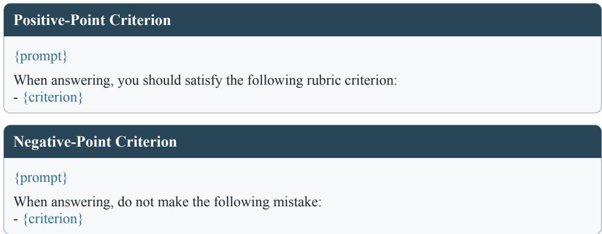  
Figure 7: Prompt templates for criterion-conditioned forward passes in CoCA. Blue placeholders denote the original final user message and the selected criterion.

Response alignment and masking. We apply the model’s chat template to each conditioned conversation and append the original sampled response token IDs. This preserves the response sequence across scoring passes despite differences in context length. We extract the logits that predict response tokens and align them by response position before computing relevance. The response mask excludes prompt and padding positions from token-weight normalization and the policy loss.

## B.3 BASELINE REPRODUCTION

We reproduce RaR (Gunjal et al., 2026), RuscaRL (Zhou et al., 2026), HeRL (Zhang et al., 2026b), POW3R (Tyagi et al., 2026), and CoRT (Zhang et al., 2026a) following their official implementations or the standard procedures described in the original papers.

OPSD. We implement rubric-conditioned OPSD using the self-teacher scoring and distillation components of the official SDPO codebase (Hubotter et al., 2026). For each question, the privileged¨ information consists of the complete set of rubric criteria. The student generates a response from the ordinary task prompt, and the self-teacher scores the same response under a context augmented with these criteria. Teacher predictions are conditioned on the sampled response prefix and detached from backpropagation. OPSD alone optimizes the reverse-KL objective in Eq. (2) over response tokens.

RaR+OPSD. We combine the RaR policy loss with the OPSD loss:

$$
\begin{array} { r } { \mathcal { L } _ { \mathrm { R a R + O P S D } } = \mathcal { L } _ { \mathrm { G R P O } } + \lambda \mathcal { L } _ { \mathrm { O P S D } } , \qquad \lambda = 0 . 0 1 . } \end{array}\tag{13}
$$

Here, $\mathcal { L } _ { \mathrm { G R P O } }$ is the policy loss in Eq. (1), computed using response-level advantages derived from rubric rewards, and $\mathcal { L } _ { \mathrm { O P S D } }$ is the teacher-matching loss in Eq. (2). Both terms are computed on the same sampled responses and jointly optimized in each policy update. The student receives the ordinary task prompt, with rubric information confined to the teacher context. We select $\lambda = 0 . 0 1$ according to the observed gradient magnitudes: during training, the gradient norm of the weighted distillation term λLOPSD is approximately one fifth of that of the policy loss $\mathcal { L } _ { \mathrm { G R P O } }$ . This keeps distillation active as an auxiliary objective while retaining policy optimization as the primary training signal. An excessively large λ can let distillation dominate the combined objective, whereas an excessively small one can make its contribution negligible.

## C ADDITIONAL EXPERIMENTAL RESULTS

## C.1 RESULTS ACROSS BASE MODELS AND JUDGES

Consistent gains across base models. To examine whether our findings extend beyond Qwen3- 8B, we evaluate CoCA on Qwen3-4B (Yang et al., 2025) and Olmo3-7B-Instruct-SFT (Olmo et al., 2025) against three representative baselines: RaR, RaR+OPSD, and HeRL, using gpt-oss-120b as the judge. As shown in Table 5, CoCA achieves average scores of 58.0% and 41.5%, exceeding RaR by 4.1% and 1.3%, respectively. CoCA also surpasses the strongest baseline HeRL, by 2.4% and 1.4% on average. This consistent advantage supports the benefit of resolving criterion-level credit beyond response-level rubric rewards. Meanwhile, RaR+OPSD underperforms RaR on all seven benchmarks for both models, with average declines of 1.2% and 2.1%, reinforcing our finding that an auxiliary rubric-conditioned distillation objective can undermine reward-driven learning. Together, these results reproduce the main-table trends across model scales and architectures, supporting the effectiveness of outcome-grounded criterion-level credit assignment beyond the default base model.

Table 5: Experimental results (%) for Qwen3-4B and Olmo3-7B-Instruct-SFT with gpt-oss-120b as the judge. Avg. denotes the mean across all seven benchmarks. The best results within each model block are highlighted in bold. Arrows indicate improvements (↑) or declines (↓) relative to the corresponding initial model.
<table><tr><td rowspan="2">Method</td><td colspan="4">Medicine</td><td colspan="3">Science</td><td rowspan="2">Avg.</td></tr><tr><td>RaR-Medicine HealthBench LLMEval-Med</td><td></td><td></td><td>MedQA</td><td>RaR-Science ResearchQA</td><td></td><td>GPQA-D</td></tr><tr><td colspan="8">Qwen3-4B</td></tr><tr><td>Initial</td><td>45.6 (0.0)</td><td>37.8 (0.0)</td><td>48.3 (0.0)</td><td>66.0 (0.0)</td><td>64.3 (0.0)</td><td>43.8 (0.0)</td><td>43.2 (0.0)</td><td>49.9 (0.0)</td></tr><tr><td>RaR</td><td>55.2 (↑9.6)</td><td>43.6 (↑5.8)</td><td>50.3 (↑2.0)</td><td>66.2 (↑0.2)</td><td>69.2 (↑4.9)</td><td>48.3 (↑4.5)</td><td>44.6 (↑1.4)</td><td>53.9 (↑4.0)</td></tr><tr><td>RaR+OPSD</td><td>52.4 (↑6.8)</td><td>42.2 (↑4.4)</td><td>49.1 (↑0.8)</td><td>65.8 (↓0.2)</td><td>68.0 (↑3.7)</td><td>47.6 (↑3.8)</td><td>43.7 (↑0.5)</td><td>52.7 (↑2.8)</td></tr><tr><td>HeRL</td><td>58.0 (↑12.4)</td><td>45.7 (↑7.9)</td><td>51.9 (↑3.6)</td><td>68.7 (↑2.7)</td><td>70.3 (↑6.0)</td><td>49.0 (↑5.2)</td><td>45.4 (↑2.2)</td><td>55.6 (↑5.7)</td></tr><tr><td>CoCA (ours)</td><td>61.9 (↑16.3)</td><td>49.1 (↑11.3)</td><td>54.0 (↑5.7)</td><td>70.6 (↑4.6)</td><td>72.1 (↑7.8)</td><td>50.7 (↑6.9)</td><td>47.9 (↑4.7)</td><td>58.0 (↑8.1)</td></tr><tr><td colspan="9">Olmo3-7B-Instruct-SFT</td></tr><tr><td>Initial</td><td>31.8 (0.0)</td><td>26.1 (0.0)</td><td>12.0 (0.0)</td><td>49.3 (0.0)</td><td>52.6 (0.0)</td><td>39.3 (0.0)</td><td>32.2 (0.0)</td><td>34.8 (0.0)</td></tr><tr><td>RaR</td><td>43.0 (↑11.2)</td><td>32.8 (↑6.7)</td><td>13.5 (↑1.5)</td><td>51.8 (↑2.5)</td><td>62.0 (↑9.4)</td><td>45.8 (↑6.5)</td><td>32.6 (↑0.4)</td><td>40.2 (↑5.4)</td></tr><tr><td>RaR+OPSD</td><td>40.1 (↑8.3)</td><td>31.0 (↑4.9)</td><td>11.3 (↓0.7)</td><td>49.7 (↑0.4)</td><td>61.3 (↑8.7)</td><td>44.8 (↑5.5)</td><td>28.6 (↓3.6)</td><td>38.1 (↑3.3)</td></tr><tr><td>HeRL</td><td>42.7 (↑10.9)</td><td>32.4 (↑6.3)</td><td>15.8 (↑3.8)</td><td>50.9 (↑1.6)</td><td>62.6 (↑10.0)</td><td>45.7 (↑6.4)</td><td>30.7 (↓1.5)</td><td>40.1 (↑5.3)</td></tr><tr><td>CoCA (ours)</td><td>44.1 (↑12.3)</td><td>33.9 (↑7.8)</td><td>15.5 (↑3.5)</td><td>53.5 (↑4.2)</td><td>63.1 (↑10.5)</td><td>47.1 (↑7.8)</td><td>33.4 (↑1.2)</td><td>41.5 (↑6.7)</td></tr></table>

Table 6: Experimental results (%) on medical and scientific benchmarks, using Qwen3-8B as the base model and DeepSeek-V4.1-Flash as the judge. Avg. denotes the mean score across all seven benchmarks, and the best results are highlighted in bold. Arrows indicate improvements (↑) or declines (↓) relative to the initial model.
<table><tr><td rowspan="2">Method</td><td colspan="4">Medicine</td><td colspan="3">Science</td><td rowspan="2">Avg.</td></tr><tr><td>RaR-Medicine HealthBench LLMEval-Med</td><td></td><td></td><td>MedQA</td><td>RaR-Science</td><td>ResearchQA</td><td>GPQA-D</td></tr><tr><td>Initial</td><td>57.9 (0.0)</td><td>52.1 (0.0)</td><td>44.3 (0.0)</td><td>72.0 (0.0)</td><td>67.7 (0.0)</td><td>51.1 (0.0)</td><td>49.7 (0.0)</td><td>56.4 (0.0)</td></tr><tr><td>RaR</td><td>68.2 (↑10.3)</td><td>57.5 (↑5.4)</td><td>47.4 (↑3.1)</td><td>73.8 (↑1.8)</td><td>73.1 (↑5.4)</td><td>58.0 (↑6.9)</td><td>51.6 (↑1.9)</td><td>61.4 (↑5.0)</td></tr><tr><td>OPSD</td><td>48.9 (↓9.0)</td><td>38.2 (↓13.9)</td><td>42.9 (↓1.4)</td><td>69.0 (↓3.0)</td><td>66.1 (↓1.6)</td><td>48.7 (↓2.4)</td><td>46.6 (↓3.1)</td><td>51.5 (↓4.9)</td></tr><tr><td>RaR+OPSD</td><td>64.6 (↑6.7)</td><td>52.3 (↑0.2)</td><td>44.6 (↑0.3)</td><td>72.1 (↑0.1)</td><td>68.3 (↑0.6)</td><td>51.2 (↑0.1)</td><td>48.8 (↓0.9)</td><td>57.4 (↑1.0)</td></tr><tr><td>RuscaRL</td><td>60.1 (↑2.2)</td><td>54.5 (↑2.4)</td><td>44.9 (↑0.6)</td><td>73.8 (↑1.8)</td><td>66.4 (↓1.3)</td><td>54.1 (↑3.0)</td><td>44.4 (↓5.3)</td><td>56.9 (↑0.5)</td></tr><tr><td>HeRL</td><td>70.6 (↑12.7)</td><td>60.3 (↑8.2)</td><td>48.6 (↑4.3)</td><td>73.3 (↑1.3)</td><td>72.6 (↑4.9)</td><td>58.9 (↑7.8)</td><td>51.6 (↑1.9)</td><td>62.3 (↑5.9)</td></tr><tr><td>POW3R</td><td>69.6 (↑11.7)</td><td>58.5 (↑6.4)</td><td>48.1 (↑3.8)</td><td>72.4 (↑0.4)</td><td>72.3 (↑4.6)</td><td>59.7 (↑8.6)</td><td>52.0 (↑2.3)</td><td>61.8 (↑5.4)</td></tr><tr><td>CoRT</td><td>68.9 (↑11.0)</td><td>57.8 (↑5.7)</td><td>47.8 (↑3.5)</td><td>75.9 (↑3.9)</td><td>71.6 (↑3.9)</td><td>58.4 (↑7.3)</td><td>47.7 (↓2.0)</td><td>61.2 (↑4.8)</td></tr><tr><td>CoCA (ours)</td><td>73.1 (↑15.2)</td><td>63.3 (↑11.2)</td><td>51.1 (↑6.8)</td><td>77.6 (↑5.6)</td><td>74.2 (↑6.5)</td><td>60.0 (↑8.9)</td><td>54.4 (↑4.7)</td><td>64.8 (↑8.4)</td></tr></table>

Consistent gains across judge models. We extend the evaluation to DeepSeek-V4.1-Flash (Xu et al., 2026a) and rescore the same set of responses from all Qwen3-8B-based methods, keeping all other evaluation settings unchanged. As shown in Table 6, CoCA outperforms all baselines on all seven benchmarks, achieving an average score of 64.8%. It improves over RaR, the standard rubricbased RL baseline, by an absolute 3.4%, and surpasses HeRL, the strongest baseline on average, by 2.5%. These gains are comparable to the 4.2% and 3.1% margins under gpt-oss-120b. Although the absolute scores vary across judges, the relative performance gaps among methods remain broadly consistent. This consistency supports the robustness of CoCA’s advantage across judge models.

## C.2 QUANTITATIVE VALIDATION OF CRITERION–TOKEN RELEVANCE

Annotation protocol. To test whether CoCA’s criterion-induced distribution shifts localize the parts of a response relevant to each rubric criterion, we randomly sample 500 criterion–response pairs from each domain (Medicine and Science). For each pair, GPT-6 Astra annotates words that directly express criterion-relevant content or functionally support it, such as a heading or transition introducing that content. We then manually review 100 pairs per domain (20%) to check the quality of these annotations. For analysis, we map the word-level spans to the corresponding response-token positions. Figure 8 presents one complete response from each domain. Dark blue marks annotated words and pale blue marks the remaining words. We refer to the unmarked positions in the eligible response-token set as remaining tokens.

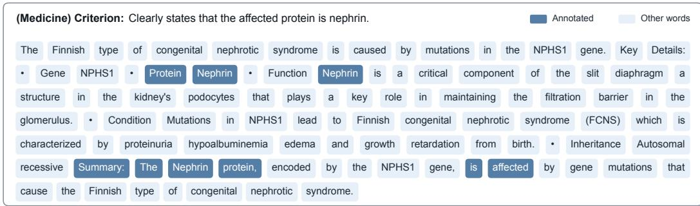

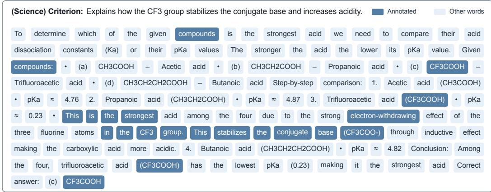  
Figure 8: Complete word-level annotation examples from Medicine (top) and Science (bottom), with the corresponding rubric criterion shown above each response. Dark and pale blue denote annotated and remaining words, respectively. Subword pieces are merged into words for display.

Pair-level separation. For each criterion–response pair p, we compute the mean JSD over annotated positions $\mathcal { T } _ { p }$ and remaining eligible positions $\bar { \mathcal { N } _ { p } } .$ , together with their enrichment ratio:

$$
\mu _ { p } ^ { \mathrm { a n n } } = \frac { 1 } { | T _ { p } | } \sum _ { t \in \mathcal { T } _ { p } } d _ { p , t } , \qquad \mu _ { p } ^ { \mathrm { r e m } } = \frac { 1 } { | \mathcal { N } _ { p } | } \sum _ { t \in \mathcal { N } _ { p } } d _ { p , t } , \qquad r _ { p } = \frac { \mu _ { p } ^ { \mathrm { a n n } } } { \mu _ { p } ^ { \mathrm { r e m } } } .\tag{14}
$$

Here, $d _ { p , t }$ denotes the JSD relevance score at position t. We report the positive-gap rate, defined as the percentage of pairs satisfying $\mu _ { p } ^ { \mathrm { a n n } } > \mu _ { p } ^ { \mathrm { r e m } }$ . For each threshold τ, we also report the percentage of pairs with an enrichment ratio $\bar { r _ { p } } \geq$ τ to quantify the magnitude of this separation. As shown in Figure 9, the positive-gap rate is 97.6% in Medicine and 100.0% in Science. The fractions with $r _ { p } \geq$ 1.5 are 71.0% and 81.2%, those with $r _ { p } \geq 2 . 0$ are 47.0% and 61.6%, and those with $r _ { p } \geq 3 . 0$ are 19.2% and 31.6%, respectively. Overall, 988 of the 1,000 pairs (98.8%) satisfy $\Delta _ { p } = \mu _ { p } ^ { \mathrm { a i n } } - \mu _ { p } ^ { \mathrm { r e m } } >$ 0. These results show that JSD is higher on average at criterion-relevant positions, supporting its use for criterion-level credit allocation. The observed separation also provides empirical support for the positive mean-gap condition underlying the credit-resolution guarantee in Proposition 3.

## C.3 ANALYSIS OF TRAINING EFFICIENCY

Performance versus training time. We evaluate Qwen3-8B trained with CoCA and RaR on the Medicine validation set every 25 steps over 400 training steps, using the same 8×A100 GPUs. Given the differences in per-step cost across methods, we compare validation performance as a function of training time rather than training steps. As shown in the left panel of Figure 10, CoCA reaches 55.57% after 38.77 hours, compared with 47.83% after 37.35 hours for RaR. This corresponds to a gain of 7.74 percentage points with only 3.8% more training time. Moreover, CoCA achieves 49.22% at step 125 after only 12.12 hours, already surpassing RaR’s best performance at step 375 (35.02 hours). Thus, CoCA achieves higher performance with a 2.89× speedup in training time. These results demonstrate that the learning gains from CoCA’s additional forward passes outweigh their computational overhead, yielding a net improvement in training efficiency.

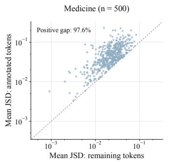

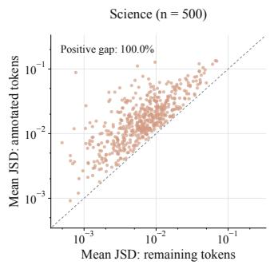

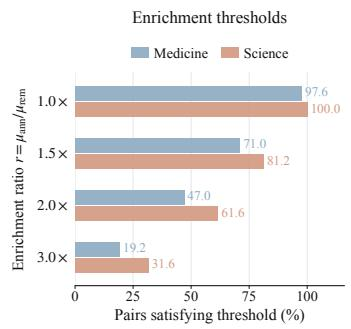

Figure 9: Criterion–token relevance over 1,000 annotated pairs. The scatterplots compare mean JSD at annotated and remaining positions; the dashed diagonal denotes equality. The right panel reports the percentage of pairs meeting each enrichment-ratio threshold.  
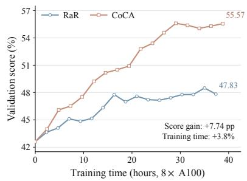

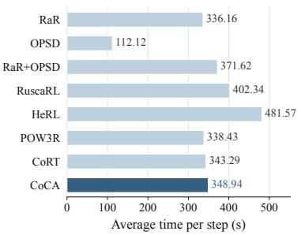

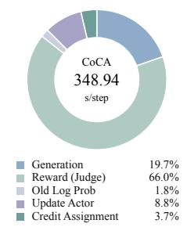  
Figure 10: Training efficiency of Qwen3-8B on Medicine using 8×A100 GPUs. Left: validation performance versus training time. Middle: average training step time for all methods. Right: CoCA’s runtime breakdown, with the total step time shown at the center and component proportions listed below.

Per-step cost and runtime breakdown. To quantify CoCA’s additional training cost, we measure the average step time of all eight methods under the same model, domain, and hardware configuration and profile its runtime. As shown in the middle panel of Figure 10, CoCA takes 348.94 seconds per step compared with 336.16 seconds for RaR, an increase of only 3.8% despite its additional criterion-conditioned forward passes. Its step time is also lower than those of RaR+OPSD, RuscaRL, and HeRL, showing that its finer-grained credit assignment remains computationally competitive with other approaches to rubric supervision. The right panel shows that credit assignment takes only 12.78 seconds per step (3.7% of the total), while judge-based reward evaluation and response generation together account for 85.7%. Most training time is therefore spent producing responses and obtaining rubric feedback, with comparatively little devoted to allocating that feedback across tokens. This is consistent with CoCA’s design: it reuses criterion-level judgments from reward evaluation and restricts additional criterion-conditioned relevance scoring to selected criteria. Together with the gains in learning efficiency, these results indicate that CoCA makes more effective use of costly rubric feedback with only modest additional computation.

## C.4 ANALYSIS OF TRAINING DYNAMICS

To better understand how criterion-level credit assignment affects policy optimization, we compare the training dynamics of CoCA and RaR in Medicine and Science. Specifically, we track training reward, response length, and policy entropy over 400 training steps to characterize learning progress, generation behavior, and exploration, as shown in Figure 11.

Table 7: Ablation results (%) for criterion selection strategies. Arrows indicate changes relative to CoCA.
<table><tr><td rowspan="2">Strategy</td><td colspan="4">Medicine</td><td colspan="3">Science</td><td rowspan="2">Avg.</td></tr><tr><td></td><td></td><td>RaR-Medicine HealthBench LLMEval-Med</td><td>MedQA</td><td>RaR-Science ResearchQA</td><td></td><td>GPQA-D</td></tr><tr><td>CoCA</td><td>69.8 (0.0)</td><td>54.3 (0.0)</td><td>61.8 (0.0)</td><td>77.6 (0.0)</td><td>74.2 (0.0)</td><td>59.6 (0.0)</td><td>54.4 (0.0)</td><td>64.5 (0.0)</td></tr><tr><td>Random</td><td>67.3 (↓2.5)</td><td>49.6 (↓4.7)</td><td>56.1 (↓5.7)</td><td>74.1 (↓3.5)</td><td>73.4 (↓0.8)</td><td>57.9 (↓1.7)</td><td>51.3 (↓3.1)</td><td>61.4 (↓3.1)</td></tr><tr><td>Top |sj|</td><td>69.4 (↓0.4)</td><td>52.3 (↓2.0)</td><td>59.0 (↓2.8)</td><td>76.8 (↓0.8)</td><td>74.0 (↓0.2)</td><td>58.6 (↓1.0)</td><td>52.2 (↓2.2)</td><td>63.2 (↓1.3)</td></tr></table>

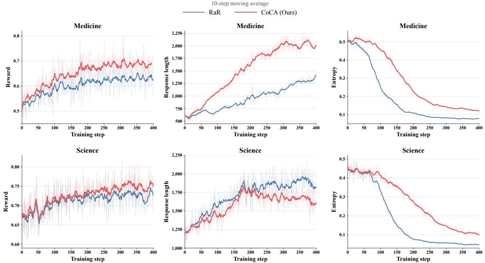  
Figure 11: Training dynamics of CoCA and RaR in Medicine (top) and Science (bottom). Columns show reward, response length, and policy entropy, with faint stepwise curves and bold 10-step moving averages.

Reward optimization. We first examine reward progression to assess the effectiveness of rubricbased optimization. In Medicine, CoCA establishes a reward advantage early in training and maintains a clear gap as both methods approach a plateau. In Science, the two methods exhibit similar initial progress, but CoCA gradually achieves higher rewards, with the difference becoming more apparent in the later stages. This advantage persists through the end of training in both domains, suggesting that criterion-level credit assignment helps the policy make more effective use of rubric feedback and reach higher reward levels.

Response length. We additionally compare response length to assess whether the reward gains depend on producing longer outputs. In Medicine, CoCA’s responses become substantially longer than RaR’s as training progresses, alongside its higher reward. However, in Science, CoCA’s response length peaks around the middle of training and then decreases, yielding shorter responses than RaR in the second half even as its reward improves further. These contrasting trends show that CoCA can achieve higher reward with either longer or shorter responses, depending on the domain, and that its gains do not require uniformly increasing output length.

Exploration during training. Finally, we track policy entropy to characterize how exploration evolves during optimization. In both domains, RaR exhibits a rapid entropy decline early in training, followed by a prolonged period at a low level. CoCA’s entropy decreases more gradually and remains higher through the later stages, indicating slower concentration of its token distributions. Together with the higher rewards, this pattern suggests that CoCA supports effective reward optimization while retaining more scope for exploration.

Table 8: Standard deviations (%) of benchmark scores across three random seeds. Avg. reports the standard deviation of the per-seed average score over all seven benchmarks.
<table><tr><td rowspan="2">Method</td><td colspan="4">Medicine</td><td colspan="2">Science</td><td rowspan="2"> $\mathbf { A v g } .$ </td></tr><tr><td>RaR-Medicine HealthBench LLMEval-Med MedQA</td><td></td><td></td><td></td><td>RaR-Science ResearchQA GPQA-D</td><td></td></tr><tr><td>RaR</td><td>0.26</td><td>0.25</td><td>0.44</td><td>0.51</td><td>0.18</td><td>0.39 0.53</td><td>0.24</td></tr><tr><td>CoCA</td><td>0.31</td><td>0.22</td><td>0.37</td><td>0.45 0.29</td><td>0.30</td><td>0.48</td><td>0.17</td></tr></table>

## C.5 EFFECT OF CRITERION SELECTION

To assess the effect of criterion selection, we compare CoCA’s default strategy with two alternatives, keeping the selection budget at $k = 2$ and other training settings unchanged. CoCA selects criteria with the largest absolute credits $| A _ { i j } |$ , whereas Random selects criteria randomly and Top $| s _ { j } |$ | selects those with the largest absolute rubric point values. Unselected criteria retain uniform allocation.

As shown in Table 7, Random and Top $| s _ { j } |$ achieve average scores of 61.4% and 63.2%, respectively, falling below CoCA by 3.1% and 1.3%. Both alternatives underperform CoCA on all seven benchmarks, while Top $\left| s _ { j } \right|$ consistently outperforms Random. The advantage of Top $| s _ { j } |$ over Random suggests that rubric point values provide a useful basis for prioritization. CoCA further incorporates the magnitude of each criterion outcome’s deviation from the rollout-group average through $| A _ { i j } |$ Its additional gains support directing the limited criterion-conditioned computation toward criteria with larger response-specific credit magnitudes.

## C.6 ROBUSTNESS ACROSS RANDOM SEEDS

To assess sensitivity to training randomness, we repeat the CoCA and RaR experiments with two additional random seeds, keeping all training and evaluation settings unchanged. Table 8 reports the standard deviations across all three runs. CoCA’s benchmark-level standard deviations range from 0.22% to 0.48%, comparable to RaR’s range of 0.18% to 0.53%. For the seven-benchmark average, CoCA exhibits a lower standard deviation than RaR (0.17% versus 0.24%). Moreover, its 3.1% average lead over the strongest baseline in Table 1 far exceeds the observed variation, indicating that CoCA’s SOTA average performance remains robust across the evaluated seeds.

## D PSEUDOCODE OF COCA

We describe the CoCA pipeline in Algorithm 1.

Algorithm 1 CoCA: Criterion-Aware Credit Assignment   
Require: Dataset D, policy πθ, judge J, group size G, allocation budget $k ,$ concentration β.   
1: for each training iteration do   
2: Freeze the rollout policy $\pi _ { \theta _ { \mathrm { o l d } } }  \pi _ { \theta }$   
3: Sample a batch of prompt–rubric pairs from D   
4: for each $( x , \mathcal { R } )$ in the batch do   
5: Sample $\{ y _ { i } \} _ { i = 1 } ^ { G } \sim \pi _ { \theta _ { \mathrm { o l d } } } ( \cdot \mid x )$   
6: Obtain criterion outcomes $\{ z _ { i j } \}$ using J   
7: $\begin{array} { r } { R _ { i } \gets \sum _ { j } s _ { j } z _ { i j } / \sum _ { j : s _ { j } > 0 } s _ { j } } \end{array}$ for all i   
8: $\begin{array} { r } { \bar { z } _ { j }  G ^ { - 1 } \sum _ { i } { z _ { i j } } } \end{array}$ for all j   
9: $A _ { i j }  s _ { j } ( z _ { i j } - \bar { z } _ { j } ) / [ \sum _ { \ell : s _ { \ell } > 0 } s _ { \ell } ]$ for all i, j   
10: for $i = 1 , \ldots , G$ do   
11: $\begin{array} { r } { T _ { i } \gets | y _ { i } | ; \widehat { A } _ { i , t } \gets \sum _ { j } A _ { i j } } \end{array}$ for all t   
12: $\mathcal { S } _ { i } \gets \mathrm { T o p K } _ { j : A _ { i j } \neq 0 } ( | \bar { A } _ { i j } | , k )$   
13: $p _ { i , t }  \pi _ { \theta _ { \mathrm { o l d } } } ( \cdot \mid h _ { i , t } )$ for all t   
14: for each $j \in \mathcal S _ { i }$ do   
15: $q _ { i j , t }  \pi _ { \theta _ { \mathrm { o l d } } } ( \cdot \mid h _ { i , t } ( c _ { j } ) )$ for all t   
16: $d _ { i j , t } \gets \mathrm { s g } [ D _ { \mathrm { J S } } ( p _ { i , t } | | q _ { i j , t } ) ]$ for all t   
17: $\omega _ { i j }  T _ { i } \mathrm { s o f t m a x } ( \beta \mathbf { d } _ { i j } )$   
18: $\widehat { A } _ { i , t } \gets \widehat { A } _ { i , t } + A _ { i j } ( [ \omega _ { i j } ] _ { t } - 1 )$ for all t   
19: end for   
20: end for   
21: end for   
22: Update θ on the batch using Eq. (1), replacing Ai with fixed $\widehat { A } _ { i , t }$   
23: end for   
24: return πθ