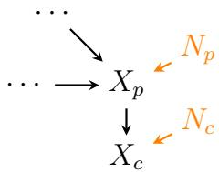

# Causal Discovery Under Hard Selection Bias: A New Robust Score-Matching Approach

Yiwen Qiu Francesco Montagna

Shimeng Huang Francesco Locatello

IST Austria Am Campus 1, Klosterneuburg, 3400 firstname.lastname@ista.ac.at

## Abstract

Selection bias is a difficult yet widespread problem in causal discovery, occurring whenever non-random selection processes lead to data that is not representative of the underlying populations. Due to its practical importance, related works have been proposed to address the problem under local [Versteeg et al., 2022] or interventional settings [Dai et al., 2025a], but general algorithms for observational data remain elusive. In this paper, we focus on truncated data (hard selection), and provide a general result for Additive Noise Models (ANM). We show that scorebased methods are a surprisingly suitable candidate due to a special property of the score function (∇ log p(x)): deterministic truncation preserves both the score of the joint distribution as well as the Jacobian of the score. While established scorematching algorithms still fail in most settings, we actively leverage this observation to propose a new method for causal discovery that is robust under truncated data with ANMs. Overall, our approach offers a general, robust solution that is agnostic to external information about the selection process and still achieves comparable performance to the state-of-the-art approaches when selection is not present.

## 1 Introduction

Identifying causal relationships from observational data is a fundamental problem in many scientific disciplines. However, selection bias can significantly distort the observed data distribution, leading to incorrect inference about causal relationships [Heckman, 1979, Hernán et al., 2004]. Selection bias occurs when the data collected is not representative of the underlying population due to a non-random selection process, e.g., in epidemiological studies where only patients with certain traits (socio-economic or health factors) are recorded [Swanson, 2012, van Alten et al., 2024], or in molecular biology where only transcripts in cells that are highly expressed are measured and included in the study [Dwyer and Pleiss, 2023].

Some methods have been developed to address this problem in causal discovery, but they often rely on access to interventional data [Dai et al., 2025a, Luo et al., 2025], or only focus on a local structure (with three or four variables) [Gregory, 1995, Versteeg et al., 2022]. The seminal work FCI [Spirtes et al., 2000] and its variants [Colombo et al., 2012] recover the causal graph under latent variables and selection bias up to a Markov equivalence class without further interpretation. Recent studies based on Functional Causal Models (FCMs) by Zhang et al. [2016] have shown that if we know the location of the selection variable, i.e., if it is only outcome-dependent, then we can identify the full causal graph under certain assumptions. Beyond these specific, partial solutions, a general approach for selection bias in causal discovery for observational data is missing.

In this paper, we investigate the case of hard selection bias: the densities of (some or all) observed variables are truncated, meaning that under selection, we do not observe data on certain parts of the (true) support at all. We begin by showing a surprising yet simple result: regardless of the location of selection, causal asymmetry persists under hard selection bias within the scorefunction of the data (∇ log p(x)). This introduces an opportunity, as the score function has been a central component in a rich line of work on causal discovery [Rolland et al., 2022, Montagna et al., 2023, 2025]. Unfortunately, we find that while the SCORE [Rolland et al., 2022] algorithm for non-linear additive Gaussian noise is robust to hard selection bias, the more general extensions [Montagna et al., 2025] are not. To this end, we propose a novel score-based method for causal discovery, and to our knowledge, it is the first general causal discovery method that is robust to hard selection, without relying on any external information about the selection process. Our contributions are as follows:

Contribution We evaluate the existing score function method—SCORE [Rolland et al., 2022], DAS [Montagna et al., 2023], NoGAM [Montagna et al., 2025]— and show that they can be surprisingly robust to hard selection bias (Section 3). However, failures persist: to tackle these cases, we propose a new method (Section 4) based on the conditional rank of the Hessian log density $( \nabla ^ { 2 } \log ( x ) )$ , which is fully robust to hard selection bias under all Additive Noise Model (ANM) settings, with the only exception being the linear Gaussian case (see Table 1 for a summary). We provide a practical estimation algorithm for our method in Section 5, and demonstrate its effectiveness through extensive synthetic and real-world [Pinna et al., 2010] experiments in Section 6.
<table><tr><td>ANM Assumption</td><td>LiNGAM CAM-UV</td><td></td><td>SCORE</td><td>NoGAM</td><td>CHess (Ours)</td></tr><tr><td>Nonlinear Gaussian</td><td>×</td><td>J</td><td></td><td>L</td><td></td></tr><tr><td>Linear non-Gaussian</td><td>1</td><td>×</td><td>X</td><td>7</td><td></td></tr><tr><td>Nonlinear non-Gaussian</td><td>×</td><td>」</td><td>X</td><td>7</td><td>L</td></tr><tr><td>Hard Selection (Truncation)</td><td>×</td><td>×</td><td> $\checkmark ^ { * }$ </td><td>×</td><td>L</td></tr></table>

Table 1: Identifiability guarantees of causal discovery methods across ANM assumptions. $\checkmark$ denotes full DAG identifiability; denotes no guarantee. LiNGAM [Shimizu et al., 2006, 2011] only deals with linear non-Gaussian ANMs, SCORE [Rolland et al., 2022] requires nonlinear mechanisms with Gaussian noise. NoGAM [Montagna et al., 2025] extends SCORE to arbitrary noise distributions. CAM-UV [Maeda and Shimizu, 2021] additionally handles latent confounders under nonlinear separable (CAM) assumptions. SCORE can handle latent hard selection bias in both Gaussian and non-Gaussian cases, which is not discussed in the original paper but is one of the surprising findings in this work $( \checkmark ^ { * } )$ . Our method (CHess) is the only method that is resilient to hard selection under all the above ANMs. Linear Gaussian models are known to be not identifiable beyond the Markov equivalence class [Peters and Bühlmann, 2014] thus omitted in the table.

## 2 Preliminaries and Problem Setup

## Problem Setting: Hard Selection and What We Know about it

We consider a set of random variables $\mathbf { X } = \{ X _ { 1 } , \ldots , X _ { d } \}$ generated by a restricted additive noise model (ANM):

$$
X _ { i } : = f _ { i } ( X _ { \mathrm { P A } _ { i } } ) + N _ { i } , \qquad i = 1 , \ldots , d ,\tag{1}
$$

where $f _ { i }$ are $C ^ { 2 }$ causal mechanisms, $N _ { i }$ are mutually independent noise terms with strictly positive densities, and the model satisfies the restricted ANM identifiability condition [Bühlmann et al., 2014]. The associated causal graph $\mathcal { G }$ is a DAG.

In the remainder of the paper, we assume the Markov and faithfulness conditions for the DAG G and the distribution $p ( \mathbf { X } )$ [Spirtes et al., 2000]. We say two nodes $X _ { i }$ and $X _ { j }$ are d-separated by a set of nodes Z in $\mathcal { G }$ if every path between them is blocked by $\mathbf { Z } ,$ and a path is blocked by conditioning on $\mathbf { Z }$ if the path contains a non-collider node in Z or a collider node that is not in Z and has no descendant in Z. For a full definition, please refer to the Appendix.

Hard Selection (Truncation) We observe biased data from $p ( \mathbf { X } \mid S = 1 )$ , where $p ( \mathbf { X } \mid S =$ $1 ) \neq p ( \mathbf { X } )$ . The selection mechanism is unknown and can be dependent on an arbitrary subset of X. Here we focus on the hard selection (truncation) case, which is the scenario where the selection mechanism is deterministic and only data points in a subset B of the support of X are observed, i.e. $p ( S = 1 \mid \mathbf { X } = x ) = \mathbb { 1 } ( x \in \mathcal { B } )$ for a set $B \subseteq \mathbb { R } ^ { d }$ with vo $. ( B ) > 0$

Causal Discovery under Selection Bias Given the biased observational data $\mathcal { D } = \{ x ^ { ( i ) } \} _ { i = 1 } ^ { N }$ from $p ( \mathbf { X } \mid S = 1 )$ , the goal is to recover the causal graph $\mathcal { G }$ under the original distribution $p ( \mathbf { X } )$ . This is a challenging problem that has been studied in the causal discovery literature in local causal discovery [Versteeg et al., 2022], interventional settings [Dai et al., 2025a, Luo et al., 2025], latent variable settings [Dai et al., 2025b], etc. However, to the best of our knowledge, no method has been developed in the general setting to tackle selection bias for causal discovery only with observational data. For a comprehensive review of the related work, please refer to Appendix C.

Given the generality of the problem, we focus on the following question in this paper:

Can wefind properties ofthe original distribution $p ( \mathbf { X } )$ preserved under hard selection, and how can we leverage themfor robust causal discovery?

We take the first step to answer this question by revisiting the score function and score-matching based causal discovery methods, and show its potentials.

## 3 The Blessing of Score Functions

In this section, we look at the score function (Section 3.1) and review score-matching for causal discovery (Section 3.2). Then in Section 3.3, we present the advantage of using the score directly for causal discovery under truncation, and an example showing a failure case, which motivates our proposed method in the next section (Section 4).

## 3.1 Score Preservation

Consider the score of the selected distribution $\nabla _ { X } \log p ( x \mid s )$ . The selected density satisfies

$$
\log p ( x \mid S = 1 ) = \log p ( x ) + \underbrace { \log \mathbb { 1 } ( x \in \mathcal { B } ) } _ { = 0 \mathrm { ~ f o r ~ a l l } x \in \mathrm { i n t } ( \mathcal { B } ) } - \underbrace { \log p ( S = 1 ) } _ { \mathrm { c o n s t a n t } } , \quad \forall x \in \mathbb { R } ^ { d } ,
$$

because of Bayes’ rule. Take the derivative, for $x \in \operatorname { i n t } ( B )$

(2)

The score is exactly preserved at every observed data point.

Remark 1 (Score preservation under hard selection). This is an important and nontrivial observation that we leverage in this paperfor developing a novel score-based methodfor causal discovery under hard selection. The same argument also applies to the second-order score $\nabla _ { X } ^ { 2 } \log p ( x )$ , which is also preserved under hard selection, i.e. $\nabla _ { X } ^ { 2 }$ log p(x $S = 1 ) = \nabla _ { X } ^ { 2 }$ log p(x) (in the interior ofB). This aligns with the local geometrical nature ofthe score, which characterizes the curvature ofthe log-density pointwise, and which is preserved under truncation.

Remark 2 (Boundary effect). One might notice that the score is only preserved in the interior of B, and not on its boundary, where we have an extra term $\delta ( x )$ in the score due to the derivative of the indicatorfunction. This boundary effect can be problematicfor score estimation: [Rolland et al., 2022, Montagna et al., 2025] show that we can use Stein identity [Stein, 1972]for score estimation, which relies on an vanishing boundary condition on $p ( x )$ , i.e. $h ( x ) p ( x ) \to 0$ as $x \to \infty ,$ , for any testing function $h ( x )$ . However, under truncation, the selected density $p ( x \mid s )$ does not satisfy this condition. In practice, we propose to use the diffusion score matching method [Sanchez et al., 2023], which is more robust to boundary effects. We will discuss this in more detail in Section 4.

## 3.2 Revisiting Score-Matching

We provide a review of the score-matching based causal discovery methods. The score component for node $X _ { i }$ decomposes as:

$$
\partial _ { X _ { i } } \log p ( x ) = s _ { n _ { i } } ( N _ { i } ) - \sum _ { k \in X _ { \mathrm { C H } _ { i } } } \frac { \partial f _ { k } } { \partial x _ { i } } ( x _ { \mathrm { P A } _ { k } } ) \cdot s _ { n _ { k } } ( N _ { k } ) ,\tag{3}
$$

where $s _ { n _ { i } } ( N _ { i } ) : = ( \log p _ { N _ { i } } ) ^ { \prime }$ is the score function of the i-th noise distribution and $X _ { \mathrm { C H _ { \it i } } }$ denotes the children of $X _ { i }$ in $\mathcal { G }$

Sink Identification For a sink node $X _ { l }$ (with $X _ { \mathrm { C H } _ { l } } = \varnothing )$

$$
\begin{array} { r } { \partial _ { X _ { l } } \log p ( x ) = s _ { n _ { l } } ( N _ { l } ) . } \end{array}\tag{4}
$$

Under Gaussian noise, Rolland et al. [2022] propose the variance test (Proposition 1) as sink node identification method criterion:

Proposition 1 (Gaussain case: Variance test [Rolland et al., 2022] ). Let X be generated by a restricted ANM (1) with mutually independent Gaussian noise terms.

$$
\mathrm { V a r } \left[ \partial _ { X _ { i } } s _ { x _ { i } } ( \mathbf { X } ) \right] = 0 \Longleftrightarrow X _ { i } { \mathrm { ~ } } i s { \mathrm { ~ } } a { \mathrm { ~ } } s i n k { \mathrm { ~ } } n o d e , \forall i = 1 , \ldots , d .\tag{5}
$$

For a sink node, $\begin{array} { r } { s _ { x _ { l } } ( x _ { l } ) = - \frac { x _ { l } - f _ { l } ( \mathrm { P A } _ { l } ( x _ { l } ) ) } { \sigma _ { l } ^ { 2 } } } \end{array}$ , and $s _ { x _ { l } } ^ { \prime } ( x _ { l } ) = c$ . Therefore, Var $x \left( s _ { n _ { l } } ^ { \prime } \left( N _ { l } \right) \right) = 0$

Extending beyond Gaussian noise, Montagna et al. [2025] construct the regression residual test (Proposition 2) as sink-node identification method criterion:

Proposition 2 (Non-Gaussain case: Residual test [Montagna et al., 2025]). Let X be generated by a restricted ANM (1) with mutually independent non-Gaussian noise terms. For any $i \in [ d ]$

$$
\mathbb { E } \left[ \left( \partial _ { X _ { i } } s _ { i } ( \mathbf { X } ) - \mathbb { E } \left[ \partial _ { X _ { i } } s _ { i } ( \mathbf { X } ) \mid R _ { i } \right] \right) ^ { 2 } \right] = 0 \Longleftrightarrow X _ { i } \mathit { i s a s i n k n o d e } .\tag{6}
$$

For a sink node, $R _ { l } = X _ { l } - \mathbb { E } [ X _ { l } \mid X _ { \backslash l } ]$ , which equals the centered noise $N _ { l } - \mathbb { E } ( N _ { l } )$ for a true sink node. This means for a sink node (without selection bias), the score of $X _ { l }$ can be perfectly predicted from the residual $R _ { l }$

Edge (neighbor) Identification The Markov equivalence graph can be constructed by reading the conditional independence of pairs of random variables as shown by [Spantini et al., 2018, Montagna et al., 2023], in Proposition 3.

Proposition 3 ( [Spantini et al., 2018, Montagna et al., 2023]). Let X be generated by a restricted ANM (1) with mutually independent noise terms. For any $i , j \in [ d ]$

$$
\partial _ { X _ { i } X _ { j } } ^ { 2 } \log p ( x ) = 0 \Longleftrightarrow X _ { i } \perp \perp X _ { j } \mid \mathbf { X } _ { \backslash \{ i , j \} } i n \mathcal { G } .\tag{7}
$$

## 3.3 When Score-Matching is Surprisingly Resilient and When it is Not

How does score-matching behave under hard selection? In this subsection, we show that for sink-node identification under truncation, Proposition 1 and 3 still hold (modified as Proposition 4 and 8), but Proposition 2 fails in general. Unlike other causal discovery methods that rely on conditional independence tests that are susceptible to hidden selection variables, the score-matching based methods are surprisingly resilient to hard selection bias. However, the residual test relies not only on the score, but also on the structure underlying the density, which can be distorted by selection bias. This motivates us to leverage the score directly for causal discovery, without relying on the residual or any graphical assumptions.

The first fold: Variance test still holds Under nonlinear ANM and Gaussian noise assumptions, the result in Proposition 1 can be directly extended to truncated data, as stated in Proposition 4.

Proposition 4 (Gaussian case: Variance test under truncation). Let X be generated by a restricted ANM (1) with mutually independent Gaussian noise terms, and let $S = \mathbb { 1 } ( \overset { \cdot } { x } \in B )$ denote a deterministic selectionfor a truncation region $B .$

$$
\operatorname { V a r } \left[ \partial _ { X _ { i } } s _ { i } ( \mathbf { X } \mid S = 1 ) \right] = 0 \Longleftrightarrow X _ { i } { \mathrm { ~ } } i s { \mathrm { ~ } } a s i n k n o d e , \forall i = 1 , \ldots , d .\tag{8}
$$

This implies that with data from $p ( \mathbf { X } \mid S = 1 )$ , we can still identify the sink nodes by checking the variance of the Hessian log-density, which is an additional outcome not realized before. The proof directly relies on the score preservation property in (2).

Similarly, the result from Proposition 3 naturally extend to testing $\partial _ { X _ { i } X _ { j } } ^ { 2 } \log p ( x \mid S = 1 )$ for skeleton discovery, as shown in Appendix B.

The second fold: Residual test fail Under hard selection, the selected (observed) residual is:

$$
R _ { l } ^ { \mathrm { s e l } } = X _ { l } - \mathbb { E } [ X _ { l } \mid X _ { \setminus l } , S = 1 ] .
$$

If the selection is only a function of a single node, then the biased residual $R _ { l } ^ { \mathrm { s e l } }$ is still a function of $X _ { l }$ . This is a special case where the residual test still holds, which is elaborated in Appendix B. But in general, when we do not know whether the selection is only a function on a single node or not, the residual test fails as in Example 1.

Example 1 (Failure case). Consider a sink node $X _ { l }$ with parent $X _ { \mathrm { P A } _ { l } }$ . If the selection mechanism depends on both $X _ { l }$ and some $X _ { k } \in X _ { \mathrm { P A } _ { l } } \subseteq X _ { \backslash l } ( \mathbf { e . g . } , S = \mathbb { 1 } ( | X _ { l } + X _ { k } | \leq c ) )$ , conditioning on $S = 1$ induces dependence between $N _ { l }$ and $X _ { \mathrm { P A } _ { l } } , \mathrm { s o } R _ { l } ^ { \mathrm { s e l } } = X _ { l } - \mathbb { E } [ X _ { l } \ | \ X _ { \backslash l } , S = 1 ] \neq$ $X _ { l } - \mathbb { E } [ X _ { l } \mid X _ { \setminus l } ] = R _ { l } = N _ { l } - \mathbb { E } N _ { l }$ . Note that the score $\partial _ { X _ { l } }$ log $p ( x ) = s _ { l } ( N _ { l } )$ is preserved, but the residual $R _ { l } ^ { \mathrm { s e l } }$ is a biased proxy for $N _ { l }$ , and the residual test incorrectly rejects the true sink.

How do we surpass the issue? Our proposal: exploit the score directly for causal asymmetry. The residual test fails because it depends on the global structure of the density, while the score is a local property of the density at each data point, and is preserved under truncation (2). Therefore, we need to exploit this property of the score directly for a novel method for causal discovery. Since we have seen that Proposition 3 remains true under selection, the remaining challenge is to identify the sink nodes given the skeleton.

## 4 Causal Discovery Method Robust to Hard Selection

We present our main result in three-fold: we first introduce the intuition of the method in Section 4.1, then in Section 4.2 we give the main theoretical result under linear ANM assumptions (with non-Gaussian noise) in Proposition 6 and the more general result for non-linear ANM in Proposition 9.

## 4.1 Intuition and Definitions

As shown in the example in Section 3.3, the residual test [Montagna et al., 2025] fails under hardselected data in general (in non-Gaussian noise cases).

Intuition: Asymmetry of Number of Independent Noise Sources. The key intuition is that the score of a sink node has exactly one independent noise term that contributes to it, after conditioning on all its neighbors1, while a non-sink node has $\geq 2$ independent noise terms. Consider the graph in Figure 1, the path between a non-sink node and the noise of its child is opened by conditioning on its child, while the argument does not apply to a sink node that does not have child terms.

Algebraic Connection: To translate the number of independent noises into an algebraic criterion, we consider the score function $s ( x ) \ : = { }$ $\nabla \log p ( x )$ The main observation is that if we take the gradient of the score on node $X _ { i }$ w.r.t all noise terms2, we obtain a vector that has contributions from multiple source directions. The conditional rank (conditioning on all neighbors of $X _ { i } )$ of the variance of such a vector’s outer product indicates the number of independently varying factors, e.g., for a sink node the rank is 1 (for non-Gaussian noise), which we use as an identification rule to distinguish a sink node from a non-sink node.

  
Figure 1: In the subgraph, the sink node $X _ { c }$ is only d-connected to its own noise $N _ { c }$ after conditioning on $X _ { \mathrm { P A } _ { c } }$ , while $X _ { p }$ is d-connected to $N _ { p }$ and $N _ { c }$ after conditioning on $X _ { \mathrm { P A } _ { p } } \cup X _ { \mathrm { C H } _ { p } }$

In light of the intuition and algebraic connection above, we formally define the Conditional Hessian $( M _ { i } ^ { \mathrm { { c o n d } } } )$ outer product matrices in Definition 1.

Definition 1 (Conditional Hessian outer product matrix). For each node $X _ { i } ,$ define the i-th Hessian row vector evaluated at x:

$$
H _ { i } ( x ) : = \left( { \frac { \partial ^ { 2 } \log p ( x ) } { \partial X _ { i } \partial X _ { 1 } } } , \ldots , { \frac { \partial ^ { 2 } \log p ( x ) } { \partial X _ { i } \partial X _ { d } } } \right) \in \mathbb { R } ^ { d } .\tag{9}
$$

We define the conditional gradient outer product matrix as:

$$
M _ { i } ^ { \mathrm { c o n d } } ( z ) : = \operatorname { V a r } \bigl ( H _ { i } ( \mathbf { X } ) \big | X _ { \mathrm { N B } _ { i } } = z \bigr ) \in \mathbb { R } ^ { d \times d } ,\tag{10}
$$

where $X _ { \mathrm { N B } }$ denotes the set of neighbors of $X _ { i }$

Hessian Row Structure: sinks vs. Non-sinks The Hessian row $H _ { i }$ is the gradient of the score component $s _ { i } ( x ) = \partial _ { X _ { i } } \log p ( x )$ . By the chain rule applied to (3):

$$
H _ { i } ( x ) = \underbrace { s _ { i } ^ { \prime } ( N _ { i } ) \cdot \nabla _ { x } N _ { i } } _  \textcircled { \} } - \underbrace { \sum _ { k \in X _ { \mathrm { C H } _ { i } } } { \Big [ } s _ { k } ^ { \prime } ( N _ { k } ) \cdot \frac { \partial f _ { k } } { \partial x _ { i } } \cdot \nabla _ { x } N _ { k } + \underbrace { s _ { k } ( N _ { k } ) \cdot \nabla _ { x } \bigg ( \frac { \partial f _ { k } } { \partial x _ { i } } \bigg ) } _ { \textcircled { 2 } \mathrm { c h i d n o i s e d i r e c t i o n } } { \Big ] } } _ { \textcircled { 2 } \mathrm { m e c h a n i s m e u r e a t u r e } } ,\tag{11}
$$

where $N _ { i } = x _ { i } - f _ { i } ( x _ { \mathrm { P A } _ { i } } )$ is the noise term at node $X _ { i }$ , so $\nabla _ { x } N _ { i } = e _ { i } - \nabla _ { x } f _ { i } \big ( x _ { \mathrm { P A } _ { i } } \big )$ and $e _ { i }$ is the i-th standard basis vector. For a sink node, the whole summation term over all children vanishes, so $H _ { i }$ only has one noise term direction contributed by $N _ { i } { \mathrm { : } }$

$$
H _ { l } ( x ) = s _ { l } ^ { \prime } ( N _ { l } ) \cdot \nabla _ { x } N _ { l } \quad ( \mathrm { o n l y ~ t e r m \odot r e m a i n s } ) .\tag{12}
$$

Such direction $\nabla _ { x } N _ { i }$ is a constant vector if the mechanism is linear, or a varying vector function of $x .$

In the following section, we will formalize the intuition for the linear ANM case first: under linearity, ⃝3 vanishes and non-sink node $H _ { i }$ has $\left| \mathrm { C H } _ { i } \right| + 1$ noise term directions contributed by $N _ { i }$ in (11), while sink node $H _ { l }$ only has one noise term direction contributed by $N _ { l }$ in (12).

## 4.2 Main Results: from Linear to Nonlinear ANM

First, we present the result under linear ANM with non-Gaussian noise, which clearly illustrates the intuition of the method and the algebraic connection between the number of independent noise terms and the rank of $M _ { i } ^ { \mathrm { c o n d } }$ . Then we present the more general result for nonlinear ANM with both Gaussian and non-Gaussian noise.

For a linear ANM, the decomposition (11) simplifies to a combination of noise term directions (only terms $\textcircled{1}$ and $\textcircled{2}$ remain, and $\nabla N _ { j } , j \in \{ i \} \cup \mathrm { { C H } } _ { i }$ is a constant vector). The rank of $M _ { i } ^ { \mathrm { c o n d } }$ then directly counts the number of independent noise terms that contribute to the variance of $H _ { i }$ after conditioning on the neighbors of $X _ { i } { \mathrm { : } }$ conditioning on the parents of $X _ { i }$ blocks the contribution of the noise terms from the upstream (parents), while conditioning on the children of $X _ { i }$ still keeps the contribution of the noise terms of the children.

Proposition 5 (Connection between Conditional Rank and Independent Noise Terms in Linear ANM). Under a linear non-Gaussian ANM, the rank of $M _ { i } ^ { \mathrm { { \bar { c o n d } } } } ( z )$ equals the number of independent noise terms contributes to $s _ { i }$ by conditioning on XNBi for generic $z ^ { a } \cdot$

$$
\mathrm { r a n k } \big ( M _ { i } ^ { \mathrm { c o n d } } ( z ) \big ) \ = \ | { \mathcal N } _ { i } | ,
$$

where the noise index set $\mathcal { N } _ { i } : = \{ i \} \cup \mathrm { C H } _ { i }$

aBy genericity, we exclude the degenerate cases where the graph structure is not faithfully reflected in the rank property, similar to the cases where standard faithfulness is violated. See Remark.

Proof Sketch. The proof consists of two main steps: (1) express $M _ { i } ^ { \mathrm { c o n d } }$ as a sum of rank-1 outer products $\mathbf { v } _ { j } \mathbf { v } _ { j } ^ { \intercal }$ weighted by the variance of the noise terms; (2) show that the vectors $\mathbf { v } _ { j }$ corresponding to different noise terms are linearly independent, so the rank of the sum equals the number of noise terms.

To illustrate the intuition of Proposition 5, we present the following example of a chain structure, where the sink node has only one independent noise term while the non-sink node has two independent noise terms after conditioning on its neighbors.

Example 2 (Number of Independent Terms in Chain). Consider a chain $X _ { 1 }  X _ { 2 }  X _ { 3 }$ , where $X _ { 1 } = \mathbf { \bar { { N } } } _ { 1 } , X _ { 2 } = a X _ { 1 } + N _ { 2 } , \mathbf { \bar { { X } } } _ { 3 } = b X _ { 2 } + N _ { 3 }$ with non-Gaussian noise.

Illustration ofExample 2. For non-sink $X _ { 1 }$ and $X _ { 2 }$ , both have two independent noise terms that contribute to their score function after conditioning on their neighbors, thus the rank of the conditional outer product matrix $M _ { 1 } ^ { \mathrm { c o n d } }$ and $M _ { 2 } ^ { \mathrm { c o n d } }$ (Eqn (10)) is 2, while $\mathrm { \cdot } M _ { 3 } ^ { \mathrm { c o n d } }$ has rank 1. The reason is that, for source node $X _ { 1 }$ , conditioning on its neighbor (child in this case) $X _ { 2 } = z _ { 2 }$ induces dependency of $N _ { 2 }$ on $N _ { 1 }$ , thus leading to the direction of $\breve { N } _ { 1 }$ and a non-affine transformation of $N _ { 1 }$ , while for a sink node $X _ { 3 } ,$ , conditioning on its neighbor (parent in this case) will only leave a single direction term contributed by $N _ { 3 }$ . A formal proof is provided in Appendix A.2 □

Proposition 6 (Conditional Rank Test for Sink Identification (Linear)). Let X be generated   
by a restricted linear $A N M \left( 1 \right)$ with independent noise terms. Thenfor generic z:   
(a) Sink. $H X _ { l }$ is a sink $( i . e . , \mathrm { C H } _ { l } \bar { = } \emptyset )$ , then $\mathrm { r a n k } \big ( M _ { l } ^ { \mathrm { c o n d } } ( z ) \big ) = \breve { 1 }$   
(b) Non-sink. $H X _ { i }$ is not a sink $( i . e . , | \mathrm { C H } _ { i } | \geq 1 )$ , then rank $\left( M _ { i } ^ { \mathrm { c o n d } } ( z ) \right) \ge 2 \cdot$   
Therefore, a node $X _ { i }$ is a sink ifand only ifrank $( M _ { i } ^ { \mathrm { c o n d } } ( z ) ) = 1$

Proof sketch. This is a direct consequence of Proposition 5 and the fact that the rank of $M _ { i } ^ { \mathrm { c o n d } }$ is invariant to conditioning on $X _ { \mathrm { N B . } }$ (since the noise terms are independent of $X _ { \mathrm { N B . } }$ , so the variance of $s _ { j } ^ { \prime } ( N _ { j } )$ does not change after conditioning). □

More generally, for the nonlinear ANM, the rank gap between sink and non-sink nodes still exists, because the decomposition (11) contains an additional mechanism curvature term, and this term is generally linearly independent of the noise term directions. Due to space limit, we present the informal Proposition 7 and the full proposition under nonlinear ANM in the Appendix (Proposition 9).

Proposition 7 (Informal Conditional Rank Test for Sink Identification (Nonlinear)). Let X be generated by a restricted nonlinear ANM (1) with independent noise terms. Then the rank gap of rank $( M _ { i } ^ { \mathrm { c o n d } } ( z ) )$ for generic z between sink and non-sink node still exists and is at least one.

For a summary of the rank values for sink vs. non-sink nodes across different ANM settings, see Table 2. In particular, the rank gap between sink and non-sink nodes exists (thus sink nodes are identifiable) in all settings except for the linear Gaussian case, where all nodes have rank 0.
<table><tr><td>Setting</td><td>Sink rank</td><td>Non-sink rank</td><td>Gap</td></tr><tr><td>Linear Gaussian</td><td>0</td><td>0</td><td>0 (not identifiable)</td></tr><tr><td>Linear non-Gaussian</td><td>1</td><td>≥2</td><td>≥1</td></tr><tr><td>Nonlinear Gaussian</td><td>0</td><td>≥1</td><td>≥1</td></tr><tr><td>Nonlinear non-Gaussian</td><td>1</td><td>≥2</td><td>≥1</td></tr></table>

Table 2: Rank of $M _ { i } ^ { \mathrm { c o n d } } ( z )$ for sink vs. non-sink nodes across different ANM settings.

Remark 3 (Practical Usage of Proposition 6 and Table 2). Without knowledge about the type ofANM and type of noise one is dealing with, a rank $\mathbf { \Phi } ( M _ { i } ^ { c o n d } ) = 1$ result could either imply a sink node in a linear non-Gaussian model, or a non-sink node in a nonlinear Gaussian model. In practice, for either case, we do not bother to distinguish the model / noise types, but only take the node that has the minimal rank to be the current sink node (and we perform this procedure iteratively), i.e., as long as a gap exists.

Discussion of Unconditional Hessian Rank Test Why do we need the conditioning on the neighbors? Can we just use the unconditional Hessian outer product matrix $M _ { i } = \mathbb { E } [ H _ { i } ( \mathbf { X } ) \breve { H } _ { i } ( \mathbf { X } ) ^ { \top } ]$ to identify sink nodes? The short answer is yes, but it requires strong structural constraints. In Appendix B.3, we introduce the Unconditional Rank Test. However, it requires stronger structural assumptions (involving the number of $\mathrm { P A } _ { i } \mid$ and $| \mathrm { C H } _ { i } | )$ since the noise coming from the parents is not blocked by conditioning on the neighbors anymore. On the other hand, the Conditional Hessian Rank Test proposed in Proposition 6 is free from the structural assumptions and thus more practical.

## 5 Estimation

In this section, we present a practical estimation procedure for causal discovery based on the conditional Hessian rank test. This procedure involve 4 main steps:(1) estimation of Hessian logdensity $( H _ { j } ( x ^ { ( i ) } ) )$ , (2) use the estimated Hessian $H _ { j } ( x ^ { ( i ) } )$ to estimate the conditional variance matrix $\widehat { M } _ { i } ^ { \mathrm { c o n d } } , ( 3 )$ compute the rank of $\widehat { M } _ { i } ^ { \mathrm { c o n d } }$ to identify sinks, and (4) . The overall algorithm is provided in Algorithm 1 and more details on the estimation procedure in Appendix E.2.

Score and Hessian Estimation Estimation of the score function (and its Jacobian) is a well-studied problem in statistics and machine learning, e.g., the Stein estimator [Stein, 1972, Rolland et al., 2022, Montagna et al., 2025], the kernel density estimator (KDE) [Sasaki et al., 2016], and most recently a diffusion model based estimator [Sanchez et al., 2023]. In this paper, we apply the commonly used Stein-estimator, and also a diffusion model based estimator, because it does not rely on a strictly positive density $p ( x )$ while both Stein and KDE estimators suffer when $p ( x ) \approx 0$ (See Remark 2).

Remark 4. (Practical Estimation of $M _ { i } ^ { c o n d } )$ In practice, we use a residual estimator $\widehat { M } _ { i } ^ { c o n d } : =$ $\begin{array} { r } { \frac { 1 } { n } \sum _ { t = 1 } ^ { n } r _ { i } ( x ^ { ( t ) } ) r _ { i } ( x ^ { ( t ) } ) ^ { \top } } \end{array}$ as a proxy, where $r _ { i } ( x ) : = H _ { i } ( x ) - \hat { m } _ { i } ( x _ { N B _ { i } } )$ is the residual of using $\hat { m } _ { i } ( \cdot )$ to estimate $H _ { i }$ . The residual estimator $\widehat { M } _ { i } ^ { c o n d }$ shares a similar spirit with the estimation method in NoGAM [Montagna et al., 2025], which also uses the residual ofa regression to estimate the noise. Further details are discussed in the Appendix. B.4

## 6 Experiments

Given the proposed method, we conduct experiments to evaluate its performance on both synthetic (Section 6.1) and real-world (Section 6.2) datasets. The goal is to show that (1) for general causal discovery, the proposed method performs competitively with state-of-the-art baselines, and (2) in the presence of hard selection bias, the proposed method outperforms all baselines that do not explicitly account for selection bias.

## 6.1 Synthetic Experiments

Data generation. We generate Erdos–Rényi DAGs with˝ $d \in \{ 5 , 1 0 \}$ nodes and target average degree 2.0. We consider three SEM regimes: (1)Linear non-Gaussian (Linear-nG). (2)Nonlinear Gaussian (MLP-G): $X _ { i } = f _ { i } ( \mathrm { P a } ( X _ { i } ) \bar { ) } + \epsilon _ { i } .$ , with $\epsilon _ { i } \sim \mathcal { N } ( 0 , \sigma _ { i } ^ { 2 } )$ and $f _ { i }$ a randomly initialised 1-hidden-layer MLP. (3)Nonlinear non-Gaussian $( { \mathrm { M L P - n G } } )$ ). Same MLP mechanism as MLP-G but with Gumbel or log-normal noise as in Linear-nG.

Selection mechanism. We add K latent selection variables $S _ { 1 } , \ldots , S _ { K }$ . We simulate the hardest case of selection bias where the selection mechanism depends on all observed variables. Each $S _ { k }$ is a random linear combination $\begin{array} { r } { S _ { k } = \sum _ { j = 1 } ^ { d } \alpha _ { k j } X _ { j } } \end{array}$ with coefficients $\alpha _ { k j } \sim \mathcal { U } ( - 1 , 1 )$ , and we keep the samples where $S _ { k } \geq q _ { k }$ for all k simultaneously, where $q _ { k }$ is the $1 - \rho$ empirical quantile, ρ being the retaining fraction. After applying the selection mechanism, we keep sample sizes $n = 1 0 0 0$ (from an initial pool of $1 0 ^ { 5 }$ samples) to avoid the interference of different sample sizes on the performance.

Baselines. We compare against constraint-based methods PC and FCI [Spirtes et al., 2000, 2013], score-based methods GES [Chickering, 2003], permutation-based method GRaSP [Lam et al., 2022], and LiNGAM-family estimators ICA-LiNGAM [Shimizu et al., 2006] and DirectLiNGAM [Shimizu et al., 2011], together with score-matching baselines SCORE [Rolland et al., 2022], DAS [Montagna et al., 2023], NoGAM [Montagna et al., 2025], CAM [Bühlmann et al., 2014], and DiffAN [Sanchez et al., 2023]. We report F1 of the arrow on the estimated DAG with part of the baselines due to space limit3, with one selection variables as a function of all observed variables. We also include sensitivity analysis with varying selection fraction $\rho \in \{ 1 . 0 , 0 . 1 , 0 . 0 5 \}$ , selection shape {halfspace, annulus, two boxes } in Appendix F.

Results. In the absence of selection bias $( \rho = 1 . 0 )$ , the proposed method performs competitively with the baselines across all SEM regimes, and outperforms all baselines when hard selection bias is present (in the linear-nG regime, the LiNGAM baselines sometimes outperform even when selection bias is present, which is discussed in Appendix F).

Table 3: F1 (Arrow) for Linear-nG (gumbel), d = 5 and $d = 1 0$
<table><tr><td></td><td colspan="3">d = 5, gumbel</td><td colspan="3">d = 10, gumbel</td></tr><tr><td>fraction</td><td> $\rho = 1 . 0$ </td><td> $\rho = 0 . 1$ </td><td> $\rho = 0 . 0 5$ </td><td> $\rho = 1 . 0$ </td><td> $\rho = 0 . 1$ </td><td> $\rho = 0 . 0 5$ </td></tr><tr><td>SCORE</td><td>0.57 (±0.25)</td><td>0.37 (±0.17)</td><td>0.41 (±0.14)</td><td>0.65 (±0.12)</td><td>0.46 (±0.11)</td><td>0.45 (±0.10)</td></tr><tr><td>DAS</td><td>0.57 (±0.25)</td><td>0.37 (±0.17)</td><td>0.41 (±0.14)</td><td>0.66 (±0.11)</td><td>0.48 (±0.12)</td><td>0.49 (±0.10)</td></tr><tr><td>NoGAM</td><td>0.81 (±0.21)</td><td>0.40 (±0.16)</td><td>0.40 (±0.14)</td><td>0.78 (±0.16)</td><td>0.47 (±0.14)</td><td>0.45 (±0.11)</td></tr><tr><td>CAM</td><td>0.31 (±0.20)</td><td>0.18 (±0.14)</td><td>0.19 (±0.12)</td><td>0.23 (±0.08)</td><td>0.22 (±0.11)</td><td>0.19 (±0.12)</td></tr><tr><td>DirectLiNGAM</td><td>0.99 (±0.03)</td><td>0.64 (±0.14)</td><td>0.65 (±0.16)</td><td>0.98 (±0.03)</td><td>0.56 (±0.05)</td><td>0.54 (±0.07)</td></tr><tr><td>DiffAN</td><td>0.40 (±0.28)</td><td>0.31 (±0.24)</td><td>0.29 (±0.23)</td><td>0.33 (±0.15)</td><td>0.25 (±0.16)</td><td>0.25 (±0.14)</td></tr><tr><td>CHess (Stein)</td><td>0.90 (±0.14)</td><td>0.76 (±0.11)</td><td>0.70 (±0.16)</td><td></td><td>0.72 (±0.19) 0.59 (±0.14) 0.51 (±0.09)</td><td></td></tr><tr><td>CHess (DiffAN)</td><td>0.81 (±0.25)</td><td>0.71 (±0.17)</td><td>0.72 (±0.11)</td><td></td><td>0.64 (±0.15) 0.49 (±0.15) 0.64 (±0.09)</td><td></td></tr></table>

## 6.2 Real-world experiments

Dataset. We use the protein-signalling dataset of Sachs et al. [2005], loaded through the cdt package, which yields 7466 samples over $d = 1 1$ proteins and a verified ground-truth DAG. To probe robustness to selection bias in severe cases, we apply the selection mechanism as in Section 6.1 with $K = 1 , \rho = 0 . 1$ . After selection, there are 373 samples, so we apply random downsampling to $n = 3 7 3$ samples for the non-selection bias setting $\rho = 1 . 0$ to avoid the interference of different sample sizes with pruning pamareter for a fair comparison.

Results. In both cases with and without selection bias, our method outperforms the baselines. Because Sachs essentially provide perturbation data and we aggregate all the data, the result should be interpreted with care. In addition, we provide results on separate sub-datasets in Appendix F.4, with varying selection strengths and shapes. Overall, these experiments consistently demonstrate that the proposed method achieves competitive performance compared with other baselines.

## 7 Conclusion

In this paper, we have presented a novel approach to address the challenges of hard selection bias in causal discovery. Our method leverages the strengths of the score function, which is preserved under hard selection, allowing us to effectively identify causal relationships even in

Table 4: F1 (Arrow) on Sachs Dataset for $\rho = 1$ (downasmpled) and ρ = 0.1
<table><tr><td>Method</td><td>ρ = 1 (n = 373)</td><td> $\rho = 0 . 1$ </td></tr><tr><td>SCORE</td><td>0.28 (±0.05)</td><td> $0 . 2 9 \ ( \pm 0 . 0 5 )$ </td></tr><tr><td>DAS</td><td>0.19 (±0.10)</td><td>0.23 (±0.08)</td></tr><tr><td>NoGAM</td><td>0.29 (±0.04)</td><td>0.30 (±0.06)</td></tr><tr><td>CAM</td><td>0.40 (±0.08)</td><td>0.28 (±0.09)</td></tr><tr><td>PC</td><td>0.25 (±0.09)</td><td>0.23 (±0.07)</td></tr><tr><td>FCI</td><td>0.13 (±0.04)</td><td>0.14 (±0.11)</td></tr><tr><td>GES</td><td>0.25 (±0.06)</td><td>0.22 (±0.08)</td></tr><tr><td>GRaSP</td><td>0.28 (±0.07)</td><td>0.22 (±0.10)</td></tr><tr><td>ICA-LiNGAM</td><td>0.27 (±0.08)</td><td>0.30 (±0.07)</td></tr><tr><td>DirectLiNGAM</td><td>0.30 (±0.07)</td><td> $0 . 3 3 \ : ( \pm 0 . 0 9 )$ </td></tr><tr><td>DiffAN</td><td>0.30 (±0.08)</td><td>0.19 (±0.05)</td></tr><tr><td>CHess (Stein)</td><td>0.42 (±0.09)</td><td> $0 . 3 2 \ : ( \pm 0 . 1 2 )$ </td></tr><tr><td> $\mathrm { C H e s s } \left( \mathrm { D i f f A N } \right)$ </td><td> $0 . 4 1 \ ( \pm 0 . 1 0 )$ </td><td> $\mathbf { 0 . 3 8 } _ { ( \pm 0 . 1 2 ) }$ </td></tr></table>

the presence of selection bias, while all baseline methods suffer under selection. We have demonstrated the effectiveness of our approach through experiments on both synthetic and real-world datasets.

Limitations and Future Work. First, our method assumes hard selection bias, which may not always be the case in real-world scenarios. Future work could explore extensions of our method to handle soft (non-deterministic) selection bias. Additionally, although we provide the theoretical result that the score function is preserved under hard selection, in practice, we found that it is hard to estimate when the truncation is severe. Therefore, further research is needed to develop more robust estimation techniques for the score-matching based causal discovery.

## References

Elias Bareinboim and Judea Pearl. Controlling selection bias in causal inference. In Artificial Intelligence and Statistics, pages 100–108. PMLR, 2012.

Elias Bareinboim and Jin Tian. Recovering causal effects from selection bias. In Proceedings of the AAAI Conference on Artificial Intelligence, volume 29, 2015.

Elias Bareinboim, Jin Tian, and Judea Pearl. Recovering from selection bias in causal and statistical inference. In Probabilistic and causal inference: The works of Judea Pearl, pages 433–450, 2014.

Elias Bareinboim, Jin Tian, and Judea Pearl. Recovering from selection bias in causal and statistical inference. In Probabilistic and causal inference: The works ofJudea Pearl, pages 433–450, 2022.

Peter Bühlmann, Jonas Peters, and Jan Ernest. CAM: Causal additive models, high-dimensional order search and penalized regression. Ann. Statist., 42(6), December 2014. ISSN 0090-5364. doi: 10.1214/14-AOS1260.

David Maxwell Chickering. Optimal structure identification with greedy search. J. Mach. Learn. Res., 3(null):507–554, mar 2003. ISSN 1532-4435. doi: 10.1162/153244303321897717. URL https://doi.org/10.1162/153244303321897717.

Diego Colombo, Marloes H Maathuis, Markus Kalisch, and Thomas S Richardson. Learning highdimensional directed acyclic graphs with latent and selection variables. The Annals of Statistics, pages 294–321, 2012.

Juan D. Correa, Jin Tian, and Elias Bareinboim. Identification of Causal Effects in the Presence of Selection Bias. AAAI, 33(01):2744–2751, July 2019. ISSN 2374-3468, 2159-5399. doi: 10.1609/aaai.v33i01.33012744.

Haoyue Dai, Ignavier Ng, Jianle Sun, Zeyu Tang, Gongxu Luo, Xinshuai Dong, Peter Spirtes, and Kun Zhang. When Selection Meets Intervention: Additional Complexities in Causal Discovery, March 2025a.

Haoyue Dai, Yiwen Qiu, Ignavier Ng, Xinshuai Dong, Peter Spirtes, and Kun Zhang. Latent Variable Causal Discovery under Selection Bias, December 2025b.

Zachary W Dwyer and Jeffrey A Pleiss. The problem of selection bias in studies of pre-mrna splicing. nature communications, 14(1):1966, 2023.

Cooper Gregory. Causal Discovery from Data in the Presence of Selection Bias, 1995.

James J Heckman. Sample selection bias as a specification error (with an application to the estimation of labor supply functions), volume 172. National Bureau of Economic Research Cambridge, MA, 1977.

James J. Heckman. Sample Selection Bias as a Specification Error. Econometrica, 47(1):153–161, 1979. ISSN 0012-9682. doi: 10.2307/1912352.

Miguel A Hernán, Sonia Hernández-Díaz, and James M Robins. A structural approach to selection bias. Epidemiology, pages 615–625, 2004.

Amin Jaber, Jiji Zhang, and Elias Bareinboim. Causal identification under markov equivalence: Completeness results. In International Conference on Machine Learning, pages 2981–2989. PMLR, 2019.

Wai-Yin Lam, Bryan Andrews, and Joseph Ramsey. Greedy relaxations of the sparsest permutation algorithm. In Uncertainty in Artificial Intelligence, pages 1052–1062. PMLR, 2022.

Gongxu Luo, Haoyue Dai, Loka Li, Chengqian Gao, Boyang Sun, and Kun Zhang. Gene regulatory network inference in the presence of selection bias and latent confounders. arXiv preprint arXiv:2501.10124, 2025.

Takashi Nicholas Maeda and Shohei Shimizu. Causal additive models with unobserved variables. In Uncertainty in Artificial Intelligence, pages 97–106. PMLR, 2021.

Francesco Montagna, Nicoletta Noceti, Lorenzo Rosasco, Kun Zhang, and Francesco Locatello. Scalable Causal Discovery with Score Matching. In Proceedings of the Second Conference on Causal Learning and Reasoning, pages 752–771. PMLR, August 2023.

Francesco Montagna, Philipp M. Faller, Patrick Bloebaum, Elke Kirschbaum, and Francesco Locatello. Score matching through the roof: Linear, nonlinear, and latent variables causal discovery, March 2025.

Judea Pearl. Causality. Cambridge university press, 2009.

Jonas Peters and Peter Bühlmann. Identifiability of gaussian structural equation models with equal error variances. Biometrika, 101(1):219–228, 2014.

Jonas Peters, Joris M Mooij, Dominik Janzing, and Bernhard Schölkopf. Causal discovery with continuous additive noise models. 2014.

Andrea Pinna, Nicola Soranzo, and Alberto De La Fuente. From knockouts to networks: establishing direct cause-effect relationships through graph analysis. PloS one, 5(10):e12912, 2010.

Joseph Ramsey and Bryan Andrews. Fask with interventional knowledge recovers edges from the sachs model. arxiv. org preprint. arXiv preprint arXiv:1805.03108, 2018.

James M Robins, Miguel Angel Hernan, and Babette Brumback. Marginal structural models and causal inference in epidemiology, 2000.

Paul Rolland, Volkan Cevher, Matthäus Kleindessner, Chris Russel, Bernhard Schölkopf, Dominik Janzing, and Francesco Locatello. Score matching enables causal discovery of nonlinear additive noise models, March 2022.

Karen Sachs, Omar Perez, Dana Pe’er, Douglas A Lauffenburger, and Garry P Nolan. Causal proteinsignaling networks derived from multiparameter single-cell data. Science, 308(5721):523–529, 2005.

Pedro Sanchez, Xiao Liu, Alison Q. O’Neil, and Sotirios A. Tsaftaris. Diffusion Models for Causal Discovery via Topological Ordering, June 2023.

Hiroaki Sasaki, Yung-Kyun Noh, Gang Niu, and Masashi Sugiyama. Direct density derivative estimation. Neural computation, 28(6):1101–1140, 2016.

Ashka Shah, Arvind Ramanathan, Valerie Hayot-Sasson, and Rick Stevens. Causal discovery and optimal experimental design for genome-scale biological network recovery. In Proceedings ofthe Platformfor Advanced Scientific Computing Conference, pages 1–11, 2023.

Shohei Shimizu, Patrik O Hoyer, Aapo Hyvärinen, Antti Kerminen, and Michael Jordan. A linear non-gaussian acyclic model for causal discovery. Journal of Machine Learning Research, 7(10), 2006.

Shohei Shimizu, Takanori Inazumi, Yasuhiro Sogawa, Aapo Hyvarinen, Yoshinobu Kawahara, Takashi Washio, Patrik O Hoyer, Kenneth Bollen, and Patrik Hoyer. Directlingam: A direct method for learning a linear non-gaussian structural equation model. Journal of Machine Learning Research-JMLR, 12(Apr):1225–1248, 2011.

Yang Song and Stefano Ermon. Generative modeling by estimating gradients of the data distribution. Advances in neural information processing systems, 32, 2019.

Alessio Spantini, Daniele Bigoni, and Youssef Marzouk. Inference via low-dimensional couplings. Journal ofMachine Learning Research, 19(66):1–71, 2018.

Peter Spirtes, Clark N Glymour, and Richard Scheines. Causation, prediction, and search. MIT press, 2000.

Peter L. Spirtes, Christopher Meek, and Thomas S. Richardson. Causal Inference in the Presence of Latent Variables and Selection Bias, February 2013.

Charles Stein. A bound for the error in the normal approximation to the distribution of a sum of dependent random variables. In Proceedings of the sixth Berkeley symposium on mathematical statistics and probability, volume 2: Probability theory, volume 6, pages 583–603. University of California Press, 1972.

James M. Swanson. The UK Biobank and selection bias. The Lancet, 380(9837):110, July 2012. ISSN 0140-6736, 1474-547X. doi: 10.1016/S0140-6736(12)61179-9.

Sjoerd van Alten, Benjamin W Domingue, Jessica Faul, Titus Galama, and Andries T Marees. Reweighting UK Biobank corrects for pervasive selection bias due to volunteering. Int J Epidemiol, 53(3):dyae054, May 2024. ISSN 0300-5771. doi: 10.1093/ije/dyae054.

Benito Van der Zander, Maciej Liskiewicz, and Johannes Textor. Constructing separators and adjustment sets in ancestral graphs. In CI@ UAI, pages 11–24, 2014.

Philip Versteeg, Joris Mooij, and Cheng Zhang. Local Constraint-Based Causal Discovery under Selection Bias. In Proceedings of the First Conference on Causal Learning and Reasoning, pages 840–860. PMLR, June 2022.

Kun Zhang, Jiji Zhang, Biwei Huang, Bernhard Scholkopf, and Clark Glymour. On the Identifiability and Estimation of Functional Causal Models in the Presence of Outcome-Dependent Selection. In Uncertainty in Artificial Intelligence (UAI), 2016.

Yujia Zheng, Biwei Huang, Wei Chen, Joseph Ramsey, Mingming Gong, Ruichu Cai, Shohei Shimizu, Peter Spirtes, and Kun Zhang. Causal-learn: Causal discovery in python. Journal of Machine Learning Research, 25(60):1–8, 2024a.

Yujia Zheng, Zeyu Tang, Yiwen Qiu, Bernhard Schölkopf, and Kun Zhang. Detecting and Identifying Selection Structure in Sequential Data, June 2024b.

## A Examples and Definitions

## A.1 Definitions

Definition 2. (Markov Condition (Spirtes et al. [2000], Pearl [2009])) Given a DAG G and distribution P over the variable set X, every variable X in X is probabilistically independent of its non-descendants given its parents in G.

Definition 3. (Faithfulness Assumption (Spirtes et al. [2000], Pearl [2009])) Given a DAG G and distribution P over the variable set X, there are no independencies between variables that are not entailed by the Markov Condition.

## A.2 Illustrative Example: Linear Chain $X _ { 1 }  X _ { 2 }  X _ { 3 }$

Example 2 (Number of Independent Terms in Chain). Consider a chain $X _ { 1 }  X _ { 2 }  X _ { 3 }$ , where $X _ { 1 } = \mathbf { \bar { { N } } } _ { 1 } , X _ { 2 } = a X _ { 1 } + N _ { 2 } , \mathbf { \bar { { X } } } _ { 3 } = b X _ { 2 } + N _ { 3 }$ with non-Gaussian noise.

The noise gradients are

$$
\nabla N _ { 1 } = ( 1 , 0 , 0 ) , \qquad \nabla N _ { 2 } = ( - a , 1 , 0 ) , \qquad \nabla N _ { 3 } = ( 0 , - b , 1 ) .
$$

Non-sink $X _ { 1 }$ has rank $\begin{array} { r l r l r l r l r l } { \langle M _ { 1 } ^ { \mathrm { c o n d } } \rangle } & { = } & { 2 } & { : } & { \mathrm { N B _ { 1 } } } & { = } & { \{ X _ { 2 } \} . } & { \ } & { H _ { 1 } ( x ) } & { = } & { \{ s _ { n _ { 1 } } ^ { \prime } ( N _ { 1 } ) \ + } \end{array}$ $a ^ { 2 } s _ { n _ { 2 } } ^ { \prime } ( N _ { 2 } ) , \ - a s _ { n _ { 2 } } ^ { \prime } ( N _ { 2 } ) , \ 0 )$ ). Conditioning on $X _ { 2 } = z _ { 2 }$ gives $N _ { 2 } = z _ { 2 } - a N _ { 1 } \mathrm { { : } }$

$$
H _ { 1 } \mid z _ { 2 } = \underbrace { \big ( { { s _ { n _ { 1 } } ^ { \prime } } ( N _ { 1 } ) + a ^ { 2 } s _ { n _ { 2 } } ^ { \prime } ( z _ { 2 } - a N _ { 1 } ) } } _ { q _ { 1 } ( N _ { 1 } ) } , \underbrace { { - a s _ { n _ { 2 } } ^ { \prime } ( z _ { 2 } - a N _ { 1 } ) } } _ { q _ { 2 } ( N _ { 1 } ) } , 0 \big ) .
$$

In general, $q _ { 1 }$ and $q _ { 2 }$ are distinct nonlinear functions of $N _ { 1 } , \mathrm { i . e . } \ q _ { 1 } ( N _ { 1 } )$ is not an affine transformation of $q _ { 2 } ( N _ { 1 } )$ under non-Gaussian noise assumption $( s _ { n _ { 1 } } ^ { \prime } ( t ) \neq$ const). Then the conditional matrix $M _ { 1 } ^ { \mathrm { c o n d } } ( z _ { 2 } )$ has the form

$$
M _ { 1 } ^ { \mathrm { c o n d } } ( z _ { 2 } ) = \left( \begin{array} { c c c } { { \mathrm { V a r } ( q _ { 1 } ) } } & { { \mathrm { C o v } ( q _ { 1 } , q _ { 2 } ) } } & { { 0 } } \\ { { \mathrm { C o v } ( q _ { 1 } , q _ { 2 } ) } } & { { \mathrm { V a r } ( q _ { 2 } ) } } & { { 0 } } \\ { { 0 } } & { { 0 } } & { { 0 } } \end{array} \right) .
$$

i.e. the components of $H _ { 1 } | z _ { 2 }$ span a 2-dimensional function space, thus rank $( M _ { 1 } ^ { \mathrm { c o n d } } ) = 2$

Non-sink $X _ { 2 }$ has $\mathrm { r a n k } ( M _ { 2 } ^ { \mathrm { c o n d } } ) = 2 \ \mathrm { ~ : ~ } \mathrm { N B } _ { 2 } = \{ X _ { 1 } , X _ { 3 } \}$ . Conditioning on $( X _ { 1 } , X _ { 3 } ) = ( z _ { 1 } , z _ { 3 } )$ gives $N _ { 3 } = z _ { 3 } - b ( a z _ { 1 } + N _ { 2 } ) = c - w N _ { 2 } \colon$

$$
H _ { 2 } \mid ( z _ { 1 } , z _ { 3 } ) = s _ { n _ { 2 } } ^ { \prime } ( N _ { 2 } ) \cdot ( - a , 1 , 0 ) + b s _ { n _ { 3 } } ^ { \prime } ( c - w N _ { 2 } ) \cdot ( 0 , b , - 1 ) .
$$

Components involve $s _ { n _ { 2 } } ^ { \prime } ( N _ { 2 } )$ and $s _ { n _ { 3 } } ^ { \prime } ( c - w N _ { 2 } )$ which are generally independent functions. Following the same argument as for $X _ { 1 } , M _ { 2 } ^ { \mathrm { c o n d } } ( z _ { 1 } , z _ { 3 } )$ also has rank $\cdot ( M _ { 2 } ^ { \mathrm { c o n d } } ) = 2$

Sink $X _ { 3 }$ has ran $\begin{array} { r l } { \mathrm { k } ( M _ { 3 } ^ { \mathrm { c o n d } } ) = 1 } & { { } : \mathrm { N B } _ { 3 } = \{ X _ { 2 } \} . \ H _ { 3 } ( x ) = s _ { n _ { 3 } } ^ { \prime } ( N _ { 3 } ) \cdot ( 0 , - b , 1 ) } \end{array}$ . Therefore:

$$
M _ { 3 } ^ { \mathrm { c o n d } } ( z _ { 2 } ) = \mathrm { V a r } ( s _ { n _ { 3 } } ^ { \prime } ) \left( \begin{array} { c c c } { { 0 } } & { { 0 } } & { { 0 } } \\ { { 0 } } & { { b ^ { 2 } } } & { { - b } } \\ { { 0 } } & { { - b } } & { { 1 } } \end{array} \right) .
$$

$$
\mathrm { s o } , \mathrm { r a n k } ( M _ { 3 } ^ { \mathrm { c o n d } } ) = 1
$$

Therefore, the sink $X _ { 3 }$ is uniquely identified as the only node with rank $\left( M _ { i } ^ { \mathrm { c o n d } } \right) = 1 , i \in \{ 1 , 2 , 3 \}$

## B Proofs

## B.1 Preservation of Skeleton Discovery

Proposition 8. Let X be generated by a restricted ANM (1) with mutually independent noise terms and let $S = \mathbb { I } ( x \in B )$ denote a deterministic selection for a truncation region B. For any $i , j \in [ d ]$

$$
\partial _ { X _ { i } X _ { j } } ^ { 2 } \log p ( x \mid S = 1 ) = 0 \Longleftrightarrow X _ { i } \perp \perp X _ { j } \mid \mathbf { X } _ { \backslash \{ i , j \} } i n \mathcal { G } .\tag{13}
$$

The proof of Proposition 8 directly follows of the preservation of score function under hard selection (truncation).

## B.2 Proofs of Conditional Hessian Rank Characterization

Proposition 5 (Connection between Conditional Rank and Independent Noise Terms in Linear ANM). Under a linear non-Gaussian ANM, the rank of $M _ { i } ^ { \mathrm { { \hat { c o n d } } } } ( z )$ equals the number of independent noise terms contributes to $s _ { i }$ by conditioning on $\bar { X } _ { \mathrm { N B } _ { i } } \mathcal { \dot { f } } o r$ generic $z ^ { a } .$

$$
\mathrm { r a n k } \big ( M _ { i } ^ { \mathrm { c o n d } } ( z ) \big ) \ = \ | { \mathcal N } _ { i } | ,
$$

where the noise index set $\mathcal { N } _ { i } : = \{ i \} \cup \mathrm { C H } _ { i }$ .

Proof. Let $\mathbf { X } = \left( X _ { 1 } , \ldots , X _ { d } \right)$ be generated by a linear additive noise model

$$
X _ { i } \ = \ \sum _ { p \in X _ { \mathrm { P A } _ { i } } } a _ { i p } X _ { p } \ + \ N _ { i } , \qquad i = 1 , \ldots , d ,
$$

where $N _ { 1 } , \ldots , N _ { d }$ are mutually independent, non-Gaussian, with strictly positive smooth densities $p _ { N _ { k } }$ . Let $s _ { k } ( n ) : = ( \log p _ { N _ { k } } ) ^ { \prime } \bar { ( n ) }$ and $s _ { k } ^ { \prime } ( n ) : = ( \log p _ { N _ { k } } ) ^ { \prime \prime } ( n )$ , and assume $\mathrm { V a r } ( s _ { k } ^ { \prime } ( N _ { k } ) ) > 0$ for all k (equivalent to non-Gaussianity).

Compute Hessian row $H _ { i }$ . Differentiating the score function with respect to x gives:

$$
H _ { i } ( \mathbf { x } ) = s _ { i } ^ { \prime } ( N _ { i } ) { \mathbf { v } } _ { i } - \sum _ { k \in \mathrm { C H } _ { i } } a _ { k i } s _ { k } ^ { \prime } ( N _ { k } ) { \mathbf { v } } _ { k } ,\tag{14}
$$

where we define $\begin{array} { r } { \mathbf { v } _ { k } : = \nabla _ { \mathbf { x } } N _ { k } = \mathbf { e } _ { k } - \sum _ { \ell \in \mathrm { P A } _ { k } } a _ { k \ell } \mathbf { e } _ { \ell } } \end{array}$ (a fixed vector in $\mathbb { R } ^ { d }$ because of linearity). Thus $H _ { i }$ depends on exactly the noise indices $\{ i \} \cup \mathrm { C H } _ { i }$

By rewriting the coefficients as $c _ { i j } : = 1 { \mathrm { i f } } j = i ,$ and $c _ { i j } : = - a _ { j i } \mathrm { i f } j \in \mathrm { C H } _ { i }$ , we have:

$$
H _ { i } ( x ) = \sum _ { j \in { \cal N } i } c _ { i j } s _ { j } ^ { \prime } ( N _ { j } ) v _ { j } = \tilde { V } _ { i } g _ { i } ( x ) ,
$$

where $\tilde { V } _ { i } = \left[ c _ { i j } v _ { j } \right] _ { j \in \mathcal { N } i } \in \mathbb { R } ^ { d \times | \mathcal { N } i | } , g _ { i } = \left( s _ { j } ^ { \prime } ( N _ { j } ) \right) _ { j \in \mathcal { N } i }$ and $\tilde { V } _ { i }$ is deterministic, constant in x, independent of B.

So the target matrix can be expressed as:

$$
M _ { i } ^ { \mathrm { c o n d } } ( z ) = \mathrm { V a r } ( H _ { i } \mid X _ { N B _ { i } } = z ) = \tilde { V } _ { i } \Sigma _ { i } ( z ) \tilde { V } _ { i } ^ { \top } ,\tag{15}
$$

where $\Sigma _ { i } ( z ) : = \operatorname { C o v } \left( g _ { i } \mid X _ { \mathrm { N B } i } = z \right) \in \mathbb { R } ^ { | \mathcal { N } _ { i } | \times | \mathcal { N } _ { i } | } .$

For the selected data, it is

$$
M _ { i , \mathrm { s e l } } ^ { \mathrm { c o n d } } ( z ) = \tilde { V } _ { i } \Sigma _ { i } ^ { \mathrm { s e l } } ( z ) \tilde { V } _ { i } ^ { \top } ,\tag{16}
$$

$$
\begin{array} { r } { \mathrm { a n d } \ \Sigma _ { i } ^ { \mathrm { s e l } } ( z ) : = \mathrm { C o v } \left( g _ { i } \mid X _ { \mathrm { N B } i } = z , \ S = 1 \right) \in \mathbb { R } ^ { | \mathcal { N } _ { i } | \times | \mathcal { N } _ { i } | } . } \end{array}
$$

Note that in (16), selection acts only inside $\Sigma _ { i } ^ { \mathrm { s e l } } ( z )$ , and the eigenvalues of $M _ { i , \mathrm { s e l } } ^ { \mathrm { c o n d } } ( z )$ do differ from the untruncated ones, but it does not influence the rank.

So $\tilde { V } _ { i } ^ { \top }$ has full column rank in general, so rank $M _ { i } ^ { \mathrm { c o n d } } ( z ) = \mathrm { r a n k } \ : \Sigma _ { i } ( z ) = | \mathcal { N } _ { i } |$

Proposition 6 (Conditional Rank Test for Sink Identification (Linear)). Let X be generated by a restricted linear $A N M \left( 1 \right)$ with independent noise terms. $T h e n f o r$ generic z:

(a) Sink. $H X _ { l }$ is a sink $( i . e . , \mathrm { C H } _ { l } = \emptyset )$ , then ran $\mathfrak { s } ( M _ { l } ^ { \mathrm { c o n d } } ( z ) ) = \bar { 1 }$

(b) Non-sink. $H X _ { i }$ is not a sink $( i . e . , | \mathrm { C H } _ { i } | \geq 1 )$ , then ran $\ddot { \mathfrak { x } } \bigl ( M _ { i } ^ { \mathrm { c o n d } } ( z ) \bigr ) \geq 2 .$

Therefore, a node $X _ { i }$ is a sink if and only if rank $( M _ { i } ^ { \mathrm { c o n d } } ( z ) ) = 1$

Proof. Part (a): Sink Since $X _ { l }$ is a sink, $H _ { l } ( x ) = s _ { n , \ l } ^ { \prime } ( N _ { l } ) \cdot v _ { l }$ where $v _ { l } = \nabla N _ { l }$ is a fixed vector under the linear model. Therefore:

$$
M _ { l } ^ { \mathrm { c o n d } } ( z ) = \mathrm { V a r } ( s _ { n _ { l } } ^ { \prime } ( N _ { l } ) \mid X _ { \mathrm { N B } _ { l } } = z ) \cdot v _ { l } v _ { l } ^ { \top } ,
$$

which is a scalar multiple of the same rank-1 matrix $v _ { l } v _ { l } ^ { \top }$ for every z. Taking the expectation over z and applying the law of total variance:

$$
\begin{array} { r } { M _ { l } ^ { \mathrm { { c o n d } } } = \mathbb { E } _ { z } \left[ \mathrm { { V a r } } ( s _ { n _ { l } } ^ { \prime } ( N _ { l } ) \mid X _ { \mathrm { N B } _ { l } } = z ) \right] \cdot v _ { l } v _ { l } ^ { \top } = \mathrm { { V a r } } ( s _ { n _ { l } } ^ { \prime } ( N _ { l } ) ) \cdot v _ { l } v _ { l } ^ { \top } . } \end{array}
$$

Since Va $\cdot ( s _ { n _ { l } } ^ { \prime } ( N _ { l } ) ) > 0$ by non-Gaussianity, rank $( M _ { l } ^ { \mathrm { c o n d } } ) = 1$

Proposition 9 (Conditional Rank Test for Sink Identification (Nonlinear)). Let X be generated by a restricted nonlinear $A N M \left( 1 \right)$ with independent noise terms. Then:

(a) Sink. $H X _ { l }$ is a sink $( i . e . , \mathrm { C H } _ { l } = \emptyset )$ , then:

$$
\mathrm { r a n k } \left( M _ { l } ^ { \mathrm { c o n d } } \right) = \left\{ \begin{array} { l l } { 1 , } & { i f N _ { i } i s n o n { - } G a u s s i a n , \forall i } \\ { 0 , } & { i f N _ { i } i s G a u s s i a n , \forall i } \end{array} \right. .\tag{17}
$$

(b) Non-sink. IfXi is not a sink $( i . e . , | \mathrm { C H } _ { i } | \geq 1 )$ , then:

$$
\mathrm { r a n k } \left( M _ { i } ^ { \mathrm { c o n d } } \right) \ge \left\{ \begin{array} { l l } { 2 , } & { i f N _ { i } \ i s \ n o n { - } G a u s s i a n , \forall i } \\ { 1 , } & { i f N _ { i } \ i s \ G a u s s i a n , \forall i } \end{array} \right.\tag{18}
$$

Therefore, a node $X _ { i }$ is a sink ifand only ifrank(Mcond) = 1 when the noise is non-Gaussian, and $\mathrm { r a n k } ( M _ { i } ^ { \mathrm { c o n d } } ) = 0$ when the noise is Gaussian.

Proof. Part (a): Sink. Let $X _ { l }$ be a sink, so $X _ { \mathrm { C H } _ { l } } = \emptyset$ and $X _ { \mathrm { N B } _ { l } } = X _ { \mathrm { P A } _ { l } \cdot } \mathbf { B } \mathbf { y }$ (11), the Hessian row reduces to

$$
H _ { l } ( x ) = s _ { n _ { l } } ^ { \prime } ( N _ { l } ) \cdot \nabla N _ { l } , \quad \mathrm { w h e r e } \ \nabla N _ { l } = e _ { l } - \nabla _ { x } f _ { l } ( x _ { \mathrm { P A } _ { l } } ) .\tag{19}
$$

There are two terms: $s _ { l } ^ { \prime } ( N _ { l } )$ and $\nabla N _ { l }$ in this equation. For $\nabla N _ { l }$ , conditioning on $X _ { \mathrm { N B } _ { l } } = X _ { \mathrm { P A } _ { l } } = z$ fixes $\nabla N _ { l }$ to a constant vector

$$
c _ { l } ( z ) : = e _ { l } - \nabla _ { x } f _ { l } ( z ) ,
$$

where $e _ { i }$ is the i-th standard basis vector. The exogenous noise $N _ { l }$ remains free (not determined by the conditioning). Thus the only remaining random quantity is the scalar $s _ { n _ { l } } ^ { \prime } ( N _ { l } )$ , and

$$
H _ { l } \mid X _ { \mathrm { P A } _ { l } } ~ = ~ s _ { n _ { l } } ^ { \prime } ( N _ { l } ) \cdot c _ { l } ( z ) . \quad ( X _ { \mathrm { P A } _ { l } } = z )
$$

The conditional covariance is

$$
M _ { l } ^ { \mathrm { c o n d } } ( z ) = \mathrm { V a r } \big ( s _ { n _ { l } } ^ { \prime } ( N _ { l } ) \big ) \cdot c _ { l } ( z ) c _ { l } ( z ) ^ { \top } .
$$

When noise is non-Gaussian, $s _ { n _ { I } } ^ { \prime }$ is non-constant, so $\mathrm { V a r } ( s _ { n _ { l } } ^ { \prime } ( N _ { l } ) ) > 0$ , and $c _ { l } ( z ) \neq 0$ (as its l-th entry is 1). Therefore rank $( M _ { l } ^ { \mathrm { c o n d } } ( z ) ) = 1$

When noise is Gaussian, $\begin{array} { r l r } { s _ { n _ { l } } ^ { \prime } ( N _ { l } ) } & { { } = } & { - 1 / \sigma ^ { 2 } } \end{array}$ is constant, so $\begin{array} { r l r } { \mathrm { V a r } ( s _ { n _ { l } } ^ { \prime } ( N _ { l } ) ) } & { { } = } & { 0 } \end{array}$ and rank $( M _ { l } ^ { \mathrm { c o n d } } ( z ) ) = 0$

Part (b): Non-sink. Let $X _ { i }$ be a non-sink with at least one child $X _ { k } \in \mathrm { C H } _ { i }$ . We condition on $X _ { \mathrm { N B } _ { i } } = z$ , which partitions as $z = \left( z _ { \mathrm { P A } _ { i } } , z _ { \mathrm { C H } _ { i } } \right)$

Remind that the Hessian row for a non-sink i is computed as:

$$
H _ { i } ( x ) = s _ { i } ^ { \prime } ( N _ { i } ) \cdot \nabla N _ { i } \ - \ \sum _ { k \in \mathrm { C H } _ { i } } \Big [ \underbrace { s _ { k } ^ { \prime } ( N _ { k } ) \cdot \frac { \partial f _ { k } } { \partial x _ { i } } \cdot \nabla N _ { k } } _ { \mathrm { c h i l d ~ n o i s e ~ d i r e c t i o n } } + \underbrace { s _ { k } ( N _ { k } ) \cdot \nabla \Big ( \frac { \partial f _ { k } } { \partial x _ { i } } \Big ) } _ { \mathrm { m e c h a n i s m ~ c u r s a u r e } } \Big ] ,\tag{20}
$$

First term in (20): conditioning on $X _ { \mathrm { P A } _ { i } } = z _ { \mathrm { P A } _ { i } }$ fixes

$$
\begin{array} { r } { \nabla N _ { i } = e _ { i } - \nabla _ { x } f _ { i } \big ( z _ { \mathrm { P A } _ { i } } \big ) = : c _ { i } \quad \mathrm { ( c o n s t a n t  v e c t o r ) } , } \end{array}
$$

The noise $N _ { i } = X _ { i } - f _ { i } ( z _ { \mathrm { P A } _ { i } } )$ remains free.

Child terms in (20): For child $X _ { k }$ , the structural equation reads $X _ { k } = f _ { k } ( X _ { i } , X _ { \mathrm { P A } _ { k } \backslash \{ i \} } ) + N _ { k }$ Under the conditioning $X _ { k } = z _ { k }$ and $X _ { \mathrm { P A } _ { k } \backslash \{ i \} } = z _ { \mathrm { P A } _ { k } \backslash \{ i \} }$ , the child noise becomes a function of $N _ { i }$

$$
\begin{array} { r } { N _ { k } = z _ { k } - f _ { k } \big ( f _ { i } ( z _ { \mathrm { P A } _ { i } } ) + N _ { i } , ~ z _ { \mathrm { P A } _ { k } } \setminus \{ i \} \big ) : = q _ { k } ( N _ { i } ; \boldsymbol { z } ) . } \end{array}\tag{21}
$$

Overall, substituting into (20) and using that all $\nabla N _ { k } , \partial f _ { k } / \partial x _ { i }$ , and $\nabla ( \partial f _ { k } / \partial x _ { i } )$ are deterministic functions once z is fixed, the conditional Hessian row has the form

$$
H _ { i } \mid X _ { \mathrm { N B } _ { i } } = z ~ = ~ s _ { i } ^ { \prime } ( N _ { i } ) \cdot c _ { i } - \sum _ { k \in \mathrm { C H } _ { i } } s _ { k } ^ { \prime } \big ( q _ { k } ( N _ { i } ; z ) \big ) \cdot \alpha _ { k } ( z ) \cdot d _ { k } ( z ) + R ( N _ { i } ; z ) ,\tag{22}
$$

where $\partial f _ { k } / \partial x _ { i } : = \alpha _ { k } ( z ) , \nabla N _ { k } : = d _ { k } ( z )$ are deterministic scalars/vectors and $R ( N _ { i } ; z )$ collects the mechanism curvature terms (also deterministic functions of $N _ { i }$ through $q _ { k } )$

Finally, consider the number ofindependentfunctions. The conditional Hessian row (22) is a vectorvalued function of the single scalar $N _ { i }$ . Its components include at least two functionally distinct terms:

$s _ { i } ^ { \prime } ( N _ { i } )$ , arising from the own-noise contribution, and

$s _ { k } ^ { \prime } \big ( q _ { k } ( N _ { i } ; z ) \big )$ , arising from the k-th child noise.

For the conditional rank to equal 1, every component of $H _ { i } | { z }$ must be an affine function of a single “base function” $\because \psi ( N _ { i } )$ . In particular, restricting to the entries at positions i and k, this requires the existence of constants $\alpha , \beta$ such that

$$
s _ { i } ^ { \prime } ( t ) = \alpha \cdot s _ { k } ^ { \prime } \big ( q _ { k } ( t ; z ) \big ) + \beta \quad \mathrm { f o r } \mathrm { a l l } t \in \mathrm { s u p p } ( N _ { i } ) .\tag{23}
$$

Since $q _ { k } ( t ; z ) ~ = ~ z _ { k } ~ - ~ f _ { k } ( f _ { i } ( z _ { \mathrm { P A } _ { i } } ) + t , z _ { \mathrm { P A } _ { k } \backslash \{ i \} } )$ , this is a smooth invertible (generically) reparametrization of $t .$ Equation (23) then asserts that $s _ { i } ^ { \prime }$ and $s _ { k } ^ { \prime } \circ q _ { k } ( \cdot ; z )$ are affinely related.

For non-Gaussian noise, under the restricted ANM identifiability condition [Peters et al., 2014], the noise score functions $s _ { i } ^ { \prime }$ and $s _ { k } ^ { \prime }$ are non-constant nonlinear functions of their arguments. The composition $s _ { k } ^ { \prime } \circ q _ { k }$ introduces an additional nonlinearity through the mechanism $f _ { k } .$ . Formally, the set of z for which the affine relation (23) holds is contained in the zero set of the analytic function and has measure zero.

Therefore, for Lebesgue-almost every z, the components of $H _ { i } | \boldsymbol { z }$ span at least a 2-dimensional function space, and rank $( M _ { i } ^ { \mathrm { c o n d } } ( z ) ) \ge 2$

For Gaussian noise, $s _ { i } ^ { \prime }$ and $s _ { k } ^ { \prime }$ are constant, so $H _ { i } | \boldsymbol { z }$ is composed of a linear combination of the base functions $\psi ( N _ { i } )$ , so rank $\mathbf { \partial } : ( M _ { i } ^ { \mathrm { c o n d } } ( z ) ) = 1$ □

## B.3 Proofs of Unconditional Hessian Rank Test

The following method introduces the rank test of unconditional Hessian outer product matrix $M _ { i }$ for sink identification, but no conditioning on the neighbors means that we are not blocking the contribution of noise terms from the upstream (parents) of $X _ { i }$ , thus the rank of $M _ { i }$ is determined by the number of parents and children of $X _ { i }$ instead of just the number of children. A particular challenge is to distinguish a sink node with m parents from a source node with the same number of m children, as in Example 3.

Example 3 (Unconditional Rank Test Failure). Consider a chain $X _ { 1 }  X _ { 2 }  X _ { 3 }$ , where the unconditional rank of $M _ { 1 }$ is 2, but the rank of $M _ { 3 }$ is also 2. Therefore, we cannot distinguish the sink node $X _ { 3 }$ from the non-sink node $X _ { \bar { . } }$ by just looking at the rank of $M _ { i }$

More generally, the following result (Proposition 10) characterizes the rank of $M _ { i }$ for sink vs. non-sink nodes under both linear and nonlinear ANM.

Proposition 10 (Unconditional Rank). Let X be generated by a restricted ANM (1) with mutually independent non-Gaussian noise terms $( i . e . , s _ { i } ^ { \prime }$ is non-constantfor each i).

(a) sink: $H X _ { l }$ is a sink with $| \mathrm { P A } _ { l } |$ parents, then for linear mechanisms, rank $( M _ { l } ) = 1$ . For nonlinear mechanisms, rank $( \dot { M _ { l } } ) \leq | \operatorname { P A } _ { l } | + \mathbf { \dot { 1 } }$

(b) Non-sink: $H X _ { i }$ has $| \mathrm { P A } _ { i }$ | parents and $| \mathrm { C H } _ { i } | \geq 1$ children, thenfor linear mechanisms, ran $\mathsf { x } ( M _ { i } ) \geq 2$ . For nonlinear mechanisms, ran $\operatorname { k } ( M _ { i } ) \leq | { \mathrm { P A } } _ { i } | + \mathbf { \bar { | } } { \mathrm { C H } } _ { i } | + 1$ and generically rank $\left( M _ { i } \right) > \left| \mathrm { P A } _ { i } \right| + 1$

$H X _ { l }$ is a sink node, it is identifiable if and only if for every non-sink node $X _ { i } , | \mathrm { P A } _ { i } | + | \mathrm { C H } _ { i } | -$ $| \mathrm { P A } _ { l } | \geq 1 $ , (i.e. there exists a rank gap between a sink node and all non-sink nodes).

Proofsketch. For a sink $X _ { l } { : }$ the decomposition (11) reduces to $H _ { l } ( x ) = s _ { l } ^ { \prime } ( N _ { l } ) \cdot \nabla N _ { l } . \mathrm { I f } \ f _ { l }$ is linear, then $\nabla N _ { l }$ is a constant vector $c _ { l } .$ , and every $H _ { l } ( x )$ is parallel to c . Thus $\begin{array} { r } { \dot { M } _ { l } = \mathbb { E } [ s _ { l } ^ { \prime 2 } ] \cdot c _ { l } c _ { l } ^ { \top } } \end{array}$ , which has rank 1. If $f _ { l }$ is nonlinear, $\nabla N _ { l }$ varies with $x ^ { \mathrm { P A } _ { l } }$ and spans at most $m + 1$ dimensions (the entries corresponding to $\{ l \} \cup \mathrm { P A } _ { l } )$

For a non-sink $X _ { i }$ with child $X _ { k } { : } H _ { i }$ contains an additional term with coefficient $s _ { k } ^ { \prime } ( N _ { k } )$ (independent of $s _ { i } ^ { \prime } ( N _ { i } )$ since $N _ { i } \perp \perp N _ { k } )$ multiplying the direction $\nabla N _ { k }$ . Since $\nabla N _ { k }$ has a non-zero entry at position $k \notin \{ i \} \cup \mathrm { P A } _ { i }$ , it is linearly independent of $\nabla N _ { i }$ . The two independent random coefficients times two linearly independent directions produce a matrix of rank $\geq 2$ (linear case), or of rank at least rank $( M _ { l } ) + 1$ (nonlinear case).

Under non-Gaussianity, $s _ { i } ^ { \prime }$ is non-constant, preventing the random coefficients from collapsing to scalars (which would happen for Gaussian noise where $s ^ { \prime } ( N ) = - 1 / \sigma ^ { 2 }$ is constant).

Under Gaussianity but with non-linear mechanisms, $s _ { i } ^ { \prime }$ is constant, but the mechanism curvature term $\nabla \left( \frac { \partial f _ { k } } { \partial x _ { j } } \right)$ is generally non-zero and linearly independent of $\nabla N _ { i }$ , so the rank gap still exists.

Table 5: Rank of $M _ { j }$ for sink vs. non-sink nodes across different ANM settings.
<table><tr><td>Setting</td><td>sink rank</td><td>Non-sink rank</td><td>Gap</td></tr><tr><td>Linear + Gaussian</td><td>1</td><td>1</td><td>0 (not identifiable)</td></tr><tr><td>Linear + non-Gaussian</td><td>1</td><td> $\geq 1 + | \mathrm { C H } _ { l } |$ </td><td> $| \mathrm { C H } _ { j } | \geq 1$ </td></tr><tr><td>Nonlinear + Gaussian</td><td> $\leq | \mathrm { P A } _ { l } | + 1$ </td><td> $\leq | \mathrm { P A } _ { l } | + | \mathrm { C H } _ { l } | + 1$ </td><td>一  $\mathrm { P A } _ { j } \mid + \mid \mathrm { C H } _ { j } \mid - \mid \mathrm { P A } _ { l } \mid$ </td></tr><tr><td>Nonlinear + non-Gaussian</td><td> $\leq | \mathrm { P A } _ { l } | + 1$ </td><td> $\leq | \mathrm { P A } _ { l } | + | \mathrm { C H } _ { l } | + 1$ </td><td>一  $\mathrm { P A } _ { j } \mid + \mid \mathrm { C H } _ { j } \mid - \mid \mathrm { P A } _ { l } \mid$ </td></tr></table>

Remark 5 (Comparing Conditional and Unconditional Rank Test). The unconditional rank test in Proposition 10 imposes stronger conditions on the graph structure, since it requires that $| \mathrm { P A } _ { j } | +$ $| \mathrm { C } \mathring { \mathrm { H } } _ { j } | - | \mathrm { P A } _ { l } | \ \mathring { \geq } \ 1$ for all non-sink nodes $X _ { i }$ for sink-node identification. A tree-like structure (where a non-sink node has more than one child and a sink node has at most one parent) satisfies this condition, but more general graphs may not. In contrast, the conditional rank test in Proposition 6 and 9 does not require such a degree constraint, since conditioning on the neighbors blocks the contribution ofthe parents, thus only counting the number ofnoise terms that directlyfeed into the score of $X _ { i }$

## B.4 Proofs of Consistent Estimator of $M _ { i } ^ { \mathbf c o n \mathbf d }$

Conditional Variance Matrix Estimation In Algorithm 2, we directly estimate $M _ { i } ^ { \mathrm { { c o n d } } } ( z )$ via a local kernel-weighted covariance estimator. In practice, when the ANM is linear non-Gaussian or nonlinear Gaussian, we find that the residual-based estimator is more robust to estimation errors in the Hessian, as a direct estimator of $M _ { i } ^ { \mathrm { c o n d } }$ relies on selecting the number of conditional neighbors $x _ { \mathrm { N B } _ { i } }$ and the kernel bandwidth, thus suffers more from estimation errors.

Specifically, we define the test statistic as $\begin{array} { r } { \widehat { M } _ { i } ^ { \mathrm { c o n d } } : = \frac { 1 } { n } \sum _ { t = 1 } ^ { n } r _ { i } ( x ^ { ( t ) } ) r _ { i } ( x ^ { ( t ) } ) ^ { \top } } \end{array}$ as a proxy, where $\bar { \dot { \begin{array} } { r _ { i } ( x ) : = \dot { H _ { i } } ( x ) - \dot { m _ { i } } ( x _ { \mathrm { N B } _ { i } } ) } \end{array} }$ is the residual of using $\hat { m } _ { i } ( \cdot )$ to estimate $H _ { i } , \mathrm { i . e . } \ \hat { m } _ { i } ( \cdot )$ is a regressor of $H _ { i }$ on $X _ { \mathrm { N B } _ { i } }$ approximating $m _ { i } : = \mathbb { E } [ H _ { i } \mid X _ { \mathrm { N B } _ { i } } ]$

Proposition 11 (Consistent Estimator of $M _ { i } ^ { \mathrm { c o n d } } )$ . Under a linear non-Gaussian or nonlinear Gaussian ANM, $\widehat { M _ { i } } ^ { \mathrm { c o n d } }$ is a consistent estimator of $M _ { i } ^ { c o n d } i f \hat { m } _ { i }$ is a consistent estimator of $m _ { i } .$

Proof. The proof of Proposition 11 relies on the law of total variance: $\mathbb { E } M _ { i } ^ { \mathrm { { c o n d } } } = \operatorname { V a r } ( H _ { i } ) -$ $\mathrm { V a r } ( m _ { i } ( X _ { \mathrm { N B } _ { i } } ) )$ . We first show that $M _ { i } ^ { \mathrm { c o n d } } = \mathbb { E } [ r _ { i } r _ { i } ^ { \top } ]$ , and then by the continuous mapping theorem, If $\hat { m } _ { i } \to m _ { i }$ in $L ^ { 2 }$ as $n \to \infty$ , then $\widehat { M } _ { i } ^ { \mathrm { c o n d } }  M _ { i } ^ { \mathrm { c o n d } }$

$$
\begin{array} { r l } & { \mathbb { E } [ r _ { i } r _ { i } ^ { \top } ] = \mathbb { E } ( H _ { i } ( x ) - \hat { m } _ { i } ) ( H _ { i } ( x ) - \hat { m } _ { i } ) ^ { \top } } \\ & { \qquad = \mathbb { E } [ H _ { i } H _ { i } ^ { \top } ] - \mathbb { E } [ \hat { m } _ { i } H _ { i } ^ { \top } ] - \mathbb { E } [ H _ { i } \hat { m } _ { i } ^ { \top } ] + \mathbb { E } \hat { m } _ { i } \hat { m } _ { i } ^ { \top } } \end{array}
$$

By the towering property, we can expand $H _ { i } = \mathbb { E } [ H _ { i } \mid X _ { \mathrm { N B } _ { i } } ] = m _ { i } ,$ , so

$$
\begin{array} { r l } & { \mathbb { E } [ r _ { i } r _ { i } ^ { \top } ] = \mathbb { E } [ H _ { i } H _ { i } ^ { \top } ] - \mathbb { E } [ \mathbb { E } [ H _ { i } \mid { X } _ { \mathrm { N B } _ { i } } ] H _ { i } ^ { \top } ] - \mathbb { E } [ H _ { i } \mathbb { E } [ H _ { i } \mid { X } _ { \mathrm { N B } _ { i } } ] ^ { \top } ] + \mathbb { E } \hat { m } _ { i } \hat { m } _ { i } ^ { \top } } \\ & { \qquad = \mathbb { E } [ H _ { i } H _ { i } ^ { \top } ] - \mathbb { E } [ \hat { m } _ { i } \hat { m } _ { i } ^ { \top } ] - \mathbb { E } [ \hat { m } _ { i } \hat { m } _ { i } ^ { \top } ] + \mathbb { E } [ \hat { m } _ { i } \hat { m } _ { i } ^ { \top } ] } \\ & { \qquad = \mathbb { E } [ H _ { i } H _ { i } ^ { \top } ] - \mathbb { E } [ \hat { m } _ { i } \hat { m } _ { i } ^ { \top } ] . } \end{array}
$$

On the other hand,

$$
\begin{array} { r l } & { \mathbb { E } M _ { i } ^ { \mathrm { c o n d } } = \operatorname { V a r } ( H _ { i } ) - \operatorname { V a r } ( m _ { i } ( X _ { \mathrm { N B } _ { i } } ) ) } \\ & { \qquad = \mathbb { E } [ H _ { i } H _ { i } ^ { \top } ] - \mathbb { E } [ \hat { m } _ { i } \hat { m } _ { i } ^ { \top } ] - \mathbb { E } [ \hat { m } _ { i } \hat { m } _ { i } ^ { \top } ] + \mathbb { E } [ \hat { m } _ { i } \hat { m } _ { i } ^ { \top } ] } \\ & { \qquad = \mathbb { E } [ H _ { i } H _ { i } ^ { \top } ] - \mathbb { E } [ \hat { m } _ { i } \hat { m } _ { i } ^ { \top } ] } \\ & { \qquad = \mathbb { E } [ r _ { i } r _ { i } ^ { \top } ] } \end{array}
$$

When the ANM is linear non-Gaussian or nonlinear Gaussian, the local and averaged conditional matrix coincide, i.e. $M _ { i } ^ { \mathrm { c o n d } } ( z ) = \mathbb { E } _ { z } M _ { i } ^ { \mathrm { c o n d } }$ for generic z. As is in the proof of Proposition 10, for a sink node l, the geometrical factorization of the target matrix $M _ { l } ^ { \mathrm { { c o n d } } } ( z ) = \mathrm { { V a r } } \left( s _ { n _ { l } } ^ { \prime } \left( N _ { l } \right) \right)$ $\boldsymbol { c } _ { l } ( \boldsymbol { z } ) \boldsymbol { c } _ { l } ( \boldsymbol { z } ) ^ { \top }$ , where $c _ { l } ( z ) = e _ { k } - \nabla _ { x } f _ { l } ( z )$ . In the linear case, $c _ { l } ( z )$ is a constant vector that does not rotate with z. Therefore the aggregation $\mathbb { E } _ { z } M _ { l } ^ { \mathrm { c o n d } } ( z )$ is an aggregation of rank 1 matrices that has the same eigenvector, therefore its value is preserved after pooling for linear ANM. In the nonlinear-Gaussian case, Var $\left( s _ { n _ { l } } ^ { \prime } \right) = 0$ thus gives 0 rank of the matrix, and the rotation of $c _ { l } ( z )$ also does not matter.

## C Related Works

Causal Discovery and Inference under Selection Bias There are limited works on causal discovery under selection bias, and they either focus on local causal structure learning [Versteeg et al., 2022], or assuming access to interventional data [Dai et al., 2025a, Luo et al., 2025], or assuming sequential data [Zheng et al., 2024b], or performing discovery at latent variable level [Dai et al., 2025b] with linear Gaussian assumption. In contrast, we focus on learning the full causal structure among observed variables under selection bias, without requiring interventional or structural assumptions on the selection mechanism, and allowing for nonlinear and non-Gaussian mechanisms.

Causal Inference under Selection Bias Selection bias is a well-known problem in causal inference, and there are various methods to address it, such as [Bareinboim et al., 2014, Bareinboim and Pearl, 2012, Bareinboim and Tian, 2015, Correa et al., 2019, Bareinboim et al., 2022], which characterizes conditions under which causal effects remain identifiable despite selection bias. Subsequent works extended this approach by developing testable implications of selection mechanisms [Correa et al., 2019] and providing adjustment criteria. Additionally, Van der Zander et al. [2014], Jaber et al. [2019] developed causal effect identification results under Markov equivalence classes (MEC) which takes into account the potential presence of latent selections. Selection bias has been studied extensively in economics Heckman [1977] and epidemiology Robins et al. [2000]. Selection bias has been studied extensively in economics Heckman [1977] and epidemiology Robins et al. [2000]. However, these works primarily focus on correcting the bias rather than causal structure learning, which is the focus of our work.

## D Algorithm

## D.1 Main Algorithm

The overall algorithm for causal discovery via the Conditional Hessian Rank Test (CHess) is outlined in Algorithm 1.

Algorithm 1 Causal discovery via Conditional HessianRank Test (CHess)   
Require: Data $\{ x ^ { ( i ) } \} _ { i = 1 } ^ { n }$ (potentially from truncated distribution $P ( \mathbf { X } \mid S = 1 ) )$   
Ensure: Causal DAG G   
1: Estimate Hessian: Compute $\nabla ^ { 2 } \log p ( \boldsymbol { x } ^ { ( i ) } )$ at each data point $( \mathrm { e . g . }$ , via Stein estimator or kernel   
score matching on the truncated data).   
2: $\mathbf { X }  \{ X _ { 1 } , \ldots \mathbf { \bar { \phi } } , X _ { d } \}$   
3: while $\mathbf { \bar { X } } \neq \varnothing$ do   
4: MEC recovery: For all pairs $X _ { i } , X _ { j } \in \mathbf { X } .$ , test $\begin{array} { r } { \frac { \partial ^ { 2 } \log p | x } { \partial X _ { i } \partial X _ { j } } = 0 } \end{array}$ for conditional indepen  
dence [Montagna et al., 2023]. Recover skeleton via Proposition 8.   
5: Sink identification: For each $X _ { j } \in \mathbf { X } .$ , find its neighbor $\mathrm { N B } _ { j }$ and estimate its conditional   
hessian matrix rank $r _ { j }$ via Algorithm 2.   
6: $X _ { l } \gets$ arg minj $\boldsymbol { \underline r { j } }$ ▷ Smallest estimated rank = sink   
7: Orient edges: Orient all edges adjacent to $X _ { l }$ as incoming.   
8: $\mathbf { X }  \mathbf { X } \backslash \top { \mathit { X } } _ { l } \}$ ; update Hessian estimates for the reduced variable set.   
9: DAS pruning: a final pruning step that is robust to hard selection [Montagna et al., 2023].   
10: end while   
11: return $\mathcal { G }$   
D.2 Algorithm for Conditional Hessian Matrix Estimation   
The algorithms used for estimating $M _ { i } ^ { \mathrm { c o n d } }$ and sink node identification. We present two alternative   
algorithms for estimating the conditional Hessian matrix rank: (1) Algorithm 2 is a conditional rank   
estimator based on local averaging, used for nonlinear non-Gaussian ANMs and (2) Algorithm 3 is   
a residual rank estimator based on regression, used for linear non-Gaussian ANMs and nonlinear   
Gaussian ANMs.   
Algorithm 2 Conditional Rank Estimation: Kernel-Weighted Local Covariance   
Require: Data $\{ x ^ { ( i ) } \} _ { i = 1 } ^ { n } ;$ neighborhood sets $\{ \mathrm { N B } _ { j } \} _ { j = 1 } ^ { d }$ from MEC recovery; number of reference   
points $L ;$ bandwidth h.   
Ensure: Identified sink node $X _ { l }$   
1: for each node $X _ { j } \in V$ do   
2: Select L reference points $\{ z ^ { ( \ell ) } \} _ { \ell = 1 } ^ { L }$ in the support of $\mathrm { N B } _ { j }$ ▷ e.g., K-means centroid   
3: for $\ell = 1 , \ldots , L$ do   
4: Compute weights: $\begin{array} { r } { w _ { i } ^ { ( \ell ) } \gets K _ { h } ( x _ { \mathrm { N B } _ { j } } ^ { ( i ) } - z ^ { ( \ell ) } ) , \quad K _ { h } ( u ) = \mathrm { e x p } \Big ( - \frac { \| u \| ^ { 2 } } { 2 h ^ { 2 } } \Big ) , \quad i = 1 , \dots , n } \end{array}$   
5: Compute $\begin{array} { r } { \bar { H } _ { j } ^ { ( l ) } = \frac { \sum _ { i } w _ { i } ^ { ( l ) } H _ { j } ( x ^ { ( i ) } ) } { \sum _ { \prime \prime } w ^ { ( l ) } } } \end{array}$   
6: Compute $\begin{array} { r } { M _ { j } ^ { \mathrm { c o n d } } \big ( z ^ { ( l ) } \big ) = \frac { \sum _ { i } w _ { i } ^ { ( l ) } \left( H _ { j } \big ( x ^ { ( i ) } \big ) - \bar { H } _ { j } ^ { ( l ) } \right) \left( H _ { j } \big ( x ^ { ( i ) } \big ) - \bar { H } _ { j } ^ { ( l ) } \right) ^ { \top } } { \sum _ { \prime \prime } ( l ) } } \end{array}$   
$\overline { { \sum _ { i } w _ { i } ^ { ( l ) } } }$   
7: Compute eigenvalues $\hat { \lambda } _ { 1 } ^ { ( \ell ) } \geq \hat { \lambda } _ { 2 } ^ { ( \ell ) } \geq \cdots \geq \hat { \lambda } _ { d } ^ { ( \ell ) }$   
8: $\begin{array} { r } { r _ { j } ^ { ( \ell ) } \gets ( \sum _ { k } \hat { \lambda } _ { k } ^ { ( \ell ) } ) ^ { 2 } / \sum _ { k } \bar { ( \lambda } _ { k } ^ { ( \ell ) } ) ^ { 2 } } \end{array}$ ▷ effective rank at $z ^ { ( \ell ) }$   
9: end for   
10: $\hat { r } _ { j } \gets$ median $( r _ { j } ^ { ( 1 ) } , \dots , r _ { j } ^ { ( L ) } )$ ▷ aggregate over reference points   
11: end for   
12: Xl ← arg minj $\hat { r } _ { j }$ ▷ smallest conditional effective rank = sink   
13: return $\bar { X _ { l } }$

## E More Details on the Experiments

## E.1 Datasets

Synthetic Dataset The binary adjacency $\mathbf { B } _ { \mathrm { b i n } }$ is sampled by drawing ⌊d · degree $/ 2 ]$ edges uniformly over all possible indices. For linear SEM, we generate dge weights $\mathbf { B } _ { i j }$ uniformly from $[ - 0 . \dot { 8 } , - 0 . 2 ] \cup [ \bar { 0 } . 2 , 0 . 8 ]$ , and per-node noise variances are drawn i.i.d. from $\mathcal { U } ( 1 , 3 )$ . For each configuration we sample $n = 1 0 0 0$ observations and average over 20 seeds. And the datas are generated as: $X _ { i } = \mathbf { B } _ { \cdot i } ^ { \top } \mathbf { X } + \epsilon _ { i } .$ , with $\epsilon _ { i }$ drawn from a Gumbel or log-normal distribution. For nonlinear SEM, we use a one-layer MLP with 64 hidden units and a sigmoid activation: $f _ { i } ( { \bf x } ) = \sigma ( { \bf x } W _ { 1 } )$ W , where the entries of $\dot { W } _ { 1 } \in \mathbb { R } ^ { | \mathrm { P a } ( X _ { i } ) | \times 6 4 }$ and $W _ { 2 } \in \mathbb { R } ^ { 6 4 }$ are drawn i.i.d. from $\mathcal { U } ( 0 . 5 , 2 )$ with each entry’s sign flipped independently with probability $1 / 2$

Algorithm 3 Residual Rank Estimator   
Require: Data $\{ x ^ { ( i ) } \} _ { i = 1 } ^ { n } ;$ neighborhood sets $\{ \mathrm { N B } _ { j } \} _ { j = 1 } ^ { d }$ from MEC recovery   
Ensure: Identified sink node ${ \bar { X } } _ { l }$   
1: for each candidate node $X _ { j }$ do   
2: for $i = 1 , \ldots , n$ do   
3: Compute $\overset { \vartriangle } { \boldsymbol { H _ { j } } ( \boldsymbol { x } ^ { ( i ) } ) }  \nabla _ { \boldsymbol { x } } \partial _ { x _ { j } } \log \hat { p } ( \boldsymbol { x } ^ { ( i ) } ) \in \mathbb { R } ^ { d }$ ▷ estimate Hessian rows   
4: end for   
5: Fit mˆ j ← arg minf $\begin{array} { r } { \frac { 1 } { n } \sum _ { i = 1 } ^ { n } \left\| H _ { j } ( \boldsymbol { x } ^ { ( i ) } ) - f ( \boldsymbol { x } _ { \mathrm { N B } _ { j } } ^ { ( i ) } ) \right\| ^ { 2 } } \end{array}$ ▷ estimate conditional mean via   
regression   
6: for $i = 1 , \ldots , n$ do   
7: $e _ { j } ^ { ( i ) }  H _ { j } ( x ^ { ( i ) } ) - \hat { m } _ { j } ( x _ { \mathrm { N B } _ { j } } ^ { ( i ) } ) \in \mathbb { R } ^ { d }$ ▷ compute residuals   
8: end for   
9: $\widehat { M } _ { j } ^ { \mathrm { c o n d } }  \frac { 1 } { n } \sum _ { i = 1 } ^ { n } e _ { j } ^ { ( i ) } ( e _ { j } ^ { ( i ) } ) ^ { \top } \in \mathbb { R } ^ { d \times d }$ ▷ form conditional outer-product matrix   
10: Compute eigenvalues $\hat { \lambda } _ { 1 } \geq \hat { \lambda } _ { 2 } \geq \dots \geq \hat { \lambda } _ { d } \geq 0$ of $\widehat { M } _ { j } ^ { \mathrm { c } }$ ond   
11: $\widehat { r } _ { j } \gets \mathrm { R a n k } \Big ( \widehat { M } _ { j } ^ { \mathrm { c o n d } } \Big )$ ▷ effective rank   
12: end for   
13: return $X _ { l } \gets \arg \operatorname* { m i n } _ { j } \ \widehat { r } _ { j }$

Sachs [Sachs et al., 2005] Dataset The Sachs data [Sachs et al., 2005] is a single-cell biological dataset in order to estimate protein interactions. It consists of nine files, each with one interventional context and the same set of variables $r a f , m e k , p l c , p i p 2 , p i p 3 , e r k , a k t , p k a , p k c , p 3 8 , j n k ,$ representing the measurements of different biochemical concentrations. There are between 700 and 900 data points in each file, for a total of 7466 data points. The data is continuous and very skewed, shifting far away from our assumptions of Gaussian distributions. Following Ramsey and Andrews [2018], we apply log transformation to the data.

DREAM4 Dataset We consider the in-silico Size-10 sub-challenge of DREAM44 [Pinna et al., 2010, Shah et al., 2023], which provides five ground-truth gene regulatory networks of $d = 1 0$ genes each.

## E.2 Estimation Method

Diffusion model-based score estimation [Sanchez et al., 2023] sidesteps the boundary problem by learning the score $\nabla _ { x }$ log $p _ { \sigma } ( x )$ via denoising score matching with noise level σ. We use diffusion probablistic models (DPMs) to learn to reverse a diffusion process, by starting with noise and recovery data distribution to be estimated. A DPM is trained with the denoising score matching objective:

$$
\theta ^ { * } = \arg \operatorname* { m i n } _ { \theta } \mathbb { E } _ { x _ { 0 } , t , \epsilon } \big [ \lambda ( t ) | | \epsilon _ { \theta } ( x _ { t } , t ) - \epsilon | | _ { 2 } ^ { 2 } \big ]
$$

where $x _ { t } = \sqrt { \alpha _ { t } } x _ { 0 } + \sqrt { 1 - \alpha _ { t } } \epsilon$ , with $\epsilon \sim \mathcal { N } ( 0 , I )$ . The key result [Song and Ermon, 2019] is that the trained noise predictor ϵθ approximates the score of the data distribution: $\epsilon _ { \theta } ( x , t ) \approx \nabla _ { x } \log p ( x )$ Once $\epsilon _ { \theta }$ is trained, the $( i , j )$ -th entry of the Hessian is obtained by a single backpropagation pass through the network: $\dot { H } _ { i , j } ( \log p ( \mathbf { x } ) ) \approx \nabla _ { i , j } \epsilon _ { \theta } ( \mathbf { x } , t )$ , i.e. differentiate the i-th output of $\epsilon _ { \theta }$ with respect to the j-th input.

## E.3 Evaluation matrics

The output of PC [Spirtes et al., 2000] and GES [Chickering, 2003] are complete partially directed acyclic grap (CPDAGs), while the output of FCI [Spirtes et al., 2013] is a partial acyclic graph (PAG). We convert the output of the baseline algorithms according to Table. 6.

<table><tr><td>True</td><td>Estimated</td><td>Adjacency</td><td>Arrowhead</td></tr><tr><td rowspan="4"> $a \gets b$ </td><td> $a \gets b$ </td><td>TP</td><td>TP, TN</td></tr><tr><td> $a \to b$ </td><td>TP</td><td>FP, FN</td></tr><tr><td> $a - b$ </td><td>TP</td><td>FN</td></tr><tr><td>a b</td><td>FN</td><td>FN</td></tr><tr><td rowspan="4">a b</td><td> $a \gets b$ </td><td>FP</td><td>FP</td></tr><tr><td> $a \to b$ </td><td>FP</td><td>FP</td></tr><tr><td> $a - b$ </td><td>FP</td><td>\</td></tr><tr><td>a b</td><td>TN</td><td>\</td></tr></table>

Table 6: Metrics used for evaluation. Precision=TP/(TP+FP), Recall=TP/(TP+FN).

## E.4 Hyperparameters

We have the following hyperparameters for our method, which are set to the same values across all experiments unless otherwise specified:

1. MEC threshold: relative off-diagonal cutoff for the MEC skeleton recovery step. An offdiagonal entry of the RMS Hessian matrix is treated as a skeleton edge if it exceeds MEC threshold. Set to 0.1 in all experiments.

2. Rank test: method for estimating the numerical rank of $M _ { j } ^ { \mathrm { c o n d } }$ . chi2 uses an eigenvaluebased $\chi ^ { 2 }$ test (EigRankTest) at significance level. Set to chi2 in all scripts.

3. Rank test significance level: α for the $\chi ^ { 2 }$ rank test above. Set to 0.05 in all scripts.

4. KRR ridge: the ridge regularization parameter λ for the kernel ridge regressor used by residual estimator of $M _ { j } ^ { \mathrm { { \overline { { c } } o n d } } }$ . Controls the bias–variance tradeoff of the residual score estimate. Set to $1 0 ^ { - 5 }$ in all scripts.

5. CAM pruning threshold: p-value cutoff for the final CAM-style edge pruning step. Each candidate edge is tested by a GAM regression; edges whose coefficient p-value exceeds this threshold are removed. Set to 0.001 for DREAM4, 0.01 for Sachs.

## E.5 Baseline Implementations

For PC, GES, FCI, GRaSP, LiNGAM, we use the implementations in the causallearn Python package [Zheng et al., 2024a] (https://github.com/py-why/causal-learn), with the default hyperparameters. For CAM, SCORE, DAS, and NoGAM, we use the implementations in dodiscover (https://www.pywhy.org/dodiscover/dev/index.html), with the default hyperparameters.

## F More Experimental Results

## F.1 All Baselines in Linear non-Gaussian ANM

Results. When hard selection bisa is not present, LiNGAM-based methods achieves the best performance, which is not a surprising result. However, when selection bias becomes severe, our conditional Hessian rank-based method starts to outperform. We also underlines the second-best performance.

Table 7: d = 5, noise=lognormal: F1 Metrics
<table><tr><td></td><td colspan="3">F1 (Adj) ↑</td><td colspan="3">F1 (Arrow) ↑</td></tr><tr><td>Method</td><td>K = 0</td><td>K = 1</td><td>K = 2</td><td> $K = 0$ </td><td> $K = 1$ </td><td>K = 2</td></tr><tr><td>PC</td><td>0.96(0.00)</td><td>0.76(0.02)</td><td>0.70(0.02)</td><td>\</td><td>\</td><td>1</td></tr><tr><td>FCI</td><td>0.96(0.00)</td><td>0.76(0.02)</td><td>0.70(0.02)</td><td>1</td><td></td><td></td></tr><tr><td>Exact</td><td>0.70(0.02)</td><td>0.65(0.02)</td><td>0.66(0.01)</td><td>0.29(0.04)</td><td>0.31(0.02)</td><td>0.34(0.06)</td></tr><tr><td>GES</td><td>0.96(0.00)</td><td>0.78(0.02)</td><td>0.72(0.02)</td><td>1</td><td></td><td>1</td></tr><tr><td>GRaSP</td><td>0.89(0.01)</td><td>0.79(0.03)</td><td>0.71(0.02)</td><td>1</td><td>1</td><td>1</td></tr><tr><td>ICA-LiNGAM</td><td>0.96(0.00)</td><td>0.74(0.02)</td><td>0.72(0.01)</td><td>0.95(0.01)</td><td>0.59(0.07)</td><td>0.50(0.08)</td></tr><tr><td>Direct-LiNGAM</td><td>0.96(0.00)</td><td>0.79(0.02)</td><td>0.74(0.01)</td><td>0.95(0.01)</td><td>0.76(0.02)</td><td>0.68(0.04)</td></tr><tr><td>CAM</td><td>0.78(0.01)</td><td>0.71(0.01)</td><td>0.72(0.01)</td><td>0.12(0.03)</td><td>0.07(0.01)</td><td>0.13(0.02)</td></tr><tr><td>SCORE</td><td>0.91(0.01)</td><td>0.71(0.01)</td><td>0.68(0.02)</td><td>0.89(0.01)</td><td>0.53(0.04)</td><td>0.47(0.06)</td></tr><tr><td>DAS</td><td>0.91(0.01)</td><td>0.71(0.01)</td><td>0.68(0.02)</td><td>0.89(0.01)</td><td>0.53(0.04)</td><td>0.47(0.06)</td></tr><tr><td>NoGAM</td><td>0.91(0.01)</td><td>0.74(0.01)</td><td>0.69(0.02)</td><td>0.83(0.03)</td><td>0.54(0.05)</td><td>0.49(0.05)</td></tr><tr><td>DiffAN</td><td>0.79(0.01)</td><td>0.74(0.01)</td><td>0.71(0.01)</td><td>0.26(0.05)</td><td>0.30(0.03)</td><td>0.23(0.05)</td></tr><tr><td>CHess (Stein)</td><td>0.94(0.01)</td><td>0.76(0.01)</td><td>0.73(0.01)</td><td>0.91(0.02)</td><td>0.70(0.03)</td><td>0.70(0.02)</td></tr><tr><td>CHess (DiffAN)</td><td>0.93(0.01)</td><td>0.76(0.01)</td><td>0.74(0.02)</td><td>0.88(0.03)</td><td>0.72(0.02)</td><td>0.70(0.03)</td></tr></table>

Table 8: d = 5, noise=lognormal: SHD Metrics
<table><tr><td></td><td colspan="3">SHD↓</td></tr><tr><td>Method</td><td>K = 0</td><td>K = 1</td><td>K = 2</td></tr><tr><td>PC</td><td>2.81(1.85)</td><td>4.81(3.26)</td><td>5.11(2.25)</td></tr><tr><td>FCI</td><td>4.48(0.92)</td><td>5.96(0.85)</td><td>6.33(2.07)</td></tr><tr><td>Exact</td><td>6.11(2.84)</td><td>6.33(2.59)</td><td>6.22(4.02)</td></tr><tr><td>GES</td><td>2.78(1.58)</td><td>4.63(3.79)</td><td>5.70(3.54)</td></tr><tr><td>GRaSP</td><td>3.44(1.80)</td><td>4.00(2.74)</td><td>5.15(2.13)</td></tr><tr><td>ICA-LiNGAM</td><td>0.41(0.39)</td><td>4.00(4.59)</td><td>5.04(7.07)</td></tr><tr><td>Direct-LiNGAM</td><td>0.41(0.39)</td><td>2.63(2.16)</td><td>3.63(3.20)</td></tr><tr><td>CAM</td><td>7.15(3.83)</td><td>8.30(1.34)</td><td>7.43(1.65)</td></tr><tr><td>SCORE</td><td>1.11(1.14)</td><td>4.43(3.25)</td><td>5.03(5.37)</td></tr><tr><td>DAS</td><td>1.11(1.14)</td><td>4.43(3.25)</td><td>5.03(5.37)</td></tr><tr><td>NoGAM</td><td>1.44(2.32)</td><td>4.33(4.22)</td><td>5.03(3.97)</td></tr><tr><td>DiffAN</td><td>6.04(4.63)</td><td>6.26(3.08)</td><td>6.78(3.95)</td></tr><tr><td>CHess (Stein)</td><td>0.81(1.19)</td><td>3.17(2.34)</td><td>3.53(1.92)</td></tr><tr><td>CHess (DiffAN)</td><td>1.11(2.32)</td><td>3.03(2.10)</td><td>3.47(2.85)</td></tr></table>

Table 9: d = 10, noise=lognormal: F1 Metrics
<table><tr><td></td><td colspan="3">F1 (Adj) ↑</td><td colspan="3">F1 (Arrow) ↑</td></tr><tr><td>Method</td><td>K = 0</td><td>K = 1</td><td>K = 2</td><td>K = 0</td><td> $K = 1$ </td><td>K = 2</td></tr><tr><td>PC</td><td>0.90(0.01)</td><td>0.76(0.01)</td><td>0.73(0.01)</td><td>0.59(0.04)</td><td>\</td><td>1</td></tr><tr><td>FCI</td><td>0.90(0.01)</td><td>0.76(0.01)</td><td>0.73(0.01)</td><td>0.55(0.03)</td><td></td><td></td></tr><tr><td>Exact</td><td>0.53(0.00)</td><td>0.50(0.00)</td><td>0.46(0.00)</td><td>0.23(0.01)</td><td>0.25(0.01)</td><td>0.21(0.01)</td></tr><tr><td>GES</td><td>0.89(0.00)</td><td>0.70(0.01)</td><td>0.64(0.01)</td><td>0.58(0.04)</td><td>0.49(0.02)</td><td>0.44(0.02)</td></tr><tr><td>GRaSP</td><td>0.88(0.01)</td><td>0.80(0.01)</td><td>0.75(0.02)</td><td>0.55(0.05)</td><td></td><td></td></tr><tr><td>ICA-LiNGAM</td><td>0.93(0.00)</td><td>0.66(0.01)</td><td>0.58(0.01)</td><td>0.92(0.00)</td><td>0.51(0.05)</td><td>0.40(0.04)</td></tr><tr><td>Direct-LiNGAM</td><td>0.93(0.00)</td><td>0.72(0.01)</td><td>0.62(0.01)</td><td>0.93(0.00)</td><td>0.71(0.01)</td><td>0.60(0.02)</td></tr><tr><td>CAM</td><td>0.72(0.01)</td><td>0.61(0.00)</td><td>0.57(0.01)</td><td>0.09(0.01)</td><td>0.09(0.01)</td><td>0.09(0.01)</td></tr><tr><td>SCORE</td><td>0.80(0.01)</td><td>0.65(0.01)</td><td>0.58(0.01)</td><td>0.75(0.03)</td><td>0.52(0.02)</td><td>0.40(0.03)</td></tr><tr><td>DAS</td><td>0.82(0.01)</td><td>0.66(0.01)</td><td>0.60(0.02)</td><td>0.77(0.02)</td><td>0.56(0.02)</td><td>0.46(0.03)</td></tr><tr><td>NoGAM</td><td>0.81(0.01)</td><td>0.63(0.01)</td><td>0.58(0.01)</td><td>0.67(0.04)</td><td>0.46(0.03)</td><td>0.42(0.03)</td></tr><tr><td>DiffAN</td><td>0.70(0.01)</td><td>0.61(0.01)</td><td>0.57(0.01)</td><td>0.22(0.02)</td><td>0.21(0.02)</td><td>0.17(0.01)</td></tr><tr><td>CHess (Stein)</td><td>0.80(0.01)</td><td>0.65(0.01)</td><td>0.58(0.01)</td><td>0.68(0.03)</td><td>0.57(0.02)</td><td>0.48(0.02)</td></tr><tr><td>CHess (DiffAN)</td><td>0.81(0.01)</td><td>0.65(0.01)</td><td>0.58(0.01)</td><td>0.70(0.02)</td><td>0.58(0.02)</td><td>0.51(0.01)</td></tr></table>

Table 10: d = 10, noise=lognormal: SHD Metrics
<table><tr><td></td><td colspan="3">SHD↓</td></tr><tr><td>Method</td><td>K = 0</td><td>K = 1</td><td>K = 2</td></tr><tr><td>PC</td><td>5.89(4.84)</td><td>7.78(6.10)</td><td>9.85(7.02)</td></tr><tr><td>FCI</td><td>9.74(1.97)</td><td>11.85(3.61)</td><td>12.85(5.31)</td></tr><tr><td>Exact</td><td>20.56(6.17)</td><td>21.74(11.16)</td><td>24.56(6.32)</td></tr><tr><td>GES</td><td>6.11(4.40)</td><td>10.33(7.19)</td><td>13.33(20.44)</td></tr><tr><td>GRaSP</td><td>5.96(5.07)</td><td>7.22(6.84)</td><td>9.15(15.16)</td></tr><tr><td>ICA-LiNGAM</td><td>1.63(1.94)</td><td>12.07(46.59)</td><td>16.37(44.60)</td></tr><tr><td>Direct-LiNGAM</td><td>1.48(1.66)</td><td>7.22(11.58)</td><td>12.15(31.31)</td></tr><tr><td>CAM</td><td>16.67(11.04)</td><td>20.40(8.31)</td><td>23.23(15.98)</td></tr><tr><td>SCORE</td><td>5.07(13.25)</td><td>10.67(9.29)</td><td>15.67(29.29)</td></tr><tr><td>DAS</td><td>4.22(6.47)</td><td>9.07(8.93)</td><td>12.13(15.72)</td></tr><tr><td>NoGAM</td><td>5.96(13.52)</td><td>11.93(15.06)</td><td>15.50(30.85)</td></tr><tr><td>DiffAN</td><td>15.56(19.36)</td><td>18.70(26.36)</td><td>21.12(21.49)</td></tr><tr><td>CHess (Stein)</td><td>5.93(13.48)</td><td>10.40(16.37)</td><td>14.40(18.04)</td></tr><tr><td>CHess (DiffAN)</td><td>5.52(9.81)</td><td>10.00(12.13)</td><td>13.93(18.20)</td></tr></table>

Table 11: d = 5, noise=gumbel: F1 Metrics
<table><tr><td></td><td colspan="3">F1 (Adj) ↑</td><td colspan="3">F1 (Arrow) ↑</td></tr><tr><td>Method</td><td>K = 0</td><td>K = 1</td><td>K = 2</td><td> $K = 0$ </td><td>K = 1</td><td>K = 2</td></tr><tr><td>PC</td><td>0.98(0.00)</td><td>0.75(0.01)</td><td>0.67(0.01)</td><td>1</td><td>0.41(0.05)</td><td>1</td></tr><tr><td>FCI</td><td>0.98(0.00)</td><td>0.75(0.01)</td><td>0.66(0.02)</td><td>1</td><td>0.41(0.05)</td><td></td></tr><tr><td>Exact</td><td>0.76(0.01)</td><td>0.71(0.01)</td><td>0.68(0.01)</td><td>0.30(0.03)</td><td>0.31(0.03)</td><td>0.36(0.03)</td></tr><tr><td>GES</td><td>0.96(0.00)</td><td>0.71(0.01)</td><td>0.65(0.01)</td><td>\</td><td>\</td><td>1</td></tr><tr><td>GRaSP</td><td>0.95(0.00)</td><td>0.76(0.01)</td><td>0.66(0.02)</td><td>1</td><td>1</td><td>1</td></tr><tr><td>ICA-LiNGAM</td><td>1.00(0.00)</td><td>0.72(0.01)</td><td>0.67(0.00)</td><td>0.99(0.00)</td><td>0.41(0.05)</td><td>0.38(0.04)</td></tr><tr><td>Direct-LiNGAM</td><td>1.00(0.00)</td><td>0.71(0.01)</td><td>0.67(0.01)</td><td>1.00(0.00)</td><td>0.67(0.01)</td><td>0.51(0.03)</td></tr><tr><td>CAM</td><td>0.88(0.01)</td><td>0.72(0.01)</td><td>0.68(0.01)</td><td>0.15(0.02)</td><td>0.17(0.03)</td><td>0.23(0.02)</td></tr><tr><td>SCORE</td><td>0.90(0.01)</td><td>0.73(0.01)</td><td>0.69(0.01)</td><td>0.62(0.03)</td><td>0.41(0.04)</td><td>0.38(0.03)</td></tr><tr><td>DAS</td><td>0.90(0.01)</td><td>0.73(0.01)</td><td>0.69(0.01)</td><td>0.62(0.03)</td><td>0.41(0.04)</td><td>0.38(0.03)</td></tr><tr><td>NoGAM</td><td>0.94(0.01)</td><td>0.74(0.01)</td><td>0.70(0.01)</td><td>0.78(0.05)</td><td>0.49(0.03)</td><td>0.41(0.04)</td></tr><tr><td>DiffAN</td><td>0.87(0.01)</td><td>0.75(0.01)</td><td>0.70(0.01)</td><td>0.43(0.07)</td><td>0.30(0.04)</td><td>0.28(0.03)</td></tr><tr><td>CHess (Stein)</td><td>0.97(0.00)</td><td>0.75(0.01)</td><td>0.70(0.01)</td><td>0.94(0.02)</td><td>0.69(0.03)</td><td>0.65(0.02)</td></tr><tr><td>CHess (DiffAN)</td><td>0.95(0.01)</td><td>0.75(0.01)</td><td>0.70(0.01)</td><td>0.86(0.05)</td><td>0.69(0.02)</td><td>0.64(0.01)</td></tr></table>

Table 12: d = 5, noise=gumbel: SHD Metrics
<table><tr><td></td><td colspan="3">SHD↓</td></tr><tr><td>Method</td><td>K = 0</td><td>K = 1</td><td>K = 2</td></tr><tr><td>PC</td><td>2.37(1.94)</td><td>5.00(3.11)</td><td>5.93(1.55)</td></tr><tr><td>FCI</td><td>4.19(1.04)</td><td>6.63(1.64)</td><td>7.19(1.04)</td></tr><tr><td>Exact</td><td>5.74(1.75)</td><td>5.81(2.00)</td><td>5.81(1.85)</td></tr><tr><td>GES</td><td>2.59(2.32)</td><td>5.89(1.73)</td><td>6.33(1.85)</td></tr><tr><td>GRaSP</td><td>2.78(2.10)</td><td>4.85(2.50)</td><td>6.04(2.85)</td></tr><tr><td>ICA-LiNGAM</td><td>0.07(0.07)</td><td>5.70(3.39)</td><td>6.30(2.65)</td></tr><tr><td>Direct-LiNGAM</td><td>0.00(0.00)</td><td>4.00(1.48)</td><td>5.37(1.86)</td></tr><tr><td>CAM</td><td>5.52(2.03)</td><td>6.77(2.45)</td><td>7.00(2.33)</td></tr><tr><td>SCORE</td><td>2.70(2.13)</td><td>5.30(2.54)</td><td>6.07(2.60)</td></tr><tr><td>DAS</td><td>2.70(2.13)</td><td>5.30(2.54)</td><td>6.07(2.60)</td></tr><tr><td>NoGAM</td><td>1.59(3.13)</td><td>4.83(2.81)</td><td>5.73(2.93)</td></tr><tr><td>DiffAN</td><td>4.15(4.94)</td><td>5.78(2.62)</td><td>6.56(2.91)</td></tr><tr><td>CHess (Stein)</td><td>0.52(0.99)</td><td>3.43(2.58)</td><td>4.10(1.09)</td></tr><tr><td>CHess (DiffAN)</td><td>1.11(3.14)</td><td>0.35(2.38)</td><td>4.10(1.22)</td></tr></table>

Table 13: d = 10, noise=gumbel: F1 Metrics
<table><tr><td></td><td colspan="3">F1 (Adj) ↑</td><td colspan="3">F1 (Arrow) ↑</td></tr><tr><td>Method</td><td>K = 0</td><td>K=1</td><td>K = 2</td><td> $K = 0$ </td><td>K = 1</td><td>K = 2</td></tr><tr><td>PC</td><td>0.96(0.00)</td><td>0.77(0.01)</td><td>0.66(0.01)</td><td>1</td><td>0.54(0.02)</td><td>0.47(0.02)</td></tr><tr><td>FCI</td><td>0.96(0.00)</td><td>0.77(0.01)</td><td>0.67(0.01)</td><td>1</td><td>0.46(0.01)</td><td>0.37(0.01)</td></tr><tr><td>Exact</td><td>0.57(0.00)</td><td>0.53(0.00)</td><td>0.52(0.00)</td><td>0.19(0.01)</td><td>0.25(0.01)</td><td>0.27(0.02)</td></tr><tr><td>GES</td><td>0.96(0.00)</td><td>0.64(0.00)</td><td>0.55(0.01)</td><td>0.64(0.06)</td><td>0.44(0.02)</td><td>0.32(0.01)</td></tr><tr><td>GRaSP</td><td>0.97(0.00)</td><td>0.81(0.01)</td><td>0.69(0.01)</td><td>0.65(0.05)</td><td>0.45(0.05)</td><td>0.34(0.03)</td></tr><tr><td>ICA-LiNGAM</td><td>0.95(0.01)</td><td>0.57(0.01)</td><td>0.49(0.00)</td><td>0.82(0.06)</td><td>0.34(0.03)</td><td>0.21(0.02)</td></tr><tr><td>Direct-LiNGAM</td><td>0.98(0.00)</td><td>0.60(0.01)</td><td>0.52(0.00)</td><td>0.98(0.00)</td><td>0.59(0.01)</td><td>0.50(0.01)</td></tr><tr><td>CAM</td><td>0.86(0.00)</td><td>0.70(0.01)</td><td>0.61(0.01)</td><td>0.20(0.02)</td><td>0.21(0.01)</td><td>0.17(0.01)</td></tr><tr><td>SCORE</td><td>0.90(0.01)</td><td>0.70(0.01)</td><td>0.59(0.01)</td><td>0.63(0.03)</td><td>0.46(0.02)</td><td>0.34(0.01)</td></tr><tr><td>DAS</td><td>0.84(0.01)</td><td>0.66(0.01)</td><td>0.55(0.01)</td><td>0.63(0.03)</td><td>0.45(0.02)</td><td>0.35(0.02)</td></tr><tr><td>NoGAM</td><td>0.90(0.01)</td><td>0.69(0.01)</td><td>0.60(0.01)</td><td>0.73(0.03)</td><td>0.50(0.02)</td><td>0.41(0.01)</td></tr><tr><td>DiffAN</td><td>0.85(0.01)</td><td>0.68(0.01)</td><td>0.59(0.01)</td><td>0.37(0.03)</td><td>0.26(0.02)</td><td>0.22(0.01)</td></tr><tr><td>CHess (Stein)</td><td>0.92(0.01)</td><td>0.72(0.01)</td><td>0.60(0.01)</td><td>0.72(0.04) 0.66(0.02)</td><td>0.56(0.03)</td><td>0.48(0.02)</td></tr><tr><td>CHess (DiffAN)</td><td>0.90(0.01)</td><td>0.70(0.01)</td><td>0.60(0.01)</td><td></td><td>0.52(0.02)</td><td>0.40(0.02)</td></tr></table>

Table 14: d = 10, noise=gumbel: SHD Metrics
<table><tr><td></td><td colspan="3">SHD↓</td></tr><tr><td>Method</td><td>K = 0</td><td>K = 1</td><td>K = 2</td></tr><tr><td>PC</td><td>4.96(5.29)</td><td>9.37(6.60)</td><td>12.26(10.64)</td></tr><tr><td>FCI</td><td>9.30(2.43)</td><td>13.67(9.56)</td><td>16.15(10.13)</td></tr><tr><td>Exact GES</td><td>20.26(6.19)</td><td>21.48(7.95)</td><td>20.96(11.89)</td></tr><tr><td>GRaSP</td><td>5.30(9.84)</td><td>14.78(9.14)</td><td>19.48(20.18)</td></tr><tr><td>ICA-LiNGAM</td><td>4.81(5.56)</td><td>8.96(7.22)</td><td>12.56(11.73)</td></tr><tr><td></td><td>2.81(17.34)</td><td>19.11(24.10)</td><td>25.11(21.14)</td></tr><tr><td>Direct-LiNGAM CAM</td><td>0.37(0.46) 10.85(6.64)</td><td>13.59(11.28)</td><td>18.48(19.81)</td></tr><tr><td>SCORE</td><td></td><td>14.93(9.40)</td><td>18.47(17.78)</td></tr><tr><td>DAS</td><td>5.52(11.21)</td><td>11.47(8.05)</td><td>16.53(18.05)</td></tr><tr><td></td><td>5.67(10.74)</td><td>10.67(6.76)</td><td>14.80(11.76)</td></tr><tr><td>NoGAM</td><td>4.15(9.24)</td><td>11.03(9.77)</td><td>15.27(21.40)</td></tr><tr><td>DiffAN</td><td>9.15(10.94)</td><td>14.96(15.29)</td><td>18.85(17.39)</td></tr><tr><td>CHess (Stein)</td><td>4.00(11.04)</td><td>10.07(19.60)</td><td>14.17(20.47)</td></tr><tr><td>CHess (DiffAN)</td><td>4.85(6.13)</td><td>10.87(13.72)</td><td>15.80(24.23)</td></tr></table>

## F.2 All Baselines in MLP non-Gaussian ANM

Results. When hard selection bias is not present, the performance of all methods are similar (F1 around $0 . 7 - 0 . 8 )$ . However, when selection bias becomes severe, our conditional Hessian rank-based method starts to outperform while other methods’ performance drops significantly.

Table 15: d = 5, noise=lognormal, MLP: F1 Metrics
<table><tr><td rowspan=1 colspan=1>Method</td><td rowspan=1 colspan=4> $\mathrm { F 1 ~ ( A d j ) \uparrow }$  $K = 0$         $K = 1$         $K = 2$ </td><td rowspan=1 colspan=4> $\mathrm { F 1 ~ ( A r r o w ) \uparrow }$  $K = 0$         $K = 1$         $K = 2$ </td></tr><tr><td rowspan=1 colspan=1>PC</td><td rowspan=1 colspan=1>0.79(0.02)</td><td rowspan=1 colspan=3>0.67(0.02)   0.64(0.02)</td><td rowspan=1 colspan=2>1            1</td><td rowspan=1 colspan=2>\</td></tr><tr><td rowspan=1 colspan=1>FCI</td><td rowspan=1 colspan=1>0.79(0.02</td><td rowspan=1 colspan=3>)  0.67(0.02)  0.64(0.02)</td><td rowspan=2 colspan=2>10.33(0.05)   0.32(0.03)</td><td rowspan=2 colspan=1>0.34(0</td><td rowspan=2 colspan=1>.03)</td></tr><tr><td rowspan=1 colspan=1>Exact</td><td rowspan=1 colspan=1>0.62(0.02</td><td rowspan=1 colspan=3>)  0.62(0.02)  0.65(0.01)</td></tr><tr><td rowspan=1 colspan=1>GES</td><td rowspan=1 colspan=1>0.77(0.01</td><td rowspan=1 colspan=3>)  0.67(0.03)  0.66(0.02)</td><td rowspan=1 colspan=2>1</td><td rowspan=1 colspan=1></td><td rowspan=2 colspan=1></td></tr><tr><td rowspan=1 colspan=1>GRaSP</td><td rowspan=1 colspan=1>0.68(0.04</td><td rowspan=1 colspan=1>)  0.65(0.03)</td><td rowspan=1 colspan=2>0.62(0.02)</td><td rowspan=1 colspan=2>1             1</td><td rowspan=1 colspan=1></td></tr><tr><td rowspan=1 colspan=1>ICA-LiNGAM</td><td rowspan=1 colspan=1>0.79(0.01)</td><td rowspan=1 colspan=1>0.65(0.01)</td><td rowspan=1 colspan=2>0.65(0.01)</td><td rowspan=1 colspan=2>0.56(0.04)   0.38(0.03)</td><td rowspan=1 colspan=1>0.35(0</td><td rowspan=1 colspan=1>.03)</td></tr><tr><td rowspan=1 colspan=1>Direct-LiNGAM</td><td rowspan=1 colspan=1>0.75(0.01</td><td rowspan=1 colspan=3>)  0.67(0.02)  0.67(0.01)</td><td rowspan=1 colspan=2>0.50(0.05)   0.40(0.05)</td><td rowspan=1 colspan=1>0.45(0</td><td rowspan=1 colspan=1>.04)</td></tr><tr><td rowspan=1 colspan=1>SCORE</td><td rowspan=1 colspan=1>0.86(0.01</td><td rowspan=1 colspan=3>)  0.68(0.01)  0.70(0.01)</td><td rowspan=1 colspan=2>0.81(0.02)  0.57(0.02)</td><td rowspan=1 colspan=1>0.55(0</td><td rowspan=1 colspan=1>.03)</td></tr><tr><td rowspan=1 colspan=1>DAS</td><td rowspan=1 colspan=1>0.86(0.01</td><td rowspan=1 colspan=3>)  0.68(0.01)  0.70(0.01)</td><td rowspan=1 colspan=2>0.81(0.02)   0.57(0.02)</td><td rowspan=1 colspan=1>0.55(0</td><td rowspan=1 colspan=1>.03)</td></tr><tr><td rowspan=1 colspan=1>CAM</td><td rowspan=1 colspan=1>0.86(0.02</td><td rowspan=1 colspan=1>)  0.72(0.01)</td><td rowspan=1 colspan=2>0.72(0.01)</td><td rowspan=1 colspan=2>0.37(0.06)  0.28(0.03)</td><td rowspan=1 colspan=1>0.31(0</td><td rowspan=1 colspan=1>.04)</td></tr><tr><td rowspan=1 colspan=1>NoGAM</td><td rowspan=1 colspan=1>0.87(0.01</td><td rowspan=1 colspan=1>)  0.68(0.02)</td><td rowspan=1 colspan=1>0.70(0.01)</td><td rowspan=1 colspan=1></td><td rowspan=1 colspan=2>0.83(0.02)  0.57(0.02</td><td rowspan=1 colspan=1>)  0.55(0</td><td rowspan=1 colspan=1>.02)</td></tr><tr><td rowspan=1 colspan=1>DiffAN</td><td rowspan=1 colspan=1>0.86(0.01</td><td rowspan=1 colspan=1>)  0.72(0.01</td><td rowspan=1 colspan=1>)  0.71(0.01)</td><td rowspan=1 colspan=1></td><td rowspan=1 colspan=1>0.65(0.03)</td><td rowspan=1 colspan=1>0.47(0.03)</td><td rowspan=1 colspan=1>0.36(0</td><td rowspan=1 colspan=1>.03)</td></tr><tr><td rowspan=1 colspan=1>CHess (Stein)</td><td rowspan=1 colspan=1>0.86(0.02</td><td rowspan=1 colspan=1>)  0.69(0.01</td><td rowspan=1 colspan=1>)  0.72(0.01</td><td rowspan=1 colspan=1>)</td><td rowspan=1 colspan=1>0.77(0.03)</td><td rowspan=1 colspan=1>0.64(0.02</td><td rowspan=1 colspan=1>)  0.67(0</td><td rowspan=1 colspan=1>.02)</td></tr><tr><td rowspan=1 colspan=1>CHess (DiffAN)</td><td rowspan=1 colspan=1>0.85(0.02)</td><td rowspan=1 colspan=1>0.70(0.01)</td><td rowspan=1 colspan=1>0.71(0.01)</td><td rowspan=1 colspan=1></td><td rowspan=1 colspan=1>0.78(0.05)</td><td rowspan=1 colspan=1>0.62(0.03)</td><td rowspan=1 colspan=2>0.65(0.02)</td></tr></table>

Table 16: $d = 5 ,$ noise=lognormal, MLP: SHD Metrics
<table><tr><td></td><td colspan="3">SHD↓</td></tr><tr><td>Method</td><td> $K = 0$ </td><td> $K = 1$ </td><td> $K = 2$ </td></tr><tr><td>PC</td><td>3.77(1.85)</td><td>5.67(2.82)</td><td>5.83(2.47)</td></tr><tr><td>FCI</td><td>5.70(0.74)</td><td>6.73(1.60)</td><td>6.93(1.86)</td></tr><tr><td>Exact</td><td>6.23(2.91)</td><td>6.53(2.78)</td><td>6.33(1.89)</td></tr><tr><td>GES</td><td>4.27(2.46)</td><td>5.63(3.37)</td><td>6.50(2.98)</td></tr><tr><td>GRaSP</td><td>4.43(2.58)</td><td>5.20(2.49)</td><td>5.60(1.71)</td></tr><tr><td>ICA-LiNGAM</td><td>3.37(1.77)</td><td>6.00(2.20)</td><td>6.30(2.48)</td></tr><tr><td>Direct-LiNGAM</td><td>3.87(1.92)</td><td>5.70(3.48)</td><td>5.67(3.49)</td></tr><tr><td>SCORE</td><td>1.67(1.09)</td><td>4.57(1.78)</td><td>4.80(2.43)</td></tr><tr><td>DAS</td><td>1.67(1.09)</td><td>4.57(1.78)</td><td>4.80(2.43)</td></tr><tr><td>CAM</td><td>4.23(4.18)</td><td>6.43(2.58)</td><td>6.17(2.61)</td></tr><tr><td>NoGAM</td><td>1.47(1.05)</td><td>4.53(2.45)</td><td>4.70(2.08)</td></tr><tr><td>DiffAN</td><td>2.67(2.49)</td><td>5.07(2.20)</td><td>6.00(2.47)</td></tr><tr><td>CHess (Stein)</td><td>1.77(1.65)</td><td>4.17(2.54)</td><td>3.90(1.62)</td></tr><tr><td>CHess (DiffAN)</td><td>1.80(2.96)</td><td>4.17(2.21)</td><td>4.03(2.30)</td></tr></table>

## F.3 DREAM4 experiments

Results. We report the SHD of all methods across 5 networks in Table 17. Due to the extremely small sample size (30 observations for each network), we compare all methods on the full data without selection. We see that our methods achieve the best performance for all networks, with the only exception being Network 5, where DAS [Montagna et al., 2023] achieves the best performance. This shows that our methods perform competitively on small-sized real-world datasets even without selection bias.

Table 17: SHD Results for $K = 0$ Across All Networks
<table><tr><td>Method</td><td>Network 1</td><td>Network 2</td><td>Network 3</td><td>Network 4</td><td>Network 5</td></tr><tr><td>SCORE</td><td>12.0</td><td>12.0</td><td>12.0</td><td>13.0</td><td>9.0</td></tr><tr><td>DAS</td><td>12.0</td><td>13.0</td><td>13.0</td><td>13.0</td><td>8.0</td></tr><tr><td>NoGAM</td><td>13.0</td><td>13.0</td><td>13.0</td><td>12.0</td><td>10.0</td></tr><tr><td>CAM</td><td>12.0</td><td>11.0</td><td>14.0</td><td>12.0</td><td>10.0</td></tr><tr><td>CHess (stein)</td><td>11.0</td><td>14.0</td><td>13.0</td><td>12.0</td><td>13.0</td></tr><tr><td>CHess (diffan)</td><td>12.0</td><td>9.0</td><td>12.0</td><td>11.8</td><td>10.4</td></tr></table>

## F.4 Sachs experiments

We provide extra results for the Sachs dataset in Table 18-20 for F1 arrow and Table 21-23 for causal ordering accuracy on the aggretated perturbational dataset and in 24 for F1 arrow on the separated dataset. We vary the strength and shape of the selection bias, and apply random downsampling when $\rho = 1$ to the same sample size as when selection bias is present, to enable a fair comparison. The results are consistent with the main text, where our methods achieve the best performance.

Extra result for aggregated Sachs Dataset We combine all 9 experimental conditions into one dataset and score against the ground truth $( n = 7 4 6 6$ before selection bias is applied), which is inline with the main text. We apply selection of different shapes (half-space, annulus, two-box) and different selection fraction $\rho \in \{ 1 . 0 \}$ (unselected), 0.2, 0.1, 0.05}.

Table 18: F1 (Arrow), halfspace selection
<table><tr><td></td><td> $\rho = 1$ </td><td> $\rho = 0 . 2$ </td><td></td><td> $\rho = 0 . 1$ </td><td> $\rho = 0 . 0 5$ </td></tr><tr><td>Method</td><td> $n = 1 4 9 3 / 7 4 7 / 3 7 3$ </td><td> $( n = 1 4 9 3 )$ </td><td></td><td> $( n = 7 4 7 )$ </td><td> $( n = 3 7 3 )$ </td></tr><tr><td>SCORE</td><td>0.21  $( \pm 0 . 0 4 ) /  0 . 2 6 ( \pm 0 . 0 6 ) / 0 . 2 8 ( \pm 0 . 0 5 )$ </td><td> $0 . 2 8 \ ( \pm 0 . 0 4 )$ </td><td> $0 . 2 9 \ ( \pm 0 . 0 5 )$ </td><td></td><td> $0 . 2 8 \ ( \pm 0 . 0 8 )$ </td></tr><tr><td>DAS</td><td> $0 . 1 7 \left( \pm 0 . 0 6 \right) / 0 . 1 8 \left( \pm 0 . 1 0 \right) / 0 . 1 9 \left( \pm 0 . 1 0 \right)$ </td><td> $0 . 2 4 \ ( \pm 0 . 0 5 )$  0.28 (±0.04)</td><td> $0 . 2 3 \ : ( \pm 0 . 0 8 )$   $0 . 3 0 \ ( \pm 0 . 0 6 )$ </td><td></td><td> $0 . 2 0 \ : ( \pm 0 . 1 0 )$ </td></tr><tr><td>NoGAM CAM</td><td> $0 . 2 3 \ : ( \pm 0 . 0 2 ) / \ : 0 . 2 6 \ : ( \pm 0 . 0 1 ) / \ : 0 . 2 9 \ : ( \pm 0 . 0 4 )$ </td><td>0.23 (±0.08)</td><td> $0 . 2 8 \ ( \pm 0 . 0 9 )$ </td><td></td><td>0.31 (±0.08) 0.27 (±0.10)</td></tr><tr><td>PC</td><td> ${ \bf 0 . 4 1 } ( \pm 0 . 0 6 ) /  0 . 4 2 ( \pm 0 . 0 8 ) / 0 . 4 0 ( \pm 0 . 0 8 )$ </td><td>0.23 (±0.07)</td><td> $0 . 2 3 \ : ( \pm 0 . 0 7 )$ </td><td></td><td>0.20 (±0.09)</td></tr><tr><td>FCI</td><td> $0 . 2 7 \left( \pm 0 . 1 0 \right) / 0 . 2 6 \left( \pm 0 . 1 0 \right) / 0 . 2 5 \left( \pm 0 . 0 9 \right)$ </td><td>0.11 (±0.10)</td><td> $0 . 1 4 \ ( \pm 0 . 1 1 )$ </td><td></td><td>0.11 (±0.13)</td></tr><tr><td>GES</td><td> $0 . 1 6 \left( \pm 0 . 0 5 \right) / 0 . 1 6 \left( \pm 0 . 0 6 \right) / 0 . 1 3 \left( \pm 0 . 0 4 \right)$ </td><td>0.26 (±0.08)</td><td> $0 . 2 2 \ ( \pm 0 . 0 8 )$ </td><td></td><td>0.23 (±0.09)</td></tr><tr><td>GRaSP</td><td> $0 . 2 7 ( \pm 0 . 0 5 ) /  . 2 5 ( \pm 0 . 0 5 ) / 0 . 2 5 ( \pm 0 . 0 6 )$ </td><td></td><td> $0 . 2 2 \ ( \pm 0 . 1 0 )$ </td><td></td><td>0.28 (±0.14)</td></tr><tr><td>ICA-LiNGAM</td><td> $0 . 2 5 \ ( \pm 0 . 0 7 ) / 0 . 2 4 \ ( \pm 0 . 0 6 ) / 0 . 2 8 \ ( \pm 0 . 0 7 ) 0 . 2 3 \ ( \pm 0 . 1 1 )$   $0 . 2 3 \ : ( \pm 0 . 0 7 ) / \ : 0 . 2 3 \ : ( \pm 0 . 0 6 ) / \ : 0 . 2 7 \ : ( \pm 0 . 0 8 )$ </td><td>0.29 (±0.06)</td><td> $0 . 3 0 \ ( \pm 0 . 0 7 )$ </td><td></td><td></td></tr><tr><td>DirectLiNGAM</td><td> $0 . 3 0 \ ( \pm 0 . 0 6 ) / 0 . 2 8 \ ( \pm 0 . 0 6 ) / 0 . 3 0 \ ( \pm 0 . 0 7 ) 0 . 3 0 \ ( \pm 0 . 0 7 )$ </td><td></td><td> $0 . 3 3 \ : ( \pm 0 . 0 9 )$ </td><td></td><td>0.27 (±0.09) 0.31 (±0.09)</td></tr><tr><td>DiffAN</td><td> $0 . 3 4 ( \pm 0 . 0 6 ) /  . 3 6 ( \pm 0 . 0 9 ) / 0 . 3 0 ( \pm 0 . 0 8 )$ </td><td>0.18 (±0.08)</td><td> $0 . 1 9 \ ( \pm 0 . 0 5 )$ </td><td></td><td> $0 . 2 0 \ : ( \pm 0 . 0 9 )$ </td></tr><tr><td>CHess (Stein)</td><td> $0 . 4 0 \left( \pm 0 . 0 5 \right) / \mathbf { 0 . 4 4 } \left( \pm 0 . 0 6 \right) / \mathbf { 0 . 4 2 } \left( \pm 0 . 0 9 \right)$ </td><td>0.34 (±0.12)</td><td> $0 . 3 2 \ ( \pm 0 . 1 2 )$ </td><td></td><td>0.36 (±0.08)</td></tr><tr><td>CHess (DiffAN)</td><td> $0 . 3 6 \left( \pm 0 . 0 6 \right) / 0 . 4 2 \left( \pm 0 . 0 7 \right) / 0 . 4 1 \left( \pm 0 . 1 0 \right)$ </td><td></td><td>0.41 (±0.12) 0.38 (±0.12) 0.36 (±0.10)</td><td></td><td></td></tr></table>

Extra result for separate Sachs Dataset (per-condition) Each of the 9 experimental conditions is treated as its own dataset and scored against its own ground truth: a perfect intervention makes the perturbed protein independent of its parents, so that protein’s incoming edges are cut. We apply selection of different shapes (half-space, annulus, two-box) to each of the per-condition subdataset, with 50% of the data remaining. Results show that the proposed CHess achieves the best performance when hard selection is present in the data. Overall CHess (Stein) dominates when selection is present, CHess (DiffAN) dominates in some of the 9 conditions (psitect, aktinhib,pma) as well, which is not shown in this averaged table.

Table 19: F1 (Arrow), annulus selection
<table><tr><td></td><td> $\rho = 1$ </td><td> $\rho = 0 . 2$ </td><td> $\rho = 0 . 1$ </td><td></td><td> $\rho = 0 . 0 5$ </td></tr><tr><td>Method</td><td> $n = 1 4 9 3 / 7 4 7 / 3 7 3$ </td><td> $( n = 1 4 9 3 )$ </td><td></td><td> $( n = 7 4 7 )$ </td><td> $( n = 3 7 3 )$ </td></tr><tr><td>SCORE</td><td> $0 . 2 1 \left( \pm 0 . 0 4 \right) / 0 . 2 6 \left( \pm 0 . 0 6 \right) / 0 . 2 8 \left( \pm 0 . 0 5 \right)$ </td><td> $0 . 2 9 \ ( \pm 0 . 0 6 )$ </td><td> $0 . 3 2 \ : ( \pm 0 . 0 7 )$ </td><td> $0 . 2 9 \ ( \pm 0 . 0 9 )$ </td><td> $0 . 3 4 \ ( \pm 0 . 0 8 )$ </td></tr><tr><td>DAS NoGAM</td><td> $0 . 1 7 \left( \pm 0 . 0 6 \right) / 0 . 1 8 \left( \pm 0 . 1 0 \right) / 0 . 1 9 \left( \pm 0 . 1 0 \right)$ </td><td> $0 . 2 6 \ ( \pm 0 . 0 6 )$  0.28 (±0.05)</td><td></td><td> $0 . 3 1 \ ( \pm 0 . 0 6 )$ </td><td> $0 . 3 2 \ : ( \pm 0 . 0 8 )$  0.33 (±0.09)</td></tr><tr><td>CAM</td><td> $0 . 2 3 \ : ( \pm 0 . 0 2 ) / \ : 0 . 2 6 \ : ( \pm 0 . 0 1 ) / \ : 0 . 2 9 \ : ( \pm 0 . 0 4 )$   ${ \bf 0 . 4 1 } _ { ( \pm 0 . 0 6 ) } / 0 . 4 2 _ { ( \pm 0 . 0 8 ) } / 0 . 4 0 _ { ( \pm 0 . 0 8 ) } 0 . 3 0 _ { ( \pm 0 . 0 8 ) }$ </td><td></td><td></td><td> $0 . 3 1 \ ( \pm 0 . 1 3 )$ </td><td>0.26 (±0.10)</td></tr><tr><td>PC</td><td>0.27 (±0.10) / 0.26 (±0.10) / 0.25 (±0.09)</td><td>0.23 (±0.10)</td><td></td><td> $0 . 2 5 \ ( \pm 0 . 0 7 )$ </td><td>0.23 (±0.12)</td></tr><tr><td>FCI</td><td> $0 . 1 6 \left( \pm 0 . 0 5 \right) / 0 . 1 6 \left( \pm 0 . 0 6 \right) / 0 . 1 3 \left( \pm 0 . 0 4 \right)$ </td><td>0.11 (±0.08)</td><td></td><td> $0 . 1 5 \ ( \pm 0 . 0 8 )$ </td><td>0.15 (±0.11)</td></tr><tr><td>GES</td><td>0.27 (±0.05) / 0.25 (±0.05) / 0.25 (±0.06)</td><td>0.22 (±0.05)</td><td></td><td> $0 . 2 1 \ ( \pm 0 . 0 7 )$ </td><td>0.20 (±0.10)</td></tr><tr><td>GRaSP</td><td> $0 . 2 5 \left( \pm 0 . 0 7 \right) / 0 . 2 4 \left( \pm 0 . 0 6 \right) / 0 . 2 8 \left( \pm 0 . 0 7 \right)$ </td><td>0.17 (±0.07)</td><td></td><td> $0 . 1 8 \ ( \pm 0 . 0 9 )$ </td><td>0.19 (±0.08)</td></tr><tr><td>ICA-LiNGAM</td><td> $0 . 2 3 \ : ( \pm 0 . 0 7 ) / \ : 0 . 2 3 \ : ( \pm 0 . 0 6 ) / \ : 0 . 2 7 \ : ( \pm 0 . 0 8 )$ </td><td>0.21 (±0.06)</td><td></td><td> $0 . 2 6 \ ( \pm 0 . 0 6 )$ </td><td>0.27 (±0.07)</td></tr><tr><td>DirectLiNGAM</td><td> $0 . 3 0 ( \pm 0 . 0 6 ) /  0 . 2 8 ( \pm 0 . 0 6 ) / 0 . 3 0 ( \pm 0 . 0 7 )$ </td><td>0.29 (±0.07)</td><td></td><td> $0 . 2 7 \ ( \pm 0 . 0 7 )$ </td><td> $0 . 3 0 \left( \pm 0 . 0 7 \right)$ </td></tr><tr><td>DiffAN</td><td> $0 . 3 4 ( \pm 0 . 0 6 ) /  . 3 6 ( \pm 0 . 0 9 ) / 0 . 3 0 ( \pm 0 . 0 8 )$ </td><td>0.14 (±0.05)</td><td></td><td> $0 . 2 0 \ ( \pm 0 . 0 6 )$ </td><td>0.19 (±0.07)</td></tr><tr><td>CHess (Stein)</td><td> $0 . 4 0 \left( \pm 0 . 0 5 \right) / \mathbf { 0 . 4 4 } \left( \pm 0 . 0 6 \right) / \mathbf { 0 . 4 2 } \left( \pm 0 . 0 9 \right)$ </td><td>0.39 (±0.07) 0.45 (±0.11)</td><td></td><td></td><td> $\mathbf { 0 . 4 8 } \ ( \pm 0 . 1 2 )$ </td></tr><tr><td></td><td></td><td></td><td></td><td></td><td></td></tr><tr><td>CHess (DiffAN)</td><td> $0 . 3 6 \ ( \pm 0 . 0 6 ) / 0 . 4 2 \ ( \pm 0 . 0 7 ) / 0 . 4 1 \ ( \pm 0 . 1 0 ) 0 . 3 6 \ ( \pm 0 . 0 8 )$ </td><td></td><td></td><td> $0 . 4 1 \ ( \pm 0 . 0 9 )$ </td><td>0.37 (±0.14)</td></tr></table>

Table 20: F1 (Arrow), two boxes selection
<table><tr><td></td><td> $\rho = 1$ </td><td> $\rho = 0 . 2$ </td><td></td><td> $\rho = 0 . 1$ </td><td> $\rho = 0 . 0 5$ </td></tr><tr><td>Method</td><td> $n = 1 4 9 3 / 7 4 7 / 3 7 3$ </td><td> $( n = 1 4 9 3 )$ </td><td></td><td> $( n = 7 4 7 )$ </td><td> $( n = 3 7 3 )$ </td></tr><tr><td>SCORE</td><td> $0 . 2 1 \left( \pm 0 . 0 4 \right) / 0 . 2 6 \left( \pm 0 . 0 6 \right) / 0 . 2 8 \left( \pm 0 . 0 5 \right)$ </td><td> $0 . 2 1 \ ( \pm 0 . 0 6 )$ </td><td></td><td> $0 . 2 4 \ ( \pm 0 . 0 6 )$ </td><td> $0 . 2 1 \ ( \pm 0 . 0 5 )$ </td></tr><tr><td>DAS</td><td> $0 . 1 7 \left( \pm 0 . 0 6 \right) / 0 . 1 8 \left( \pm 0 . 1 0 \right) / 0 . 1 9 \left( \pm 0 . 1 0 \right)$ </td><td>0.21 (±0.05)</td><td></td><td> $0 . 2 1 \ ( \pm 0 . 0 7 )$ </td><td> $0 . 1 9 \ ( \pm 0 . 0 9 )$ </td></tr><tr><td>NoGAM CAM</td><td> $0 . 2 3 \ : ( \pm 0 . 0 2 ) / \ : 0 . 2 6 \ : ( \pm 0 . 0 1 ) / \ : 0 . 2 9 \ : ( \pm 0 . 0 4 )$ </td><td> $0 . 2 6 \ ( \pm 0 . 0 5 )$  0.31 (±0.09)</td><td></td><td> $0 . 2 7 \ ( \pm 0 . 0 4 )$   $0 . 3 4 \ ( \pm 0 . 0 8 )$ </td><td> $0 . 2 4 \ ( \pm 0 . 0 4 )$  0.31 (±0.09)</td></tr><tr><td>PC</td><td> ${ \bf 0 . 4 1 } ( \pm 0 . 0 6 ) /  0 . 4 2 ( \pm 0 . 0 8 ) / 0 . 4 0 ( \pm 0 . 0 8 )$ </td><td>0.29 (±0.08)</td><td></td><td> $0 . 2 7 \ ( \pm 0 . 0 7 )$ </td><td>0.21 (±0.12)</td></tr><tr><td>FCI</td><td>0.27 (±0.10) / 0.26 (±0.10) / 0.25 (±0.09)</td><td>0.13 (±0.11)</td><td></td><td> $0 . 1 8 \ ( \pm 0 . 0 7 )$ </td><td></td></tr><tr><td>GES</td><td>0.16 (±0.05) / 0.16 (±0.06) / 0.13 (±0.04)</td><td>0.25 (±0.06)</td><td></td><td> $0 . 2 7 \ ( \pm 0 . 0 9 )$ </td><td>0.16 (±0.11) 0.28 (±0.09)</td></tr><tr><td></td><td> $0 . 2 7 ( \pm 0 . 0 5 ) /  . 2 5 ( \pm 0 . 0 5 ) / 0 . 2 5 ( \pm 0 . 0 6 )$ </td><td></td><td></td><td></td><td></td></tr><tr><td>GRaSP</td><td>0.25 (±0.07) / 0.24 (±0.06) / 0.28 (±0.07)</td><td>0.25 (±0.06)</td><td></td><td></td><td>0.26 (±0.09) 0.27 (±0.11) 0.25 (±0.13)</td></tr><tr><td>ICA-LiNGAM</td><td> $0 . 2 3 ( \pm 0 . 0 7 ) / 0 . 2 3 ( \pm 0 . 0 6 ) / 0 . 2 7$  (±0.08)</td><td>0.32 (±0.07)</td><td></td><td> $0 . 2 8 \ ( \pm 0 . 0 6 )$   $0 . 3 5 \ ( \pm 0 . 0 8 )$ </td><td>0.26 (±0.06)</td></tr><tr><td>DirectLiNGAM</td><td> $0 . 3 0 ( \pm 0 . 0 6 ) /  0 . 2 8 ( \pm 0 . 0 6 ) / 0 . 3 0 ( \pm 0 . 0 7 )$ </td><td></td><td></td><td>0.20 (±0.08) 0.23 (±0.09) 0.22 (±0.09)</td><td>0.32 (±0.10)</td></tr><tr><td>DiffAN</td><td> $0 . 3 4 ( \pm 0 . 0 6 ) /  . 3 6 ( \pm 0 . 0 9 ) / 0 . 3 0 ( \pm 0 . 0 8 )$ </td><td></td><td></td><td>0.32 (±0.10) 0.28 (±0.11) 0.29 (±0.11)</td><td></td></tr><tr><td>CHess (Stein)</td><td> $0 . 4 0 \left( \pm 0 . 0 5 \right) / \mathbf { 0 . 4 4 } \left( \pm 0 . 0 6 \right) / \mathbf { 0 . 4 2 } \left( \pm 0 . 0 9 \right)$ </td><td></td><td></td><td></td><td></td></tr><tr><td></td><td>CHess (DiffAN) 0.36 (±0.06) / 0.42 (±0.07) / 0.41 (±0.10)</td><td></td><td></td><td>0.37 (±0.10) 0.40 (±0.14)</td><td> $\mathbf { 0 . 3 9 } \ ( \pm 0 . 1 2 )$ </td></tr></table>

Table 21: Causal ordering accuracy $1 - D _ { t o p } / | E |$ (0.5 = random order), halfspace selection
<table><tr><td></td><td> $\rho = 1$ </td><td> $\rho = 0 . 2$ </td><td> $\rho = 0 . 1$ </td><td> $\rho = 0 . 0 5$ </td></tr><tr><td>Method</td><td> $n = 1 4 9 3 / 7 4 7 / 3 7 3$ </td><td> $( n = 1 4 9 3 )$ </td><td> $( n = 7 4 7 )$ </td><td> $( n = 3 7 3 )$ </td></tr><tr><td>SCORE</td><td> $0 . 3 8 \left( \pm 0 . 0 6 \right) / 0 . 4 2 \left( \pm 0 . 0 7 \right) / 0 . 4 2 \left( \pm 0 . 0 4 \right)$ </td><td> $0 . 5 2 \ : ( \pm 0 . 0 8 )$   $0 . 5 2 \ : ( \pm 0 . 0 8 )$ </td><td> $0 . 5 2 \ : ( \pm 0 . 0 8 )$   $0 . 5 2 \ : ( \pm 0 . 0 8 )$ </td><td> $0 . 5 2 \ : ( \pm 0 . 0 9 )$   $0 . 5 2 \ : ( \pm 0 . 0 9 )$ </td></tr><tr><td>DAS NoGAM</td><td> $0 . 3 8 \left( \pm 0 . 0 6 \right) / 0 . 4 2 \left( \pm 0 . 0 7 \right) / 0 . 4 2 \left( \pm 0 . 0 4 \right)$ </td><td> $0 . 5 3 \ : ( \pm 0 . 0 6 )$ </td><td> $0 . 5 2 \ : ( \pm 0 . 0 7 )$ </td><td> $0 . 5 2 \ ( \pm 0 . 0 6 )$ </td></tr><tr><td>CAM</td><td> $0 . 4 2 \left( \pm 0 . 0 3 \right) / 0 . 4 2 \left( \pm 0 . 0 3 \right) / 0 . 4 4 \left( \pm 0 . 0 4 \right)$   $0 . 6 4 ( \pm 0 . 0 7 ) /  0 . 6 1 ( \pm 0 . 1 2 ) / 0 . 5 9 ( \pm 0 . 1 2 )$ </td><td> $0 . 4 0 \left( \pm 0 . 1 2 \right)$ </td><td> $0 . 4 5 \ ( \pm 0 . 1 2 )$ </td><td> $0 . 4 3 \ : ( \pm 0 . 1 4 )$ </td></tr><tr><td>PC</td><td>-1-1-</td><td></td><td></td><td></td></tr><tr><td>FCI</td><td>-1-1-</td><td></td><td></td><td></td></tr><tr><td>GES</td><td>-1-/-</td><td></td><td></td><td></td></tr><tr><td>GRaSP</td><td> $\mathrm { ~ - ~ } / \mathrm { ~ - ~ } / \mathrm { ~ - ~ }$ </td><td></td><td></td><td></td></tr><tr><td>ICA-LiNGAM</td><td> $0 . 4 6 \left( \pm 0 . 1 2 \right) / 0 . 4 4 \left( \pm 0 . 1 0 \right) / 0 . 4 8 \left( \pm 0 . 1 3 \right)$ </td><td> $0 . 5 4 \ ( \pm 0 . 1 0 )$ </td><td>0.56 (±0.10) 0.48 (±0.10)</td><td></td></tr><tr><td>DirectLiNGAM</td><td> $0 . 6 0 \left( \pm 0 . 1 1 \right) / 0 . 5 8 \left( \pm 0 . 0 7 \right) / 0 . 6 1 \left( \pm 0 . 1 2 \right)$ </td><td> $0 . 5 9 \ ( \pm 0 . 1 2 )$ </td><td>0.62 (±0.14) 0.57 (±0.13)</td><td></td></tr><tr><td>DiffAN</td><td> $0 . 5 8 \left( \pm 0 . 0 9 \right) / 0 . 5 8 \left( \pm 0 . 1 1 \right) / 0 . 5 6 \left( \pm 0 . 1 1 \right)$ </td><td> $0 . 3 6 \ ( \pm 0 . 1 0 )$ </td><td>0.38 (±0.07) 0.41 (±0.10)</td><td></td></tr><tr><td>CHess (Stein)</td><td> $\mathbf { 0 . 7 3 ( \pm 0 . 0 4 ) / 0 . 7 5 ( \pm 0 . 0 5 ) / 0 . 7 1 ( \pm 0 . 0 7 ) }$ </td><td></td><td>0.55 (±0.13) 0.48 (±0.15)</td><td> $0 . 5 5 \ ( \pm 0 . 1 2 )$ </td></tr><tr><td></td><td>CHess (DiffAN) 0.72 (±0.05) / 0.71 (±0.06) / 0.71 (±0.09)</td><td> $\mathbf { 0 . 6 6 } _ { \mathrm { \ ( \pm 0 . 1 2 ) } }$ </td><td>0.60 (±0.16)</td><td> $0 . 5 6 \ ( \pm 0 . 0 8 )$ </td></tr></table>

Table 22: Causal ordering accuracy $1 - D _ { t o p } / |$ E| (0.5 = random order), annulus selection
<table><tr><td></td><td> $\rho = 1$ </td><td> $\rho = 0 . 2$ </td><td> $\rho = 0 . 1$ </td><td> $\rho = 0 . 0 5$ </td></tr><tr><td>Method</td><td> $n = 1 4 9 3 / 7 4 7 / 3 7 3$ </td><td> $( n = 1 4 9 3 )$ </td><td> $( n = 7 4 7 )$ </td><td> $( n = 3 7 3 )$ </td></tr><tr><td>SCORE</td><td> $0 . 3 8 \left( \pm 0 . 0 6 \right) / 0 . 4 2 \left( \pm 0 . 0 7 \right) / 0 . 4 2 \left( \pm 0 . 0 4 \right)$ </td><td> $0 . 4 5 \ ( \pm 0 . 0 7 )$   $0 . 4 5 \ ( \pm 0 . 0 7 )$ </td><td> $0 . 4 8 \ ( \pm 0 . 0 7 )$   $0 . 4 8 \ ( \pm 0 . 0 7 )$ </td><td> $0 . 4 9 \ ( \pm 0 . 0 6 )$   $0 . 4 9 \ ( \pm 0 . 0 6 )$ </td></tr><tr><td>DAS NoGAM</td><td> $0 . 3 8 \left( \pm 0 . 0 6 \right) / 0 . 4 2 \left( \pm 0 . 0 7 \right) / 0 . 4 2 \left( \pm 0 . 0 4 \right)$   $0 . 4 2 \left( \pm 0 . 0 3 \right) / 0 . 4 2 \left( \pm 0 . 0 3 \right) / 0 . 4 4 \left( \pm 0 . 0 4 \right)$ </td><td> $0 . 4 6 \ ( \pm 0 . 0 4 )$ </td><td> $0 . 4 6 \ ( \pm 0 . 0 5 )$ </td><td> $0 . 4 7 \left( \pm 0 . 0 8 \right)$ </td></tr><tr><td>CAM</td><td> $0 . 6 4 ( \pm 0 . 0 7 ) /  0 . 6 1 ( \pm 0 . 1 2 ) / 0 . 5 9 ( \pm 0 . 1 2 )$ </td><td> $0 . 4 9 \ ( \pm 0 . 1 4 )$ </td><td> $0 . 5 1 \ ( \pm 0 . 1 7 )$ </td><td> $0 . 4 5 \ ( \pm 0 . 1 9 )$ </td></tr><tr><td>PC</td><td> $\mathrm { ~ - ~ } / \mathrm { ~ - ~ } / \mathrm { ~ - ~ }$ </td><td></td><td></td><td></td></tr><tr><td>FCI</td><td>-1-1-</td><td></td><td></td><td></td></tr><tr><td>GES</td><td>- / - / -</td><td></td><td></td><td></td></tr><tr><td>GRaSP</td><td>-1-1-</td><td></td><td></td><td></td></tr><tr><td>ICA-LiNGAM</td><td> $0 . 4 6 \left( \pm 0 . 1 2 \right) / 0 . 4 4 \left( \pm 0 . 1 0 \right) / 0 . 4 8 \left( \pm 0 . 1 3 \right)$ </td><td> $0 . 4 2 \ : ( \pm 0 . 1 0 )$ </td><td>0.49 (±0.09)</td><td> $0 . 5 0 \ ( \pm 0 . 1 0 )$ </td></tr><tr><td>DirectLiNGAM</td><td> $0 . 6 0 \left( \pm 0 . 1 1 \right) / 0 . 5 8 \left( \pm 0 . 0 7 \right) / 0 . 6 1 \left( \pm 0 . 1 2 \right)$ </td><td> $0 . 5 8 \ ( \pm 0 . 1 0 )$ </td><td>0.53 (±0.10)</td><td>0.57 (±0.11)</td></tr><tr><td>DiffAN</td><td> $0 . 5 8 \left( \pm 0 . 0 9 \right) / 0 . 5 8 \left( \pm 0 . 1 1 \right) / 0 . 5 6 \left( \pm 0 . 1 1 \right)$ </td><td> $0 . 2 6 \ ( \pm 0 . 0 9 )$ </td><td>0.34 (±0.13)</td><td>0.34 (±0.14)</td></tr><tr><td>CHess (Stein)</td><td> $\mathbf { 0 . 7 3 ( \pm 0 . 0 4 ) / 0 . 7 5 ( \pm 0 . 0 5 ) / 0 . 7 1 ( \pm 0 . 0 7 ) }$ </td><td></td><td>0.65 (±0.16) 0.71 (±0.09) 0.71 (±0.10)</td><td></td></tr><tr><td>CHess (DiffAN)</td><td> $0 . 7 2 ( \pm 0 . 0 5 ) /  . 7 1 ( \pm 0 . 0 6 ) / \mathbf { 0 . 7 1 } ( \pm 0 . 0 9 )$ </td><td></td><td>0.65 (±0.11) 0.71 (±0.10) 0.65 (±0.12)</td><td></td></tr></table>

Table 23: Causal ordering accuracy $1 - D _ { t o p } / | E |$ (0.5 = random order), two boxes selection
<table><tr><td></td><td> $\rho = 1$ </td><td> $\rho = 0 . 2$ </td><td> $\rho = 0 . 1$   $( n = 7 4 7 )$ </td><td> $\rho = 0 . 0 5$ </td></tr><tr><td>Method</td><td> $n = 1 4 9 3 / 7 4 7 / 3 7 3$ </td><td> $( n = 1 4 9 3 )$ </td><td></td><td> $( n = 3 7 3 )$ </td></tr><tr><td>SCORE DAS</td><td> $0 . 3 8 \left( \pm 0 . 0 6 \right) / 0 . 4 2 \left( \pm 0 . 0 7 \right) / 0 . 4 2 \left( \pm 0 . 0 4 \right)$ </td><td> $0 . 3 9 \ ( \pm 0 . 0 6 )$   $0 . 3 9 \ ( \pm 0 . 0 6 )$ </td><td> $0 . 4 0 \ : ( \pm 0 . 0 7 )$  0.40 (±0.07) 0.40 (±0.07)</td><td> $0 . 4 0 \ : ( \pm 0 . 0 7 )$ </td></tr><tr><td>NoGAM</td><td> $0 . 3 8 \left( \pm 0 . 0 6 \right) / 0 . 4 2 \left( \pm 0 . 0 7 \right) / 0 . 4 2 \left( \pm 0 . 0 4 \right)$   $0 . 4 2 \left( \pm 0 . 0 3 \right) / 0 . 4 2 \left( \pm 0 . 0 3 \right) / 0 . 4 4 \left( \pm 0 . 0 4 \right)$ </td><td></td><td>0.45 (±0.05) 0.43 (±0.06) 0.41 (±0.06)</td><td></td></tr><tr><td>CAM</td><td> $0 . 6 4 ( \pm 0 . 0 7 ) /  0 . 6 1 ( \pm 0 . 1 2 ) / 0 . 5 9 ( \pm 0 . 1 2 )$ </td><td></td><td>0.51 (±0.14) 0.52 (±0.15) 0.51 (±0.13)</td><td></td></tr><tr><td>PC</td><td>-1-1-</td><td></td><td></td><td></td></tr><tr><td>FCI</td><td>-1-1-</td><td></td><td></td><td></td></tr><tr><td>GES</td><td>-1-1-</td><td></td><td></td><td></td></tr><tr><td>GRaSP</td><td>-1-1-</td><td></td><td></td><td></td></tr><tr><td>ICA-LiNGAM</td><td> $0 . 4 6 \left( \pm 0 . 1 2 \right) / 0 . 4 4 \left( \pm 0 . 1 0 \right) / 0 . 4 8 \left( \pm 0 . 1 3 \right)$ </td><td> $0 . 4 8 \ ( \pm 0 . 1 1 )$ </td><td>0.51 (±0.11) 0.46 (±0.10)</td><td></td></tr><tr><td>DirectLiNGAM</td><td> $0 . 6 0 \left( \pm 0 . 1 1 \right) / 0 . 5 8 \left( \pm 0 . 0 7 \right) / 0 . 6 1 \left( \pm 0 . 1 2 \right)$ </td><td> $0 . 6 5 \ ( \pm 0 . 1 0 )$ </td><td>0.64 (±0.11) 0.60 (±0.14)</td><td></td></tr><tr><td>DiffAN</td><td> $0 . 5 8 \left( \pm 0 . 0 9 \right) / 0 . 5 8 \left( \pm 0 . 1 1 \right) / 0 . 5 6 \left( \pm 0 . 1 1 \right)$ </td><td></td><td>0.36 (±0.14) 0.37 (±0.12) 0.43 (±0.12)</td><td></td></tr><tr><td>CHess (Stein)</td><td> $\mathbf { 0 . 7 3 ( \pm 0 . 0 4 ) / 0 . 7 5 ( \pm 0 . 0 5 ) / 0 . 7 1 ( \pm 0 . 0 7 ) }$ </td><td></td><td>0.58 (±0.13) 0.55 (±0.14) 0.52 (±0.11)</td><td></td></tr><tr><td>CHess (DiffAN)</td><td> $0 . 7 2 ( \pm 0 . 0 5 ) /  . 7 1 ( \pm 0 . 0 6 ) / \mathbf { 0 . 7 1 } ( \pm 0 . 0 9 )$ </td><td></td><td>0.67 (±0.09) 0.66 (±0.12) 0.61 (±0.13)</td><td></td></tr></table>

Table 24: F1 arrow of per-condition Sachs dataset
<table><tr><td rowspan="2">Method</td><td rowspan="2"> $\rho = 1 . 0$  non-select</td><td colspan="3"> $\rho = 0 . 5$ </td></tr><tr><td>halfspace</td><td>annulus</td><td>two boxes</td></tr><tr><td>SCORE</td><td>0.37 (±0.09)</td><td>0.36 (±0.07)</td><td>0.37 (±0.08)</td><td>0.38 (±0.09)</td></tr><tr><td>DAS</td><td>0.31 (±0.08)</td><td>0.31 (±0.07)</td><td>0.31 (±0.08)</td><td>0.32 (±0.07)</td></tr><tr><td>NoGAM</td><td>0.35 (±0.07)</td><td>0.35 (±0.07)</td><td>0.35 (±0.07)</td><td>0.34 (±0.07)</td></tr><tr><td>CAM</td><td>0.28 (±0.11)</td><td>0.28 (±0.09)</td><td>0.28 (±0.08)</td><td>0.29 (±0.11)</td></tr><tr><td>PC</td><td>0.08 (±0.05)</td><td>0.16 (±0.02)</td><td>0.11 (±0.03)</td><td>0.15 (±0.03)</td></tr><tr><td>FCI</td><td>0.03 (±0.05)</td><td>0.09 (±0.03)</td><td>0.07 (±0.04)</td><td>0.12 (±0.06)</td></tr><tr><td>GES</td><td>0.12 (±0.03)</td><td>0.21 (±0.02)</td><td>0.18 (±0.02)</td><td>0.17 (±0.02)</td></tr><tr><td>GRaSP</td><td>0.07 (±0.04)</td><td>0.11 (±0.02)</td><td>0.11 (±0.05)</td><td>0.11 (±0.07)</td></tr><tr><td>ICA-LiNGAM</td><td>0.34 (±0.08)</td><td>0.31 (±0.05)</td><td>0.33 (±0.06)</td><td>0.34 (±0.06)</td></tr><tr><td>DirectLiNGAM</td><td>0.29 (±0.14)</td><td>0.29 (±0.07)</td><td>0.29 (±0.09)</td><td>0.28 (±0.10)</td></tr><tr><td>DiffAN</td><td>0.27 (±0.08)</td><td>0.26 (±0.07)</td><td>0.27 (±0.08)</td><td>0.27 (±0.08)</td></tr><tr><td>CHess (Stein)</td><td>0.36 (±0.13)</td><td>0.36 (±0.11)</td><td>0.37 (±0.13)</td><td>0.39 (±0.12)</td></tr><tr><td>CHess (DiffAN)</td><td>0.34 (±0.06)</td><td>0.34 (±0.05)</td><td>0.34 (±0.07)</td><td>0.34 (±0.06)</td></tr></table>

## G Hardware

All experiments were conducted on a server running Debian GNU/Linux 12, equipped with an Intel Xeon E5-2680 v4 CPU (2.40 GHz), 503 GB RAM, and ten NVIDIA GeForce GTX 1080 Ti GPUs (11 GB VRAM each), using Python 3.13.