# ChampionKV: Head-Wise Adaptive Budget Allocation for KV Cache Compression

Yuechuan Chen1, Yanda Guo1, Xiaoxi Liu1, Weilin Ruan2, Huanbo Xu3, Ruyi Wang4, Wei Zhu5

1Sun Yat-sen University

2The Chinese University of Hong Kong

3University of Electronic Science and Technology of China

4Tongji University

5Hong Kong University chenych227@mail2.sysu.edu.cn

## Abstract

Some observation-window-based KV cache compressors use prompt attention to identify important tokens but allocate uniform or predefined budgets across heads, overlooking input-dependent differences in budget demand. We propose CHAMPIONKV, an input-adaptive head-wise budget allocator for long-context KV cache compression. It uses the maximum aggregated observation-window attention score as a lightweight empirical proxy for attention concentration, assigning larger budgets to heads with dispersed attention and smaller budgets to concentrated heads. An abnormal-head mask and a floor-budget mechanism improve robustness under weak attention responses. CHAMPIONKV plugs into compressors such as SnapKV and PyramidKV without changing their token-selection procedures. On LongBench and RULER, both Champion variants consistently improve over their SnapKV and PyramidKV base compressors; the improvements are largest and statistically significant on Llama3.1-70B-Instruct, especially under tight budgets, whereas results on the tested 7B/8B models remain competitive but mixed. CHAMPIONKV does not uniformly outperform Ada-KV, whose global cross-head Top-K selection retains an advantage in several settings. Controlled analysis further shows improved retained attention mass over the correspond ing base compressors at negligible overhead. Code is available at https://github.com/ YuechuanChen/Champion\_KV

## 1 Introduction

Large language models (LLMs) are increasingly used in long-context scenarios such as longdocument question answering, code completion, multi-turn dialogue, and retrieval-augmented generation (Gemini Team, Google, 2024; DeepSeek-AI, 2025; Qwen Team, 2025). During autoregressive decoding, Transformer decoders store historical key and value states in a key-value (KV) cache. Because the cache grows linearly with context length, batch size, model depth, and KV-head dimensionality, it becomes a major memory bottleneck for long-context inference (Zhang et al., 2023; Li et al., 2024). KV cache compression addresses this problem by retaining only the KV entries most useful for future generation.

Most KV cache compression methods identify important tokens using attention scores. H2O retains heavy-hitter and recent tokens (Zhang et al., 2023), while SnapKV selects historical tokens using attention from an observation window near the end of the prompt (Li et al., 2024). Recent work also shows that cache requirements vary across model components: PyramidKV allocates nonuniform budgets across layers (Cai et al., 2024), Ada-KV performs online global cross-head Top-K selection (Feng et al., 2026), and HeadKV uses offline head-importance estimates (Fu et al., 2025). We therefore investigate whether a lightweight perhead statistic available during prefilling can support input-adaptive budget allocation without changing the underlying token-selection procedure.

We propose CHAMPIONKV, an input-adaptive head-wise budget allocator for observationwindow-based KV cache compression. As shown in Figure 1, it uses the maximum aggregated observation-window attention score as a lightweight empirical proxy for attention concentration. Heads with dispersed attention receive larger budgets, whereas concentrated heads are compressed more aggressively. An abnormal-head mask and a floor-budget mechanism improve robustness under weak or noisy attention responses. CHAMPIONKV can be combined with compressors such as SnapKV and PyramidKV without modifying their token-selection procedures.

We evaluate CHAMPIONKV on LongBench and RULER using Llama3.1-70B-Instruct, Llama3.1- 8B-Instruct, and Mistral-7B-Instruct-v0.3. Both

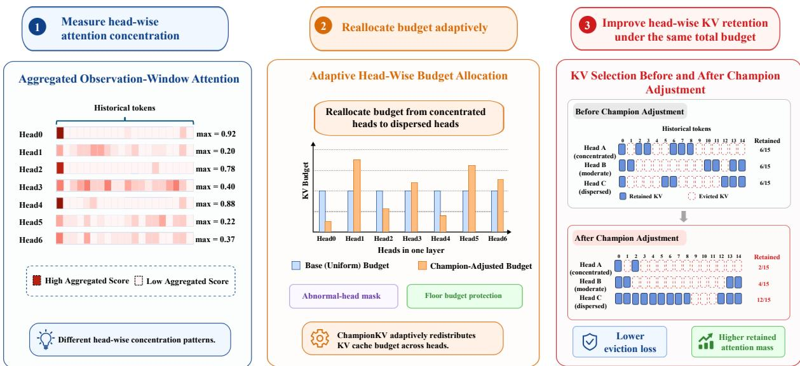  
Figure 1: Overview of CHAMPIONKV. Given observation-window attention, CHAMPIONKV estimates head-wise attention concentration using the maximum aggregated attention score and adaptively reallocates KV cache budget across heads. Dispersed heads receive larger budgets, while concentrated heads receive smaller budgets, improving retained attention mass without modifying the underlying token-selection procedure.

Champion variants consistently outperform their SnapKV and PyramidKV base compressors, with statistically significant gains on the 70B model under tight budgets; on the tested 7B/8B models the results are competitive but mixed, and neither variant uniformly surpasses Ada-KV. We further examine retained attention mass, hyper-parameter sensitivity, and hardware efficiency.

Our contributions are threefold: (a) a lightweight attention-concentration proxy for ranking headwise cache demand; (b) an inverse-max allocation rule with abnormal-head masking and floor-budget protection; and (c) an evaluation of its downstream performance, retained attention mass, and hardware efficiency under constrained cache budgets.

## 2 Related Work

## 2.1 Taxonomy of KV Cache Compression

KV cache compression aims to reduce the memory footprint of autoregressive LLM inference by retaining only the KV entries that are most useful for future generation. Existing methods can be broadly organized into three categories. First, observation-window-based methods use attention scores from recent prompt tokens to estimate the importance of historical tokens before decoding. For example, Li et al. (2024) propose SnapKV, which aggregates attention from an observation window at the end of the prompt and performs perhead Top-K token selection. PyramidInfer also exploits recent-token attention consistency to identify pivotal context in advance (Yang et al., 2024). Second, layer-wise methods study non-uniform cache requirements across Transformer layers. Cai et al. (2024) observe a pyramidal information funneling phenomenon, where lower layers tend to require larger budgets to aggregate global information, while higher layers can often operate with smaller budgets due to more concentrated attention. Third, head-wise methods further exploit heterogeneity among attention heads, assigning different compression strategies or cache budgets to different heads. This category is most closely related to our work. Overall, the methods mainly improve token selection, layer-wise methods improve inter-layer budget allocation, and head-wise methods improve intra-layer budget allocation.

## 2.2 Head-Wise KV Cache Compression

Head-wise KV cache compression is motivated by the broader observation that attention heads are heterogeneous in both importance and function. Michel et al. (2019) show that many heads can be removed at inference time with limited performance degradation, suggesting unequal contributions across heads. Mechanistic studies further identify specialized head types, such as induction heads related to pattern completion and in-context learning (Anthropic, 2022), while long-context analyses show that a small number of retrieval heads can be crucial for factual retrieval from long inputs (Wu et al., 2025); see also the systematic discussion by Zheng et al. (2024). In KV cache compression, FastGen (Ge et al., 2024) profiles attention heads and assigns different cache strategies to structural patterns such as local, special-token, punctuation, frequency-based, and broad attention heads. However, it mainly selects among discrete compression strategies rather than continuously allocating budgets among heads. Ada-KV (Feng et al., 2026) formulates KV eviction from the perspective of retained attention mass and uses input-dependent attention scores for global crosshead Top-K selection within each layer, enabling online adaptive budget allocation. HeadKV (Fu et al., 2025) estimates head importance using offline retrieval-reasoning examples and allocates KV cache budgets according to these precomputed importance scores.

CHAMPIONKV follows the observation-window token-selection paradigm and can be combined with layer-wise allocation. Like Ada-KV, it adapts budgets to the current input during prefilling, but uses a scalar concentration proxy and inversemax weighting instead of global cross-head token ranking. Unlike HeadKV, it does not require offline head-importance estimates. We next examine whether the maximum aggregated observationwindow attention score can serve as this proxy.

## 3 Pilot Experiment

## 3.1 Head-Wise Distribution Heterogeneity

Following SnapKV (Li et al., 2024), we use the last W tokens of the input sequence as an observation window to estimate which historical tokens are likely to be important for subsequent generation.

For the h-th head in the l-th layer, the observation-window attention is computed as:

$$
\begin{array} { c } { { A ^ { l , h } = \mathrm { s o f t m a x } \left( \displaystyle \frac { Q _ { \mathrm { o b s } } ^ { l , h } \left( K _ { \mathrm { a l l } } ^ { l , h } \right) ^ { \top } } { \sqrt { d _ { \mathrm { k e y } } } } \right) } } \\ { { A ^ { l , h } \in \mathbb { R } ^ { W \times L } } } \end{array}
$$

Here, $Q _ { \mathrm { o b s } } ^ { l , h }$ denotes the query states of the last W tokens, and $K _ { \mathrm { a l l } } ^ { l , h }$ denotes the key states of the whole prompt. We then keep the historical-token part of the attention matrix, $A _ { \mathrm { h i s t } } ^ { l , h } \in \mathbb { R } ^ { W \times ( L - W ) }$ by excluding the last W observation-window positions. The aggregated observation-window atten-

tion score is:

$$
a _ { i } ^ { l , h } = \frac { 1 } { W } \sum _ { t = 0 } ^ { W - 1 } A _ { \mathrm { h i s t } , t , i } ^ { l , h } , \quad i = 0 , \ldots , L - W - 1 .
$$

This vector, termed the aggregated observationwindow attention score, is used to estimate the importance of historical KV entries.

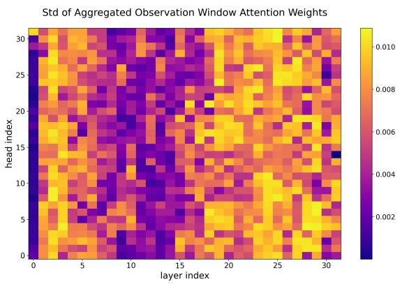  
Figure 2: Standard deviation of aggregated observationwindow attention scores across layers and heads in Llama3.1-8B-Instruct on NarrativeQA. The layer–head variation suggests heterogeneous attention concentration.

Prior studies on attention heads show that different heads may play different functional roles (Michel et al., 2019; Anthropic, 2022; Wu et al., 2025; Zheng et al., 2024). We further observe that, under observation-window-based KV compression, different heads also exhibit different attention distribution shapes. As shown in Figure 2, the standard deviation of aggregated observationwindow attention scores varies clearly across layers and heads, indicating heterogeneous attention concentration.

Specifically, we identify two typical distribution patterns. In a concentrated head, most attention mass is assigned to only a few historical tokens, such as <bos> (Xiao et al., 2024) or task-relevant evidence tokens. Such a head can cover its major attention mass with a small number of KV entries. In contrast, in a dispersed head, attention scores are spread over many historical tokens, making the attention mass harder to cover under a small cache budget. This motivates assigning larger KV cache budgets to dispersed heads than to concentrated heads. Detailed visual examples are provided in Appendix A.1.

## 3.2 Motivation for Champion-Based Budget Allocation

Ada-KV (Feng et al., 2026) analyzes KV eviction through attention-output perturbation and gives the following upper bound for the eviction loss within one layer:

$$
\mathcal { L } _ { E v i c t i o n } \leq 2 N _ { h } C - 2 C \sum _ { h = 0 } ^ { N _ { h } - 1 } \sum _ { i = 0 } ^ { L - W - 1 } I _ { i } ^ { l , h } a _ { i } ^ { l , h }
$$

where $N _ { h }$ is the number of attention heads, $I _ { i } ^ { l , h } \in \{ 0 , 1 \}$ indicates whether the i-th historical KV entry in head $h$ is retained, and C is a normrelated constant determined by value states and output projections. Since $N _ { h }$ and $C$ are fixed for a given layer, minimizing this upper bound is equivalent to maximizing the retained attention mass:

$$
\sum _ { h = 0 } ^ { N _ { h } - 1 } \sum _ { i = 0 } ^ { L - W - 1 } I _ { i } ^ { l , h } a _ { i } ^ { l , h }
$$

Given a head-wise budget $b ^ { l , h }$ , selecting the Top-$b ^ { l , h }$ entries inside each head maximizes the retained attention mass for that head. Therefore, the key problem becomes how to allocate the limited layerwise budget across heads.

The standard deviation of $a ^ { l , h }$ provides an empirical indication of attention concentration in the distributions studied here. However, directly computing and using second-order statistics introduces additional operations. We therefore use the maximum aggregated observation-window attention score:

$$
a _ { \mathrm { m a x } } ^ { l , h } = \operatorname* { m a x } _ { i } a _ { i } ^ { l , h }
$$

as a lightweight proxy for attention concentration. The historical-token score vector is nonnegative and has a sum bounded by one. When its second moment is dominated by the largest entry and the squared mean is negligible, the following heuristic relation is motivated:

$$
\sigma ^ { l , h } \propto \frac { 1 } { \sqrt { L - W } } a _ { \mathrm { m a x } } ^ { l , h } .
$$

We therefore use $a _ { \mathrm { m a x } } ^ { l , h }$ as a ranking-level proxy, rather than a strict estimator, for head-wise attention concentration. Among heads not flagged by the abnormal-head mask, smaller $a _ { \mathrm { m a x } } ^ { l , h }$ values lead to larger adaptive budgets. Appendix A.2 provides empirical support across the tested model scales and window sizes, while also identifying low-response outliers for which the proxy can be unreliable.

## 4 Methodology

Given the aggregated observation-window attention scores $\bar { a } ^ { l , h }$ defined in Section 3.1, CHAM-PIONKV first computes the champion score, the maximum aggregated observation-window attention score $a _ { \mathrm { m a x } } ^ { l , h }$ defined in Section 3.2.

Floor budget. For clarity, we describe the procedure based on the SnapKV pipeline. Let $\boldsymbol { B _ { \mathrm { b a s e } } }$ denote the predefined KV cache budget for each head, and let $W$ denote the observation window size. The per-head historical-token budget after excluding the observation window is:

$$
b _ { \mathrm { h i s t } } = B _ { \mathrm { b a s e } } - W
$$

For each layer, the total historical KV cache budget is therefore:

$$
B _ { \mathrm { h i s t } } = N _ { h } \cdot b _ { \mathrm { h i s t } }
$$

where $N _ { h }$ is the number of attention heads in the layer. We assign each head a fixed floor budget:

$$
b _ { \mathrm { f l o o r } } = \lfloor \rho \cdot b _ { \mathrm { h i s t } } \rfloor
$$

where $\rho$ is the floor-budget ratio, which controls the trade-off between guaranteed historical-token retention and adaptive redistribution. Increasing $\rho$ gives each head a larger guaranteed budget but leaves less budget for adaptive allocation. We use $\rho = 0 . 2$ as a practical default; the preferred balance can vary across models and workloads, as examined in our hyperparameter analysis.

Abnormal-head mask. We construct the abnormal-head mask according to $a _ { \mathrm { m a x } } ^ { l , h }$

$$
M _ { \mathrm { a b n } } ^ { l , h } = \mathbb { I } \left( a _ { \mathrm { m a x } } ^ { l , h } < \tau \right)
$$

where $\tau$ is the threshold for identifying abnormal heads. Equivalently:

$$
M _ { \mathrm { a b n } } ^ { l , h } = \left\{ { 1 , } \quad a _ { \mathrm { m a x } } ^ { l , h } < \tau , \right.
$$

Heads with $M _ { \mathrm { a b n } } ^ { l , h } = 1$ are designated as abnormal heads under this threshold-based rule. They retain only the floor budget and are excluded from adaptive budget competition, preventing very small champion scores from receiving disproportionately large inverse-max weights. The threshold $\tau = 0 . 0 1$ is an empirical default rather than a universal boundary between attention patterns; its suitability may depend on the model and context length.

Inverse-max budget allocation. After floor allocation, the remaining budget is:

$$
B _ { \mathrm { r e m } } = N _ { h } \cdot ( b _ { \mathrm { h i s t } } - b _ { \mathrm { f l o o r } } ) .
$$

The remaining budget is allocated only within the non-abnormal head set:

$$
\mathcal { H } _ { \mathrm { v a l i d } } ^ { l } = \{ h \ | \ M _ { \mathrm { a b n } } ^ { l , h } = 0 \}
$$

For each $h \in \mathcal { H } _ { \mathrm { v a l i d } } ^ { l }$ , we compute the inversemax allocation weight:

$$
w ^ { l , h } = \frac { \left( a _ { \mathrm { m a x } } ^ { l , h } + \epsilon \right) ^ { - 1 } } { \sum _ { j \in \mathcal { H } _ { \mathrm { v a l i d } } ^ { l } } \left( a _ { \mathrm { m a x } } ^ { l , j } + \epsilon \right) ^ { - 1 } } ,
$$

where ϵ is a small constant for numerical stability. The historical KV cache budget $b ^ { l , h }$ of the h-th head is then given by:

$$
b ^ { l , h } = \left\{ \begin{array} { l l } { b _ { \mathrm { f l o o r } } , } & { M _ { \mathrm { a b n } } ^ { l , h } = 1 , } \\ { \widehat { b } ^ { l , h } , } & { M _ { \mathrm { a b n } } ^ { l , h } = 0 , } \end{array} \right.
$$

$$
\widehat { b } ^ { l , h } = \operatorname* { m i n } \Bigl ( b _ { \mathrm { f l o o r } } + \big \lfloor w ^ { l , h } B _ { \mathrm { r e m } } \big \rfloor , L - W \Bigr )
$$

If unused budget remains due to rounding or the maximum allocatable length of an individual head, this budget is placed into a shared residual budget pool and further assigned according to the weight order of non-abnormal heads until the budget is exhausted or all allocatable heads reach their upper bound. This avoids waste caused by budget overflow and ensures that the limited KV cache budget is allocated to effective heads as much as possible.

Token selection. Finally, within each head, we perform $\mathrm { T o p } { - } b ^ { l , h }$ selection based on the aggregated observation-window attention scores. To reduce the influence of local noise, we apply local pooling smoothing to $a ^ { l , h }$ (Li et al., 2024; Cai et al., 2024), obtaining the score vector:

$$
s ^ { l , h } = \mathrm { P o o l } _ { \kappa } ( a ^ { l , h } ) ,
$$

where κ is the kernel size. The selected historical token indices are:

$$
\mathcal { T } ^ { l , h } = \mathrm { T o p K } ( s ^ { l , h } , b ^ { l , h } ) .
$$

Algorithm 1: CHAMPIONKV   
Input: $K ^ { l , h } , V ^ { l , h } , Q ^ { l , h }$ ; historical length $L ;$   
heads $N _ { h } ;$ per-layer budget $b _ { \mathrm { h i s t } } ;$   
window $W ;$   
Output: Compressed cache $\widetilde { K } ^ { l , h } , \widetilde { V } ^ { l , h } .$   
1 $A ^ { l , h } = \mathrm { s o f t m a x } \Big ( Q _ { L - W : L } ^ { l , h } ( K ^ { l , h } ) ^ { \top } / \sqrt { d } \Big )$   
2 $\begin{array} { r } { a _ { i } ^ { l , h } = \frac { 1 } { W } \sum _ { t = L - W } ^ { L - 1 } A _ { t , i } ^ { l , h } } \end{array}$   
3 $s ^ { l , h } = \mathrm { P o o l } ( a ^ { l , h } )$   
4 $a _ { \mathrm { m a x } } ^ { l , h } = \operatorname* { m a x } _ { i } s _ { i } ^ { l , h } ; M _ { \mathrm { a b n } } ^ { l , h } = \mathbb { I } ( a _ { \mathrm { m a x } } ^ { l , h } < \tau )$   
5 $b _ { \mathrm { f l o o r } } = \lfloor \rho b _ { \mathrm { h i s t } } \rfloor ; B _ { \mathrm { r e m } } = N _ { h } ( b _ { \mathrm { h i s t } } - b _ { \mathrm { f l o o r } } )$   
6 $\mathcal { H } _ { \mathrm { v a l i d } } ^ { l } = \{ h \ | \ M _ { \mathrm { a b n } } ^ { l , h } = 0 \}$   
7 wl,h = (al,hmax + ϵ)−1   
$\begin{array} { r } { \sum _ { j \in \mathcal { H } _ { \mathrm { v a l i d } } ^ { l } } ( a _ { \mathrm { m a x } } ^ { l , j } + \epsilon ) ^ { - 1 } } \end{array}$   
8 foreach $h \in \mathcal { H } _ { \mathrm { v a l i d } } ^ { l }$ do   
9 $\widehat { b } ^ { l , h } = \operatorname* { m i n } \bigl ( \dot { b } _ { \mathrm { H o o r } } + \lfloor w ^ { l , h } B _ { \mathrm { r e m } } \rfloor , L - W \bigr )$   
10 $b ^ { l , h }  \widehat { b } ^ { l , h }$   
11 end   
12 $b ^ { l , h }  b _ { \mathrm { f l o o r } }$ for $h \not \in \mathcal { H } _ { \mathrm { v a l i d } } ^ { l }$   
13 Assign leftover units to eligible heads in   
descending $w ^ { l , h }$ order   
14 foreach head h do   
15 $\mathcal { T } ^ { l , h } = \mathrm { T o p K } ( s ^ { l , h } , b ^ { l , h } )$   
16 $\mathcal { T } ^ { l , h } = \mathcal { T } ^ { l , h } \cup \{ L - W , \ldots , L - 1 \}$   
17 $\widetilde { K } ^ { l , h } = K _ { \mathcal { T } ^ { l , h } } ^ { l , h } , \quad \widetilde { V } ^ { l , h } = V _ { \mathcal { T } ^ { l , h } } ^ { l , h }$   
18 end   
19 return $\widetilde { K } ^ { l , h } , \widetilde { V } ^ { l , h }$

Meanwhile, we always retain the recent tokens:

$$
{ \mathcal { R } } = \{ L - W , \ldots , L - 1 \} .
$$

Therefore, the final retained KV cache index set for the h-th head is:

$$
\mathcal { T } ^ { l , h } = \mathcal { I } ^ { l , h } \cup \mathcal { R } .
$$

Indexing $K ^ { l , h }$ and $V ^ { l , h }$ using $\tau ^ { l , h }$ yields the compressed KV cache. The complete procedure is shown in Algorithm 1.

## 5 Experiments

## 5.1 Experimental Setup

Benchmarks. We evaluate on LongBench (Bai et al., 2024) and RULER (Hsieh et al., 2024). Long-Bench covers real-world long-context tasks such as $\mathrm { Q A }$ , summarization, few-shot learning, synthetic retrieval, and code completion. RULER provides controllable synthetic tasks for evaluating effective context length. Detailed task descriptions are provided in Appendix C.

Base models. We use three models for experiments: Llama3.1-8B-Instruct, Llama3.1-70B-Instruct (AI @ Meta, 2024), and Mistral-7B-Instruct-v0.3 (Jiang et al., 2023).

Baselines. We use SnapKV (Li et al., 2024) and PyramidKV (Cai et al., 2024) as base compressors and compare them with their Championadjusted variants, denoted as Champion-Snap and Champion-Pyramid, respectively. These comparisons isolate the effect of head-wise budget reallocation while preserving each compressor’s tokenselection procedure. We additionally include Ada-KV (Feng et al., 2026) as a directly relevant online adaptive allocation baseline. FullKV serves as the uncompressed reference.

Hyperparameters. For PyramidKV, the layerwise allocation hyperparameter is set to $\beta \ =$ 20 (Cai et al., 2024). Unless otherwise specified in the hyperparameter analysis, we use a floor-budget ratio of $\rho = 0 . 2$ and an abnormal-head threshold of $\tau = 0 . 0 1$ for CHAMPIONKV across the evaluation.

## 5.2 Main results

Results for LongBench We consider a group of KV cache budgets, $B _ { b a s e } \in \{ 6 4 , 1 2 8 , 5 1 2 , 2 0 4 8 \}$ and use $W = 3 2$ throughout.

Table 1 reports the LongBench results on Llama3.1-70B-Instruct. The comparison is mixed: Ada-KV has the highest 16-task average at budgets 64 and 128 (42.74 and 44.84), while Champion-Snap is strongest at 512 and 2048 (47.61 and 48.14), narrowly above Ada-KV (47.50 and 47.70). Task-level results are complementary: Ada-KV is strong under tight budgets, and the Champion variants lead on subsets at moderate and larger budgets; PCount and PRe are saturated and do not distinguish the methods. Against the base compressors, however, both Champion variants improve their 16-task averages over the corresponding SnapKV or PyramidKV allocation at the majority of budgets, with task-level wins concentrated at the tight end (paired analysis in §5.3.3); relative to Ada-KV’s global cross-head Top-K selection, the margin is small and budget-dependent, so CHAMPIONKV should be viewed as an upgrade to observation-window compressors rather than a uniformly stronger allocator.

Complete task-level LongBench results on Llama3.1-8B-Instruct and Mistral-7B-Instructv0.3, including Ada-KV, are in Appendix B. Ada-KV leads the 16-task average at three of four budgets on Llama3.1-8B-Instruct and at all four on Mistral-7B-Instruct-v0.3. The Champion variants remain competitive on individual tasks but do not lead the average, indicating that the 70B gains do not transfer uniformly to a smaller model.

Results for RULER On Llama3.1-70B-Instruct, Figure 3 shows that Champion-Snap improves over SnapKV by 1.33, 2.58, and 0.20 points at 20%, 40%, and 60% retention and ties at 80%; it also exceeds Ada-KV at 20–60% (96.01 vs. 94.68, 99.50 vs. 97.40, 99.94 vs. 99.76) and ties at 80% (99.97). The largest separation is at 40% retention, and the methods converge as retention approaches 80%.

Complete RULER results for all models and ratios are in Appendix B. The smaller-model comparisons are mixed: Champion-Snap exceeds Ada-KV at 20–60% retention on Llama3.1-8B-Instruct and ties at 80%, while Ada-KV is lower than the strongest tested method at all ratios on Mistral-7B-Instruct-v0.3. The tested 70B model gives the clearest downstream gains, a pattern that should not be generalized across families.

Hardware efficiency. We profile Llama3.1-8B-Instruct with a KV cache budget of 1024 on NVIDIA H200, using a 32,100-token input and 15 generated tokens (Table 8). Champion-Snap and Champion-Pyramid use 0.375 GB and 0.365 GB less peak GPU memory than Ada-KV with comparable total generation time (4.66 ms and 53.31 ms faster), while SnapKV retains the lowest latency and total time. This supports a modest memory reduction under the tested configuration rather than a universal speed advantage; profiling at additional input lengths is in Appendix B.

## 5.3 Further Analysis

## 5.3.1 Retained Attention Mass Coverage

We evaluate retained observation-window attention mass with a total cache budget of 512 and $W = 3 2$ changing only the head-wise allocation while keeping the underlying token-selection procedure fixed. Figure 4 shows that Champion allocation improves retained mass for all six model–compressor pairs and moves closer to the upper-bound reference. Because Ada-KV uses global cross-head Top-K selection, this controlled proxy comparison does not establish superiority over Ada-KV; direct downstream comparisons are reported in the LongBench and RULER results. Because the token-selection procedure is held fixed, the retained-mass gain can be attributed to the head-wise allocation, and its consistency across models and compressors foreshadows the downstream paired gains reported in the follwing section§5.3.3.

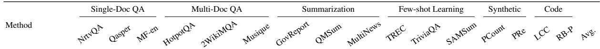  
KV Budget = Full

<table><tr><td>FullKV</td><td>27.41</td><td>46.02</td><td>53.84</td><td>53.96</td><td>59.35</td><td>33.42 34.48</td><td>24.79</td><td></td><td>27.89</td><td>68.00 91.33</td><td>47.18</td><td>14.00</td><td>66.00 64.0854.92 47.92</td></tr><tr><td colspan="10">KV Budget = 64</td><td></td><td></td><td></td><td></td></tr><tr><td>Ada-KV</td><td>27.17</td><td>42.69</td><td>52.08</td><td>44.56</td><td>52.41</td><td>24.65 23.01</td><td>22.53</td><td>22.37</td><td>67.00</td><td>91.27</td><td>44.25</td><td>14.00</td><td>66.00 32.98 56.83 42.74</td></tr><tr><td>SnapKV</td><td>25.48</td><td>33.80</td><td>47.02 42.36</td><td></td><td>44.46</td><td>22.83 20.70</td><td>21.35</td><td>21.09</td><td>60.00</td><td>88.26</td><td>43.15</td><td>14.00</td><td>66.00 36.98 53.4540.06</td></tr><tr><td>Champion-Snap</td><td>26.69</td><td>35.58</td><td>49.30 43.26</td><td></td><td>49.87</td><td>24.19 22.00</td><td>21.65</td><td>21.13</td><td>65.00</td><td>90.23</td><td>44.23</td><td>14.00</td><td>66.0040.9454.3641.78</td></tr><tr><td>PyramidKV</td><td>25.15</td><td>32.28</td><td>48.10 43.56</td><td></td><td>50.14</td><td>24.06 21.88</td><td>22.33</td><td>21.87</td><td>58.00</td><td>88.73</td><td>44.89</td><td>14.00</td><td>66.00 40.57 53.56 40.95</td></tr><tr><td>Champion-Pyramid</td><td>26.79</td><td>38.64</td><td>48.98 43.84</td><td></td><td>50.13</td><td>22.13 22.49</td><td>22.21</td><td>22.25</td><td>63.00</td><td>89.59</td><td>44.14</td><td>14.00</td><td>66.00 40.92 54.65 41.86</td></tr><tr><td colspan="10">KV Budget = 128</td><td></td><td></td><td></td></tr><tr><td>Ada-KV</td><td>27.27</td><td>43.41</td><td>53.15</td><td>50.22</td><td>53.36</td><td>26.61 24.49</td><td>23.23</td><td>23.32</td><td>68.00</td><td>91.43</td><td>48.18</td><td>14.00</td><td>66.0043.7960.9744.84</td></tr><tr><td>SnapKV</td><td>26.30</td><td>38.98</td><td>50.99</td><td>44.24</td><td>51.57</td><td>23.42</td><td>22.41</td><td>23.07</td><td>68.00</td><td>90.67</td><td>45.86</td><td>14.00</td><td>66.00 52.4954.32 43.58</td></tr><tr><td>Champion-Snap</td><td>24.17</td><td>40.81</td><td>49.91</td><td>45.92</td><td>52.26</td><td>24.88 25.72 23.92</td><td>23.09</td><td>23.38</td><td>67.00</td><td>91.43</td><td>47.54</td><td>14.00</td><td>66.00 54.3557.0344.16</td></tr><tr><td>PyramidKV</td><td>27.00</td><td>39.63</td><td>52.81 46.72</td><td></td><td>51.20 52.57</td><td>25.05 24.21</td><td>23.34</td><td>23.18</td><td>67.00</td><td>89.42</td><td>45.99</td><td>14.00</td><td>66.0045.3555.14 43.50</td></tr><tr><td>Champion-Pyramid</td><td>24.92</td><td>41.86 52.41</td><td>51.33</td><td></td><td></td><td>26.24 24.80</td><td>23.47</td><td>24.11</td><td>67.00</td><td>90.23</td><td>47.86</td><td>14.00</td><td>66.0042.7758.6344.26</td></tr><tr><td colspan="10">KV Budget = 512</td><td></td><td></td><td></td><td></td></tr><tr><td>Ada-KV</td><td>27.81</td><td>45.56</td><td>54.05</td><td>54.89</td><td>58.30</td><td>31.13</td><td>24.17</td><td>25.45</td><td>68.00</td><td>91.43</td><td>48.16</td><td>14.00</td><td>66.00 61.26 62.61 47.50</td></tr><tr><td>SnapKV</td><td>27.23</td><td>43.10</td><td>53.99</td><td>53.29</td><td>57.60</td><td>27.13 30.64 27.83</td><td>23.62</td><td>25.59</td><td>68.00</td><td>91.43</td><td>47.89</td><td>14.00</td><td>66.00 62.96 61.74 47.18</td></tr><tr><td>Champion-Snap</td><td>27.54</td><td>45.11</td><td>53.81</td><td>53.75</td><td>59.44</td><td>31.04</td><td>27.74 23.69</td><td>26.13</td><td>68.00</td><td>91.43</td><td>48.09</td><td>14.00</td><td>66.00 63.02 62.95 47.61</td></tr><tr><td>PyramidKV</td><td>27.41</td><td>43.31</td><td>52.74</td><td>52.02</td><td>57.68</td><td>29.98 27.41</td><td>23.99</td><td>25.65</td><td>68.00</td><td>90.23</td><td>47.32</td><td>14.00</td><td>66.00 62.00 57.74 46.59</td></tr><tr><td>Champion-Pyramid</td><td>27.96</td><td>45.53 54.25</td><td></td><td>54.37</td><td>58.35</td><td>33.42 28.34</td><td>23.93</td><td>25.75</td><td>68.00</td><td>89.73</td><td>47.40</td><td>14.00</td><td>66.00 63.5757.8447.40</td></tr><tr><td colspan="10">KV Budget = 2048</td><td></td><td></td><td></td></tr><tr><td>Ada-KV SnapKV</td><td>27.73</td><td>46.04</td><td>54.19</td><td>52.93</td><td>59.84</td><td>33.28</td><td>31.02</td><td>24.14</td><td>27.54</td><td>68.00 91.93</td><td>47.65</td><td>14.00</td><td>66.00 62.13 56.8547.70</td></tr><tr><td>Champion-Snap</td><td>27.55</td><td>44.86</td><td>53.62</td><td>53.22</td><td>58.95</td><td>33.65</td><td>31.67 24.76</td><td>27.62</td><td>68.00</td><td>91.93</td><td>47.81</td><td>14.00</td><td>66.00 65.32 56.13 47.82</td></tr><tr><td>PyramidKV</td><td>27.72</td><td>46.16 44.76</td><td>54.37</td><td>54.00</td><td>59.33</td><td>33.44</td><td>32.51 24.16</td><td>27.86</td><td>68.00</td><td>91.93</td><td>47.39</td><td>14.00</td><td>66.00 66.83 56.55 48.14</td></tr><tr><td>Champion-Pyramid</td><td>27.52 27.58</td><td>45.56</td><td>54.58</td><td>52.31 52.96</td><td>58.88</td><td>32.91</td><td>31.95 24.45</td><td>28.13</td><td>68.00</td><td>91.93</td><td>47.68</td><td>14.00</td><td>66.00 63.79 55.80 47.67</td></tr><tr><td></td><td></td><td></td><td>54.21</td><td></td><td>59.03</td><td>33.17</td><td>32.29 24.72</td><td>27.87</td><td>68.00</td><td>91.93</td><td>47.08</td><td>14.00</td><td>66.00 63.4056.59 47.77</td></tr></table>

Table 1: LongBench results on Llama3.1-70B-Instruct. Avg. is the mean over all 16 tasks. FullKV is the uncompressed reference; bold marks the best compressed result within each budget.

(a) SnapKV-based Allocation  
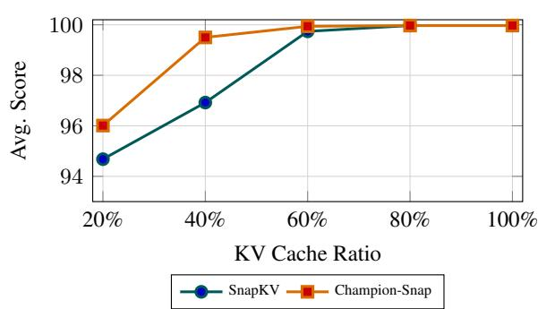

(b) PyramidKV-based Allocation  
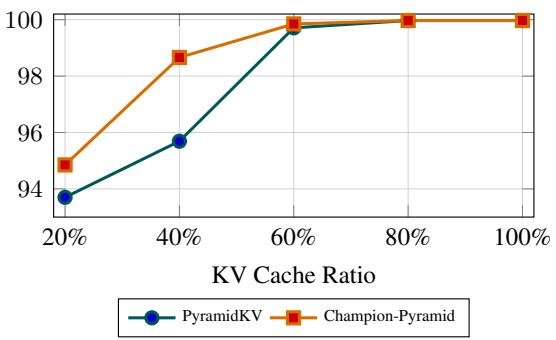  
Figure 3: RULER performance on Llama3.1-70B-Instruct under different KV cache ratios.

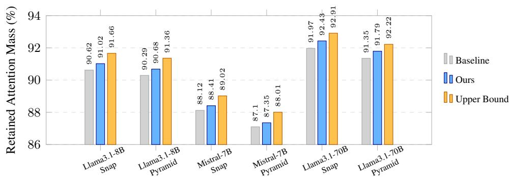  
Figure 4: Retained attention mass on randomly sampled LongBench prompts with KV cache budget 512 and observation window size W = 32. Baseline denotes the original SnapKV or PyramidKV allocation, while Ours denotes the same compressor after applying Champion head-wise reallocation.

## 5.3.2 Robustness Analysis of Hyper-parameters

We sweep ρ and τ on one task from each of the six LongBench categories. Preferred settings vary with model and budget: on Llama3.1-8B the best values differ across budgets, while $( \rho , \tau ) = ( 0 . 2 , 0 . 0 1 )$ gives the highest six-task average on Mistral-7B-Instruct-v0.3 (38.93). We therefore use this pair as a robustness-oriented default rather than a universal optimum; details are in Appendix B.

Prevalence of abnormal heads. At $\tau = 0 . 0 1$ abnormal heads account for 0.57–1.66% of layer– head instances on Llama3.1-8B and 0.81–1.50% on Mistral-7B-Instruct-v0.3. Thus, the mask affects only a small minority of heads under the tested protocol; detailed counts and prompt-level ranges are provided in Appendix B. Under inverse-max allocation an under-concentrated head would otherwise capture an outsized share of the budget, so masking such heads preempts this at negligible cost; the low observed prevalence indicates this guard is rarely triggered under the tested protocol.

Stability across input lengths. Across 8k–32k inputs, six-task averages vary by at most 0.55 points on Llama3.1-8B and 0.32 on Mistral-7B-Instruct-v0.3, indicating limited sensitivity within this fixed protocol. However, this slice does not replace evaluation of generation-heavy, long-chainof-thought, or multi-turn use; complete results are provided in Appendix B.

## 5.3.3 Paired Consistency Analysis

All scores use greedy decoding (deterministic per task), so mean differences alone cannot confirm consistent advantages. We conduct two-sided Wilcoxon signed-rank tests on paired deltas (Long-Bench: 16 tasks × 4 budgets; RULER: 11 subtasks × 4 ratios; Table 19).

For Llama3.1-70B, gains over both baselines are significant on LongBench $( p < 0 . 0 0 1$ ; win rates 68.8% and 60.9%), and Champion-Snap yields a significant RULER gain with zero losing pairs $( p = 0 . 0 1 6 )$ . On 7B/8B models, LongBench deltas are insignificant (win rates 39–44%). Benefits are strongest where head-wise heterogeneity is highest (70B) and mixed for smaller models. Decomposition shows 70B gains peak under tight budgets (Champion-Snap: +1.72 at budget 64 vs. +0.32 at 2048) and low-to-moderate RULER retention (20–40%), vanishing at 80% as methods saturate. No such monotonic trend appears for 7B/8B models, where isolated per-budget gains do not aggregate to significance.

## 5.3.4 Discussion

Taken together, the analyses delineate when headwise reallocation is worthwhile. The championscore proxy requires no offline estimation and introduces negligible overhead, and because token selection is never altered, CHAMPIONKV can be enabled alongside any observation-window compressor. Its practical role is therefore to upgrade existing observation-window compressors under scarce-budget, heterogeneous-head regimes, rather than to replace the underlying compressor or global cross-head selection.

## 6 Conclusion

This paper presents CHAMPIONKV, an inputadaptive head-wise allocator for observationwindow KV cache compression. It combines an attention-concentration proxy with inverse-max allocation, abnormal-head masking, and floorbudget protection without changing token selection. The proxy uses only the maximum aggregated observation-window attention score, computed during prefilling with no offline estimation or retraining. On LongBench and RULER, Champion-Snap and Champion-Pyramid consistently improve over their SnapKV and PyramidKV base compressors, with statistically significant gains on 70B model under tight budgets and moderate retention; on the tested 7B/8B models they remain competitive but do not consistently outperform. Gains concentrate where heads are most heterogeneous: tight budgets and low retention favor reallocating capacity from concentrated to dispersed heads, preserving the attention mass behind downstream accuracy. Controlled analysis confirms improved retained attention mass over matched baselines. Because allocation is decoupled from token scoring, CHAM-PIONKV composes with any observation-window compressor and complements global cross-head selection. Overall, CHAMPIONKV is a practical plugin that upgrades observation-window KV cache compressors.

## Limitations

The maximum-attention score is an empirical proxy, and abnormal-head masking cannot prevent every unreliable case; fixed ρ and τ may not transfer across models or workloads, motivating adaptive calibration. Evaluation covers limited models and tasks; we report paired per-task significance (§5.3.3) but not repeated-trial sampling-based significance tests, and the 8k–32k slice does not assess generation-heavy, long-chain-of-thought, or multiturn settings. Finally, because CHAMPIONKV reallocates budgets without changing token scoring, it inherits the token-selection limitations of the underlying compressor.

## Declaration for Using AI Assistants

During the preparation of this work, AI-assisted tools were used to support language polishing, grammar correction, and improvement of the clarity and readability of the text. The AI assistants were not used to generate original research ideas, perform data analysis, draw conclusions, or replace the authors’ own critical thinking and academic judgment. All AI-generated suggestions were carefully reviewed, revised, and verified by the authors. The authors take full responsibility for the accuracy, integrity, and originality of the content presented in this work.

## References

Llama Team AI @ Meta. 2024. The llama 3 herd of models. arXiv preprint arXiv:2407.21783.

Anthropic. 2022. In-context learning and induction heads. arXiv preprint arXiv:2209.11895.

Yushi Bai, Xin Lv, Jiajie Zhang, Hongchang Lyu, Jiankai Tang, Zhidian Huang, Zhengxiao Du, Xiao Liu, Aohan Zeng, Lei Hou, Yuxiao Dong, and Juanzi Li. 2024. Longbench: A bilingual, multitask benchmark for long context understanding. In Proceedings of the 62nd annual meeting of the association for computational linguistics (volume 1: Long papers), pages 3119–3137.

Zefan Cai, Yichi Zhang, Bofei Gao, Yuliang Liu, Yucheng Li, Tianyu Liu, Keming Lu, Wayne Xiong, Yue Dong, Junjie Hu, and Wen Xiao. 2024. Pyramidkv: Dynamic kv cache compression based on pyramidal information funneling. arXiv preprint arXiv:2406.02069.

Pradeep Dasigi, Kyle Lo, Iz Beltagy, Arman Cohan, Noah A Smith, and Matt Gardner. 2021. A dataset of information-seeking questions and answers anchored in research papers. In Proceedings of the

2021 Conference ofthe North American Chapter of the Associationfor Computational Linguistics: Human Language Technologies, pages 4599–4610.

DeepSeek-AI. 2025. Deepseek-r1: Incentivizing reasoning capability in llms via reinforcement learning. arXiv preprint arXiv:2501.12948.

Alexander Richard Fabbri, Irene Li, Tianwei She, Suyi Li, and Dragomir Radev. 2019. Multi-news: A largescale multi-document summarization dataset and abstractive hierarchical model. In Proceedings of the 57th annual meeting of the association for computational linguistics, pages 1074–1084.

Yuan Feng, Junlin Lv, Yukun Cao, Xike Xie, and S Kevin Zhou. 2026. Ada-kv: Optimizing kv cache eviction by adaptive budget allocation for efficient llm inference. Advances in Neural Information Processing Systems, 38:113152–113188.

Yu Fu, Zefan Cai, Abedelkadir Asi, Wayne Xiong, Yue Dong, and Wen Xiao. 2025. Not all heads matter: A head-level kv cache compression method with integrated retrieval and reasoning. In International Conference on Learning Representations, volume 2025, pages 99269–99290.

Suyu Ge, Yunan Zhang, Liyuan Liu, Minjia Zhang, Jiawei Han, and Jianfeng Gao. 2024. Model tells you what to discard: Adaptive kv cache compression for llms. In International Conference on Learning Representations, volume 2024, pages 22975–22988.

Gemini Team, Google. 2024. Gemini 1.5: Unlocking multimodal understanding across millions of tokens of context. arXiv preprint arXiv:2403.05530.

Bogdan Gliwa, Iwona Mochol, Maciej Biesek, and Aleksander Wawer. 2019. Samsum corpus: A humanannotated dialogue dataset for abstractive summarization. In Proceedings of the 2nd Workshop on New Frontiers in Summarization, pages 70–79.

Daya Guo, Canwen Xu, Nan Duan, Jian Yin, and Julian McAuley. 2023. Longcoder: A long-range pretrained language model for code completion. In International Conference on Machine Learning, pages 12098–12107. PMLR.

Xanh Ho, Anh-Khoa Duong Nguyen, Saku Sugawara, and Akiko Aizawa. 2020. Constructing a multi-hop qa dataset for comprehensive evaluation of reasoning steps. In Proceedings of the 28th International Conference on Computational Linguistics, pages 6609– 6625.

Cheng-Ping Hsieh, Simeng Sun, Samuel Kriman, Shantanu Acharya, Dima Rekesh, Fei Jia, Yang Zhang, and Boris Ginsburg. 2024. Ruler: What’s the real context size of your long-context language models? arXiv preprint arXiv:2404.06654.

Luyang Huang, Shuyang Cao, Nikolaus Parulian, Heng Ji, and Lu Wang. 2021. Efficient attentions for long document summarization. In Proceedings ofthe 2021

conference ofthe north American chapter ofthe associationfor computational linguistics: Human language technologies, pages 1419–1436.

Albert Q. Jiang, Alexandre Sablayrolles, Arthur Mensch, Chris Bamford, Devendra Singh Chaplot, Diego de las Casas, Florian Bressand, Gianna Lengyel, Guillaume Lample, Lucile Saulnier, and et al. 2023. Mistral 7b. arXiv preprint arXiv:2310.06825, 3.

Mandar Joshi, Eunsol Choi, Daniel S Weld, and Luke Zettlemoyer. 2017. Triviaqa: A large scale distantly supervised challenge dataset for reading comprehension. In Proceedings ofthe 55th Annual Meeting of the Associationfor Computational Linguistics (Volume 1: Long Papers), pages 1601–1611.

Tomáš Kociskˇ y, Jonathan Schwarz, Phil Blunsom, Chris\` Dyer, Karl Moritz Hermann, Gábor Melis, and Edward Grefenstette. 2018. The narrativeqa reading comprehension challenge. Transactions ofthe Associationfor Computational Linguistics, 6:317–328.

Xin Li and Dan Roth. 2002. Learning question classifiers. In COLING 2002: The 19th International Conference on Computational Linguistics.

Yuhong Li, Yingbing Huang, Bowen Yang, Bharat Venkitesh, Acyr Locatelli, Hanchen Ye, Tianle Cai, Patrick Lewis, and Deming Chen. 2024. Snapkv: Llm knows what you are looking for before generation. Advances in Neural Information Processing Systems, 37:22947–22970.

Tianyang Liu, Canwen Xu, and Julian McAuley. 2024. Repobench: Benchmarking repository-level code auto-completion systems. In International Conference on Learning Representations, volume 2024, pages 47832–47850.

Paul Michel, Omer Levy, and Graham Neubig. 2019. Are sixteen heads really better than one? Advances in neural information processing systems, 32.

Qwen Team. 2025. Qwen3 technical report. arXiv preprint arXiv:2505.09388.

Harsh Trivedi, Niranjan Balasubramanian, Tushar Khot, and Ashish Sabharwal. 2022. Musique: Multihop questions via single-hop question composition. Transactions of the Association for Computational Linguistics, 10:539–554.

Wenhao Wu, Yizhong Wang, Guangxuan Xiao, Hao Peng, and Yao Fu. 2025. Retrieval head mechanistically explains long-context factuality. In International Conference on Learning Representations, volume 2025, pages 62143–62156.

Guangxuan Xiao, Yuandong Tian, Beidi Chen, Song Han, and Mike Lewis. 2024. Efficient streaming language models with attention sinks. In International Conference on Learning Representations, volume 2024, pages 21875–21895.

Dongjie Yang, XiaoDong Han, Yan Gao, Yao Hu, Shilin Zhang, and Hai Zhao. 2024. Pyramidinfer: Pyramid kv cache compression for high-throughput llm inference. In Findings of the Association for Computational Linguistics: ACL 2024, pages 3258–3270.

Zhilin Yang, Peng Qi, Saizheng Zhang, Yoshua Bengio, William Cohen, Ruslan Salakhutdinov, and Christopher D Manning. 2018. Hotpotqa: A dataset for diverse, explainable multi-hop question answering. In Proceedings of the 2018 conference on empirical methods in natural language processing, pages 2369–2380.

Zhenyu Zhang, Ying Sheng, Tianyi Zhou, Tianlong Chen, Lianmin Zheng, Ruisi Cai, Zhao Song, Yuandong Tian, Christopher Ré, Clark Barrett, Zhangyang Wang, and Beidi Chen. 2023. H2o: Heavy-hitter oracle for efficient generative inference of large language models. Advances in Neural Information Processing Systems, 36:34661–34710.

Zifan Zheng, Yezhaohui Wang, Yuxin Huang, Shichao Song, Mingchuan Yang, Bo Tang, Feiyu Xiong, and Zhiyu Li. 2024. Attention heads of large language models: A survey. arXiv preprint arXiv:2409.03752.

Ming Zhong, Da Yin, Tao Yu, Ahmad Zaidi, Mutethia Mutuma, Rahul Jha, Ahmed Hassan, Asli Celikyilmaz, Yang Liu, Xipeng Qiu, and Dragomir Radev. 2021. Qmsum: A new benchmark for query-based multi-domain meeting summarization. In Proceedings of the 2021 Conference of the North American Chapter of the Association for Computational Linguistics: Human Language Technologies, pages 5905–5921.

## A Appendix: Pilot experiments

## A.1 Head-Wise Distribution Heterogeneity

We analyze the distributional differences of aggregated observation-window attention across layers and heads during prefilling. Specifically, we use Llama3.1-8B-Instruct (AI @ Meta, 2024) as the analysis model and NarrativeQA (Kocisk ˇ y et al. \` , 2018) as a representative dataset, and observe the aggregated observation-window attention distributions during the prefilling stage of model inference, since these distributions provide the key evidence for head-wise KV cache budget allocation.

We summarize two typical attention-score distribution patterns:

“Concentrated Attention Distribution” This pattern means that the current attention head focuses on only a small number of historical tokens, with most observation-window attention mass concentrated on a few tokens, typically <bos> (Xiao et al., 2024) or task-relevant evidence tokens. For example, Layer0 Head31 exhibits this pattern in Figure 5a; the log-scale view in Figure 5b makes the concentrated behavior clearer. This concentrated pattern suggests that the main attention mass of this head can be covered with relatively few KV entries.

“Dispersed Attention Distribution” This pattern means that the current attention head assigns relatively similar attention scores to historical tokens, with attention scores dispersed across a wide range of historical tokens. For Layer0 Head22 in Figure 6a, except for <bos>, tokens that originally receive low scores under the concentrated pattern obtain relatively higher attention throughout the sequence. The log-scale view in Figure 6b further highlights this change. This dispersed pattern indicates higher attention mass coverage difficulty and therefore motivates a larger head-wise KV cache budget.

These two types of heads correspond to the “difficult-to-accumulate attention” and “quick-toaccumulate attention” heads described in Ada-KV (Feng et al., 2026).

## A.2 Validation of the Max-Attention Proxy

We take the observation-window attention of the hth head in the l-th layer and compute it as follows:

From the attention-score matrix computed by the standard attention mechanism:

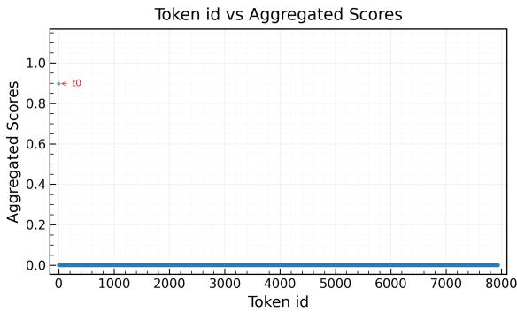

(a) Linear Y-axis.  
Token id vs Aggregated Scores  
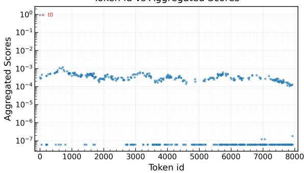  
(b) Log scale Y-axis.  
Figure 5: Concentrated aggregated observation-window attention distribution of Layer 0, Head 31 in Llama3.1- 8B-Instruct. The maximum score occurs at token 0 and most remaining historical tokens receive much lower scores.

$$
{ A = \mathrm { s o f t m a x } \left( \frac { Q \cdot K ^ { \top } } { \sqrt { d _ { k e y } } } \right) }
$$

$$
A \in \mathbb { R } ^ { L \times L }
$$

where L denotes the input sequence length.

The observation-window attention score matrix corresponds to the lower-left part of A (where the observation window has length W):

$$
A ^ { \prime } \in \mathbb { R } ^ { W \times ( L - W ) }
$$

Averaging $A ^ { \prime }$ along its columns yields the aggregated observation-window attention score:

$$
a _ { i } = \frac 1 W \sum _ { k = 0 } ^ { W - 1 } A _ { k i } ^ { \prime } , \qquad i \in [ 0 , L - W - 1 ]
$$

The mean of all elements in vector a is:

$$
\bar { a } = \frac { \sum _ { i = 0 } ^ { L - W - 1 } a _ { i } } { L - W }
$$

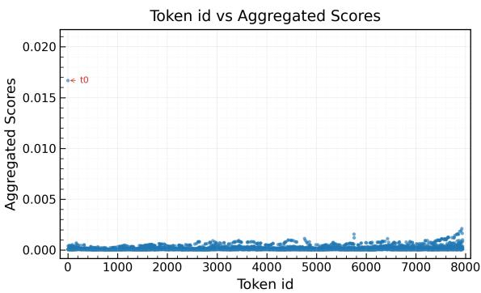

(a) Linear Y-axis.  
Token id vs Aggregated Scores  
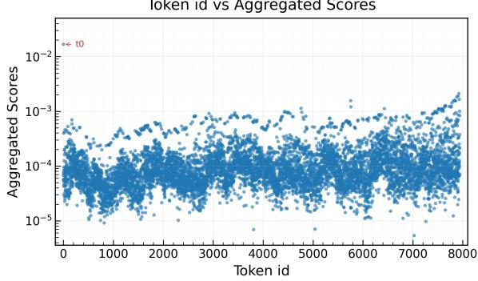  
(b) Log scale Y-axis.  
Figure 6: Dispersed aggregated observation-window attention distribution of Layer 0, Head 22 in Llama3.1- 8B-Instruct. Although the maximum score occurs at token 0, many other historical tokens receive relatively higher scores across the sequence.

The variance of all elements in vector a is:

$$
\begin{array} { c } { { \sigma ^ { 2 } = \displaystyle \frac { 1 } { L - W } \sum _ { i = 0 } ^ { L - W - 1 } ( a _ { i } - \bar { a } ) ^ { 2 } } } \\ { { = \displaystyle \frac { 1 } { L - W } \sum _ { i = 0 } ^ { L - W - 1 } a _ { i } ^ { 2 } - \bar { a } ^ { 2 } } } \end{array}
$$

$\bar { a } ^ { 2 }$ is on the order of $\frac { 1 } { ( L - W ) ^ { 2 } }$ , which is a higherorder small term compared with:

$$
{ \frac { 1 } { L - W } } \sum _ { i = 0 } ^ { L - W - 1 } a _ { i } ^ { 2 }
$$

Therefore:

$$
\sigma ^ { 2 } \approx \frac { 1 } { L - W } \sum _ { i = 0 } ^ { L - W - 1 } a _ { i } ^ { 2 }
$$

The corresponding standard deviation is:

$$
\sigma = \sqrt { \frac { 1 } { L - W } \sum _ { i = 0 } ^ { L - W - 1 } a _ { i } ^ { 2 } }
$$

The aggregated observation-window attention score vector $a _ { i }$ is non-negative, has a bounded sum, and is typically sparse because it results from softmax normalization. Its second-order statistics are therefore strongly controlled by the maximum score. We can thus hypothesize a linear relationship between $\sigma$ and the maximum attention score amax:

$$
\sigma \approx { \frac { 1 } { \sqrt { L - W } } } a _ { \mathrm { m a x } }
$$

It should be noted that this approximation does not strictly hold for all attention heads. It relies on the premise that the second-order statistics of the aggregated observation-window attention distribution are mainly dominated by the maximum attention score. In other words, this relationship is more suitable for sparse or approximately unimodal attention distributions, where a small number of historical tokens account for most of the attention mass. As indicated by the oscillating outlier points in the lower-left regions of the linear fitting plots in Figures 7d, 8d, 9d, 10d, 11d, 12d, 13d, when the maximum aggregated observation-window attention score is very low, using $a _ { \mathrm { m a x } }$ alone as a lightweight proxy for the standard deviation $\sigma$ is not reliable. We refer to such heads as abnormal heads. These low-response outliers motivate the abnormal-head mask used in Section 4. Instead of allowing inverse-max allocation to amplify their weights, CHAMPIONKV conservatively assigns them only the floor budget. Heads identified by this mask do not participate in the adaptive budget allocation process and are only assigned the minimum floor budget. This mechanism avoids extremely unfair budget allocation caused by abnormal attention distributions and improves robustness across models and tasks.

In terms of asymptotic complexity, both finding $a _ { \mathrm { m a x } }$ and computing $\sigma$ require a linear scan; however, finding $a _ { \mathrm { m a x } }$ avoids second-moment computation and can be more easily integrated with existing attention-score accumulation or Top- $K$ selection procedures. It is important to note that Ada-KV (Feng et al., 2026) directly optimizes attention mass retention through global cross-head Top-K selection and therefore has an optimality property. CHAMPIONKV does not attempt to theoretically replace Ada-KV (Feng et al., 2026)’s global Top-$K$ mechanism; rather, it provides a lighter headwise budget allocation proxy that avoids large-scale cross-head concatenation and selection, improving engineering friendliness for ultra-long prompt scenarios.

Based on the above derivation, this section empirically evaluates whether $a _ { \mathrm { m a x } }$ can serve as a stable ranking-level proxy for σ across model architectures, model scales, observation-window sizes, and datasets.

Unless otherwise specified, each correlationanalysis figure in this subsection contains four subplots: (a) the heatmap of $a _ { \mathrm { m a x } } ^ { l , h }$ , (b) the heatmap of $\sigma ^ { l , h }$ , (c) the layer-wise Pearson correlation between them, and (d) the corresponding linear fit.

Correlation between maximum attention and standard deviation. First, we record the aggregated observation-window attention scores of every layer and every head during the prefilling stage of model inference. For each head, we compute its aggregated observation-window attention vector $a ^ { l , h }$ , and then calculate the maximum attention score $a _ { \mathrm { m a x } } ^ { l , h }$ and the standard deviation $\sigma ^ { l , h }$ . Taking the NarrativeQA single-document question answering task as an example, when the observation window size is set to $W = 8$ , the experimental results on Llama3.1-8B-Instruct show that the heatmaps of $a _ { \mathrm { m a x } } ^ { l , h }$ and $\sigma ^ { l , h }$ over the layer-head dimensions exhibit highly consistent distribution patterns, as shown in Figure 7a and Figure 7b; the scatter fitting results further show that the two quantities approximately lie on a straight line, as shown in Figure 7d, with a Pearson correlation coefficient of $r = 0 . 9 9 9 3$ , as shown in Figure 7c. This indicates that, under the same model and task setting, the maximum aggregated attention score can stably reflect the degree of attention concentration captured by the standard deviation.

Robustness across model architectures and scales. To verify that this proxy is not specific to Llama3.1-8B-Instruct or a single model architecture, we further conduct the same experiment on Mistral-7B-Instruct-v0.3 and Llama3.1-70B-Instruct. Mistral-7B-Instruct-v0.3 has a parameter scale similar to Llama3.1-8B-Instruct but a different architecture, while Llama3.1-70B-Instruct is used to test the stability of the relationship at a larger model scale.

The results on Mistral-7B-Instruct-v0.3 and Llama3.1-70B-Instruct show that the heatmaps of maximum attention scores and standard deviations remain highly consistent across models (Figure 8a and Figure 8b; Figure 9a and Figure 9b). The scatter plots also exhibit near-linear relationships (Figure 8d; Figure 9d) with Pearson correlation coefficients close to one for both models (Figure 8c; Figure 9c). This suggests that the max-attention proxy is not tied to a specific model architecture or parameter scale.

Robustness across observation window sizes. In addition to model architecture and scale, we examine the effect of the observation window size on this linear proxy. Specifically, on Llama3.1- 8B-Instruct, we set $W \in \{ 4 , 1 6 , 3 2 , 6 4 \}$ , fix the prompt length to $L = 8 , 0 0 0$ , and repeat the correlation analysis between $a _ { \mathrm { m a x } } ^ { l , h }$ and $\bar { \sigma ^ { l , h } }$ on a NarrativeQA example. The experimental results are shown in Figures 10, 11, 12, and 13. We therefore use concise subfigure captions in the following figures for readability. Under different window sizes, the maximum attention score and the standard deviation remain highly linearly correlated, indicating that the proxy does not depend on a fixed observation window size.

<table><tr><td>Len.</td><td>Slope</td><td> $L - W$   $1 / \sqrt { L - W }$  Err. (%)</td></tr><tr><td>2k</td><td>0.022322</td><td>1934 0.022739 1.8682</td></tr><tr><td>4k</td><td>0.015649 3934</td><td>0.015943 1.8817</td></tr><tr><td>6k</td><td>0.012753 5934</td><td>0.012982 1.7921</td></tr><tr><td>8k 0.011034</td><td>7934</td><td>0.011227 1.7468</td></tr><tr><td>10k 0.009863</td><td>9934</td><td>0.010033 1.7253</td></tr><tr><td>12k 0.009004</td><td>11934</td><td>0.009154 1.6650</td></tr><tr><td>14k 0.008335</td><td>13934</td><td>0.008472 1.6381</td></tr><tr><td>16k 0.007794</td><td>15934</td><td>0.007922 1.6429</td></tr><tr><td>32k 0.005556</td><td>31358</td><td>0.005647 1.6397</td></tr></table>

Table 2: Scaling relation between the fitted slope and $1 / \sqrt { L - W }$ on NarrativeQA with Llama3.1-8B-Instruct.

Scaling relation with sequence length. Furthermore, we validate the relationship between the fitted slope and the number of historical tokens $L - W$ . According to the derivation in Section A.2, if the second-order statistics are mainly dominated by the maximum attention score, then

$$
\sigma ^ { l , h } \approx \frac { 1 } { \sqrt { L - W } } a _ { \mathrm { m a x } } ^ { l , h } ,
$$

and the fitted slope should approximately satisfy

$$
{ \mathrm { s l o p e } } = { \frac { 1 } { \sqrt { L - W } } } .
$$

To verify this relation, we use NarrativeQA prompts on Llama3.1-8B-Instruct, fix the observation window size to $W = 1 6 ,$ , and vary the input length. Table 2 shows that the fitted slope remains close to the theoretical value across different sequence lengths.

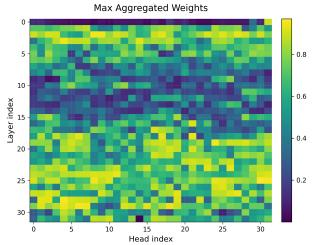  
(a) Max.

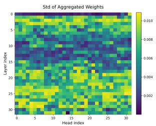  
(b) Std.

  
(c) Pearson r.

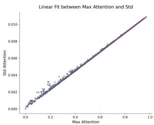  
(d) Linear fit.

Figure 7: Correlation analysis on NarrativeQA with Llama3.1-8B-Instruct with W = 8.  
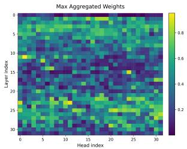  
(a) Max.

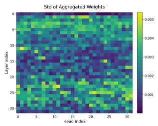  
(b) Std.

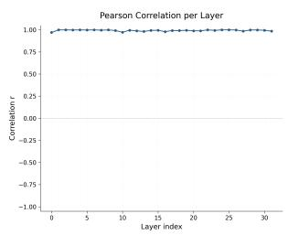  
(c) Pearson r.

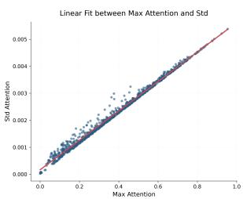  
(d) Linear fit.

Figure 8: Correlation analysis on Mistral-7B-Instruct-v0.3 with W = 8.  
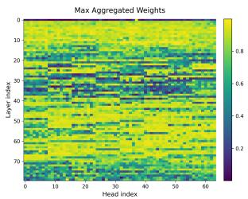  
(a) Max.

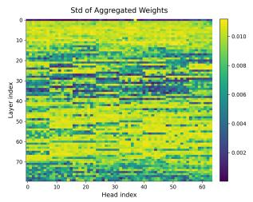  
(b) Std.

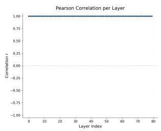  
(c) Pearson r.

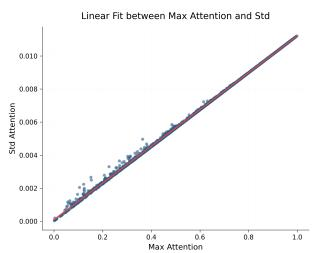  
(d) Linear fit.

Figure 9: Correlation analysis on Llama3.1-70B-Instruct with W = 8.  
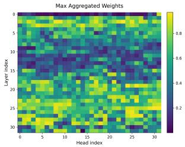  
(a) Max.

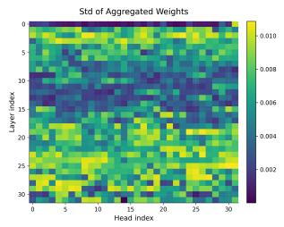  
(b) Std.

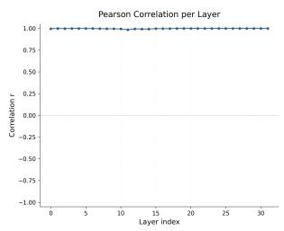  
(c) Pearson r.

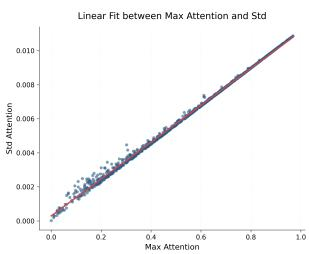  
(d) Linear fit.

Figure 10: Correlation analysis on Llama3.1-8B-Instruct with W = 4.  
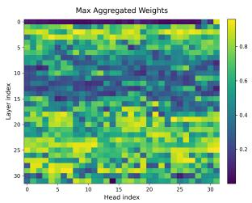  
(a) Max.

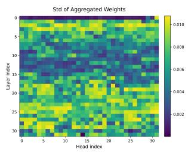  
(b) Std.

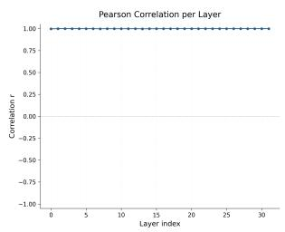  
(c) Pearson r.

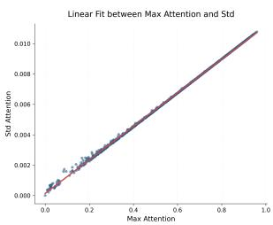  
(d) Linear fit.  
Figure 11: Correlation analysis on Llama3.1-8B-Instruct with W = 16.

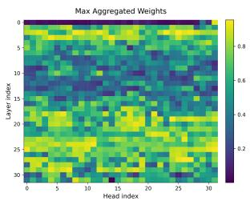  
(a) Max.

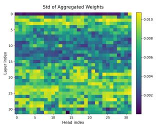  
(b) Std.

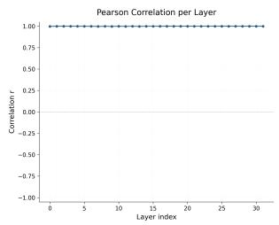  
(c) Pearson r.

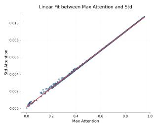  
(d) Linear fit.

Figure 12: Correlation analysis on Llama3.1-8B-Instruct with $W = 3 2$  
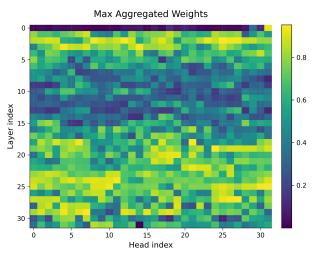  
(a) Max.

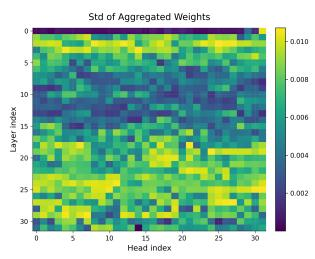  
(b) Std.

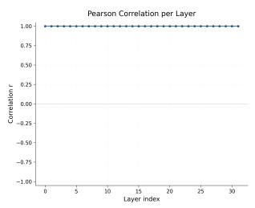  
(c) Pearson r.

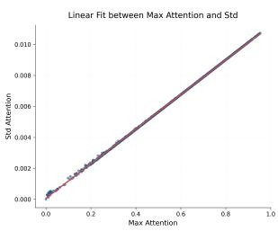  
(d) Linear fit.

Figure 13: Correlation analysis on Llama3.1-8B-Instruct with $W = 6 4$
<table><tr><td>Dataset</td><td> $L - W$ </td><td>Slope  $1 / \sqrt { L - W }$ </td><td>Err. (%)</td></tr><tr><td>2WikiMQA</td><td>7063</td><td>0.011524 0.011899</td><td>3.2529</td></tr><tr><td>GovReport</td><td>7942</td><td>0.010821 0.011221</td><td>3.6974</td></tr><tr><td>HotpotQA</td><td>7941</td><td>0.010768 0.011222</td><td>4.2143</td></tr><tr><td>LCC</td><td>7918</td><td>0.011030 0.011238</td><td>1.8865</td></tr><tr><td>MultiNews</td><td>2656</td><td>0.018709 0.019404</td><td>3.7135</td></tr><tr><td>MF-en</td><td>1522</td><td>0.024590 0.025633</td><td>4.2399</td></tr><tr><td>Musique</td><td>7942</td><td>0.010838 0.011221</td><td>3.5347</td></tr><tr><td>NrtvQA</td><td>7942</td><td>0.010979 0.011221</td><td>2.2050</td></tr><tr><td>PCount</td><td>7942</td><td>0.010958 0.011221</td><td>2.4009</td></tr><tr><td>PRe</td><td>7942</td><td>0.010772 0.011221</td><td>4.1691</td></tr><tr><td>Qasper</td><td>3992</td><td>0.015424 0.015827</td><td>2.6143</td></tr><tr><td>QMSum</td><td>7933</td><td>0.010898 0.011227</td><td>3.0231</td></tr><tr><td>RB-P</td><td>7938</td><td>0.011061 0.011224</td><td>1.4729</td></tr><tr><td>SAMSum</td><td>7940</td><td>0.010950 0.011223</td><td>2.4886</td></tr><tr><td>TREC</td><td>4949</td><td>0.013884 0.014215</td><td>2.3827</td></tr><tr><td>TriviaQA</td><td>5499</td><td>0.012989 0.013485</td><td>3.8203</td></tr></table>

Table 3: Slope validation across LongBench datasets on Llama3.1-8B-Instruct with $W = 8$

<table><tr><td>Dataset</td><td> $L - W$ </td><td>Slope</td><td> $1 / \sqrt { L - W }$ </td><td>Err. (%)</td></tr><tr><td>GovReport</td><td>7942</td><td>0.011058</td><td>0.011221</td><td>1.4749</td></tr><tr><td>HotpotQA</td><td>7941</td><td>0.010997</td><td>0.011222</td><td>2.0442</td></tr><tr><td>LCC</td><td>7918</td><td>0.011153</td><td>0.011238</td><td>0.7629</td></tr><tr><td>NrtvQA</td><td>7942</td><td>0.011121</td><td>0.011221</td><td>0.9000</td></tr><tr><td>PCount</td><td>7942</td><td>0.011094</td><td>0.011221</td><td>1.1456</td></tr><tr><td>RB-P</td><td>7938</td><td>0.011169</td><td>0.011224</td><td>0.4917</td></tr><tr><td>TREC</td><td>4949</td><td>0.014124</td><td>0.014215</td><td>0.6430</td></tr></table>

Table 4: Slope validation across LongBench datasets on Llama3.1-70B-Instruct with $W = 8$

<table><tr><td>Dataset</td><td> $L - W$ </td><td>Slope</td><td> $1 / \sqrt { L - W }$ </td><td>Err. (%)</td></tr><tr><td>2WikiMQA</td><td>8093</td><td>0.010713</td><td>0.011116</td><td>3.7610</td></tr><tr><td>GovReport</td><td>11927</td><td>0.008692</td><td>0.009157</td><td>5.3452</td></tr><tr><td>HotpotQA</td><td>13132</td><td>0.008392</td><td>0.008726</td><td>3.9846</td></tr><tr><td>LCĆ</td><td>17798</td><td>0.007337</td><td>0.007496</td><td>2.1635</td></tr><tr><td>MF-en</td><td>1877</td><td>0.022153</td><td>0.023082</td><td>4.1922</td></tr><tr><td>MultiNews</td><td>3104</td><td>0.016902</td><td>0.017949</td><td>6.1943</td></tr><tr><td>Musique</td><td>18387</td><td>0.007159</td><td>0.007375</td><td>3.0130</td></tr><tr><td>NrtvQA</td><td>31492</td><td>0.005448</td><td>0.005635</td><td>3.4339</td></tr><tr><td>PCount</td><td>18048</td><td>0.007138</td><td>0.007444</td><td>4.2819</td></tr><tr><td>PRe</td><td>12604</td><td>0.008469</td><td>0.008907</td><td>5.1753</td></tr><tr><td>Qasper</td><td>4486</td><td>0.014236</td><td>0.014930</td><td>4.8775</td></tr><tr><td>QMSum</td><td>11811</td><td>0.008925</td><td>0.009201</td><td>3.0976</td></tr><tr><td>RB-P</td><td>16187</td><td>0.007111</td><td>0.007860</td><td>1.9310</td></tr><tr><td>SAMSum</td><td>11176</td><td>0.009132</td><td>0.009459</td><td>3.5836</td></tr><tr><td>TREC</td><td>5520</td><td>0.013019</td><td>0.013460</td><td>3.3839</td></tr><tr><td>TriviaQA</td><td>6551</td><td>0.011831</td><td>0.012355</td><td>4.4299</td></tr></table>

Table 5: Slope validation across LongBench datasets on Mistral-7B-Instruct-v0.3 with $W = 8$

Robustness across datasets. To further rule out the possibility that this observation is specific to a single task example, we repeat the slope validation on multiple LongBench datasets. Tables 3, 4, and 5 report the results on Llama3.1-8B-Instruct, Llama3.1-70B-Instruct, and Mistral-7B-Instruct-v0.3, respectively. Across datasets and model scales, the fitted slope remains close to $1 / \sqrt { L - W }$

## B Appendix: Additional Experimental Results

Hyperparameter analysis on Llama3.1-8B-Instruct. The Llama3.1-8B-Instruct sweep underlying the main-text conclusions is reported below. A larger floor ratio improves stability at larger budgets but reduces adaptive redistribution, while the best abnormal-head threshold varies with budget; therefore $( \rho , \tau ) = ( 0 . 2 , 0 . 0 1 )$ is used as a practical default rather than a universal optimum.

<table><tr><td>ρ</td><td>Budget 128</td><td>Budget 512</td><td>Budget 2048</td></tr><tr><td>0.1</td><td>35.57</td><td>39.86</td><td>40.28</td></tr><tr><td>0.2</td><td>35.25</td><td>39.90</td><td>40.38</td></tr><tr><td>0.5</td><td>35.53</td><td>40.34</td><td>40.75</td></tr></table>

Table 6: Robustness analysis of the floor-budget ratio ρ on LongBench with Llama3.1-8B-Instruct. Average scores over six representative LongBench tasks.
<table><tr><td>T</td><td>Budget 128</td><td>Budget 512</td><td>Budget 2048</td></tr><tr><td>0.01</td><td>30.49</td><td>33.67</td><td>34.00</td></tr><tr><td>0.001</td><td>30.39</td><td>33.51</td><td>34.40</td></tr><tr><td>0.0001</td><td>29.92</td><td>33.40</td><td>34.32</td></tr></table>

Table 7: Robustness analysis of the abnormal-head threshold τ on LongBench with Llama3.1-8B-Instruct. Average scores over six representative LongBench tasks.

Maximum decoding length for each dataset. We evaluate on 16 LongBench datasets, and the maximum decoding length for each dataset is shown in Table 9.

Hardware profiling across input lengths. Table 10 reports the available profiling results for Llama3.1-8B-Instruct at input lengths of 8,100, 16,100, and 32,100 tokens. All settings use a KV cache budget of 1024 and generate 15 new tokens on NVIDIA H200. Prefill time covers processing the input sequence, decoding latency is the average time per generated token, and total generation time includes both prefilling and decoding. Across the three input lengths, the Champion variants consistently use slightly less peak GPU memory than Ada-KV. The timing differences vary by method and input length, so these measurements should be interpreted as configuration-specific profiling rather than a general speedup claim.

Table 8 reports the profiling at the primary 1024- budget configuration described in the main text.

Hyperparameter analysis on Mistral-7B-Instruct-v0.3. Table 11 complements the

<table><tr><td>Method</td><td>Mem. (GB)</td><td>Prefill (ms)</td><td>Dec. (ms/tok)</td><td>Total (ms)</td></tr><tr><td>SnapKV</td><td>38.605</td><td>3795.82</td><td>29.46</td><td>4237.64</td></tr><tr><td>Ada-KV</td><td>38.605</td><td>3887.61</td><td>44.99</td><td>4562.39</td></tr><tr><td>Champion-Snap</td><td>38.230</td><td>3885.97</td><td>44.78</td><td>4557.73</td></tr><tr><td>Champion-Pyramid 38.240</td><td></td><td>3875.88</td><td>42.21</td><td>4509.08</td></tr></table>

Table 8: Hardware profiling on Llama3.1-8B-Instruct with a 32,100-token input, 15 generated tokens, and KV cache budget 1024. Bold marks the lowest value in each column.
<table><tr><td>Dataset</td><td>Max len</td><td>Dataset</td><td>Max len</td></tr><tr><td>NrtvQA</td><td>128</td><td>MultiNews</td><td>512</td></tr><tr><td>Qasper</td><td>128</td><td>PCount</td><td>32</td></tr><tr><td>MF-en</td><td>64</td><td>PRe</td><td>32</td></tr><tr><td>HotpotQA</td><td>32</td><td>Lcc</td><td>64</td></tr><tr><td>2WikiMQA</td><td>32</td><td>TriviaQA</td><td>32</td></tr><tr><td>Musique</td><td>32</td><td>SAMSum</td><td>128</td></tr><tr><td>GovReport</td><td>512</td><td>TREC</td><td>64</td></tr><tr><td>QMSum</td><td>512</td><td>RB-P</td><td>64</td></tr></table>

Table 9: Maximum decoding lengths for the 16 Long-Bench datasets used in evaluation.

Llama3.1-8B-Instruct analysis by jointly varying the floor-budget ratio ρ and abnormal-head threshold τ on the same six representative LongBench task categories. The default pair (0.2, 0.01) yields the highest average among the tested settings, but other configurations achieve the best result on individual tasks. This supports using $\rho = 0 . 2$ and $\tau = 0 . 0 1$ as robustness-oriented defaults while allowing model-specific tuning.

Abnormal-head prevalence. We count a layer– head instance as abnormal when $a _ { \mathrm { m a x } } ^ { l , h } < 0 . 0 1$ , following the default threshold used in the main experiments. Table 12 reports both the aggregate rate over all evaluated prompts and the range of promptlevel rates. The observed prevalence is low but varies across models and datasets, reinforcing that $\tau = 0 . 0 1$ is an empirical safeguard rather than a universal boundary.

Long-context slice. We further evaluate Champion-Snap at input lengths of 8k, 16k, and 32k on the six representative LongBench tasks used in the robustness analysis. As shown in Table 13, the average scores vary by at most 0.55 points on Llama3.1-8B-Instruct and 0.32 points on Mistral-7B-Instruct-v0.3. These results support stability with respect to input length under this fixed evaluation protocol. They should not be interpreted as evidence for generation-heavy, long-chain-of-thought, or multi-turn settings, which are not evaluated here.

Detailed RULER scores on the three base models are shown in Tables 16, 17 and 18.

LongBench results on 7B/8B-scale models. Table 14 reports the Llama3.1-8B-Instruct results. Ada-KV achieves the highest 16-task average at budgets 64, 128, and 2048 (36.36, 38.60, and 43.42), whereas SnapKV is strongest at budget 512 (41.57). At budget 2048, Champion-Pyramid reaches 43.08, but remains below Ada-KV’s 43.42. Thus, the Champion variants win selected tasks but do not provide the strongest average on this model.

Table 15 shows a similar adaptive-baseline advantage on Mistral-7B-Instruct-v0.3. Ada-KV obtains the highest average at all four budgets (41.06, 43.69, 46.41, and 47.27). Champion-Snap reaches 47.04 at budget 2048 and remains competitive with SnapKV and Champion-Pyramid, but does not exceed Ada-KV. These results reinforce that the smaller-model behavior is workload-dependent and that CHAMPIONKV should not be interpreted as uniformly outperforming global cross-head allocation.

RULER results on 7B/8B-scale models. The Llama3.1-8B-Instruct results are shown in Figure 14 and Table 16. Champion-Snap improves over SnapKV by 0.56, 0.96, 0.14, and 0.52 points at 20%, 40%, 60%, and 80% retention. It also exceeds Ada-KV at 20%–60% retention (88.15 vs. 82.88, 93.57 vs. 90.63, and 97.16 vs. 95.99), while the two are nearly tied at 80% (99.28 vs. 99.29). Champion-Pyramid improves over PyramidKV at 20%, 60%, and 80%, but is slightly lower at 40%.

The Mistral-7B-Instruct-v0.3 results are shown in Figure 15 and Table 17. Ada-KV obtains 78.83, 86.64, 90.56, and 94.10 across the four retention ratios, below the strongest result at each ratio. Champion-Snap exceeds SnapKV only at 20% and 60%, while Champion-Pyramid exceeds PyramidKV at 20% and 80%. Thus, neither adaptive method provides a uniform advantage on this model.

<table><tr><td>Method</td><td></td><td>Input len. Peak Mem. Prefill time 1 (GB)</td><td>(ms)</td><td>(ms/token)</td><td>Decode Lat. Total Gen. time (ms)</td></tr><tr><td>Ada-KV</td><td>8,100</td><td>21.221</td><td>1097.12</td><td>45.64</td><td>1781.68</td></tr><tr><td>Champion-Snap</td><td>8,100</td><td>20.845</td><td>800.56</td><td>49.43</td><td>1542.04</td></tr><tr><td>Champion-Pyramid</td><td>8,100</td><td>20.855</td><td>922.82</td><td>46.50</td><td>1620.34</td></tr><tr><td>Ada-KV</td><td>16,100</td><td>27.014</td><td>1677.00</td><td>45.79</td><td>2363.83</td></tr><tr><td>Champion-Snap</td><td>16,100</td><td>26.640</td><td>1652.47</td><td>46.33</td><td>2347.44</td></tr><tr><td>Champion-Pyramid</td><td>16,100</td><td>26.650</td><td>1636.34</td><td>42.25</td><td>2270.13</td></tr><tr><td>Ada-KV</td><td>32,100</td><td>38.605</td><td>3887.61</td><td>44.99</td><td>4562.39</td></tr><tr><td>Champion-Snap</td><td>32,100</td><td>38.230</td><td>3885.97</td><td>44.78</td><td>4557.73</td></tr><tr><td>Champion-Pyramid</td><td>32,100</td><td>38.240</td><td>3875.88</td><td>42.21</td><td>4509.08</td></tr></table>

Table 10: Hardware profiling of Llama3.1-8B-Instruct across input lengths with 15 generated tokens and KV cache budget 1024.
<table><tr><td>ρ</td><td>T</td><td>NrtvQA HotpotQA GovReport TREC PCount</td><td></td><td></td><td></td><td></td><td>Lcc</td><td>Avg.</td></tr><tr><td>0.1</td><td>0.01</td><td>26.26</td><td>45.37</td><td>24.97</td><td>71.00</td><td>7.00</td><td></td><td>57.88 38.75</td></tr><tr><td>0.2</td><td>0.0001</td><td>26.09</td><td>46.39</td><td>24.78</td><td>70.00</td><td>7.00</td><td></td><td>57.7038.66</td></tr><tr><td>0.2</td><td>0.001</td><td>26.09</td><td>46.39</td><td>25.21</td><td>70.00</td><td>7.00</td><td></td><td>57.7438.74</td></tr><tr><td>0.2</td><td>0.01</td><td>27.81</td><td>45.87</td><td>25.15</td><td>70.00</td><td>7.00</td><td></td><td>57.73 38.93</td></tr><tr><td>0.5</td><td>0.01</td><td>25.96</td><td>46.95</td><td>24.87</td><td>71.00</td><td>5.00</td><td></td><td>58.51 38.72</td></tr></table>

Table 11: Hyperparameter analysis of Champion-Snap on Mistral-7B-Instruct-v0.3 over six representative Long-Bench tasks. Bold marks the best result in each column among the tested configurations.

(a) SnapKV-based Allocation  
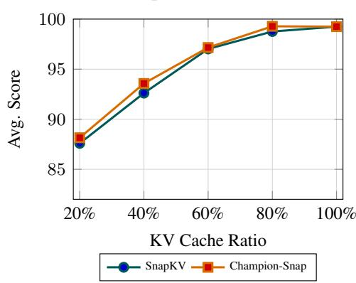

(b) PyramidKV-based Allocation  
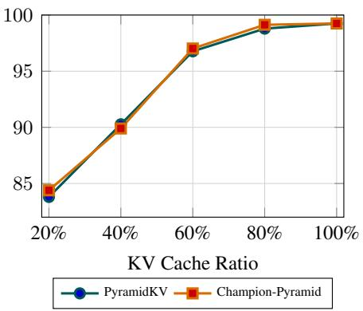  
Figure 14: RULER performance on Llama3.1-8B-Instruct under different KV cache ratios.

(a) SnapKV-based Allocation  
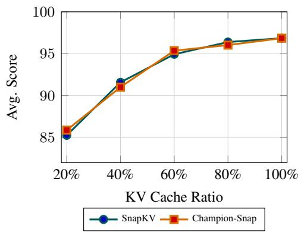

(b) PyramidKV-based Allocation  
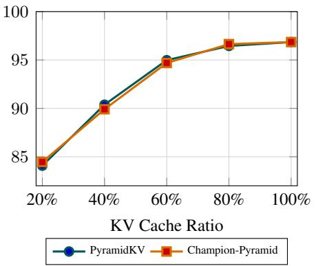  
Figure 15: RULER performance on Mistral-7B-Instruct-v0.3 under different KV cache ratios.

<table><tr><td>Model</td><td>Dataset</td><td>Abnormal instances</td><td>Total instances</td><td>Aggregate rate / Prompt-level range</td></tr><tr><td>Llama3.1-8B-Instruct</td><td>GovReport</td><td>1,343</td><td>102,400</td><td>1.31% / 0.59–1.56%</td></tr><tr><td>Llama3.1-8B-Instruct</td><td>HotpotQA</td><td>1,643</td><td>102,400</td><td>1.60% / 0.39–2.64%</td></tr><tr><td>Llama3.1-8B-Instruct</td><td>Lcc</td><td>1,757</td><td>307,200</td><td>0.57% / 0.10–1.27%</td></tr><tr><td>Llama3.1-8B-Instruct</td><td>NarrativeQA</td><td>1,700</td><td>102,400</td><td>1.66% / 1.07–3.42%</td></tr><tr><td>Llama3.1-8B-Instruct</td><td>PassageCount</td><td>1,394</td><td>102,400</td><td>1.36% / 1.17–1.46%</td></tr><tr><td>Llama3.1-8B-Instruct</td><td>TREC</td><td>1,069</td><td>102,400</td><td>1.04% / 0.29–1.76%</td></tr><tr><td>Mistral-7B-Instruct-v0.3</td><td>GovReport</td><td>1,169</td><td>102,400</td><td>1.14% / 0.59–2.25%</td></tr><tr><td>Mistral-7B-Instruct-v0.3</td><td>HotpotQA</td><td>1,336</td><td>102,400</td><td>1.30% / 0.78–1.95%</td></tr><tr><td>Mistral-7B-Instruct-v0.3</td><td>Lcc</td><td>2,477</td><td>307,200</td><td>0.81% / 0.49–3.32%</td></tr><tr><td>Mistral-7B-Instruct-v0.3</td><td>NarrativeQA</td><td>1,531</td><td>102,400</td><td>1.50% / 0.98–2.73%</td></tr><tr><td>Mistral-7B-Instruct-v0.3</td><td>PassageCount</td><td>1,175</td><td>102,400</td><td>1.15% / 0.88–1.46%</td></tr><tr><td>Mistral-7B-Instruct-v0.3</td><td>TREC</td><td>1,436</td><td>102,400</td><td>1.40% / 0.68–2.54%</td></tr></table>

Table 12: Prevalence of abnormal heads under τ = 0.01. Total instances count layer–head pairs over all evaluated prompts; the final column reports the aggregate rate followed by the minimum–maximum prompt-level rate.

<table><tr><td>Model</td><td>Input length</td><td>NrtvQA</td><td>HotpotQA</td><td>GovReport</td><td>TREC</td><td>PCount</td><td>Lcc</td><td>Avg.</td></tr><tr><td>Llama3.1-8B-Instruct</td><td>8k</td><td>20.32</td><td>15.95</td><td>25.69</td><td>66.00</td><td>8.42</td><td>60.11</td><td>32.75</td></tr><tr><td>Llama3.1-8B-Instruct</td><td>16k</td><td>24.28</td><td>14.88</td><td>25.51</td><td>65.00</td><td>8.06</td><td>59.42</td><td>32.86</td></tr><tr><td>Llama3.1-8B-Instruct</td><td>32k</td><td>28.01</td><td>14.36</td><td>25.24</td><td>66.00</td><td>6.64</td><td>59.53</td><td>33.30</td></tr><tr><td>Mistral-7B-Instruct-v0.3</td><td>8k</td><td>27.81</td><td>45.87</td><td>25.15</td><td>70.00</td><td>7.00</td><td>57.73</td><td>38.93</td></tr><tr><td>Mistral-7B-Instruct-v0.3</td><td>16k</td><td>23.80</td><td>47.59</td><td>25.54</td><td>70.00</td><td>7.00</td><td>57.71</td><td>38.61</td></tr><tr><td>Mistral-7B-Instruct-v0.3</td><td>32k</td><td>26.36</td><td>45.87</td><td>24.93</td><td>70.00</td><td>7.00</td><td>57.50</td><td>38.61</td></tr></table>

Table 13: Champion-Snap results across input lengths on six representative LongBench tasks. Avg. is the mean over the six tasks.

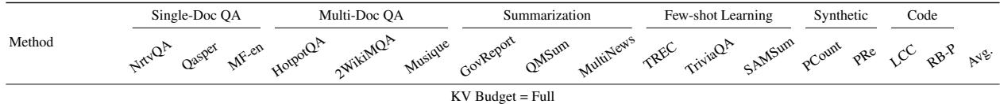

<table><tr><td>FullKV</td><td>21.77</td><td>43.07</td><td>27.82</td><td>52.29</td><td>43.86</td><td>27.05 34.20</td><td>22.31</td><td></td><td>26.86 67.00</td><td>88.26</td><td>44.07</td><td>7.50</td><td>65.67 64.66 55.32 43.23</td></tr><tr><td colspan="10">KV Budget = 64</td><td></td><td></td><td></td><td></td></tr><tr><td>SnapKV</td><td>15.04</td><td>23.29</td><td>21.19 40.06</td><td></td><td>33.41 20.02</td><td>20.64</td><td>22.01</td><td>19.85</td><td>56.00</td><td>83.27</td><td>40.67</td><td>8.17</td><td>61.70 57.8544.6935.49</td></tr><tr><td>Ada-KV</td><td>17.78</td><td>27.16</td><td>22.56 41.80</td><td>34.03</td><td>20.34</td><td>21.75</td><td>22.23</td><td>21.01</td><td>54.00</td><td>80.58</td><td>39.92</td><td>9.03</td><td>67.86 56.1545.63 36.36</td></tr><tr><td>Champion-Snap</td><td>14.17</td><td>26.61</td><td>21.12 40.48</td><td></td><td>35.14 19.89</td><td>20.35</td><td>21.35</td><td>18.49</td><td>51.00</td><td>82.13</td><td>40.27</td><td>7.75</td><td>61.3658.8644.66 35.23</td></tr><tr><td>PyramidKV</td><td>12.01</td><td>25.12</td><td>20.10 41.05</td><td>33.28</td><td>21.92</td><td>20.83</td><td>21.49</td><td>19.78</td><td>56.00</td><td>81.37</td><td>38.93</td><td>7.42</td><td>61.53 56.76 44.11 35.11</td></tr><tr><td>Champion-Pyramid</td><td>11.02</td><td>25.71 19.34</td><td>40.77</td><td>34.02</td><td>18.61</td><td>19.87</td><td>21.95</td><td>18.11</td><td>55.00</td><td>79.76</td><td>39.98</td><td>8.30</td><td>62.50 55.7944.17 34.68</td></tr><tr><td colspan="10">KV Budget = 128</td><td></td><td></td><td></td></tr><tr><td>SnapKV</td><td>17.44</td><td>25.68</td><td>22.83</td><td>44.37</td><td>34.07</td><td>22.39</td><td>21.73</td><td>21.46</td><td>59.00</td><td>86.94</td><td>41.55</td><td>7.15</td><td>63.50 61.9946.54 37.29</td></tr><tr><td>Ada-KV</td><td>19.69</td><td>30.88</td><td>23.41 43.38</td><td></td><td>19.99 35.79 22.97</td><td>23.00</td><td>22.44</td><td>21.78</td><td>60.00</td><td>87.77</td><td>41.48</td><td>7.36</td><td>70.87 58.4948.29 38.60</td></tr><tr><td>Champion-Snap</td><td>16.02</td><td>27.84</td><td>21.90</td><td>42.57</td><td>33.20</td><td>20.96 22.21</td><td>22.36</td><td>21.50</td><td>58.00</td><td>87.78</td><td>41.16</td><td>7.68</td><td>61.02 63.9945.52 37.11</td></tr><tr><td>PyramidKV</td><td>12.13</td><td>27.58 22.31</td><td></td><td>40.35</td><td>33.84</td><td>19.77 22.42</td><td>21.72</td><td>21.47</td><td>61.00</td><td>83.25</td><td>41.05</td><td>7.50</td><td>64.3360.4445.14 36.52</td></tr><tr><td>Champion-Pyramid 14.34</td><td>25.83</td><td>21.98</td><td></td><td>46.37</td><td>33.38 19.39</td><td>22.42</td><td></td><td>22.86</td><td>20.19 60.00</td><td>84.97</td><td>40.57</td><td>9.00</td><td>62.83 60.19 45.26 36.85</td></tr><tr><td colspan="10">KV Budget = 512</td><td></td><td></td><td></td><td></td></tr><tr><td>SnapKV</td><td>21.38</td><td>34.07</td><td>27.30</td><td>55.87</td><td>38.14</td><td>28.64 25.75</td><td>23.86</td><td>24.59</td><td>66.00</td><td>88.28</td><td>42.89</td><td>9.16</td><td>64.2363.3951.61 41.57</td></tr><tr><td>Ada-KV</td><td>20.31</td><td>35.92</td><td>24.11</td><td>50.08</td><td>38.40</td><td>28.11 24.98</td><td>22.54</td><td>24.45</td><td>67.00</td><td>91.50</td><td>42.44</td><td>6.54</td><td>72.30 61.42 50.6941.30</td></tr><tr><td>Champion-Snap</td><td>21.30</td><td>34.74</td><td>27.52</td><td>52.39</td><td>37.77</td><td>28.33 25.60</td><td>22.75</td><td>24.70</td><td>65.00</td><td>87.67</td><td>42.79</td><td>9.17</td><td>64.5064.1852.5841.31</td></tr><tr><td>PyramidKV</td><td>20.67</td><td>34.86</td><td>25.32</td><td>48.85</td><td>38.09</td><td>25.39 25.58</td><td>22.62</td><td>24.67</td><td>65.00</td><td>87.66</td><td>42.36</td><td>6.89</td><td>64.92 64.6850.5440.51</td></tr><tr><td>Champion-Pyramid</td><td>20.67</td><td>33.40 26.70</td><td>47.24</td><td></td><td>37.85 27.08</td><td>25.37</td><td>22.92</td><td>23.83</td><td>65.00</td><td>88.28</td><td>42.45</td><td>7.19</td><td>65.33 63.8049.10 40.39</td></tr><tr><td colspan="10">KV Budget = 2048</td><td></td><td></td><td></td></tr><tr><td>SnapKV</td><td>20.59</td><td>41.35</td><td>27.38</td><td>52.65</td><td>40.54</td><td>26.67 30.81</td><td>22.56</td><td>25.55</td><td>67.00</td><td>87.55</td><td>43.57</td><td>6.95</td><td>65.33 58.97 54.19 41.98</td></tr><tr><td>Ada-KV</td><td>20.96</td><td>39.47</td><td>26.46</td><td>53.17</td><td>42.75</td><td>31.77 29.91</td><td>22.91</td><td>26.67</td><td>69.50</td><td>91.37</td><td>43.80</td><td>7.08</td><td>71.86 62.9954.06 43.42</td></tr><tr><td>Champion-Snap</td><td>19.83</td><td>42.54</td><td>26.97</td><td>52.13</td><td>40.01</td><td>29.26</td><td>30.34 22.88</td><td>26.77</td><td>66.00</td><td>87.67</td><td>44.21</td><td>7.15</td><td>65.6764.2455.3142.56</td></tr><tr><td>PyramidKV</td><td>20.70</td><td>40.72</td><td>26.32</td><td>54.03</td><td>42.77</td><td>28.67</td><td>30.94 23.60</td><td>26.69</td><td>67.00</td><td>88.26</td><td>43.95</td><td>6.59</td><td>65.67 64.36 55.00 42.83</td></tr><tr><td>Champion-Pyramid</td><td>19.76</td><td>44.41</td><td>27.01</td><td>53.68</td><td>42.67</td><td>31.07</td><td>29.87 23.18</td><td>26.82</td><td>67.00</td><td>88.27</td><td>44.31</td><td>6.69</td><td>65.67 64.06 54.85 43.08</td></tr></table>

Table 14: LongBench results on Llama3.1-8B-Instruct. Avg. is the mean over all 16 tasks. FullKV is the uncompressed reference; bold marks the best compressed result within each budget.

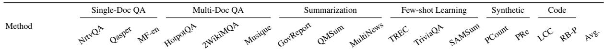

<table><tr><td>KV Budget = Full</td><td colspan="9"></td><td colspan="4"></td></tr><tr><td>FullKV</td><td>29.21</td><td>41.24</td><td>54.06</td><td>46.08</td><td>37.94</td><td>24.66</td><td>34.71</td><td>26.22</td><td>28.22</td><td>73.00</td><td>85.26 47.16</td><td>7.00</td><td></td><td>99.00 62.61 61.65 47.38</td></tr><tr><td colspan="9">KV Budget = 64</td><td></td><td></td><td></td><td></td></tr><tr><td>SnapKV</td><td>24.89</td><td>27.46</td><td>45.20</td><td>40.94</td><td>34.85</td><td>22.31</td><td>19.67</td><td>21.37 20.87</td><td>18.64</td><td>53.00</td><td>83.79 88.95</td><td>40.15</td><td>8.00 4.50</td><td>92.00 56.15 50.51 39.93</td></tr><tr><td>Ada-KV</td><td>25.71</td><td>29.03</td><td>46.99</td><td>45.33</td><td>33.06</td><td>23.90</td><td>21.05</td><td></td><td>20.18</td><td>67.50</td><td>42.47</td><td></td><td></td><td>85.00 51.79 50.58 41.06</td></tr><tr><td>Champion-Snap</td><td>24.67</td><td>29.88</td><td>40.68</td><td>39.97</td><td>36.82</td><td>20.85</td><td>19.84</td><td>20.70</td><td>18.72</td><td>53.00</td><td>82.63</td><td>39.10</td><td>9.00</td><td>89.00 53.24 43.90 38.88</td></tr><tr><td>PyramidKV Champion-Pyramid</td><td>22.32</td><td>28.14</td><td>46.55</td><td>42.13</td><td>34.21</td><td>21.32</td><td>19.81</td><td>22.27</td><td>19.11</td><td>53.00</td><td>83.69</td><td>40.00</td><td>9.00</td><td>95.00 53.12 47.0039.79</td></tr><tr><td></td><td>22.67</td><td>29.20</td><td>45.61</td><td>41.47</td><td>34.73</td><td>19.98</td><td>19.79</td><td>21.80</td><td>19.23</td><td>49.00</td><td>82.62</td><td>39.27</td><td>9.00</td><td>94.00 53.51 47.12 39.31</td></tr><tr><td colspan="10">KV Budget = 128</td><td colspan="3"></td><td></td></tr><tr><td>SnapKV</td><td>27.02</td><td>30.61</td><td>48.45</td><td>43.53</td><td>36.57</td><td>22.90</td><td>21.47</td><td>23.24</td><td>21.55</td><td>67.00</td><td>83.76</td><td>42.78</td><td>8.00</td><td>94.00 59.10 54.52 42.78</td></tr><tr><td>Ada-KV</td><td>26.88</td><td>32.00</td><td>49.45</td><td>47.44</td><td>37.60</td><td>26.64</td><td>22.82</td><td>23.01</td><td>22.71</td><td>70.50</td><td>89.07</td><td>44.17</td><td>5.00</td><td>92.5054.9254.3743.69</td></tr><tr><td>Champion-Snap</td><td>27.81</td><td>33.39</td><td>49.78</td><td>42.57</td><td>37.61</td><td>23.08</td><td>21.01</td><td>23.13</td><td>21.70</td><td>66.00</td><td>84.19</td><td>42.19</td><td>8.00</td><td>94.0052.9554.75 42.64</td></tr><tr><td>PyramidKV</td><td>25.56</td><td>32.35</td><td>49.93</td><td>43.44</td><td>36.50</td><td>21.94</td><td>21.97</td><td>22.95</td><td>21.31</td><td>65.00</td><td>84.46</td><td>44.58</td><td>8.00</td><td>94.00 56.96 51.45 42.53</td></tr><tr><td>Champion-Pyramid</td><td>25.08</td><td>31.94</td><td>49.07</td><td>42.19</td><td>37.68</td><td>21.82</td><td>21.16</td><td>23.37</td><td>21.33</td><td>64.00</td><td>85.03</td><td>44.07</td><td>9.00</td><td>96.00 55.46 50.81 42.38</td></tr><tr><td colspan="10">KV Budget = 512</td><td colspan="3"></td><td></td><td></td></tr><tr><td>SnapKV</td><td>27.76</td><td>34.58</td><td>54.47</td><td>47.61</td><td>38.74</td><td>22.98</td><td>25.44</td><td>24.21</td><td>25.39</td><td>71.00</td><td>86.46</td><td>46.07</td><td>5.00</td><td>99.0062.6561.0445.78</td></tr><tr><td>Ada-KV</td><td>29.37</td><td>37.00</td><td>53.61</td><td>49.65</td><td>38.70</td><td>28.38</td><td>23.67</td><td>25.46</td><td>24.79</td><td>75.50</td><td>89.14</td><td>46.42</td><td>5.50</td><td>97.00 58.72 59.69 46.41</td></tr><tr><td>Champion-Snap</td><td>28.27</td><td>34.93</td><td>54.39</td><td>44.92</td><td>37.60</td><td>23.51</td><td>24.34</td><td>25.41</td><td>25.09</td><td>71.00</td><td>85.80</td><td>46.08</td><td>9.00</td><td>97.00 61.31 59.6045.52</td></tr><tr><td>PyramidKV Champion-Pyramid</td><td>27.70</td><td>34.59</td><td>54.31</td><td>47.54</td><td>38.99 38.41</td><td>23.62</td><td>25.21</td><td>24.44</td><td>25.55</td><td>72.00</td><td>86.46</td><td>46.45</td><td>6.00</td><td>98.00 62.45 59.0745.77</td></tr><tr><td></td><td>27.47</td><td>34.62</td><td>54.55</td><td>45.89</td><td></td><td>23.92</td><td>24.24</td><td>25.46 KV Budget = 2048</td><td>24.86</td><td>70.00</td><td>86.12</td><td>46.23</td><td>7.00</td><td>97.00 61.76 58.80 45.40</td></tr><tr><td colspan="10"></td><td colspan="3"></td><td></td><td></td></tr><tr><td>SnapKV</td><td>30.35</td><td>39.82</td><td>53.79</td><td>46.49</td><td>38.64</td><td>24.91</td><td>30.23</td><td>25.84</td><td>27.98</td><td>72.00</td><td>85.69</td><td>46.30</td><td>6.00</td><td>99.00 63.82 60.70 46.97</td></tr><tr><td>Ada-KV</td><td>29.37</td><td>40.56</td><td>52.49</td><td>50.00</td><td>38.64</td><td>28.50</td><td>28.97</td><td>25.10</td><td>28.00</td><td>75.50</td><td>88.80</td><td>47.15</td><td>5.50</td><td>98.00 59.51 60.30 47.27</td></tr><tr><td>Champion-Snap PyramidKV</td><td>28.13</td><td>41.25</td><td>55.12</td><td>46.84</td><td>38.24</td><td>24.60</td><td>29.44</td><td>25.81</td><td>27.78</td><td>73.00</td><td>85.76</td><td>46.30</td><td>7.00</td><td>99.00 63.72 60.6047.04</td></tr><tr><td></td><td>30.48</td><td>40.22 40.72</td><td>51.82</td><td>46.45</td><td>38.93</td><td>24.23</td><td>29.96</td><td>26.06</td><td>27.18</td><td>72.00</td><td>86.19</td><td>46.91</td><td>6.00</td><td>99.00 62.4958.4646.65</td></tr><tr><td>Champion-Pyramid</td><td>29.99</td><td></td><td>55.25</td><td>46.49</td><td>38.13</td><td>24.18</td><td>29.35</td><td>24.63</td><td>27.85</td><td>73.00</td><td>85.86</td><td>46.07</td><td>8.00</td><td>99.00 63.48 59.17 46.95</td></tr></table>

Table 15: LongBench results on Mistral-7B-Instruct-v0.3. Avg. is the mean over all 16 tasks. FullKV is the uncompressed reference; bold marks the best compressed result within each budget.

<table><tr><td>Method</td><td>Ratio</td><td>S1</td><td>S2</td><td>S3</td><td>MK1</td><td>MK2</td><td>MK3</td><td>MQ</td><td>MV</td><td>CWE</td><td>FWE</td><td>VT</td><td>Avg.</td></tr><tr><td>FullKV</td><td>100%</td><td>100.00</td><td>100.00</td><td>100.00</td><td>100.00</td><td>100.00</td><td>99.22</td><td>100.00</td><td>95.82</td><td>99.52</td><td>97.40</td><td>99.81</td><td>99.25</td></tr><tr><td>SnapKV</td><td>20%</td><td>100.00</td><td>100.00</td><td>60.21</td><td>100.00</td><td>100.00</td><td>37.88</td><td>99.02</td><td>96.32</td><td>73.99</td><td>96.07</td><td>100.00</td><td>87.59</td></tr><tr><td>Ada-KV</td><td>20%</td><td>100.00</td><td>100.00</td><td>44.16</td><td>100.00</td><td>99.42</td><td>32.20</td><td>99.51</td><td>97.21</td><td>43.92</td><td>95.39</td><td>99.85</td><td>82.88</td></tr><tr><td>Champion-Snap</td><td>20%</td><td>100.00</td><td>100.00</td><td>62.36</td><td>100.00</td><td>99.04</td><td>38.56</td><td>99.76</td><td>96.80</td><td>77.26</td><td>96.09</td><td>99.81</td><td>88.15</td></tr><tr><td>SnapKV</td><td>40%</td><td>100.00</td><td>100.00</td><td>87.38</td><td>100.00</td><td>100.00</td><td>41.41</td><td>100.00</td><td>95.05</td><td>97.69</td><td>97.39</td><td>99.81</td><td>92.61</td></tr><tr><td>Ada-KV</td><td>40%</td><td>100.00</td><td>100.00</td><td>80.84</td><td>100.00</td><td>99.81</td><td>37.43</td><td>99.90</td><td>96.81</td><td>85.85</td><td>96.36</td><td>99.96</td><td>90.63</td></tr><tr><td>Champion-Snap</td><td>40%</td><td>100.00</td><td>100.00</td><td>88.61</td><td>100.00</td><td>100.00</td><td>47.90</td><td>100.00</td><td>97.83</td><td>97.72</td><td>97.40</td><td>99.81</td><td>93.57</td></tr><tr><td>SnapKV</td><td>60%</td><td>100.00</td><td>100.00</td><td>96.64</td><td>100.00</td><td>100.00</td><td>78.85</td><td>100.00</td><td>96.07</td><td>98.42</td><td>97.39</td><td>99.81</td><td>97.02</td></tr><tr><td>Ada-KV</td><td>60%</td><td>100.00</td><td>100.00</td><td>98.04</td><td>100.00</td><td>100.00</td><td>66.15</td><td>99.90</td><td>96.56</td><td>98.17</td><td>97.14</td><td>99.96</td><td>95.99</td></tr><tr><td>Champion-Snap</td><td>60%</td><td>100.00</td><td>100.00</td><td>96.98</td><td>100.00</td><td>100.00</td><td>80.73</td><td>100.00</td><td>95.83</td><td>98.66</td><td>96.75</td><td>99.81</td><td>97.16</td></tr><tr><td>SnapKV</td><td>80%</td><td>100.00</td><td>100.00</td><td>99.78</td><td>100.00</td><td>100.00</td><td>95.60</td><td>100.00</td><td>95.31</td><td>99.13</td><td>96.74</td><td>99.81</td><td>98.76</td></tr><tr><td>Ada-KV</td><td>80%</td><td>100.00</td><td>100.00</td><td>99.27</td><td>100.00</td><td>100.00</td><td>99.39</td><td>99.90</td><td>96.27</td><td>99.73</td><td>97.66</td><td>99.96</td><td>99.29</td></tr><tr><td>Champion-Snap</td><td>80%</td><td>100.00</td><td>100.00</td><td>99.78</td><td>100.00</td><td>100.00</td><td>99.22</td><td>100.00</td><td>96.82</td><td>99.42</td><td>97.07</td><td>99.81</td><td>99.28</td></tr><tr><td>PyramidKV</td><td>20%</td><td>100.00</td><td>100.00</td><td>42.41</td><td>100.00</td><td>100.00</td><td>35.49</td><td>98.56</td><td>95.33</td><td>55.72</td><td>94.46</td><td>99.81</td><td>83.80</td></tr><tr><td>Champion-Pyramid</td><td>20%</td><td>100.00</td><td>100.00</td><td>44.38</td><td>100.00</td><td>100.00</td><td>36.44</td><td>99.28</td><td>95.85</td><td>57.69</td><td>94.80</td><td>99.81</td><td>84.39</td></tr><tr><td>PyramidKV</td><td>40%</td><td>100.00</td><td>100.00</td><td>73.72</td><td>100.00</td><td>100.00</td><td>44.48</td><td>100.00</td><td>96.07</td><td>82.15</td><td>96.74</td><td>99.81</td><td>90.27</td></tr><tr><td>Champion-Pyramid</td><td>40%</td><td>100.00</td><td>100.00</td><td>72.47</td><td>100.00</td><td>100.00</td><td>45.12</td><td>100.00</td><td>95.83</td><td>80.57</td><td>95.11</td><td>99.81</td><td>89.90</td></tr><tr><td>PyramidKV</td><td>60%</td><td>100.00</td><td>100.00</td><td>93.98</td><td>100.00</td><td>100.00</td><td>78.85</td><td>100.00</td><td>96.07</td><td>99.42</td><td>96.39</td><td>99.81</td><td>96.77</td></tr><tr><td>Champion-Pyramid</td><td>60%</td><td>100.00</td><td>100.00</td><td>96.25</td><td>100.00</td><td>100.00</td><td>81.90</td><td>100.00</td><td>95.58</td><td>96.22</td><td>97.41</td><td>99.81</td><td>97.02</td></tr><tr><td>PyramidKV</td><td>80%</td><td>100.00</td><td>100.00</td><td>99.78</td><td>100.00</td><td>100.00</td><td>95.60</td><td>100.00</td><td>95.31</td><td>99.42</td><td>96.74</td><td>99.81</td><td>98.79</td></tr><tr><td>Champion-Pyramid</td><td>80%</td><td>100.00</td><td>100.00</td><td>99.13</td><td>100.00</td><td>100.00</td><td>98.47</td><td>100.00</td><td>96.58</td><td>99.33</td><td>97.07</td><td>99.81</td><td>99.13</td></tr></table>

Table 16: Detailed RULER subtask results on Llama3.1-8B-Instruct under different KV cache retention ratios, including Ada-KV.

<table><tr><td>Method</td><td>Ratio</td><td>S1</td><td>S2</td><td>S3</td><td>MK1</td><td>MK2</td><td>MK3</td><td>MQ</td><td>MV</td><td>CWE</td><td>FWE</td><td>VT</td><td>Avg.</td></tr><tr><td>FullKV</td><td>100%</td><td>100.00</td><td>100.00</td><td>100.00</td><td>100.00</td><td>100.00</td><td>97.55</td><td>81.08</td><td>94.23</td><td>98.81</td><td>94.28</td><td>99.43</td><td>96.85</td></tr><tr><td>SnapKV</td><td>20%</td><td>100.00</td><td>100.00</td><td>80.63</td><td>100.00</td><td>98.25</td><td>31.49</td><td>74.24</td><td>78.74</td><td>86.59</td><td>90.21</td><td>97.70</td><td>85.26</td></tr><tr><td>Ada-KV</td><td>20%</td><td>100.00</td><td>99.76</td><td>84.51</td><td>99.65</td><td>97.20</td><td>26.10</td><td>68.89</td><td>74.90</td><td>32.07</td><td>86.82</td><td>97.23</td><td>78.83</td></tr><tr><td>Champion-Snap</td><td>20%</td><td>100.00</td><td>100.00</td><td>84.19</td><td>100.00</td><td>96.61</td><td>35.75</td><td>74.02</td><td>80.58</td><td>84.41</td><td>90.96</td><td>98.05</td><td>85.87</td></tr><tr><td>SnapKV</td><td>40%</td><td>100.00</td><td>100.00</td><td>95.99</td><td>100.00</td><td>98.48</td><td>49.70</td><td>81.12</td><td>92.98</td><td>96.81</td><td>93.05</td><td>99.24</td><td>91.58</td></tr><tr><td>Ada-KV</td><td>40%</td><td>100.00</td><td>100.00</td><td>96.93</td><td>99.66</td><td>97.94</td><td>32.82</td><td>80.50</td><td>91.21</td><td>62.85</td><td>92.14</td><td>98.96</td><td>86.64</td></tr><tr><td>Champion-Snap</td><td>40%</td><td>100.00</td><td>100.00</td><td>98.29</td><td>100.00</td><td>99.33</td><td>47.52</td><td>81.37</td><td>93.85</td><td>89.12</td><td>93.10</td><td>98.50</td><td>91.01</td></tr><tr><td>SnapKV</td><td>60%</td><td>100.00</td><td>100.00</td><td>99.11</td><td>100.00</td><td>99.05</td><td>81.87</td><td>80.86</td><td>92.61</td><td>97.76</td><td>93.96</td><td>99.06</td><td>94.93</td></tr><tr><td>Ada-KV</td><td>60%</td><td>100.00</td><td>100.00</td><td>99.30</td><td>99.66</td><td>99.12</td><td>47.38</td><td>81.51</td><td>94.68</td><td>81.33</td><td>93.87</td><td>99.30</td><td>90.56</td></tr><tr><td>Champion-Snap</td><td>60%</td><td>100.00</td><td>100.00</td><td>99.56</td><td>100.00</td><td>98.71</td><td>87.97</td><td>80.77</td><td>92.39</td><td>96.26</td><td>94.04</td><td>99.24</td><td>95.36</td></tr><tr><td>SnapKV</td><td>80%</td><td>100.00</td><td>100.00</td><td>100.00</td><td>100.00</td><td>100.00</td><td>94.28</td><td>80.88</td><td>94.01</td><td>98.53</td><td>93.36</td><td>99.24</td><td>96.39</td></tr><tr><td>Ada-KV</td><td>80%</td><td>100.00</td><td>100.00</td><td>99.91</td><td>99.66</td><td>99.60</td><td>69.03</td><td>81.29</td><td>95.70</td><td>95.09</td><td>95.46</td><td>99.35</td><td>94.10</td></tr><tr><td>Champion-Snap</td><td>80%</td><td>100.00</td><td>100.00</td><td>100.00</td><td>100.00</td><td>98.71</td><td>91.53</td><td>80.99</td><td>94.05</td><td>97.68</td><td>93.96</td><td>99.43</td><td>96.03</td></tr><tr><td>PyramidKV</td><td>20%</td><td>100.00</td><td>100.00</td><td>85.18</td><td>100.00</td><td>99.69</td><td>29.17</td><td>76.87</td><td>83.52</td><td>64.29</td><td>88.06</td><td>98.10</td><td>84.08</td></tr><tr><td>Champion-Pyramid</td><td>20%</td><td>100.00</td><td>100.00</td><td>88.89</td><td>100.00</td><td>99.67</td><td>29.63</td><td>78.24</td><td>82.11</td><td>65.13</td><td>87.45</td><td>97.92</td><td>84.46</td></tr><tr><td>PyramidKV</td><td>40%</td><td>100.00</td><td>100.00</td><td>96.88</td><td>100.00</td><td>99.69</td><td>47.22</td><td>81.84</td><td>92.95</td><td>84.56</td><td>92.12</td><td>98.88</td><td>90.38</td></tr><tr><td>Champion-Pyramid</td><td>40%</td><td>100.00</td><td>100.00</td><td>95.15</td><td>100.00</td><td>97.55</td><td>49.39</td><td>79.82</td><td>91.71</td><td>85.75</td><td>90.54</td><td>99.11</td><td>89.91</td></tr><tr><td>PyramidKV</td><td>60%</td><td>100.00</td><td>100.00</td><td>99.56</td><td>100.00</td><td>99.05</td><td>81.87</td><td>80.86</td><td>92.61</td><td>97.76</td><td>93.96</td><td>99.06</td><td>94.98</td></tr><tr><td>Champion-Pyramid</td><td>60%</td><td>100.00</td><td>100.00</td><td>99.23</td><td>100.00</td><td>97.78</td><td>79.03</td><td>81.12</td><td>94.43</td><td>97.50</td><td>93.06</td><td>99.43</td><td>94.69</td></tr><tr><td>PyramidKV</td><td>80%</td><td>100.00</td><td>100.00</td><td>100.00</td><td>100.00</td><td>100.00</td><td>94.28</td><td>80.88</td><td>94.01</td><td>98.53</td><td>93.96</td><td>99.24</td><td>96.45</td></tr><tr><td>Champion-Pyramid</td><td>80%</td><td>100.00</td><td>100.00</td><td>100.00</td><td>100.00</td><td>99.08</td><td>96.34</td><td>81.08</td><td>94.71</td><td>98.71</td><td>93.66</td><td>99.43</td><td>96.64</td></tr><tr><td>Method</td><td>Ratio</td><td>S1</td><td>S2</td><td>S3</td><td>MK1</td><td>MK2</td><td>MK3</td><td>MQ</td><td>MV</td><td>CWE</td><td>FWE</td><td>VT</td><td> $\operatorname { A v g } .$ </td></tr><tr><td>FullKV</td><td>100%</td><td>100.00</td><td>100.00</td><td>100.00</td><td>100.00</td><td>100.00</td><td>100.00</td><td>100.00</td><td>100.00</td><td>100.00</td><td>99.70</td><td>100.00</td><td>99.97</td></tr><tr><td>SnapKV</td><td>20%</td><td>100.00</td><td>100.00</td><td>100.00</td><td>100.00</td><td>100.00</td><td>44.15</td><td>100.00</td><td>100.00</td><td>99.52</td><td>97.78</td><td>100.00</td><td>94.68</td></tr><tr><td>Ada-KV</td><td>20%</td><td>100.00</td><td>100.00</td><td>98.02</td><td>100.00</td><td>100.00</td><td>46.57</td><td>99.96</td><td>99.96</td><td>99.83</td><td>97.29</td><td>99.90</td><td>94.68</td></tr><tr><td>Champion-Snap</td><td>20%</td><td>100.00</td><td>100.00</td><td>100.00</td><td>100.00</td><td>100.00</td><td>57.96</td><td>100.00</td><td>100.00</td><td>100.00</td><td>98.15</td><td>100.00</td><td>96.01</td></tr><tr><td>SnapKV</td><td>40%</td><td>100.00</td><td>100.00</td><td>100.00</td><td>100.00</td><td>100.00</td><td>68.27</td><td>100.00</td><td>100.00</td><td>100.00</td><td>97.81</td><td>100.00</td><td>96.92</td></tr><tr><td>Ada-KV</td><td>40%</td><td>100.00</td><td>100.00</td><td>96.34</td><td>100.00</td><td>100.00</td><td>76.43</td><td>100.00</td><td>99.92</td><td>99.91</td><td>98.81</td><td>99.97</td><td>97.40</td></tr><tr><td>Champion-Snap</td><td>40%</td><td>100.00</td><td>100.00</td><td>100.00</td><td>100.00</td><td>100.00</td><td>95.46</td><td>100.00</td><td>100.00</td><td>100.00</td><td>99.06</td><td>100.00</td><td>99.50</td></tr><tr><td>SnapKV</td><td>60%</td><td>100.00</td><td>100.00</td><td>100.00</td><td>100.00</td><td>100.00</td><td>98.33</td><td>100.00</td><td>100.00</td><td>100.00</td><td>98.77</td><td>100.00</td><td>99.74</td></tr><tr><td>Ada-KV</td><td>60%</td><td>100.00</td><td>100.00</td><td>99.47</td><td>100.00</td><td>100.00</td><td>98.38</td><td>100.00</td><td>100.00</td><td>99.94</td><td>99.58</td><td>99.97</td><td>99.76</td></tr><tr><td>Champion-Snap</td><td>60%</td><td>100.00</td><td>100.00</td><td>100.00</td><td>100.00</td><td>100.00</td><td>100.00</td><td>100.00</td><td>100.00</td><td>100.00</td><td>99.39</td><td>100.00</td><td>99.94</td></tr><tr><td>SnapKV</td><td>80%</td><td>100.00</td><td>100.00</td><td>100.00</td><td>100.00</td><td>100.00</td><td>100.00</td><td>100.00</td><td>100.00</td><td>100.00</td><td>99.70</td><td>100.00</td><td>99.97</td></tr><tr><td>Ada-KV</td><td>80%</td><td>100.00</td><td>100.00</td><td>100.00</td><td>100.00</td><td>100.00</td><td>100.00</td><td>100.00</td><td>99.96</td><td>100.00</td><td>99.75</td><td>100.00</td><td>99.97</td></tr><tr><td>Champion-Snap</td><td>80%</td><td>100.00</td><td>100.00</td><td>100.00</td><td>100.00</td><td>100.00</td><td>100.00</td><td>100.00</td><td>100.00</td><td>100.00</td><td>99.70</td><td>100.00</td><td>99.97</td></tr><tr><td>PyramidKV</td><td>20%</td><td>100.00</td><td>100.00</td><td>94.62</td><td>100.00</td><td>100.00</td><td>39.83</td><td>100.00</td><td>100.00</td><td>98.16</td><td>98.11</td><td>100.00</td><td>93.70</td></tr><tr><td>Champion-Pyramid</td><td>20%</td><td>100.00</td><td>100.00</td><td>97.21</td><td>100.00</td><td>100.00</td><td>50.96</td><td>99.38</td><td>99.80</td><td>99.72</td><td>96.28</td><td>100.00</td><td>94.85</td></tr><tr><td>PyramidKV</td><td>40%</td><td>100.00</td><td>100.00</td><td>94.25</td><td>100.00</td><td>100.00</td><td>60.57</td><td>100.00</td><td>100.00</td><td>99.71</td><td>98.11</td><td>100.00</td><td>95.69</td></tr><tr><td>Champion-Pyramid</td><td>40%</td><td>100.00</td><td>100.00</td><td>94.32</td><td>100.00</td><td>100.00</td><td>92.56</td><td>100.00</td><td>100.00</td><td>99.91</td><td>98.44</td><td>100.00</td><td>98.66</td></tr><tr><td>PyramidKV</td><td>60%</td><td>100.00</td><td>100.00</td><td>100.00</td><td>100.00</td><td>100.00</td><td>98.02</td><td>100.00</td><td>100.00</td><td>100.00</td><td>98.77</td><td>100.00</td><td>99.71</td></tr><tr><td>Champion-Pyramid</td><td>60%</td><td>100.00</td><td>100.00</td><td>99.24</td><td>100.00</td><td>100.00</td><td>99.78</td><td>100.00</td><td>100.00</td><td>100.00</td><td>99.37</td><td>100.00</td><td>99.85</td></tr><tr><td>PyramidKV</td><td>80%</td><td>100.00</td><td>100.00</td><td>100.00</td><td>100.00</td><td>100.00</td><td>100.00</td><td>100.00</td><td>100.00</td><td>100.00</td><td>99.70</td><td>100.00</td><td>99.97</td></tr><tr><td>Champion-Pyramid</td><td>80%</td><td>100.00</td><td>100.00</td><td>100.00</td><td>100.00</td><td>100.00</td><td>100.00</td><td>100.00</td><td>100.00</td><td>100.00</td><td>99.70</td><td>100.00</td><td>99.97</td></tr></table>

Table 17: Detailed RULER subtask results on Mistral-7B-Instruct-v0.3 under different KV cache retention ratios, including Ada-KV.

Table 18: Detailed RULER subtask results on Llama3.1-70B-Instruct under different KV cache retention ratios, including Ada-KV.

<table><tr><td>Model</td><td>Plug-in</td><td>Benchmark</td><td>Pairs</td><td>W</td><td>T</td><td>L</td><td>Win%</td><td>Mean ∆</td><td>Median ∆</td><td>Wilcoxon p</td></tr><tr><td>Llama3.1-70B</td><td>Champion-Snap</td><td>LongBench</td><td>64</td><td>44</td><td>12</td><td>8</td><td>68.8</td><td>+0.763</td><td>+0.440</td><td>&lt; 0.001</td></tr><tr><td>Llama3.1-70B</td><td>Champion-Pyramid</td><td>LongBench</td><td>64</td><td>39</td><td>12</td><td>13</td><td>60.9</td><td>+0.648</td><td>+0.265</td><td>&lt; 0.001</td></tr><tr><td>Llama3.1-8B</td><td>Champion-Snap</td><td>LongBench</td><td>64</td><td>28</td><td>0</td><td>36</td><td>43.8</td><td>-0.031</td><td>-0.115</td><td>0.55</td></tr><tr><td>Llama3.1-8B</td><td>Champion-Pyramid</td><td>LongBench</td><td>64</td><td>27</td><td>5</td><td>32</td><td>42.2</td><td>+0.010</td><td>-0.050</td><td>0.48</td></tr><tr><td>Mistral-7B</td><td>Champion-Snap</td><td>LongBench</td><td>64</td><td>25</td><td>6</td><td>33</td><td>39.1</td><td>-0.350</td><td>-0.055</td><td>0.18</td></tr><tr><td>Mistral-7B</td><td>Champion-Pyramid</td><td>LongBench</td><td>64</td><td>25</td><td>2</td><td>37</td><td>39.1</td><td>-0.177</td><td>-0.250</td><td>0.11</td></tr><tr><td>Llama3.1-70B</td><td>Champion-Snap</td><td>RULER</td><td>44</td><td>7</td><td>37</td><td>0</td><td>15.9</td><td>+1.032</td><td>0.000</td><td>0.016</td></tr><tr><td>Llama3.1-70B</td><td>Champion-Pyramid</td><td>RULER</td><td>44</td><td>9</td><td>31</td><td>4</td><td>20.5</td><td>+1.064</td><td>0.000</td><td>0.17</td></tr><tr><td>Llama3.1-8B</td><td>Champion-Snap</td><td>RULER</td><td>44</td><td>18</td><td>22</td><td>4</td><td>40.9</td><td>+0.547</td><td>0.000</td><td>0.003</td></tr><tr><td>Llama3.1-8B</td><td>Champion-Pyramid</td><td>RULER</td><td>44</td><td>13</td><td>23</td><td>8</td><td>29.5</td><td>+0.200</td><td>0.000</td><td>0.20</td></tr><tr><td>Mistral-7B</td><td>Champion-Snap</td><td>RULER</td><td>44</td><td>18</td><td>13</td><td>13</td><td>40.9</td><td>+0.026</td><td>0.000</td><td>0.79</td></tr><tr><td>Mistral-7B</td><td>Champion-Pyramid</td><td>RULER</td><td>44</td><td>15</td><td>13</td><td>16</td><td>34.1</td><td>-0.045</td><td>0.000</td><td>0.70</td></tr></table>

Table 19: Paired delta statistics for ChampionKV plug-ins. Paired per-unit deltas are Champion minus baseline at (task, budget) granularity for LongBench (16 tasks × 4 budgets = 64) and at (subtask, ratio) granularity for RULER (11 × 4 = 44). W/T/L count pairs with positive/zero/negative deltas; the two-sided Wilcoxon signed-rank test is over nonzero deltas. Because many RULER subtasks are saturated (ties), the win rate alone understates positive gains; the test uses the sign and magnitude of nonzero deltas.

## C Appendix: Detailed Information of Benchmarks

To comprehensively evaluate the performance retention capabilities of ChampionKV in longcontext inference, we employed two comprehensive benchmarks: LongBench (Bai et al., 2024) and RULER (Hsieh et al., 2024). The following details the specific sub-datasets and task mechanisms used in our experiments.

## C.1 LongBench Benchmark

LongBench encompasses a variety of real-world long-context application scenarios. In our experiments, we focus on the 16 English datasets used in our evaluation, covering six task domains:

• Single-Doc QA: This task requires the model to accurately locate and extract facts from a single long-form source. We selected NarrativeQA (NrtvQA) (Kociskˇ y et al.\` , 2018), which is based on long books and movie scripts; Qasper (Dasigi et al., 2021), which is based on academic papers in NLP; and MultiFieldQA-en (MF-en) (Bai et al., 2024), which covers heterogeneous texts such as legal documents and government reports. These tasks heavily rely on the model’s ability to deeply parse local long texts.

• Multi-Doc QA: This task requires the model to establish logical connections across multiple scattered documents and perform multihop reasoning. We utilized HotpotQA (Yang et al., 2018), 2WikiMultihopQA (2WikiMQA) (Ho et al., 2020), and Musique (Trivedi et al., 2022). The model must integrate fragmented clues across paragraphs within a long context to deduce the final answer.

• Summarization: This task evaluates the model’s comprehensive understanding and information compression capabilities over global long contexts. The test set includes GovReport (Huang et al., 2021), which focuses on the summarization of long government reports; QMSum (Zhong et al., 2021), which focuses on query-based summarization of meeting transcripts; and MultiNews (Fabbri et al., 2019), which focuses on comprehensive summarization of multiple news reports.

• Few-shot Learning: This task assesses the model’s in-context learning capabilities using prior examples within a long context. We included TREC (Li and Roth, 2002) for text classification, TriviaQA (Joshi et al., 2017) for reading comprehension, and SAMSum (Gliwa et al., 2019) for daily dialogue summarization. The model must perform accurate pattern matching based on multiple few-shot examples provided within the context.

• Synthetic Tasks: These tasks are designed to precisely measure long-text localization capabilities through artificially constructed patterns. Two synthetic tasks, PassageCount (PCount) and PassageRetrieval-en (PRe), are included in LongBench (Bai et al., 2024). PassageCount identifies and counts the total number of unique paragraphs after deduplication, while PassageRetrieval-en requires the model to retrieve the original paragraph from a set of Wikipedia paragraphs based on a given summary.

• Code Completion: This task evaluates the model’s semantic understanding in cross-file or extremely long codebase environments. The Lcc dataset is derived from the original Long Code Completion dataset (Guo et al., 2023), while RepoBench-P (RB-P) (Liu et al., 2024) is designed for repository-level code auto-completion and requires aggregating information from code across files. The model is required to predict the next line of code.

## C.2 RULER Benchmark

Compared to the foundational Needle-in-a-Haystack (NIAH) test, RULER (Hsieh et al., 2024) provides a more challenging and flexibly configured evaluation for long-context information retrieval and aggregation. The RULER experiments in this paper specifically include the following 11 subtasks:

• Single NIAH (S1, S2, S3): Basic singletarget information retrieval tasks. The model is required to accurately locate and extract a uniquely hidden piece of key information, namely the Needle, from an extremely long context composed of a large amount of irrelevant background text, namely the Haystack.

• Multi-Keys NIAH (MK1, MK2, MK3): Advanced retrieval tasks. Multiple different Needles are embedded in the context, but the query only asks the model to retrieve a specific one. This task examines the model’s precise addressing capability in the presence of multiple strong distractors.

• Multi-Values / Multi-Queries NIAH (MQ, MV): Multiple related key-value pairs are scattered throughout the context. The MV task requires the model to retrieve and aggregate all values corresponding to a specific key, while the MQ task requires the model to simultaneously answer multiple given queries. Both tasks heavily test the model’s ability to capture and integrate multi-point information within long texts.

• Word Extraction (CWE, FWE): This category includes Common Words Extraction (CWE) and Frequent Words Extraction (FWE). The model must find the core vocabulary with the highest frequency of occurrence in an extremely long vocabulary sequence generated by a specific statistical distribution, testing the model’s awareness of global statistical distributions in long-context information.

• Variable Tracking (VT): Multiple complex variable binding statements, such as $X _ { 2 } = X _ { 1 }$ and $X _ { 3 } = X _ { 2 }$ , are inserted into the long text. The model needs to track the assignment chain and return all variable names that ultimately point to the same value, greatly challenging long-distance logical chain tracking capabilities.