# Confine to the Task, Anchor the Rest: Concept-Guided Retention Regularizer for Parameter-Eficient Fine-Tuning

Ibna Kowsar1, Ivan Medri2, Fanyu Meng1, Xin Liu1

1Department of Computer Science, University of California, Davis 2University of Virginia

## Abstract

Parameter-eficient fine-tuning (PEFT) has been widely used, yet the adapted model sufers catastrophic forgetting of pre-trained knowledge. While most existing work hardens the adapter by constraining where the weight update may lie, we note that constraining this weight channel does not constrain the activation channel. In this paper, we propose Concept-Guided Retention (CGR), a plug-and-play regularizer that constrains both for any PEFT base. CGR reads a frozen sparse autoencoder (SAE) and treats two disjoint concept sets diferently. It softly confines the update to the task-concept subspace (via weight channel), and anchors a selected set of general-purpose concepts to the frozen model (via activation channel). We also provide anchor value bounds based on weight updates to understand how they interact, and show that both terms are necessary. On a CLIP vision panel, CGR significantly improves retention at comparable accuracy for every base, and the same pattern holds for world-knowledge retention under Llama-3.1-8B instruction tuning. Because the protected directions are named SAE concepts, CGR remains inspectable and controllable.

## 1 Introduction

Parameter-eficient fine-tuning (PEFT) adapts frozen foundation models at a fraction of full fine-tuning’s cost (Chen et al. 2022). Low-Rank Adaptation (LoRA)(Hu et al. 2022), the de facto standard, parameterizes weight updates as ∆W = BA. LoRA optimizes downstream loss without penalizing drift from $W _ { 0 } .$ . The adapter is therefore free to write into directions that carry general-purpose capability, and fine-tuned adapters measurably forget pre-trained knowledge (Biderman et al. 2024; Shuttleworth et al. 2025). The question is how an adapter can learn a new task while preserving pretrained knowledge.

The dominant answer is weight-geometric, which is one-sided. Recent work shows that initializing or confining the adapter within a chosen weight subspace mitigates catastrophic forgetting to a degree (Xiong and Xie 2026; Tang et al. 2026; Yang et al. 2024; Luo et al. 2025; Wang et al. 2025a). These methods difer in how they choose the subspace, but most of them constrain only where the weight update lies. A subspace constraint only bounds the component of the weight delta outside the chosen subspace and leaves the drift of activation space unconstrained (Peng et al. 2026). Thus, weight-subspace constraints alone are insuficient for activation-space retention. Instead, we need to constrain both: a weight-subspace (where the update lies) and an activation space (how retained features respond). To the best of our knowledge, no existing PEFT method constrains both, a key gap that motivates our work.

To address weight- and activation-space retention together, we ask what to constrain and how to constrain it. We answer this with Sparse autoencoders (SAEs). SAEs have emerged as a tool for editing and steering concepts in a frozen model (Marks et al. 2025). A key innovation is how we leverage a frozen SAE from a fixed layer to derive two disjoint concept sets: a task set and a concept-retention set. Using these two sets, our proposed Concept-Guided Retention (CGR), develops a plug-and-play regularizer with two terms: A confine term softly holds the adapter weight-delta in the SAE task-concept subspace (the weight channel). An anchor term holds the fine-tuned model’s selected retention concepts (general-purpose features) to their pre-fine-tuning values (the activation channel). The construction is modality-agnostic, interpretable, and we validate it on vision and language tasks.

## Contributions.

• Role-split retention. From a frozen SAE we select two small disjoint concept sets: a task set, to which the weight update is confined, and a retention set, which is anchored to the frozen model. Anchoring a small set of the most frequently active of-task concepts beats blanketing every feature.

• A plug-and-play method. We introduce two regularizers that can be added to any PEFT adapter. Since adaptation is guided by named SAE concept basis, features remain interpretable after fine-tuning.

• Bounds on retention-concept drift. We propose the anchor term as the expected drift of the retention concepts and derive bounds based on weight-space quantities (Prop. 2). This derivation places weight projections and concept control in a common framework, clarifying how learned weight updates translate into movement of selected concepts and vice-versa.

• Evaluation. We evaluate CGR on ten vision tasks with CLIP ViT-B/32 and on instruction tuning with Llama-3.1- 8B, each with six existing adapters. CGR improves every adapter’s knowledge retention while maintaining comparable accuracy. Average vision retention rises by 2–7% (LoRA: 74.1→80.2), and average LLM world-knowledge retention rises by 2–8% (LoRA TriviaQA: 27.6→43.5).

<table><tr><td>Method</td><td>PEFT</td><td></td><td>Weight Activ. Pers. Split Bound V+L</td><td></td><td></td><td></td><td></td></tr><tr><td>OPLoRA</td><td>√</td><td>hard</td><td>×</td><td>√</td><td>X</td><td>X</td><td>×</td></tr><tr><td>LoRA-Null</td><td>√</td><td>hard</td><td>X</td><td>X</td><td>X</td><td>X</td><td>×</td></tr><tr><td>CorDA</td><td>√</td><td>hard</td><td>X</td><td>X</td><td>×</td><td>×</td><td>×</td></tr><tr><td>SC-LoRA</td><td>√</td><td>hard</td><td>X</td><td>X</td><td>X</td><td>X</td><td>×</td></tr><tr><td>SAILS</td><td>√</td><td>hard</td><td>X</td><td>×</td><td>×</td><td>×</td><td>×</td></tr><tr><td>CWAC</td><td>X</td><td>hard</td><td>soft</td><td>√</td><td>X</td><td>X</td><td>×</td></tr><tr><td>SAE-FD</td><td>√</td><td>X</td><td>soft</td><td>√</td><td>X</td><td>×</td><td>×</td></tr><tr><td>CGR (ours)</td><td>√</td><td>soft</td><td>soft</td><td>了</td><td>了</td><td>了</td><td>√</td></tr></table>

Table 1: Mechanism coverage (as reported by each paper). Weight / Activ.: form of the weight- / activation-space retention term, hard (exact projection or initialization) vs. soft (penalty); ×: channel unconstrained; Role split: disjoint task and retention concept sets with opposite treatments; Bound: a stated bound on the retained capability’s drop.

## 2 Related work

We group prior work by the space in which its constraint acts (weight space, activation space) and how SAEs are used. Each addresses catastrophic forgetting only in part, and Table 1 summarizes which mechanisms each method covers. Concurrent preprints are distinguished in App. A.

Weight-space methods confine the update ∆W to a chosen low-rank subspace of each frozen weight. OPLoRA (Xiong and Xie 2026) projects out of the top-k singular subspace of $W _ { 0 } .$ . LoRA-Null (Tang et al. 2026) initializes in the null space of calibration activations. CorDA (Yang et al. 2024) uses an input-covariance–weighted SVD. SC-LoRA (Luo et al. 2025) contrasts fine-tuning against a preserved covariance, a formulation closely related to CorDA, and in this paper we use CorDA as a baseline for both. SAILS (Wang et al. 2025a) initializes the LoRA B factor from SAE decoder directions. Consistent with this picture, how much LoRA forgets is predicted by the principal angles between the old- and new-task gradient subspaces (Steele 2026). As Table 1 shows, every weight-channel constraint in this cluster is a hard projection. Some of these projections are continuously imposed whereas others are only done during initialization. This can be read as a jump between hard-ornothing continual-control strategies. CGR’s confine term is a soft continual version of these projections filling the gap of previous hard-or-nothing approaches. CGR’s anchor term adds the activation channel that these methods leave unconstrained (§3).

Activation-space methods in PEFT has received far less attention (Wang, Gu, and Huang 2025). Rather than constraining weights, these methods regularize internal representations via output distillation (Li and Hoiem 2018), whole-feature alignment (Kumar et al. 2022; Mukhoti et al. 2024), or all-active SAE feature matching (Zhang et al. 2026). Beyond alignment, gradient projection techniques (Yan et al. 2025; Imanov 2026) isolate updates for specialized tasks.

However, these existing anchors operate indiscriminately on raw hidden states or full feature maps, with no mechanism to select or name which concepts to preserve. In contrast, CGR anchors a selected, interpretable subset of named concepts.

Sparse autoencoders decompose the residual stream into a dictionary of named concept directions (Bricken et al. 2023). Most work reads the dictionary to understand, steer, or edit a frozen model (Marks et al. 2025; Chalnev, Siu, and Conmy 2024), or adapts the model around an SAE integrated into the forward path (Chen, Engels, and Tegmark 2025). A few recent works bring the dictionary into the fine-tuning objective. SASFT (Deng et al. 2026) suppresses selected features during supervised fine-tuning, and SSPU (Wang et al. 2025b) unlearns target knowledge. SAE-FD (Zhang et al. 2026) distills all active features under LoRA in continual learning, and we evaluate it as a control (§4). CWAC (Peng et al. 2026) couples a hard weight projection with an SAE latent anchor to preserve safety concepts under full fine-tuning. CGR instead preserves pretrained knowledge under a PEFT adapter, splits one frozen dictionary into disjoint task and retention concept roles, and bounds the retention concept drift with its anchor term.

## 3 Method

Concept-Guided Retention (CGR) introduces two carefully designed regularizers for adapter base, both read from a single frozen sparse autoencoder (Figure 1). A confine term that keeps the low-rank weight update inside the task-concept subspace. An anchor term that holds the disjoint retentionconcept activations to the frozen-model activations. The anchor equals the retained concepts’ expected squared drift. We show that this drift is bounded between two weight-space quantities (Prop. 2). The lower side shows that a weightsubspace constraint alone carries no retention guarantee, and the upper side bounds the drift from the weights alone. CGR minimizes the task’s fine-tuning loss $\mathcal { L } _ { \mathrm { t a s k } }$ (the classification loss for vision, the language-modelling loss for text) together with the two auxiliary penalties,

$$
{ \mathcal { L } } ~ = ~ { \mathcal { L } } _ { \mathrm { t a s k } } ~ + ~ \lambda _ { \mathrm { c o n f } } ~ { \mathcal { L } } _ { \mathrm { c o n f } } ~ + ~ \lambda _ { \mathrm { a n c } } { \mathcal { L } } _ { \mathrm { a n c } }
$$

with coeficients $\lambda _ { \mathrm { c o n f } } , \lambda _ { \mathrm { a n c } } \ge 0$

(1)

CGR makes deliberate design choices. We constrain the weight space and the activation space through two disjoint concept sets (§3.3). We confine the weight update with a continual soft projection instead of hard projection (§3.4). We anchor the retention concepts’ activations because weightspace control alone does not constrain their drift(§3.5). Both constraints act in a named concept basis, so the adapted features remain interpretable after fine-tuning.

## 3.1 Preliminaries

Adapters for fine tuning. Given $W _ { 0 } \in \mathbb { R } ^ { d _ { o u t } \times d _ { i n } }$ a pretrained matrix, an adapter adds a small trainable update alongside it, $W _ { 0 } + \Delta W$ . For LoRA, this update is low-rank with $r \ll$ min $( d _ { o u t } , d _ { i n } )$ .

$$
\Delta W = B A , \quad B \in \mathbb { R } ^ { d _ { o u t } \times r } , ~ A \in \mathbb { R } ^ { r \times d _ { i n } } .\tag{2}
$$

More generally, ∆W is any additive weight update. CGR regularizes the update $\Delta W$ and the activation change it causes on top of the frozen model, and adds no trainable parameters of its own.

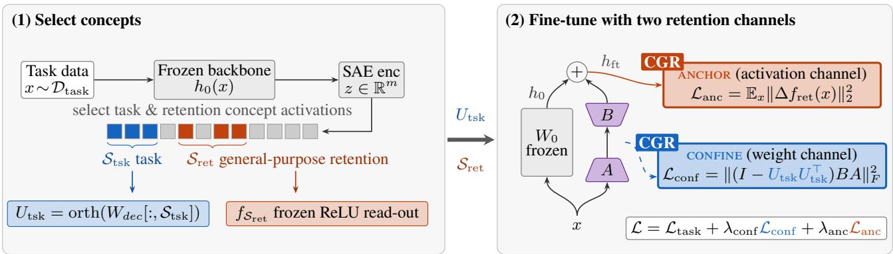  
Figure 1: CGR confines the weight update to task concepts and anchors retained concepts to the frozen model, both read from one frozen SAE. Left: one pass of task data through the frozen backbone and SAE selects the task set $S _ { \mathrm { t s k } }$ by causal attribution and a disjoint retention set $S _ { \mathrm { { r e t } } }$ by firing presence. Right: two CGR regularizers attach to any PEFT base. Confine penalizes the part of $\bar { \Delta W }$ outside the task subspace and anchor holds the retention-concept read-out at its frozen-model values.

Sparse autoencoders. A sparse autoencoder (SAE) is a trained map that re-describes a hidden activation $h \in  { \mathbb { R } } ^ { d }$ as a sparse combination of m ≫ d concept directions. CGR keeps this map frozen and only reads from it. Two maps do this, an encoder that scores how strongly each concept is present, and a decoder that rebuilds h from those scores,

$$
z ( h ) \ = \ g \big ( W _ { e n c } h + b _ { e n c } \big ) , \operatorname * { d e c } ( z ) \ = \ W _ { d e c } z + b _ { d e c } .\tag{3}
$$

The score vector $z ( h ) \in \mathbb { R } ^ { m }$ represents concepts, and it is sparse, so most concepts are inactive for any given input. The gate g is the SAE-specific activation (i.e., ReLU, TopK, etc.). The decoder weight matrix $W _ { d e c } \in \mathbb { R } ^ { d \times m }$ stores the j-th concept direction at column $W _ { d e c } [ : , j ]$ , and the encoder weight matrix $W _ { e n c } \in \mathbb { R } ^ { m \times d }$ at row $W _ { e n c } [ j , : ]$ . The reconstruction term $W _ { d e c } z \ \mathrm { s u m s }$ active concepts’ directions.

## 3.2 Reading concepts

In a transformer, the residual stream is a shared vector that every component writes into and later components read from (Elhage et al. 2021). At a read-out point in each layer, the frozen model produces a residual stream vector that we denote $h _ { 0 } ( x ) \ \bar { \in } \ \mathbb { R } ^ { d } \ ( d = d _ { o u t } )$ . Here, $\boldsymbol { x } ~ \in ~ \mathbb { R } ^ { d _ { i n } }$ is an internal representation from earlier layers (diferent from the raw input) entering the last adapted weight matrix $W _ { 0 } .$ Fine-tuning adds the adapter’s contribution to this vector, $h _ { \mathrm { f t } } ( x ) = \bar { h } _ { 0 } ( x ) + \Delta W \bar { x }$ . Everything computed before is preserved in $\dot { h } _ { 0 } ( x )$ , and only $\Delta \dot { W } x$ is new. This holds exactly when $W _ { 0 }$ writes directly into the stream and to first order otherwise. CGR works by limiting the efect of this added term at the read-out points. However, to define the concepts, we use an SAE that was pre-trained at a specific read-out point on the residual stream of a fixed layer ℓ. CGR reads how strongly each concept fires. Each concept $j \in \mathcal S$ has an encoder row $W _ { e n c } [ j , : ]$ and bias entry $b _ { e n c } [ \bar { j } ]$ ]. We set its concept read-out to be a non-negative score,

$$
f _ { j } ( h ) \ \triangleq \ \mathrm { R e L U } \big ( W _ { e n c } [ j , : ] h + b _ { e n c } [ j ] \big ) .\tag{4}
$$

We use a plain ReLU rather than the SAE’s own gate g, so the read-out has the same form across SAE families. It also reads a concept whenever it is present, even where the SAE’s gate would suppress it.

## 3.3 Concept selection: task vs. retention sets

Concept selection is key to CGR. First, CGR selects a task set $S _ { \mathrm { t s k } }$ that contains the concepts the fine-tuning task drives most strongly. It confines the weight update to the subspace these concepts span. Second, CGR selects a retention set $S _ { \mathrm { { r e t } } }$ that contains the of-task general-purpose concepts on the weight update path. CGR anchors the activations of these concepts to those of the frozen model because their activation drift drives forgetting most. Both sets are read from the task’s own inputs $\mathcal { D } _ { \mathrm { t a s k } }$ on the frozen model, with no held-out data.

Task set. An unconstrained update may write along oftask directions and cost the pretrained model its retention. The confined update must still learn the task so the allowed subspace must span the directions that causally drive the task loss. We select the concepts the task actually drives, measured by their causal efect on the task loss via attribution patching (Nanda 2023; Marks et al. 2025). Specifically, each concept receives an attribution score aggregated over the task inputs, $\begin{array} { r } { a _ { j } = \left| \mathbb { E } \left[ \sum _ { t } z _ { j } \partial \mathcal { L } _ { \mathrm { t a s k } } / \partial z _ { j } \right] \right| } \end{array}$ , where $z _ { j }$ is the SAE’s own activation of concept j and $\mathcal { L } _ { \mathrm { t a s k } }$ is the fine-tuning loss of Eq. (1). The top-scoring concepts form the task set $S _ { \mathrm { t s k } }$ Stacking their decoder columns and orthonormalizing them with a thin QR factorization (Golub and Van Loan 2013) gives an orthonormal basis of the task-concept subspace,

$$
U _ { \mathrm { t s k } } ~ = ~ \mathrm { o r t h } \big ( \big [ W _ { d e c } [ : , j ] \big ] _ { j \in \mathcal { S } _ { \mathrm { t s k } } } \big ) , U _ { \mathrm { t s k } } ^ { \top } U _ { \mathrm { t s k } } = I _ { | \mathcal { S } _ { \mathrm { t s k } } | } .\tag{5}
$$

Here $U _ { \mathrm { t s k } } \in \mathbb { R } ^ { d \times | S _ { \mathrm { t s k } } | }$ holds one orthonormal column per task concept. The confine term uses this basis (§3.4).

Retention set. For each concept $j$ we compute its mean activation on the frozen single-concept read-out $f _ { j }$ of Eq. (4), averaging over the task inputs and over the T token positions of each input (patch tokens for vision, text tokens under the

attention mask for language),

$$
\begin{array} { r l } { \phi _ { j } } & { = \mathbb { E } _ { x \sim \mathcal { D } _ { \mathrm { t a s k } } } \Big [ \frac { 1 } { T } \sum _ { t } f _ { j } ( h _ { 0 } ( x ) ) _ { t } \Big ] } \end{array}\tag{6}
$$

and form $S _ { \mathrm { { r e t } } }$ from the $k$ concepts of largest $\phi _ { j }$ that lie outside the task set,

$$
S _ { \mathrm { { r e t } } } ~ = ~ \mathrm { { T o p } } { \cdot } k \left\{ \phi _ { j } : j \notin S _ { \mathrm { { t s k } } } \right\}\tag{7}
$$

where Top-k returns the indices of the k largest scores. A high $\phi _ { j }$ marks a concept that fires on many of the task’s inputs. Fine-tuning writes $\Delta W$ along directions those same inputs activate, so the highest-ϕj of-task concepts (general-purpose features) are the features most at risk that sit directly in the update’s path. These are the features the anchor holds (§3.5), through the stacked read-out $f _ { S _ { \mathrm { r e t } } } ( h ) = \left( f _ { j } ( h ) \right) _ { j \in { \cal S } _ { \mathrm { r e t } } } .$

## 3.4 The confine term

We softly confine the update $\Delta W$ to the task-concept subspace by penalizing its perpendicular component. Writing $\bar { P } _ { \mathrm { t s k } } = \bar { U } _ { \mathrm { t s k } } \bar { U } _ { \mathrm { t s k } } ^ { \top }$ and $P _ { \mathrm { t s k } } ^ { \perp } = I _ { d } - P _ { \mathrm { t s k } }$

$$
{ \mathcal { L } } _ { \mathrm { c o n f } } ~ = ~ \left\| ~ P _ { \mathrm { t s k } } ^ { \perp } \Delta W \right\| _ { F } ^ { 2 } ~ = ~ \left\| ~ ( I _ { d } - U _ { \mathrm { t s k } } U _ { \mathrm { t s k } } ^ { \top } ) B A \right\| _ { F _ { \it c \bf { \Phi } } } ^ { 2 }\tag{8}
$$

Since $\Delta W = B A$ , its column space lies in col(B). The penalty therefore acts on the up-projection B. Minimizing ${ \mathcal { L } } _ { \mathrm { c o n f } }$ steers the columns of $B$ towards the task directions. Since this is done for the updates $\Delta W$ that write directly in the residual stream, the confinement acts by backpropagation on the full transformer and feed-forward block updates. CGR’s constraint is a continual soft projection analogue of the hard subspace constraints in the weight-geometry family, a penalty on the residual-facing factor applied at every step, rather than an exact projection (OPLoRA) or a subspace fixed once at initialization (LoRA-Null, SC-LoRA).

Proposition 1 (Subspace confinement). Given a sequence of stationary points $\Delta \dot { W } ^ { q } o f \mathcal { L } _ { \mathrm { t a s k } } ( \Delta W ) + \lambda _ { \mathrm { c o n f } } ^ { q } \lVert P _ { \mathrm { t s k } } ^ { \perp } \Delta W \rVert _ { F } ^ { 2 } ,$ $i f \left\| P _ { \mathrm { t s k } } ^ { \perp } \nabla \mathcal { L } _ { t a s k } ( \Delta W ^ { q } ) \right\| \le C f o r$ r all q, then the perpendicular component obeys $\lVert P _ { \mathrm { t s k } } ^ { \perp } \Delta W ^ { q } \rVert _ { F } = O ( 1 / \lambda _ { \mathrm { c o n f } } ^ { q } )  0$ as $\lambda _ { \mathrm { c o n f } } ^ { q }  \infty ,$ , recovering the hard projection $P _ { \mathrm { t s k } } ^ { \perp } \Delta W = 0$

The task subspace is built from the directions with the highest attribution scores, so the projected gradient $P _ { \mathrm { t s k } } ^ { \perp } \nabla _ { \Delta W } \mathcal { L } _ { \mathrm { t a s k } }$ retains only the components of those selected directions (proof in App. D.1). This makes the bounded-gradient condition plausible in practice, although it does not by itself guarantee a uniform bound along the sequence. The attribution-based choice of task directions and the confinement penalty then act in tandem to control unnecessary drift along directions deemed less important to the current task. Unlike a hard projection, which degrades performance when enforced strictly (Table 4), the soft penalty does not fully eliminate updates outside the selected subspace, allowing the network to use those directions when they provide suficient improvement on the current task. Robustness with respect to the choice of $\lambda _ { \mathrm { c o n f } }$ in CGR was empirically tested for several $\lambda _ { \mathrm { c o n f } }$ values (Table 14, App. K), leaving both accuracy and retention on a plateau above the respective limits of no confine term and hard-projection. In this way, the penalty helps preserve the pretrained capabilities the retention probes measure while retaining the plasticity required to learn the current task.

Why the confine term is not enough on its own. The confine penalty restricts $\Delta W$ , and that restriction alone lifts zero-shot retention well above the unconstrained base (Table 4). However, retention is also related to the drift of the retention-concept activations, $\Delta f _ { \mathrm { r e t } } ( x ) \triangleq f _ { S _ { \mathrm { r e t } } } ( h _ { \mathrm { f t } } ( x ) ) -$ $f _ { S _ { \mathrm { r e t } } } ( h _ { 0 } ( x ) )$ , as shown in Figures 3 and 8. Therefore, soft confine by itself is not suficient for retention.

Why soft confine. The lower bound in Proposition 2 shows that hard confine on the weight space, e.g., by projection, is also not enough to close the drift gap. Furthermore, our experiment shows that hard projection drives retention below the unconstrained base and adding the anchor recovers only part of the loss (Table 4). The proven limitation of both soft and hard confine motivates the necessity of the anchor term, discussed next.

## 3.5 The anchor term

We anchor the read-out of the retention concepts of the adapted model to that of the frozen model,

$$
\mathcal { L } _ { \mathrm { a n c } } = \mathbb { E } _ { x } \big \| f _ { S _ { \mathrm { r e t } } } \big ( h _ { \mathrm { f t } } ( x ) \big ) - f _ { S _ { \mathrm { r e t } } } \big ( h _ { 0 } ( x ) \big ) \big \| _ { 2 } ^ { 2 } .\tag{9}
$$

This is the expected squared retention drift $\mathbb { E } _ { x } \Vert \Delta f _ { \mathrm { r e t } } ( x ) \Vert _ { 2 } ^ { 2 } .$ and the next proposition explains it from the weight side, showing along the way why no weight-subspace constraint can control it.

The following proposition assumes that only the last layer before the SAE read-out is adapted, so x is a fixed internal representation and $h _ { 0 } ( x )$ is the frozen output of that layer. The purpose of this simplified setting is to obtain intuition about the relation between concept directions and weightupdate directions in a controlled manner. It does not describe exactly what happens in practice, where earlier adapted layers also modify the representation $x ,$ but it provides a model for understanding why the proposed method may outperform weight-only constraints, as observed empirically. It also shows why the weight subspace constraint of Proposition 1 is not enough to control the retention-concepts drift.

Proposition 2 (Retention-Concepts and Weight-Change relation). Let $W _ { \mathrm { r e t } } = W _ { \mathrm { e n c } } [ S _ { \mathrm { r e t } } , : ]$ , and assume that the inputs have finite second moment $\Sigma = \mathbb { E } [ x x ^ { \top } ]$ . Let $\mathcal { I } \subseteq S _ { \mathrm { r e t } }$ and let A be a subset of the input space such that, for every $x \in A$ all concepts in $\mathcal { I }$ are active at $h _ { 0 } ( x )$ and remain active under the perturbation $\Delta W x .$ . Write $\dot { W } _ { \mathcal { I } } = W _ { \mathrm { r e t } } [ \mathcal { I } , : ]$ and define the restricted second moment $\Sigma _ { A } = \mathbb { E } _ { x } \big [ \mathbf { 1 } _ { A } \dot { ( } x ) \dot { x } x ^ { \top } \big ] \enspace$ . Let us write

$$
\begin{array} { r } { \mathcal { L } _ { \mathrm { l o w } } = \mathrm { t r } \big ( W _ { \mathcal { I } } \Delta W \Sigma _ { A } \Delta W ^ { \top } W _ { \mathcal { I } } ^ { \top } \big ) , } \\ { \mathcal { L } _ { \mathrm { u p } } = \mathrm { t r } \big ( W _ { \mathrm { r e t } } \Delta W \Sigma \Delta W ^ { \top } W _ { \mathrm { r e t } } ^ { \top } \big ) . } \end{array}
$$

Then

$$
\begin{array} { r } { \mathcal { L } _ { \mathrm { l o w } } \ \leq \ \mathbb { E } _ { x } \big \| \Delta f _ { \mathrm { r e t } } ( x ) \big \| _ { 2 } ^ { 2 } \ \leq \ \mathcal { L } _ { \mathrm { u p } } . } \end{array}\tag{10}
$$

Moreover, even on the hard-projection surface $P _ { \mathrm { t s k } } ^ { \perp } \Delta W = 0 ,$ neither $\mathcal { L } _ { \mathrm { l o w } }$ nor $\mathcal { L } _ { \mathrm { u p } }$ is controlled by the projection con-straint alone. Whenever the task subspace contains directions read by the corresponding retention concepts and excited by the relevant input second moments both bounds can grow. A weight-subspace constraint alone is therefore insuficient to guarantee activation-space retention. (The proof of the proposition is in App. D.2)

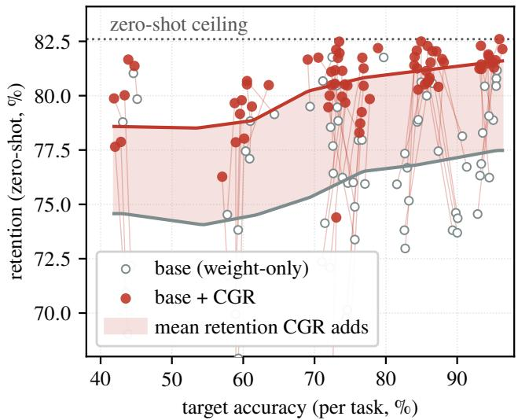  
Figure 2: CGR pushes the attainable-retention frontier toward 1the ceiling (CLIP vision panel). One point per (task, base) of Table 2 where gray is for the base and red for +CGR. The shaded band shows the retention CGR adds.

Eq (10) provides lower and upper bounds on the retentionconcepts drift. The lower bound indicates that if a subset of the task data activates a retention concept, then movement restricted to the task-weight subspace may still amplify the drift of that concept. Although concepts correspond to separate coordinates in the latent space of the SAE, their encoder and decoder directions are not generally orthogonal when pulled back to the residual stream or weight spaces. This overlap is understandable because the retention concepts are themselves active on part of the task data. In this setting, the non-orthogonality may be advantageous: directly controlling retention-concept drift can steer movement toward task-relevant directions that learn the new task without unnecessarily disrupting the remaining concepts.

CWAC (Peng et al. 2026) introduced the channel coupling via a first-order argument for full fine-tuning in safety alignment tasks. Prop. 2 strengthens it for the PEFT with exact bounds, and shows that confined updates can amplify drift. We anchor a disjoint of-task set (§3.3) rather than one protected set. Further experimentally explored relations between weight space and concept activations are provided in App. E.

## 4 Experiments

For evaluation, we ask two questions. (i) Does adding CGR improve retention over the weight-only subspace-LoRA adapters? (ii) Does the recipe transfer beyond vision? We evaluate on target-task accuracy and zero-shot retention on the held-out probes after fine-tuning.

## 4.1 Setup

Backbones and SAEs. For vision, we adapt a frozen CLIP ViT-B/32 and read concepts from the frozen, publicly released Prisma SAE (Joseph et al. 2025) on the residual stream at layer ℓ=8. For language, we adapt Llama-3.1-8B and read concepts from the frozen Llama-Scope SAE on the residual stream at layer 19 of 32 (He et al. 2024). Both are intermediate read-out points, where semantic features are most accessible (Templeton et al. 2024; Lad et al. 2024), before the final layers specialize toward the output (Gandelsman, Efros, and Steinhardt 2024). The layer is fixed per modality, never tuned. App. L reports reconstruction faithfulness at the vision read-out layer for every task. Both SAEs stay frozen and CGR only reads from them, with $| S _ { \mathrm { t s k } } | { = } | S _ { \mathrm { r e t } } | { = } 1 2 8$ for CLIP and $| \mathcal { S } _ { \mathrm { t s k } } | { = } 2 5 6 , | \mathcal { S } _ { \mathrm { r e t } } | { = } 1 2 8$ for Llama-3.1-8B. Neither size is tuned, and App. K shows the efect of concept-set size (Tables 15 and 16).

Baselines. We evaluate CGR on six adapter families. Each base runs alone and as “base+CGR”, so every comparison is a controlled ablation of the CGR terms with the adapter held fixed. LoRA (Hu et al. 2022) and the parallel-adapter Adapt-Former (Chen et al. 2022) are retention-agnostic bases. OPLoRA (Xiong and Xie 2026), LoRA-Null (Tang et al. 2026), CorDA (Yang et al. 2024), and SAILS (Wang et al. 2025a) are weight-geometry retention methods that together cover the family’s subspace constructions (top-k SVD, activation null space, input covariance, and SAE directions). Anchors on the activation channel are compared in the ablation of §4.3. App. B.1 describes each base.

Protocol. Vision methods fine-tune on ten classification tasks, eight from the VTAB-1k benchmark (Zhai et al. 2019) and the two fine-grained tasks FGVC-Aircraft (Maji et al. 2013) and CUB-200 (Wah et al. 2011). The language experiment follows the instruction-tuning forgetting protocol of Tang et al. (2026): fine-tune on WizardLM instruction data and measure zero-shot world-knowledge retention on TriviaQA, NQ-Open, and WebQS with lm\_eval 0.4.9. Instruction-following quality is MTBench single-answer grading (1–10) with a Claude Opus 4.8 judge. The datasetspecific details are provided in App. B.2. All experiments are mean over three seeds, with ±std where shown. The LoRA-family adapters use rank 8 for vision and rank 128 for language, where they share one trainable budget of 4.01% of parameters. AdaptFormer uses a bottleneck of 16 and 64 respectively. CGR adds no parameters to any base. Every hyperparameter for both modalities, shared across all bases per modality, is listed in App. C.

## 4.2 The accuracy–retention frontier

Vision. Retention is measured after fine-tuning as zeroshot accuracy on four held-out natural probes (CIFAR-10/100, Caltech-101, SUN397); the frozen backbone scores 82.6 on this set. Table 2 and Figure 2 present the per-task results. We observe that CGR improves retention on every base at comparable accuracy, and all 60 dataset×base cells improve (paired Wilcoxon $p { \leq } 0 . 0 0 2$ per base). Plain LoRA gains 6.1 points (74.1 → 80.2). LoRA-Null, the strongest weight-only baseline, still gains (79.6 → 81.7, within 0.9 of the ceiling), and OPLoRA, itself a hard-projection retention method, gains +6.4 at matched accuracy. Across the 10 tasks, the one exception is accuracy on SVHN and dSprites, two tasks that read out digit identity or synthetic pose rather than natural object categories, and there CGR gains retention at an accuracy cost. App. I shows detailed vision panel retention performance for every base.

<table><tr><td colspan="2"></td><td colspan="2">FGVC</td><td colspan="2">CUB</td><td colspan="2">DTD Flow</td><td colspan="2">Pets</td><td colspan="2">EuroS</td><td colspan="2">RESISC</td><td colspan="2">DiabR</td><td colspan="2">dSpr-O</td><td colspan="2">SVHN</td><td colspan="2">Avg</td></tr><tr><td>Method</td><td>Acc</td><td>Ret</td><td>Acc</td><td>Ret</td><td>Acc</td><td>Ret</td><td>Acc</td><td>Ret</td><td>Acc</td><td>Ret</td><td>Acc</td><td>Ret</td><td>Acc</td><td>Ret</td><td>Acc</td><td>Ret</td><td>Acc</td><td>Ret</td><td>Acc</td><td>Ret Ret</td></tr><tr><td>Zero-shot</td><td>19.3</td><td>82.6</td><td>70.9</td><td>82.6</td><td>54.6</td><td>82.6</td><td>73.0</td><td>82.6</td><td>89.8</td><td>82.6 40.5</td><td></td><td>82.6</td><td>61.9</td><td>82.6</td><td>35.4</td><td>82.6</td><td>9.3</td><td>82.6</td><td>60.4 82.6</td><td>82.6</td></tr><tr><td>LoRA</td><td>59.3</td><td>67.9</td><td>74.6</td><td>70.1</td><td>71.5</td><td>74.1</td><td>93.2</td><td>76.3</td><td>82.6 73.8</td><td>93.6</td><td>78.3</td><td>83.0</td><td>76.7</td><td>72.3</td><td>78.6</td><td>43.6</td><td>70.9</td><td>89.4</td><td>73.8</td><td>74.1</td></tr><tr><td>+CGR</td><td>60.1</td><td>78.0</td><td>76.4</td><td>78.7</td><td>74.3</td><td>80.5</td><td>95.0</td><td>81.6 86.1</td><td>80.8</td><td>93.4</td><td>81.2</td><td>84.0</td><td>81.8</td><td>72.9</td><td>81.2</td><td>42.9</td><td>77.9</td><td>85.8</td><td>80.6</td><td>80.2*</td></tr><tr><td>OPLoRA</td><td>58.9</td><td>69.9</td><td>75.1</td><td>69.3</td><td>72.1</td><td>72.1</td><td>93.4</td><td>76.9</td><td>81.5 75.9</td><td>95.1</td><td>78.9</td><td>82.7</td><td>77.3</td><td>72.6</td><td>76.4</td><td>44.2</td><td>72.2</td><td>89.8</td><td>74.6</td><td>74.4</td></tr><tr><td>+CGR</td><td>59.5</td><td>79.2</td><td>76.6</td><td>79.2</td><td>74.6</td><td>80.5</td><td>95.4</td><td>81.6</td><td>85.7 81.1</td><td>93.4</td><td>81.4</td><td>84.3</td><td>82.1</td><td>73.3</td><td>81.7</td><td>43.4</td><td>80.0</td><td>86.3</td><td>81.5</td><td>80.8*</td></tr><tr><td>LoRA-Null</td><td>61.0</td><td>78.8</td><td>76.2</td><td>78.0</td><td>73.9</td><td>76.2</td><td>94.8</td><td>81.5</td><td>86.5 80.6</td><td>95.6</td><td>81.2</td><td>85.0</td><td>80.6</td><td>72.5</td><td>81.8</td><td>44.6</td><td>81.0</td><td>91.3</td><td>76.7</td><td>79.6</td></tr><tr><td>+CGR</td><td>60.5</td><td>80.5</td><td>76.9</td><td>80.5</td><td>76.7</td><td>81.7</td><td>95.9</td><td>82.6</td><td>87.1 82.0</td><td>93.3</td><td>82.3</td><td>85.0</td><td>82.5</td><td>73.5</td><td>82.0</td><td>43.9</td><td>81.7</td><td>87.9</td><td>81.7</td><td>81.7*</td></tr><tr><td>CorDA</td><td>57.8</td><td>71.7</td><td>72.5</td><td>65.9</td><td>73.3</td><td>78.8</td><td>93.9</td><td>80.4</td><td>84.4 78.8</td><td>94.5</td><td>79.1</td><td>84.6</td><td>78.9</td><td>73.2</td><td>79.5</td><td>43.1</td><td>78.8</td><td>90.1</td><td>74.4</td><td>76.6</td></tr><tr><td>+CGR</td><td>57.1</td><td>76.3</td><td>73.0</td><td>74.4</td><td>73.9</td><td>81.1</td><td>94.4</td><td>81.8</td><td>85.5 80.5</td><td>94.3</td><td>81.5</td><td>84.4</td><td>81.3</td><td>72.3</td><td>81.1</td><td>41.9</td><td>79.9</td><td>87.4</td><td>80.4</td><td>79.8*</td></tr><tr><td>AF</td><td>60.9</td><td>77.1</td><td>77.1</td><td>75.9</td><td>74.7</td><td>76.0</td><td>95.5</td><td>80.8</td><td>87.4 77.4</td><td>95.5</td><td>80.4</td><td>85.7</td><td>80.0</td><td>72.8</td><td>80.5</td><td>45.1</td><td>79.8</td><td>90.7</td><td>78.1</td><td>78.6</td></tr><tr><td>+CGR</td><td>61.2</td><td>79.5</td><td>77.7</td><td>79.8</td><td>76.9</td><td>81.3</td><td>96.3</td><td>82.1</td><td>88.1 81.5</td><td>94.4</td><td>81.9</td><td>85.9</td><td>82.3</td><td>73.5</td><td>82.5</td><td>44.8</td><td>81.4</td><td>86.6</td><td>82.0</td><td>81.4*</td></tr><tr><td>SAILS</td><td>59.0</td><td>65.8</td><td>74.4</td><td>69.7</td><td>71.0</td><td>72.4</td><td>92.9</td><td>74.6</td><td>82.7 73.0</td><td>94.5</td><td>76.2</td><td>83.2</td><td>75.2</td><td>72.6</td><td>77.7</td><td>43.8</td><td>69.0</td><td>90.0</td><td>73.7</td><td>72.7</td></tr><tr><td>+CGR</td><td>59.0</td><td>77.9</td><td>76.3</td><td>78.3</td><td>74.3</td><td>79.7</td><td>95.2</td><td>81.3</td><td>84.5 80.3</td><td>93.1</td><td>81.2</td><td>84.0</td><td>81.4</td><td>72.1</td><td>80.0</td><td>42.0</td><td>77.7</td><td>86.0</td><td>80.7</td><td>79.8*</td></tr></table>

Table 2: Results of CGR on ten CLIP ViT-B/32 tasks. Each adapter is shown with and without CGR. AF is AdaptFormer. Acc is target-task accuracy. Ret is zero-shot retention, the mean accuracy on four held-out probes. Avg is the mean retention over the tasks. Best retention per task and best Avg in bold. The star (⋆) marks a statistically significant CGR retention gain across tasks.

<table><tr><td rowspan="2">Method</td><td colspan="3">World-knowledge retention (%)</td><td rowspan="2">Target MTB</td></tr><tr><td>Trivia NQ-O</td><td>WebQS</td><td>Avg1 Per</td></tr><tr><td>Zero-shot</td><td>61.5 7.9</td><td>11.6</td><td>27.0</td><td>100.0</td><td>一</td></tr><tr><td>LoRA</td><td>27.6</td><td>11.1 12.4</td><td>17.1</td><td>81.6</td><td>5.8</td></tr><tr><td>+CGR</td><td>43.5</td><td>12.0</td><td>12.4 22.6</td><td>90.2</td><td>6.2</td></tr><tr><td>LoRA-Null</td><td>47.0</td><td>9.5</td><td>9.8 22.1</td><td>87.1</td><td>3.5</td></tr><tr><td>+CGR</td><td>55.9</td><td>9.1</td><td>9.7 24.9</td><td>91.5</td><td>3.3</td></tr><tr><td>CorDA</td><td>40.5</td><td>12.1</td><td>10.8 21.1</td><td>86.1</td><td>5.3</td></tr><tr><td>+CGR</td><td>45.7</td><td>13.2</td><td>9.4 22.8</td><td>85.0</td><td>5.3</td></tr><tr><td>OPLoRA</td><td>40.2</td><td>10.2</td><td>11.5 20.6</td><td>88.0</td><td>5.7</td></tr><tr><td>+CGR</td><td>51.1</td><td>9.4</td><td>11.4</td><td>24.0 93.8</td><td>5.6</td></tr><tr><td>SAILS</td><td>32.0</td><td>11.2</td><td>12.2</td><td>18.5 84.0</td><td>5.8</td></tr><tr><td>+CGR</td><td>42.9</td><td>11.6</td><td>12.1</td><td>22.2 89.9</td><td>5.7</td></tr><tr><td>AdaptFormer</td><td>38.1</td><td>3.7</td><td>8.2</td><td>16.6 59.6</td><td>5.0</td></tr><tr><td>+CGR</td><td>59.4</td><td>6.2</td><td>9.9</td><td>25.1 86.7</td><td>4.4</td></tr></table>

Table 3: Results of CGR on Llama-3.1-8B instructionfollowing tasks. Each adapter is shown with and without CGR. Avg1 is the average preservation score. Per is the percentage of preserved performance relative to the pre-trained model. MTB is the MTBench score. Trivia and NQ-O abbreviate TriviaQA and NQ-Open.

Language (Llama-3.1-8B). We observe a similar trend on the language instruction-tuning task (Table 3), where retention improves on all six bases on average. Vanilla LoRA forgets the most (TriviaQA 61.6 → 27.6) and CGR recovers nearly half of the drop; CGR on OPLoRA improves

<table><tr><td rowspan="2">Configuration</td><td colspan="2">FGVC</td><td colspan="2">CUB</td></tr><tr><td>Acc</td><td>Ret</td><td>Acc</td><td>Ret</td></tr><tr><td>LoRA (no CGR)</td><td>59.3</td><td>53.1</td><td>74.6</td><td>59.5</td></tr><tr><td>Full CGR*</td><td>60.1</td><td>72.0</td><td>76.4</td><td>73.2</td></tr><tr><td>Confine only</td><td>59.8</td><td>66.3</td><td>75.6</td><td>66.9</td></tr><tr><td>Anchor only</td><td>59.2</td><td>66.2</td><td>75.6</td><td>70.6</td></tr><tr><td>SAE-subspace init only</td><td>59.0</td><td>50.4</td><td>74.4</td><td>59.0</td></tr><tr><td>Anchor set from CIFAR-100</td><td>59.7</td><td>69.5</td><td>76.0</td><td>71.5</td></tr><tr><td>OPLoRA + anchor</td><td>59.1</td><td>68.4</td><td>75.6</td><td>70.2</td></tr><tr><td>Hard task-projection only Hard task-projection + anchor</td><td>57.5 58.4</td><td>43.8 63.8</td><td>74.1 75.2</td><td>57.5 69.4</td></tr></table>

Table 4: Contribution of each CGR component on top of a LoRA base. Ret is CIFAR-100 zero-shot retention.

40.2 → 51.1. MTBench performance stays close to the original on five of the six bases. AdaptFormer is the one exception, achieving the largest retention gain (TriviaQA 38.1 → 59.4) at an instruction-following cost (5.03 → 4.38). App. J shows detailed retention performance for every base.

## 4.3 Ablations

All vision ablations use FGVC-Aircraft and CUB-200 with CIFAR-100 zero-shot retention because these are the panel’s two fine-grained tasks with their most severe forgetting and in-distribution images for the SAE (App. L). The language model ablation keeps the protocol of §4.1.

Both channels are crucial for retention. Table 4 decomposes CGR on a LoRA base. Initializing in an SAE subspace without a persistent loss changes nothing (Wang et al. 2025a). Each term of CGR alone lifts retention, and the two compose. The anchor stops the retention concepts from drifting that confine cannot preserve (App. E). The soft confine beats OPLoRA’s hard projection under the same anchor. An anchor with hard task projection outperforms hard projection only.

<table><tr><td rowspan="2">Anchor set</td><td colspan="2">FGVC</td><td colspan="2">CUB</td><td rowspan="2">Anch. act.</td></tr><tr><td>Acc</td><td>Ret</td><td>Acc</td><td>Ret</td></tr><tr><td>Top-k firing (ours)</td><td>60.1</td><td>72.0</td><td>76.4</td><td>73.2</td><td>53.3</td></tr><tr><td>Random selection</td><td>59.6</td><td>69.2</td><td>76.4</td><td>70.6</td><td>3.6</td></tr><tr><td>Last-k (least firing)</td><td>59.4</td><td>64.8</td><td>76.1</td><td>67.9</td><td>&lt;0.1</td></tr><tr><td>SAE-FD (Zhang et al. 2026)</td><td>59.6</td><td>66.6</td><td>75.9</td><td>68.6</td><td>100</td></tr><tr><td>All off-task concepts</td><td>60.0</td><td>66.4</td><td>75.9</td><td>68.6</td><td>98.3</td></tr><tr><td>All off-task except top-k</td><td>58.3</td><td>65.4</td><td>76.0</td><td>68.8</td><td>45.1</td></tr><tr><td>LDIFS (Mukhoti et al. 2024)</td><td>59.5</td><td>64.8</td><td>75.9</td><td>67.2</td><td></td></tr></table>

Table 5: Concept-selection ablation on CLIP for retention on top of LoRA Base. Ret is CIFAR-100 zero-shot retention. Anchored activation (%) is the share of the total SAE activation on the task inputs that the anchored set accounts for.
<table><tr><td>Anchor set</td><td>Trivia</td><td>NQ-O</td><td>WebQS</td><td>Avg1</td></tr><tr><td>Top-k firing (ours)</td><td>43.5</td><td>12.0</td><td>12.4</td><td>22.6</td></tr><tr><td>Random selection</td><td>43.4</td><td>10.7</td><td>12.1</td><td>22.1</td></tr><tr><td>SAE-FD (Zhang et al. 2026)</td><td>42.1</td><td>11.1</td><td>12.1</td><td>21.7</td></tr></table>

Table 6: Concept-selection ablation on Llama-3.1-8B for retention on top of LoRA base.

Which concepts to anchor. Retention drops monotonically from top-k to random to last-k selection (Table 5). The selected concept set also outperforms anchoring every active concept of (Zhang et al. 2026; Peng et al. 2026) and distilling the whole representation of (Mukhoti et al. 2024) on both downstream accuracy and retention. Crucially, retention performance is not dictated merely by the total magnitude of anchored activation: our selected set anchors only ∼53% of the total concept activation yet achieves the highest retention. Anchoring the entire representation retains less, while anchoring an equivalent activation mass on lower-scoring concepts performs no better than unselective anchoring. Retention-concept drift correlates with held-out retention across every run (Figure 3, App. F). This ordering holds consistently on the language track (Table 6), confirming that the SAE provides tangible value through targeted selection and interpretability (§4.3).

Interpretability. Because CGR’s subspaces come from a frozen SAE rather than opaque singular vectors or an activation null space, the protected retention directions are named and manipulable. Figure 4 shows the mechanism on FGVC and the weight-side complement is in App. H. Removing the selected concepts costs ∼10pp of zero-shot retention while a size-matched random set costs ∼0pp (App. G). Steering them moves retention smoothly with the intervention strength. Editing them through a concept-bottleneck head (Koh et al. 2020) corrects predictions on demand. We discuss each in detail in App. H.

## 5 Conclusion

We propose CGR, a plug-and-play regularization method that uses the concepts of a frozen sparse autoencoder to preserve pre-trained knowledge during parameter-eficient fine-tuning. A confine term restricts the weight update to the task-concept subspace, and an anchor term holds a selected, disjoint set of general-purpose concept activations to the frozen model. Extensive experiments across six adapter families on a CLIP vision panel and a Llama-3.1 instruction protocol show that CGR improves retention on every base at comparable task accuracy. Furthermore, each term lifts retention in diferent channels, and the anchor contributes to the part that the weight-space update does not hold. Additionally, we show that CGR’s preserved capability can be inspected, steered, and edited after fine-tuning. Future work includes a per-task certificate for sequential continual learning, bounds under distribution shift, and drawing both concept sets from SAEs at several layers.

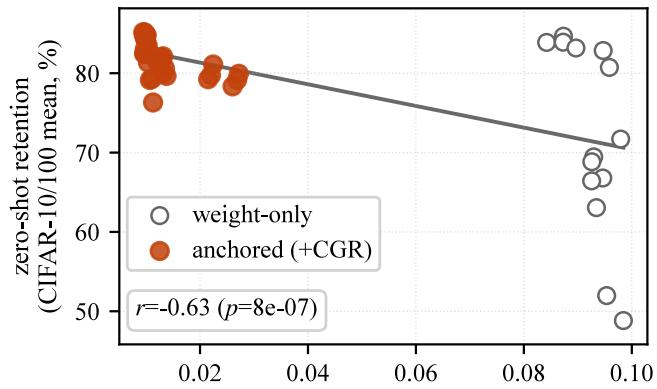  
Figure 3: The quantity the anchor reads predicts realized retention (FGVC). Measured $S _ { \mathrm { { r e t } } }$ drift vs. zero-shot retention (CIFAR-10/100 mean) over all runs.

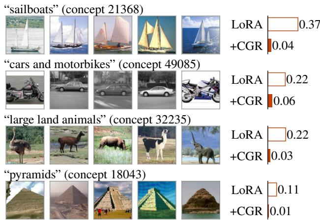  
Figure 4: CGR pins the concepts that drift most under plain LoRA (FGVC). Each concept is named by its top-firing Caltech-101 exemplars. Bars show the activation drift under LoRA (gray) and under +CGR (red).

Elhage, N.; Nanda, N.; Olsson, C.; Henighan, T.; Joseph, N.; Mann, B.; Askell, A.; Bai, Y.; Chen, A.; Conerly, T.; DasSarma, N.; Drain, D.; Ganguli, D.; Hatfield-Dodds, Z.; Hernandez, D.; Jones, A.; Kernion, J.; Lovitt, L.; Ndousse, K.; Amodei, D.; Brown, T.; Clark, J.; Kaplan, J.; McCandlish, S.; and Olah, C. 2021. A Mathematical Framework for Transformer Circuits. Transformer Circuits Thread.

## References

Berant, J.; Chou, A.; Frostig, R.; and Liang, P. 2013. Semantic Parsing on Freebase from Question-Answer Pairs. In Conference on Empirical Methods in Natural Language Processing (EMNLP).

Biderman, D.; Portes, J.; Ortiz, J. J. G.; Paul, M.; Greengard, P.; Jennings, C.; King, D.; Havens, S.; Chiley, V.; Frankle, J.; Blakeney, C.; and Cunningham, J. P. 2024. LoRA Learns Less and Forgets Less. Transactions on Machine Learning Research.

Bricken, T.; Templeton, A.; Batson, J.; Chen, B.; Jermyn, A.; Conerly, T.; Turner, N.; Anil, C.; Denison, C.; Askell, A.; Lasenby, R.; Wu, Y.; Kravec, S.; Schiefer, N.; Maxwell, T.; Joseph, N.; Hatfield-Dodds, Z.; Tamkin, A.; Nguyen, K.; McLean, B.; Burke, J. E.; Hume, T.; Carter, S.; Henighan, T.; and Olah, C. 2023. Towards Monosemanticity: Decomposing Language Models With Dictionary Learning. Transformer Circuits Thread.

Chalnev, S.; Siu, M.; and Conmy, A. 2024. Improving Steering Vectors by Targeting Sparse Autoencoder Features. arXiv:2411.02193.

Chen, M.; Engels, J.; and Tegmark, M. 2025. Low-Rank Adapting Models for Sparse Autoencoders. In Proceedings of the 42nd International Conference on Machine Learning (ICML), volume 267 of Proceedings of Machine Learning Research, 8077–8092. PMLR. ArXiv:2501.19406.

Chen, S.; Ge, C.; Tong, Z.; Wang, J.; Song, Y.; Wang, J.; and Luo, P. 2022. AdaptFormer: Adapting Vision Transformers for Scalable Visual Recognition. In Advances in Neural Information Processing Systems (NeurIPS).

Deng, B.; Wan, Y.; Yang, B.; Huang, F.; Wang, W.; and Feng, F. 2026. SASFT: Sparse Autoencoder-guided Supervised Finetuning to Mitigate Unexpected Code-Switching in LLMs. In International Conference on Learning Representations (ICLR). Https://openreview.net/pdf?id=BQOFU9qO5j.

Fei-Fei, L.; Fergus, R.; and Perona, P. 2004. Learning Generative Visual Models from Few Training Examples: An Incremental Bayesian Approach Tested on 101 Object Categories. In CVPR Workshop on Generative-Model Based Vision.

Gandelsman, Y.; Efros, A. A.; and Steinhardt, J. 2024. Interpreting CLIP’s Image Representation via Text-Based Decomposition. In International Conference on Learning Rep- resentations (ICLR). ArXiv:2310.05916.

Golub, G. H.; and Van Loan, C. F. 2013. Matrix Computations. Johns Hopkins University Press, 4th edition.

He, Z.; Shu, W.; Ge, X.; Chen, L.; Wang, J.; Zhou, Y.; Liu, F.; Guo, Q.; Huang, X.; Wu, Z.; Jiang, Y.-G.; and Qiu, X. 2024. Llama Scope: Extracting Millions of Features from Llama-3.1-8B with Sparse Autoencoders. arXiv preprint arXiv:2410.20526.

Hu, E. J.; Shen, Y.; Wallis, P.; Allen-Zhu, Z.; Li, Y.; Wang, S.; Wang, L.; and Chen, W. 2022. LoRA: Low-Rank Adaptation of Large Language Models. In International Conference on Learning Representations (ICLR).

Imanov, O. Y. L. 2026. Mechanistic Analysis of Catastrophic Forgetting in Large Language Models During Continual Fine-tuning. arXiv preprint arXiv:2601.18699.

Joseph, S.; Suresh, P.; Hufe, L.; Stevinson, E.; Graham, R.; Vadi, Y.; Bzdok, D.; Lapuschkin, S.; Sharkey, L.; and Richards, B. A. 2025. Prisma: An Open Source Toolkit for Mechanistic Interpretability in Vision and Video. arXiv preprint arXiv:2504.19475.

Joshi, M.; Choi, E.; Weld, D. S.; and Zettlemoyer, L. 2017. TriviaQA: A Large Scale Distantly Supervised Challenge Dataset for Reading Comprehension. In Annual Meeting of the Associationfor Computational Linguistics (ACL).

Koh, P. W.; Nguyen, T.; Tang, Y. S.; Mussmann, S.; Pierson, E.; Kim, B.; and Liang, P. 2020. Concept Bottleneck Models. In International Conference on Machine Learning (ICML). Krizhevsky, A. 2009. Learning Multiple Layers of Features from Tiny Images. Technical report, University of Toronto.

Kumar, A.; Raghunathan, A.; Jones, R.; Ma, T.; and Liang, P. 2022. Fine-Tuning can Distort Pretrained Features and Underperform Out-of-Distribution. In International Conference on Learning Representations (ICLR). ArXiv:2202.10054.

Kwiatkowski, T.; Palomaki, J.; Redfield, O.; Collins, M.; Parikh, A.; Alberti, C.; Epstein, D.; Polosukhin, I.; Devlin, J.; Lee, K.; Toutanova, K.; Jones, L.; Kelcey, M.; Chang, M.-W.; Dai, A. M.; Uszkoreit, J.; Le, Q.; and Petrov, S. 2019. Natural Questions: A Benchmark for Question Answering Research. Transactions ofthe Associationfor Computational Linguistics, 7.

Lad, V.; Lee, J. H.; Gurnee, W.; and Tegmark, M. 2024. The Remarkable Robustness of LLMs: Stages of Inference? ArXiv:2406.19384.

Li, Z.; and Hoiem, D. 2018. Learning without Forgetting. IEEE Transactions on Pattern Analysis and Machine Intelli gence, 40(12): 2935–2947. ArXiv:1606.09282.

Lin, C.-Y.; and Sun, S.-H. 2026. PRISM: A Geometric Risk Bound that Decomposes Drift into Scale, Shape, and Head. arXiv preprint arXiv:2605.11608.

Luo, M.; Kuang, F.; Wang, Y.; Liu, Z.; and He, T. 2025. SC-LoRA: Balancing Eficient Fine-tuning and Knowledge Preservation via Subspace-Constrained LoRA. arXiv preprint arXiv:2505.23724.

Maji, S.; Rahtu, E.; Kannala, J.; Blaschko, M.; and Vedaldi, A. 2013. Fine-Grained Visual Classification of Aircraft. Technical Report arXiv:1306.5151, arXiv.

Marks, S.; Rager, C.; Michaud, E. J.; Belinkov, Y.; Bau, D.; and Mueller, A. 2025. Sparse Feature Circuits: Discovering and Editing Interpretable Causal Graphs in Language Models. In International Conference on Learning Representations (ICLR).

Morelli, F.; Uselis, A.; Sonthalia, A.; and Oh, S. J. 2026. Sparse Autoencoders enable Robust and Interpretable Finetuning of CLIP models. arXiv preprint arXiv:2605.15961.

Mukhoti, J.; Gal, Y.; Torr, P. H. S.; and Dokania, P. K. 2024. Fine-tuning can cripple your foundation model; preserving features may be the solution. Transactions on Machine Learning Research. ArXiv:2308.13320.

Nanda, N. 2023. Attribution Patching: Activation Patching at Industrial Scale. https://www.neelnanda.io/mechanisticinterpretability/attribution-patching.

Peng, S.; Zhang, Z.; Zeng, D.; Jiang, L.; and Gao, X. 2026. Preventing Safety Drift in Large Language Models via Coupled Weight and Activation Constraints. arXiv preprint arXiv:2604.12384.

Shuttleworth, R.; Andreas, J.; Torralba, A.; and Sharma, P. 2025. LoRA vs Full Fine-tuning: An Illusion of Equivalence. In Advances in Neural Information Processing Systems (NeurIPS).

Steele, B. 2026. Subspace Geometry Governs Catastrophic Forgetting in Low-Rank Adaptation. arXiv preprint arXiv:2603.02224.

Tang, P.; Hu, X.; Liu, Y.; Ding, L.; Zhang, D.; Wu, X.; and Zhang, D. 2026. Put the Space of LoRA Initialization to the Extreme to Preserve Pre-trained Knowledge. In Proceedings of the AAAI Conference on Artificial Intelligence (AAAI). ArXiv:2503.02659.

Templeton, A.; Conerly, T.; Marcus, J.; Lindsey, J.; Bricken, T.; Chen, B.; Pearce, A.; Citro, C.; Ameisen, E.; Jermyn, A.; Olah, C.; et al. 2024. Scaling Monosemanticity: Extracting Interpretable Features from Claude 3 Sonnet. Transformer Circuits Thread.

Wah, C.; Branson, S.; Welinder, P.; Perona, P.; and Belongie, S. 2011. The Caltech-UCSD Birds-200-2011 Dataset. Technical Report CNS-TR-2011-001, California Institute of Technology.

Wang, D.; Ma, Q.; Shang, Y.; Lu, Z.; Xu, Z.; Ning, L.; Wu, H.; and He, Z. 2025a. Interpretable Safety Alignment via SAE-Constructed Low-Rank Subspace Adaptation. arXiv preprint arXiv:2512.23260.

Wang, P.; Gu, M.; and Huang, Q. 2025. VeFA: Vector-Based Feature Space Adaptation for Robust Model Fine-Tuning. ArXiv:2510.19155, arXiv:2510.19155.

Wang, X.; Li, Z.; Wang, B.; Hu, Y.; and Zou, D. 2025b. Model Unlearning via Sparse Autoencoder Subspace Guided Projections. In Proceedings of the 2025 Conference on Em-pirical Methods in Natural Language Processing (EMNLP), 26530–26546. Association for Computational Linguistics. ArXiv:2505.24428.

Wortsman, M.; Ilharco, G.; Kim, J. W.; Li, M.; Kornblith, S.; Roelofs, R.; Lopes, R. G.; Hajishirzi, H.; Farhadi, A.; Namkoong, H.; and Schmidt, L. 2022. Robust Fine-tuning ofZero-shot Models. In IEEE/CVF Conference on Computer Vision and Pattern Recognition (CVPR).

Xiao, J.; Hays, J.; Ehinger, K. A.; Oliva, A.; and Torralba, A. 2010. SUN Database: Large-Scale Scene Recognition from Abbey to Zoo. In IEEE Conference on Computer Vision and Pattern Recognition (CVPR).

Xiong, Y.; and Xie, X. 2026. OPLoRA: Orthogonal Projection LoRA Prevents Catastrophic Forgetting during Parameter-Eficient Fine-Tuning. In Proceedings of

the AAAI Conference on Artificial Intelligence (AAAI). ArXiv:2510.13003.

Xu, C.; Sun, Q.; Zheng, K.; Geng, X.; Zhao, P.; Feng, J.; Tao, C.; and Jiang, D. 2024. WizardLM: Empowering Large Language Models to Follow Complex Instructions. In International Conference on Learning Representations (ICLR). ArXiv:2304.12244.

Yan, J.; Li, Z.; Wang, F.; Wang, B.; He, Z.; and Fu, Z. 2025. DGS-Net: Distillation-Guided Gradient Surgery for CLIP Fine-Tuning in AI-Generated Image Detection. arXiv preprint arXiv:2511.13108.

Yang, Y.; Li, X.; Zhou, Z.; Song, S. L.; Wu, J.; Nie, L.; and Ghanem, B. 2024. CorDA: Context-Oriented Decomposition Adaptation of Large Language Models for Task-Aware Parameter-Eficient Fine-tuning. In Advances in Neural Information Processing Systems (NeurIPS). ArXiv:2406.05223.

Zhai, X.; Puigcerver, J.; Kolesnikov, A.; Ruyssen, P.; Riquelme, C.; Lucic, M.; Djolonga, J.; Susano Pinto, A.; Neumann, M.; Dosovitskiy, A.; Beyer, L.; Bachem, O.; Tschannen, M.; Michalski, M.; Bousquet, O.; Gelly, S.; and Houlsby, N. 2019. A Large-scale Study of Representation Learning with the Visual Task Adaptation Benchmark. arXiv preprint arXiv:1910.04867.

Zhang, M.; Li, Y.; Li, L.; Shen, D.; Xiong, H.; and Sun, Y. 2026. SAE-FD: Sparse Autoencoder Feature Distillation for Continual Learning of Large Language Models. arXiv preprint arXiv:2605.25525.

Zheng, L.; Chiang, W.-L.; Sheng, Y.; Zhuang, S.; Wu, Z.; Zhuang, Y.; Lin, Z.; Li, Z.; Li, D.; Xing, E. P.; Zhang, H.; Gonzalez, J. E.; and Stoica, I. 2023. Judging LLM-as-a-Judge with MT-Bench and Chatbot Arena. In Advances in Neural Information Processing Systems (Datasets and Benchmarks Track).

## A Concurrent work

Two concurrent preprints overlap parts of CGR’s design. SAE-FT (Morelli et al. 2026) penalizes the addition and removal of SAE features for robust fine-tuning, on a single feature set in the activation channel alone. PRISM (Lin and Sun 2026) bounds a cross-entropy risk gap by wholerepresentation drift, without concept selection or a weightspace certificate. Neither pairs the role split with a weightspace term, and neither attaches to the retention-focused bases we evaluate.

## B Experimental Details

## B.1 Baselines

LoRA (Hu et al. 2022) learns a low-rank update $\Delta W { = } B A$ on frozen pretrained weights. It places no constraint on where the update acts, so it is a retention-agnostic base.

AdaptFormer (Chen et al. 2022) inserts a parallel bottleneck adapter (down-projection, nonlinearity, up-projection) beside the MLP block. It is the one non-LoRA adapter in the panel and is likewise retention-agnostic.

OPLoRA (Xiong and Xie 2026) applies a double-sided projection that keeps the update out of the top-k singular subspace of the pretrained weight, which leaves the dominant spectral directions of the base model untouched.

LoRA-Null (Tang et al. 2026) initializes the adapter in the null space of calibration activations, so the update starts with no efect on the calibration inputs.

CorDA (Yang et al. 2024) builds the adapter from an input-covariance weighted SVD of the pretrained weight. The covariance comes from general data in its knowledgepreserving mode and from task data in its instructionpreserving mode.

SAILS (Wang et al. 2025a) initializes the LoRA B factor from SAE decoder directions, which starts the update in an interpretable concept basis.

We do not include Wise-FT (Wortsman et al. 2022). It leaves fine-tuning unconstrained and interpolates the finetuned weights back toward the pre-trained ones afterward, so it composes with any of the methods we compare and leaves the ranking between them unchanged (Mukhoti et al. 2024).

## B.2 Datasets

Table 7 lists the vision datasets with their class counts. The panel spans fine-grained recognition, textures, natural categories, remote sensing, medical imaging, and structured pose and digit recognition. Eight tasks (DTD, Flowers-102, Oxford-Pets, EuroSAT, RESISC45, Diabetic Retinopathy, dSprites-Orientation, SVHN) come from the VTAB benchmark (Zhai et al. 2019) and train on 1000 examples each under its VTAB-1k protocol. The two fine-grained tasks, FGVC-Aircraft (Maji et al. 2013) and CUB-200 (Wah et al. 2011), train on their full training sets. Model selection is based on the best validation accuracy on a held-out 20% split of the training budget. Retention is measured after fine-tuning as zero-shot accuracy on four held-out natural probes, CIFAR-10, CIFAR-100 (Krizhevsky 2009), Caltech-101 (Fei-Fei, Fergus, and Perona 2004), and SUN397 (Xiao et al. 2010). No probe is ever a fine-tuning task.

## C Training Details and Hyperparameters

Compute. Vision and language experiments run on separate machines. Vision fine-tuning jobs use an NVIDIA RTX 2080 Ti (11 GB) on a shared 8-GPU node. Language jobs use an NVIDIA GH200 (96 GB) with 16 CPU cores. The vision node runs Linux with Python 3.12, Py-Torch 2.12.1 (CUDA 13.0), and open\_clip\_torch 3.3.0. The language node runs Linux (aarch64) with Python 3.11, PyTorch 2.7.1 (CUDA 12.8), transformers 5.8.1, peft 0.19.1, sae-lens 6.43.0, and lm-eval 0.4.9.

Training configuration. Table 8 lists every hyperparameter for both modalities. All adapter families share one training configuration per modality, so each base-vs-CGR comparison in the main tables varies only the CGR terms. Unless marked otherwise, every vision number in this appendix is the mean over 3 seeds (± sample std where shown). Language retention numbers are 3-seed means. Each configuration runs with seeds 0, 1, and 2.

The language track fine-tunes Llama-3.1-8B on the WizardLM evolved-instruction corpus (Xu et al. 2024) with sequences capped at 512 tokens for a fixed budget of 780 steps at an efective batch size of 128. Retention is zeroshot accuracy on the full test sets of TriviaQA (Joshi et al. 2017), NQ-Open (Kwiatkowski et al. 2019), and WebQS (Berant et al. 2013). Instruction-following quality is MTBench single-answer grading (Zheng et al. 2023) with a fixed judge. The language model optimization configuration follows Tang et al. (2026): AdamW, learning rate $2 \times \mathrm { \overline { { 1 0 } } ^ { - 5 } }$ , cosine schedule with 0.03 warmup, efective batch 128.

Coeficient selection. CGR itself adds two loss coeficients and the two concept-set sizes. We did not tune coeficients per task. The one anchor coeficient $\lambda _ { \mathrm { a n c } }$ and confine coeficient $\lambda _ { \mathrm { c o n f } }$ were fixed from a single elbow sweep (App. K) and reused everywhere. Retention is insensitive to the retentionset size over $| S _ { \mathrm { r e t } } | \in [ 3 2 , 2 5 6 ]$ , and accuracy is likewise insensitive to the task-set size over $| S _ { \mathrm { t s k } } | \in [ 3 \dot { 2 } , 5 1 2 ] ( \mathrm { A p p . K } )$

## D Proofs and additional theory

## D.1 Proof of Proposition 1

Proof. At any stationary point $\Delta W ^ { q }$ of $\mathcal { L } _ { \mathrm { t a s k } } ( \Delta W ) +$ $\lambda _ { \mathrm { c o n f } } ^ { q } \lVert P _ { \mathrm { t s k } } ^ { \perp } \Delta \dot { W } \rVert _ { F } ^ { 2 }$ , by first order diferentiability conditions, we obtain

$$
\begin{array} { r } { P _ { \mathrm { t s k } } ^ { \perp } \Delta W ^ { q } = - \frac { 1 } { 2 \lambda _ { \mathrm { c o n f } } ^ { q } } \nabla _ { \Delta W } \mathcal { L } _ { \mathrm { t a s k } } ( \Delta W ^ { q } ) . } \end{array}
$$

Applying $P _ { \mathrm { t s k } } ^ { \perp }$ to both sides and recalling that $( P _ { \mathrm { t s k } } ^ { \perp } ) ^ { 2 } =$ $P _ { \mathrm { t s k } } ^ { \perp }$

$$
\begin{array} { r } { P _ { \mathrm { t s k } } ^ { \perp } \Delta W ^ { q } = - \frac { 1 } { 2 \lambda _ { \mathrm { c o n f } } ^ { q } } P _ { \mathrm { t s k } } ^ { \perp } \nabla _ { \Delta W } \mathcal { L } _ { \mathrm { t a s k } } ( \Delta W ^ { q } ) . } \end{array}
$$

Thus, taking norms,

$$
\begin{array} { r } { \| P _ { \mathrm { t s k } } ^ { \perp } \Delta W ^ { q } \| _ { F } = O ( 1 / \lambda _ { \mathrm { c o n f } } ) \| P _ { \mathrm { t s k } } ^ { \perp } \nabla _ { \Delta W } \mathcal { L } _ { \mathrm { t a s k } } ( \Delta W ^ { q } ) \| _ { F } , } \end{array}
$$

and the conclusion follows from the assumption $\| P _ { \mathrm { t s k } } ^ { \perp } \nabla _ { \Delta W } \mathcal { L } _ { \mathrm { t a s k } } ( \Delta W ^ { q } ) \| _ { F } \leq C .$

<table><tr><td></td><td colspan="10">Fine-tuning tasks</td><td colspan="4">Retention probes</td></tr><tr><td></td><td>FGVC</td><td>CUB</td><td>DTD</td><td>Flow</td><td>Pets</td><td>EuroS</td><td>RESISC</td><td>DiabR</td><td>dSpr-O</td><td>SVHN</td><td>C-10</td><td>C-100</td><td>Calt-101</td><td>SUN397</td></tr><tr><td>Classes</td><td>100</td><td>200</td><td>47</td><td>102</td><td>37</td><td>10</td><td>45</td><td>5</td><td>16</td><td>10</td><td>10</td><td>100</td><td>101</td><td>397</td></tr></table>

Table 7: Vision task datasets. Class counts for the ten fine-tuning tasks and the four held-out retention probes, with column abbreviations as in Table 2. Training budgets are given in the text. Probes are evaluated zero-shot only and are never fine-tuning tasks.

## D.2 Proof of Proposition 2

Proof of the upper bound. Write

$$
q ( x ) = W _ { \mathrm { r e t } } h _ { 0 } ( x ) + b _ { \mathrm { r e t } } , \qquad \delta ( x ) = W _ { \mathrm { r e t } } \Delta W x .
$$

Since ReLU is coordinatewise 1-Lipschitz,

$$
\begin{array} { r l } & { \left\| \Delta f _ { \mathrm { r e t } } ( x ) \right\| _ { 2 } = \left\| \mathrm { R e L U } \big ( q ( x ) + \delta ( x ) \big ) - \mathrm { R e L U } \big ( q ( x ) \big ) \right\| _ { 2 } } \\ & { \qquad \leq \left\| \delta ( x ) \right\| _ { 2 } = \left\| W _ { \mathrm { r e t } } \Delta W x \right\| _ { 2 } . } \end{array}
$$

Squaring and taking expectations gives

$$
\begin{array} { r l } & { \mathbb { E } _ { x } \left\| \Delta f _ { \mathrm { r e t } } ( x ) \right\| _ { 2 } ^ { 2 } \leq \mathbb { E } _ { x } \left\| W _ { \mathrm { r e t } } \Delta W x \right\| _ { 2 } ^ { 2 } } \\ & { \qquad = \mathrm { t r } \big ( W _ { \mathrm { r e t } } \Delta W \Sigma \Delta W ^ { \top } W _ { \mathrm { r e t } } ^ { \top } \big ) . } \end{array}
$$

Proof of the lower bound. For every $x \in A$ , the concepts in $\mathcal { I }$ remain in the active ReLU region, and hence their read-out change is exactly

$$
\Delta f _ { \mathrm { r e t , \mathcal { I } } } ( x ) = W _ { \mathcal { I } } \Delta W x .
$$

Since the squared norm of the complete read-out change dominates the contribution of these coordinates on the subset A,

$$
\begin{array} { r l } & { \mathbb { E } _ { x } \big \| \Delta f _ { \mathrm { r e t } } ( x ) \big \| _ { 2 } ^ { 2 } \geq \mathbb { E } _ { x } \Big [ \mathbf { 1 } _ { A } ( x ) \big \| W _ { \mathcal { I } } \Delta W x \big \| _ { 2 } ^ { 2 } \Big ] } \\ & { \qquad = \mathrm { t r } \big ( W _ { \mathcal { I } } \Delta W \Sigma _ { A } \Delta W ^ { \top } W _ { \mathcal { I } } ^ { \top } \big ) . } \end{array}
$$

To see why exact projection does not control this term, suppose there exist u and v such that

$$
P _ { \mathrm { t s k } } ^ { \perp } u = 0 , \qquad W _ { \mathcal { I } } u \neq 0 , \qquad v ^ { \top } \Sigma _ { A } v > 0 .
$$

For $\Delta W _ { t } = t u v ^ { \top }$

$$
P _ { \mathrm { t s k } } ^ { \perp } \Delta W _ { t } = 0 ,
$$

while

$$
\mathrm { t r } { \left( W _ { \mathcal { I } } \Delta W _ { t } \Sigma _ { A } \Delta W _ { t } ^ { \top } W _ { \mathcal { I } } ^ { \top } \right) } = t ^ { 2 } { \left( v ^ { \top } \Sigma _ { A } v \right) } { \left\| W _ { \mathcal { I } } u \right\| } _ { 2 } ^ { 2 } .
$$

Thus, along any such admissible family for which the concepts in $\bar { \mathcal { I } }$ remain active on A, the lower bound grows quadratically with the magnitude of the in-subspace update. Hence the projection constraint alone does not control retention-concept drift. □

## E Small experimental exploration of relation between weight and activation concept

space

We want to compare the change in weight direction (in the residual stream) for each concept to their respecting concept drift in the SAE. To do that we will compare two quantities for each concept $j ,$ first the total weight change $\| \dot { W _ { d e c [ : , j ] } } ^ { T } \Delta W \|$ and second the concept drift $\mathbb { E } _ { x } | f _ { j } ( h _ { f t } ) - f _ { j } ( h _ { 0 } ) |$

In Figure 6, we divide the concepts into task and retention and plot the weight change and concept drift for several strategies. We do that for the LoRA baseline and then add five other options: Confine only(in task set), Anchor only(in ret set), Anchor all(task and ret), CGR(Anchor ret and confine task), and Anchor all(task and ret sets) and Confine(task set). In terms of task accuracy and retention, the full CGR method is the best option. However, the interesting part is how diferent strategies control the weights and concept drifts.

The Anchor term seems to reduce the concept drift not only in the portion it is applied to but even when applied only to the retention concepts; it helps reduce the drift in the task concepts as well. The confine term seems to always accelerate the change in weights on the task set and reduce the weight change in the retention set; nevertheless, it is unable to control the concept drift in retention. This indicates that both terms are needed. Moreover, anchoring every concept seems to be working against the new task accuracy when compared with only anchoring the retention set, both with or without confine. In an informal way, one could think that the retention concepts are not only helping in retention but also act as sanity checks; the machine changes the internal representations in weight space for the new task, but every time it does it has to pass these checks. This, at the same time, keeps the main concept drift low. For example, if we want to improve our understanding of an elephant, we can change our representation of an elephant, but it still has to be an animal and have four legs.

## F Activation drift correlates with knowledge retention

The anchor’s value is the retention concepts’ expected squared drift, so it is worth checking that this drift moves with retention itself. It does on all three drift-instrumented datasets. Figure 3 in the main text plots the FGVC relation, where retention-concept activation drift correlates with zero-shot retention at $r { = } { - 0 . 6 3 } ( p { = } 8 { \times } 1 0 ^ { - 7 } )$ over every run logging both quantities. Figure 8 replicates it on CUB-200 $( r { = } { - } 0 . 7 0 , p { = } 2 { \times } 1 0 ^ { - 7 } )$ and DTD $( \bar { r } { = } { - } 0 . 8 7 , p { = } 3 { \times } 1 0 ^ { - 8 } )$ Retention is the CIFAR-10/100 mean, the two Table 2 probes every run logs. In each panel, the anchored runs sit at low drift and high retention, the weight-only runs at the opposite extreme. That drift is harmful is therefore an empirical finding rather than an assumption.

<table><tr><td></td><td>Vision (CLIP)</td><td>Language (Llama)</td></tr><tr><td colspan="2">Backbone &amp; frozen SAE</td><td></td></tr><tr><td>Backbone</td><td>CLIP ViT-B/32</td><td>Llama-3.1-8B (bf16)</td></tr><tr><td>SAE site</td><td>resid., block 8</td><td>resid., layer 19/32</td></tr><tr><td>SAE</td><td>Prisma (64×, ReLU+L1)</td><td>Llama-Scope (8×, top-32)</td></tr><tr><td> $\left| S _ { \mathrm { t s k } } \right| , \left| S _ { \mathrm { r e t } } \right|$ </td><td>128,128</td><td>256,128</td></tr><tr><td>Optimization Optimizer</td><td></td><td>AdamW</td></tr><tr><td>Learning rate</td><td>AdamW</td><td></td></tr><tr><td></td><td> $1 \times 1 0 ^ { - 3 }$ </td><td> $2 \times 1 0 ^ { - 5 }$ </td></tr><tr><td>Weight decay Schedule</td><td> $1 0 ^ { - 4 }$ </td><td>0</td></tr><tr><td>Budget</td><td>cosine, 5-ep warmup</td><td>cosine, 0.03 warmup ratio</td></tr><tr><td>Batch (effective)</td><td>50 epochs</td><td>780 steps</td></tr><tr><td>Grad clip</td><td>64</td><td> $1 6 \times 8 = 1 2 8$ </td></tr><tr><td>Selection</td><td></td><td>1.0</td></tr><tr><td>Data regime</td><td>best val. acc. (20% split)</td><td>fixed step budget</td></tr><tr><td></td><td>1000-shot (VTAB); full (FG)</td><td>WizardLM SFT, len 512</td></tr><tr><td>Seeds</td><td>3 (0, 1, 2)</td><td>3 (0, 1, 2; MTBench: 1)</td></tr><tr><td>Adapters (rank / config)</td><td></td><td></td></tr><tr><td>LoRA</td><td>r=8</td><td> $r { = } 1 2 8 , \alpha { = } 2 5 6$ </td></tr><tr><td>OPLoRA</td><td> $r { = } 8 , k { = } 1 2 8$ </td><td>r=128</td></tr><tr><td>LoRA-Null</td><td>r=8</td><td>r=128 (NQ-Open calib, 256)</td></tr><tr><td>CorDA-IPM</td><td>r=8</td><td> $r { = } 1 2 8$ </td></tr><tr><td>AdaptFormer</td><td>bottleneck 16</td><td>bottleneck 64, scale 0.1</td></tr><tr><td>SAILS-init</td><td> $r { = } 8 , \alpha { = } 0 . 1$ </td><td>α=0.1</td></tr><tr><td colspan="2">CGR (added terms)</td><td></td></tr><tr><td>Anchor  $\lambda _ { \mathrm { a n c } }$ </td><td>60</td><td>0.2</td></tr><tr><td>Confine  $\lambda _ { \mathrm { c o n f } }$ </td><td>0.1</td><td>0.2</td></tr><tr><td>Confine mode</td><td>inside-task</td><td>inside-task</td></tr><tr><td>Retention set</td><td>top firing</td><td>top firing</td></tr></table>

Table 8: Hyperparameters. Shared across all adapter families unless noted; CGR adds only the two loss coeficients and the concept-set sizes. The anchor coeficient $\lambda _ { \mathrm { a n c } }$ difers across modalities because the anchor is a mean squared activation drift, whose scale is set by the backbone’s residual-stream magnitude, not a tuned trade-of.

## G Causal validation of the selection

The previous section shows the selected concepts correlate with retention. Here we test whether they carry it. In each trained model, we zero the retention concepts $S _ { \mathrm { { r e t } } }$ at the read-out layer and re-measure zero-shot retention. The control repeats the deletion on a size-matched random set, drawn only from concepts that fire on the evaluation data, since removing inactive dictionary entries would leave retention unchanged by construction. Removing the selected set destroys a large share of retained zero-shot accuracy, while removing the random set leaves retention unchanged (Fig. 9). A paired Wilcoxon signed-rank test over all FGVC run-probe pairs separates the two conditions at $p = 1 . 7 \times 1 0 ^ { - \mathrm { { \dot { 1 } } 3 } }$ , and the same gap holds on CUB-200 and DTD. Retained capability therefore flows through the concepts the anchor holds, so the drift it measures belongs to the mechanism rather than to a correlated quantity.

## H Named weight-channel concepts

Figure 4 in the main text shows which concepts CGR pins in the activation channel. Figure 5 is its weight-channel counterpart, answering where the update goes by measurement rather than by the interventions of App. G. For every concept, it plots the weight write $| \Delta W \cdot W _ { d e c } ^ { ( j ) } |$ under a plain LoRA adapter against the same quantity under CGR. Plain LoRA writes to task and retention concepts with equal weight, leaving both sets near the diagonal at a mean of 0.20. CGR lifts the task concepts to 0.26 and drops the retention concepts to 0.11, so the update is reallocated rather than enlarged. The right panel names the four task concepts carrying the most update by their top-activating images. All four are coherent aircraft types (military jets, airliners, propeller light planes, business jets), the fine-grained structure the classifier must separate. The update lands on the task concepts while the retention concepts hold their activations.

Editing the concepts at test time The editing test of §4.3 asks whether the selected concepts work as an interface and not only as a penalty. A concept bottleneck classifies through an interpretable concept layer, so individual concepts can be corrected at test time. We train a logistic-regression head directly on the frozen model’s 256 selected concept activations, following the concept-bottleneck configuration of Koh et al. (2020). The head has no trainable projection, so no recombination can wash out the correspondence between a coordinate and its named concept. The control trains a matching head on a size-matched random set, drawn from concepts that fire on the evaluation data as in §G. Figure 10 shows both arms on all three drift-instrumented datasets. Before any editing, the selected head reaches 10.7% on FGVC-Aircraft, 7.3% on CUB-200 and 40.5% on DTD, against 1.5%, 1.3% and 8.7% for the control, four to seven times the control on every dataset. The selected concepts therefore carry class-relevant structure that an equally large random slice of the dictionary does not. At test time we intervene on a fraction of the selected concepts, replacing each with its ground-truth class-conditional mean, and re-predict, the standard evaluation protocol for bottleneck models (Koh et al. 2020). We intervene on both heads identically, so the contrast isolates the concept set rather than the information the intervention supplies. Accuracy rises steadily as the edited fraction grows, reaching 43.9%, 37.2% and 97.9% under full correction, and the selected head leads the control at every fraction on every dataset. Writing correct values into named concepts repairs wrong predictions, which is the intervenability property a concept bottleneck is meant to provide.

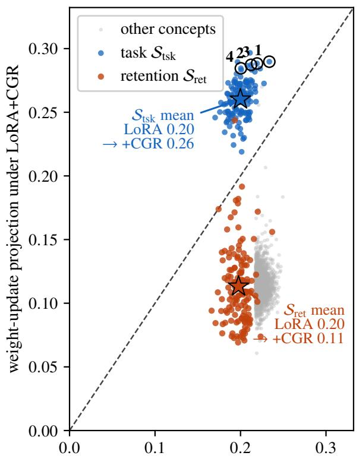

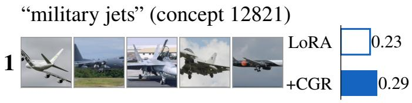

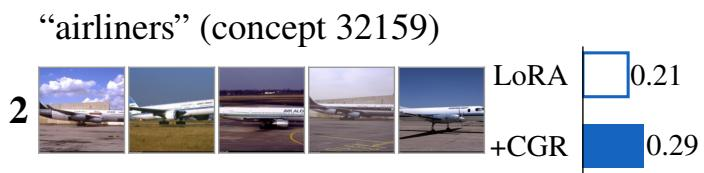

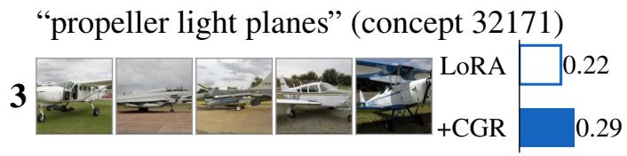

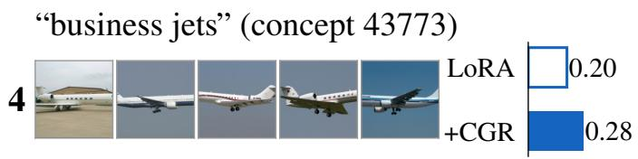  
weight-update projection under LoRA $| | W _ { d e c }$ :, � ⊤Δ�  
Figure 5: The weight update concentrates on the task-driven concepts (FGVC). Left: per-concept residual-write projection $\| \dot { W } _ { d e c } [ : , j ] ^ { \top } \Delta W \|$ 1under a plain LoRA adapter (horizontal) against the same quantity under CGR (vertical), on a linear scale. Blue marks the task set $S _ { \mathrm { t s k } }$ , red the retention set $S _ { \mathrm { { r e t } } }$ , and light gray all remaining concepts. Both sets are computed on the frozen backbone, independently of either adapter, so the same partition applies to both axes. The diagonal marks equal write under both methods. A concept above it receives more update under CGR than under LoRA, a concept below it less. LoRA alone does not separate the two sets (both horizontal-axis means are 0.20). CGR lifts the task concepts above the diagonal (from 0.20 under LoRA to 0.26 under CGR) and drops the retention concepts below it (from 0.20 to 0.11), so the update is reallocated, not enlarged. Right: the four task concepts CGR concentrates its update on, named by their top-activating FGVC images. Bars are blue throughout because all four belong to the task set, hollow under LoRA and solid under CGR.

Steering generalizes the removal test to a continuous scale factor (Fig. 11). On the frozen backbone, we scale the selected concepts’ contribution at the read-out layer by α, so $\alpha { = } 1$ is the unmodified model and α=0 is the removal test above, and we re-measure zero-shot retention. Retention follows α smoothly and peaks at the unmodified model. It falls monotonically toward removal, from 86.0% at $\alpha { = } 1 \mathrm { t o } 8 0 . 5 \%$ at $\alpha { = } 0$ , and it falls again when the contribution is amplified, reaching 85.0% at $\alpha { = } 1 . 5$ . The size-matched random control varies by 0.2pp across the whole range. Retention responds to the selected concepts as a dial rather than a switch, and it responds only to them.

<table><tr><td>Method</td><td>CIFAR-10</td><td>CIFAR-100</td><td>Caltech-101</td><td>SUN397</td><td>Avg</td></tr><tr><td>Zero-shot (no FT)</td><td>93.8</td><td>78.2</td><td>90.9</td><td>67.6</td><td>82.6</td></tr><tr><td>LoRA</td><td> $8 4 . 3 { \pm } 4 . 1$ </td><td> $6 3 . 1 \pm 5 . 8$ </td><td> $8 7 . 3 { \pm } 2 . 5 $ </td><td> $6 1 . 6 \pm 2 . 7$ </td><td> $7 4 . 1 \pm 3 . 5$ </td></tr><tr><td>+CGR*</td><td> $9 1 . 4 \pm 1 . 8$ </td><td> $7 4 . 0 \pm 2 . 2$ </td><td> $8 9 . 5 \pm 1 . 9$ </td><td> $6 6 . 0 { \pm } 1 . 1 $ </td><td> $8 0 . 2 \pm 1 . 5$ </td></tr><tr><td> ${ \bf O P L o R A }$ </td><td> $8 4 . 5 \pm 3 . 4$ </td><td> $6 3 . 3 { \pm } 5 . 5$ </td><td> $8 7 . 6 \pm 2 . 3$ </td><td> $6 1 . 9 \pm 2 . 7$ </td><td> $7 4 . 4 \pm 3 . 3$ </td></tr><tr><td>+CGR*</td><td> $9 2 . 0 { \pm } 1 . 2 $ </td><td> $7 5 . 2 \pm 1 . 4$ </td><td> $9 0 . 0 { \pm } 1 . 2 $ </td><td> $6 6 . 2 \pm 1 . 2$ </td><td> $8 0 . 8 \pm 1 . 1$ </td></tr><tr><td>LoRA-Null</td><td> $8 9 . 9 \pm 2 . 5$ </td><td> $7 2 . 5 { \pm } 4 . 6 $ </td><td> $8 9 . 6 \pm 1 . 9$ </td><td> $6 6 . 5 \pm 1 . 3$ </td><td> $7 9 . 6 \pm 2 . 0$ </td></tr><tr><td>+CGR*</td><td> ${ \bf 9 2 . 6 \pm 1 . 3 }$ </td><td> $7 6 . 8 \pm 1 . 0$ </td><td> ${ \bf 9 0 . 2 \pm 1 . 7 }$ </td><td> ${ \bf 6 7 . 5 \pm 0 . 5 }$ </td><td> ${ \bf 8 1 . 7 \pm 0 . 7 }$ </td></tr><tr><td>CorDA</td><td> $8 7 . 0 \pm 5 . 0 $ </td><td> $6 7 . 9 \pm 6 . 9$ </td><td> $8 8 . 2 \pm 3 . 1 $ </td><td> $6 3 . 4 \pm 4 . 7$ </td><td> $7 6 . 6 { \pm } 4 . 6 $ </td></tr><tr><td> $+ \mathbf { C } \mathbf { G } \mathbf { R } ^ { * }$ </td><td> $9 1 . 4 \pm 2 . 4$ </td><td> $7 3 . 2 \pm 3 . 1 $ </td><td> $8 9 . 4 \pm 2 . 1 $ </td><td> $6 5 . 3 { \pm } 2 . 9$ </td><td> $7 9 . 8 \pm 2 . 5$ </td></tr><tr><td> $\mathrm { A d a p t F o r m e r }$ </td><td> $8 9 . 4 \pm 3 . 2 $ </td><td> $7 2 . 5 \pm 2 . 7$ </td><td> $8 8 . 2 \pm 3 . 0 $ </td><td> $6 4 . 4 \pm 2 . 2$ </td><td> $7 8 . 6 \pm 1 . 9$ </td></tr><tr><td> $+ \mathbf { C } \mathbf { G } \mathbf { R } ^ { * }$ </td><td> $9 2 . 2 \pm 1 . 9$ </td><td> ${ \bf 7 7 . 0 \pm 0 . 6 }$ </td><td> $8 9 . 8 \pm 2 . 3 $ </td><td> $6 6 . 7 \pm 0 . 8$ </td><td> $8 1 . 4 \pm 1 . 0$  </td></tr><tr><td> $\mathrm { { S A I L S  – i n i t } }$ </td><td> $8 2 . 6 \pm 4 . 3$ </td><td> $6 0 . 8 \pm 5 . 6$ </td><td> $8 6 . 9 \pm 2 . 8$ </td><td> $6 0 . 6 \pm 2 . 7$ </td><td> $7 2 . 7 { \pm } 3 . 6 $ </td></tr><tr><td> $+ \mathbf { C } \mathbf { G } \mathbf { R } ^ { * }$ </td><td> $9 1 . 0 { \pm } 1 . 9 $ </td><td> $7 3 . 5 \pm 2 . 0$ </td><td> $8 9 . 4 \pm 1 . 6 $ </td><td> $6 5 . 4 \pm 1 . 3$ </td><td> $7 9 . 8 \pm 1 . 4$ </td></tr></table>

Table 9: Per-probe zero-shot retention (%). The four natural probes that make up the Ret column of Table 2, each shown separately; every cell is meaned over the same 10 fine-tuning tasks and 3 seeds, so each row’s Avg matches its Avg retention in Table 2. Each cell shows mean±std, the spread across the 10 tasks (as in Table 2; seed noise ≤0.9); CGR tightens it on every probe. Best per column bold; ∗ =ours.

## I Detailed vision results

In this section, we show a detailed breakdown of the results in Table 2, both over the same 10 fine-tuning tasks and 3 seeds. Table 9 shows its four-probe retention column (§4.2) into the individual probes. Table 10 reports every cell as mean±std over the seeds, with average accuracy and average retention across the ten tasks.

## J Detailed language results

Table 11 reports the seed variability behind Table 3. Every retention column is the mean and sample standard deviation over three seeds. The CGR retention gains clear the seed spread on every backbone.

## K Anchor and confine robustness

Retention is insensitive to the anchor coeficient $\lambda _ { \mathrm { a n c } }$ over a wide range. Table 13 sweeps it 15× on both fine-grained datasets. Accuracy stays within seed variation while retention rises monotonically and plateaus above $\lambda _ { \mathrm { a n c } } { = } 1 0 0 ,$ from 69.0 to 73.8 on FGVC and from 71.2 to 74.0 on CUB-200. FGVC is still rising at the top of the range; CUB-200 has settled, its last two settings difering by less than one standard deviation. The LoRA base without the anchor retains 53.1 and 59.5 (Table 4), so most of the gain comes from the term being active at all and the response beyond that is smooth. The coeficient is a strength dial with a wide safe range rather than a constant tuned per task.

Confine strength. The same robustness holds for the confine coeficient. Sweeping $\lambda _ { \mathrm { c o n f } } \in 0 . 0 3 , 0 . 1 , 0 . 3 , 1 . 0$ under the Table 5 protocol (LoRA r8, anchor $\lambda _ { \mathrm { a n c } } { = } 6 0$ , attributionselected task set, 3 seeds) leaves both axes on a plateau on both datasets (Table 14). Retention varies by 1.8 points on FGVC-Aircraft and stays within seed variation on CUB-200 over the 33× range, at flat accuracy. The term still engages. The perpendicular fraction of the update, the share of ∆W outside the task subspace, falls monotonically from 0.26 to ∼0 as $\lambda _ { \mathrm { c o n f } }$ grows, so the plateau reflects a wide safe range rather than an inert term. The flanking columns give the endpoints, anchor alone at $\lambda _ { \mathrm { c o n f } } { = } 0$ and a hard projection replacing the soft confine, and both retain less than every setting inside the sweep.

Retention-set size. The remaining anchor hyperparameter is the retention-set size |Sret|. Sweeping $k \_ \in$ 32, 64, 128, 256, 512 under the same protocol leaves both axes on a plateau on both datasets (Table 15). Retention varies by 2.3 points on FGVC and 1.8 on CUB-200 over the 16× range, declining gently toward the all-active limit of Table 5 (66.6 and 68.6). Adding ever-lower-presence concepts dilutes the anchor uniformly rather than protecting more, so dilution is the mechanism and not anchor breadth itself. An importance-weighted all-active variant, each concept weighted by its mean activation magnitude with weights normalized to mean 1, recovers the selected set’s retention at matched λanc (FGVC 73.0±0.7, CUB-200 74.1±0.6 against top-k’s 72.0±0.8 and 73.2±0.7, accuracy tied) by reconcentrating the anchoring mass on high-firing concepts. Selection reaches the same concentration with 128 named concepts instead of ∼4k weighted ones, which is what keeps the anchored set intervenable (App. G).

Task-set size. The confine channel has the matching hyperparameter, the task-set size |Stsk|. It enters both terms, setting the dimension of the subspace the update may occupy and defining the set excluded from Sret in Eq.(7). Sweeping |Stsk| ∈ 32, 64, 128, 256, 512 under the Table 5 protocol (LoRA r8, λanc=60, $\lambda _ { \mathrm { c o n f } } { = } 0 . 1$ , 3 seeds) leaves accuracy flat over the 16× range on both datasets (Table16). A rank-8 (the natural-image SAE is in-distribution, so its concepts are faithful) while structured/synthetic tasks are low-EV (outof-distribution), where the concept channel is expected to weaken. All the mechanism studies above sit in the high-EV natural regime; the low-EV tasks map the boundary of the SAE-concept approach. (Notably the +CGR retention gain tracks forgetting pressure rather than EV directly, and EV is anti-correlated with that pressure across the natural tasks, so we do not read EV as a direct cause of the gain.)

<table><tr><td rowspan="2">Method</td><td colspan="2">FGVC</td><td colspan="2">CUB</td><td colspan="2">DTD</td><td colspan="2">Flow</td><td colspan="2">Pets</td></tr><tr><td>Acc</td><td>Ret</td><td>Acc</td><td>Ret</td><td>Acc</td><td>Ret</td><td>Acc</td><td>Ret</td><td>Acc</td><td>Ret</td></tr><tr><td>Zero-shot</td><td>19.3</td><td>82.6</td><td>70.9</td><td>82.6</td><td>54.6</td><td>82.6</td><td>73.0</td><td>82.6</td><td>89.8</td><td>82.6</td></tr><tr><td>LoRA</td><td></td><td></td><td></td><td></td><td>59.3±1.7 67.9±1.7 74.6±0.4 70.1±1.1 71.5±1.7 74.1±0.1 93.2±0.3 76.3±1.8 82.6±0.8 73.8±2.2</td><td></td><td></td><td></td><td></td><td></td></tr><tr><td>+CGR</td><td></td><td></td><td></td><td></td><td>60.1±0.4 78.0±0.7 76.4±0.3 78.7±0.4 74.3±0.7 80.5±0.5 95.0±0.5 81.6±0.4 86.1±0.5 80.8±0.1</td><td></td><td></td><td></td><td></td><td></td></tr><tr><td>OPLoRA</td><td></td><td></td><td></td><td></td><td>58.9±0.4 69.9±1.1 75.1±0.2 69.3±1.6 72.1±0.5 72.1±1.1 93.4±0.4 76.9±1.7 81.5±2.4 75.9±2.4</td><td></td><td></td><td></td><td></td><td></td></tr><tr><td>+CGR</td><td></td><td></td><td></td><td></td><td>59.5±0.3 79.2±0.3 76.6±0.1 79.2±0.7 74.6±1.0 80.5±0.2 95.4±0.4 81.6±0.5 85.7±1.4 81.1±0.3</td><td></td><td></td><td></td><td></td><td></td></tr><tr><td></td><td></td><td></td><td></td><td></td><td>LoRA-Null 61.0±0.3 78.8±0.5 76.2±0.7 78.0±1.3 73.9±1.2 76.2±1.5 94.8±0.2 81.5±0.2 86.5±1.0 80.6±0.8</td><td></td><td></td><td></td><td></td><td></td></tr><tr><td>+CGR</td><td></td><td></td><td></td><td></td><td>60.5±0.2 80.5±0.3 76.9±0.5 80.5±0.3 76.7±0.6 81.7±0.1 95.9±0.3 82.6±0.1 87.1±1.1 82.0±0.2</td><td></td><td></td><td></td><td></td><td></td></tr><tr><td>CorDA</td><td></td><td></td><td></td><td></td><td></td><td></td><td></td><td>57.8±1.1 71.7±0.6 72.5±0.9 65.9±1.0 73.3±0.7 78.8±0.6 93.9±0.4 80.4±0.4 84.4±0.8 78.8±1.6</td><td></td><td></td></tr><tr><td>+CGR</td><td></td><td></td><td></td><td></td><td></td><td></td><td></td><td>57.1±1.1 76.3±0.5 73.0±0.6 74.4±0.9 73.9±0.5 81.1±0.5 94.4±0.6 81.8±0.2 85.5±0.9 80.5±0.4</td><td></td><td></td></tr><tr><td>AF</td><td></td><td></td><td></td><td></td><td></td><td></td><td></td><td>60.9±1.2 77.1±1.2 77.1±0.6 75.9±0.7 74.7±1.2 76.0±0.9 95.5±0.2 80.8±0.4 87.4±0.5 77.4±0.7</td><td></td><td></td></tr><tr><td>+CGR</td><td></td><td></td><td></td><td></td><td></td><td></td><td></td><td>61.2±0.4 79.5±0.2 77.7±0.2 79.8±0.0 76.9±0.1 81.3±0.4 96.3±0.1 82.1±0.0 88.1±1.0 81.5±0.1</td><td></td><td></td></tr><tr><td>SAILS</td><td></td><td></td><td></td><td></td><td></td><td></td><td></td><td>59.0±1.5 65.8±2.8 74.4±0.3 69.7±1.6 71.0±0.3 72.4±0.7 92.9±0.4 74.6±0.7 82.7±0.8 73.0±2.3</td><td></td><td></td></tr><tr><td>+CGR</td><td></td><td></td><td></td><td></td><td></td><td></td><td></td><td>59.0±1.1 77.9±0.8 76.3±0.5 78.3±0.5 74.3±0.3 79.7±0.5 95.2±0.5 81.3±0.1 84.5±1.6 80.3±0.5</td><td></td><td></td></tr></table>

<table><tr><td rowspan="2">Method</td><td colspan="2">EuroS</td><td colspan="2">RESISC</td><td colspan="2">DiabR</td><td colspan="2">dSpr-O</td><td colspan="2">SVHN</td><td colspan="2">Avg</td></tr><tr><td>Acc</td><td>Ret</td><td>Acc</td><td>Ret</td><td>Acc</td><td>Ret</td><td>Acc</td><td>Ret</td><td>Acc</td><td>Ret</td><td>Acc</td><td>Ret</td></tr><tr><td>Zero-shot</td><td>40.5</td><td>82.6</td><td>61.9</td><td>82.6</td><td>35.4</td><td>82.6</td><td>9.3</td><td>82.6 89.4±1.1 73.8±0.9</td><td>60.4</td><td>82.6</td><td>|51.5±25.2</td><td>82.6</td></tr><tr><td>LoRA</td><td colspan="16">93.6±1.5 78.3±1.0 83.0±0.3 76.7±0.4 72.3±1.4 78.6±5.0 43.6±1.6 70.9±4.4</td></tr><tr><td>+CGR OPLoRA</td><td colspan="16" rowspan="6">93.4±0.8 81.2±0.4 84.0±0.5 81.8±0.3 72.9±0.6 95.1±1.7 78.9±1.3 82.7±1.4 77.3±1.1 72.6±0.2 76.4±6.5 44.2±1.6 72.2±2.2 93.4±0.5 81.4±0.6 84.3±1.2 82.1±0.2 73.3±0.8 81.7±0.1 43.4±0.8 80.0±0.3 86.3±0.7 81.5±0.1</td></tr><tr><td></td></tr><tr><td>+CGR</td></tr><tr><td>LoRA-Null 95.6±0.7 81.2±0.4 85.0±1.2 80.6±0.2 72.5±0.6 81.8±1.4 44.6±2.0 81.0±0.7 91.3±0.7 76.7±1.6</td></tr><tr><td></td></tr><tr><td>+CGR 93.3±0.2 82.3±0.2 85.0±0.1 82.5±0.3 73.5±0.6 82.0±0.4 43.9±2.0 81.7±0.2 87.9±0.3 81.7±0.2 CorDA 94.5±1.1 79.1±1.0 84.6±0.5 78.9±0.5 73.2±0.5</td></tr><tr><td>79.5±3.1 43.1±2.9 78.8±0.8 90.1±1.0 74.4±2.4 87.4±0.9 80.4±0.4</td></tr><tr><td>81.1±0.9 41.9±0.4 79.9±0.6</td></tr><tr><td>+CGR 94.3±0.4 81.5±0.2 84.4±1.0 81.3±0.1 72.3±0.9</td></tr><tr><td>AF 95.5±0.5 80.4±0.4 85.7±0.8 80.0±0.3 72.8±0.8 80.5±0.6 45.1±1.9 79.8±0.1 90.7±0.1 78.1±1.6</td></tr><tr><td>+CGR 94.4±0.9 81.9±0.2 85.9±0.3 82.3±0.1 73.5±0.6 82.5±0.2 44.8±1.3 81.4±0.3 86.6±0.8 82.0±0.1 SAILS</td></tr><tr><td>+CGR 93.1±0.8 81.2±0.3 84.0±1.5 81.4±0.3 72.1±1.6 80.0±0.3 42.0±2.0 77.7±0.9 86.0±0.7 80.7±0.4</td><td>94.5±2.0 76.2±1.9 83.2±1.7 75.2±1.1 72.6±0.8 77.7±6.5 43.8±2.3 69.0±0.4 90.0±0.9 73.7±2.5</td></tr><tr><td></td><td></td></tr></table>

k results of CGRon the ten CLIP ViT-B/32 transfer tasks (extended version of Table 2). Every cell is mea the four-probe zero-shot retention of Table 2.Avgis the mean over the same10tasks (±std across tasks), so t r task and best Avg Ret in bold; the star (⋆) marks a significant across-taskCGRretention gain (pa

<table><tr><td rowspan="2">Method</td><td colspan="5">World-knowledge retention (%)</td></tr><tr><td>Trivia</td><td>NQ-0</td><td>WebQS</td><td>Avg1</td><td>Per</td></tr><tr><td>Zero-shot</td><td>61.5</td><td>7.9</td><td>11.6</td><td>27.0</td><td>100.0</td></tr><tr><td>LoRA</td><td>27.6 ±1.2</td><td>11.1 ±0.6</td><td> $1 2 . 4 \pm 0 . 7$ </td><td> $1 7 . 1 \pm 0 . 7$ </td><td> $8 1 . 6 \pm 0 . 7$ </td></tr><tr><td>+CGR</td><td> $4 3 . 5 \pm 2 . 2$ </td><td> $1 2 . 0 { \pm } 0 . 8 $ </td><td> $1 2 . 4 \pm 0 . 7$ </td><td> $2 2 . 6 { \pm } 0 . 4$  </td><td> $9 0 . 2 \pm 1 . 1$ </td></tr><tr><td>LoRA-Null</td><td> $4 7 . 1 \pm 0 . 3$ </td><td> $9 . 5 \pm 0 . 3$ </td><td> $9 . 8 \pm 0 . 1$ </td><td> $2 2 . 1 \pm 0 . 1$ </td><td> $8 7 . 1 \pm 0 . 3$ </td></tr><tr><td>+CGR</td><td> $5 5 . 9 \pm 0 . 3$ </td><td> $9 . 1 \pm 0 . 2$ </td><td> $9 . 7 \pm 0 . 2 $ </td><td> $2 4 . 9 { \pm } 0 . 1$ </td><td> $9 1 . 5 { \pm } 0 . 8 $ </td></tr><tr><td>CorDA</td><td> $4 0 . 5 \pm 2 . 7$ </td><td> $1 2 . 1 \pm 1 . 2$ </td><td> $1 0 . 8 \pm 1 . 7$ </td><td> $2 1 . 1 { \pm } 1 . 8 $ </td><td> $8 5 . 1 \pm 4 . 5$ </td></tr><tr><td>+CGR</td><td> $4 5 . 7 \pm 1 . 2$ </td><td> $1 3 . 2 \pm 0 . 5$ </td><td> $9 . 4 \pm 0 . 2$ </td><td> $2 2 . 8 \pm 0 . 3$ </td><td> $8 5 . 0 { \pm } 0 . 5 $ </td></tr><tr><td>OPLoRA</td><td> $4 0 . 2 \pm 1 . 5$ </td><td> $1 0 . 2 \pm 0 . 6$ </td><td> $1 1 . 5 \pm 0 . 7$ </td><td> $2 0 . 6 \pm 0 . 4$ </td><td> $8 7 . 6 \pm 1 . 4$ </td></tr><tr><td>+CGR</td><td> $5 1 . 1 \pm 1 . 3$ </td><td> $9 . 4 \pm 0 . 8$ </td><td> $1 1 . 4 \pm 0 . 3$ </td><td> $2 4 . 0 { \pm } 0 . 8 $ </td><td> $9 3 . 8 \pm 1 . 5$ </td></tr><tr><td>SAILS</td><td> $3 2 . 0 \pm 3 . 3$ </td><td> $1 1 . 2 \pm 0 . 8$ </td><td> $1 2 . 2 \pm 0 . 3$ </td><td> $1 8 . 5 \pm 1 . 2$ </td><td> $8 4 . 0 { \pm } 1 . 8 $ </td></tr><tr><td>+CGR</td><td> $4 2 . 9 \pm 3 . 1$ </td><td> $1 1 . 6 \pm 1 . 1$ </td><td> $1 2 . 1 \pm 0 . 4$ </td><td> $2 2 . 2 { \pm } 0 . 8 $ </td><td> $8 9 . 9 \pm 1 . 7$ </td></tr><tr><td>AdaptFormer</td><td> $3 8 . 1 \pm 0 . 3 $ </td><td> $3 . 7 \pm 0 . 2$ </td><td> $8 . 2 \pm 0 . 1$ </td><td> $1 6 . 7 \pm 0 . 1$ </td><td> $5 9 . 6 { \pm } 1 . 1 $ </td></tr><tr><td>+CGR</td><td> $5 9 . 4 \pm 0 . 1$ </td><td> $6 . 2 \pm 0 . 1$ </td><td> $9 . 9 \pm 0 . 1$ </td><td> $2 5 . 1 \pm 0 . 1$ </td><td> $8 6 . 7 \pm 0 . 4$ </td></tr></table>

Table 11: Seed variability of the Llama-3.1-8B retention results. Every cell of Table 3 is reported as mean ± sample std over seeds. Per is capped per seed here, whereas Table 3 applies the cap to the seed mean, which shifts Per by at most 1.0 where a seed exceeds the zero-shot base. MTBench is single-seed by design and omitted.

<table><tr><td colspan="2">Natural</td><td colspan="2">Specialized / Structured</td></tr><tr><td>Task</td><td>EV</td><td>Task</td><td>EV</td></tr><tr><td>Caltech-101</td><td>0.87</td><td>RESISC-45</td><td>0.74</td></tr><tr><td>SUN397</td><td>0.86</td><td>EuroSAT</td><td>0.69</td></tr><tr><td>DTD</td><td>0.85</td><td>Diabetic-Retino</td><td>0.49</td></tr><tr><td>CUB-200</td><td>0.82</td><td>dSprites-loc/ori</td><td>0.23</td></tr><tr><td>Oxford-Pets</td><td>0.81</td><td></td><td></td></tr><tr><td>Flowers-102</td><td>0.76</td><td></td><td></td></tr><tr><td>CIFAR-100</td><td>0.75</td><td></td><td></td></tr><tr><td>CIFAR-10</td><td>0.72</td><td></td><td></td></tr><tr><td>SVHN</td><td>0.67</td><td></td><td></td></tr><tr><td>FGVC-Aircraft 0.66</td><td></td><td></td><td></td></tr></table>

Table 12: SAE reconstruction EV (layer-8 CLS, 1000 samples, frozen backbone). Higher $= ~ \mathrm { S A E }$ in-distribution, concepts faithful. Natural tasks are high-EV; the structured/synthetic task (dSprites) is low-EV.

## M Notation

In Table 17 we list all notations used in this work.

update occupies few directions, so even the smallest subspace accommodates it. Retention instead declines monotonically as |Stsk| grows, by 8.1 points on FGVC and 5.0 on CUB-200, through two pathways that move together. A larger task set widens the region the update may occupy, so the perpendicular fraction falls toward zero and the confine term stops binding. It also enlarges the set excluded from Sret, pushing the anchor’s candidate pool toward lower-presence concepts. Boundedness therefore matters on the task side exactly as it does on the retention side (Table 15). The default $\lvert S _ { \mathrm { t s k } } \rvert = 1 2 8$ is the symmetric untuned choice and sits in the stable middle of the range on both datasets.

## L SAE faithfulness across VTAB

Table 12 reports the in-pipeline layer-8 reconstruction EV of the Prisma SAE on 1000 samples per task used in this paper (frozen backbone, no training). EV spans 0.87 (Caltech-101) down to 0.23 (dSprites). Natural-image tasks are high-EV

<table><tr><td></td><td> $\lambda _ { \mathrm { a n c } }$ </td><td>10</td><td>30</td><td>60</td><td>100</td><td>150</td></tr><tr><td>FGVC</td><td> $\operatorname { A c c }$ </td><td> $5 9 . 4 \pm 1 . 0$ </td><td> $5 8 . 8 \pm 1 . 7$ </td><td> $6 0 . 1 \pm 0 . 4$ </td><td> $5 9 . 8 \pm 0 . 2$ </td><td> $5 9 . 4 \pm 0 . 3$ </td></tr><tr><td></td><td> $\mathrm { \mathbf { C } } { \mathrm { - } } 1 0 0 \mathrm { \mathbf { r e t } } .$ </td><td> $6 9 . 0 { \pm } 0 . 6 $ </td><td> $7 0 . 0 { \pm } 1 . 1 $ </td><td> $7 2 . 0 { \pm } 0 . 8 $ </td><td> $7 3 . 3 { \pm } 0 . 8 $ </td><td> $7 3 . 8 \pm 0 . 4$ </td></tr><tr><td></td><td>Acc</td><td> $7 6 . 0 { \pm } 0 . 2 $ </td><td> $7 6 . 3 { \pm } 0 . 1 $ </td><td> $7 6 . 4 \pm 0 . 3$ </td><td> $7 6 . 3 { \pm } 0 . 2 $ </td><td> $7 6 . 2 \pm 0 . 2 $ </td></tr><tr><td>CUB-200</td><td> $\mathrm { \mathbf { C } } { \mathrm { - } } 1 0 0 \mathrm { \mathbf { r e t } } .$ </td><td> $7 1 . 2 { \pm } 0 . 6 $ </td><td> $7 2 . 1 \pm 0 . 5$ </td><td> $7 3 . 2 \pm 0 . 7$ </td><td> $7 4 . 2 \pm 0 . 5$ </td><td> $7 4 . 0 { \pm } 0 . 6 $ </td></tr></table>

Table 13: Anchor-strength sweep (CGR on LoRA r8). Retention rises with $\lambda _ { \mathrm { a n c } }$ and flattens above 100 on both datasets, at accuracy within seed noise. The default $\lambda _ { \mathrm { a n c } } { = } 6 0$ reproduces the full-CGR row of Table 4. Mean over 3 seeds, ±std.

<table><tr><td rowspan="2"></td><td rowspan="2"></td><td rowspan="2">Anchor only</td><td colspan="4"> $\lambda _ { \mathrm { c o n f } }$ </td><td rowspan="2"> $\mathrm { H a r d p r o j . } + \mathrm { a n c h o r }$ </td></tr><tr><td>0.03</td><td>0.1</td><td>0.3</td><td>1.0</td></tr><tr><td rowspan="2">FGVC</td><td>Acc</td><td>59.2</td><td> $6 0 . 4 \pm 0 . 9$ </td><td> $5 9 . 4 \pm 1 . 0$ </td><td> $6 0 . 7 \pm 1 . 0$ </td><td> $6 0 . 4 \pm 0 . 7$ </td><td>58.4</td></tr><tr><td>C-100 ret.</td><td>66.2</td><td> $7 0 . 3 { \pm } 0 . 6 $ </td><td> $7 2 . 1 \pm 0 . 3$ </td><td> $7 1 . 8 \pm 0 . 5$ </td><td> $7 0 . 9 \pm 0 . 9$ </td><td>63.8</td></tr><tr><td rowspan="2">CUB-200</td><td>Acc</td><td>75.6</td><td> $7 6 . 2 \pm 0 . 1$ </td><td> $7 6 . 0 { \pm } 0 . 4 $ </td><td> $7 6 . 4 \pm 0 . 2$ </td><td> $7 6 . 3 { \pm } 0 . 4 $ </td><td>75.2</td></tr><tr><td> $\mathrm { \mathbf { C } } { \mathrm { - } } 1 0 0 \mathrm { \mathbf { r e t } } .$ </td><td>70.6</td><td> $7 3 . 0 { \pm } 1 . 5 $ </td><td> $7 2 . 9 \pm 1 . 2$ </td><td> $7 3 . 2 \pm 1 . 2$ </td><td> $7 3 . 1 \pm 1 . 6$ </td><td>69.4</td></tr></table>

Table 14: Confine-strength sweep (CGR on LoRA r8). Accuracy and CIFAR-100 zero-shot retention stay on a plateau over a 33× range of $\lambda _ { \mathrm { c o n f } } ,$ , and the default $\lambda _ { \mathrm { c o n f } } { = } 0 . 1$ sits inside it. The flanking columns give the endpoints. Anchor alone is the $\lambda _ { \mathrm { c o n f } } { = } 0$ limit, and replacing the soft confine with a hard projection onto the task subspace retains less still. Every setting inside the sweep beats both.

<table><tr><td></td><td> $\vert S _ { \mathrm { r e t } } \vert$ </td><td>32</td><td>64</td><td>128</td><td>256</td><td>512</td></tr><tr><td rowspan="2">FGVC</td><td>Acc</td><td> $5 9 . 4 \pm 0 . 4$ </td><td> $6 0 . 0 { \pm } 0 . 5$ </td><td> $6 0 . 1 \pm 0 . 4$ </td><td> $5 9 . 7 \pm 0 . 6 $ </td><td> $5 9 . 8 \pm 0 . 8$ </td></tr><tr><td>C-100 ret.</td><td> $7 2 . 8 \pm 0 . 4$ </td><td> $7 3 . 2 \pm 0 . 4$ </td><td> $7 2 . 0 { \pm } 0 . 8 $ </td><td> $7 1 . 8 \pm 0 . 5$ </td><td> $7 0 . 9 \pm 0 . 8$ </td></tr><tr><td rowspan="2">CUB-200</td><td>Acc</td><td> $7 6 . 2 \pm 0 . 6$ </td><td> $7 6 . 3 { \pm } 0 . 2 $ </td><td> $7 6 . 4 \pm 0 . 3$ </td><td> $7 6 . 3 { \pm } 0 . 1 $ </td><td> $7 6 . 0 { \pm } 0 . 1 $ </td></tr><tr><td>C-100 ret.</td><td> $7 4 . 0 { \pm } 0 . 4 $ </td><td> $7 3 . 3 { \pm } 0 . 8 $ </td><td> $7 3 . 2 \pm 0 . 7$ </td><td> $7 2 . 7 \pm 0 . 7$ </td><td> $7 2 . 2 \pm 0 . 7$ </td></tr></table>

Table 15: Retention-set size sweep (CGR on LoRA r8). Accuracy and CIFAR-100 zero-shot retention are flat over a 16× range of $| S _ { \mathrm { r e t } } |$ on both FGVC-Aircraft and CUB-200. The default k=128 sits inside the plateau.

<table><tr><td></td><td> $\left| S _ { \mathrm { t s k } } \right|$ </td><td>32</td><td>64</td><td>128</td><td>256</td><td>512</td></tr><tr><td></td><td>Acc</td><td> $6 0 . 3 { \pm } 0 . 6 $ </td><td> $5 9 . 9 { \pm } 1 . 3 $ </td><td> $6 0 . 1 \pm 0 . 4$ </td><td> $6 0 . 0 { \pm } 0 . 7 $ </td><td> $5 9 . 9 \pm 0 . 5$ </td></tr><tr><td>FGVC</td><td>C-100 ret.</td><td> $7 5 . 3 { \pm } 1 . 3 $ </td><td> $7 3 . 2 \pm 1 . 0$ </td><td> $7 2 . 0 { \pm } 0 . 8 $ </td><td> $7 0 . 8 \pm 0 . 4$ </td><td> $6 7 . 2 \pm 1 . 1$ </td></tr><tr><td></td><td>Acc</td><td> $7 7 . 0 { \pm } 0 . 1 $ </td><td> $7 7 . 0 { \pm } 0 . 3 $ </td><td> $7 6 . 4 \pm 0 . 3$ </td><td> $7 6 . 1 \pm 0 . 3$ </td><td> $7 6 . 0 { \pm } 0 . 2 $ </td></tr><tr><td>CUB-200</td><td>C-100 ret.</td><td> $7 5 . 7 \pm 1 . 6$ </td><td> $7 5 . 0 { \pm } 0 . 6 $ </td><td> $7 3 . 2 \pm 0 . 7$ </td><td> $7 2 . 0 { \pm } 1 . 1$ </td><td> $7 0 . 7 \pm 0 . 8$ </td></tr></table>

Table 16: Task-set size sweep (CGR on LoRA r8). Accuracy is flat over a 16× range of $\lvert S _ { \mathrm { t s k } } \rvert$ on both datasets. Bounding the task set improves retention at no accuracy cost. The default $\lvert S _ { \mathrm { t s k } } \rvert = 1 2 8$ matches $| S _ { \mathrm { r e t } } |$ and is not tuned

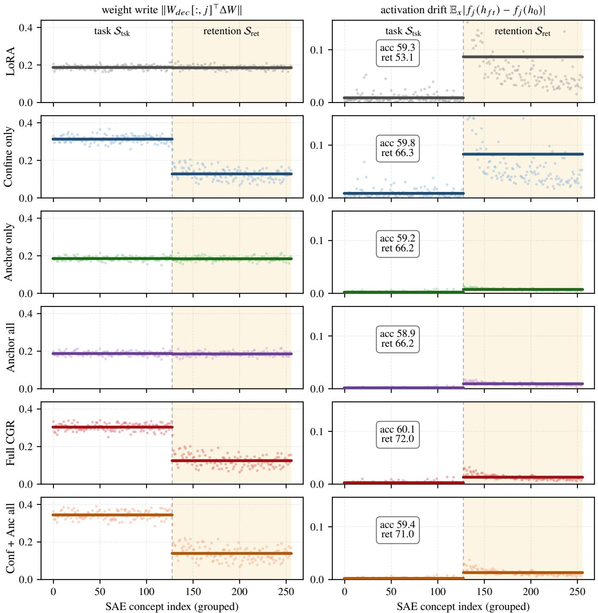  
Figure 6: Weight-space control and activation-space drift across task and retention concepts. Each point corresponds to one SAE concept, grouped into the task set $S _ { \mathrm { t s k } }$ 1and the retention set $S _ { \mathrm { { r e t } } }$ . The left column reports the weight change magnitude, $\| W _ { \mathrm { d e c } } [ : , j ] ^ { \dag } \Delta \mathbf { \breve { W } } \|$ . The right column reports the corresponding activation drift, $\mathbb { E } _ { x } | f _ { j } ( h _ { \mathrm { f t } } ( \dot { x } ) ) - f _ { j } ( h _ { 0 } \mathbf { \bar { ( } } x ) ) |$ |. Horizontal lines denote per-set means, and the boxes report task accuracy and CIFAR-100 zero-shot retention. Confine concentrates the weigh update on the task concepts and suppresses its projection onto the retention concepts, but does not by itself prevent retentionconcept activation drift. Anchor directly suppresses activation drift, including when applied only to the selected retention set. Combining the two terms in full CGR separates their roles: task concepts remain free to support adaptation, while the retention concepts constrain the resulting representation change. Anchoring all concepts instead reduces this flexibility and yields lower task accuracy than selectively anchoring $S _ { \mathrm { r e t } }$ . Results are means over three seeds; of-scale retention-concept drifts are clipped.

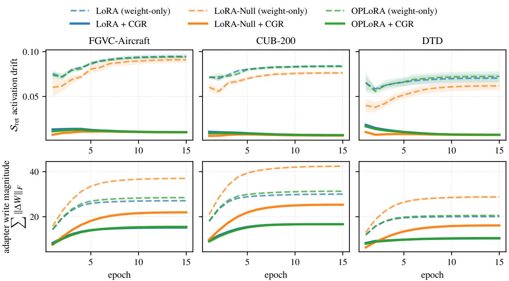  
Figure 7: Drift over training: full CGR pins the activation channel and confines the weight write on all three datasets. Columns: 1FGVC-Aircraft, CUB-200, DTD (3 bases × weight-only dashed / +CGR solid, mean±std over 3 seeds, rows share y-limits). Top row: every weight-only method’s retention-concept activation drift climbs (to ∼0.06–0.09) while all +CGR arms stay pinned at ∼0.01. Bottom row: the confine term also bounds the adapter write magnitude on every base (e.g. LoRA-Null on FGVC 37→22), so the drift gap is not explained by larger weight moves.

DTD (�=24)  
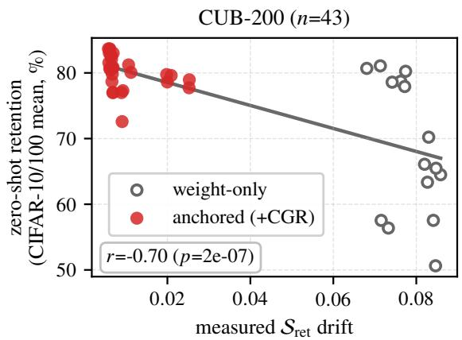

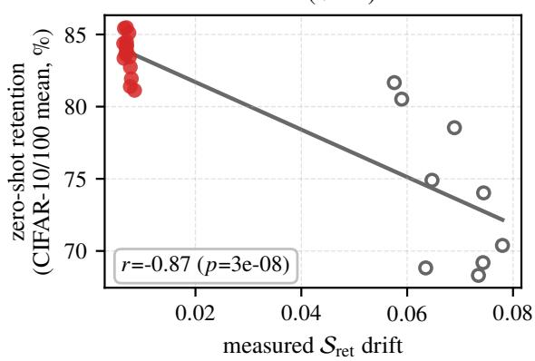  
Figure 8: Drift predicts forgetting: replication (CUB-200, DTD). Per-run measured $\bar { S _ { \mathrm { r e t } } } ^ { \bar { } }$ activation drift vs. zero-shot retention (CIFAR-10/100 mean), for every drift-instrumented run per dataset. Anchored runs are red, weight-only runs are open. The negative relation from Fig. 3 holds on both datasets.

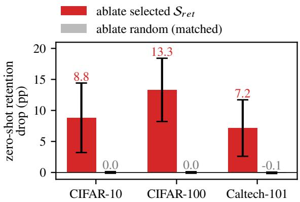  
Figure 9: Selected concepts are causally load-bearing. In each trained model we zero the $| S _ { r e t } | = \mathrm { \bar { 1 } 2 8 }$ selected retention concepts at layer 8, subtracting their SAE contribution from the residual stream with no retraining, and re-measure zeroshot retention. The control applies the same surgery to 128 random alive concepts. Bars show retention drop per natural probe (mean±std over 24 FGVC runs, with the intervention instrumenting three of the four retention probes and SUN397 excluded). The random set is inert. Removing $S _ { r e t }$ destroys natural-image retention.

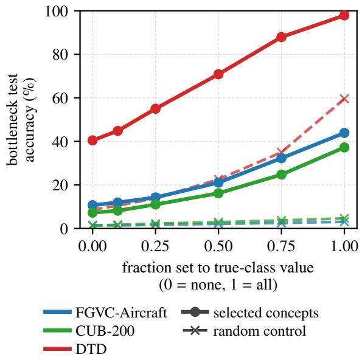  
Figure 10: The selected head leads the control at every level. 1Both heads see only concept values, so these accuracies are not comparable to the fine-tuned models of Table 2.

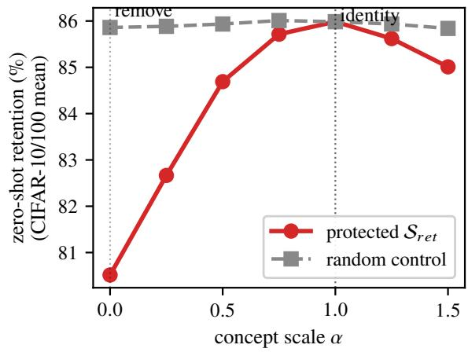  
Figure 11: Steering the selected concepts controls retention 1(FGVC). On the frozen backbone we scale the selected $S _ { \mathrm { { r e t } } }$ concepts’ layer- $^ { - 8 }$ contribution by α (red). Retention peaks at the unmodified model $( \alpha { = } 1 )$ and falls on both sides, toward removal at $\alpha { = } 0$ and under amplification at $\alpha { = } 1 . 5$ . A sizematched random control is flat (gray). Retention is averaged over the CIFAR-10 and CIFAR-100 probes.

<table><tr><td>Symbol</td><td>Meaning</td></tr><tr><td colspan="2">Model and adaptation</td></tr><tr><td> $W _ { 0 }$ </td><td>Frozen pretrained weight at the adapted site,  $W _ { 0 } \in \mathbb { R } ^ { d \times d _ { i r } }$ </td></tr><tr><td> $\Delta W$ </td><td>Additive weight update;  $\Delta W { = } B A$  for LoRA</td></tr><tr><td> $B , A$ </td><td>LoRA factors,  $B \in \mathbb { R } ^ { d \times r } , A \in \mathbb { R } ^ { r \times d _ { i n } }$ </td></tr><tr><td> $r$ </td><td>LoRA rank</td></tr><tr><td> $\ell$ </td><td>Fixed read-out layer, never tuned</td></tr><tr><td> $x$ </td><td>Input to the adapted weight,  $\boldsymbol { x } \in \mathbb { R } ^ { d _ { i n } }$ </td></tr><tr><td> $h _ { 0 } ( x ) , h _ { \mathrm { f t } } ( x )$ </td><td>Residual-stream vector at the read-out point be- fore and after fine-tuning,  $h _ { \mathrm { f t } } { = } h _ { 0 } { + } \bar { \Delta _ { W x } }$ </td></tr><tr><td> $\Sigma$ </td><td>Input second moment  $\mathbb { E } [ x x ^ { \top } ]$  , estimated once</td></tr><tr><td> $\mathcal { D } _ { \mathrm { t a s k } } , \mathcal { D }$ </td><td>on the frozen model Task input distribution; any evaluation distri-</td></tr><tr><td> $T$ </td><td>bution Token positions per input (patches for vision)</td></tr><tr><td colspan="2">Frozen sparse autoencoder</td></tr><tr><td>m</td><td>Dictionary size,  $m \gg d$ </td></tr><tr><td> $W _ { e n c } , b _ { e n c }$ </td><td>Encoder,  $W _ { e n c } \in \mathbb { R } ^ { m \times d } ;$  concept through row  $W _ { e n c } [ j , : ]$ </td></tr><tr><td> $W _ { d e c }$ </td><td>Decoder,  $W _ { d e c } \ \in \ \mathbb { R } ^ { d \times m } ;$  concept  $j$  writes along column  $W _ { d e c } [ : , j ]$ </td></tr><tr><td> $g$ </td><td>The SAE&#x27;s native gate (ReLU, TopK, JumpReLU)</td></tr><tr><td> $z ( h ) , z _ { j }$ </td><td>SAE score vector and its  $j \mathrm { - t h }$  entry</td></tr><tr><td> $f _ { j } ( h )$ </td><td>CGR&#x27;s concept read-out,  $\mathrm { \bar { R e L U } } ( \dot { W } _ { e n c } [ j , : ] h +$ </td></tr><tr><td> $f _ { S } ( h )$ </td><td> $b _ { e n c } [ j ] )$  Read-out stacked over a concept set</td></tr><tr><td colspan="2"> $C G R$ </td></tr><tr><td> $S _ { \mathrm { t s k } } , S _ { \mathrm { r e t } }$ </td><td>Task and retention concept sets, disjoint by con-</td></tr><tr><td></td><td>struction Causal attribution score selecting  $S _ { \mathrm { t s k } }$ </td></tr><tr><td> $a _ { j }$   $\phi _ { j }$ </td><td>Firing presence selecting  $S _ { \mathrm { { r e t } } }$ </td></tr><tr><td> $U _ { \mathrm { t s k } }$ </td><td>Orthonormal basis of the task subspace, Rd×|Stsk|</td></tr><tr><td> $P _ { \mathrm { t s k } } , P _ { \mathrm { t s k } } ^ { \perp }$ </td><td>Projector onto the task subspace and its com-</td></tr><tr><td> $\mathcal { L } _ { \mathrm { c o n f } } , \mathcal { L } _ { \mathrm { a n c } }$ </td><td>plement CONFINE and ANCHOR penalties</td></tr><tr><td> $\lambda _ { \mathrm { c o n f } } , \lambda _ { \mathrm { a n c } }$ </td><td>Their coefficients in Eq. (1)</td></tr><tr><td> $\mathcal { L } _ { \mathrm { t a s k } } , \mathcal { L }$ </td><td>Fine-tuning loss and the total objective of</td></tr><tr><td> $k$ </td><td> $\mathrm { E q . } \left( 1 \right)$  Retention-set size,  $k = | S _ { \mathrm { r e t } } |$  in Eq. (7)</td></tr><tr><td> $T h e o r y$ </td><td></td></tr><tr><td> $\Delta f _ { \mathrm { r e t } } ( x )$ </td><td>Retention read-out drift,  $f _ { S _ { \mathrm { r e t } } } ( h _ { \mathrm { f t } } ) { - } f _ { S _ { \mathrm { r e t } } } ( h _ { 0 } )$ </td></tr><tr><td> $J _ { \mathrm { r e t } }$ </td><td>Jacobian of the retention read-out,  $\partial f _ { S _ { \mathrm { r e t } } } / \partial h$ </td></tr><tr><td> $R , \Delta R$ </td><td>Retention functional and its change (a frozen</td></tr><tr><td></td><td>probe&#x27;s margin or loss, not the reported accu- racy)</td></tr><tr><td> $L _ { R }$ </td><td>Lipschitz constant of  $R$  Retention read-out weights,  $W _ { e n c } [ S _ { \mathrm { { r e t } } } , : ]$ </td></tr><tr><td> $W _ { r e t } , b _ { r e t }$ </td><td>and  $b _ { e n c } [ S _ { \mathrm { r e t } } ]$ </td></tr><tr><td> $\mathcal { L } _ { \mathrm { l o w } } , \mathcal { L } _ { \mathrm { u p } }$ </td><td></td></tr><tr><td></td><td></td></tr><tr><td></td><td></td></tr><tr><td></td><td>its read-out rows  $W _ { \mathrm { r e t } } [ \mathcal { T } , : ]$ </td></tr><tr><td></td><td></td></tr><tr><td></td><td></td></tr><tr><td></td><td></td></tr><tr><td></td><td></td></tr><tr><td></td><td>Weight-space drift bounds, Eq. (10)</td></tr><tr><td></td><td></td></tr><tr><td></td><td></td></tr><tr><td> ${ \mathcal { I } } , W _ { \mathcal { I } }$ </td><td></td></tr><tr><td></td><td>Always-active subset  $\mathcal { I } \subseteq S _ { \mathrm { r e t } } ^ { \bar { } }$  in Prop. 2 and</td></tr><tr><td></td><td></td></tr><tr><td></td><td></td></tr><tr><td></td><td></td></tr><tr><td></td><td></td></tr><tr><td></td><td></td></tr><tr><td></td><td></td></tr><tr><td></td><td></td></tr><tr><td></td><td></td></tr><tr><td></td><td></td></tr><tr><td></td><td></td></tr><tr><td></td><td></td></tr><tr><td></td><td></td></tr><tr><td></td><td></td></tr><tr><td></td><td></td></tr><tr><td></td><td></td></tr><tr><td></td><td></td></tr><tr><td></td><td></td></tr><tr><td></td><td></td></tr><tr><td></td><td></td></tr><tr><td> $\Sigma _ { A }$ </td><td></td></tr><tr><td></td><td></td></tr><tr><td></td><td>Second moment restricted to the input region</td></tr><tr><td></td><td></td></tr><tr><td></td><td></td></tr><tr><td></td><td></td></tr><tr><td></td><td></td></tr><tr><td></td><td></td></tr><tr><td></td><td></td></tr><tr><td></td><td></td></tr><tr><td></td><td></td></tr><tr><td></td><td></td></tr><tr><td></td><td></td></tr><tr><td></td><td></td></tr><tr><td></td><td></td></tr><tr><td></td><td></td></tr><tr><td></td><td></td></tr><tr><td></td><td></td></tr><tr><td></td><td></td></tr><tr><td></td><td></td></tr><tr><td></td><td></td></tr><tr><td></td><td></td></tr><tr><td></td><td></td></tr><tr><td></td><td></td></tr><tr><td></td><td></td></tr><tr><td></td><td></td></tr><tr><td></td><td></td></tr><tr><td></td><td> $A , \mathbb { E } [ \mathbf { 1 } _ { A } ( x ) x x ^ { \top } ]$ </td></tr><tr><td></td><td></td></tr><tr><td></td><td></td></tr><tr><td></td><td></td></tr><tr><td></td><td></td></tr><tr><td></td><td></td></tr><tr><td></td><td></td></tr><tr><td></td><td></td></tr><tr><td></td><td></td></tr><tr><td></td><td></td></tr><tr><td></td><td></td></tr></table>

Table 17: Notation used throughout the paper.