# Counterfactual Certification for Sequential Unlearning with Long-Run Performance Guarantees

Hanna Benarroch∗1, Jamal Atif2, and Olivier Cappé1

1DI ENS, École normale supérieure, Université PSL, CNRS, 75005 Paris, France 2CMAP, École polytechnique, Institut Polytechnique de Paris, 91120 Palaiseau, France

## Abstract

Certified machine unlearning ensures the proximity between the unlearned model and a model retrained without the data to be forgotten. Extending this framework to sequential deletion requests, typically arriving as groups of variable size (e.g., all records of one user or of coordinated users), is challenging. For unlearning methods based on fine-tuning on the retain sets, this leads to either degrading performance or increasing computation as the number of unlearning requests grows. For independent successive requests, we instead certify each model release against a counterfactual unlearning trajectory in which the group being deleted never took part. With a fixed fine-tuning budget per deletion, we show that, for smooth strongly convex objectives, this approach keeps the performance loss bounded, uniformly in the number of requests. Experiments with multiclass logistic regression on FEMNIST show that the resulting algorithm needs fewer corrective steps than existing sequential methods and outperforms training-time diferential privacy, particularly when group sizes are heterogeneous.

## 1 Introduction

Training data may need to be removed after a model has been trained, whether to honor deletion requests, comply with privacy laws, or meet broader regulatory requirements on deployed AI systems [1]. Retraining from scratch without the data is the gold standard but is often computationally prohibitive; machine unlearning seeks to approximate its efect at a substantially lower computationa cost, either by enforcing exact equivalence with retraining [2] or, for randomized algorithms, by matching the output distribution of the unlearned model to that of retraining on the retained data [3, 4]. We work in the latter setting, and specifically on certified unlearning, where the deletion procedure comes with an explicit, provable guarantee. The sequential unlearning setting is challenging as requests arrive asynchronously over an indefinite horizon, and each usually concerns a group of records (all the records of a user exercising their right to erasure, of an organization, or of a data source), whose size and content are only revealed upon arrival of the request.

For a single request, the natural reference for unlearning is a (fictitious) rerun of the learning algorithm without the deleted data point. In contrast, for sequential unlearning the model released at request r results from a history of learning and unlearning operations, and one must first ask: against which reference should it be certified? Following Ginart et al. [3], most certified sequential analyses [5–10] use the model retrained from scratch with all deletions applied, i.e., they treat the successive deleted groups $G _ { 1 } , \ldots , G _ { r }$ as a single group $G _ { 1 } \cup \cdots \cup G _ { r }$ . This joint treatment is natural for dependent requests, such as those of the same individual or of coordinated individuals, but conservative for independent ones. It is also costly, as the reference at round r is $\textstyle \sum _ { s } | G _ { s } |$ records away from the training set, so that the amount of injected noise and/or the computational efort necessarily grow with r [5–7] (see also Appendix H). We call this reference the cumulative-deletion reference and propose instead a counterfactual sequential reference: at request $^ { r , }$ we compare the release with the trajectory the algorithm would have produced had $G _ { r }$ never been in the training set, the previous deletions $G _ { 1 } , \ldots , G _ { r - 1 }$ being applied exactly as in the actual run.

To illustrate the need for such a specific framework for sequential unlearning, consider as an example the use of a training-time diferential privacy (DP) mechanism. For a single unlearning request, it is well established that DP ofers an unlearning guarantee “for free” [4, 7]. Note that DP does not necessarily constitute a viable option for unlearning as it may cause performance degradation even in the absence of any actual unlearning request and it responds passively to unlearning requests, which might simply be unacceptable when those requests are dictated by agency principles. However, when the number of deletion requests exceeds one, the guarantees that can be provided to the users under the cumulative-deletion reference can only decrease (due to the group privacy efect). The proposed counterfactual framework is introduced to eliminate this counterintuitive first-mover advantage, which is artificial for independent requests, by simply requiring that successive requests be treated similarly to the first one. As we will see, with this proposed definition, training-time DP can provide non-vanishing unlearning guarantees for independent deletion requests, by paying a cost that depends only on the maximal number of data points that need to be deleted per request.

However, training-time DP falls short of being adaptive to the successive unlearning requests, and we focus instead on the use of noisy gradient fine-tuning on the retained data. When using the proposed unlearning reference together with a fixed budget of fine-tuning steps per deletion request, we obtain a method that we refer to as Counterfactual Sequential Unlearning (CoSU). In the smooth strongly convex setting, adapting the shifted-interpolation framework of Bok et al. [11], we derive per-request noise scales that depend on the size of the current request and remain bounded uniformly in r. In addition, we provide an excess-risk bound that reaches a plateau, suggesting that this approach can successfully handle long sequences of deletion requests.

On FEMNIST with user-level deletions, we measure the privacy–utility trade-of of CoSU, provide empirical evidence with membership inference attacks that independent requests are protected as certified while dependent requests certified separately may not be, and find that CoSU outperforms sequential baselines (including training-time DP), in particular for heterogeneous group sizes.

## 2 Related Work

Sequential certified unlearning Ginart et al. [3] introduced the cumulative-deletion reference, which most subsequent certified sequential methods retain [5–10]. When requests may depend on previous releases, the sequential definition is no longer well posed [12], and the protection of a deleted record can depend on that of retained ones [13]; we therefore consider non-adaptive requests (Assumption 2). Neel et al. [6] also distinguish methods whose entire persistent state is certified from methods that keep a hidden clean state, which is more eficient but may leak deleted records across later updates [13, 14]; we adopt the former (Assumption 3).

Sequential methods (using the cumulative-deletion reference) Descent-to-Delete (D2D) alternates corrective gradient steps and Gaussian perturbation; when no hidden state is kept, its number of iterations grows with the number of requests [6]. Langevin Unlearning uses noisy gradient descent for both learning and unlearning, and recursively determines the number of unlearning steps of each deletion through a Rényi-divergence bound [5]. Guo et al. [7] combine objective perturbation at training time with a Newton-type removal step, maintaining a certificate on the accumulated gradient residual and retraining once it is exhausted. Zhang et al. [9] extend Newton-style certified unlearning to deep models and sequential removals, but perturb only the final released model, without the per-request guarantee considered here. Qiao et al. [10] avoid explicit Hessian inversion by storing per-sample influence-like quantities; their method relies on a clean parameter and clean data-dependent statistics kept across requests, and therefore falls outside our stateless setting.

Counterfactual references Several works define deletion guarantees relative to a counterfactual execution in which the deleted data was never present. Garg et al. [15] state this principle for a general data collector: the collector’s state must be the same whether a party submits data and later requests deletion, or never communicates with the collector at all. Our definition enforces this comparison for independent requests (Proposition 4, Appendix C). In machine unlearning, Sekhari et al. [4] follow this principle for a single deletion request, with a reference obtained by training without the deleted records, then running the unlearning procedure with an empty request; we extend this reference to sequences of requests. Chourasia and Shah [13] also use a counterfactual execution for non-adaptive requests, but accept any reference that does not depend on the deleted record, including the cumulative-deletion reference $A ( D _ { r } ) _ { }$ ; we fix the reference to the counterfactual trajectory.

Privacy amplification by iteration Our noise calibration relies on privacy amplification by iteration (PABI) [16]: when only the final iterate is released, contractive noisy iterations leak much less than naive composition suggests [17–19]. Our main technical tool is the shifted-interpolation of Bok et al. [11], formulated in the f-DP framework, which we apply to pairs of actual and counterfactual unlearning trajectories. Our technical contribution (Theorem 1) is to allocate the efect of the noise across deletion requests, so that each pair is certified with a request-dependent noise scale $\sigma _ { r }$

## 3 Counterfactual Sequential Unlearning

## 3.1 Notation

A record (or data point) is an element of a data domain D. A dataset of size n is a collection of n records,

$$
D = ( d _ { 1 } , \ldots , d _ { n } ) \in { \mathcal { D } } ^ { n } .
$$

We write $\textstyle { \mathcal { D } } ^ { * } : = \bigcup _ { n > 0 } { \mathcal { D } } ^ { n }$ for the set of all datasets of arbitrary finite size. A group $G \subseteq D$ is a set of records of $D ,$ of size |G|, and $D \backslash G$ is the dataset of the remaining records. Two groups are disjoint if they share no record, and the content of a group is the values of its records.

Models are parameters $\theta \in \Theta \subseteq \mathbb { R } ^ { p }$ , and ${ \mathcal { P } } ( \Theta )$ denotes the probability measures on Θ. A randomized learning algorithm is a Markov kernel

$$
\mathcal { A } : \mathcal { D } ^ { * }  \mathcal { P } ( \Theta ) ,
$$

and we write $\theta \sim \mathcal { A } ( D )$ for a draw from $\mathcal A ( D )$ . A sequential unlearning procedure is a sequence of Markov kernels

$$
\mathcal { U } _ { r } : \Theta \times \mathcal { D } ^ { * } \to \mathcal { P } ( \Theta ) , \qquad r \geq 1 ,
$$

which map the current parameter $\theta$ and the retained dataset $D ^ { \prime }$ to a random updated parameter $\theta ^ { + } \sim \mathcal { U } _ { r } ( \theta , D ^ { \prime } )$

Definition ${ \textbf { 1 } } ( ( \varepsilon , \delta )$ -indistinguishability [6]). Two Θ-valued random variables X and $Y$ satisfy $X \simeq _ { \varepsilon , \delta } Y$ if, for every measurable set $S \subseteq \Theta$

$$
e ^ { - \varepsilon } { \bigl ( } \operatorname* { P r } ( Y \in S ) - \delta { \bigr ) } \leq \operatorname* { P r } ( X \in S ) \leq e ^ { \varepsilon } \operatorname* { P r } ( Y \in S ) + \delta .
$$

## 3.2 Sequential unlearning process

Starting from the original dataset $D _ { 0 } : = D$ , the model owner receives an online sequence of deletion requests $G _ { 1 } , G _ { 2 } , . . . ,$ each of which removes a group of records from the current dataset:

$$
D _ { 0 } \stackrel { G _ { 1 } } { \longrightarrow } D _ { 1 } \stackrel { G _ { 2 } } { \longrightarrow } D _ { 2 } \stackrel { G _ { 3 } } { \longrightarrow } \cdots , \qquad D _ { r } : = D _ { r - 1 } \backslash G _ { r } .
$$

The groups $G _ { r }$ are pairwise disjoint. A group may be a single record, all the records of a user (as in user-level deletion, our running example), or all the records of an organization. Request $r$ is certified at a privacy level $\left( \varepsilon _ { r } , \delta _ { r } \right)$ , which is known, together with the size $g _ { r } : = | G _ { r } |$ , only when the request arrives. The number of requests processed so far and the size and privacy level of each request are public; which records a group contains is private.

The initial model and the actual trajectory are defined by

$$
\theta _ { 0 } \sim \mathcal { A } ( D _ { 0 } ) , \qquad \theta _ { r } \mid \theta _ { r - 1 } \sim \mathcal { U } _ { r } ( \theta _ { r - 1 } , D _ { r } ) , \quad r \geq 1 .
$$

We make the following assumptions. Assumption 5 is specific to the counterfactual reference and is discussed in Section 3.4.

Assumption 1 (Public maps). A and $( \mathcal { U } _ { r } ) _ { r \ge 1 }$ are fixed independently of the data. $\mathcal { U } _ { r }$ may depend on the requests only through public quantities: the counter r and the sizes and privacy levels $( g _ { s } , \varepsilon _ { s } , \delta _ { s } ) _ { s \leq r }$ of the requests received so far.

Assumption 2 (Non-adaptive requests). The requests (groups, sizes and privacy levels) are independent of the released models $\theta _ { 0 } , \theta _ { 1 } , \ldots , \theta _ { r }$

Assumption 3 (Stateless model). Between requests, the owner keeps only $\theta _ { r } , D _ { r }$ and the public quantities of Assumption 1. No hidden state involving deleted records, such as cached gradients or checkpoints, is kept.

Assumption 4 (Single release). When $\theta _ { r }$ is published, the previous release $\theta _ { r - 1 }$ is withdrawn: it can no longer be served, queried or otherwise accessed.1

Assumption 5 (Independent requests). For every $^ { r , }$ given the size and privacy level of request $^ { r , }$ the law of the other requests is the same whether or not $G _ { r }$ was ever in the training set, and does not depend on the content of $G _ { r }$

## 3.3 Cumulative-deletion reference

The standard reference, introduced by Ginart et al. [3], is a fresh run of the learning algorithm on the retained dataset $D _ { r } = D \setminus ( G _ { 1 } \cup \cdot \cdot \cdot \cup G _ { r } )$

$$
\begin{array} { r } { \theta _ { r } ^ { \mathrm { c d } } \sim \mathcal { A } ( D _ { r } ) . } \end{array}
$$

Definition 2 (Cumulative-deletion sequential unlearning [3]). A pipeline $( \mathcal { A } , ( \mathcal { U } _ { s } ) _ { s \geq 1 } )$ satisfies $\left( \varepsilon _ { r } , \delta _ { r } \right)$ -cumulative-deletion sequential unlearning at request ${ \textit { r i f } } ,$ for every dataset $D$ and every request sequence $( G _ { 1 } , \ldots , G _ { r } )$ 2

$$
\theta _ { r } \simeq _ { \varepsilon _ { r } , \delta _ { r } } \theta _ { r } ^ { \mathrm { c d } } ,
$$

where $\theta _ { r }$ and $\theta _ { r } ^ { \mathrm { c d } }$ are defined as above.

## 3.4 Counterfactual sequential reference

With the counterfactual reference, a group that has already been unlearned is not counted again: request r only has to certify the deletion of the current group $G _ { r }$ , and not that of the previous groups $G _ { 1 } , \ldots , G _ { r - 1 }$ . The reference is therefore the trajectory obtained by removing $G _ { r }$ from the initial dataset and processing the previous deletions $G _ { 1 } , \ldots , G _ { r - 1 }$ exactly as in the actual run (Figure 4, Appendix $\mathrm { A } )$ . For independent requests, it describes the world in which $G _ { r }$ was never collected, with request r still issued as a void request of the same size and privacy level. This is the comparison required by the deletion-compliance notion of Garg et al. [15] (Proposition 4, Appendix C).

This comparison keeps the other requests fixed, which is legitimate only if they would have been issued even without $G _ { r }$ . This holds when each request depends only on its own group and on independent randomness (Assumption 5), for instance when users leave independently of each other. It fails when one request triggers another, for instance when the users of an organization leave together: without $G _ { r } ,$ the requests it triggers would not have been issued either, so a reference that keeps them no longer describes the world without $G _ { r }$ . Such dependent requests must be merged into a single group (Proposition 5) or, when they are issued at diferent times, certified jointly (Appendix D).

For each $s \geq 0 .$ , we define the counterfactual retained dataset, which is the dataset retained after the first s requests, with $G _ { r }$ removed in advance:

$$
D _ { s } ^ { \langle r \rangle } : = \left\{ \begin{array} { l l } { D _ { s } \setminus G _ { r } , } & { s < r , } \\ { D _ { s } , } & { s \geq r . } \end{array} \right.
$$

In particular, $D _ { r - 1 } ^ { \langle r \rangle } = D _ { r }$ . The counterfactual reference trajectory runs the actual pipeline on these datasets:

$$
\theta _ { 0 } ^ { \langle r \rangle } \sim \mathcal { A } ( D _ { 0 } ^ { \langle r \rangle } ) , \qquad \theta _ { s } ^ { \langle r \rangle } \mid \theta _ { s - 1 } ^ { \langle r \rangle } \sim \mathcal { U } _ { s } ( \theta _ { s - 1 } ^ { \langle r \rangle } , D _ { s } ^ { \langle r \rangle } ) , \quad s \ge 1 .
$$

From episode r on, since $D _ { s } ^ { \langle r \rangle } = D _ { s }$ , it applies the same updates $\mathcal { U } _ { s } ( \cdot , D _ { s } )$ as the actual trajectory. Definition 3 (Counterfactual sequential unlearning). Let the requests satisfy Assumption 5. A pipeline $( \mathcal { A } , ( \mathcal { U } _ { s } ) _ { s \geq 1 } )$ satisfies $( \varepsilon _ { r } , \delta _ { r } )  – c o u n t e r f a$ ctual sequential unlearning at request r if, for every dataset D and every request sequence $( G _ { 1 } , \ldots , G _ { r } )$ ，

$$
\theta _ { r } \simeq _ { \varepsilon _ { r } , \delta _ { r } } \theta _ { r } ^ { \langle r \rangle } .
$$

Definitions 2 and 3 are not directly comparable, since they certify the same release against diferent references. After request r, the cumulative-deletion definition certifies the whole deleted set $G _ { 1 } \cup \cdots \cup G _ { r }$ at once, whereas the counterfactual definition gives a certificate for the current request $G _ { r }$ only.

## 3.5 Properties of counterfactual sequential unlearning

The counterfactual reference raises two questions that do not arise with the cumulative-deletion reference. First, a reference is valid only if its law does not depend on the content of the group being deleted. This is immediate for the cumulative-deletion reference $\theta _ { r } ^ { \mathrm { c d } } \sim \mathcal { A } ( D _ { r } )$ . For the counterfactual reference, it must be checked, because its trajectory goes through the kernels $\mathcal { U } _ { 1 } , \dotsc , \mathcal { U } _ { r - 1 }$ , which were applied in the actual process while $G _ { r }$ was still in the training set.

Proposition 1 (Independence from the deleted group). Under Assumptions 1 and 3, the law of $\theta _ { r } ^ { \langle r \rangle }$ depends on D only through $D \setminus G _ { r }$ , the groups $G _ { 1 } , \ldots , G _ { r - 1 }$ , which are contained in $D \setminus G _ { r }$ , and the sizes and privacy levels of the requests. In particular, it is unchanged if the content of $G _ { r }$ is replaced by arbitrary values in D.

Second, the successive retained datasets of the cumulative-deletion reference are nested, $D _ { 0 } \supset$ $D _ { 1 } \supset \cdots \supset D _ { r }$ . In our approach, however, each request defines its own counterfactual trajectory: for $q \neq r { \mathrm { ~ a n d ~ } } s < \operatorname* { m i n } ( q , r ) , D _ { s } ^ { \langle q \rangle } = D _ { s } \backslash G _ { q }$ and $D _ { s } ^ { \langle r \rangle } = D _ { s } \backslash G _ { \prime }$ difer. The question is then whether the certificate of an earlier request remains valid after later requests are processed.

Proposition 2 (Persistence). Let Assumptions 1–3 hold, and let $\theta _ { s } ^ { \langle r \rangle } , s \geq r$ , continue the counterfactual trajectory of request r. If $\theta _ { r } \simeq _ { \varepsilon _ { r } , \delta _ { r } } \theta _ { r } ^ { \langle r \rangle }$ , then $\theta _ { s } \simeq _ { \varepsilon _ { r } , \delta _ { r } } \theta _ { s } ^ { \langle r \rangle }$ for every $s > r$

After r requests, the current release thus carries one certificate per deleted group. These certificates do not, however, combine into a single guarantee with respect to the cumulative-deletion reference $A ( D _ { r } )$ . The proofs of Propositions 1 and 2 are given in Appendix C.

## 3.6 Training-time privacy as a baseline

A natural baseline is to train with diferential privacy (DP) and perform no update at deletion time, so that $\theta _ { r } \sim \mathcal { A } ( D )$ for every r. The counterfactual reference is then $\theta _ { r } ^ { \langle r \rangle } \sim \mathcal { A } ( D \setminus G _ { r } )$ , and Definition 3 reduces to DP with respect to the removal of $G _ { r }$ . A learner that is $( \varepsilon , \delta ) – \mathrm { D P }$ for groups of at most $g _ { \mathrm { m a x } }$ records therefore satisfies this definition for every request of size at most $g _ { \mathrm { m a x } }$ and privacy level at least $( \varepsilon , \delta )$ (Proposition 6, Appendix C).

However, in addition to the limitations of diferential privacy for unlearning listed in the introduction, the noise scale must be calibrated before training for the largest group size and the strictest privacy level. The resulting loss of accuracy is measured in Section 6.4.

## 4 The CoSU Algorithm

We now instantiate the definition with a concrete learning and unlearning scheme, which we call Counterfactual Sequential Unlearning (CoSU). The training objective $( r = 0$ , with $D _ { 0 } = D )$ and the retained objective after r deletion requests are

$$
f _ { r } ( \theta ) : = \sum _ { d \in D _ { r } } \ell ( \theta , d ) + \Omega _ { \lambda } ( \theta ) , \qquad r \geq 0 ,
$$

where $\Omega _ { \lambda }$ is a fixed regularization term.

Assumption 6 (Smooth strongly convex objectives). Each loss $\ell ( \cdot , d )$ is convex, diferentiable and M-Lipschitz, and, for every subset $\begin{array} { r } { D ^ { \prime } \subseteq D , \sum _ { d \in D ^ { \prime } } \ell ( \cdot , d ) + \Omega _ { \lambda } } \end{array}$ is m-strongly convex and L-smooth, with public constants $M , m , L$ . With step size $\eta = 1 / L$ , every gradient map $\theta \mapsto \theta - \eta \nabla f _ { r } ( \theta )$ is c-contractive, $c : = 1 - \eta m < 1$

Starting from a data-independent $\theta _ { \mathrm { i n i t } }$ , A runs T steps of noisy gradient descent on $f _ { 0 }$ , with noise scale $\sigma _ { 0 } \geq 0$ . For $k = 0 , \ldots , T - 1$

$$
\theta _ { k + 1 } = \theta _ { k } - \eta \nabla f _ { 0 } ( \theta _ { k } ) + \sqrt { 2 \eta } \sigma _ { 0 } Z _ { k + 1 } ,
$$

where $Z _ { k + 1 } \sim { \mathcal { N } } ( 0 , I )$ are independent standard Gaussian vectors. The case $\sigma _ { 0 } = 0$ corresponds to a deterministic training phase.

After the r-th deletion request, the unlearning algorithm $\mathcal { U } _ { r }$ performs $K \ll T$ corrective noisy gradient steps on the updated objective $f _ { r }$ , with noise scale $\sigma _ { r } \geq 0$ . Writing

$$
N _ { r } : = T + r K ,
$$

Algorithm 1 CoSU with online calibration (Theorem 1)   
1: Train: $T$ noisy gradient steps on $f _ { 0 }$ with noise scale $\sigma _ { 0 } \geq 0 ;$ release $\theta _ { N _ { 0 } } ; W _ { 0 }  2 \eta \sigma _ { 0 } ^ { 2 } S _ { 2 } ( T )$   
2: for each request $^ { r , }$ with public size $g _ { r }$ and level $\bar { \mu } _ { r }$ do   
3: $b _ { r }  g _ { r } c ^ { K } I _ { r - 1 } ; P _ { r }  c ^ { 2 K } W _ { r - 1 }$   
4: $\bar { x } _ { r }  P _ { r } \mathrm { m i n } _ { s < r } , w _ { s > 0 } g _ { r } I _ { s } / ( c ^ { K ( r - s ) } W _ { s } )$   
5: $x _ { r } \gets \operatorname* { m i n } \{ \bar { \mu } _ { r } ^ { 2 } P _ { r } / b _ { r } , \ \bar { x } _ { r } \} ( x _ { r } \gets 0 \mathrm { ~ i f ~ } P _ { r } = 0 )$   
6: $\sigma _ { r } ^ { 2 }  \frac { ( b _ { r } - x _ { r } ) ^ { 2 } } { 2 \eta S _ { 2 } ( K ) ( \bar { \mu } _ { r } ^ { 2 } - x _ { r } ^ { 2 } / P _ { r } ) } ( \sigma _ { r }  0 \mathrm { ~ i f ~ } x _ { r } = b _ { r } )$   
7: K noisy gradient steps on $f _ { r }$ with noise scale $\sigma _ { r } ;$ release $\theta _ { N _ { r } }$   
8: $W _ { r }  P _ { r } + 2 \eta \sigma _ { r } ^ { 2 } S _ { 2 } ( K )$   
9: end for

the r-th unlearning episode consists in, for $k = N _ { r - 1 } , \ldots , N _ { r } - 1$ 2

$$
\theta _ { k + 1 } = \theta _ { k } - \eta \nabla f _ { r } ( \theta _ { k } ) + \sqrt { 2 \eta } \sigma _ { r } Z _ { k + 1 } .
$$

In response to the r-th unlearning request, the algorithm releases $\theta _ { N _ { r } }$ . Each request requires $K$ gradient steps, and using $K \ll T$ keeps this cost far below that of retraining. The noise scale $\sigma _ { r }$ is calibrated when request r arrives (Algorithm 1), so that $\theta _ { N _ { r } }$ satisfies counterfactual sequential unlearning at level $\left( \varepsilon _ { r } , \delta _ { r } \right)$ . With $\sigma _ { 0 } = 0$ , the model released before any request is the non-private one; a positive $\sigma _ { 0 }$ lowers utility after training but makes the first unlearning request easier to satisfy (Proposition 3).

## 5 Theoretical Guarantees

In this section, we state the unlearning and utility guarantees for CoSU (detailed in Algorithm 1). Each request is certified within the Gaussian DP framework [20] in which a guarantee at level $\bar { \mu } _ { r } : = \sqrt { 2 \log ( 1 / \delta _ { r } ) + 2 \varepsilon _ { r } } - \sqrt { 2 \log ( 1 / \delta _ { r } ) }$ implies $\left( \varepsilon _ { r } , \delta _ { r } \right)$ -indistinguishability (Lemma 1).

Let $\begin{array} { r } { S _ { 2 } ( k ) : = \sum _ { u = 0 } ^ { k - 1 } c ^ { 2 u } } \end{array}$ and $W _ { 0 } : = 2 \eta \sigma _ { 0 } ^ { 2 } S _ { 2 } ( T )$ . For each request $r ,$ let

$$
\begin{array} { l } { \displaystyle I _ { r } : = \eta M \frac { 1 - c ^ { N _ { r } } } { 1 - c } , } \\ { \displaystyle P _ { r } : = c ^ { 2 K } W _ { r - 1 } , } \end{array}
$$

$$
\begin{array} { c } { { b _ { r } : = g _ { r } c ^ { K } I _ { r - 1 } , } } \\ { { } } \\ { { W _ { r } : = P _ { r } + 2 \eta \sigma _ { r } ^ { 2 } S _ { 2 } ( K ) . } } \end{array}
$$

The quantity $b _ { r }$ bounds the gap between the actual and counterfactual trajectories at the release of request $^ r \cdot$ The quantity $W _ { r }$ is the variance of the cumulative noise present in the model after episode $r \colon$ its first component, $P _ { r } ,$ , comes from past noise, injected before episode $r ,$ and its second component represents the contribution of the noise added during the r-th unlearning episode.

Theorem 1 (Noise calibration for CoSU). Let Assumptions 1–6 hold. CoSU satisfies $\left( \varepsilon _ { r } , \delta _ { r } \right) .$ counterfactual sequential unlearning at every request $r \geq 1$ if each unlearning episode $r$ is run with the noise variance

$$
\sigma _ { r } ^ { 2 } : = \frac { ( b _ { r } - x _ { r } ) ^ { 2 } } { 2 \eta S _ { 2 } ( K ) \left( \bar { \mu } _ { r } ^ { 2 } - x _ { r } ^ { 2 } / P _ { r } \right) } ,
$$

where $x _ { r } : = \operatorname* { m i n } \{ \bar { \mu } _ { r } ^ { 2 } P _ { r } / b _ { r } , \ \bar { x } _ { r } \}$ and $\textstyle { \bar { x } } _ { r }$ is the value of the minimization problem

$$
\bar { x } _ { r } : = P _ { r } \operatorname* { m i n } _ { 0 \leq s < r , \ W _ { s } > 0 } \frac { g _ { r } I _ { s } } { c ^ { K ( r - s ) } W _ { s } } ,
$$

which is well defined when $P _ { r } > 0$ . By convention, $x _ { r } : = 0$ and $x _ { r } ^ { 2 } / P _ { r } : = 0$ when $P _ { r } = 0$ , and $\sigma _ { r } : = 0$ when $x _ { r } = b _ { r }$

The quantity $x _ { r }$ is the part of the gap $b _ { r }$ covered by the past noise, so that the noise of episode $r$ only has to cover the remaining part $b _ { r } - x _ { r }$ . Although $\sigma _ { r } ^ { 2 }$ depends on the previous requests through $P _ { r }$ and $x _ { r }$ , it remains bounded uniformly in $r .$

Corollary 1 (Uniformly bounded noise). Let $h _ { r } : = g _ { r } / \bar { \mu } _ { r }$ and $\Gamma : = { \textstyle { \frac { \eta M ^ { 2 } c ^ { 2 K } } { 2 } } } { \textstyle { \frac { 1 + c } { 1 - c } } }$

(a) For every request sequence and every $r ,$

$$
\sigma _ { r } ^ { 2 } \leq \frac { h _ { r } ^ { 2 } \Gamma } { 1 - c ^ { 2 K } } .
$$

(b) If $\sigma _ { 0 } = 0$ and all requests have the same size g and level $\bar { \mu }$ , then, with $h : = g / \bar { \mu }$

$$
\sigma _ { 1 } ^ { 2 } = \frac { h ^ { 2 } \Gamma ( 1 - c ^ { T } ) ^ { 2 } } { 1 - c ^ { 2 K } } ,
$$

$$
\sigma _ { r } ^ { 2 } = h ^ { 2 } \Gamma \Bigl ( 1 - { \frac { 2 c ^ { T + ( r - 1 ) K } } { 1 + c ^ { K } } } \Bigr ) \quad f o r \ r \ge 2 ,
$$

which increases to $h ^ { 2 } \Gamma$ as $r  \infty$

By (a), $\sigma _ { r } ^ { 2 }$ is bounded in terms of the size and level of request r only: the bound does not depend on the previous requests. It also decreases geometrically with the number K of corrective steps, since Γ is proportional to $c ^ { 2 K }$ . By (b), for identical requests, the first request needs the largest noise, $\sigma _ { 1 } ^ { 2 } \approx h ^ { 2 } \Gamma / ( 1 - c ^ { 2 K } )$ , to compensate for the absence of noise during training. The following requests need less, $\sigma _ { r } ^ { 2 } \le h ^ { 2 } \Gamma$ , since the past noise has already covered part of the gap.

Proposition 3 (Training noise). With training noise $\sigma _ { 0 } > 0$ , the first request of CoSU requires

$$
\sigma _ { 1 } ^ { 2 } = c ^ { 2 K } \frac { S _ { 2 } ( T ) } { S _ { 2 } ( K ) } ( \sigma _ { 0 } ^ { \star } ( g _ { 1 } , \bar { \mu } _ { 1 } ) ^ { 2 } - \sigma _ { 0 } ^ { 2 } ) _ { + } ,
$$

where

$$
\sigma _ { 0 } ^ { \star } ( g , \bar { \mu } ) : = \frac { g I _ { 0 } } { \bar { \mu } \sqrt { 2 \eta S _ { 2 } ( T ) } } .
$$

In particular, the first request requires no additional noise when $\sigma _ { 0 } \geq \sigma _ { 0 } ^ { \star } ( g _ { 1 } , \bar { \mu } _ { 1 } )$ . Theorem 1, Corollary 1 and Proposition 3 are proved in Appendix E.

We now turn to the utility of the released models.

Theorem 2 (Utility guarantee for CoSU). Let $\mathcal { E } _ { r } : = \mathbb { E } \big [ f _ { r } ( \theta _ { N _ { r } } ) - f _ { r } ( \theta _ { r } ^ { \star } ) \big ]$ be the excess empirical risk after request $^ { r , }$ where $\theta _ { r } ^ { \star }$ minimizes $f _ { r }$ , and let $B : = L M ^ { 2 } / ( 2 m ^ { 2 } )$ . Under the calibration of Theorem $^ { 1 , }$ for every $r ,$

$$
\mathcal { E } _ { r } \leq c ^ { K r } \mathcal { E } _ { 0 } + B c ^ { 2 K } \sum _ { s = 1 } ^ { r } c ^ { K ( r - s ) } \Big ( \frac { g _ { s } ^ { 2 } } { 1 - c ^ { K } } + p h _ { s } ^ { 2 } \Big ) ,\tag{1}
$$

where $\begin{array} { r } { \mathcal { E } _ { 0 } : = \frac { L } { 2 } \big [ c ^ { 2 T } \| \theta _ { \mathrm { i n i t } } - \theta _ { 0 } ^ { \star } \| ^ { 2 } + 2 \eta \eta \sigma _ { 0 } ^ { 2 } \frac { 1 - c ^ { 2 T } } { 1 - c ^ { 2 } } \big ] } \end{array}$

The three terms of (1) correspond to the error after training, the drift of the minimizer after each deletion (Lemma $7 )$ , and the injected noise. Old requests are forgotten geometrically, so the risk does not accumulate. When $g _ { s } \leq g$ and $h _ { s } \leq h$ for all $s ,$

$$
\mathcal { E } _ { r } \leq c ^ { K r } \mathcal { E } _ { 0 } + \frac { B c ^ { 2 K } } { 1 - c ^ { K } } \Big ( \frac { g ^ { 2 } } { 1 - c ^ { K } } + p h ^ { 2 } \Big ) .
$$

The first term vanishes as r grows and the second does not depend on $r \colon$ the bound reaches a plateau, which decreases geometrically with the number K of corrective steps. The proof can be found in Appendix F.

## 6 Experiments

## 6.1 Setting

We use the digits of FEMNIST [21], in which every image is attributed to its writer, with features from a frozen ResNet-18 pretrained on ImageNet [22, 23]. The 2,480 private writers form the training set $( n = 2 7 9 , 3 0 6$ , at most 134 records per writer), 300 writers are used for validation and 300 for testing. A request deletes all the records of a user, drawn uniformly at random, so that requests are independent (Assumption 5). The model is a ridge-regularized multiclass logistic regression trained without noise $( \sigma _ { 0 } = 0 )$ . As the contraction factor c of the gradient update (see Assumption 6) is given by $c = 1 - m / L , \kappa : = L / m$ represents the natural horizon of the training algorithm. For the setup under consideration, $\kappa \approx 5 1$ and we report the use of $K \in \left\{ 0 . 1 \kappa , 0 . 3 \kappa , 0 . 6 \kappa , \kappa \right\}$ corrective steps per request for CoSU, where $K = 0 . 1 \kappa \approx 5$ corresponds to a very small number of fine-tuning iterations while $K = \kappa \approx 5 1$ comes closer to full retraining on the retain set. All unlearning requests are certified at level $( \varepsilon , \delta ) = ( 0 . 5 , 1 / n )$

We compare CoSU with two training-time DP learners (Section 3.6), which are trained by noisy gradient descent according to Proposition 8 (in Appendix G) to satisfy Definition 3 at the same privacy level as CoSU: $D P ,$ largest group, calibrated for the largest user, and $D P ,$ bounded contributions, which keeps at most $g _ { 0 }$ records per user [24, 25] and is calibrated for $g _ { 0 }$ . We also compare with Descent-to-Delete [6] and Langevin Unlearning [5], which use the cumulative-deletion reference. All methods are tuned on the validation writers. Full details are given in Appendix J.

## 6.2 Privacy–utility trade-of

Figure 1 and Table 1 report the accuracy of CoSU for 100 writer-level requests. Before any request, CoSU releases the non-private model (88.4%); exact retraining maintains this accuracy when using $T \geq 2 0 0$ retraining steps. The noise scale of a request decays geometrically with the number of unlearning steps K (Corollary 1): at $\varepsilon = 0 . 5 , K = \kappa$ (51 steps, 25.5% of T) loses about one point, and 5 steps per request still give 81.0%. As shown in the left panel, reusing the noise already injected is essential when K is small: without it, the accuracy drops to 62.1% and 78.2% at, respectively, $K = 0 . 1 \kappa$ and 0.3κ. Moreover, corrective steps can be traded for privacy: the noise scale of a request is proportional to $c ^ { K } / \bar { \mu } ,$ , so running $K = \kappa$ instead of $K = 0 . 3 \kappa$ allows ε to be divided by two without losing accuracy (middle panel). The right panel shows the propagated noise scale $\sqrt { W _ { r } }$ required by CoSU: it follows the size of the current request, does not grow with r (Corollary 1(a)), and stays about 1.5 and 3 times below that of DP calibrated for the largest group at, respectively, $K = 0 . 3 \kappa$ and $K = \kappa$

Training-time DP requires no computation at deletion time, but loses accuracy from the first release: it reaches 76.6% when calibrated for the largest request, and 79.6% with contributions bounded to $g _ { 0 } = 3 4$ records per user (which keeps 30% of the data). CoSU matches the latter when using 5 steps per unlearning request.

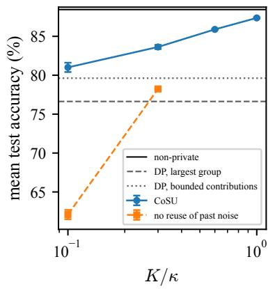

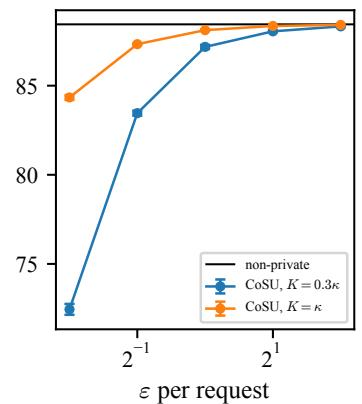

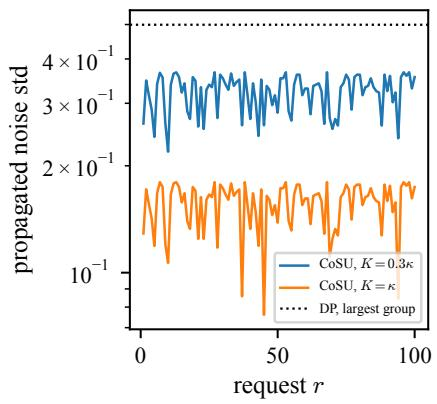  
Figure 1: Privacy–utility trade-of of CoSU on 100 writer-level requests. Left: accuracy averaged over the requests as a function of $K ~ ( \varepsilon = 0 . 5 )$ , with and without reuse of past noise $( x _ { r } = 0 )$ and DP learners for reference. Middle: accuracy as a function of $\varepsilon .$ Right: propagated noise standard deviation $\sqrt { W _ { r } }$ required by CoSU (Theorem 1), and by $\mathrm { D P }$ calibrated for the largest user (Proposition 8).

Table 1: Writer-level deletions (100 requests, $\varepsilon = 0 . 5 )$ : test accuracy (%) before any request, averaged over the requests (mean ± std over five runs), and at the worst request. †After the last request.
<table><tr><td>Method</td><td>before</td><td>mean</td><td>worst</td><td>steps  $/$  request</td></tr><tr><td>Non-private (no guarantee)</td><td>88.4</td><td></td><td></td><td></td></tr><tr><td>Exact retraining  $( \varepsilon = 0 )$ </td><td></td><td> $8 8 . 3 ^ { \dagger }$ </td><td></td><td>200 (100%)</td></tr><tr><td>CoSU, K = 0.1κ</td><td>88.4</td><td> $8 1 . 0 \pm 0 . 6$ </td><td>77.4</td><td>5 (2.5%)</td></tr><tr><td> $\mathrm { C o S U } , K = 0 . 3 \kappa$ </td><td>88.4</td><td> $8 3 . 6 \pm 0 . 3$ </td><td>80.3</td><td>15 (7.5%)</td></tr><tr><td>CoSU, K = 0.6κ</td><td>88.4</td><td> $8 5 . 9 \pm < 0 . 1$ </td><td>84.1</td><td>31 (15.5%)</td></tr><tr><td>CoSU,  $K = \kappa$ </td><td>88.4</td><td> ${ \bf 8 7 . 4 \pm 0 . 1 }$ </td><td>86.6</td><td>51 (25.5%)</td></tr><tr><td>DP, largest group  $( g _ { \mathrm { m a x } } = 1 3 4 )$ </td><td>76.6</td><td> $7 6 . 6 \pm 1 . 1$ </td><td>76.6</td><td>0</td></tr><tr><td>DP, bounded contributions  $( g _ { 0 } = 3 4 )$ </td><td>79.6</td><td> $7 9 . 6 \pm 1 . 4$ </td><td>79.6</td><td>0</td></tr></table>

## 6.3 Membership inference: independent versus dependent requests

The certificate of a request states that the released model is indistinguishable, at level $\bar { \mu } ,$ from the model that would have been released if the deleted group had never been in the training set. We test this statement with a membership inference attack (MIA). An attacker who knows the algorithm and all the other records observes the released model and has to decide whether the records of a target user were in the training set and then deleted, or were never there. The success of the attack is measured by an empirical Gaussian-DP level $\hat { \mu } ,$ , which cannot exceed $\bar { \mu }$ if the target is protected at the certified level [20]. We consider two settings. In the first, the target is deleted in one request, as our framework requires for the records of a single user. In the second, its records are split into m consecutive requests, each certified at level $\bar { \mu }$ as if they were independent, which 10ed es 80.3violates Assumption 5. In both settings, the attack targets all the records of the user, on the model 101ul anreleased after the last unlearning request. We use a subset of 200 writers, with $K = 0 . 1 \kappa$ and $\varepsilon = 1$ 0u mand run the pipeline 1,024 times with the target and 1,024 times without it. The target is either a 2 4 6 8 10 12 CoSU CoSUnatural writer or a worst-case canary request (composed of 16 identical copies of a single image request rwith a wrong label). The attacker has access to the parameters of the released model (white-box attack); the attack, a black-box variant and the estimation of $\hat { \mu }$ are described in Appendix J.

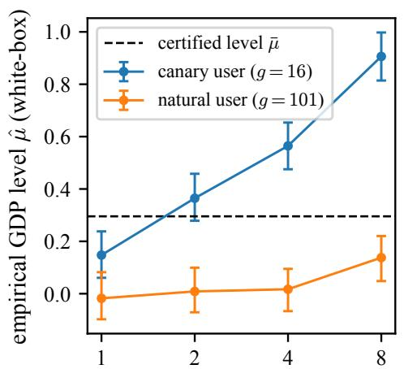  
number of requests the user is split into (m)

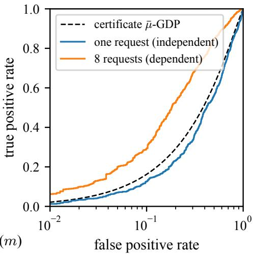

Figure 2: Membership inference on a user deleted in one request $( m = 1 )$ or split into m requests certified separately. Left: empirical Gaussian-DP level $\hat { \mu }$ of the white-box attack, against the certified level $\bar { \mu }$ (dashed). Right: trade-of curves of the attack on the canary user vs. certificate.  
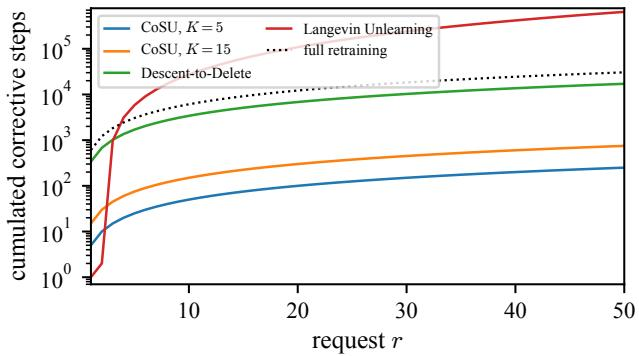  
105ps CoSU, K=5 DeFigure 3: CoSU and certified first-order baselines $( \varepsilon = 0 . 5 )$ on 50 single-record requests. Cumulative 4 st CoSU, K = number of corrective steps up to request $r ;$ Langevin Unlearning 90(% the dotted line is the cost of full retraining at every request.

The results are shown in Figure 2 and Table 6 in Appendix J. When the canary is deleted in one request, the attack stays within the certificate: $\hat { \mu } = 0 . 1 5$ (95% interval [0.06, 0.24]) for $\bar { \mu } = 0 . 3 0$ and its ROC curve lies on or below the curve allowed by the certificate. When the same user is split into m requests certified separately, every request is certified, but the user is not: $\hat { \mu }$ grows to 0.36, 0.56 and 0.91 for $m = 2 , 4 , 8 .$ i.e., up to 3.1 times the certified level, and the AUC of the attack from 0.54 to 0.74. The black-box loss attack gives the same AUCs (Table 6). For the natural writer, $\hat { \mu }$ stays between −0.02 and 0.14 for every m: its gradients are much smaller than the bound, so the certificate is loose for typical users. Treating dependent requests as independent can thus invalidate the guarantee in the worst case, whereas the attack on independent requests stays within the level certified by CoSU.

## 6.4 Comparison with sequential unlearning baselines

In contrast to CoSU, Descent-to-Delete and Langevin Unlearning use the cumulative-deletion reference. Nonetheless, we tune them to the same (ε, δ) level as CoSU, which leads to comparable test accuracy, of about 88.5%, for single-record unlearning requests. However, Figure 3 shows that this is achieved at a much higher computational cost than for CoSU. Descent-to-Delete needs about 340 steps per request, while the cost of Langevin Unlearning grows by 474 steps per request and exceeds the cost of full retraining after the third request. By contrast, CoSU needs only 5 steps to achieve the same accuracy and, more importantly, its long-run computational cost stays far below that of systematic retraining. More experimental results are reported in Appendix I.

## 7 Conclusion

For sequential unlearning, we proposed to certify each release against the run in which the current group never participated, rather than against retraining without all past deletions. For independent requests, this counterfactual reference preserves accuracy in the long run. In the smooth strongly convex setting, CoSU implements it at a fixed cost per request, with noise set by the request and not by its rank. In our experiments, it requires fewer gradient steps per request than existing certified first-order methods, and outperforms training-time DP. The guarantee relies on the independence of the requests: membership inference attacks exceed the certified level when dependent requests are certified separately, and stay within it when they are treated jointly. Our analysis covers smooth strongly convex objectives with full-batch gradients: extending it to stochastic gradients and possibly non-convex models is a natural next step.

## References

[1] Bill Marino, Meghdad Kurmanji, and Nicholas D. Lane. Position: Bridge the gaps between machine unlearning and AI regulation. In The Thirty-Ninth Annual Conference on Neural Information Processing Systems Position Paper Track, 2025.

[2] Yinzhi Cao and Junfeng Yang. Towards making systems forget with machine unlearning. In 2015 IEEE Symposium on Security and Privacy, pages 463–480, 2015.

[3] Antonio Ginart, Melody Y. Guan, Gregory Valiant, and James Zou. Making AI forget you: Data deletion in machine learning. In Advances in Neural Information Processing Systems (NeurIPS), volume 32, 2019.

[4] Ayush Sekhari, Jayadev Acharya, Gautam Kamath, and Ananda Theertha Suresh. Remember what you want to forget: Algorithms for machine unlearning. In Advances in Neural Information Processing Systems (NeurIPS), volume 34, 2021.

[5] Eli Chien, Haoyu Peter Wang, Ziang Chen, and Pan Li. Langevin unlearning: A new perspective of noisy gradient descent for machine unlearning. In The Thirty-eighth Annual Conference on Neural Information Processing Systems, volume 37, 2024.

[6] Seth Neel, Aaron Roth, and Saeed Sharifi-Malvajerdi. Descent-to-delete: Gradient-based methods for machine unlearning. In Proceedings of the 32nd International Conference on Algorithmic Learning Theory, volume 132 of Proceedings of Machine Learning Research, pages 931–962. PMLR, 2021.

[7] Chuan Guo, Tom Goldstein, Awni Hannun, and Laurens Van Der Maaten. Certified data removal from machine learning models. In Proceedings of the 37th International Conference on Machine Learning (ICML), volume 119 of Proceedings of Machine Learning Research, pages 3832–3842. PMLR, 2020.

[8] Siqiao Mu and Diego Klabjan. Rewind-to-delete: Certified machine unlearning for nonconvex functions. In Advances in Neural Information Processing Systems 38 (NeurIPS 2025), 2025.

[9] Binchi Zhang, Yushun Dong, Tianhao Wang, and Jundong Li. Towards certified unlearning for deep neural networks. In Proceedings of the 41st International Conference on Machine Learning, volume 235 of Proceedings of Machine Learning Research, pages 58800–58818. PMLR, 2024.

[10] Xinbao Qiao, Meng Zhang, Ming Tang, and Ermin Wei. Hessian-free online certified unlearning. In The Thirteenth International Conference on Learning Representations, 2025.

[11] Jinho Bok, Weijie J. Su, and Jason Altschuler. Shifted interpolation for diferential privacy. In Proceedings of the 41st International Conference on Machine Learning, volume 235 of Proceedings of Machine Learning Research, pages 4230–4266. PMLR, 2024.

[12] Varun Gupta, Christopher Jung, Seth Neel, Aaron Roth, Saeed Sharifi-Malvajerdi, and Chris Waites. Adaptive machine unlearning. In Advances in Neural Information Processing Systems, volume 34, pages 16319–16330. Curran Associates, Inc., 2021.

[13] Rishav Chourasia and Neil Shah. Forget unlearning: Towards true data-deletion in machine learning. In Proceedings of the 40th International Conference on Machine Learning, volume 202 of Proceedings of Machine Learning Research, pages 6028–6073. PMLR, 2023.

[14] Aloni Cohen, Refael Kohen, Kobbi Nissim, and Uri Stemmer. Protecting the Undeleted in Machine Unlearning. In Huijia (Rachel) Lin, editor, 7th Symposium on Foundations of Responsible Computing (FORC 2026), volume 368 of Leibniz International Proceedings in Informatics (LIPIcs), pages 17:1–17:18, Dagstuhl, Germany, 2026. Schloss Dagstuhl – Leibniz-Zentrum für Informatik. ISBN 978-3-95977-419-2.

[15] Sanjam Garg, Shafi Goldwasser, and Prashant Nalini Vasudevan. Formalizing data deletion in the context of the right to be forgotten. In Advances in Cryptology – EUROCRYPT 2020, pages 373–402. Springer, 2020.

[16] Vitaly Feldman, Ilya Mironov, Kunal Talwar, and Abhradeep Thakurta. Privacy amplification by iteration. In IEEE 59th Annual Symposium on Foundations of Computer Science (FOCS), pages 521–532, 2018.

[17] Rishav Chourasia, Jiayuan Ye, and Reza Shokri. Diferential privacy dynamics of Langevin difusion and noisy gradient descent. In Advances in Neural Information Processing Systems (NeurIPS), volume 34, 2021.

[18] Jiayuan Ye and Reza Shokri. Diferentially private learning needs hidden state (or much faster convergence). In Advances in Neural Information Processing Systems, volume 35, pages 703–715, 2022.

[19] Jason M. Altschuler and Kunal Talwar. Privacy of noisy stochastic gradient descent: More iterations without more privacy loss. In Advances in Neural Information Processing Systems (NeurIPS), volume 35, 2022.

[20] Jinshuo Dong, Aaron Roth, and Weijie J. Su. Gaussian diferential privacy. Journal of the Royal Statistical Society Series B: Statistical Methodology, 84(1):3–37, 2022.

[21] Sebastian Caldas, Sai Meher Karthik Duddu, Peter Wu, Tian Li, Jakub Konečný, H. Brendan McMahan, Virginia Smith, and Ameet Talwalkar. LEAF: A benchmark for federated settings. arXiv preprint arXiv:1812.01097, 2018.

[22] Kaiming He, Xiangyu Zhang, Shaoqing Ren, and Jian Sun. Deep residual learning for image recognition. In Proceedings of the IEEE Conference on Computer Vision and Pattern Recognition, pages 770–778, 2016. doi: 10.1109/CVPR.2016.90.

[23] Jia Deng, Wei Dong, Richard Socher, Li-Jia Li, Kai Li, and Li Fei-Fei. ImageNet: A large-scale hierarchical image database. In 2009 IEEE Conference on Computer Vision and Pattern Recognition, pages 248–255, 2009. doi: 10.1109/CVPR.2009.5206848.

[24] Kareem Amin, Alex Kulesza, Andrés Muñoz Medina, and Sergei Vassilvitskii. Bounding user contributions: A bias-variance trade-of in diferential privacy. In Proceedings of the 36th International Conference on Machine Learning, volume 97 of Proceedings of Machine Learning Research, pages 263–271, 2019.

[25] Alessandro Epasto, Mohammad Mahdian, Jieming Mao, Vahab Mirrokni, and Lijie Ren. Smoothly bounding user contributions in diferential privacy. In Advances in Neural Information Processing Systems, volume 33, 2020.

[26] Cynthia Dwork and Aaron Roth. The algorithmic foundations of diferential privacy. Foundations and Trends in Theoretical Computer Science, 9(3–4):211–407, 2014.

[27] Yurii Nesterov. Introductory Lectures on Convex Optimization: A Basic Course, volume 87 of Applied Optimization. Springer, New York, NY, 2004.

## A The two references

Figure 4 illustrates the cumulative-deletion reference (Section 3) and the counterfactual reference (Definition 3).

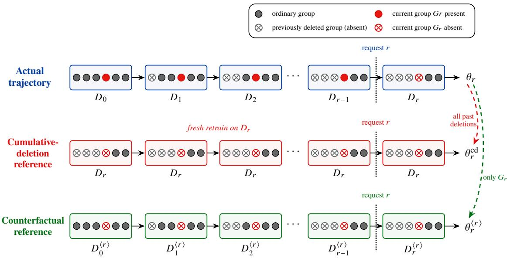  
Figure 4: Cumulative-deletion and counterfactual references for the r-th sequential unlearning request. The cumulative-deletion reference compares the released model to a fresh retrain on $D _ { r } ,$ where all past deletions are already absent. The counterfactual reference runs the actual sequential pipeline, with only the current group $G _ { r }$ absent from the start.

## B Privacy preliminaries

For two distributions $P , Q$ , the trade-of function is

$$
\begin{array} { r } { \mathcal { T } ( P , Q ) ( \alpha ) : = \underset { \phi : \mathbb { E } _ { P } [ \phi ] \leq \alpha } { \operatorname* { i n f } } ( 1 - \mathbb { E } _ { Q } [ \phi ] ) , \qquad \alpha \in [ 0 , 1 ] , } \end{array}
$$

where the infimum is over all randomized tests $0 \leq \phi \leq 1$ . Larger trade-of functions correspond to harder distinguishability.

For $\mu \geq 0$ , let

$$
\begin{array} { r } { \mathcal { G } _ { \mu } ( \alpha ) : = \Phi \mathopen { } \mathclose \bgroup \left( \Phi ^ { - 1 } ( 1 - \alpha ) - \mu \aftergroup \egroup \right) , } \end{array}
$$

which is the trade-of function between $\mathcal { N } ( 0 , 1 )$ and $\mathcal { N } ( \mu , 1 )$ . We say that an ordered pair $( P , Q )$ satisfies $\mu { \mathrm { - G D P } }$ if

$$
\tau ( P , Q ) \geq { \mathcal { G } } _ { \mu } .
$$

We use the following suficient conversion from GDP to DP.

Lemma 1 (Suficient GDP-to-DP conversion). Let $\varepsilon > 0$ and $\delta \in ( 0 , 1 )$ . ${ \cal I } f \left( P , Q \right)$ satisfies $\mu { - } G D P$ with

$$
\mu \leq \bar { \mu } _ { \varepsilon , \delta } : = \sqrt { 2 \log ( 1 / \delta ) + 2 \varepsilon } - \sqrt { 2 \log ( 1 / \delta ) } ,
$$

then P and Q are $( \varepsilon , \delta )$ -indistinguishable.

Proof. Let

$$
\delta _ { P , Q } ( \varepsilon ) : = \operatorname* { s u p } _ { A } \{ Q ( A ) - e ^ { \varepsilon } P ( A ) \} .
$$

By the standard variational relation between trade-of functions and hockey-stick divergences, $\mathcal { T } ( P , Q ) \ge \mathcal { G } _ { \mu }$ implies

$$
\delta _ { P , Q } ( \varepsilon ) \leq \Phi \left( \frac { \mu } { 2 } - \frac { \varepsilon } { \mu } \right) - e ^ { \varepsilon } \Phi \left( - \frac { \mu } { 2 } - \frac { \varepsilon } { \mu } \right) \leq \Phi \left( \frac { \mu } { 2 } - \frac { \varepsilon } { \mu } \right) .
$$

Let $a = \sqrt { 2 \log ( 1 / \delta ) }$ . The condition

$$
\mu \leq { \sqrt { a ^ { 2 } + 2 \varepsilon } } - a
$$

is equivalent to

$$
\frac { \mu } { 2 } - \frac { \varepsilon } { \mu } \leq - a .
$$

Therefore,

$$
\delta _ { P , Q } ( \varepsilon ) \leq \Phi ( - a ) \leq e ^ { - a ^ { 2 } / 2 } = \delta ,
$$

which proves the claim. Since $\begin{array} { r } { \Phi ( - a ) \le \frac { 1 } { 2 } e ^ { - a ^ { 2 } / 2 } } \end{array}$ , the lemma is conservative by a factor of two in $\delta ;$ the exact conversion of Dong et al. [20] removes this slack. □

Thus, throughout the proof it is enough to construct a GDP certificate with parameter at most $\bar { \mu } _ { \varepsilon , \delta }$

## C Proofs and additional results for Section 3

## C.1 Proofs of Propositions 1 and 2

Proof of Proposition 1. Since the groups are disjoint, the other groups are contained in $D \backslash G _ { r }$ , and every counterfactual dataset is obtained from $D \setminus G _ { r }$ by removing some of them: for $s < r$

$$
D _ { s } ^ { \langle r \rangle } = { \big ( } D \setminus G _ { r } { \big ) } \setminus ( G _ { 1 } \cup \dots \cup G _ { s } ) ,
$$

so none of them involves the content of $G _ { r }$ . We conclude by induction on s. For $s = 0 , \theta _ { 0 } ^ { \langle r \rangle } \sim$ $\mathcal { A } ( D \backslash G _ { r } )$ , and A does not depend on the data (Assumption 1). If the claim holds at $s - 1$ , then $\theta _ { s } ^ { \langle r \rangle } \sim \mathcal { U } _ { s } ( \theta _ { s - 1 } ^ { \langle r \rangle } , D _ { s } ^ { \langle r \rangle } )$ : the kernel $\mathcal { U } _ { s }$ depends on the requests only through their sizes and levels (Assumption 1), which do not change when the content of $G _ { r }$ is replaced; its two arguments do not involve this content (induction hypothesis and the display above); and, by Assumption 3, no other data-dependent state is carried across rounds, the randomness being fresh at every round. The claim follows at s, hence at $s = r$ □

Proof of Proposition 2. Fix $t \ > \ r$ . From round $r \_ \mathrm { o n }$ , both trajectories use the same datasets: $D _ { s } ^ { \langle r \rangle } = D _ { s }$ for every s $\geq r .$ , since $G _ { r }$ is absent from both after request r. The later groups $G _ { r + 1 } , \ldots , G _ { t }$ are the same in both worlds, since they are independent of the released models (Assumption 2). The kernels $\mathscr { U } _ { r + 1 } , \dots , \mathscr { U } _ { t }$ are the same (Assumption 1), and no other data-dependent state is carried across rounds (Assumption 3). The updates from round r to round t therefore define a common Markov kernel

$$
K _ { r : t } : = \mathcal { U } _ { t } ( \cdot , D _ { t } ) \circ \cdot \cdot \cdot \circ \mathcal { U } _ { r + 1 } ( \cdot , D _ { r + 1 } ) ,
$$

such that

$$
\theta _ { t } \sim K _ { r : t } ( \theta _ { r } ) , \quad \theta _ { t } ^ { \langle r \rangle } \sim K _ { r : t } ( \theta _ { r } ^ { \langle r \rangle } ) ,
$$

and the post-processing property of diferential privacy [26, Proposition 2.1], $X \simeq _ { \varepsilon , \delta } X ^ { \prime } \Rightarrow K ( X ) \simeq _ { \varepsilon , \delta }$ $K ( X ^ { \prime } )$ for every such common kernel K, gives the claim. □

## C.2 Independent and dependent requests

Request process Propositions 4 and 5 concern random requests. Fix a rank $^ { r , }$ a group $G _ { r } \subseteq D$ and a level $\left( \varepsilon _ { r } , \delta _ { r } \right)$ . The other requests $\rho : = ( G _ { s } , \varepsilon _ { s } , \delta _ { s } ) _ { s \neq r }$ are drawn by a request mechanism: a Markov kernel that takes the training set as input and whose randomness is independent of that of A and $( \mathcal { U } _ { s } ) _ { s \geq 1 }$ (Assumption 2). In the actual process, the training set is $D _ { ; }$ the other requests are $\rho ,$ and request r deletes $G _ { r }$ . In the process in which $G _ { r }$ was never in the training set, the training set is $D \setminus G _ { r }$ , the other requests $\rho ^ { \circ }$ are drawn by the same mechanism run on $D \setminus G _ { r }$ , and request r is still issued, as a void request with the same size and privacy level. Assumption 5 states that $\rho$ and $\rho ^ { \circ }$ have the same law, which does not depend on the content of $G _ { r }$

Proposition 4 (Protection of independent groups). Let Assumptions 1–3 and 5 hold, and let the pipeline satisfy Definition 3 at every request. Fix a request r and a time $t \geq r .$ . Let $\theta _ { t } ^ { \circ }$ and $\pi _ { t } ^ { \circ }$ be the release and the sizes and privacy levels of the requests up to t in the process in which $G _ { r }$ was never in the training set, request r being still issued as a void request, and let $\pi _ { t } : = ( g _ { s } , \varepsilon _ { s } , \delta _ { s } ) _ { s \leq t }$ be their counterparts in the actual process. Then

$$
( \theta _ { t } , \pi _ { t } ) \simeq _ { \varepsilon _ { r } , \delta _ { r } } ( \theta _ { t } ^ { \circ } , \pi _ { t } ^ { \circ } ) .
$$

Conditionally on the other requests, $\theta _ { t } \simeq _ { \varepsilon _ { r } , \delta _ { r } }$ θ◦ holds even without Assumption ${ 5 . }$

Proof of Proposition $\it 4 .$ Fix a request r, a time $t \geq r$ and the size and privacy level of request r. Let $\rho$ denote the other requests (their groups, sizes and privacy levels). The public information $\pi _ { t }$ is a function $\pi ( \rho )$ of $\rho$ and of the size and privacy level of request $r ,$ and the same function gives $\pi _ { t } ^ { \circ }$ from the other requests $\rho ^ { \circ }$ of the process without $G _ { r }$ , since the void request keeps its size and privacy level. By Assumption 2, the requests are independent of the internal randomness of the kernels, so we may condition on $\rho$ without changing the law of this randomness.

Conditional statement. Fix $\rho$ in the support of the request process. In the actual process, $\theta _ { t }$ is produced by the pipeline on D with this sequence. In the process without $G _ { r }$ , the other requests are $\rho$ and request $r$ is void with the same size and privacy level, so the kernels are the same (Assumption 1) and the dataset used at round s is $D _ { s } \backslash G _ { r } = D _ { s } ^ { \langle r \rangle }$ . This is the counterfactual trajectory, so $\theta _ { t } ^ { \circ } \mid \rho$ has the law of $\theta _ { t } ^ { \langle r \rangle } \mid \rho$ . Definition 3 gives $\theta _ { r } \simeq _ { \varepsilon _ { r } , \delta _ { r } } \theta _ { r } ^ { \langle r \rangle }$ given $\rho ,$ and Proposition 2 extends it to time t. This does not use Assumption 5.

Averaging. For a measurable set S of pairs, write $S _ { \pi } : = \{ \theta : ( \theta , \pi ) \in S \}$ . Then

$$
\begin{array} { r l } & { \operatorname* { P r } \bigl ( ( \theta _ { t } , \pi _ { t } ) \in S \bigr ) = \mathbb { E } _ { \rho } \bigl [ \operatorname* { P r } ( \theta _ { t } \in S _ { \pi ( \rho ) } \mid \rho ) \bigr ] } \\ & { \qquad \le \mathbb { E } _ { \rho } \bigl [ e ^ { \varepsilon _ { r } } \operatorname* { P r } ( \theta _ { t } ^ { \circ } \in S _ { \pi ( \rho ) } \mid \rho ) + \delta _ { r } \bigr ] } \\ & { \qquad = e ^ { \varepsilon _ { r } } \operatorname* { P r } ( ( \theta _ { t } ^ { \circ } , \pi _ { t } ^ { \circ } ) \in S ) + \delta _ { r } , } \end{array}
$$

where the last equality uses that $\rho$ and $\rho ^ { \circ }$ have the same law given the size and privacy level of request $r$ (Assumption 5). The reverse inequality is identical. □

Proposition 5 (Dependent requests must be merged). If request q is issued if and only $i f G _ { r }$ is in the training set, then, for any pipeline, the actual process and the process in which $G _ { r }$ was never in the training set are perfectly distinguishable from what is public about the requests alone (their number, sizes and levels). If the other requests depend neither on $G _ { r }$ nor on $G _ { q } ,$ , this public information has the same law in the actual process and in the process in which $G _ { r } \cup G _ { q }$ was never in the training set.

Proof of Proposition 5. In the actual process, the records of $G _ { r }$ are in the training set, so request q is issued, which is public. In the process in which $G _ { r }$ was never in the training set, the request mechanism is run on a training set without $G _ { r } ,$ so request q is not issued; only request r is kept, as a void request with the same size and level. The event “request q is issued” has probability one in the first process and zero in the second, so no pair $( \varepsilon , \delta )$ with $\delta < 1$ can make the two processes indistinguishable, whatever the released models. In the process in which $G _ { r } \cup G _ { q }$ never entered the training set, both requests are kept as void requests with the same sizes and privacy levels, and, if the other requests depend neither on $G _ { r }$ nor on $G _ { q }$ , the number, sizes and privacy levels of the requests have the same law in both processes. □

## C.3 Training-time diferential privacy

Proposition 6 (DP and provisioning). $I f \mathcal { U } _ { s } ( \theta , \cdot )$ is the point mass at θ for every s, the pipeline satisfies Definition 3 if and only if ${ \mathcal { A } } ( D ) \simeq _ { \varepsilon , \delta } { \mathcal { A } } ( D \setminus G )$ for every D and every request $( G , \varepsilon , \delta )$ . In particular, a learner that is $( \varepsilon , \delta ) \ – D P$ for groups of at most $g _ { \mathrm { m a x } }$ records satisfies it for all requests of size at most $g _ { \mathrm { m a x } }$ and privacy level at least $( \varepsilon , \delta )$

Proof of Proposition 6. If no update is performed, $\theta _ { r } = \theta _ { 0 } \sim \mathcal { A } ( D )$ and, for the counterfactual trajectory of request r, $\theta _ { r } ^ { \langle r \rangle } = \theta _ { 0 } ^ { \langle r \rangle } \sim \mathcal { A } ( D \setminus G _ { r } )$ . The definition therefore holds at request r if and only if $\mathcal { A } ( D ) \simeq _ { \varepsilon _ { r } , \delta _ { r } } \mathcal { A } ( D \setminus G _ { r } )$ , which gives the equivalence. If A is $( \varepsilon , \delta ) – \mathrm { D P }$ for groups of at most gmax records, then ${ \mathcal { A } } ( D ) \simeq _ { \varepsilon , \delta } { \mathcal { A } } ( D \setminus G _ { r } )$ whenever $g _ { r } \leq g _ { \mathrm { m a x } } ,$ and this implies the guarantee at any level $\left( \varepsilon _ { r } , \delta _ { r } \right) \geq \left( \varepsilon , \delta \right)$ ; no parameter accumulates since each request is compared with its own reference. □

## D Dependent requests arriving at diferent times

When dependent requests are issued at diferent times, they cannot be merged into a single request. Let the requests be partitioned into public blocks, such that Assumption 5 holds for blocks instead of single requests (the requests of a block may depend on each other; requests of diferent blocks may not), and let $B _ { r } \subseteq \{ 1 , \ldots , r \}$ be the set of requests of the block of r issued up to r, which contains r. Let $\begin{array} { r } { G _ { \mathcal { B } _ { r } } : = \bigcup _ { s \in \mathcal { B } _ { r } } G _ { s } . } \end{array}$ . The joint counterfactual reference of request r runs the same pipeline, with the same kernels, on the data from which $G _ { B _ { r } }$ has been removed from the start:

$$
\theta _ { 0 } ^ { \langle \mathcal { B } _ { r } \rangle } \sim \mathcal { A } \big ( D _ { 0 } \setminus G _ { \mathcal { B } _ { r } } \big ) , \qquad \theta _ { s } ^ { \langle \mathcal { B } _ { r } \rangle } \mid \theta _ { s - 1 } ^ { \langle \mathcal { B } _ { r } \rangle } \sim \mathcal { U } _ { s } \big ( \theta _ { s - 1 } ^ { \langle \mathcal { B } _ { r } \rangle } , D _ { s } \setminus G _ { \mathcal { B } _ { r } } \big ) , \quad s \ge 1 ,
$$

the requests of $B _ { r }$ being void. The requirement becomes

$$
\theta _ { r } \simeq _ { \varepsilon _ { s } , \delta _ { s } } \theta _ { r } ^ { \langle B _ { r } \rangle } \qquad \mathrm { f o r ~ e v e r y ~ } s \in \mathcal { B } _ { r } .
$$

When every block is a single request, $\boldsymbol { B _ { r } } = \{ r \}$ and this is Definition 3. Propositions 1 and 2 hold with the same proofs, $G _ { r }$ being replaced by $G _ { B _ { r } }$

Calibration The kernels may now depend on the partition into blocks, which is public. For $0 \leq q \leq r$ , let

$$
A _ { r } ( q ) : = \sum _ { s \in \mathcal { B } _ { r } } g _ { s } c ^ { K ( r - q _ { s } ) } I _ { q _ { s } } , \qquad q _ { s } : = \operatorname* { m i n } ( q , s - 1 ) ,
$$

be the influence accumulated by the block up to the end of episode q (a group $G _ { s }$ is present until the end of episode $s - 1 )$ , propagated to the end of episode r. The calibration of Theorem 1 is

modified as follows:

$$
\bar { \mu } _ { r } ^ { B } : = \operatorname* { m i n } _ { s \in B _ { r } } \bar { \mu } _ { s } , \quad b _ { r } : = A _ { r } ( r ) , \quad \bar { x } _ { r } : = P _ { r } \operatorname* { m i n } _ { 0 \leq q < r , W _ { q } > 0 } \frac { A _ { r } ( q ) } { c ^ { 2 K ( r - q ) } W _ { q } } , \quad x _ { r } : = \operatorname* { m i n } \Bigl \{ \frac { ( \bar { \mu } _ { r } ^ { B } ) ^ { 2 } P _ { r } } { b _ { r } } , ~ \bar { x } _ { r } \Bigr \} ,
$$

with $x _ { r } : = 0$ if $P _ { r } = 0 ; P _ { r } = c ^ { 2 K } W _ { r - 1 }$ and $W _ { r } = P _ { r } + 2 \eta \sigma _ { r } ^ { 2 } S _ { 2 } ( K )$ are unchanged. For $\boldsymbol { B _ { r } } = \{ r \}$ $A _ { r } ( q ) = g _ { r } c ^ { K ( r - q ) } I _ { q }$ for $q < r$ and $\begin{array} { r } { A _ { r } ( r ) = g _ { r } c ^ { K } I _ { r - 1 } } \end{array}$ , which are the quantities of Section 5.

Proposition 7 (Calibration for blocks). Let Assumptions $1 , \ 2 , \ 3 , \ 4$ and 6 hold, and let

$$
\sigma _ { r } ^ { 2 } = \frac { ( b _ { r } - x _ { r } ) ^ { 2 } } { 2 \eta S _ { 2 } ( K ) \left( ( \bar { \mu } _ { r } ^ { \mathcal { B } } ) ^ { 2 } - x _ { r } ^ { 2 } / P _ { r } \right) } \qquad ( \sigma _ { r } : = 0 \mathrm { ~ } i f \ : x _ { r } = b _ { r } ) ,
$$

with the quantities above. Then, for every dataset, every request sequence and every r, $\begin{array} { r } { \mathcal { T } ( \theta _ { r } , \theta _ { r } ^ { \langle B _ { r } \rangle } ) \ge } \end{array}$ $\mathcal { G } _ { \bar { \mu } _ { r } ^ { B } }$ , and therefore $\theta _ { r } \simeq _ { \varepsilon _ { s } , \delta _ { s } } \theta _ { r } ^ { \langle B _ { r } \rangle }$ for every $s \in B _ { r }$ . Moreover, $2 \eta \sigma _ { r } ^ { 2 } S _ { 2 } ( K ) \leq b _ { r } ^ { 2 } / ( \bar { \mu } _ { r } ^ { B } ) ^ { 2 }$

Proof. We follow the proof of Theorem 1 (Appendix E) and indicate the changes. We apply Theorem 3 with $N = N _ { r }$ to the actual trajectory and to the joint counterfactual trajectory; they start from the same point and use the same schedule and the same variances, which are functions of public quantities only.

Discrepancy. At step k, the two gradient maps are those of two objectives that difer by the losses of the groups $G _ { s } , s \in B _ { r }$ , still present in the actual training set, that is, such that $k < H _ { s }$ Both maps are c-Lipschitz (Assumption 6), so (4) becomes

$$
s _ { k } = \eta M \sum _ { s \in \mathcal { B } _ { r } : \ k < H _ { s } } g _ { s } , \qquad 0 \le k < N _ { r } .
$$

Since $H _ { s } = N _ { s - 1 }$ , the sum is over all $s \in B _ { r }$ during training and over the $s \in B _ { r }$ with $s > j$   
during episode $j \colon s _ { k }$ is constant on each phase, and vanishes on episode r. For $0 \leq q \leq r ,$ since   
min $( N _ { q } , H _ { s } ) = N _ { q s }$ and $\begin{array} { r } { \eta M \sum _ { \ell < N _ { j } } c ^ { N _ { r } - 1 - \hat { \ell } } = c ^ { \dot { K } ( r - j ) } I _ { j } } \end{array}$ ， J

$$
\sum _ { \ell = 0 } ^ { N _ { q } - 1 } c ^ { N _ { r } - 1 - \ell } s _ { \ell } = \eta M \sum _ { s \in B _ { r } } g _ { s } \sum _ { \ell < \operatorname * { m i n } ( N _ { q } , H _ { s } ) } c ^ { N _ { r } - 1 - \ell } = \sum _ { s \in B _ { r } } g _ { s } c ^ { K ( r - q _ { s } ) } I _ { q _ { s } } = A _ { r } ( q ) ,
$$

which replaces (6). In particular $A _ { r } ( r - 1 ) = A _ { r } ( r ) = b _ { r }$ , since $q _ { s } = s - 1$ for every $s \in B _ { r }$ as soon as $q \geq r - 1 { : }$ the terminal condition (7) holds with this $b _ { r }$ , and (8) is unchanged.

Allocation and admissibility. We keep the allocation (9), so that (10) holds with the new $b _ { r }$ The proof of Lemma 3 only uses that $s _ { \ell }$ is constant on each phase, which still holds: it is enough to check (8) at the ends of the phases. With the notation of that proof, for $q < r$ ，

$$
F ( N _ { q } ) = A _ { r } ( q ) - \frac { x } { P _ { r } } c ^ { 2 K ( r - q ) } W _ { q } ,
$$

which is nonnegative when $x \leq \bar { x } _ { r }$ , and $F ( N _ { r } ) = b _ { r } - x - \gamma Q _ { r } = 0 .$

Budget. The term $q = r - 1$ of the cap is $P _ { r } A _ { r } ( r - 1 ) / ( c ^ { 2 K } W _ { r - 1 } ) = b _ { r }$ , so $x _ { r } \leq b _ { r }$ . The proof of Theorem 1 only uses $x _ { r } \le b _ { r }$ and $x _ { r } \leq \bar { \mu } ^ { 2 } P _ { r } / b _ { r }$ ; with $\bar { \mu } : = \bar { \mu } _ { r } ^ { B }$ , it shows that $\sigma _ { r }$ is well defined and that the allocation is admissible with $\mu \leq \bar { \mu } _ { r } ^ { B }$ . Theorem 3 gives the Gaussian-DP bound, and Lemma 1 gives the level $( \varepsilon _ { s } , \delta _ { s } )$ of every $s \in B _ { r } ,$ since $\bar { \mu } _ { r } ^ { B } \leq \bar { \mu } _ { s }$ . The last bound is the argument of Corollary $1 ( \mathrm { a } ) \colon Q _ { r }$ is nonincreasing in x on $[ 0 , x _ { r } ]$ , so $\dot { Q _ { r } } \leq b _ { r } ^ { 2 } / ( \bar { \mu } _ { r } ^ { B } ) ^ { 2 }$ □

Price of a joint counterfactual certificate Let $\sigma _ { 0 } = 0 ;$ , and let all requests have a common size g and level $\bar { \mu }$ and form a single block. Then $\begin{array} { r } { b _ { r } = g \sum _ { s < r } c ^ { K ( r - s + 1 ) } I _ { s - 1 } } \end{array}$ tends to $g c ^ { K } I _ { \infty } / ( 1 - c ^ { K } )$ with $I _ { \infty } : = \eta M / ( 1 - c )$ , instead of $g c ^ { K } I _ { \infty }$ for independent requests. When the cap is not active, which is what we observe numerically in this case, $W _ { r } = b _ { r } ^ { 2 } / \bar { \mu } ^ { 2 }$ as in the proof of Corollary 1(b), so the propagated noise standard deviation is asymptotically $1 / ( 1 - c ^ { K } )$ times that of independent requests: this is the price of treating requests jointly. This joint certificate is still counterfactual: its reference replays the pipeline without the block, and is not the fresh retraining $A ( D _ { r } )$ of the cumulative-deletion reference (Definition 2). The numerical check of Appendix I covers this extension.

## E Proofs of Theorem 1, Corollary 1 and Proposition 3

## E.1 Shifted-interpolation with varying noise scales

Theorem 3 (Shifted-interpolation, after Bok et al. [11]). Consider two noisy trajectories

$$
X _ { k + 1 } = \varphi _ { k + 1 } ( X _ { k } ) + \xi _ { k + 1 } , \qquad X _ { k + 1 } ^ { \prime } = \varphi _ { k + 1 } ^ { \prime } ( X _ { k } ^ { \prime } ) + \xi _ { k + 1 } ^ { \prime } , \qquad 0 \le k < N ,
$$

started from the same point, where

$$
\xi _ { k + 1 } , \xi _ { k + 1 } ^ { \prime } \sim \mathcal { N } ( 0 , 2 \eta \sigma _ { k + 1 } ^ { 2 } I ) , \qquad \sigma _ { k + 1 } \geq 0 ,
$$

are independent of the past of their trajectory. Assume that $\varphi _ { k + 1 }$ and $\varphi _ { k + 1 } ^ { \prime }$ are c-Lipschitz, and let

$$
\operatorname* { s u p } _ { \theta } \left\| \varphi _ { k + 1 } ( \theta ) - \varphi _ { k + 1 } ^ { \prime } ( \theta ) \right\| \leq s _ { k } .
$$

If there exist deterministic sequences $z _ { k } \ge 0$ and $a _ { k + 1 } \geq 0$ such that

$$
z _ { 0 } = 0 , \qquad z _ { k + 1 } = c z _ { k } + s _ { k } - a _ { k + 1 } , \qquad 0 \leq a _ { k + 1 } \leq c z _ { k } + s _ { k } , \qquad z _ { N } = 0 ,\tag{2}
$$

with $a _ { k + 1 } = 0$ whenever $\sigma _ { k + 1 } = 0$ , then

$$
\mathcal { T } ( X _ { N } , X _ { N } ^ { \prime } ) \geq \mathcal { G } _ { \mu } , \qquad \mu ^ { 2 } : = \sum _ { k : \sigma _ { k + 1 } > 0 } \frac { a _ { k + 1 } ^ { 2 } } { 2 \eta \sigma _ { k + 1 } ^ { 2 } } .\tag{3}
$$

Each step with Gaussian noise of variance $2 \eta \sigma _ { k + 1 } ^ { 2 }$ absorbs a shift $a k { + 1 }$ at cost $a _ { k + 1 } ^ { 2 } / ( 2 \eta \sigma _ { k + 1 } ^ { 2 } )$ the remaining discrepancy $z _ { k }$ being propagated by the c-Lipschitz maps. Theorem C.3 of Bok et al. [11] is the case of a constant noise scale. We need noise scales that change from one step to the next, and steps without noise, on which no shift may be placed (the condition $a _ { k + 1 } = 0 )$ ; we therefore give the proof, which follows theirs.

Trade-of functions For $f = \mathcal { T } ( P , Q )$ and $g = \mathcal { T } ( P ^ { \prime } , Q ^ { \prime } )$ , the tensor product is $f \otimes g : =$ $\mathcal { T } ( P \times P ^ { \prime } , Q \times Q ^ { \prime } )$ , and Id $: = \tau ( P , P )$ We use the following properties [20]; (P1) and (P2) are Lemmas 2.5 and 2.7 of Bok et al. [11].

(P1) Post-processing. ${ \mathcal { T } } ( h ( X ) , h ( X ^ { \prime } ) ) \geq { \mathcal { T } } ( X , X ^ { \prime } )$ for every measurable map h.

(P2) Composition. If $Y \mid X = x \sim \mathsf { K } ( x )$ and $Y ^ { \prime } \mid X ^ { \prime } = x \sim \mathsf { K } ^ { \prime } ( x )$ for two Markov kernels such that $\mathcal { T } ( \mathsf { K } ( x ) , \mathsf { K } ^ { \prime } ( x ) ) \geq g$ for every x, then ${ \mathcal { T } } ( ( X , Y ) , ( X ^ { \prime } , Y ^ { \prime } ) ) \geq { \mathcal { T } } ( X , X ^ { \prime } ) \otimes g .$

(P3) Tensor product. It is commutative, associative and nondecreasing in each argument, and $f \otimes { \mathrm { I d } } = f$

(P4) Gaussian noise. For $v > 0 , T ( \mathcal { N } ( u , v I ) , \mathcal { N } ( 0 , v I ) ) = \mathcal { G } _ { \| u \| / \sqrt { v } } , \mathrm { a n d } \mathcal { G } _ { \mu _ { 1 } } \otimes \mathcal { G } _ { \mu _ { 2 } } = \mathcal { G } _ { \sqrt { \mu _ { 1 } ^ { 2 } + \mu _ { 2 } ^ { 2 } } } .$

Lemma 2 (One noisy step). Let Y and V be random vectors defined on the same probability space, with $\| V \| \leq a$ almost surely, and let $Y ^ { \prime }$ be a random vector. Let $v > 0$ and $\xi , \xi ^ { \prime } \sim \mathcal { N } ( 0 , v I )$ , with $\xi$ independent of $( Y , V )$ and $\xi ^ { \prime }$ independent of $Y ^ { \prime }$ . Then

$$
\begin{array} { r } { { \mathcal { T } } ( Y + V + \xi , \ Y ^ { \prime } + \xi ^ { \prime } ) \ \geq \ { \mathcal { T } } ( Y , Y ^ { \prime } ) \otimes { \mathcal { G } } _ { a / \sqrt { v } } . } \end{array}
$$

Proof. Given $Y \ = \ y .$ , the law $\mathsf { K } ( y )$ of $V + \xi$ is the mixture $\begin{array} { r } { \int \mathcal { N } ( u , v I ) \nu _ { y } ( d u ) } \end{array}$ , where $\nu _ { y }$ is the conditional law of $V ,$ supported on the ball of radius a. Given $Y ^ { \prime } = y .$ , the law of $\xi ^ { \prime }$ is $\mathsf { K } ^ { \prime } ( y ) : =$ $\mathcal { N } ( 0 , v I )$ . Let $\phi$ be a test with $\mathbb { E } _ { \mathsf { K } ( y ) } [ \phi ] \le \alpha$ . Since $\begin{array} { r } { \mathbb { E } _ { \mathsf { K } ( y ) } [ \phi ] = \int \mathbb { E } _ { \mathcal { N } ( u , v I ) } [ \phi ] \nu _ { y } ( d u ) } \end{array}$ , there exists u with $\| u \| \leq a$ and $\mathbb { E } _ { \mathcal { N } ( u , v I ) } [ \phi ] \le \alpha$ . By (P4), and since trade-of functions are nonincreasing and $\mathcal { G } _ { \mu }$ decreases with $\mu ,$

$$
1 - \mathbb { E } _ { \mathcal { N } ( 0 , v I ) } [ \phi ] \ \geq \ \mathcal { G } _ { \| u \| / \sqrt { v } } ( \alpha ) \ \geq \ \mathcal { G } _ { a / \sqrt { v } } ( \alpha ) .
$$

Hence $\mathcal { T } ( \mathsf { K } ( y ) , \mathsf { K } ^ { \prime } ( y ) ) \geq \mathcal { G } _ { a / \sqrt { v } }$ for every y, and (P2) gives $\begin{array} { r } { \mathcal { T } \big ( ( Y , V + \xi ) , ( Y ^ { \prime } , \xi ^ { \prime } ) \big ) \geq \mathcal { T } ( Y , Y ^ { \prime } ) \otimes \mathcal { G } _ { a / \sqrt { v } } . } \end{array}$ (P1) with $h ( y , w ) : = y + w$ concludes. □

Proof of Theorem 3. Let $v _ { k + 1 } : = 2 \eta \sigma _ { k + 1 } ^ { 2 } ,$ , and let $\lambda _ { k + 1 } : = a _ { k + 1 } / ( c z _ { k } + s _ { k } ) \in [ 0 , 1 ]$ , with $\lambda _ { k + 1 } : = 0$ if $c z _ { k } + s _ { k } = 0$ . On the probability space of $( X _ { k } ) _ { k }$ , define the interpolated sequence

$$
\begin{array} { r l r l r l r l } & { \tilde { X } _ { 0 } : = X _ { 0 } , } & & { \tilde { X } _ { k + 1 } : = \varphi _ { k + 1 } ^ { \prime } ( \tilde { X } _ { k } ) + V _ { k + 1 } + \xi _ { k + 1 } , } & & { V _ { k + 1 } : = \lambda _ { k + 1 } \big ( \varphi _ { k + 1 } \big ( X _ { k } \big ) - \varphi _ { k + 1 } ^ { \prime } ( \tilde { X } _ { k } ) \big ) , } \end{array}
$$

which uses the noise of the first trajectory.

Step $1 \colon \| X _ { k } - \tilde { X } _ { k } \| \leq z _ { k }$ and $\| V _ { k + 1 } \| \leq a _ { k + 1 }$ almost surely. This holds at $k = 0$ since $z _ { 0 } = 0$ . If $\| X _ { k } - \tilde { X } _ { k } \| \leq z _ { k }$ , then

$$
\begin{array} { r } { \big \| \varphi _ { k + 1 } ( X _ { k } ) - \varphi _ { k + 1 } ^ { \prime } ( \tilde { X } _ { k } ) \big \| \leq \big \| \varphi _ { k + 1 } ( X _ { k } ) - \varphi _ { k + 1 } ( \tilde { X } _ { k } ) \big \| + \big \| \varphi _ { k + 1 } ( \tilde { X } _ { k } ) - \varphi _ { k + 1 } ^ { \prime } ( \tilde { X } _ { k } ) \big \| \leq c z _ { k } + s _ { k } , } \end{array}
$$

so $\| V _ { k + 1 } \| \le \lambda _ { k + 1 } ( c z _ { k } + s _ { k } ) = a _ { k + 1 }$ , and, since $X _ { k + 1 } - { \tilde { X } } _ { k + 1 } = ( 1 - \lambda _ { k + 1 } ) { \big ( } \varphi _ { k + 1 } ( X _ { k } ) - \varphi _ { k + 1 } ^ { \prime } ( { \tilde { X } } _ { k } ) { \big ) }$

$$
\begin{array} { r } { \| X _ { k + 1 } - \tilde { X } _ { k + 1 } \| \leq ( 1 - \lambda _ { k + 1 } ) ( c z _ { k } + s _ { k } ) = c z _ { k } + s _ { k } - a _ { k + 1 } = z _ { k + 1 } . } \end{array}
$$

Step 2: one step. If $\sigma _ { k + 1 } > 0$ , we apply Lemma 2 with $Y : = \varphi _ { k + 1 } ^ { \prime } ( { \tilde { X } } _ { k } ) , V : = V _ { k + 1 } , Y ^ { \prime } : =$ $\varphi _ { k + 1 } ^ { \prime } ( X _ { k } ^ { \prime } ) , a : = a _ { k + 1 }$ 1 and $v : = v _ { k + 1 } ; \xi _ { k + 1 }$ is independent of $( X _ { k } , \tilde { X } _ { k } )$ , hence of $( Y , V )$ . With (P1) for the map $\varphi _ { k + 1 } ^ { \prime }$ and (P3),

$$
\begin{array} { r } { \mathcal { T } ( \tilde { X } _ { k + 1 } , X _ { k + 1 } ^ { \prime } ) \geq \mathcal { T } ( \varphi _ { k + 1 } ^ { \prime } ( \tilde { X } _ { k } ) , \varphi _ { k + 1 } ^ { \prime } ( X _ { k } ^ { \prime } ) ) \otimes \mathcal { G } _ { a _ { k + 1 } / \sqrt { v _ { k + 1 } } } \geq \mathcal { T } ( \tilde { X } _ { k } , X _ { k } ^ { \prime } ) \otimes \mathcal { G } _ { a _ { k + 1 } / \sqrt { v _ { k + 1 } } } . } \end{array}
$$

If $\sigma _ { k + 1 } = 0$ , then $a _ { k + 1 } = 0$ , so $V _ { k + 1 } = 0$ and there is no noise: $\tilde { X } _ { k + 1 } = \varphi _ { k + 1 } ^ { \prime } ( \tilde { X } _ { k } )$ and $X _ { k + 1 } ^ { \prime } =$ $\varphi _ { k + 1 } ^ { \prime } ( X _ { k } ^ { \prime } )$ , and (P1) gives $\mathcal { T } ( \tilde { X } _ { k + 1 } , X _ { k + 1 } ^ { \prime } ) \geq \mathcal { T } ( \tilde { X } _ { k } , X _ { k } ^ { \prime } )$

Step 3: conclusion. Since ${ \tilde { X } } _ { 0 } = X _ { 0 }$ and $X _ { 0 } ^ { \prime }$ are the same point, $\mathcal { T } ( \tilde { X } _ { 0 } , X _ { 0 } ^ { \prime } ) = \mathrm { I d }$ . By induction on k with Step 2, (P3) and (P4),

$$
\mathcal { T } ( \tilde { X } _ { N } , X _ { N } ^ { \prime } ) \ \geq \ \bigotimes _ { k : \sigma _ { k + 1 } > 0 } \mathcal { G } _ { a _ { k + 1 } / \sqrt { v _ { k + 1 } } } = \mathcal { G } _ { \mu } .
$$

Finally, $z _ { N } = 0$ and Step 1 give ${ \tilde { X } } _ { N } = X _ { N }$ almost surely, which is (3).

The bound is stated for the ordered pair $( X _ { N } , X _ { N } ^ { \prime } )$ . The Gaussian trade-of function is symmetric, so $\mathcal { T } ( P , Q ) \geq \mathcal { G } _ { \mu }$ implies $\mathcal { T } ( Q , P ) \ge \mathcal { G } _ { \mu }$ , which gives the two inequalities defining $\simeq _ { \varepsilon , \delta }$

## E.2 Reduction to a one-parameter allocation

Fix a request $r$ and apply Theorem 3 with $N = N _ { r } , X _ { N } = \theta _ { N _ { \tau } }$ and $X _ { N } ^ { \prime } = \theta _ { N _ { r } } ^ { \langle r \rangle }$ . Both trajectories start from $\theta _ { \mathrm { i n i t } }$ and use the same public schedule $( T , K )$ and the same variances, $\dot { 2 } \eta \sigma _ { 0 } ^ { 2 }$ during training and $2 \eta \sigma _ { j } ^ { 2 }$ during episode $j ,$ which are functions of the sizes and privacy levels of the requests only (Assumption 1).

Discrepancy Before time $H _ { r } = N _ { r - 1 }$ , the actual gradient map is that of an objective containing the records of $G _ { r }$ , and the counterfactual one is that of the same objective without them; the other groups are removed at the same times in both trajectories. By Assumption 6, both maps are c-Lipschit $^ { , Z , }$ and $\begin{array} { r } { \operatorname* { s u p } _ { \theta } \| \eta \sum _ { d \in G _ { r } } \nabla \ell ( \theta , d ) \| \le \eta M g _ { r } } \end{array}$ . From time $H _ { r }$ on, both trajectories use $f _ { r }$ Hence

$$
s _ { k } = \eta M g _ { r } \quad ( 0 \le k < H _ { r } ) , \qquad s _ { k } = 0 \quad \big ( H _ { r } \le k < N _ { r } \big ) .\tag{4}
$$

Unrolling (2) gives

$$
c ^ { N _ { r } - k } z _ { k } = \sum _ { \ell = 0 } ^ { k - 1 } c ^ { N _ { r } - 1 - \ell } s _ { \ell } - \sum _ { \ell = 0 } ^ { k - 1 } c ^ { N _ { r } - 1 - \ell } a _ { \ell + 1 } .\tag{5}
$$

Since $\begin{array} { r } { \eta M \sum _ { \ell < N _ { a } } c ^ { N _ { r } - 1 - \ell } = c ^ { K ( r - q ) } I _ { q } } \end{array}$ for $0 \leq q < r$ , the discrepancy accumulated up to the end of episode $q$ (of training for $q = 0 )$ and propagated to $N _ { r }$ is

$$
\sum _ { \ell = 0 } ^ { N _ { q } - 1 } c ^ { N _ { r } - 1 - \ell } s _ { \ell } = g _ { r } c ^ { K ( r - q ) } I _ { q } .\tag{6}
$$

In particular, the terminal condition $z _ { N _ { r } } = 0$ reads

$$
\sum _ { k = 0 } ^ { N _ { r } - 1 } c ^ { N _ { r } - 1 - k } a _ { k + 1 } = g _ { r } c ^ { K } I _ { r - 1 } = b _ { r } ,\tag{7}
$$

and the conditions $z _ { k } \ge 0$ for all k are equivalent to

$$
\sum _ { \ell = 0 } ^ { k - 1 } c ^ { N _ { r } - 1 - \ell } a _ { \ell + 1 } \leq \sum _ { \ell = 0 } ^ { k - 1 } c ^ { N _ { r } - 1 - \ell } s _ { \ell } , \qquad 0 \leq k \leq N _ { r } .\tag{8}
$$

Once $z _ { k } \ge 0$ holds for all $k ,$ the constraint $a _ { k + 1 } \leq c z _ { k } + s _ { k }$ follows from $z _ { k + 1 } \geq 0$

Allocation For parameters $\beta \geq 0$ and $\gamma \geq 0$ , we place shifts proportional to the noise variance on every past step, training included, at a common rate $\beta ,$ , and at rate $\gamma$ on the current episode:

$$
a _ { k + 1 } = \left\{ \begin{array} { l l } { \beta \left( 2 \eta \sigma _ { 0 } ^ { 2 } \right) c ^ { N _ { r } - 1 - k } , } & { 0 \leq k < T , } \\ { \beta \left( 2 \eta \sigma _ { j } ^ { 2 } \right) c ^ { N _ { r } - 1 - k } , } & { H _ { j } \leq k < N _ { j } , 1 \leq j < r , } \\ { \gamma \left( 2 \eta \sigma _ { r } ^ { 2 } \right) c ^ { N _ { r } - 1 - k } , } & { H _ { r } \leq k < N _ { r } . } \end{array} \right.\tag{9}
$$

In particular, no shift is placed on a step without noise. Since

$$
\sum _ { k = { H _ { j } } } ^ { N _ { j } - 1 } 2 \eta \sigma _ { j } ^ { 2 } c ^ { 2 ( N _ { r } - 1 - k ) } = 2 \eta \sigma _ { j } ^ { 2 } c ^ { 2 K ( r - j ) } S _ { 2 } ( K ) \quad \mathrm { a n d } \quad \sum _ { k = 0 } ^ { T - 1 } 2 \eta \sigma _ { 0 } ^ { 2 } c ^ { 2 ( N _ { r } - 1 - k ) } = c ^ { 2 K r } W _ { 0 } ,
$$

the propagated variance of all the past steps is $c ^ { 2 K } W _ { r - 1 } = P _ { r }$ , that of the steps up to the end of episode q is $c ^ { 2 K ( r - q ) } W _ { q }$ , and that of the current episode is $Q _ { r } : = 2 \eta \sigma _ { r } ^ { 2 } S _ { 2 } ( K )$ . Writing $x : = \beta P _ { \ l }$ r for the amount hidden by the past steps, the constraint (7) and the $\mathrm { G D P }$ parameter (3) become

$$
x + \gamma Q _ { r } = b _ { r } , \qquad \mu ^ { 2 } = \frac { x ^ { 2 } } { P _ { r } } + \frac { ( b _ { r } - x ) ^ { 2 } } { Q _ { r } } .\tag{10}
$$

For a given x, spreading it over the past steps in proportion to their variance minimizes their cost $\sum a _ { k + 1 } ^ { 2 } / ( 2 \eta \sigma _ { k + 1 } ^ { 2 } )$ , by Cauchy–Schwarz, which is why we use the profile (9).

Lemma 3 (Admissibility). The allocation (9) satisfies (8) as soon as $0 \leq x \leq \bar { x } _ { r }$ and $\gamma Q _ { r } = b _ { r } - x$ (with $\gamma = 0$ when $x = b _ { r } )$

Proof. Let $F ( k )$ be the diference between the right-hand side and the left-hand side of (8), so that $F ( 0 ) = 0$ and we must show $F ( k ) \geq 0$ for all k. Within a phase of constant variance (the training phase, or an episode $j \leq r )$ , the increment of $F$ at step ℓ is

$$
F ( \ell + 1 ) - F ( \ell ) = c ^ { N _ { r } - 1 - \ell } ( s _ { \ell } - \rho c ^ { N _ { r } - 1 - \ell } ) ,
$$

with $\rho \geq 0$ constant on the phase and $s _ { \ell }$ constant on the phase by (4). Since $c ^ { N _ { r } - 1 - \ell }$ increases with $\ell ,$ the increments change sign at most once, from positive to negative: F first increases, then decreases, on each phase, and its minimum over a phase is attained at one of its two ends. It is therefore enough to check $F \geq 0$ at the ends of the phases, i.e., at $k = N _ { q }$ for $0 \leq q \leq r$ (with $N _ { 0 } = T$ and $F ( 0 ) = 0 )$ . For $q < r$ , by (6) and the computation of the propagated variances,

$$
F ( N _ { q } ) = g _ { r } c ^ { K ( r - q ) } I _ { q } - \frac { x } { P _ { r } } c ^ { 2 K ( r - q ) } W _ { q } ,
$$

which is nonnegative since $x \le \bar { x } _ { r } \le P _ { r } g _ { r } I _ { q } / ( c ^ { K ( r - q ) } W _ { q } ) = g _ { r } c ^ { K ( r - q ) } I _ { q } P _ { r } / ( c ^ { 2 K ( r - q ) } W _ { q } )$ when $W _ { q } > 0$ , and trivially when $W _ { q } = 0$ . For $q = r , F ( N _ { r } ) = b _ { r } - x - \gamma Q _ { r } = 0$ □

## E.3 Proof of Theorem 1

Write $b : = b _ { r } , P : = P _ { r } , x : = x _ { r }$ and $\bar { \mu } : = \bar { \mu } _ { r }$ . If $P = 0$ , then $x = 0$ , no shift is placed on the past steps, and $Q _ { r } = b ^ { 2 } / \bar { \mu } ^ { 2 }$ gives $\mu ^ { 2 } = \bar { \mu } ^ { 2 }$ . Let $P > 0$ , so that $W _ { r - 1 } > 0 ;$ the term $q = r - 1$ of the cap is ${ \cal P } g _ { r } I _ { r - 1 } / ( c ^ { K } W _ { r - 1 } ) = g _ { r } c ^ { K } I _ { r - 1 } = b ;$ hence $x \leq b$ . We check that $x ^ { 2 } / P < \bar { \mu } ^ { 2 }$ when $x < b .$ . If $x = \bar { \mu } ^ { 2 } P / b < b .$ then $\bar { \mu } ^ { 2 } P < b ^ { 2 }$ and $x ^ { 2 } / P = \bar { \mu } ^ { 4 } P / b ^ { 2 } < \bar { \mu } ^ { 2 }$ . If $x = \bar { x } _ { r } < \bar { \mu } ^ { 2 } P / b .$ , then either $\bar { \mu } ^ { 2 } P \le b ^ { 2 }$ and $x ^ { 2 } / P < \bar { \mu } ^ { 4 } P / b ^ { 2 } \le \bar { \mu } ^ { 2 } , \mathrm { o r } ~ \bar { \mu } ^ { 2 } P > b ^ { 2 }$ and $x ^ { 2 } / P < b ^ { 2 } / P < \bar { \mu } ^ { 2 }$ . In both cases, the choice

$$
Q _ { r } = \frac { ( b - x ) ^ { 2 } } { \bar { \mu } ^ { 2 } - x ^ { 2 } / P }
$$

is well defined, i.e., $\sigma _ { r } ^ { 2 } = Q _ { r } / ( 2 \eta S _ { 2 } ( K ) )$ is the noise variance of Theorem 1, and by Lemma 3, it gives an admissible allocation with $\mu ^ { 2 } = x ^ { 2 } / P + ( b - x ) ^ { 2 } / Q _ { r } = \bar { \mu } ^ { 2 }$ . If $x = b$ , then $b \leq \bar { \mu } ^ { 2 } P / { b } ;$ we take $\sigma _ { r } = 0$ and $\gamma = 0$ , and $\mu ^ { 2 } = b ^ { 2 } / P \leq \bar { \mu } ^ { 2 }$

In all cases, Theorem 3 gives ${ \mathcal { T } } ( \theta _ { N _ { r } } , \theta _ { N _ { r } } ^ { \langle r \rangle } ) \geq { \mathcal { G } } _ { { \bar { \mu } } _ { r } }$ , and Lemma 1 gives $\theta _ { N _ { r } } \simeq _ { \varepsilon _ { r } , \delta _ { r } } \ \theta _ { N _ { r } } ^ { \langle r \rangle }$ . The argument uses $\bar { \mu } _ { r }$ only through this last implication: the theorem holds for any level $\bar { \mu } _ { r }$ such that $\bar { \mu } _ { r } – \mathrm { G D P }$ implies $\left( \varepsilon _ { r } , \delta _ { r } \right)$ -indistinguishability, in particular the exact conversion of Dong et al. [20] used in the experiments. Since $r ,$ the dataset and the request sequence are arbitrary, CoSU satisfies counterfactual sequential unlearning at every request. Finally, $x _ { r }$ and $\sigma _ { r }$ are computed from $( g _ { r } , \bar { \mu } _ { r } )$ from $( I _ { q } ) _ { q < r } ,$ , which depend only on $( T , K , \eta , M , c )$ , and from $( W _ { q } ) _ { q < r } ,$ , which depend only on $\sigma _ { 0 }$ and the previous noise scales: they are public. □

## E.4 Proof of Corollary 1

Write $J _ { q } : = c ^ { K } I _ { q - 1 } = \eta M c ^ { K } ( 1 - c ^ { H _ { q } } ) / ( 1 - c )$ , so that $b _ { q } = g _ { q } J _ { q }$ and $J _ { q } ^ { 2 } / ( 2 \eta S _ { 2 } ( K ) ) = \Gamma ( 1 -$ $c ^ { H _ { q } } ) ^ { 2 } / ( 1 - c ^ { 2 K } )$

(a) Let $P : = P _ { r } > 0$ and $F ( x ) : = ( b _ { r } - x ) ^ { 2 } / ( \bar { \mu } _ { r } ^ { 2 } - x ^ { 2 } / P )$ . A direct computation gives

$$
F ^ { \prime } ( x ) = \frac { 2 ( b _ { r } - x ) ( x b _ { r } - \bar { \mu } _ { r } ^ { 2 } P ) } { P ( \bar { \mu } _ { r } ^ { 2 } - x ^ { 2 } / P ) ^ { 2 } } ,
$$

which is nonpositive on $[ 0 , x _ { r } ]$ , since there $x \leq b _ { r }$ and $x \leq \bar { \mu } _ { r } ^ { 2 } P / { b _ { r } }$ . Hence $Q _ { r } = F ( x _ { r } ) \leq F ( 0 ) =$ $b _ { r } ^ { 2 } / \bar { \mu } _ { r } ^ { 2 }$ (immediate when $P = 0$ or $\sigma _ { r } = 0 ) , \mathrm { i . e . , } \sigma _ { r } ^ { 2 } \leq h _ { r } ^ { 2 } J _ { r } ^ { 2 } / ( 2 \eta \dot { S } _ { 2 } ( K ) ) = h _ { r } ^ { 2 } \Gamma ( 1 - c ^ { H _ { r } } ) ^ { 2 } / ( 1 - c ^ { 2 K } ) \leq$ $h _ { r } ^ { 2 } \Gamma / ( 1 - c ^ { 2 K } )$

(b) Let $\sigma _ { 0 } = 0$ , so that $W _ { 0 } = 0$ and the cap only involves $q \geq 1$ . We prove more generally that, if efective sizes do not drop too fast,

$$
h _ { j } \leq c ^ { - K ( r - j ) / 2 } h _ { r } \qquad { \mathrm { ~ f o r ~ a l l ~ } } 1 \leq j < r \leq R ,\tag{11}
$$

then $x _ { r } = \bar { \mu } _ { r } ^ { 2 } P _ { r } / b _ { \quad }$ r and $W _ { r } = h _ { r } ^ { 2 } J _ { r } ^ { 2 }$ for $r \leq R$ . For $r = 1 , P _ { 1 } = 0$ and $W _ { 1 } = Q _ { 1 } = b _ { 1 } ^ { 2 } / \bar { \mu } _ { 1 } ^ { 2 } = h _ { 1 } ^ { 2 } J _ { 1 } ^ { 2 }$ Assume the claim for every $q < r .$ , so that $P _ { r } = c ^ { 2 K } h _ { r - 1 } ^ { 2 } J _ { r - 1 } ^ { 2 }$ . For $1 \leq q < r _ { : }$ , the inequality ${ \bar { \mu } _ { r } } ^ { 2 } P _ { r } / { b _ { r } } \le P _ { r } g _ { r } I _ { q } / ( c ^ { K ( r - q ) } W _ { q } )$ is equivalent to $c ^ { K ( r - q ) } \bar { h } _ { q } ^ { 2 } \bar { J } _ { q } ^ { 2 } \leq \bar { h } _ { r } ^ { 2 } J _ { r } I _ { q }$ , which follows from (11), $J _ { q } \le J _ { r }$ and $J _ { q } \le I _ { q }$ . Hence $\bar { x _ { r } } = \bar { \mu } _ { r } ^ { 2 } P _ { r } / b _ { r }$ and, by the computation in the proof of Theorem 1,

$$
Q _ { r } = \frac { b _ { r } ^ { 2 } - \bar { \mu } _ { r } ^ { 2 } P _ { r } } { \bar { \mu } _ { r } ^ { 2 } } = h _ { r } ^ { 2 } J _ { r } ^ { 2 } - c ^ { 2 K } h _ { r - 1 } ^ { 2 } J _ { r - 1 } ^ { 2 } , \qquad W _ { r } = P _ { r } + Q _ { r } = h _ { r } ^ { 2 } J _ { r } ^ { 2 } .
$$

With constant sizes and privacy levels, (11) holds and $h _ { r } = g / \bar { \mu }$ . Dividing $Q _ { 1 } = h ^ { 2 } J _ { 1 } ^ { 2 }$ by $2 \eta S _ { 2 } ( K )$ gives $\sigma _ { 1 } ^ { 2 }$ . For $r \geq 2$ , with $x : = c ^ { H _ { r } }$ and $H _ { r - 1 } = H _ { r } - K$

$$
( 1 - x ) ^ { 2 } - c ^ { 2 K } ( 1 - c ^ { - K } x ) ^ { 2 } = ( 1 - c ^ { 2 K } ) - 2 x ( 1 - c ^ { K } ) = ( 1 - c ^ { K } ) ( 1 + c ^ { K } - 2 x ) ,
$$

and dividing by $1 - c ^ { 2 K } = ( 1 - c ^ { K } ) ( 1 + c ^ { K } )$ gives $\sigma _ { r } ^ { 2 }$

## E.5 Proof of Proposition 3

For $r ~ = ~ 1$ , the cap reduces to its term $q \ = \ 0$ , which equals $b _ { 1 }$ , so $x _ { 1 } =$ min $\{ \bar { \mu } _ { 1 } ^ { 2 } P _ { 1 } / b _ { 1 } , b _ { 1 } \}$ with $P _ { 1 } = c ^ { 2 K } W _ { 0 } = c ^ { 2 K } 2 \eta \sigma _ { 0 } ^ { 2 } S _ { 2 } ( T )$ . If $\bar { \mu } _ { 1 } ^ { 2 } P _ { 1 } \ge b _ { 1 } ^ { 2 }$ , then $x _ { 1 } = b _ { 1 }$ and $\sigma _ { 1 } = 0 ;$ otherwise $Q _ { 1 } =$ $( b _ { 1 } ^ { 2 } - \bar { \mu } _ { 1 } ^ { 2 } P _ { 1 } ) / \bar { \mu } _ { 1 } ^ { 2 }$ . Since $b _ { 1 } = g _ { 1 } c ^ { K } I _ { 0 }$ and, by Proposition 8, $\sigma _ { 0 } ^ { \star } ( g _ { 1 } , \bar { \mu } _ { 1 } ) ^ { 2 } = g _ { 1 } ^ { 2 } I _ { 0 } ^ { 2 } / ( 2 \eta S _ { 2 } ( T ) \bar { \mu } _ { 1 } ^ { 2 } )$ , we have $b _ { 1 } ^ { 2 } / \bar { \mu } _ { 1 } ^ { 2 } = c ^ { 2 K } 2 \eta S _ { 2 } ( T ) ( \sigma _ { 0 } ^ { \star } ) ^ { 2 }$ , hence $Q _ { 1 } = c ^ { 2 K } 2 \eta S _ { 2 } ( T ) ( ( \sigma _ { 0 } ^ { \star } ) ^ { 2 } - \sigma _ { 0 } ^ { 2 } ) _ { + }$ , and dividing by $2 \eta S _ { 2 } ( K )$ gives the formula. □

## F Proof of Theorem 2

We next record the contraction estimates used in the utility analysis.

Lemma 4 (One-step contraction with additive noise). Let f be m-strongly convex and $\begin{array} { r } { L \mathrm { - } s m o o t h , } \end{array}$ with minimizer $\theta ^ { \star }$ . Consider the noisy gradient step

$$
\theta ^ { + } = \theta - \eta \nabla f ( \theta ) + \sqrt { 2 \eta } \sigma Z , \qquad Z \sim \mathcal { N } ( 0 , I _ { p } ) ,
$$

with $\eta \leq 1 / L$ . Then

$$
\begin{array} { r } { \mathbb { E } \| \theta ^ { + } - \theta ^ { \star } \| ^ { 2 } \leq c ^ { 2 } \mathbb { E } \| \theta - \theta ^ { \star } \| ^ { 2 } + 2 \eta p \sigma ^ { 2 } . } \end{array}
$$

Proof. Let $\Delta : = \theta - \theta ^ { \star }$ . Since $\nabla f ( \theta ^ { \star } ) = 0$

$$
\theta ^ { + } - \theta ^ { \star } = \Delta - \eta ( \nabla f ( \theta ) - \nabla f ( \theta ^ { \star } ) ) + \sqrt { 2 \eta } \sigma Z .
$$

Conditioning on θ and using $\mathbb { E } [ Z \mid \theta ] = 0$ , we obtain

$$
\begin{array} { r } { \mathbb { E } \Big [ \| \theta ^ { + } - \theta ^ { \star } \| ^ { 2 } | \theta \Big ] = \| \Delta - \eta ( \nabla f ( \theta ) - \nabla f ( \theta ^ { \star } ) ) \| ^ { 2 } + 2 \eta \sigma ^ { 2 } \mathbb { E } \| Z \| ^ { 2 } . } \end{array}
$$

Since $Z \sim \mathcal { N } ( 0 , I _ { p } )$ , we have

$$
\mathbb { E } \| Z \| ^ { 2 } = p .
$$

Moreover, since f is m-strongly convex and L-smooth, the gradient map $\theta \mapsto \theta - \eta \nabla f ( \theta )$ is contractive for $\eta \leq 1 / L$ , with contraction factor $c = 1 - \eta m$ . Therefore

$$
\begin{array} { r } { \| \Delta - \eta ( \nabla f ( \theta ) - \nabla f ( \theta ^ { \star } ) ) \| \leq c \| \Delta \| . } \end{array}
$$

Taking expectations gives the result.

Lemma 5 (Episode contraction bound). Fix an episode of length K on an objective f with minimizer $\theta ^ { \star }$ , and assume that the noise scale is constant and equal to σ on that episode. Then

$$
\begin{array} { r } { \mathbb { E } \| \theta _ { K } - \theta ^ { \star } \| ^ { 2 } \leq c ^ { 2 K } \mathbb { E } \| \theta _ { 0 } - \theta ^ { \star } \| ^ { 2 } + 2 \eta \eta \sigma ^ { 2 } S _ { 2 } ( K ) , } \end{array}
$$

where

$$
S _ { 2 } ( K ) : = \sum _ { u = 0 } ^ { K - 1 } c ^ { 2 u } = { \frac { 1 - c ^ { 2 K } } { 1 - c ^ { 2 } } } .
$$

Proof. Applying Lemma 4 recursively gives

$$
\begin{array} { r } { \mathbb { E } \| \theta _ { u + 1 } - \theta ^ { \star } \| ^ { 2 } \leq c ^ { 2 } \mathbb { E } \| \theta _ { u } - \theta ^ { \star } \| ^ { 2 } + 2 \eta p \sigma ^ { 2 } . } \end{array}
$$

Unrolling from $u = 0$ to $u = K - 1$ yields

$$
\mathbb { E } \| \theta _ { K } - \theta ^ { \star } \| ^ { 2 } \leq c ^ { 2 K } \mathbb { E } \| \theta _ { 0 } - \theta ^ { \star } \| ^ { 2 } + 2 \eta { p } \sigma ^ { 2 } \sum _ { u = 0 } ^ { K - 1 } c ^ { 2 u } ,
$$

which is the desired bound.

We now propagate the previous episode bound along the sequential unlearning trajectory. Lemma 6 (Sequential utility recursion). Define

$$
\Delta _ { r } : = \mathbb { E } \lVert \theta _ { N _ { r } } - \theta _ { r } ^ { \star } \rVert ^ { 2 } \mathrm { . }
$$

Let $\alpha > 0$ and set

$$
\rho : = ( 1 + \alpha ) c ^ { 2 K } .
$$

Assume $\rho < 1$ . Then, for every $r \geq 1$

$$
\Delta _ { r } \leq \rho \Delta _ { r - 1 } + \left( 1 + \frac { 1 } { \alpha } \right) c ^ { 2 K } \| \theta _ { r - 1 } ^ { \star } - \theta _ { r } ^ { \star } \| ^ { 2 } + 2 \eta p \sigma _ { r } ^ { 2 } S _ { 2 } ( K ) .
$$

Consequently,

$$
\Delta _ { r } \leq \rho ^ { r } \Delta _ { 0 } + \left( 1 + \frac { 1 } { \alpha } \right) c ^ { 2 K } \sum _ { s = 1 } ^ { r } \rho ^ { r - s } \| \theta _ { s - 1 } ^ { \star } - \theta _ { s } ^ { \star } \| ^ { 2 } + 2 \eta p S _ { 2 } ( K ) \sum _ { s = 1 } ^ { r } \rho ^ { r - s } \sigma _ { s } ^ { 2 } .
$$

Proof. Applying Lemma 5 to the r-th corrective episode gives

$$
\begin{array} { r } { \Delta _ { r } \leq c ^ { 2 K } \mathbb { E } \| \theta _ { H _ { r } } - \theta _ { r } ^ { \star } \| ^ { 2 } + 2 \eta p \sigma _ { r } ^ { 2 } S _ { 2 } ( K ) . } \end{array}
$$

Since $\theta _ { H _ { r } } = \theta _ { N _ { r - 1 } } .$ , we have

$$
\theta _ { H _ { r } } - \theta _ { r } ^ { \star } = \big ( \theta _ { N _ { r - 1 } } - \theta _ { r - 1 } ^ { \star } \big ) + \big ( \theta _ { r - 1 } ^ { \star } - \theta _ { r } ^ { \star } \big ) .
$$

By Young’s inequality, for any $\alpha > 0$

$$
\| u + v \| ^ { 2 } \leq ( 1 + \alpha ) \| u \| ^ { 2 } + \left( 1 + { \frac { 1 } { \alpha } } \right) \| v \| ^ { 2 } .
$$

Therefore,

$$
\mathbb { E } \| \theta _ { H _ { r } } - \theta _ { r } ^ { \star } \| ^ { 2 } \leq ( 1 + \alpha ) \Delta _ { r - 1 } + \left( 1 + \frac { 1 } { \alpha } \right) \| \theta _ { r - 1 } ^ { \star } - \theta _ { r } ^ { \star } \| ^ { 2 } .
$$

Multiplying by $c ^ { 2 K }$ and using $\rho = ( 1 + \alpha ) c ^ { 2 K }$ gives the one-step recursion. Unrolling it from $s = 1$ to r yields the second bound. □

We now control the displacement between two consecutive minimizers.

Lemma 7 (Shift of adjacent minimizers). For every $r \geq 1$

$$
\| { \theta } _ { r - 1 } ^ { \star } - { \theta } _ { r } ^ { \star } \| \leq \frac { g _ { r } M } { m } .
$$

Proof. Since $\begin{array} { r } { f _ { r - 1 } = f _ { r } + \sum _ { d \in G _ { r } } \ell ( \cdot , d ) } \end{array}$ , optimality gives $\nabla f _ { r - 1 } ( \theta _ { r - 1 } ^ { \star } ) = 0$ and $\nabla f _ { r } ( \theta _ { r } ^ { \star } ) = 0$ . Thus

$$
\nabla f _ { r } ( \theta _ { r - 1 } ^ { \star } ) - \nabla f _ { r } ( \theta _ { r } ^ { \star } ) = - \sum _ { d \in G _ { r } } \nabla \ell ( \theta _ { r - 1 } ^ { \star } , d ) .
$$

By m-strong convexity of $f _ { r }$

$$
m \| { \boldsymbol { \theta } } _ { r - 1 } ^ { \star } - { \boldsymbol { \theta } } _ { r } ^ { \star } \| \leq \| \nabla f _ { r } ( { \boldsymbol { \theta } } _ { r - 1 } ^ { \star } ) - \nabla f _ { r } ( { \boldsymbol { \theta } } _ { r } ^ { \star } ) \| \leq g _ { r } M ,
$$

where the last inequality uses that each $\ell ( \cdot , d )$ is M-Lipschitz.

We first state a general excess-risk bound, then specialize it using the calibration of Theorem 1. Lemma 8 (General excess-risk bound). Let

$$
S _ { 2 } ( K ) = \frac { 1 - c ^ { 2 K } } { 1 - c ^ { 2 } } , \qquad \rho = ( 1 + \alpha ) c ^ { 2 K } < 1 .
$$

Then

$$
\begin{array} { r l } { \displaystyle \mathbb { E } \big [ f _ { r } ( \theta _ { N _ { r } } ) - f _ { r } ( \theta _ { r } ^ { \star } ) \big ] \leq \frac { L } { 2 } \Bigg [ \rho ^ { r } \Delta _ { 0 } + \left( 1 + \frac { 1 } { \alpha } \right) c ^ { 2 K } \sum _ { s = 1 } ^ { r } \rho ^ { r - s } \| \theta _ { s - 1 } ^ { \star } - \theta _ { s } ^ { \star } \| ^ { 2 } } & { } \\ { + 2 \eta p S _ { 2 } ( K ) \sum _ { s = 1 } ^ { r } \rho ^ { r - s } \sigma _ { s } ^ { 2 } \Bigg ] , } & { } \end{array}
$$

where the initial learning error satisfies

$$
\Delta _ { 0 } \leq c ^ { 2 T } \mathbb { E } \| \theta _ { 0 } - \theta _ { 0 } ^ { \star } \| ^ { 2 } + 2 \eta p \sigma _ { 0 } ^ { 2 } S _ { 2 } ( T ) , \qquad S _ { 2 } ( T ) : = \frac { 1 - c ^ { 2 T } } { 1 - c ^ { 2 } } .
$$

Proof. The bound on $\Delta _ { 0 }$ follows from Lemma 5 applied to the initial learning phase on $f _ { 0 } , \ \mathrm { B y }$ L-smoothness of $f _ { r }$

$$
f _ { r } ( \theta _ { N _ { r } } ) - f _ { r } ( \theta _ { r } ^ { \star } ) \leq \frac { L } { 2 } \| \theta _ { N _ { r } } - \theta _ { r } ^ { \star } \| ^ { 2 } .
$$

Taking expectations and applying Lemma 6 gives the result.

Proof of Theorem 2. We apply Lemma 8 with

$$
\alpha : = c ^ { - K } - 1 , \rho = ( 1 + \alpha ) c ^ { 2 K } = c ^ { K } < 1 , 1 + \frac { 1 } { \alpha } = \frac { 1 } { 1 - c ^ { K } } .
$$

Initial term By the bound on $\Delta _ { 0 }$ in Lemma 8, $\begin{array} { r } { \frac { L } { 2 } \rho ^ { r } \Delta _ { 0 } \leq c ^ { K r } \mathcal { E } _ { 0 } } \end{array}$

Drift term By Lemma 7,

$$
\frac { L } { 2 } \Bigl ( 1 + \frac { 1 } { \alpha } \Bigr ) c ^ { 2 K } \sum _ { s = 1 } ^ { r } \rho ^ { r - s } \| \theta _ { s - 1 } ^ { \star } - \theta _ { s } ^ { \star } \| ^ { 2 } \leq B \frac { c ^ { 2 K } } { 1 - c ^ { K } } \sum _ { s = 1 } ^ { r } c ^ { K ( r - s ) } g _ { s } ^ { 2 } .
$$

Noise term Write $Q _ { s } : = 2 \eta \sigma _ { s } ^ { 2 } S _ { 2 } ( K )$ , so that the noise contribution in Lemma 8 is

$$
{ \frac { L } { 2 } } 2 \eta p S _ { 2 } ( K ) \sum _ { s = 1 } ^ { r } \rho ^ { r - s } \sigma _ { s } ^ { 2 } = { \frac { L p } { 2 } } \sum _ { s = 1 } ^ { r } c ^ { K ( r - s ) } Q _ { s } .
$$

Since $1 - c = \eta m$ , the propagated single-record influence satisfies

$$
J _ { s } : = \frac { b _ { s } } { g _ { s } } = \eta M c ^ { K } \frac { 1 - c ^ { H _ { s } } } { 1 - c } \leq \frac { \eta M c ^ { K } } { 1 - c } = \frac { M c ^ { K } } { m } \qquad \mathrm { f o r ~ e v e r y ~ } s .
$$

By Corollary 1(a), $Q _ { s } \leq b _ { s } ^ { 2 } / \bar { \mu } _ { s } ^ { 2 } = h _ { s } ^ { 2 } J _ { s } ^ { 2 } \leq h _ { s } ^ { 2 } M ^ { 2 } c ^ { 2 K } / m ^ { 2 }$ , hence

$$
\frac { L p } { 2 } \sum _ { s = 1 } ^ { r } c ^ { K ( r - s ) } Q _ { s } \le p B c ^ { 2 K } \sum _ { s = 1 } ^ { r } c ^ { K ( r - s ) } h _ { s } ^ { 2 } .
$$

Combining the three terms proves the theorem.

## G Training-time DP provisioned for a maximal group size

Proposition 8 (Training-time DP provisioned for a maximal group size). Let A run T steps of noisy gradient descent on $f _ { 0 }$ with noise $\sigma _ { 0 }$ and perform no update at deletion time. The pipeline satisfies Definition 3 for all requests of size at most $g _ { \mathrm { m a x } }$ and level at least $\bar { \mu }$ as soon as

$$
\sigma _ { 0 } ~ \ge ~ \sigma _ { 0 } ^ { \star } ( g _ { \operatorname* { m a x } } , \bar { \mu } ) = \frac { g _ { \operatorname* { m a x } } I _ { 0 } } { \bar { \mu } \sqrt { 2 \eta S _ { 2 } ( T ) } } .
$$

Proof of Proposition 8. Let $\begin{array} { r } { S _ { 1 } ( T ) : = \sum _ { u = 0 } ^ { T - 1 } c ^ { u } } \end{array}$ , so that $\eta M S _ { 1 } ( T ) = I _ { 0 }$ . Fix G with $| G | = g \leq g _ { \mathrm { m a x } } .$ Apply Theorem 3 to the training trajectories on D and on $D \setminus G .$ , with $N = T , s _ { k } = \eta M g$ and $\sigma _ { k + 1 } = \sigma _ { 0 }$ . Take $\displaystyle a _ { k + 1 } = \lambda c ^ { T - 1 - k }$ with $\lambda : = g \eta M S _ { 1 } ( T ) / S _ { 2 } ( T )$ . Then $\begin{array} { r } { \sum _ { k } c ^ { T - 1 - k } a _ { k + 1 } = \lambda S _ { 2 } ( T ) = } \end{array}$ $\begin{array} { r } { g \eta M S _ { 1 } ( T ) = \sum _ { k } c ^ { T - 1 - k } s _ { k } } \end{array}$ , so $z _ { T } = 0$ . Admissibility (8) requires, for every $k \leq T$

$$
\lambda \sum _ { u = T - k } ^ { T - 1 } c ^ { 2 u } \leq g \eta M \sum _ { u = T - k } ^ { T - 1 } c ^ { u } , \mathrm { i . e . , } \frac { \sum _ { u = T - k } ^ { T - 1 } c ^ { 2 u } } { \sum _ { u = T - k } ^ { T - 1 } c ^ { u } } \leq \frac { S _ { 2 } ( T ) } { S _ { 1 } ( T ) } .
$$

The left-hand side is a weighted average of $c ^ { u }$ over $u \in [ T - k , T - 1 ]$ , which is nondecreasing as k increases, since the added terms have larger $c ^ { u } { \mathrm { ; } }$ ; it is therefore maximal for $k = T$ , where equality holds. The GDP parameter is

$$
\mu ^ { 2 } = \frac { \lambda ^ { 2 } S _ { 2 } ( T ) } { 2 \eta \sigma _ { 0 } ^ { 2 } } = \frac { ( g \eta M S _ { 1 } ( T ) ) ^ { 2 } } { 2 \eta \sigma _ { 0 } ^ { 2 } S _ { 2 } ( T ) } ,
$$

which is at most $\bar { \mu } ^ { 2 }$ under the stated condition, since $g \le g _ { \mathrm { m a x } }$ . Lemma 1 and Proposition 6 give the claim. □

## H Guarantees of baseline methods

This appendix gives the exact calibration of the two baselines of Figure 3, Descent-to-Delete (D2D) and Langevin Unlearning. Both certify that the released model is $( \varepsilon , \delta )$ -indistinguishable from a model retrained on $D _ { r }$ (the cumulative-deletion reference of Definition 2), not our counterfactual guarantee; we use their original theorems to set their noise and their number of corrective steps.

Both theorems are stated for the mean objective, and for requests of one record (Descent-to-Delete) or of a fixed number of records (Langevin Unlearning). We restate them for the sum objective $f _ { r }$ and the constants M, m, L of Assumption 6, and for a request that deletes $g _ { r } \geq 1$ records; single-record requests are the case $g _ { r } = 1$ . As for CoSU, both baselines are calibrated for the size $g _ { r }$ of each request, not for the largest one. Only the sensitivity changes: deleting g records changes the gradient of the sum objective by at most $g M$ , and moves its minimizer by at most $g M / m$

Descent-to-Delete We use the perfect-unlearning guarantee, Theorem 28 of Neel et al. [6], in which no hidden state is kept: each request starts from the last published model. Training and unlearning are gradient descent with step size $2 / ( L + m )$ , which contracts the distance to the minimizer by $\gamma : = ( L - m ) / ( L + m )$ at each step, and the model released after request r is perturbed by $\mathcal { N } ( 0 , \sigma _ { \mathrm { D 2 D } , r } ^ { 2 } I _ { p } )$ . With $\ell _ { \delta } : = 2 \log ( 2 / \delta )$ , the calibration is

$$
\begin{array} { r l } & { ~ \mathcal { Z } = \left\lceil \frac { 1 } { \log ( 1 / \gamma ) } \log \frac { \sqrt { 2 p } } { ( 1 - \gamma ) \left( \sqrt { \ell _ { \delta } + \varepsilon } - \sqrt { \ell _ { \delta } } \right) } \right\rceil , } \\ & { ~ \sigma _ { \mathrm { { D 2 D } } , r } = \frac { 8 g _ { r } M \gamma ^ { T } } { m ( 1 - \gamma ^ { T } ) \left( \sqrt { \ell _ { \delta } + 3 \varepsilon } - \sqrt { \ell _ { \delta } + 2 \varepsilon } \right) } , } \\ & { ~ K _ { r } ^ { \mathrm { D 2 D } } = \left\lceil \mathcal { Z } + \frac { \log \log ( 4 p r / \delta ) + \log \operatorname* { m a x } \{ 1 , g _ { r - 1 } / g _ { r } \} } { \log ( 1 / \gamma ) } \right\rceil , } \end{array}
$$

with the convention $g _ { r - 1 } : = 0$ for $r = 1$ : the model trained before any request is released without noise. Here $\mathcal { T }$ is the smallest base horizon allowed by the theorem and $K _ { r } ^ { \mathrm { D 2 D } }$ is the number of gradient steps of request $^ r .$ For requests of equal size, in particular single-record requests, these are the expressions of the theorem written with the constants of the sum objective.

The theorem uses one noise scale for all requests; we let it follow the size of each request. Its proof extends as follows. Let $a _ { r } : = 4 g _ { r } M / m ,$ which bounds the displacement $g _ { r } M / m$ of the minimizer caused by request r, le $\tau : = \sigma _ { \mathrm { D 2 D } , r } / a _ { r } ,$ which does not depend on r, and let $\begin{array} { r } { E _ { r } : = \frac { \gamma ^ { \mathbb { Z } } } { 1 - \gamma ^ { \mathbb { Z } } } ( 1 + \tau \sqrt { 2 p } ) a _ { r } } \end{array}$ If the unpublished model is within $E _ { r - 1 }$ of the minimizer before request $r ,$ the published model from which the request starts is, with the probability of the original proof, at distance at most

$$
\sigma _ { \mathrm { D 2 D } , r - 1 } \sqrt { 2 p \log ( { 4 p r / \delta } ) + E _ { r - 1 } + a _ { r } } \ \leq \ \rho _ { r } \log ( { 4 p r / \delta } ) \ ( \tau \sqrt { 2 p } a _ { r } + E _ { r } + a _ { r } ) , \quad \rho _ { r } : = \operatorname* { m a x } \{ 1 , g _ { r - 1 } / g _ { r } \} ,
$$

from the new minimizer. The $K _ { r } ^ { \mathrm { D 2 D } }$ gradient steps multiply this distance by a factor of at most $\gamma ^ { \mathcal { T } } / ( \rho _ { r } \log ( 4 p r / \delta ) )$ , which gives $E _ { r }$ . The rest of the proof is unchanged: the released model and the released retrained model are Gaussian with the same covariance and means at distance at most $2 E _ { r }$ , and $2 E _ { r } / \sigma _ { \mathrm { D 2 D } , r }$ does not depend on r. The term in $\rho _ { r }$ is the cost of a request smaller than the previous one: the gradient steps must also contract the larger noise of the previous release.

The theorem also requires the retrained model to be within $2 g _ { r } M \gamma ^ { \mathcal { I } } / m$ of the minimizer, that is

$$
T \geq { \mathcal { I } } + { \frac { \log \left( R _ { 0 } m / ( 2 g _ { r } M ) \right) } { \log ( 1 / \gamma ) } } \qquad { \mathrm { f o r ~ a l l ~ } } r ,
$$

where $R _ { 0 }$ bounds the distance between the initialization and the minimizer. With a zero initialization, $\begin{array} { r } { \frac { \lambda } { 2 } \| \theta _ { r } ^ { \star } \| ^ { 2 } \leq f _ { r } ( 0 ) \leq n } \end{array}$ log 10 gives $R _ { 0 } = \sqrt { 2 \log ( 1 0 ) / \lambda ^ { \prime } }$

With the constants of Appendix J $( \lambda ^ { \prime } = 0 . 0 1 , \varepsilon = 0 . 5 , \delta = 1 / n ) , \gamma = 0 . 9 6 2$ and $\mathcal { T } = 2 6 1$ , and the condition on the training length is $T \geq 5 1 5$ for single records and $T \geq 4 0 0$ for writers. The $T = 2 0 0$ training steps selected for CoSU do not satisfy it. For a fair comparison, all the methods of Figures 3 and 5, including CoSU, are therefore trained for $T = 1 0 \kappa + 1 0 0 = 6 1 0$ steps (the cap of Appendix J), and a retraining is counted as 610 steps. For single records, $K _ { r } ^ { \mathrm { D 2 D } }$ goes from 339 at the first request to 344 at the fiftieth, and $\sigma _ { \mathrm { D 2 D } , r } = 3 . 1 \times 1 0 ^ { - 6 }$ . For writers, $\sigma _ { \mathrm { D 2 D } , r } = 3 . 1 \times 1 0 ^ { - 6 } g _ { r }$ at most $3 . 9 \times 1 0 ^ { - 4 }$ , far below the noise of CoSU, and a request half the size of the previous one costs 18 more steps.

Langevin Unlearning Learning and unlearning are the noisy gradient iteration of CoSU with a constant noise scale $\sigma _ { \mathrm { L U } }$ , fixed at training time: request r runs $K _ { r } ^ { \mathrm { L U } }$ steps $\theta _ { k + 1 } = \theta _ { k } - \eta \nabla f _ { r } ( \theta _ { k } ) +$ $\sqrt { 2 \eta } \sigma _ { \mathrm { L U } } Z _ { k + 1 }$ with $\eta = 1 / L$ . The certificate of Chien et al. [5] combines three bounds on Rényi divergences of order $\alpha > 1$

Initial bound (their Theorem 3.3, strongly convex case). The models trained on two datasets that difer by $g$ records are at divergence at most

$$
\varepsilon _ { 0 } ^ { ( g ) } ( \alpha ) = \frac { \alpha g ^ { 2 } M ^ { 2 } } { m \sigma _ { \mathrm { L U } } ^ { 2 } } .
$$

The original bound, $4 \alpha S ^ { 2 } M ^ { 2 } / ( m \sigma ^ { 2 } n ^ { 2 } )$ , is for the mean objective and the replacement of S records, whose gradient sensitivity is $2 S M / n ;$ the deletion of $g$ records has sensitivity $g M$ under the sum objective. We drop its factor $1 - e ^ { - m \eta T } \leq 1$

Decay (their Theorem 3.2, strongly convex case). K steps on the updated objective multiply the divergence of order α to the retrained model by $e ^ { - K R / \alpha }$ , with $R = 2 \sigma _ { \mathrm { L U } } ^ { 2 } \eta / C _ { \mathrm { L S I } }$ , for a log-Sobolev constant such that $C _ { \mathrm { L S I } } > \sigma _ { \mathrm { L U } } ^ { 2 } / m$ and $\begin{array} { r } { \eta \leq \operatorname* { m i n } \{ \frac { 2 } { m } ( 1 - \frac { \sigma _ { \mathrm { L U } } ^ { 2 } } { m C _ { \mathrm { L S I } } } ) , \frac { 1 } { L } \} } \end{array}$ . We take $C _ { \mathrm { L S I } } = 2 \sigma _ { \mathrm { L U } } ^ { 2 } / m .$ the value used by Chien et al. in their experiments, for which the condition on the step size is $\eta \leq \operatorname* { m i n } \{ 1 / m , 1 / L \}$ and

$$
R = \eta m .
$$

Sequential recursion (their Corollary 3.4). Let $\varepsilon ^ { ( r ) } ( \alpha )$ bound the divergence of order α between the model released after request r and a model retrained on $D _ { r }$ . Then

$$
\begin{array} { r l } & { \varepsilon ^ { ( 1 ) } ( \alpha ) = e ^ { - K _ { 1 } ^ { \mathrm { L U } } R / \alpha } \varepsilon _ { 0 } ^ { ( g _ { 1 } ) } ( \alpha ) , } \\ & { \varepsilon ^ { ( r ) } ( \alpha ) = e ^ { - K _ { r } ^ { \mathrm { L U } } R / \alpha } \cfrac { \alpha - 1 / 2 } { \alpha - 1 } \Big ( \varepsilon _ { 0 } ^ { ( g _ { r } ) } ( 2 \alpha ) + \varepsilon ^ { ( r - 1 ) } ( 2 \alpha ) \Big ) , \qquad r \geq 2 . } \end{array}
$$

The proof of the corollary is a weak triangle inequality between the released model, the model retrained on $D _ { r - 1 }$ and the model retrained on $D _ { r }$ ; it applies unchanged to requests of diferent sizes, the divergence between the two retrained models being bounded by $\varepsilon _ { 0 } ^ { ( g _ { r } ) }$

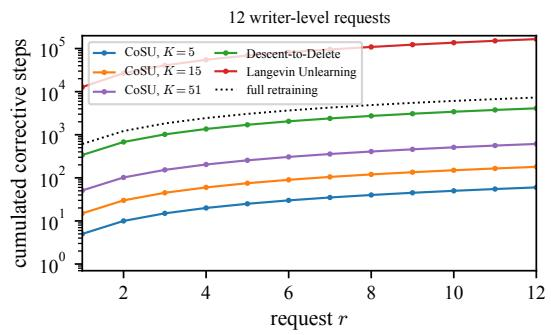

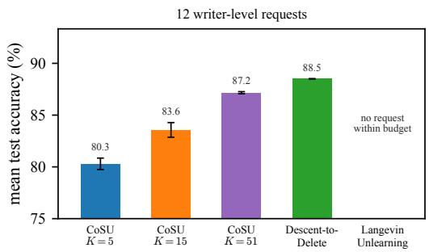  
Figure 5: CoSU and certified first-order baselines $( \varepsilon = 0 . 5 )$ on 12 writer-level requests. Left: cumulative number of corrective steps, with the lines of Figure 3. Right: test accuracy averaged over the requests $( \mathrm { m e a n } \pm \mathrm { s t d }$ over five runs); Langevin Unlearning processes no request within the budget of 10 retrainings.

Request r is certified when min $\iota _ { \alpha } \bigl \{ \varepsilon ^ { ( r ) } ( \alpha ) + \log ( 1 / \delta ) / ( \alpha - 1 ) \bigr \} \le \varepsilon ,$ , and $K _ { r } ^ { \mathrm { L U } }$ is the smallest integer for which this holds given $K _ { 1 } ^ { \mathrm { L U } } , \ldots , K _ { r - 1 } ^ { \mathrm { L U } }$ ; the minimum is taken over a grid of orders between 2 and $5 \times 1 0 ^ { 4 }$ . This is the procedure of Chien et al. (their Algorithms 6–8) with the constants of the sum objective and the size of each request. As they do, we treat the model obtained after the 610 training steps as a sample of the stationary distribution $( c ^ { 6 1 0 } \approx 6 \times 1 0 ^ { - 6 } )$

The recursion evaluates the bound of request $r - 1$ at order $2 \alpha$ , that of request $r - 2$ at order 4α, and so on, and corrective steps contract little at high orders. As a result, $K _ { r } ^ { \mathrm { L U } }$ grows linearly with r, by approximately $\alpha ^ { \star }$ log $2 / ( 2 R )$ steps per request, where $\alpha ^ { \star } \approx 1 + \log ( 1 / \delta ) / \varepsilon$ is the order imposed by the conversion: about 460 steps per request with our constants (474 measured on single-record requests), whatever $\sigma _ { \mathrm { L U } }$

## I Additional experiments

All experiments use the setting of Section 6.1; the notebook reproduces every figure and table.

Numerical check of the calibration For 100 random request streams mixing group sizes $g _ { r } \in \{ 1 , 2 , 5 , 2 0 , 1 0 0 \}$ and privacy levels $\bar { \mu } _ { r } \in \{ 0 . 1 , 0 . 3 , 1 , 2 \}$ , with training noise $\sigma _ { 0 } \in \{ 0 , 0 . 3 , 3 \}$ half of them with requests grouped at random into blocks of dependent requests (Appendix D), we rebuild the shift allocation of the proof of Theorem 1, training steps included, and check the constraints of Theorem 3 step by step. All allocations are admissible, the Gaussian-DP parameter equals the target privacy level up to $1 0 ^ { - 1 2 }$ , the new noise satisfies the bound of Corollary 1(a), the constant-size case coincides with the closed form (b), and the first request is free exactly when $\sigma _ { 0 }$ reaches the level of Proposition 8, as stated in Proposition 3.

Certified first-order baselines We compare CoSU with Descent-to-Delete and Langevin Unlearning $( \sigma _ { \mathrm { L U } } = 1 )$ , calibrated for the size of each request as in Appendix H $( \lambda ^ { \prime } = 0 . 0 1 , \varepsilon = 0 . 5 )$ They certify indistinguishability from a model retrained on Dr and not our counterfactual guarantee, so Figures 3 and 5 compare costs rather than guarantees. For a fair comparison, all methods, including CoSU, are trained for $T = 6 1 0$ steps in this experiment, as required by the certificate of Descent-to-Delete (Appendix H), and a retraining is counted as 610 steps. A method stops before its cumulative number of steps exceeds a budget of 10 retrainings (6,100 steps).

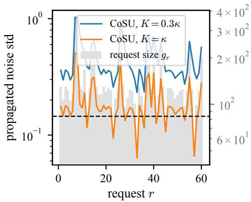

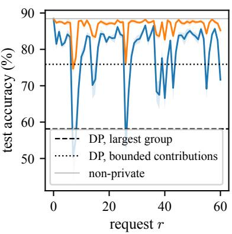  
Figure 6: Groups of variable size. Left: request sizes gr (gray) and propagated noise standard deviation $\sqrt { W _ { r } }$ , for Zipf(3) organizations. Right: test accuracy.

Table 2: Groups of variable size: accuracy $( \% )$ averaged over the requests $( \mathrm { m e a n } \pm \mathrm { s t d }$ over five runs) for writers (100 requests) and for organizations of Zipf(a) writers who leave together (60 requests).
<table><tr><td rowspan="2">Groups</td><td rowspan="2"> $\frac { \mathrm { m a x } } { \mathrm { m e a n } }$ </td><td rowspan="2">gmax</td><td colspan="2">CoSU</td><td colspan="2">DP</td></tr><tr><td> $K = 0 . 3 \kappa$ </td><td> $K = \kappa$ </td><td>largest</td><td>bounded</td></tr><tr><td>Writers</td><td>1.2</td><td>134</td><td> $8 3 . 6 \pm 0 . 3$ </td><td> ${ \bf 8 7 . 4 \pm 0 . 1 }$ </td><td> $7 6 . 6 \pm 1 . 1$ </td><td> $7 9 . 6 \pm 1 . 4$ </td></tr><tr><td> $\operatorname { Z i p f } ( 4 )$ </td><td>3.0</td><td>375</td><td> $8 2 . 4 \pm 0 . 4$ </td><td> ${ \bf 8 7 . 2 \pm 0 . 1 }$ </td><td> $5 8 . 9 \pm 3 . 7$ </td><td> $7 8 . 0 \pm 1 . 7$ </td></tr><tr><td> $\operatorname { Z i p f } ( 3 )$ </td><td>2.8</td><td>386</td><td> $7 9 . 1 \pm 0 . 4$ </td><td> ${ \bf 8 6 . 4 \pm 0 . 1 }$ </td><td> $5 8 . 1 \pm 3 . 8 $ </td><td> $7 5 . 9 \pm 2 . 0$ </td></tr><tr><td> $\mathrm { Z i p f ( 2 . 5 ) }$ </td><td>2.5</td><td>390</td><td> $7 6 . 7 \pm 0 . 4$ </td><td> ${ \bf 8 6 . 0 \pm 0 . 1 }$ </td><td> $5 7 . 8 \pm 3 . 9$ </td><td> $7 3 . 9 \pm 2 . 4$ </td></tr></table>

We first consider 50 requests of one record drawn at random. The three methods lose no accuracy on the requests they process (88.5% for CoSU, for Descent-to-Delete and for Langevin Unlearning), and difer in cost. CoSU uses K = 5 steps per request, 0.4 retraining for the whole stream. Descent-to-Delete needs 339 to 344 steps per request, more than half a retraining, and 28.1 retrainings in total: its base horizon $\mathcal { T } = 2 6 1$ depends on the dimension and on $( \varepsilon , \delta )$ , not on the request. Langevin Unlearning needs one step for each of the first two requests; its number of steps then grows by 474 per request, exceeds a retraining from the third request and reaches 24,681 at the fiftieth, 1,053 retrainings in total. A larger noise delays this growth without changing its slope: for $\sigma _ { \mathrm { L U } } = 1 0$ , the cost exceeds a retraining from request 10.

On 12 writer-level requests (94 to 129 records), Descent-to-Delete needs 339 to 349 steps per request and keeps 88.5%; CoSU reaches 87.2% with 51 steps, and 83.6% and 80.3% with 15 and 5 steps, operating points that the horizon of Descent-to-Delete does not allow. Langevin Unlearning needs 12,781 to 14,342 steps per request, more than 20 retrainings, from the first request: it processes no request within the budget.

Groups of coordinated users We group the private writers into organizations whose number of writers follows a Zipf law of parameter a, truncated at 3 writers. The writers of an organization leave together: their requests are dependent, so they form a single request, and organizations request independently of each other. Groups then contain up to 390 records, about three times the largest writer. Table 2 and Figure 6 report the results. DP provisioned for the largest group falls to about 58%; contribution bounding, the strongest DP competitor, falls to 78.0%, 75.9% and 73.9%. CoSU with $K = \kappa$ keeps 87.2%, 86.4% and 86.0%, as its noise follows each request: a large group causes a transient drop of accuracy (to about 75% at $K = \kappa$ , 50% at 0.3κ), whereas the DP learners pay a constant price at every release. The gap with contribution bounding grows from about 8 points (writers) to 12 (Zipf(2.5)).

Table 3: Levels chosen at deletion time $( \varepsilon _ { r } \in \{ 0 . 2 5 , 1 , 4 \}$ with probabilities 0.2, 0.5, 0.3): accuracy (%) averaged over requests, mean ± std over five runs.
<table><tr><td>Method</td><td>accuracy</td></tr><tr><td>CoSU, each request at its level  $\varepsilon _ { r }$ </td><td> ${ \bf 8 1 . 3 \pm 0 . 4 }$ </td></tr><tr><td>CoSU, every request at  $\varepsilon _ { \mathrm { m i n } }$ </td><td> $7 2 . 6 \pm 0 . 3$ </td></tr><tr><td>DP, largest group,  $\varepsilon _ { \mathrm { m i n } }$ </td><td> $6 8 . 4 \pm 1 . 9$ </td></tr><tr><td>DP, bounded contributions  $( g _ { 0 } = 6 7 )$   $\varepsilon _ { \mathrm { m i n } }$  2</td><td> $6 9 . 9 \pm 1 . 1$ </td></tr></table>

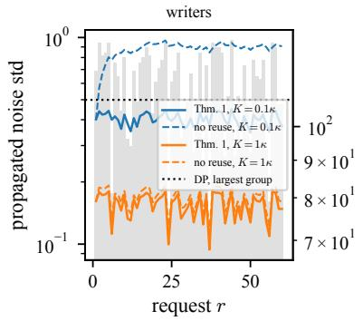

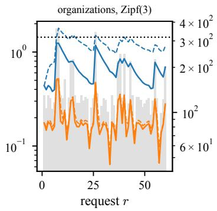

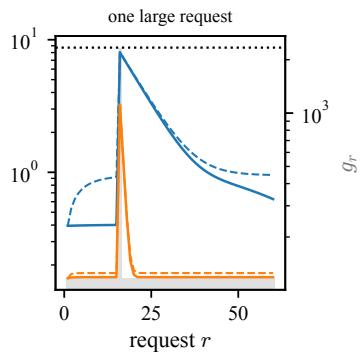  
Figure 7: Propagated noise standard deviation $\sqrt { W _ { r } }$ of CoSU (solid) and of its variant without reuse of past noise (dashed), with $K = 0 . 1 \kappa$ and $K = \kappa .$ , and of DP provisioned for the largest group (dotted), for three size profiles (gray bars: $g _ { r } )$

Privacy levels chosen at deletion time Each writer-level request chooses its level: $\varepsilon _ { r } \in$ $\{ 0 . 2 5 , 1 , 4 \}$ with probabilities $( 0 . 2 , 0 . 5 , 0 . 3 )$ $K = 0 . 3 \kappa$ , five runs (Table 3). A DP learner must be provisioned for the strictest level, $\varepsilon _ { \mathrm { m i n } } = 0 . 2 5$ , and so must an unlearning procedure that ignores the requested levels. Certifying each request at its own level, CoSU reaches 81.3%, against 72.6% when every request is certified at $\varepsilon _ { \mathrm { m i n } }$ : only the requests that ask for the strictest level pay for it. Both DP learners stay below 70%.

Noise profiles Figure 7 shows the propagated noise for writers, for $\operatorname { Z i p f } ( 3 )$ organizations, and for writer-sized requests with a single request twenty times larger. The noise follows the current request: a large request produces a spike that decays geometrically and does not raise the noise of the following small requests. When $K = 0 . 1 \kappa$ , reusing past noise divides the noise by 2.2 for writers, 1.8 for organizations and 1.2 for the single large request (median ratios); it matters little when $K = \kappa$ (median ratio 1.07).

Excess risk at a common regularization To compare CoSU and DP independently of the selected regularization, Figure 8 reports the excess empirical risk at $\lambda ^ { \prime } = 0 . 0 1$ . DP provisioned for the largest writer stays at $4 . 4 \times 1 0 ^ { 5 }$ (for a sum objective over 279,306 records), CoSU with $K = 0 . 1 \kappa$ between $2 . 2 \times 1 0 ^ { 5 }$ and $3 . 4 \times 1 0 ^ { 5 }$ , and CoSU with $K = \kappa$ between $2 . 1 \times 1 0 ^ { 4 }$ and $5 . 6 \times 1 0 ^ { 4 }$ : the ordering is the same as for the accuracy.

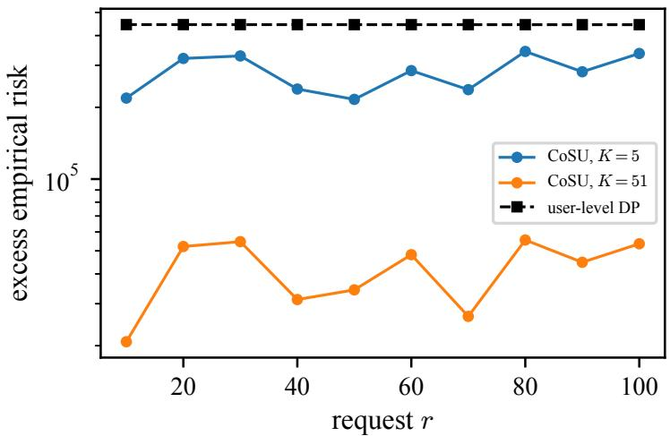  
Figure 8: Excess empirical risk $f _ { r } ( \theta _ { r } ) - f _ { r } ( \theta _ { r } ^ { \star } )$ along the writer-level stream, at the common regularization $\lambda ^ { \prime } = 0 . 0 1$ (five runs).

Table 4: Training noise $\sigma _ { 0 }$ (writer-level requests, $K = \kappa ,$ five runs): accuracy (%) before any request and averaged over the requests, and noise of the first and of the later requests.
<table><tr><td> $\sigma _ { 0 } / \sigma _ { 0 } ^ { \star }$ </td><td>before</td><td>mean over requests</td><td> $\sigma _ { 1 }$ </td><td>mean  $\sigma _ { r } , r \geq 2$ </td></tr><tr><td>0</td><td>88.4</td><td> $8 7 . 4 \pm 0 . 1$ </td><td>9.50</td><td>8.16</td></tr><tr><td>0.5</td><td>85.7</td><td> $8 7 . 3 \pm 0 . 1$ </td><td>8.00</td><td>8.16</td></tr><tr><td>1</td><td>78.8</td><td> $8 7 . 4 \pm 0 . 1$ </td><td>0</td><td>8.16</td></tr></table>

Excess risk and Theorem 2 Along a stream of $\operatorname { Z i p f } ( 3 )$ organizations (Figure 9), the excess risk of CoSU follows the recent requests: it rises after the largest ones (up to $2 . 1 \times 1 0 ^ { 5 } )$ and returns to its level (median $5 . 2 \times 1 0 ^ { 4 } )$ within a few requests. The bound of Theorem 2 has the same profile and is about 80 times larger (median ratio), as expected from a worst-case analysis.

Training noise Table 4 varies the training noise $\sigma _ { 0 } .$ , as a fraction of the level $\boldsymbol { \sigma } _ { 0 } ^ { \star }$ that makes training diferentially private for the largest writer (Proposition 8), with $K = \kappa .$ The calibration accounts for the training noise: at $\sigma _ { 0 } = \sigma _ { 0 } ^ { \star }$ , the first request is free, as predicted by Proposition 3. Later requests do not benefit, because the training noise has contracted by the time they arrive and the previous episodes were run with their records: the accuracy averaged over the requests is unchanged (87.3–87.4%), while the accuracy before any request drops from 88.4% to 78.8%. With $K = \kappa ,$ , training noise therefore brings nothing, and we use $\sigma _ { 0 } = 0$ throughout.

## J Experimental details

Data We use the digits (classes 0–9) of FEMNIST [21], in the version distributed with writer identifiers (flwrlabs/femnist). Writers are split uniformly at random (seed 0) into 500 public writers (56,384 images), 300 test writers (33,366 images), 300 validation writers and 2,480 private writers (279,306 images, 113 records per writer on average, at most 134). The public writers are never deleted and are only used to fit the feature map; the validation writers are only used for hyperparameter selection.

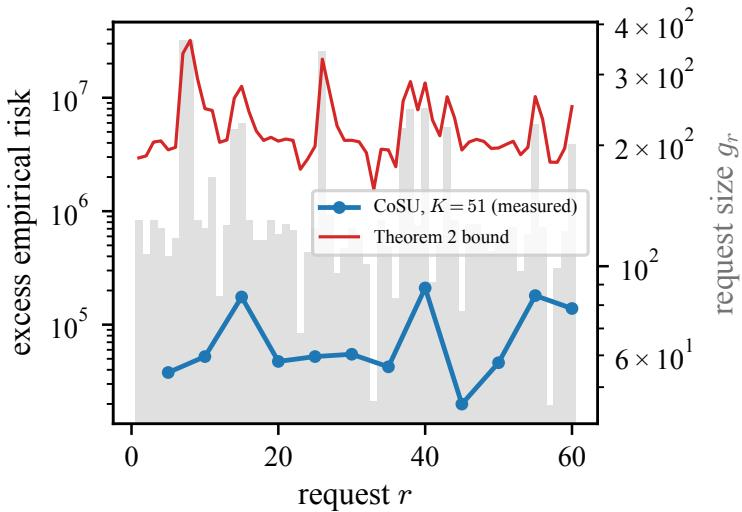  
Figure 9: Excess empirical risk along a stream of Zipf(3) organizations $( K = \kappa ,$ , five runs), and the bound of Theorem 2 (gray bars: $g _ { r } )$

Feature map We use the ResNet-18 of torchvision pretrained on ImageNet (IMAGENET1K\_V1), frozen. The $2 8 \times 2 8$ gray-level images are resized to $6 4 \times 6 4$ (bilinear), replicated on the three channels and normalized with the ImageNet statistics; the features are the spatial average of the output of the second residual stage (128 dimensions). Each coordinate is centered and divided by its standard deviation on the public writers, and every feature vector is normalized to unit $\ell _ { 2 }$ norm. No FEMNIST image is used to train the network, and the standardization uses public writers only, so the feature map does not depend on the private data. The non-private model reaches 88.4% test accuracy.

Model and constants The certified model is a multiclass softmax regression with parameter $\theta \in \mathbb { R } ^ { 1 2 8 \times 1 0 } \ ( p = 1 2 8 0 )$ and full-batch sum objective

$$
f _ { r } ( \theta ) = \sum _ { i \in D _ { r } } \ell ( \theta ; x _ { i } , y _ { i } ) + \frac { \lambda } { 2 } \| \theta \| _ { F } ^ { 2 } , \qquad \lambda = \lambda ^ { \prime } n ,
$$

with n the (public) size of the initial training set. The ridge penalty gives $m = \lambda$ . For a single example, $\nabla ^ { 2 } \ell = ( x _ { i } x _ { i } ^ { \top } ) \otimes ( \mathrm { d i a g } ( \pi _ { i } ) - \pi _ { i } \pi _ { i } ^ { \top } )$ , where $\pi _ { i }$ is the vector of predicted probabilities, with dia $\begin{array} { r } { \mathsf { \Omega } \backslash \mathrm { g } ( \pi _ { i } ) - \pi _ { i } \pi _ { i } ^ { \top } \preceq \frac { 1 } { 2 } I ; } \end{array}$ since $\| x _ { i } \| _ { 2 } = 1$ and $| D _ { r } | \leq n$ , every retained objective is L-smooth with $L =$ $n / 2 + \lambda$ . This bound only depends on public quantities, unlike the tighter $\lambda _ { \operatorname* { m a x } } ( X ^ { \top } X ) / 2 + \lambda ,$ , which would make the calibration depend on the private records. Since $\| \nabla _ { \theta } \ell \| _ { F } = \| x _ { i } \| _ { 2 } \| \pi _ { i } - e _ { y _ { i } } \| _ { 2 } \leq \sqrt { 2 }$ 2 we take $M = { \sqrt { 2 } }$ . This gives $\kappa = 1 / ( 2 \lambda ^ { \prime } ) + 1 ~ ( \kappa = 5 1 $ for the selected $\lambda ^ { \prime } = 0 . 0 1 )$ and $c = 1 - 1 / \kappa$ The number of training steps $T ,$ which is also the cost of a retraining, is measured for each $\lambda ^ { \prime }$ on the validation writers: it is the smallest number of steps, on a fixed grid of checkpoints, whose validation accuracy without noise is within 0.1 point of the best accuracy reached within $1 0 \kappa + 1 0 0$ steps $( T = 2 0 0$ for $\lambda ^ { \prime } = 0 . 0 1$ , about $4 \kappa )$ . This cap is our choice: gradient descent with step size $1 / L$ contracts the distance to the minimizer by $c = 1 - 1 / \kappa$ at each step [27], hence by about $e ^ { - 1 0 }$ after 10κ steps, and the additional 100 steps cover small values of $\kappa .$ Training is deterministic $( \sigma _ { 0 } = 0 )$ unless stated otherwise, and CoSU uses a number $K$ of corrective steps per request proportional to $\kappa ,$ rounded to an integer $( K = 5 , 1 5 ,$ , 31 and 51 for 0.1κ, 0.3κ, 0.6κ and $\kappa )$

Privacy parameters Requests are certified at $( \varepsilon , \delta ) = ( 0 . 5 , 1 / n )$ unless stated otherwise. The Gaussian-DP level is the largest $\mu$ such that $\mu { \mathrm { - G D P } }$ implies $( \varepsilon , \delta ) – \mathrm { D P } _ { \mathrm { : } }$ , obtained by inverting the exact conversion of Dong et al. [20] $( \mu = 0 . 1 3 3$ for $\varepsilon = 0 . 5$ and $\mu = 0 . 2 5 3$ for $\varepsilon = 1$ , with $\delta = 1 / n )$ DP learners use the same conversion.

Competitors By Proposition $6 ,$ training-time DP satisfies our definition for the requests it is provisioned for. We compare with two DP learners, trained by noisy gradient descent calibrated by Proposition $8$ (the same shifted-interpolation analysis as CoSU) for the number of steps $T$ of their own $\lambda ^ { \prime } ,$ , and performing no update at deletion time: DP, largest group, provisioned for the largest user of the training set, and $D P ,$ bounded contributions [24, 25], which keeps at most $g _ { 0 }$ records per user and is provisioned for $g _ { 0 }$ . We also compare with Langevin Unlearning and Descent-to-Delete in Figure 3 and Appendix I. Results are averaged over five runs (mean ± standard deviation) unless stated otherwise.

Streams and users Requests are drawn uniformly at random without replacement among users (seed 1), independently of the data and of the models, so that requests are independent (Assumption 5). Organizations are formed by drawing, for each organization, a number of writers from a $\mathrm { Z i p f }$ distribution of parameter $^ { a , }$ truncated at 3, and assigning writers in a random order. Contribution bounding keeps, for each user, a uniformly random subset of at most $g _ { 0 }$ records.

Hyperparameter selection All hyperparameters are selected on the validation writers, disjoint from the training and test writers. The grid is $\lambda ^ { \prime } \in \{ 0 . 0 0 1 , 0 . 0 0 3 , 0 . 0 1 , 0 . 0 3 , 0 . 1 , 0 . 3 \}$ , with the training length $T$ of each value (1,000, 500, 200, 75, 25 and 7 steps). For CoSU, one $\lambda ^ { \prime }$ is selected once and used in all experiments: CoSU is run at $\varepsilon = 0 . 5$ on a separate stream of 30 writer-level requests with 50 steps per request, close to the largest budget we use $( K = \kappa = 5 1 )$ , and scored by its validation accuracy averaged over the requests and over three noise draws. This selects $\lambda ^ { \prime } = 0 . 0 1$ (88.1%, against 84.7% for $\lambda ^ { \prime } = 0 . 0 3$ and 81.3% for $\lambda ^ { \prime } = 0 . 0 0 3 )$ . The DP learners are trained on the private writers and evaluated on the validation writers (three noise draws): for every experiment, they select their own $\lambda ^ { \prime }$ in the same grid extended with $\lambda ^ { \prime } = 1$ , hence their own $T ,$ and contribution bounding selects its bound $g _ { 0 } \in \{ 8 , 1 7 , 3 4 , 6 7 \}$ (from one sixteenth to one half of the largest writer), extended to {134, 268} for organizations. The selected values are given in Table 5.

The comparison with the DP learners depends on the privacy level. With their hyperparameters selected again at each level, and $\lambda ^ { \prime } = 0 . 0 1$ kept for CoSU, the best DP learner reaches 69.9%, 79.6% and 87.5% at $\varepsilon = 0 . 2 5 , 0 . 5 , 1$ , against 84.3%, 87.4% and 88.1% for CoSU with $K = \kappa \ \mathrm { ( F i g u r e \ 1 }$ middle). CoSU is 14.4 and 7.8 points ahead at $\varepsilon = 0 . 2 5$ and 0.5, and on par at $\varepsilon = 1$

Membership inference We audit the certificate of a target user in the strongest threat model: the attacker knows all the other records, the algorithms and the sizes and privacy levels of the requests, and must decide from the final release whether the target’s records were in the training set and deleted (world IN) or never there (world OUT, where the same requests are issued but delete nothing). To aford many runs, the training set is a sub-population of 200 private writers drawn at random $( n = 2 2 , 4 6 0 )$ , and all constants are computed for this dataset, with $\lambda ^ { \prime } = 0 . 0 1$ (κ = 51, T = 200), K = 0.1κ and $\varepsilon = 1 ~ ( \bar { \mu } = 0 . 2 9 6 )$ . The target is deleted either as one request, the correct treatment of a user, or split into $m \in \{ 2 , 4 , 8 \}$ requests issued consecutively and each calibrated as if it were independent: the requests of the same user are dependent, and this treatment violates Assumption 5. We run the pipeline 1,024 times in each world, in batches of 64 runs with independent noise.

Table 5: Hyperparameters selected on validation writers: ridge parameter $\lambda ^ { \prime } ,$ number of training steps T and, for DP with bounded contributions, bound $g _ { 0 } .$
<table><tr><td>Groups CoSU</td><td> $( \lambda ^ { \prime } , T )$  DP largest group</td><td> $( \lambda ^ { \prime } , T )$  DP bounded  $( \lambda ^ { \prime } , T , g _ { 0 } )$ </td></tr><tr><td>Writers (0.01, 200)</td><td>(0.03, 75)</td><td>(0.003, 500, 34)</td></tr><tr><td>Zipf(4)</td><td>(0.01, 200) (0.1, 25)</td><td>(0.003, 500, 34)</td></tr><tr><td>Zipf(3)</td><td>(0.01, 200) (0.1, 25)</td><td>(0.003, 500, 34)</td></tr><tr><td> $\mathrm { Z i p f ( 2 . 5 ) }$ </td><td>(0.01, 200) (0.1, 25)</td><td>(0.003, 500, 34)</td></tr><tr><td> $\mathrm { W r i t e r s } , \varepsilon _ { r }$  at deletion time (0.01, 200)</td><td>(0.1, 25)</td><td>(0.03, 75, 67)</td></tr></table>

Table 6: Membership inference (1,024 runs per world, $\bar { \mu } = 0 . 2 9 6 )$ : empirical Gaussian-DP level $\hat { \mu }$ of the white-box attack with its 95% bootstrap interval, and AUC of the white-box and black-box attacks, for a user of $g$ records deleted in one request $( m = 1 )$ or split into m requests certified separately.
<table><tr><td>User</td><td>g</td><td>m</td><td> $\hat { \mu }$ </td><td>95% interval</td><td>AUC, white-box</td><td>AUC, black-box</td></tr><tr><td>canary</td><td>16</td><td>1</td><td>0.147</td><td>[0.061,0.238]</td><td>0.544</td><td>0.542</td></tr><tr><td>canary</td><td>16</td><td>2</td><td>0.365</td><td>[0.279, 0.458]</td><td>0.602</td><td>0.601</td></tr><tr><td>canary</td><td>16</td><td>4</td><td>0.565</td><td>[0.475, 0.654]</td><td>0.655</td><td>0.658</td></tr><tr><td>canary</td><td>16</td><td>8</td><td>0.906</td><td>[0.814, 0.998]</td><td>0.742</td><td>0.751</td></tr><tr><td>natural</td><td>101</td><td>1</td><td>-0.018</td><td>[-0.098, 0.082]</td><td>0.494</td><td>0.516</td></tr><tr><td>natural</td><td>101</td><td>2</td><td>0.009</td><td>[−0.071, 0.099]</td><td>0.502</td><td>0.511</td></tr><tr><td>natural</td><td>101</td><td>4</td><td>0.017</td><td>[-0.067, 0.095]</td><td>0.502</td><td>0.504</td></tr><tr><td>natural</td><td>101</td><td>8</td><td>0.138</td><td>[0.048, 0.220]</td><td>0.539</td><td>0.534</td></tr></table>

An attack assigns a score to each release and compares it with a threshold. The white-box attack uses the parameters of the released model. It first runs the pipeline without noise in each world, which gives two models $\theta ^ { \mathrm { I N } }$ and $\theta ^ { \mathrm { { O U T } } }$ , and scores a release θ by its inner product with their diference, $\langle \theta , \theta ^ { \mathrm { { I N } } } - \theta ^ { \mathrm { { O U T } } } \rangle$ . For a Gaussian release centered at $\theta ^ { \mathrm { I N } } \ \mathrm { { o r } \ } \theta ^ { \mathrm { O U T } }$ , this score is the likelihood-ratio statistic. The black-box attack only evaluates the released model: its score is the average loss on the target’s records. We report $\hat { \mu } ,$ the gap between the mean scores of the two worlds divided by their pooled standard deviation: for Gaussian scores, this is the Gaussian-DP level of the attack [20], which cannot exceed $\bar { \mu }$ if the target is protected; the 95% intervals are percentile bootstrap intervals over the runs. Besides a natural writer (101 records), we use a canary user, as in privacy auditing: 16 records of a writer are replaced by copies of one of its images with the next label, so that their gradients stay close to the bound M and are aligned, which is close to the worst case of the certificate. Table 6 reports both attacks.

Compute All experiments run on the GPU of a MacBook Pro, through the MPS backend of PyTorch. The runs of a point, and the configurations of a grid, are computed in one batch: a full-batch gradient step on the 279,306 records takes 23 ms for one run and 11 ms for a batch of five runs. The ImageNet features are computed once and cached. The membership inference experiment takes less than one minute, the writer-level experiment (including the tuning of the DP learners) 5 minutes, the trade-of in ε 10 minutes, the groups of coordinated users 6 minutes, the levels chosen at deletion time 2 minutes, and the appendix experiments 4 minutes: about half an hour in total.