# DEPTH MEMORY

David Gonzalez-Mart´ ´ınez<sup>∗1,2,3</sup> Philipp Nazari<sup>∗1,2,3,4</sup>

T. Konstantin Rusch<sup>1,2,3,5</sup> Shiwei Liu<sup>1,2,3</sup>

<sup>1</sup>ELLIS Institute Tubingen¨ <sup>2</sup>Max Planck Institute for Intelligent Systems, Tubingen¨ <sup>3</sup>Tubingen AI Center¨ <sup>4</sup>ETH Zurich¨ <sup>5</sup>Liquid AI <sup>∗</sup>Equal contribution

## ABSTRACT

Residual connections propagate information through a network by additively accumulating layer outputs. Recently proposed alternatives, such as Manifold-Constrained Hyper-Connections (mHC) and Attention Residuals (AttnRes), instead use more expressive depth aggregation mechanisms that improve language modeling performance at scale. In this work, we consider the mixing of representations over depth as a problem of storing and retrieving information across layers. Formalizing this perspective, we introduce Depth Memory (DM), a unified framework that describes the standard pre-layer-norm (PreLN) transformer, mHC, and AttnRes in terms of streams that carry representations through the network. One such stream, for example, could be an explicit memory stream that is queried to enrich the input to every layer, and whose output is subsequently written back into the memory for use by later layers. For AttnRes, this memory stream is a growing cache of explicit layer representations. For mHC, it is an expanded residual stream. Building on this view, we propose Linear Depth Memory (LDM), which formulates information retrieval across depth as a regression problem solved using recursive least squares. The resulting architecture propagates three streams across depth: the standard residual stream, a linear associative memory stream, and an inverse covariance stream. For high-throughput training and inference, we propose a hardware-aware implementation of LDM that reduces peak activation memory and memory traffic. LDM consistently achieves the lowest perplexities among PreLN, mHC and AttnRes baselines at the 400M and 1.5B parameter scales, alongside competitive zero-shot accuracy.

## Code

Checkpoints

## 1 INTRODUCTION

The transformer architecture underpins modern language modeling (Vaswani et al., 2023). Since its introduction, architecture research has mainly seen innovation along two axes: sequence mixing, which includes softmax attention (Vaswani et al., 2023), linear attention (Katharopoulos et al., 2020), and state-space models (Gu et al., 2022), and channel mixing, through works like gated MLPs (Shazeer, 2020) and MoEs (Fedus et al., 2022). The standard mechanism for propagating information across depth, however, has remained largely unchanged since the introduction of ResNet (He et al., 2016): layer outputs are accumulated additively through residual connections. Recent works have established alternatives to this standard mechanism at scale (Kimi Team et al., 2026a; DeepSeek-AI et al., 2026). For example, Hyper-Connections (HC, Zhu et al. (2025)) and Manifold-Constrained

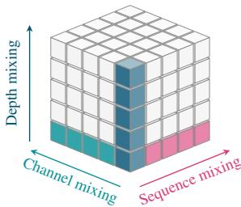  
Figure 1: The axes of representation mixing: sequence (tokens), channel (features), and depth (layers).

Hyper-Connections (mHC, Xie et al. (2026)) maintain an expanded residual stream, while Attention Residuals (AttnRes, Kimi Team et al. (2026b)) explicitly attend to previous layer outputs (Figure 2b). Analogous to sequence and channel mixing operators (Figure 1), we refer to these methods as depth mixing mechanisms.

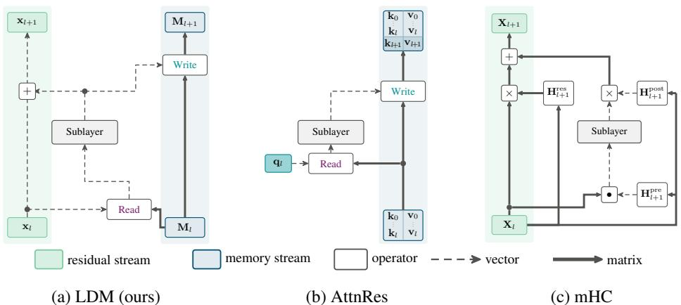  
Figure 2: (a) LDM carries a separate per-token depth memory alongside the residual stream. Read and Write are simplified for brevity (the inverse covariance stream and the write address generation are omitted). (b) AttnRes reads from a growing key–value memory M<sub>l</sub> and writes the sublayer output back into it. (c) mHC generates its three mappings from the current expanded state and applies them around one transformer branch.

In this work, we approach depth mixing from a different angle. Viewing it as a problem of storing and retrieving information across layers, we introduce Depth Memory, a framework that interprets the propagation of information across depth as a problem of managing layer representations using a set of streams. At each layer, and independently for each token, a Read operation forms the layer input from these streams, and a Write operation updates the streams using the layer output. This framework encompasses the standard residual stream, AttnRes’s growing cache of layer representations, and mHC’s expanded residual stream, covering both explicit and implicit forms of depth mixing (Figure 2).

Besides taxonomizing existing residual methods using our depth memory framework, we propose instantiating it as a Linear Depth Memory (LDM). LDM maintains three streams: the standard residual stream, a fixed-size matrix-valued memory stream, and an inverse covariance stream (Figure 2a). Analogous to test-time regression for sequence mixing (Wang et al., 2025), we formulate matrixvalued memory stream updates as the solution to a depth regression problem, which fits a linear map to reconstruct previous layer outputs from their corresponding keys. LDM solves this optimization problem optimally through recursive least squares (RLS, Section 3.2).

Our hardware-aware implementation of LDM addresses efficiency challenges posed by a naive instantiation of the framework. First, we implement an unwinding mechanism that does not require storing each layer’s memory stream. Second, we employ a windowed Write algorithm that defers parts of the memory updates. Implemented as efficient CuTe DSL kernels, LDM achieves comparable speed to the baselines (Figure 5).

We evaluate LDM on language modeling benchmarks across 400M Llama-like (Touvron et al., 2023) and 1.5B Qwen-like (Yang et al., 2025a) transformer backbones. LDM achieves lower perplexity than a standard pre-layer-norm (PreLN) transformer, mHC and AttnRes at both scales, along with competitive zero-shot accuracy. These gains hold across standard aspect ratios. We furthermore perform extensive ablations to isolate the contributions of different LDM architectural components.

## In summary, our main contributions are:

1. We introduce depth memory, a framework that describes the propagation of information across depth through a collection of streams and their Read and Write operations.

2. We instantiate this framework in the form of LDM, a linear depth memory that solves a depth regression problem using recursive least squares to store layer representations in a fixed-size state.

3. We provide an efficient implementation of LDM that combines unwinding and deferred writing techniques to reduce activation memory overhead and memory traffic of LDM.

4. We show that LDM consistently achieves the lowest perplexities among tuned PreLN, mHC, and AttnRes baselines at the 400M and 1.5B scales, while maintaining competitive zero-shot accuracy, and that these gains hold across standard model aspect ratios.

## 2 BACKGROUND

Consider a standard pre-normalized transformer (PreLN, Xiong et al. (2020)) with B blocks and $L = 2 B$ layers. We write equations for a single token and suppress its index. Let $\mathbf { x } _ { l } \in \mathbb { R } ^ { D }$ denote its representation after layer $l ,$ with $\mathbf { x } _ { 0 } ~ = ~ \mathbf { e }$ as the token embedding. In PreLN, representations across depth follow the recurrence

$$
\begin{array} { r } { { \bf x } _ { l } = { \bf x } _ { l - 1 } + \delta _ { l } , \qquad \delta _ { l } = F _ { l } \left( \mathrm { N o r m } _ { l } ( { \bf x } _ { l - 1 } ) \right) , \qquad l = 1 , \ldots , L , } \end{array}\tag{1}
$$

where Norm<sub>l</sub> is typically RMSNorm (Zhang & Sennrich, 2019), and $F _ { l }$ is either an attention layer or an MLP. Unrolling this recurrence gives

$$
\mathbf { x } _ { l } = \mathbf { e } + \sum _ { i = 1 } ^ { l } \delta _ { i } .
$$

In particular, residual connections establish a residual stream that aggregates layer outputs additively (Figure $\mathrm { 2 a ) }$ . Recent work extends this additive aggregation with richer representations and learned mechanisms for mixing information across depth. We review two prominent approaches below, then unify them within our depth memory framework in Section 3.1.

## 2.1 ATTENTION RESIDUALS

Attention Residuals (AttnRes, Kimi Team et al. (2026b)) replace simple additive accumulation of layer outputs via the residual stream with softmax attention over earlier layer outputs. Set $\mathbf { v } _ { 0 } =$ ${ \bf k } _ { 0 } = { \bf e }$ and $\mathbf { v } _ { i } = \mathbf { k } _ { i } = \delta _ { i }$ , for $i \geq 1$ . Full AttnRes forms the input to layer l as

$$
\mathbf { a } _ { l } = \sum _ { i = 0 } ^ { l - 1 } \alpha _ { l , i } \mathbf { v } _ { i } , \qquad \alpha _ { l , i } = { \frac { \exp \left( \mathbf { q } _ { l - 1 } ^ { \top } \mathrm { R M S N o r m } ( \mathbf { k } _ { i } ) \right) } { \sum _ { j = 0 } ^ { l - 1 } \exp \left( \mathbf { q } _ { l - 1 } ^ { \top } \mathrm { R M S N o r m } ( \mathbf { k } _ { j } ) \right) } } .\tag{2}
$$

The layer then produces $\delta _ { l } = F _ { l } ( \mathrm { N o r m } _ { l } ( \mathbf { a } _ { l } ) )$ ), which is stored for subsequent layers to attend to. The query $\mathbf { q } _ { l - 1 } \in \mathbb { R } ^ { D }$ is a learned per-layer parameter. Through the attention mechanism, each layer can selectively weight previous representations, while PreLN gives every previous layer the same weight (Figure 2b).

The above formulation of AttnRes, known as Full AttnRes, incurs memory overhead during inference because it needs to retain previous representations. Block AttnRes groups layers into blocks and summarizes each block by the sum of its layer outputs. At every layer, Block AttnRes forms the input from the embedding, the completed blocks, and the current block’s partial sum.

## 2.2 HYPER-CONNECTIONS

Hyper-Connections (HC, Zhu et al. (2025)) expand the residual representation into N streams, collected as columns of $\mathbf { X } _ { l } ~ \in ~ \mathbb { R } ^ { D \times N }$ . Three learned mappings take the incoming state $\mathbf { X } _ { l - 1 }$ and produce vectors $\mathbf { H } _ { l } ^ { \mathrm { p r e } } ( \mathbf { X } _ { l - 1 } ) , \mathbf { H } _ { l } ^ { \mathrm { p o s t } } ( \mathbf { X } _ { l - 1 } ) \in \mathbb { R } ^ { N }$ as well as the matrix $\mathbf { H } _ { l } ^ { \mathrm { r e s } } ( \mathbf { X } _ { l - 1 } ) \in \mathbb { R } ^ { N \times N }$ . A layer acts on this expanded residual stream via

$$
\delta \boldsymbol { l } = F _ { l } \left( \mathrm { N o r m } _ { l } ( \mathbf { X } _ { l - 1 } \mathbf { H } _ { l } ^ { \mathrm { p r e } } ( \mathbf { X } _ { l - 1 } ) ) \right) , \quad \mathbf { X } _ { l } = \mathbf { X } _ { l - 1 } \mathbf { H } _ { l } ^ { \mathrm { r e s } } ( \mathbf { X } _ { l - 1 } ) + \delta _ { l } \left( \mathbf { H } _ { l } ^ { \mathrm { p o s t } } ( \mathbf { X } _ { l - 1 } ) \right) ^ { \top } .
$$

The pre-mapping $\mathbf { H } _ { l } ^ { \mathrm { p r e } }$ combines streams into a D-dimensional layer input, the post-mapping $\mathbf { H } _ { l } ^ { \mathrm { p o s t } }$ distributes the layer output across streams, and the residual mapping $\mathbf { H } _ { l } ^ { \mathrm { r e s } }$ mixes streams (Figure 2c). Manifold-Constrained Hyper-Connections (mHC, Xie et al. (2026)) constrain this architecture to stabilize signal propagation over depth. In particular, $\mathbf { H } _ { l } ^ { \mathrm { r e s } }$ is constrained to be approximately doubly stochastic through applications of the Sinkhorn-Knopp algorithm (Sinkhorn & Knopp, 1967).

Hyper-Connections as a memory. (m)HC updates the residual stream with a rank-1 matrix, and contracts it to generate layer inputs. Informally, this mechanism can be interpreted as a linear associative memory over depth (Kohonen, 1972; Kimi Team et al., 2026b). The pre-mapping $\mathbf { H } _ { l } ^ { \mathrm { p r e } }$ generates a query that reads from the state, and the post-mapping $\mathbf { H } _ { l } ^ { \mathrm { p o s t } }$ generates a key under which the layer output is written to the expanded residual stream through an outer product update. The residual mapping $\mathbf { H } _ { l } ^ { \mathrm { r e s } }$ acts as a transition matrix on the state. Since this state combines earlier layer outputs, subsequent reads mix information across depth without explicitly retaining each output. HC and mHC can therefore be understood as performing a form of implicit depth mixing, with both queries and keys generated from the incoming matrix-valued state itself. Building on this perspective, we next establish depth memory as a framework that encompasses both (m)HC and AttnRes, before instantiating the framework as a linear depth memory.

Table 1: Overview of depth mixing methods. Each method maintains streams that are accessed through Read and Write operators. LDM uses the RLS update derived in Section 3.2, with pseudo-value u<sub>l</sub> and gain $\kappa _ { l } .$ Gates and the inverse covariance update for $\mathbf { P } _ { l }$ are omitted for brevity.
<table><tr><td>Method Streams</td><td></td><td>State update (Write)</td><td>Memory readout (Read)</td></tr><tr><td>PreLN</td><td> $\left( \mathbf { x } _ { l } \right)$ </td><td> $\mathbf { x } _ { l } = \mathbf { x } _ { l - 1 } + \mathbf { v } _ { l }$ </td><td>xl</td></tr><tr><td>AttnRes</td><td> $\big ( ( \mathbf { K } _ { \leq l } , \mathbf { V } _ { \leq l } ) \big )$ </td><td> $\mathrm { A p p e n d } ( \mathbf { k } _ { l } , \mathbf { v } _ { l } )$ </td><td> $\mathrm { A t t e n d } ( \mathbf { M } _ { l } , \mathbf { q } _ { l } )$ </td></tr><tr><td>mHC</td><td> $( \mathbf { X } _ { l } )$ </td><td> $\mathbf { X } _ { l } = \mathbf { X } _ { l - 1 } \mathbf { H } _ { l } ^ { \mathrm { r e s } } ( \mathbf { X } _ { l - 1 } ) + \mathbf { v } _ { l } \mathbf { H } _ { l } ^ { \mathrm { p o s t } } ( \mathbf { X } _ { l - 1 } ) ^ { \top }$ </td><td> $\mathbf { X } _ { l } \mathbf { H } _ { l + 1 } ^ { \mathrm { p r e } } ( \mathbf { X } _ { l } )$ </td></tr><tr><td>LDM</td><td> $\left( \mathbf { x } _ { l } , \mathbf { M } _ { l } , \mathbf { P } _ { l } \right)$ </td><td> $( \mathbf { x } _ { l } , \mathbf { M } _ { l } ) = ( \mathbf { x } _ { l - 1 } + \mathbf { v } _ { l } , \mathbf { M } _ { l - 1 } + \mathbf { u } _ { l } \kappa _ { l } ^ { \top } )$ </td><td> $\mathbf { x } _ { l } + \mathbf { M } _ { l } \mathbf { q } _ { l }$ </td></tr></table>

## 3 DEPTH MEMORY

In this section, we first introduce depth memory (DM), a framework that takes a memory-centric view to describe how information in a transformer flows over depth and encompasses PreLN as well as AttnRes and mHC. We then instantiate DM as a linear depth memory, which we formulate as solving a regression problem over depth. Finally, we describe how to use unwinding and windowed updates to implement linear depth memory efficiently.

## 3.1 THE FRAMEWORK

The depth memory framework assumes a tuple $\mathbf { S } _ { l } = ( \mathbf { S } _ { l } ^ { ( 1 ) } , \ldots , \mathbf { S } _ { l } ^ { ( P ) } )$ of P streams, which are read from and written to using Read and Write operators. For a single stream, we identify $\mathbf { S } _ { l } = \mathbf { S } _ { l } ^ { ( 1 ) }$ The input to sublayer $F _ { l }$ is enhanced by reading from the streams $\mathbf { S } _ { l - 1 }$ using a query q<sub>l−1</sub>, and it is updated using keys k<sub>l</sub> and values $\mathbf { v } _ { l } ,$ , where the value is the sublayer output $\mathbf { v } _ { l } = \delta _ { l }$

$$
\delta _ { l } = F _ { l } \left( \mathrm { N o r m } _ { l } \left( \mathrm { R e a d } ( \mathbf { S } _ { l - 1 } , \mathbf { q } _ { l - 1 } ) \right) \right) , \qquad \mathbf { S } _ { l } = \mathrm { W r i t e } \left( \mathbf { S } _ { l - 1 } , \mathbf { k } _ { l } , \mathbf { v } _ { l } \right) .
$$

Any instantiation of DM requires specifying the tuple $\mathbf { S } _ { l }$ of streams as well as the Read and Write operators. The following paragraphs incorporate PreLN, AttnRes and mHC.

PreLN. For PreLN there exists exactly one stream, which is the classic residual stream: $\mathbf { S } _ { l } = \mathbf { x } _ { l }$ The Read and Write operators retrieve the stream and write layer outputs into it,

$$
\mathrm { R e a d } \left( \mathbf { x } _ { l - 1 } , \cdot \right) = \mathbf { x } _ { l - 1 } , \qquad \mathbf { x } _ { l } = \mathrm { W r i t e } \left( \mathbf { x } _ { l - 1 } , \cdot , \delta _ { l } \right) = \mathbf { x } _ { l - 1 } + \delta _ { l } .
$$

AttnRes. Like PreLN, AttnRes maintains exactly one stream. This stream consists of a growing set of key–value pairs: $\mathbf { S } _ { l } = \mathbf { M } _ { l } = ( \mathbf { K } _ { \leq l } , \mathbf { V } _ { \leq l } )$ . Here, M acts as a memory for the model that explicitly maintains every previous layer’s representation. Reading and writing correspond to attending and appending to the cache:

$$
\begin{array} { c } { \operatorname { R e a d } ( \mathbf { M } _ { l - 1 } , \mathbf { q } _ { l - 1 } ) = \operatorname { A t t e n d } ( \mathbf { M } _ { l - 1 } , \mathbf { q } _ { l - 1 } ) } \\ { \mathbf { M } _ { l } = \operatorname { W r i t e } ( \mathbf { M } _ { l - 1 } , \mathbf { k } _ { l } , \mathbf { v } _ { l } ) = \mathbf { M } _ { l - 1 } . \operatorname { A p p e n d } ( \mathbf { k } _ { l } , \mathbf { v } _ { l } ) . } \end{array}
$$

Since this mechanism keeps a copy of every representation, we refer to it as an explicit depth mixer.   
Its memory stream grows over depth, as incoming representations are appended.

mHC. For mHC, there again is exactly one stream. This time it is the expanded residual stream, $\mathbf { S } _ { l } ~ = ~ ( \mathbf { X } _ { l } )$ . The queries and keys are generated via ${ \bf q } _ { l } = { \bf H } _ { l + 1 } ^ { \mathrm { p r e } } ( { \bf X } _ { l } )$ and $\mathbf k _ { l } = \mathbf H _ { l } ^ { \mathrm { p o s t } } ( \mathbf X _ { l - 1 } )$ Reading and writing correspond to

$$
\mathrm { R e a d } \left( \mathbf { X } _ { l - 1 } , \mathbf { q } _ { l - 1 } \right) = \mathbf { X } _ { l - 1 } \mathbf { q } _ { l - 1 } , \qquad \mathbf { X } _ { l } = \mathrm { W r i t e } \left( \mathbf { X } _ { l - 1 } , \mathbf { k } _ { l } , \mathbf { v } _ { l } \right) = \mathbf { X } _ { l - 1 } \mathbf { H } _ { l } ^ { \mathrm { r e s } } ( \mathbf { X } _ { l - 1 } ) + \mathbf { v } _ { l } \mathbf { k } _ { l } ^ { \top } .
$$

The memory stream of mHC has a fixed size (see also Section 2). Compared to AttnRes, incoming representations are additively written into the stream, not appended. We thus refer to it as an implicit depth mixer. Table 1 provides an overview of depth mixing architectures in our framework. In the next section, we introduce linear depth memory, an implicit depth mixer derived from first principles.

## 3.2 LINEAR DEPTH MEMORY

In this section, we develop linear depth memory (LDM), a novel depth mixing module. At its core, LDM implements a linear associative memory (Kohonen, 1972). Such memories store key–value associations and lay the foundation for linear attention (Schlag et al., 2021). The simplest version of LDM maintains two streams, $\mathbf { S } _ { l } = ( \mathbf { x } _ { l } , \mathbf { M } _ { l } )$ , where x is the standard PreLN residual stream and $\mathbf { M } _ { l }$ is a matrix-valued hidden state. The read and write operations are

$$
\begin{array} { r l r } & { } & { \mathrm { R e a d } ( ( { \bf x } _ { l - 1 } , { \bf M } _ { l - 1 } ) , { \bf q } _ { l - 1 } ) = { \bf x } _ { l - 1 } + { \bf M } _ { l - 1 } { \bf q } _ { l - 1 } , \quad } \\ & { } & { ( { \bf x } _ { l } , { \bf M } _ { l } ) = \mathrm { W r i t e } ( ( { \bf x } _ { l - 1 } , { \bf M } _ { l - 1 } ) , { \bf k } _ { l } , { \bf v } _ { l } ) = ( { \bf x } _ { l - 1 } + { \bf v } _ { l } , { \bf M } _ { l - 1 } + { \bf v } _ { l } { \bf k } _ { l } ^ { \top } ) . } \end{array}\tag{3}
$$

Note how, since simple LDM carries two streams, Read and Write need to incorporate both streams. One of the streams is the classic PreLN residual stream, while the other one maintains a matrixvalued memory stream via outer-product writes. Our ablations in Section 4.2 reveal the importance of maintaining these two streams separately.

The memory stream is closely related to softmax depth attention (Equation (2)). Indeed, the latter takes the form

$$
\mathbf { o } _ { l - 1 } = \mathbf { V } _ { < l } ^ { \top } \mathrm { s o f t m a x } \left( \mathbf { K } _ { < l } \mathbf { q } _ { l - 1 } \right) .\tag{4}
$$

Following Katharopoulos et al. (2020), replacing the exponential kernel in Equation (4) with the linear dot-product kernel without normalization yields

$$
\mathbf { o } _ { l - 1 } = \mathbf { V } _ { < l } ^ { \top } \mathbf { K } _ { < l } \mathbf { q } _ { l - 1 } = \left( \sum _ { i = 0 } ^ { l - 1 } \mathbf { v } _ { i } \mathbf { k } _ { i } ^ { \top } \right) \mathbf { q } _ { l - 1 } = \mathbf { M } _ { l - 1 } \mathbf { q } _ { l - 1 } ,
$$

where $\begin{array} { r } { \mathbf { M } _ { l - 1 } ~ = ~ \sum _ { i = 0 } ^ { l - 1 } \mathbf { v } _ { i } \mathbf { k } _ { i } ^ { \top } } \end{array}$ is exactly maintained by the LDM outer product recurrence in Equation (3). Thus, this simple instantiation of LDM implements linear attention over depth, replacing a growing collection of layer representations with a fixed-size matrix summary. The additive update rule approximates the solution of a regression problem (Wang et al., 2025). We adapt this perspective for our main instantiation.

An exact solution to depth regression. Following Wang et al. (2025), we interpret the simple outer product update in Equation (3) as an approximate solution to

$$
\mathbf { M } _ { l } ^ { * } = \underset { \mathbf { M } _ { l } } { \arg \operatorname* { m i n } } \sum _ { i = 0 } ^ { l } \| \mathbf { v } _ { i } - \mathbf { M } _ { l } \mathbf { k } _ { i } \| _ { 2 } ^ { 2 } .\tag{5}
$$

We call this the depth regression objective, by analogy with test-time regression along the sequence axis. $\mathrm { I f } \ \mathbf { K } _ { < l } ^ { \top } \mathbf { K } _ { \leq l }$ is invertible, the unique solution to Equation (5) is $\mathbf { M } _ { l } ^ { * } = \mathbf { V } _ { \leq l } ^ { \top } \mathbf { K } _ { \leq l } \left( \mathbf { K } _ { \leq l } ^ { \top } \mathbf { K } _ { \leq l } \right) ^ { - 1 }$ Approximating the key Gram matrix by the identity recovers the update in Equation (3).

For sequence mixing, efficient training and prefill motivate parallelizable (approximate) solvers of Equation (5). Delta-rule-based models take an online gradient step at each token (Schlag et al., 2021; Yang et al., 2024; 2025b; Kimi Team et al., 2025). DeltaProduct takes multiple steps per token (Siems et al., 2025). MesaNet uses an iterative conjugate gradient solve (von Oswald et al., 2026).

For depth mixing, however, transformer layers are already evaluated sequentially, allowing the use of non-parallelizable solvers. LDM maintains the exact regression solution through recursive least squares (RLS), as in von Oswald et al. (2024). We apply RLS to a generalized version of Equation (5), introducing learnable per-layer forgetting factors $\lambda _ { j } ~ > ~ 0$ , dynamic importance weights $\omega _ { i } > 0$ , and a weighted ridge penalty:

$$
\mathbf { M } _ { l } ^ { * } = \underset { \mathbf { M } } { \arg \operatorname* { m i n } } \left[ \sum _ { i = 0 } ^ { l } \left( \prod _ { j = i + 1 } ^ { l } \lambda _ { j } \right) \omega _ { i } \| \mathbf { v } _ { i } - \mathbf { M } \mathbf { k } _ { i } \| _ { 2 } ^ { 2 } + \left( \prod _ { j = 0 } ^ { l } \lambda _ { j } \right) \alpha ^ { - 1 } \| \mathbf { M } \| _ { F } ^ { 2 } \right] .\tag{6}
$$

Equation (6) admits an exact recursive solution via Sherman–Morrison. Initialize $\mathbf { M } _ { - 1 } = \mathbf { 0 }$ and the inverse key covariance as $\mathbf { P } _ { - 1 } = \alpha \mathbf { I } \in \mathbb { R } ^ { D _ { k } \times D _ { k } }$ , and define the weighted observations $\overline { { \mathbf { k } } } _ { l } = \sqrt { \omega _ { l } } \mathbf { k } _ { l }$ and $\overline { { \mathbf { v } } } _ { l } = \sqrt { \omega _ { l } } \mathbf { v } _ { l }$ . The RLS gain and pseudo-value (the prediction error of ${ \bf M } _ { l - 1 } )$ are

$$
\begin{array} { r } { \pmb { \kappa } _ { l } = \mathbf { P } _ { l - 1 } \overline { { \mathbf { k } } } _ { l } / ( \lambda _ { l } + \overline { { \mathbf { k } } } _ { l } ^ { \top } \mathbf { P } _ { l - 1 } \overline { { \mathbf { k } } } _ { l } ) , \qquad \mathbf { u } _ { l } = \overline { { \mathbf { v } } } _ { l } - \mathbf { M } _ { l - 1 } \overline { { \mathbf { k } } } _ { l } . } \end{array}\tag{7}
$$

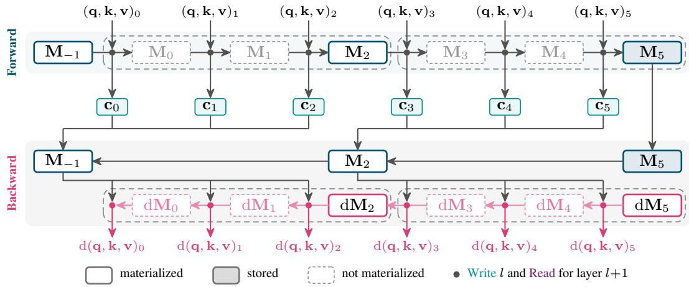  
Figure 3: Efficient implementation of LDM for $L = 5$ layers and windows (denoted by the dashed boxes) of size $E = 3 .$ . Each dot denotes the Write at layer l fused with the Read for layer $l + 1$ In the forward pass, each dot saves a small context $\mathbf { c } _ { l } .$ which is used for the backward pass. Some details are omitted for clarity (see Appendix F).

These can be used to solve Equation (6) online,

$$
\mathbf { M } _ { l } = \mathbf { M } _ { l - 1 } + \mathbf { u } _ { l } \kappa _ { l } ^ { \top } , \qquad \mathbf { P } _ { l } = ( \mathbf { P } _ { l - 1 } - \kappa _ { l } \overline { { \mathbf { k } } } _ { l } ^ { \top } \mathbf { P } _ { l - 1 } ) / \lambda _ { l } .\tag{8}
$$

The complete derivation is given in Appendix E.1. As shown, the RLS update introduces a third stream, an inverse covariance stream $\mathbf { P } _ { l } ,$ to LDM.

Multiple groups. We find that partitioning the memory state $\mathbf { M } _ { l }$ into $G$ groups, each with value dimension $D _ { v } { \bar { = } } D / G$ , improves expressivity and empirically improves performance slightly (Section 4.2). Each group maintains its own inverse covariance matrix and is queried independently. The resulting $D _ { v }$ -dimensional readouts are concatenated to form the full D-dimensional memory readout. The state then becomes $\mathbf { S } _ { l } = \left( \mathbf { x } _ { l } , \mathbf { M } _ { l } , \mathbf { P } _ { l } \right)$ , where ${ \bf P } _ { l } \in \mathbb { R } ^ { G \times D _ { k } \times D _ { k } }$ . The forgetting factors and gates are also applied and learned independently for each group (thus, in practice, we treat them as vectors, with each element corresponding to a group).

Efficient parameterization through shared latent representations. Having established LDM as an abstract architectural component above, we now present how to parametrize it efficiently. Let Af denote a learned affine map. For the Read operator, we generate a shared latent representation

$$
\begin{array} { r } { \mathbf { h } _ { l - 1 } ^ { ( R ) } = \mathrm { S i L U } \left( \mathrm { A f f } ( \mathrm { N o r m } _ { \mathrm { R M S } } ( \mathbf { x } _ { l - 1 } ) ) \right) \in \mathbb { R } ^ { H } . } \end{array}
$$

From this latent representation, we obtain the query as well as a per-group read gate

$$
\begin{array} { r } { \mathbf q _ { l - 1 } = \mathrm { N o r m } _ { L ^ { 2 } } \bigl ( \mathrm { A f f } ( \mathbf h _ { l - 1 } ^ { ( R ) } ) \bigr ) \in \mathbb R ^ { G \times D _ { k } } , \quad \mathbf g _ { l - 1 } = 2 \sigma \bigl ( \mathrm { A f f } ( \mathbf h _ { l - 1 } ^ { ( R ) } ) \bigr ) \in \mathbb R ^ { G } . } \end{array}
$$

The gated query retrieves data from the streams as

$$
\mathrm { R e a d } \bigl ( \bigl ( \mathbf { x } _ { l - 1 } , \mathbf { M } _ { l - 1 } , \mathbf { P } _ { l - 1 } \bigr ) , \mathbf { q } _ { l - 1 } \bigr ) = \mathbf { x } _ { l - 1 } + \gamma _ { l - 1 } \odot \mathbf { M } _ { l - 1 } \left( \mathbf { g } _ { l - 1 } \odot \mathbf { q } _ { l - 1 } \right) ,
$$

where $\gamma _ { l - 1 } \in \mathbb { R } ^ { G }$ is a learnable per-group gain that controls the magnitude of the read. For the Write operator, we analogously first generate a latent representation

$$
\begin{array} { r } { \mathbf { h } _ { l } ^ { ( W ) } = \mathrm { S i L U } \left( \mathrm { A f f } \left( \mathrm { N o r m } _ { \mathrm { R M S } } ( \mathbf { x } _ { l } ) \right) \right) \in \mathbb { R } ^ { H } , } \end{array}
$$

from which we obtain the keys k<sub>l</sub> and groupwise weight ω<sub>l</sub>,

$$
\mathbf { k } _ { l } = \mathrm { N o r m } _ { L ^ { 2 } } \big ( \mathrm { A f f } ( \mathbf { h } _ { l } ^ { ( W ) } ) \big ) \in \mathbb { R } ^ { G \times D _ { k } } , \qquad \omega _ { l } = 2 \sigma \big ( \mathrm { A f f } ( \mathbf { h } _ { l } ^ { ( W ) } ) \big ) \in \mathbb { R } ^ { G } .
$$

The RLS write then computes

$$
( \mathbf { x } _ { l } , \mathbf { M } _ { l } , \mathbf { P } _ { l } ) = \mathrm { W r i t e } \big ( ( \mathbf { x } _ { l - 1 } , \mathbf { M } _ { l - 1 } , \mathbf { P } _ { l - 1 } ) , \mathbf { k } _ { l } , \mathbf { v } _ { l } , \omega _ { l } , \pmb { \lambda } _ { l } \big )
$$

in the sense of Equation (8). We additionally write the embedding into the first memory state and perform a read before the LM head (see Appendix E.2).

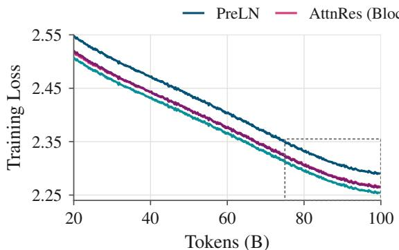

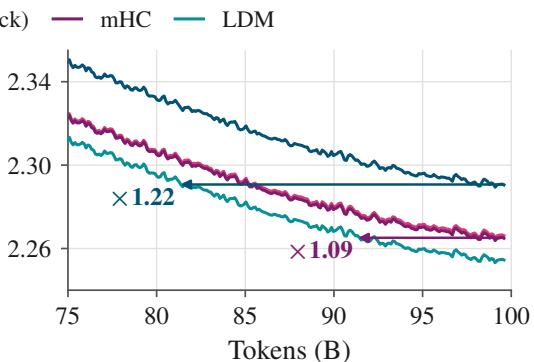  
Figure 4: Left: Training loss at 1.5B model size (100B tokens, learning rate $1 0 ^ { - 3 } )$ . Right: the last 25B tokens. Arrows: tokens LDM needs to reach each baseline’s final loss.

## 3.3 HARDWARE-AWARE IMPLEMENTATION

A naive implementation of LDM (1) stores a state M<sub>l</sub> per layer for later reuse during backpropagation and (2) reads and writes the current state at every Read and Write, which incurs memory traffic. We propose an efficient implementation that reduces both activation memory overhead and traffic:

(1) State unwinding. The RLS recurrence is reversible given compact per-layer auxiliary information. Indeed, Equation (8) shows that ${ { \bf { M } } _ { l - 1 } }$ can be reconstructed from $\mathbf { M } _ { l }$ via

$$
\mathbf { M } _ { l - 1 } = \mathbf { M } _ { l } - \mathbf { u } _ { l } \mathbf { \kappa } _ { l } ^ { \top } .\tag{9}
$$

In particular, the backward pass can undo the state update given a context $\mathbf { c } _ { l }$ saved for each layer, which holds $\mathbf { u } _ { l }$ and $\kappa _ { l } ,$ the inverse covariance ${ \bf P } _ { l - 1 }$ before the update, and a few small vectors and scalars needed for the gradients, such as k<sub>l</sub> and $\lambda _ { l }$ (Appendix F). Since ${ \bf P } _ { l } \in \mathbb { R } ^ { G \times D _ { k } \times D _ { k } }$ and typically $D _ { k }$ is small (see Section 4), storing $\mathbf { c } _ { l }$ is much cheaper than storing $\mathbf { M } _ { l } \in \mathbb { R } ^ { G \times D _ { v } \times D _ { k } }$ Our implementation of LDM updates the state M in place during the forward pass and unwinds the depth recurrence from the final state ${ { \bf { M } } _ { L } }$ during the backward pass (Figure 3).

(2) Windowed writes. To reduce memory traffic, we fuse each Write with the Read for the next layer. We additionally defer the Write operations within a window $\mathcal { W } = \{ b + 1 , \ldots , e \}$ of E layers (let the state be $\mathbf { M } _ { b }$ before the window) and compute every Read and Write from $\mathbf { M } _ { b } ,$ since

$$
\mathbf { M } _ { j } \mathbf { x } = \mathbf { M } _ { b } \mathbf { x } + \sum _ { b < i \leq j } \mathbf { u } _ { i } ( \pmb { \kappa } _ { i } ^ { \top } \mathbf { x } ) ,\tag{10}
$$

for any $j \in \mathcal W$ and any vector $\textbf { x } ( \mathrm { e . g . }$ , the gated query of a Read or the weighted key of the next Write), with the pseudo-values $\mathbf { u } _ { i }$ and RLS gains $\kappa _ { i }$ corresponding to Equation (7). No intermediate state is materialized inside a window, reducing Write traffic. The window size E trades state traffic against accesses to the pseudo-values. Our main experiments use $E = 4$ . In the backward pass, we similarly avoid materializing the unwound states and state gradients inside a window.

We implement LDM in CuTe DSL for Hopper and Blackwell GPUs. Figure 3 summarizes our implementation, and Appendix F provides further details.

## 4 EXPERIMENTS

In this section, we evaluate LDM by pretraining 400M Llama-like and 1.5B Qwen-like transformers on 50B and 100B FineWeb-Edu tokens, respectively (Penedo et al., 2024). Unless stated otherwise, the queries and keys are generated from hidden representations of dimension $H = 3 2$ at 400M and $H = 6 4$ at 1.5B. We set the per-group value dimension to the attention head dimension, yielding $G = 1 6$ groups for both models. We furthermore fix $\alpha = 1$ , which we found to work better than making it learnable.

Table 2: Pretraining evaluations for both 400M and 1.5B models, generated using the lm-evalharness (Gao et al., 2024). Val is the pretraining validation perplexity.
<table><tr><td colspan="2">Method</td><td>ARC-E ARC-C acc ↑</td><td> $\operatorname { a c c } _ { n }$  ↑</td><td>Hella  $\operatorname { a c c } _ { n }$  ↑</td><td>PIQA acc ↑</td><td>Wino acc ↑</td><td>OBQA  $\operatorname { a c c } _ { n }$  ↑</td><td>Lmb acc ↑</td><td> $\operatorname { A v g }$  acc ↑</td><td>Lmb ppl ↓</td><td>Wiki ppl ↓</td><td>Val ppl↓</td></tr><tr><td rowspan="5">40 50B</td><td>PreLN</td><td>65.66</td><td>31.23</td><td>46.80</td><td>68.93</td><td>55.25</td><td>37.00</td><td>38.46</td><td>49.05</td><td>25.32</td><td>22.59</td><td>12.73</td></tr><tr><td>AttnRes (Full)</td><td>64.94</td><td>32.08</td><td>49.34</td><td>70.08</td><td>55.64</td><td>36.40</td><td>41.35</td><td>49.98</td><td>19.62</td><td>21.46</td><td>12.35</td></tr><tr><td>AttnRes (Block)</td><td>67.63</td><td>32.85</td><td>49.55</td><td>70.08</td><td>56.04</td><td>37.20</td><td>40.91</td><td>50.61</td><td>20.71</td><td>20.86</td><td>12.12</td></tr><tr><td>mHC</td><td>65.11</td><td>31.66</td><td>49.26</td><td>70.02</td><td>55.09</td><td>35.00</td><td>40.69</td><td>49.55</td><td>20.23</td><td>21.20</td><td>12.23</td></tr><tr><td>LDM,  $D _ { k } { = } 4$ </td><td>66.79</td><td>32.34</td><td>48.71</td><td>69.42</td><td>254.70</td><td>37.20</td><td>42.27</td><td>50.20</td><td>19.59</td><td>20.84</td><td>12.14</td></tr><tr><td rowspan="4">1B10B</td><td>LDM (Ours)</td><td>67.13</td><td>32.34</td><td>49.41</td><td>70.40</td><td>54.93</td><td>36.40</td><td>42.58</td><td>50.46</td><td>19.10</td><td>20.70</td><td>12.08</td></tr><tr><td>PreLN</td><td>74.07</td><td>41.47</td><td>62.04</td><td>75.14</td><td>62.35</td><td>42.60</td><td>51.19</td><td>58.41</td><td>10.49</td><td>15.06</td><td>9.48</td></tr><tr><td>AttnRes (Block)</td><td>75.88</td><td>42.92</td><td>63.51</td><td>75.03</td><td>60.77</td><td>43.60</td><td>54.22</td><td>59.42</td><td>8.84</td><td>14.54</td><td>9.26</td></tr><tr><td>mHC</td><td>75.67</td><td>41.72</td><td>63.32</td><td>75.57</td><td>62.98</td><td>44.40</td><td>54.08</td><td>59.68</td><td>9.05</td><td>14.44</td><td>9.25</td></tr><tr><td></td><td>LDM (Ours)</td><td>76.35</td><td>42.66</td><td>63.98</td><td>75.14</td><td>62.83</td><td>42.00</td><td>55.00</td><td>59.71</td><td>8.42</td><td>14.21</td><td>9.15</td></tr></table>

## 4.1 MAIN RESULTS

Setup. We compare LDM with PreLN, mHC, and AttnRes using matched backbone configurations. At both 400M and 1.5B, LDM adds approximately 1% more parameters than PreLN, comparable to the overhead of mHC (Table 4). Our main LDM configuration uses $D _ { k } = 8$ at both scales, and we additionally evaluate $D _ { k } = 4$ at 400M. We train both Full and Block AttnRes at 400M, but only Block AttnRes at 1.5B because of the higher training cost of Full AttnRes. Following Kimi Team et al. (2026b), we target approximately eight depth blocks for Block AttnRes, using eight at 400M and seven at 1.5B to avoid splitting transformer blocks across depth blocks. All models use AdamW with a weight decay of 0.1 and linear warmup followed by cosine decay to 10% of the peak learning rate. We sweep the peak learning rate for each method and scale using a grid spaced by factors of two, selecting the value with the lowest held-out validation loss. We report held-out validation, WikiText-2 (Merity et al., 2016), and LAMBADA (Paperno et al., 2016) perplexity, together with zero-shot accuracy on ARC-Easy, ARC-Challenge (Clark et al., 2018), HellaSwag (Zellers et al., 2019), PIQA (Bisk et al., 2019), WinoGrande (Sakaguchi et al., 2019), OpenBookQA (Mihaylov et al., 2018), and LAMBADA. Full implementation details are in Appendix B.

Lower perplexity and competitive accuracy. Table 2 reports our main pretraining results. It reveals that our main LDM configuration $( D _ { k } = 8 )$ achieves the lowest validation, WikiText-2, and LAMBADA perplexity at both model sizes. It also achieves the highest average zero-shot accuracy at 1.5B and ranks second at 400M. Figure 4 shows the training loss at 1.5B.

Matched memory matrix size. Both mHC and LDM maintain states of fixed size across depth, whereas Full AttnRes retains a growing cache of layer outputs. With $D _ { k } \ = \ 8 ,$ LDM’s memory matrix contains 8D entries per token, twice the 4D entries in mHC’s expanded residual state. We therefore also evaluate LDM with $D _ { k } = 4$ at 400M, matching the number of entries in its memory matrix to mHC’s expanded residual state (note that LDM additionally maintains a classic residual stream and an inverse covariance stream). This smaller configuration still achieves lower validation, WikiText-2, and LAMBADA perplexity than mHC, alongside higher average zero-shot accuracy. Thus, LDM remains competitive with other baselines even with a smaller memory matrix.

Throughput. Figure 5 compares LDM’s training, prefill and decode throughput with AttnRes, implemented using Flash Linear Attention kernels (Yang & Zhang, 2024), and mHC using an improved version of the official mHC kernels. More details and settings can be found in Appendix C. Across 1.7B–14B models, sequence lengths, context lengths, and batch sizes, LDM exceeds Full AttnRes throughput in every setting and mHC in all training and most inference settings, while remaining competitive with Block AttnRes, especially during decode.

## 4.2 ABLATIONS AND ARCHITECTURAL CHOICES

We ablate LDM’s main design choices at 400M, training each variant on 15B FineWeb-Edu tokens with a peak learning rate of $\overline { { 1 } } 0 ^ { - 3 }$ and otherwise following our main training recipe. Table 3 reports changes in held-out perplexity relative to the default LDM configuration. Appendix D.2 provides full definitions of each variant. Our main findings are as follows:

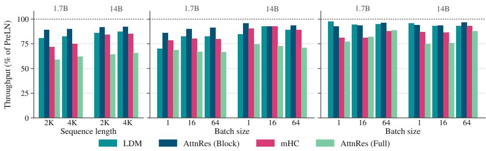  
(a) Training step  
(b) Prefill, 2K  
(c) Decode, 2K  
Figure 5: Throughput relative to PreLN on B200 for Qwen-like 1.7B and 14B models, comparing LDM, mHC and AttnRes. The mHC results use an improved version of the official mHC kernels. (a) Training step with 2K and 4K sequence length. (b) Prefill of 2K prompts at different batch sizes. (c) KV-cached decode after 2K prefill at different batch sizes. More settings in Appendix C.

Table 3: LDM ablations, 400M @ 15B. ∆ denotes change in held-out perplexity (↓) relative to our main configuration. (a) F(r): memory-only layer input (normalization omitted). $\mathbf { x } = { \delta } \mathrm { : }$ no post-layer residual addition. (b) Delta/Outer: replace RLS with delta rule/outer product update. (c) $\mathbf { v } = \mathbf { x } \mathbf { : }$ store the residual stream. QK(δ): queries and keys from layer outputs. Static q: learned query per read with read gate fixed to one. $( \mathrm { d } ) - \gamma , \mathbf { g } = \mathbf { 1 } , \omega = \mathbf { 1 } ;$ fix read gain, read gate, or write weight to one, respectively. $\lambda = 1$ : disable forgetting. Selected training curves in Figure 18, full definitions and results in Appendix D.2 and Table 8.
<table><tr><td colspan="2">Baselines</td><td rowspan="2">(a) Residual</td><td colspan="2"></td><td colspan="2">(b) Update</td><td colspan="2">(c) Addressing</td><td colspan="4">(d) Gain, gates, forgetting</td></tr><tr><td>PreLN</td><td>LDM</td><td> $F ( \mathbf { r } ) \quad \mathbf { x } = \delta$ </td><td></td><td>Delta</td><td>Outer</td><td> $\mathbf { v } = \mathbf { x }$   $\mathbf { Q K } ( \delta )$ </td><td>Static q</td><td>-γ  $\mathbf g = \mathbf 1$ </td><td></td><td> $\omega = \bf 1$ </td><td> $\lambda = 1$ </td></tr><tr><td> $\Delta$ </td><td>0.78</td><td>0.00</td><td>1.88</td><td>0.87</td><td>0.06</td><td>0.07</td><td>0.33</td><td>0.07 0.19</td><td>0.04</td><td>0.07</td><td>0.01</td><td>-0.01</td></tr></table>

(a) Keeping the residual stream is crucial. We assess the importance of LDM’s separate residual stream by interrupting its flow at one of two points: before the layer, so that the layer receives only the memory readout, or after the layer, so that the stream is replaced by the layer output. Both variants underperform PreLN.

(b) Depth regression approximations. Replacing RLS with either a plain outer product or a delta rule update (Schlag et al., 2021; Yang et al., 2024) still yields better performance than PreLN, but neither alternative matches RLS. This result is consistent with reported benefits of more accurate test-time regression solvers in sequence modeling (von Oswald et al., 2026; Tumma et al., 2026).

(c) Addressing and stored values. We next examine how LDM’s performance depends on the choice of stored representations, the construction of queries and keys, and the number of memory groups. Storing x<sub>l</sub> instead of $\delta _ { l }$ hurts most, potentially due to redundancy in the stored information (given that earlier representations would be stored at each Write). Deriving queries and keys from $\delta _ { l }$ instead of $\mathbf { x } _ { l }$ also hurts, and static per-layer queries (read gate fixed to one) hurt more. Grouping provides small but consistent gains (Figure 6).

(d) Gain, gates and forgetting. Disabling either the read gain γ or the read gate g hurts slightly. Fixing the write weight ω<sub>l</sub> to one or disabling forgetting $( \lambda _ { l } = \bf { 1 } )$ has a negligible effect in this setting.

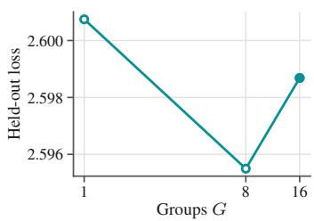  
Figure 6: Held-out loss versus group count (400M, 15B tokens).

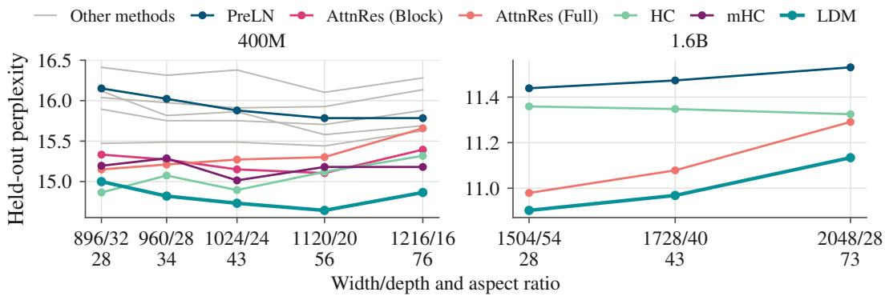  
Figure 7: Final held-out perplexity on DepthBench against the aspect ratio (width/depth) at a fixed budget of 400M (left) and 1.6B (right) parameters. Tick labels denote the width/depth of each shape and its aspect ratio.

## 4.3 DIFFERENT ASPECT RATIOS

Following the protocol of DepthBench (Wang et al., 2026), we evaluate whether LDM’s gains persist across different model aspect ratios (width/depth) at fixed parameter budgets of 400M and 1.6B (for the latter, DepthBench provides results for their most promising baselines). We compare against the published DepthBench baseline results, matching their training setup exactly to ensure comparability. At 400M, DepthBench tunes the learning rate separately for each baseline and finds $2 \times \mathrm { \dot { 1 } 0 ^ { - 3 } }$ to be optimal in most cases. At 1.6B, it uses $5 \times 1 0 ^ { - 4 }$ for all methods. We adopt these learning rates for LDM without further tuning. Additional experimental details are provided in Appendix D.3.

Results and shape preferences. LDM improves over PreLN at every evaluated aspect ratio at both scales (Figure 7). At 400M, LDM favors moderate aspect ratios and outperforms the baselines, except in the deepest configuration, where HC performs slightly better. At 1.6B, however, LDM achieves the lowest perplexity at every considered aspect ratio. In particular, HC, which becomes less stable as scale increases (Wang et al., 2026), no longer improves with depth, whereas LDM’s perplexity decreases monotonically. Appendix D.3 extends our 400M sweep to extreme aspect ratios, further supporting LDM’s preference for shallower configurations at that scale.

## 5 DISCUSSION AND CONCLUSION

In this work, we introduce Depth Memory, a framework that interprets the propagation of infor mation over depth as a problem of managing layer representations using a set of streams. This perspective unifies standard residual connections, AttnRes, and mHC, while distinguishing methods that retain explicit layer representations from those that mix them into a fixed-size state. It also provides a starting point for designing new depth mixers. Building on this view, we then propose Linear Depth Memory (LDM), which formulates memory updates as a depth regression problem, solving it exactly using recursive least squares. To do so, LDM maintains a standard residual stream, a memory stream, and an inverse covariance stream. Each token thus carries a compressed, queryable representation of earlier layer outputs, which enriches the inputs to subsequent layers. Our imple mentation uses state unwinding and windowed updates to reduce activation storage and memory traffic, making LDM feasible in practice. At both 400M and 1.5B, trained on 50B and 100B tokens, respectively, our main LDM configuration achieves the lowest reported perplexities among the tuned PreLN, AttnRes, and mHC baselines, alongside competitive zero-shot accuracy. These gains hold across standard aspect ratios.

Limitations and future work. In this work, we focus on language models with up to 1.6B parameters that are trained on up to 100B tokens. Future work could evaluate LDM at larger scales and in other domains such as image classification. Moreover, LDM can add peak memory during training, which other stable formulations of the backward recurrence or checkpointing (as used in mHC) could reduce. Finally, our Depth Memory framework admits a plethora of different instantiations, such as alternative linear recurrences or memories with nonlinear read and write operations. We consider the exploration of that design space a promising avenue for future work.

## ACKNOWLEDGMENTS

This work was supported in part by the Hector Foundation and by the Max Planck ETH Center for Learning Systems. We thank the authors of DepthBench (Wang et al., 2026) for providing early access to their codebase, on which ours is based.

## REFERENCES

Badr AlKhamissi, Mohamed Gabr, Muhammad ElNokrashy, and Khaled Essam. Adapting MAR-BERT for improved Arabic dialect identification: Submission to the NADI 2021 shared task. In Nizar Habash, Houda Bouamor, Hazem Hajj, Walid Magdy, Wajdi Zaghouani, Fethi Bougares, Nadi Tomeh, Ibrahim Abu Farha, and Samia Touileb (eds.), Proceedings of the Sixth Arabic Natural Language Processing Workshop, pp. 260–264, Kyiv, Ukraine (Virtual), April 2021. Association for Computational Linguistics. URL https://aclanthology.org/2021. wanlp-1.29/.

Yonatan Bisk, Rowan Zellers, Ronan Le Bras, Jianfeng Gao, and Yejin Choi. Piqa: Reasoning about physical commonsense in natural language, 2019. URL https://arxiv.org/abs/1911. 11641.

Peter Clark, Isaac Cowhey, Oren Etzioni, Tushar Khot, Ashish Sabharwal, Carissa Schoenick, and Oyvind Tafjord. Think you have solved question answering? try arc, the ai2 reasoning challenge, 2018. URL https://arxiv.org/abs/1803.05457.

DeepSeek-AI, Anyi Xu, Bangcai Lin, Bing Xue, Bingxuan Wang, Bingzheng Xu, Bochao Wu, Bowei Zhang, Chaofan Lin, Chen Dong, Chenchen Ling, Chengda Lu, Chenggang Zhao, Chengqi Deng, Chengyu Hou, Chenhao Xu, Chenze Shao, Chong Ruan, Conner Sun, Damai Dai, Daya Guo, Dejian Yang, Deli Chen, Donghao Li, Dongjie Ji, Erhang Li, Fang Wei, Fangyun Lin, Fangzhou Yuan, Feiyu Xia, Fucong Dai, Guangbo Hao, Guanting Chen, Guoai Cao, Guolai Meng, Guowei Li, Han Yu, Han Zhang, Hanwei Xu, Hao Li, Haofen Liang, Haoling Zhang, Haoming Luo, Haoran Wei, Haotian Yuan, Haowei Zhang, Haowen Luo, Haoyu Chen, Haozhe Ji, Hengqing Zhang, Honghui Ding, Hongxuan Tang, Huanqi Cao, Huazuo Gao, Hui Qu, Hui Zeng, J Yang, JQ Zhu, Jia Luo, Jia Song, Jia Yu, Jialiang Huang, Jialu Cai, Jian Liang, Jiangting Zhou, Jiasheng Ye, Jiashi Li, Jiaxin Xu, Jiewen Hu, Jieyu Yang, Jin Chen, Jin Yan, Jingchang Chen, Jingli Zhou, Jingting Xiang, Jingyang Yuan, Jingyuan Cheng, Jingzi Zhou, Jinhua Zhu, Jiping Yu, Joseph Sun, Jun Ran, Junguang Jiang, Junjie Qiu, Junlong Li, Junmin Zheng, Junxiao Song, Kai Dong, Kaige Gao, Kang Guan, Kexing Zhou, Kezhao Huang, Kuai Yu, Lean Wang, Lecong Zhang, Lei Wang, Leyi Xia, Li Zhang, Liang Zhao, Lihua Guo, Lingxiao Luo, Linwang Ma, Linyan Zhu, Litong Wang, Liyu Cai, Liyue Zhang, Longhao Chen, MS Di, MY Xu, Max Mei, Miaojun Wang, Mingchuan Zhang, Minghua Zhang, Minghui Tang, Mingming Li, Mingxu Zhou, Minmin Han, Ning Wang, Panpan Huang, Panpan Wang, Peixin Cong, Peiyi Wang, Peng Zhang, Qiancheng Wang, Qihao Zhu, Qingyang Li, Qinyu Chen, Qiushi Du, Qiwei Jiang, Rui Tian, Ruifan Xu, Ruijie Lu, Ruiling Xu, Ruiqi Ge, Ruisong Zhang, Ruizhe Pan, Runji Wang, Runqian Chen, Runqiu Yin, Runxin Xu, Ruomeng Shen, Ruoyu Zhang, Ruyi Chen, SH Liu, Shanghao Lu, Shangmian Sun, Shangyan Zhou, Shanhuang Chen, Shaofei Cai, Shaoheng Nie, Shaoqing Wu, Shaoyuan Chen, Shengding Hu, Shengyu Liu, Shiqiang Hu, Shirong Ma, Shiyu Wang, Shuiping Yu, Shunfeng Zhou, Shuting Pan, Shuying Yu, Songyang Zhou, Tao Ni, Tao Yun, Tian Jin, Tian Pei, Tian Ye, Tianle Lin, Tianran Ji, Tianyi Cui, Tianyuan Yue, Tingting Yu, Tun Wang, W Zhang, WL Xiao, Wangding Zeng, Wei An, Weilin Zhao, Wen Liu, Wenfeng Liang, Wenjie Pang, Wenjing Luo, Wenjing Yao, Wenjun Gao, Wenkai Yang, Wenlve Huang, Wenqing Hou, Wentao Zhang, Wenting Ma, Xi Gao, Xiang He, Xiangwen Wang, Xianzu Wang, Xiao Bi, Xiaodong Liu, Xiaohan Wang, Xiaokang Chen, Xiaokang Zhang, Xiaotao Nie, Xiaowen Sun, Xiaoxiang Wang, Xin Cheng, Xin Liu, Xin Xie, Xingchao Liu, Xingchen Liu, Xingkai Yu, Xingyou Li, Xinyu Yang, Xinyu Zhang, Xu Chen, Xuanyu Wang, Xuecheng Su, Xueyin Chen, Xuheng Lin, Xuwei Fu, YC Yan, YQ Wang, YW Ma, Yanfeng Luo, Yang Zhang, Yanhong Xu, Yanru Ma, Yanwen Huang, Yao Li, Yao Li, Yao Xu, Yao Zhao, Yaofeng Sun, Yaohui Wang, Yi Qian, Yi Shao, Yi Yu, Yichao Zhang, Yifan Ding, Yifan Shi, Yijia Wu, Yiliang Xiong, Yiling Ma, Ying He, Ying Tang, Ying Zhou, Yingjia Luo, Yinmin Zhong, Yishi Piao, Yisong Wang, Yixiang Zhang, Yixiao Chen, Yixuan Tan, Yixuan Wei, Yiyang Ma, Yiyuan Liu, Yonglun Yang, Yongqiang Guo, Yongtong Wu, Yu Wu, YuKun Li, Yuan Cheng, Yuan Ou, Yuanfan Xu, Yuanhao

Li, Yuduan Wang, Yuehan Yang, Yuer Xu, Yuhan Wu, Yuhao Meng, Yuheng Zou, Yukun Zha, Yunfan Xiong, Yupeng Chen, Yuping Lin, Yuqian Cao, Yuqian Wang, Yushun Zhang, Yuting Yan, Yutong Lin, Yuxian Gu, Yuxiang Luo, Yuxiang You, Yuxuan Liu, Yuxuan Zhou, Yuyang Zhou, Yuzhen Huang, ZF Wu, Zehao Wang, Zehua Zhao, Zehui Ren, Zekai Zhang, Zhangli Sha, Zhe Fu, Zhe Ju, Zhean Xu, Zhenda Xie, Zhengyan Zhang, Zheren Gao, Zhewen Hao, Zhibin Gou, Zhicheng Ma, Zhigang Yan, Zhihong Shao, Zhixian Huang, Zhixuan Chen, Zhiyu Wu, Zhizhou Ren, Zhongyu Wu, Zhuoshu Li, Zhuping Zhang, Zian Xu, Zihao Wang, Zihua Qu, Zihui Gu, Zijia Zhu, Zilin Li, Zipeng Zhang, Ziwei Xie, Ziyi Gao, Ziyi Wan, Zizheng Pan, and Zongqing Yao. Deepseek-v4: Towards highly efficient million-token context intelligence, 2026. URL https://arxiv.org/abs/2606.19348.

Muhammad ElNokrashy, Badr AlKhamissi, and Mona Diab. Depth-wise attention (dwatt): A layer fusion method for data-efficient classification, 2024. URL https://arxiv.org/abs/ 2209.15168.

Yanwen Fang, Yuxi Cai, Jintai Chen, Jingyu Zhao, Guangjian Tian, and Guodong Li. Cross-layer retrospective retrieving via layer attention, 2023. URL https://arxiv.org/abs/2302. 03985.

William Fedus, Barret Zoph, and Noam Shazeer. Switch transformers: Scaling to trillion parameter models with simple and efficient sparsity. Journal ofMachine Learning Research, 23(120):1–39, 2022. URL http://jmlr.org/papers/v23/21-0998.html.

Leo Gao, Jonathan Tow, Baber Abbasi, Stella Biderman, Sid Black, Anthony DiPofi, Charles Foster, Laurence Golding, Jeffrey Hsu, Alain Le Noac’h, Haonan Li, Kyle McDonell, Niklas Muennighoff, Chris Ociepa, Jason Phang, Laria Reynolds, Hailey Schoelkopf, Aviya Skowron, Lintang Sutawika, Eric Tang, Anish Thite, Ben Wang, Kevin Wang, and Andy Zou. The language model evaluation harness, 07 2024. URL https://zenodo.org/records/12608602.

Gleb Gerasimov, Yaroslav Aksenov, Nikita Balagansky, Viacheslav Sinii, and Daniil Gavrilov. You do not fully utilize transformer’s representation capacity, 2025. URL https://arxiv.org/ abs/2502.09245.

Aidan N. Gomez, Mengye Ren, Raquel Urtasun, and Roger B. Grosse. The reversible residual network: Backpropagation without storing activations, 2017. URL https://arxiv.org/ abs/1707.04585.

Dirk Groeneveld, Iz Beltagy, Evan Walsh, Akshita Bhagia, Rodney Kinney, Oyvind Tafjord, Ananya Jha, Hamish Ivison, Ian Magnusson, Yizhong Wang, Shane Arora, David Atkinson, Russell Authur, Khyathi Chandu, Arman Cohan, Jennifer Dumas, Yanai Elazar, Yuling Gu, Jack Hessel, Tushar Khot, William Merrill, Jacob Morrison, Niklas Muennighoff, Aakanksha Naik, Crystal Nam, Matthew Peters, Valentina Pyatkin, Abhilasha Ravichander, Dustin Schwenk, Saurabh Shah, William Smith, Emma Strubell, Nishant Subramani, Mitchell Wortsman, Pradeep Dasigi, Nathan Lambert, Kyle Richardson, Luke Zettlemoyer, Jesse Dodge, Kyle Lo, Luca Soldaini, Noah Smith, and Hannaneh Hajishirzi. OLMo: Accelerating the science of language models. In Lun-Wei Ku, Andre Martins, and Vivek Srikumar (eds.), Proceedings of the 62nd Annual Meeting of the Association for Computational Linguistics (Volume 1: Long Papers), pp. 15789–15809, Bangkok, Thailand, August 2024. Association for Computational Linguistics. doi: 10.18653/v1/ 2024.acl-long.841. URL https://aclanthology.org/2024.acl-long.841/.

Albert Gu, Karan Goel, and Christopher Re. Efficiently modeling long sequences with structured´ state spaces, 2022. URL https://arxiv.org/abs/2111.00396.

Kaiming He, Xiangyu Zhang, Shaoqing Ren, and Jian Sun. Deep Residual Learning for Image Recognition . In 2016 IEEE Conference on Computer Vision and Pattern Recognition (CVPR), pp. 770–778, Los Alamitos, CA, USA, June 2016. IEEE Computer Society. doi: 10.1109/CVPR. 2016.90. URL https://doi.ieeecomputersociety.org/10.1109/CVPR.2016. 90.

Mike Heddes, Adel Javanmard, Kyriakos Axiotis, Gang Fu, Mohammadhossein Bateni, and Vahab Mirrokni. Deepcrossattention: Supercharging transformer residual connections. In Forty-second International Conference on Machine Learning, 2025. URL https://openreview.net forum?id=j3JBfFnGYh.

Angelos Katharopoulos, Apoorv Vyas, Nikolaos Pappas, and Franc¸ois Fleuret. Transformers are RNNs: Fast autoregressive transformers with linear attention. In Hal Daume III and Aarti Singh´ (eds.), Proceedings of the 37th International Conference on Machine Learning, volume 119 of Proceedings of Machine Learning Research, pp. 5156–5165. PMLR, 13–18 Jul 2020. URL https://proceedings.mlr.press/v119/katharopoulos20a.html.

Kimi Team, Yu Zhang, Zongyu Lin, Xingcheng Yao, Jiaxi Hu, Fanqing Meng, Chengyin Liu, Xin Men, Songlin Yang, Zhiyuan Li, et al. Kimi linear: An expressive, efficient attention architecture. arXiv preprint arXiv:2510.26692, 2025.

Kimi Team, Tongtong Bai, Yifan Bai, Yiping Bao, M. C., Jianfeng Cai, Xinyuan Cai, Peizhou Cao, Yuxuan Cao, Ziwei Chai, Y. Charles, H. S. Che, Guanduo Chen, Guangyu Chen, Guanzheng Chen, Huarong Chen, Jia Chen, Jianlong Chen, Jun Chen, Kexin Chen, Peng Chen, Ruijue Chen, Wentao Chen, Xin Chen, Yang Chen, Yanru Chen, Yifei Chen, Yingjiang Chen, Yuankun Chen, Yujie Chen, Yutian Chen, Zhirong Chen, Dazhi Cheng, Yean Cheng, Jialei Cui, Jingbing Cui, Anqi Dai, Jiaqi Deng, Hao Ding, Rui Ding, Shaofeng Ding, Mengfan Dong, Mengnan Dong, Yuhao Dong, Yuxin Dong, Angang Du, Chenzhuang Du, Dikang Du, Jusen Du, Yulun Du, Yu Fan, Jing Feng, Qiulin Feng, Yichen Feng, Kelin Fu, Qiang Fu, Fuxuan Gao, Hongcheng Gao, Jingyue Gao, Tong Gao, Weijia Gao, Shangyi Geng, Jie Gong, Linhu Gong, Shengao Gong, Xiaochen Gong, Qizheng Gu, Yicheng Gu, Shuhao Guan, Haiqing Guo, Shiqi Guo, Xiang Guo, Zhengyan Guo, Beixi Hao, Wenxin Hao, Xiaoru Hao, Dailan He, Haotian He, Lehan He, Qi He, Weiran He, Xinran He, Xinyi He, Yibo He, Yunjia He, Chao Hong, Tiange Hong, Hao Hu, Jiaxi Hu, Ruikun Hu, Weiming Hu, Yangyang Hu, Zhenxing Hu, Liang Hua, Jinbin Huang, Ke Huang, Ruiyuan Huang, Siying Huang, Weixiao Huang, Yan Huang, Zhengjie Huang, Zhiqi Huang, Yulong Hui, Chaobo Jia, Yutong Jiang, Zhejun Jiang, Zuoyou Jiang, Wenyi Jin, Xinyi Jin, Yu Jing, Huanjun Kong, Guokun Lai, Aidi Li, Cheng Li, Chengyuan Li, Cong Li, Fang Li, Guanyu Li, Haoyang Li, Jia Li, Junxiong Li, Lei Li, Letian Li, Lincan Li, Weihong Li, Wentao Li, Xintong Li, Yang Li, Yishen Li, Yiwei Li, Yuxiao Li, Zhaowei Li, Zhaoxi Li, Zheming Li, Zhengxiao Li, Zhiyuan Li, Jiawei Lin, Xiaohan Lin, Yibo Lin, Zichao Lin, Ziyan Lin, Bill Liu, Boxiao Liu, Chuan Liu, Liang Liu, Shaowei Liu, Shudong Liu, Shuran Liu, Tianwei Liu, Weizhou Liu, Yangyang Liu, Yanming Liu, Yibo Liu, Yipeng Liu, Zhengying Liu, Zhiheng Liu, Enzhe Lu, Haoyu Lu, Lin qiang Lu, Tingzhan Lu, Zhiyuan Lu, Aotian Luo, G. Luo, Junyu Luo, Yifan Luo, B. Lyu, Wenzhou Lyu, Shaoguang Mao, Yuan Mei, Xin Men, Minqing Ni, Yixuan Niu, Siyuan Pan, Shujun Peng, Zhangyang Qi, Ruoyu Qin, ZeChao Qin, Zeyu Qin, Haiquan Qiu, Jianxin Qiu, Jiezhong Qiu, Bowen Qu, Yuhao Qu, Zeyu Shang, Youbo Shao, Han Shen, Jincheng Shi, Juanfeng Shi, Lidong Shi, Shengyuan Shi, Wingchun Siu, Pengwei Song, Xiaoxi Song, Jianlin Su, Yunfeng Su, Zhaochen Su, Lin Sui, Jingsong Sun, Junyao Sun, Shaoning Sun, Shuzhe Sun, Tongyu Sun, Yujun Sun, Yunpeng Tai, Chuning Tang, Heyi Tang, Sirui Tang, Zecheng Tang, Chaoran Tian, Rongpeng Tian, Yu Tian, Wei Tu, Chensi Wang, Chuang Wang, Chunjie Wang, Dinglu Wang, Feng Wang, Hailong Wang, Haiming Wang, Hao Wang, Hao Wang, Huaqing Wang, Hui Wang, Jiayi Wang, Jinglong Wang, Jinhong Wang, Jiuzheng Wang, Linian Wang, Shaobo Wang, Shen zhi Wang, Shuyi Wang, Si Wang, Siyuan Wang, Tianfu Wang, Wenjue Wang, Xingran Wang, Xinmei Wang, Xinyuan Wang, Xusheng Wang, Yalin Wang, Yangkun Wang, Yao Wang, Yaoyu Wang, Yejie Wang, Yiqin Wang, Yucheng Wang, Yuzhi Wang, Zhaoji Wang, Zhaowei Wang, Zhengtao Wang, Zhenhao Wang, Zhongsheng Wang, Zifan Wang, Chu Wei, Ming Wei, Shouxin Wei, Zichen Wen, Fan Wu, Haoning Wu, Rucong Wu, Wenhao Wu, Xiaoxue Wu, Yingcong Wu, Yongqi Wu, Yuxin Wu, Zijian Wu, Xinglang Xian, Chenxuan Xiang, Yuye Xiang, Bocheng Xiao, Chenjun Xiao, Xin Xiao, Jin Xie, Xiaotong Xie, Yifeng Xie, Zhe Xie, Bowei Xing, Yiming Xiong, Baosheng Xu, Boyu Xu, Jiale Xu, Jianfan Xu, Jing Xu, Jinjing Xu, L. H. Xu, Qingtao Xu, Shuyao Xu, Suting Xu, Tiantian Xu, Tianxiang Xu, Weixin Xu, Xinran Xu, Yangchuan Xu, Ye Xu, Yueni Xu, Ziyao Xu, Haonan Xue, Junjie Yan, Yaoyao Yan, Fan Yang, Guangyao Yang, Hao Yang, Junwei Yang, Ruoyu Yang, Wenjie Yang, Xiaofei Yang, Xinyu Yang, Yi Yang, Yiling Yang, Ying Yang, Yuchen Yang, Zhen Yang, Zhilin Yang, Zian Yang, Zuhao Yang, Hao tian Yao, Dan Ye, Haoran Ye, Wenjie Ye, Zhanbo Ye, Bohong Yin, Haoxiang Yin, Xietong Yin, Chengzhen Yu, Haozhen Yu, Longhui Yu, Shengnan Yu, Shuying Yu, Tianxiang Yu, Enming Yuan, Mengjie Yuan, Tongtian Yue, Wei Yue, Yang Yue, Dunyuan Zha, Haobing Zhan, B. H. Zhang, Dehao Zhang, Fei Zhang, Hao Zhang, Haoyuan Zhang, Huanyu Zhang, Jiapei Zhang, Jiaxuan Zhang, Jin Zhang, Kaiyi Zhang, Miaozhen Zhang, Puqi Zhang, Qinglei Zhang, Rong Zhang, Rui Zhang, Shaoshuai Zhang, Shiyi Zhang, Xiaobin Zhang, Xiaoyun Zhang, Y. Zhang, Yangkun Zhang, Ye Zhang, Yichi Zhang, Yikun Zhang, Yizhi Zhang, Yongting Zhang, Yu Zhang,

Yutao Zhang, Yutong Zhang, Zheng Zhang, Zijing Zhang, Bin Zhao, Chenguang Zhao, Feifan Zhao, Jinglun Zhao, Jinxiang Zhao, Shuai Zhao, Wenshuo Zhao, Xiangyu Zhao, Xuanle Zhao, Yikai Zhao, Zijia Zhao, Haozhi Zheng, Huabin Zheng, Ruihan Zheng, Shaojie Zheng, Tengyang Zheng, Haofeng Zhong, Lei Zhong, Longguang Zhong, M. Zhou, Qiankang Zhou, Runjie Zhou, Ruozhang Zhou, Xinyu Zhou, Yiqiao Zhou, Zaida Zhou, Jinguo Zhu, Liya Zhu, Xinhao Zhu, Yangjunfeng Zhu, Yuxuan Zhu, Zhen Zhu, Chen Zhuang, Weiyu Zhuang, and Xinxing Zu. Kimi k3: Open frontier intelligence, 2026a. URL https://arxiv.org/abs/2607.24653.

Kimi Team, Guangyu Chen, Yu Zhang, Jianlin Su, Weixin Xu, Siyuan Pan, Yaoyu Wang, Yucheng Wang, Guanduo Chen, Bohong Yin, Yutian Chen, Junjie Yan, Ming Wei, Y. Zhang, Fanqing Meng, Chao Hong, Xiaotong Xie, Shaowei Liu, Enzhe Lu, Yunpeng Tai, Yanru Chen, Xin Men, Haiqing Guo, Y. Charles, Haoyu Lu, Lin Sui, Jinguo Zhu, Zaida Zhou, Weiran He, Weixiao Huang, Xinran Xu, Yuzhi Wang, Guokun Lai, Yulun Du, Yuxin Wu, Zhilin Yang, and Xinyu Zhou. Attention residuals, 2026b. URL https://arxiv.org/abs/2603.15031.

Teuvo Kohonen. Correlation matrix memories. IEEE Transactions on Computers, C-21(4):353–359, 1972. doi: 10.1109/TC.1972.5008975.

Tianyu Li, Dongchen Han, Zixuan Cao, Haofeng Huang, Mengyu Zhou, Ming Chen, Erchao Zhao, Xiaoxi Jiang, Guanjun Jiang, and Gao Huang. Siamesenorm: Breaking the barrier to reconciling pre/post-norm, 2026. URL https://arxiv.org/abs/2602.08064.

Ze-Wei Liou and Tri Dao. ReplaySSM: Cache SSM inputs, not state. https://tridao.me/ blog/2026/replayssm/, June 2026. Blog post.

Cheng Luo, Zefan Cai, and Junjie Hu. Multi-head attention residuals, 2026. URL https:// arxiv.org/abs/2607.27230.

Matthew MacKay, Paul Vicol, Jimmy Ba, and Roger B Grosse. Reversible recurrent neural networks. In S. Bengio, H. Wallach, H. Larochelle, K. Grauman, N. Cesa-Bianchi, and R. Garnett (eds.), Advances in Neural Information Processing Systems, volume 31. Curran Associates, Inc., 2018. URL https://proceedings.neurips.cc/paper\_files/ paper/2018/file/4ff6fa96179cdc2838e8d8ce64cd10a7-Paper.pdf.

Brian Mak and Jeffrey Flanigan. Residual matrix transformers: Scaling the size of the residual stream, 2025. URL https://arxiv.org/abs/2506.22696.

Stephen Merity, Caiming Xiong, James Bradbury, and Richard Socher. Pointer sentinel mixture models, 2016. URL https://arxiv.org/abs/1609.07843.

Todor Mihaylov, Peter Clark, Tushar Khot, and Ashish Sabharwal. Can a suit of armor conduct electricity? a new dataset for open book question answering, 2018. URL https://arxiv. org/abs/1809.02789.

Matteo Pagliardini, Amirkeivan Mohtashami, Francois Fleuret, and Martin Jaggi. Denseformer: enhancing information flow in transformers via depth weighted averaging. In Proceedings of the 38th International Conference on Neural Information Processing Systems, NIPS ’24, Red Hook, NY, USA, 2024. Curran Associates Inc. ISBN 9798331314385.

Denis Paperno, German Kruszewski, Angeliki Lazaridou, Quan Ngoc Pham, Raffaella Bernardi,´ Sandro Pezzelle, Marco Baroni, Gemma Boleda, and Raquel Fernandez. The lambada dataset:´ Word prediction requiring a broad discourse context, 2016. URL https://arxiv.org/ abs/1606.06031.

Guilherme Penedo, Hynek Kydl´ıcek, Loubna Ben allal, Anton Lozhkov, Margaret Mitchell, Colinˇ Raffel, Leandro Von Werra, and Thomas Wolf. The fineweb datasets: Decanting the web for the finest text data at scale, 2024. URL https://arxiv.org/abs/2406.17557.

Zihan Qiu, Zekun Wang, Xiao Li, Yanpeng Li, Yang Xu, Yixuan Wang, Huaqing Zhang, Rui Men, Bochao Mao, Chengruidong Zhang, Fan Zhou, Hao Luo, Haofeng Huang, Haoran Lian, Haoyan Huang, Hongqing Chen, Jianwei Zhang, Jing Xu, Junjie Wang, Langshi Chen, Liangyu Wang, Linlang Jiang, Man Yuan, Minmin Sun, Peng Jin, Siqi Zhang, Siyu Wang, Xingzhang Ren, Yakai Wang, Yi Zhang, Yiming Dong, Yizhong Cao, Yubo Ma, Yunfei Mao, Bo Zheng, and Dayiheng

Liu. On the design of qwen3.8-next architecture: Evaluation, efficiency, and training stability, 2026. URL https://arxiv.org/abs/2608.30320.

Keisuke Sakaguchi, Ronan Le Bras, Chandra Bhagavatula, and Yejin Choi. Winogrande: An adversarial winograd schema challenge at scale, 2019. URL https://arxiv.org/abs/1907. 10641.

Imanol Schlag, Kazuki Irie, and Jurgen Schmidhuber. Linear transformers are secretly fast weight¨ programmers. In Marina Meila and Tong Zhang (eds.), Proceedings of the 38th International Conference on Machine Learning, volume 139 of Proceedings of Machine Learning Research, pp. 9355–9366. PMLR, 18–24 Jul 2021. URL https://proceedings.mlr.press/v139/ schlag21a.html.

Noam Shazeer. Glu variants improve transformer, 2020. URL https://arxiv.org/abs/ 2002.05202.

Mohammad Shoeybi, Mostofa Patwary, Raul Puri, Patrick LeGresley, Jared Casper, and Bryan Catanzaro. Megatron-lm: Training multi-billion parameter language models using model parallelism, 2020. URL https://arxiv.org/abs/1909.08053.

Julien Siems, Timur Carstensen, Arber Zela, Frank Hutter, Massimiliano Pontil, and Riccardo Grazzi. Deltaproduct: Improving state-tracking in linear rnns via householder products, 2025. URL https://arxiv.org/abs/2502.10297.

Richard Sinkhorn and Paul Knopp. Concerning nonnegative matrices and doubly stochastic matrices. Pacific Journal ofMathematics, 21(2):343–348, 1967.

Jonathan Su. Low-rank attention residuals, 2026. URL https://arxiv.org/abs/2607. 09694.

Team OLMo, Pete Walsh, Luca Soldaini, Dirk Groeneveld, Kyle Lo, Shane Arora, Akshita Bhagia, Yuling Gu, Shengyi Huang, Matt Jordan, Nathan Lambert, Dustin Schwenk, Oyvind Tafjord, Taira Anderson, David Atkinson, Faeze Brahman, Christopher Clark, Pradeep Dasigi, Nouha Dziri, Michal Guerquin, Hamish Ivison, Pang Wei Koh, Jiacheng Liu, Saumya Malik, William Merrill, Lester James V. Miranda, Jacob Morrison, Tyler Murray, Crystal Nam, Valentina Pyatkin, Aman Rangapur, Michael Schmitz, Sam Skjonsberg, David Wadden, Christopher Wilhelm, Michael Wilson, Luke Zettlemoyer, Ali Farhadi, Noah A. Smith, and Hannaneh Hajishirzi. 2 OLMo 2 Furious, 2024. URL https://arxiv.org/abs/2501.00656.

Hugo Touvron, Thibaut Lavril, Gautier Izacard, Xavier Martinet, Marie-Anne Lachaux, Timothee´ Lacroix, Baptiste Roziere, Naman Goyal, Eric Hambro, Faisal Azhar, Aurelien Rodriguez, Ar-\` mand Joulin, Edouard Grave, and Guillaume Lample. Llama: Open and efficient foundation language models, 2023. URL https://arxiv.org/abs/2302.13971.

Neehal Tumma, Noel Loo, and Daniela Rus. Preconditioned deltanet: Curvature-aware sequence modeling for linear recurrences, 2026. URL https://arxiv.org/abs/2604.21100.

Ashish Vaswani, Noam Shazeer, Niki Parmar, Jakob Uszkoreit, Llion Jones, Aidan N. Gomez, Lukasz Kaiser, and Illia Polosukhin. Attention is all you need, 2023. URL https://arxiv. org/abs/1706.03762.

Johannes von Oswald, Maximilian Schlegel, Alexander Meulemans, Seijin Kobayashi, Eyvind Niklasson, Nicolas Zucchet, Nino Scherrer, Nolan Miller, Mark Sandler, Blaise Aguera y Ar-¨ cas, Max Vladymyrov, Razvan Pascanu, and Joao Sacramento. Uncovering mesa-optimization˜ algorithms in transformers, 2024. URL https://arxiv.org/abs/2309.05858.

Johannes von Oswald, Nino Scherrer, Seijin Kobayashi, Luca Versari, Songlin Yang, Sarthak Mittal, Maximilian Schlegel, Kaitlin Maile, Yanick Schimpf, Oliver Sieberling, Alexander Meulemans, Rif A. Saurous, Guillaume Lajoie, Charlotte Frenkel, Razvan Pascanu, Blaise Aguera y Arcas,¨ and Joao Sacramento. Mesanet: Sequence modeling by locally optimal test-time training, 2026.˜ URL https://arxiv.org/abs/2506.05233.

Ke Alexander Wang, Jiaxin Shi, and Emily B Fox. Test-time regression: a unifying framework for designing sequence models with associative memory. arXiv preprint arXiv:2501.12352, 2025.

Keyu Wang, Yangyi Huang, Jiale Kang, David Gonzalez-Mart ´ ´ınez, Weiyang Liu, and Shiwei Liu. Depthbench: Measuring how residual connections enable more computational depth, 2026. URL https://arxiv.org/abs/2609.32534.

Bernard Widrow and Marcian E. Hoff. Adaptive switching circuits. In IRE WESCON Convention Record, pp. 96–104, Los Angeles, CA, USA, August 1960. Part 4.

Da Xiao, Qingye Meng, Shengping Li, and Xingyuan Yuan. MUDDFormer: Breaking residual bottlenecks in transformers via multiway dynamic dense connections. In Forty-second International Conference on Machine Learning, 2025. URL https://openreview.net/forum?id= qkhgzNiEdj.

Zhenda Xie, Yixuan Wei, Huanqi Cao, Chenggang Zhao, Chengqi Deng, Jiashi Li, Damai Dai, Huazuo Gao, Mingyu Xu, Kuai Yu, Liang Zhao, Shangyan Zhou, Zhean Xu, Zhengyan Zhang, Wangding Zeng, Shengding Hu, Yuqing Wang, Jingyang Yuan, Lean Wang, and Wenfeng Liang. mHC: Manifold-constrained hyper-connections. In Forty-third International Conference on Machine Learning, 2026. URL https://openreview.net/forum?id=mDhyxu8WRb.

Ruibin Xiong, Yunchang Yang, Di He, Kai Zheng, Shuxin Zheng, Chen Xing, Huishuai Zhang, Yanyan Lan, Liwei Wang, and Tieyan Liu. On layer normalization in the transformer architecture. In Hal Daume III and Aarti Singh (eds.),´ Proceedings of the 37th International Conference on Machine Learning, volume 119 of Proceedings ofMachine Learning Research, pp. 10524–10533. PMLR, 13–18 Jul 2020. URL https://proceedings.mlr.press/v119/xiong20b. html.

An Yang, Anfeng Li, Baosong Yang, Beichen Zhang, Binyuan Hui, Bo Zheng, Bowen Yu, Chang Gao, Chengen Huang, Chenxu Lv, Chujie Zheng, Dayiheng Liu, Fan Zhou, Fei Huang, Feng Hu, Hao Ge, Haoran Wei, Huan Lin, Jialong Tang, Jian Yang, Jianhong Tu, Jianwei Zhang, Jianxin Yang, Jiaxi Yang, Jing Zhou, Jingren Zhou, Junyang Lin, Kai Dang, Keqin Bao, Kexin Yang, Le Yu, Lianghao Deng, Mei Li, Mingfeng Xue, Mingze Li, Pei Zhang, Peng Wang, Qin Zhu, Rui Men, Ruize Gao, Shixuan Liu, Shuang Luo, Tianhao Li, Tianyi Tang, Wenbiao Yin, Xingzhang Ren, Xinyu Wang, Xinyu Zhang, Xuancheng Ren, Yang Fan, Yang Su, Yichang Zhang, Yinger Zhang, Yu Wan, Yuqiong Liu, Zekun Wang, Zeyu Cui, Zhenru Zhang, Zhipeng Zhou, and Zihan Qiu. Qwen3 technical report, 2025a. URL https://arxiv.org/abs/2505.09388.

Songlin Yang and Yu Zhang. Fla: A triton-based library for hardware-efficient implementations of linear attention mechanism, January 2024. URL https://github.com/fla-org/ flash-linear-attention.

Songlin Yang, Bailin Wang, Yu Zhang, Yikang Shen, and Yoon Kim. Parallelizing linear transformers with the delta rule over sequence length. Advances in neural information processing systems, 37:115491–115522, 2024.

Songlin Yang, Jan Kautz, and Ali Hatamizadeh. Gated delta networks: Improving mamba2 with delta rule. In International Conference on Learning Representations, volume 2025, pp. 29687– 29707, 2025b.

Yongyi Yang and Jianyang Gao. mhc-lite: You don’t need 20 sinkhorn-knopp iterations, 2026. URL https://arxiv.org/abs/2601.05732.

Rowan Zellers, Ari Holtzman, Yonatan Bisk, Ali Farhadi, and Yejin Choi. Hellaswag: Can a machine really finish your sentence?, 2019. URL https://arxiv.org/abs/1905.07830.

Biao Zhang and Rico Sennrich. Root mean square layer normalization. CoRR, abs/1910.07467, 2019. URL http://arxiv.org/abs/1910.07467.

Xiangdong Zhang, Xiaohan Qin, Sunan Zou, Tuo Dai, Xiaoming Shi, Huaijin Wu, Yebin Yang, Zhuo Xia, Shaofeng Zhang, Lin Yao, Yuliang Liu, Yu Cheng, and Junchi Yan. xHC: Expanded hyper-connections, 2026a. URL https://arxiv.org/abs/2607.14530.

Yifan Zhang, Yifeng Liu, Mengdi Wang, and Quanquan Gu. Deep delta learning, 2026b. URL https://arxiv.org/abs/2601.00417.

Defa Zhu, Hongzhi Huang, Zihao Huang, Yutao Zeng, Yunyao Mao, Banggu Wu, Qiyang Min, and Xun Zhou. Hyper-connections. In The Thirteenth International Conference on Learning Representations, 2025. URL https://openreview.net/forum?id=9FqARW7dwB.

## A EXTENDED RELATED WORK

Our work sits at the intersection of two lines of research: mechanisms that enrich information flow across transformer depth, particularly through depth mixing, and associative memory mechanisms developed primarily for sequence modeling. We discuss both connections below.

## A.1 INFORMATION FLOW ACROSS TRANSFORMER DEPTH

Enriching the residual representation. The standard transformer propagates information across depth through a single additive residual stream. A number of works have explored richer alternatives to this formulation. SiameseNorm (Li et al., 2026) maintains two streams that complement each other with different normalization approaches. Moreover, residual matrix transformers (Mak & Flanigan, 2025) propagate a matrix-valued residual representation. Hyper-Connections (Zhu et al., 2025) introduce multiple residual channels along with learned mappings between them, and Manifold-Constrained Hyper-Connections (mHC) (Xie et al., 2026) (and its follow-up mHC-lite (Yang & Gao, 2026)) enhance their stability. xHC (Zhang et al., 2026a) expands the residual stream further, updating only a subset of its streams in each layer and enriching what each layer writes back. Related approaches include Deep Delta Learning (Zhang et al., 2026b), which uses a delta-like rule to update a (possibly matrix-sized) residual stream, and other architectures that increase the capacity or flexibility of the representations propagated between layers.

These methods modify the residual representation itself. LDM instead preserves the standard additive residual stream and introduces a separate recurrent associative state.

Explicit depth mixing. A second family of methods directly combines representations produced at different depths. We refer to this general class of mechanisms as explicit depth mixing. Unlike ordinary residual accumulation, depth mixing methods allow the computation at one layer to selectively incorporate representations produced at earlier layers.

Several works have explored representation aggregation across layers. DenseFormer (Pagliardini et al., 2024) combines preceding hidden representations using learned depth-dependent weights. Cross-Layer Retrospective Retrieving via Layer Attention (Fang et al., 2023) uses attention to retrieve representations from earlier layers. Although this work considers a formulation similar to our memory, its final methods are different from ours. DeepCrossAttention (Heddes et al., 2025) considers richer cross-layer mixing, including input-dependent mechanisms. MUDDFormer (Xiao et al., 2025) similarly constructs layer inputs by dynamically combining representations across depth, and LIMe (Gerasimov et al., 2025) also revisits the use of intermediate transformer representations. Earlier work also introduced Vertical Attention (AlKhamissi et al., 2021) and Depth-Wise Attention (ElNokrashy et al., 2024), likewise exploring attention or fusion across network layers.

Most closely related to our framing, Attention Residuals (AttnRes) (Kimi Team et al., 2026b) replaces fixed residual accumulation with softmax attention over representations from the embedding and the preceding layers. Figure 2b illustrates Full AttnRes. Its blockwise variant applies the same operation to coarser groups of layers. Subsequent work has considered alternative parameterizations of attention-based residual mixing (Su, 2026; Luo et al., 2026).

LDM differs from these approaches in how previous depth representations are made available. Explicit depth mixing mechanisms retain or otherwise expose a collection of previous representations and directly form a mixture over them. LDM instead recurrently compresses key–value associations from the embedding and the previous layers into a fixed-size state. A later layer retrieves from this state using a content-dependent query. As shown in the main text, the simplest LDM recurrence can therefore be interpreted as implementing linearized attention over depth implicitly, without explicitly materializing the collection of previous depth representations.

Use in large-scale runs. Richer mechanisms for information propagation across depth have also begun to appear in large-scale language models. Recent models, including DeepSeek-V4 (DeepSeek-AI et al., 2026), Kimi K3 (Kimi Team et al., 2026a), and Qwen3.8-Flash-Next (Qiu et al., 2026), incorporate variants of enriched residual or cross-layer routing mechanisms. This provides additional evidence that modifying information flow across transformer depth works at large scale and appears to be a promising scaling axis.

## A.2 ASSOCIATIVE MEMORIES, LINEAR ATTENTION AND REGRESSION

Our second connection is to the literature on linear attention and associative memory. A linear associative memory (Kohonen, 1972) stores key–value associations through a matrix-valued state and retrieves values using a query. Under the simplest outer product update, this recurrence is informally equivalent to unnormalized linear attention (Katharopoulos et al., 2020; Schlag et al., 2021).

Recent work has further interpreted such memories as online regression problems in the context of sequence mixing. In particular, Test-Time Regression (Wang et al., 2025) provides a regression perspective on sequence models with associative memory. From this view, delta rule models (Schlag et al., 2021; Yang et al., 2024; 2025b; Kimi Team et al., 2025), whose update goes back to the Widrow–Hoff rule (Widrow & Hoff, 1960), take one online gradient step on the regression objective per token. DeltaProduct (Siems et al., 2025) takes several steps per token, and the later Preconditioned DeltaNet (Tumma et al., 2026) accounts for the curvature of the least squares loss with a (diagonal) preconditioner. Closely related ideas appear in work on mesa-optimization. The original MesaLayer (von Oswald et al., 2024) uses a recursive least squares update implemented through the Sherman–Morrison identity, maintaining the exact regression solution recurrently along the sequence axis. This recurrence is inherently sequential, which makes efficient sequence training challenging. To address this, subsequent MesaNet work (von Oswald et al., 2026) instead develops iterative solvers that permit efficient parallel training over the sequence dimension.

LDM transfers this perspective from the sequence axis to the depth axis. Each layer gives a key– value observation, and the memory stream propagated through the network maintains a regression solution over representations produced by preceding layers. This distinction removes an important systems constraint. In particular, transformer layers are naturally evaluated sequentially in depth, so the memory update does not need to be parallelizable along that axis. We can therefore use a Sherman–Morrison rank-one recursive least squares update directly, obtaining the exact solution to the weighted depth regression objective described in the main text. We note, however, that using techniques like unwinding or windowing (Section 3.3) might have additional constraints.

## A.3 RELATION OF OUR HARDWARE-AWARE IMPLEMENTATION TO PAST WORK

During training, our hardware-aware implementation avoids storing intermediate states during the forward pass by “unwinding” the memory, as explained in Appendix F. Although different, this has some connections to past work. Reversible residual networks (Gomez et al., 2017) split the residual stream into two halves that update each other additively, so that the input of a layer can be recomputed from its output and no activations have to be stored for the backward pass of “reversible” layers. Reversible recurrent networks (MacKay et al., 2018) use a similar technique along the sequence axis to reconstruct earlier hidden states from later ones. Since forgetting makes their update not exactly invertible, they store the information it discards.

Windowed writes also have a counterpart along the sequence axis, although only for inference, since training generally uses chunkwise-parallel algorithms. ReplaySSM (Liou & Dao, 2026) recently used a similar idea to speed up decoding in Mamba-2 and Gated DeltaNet by caching the most recent rank-one updates and writing the state back only when the cache is full. Our windowed writes apply the same idea across depth, during training as well as inference.

## B EXPERIMENTAL DETAILS

We train on the FineWeb-Edu dataset (Penedo et al., 2024). In particular, we train on (subsets of) the publicly available 100B token subset<sup>1</sup>. For all experiments, data ordering is fixed for every baseline to ensure fairness. Validation loss is taken from a held-out shard of the 100B subset.

Table 4: Backbone configurations used in our experiments. The bottom rows list the parameters that each method adds to the backbone.
<table><tr><td>Configuration</td><td>400M Llama-like</td><td>1.5B Qwen-like</td></tr><tr><td>Backbone parameters</td><td>405.4M</td><td>1.512B</td></tr><tr><td>Transformer blocks</td><td>24</td><td>28</td></tr><tr><td>Model width D</td><td>1,024</td><td>2,048</td></tr><tr><td>Attention type</td><td>MHA</td><td>GQA</td></tr><tr><td>Query heads</td><td>16</td><td>16</td></tr><tr><td>Key/value heads</td><td>16</td><td>8</td></tr><tr><td>Queries per KV head</td><td>1</td><td>2</td></tr><tr><td>Head dimension</td><td>64</td><td>128</td></tr><tr><td>Query projection width</td><td>1,024</td><td>2,048</td></tr><tr><td>Key/value projection width</td><td>1,024</td><td>1,024</td></tr><tr><td>FFN type</td><td>SwiGLU</td><td>SwiGLU</td></tr><tr><td>FFN intermediate width</td><td>2,736</td><td> $6 { , } 1 4 4$ </td></tr><tr><td>Normalization</td><td>Pre-RMSNorm</td><td> $\mathrm { P r e - R M S N o r m }$ </td></tr><tr><td>RMSNorm €</td><td> $1 0 ^ { - 6 }$ </td><td> $1 0 ^ { - 6 }$ </td></tr><tr><td>Query/key normalization</td><td>None</td><td>RMSNorm</td></tr><tr><td>RoPE base θ</td><td> $1 0 ^ { 4 }$ </td><td> ${ 1 0 } ^ { 6 }$ </td></tr><tr><td>Maximum sequence length</td><td>2,048</td><td>2,048</td></tr><tr><td>Vocabulary size</td><td>50,280</td><td>50,280</td></tr><tr><td>Input/output embeddings</td><td>Untied</td><td>Tied</td></tr><tr><td>Attention bias</td><td>No</td><td>No</td></tr><tr><td>FFN bias</td><td>No</td><td>No</td></tr><tr><td>Dropout</td><td>0</td><td>0</td></tr><tr><td>Master/compute precision</td><td>FP32/BF16</td><td>FP32/BF16</td></tr><tr><td>Initialization std.</td><td>0.02</td><td>0.02</td></tr><tr><td colspan="3">Parameters added by the depth mixing method</td></tr><tr><td>AttnRes (Block or Full)</td><td>0.10M (0.02%)</td><td>0.23M (0.02%)</td></tr><tr><td>mHC</td><td>4.94M (1.22%)</td><td>11.51M (0.76%)</td></tr><tr><td>LDM</td><td>3.78M (0.93%)</td><td>16.25M (1.07%)</td></tr><tr><td>LDM,  $D _ { k } = 4$ </td><td>3.58M (0.88%)</td><td></td></tr></table>

Data is tokenized with OLMo-core’s GPT-NeoX Dolma v1.5 tokenizer (Groeneveld et al., 2024) (with a vocabulary size of 50,280). Documents are packed into sequences of 2,048 tokens.

All models are trained with AdamW $( \beta _ { 1 } = 0 . 9 , \beta _ { 2 } = 0 . 9 5 , \epsilon = 1 0 ^ { - 8 }$ , weight decay 0.1) and global gradient norm clipping at 1.0. RMSNorm gains are excluded from weight decay for all methods. We use a global batch of 512 sequences, i.e., 1,048,576 tokens per optimizer step. The learning rate follows a cosine schedule, decaying to 10% of its peak, with a linear warmup from 0 over the first 1,000 steps at 400M and 2,000 steps at 1.5B. The 400M models are trained for 47,684 steps (50.0B tokens) and the 1.5B models for 94,972 steps (99.6B tokens).

## B.1 ARCHITECTURE

For a matched comparison, all baselines use the same backbone configurations, and only the method specific details vary. Details about our Llama-like and Qwen-like architectures can be found in Table 4.

## B.2 IMPLEMENTATION AND BASELINES

Our codebase is adapted from DepthBench (Wang et al., 2026)<sup>2</sup>, which is itself based on OLMo-core (Team OLMo et al., 2024)<sup>3</sup>. Each baseline is implemented in our codebase following its description. For some unspecified details, we used public conventions or tried different approaches in our initial explorations, which we describe below.

PreLN. We retain the standard OLMo-core pre-normalized transformer implementation. For the Qwen-like backbone, attention Q/K normalization is applied independently within each head. The same backbone normalization settings are used across methods.

AttnRes. We adapt FLA’s fused AttnRes implementation<sup>4</sup>. We use zero-initialized depth queries as described in the original paper. Routing parameters follow the backbone’s mixed precision policy. Following the recommendations of Kimi Team et al. (2026b), for the block variant, we use eight depth blocks at 400M and seven at 1.5B. For the latter, we use seven so that every block contains whole transformer layers (in this case, this gives four per block). The RMSNorm used for the keys has a learnable gain but no bias, following popular implementations like FLA or Megatron (Shoeybi et al., 2020). We did not test removing it.

The original paper does not specify whether the depth queries use weight decay. Decay pushes the queries towards zero and thus biases the mixing towards uniform weights. In preliminary experiments, both choices performed similarly, with a slight but consistent advantage for using decay for the queries. We hence use weight decay for the queries in our main runs.

mHC. We use DeepSeek’s official mHC implementation in TileKernels,<sup>5</sup> with four residual streams and 20 Sinkhorn iterations. We use their fused TileLang kernels for the three coefficient mappings and the two application kernels, along with their precision policy (TF32 controller projection, FP32 controller parameters and scalars, and BF16 residual streams), as well as their block-wise activation recomputation, which stores one residual entry per $L _ { r }$ mHC layers and rebuilds the remaining widened streams during the backward pass. We use the block size described in the mHC paper, $L _ { r } \approx \sqrt { N L / ( N + 2 ) } = 6 .$

Following Xie et al. (2026), the controller projection is initialized to zero, and its biases are initialized as follows. First, the pre-layer mixing bias is −3 except for the layer’s selected stream, which $\mathrm { i s + 3 }$ , and the residual mixing bias is +3 on the diagonal and −3 elsewhere. The post-mapping bias is initialized to zero, and the selected stream of each connector cycles with the connector’s index modulo N. The learned logit scales are initialized to 0.01. In some preliminary experiments where we used other initializations, this did not appear to impact performance. This detail appears to only be available in the ICML version of the paper.

We exclude biases and logit scales from weight decay. Controller RMS normalization, pre-mixing sigmoid stabilization, and Sinkhorn stabilization use $\dot { \epsilon } = 1 0 ^ { - 6 }$ . We did not try ablating this.

There are other details undisclosed in the mHC paper. First, in our implementation, the first layer expands the D-dimensional residual stream into an $N \times D$ -dimensional one by replicating it N times. This appears to be in line with other public implementations like Megatron and the official DeepSeek-V4 checkpoints, so we use it. Second, for the final layer, Megatron offers the option to use an average of the N channels to reduce it to a single vector; however, it also supports a final “head” that increases expressivity. The released DeepSeek-V4 (DeepSeek-AI et al., 2026) checkpoint also uses such a learnable head. In early experiments, we found that it had little effect on the training curves but seemed consistently equal to or better than the alternatives. Because of that, and to stay close to DeepSeek-V4, we use the learnable head. Its projection is initialized from $\mathcal { N } ( 0 , 0 . 0 2 ^ { 2 } )$ (similar to the backbone’s matrices), its bias to zero, and its logit scale to 0.01.

LDM. Our ablations run on a more flexible implementation with no windowing. On the other hand, the main training results follow the implementation in Appendix F. In particular, we use state unwinding (Equation (9)) and windowed writes with a window size of $E = 4 .$ The settings are those of Section 4: $\bar { G } = 1 6$ groups, $D _ { k } = 8$ (except for the $D _ { k } = 4$ result at 400M scale), and H set to 32 at 400M and 64 at 1.5B scales, respectively. We do not use weight decay on the read gains, the gate biases, and the forgetting logits. The linear layers of the address networks (for queries, keys) are initialized in the same way as the backbone linear layers. Their gate heads start with zero weights and biases, so that $\mathbf { g } = \pmb { \omega } = \mathbf { 1 }$ at initialization. The read gains are initialized to one. The forgetting factors are sigmoids of learned logits and are initialized to 0.99.

## B.3 TRAINING

We use FSDP with FP32 master parameters and BF16 computation, with gradient reductions in FP32. For the 400M models, we use the equivalent of DDP (no sharding) but utilize the FSDP API to ensure an identical precision policy.

Hyperparameter tuning. To enable a fair comparison, we tune the learning rates of each baseline at both scales. We use a grid anchored at $1 0 ^ { - 3 } .$ , with candidates multiplied or divided by powers of two $( \mathrm { e . g . ~ 2 . 5 \times 1 0 ^ { - 4 } , ~ \bar { 5 } \times 1 0 ^ { - 4 } , 1 0 ^ { - 3 } , 2 \times 1 0 ^ { - 3 } , 4 \times 1 0 ^ { - 3 } } )$ . For each baseline and scale, we run candidate learning rates until we find either three consecutive values, where the middle one has the lowest held-out loss, or two consecutive values whose held-out losses differ by less than 0.001 nats (in these cases, training and held-out validation losses often flip), and we select the value with the lowest held-out loss. The final checkpoint of the selected run is used for all evaluations. Other hyperparameters are kept fixed. The resulting sweeps are reported in Appendix D.1.

## B.4 EVALUATION

We evaluate the final checkpoint of each selected pretraining run with the lm-eval-harness (Gao et al., 2024) in zero-shot mode, with a maximum length of 2,048 tokens. The suite includes ARC-Easy and ARC-Challenge (Clark et al., 2018), HellaSwag (Zellers et al., 2019), PIQA (Bisk et al., 2019), WinoGrande (Sakaguchi et al., 2019), OpenBookQA (Mihaylov et al., 2018), Wiki-Text (Merity et al., 2016) (word perplexity), and LAMBADA (Paperno et al., 2016) (accuracy and perplexity).

## C EFFICIENCY MEASUREMENTS

We measure different notions of efficiency for every method on Qwen3 models (1.7B to 14B parameters; we retain the native vocabulary size of 151936 for all of them) on NVIDIA B200 GPUs, in BF16 with compiled models, and report measurements as a percentage of the corresponding PreLN baseline. The models follow the 1.5B Qwen-like configuration of Table 4, with the changes listed in Table 5. Every point in the plots below represents the median over three rounds.

We made several adjustments to increase the fairness of the measurements. Before inference, we fold normalization weights into the mHC controllers (Xie et al., 2026). “mHC (released kernels)” denotes DeepSeek’s TileKernels as released (though with several adaptations around the exact kernels to make them compatible with our codebase). The mHC row replaces their projection backward with a faster matmul operation and splits the projection at inference, both of which we found to work better in terms of efficiency (with exact improvements varying per setting). “mHC, no recompute” keeps every stream instead of recomputing them (recomputation follows the approach in Xie et al. (2026)). Our main figures, for fairness, always report the “mHC” setting. Here we report the entire set for completeness. Still, it is possible that other optimizations might produce different results.

Training (Figure 8). We measure the optimizer step of about 1M tokens on 8 GPUs with FSDP and PyTorch’s efficient implementation of scaled dot product attention (SDPA). We use the largest microbatch at which every method fits at 2K tokens, and half at 4K tokens (with half the sequences per step, so each step still covers about 1M tokens).

Prefill (Figure 10). We measure forward over the entire prompt on one GPU, keeping only the last position’s logits, from a single prompt up to the largest batch size that fits for all methods.

Decode (Figures 11 and 13). We measure KV-cached greedy decoding on one GPU with FlashAttention 4. The prompt is prefilled in 512-token chunks, which gives the time to first token. Each generated token then replays a CUDA graph of one decode step.

Peak memory (Table 6 and Figures 9, 12 and 14). We report the peak memory allocated per GPU in GiB in the settings of the main text figure (Table 6): the training step with sequences of 2K tokens, and prefill and decode at batch 64 with a 2K token prompt or context. Figures 9, 12 and 14 report peak memory as a percentage of PreLN in every setting above.

Table 5: Qwen3 shapes of the efficiency measurements. All other settings are those of the 1.5B Qwen-like model in Table 4.
<table><tr><td></td><td>1.7B</td><td>4B</td><td>8B</td><td>14B</td></tr><tr><td>Transformer blocks</td><td>28</td><td>36</td><td>36</td><td>40</td></tr><tr><td>Model width D</td><td>2,048</td><td>2,560</td><td>4,096</td><td>5,120</td></tr><tr><td>Query heads</td><td>16</td><td>32</td><td>32</td><td>40</td></tr><tr><td>Key/value heads</td><td>8</td><td>8</td><td>8</td><td>8</td></tr><tr><td>Head dimension</td><td>128</td><td>128</td><td>128</td><td>128</td></tr><tr><td>FFN intermediate width</td><td>6,144</td><td>9,728</td><td>12,288</td><td>17,408</td></tr><tr><td>Vocabulary size</td><td>151,936</td><td>151,936</td><td>151,936</td><td>151,936</td></tr><tr><td>Input/output embeddings</td><td>Tied</td><td>Tied</td><td>Untied</td><td>Untied</td></tr><tr><td>LDM groups G</td><td>16</td><td>20</td><td>32</td><td>40</td></tr></table>

Table 6: Peak memory allocated per GPU (GiB). Training runs on 8 GPUs with sequences of 2K tokens; prefill and decode run on one GPU at batch 64 with a 2K token prompt or context. Recomputation does not apply at inference, so the mHC row without recompute is training only.
<table><tr><td></td><td>1.7B</td><td>4B</td><td>8B</td><td>14B</td></tr><tr><td>Training</td><td></td><td></td><td></td><td></td></tr><tr><td>PreLN</td><td>80.2</td><td>82.6</td><td>107.6</td><td>97.3</td></tr><tr><td>LDM AttnRes (Block)</td><td>94.0 80.3</td><td>92.8</td><td>123.2</td><td>107.4</td></tr><tr><td>AttnRes (Full)</td><td>90.5</td><td>82.8 94.0</td><td>107.7 126.7</td><td>97.4 111.0</td></tr><tr><td>mHC</td><td>80.3</td><td>81.1</td><td>106.2</td><td>95.3</td></tr><tr><td>mHC (released kernels)</td><td>80.3</td><td>81.1</td><td>104.8</td><td>94.9</td></tr><tr><td>mHC, no recompute</td><td>115.3</td><td>110.3</td><td>151.5</td><td>126.7</td></tr><tr><td>Prefll PreLN</td><td></td><td></td><td></td><td></td></tr><tr><td>LDM</td><td>7.8</td><td>14.3</td><td>24.4</td><td>39.9</td></tr><tr><td>AttnRes (Block)</td><td>14.7</td><td>22.9</td><td>38.1</td><td>57.1</td></tr><tr><td></td><td>11.3</td><td>19.9</td><td>33.4</td><td>52.4</td></tr><tr><td>AttnRes (Full)</td><td>34.8</td><td>58.0</td><td>94.4</td><td>137.4</td></tr><tr><td>mHC</td><td>10.8</td><td>18.1</td><td>30.5</td><td>47.5</td></tr><tr><td>mHC (released kernels)</td><td>10.8</td><td>18.1</td><td>30.5</td><td>47.5</td></tr><tr><td>Decode</td><td></td><td></td><td></td><td></td></tr><tr><td>PreLN</td><td>19.4</td><td>28.6</td><td>36.9</td><td>52.1</td></tr><tr><td>LDM</td><td>21.2</td><td>30.8</td><td>40.4</td><td></td></tr><tr><td>AttnRes (Block)</td><td>20.4</td><td>30.2</td><td>39.4</td><td>56.5</td></tr><tr><td></td><td></td><td></td><td></td><td>55.6</td></tr><tr><td>AttnRes (Full)</td><td>26.3</td><td>39.7</td><td>54.7</td><td>76.8</td></tr><tr><td>mHC</td><td>20.2</td><td>29.6</td><td>38.6</td><td>54.2</td></tr><tr><td>mHC (released kernels)</td><td>20.2</td><td>29.6</td><td>38.6</td><td>54.2</td></tr></table>

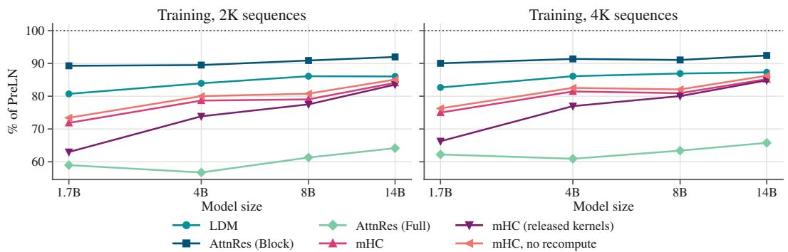  
Figure 8: Training throughput as a percentage of PreLN.

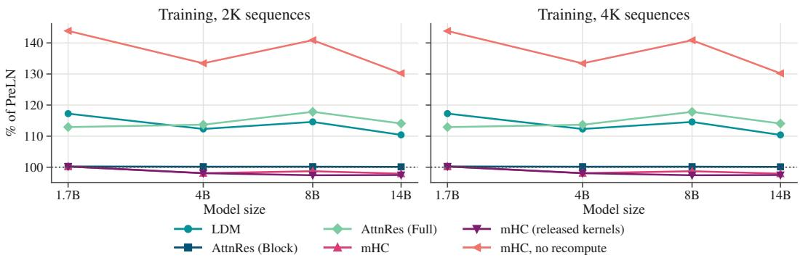  
Figure 9: Peak memory per GPU of the training step as a percentage of PreLN.

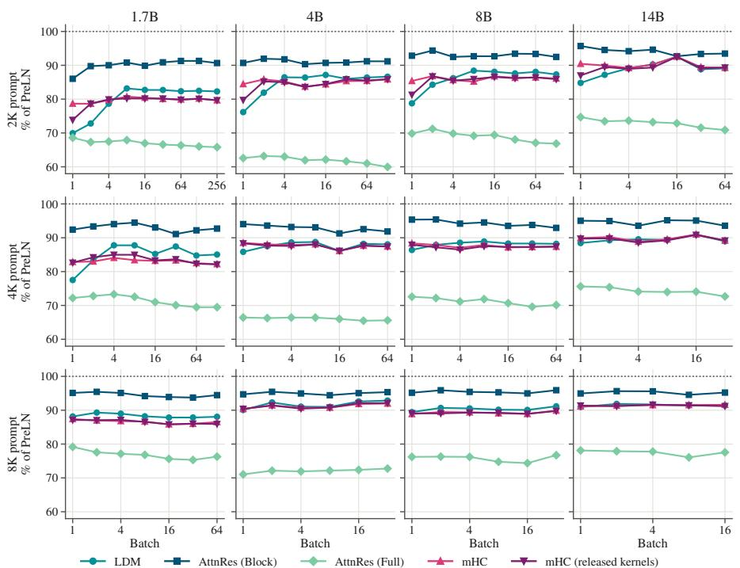  
Figure 10: Prefill throughput as a percentage of PreLN, by prompt length (rows) and model size (columns).

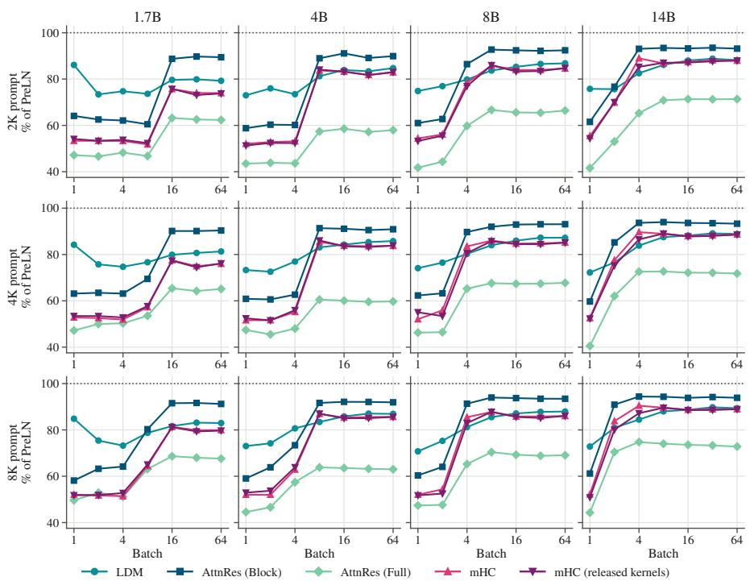  
Figure 11: Time to first token relative to PreLN (PreLN’s time divided by the method’s), by prompt length (rows) and model size (columns).

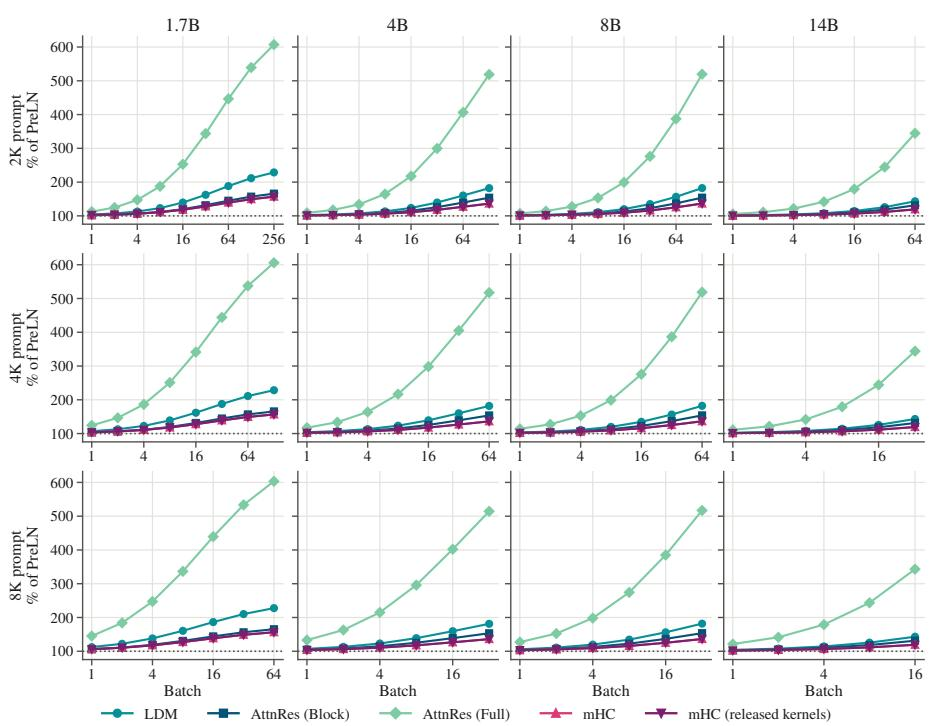  
Figure 12: Peak memory of prefill as a percentage of PreLN, by prompt length (rows) and model size (columns).

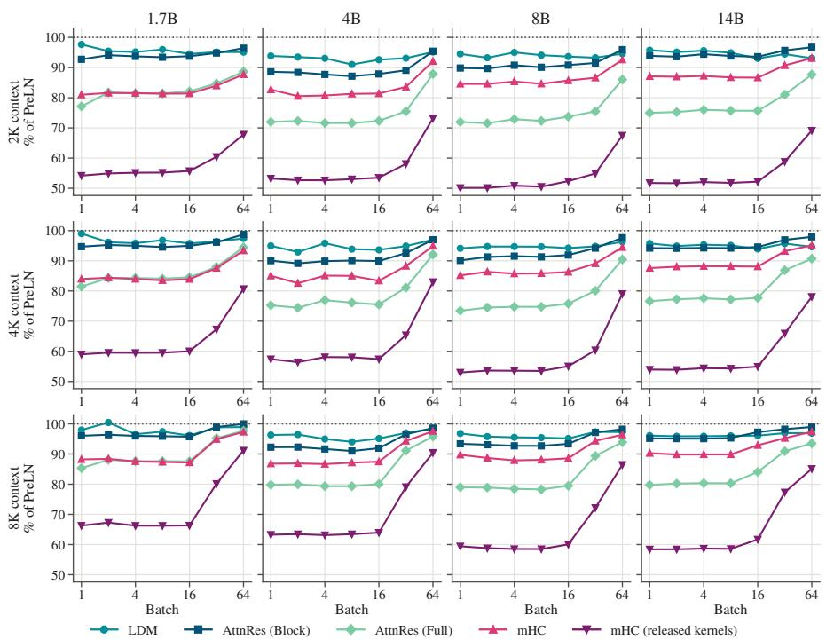  
Figure 13: Decode throughput per generated token as a percentage of PreLN, by context length (rows) and model size (columns).

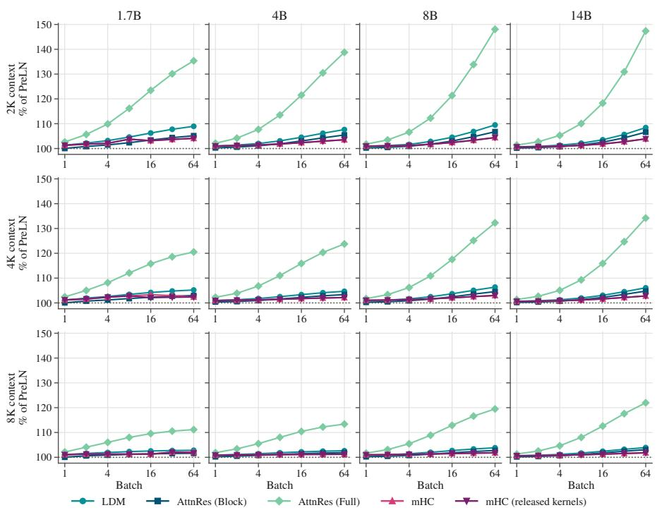  
Figure 14: Peak memory of decode as a percentage of PreLN, by context length (rows) and model size (columns).

## D EXTENDED RESULTS

## D.1 LEARNING RATE SWEEPS

Table 7 shows the final held-out validation loss of every run in the learning rate sweeps (we describe our protocol in Appendix B). We bold the selected learning rate of each method and scale. Figure 15 plots the losses of each model at each learning rate.

Table 7: Learning rate sweeps: final held-out FineWeb-Edu cross-entropy of each method, model scale and peak learning rate. The selected learning rate of each method is in bold.
<table><tr><td>Scale</td><td>Method</td><td> $5 \times 1 0 ^ { - 4 }$ </td><td> $1 \times 1 0 ^ { - 3 }$ </td><td> $2 \times 1 0 ^ { - 3 }$ </td><td> $4 \times 1 0 ^ { - 3 }$ </td></tr><tr><td rowspan="6">400M</td><td>PreLN</td><td>2.5627</td><td>2.5441</td><td>2.5465</td><td></td></tr><tr><td>AttnRes (Full)</td><td></td><td>2.5172</td><td>2.5135</td><td>2.5133</td></tr><tr><td>AttnRes (Block)</td><td></td><td>2.5064</td><td>2.4950</td><td>2.5026</td></tr><tr><td>mHC</td><td>2.5291</td><td>2.5043</td><td>2.5041</td><td></td></tr><tr><td>LDM (Ours)</td><td>2.5138</td><td>2.4913</td><td>2.4957</td><td></td></tr><tr><td>LDM,  $D _ { k } = 4$ </td><td>2.5178</td><td>2.4965</td><td>2.4991</td><td></td></tr><tr><td rowspan="4">1.5B</td><td>PreLN</td><td>2.2554</td><td>2.2496</td><td>2.2633</td><td></td></tr><tr><td>AttnRes (Block)</td><td>2.2333</td><td>2.2257</td><td>2.2437</td><td></td></tr><tr><td>mHC</td><td>2.2336</td><td>2.2244</td><td>2.2366</td><td></td></tr><tr><td>LDM (Ours)</td><td>2.2207</td><td>2.2141</td><td>2.2260</td><td></td></tr></table>

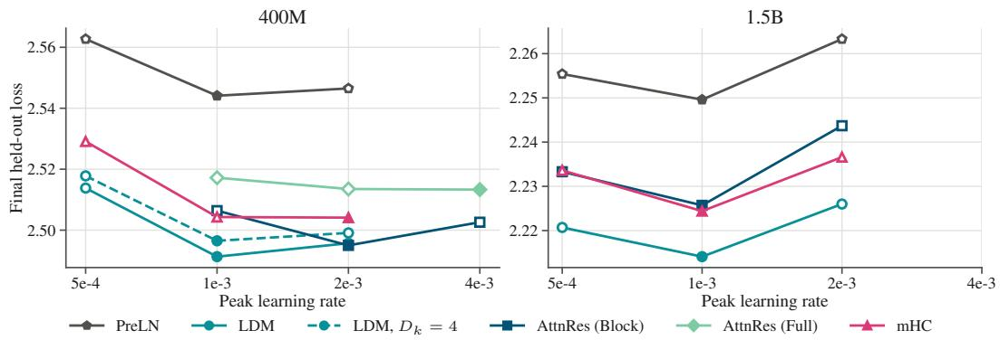  
Figure 15: Final held-out loss vs peak learning rate (the numbers of Table 7). The filled marker is each method’s lowest loss.  
Figures 16 and 17 show the training loss of every run in Table 7.

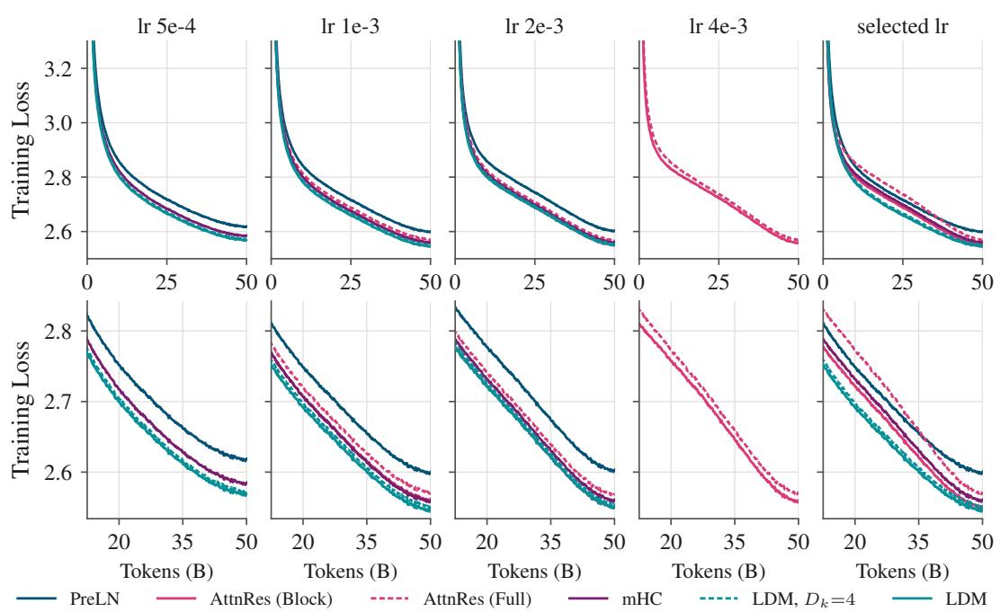  
Figure 16: Training loss of the 400M learning rate sweeps over 50B FineWeb-Edu tokens. The last panel uses each method’s selected rate. Top: the whole run. Bottom: from 12.5B tokens (25% of training) onwards.

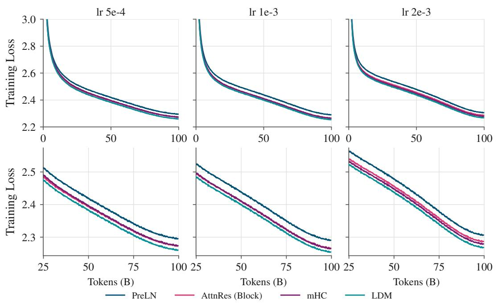  
Figure 17: Training loss of the 1.5B learning rate sweeps over 100B FineWeb-Edu tokens. Every method’s selected rate is $1 0 ^ { - 3 }$ . Top: the whole run. Bottom: from 24.9B tokens (25% of training) onwards.

## D.2 ABLATIONS

Here, we provide more precise definitions of our ablations. We use the notation of Section 3.2, repeated here for clarity. At layer l the incoming residual stream is $\mathbf x l - 1$ , the layer output is $\delta _ { l } .$ , the state is $\mathbf { S } _ { l } = ( \mathbf { x } _ { l } , \mathbf { M } _ { l } , \dot { \mathbf { P } } _ { l } )$ , and the LDM equations, with $\mathbf { r } _ { l - 1 }$ denoting the memory readout of the Read, are

$$
\begin{array} { r } { \mathbf q _ { l - 1 } = \operatorname { Q u e r y } ( \mathbf x _ { l - 1 } ) , \qquad \mathbf r _ { l - 1 } = \gamma _ { l - 1 } \odot \mathbf M _ { l - 1 } \big ( \mathbf g _ { l - 1 } \odot \mathbf q _ { l - 1 } \big ) , } \end{array}\tag{11}
$$

$$
\begin{array} { r } { \delta _ { l } = F _ { l } \left( \mathrm { N o r m } _ { l } ( \mathbf { x } _ { l - 1 } + \mathbf { r } _ { l - 1 } ) \right) , \qquad \mathbf { x } _ { l } = \mathbf { x } _ { l - 1 } + \delta _ { l } , } \end{array}
$$

$$
\begin{array} { r } { \mathbf { k } _ { l } = \mathrm { K e y } ( \mathbf { x } _ { l } ) , \quad \mathbf { v } _ { l } = \delta _ { l } , \qquad \mathbf { S } _ { l } = \mathrm { W r i t e } \big ( \mathbf { S } _ { l - 1 } , \mathbf { k } _ { l } , \mathbf { v } _ { l } \big ) , } \end{array}\tag{12}
$$

with the RLS Write as in Equation (8), G groups of width $D / G ,$ , the per-group read gate $\mathbf { g } _ { l - 1 } \in \mathbb { R } ^ { G }$ the per-group write weight $\omega _ { l } \in \mathbb { R } ^ { G }$ and the learned per-group read gain $\gamma _ { l - 1 } \in \mathbb { R } ^ { G }$ . In Table $^ { 8 , }$ we show the final held-out loss of every variant, and Figure 18 plots their training curves.

(a) Residual stream. The variant $F _ { l } ( { \bf r } _ { l - 1 } )$ replaces the stream with the read at every layer (including the final read).

$$
\delta _ { l } = F _ { l } \left( \mathrm { N o r m } _ { l } ( { \bf r } _ { l - 1 } ) \right) .
$$

The variant $\mathbf x _ { l } = \delta _ { l }$ removes the skip connection after each layer (note that the written value stays $\mathbf { v } _ { l } = \delta _ { l } )$ . Each variant can be understood as removing one of the two identity paths of the residual stream.

(b) Recurrence. We try different Write recurrences. Addresses, gates, and the learned forgetting factor $\lambda _ { l }$ remain the same as in our main variant for comparability. Per group, with the weighted observations $\overline { { \mathbf { k } } } _ { l } = \sqrt { \omega _ { l } }$ k<sub>l</sub> and $\overline { { \mathbf { v } } } _ { l } = \sqrt { \omega _ { l } } \mathbf { v } _ { l }$

$$
\begin{array} { r } { \mathrm { D e l t a \ r u l e : ~ } \mathbf { M } _ { l } = \lambda _ { l } \mathbf { M } _ { l - 1 } + \mathbf { u } _ { l } \mathbf { \overline { { k } } } _ { l } ^ { \top } , ~ \mathbf { u } _ { l } = \mathbf { \overline { { v } } } _ { l } - \lambda _ { l } \mathbf { M } _ { l - 1 } \mathbf { \overline { { k } } } _ { l } , } \\ { \mathrm { O u t e r \ p r o d u c t : ~ } \mathbf { M } _ { l } = \lambda _ { l } \mathbf { M } _ { l - 1 } + \mathbf { \overline { { v } } } _ { l } \mathbf { \overline { { k } } } _ { l } ^ { \top } . } \end{array}
$$

Note that these two do not maintain inverse covariances. RLS can be understood as applying forgetting through ${ \bf P } _ { l }$ instead of decaying the state. The delta rule and the outer product update are different approximations to the depth regression problem.

(c) Addressing. The variant ${ \bf v } _ { l } = { \bf x } _ { l }$ writes the updated residual stream instead of the layer output in Equation (12). Since $\begin{array} { r } { \mathbf { x } _ { l } = \mathbf { e } + \sum _ { i = 1 } ^ { l } \delta _ { i } } \end{array}$ , the memory stores cumulative sums of earlier outputs rather than the outputs themselves. This means that earlier outputs get stored at every layer iteration.

The variant $\mathbf { Q K } ( \delta _ { l } )$ changes the address sources while the stored value does not. In particular $\mathbf { q } _ { l - 1 } = \mathrm { Q u e r y } ( \delta _ { l - 1 } )$ ), the most recent layer output, instead of $\mathrm { Q u e r y } ( \mathbf { x } _ { l - 1 } )$ , and ${ \bf k } _ { l } = \mathrm { K e y } ( \delta _ { l } )$ instead of $\mathrm { K e y } ( \mathbf { x } _ { l } )$ . For the embedding write $\pmb { \delta } _ { 0 } = \mathbf { x } _ { 0 }$ , so the two coincide there.

The variant Static q replaces the query network by a vector learned for each layer, $\mathbf { q } _ { l - 1 } = \mathbf { q } _ { l - 1 } ^ { \mathrm { s t a t i c } }$ $\mathrm { i . e . , }$ it is independent of the token. The read gate is computed from the same input as the query, so it is fixed as well, $\mathbf { g } _ { l - 1 } = \mathbf { 1 }$

The variants $G = 1$ and $G = 8$ change G, the number of groups per token.

(d) Gain, gates and forgetting. The variant −γ fixes the read gain to one, $\gamma _ { l - 1 } = \mathbf { 1 }$ in Equation (11). The variant $\mathbf { g } _ { l - 1 } = \mathbf { 1 }$ fixes the read gate to one, so the read is $\mathbf { r } _ { l - 1 } = \gamma _ { l - 1 } \odot \mathbf { M } _ { l - 1 } \mathbf { q } _ { l - 1 }$ The variant $\omega _ { l } = { \bf 1 }$ fixes the write weight to one. The corresponding gate heads are removed from the address networks. The variant $\lambda _ { l } = \mathbf { 1 }$ fixes the forgetting factor to one instead of learning it, so every earlier write keeps its full weight in the least squares objective.

Table 8: Final held-out FineWeb-Edu cross-entropy of the 400M ablation runs (15B tokens). $\Delta$ i relative to LDM.
<table><tr><td>Group</td><td>Variant</td><td>Loss↓</td><td> $\Delta$ </td></tr><tr><td>Baselines</td><td>PreLN</td><td>2.6554</td><td>+0.0567</td></tr><tr><td rowspan="3">(a) Residual stream</td><td>LDM</td><td>2.5987</td><td>0.0000</td></tr><tr><td> $F _ { l } ( { \bf r } _ { l - 1 } )$ </td><td>2.7296</td><td>+0.1310</td></tr><tr><td> $\mathbf x _ { l } = \delta _ { l }$ </td><td>2.6611</td><td>+0.0625</td></tr><tr><td>(b) Recurrence</td><td>Delta</td><td>2.6028</td><td>+0.0041</td></tr><tr><td rowspan="2">(c) Addressing</td><td>Outer</td><td>2.6037</td><td>+0.0050</td></tr><tr><td> ${ \bf v } _ { l } = { \bf x } _ { l }$ </td><td>2.6227</td><td>+0.0241</td></tr><tr><td rowspan="6">(d) Gain, gates and forgetting</td><td> $\mathbf { Q K } ( \delta _ { l } )$ </td><td>2.6040</td><td>+0.0053</td></tr><tr><td> $\operatorname { S t a t i c } { \mathbf { q } }$ </td><td>2.6128</td><td>+0.0141</td></tr><tr><td> $G = 1$ </td><td>2.6007</td><td>+0.0021</td></tr><tr><td> $G = 8$ </td><td>2.5955</td><td>-0.0032</td></tr><tr><td>-γ</td><td>2.6014</td><td>+0.0027</td></tr><tr><td> $\mathbf { g } _ { l - 1 } = \mathbf { 1 }$ </td><td>2.6035</td><td>+0.0048</td></tr><tr><td></td><td> $\omega _ { l } = \mathbf { 1 }$   $\lambda _ { l } = \mathbf { 1 }$ </td><td>2.5992 2.5981</td><td>+0.0006 -0.0006</td></tr></table>

(a) Residual stream  
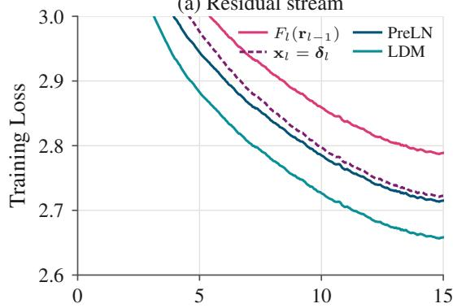

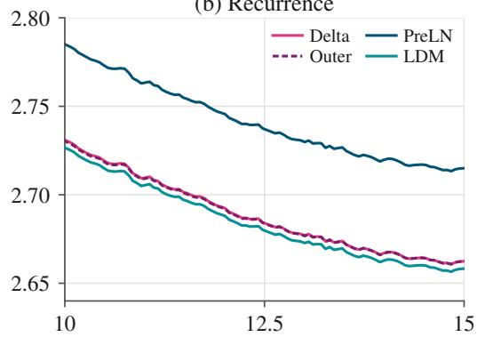  
(b) Recurrence

(c) Addressing  
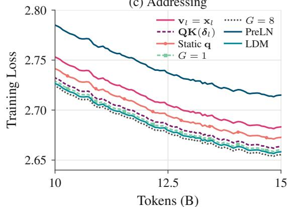

(d) Gain, gates and forgetting  
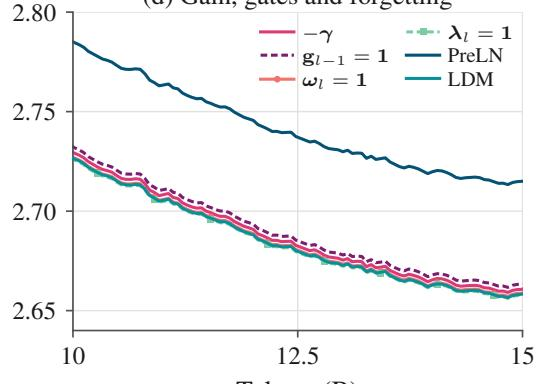  
Tokens (B)  
Figure 18: Training loss of the 400M ablation runs over 15B FineWeb-Edu tokens, grouped as in Table 8.

## D.3 DIFFERENT ASPECT RATIOS

We follow the exact training protocol of DepthBench (Wang et al., 2026). All models are Llamastyle decoder-only transformers, trained with a context of 2,048 tokens on FineWeb-Edu with a global batch of 512 sequences (about 1M tokens per step), AdamW $( \beta _ { 1 } = 0 . 9 , \beta _ { 2 } = 0 . 9 5$ , weight decay 0.1) and a cosine schedule with 10% warmup. At 400M, DepthBench tunes the learning rate of each baseline and finds $2 \times 1 0 ^ { - 3 }$ optimal for most of them. At 1.6B, it uses $5 \times 1 0 ^ { - 4 }$ for all methods without tuning. We use the same values for LDM and do not tune them. At 400M and at 1.6B, we train for 8B tokens (7,600 steps) and 32B tokens (30,400 steps), respectively. We report the final held-out perplexity on DepthBench’s FineWeb-Edu evaluation set. The baseline results are those published by DepthBench. They are exactly comparable to ours, since our runs use the identical training setup, including code, and data and its ordering. The model shapes are listed in Table 9.

LDM uses our main configuration except for weight decay, which follows DepthBench and also applies to the RMSNorm gains. Only the read gains, the forgetting logits and the biases of the address networks are not decayed. The group width equals the attention head width of each shape, which corresponds to 16 groups at every shape. We use H = 32 and H = 64 for the 400M and the 1.6B models, respectively.

Figure 19 extends the 400M panel of Figure 7 to DepthBench’s “extreme” aspect ratios, with 42 and 70 layers, where we compare against HC and AttnRes (Full) (the only methods reported by DepthBench at these shapes, which appeared to prefer extremely deep shapes). At these shapes, HC is ahead of LDM, and the perplexity of LDM increases at 70 layers. We note that these shapes were run for the purpose of a stress test and do not represent aspect ratios commonly used in models. Moreover, as found in Section 4.3, on bigger models, LDM seems to prefer deeper shapes, and the advantage of HC vanishes.

Table 9: DepthBench shapes. The 400M shapes have 16 query and 16 key/value heads, the 1.6B shapes 16 query and 8 key/value heads.
<table><tr><td>Tier</td><td>Layers</td><td>Width D</td><td> $D / L$ </td><td>Head width</td><td>FFN width</td><td>Backbone</td><td>LDM adds</td></tr><tr><td rowspan="7">400M</td><td>16</td><td>1,216</td><td>76.0</td><td>76</td><td>3,248</td><td>406.5M</td><td>2.97M (0.73%)</td></tr><tr><td>20</td><td>1,120</td><td>56.0</td><td>70</td><td>2,992</td><td>414.1M</td><td>3.42M (0.83%)</td></tr><tr><td>24</td><td>1,024</td><td>42.7</td><td>64</td><td>2,736</td><td>405.4M</td><td>3.78M (0.93%)</td></tr><tr><td>28</td><td>960</td><td>34.3</td><td>60</td><td>2,560</td><td>406.3M</td><td>4.16M (1.02%)</td></tr><tr><td>32</td><td>896</td><td>28.0</td><td>56</td><td>2,400</td><td>399.4M</td><td>4.47M (1.12%)</td></tr><tr><td>42</td><td>800</td><td>19.0</td><td>50</td><td>2,144</td><td>404.2M</td><td>5.30M (1.31%)</td></tr><tr><td>70</td><td>640</td><td>9.1</td><td>40</td><td>1,712</td><td>409.2M</td><td>7.31M (1.79%)</td></tr><tr><td rowspan="3">1.6B</td><td>28</td><td>2,048</td><td>73.1</td><td>128</td><td>6,144</td><td>1.615B</td><td>16.25M (1.01%)</td></tr><tr><td>40</td><td>1,728</td><td>43.2</td><td>108</td><td>5,184</td><td>1.607B</td><td>19.73M (1.23%)</td></tr><tr><td>54</td><td>1,504</td><td>27.9</td><td>94</td><td>4,512</td><td>1.617B</td><td>23.37M (1.45%)</td></tr></table>

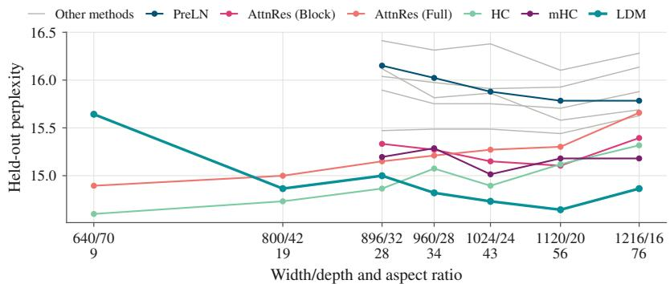  
Figure 19: Final held-out perplexity on DepthBench at 400M parameters vs the aspect ratio (width/depth), from 16 to 70 layers. Tick labels give the width/depth of each shape and aspect ratio.

## E LDM DETAILS

## E.1 DERIVATION OF THE RLS RECURSIONS

For conciseness, fix one group, with $\mathbf { M } _ { l } \in \mathbb { R } ^ { D _ { v } \times D _ { k } }$ and $\mathbf { P } _ { l } \in \mathbb { R } ^ { D _ { k } \times D _ { k } }$ . Write l maps the state after Write $l - 1$ to the state after Write l. Write 0 stores the embedding. Let $\alpha > 0 , \lambda _ { l } > 0$ , and $\omega _ { l } > 0$ . The weighted objective is as in Equation (6). Define

$$
\mathbf { A } _ { l } = \sum _ { i = 0 } ^ { l } \left( \prod _ { j = i + 1 } ^ { l } \lambda _ { j } \right) \omega _ { i } \mathbf { k } _ { i } \mathbf { k } _ { i } ^ { \top } + \left( \prod _ { j = 0 } ^ { l } \lambda _ { j } \right) \alpha ^ { - 1 } \mathbf { I } ,
$$

$$
\mathbf { B } _ { l } = \sum _ { i = 0 } ^ { l } \left( \prod _ { j = i + 1 } ^ { l } \lambda _ { j } \right) \boldsymbol { \omega } _ { i } \mathbf { v } _ { i } \mathbf { k } _ { i } ^ { \top } .
$$

The objective gradient is $2 ( \mathbf { M A } _ { l } - \mathbf { B } _ { l } )$ Since ${ \bf A } _ { l }$ is positive definite, the unique minimizer is $\mathbf M _ { l } = \mathbf { \bar { B } } _ { l } \mathbf A _ { l } ^ { - 1 }$ . With $\mathbf { A } _ { - 1 } = \alpha ^ { - 1 } \mathbf { I }$ and $\mathbf { B } _ { - 1 } = \mathbf { 0 }$

$$
\mathbf { A } _ { l } = \lambda _ { l } \mathbf { A } _ { l - 1 } + \overline { { \mathbf { k } } } _ { l } \overline { { \mathbf { k } } } _ { l } ^ { \top } , \qquad \mathbf { B } _ { l } = \lambda _ { l } \mathbf { B } _ { l - 1 } + \overline { { \mathbf { v } } } _ { l } \overline { { \mathbf { k } } } _ { l } ^ { \top } ,
$$

where $\overline { { \mathbf { k } } } _ { l } = \sqrt { \omega _ { l } } \mathbf { k } _ { l }$ and $\overline { { \mathbf { v } } } _ { l } = \sqrt { \omega _ { l } } \mathbf { v } _ { l }$

Forward inverse covariance update. Set $\mathbf { P } _ { l } = \mathbf { A } _ { l } ^ { - 1 }$ . Sherman–Morrison gives

$$
\mathbf { P } _ { l } = \frac { 1 } { \lambda _ { l } } \left( \mathbf { P } _ { l - 1 } - \frac { \mathbf { P } _ { l - 1 } \overline { { \mathbf { k } } } _ { l } \overline { { \mathbf { k } } } _ { l } ^ { \top } \mathbf { P } _ { l - 1 } } { \lambda _ { l } + \overline { { \mathbf { k } } } _ { l } ^ { \top } \mathbf { P } _ { l - 1 } \overline { { \mathbf { k } } } _ { l } } \right) .
$$

The denominator is strictly positive. With the gain from Equation (7), it is easy to see that this is the inverse covariance update in Equation (8). In particular, $\overline { { \mathbf { k } } } _ { l } ^ { \top } \mathbf { P } _ { l } = \kappa _ { l } ^ { \top }$

Forward memory update. Using $\mathbf { B } _ { l - 1 } = \mathbf { M } _ { l - 1 } \mathbf { A } _ { l - 1 }$ , we have that

$$
\begin{array} { r l } & { \mathbf { M } _ { l } = \big ( \lambda _ { l } \mathbf { B } _ { l - 1 } + \overline { { \mathbf { v } } } _ { l } \overline { { \mathbf { k } } } _ { l } ^ { \top } \big ) \mathbf { P } _ { l } } \\ & { \quad \quad = \mathbf { M } _ { l - 1 } \big ( \mathbf { I } - \overline { { \mathbf { k } } } _ { l } \overline { { \mathbf { k } } } _ { l } ^ { \top } \mathbf { P } _ { l } \big ) + \overline { { \mathbf { v } } } _ { l } \overline { { \mathbf { k } } } _ { l } ^ { \top } \mathbf { P } _ { l } } \\ & { \quad \quad = \mathbf { M } _ { l - 1 } + \big ( \overline { { \mathbf { v } } } _ { l } - \mathbf { M } _ { l - 1 } \overline { { \mathbf { k } } } _ { l } \big ) \pmb { \kappa } _ { l } ^ { \top } = \mathbf { M } _ { l - 1 } + \mathbf { u } _ { l } \kappa _ { l } ^ { \top } . } \end{array}
$$

Gating and regularization. The dynamic weight $\omega _ { l }$ sets the “importance” of observation l and $\lambda _ { l }$ discounts all earlier observations (and the initial ridge penalty). A fixed ridge penalty would instead introduce an additional full-rank term $( 1 - \lambda _ { l } ) \alpha ^ { - 1 } \dot { \mathbf { I } }$ into the covariance recurrence. That alternative remains solvable, but no longer admits the Sherman–Morrison-based update.

## E.2 BOUNDARY CASES

Before writing the embedding e, we initialize the memory as

$$
\begin{array} { r } { \mathbf { M } _ { - 1 } = \mathbf { 0 } , \qquad \mathbf { P } _ { - 1 } = \alpha \mathbf { I } . } \end{array}
$$

The initial value written into the memory is $\mathbf { v } _ { 0 } = \mathbf { e } ,$ , and its key and weight are generated from e using the same write-side parametrization, yielding

$$
( \mathbf { e } , \mathbf { M } _ { 0 } , \mathbf { P } _ { 0 } ) = \mathrm { W r i t e } \left( ( \mathbf { 0 } , \mathbf { M } _ { - 1 } , \mathbf { P } _ { - 1 } ) , \mathbf { k } _ { 0 } , \mathbf { v } _ { 0 } , \omega _ { 0 } , \lambda _ { 0 } \right) .
$$

After the final transformer layer, one final Read is added to the residual stream. We generate $\mathbf { q } _ { \mathrm { o u t } }$ from $\mathbf { x } _ { L }$ using the same parametrization and define

$$
\mathbf { x } _ { \mathrm { o u t } } = \operatorname { R e a d } \left( ( \mathbf { x } _ { L } , \mathbf { M } _ { L } , \mathbf { P } _ { L } ) , \mathbf { q } _ { \mathrm { o u t } } \right) .
$$

The final representation $\mathbf { x _ { \mathrm { o u t } } }$ is then passed to the LM head.

## F HARDWARE-AWARE IMPLEMENTATION

This appendix provides an expanded explanation of Section 3.3. All quantities below are per token and per group. Algorithm 1 summarizes our implementation.

Notation. We fix one group, and use $\overline { { \mathbf { k } } } _ { l } = \sqrt { \omega _ { l } } \mathbf { k } _ { l }$ and $\overline { { \mathbf { v } } } _ { l } = \sqrt { \omega _ { l } } \mathbf { v } _ { l }$ for the weighted key and value of a Write, and $\tilde { \mathbf { q } } _ { l } = \gamma _ { l } \ g _ { l } \ \mathbf { q } _ { l }$ for the gated query. The read is then $\mathbf { r } _ { l } = \mathbf { M } _ { l } \tilde { \mathbf { q } } _ { l }$ . We also use $\mathrm { d } a = \nabla _ { a } \mathcal { L }$ for brevity.

When a is used in several places, $\nabla _ { a } \mathcal { L }$ is a sum with one term per use (by the chain rule). We use a superscript $\mathbf { M } _ { l }$ to keep only the terms of the uses of a in computing u<sub>l</sub> and $\mathbf { M } _ { l }$ (the memory update), and a superscript ${ \bf P } _ { l }$ to keep only those in computing $\kappa _ { l }$ and $\mathbf { P } _ { l } ^ { - }$ (the gain and inverse covariance update). For example, $\kappa _ { l }$ is used to compute $\mathbf { M } _ { l }$ and $\mathbf { P } _ { l } , \mathbf { \overline { { k } } } _ { l }$ to compute $\mathbf { u } _ { l } , \kappa _ { l }$ and $\mathbf { P } _ { l } ,$ , and $\mathbf { M } _ { l }$ to compute $\mathbf { u } _ { l + 1 } , \mathbf { M } _ { l + 1 }$ and the read $\mathbf { r } _ { l } .$ , so

$$
\mathrm { d } \kappa _ { l } = \mathrm { d } \kappa _ { l } ^ { \mathbf { M } _ { l } } + \mathrm { d } \kappa _ { l } ^ { \mathbf { P } _ { l } } , \qquad \mathrm { d } \overline { { \mathbf { k } } } _ { l } = \mathrm { d } \overline { { \mathbf { k } } } _ { l } ^ { \mathbf { M } _ { l } } + \mathrm { d } \overline { { \mathbf { k } } } _ { l } ^ { \mathbf { P } _ { l } } , \qquad \mathrm { d } \mathbf { M } _ { l } = \mathrm { d } \mathbf { M } _ { l } ^ { \mathbf { M } _ { l + 1 } } + \mathrm { d } \mathbf { r } _ { l } \tilde { \mathbf { q } } _ { l } ^ { \top } .
$$

Steps. We call the Write at layer l, fused with the Read for layer $l + 1 , \mathsf { a } \ ^ { \ast } \mathrm { s t e p } ^ { \prime \prime }$ . Step l takes the state $( \mathbf { M } _ { l - 1 } , \mathbf { P } _ { l - 1 } )$ , the weighted key and value $\overline { { \mathbf { k } } } _ { l }$ and $\overline { { \mathbf { v } } } _ { l }$ , the gated query $\tilde { \mathbf { q } } _ { l }$ and the forgetting factor $\lambda _ { l }$ . It produces the next state $( \bar { \mathbf { M } } _ { l } , \mathbf { P } _ { l } )$ and the read $\mathbf { r } _ { l } = \mathbf { M } _ { l } \tilde { \mathbf { q } } _ { l }$ , which is fed into layer $l + \bar { 1 }$

Step 0 writes the embedding $( \mathbf { v } _ { 0 } = \mathbf { e } )$ into the initial state $( \mathbf { M } _ { - 1 } , \mathbf { P } _ { - 1 } ) = ( \mathbf { 0 } , \alpha \mathbf { I } )$ , producing the state $( \mathbf { M } _ { 0 } , \mathbf { P } _ { 0 } )$ after the write, as well as the read $\mathbf { r } _ { 0 }$ for layer 1. Step L ends with the final read into the LM head, with query $\mathbf { q } _ { \mathrm { o u t } }$ (Appendix E.2) written as $\mathbf { q } _ { L }$ . An L-layer model then has $L + 1$ steps.

## F.1 UNWINDING

Needed gradients. As usual, the backward pass runs the forward steps in reverse order. At step l, the backward pass “receives” three gradients:

$\mathrm { d } \mathbf { r } _ { l } .$ , the gradient of the read $\mathbf r _ { l } = \mathbf M _ { l } \tilde { \mathbf q } _ { l }$ of step l (which is fed into layer $l + 1$ , or into the LM head for $l = L )$

$\mathrm { d } \mathbf { P } _ { l } ,$ the gradient of $\mathbf { P } _ { l } ,$

$\mathrm { d } \mathbf { M } _ { l } ^ { \mathbf { M } _ { l + 1 } } = \mathrm { d } \mathbf { M } _ { l } - \mathrm { d } \mathbf { r } _ { l } \tilde { \mathbf { q } } _ { l } ^ { \top }$ , the gradient of $\mathbf { M } _ { l }$ without the term corresponding to its read $\mathbf { r } _ { l }$ (which step l adds through dr<sub>l</sub>).

Since ${ \bf M } _ { L }$ is only used by the final read and $\mathbf { P } _ { L }$ is not used, dM $\mathbf { \partial } ^ { \cdot \mathbf { M } _ { L + 1 } } = \mathbf { 0 }$ and $\mathrm { d } \mathbf { P } _ { L } = \mathbf { 0 }$ . From these, the backward pass of step l must produce

$\mathrm { d } \tilde { \mathbf { q } } _ { l } , \mathrm { d } \overline { { \mathbf { v } } } _ { l } , \mathrm { d } \overline { { \mathbf { k } } } _ { l }$ and $\mathrm { d } \lambda _ { l }$ , the gradients of the inputs of step l,

$\mathrm { d } \mathbf { M } _ { l - 1 } ^ { \mathbf { M } _ { l } }$ and $\mathrm { d } \mathbf { P } _ { l - 1 }$ , which are passed on to step $l - 1 \left( \mathrm { f o r } l > 0 \right)$

Since step l computes $\mathbf { u } _ { l } = \overline { { \mathbf { v } } } _ { l } - \mathbf { M } _ { l - 1 } \overline { { \mathbf { k } } } _ { l } , \mathbf { M } _ { l } = \mathbf { M } _ { l - 1 } + \mathbf { u } _ { l } \boldsymbol { \kappa } _ { l } ^ { \top }$ and $\mathbf r _ { l } = \mathbf M _ { l } \tilde { \mathbf q } _ { l }$ (Equations (7) and (8)), these gradients are

$$
\begin{array} { r l } & { \mathrm { d } \widetilde { \mathbf { q } } _ { l } = \mathbf { M } _ { l } ^ { \top } \mathrm { d } \mathbf { r } _ { l } , \quad \mathrm { d } \overline { { \mathbf { v } } } _ { l } = \mathrm { d } \mathbf { u } _ { l } = \mathrm { d } \mathbf { M } _ { l } ^ { \mathbf { M } _ { l + 1 } } \boldsymbol { \kappa } _ { l } + ( \boldsymbol { \kappa } _ { l } ^ { \top } \widetilde { \mathbf { q } } _ { l } ) \mathrm { d } \mathbf { r } _ { l } , } \\ & { \mathrm { d } \boldsymbol { \kappa } _ { l } ^ { \mathbf { M } _ { l } } = ( \mathrm { d } \mathbf { M } _ { l } ^ { \mathbf { M } _ { l + 1 } } ) ^ { \top } \mathbf { u } _ { l } + ( \mathbf { u } _ { l } ^ { \top } \mathrm { d } \mathbf { r } _ { l } ) \widetilde { \mathbf { q } } _ { l } , \quad \mathrm { d } \overline { { \mathbf { k } } } _ { l } = - \mathbf { M } _ { l - 1 } ^ { \top } \mathrm { d } \overline { { \mathbf { v } } } _ { l } + \mathrm { d } \overline { { \mathbf { k } } } _ { l } ^ { \mathbf { P } _ { l } } , } \\ & { \mathrm { d } \mathbf { M } _ { l - 1 } ^ { \mathbf { M } _ { l } } = \mathrm { d } \mathbf { M } _ { l } ^ { \mathbf { M } _ { l + 1 } } + \mathrm { d } \mathbf { r } _ { l } \widetilde { \mathbf { q } } _ { l } ^ { \top } - \mathrm { d } \overline { { \mathbf { v } } } _ { l } \overline { { \mathbf { k } } } _ { l } ^ { \top } , } \end{array}\tag{13}
$$

where $\mathrm { d } \overline { { \mathbf { k } } } _ { l } ^ { \mathbf { P } _ { l } }$ is obtained by backpropagating $\mathrm { d } \kappa _ { l } ^ { \mathbf { M } _ { l } }$ and $\mathrm { d } \mathbf { P } _ { l }$ through Equations (7) and (8) (which also produces $\mathrm { d } \lambda _ { l }$ and $\mathrm { d } \mathbf { P } _ { l - 1 } )$ . Note that these need the inverse covariance $\mathbf { P } _ { l - 1 }$ but do not depend on the state.

Unwinding the state. The only states in Equation (13) are $\mathbf { M } _ { l } ,$ , in $\mathrm { d } \tilde { \mathbf { q } } _ { l }$ , and ${ \bf M } _ { l - 1 }$ , in $\mathrm { d } \overline { { \mathbf { k } } } _ { l }$ . Instead of saving them, the backward pass starts from the final state ${ \bf M } _ { L }$ of the forward pass and unwinds it in place. When it reaches step l, it holds $\mathbf { M } _ { l }$ and recovers the previous state from the saved pseudo-value and gain of the step by unwinding (Equation (9)),

$$
\mathbf { M } _ { l - 1 } = \mathbf { M } _ { l } - \mathbf { u } _ { l } \boldsymbol \kappa _ { l } ^ { \top } ,
$$

which it uses for the gradients of step l and then for step l −1. It is therefore enough to save, for each step, ${ \mathbf u } _ { l } , \kappa _ { l } , \overline { { \mathbf { k } } } _ { l } , \tilde { \mathbf { q } } _ { l } , \lambda _ { l }$ and $\mathbf { P } _ { l - 1 }$ (which we refer to as “context” in Section 3.3), and a single state per token is kept in memory. The inverse covariance is saved (instead of unwound). Note that $\mathbf { P } _ { l - 1 }$ has only $D _ { k } ( \dot { D _ { k } } + 1 ) / 2$ entries per group (we only save the nonredundant part, which corresponds to a triangle given it is symmetric).

## F.2 WINDOWING

We group steps into windows $\mathcal { W } = \{ b { + } 1 , \ldots , e \}$ of at most E steps, with $b = - 1 , E - 1 , 2 E - 1 , . . .$ and $e = \operatorname* { m i n } ( b + E , L )$ . Inside a window, $\begin{array} { r } { \mathbf M _ { i } = \mathbf M _ { b } + \sum _ { b < m < i } \mathbf u _ { m } \pmb { \kappa } _ { m } ^ { \top } } \end{array}$ , and hence every product of a state with a vector can be computed from the state $\mathbf { M } _ { b }$ before the window and the pseudo-values and gains of the window (Equation (10)),

$$
\mathbf { M } _ { i } \mathbf { x } = \mathbf { M } _ { b } \mathbf { x } + \sum _ { b < m \leq i } \mathbf { u } _ { m } \left( \kappa _ { m } ^ { \top } \mathbf { x } \right) , \qquad \mathbf { M } _ { i } ^ { \top } \mathbf { y } = \mathbf { M } _ { b } ^ { \top } \mathbf { y } + \sum _ { b < m \leq i } \kappa _ { m } \left( \mathbf { u } _ { m } ^ { \top } \mathbf { y } \right) .\tag{14}
$$

Forward. For step $l ,$ the Write needs the pseudo-value $\mathbf { u } _ { l } = \overline { { \mathbf { v } } } _ { l } - \mathbf { M } _ { l - 1 } \overline { { \mathbf { k } } } _ { l }$ for the update ${ { \bf { M } } _ { l } } =$ $\mathbf { M } _ { l - 1 } + \mathbf { u } _ { l } \kappa _ { l } ^ { \top }$ , and the Read is $\mathbf { r } _ { l } = \mathbf { M } _ { l } \tilde { \mathbf { q } } _ { l }$ . Hence, it needs the products $\mathbf { M } _ { l - 1 } \mathbf { \overline { { k } } } _ { l }$ and $\mathbf { M } _ { l } \tilde { \mathbf { q } } _ { l }$ , which, as shown in Equation (14), can be computed from $\mathbf { M } _ { b } .$ . In particular, the states inside the window are never formed, and only the last step of the window writes the new state, $\begin{array} { r } { \mathbf { M } _ { e } = \mathbf { M } _ { b } + \sum _ { b < i \leq e } \mathbf { u } _ { i } \pmb { \kappa } _ { i } ^ { \top } } \end{array}$

Backward. The windows are naturally processed in reverse order. A single unwinding, $\mathbf { M } _ { b } \ =$ $\begin{array} { r } { \mathbf { M } _ { e } \mathrm { ~ - ~ } \sum _ { b < i < e } \mathbf { u } _ { i } \boldsymbol { \kappa } _ { i } ^ { \top } } \end{array}$ , can recover the state before the window. After recovering it, $\mathbf { M } _ { i } ^ { \top } \mathrm { d } \mathbf { r } _ { i }$ and $\mathbf { M } _ { i - 1 } ^ { \top } \mathrm { d } \overline { { \mathbf { v } } } _ { i }$ of Equation (13) are computed from it by Equation (14). Note that the intermediate state gradients inside the window are not needed either. Unrolling the recursion for $\mathrm { d } { \bf M } _ { l - 1 } ^ { \mathbf { M } _ { l } }$ in Equation (13) over the window gives

$$
\mathrm { d } \mathbf { M } _ { i } ^ { \mathbf { M } _ { i + 1 } } = \mathrm { d } \mathbf { M } _ { e } ^ { \mathbf { M } _ { e + 1 } } + \sum _ { j = i + 1 } ^ { e } \big ( \mathrm { d } \mathbf { r } _ { j } \tilde { \mathbf { q } } _ { j } ^ { \intercal } - \mathrm { d } \overline { { \mathbf { v } } } _ { j } \overline { { \mathbf { k } } } _ { j } ^ { \intercal } \big ) , \qquad b \leq i \leq e ,\tag{15}
$$

and substituting it into ${ \mathrm { d } } { \overline { { \mathbf { v } } } } _ { i }$ and $\mathrm { d } \kappa _ { i } ^ { \mathbf { M } _ { i } }$ of Equation (13) gives

$$
\begin{array} { r l } & { \mathrm { d } \overline { { \mathbf { v } } } _ { i } = \mathrm { d } \mathbf { u } _ { i } = \mathrm { d } \mathbf { M } _ { e } ^ { \mathbf { M } _ { e + 1 } } \kappa _ { i } + \displaystyle \sum _ { j \geq i } ( \kappa _ { i } ^ { \top } \widetilde { \mathbf { q } } _ { j } ) \mathrm { d } \mathbf { r } _ { j } - \displaystyle \sum _ { j > i } ( \kappa _ { i } ^ { \top } \overline { { \mathbf { k } } } _ { j } ) \mathrm { d } \overline { { \mathbf { v } } } _ { j } , } \\ & { \mathrm { d } \kappa _ { i } ^ { \mathbf { M } _ { i } } = \big ( \mathrm { d } \mathbf { M } _ { e } ^ { \mathbf { M } _ { e + 1 } } \big ) ^ { \top } \mathbf { u } _ { i } + \displaystyle \sum _ { j \geq i } ( \mathbf { u } _ { i } ^ { \top } \mathrm { d } \mathbf { r } _ { j } ) \widetilde { \mathbf { q } } _ { j } - \displaystyle \sum _ { j > i } ( \mathbf { u } _ { i } ^ { \top } \mathrm { d } \overline { { \mathbf { v } } } _ { j } ) \overline { { \mathbf { k } } } _ { j } , } \end{array}\tag{16}
$$

where the sums are over the steps of the given window. These are computed for $i = e , e { \mathrm { - } } 1 , \ldots , b { \mathrm { + } } 1$ and use $\mathrm { d } \mathbf { M } _ { e } ^ { \mathbf { M } _ { e + 1 } }$ only through $\mathrm { d } \mathbf { M } _ { e } ^ { \mathbf { M } _ { e + 1 } } \pmb { \kappa } _ { i }$ and $( \mathrm { d } \mathbf { M } _ { e } ^ { \mathbf { M } _ { e + 1 } } ) ^ { \top } \mathbf { u } _ { i } .$ . In particular, the only state gradient that is formed for a window is its $\mathrm { d } \mathbf { M } _ { e } ^ { \mathbf { M } _ { e + 1 } }$ . For the last window, it is $\mathrm { d } \mathbf { M } _ { I . } ^ { \mathbf { M } _ { L + 1 } } = \mathbf { 0 }$ . The other windows form it at their start, from the state gradients of their later windows $\left\{ e + 1 , \ldots , e ^ { \prime } \right\}$ , where $e ^ { \prime } = \operatorname* { m i n } ( e + E , L )$ , by Equation (15):

$$
\mathrm { d } \mathbf { M } _ { e } ^ { \mathbf { M } _ { e + 1 } } = \mathrm { d } \mathbf { M } _ { e ^ { \prime } } ^ { \mathbf { M } _ { e ^ { \prime } + 1 } } + \sum _ { j = e + 1 } ^ { e ^ { \prime } } \big ( \mathrm { d } \mathbf { r } _ { j } \tilde { \mathbf { q } } _ { j } ^ { \top } - \mathrm { d } \overline { { \mathbf { v } } } _ { j } \overline { { \mathbf { k } } } _ { j } ^ { \top } \big ) .
$$

Both the state and $\mathrm { d } \mathbf { M } _ { e } ^ { \mathbf { M } _ { e + 1 } }$ are then updated only once per window. This reduces state-sized traffic at the cost of accessing more vector-sized values. We use $E = 4$ in our main experiments.

```latex
Algorithm 1 Forward and backward pass with unwinding and windowing (fixing one token and one
group). M, P, dM and dP are buffers updated in place.
Forward
1: $\mathbf { M }  \mathbf { 0 } , \quad \mathbf { P }  \alpha \mathbf { I }$
2: for each window $\mathcal { W } = \{ b + 1 , \ldots , e \}$ do ▷ $\mathbf { M } = \mathbf { M } _ { b }$
3: for $l = b + 1 , \dotsc , e$ do
4: $\mathbf { v } _ { l }  \delta _ { l } ( \mathbf { v } _ { 0 }  \mathbf { e } )$ , and k<sub>l</sub>, $\sqrt { \omega _ { l } } , \tilde { \mathbf { q } } _ { l }$ from the address networks
5: $\overline { { \mathbf { k } } } _ { l }  \sqrt { \omega _ { l } } \mathbf { k } _ { l } , \quad \overline { { \mathbf { v } } } _ { l }  \sqrt { \omega _ { l } } \mathbf { v } _ { l }$
6: $\kappa _ { l }$ by Equation (7), save $\mathbf { P } _ { l - 1 } = \mathbf { P }$ $\mathbf { P }  \mathbf { P } _ { l }$ by Equation (8)
7: u<sub>l</sub> and r<sub>l</sub> by Equation (14)
8: save ${ \mathbf u } _ { l } , \kappa _ { l } , \overline { { \mathbf { k } } } _ { l } , \tilde { \mathbf { q } } _ { l } , \lambda _ { l }$
9: $\mathbf { i f } l = e$ then
10: $\begin{array} { r } { \mathbf { M } \gets \mathbf { M } + \sum _ { b < i \leq e } \mathbf { u } _ { i } \pmb { \kappa } _ { i } ^ { \top } } \end{array}$ ▷ $\mathbf { M } = \mathbf { M } _ { e }$
Backward
11: $\mathrm { d } \mathbf { M }  \mathbf { 0 } , \quad \mathrm { d } \mathbf { P }  \mathbf { 0 } ,$ dr from the LM head ▷ $\mathbf { M } = \mathbf { M } _ { L }$
12: for each window $\mathcal { W } = \{ b + 1 , \ldots , e \}$ , in reverse do
13: i $\mathrm { \Delta } \mathrm { f } e < L$ then $\triangleright e ^ { \prime } = \operatorname* { m i n } ( e + E , L )$
14: $\begin{array} { r } { \mathrm { d } \mathbf { M } \gets \mathrm { d } \mathbf { M } + \sum _ { e < j \leq e ^ { \prime } } \bigl ( \mathrm { d } \mathbf { r } _ { j } \tilde { \mathbf { q } } _ { j } ^ { \top } - \mathrm { d } \overline { { \mathbf { v } } } _ { j } \overline { { \mathbf { k } } } _ { j } ^ { \top } \bigr ) } \end{array}$
15: M $\textstyle \gets \mathbf { M } - \sum _ { b < i < e } \mathbf { u } _ { i } \pmb { \kappa } _ { i } ^ { \top }$ ▷ $\mathbf { M } = \mathbf { M } _ { b } , \ \mathrm { d } \mathbf { M } = \mathrm { d } \mathbf { M } _ { e } ^ { \mathbf { M } _ { e + 1 } }$
16: for $i = e , \ldots , b + \overline { { 1 } }$ do
17: dv<sub>i</sub> and $\mathrm { d } \kappa _ { i } ^ { \mathbf { M } _ { i } }$ by Equation (16)
18: $\mathrm { d } \overline { { \mathbf { k } } } _ { i } ^ { \mathbf { P } _ { i } } , \mathrm { d } \lambda _ { i }$ <sub>i</sub> and dP $ \mathrm { d } \mathbf { P } _ { i - 1 }$ by backpropagating through Equations (7) and (8)
19: $\mathrm { d } \tilde { \mathbf { q } } _ { i }$ and dk<sub>i</sub> by Equations (13) and (14)
20: $\mathrm { d } { \bf r } _ { i - 1 } ( i > 0 )$ by backpropagating through the address networks and layer i
```

## G AI USE STATEMENT

We used generative AI tools for LAT X formatting and implementation of figures, to help draft parts of the text that we edited afterward, to polish text, and, through discussions with them, to refine ideas, methodology, and hypotheses. We also used them for some mathematical calculations and derivations, and for code editing and experiment execution (at the direction of the authors). Additionally, they were used to assist with literature search. A particularly relevant use of AI was kernel development. With substantial human involvement, we used AI to explore possible algorithmic implementations and, within the resulting algorithmic framework, to search the space of kernels and to write and tune them. We validated the kernels extensively with a wide range of synthetic tests and real training runs. We have reviewed all AI-assisted work and take responsibility for the final content of this paper.