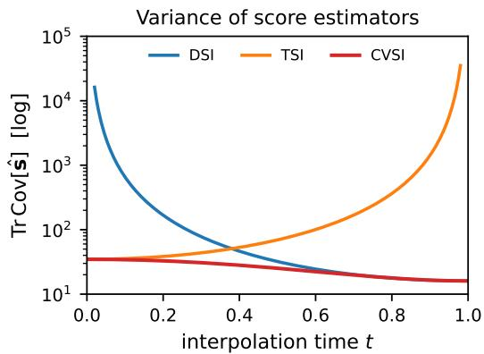
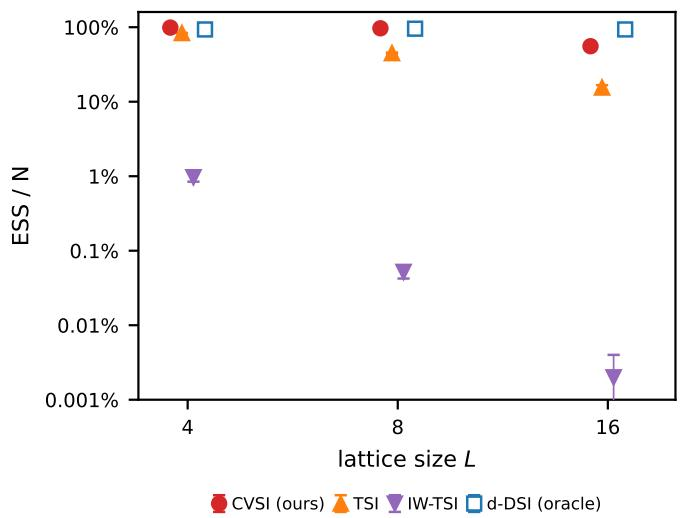
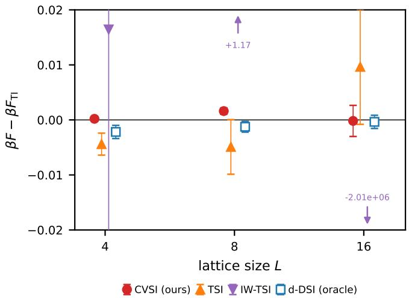
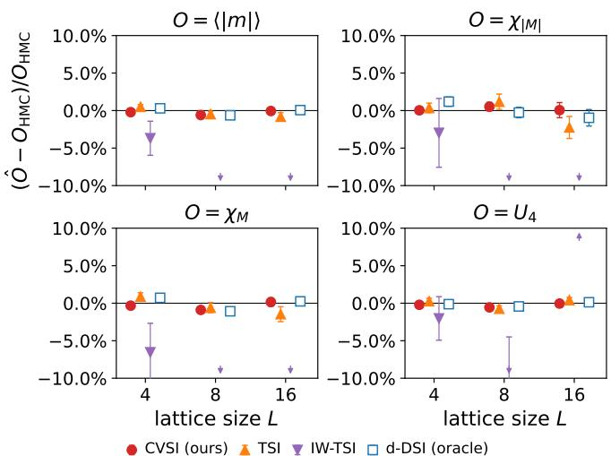
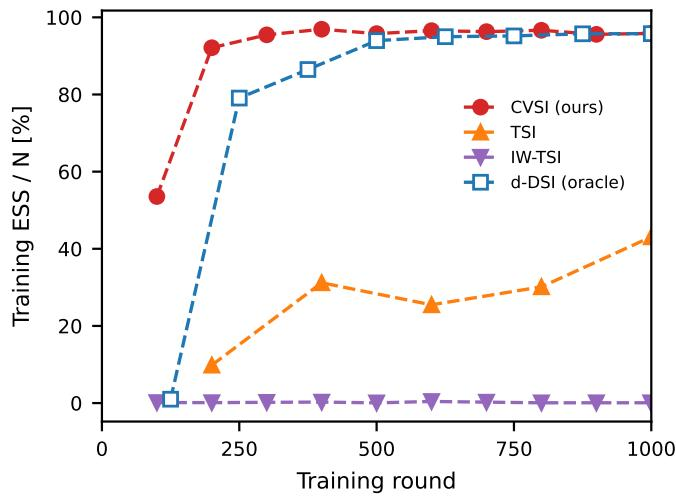
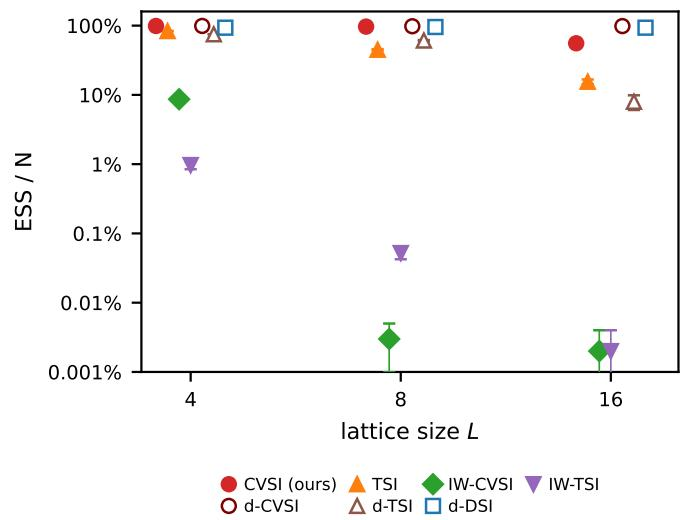
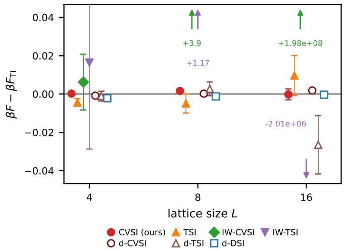
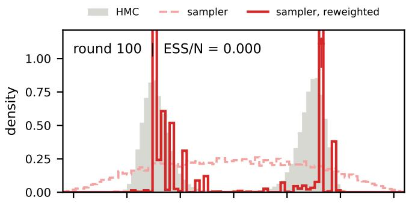
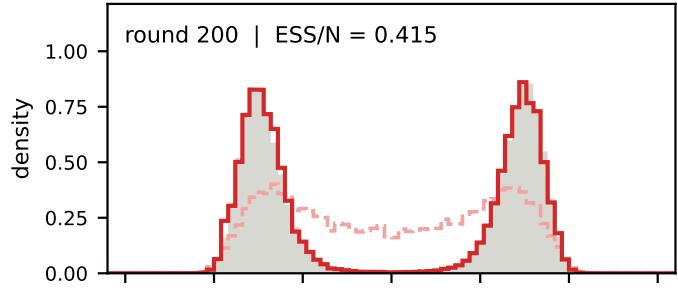
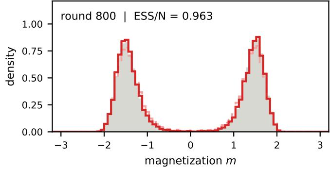

# Data Free Training of Difusion Models for Lattice Field Theories

Dennis Grinwald1, 2, ∗, Ankur Singha1, 2, †, Khaled Kahouli1, 2, Karl Jansen3, 4, and Shinichi Nakajima1, 2, 5, ‡

1Berlin Institute for the Foundations of Learning and Data (BIFOLD), Germany

2Technische Universit¨at Berlin, Germany

3Deutsches Elektronen-Synchrotron (DESY), Platanenallee 6, 15738 Zeuthen, Germany 4Computation-Based Science and Technology Research Center, The Cyprus Institute, Nicosia, Cyprus 5RIKEN Center for Advanced Intelligence Project (AIP), Japan (Dated: October 14, 2026)

Sampling equilibrium field configurations remains a major computational bottleneck in lattice field theory, motivating the development of generative samplers that can produce independent configurations. Difusion models are promising for this purpose, but their standard denoising score matching objective requires samples from the target distribution, seemingly reintroducing the orig inal sampling problem. Here, we show that difusion models can instead be trained from their own generated samples using the target score identity, provided access to the unnormalized probability density. Importance-weighted formulations of this identity yield a consistent target throughout training, while unweighted variants define a self-consistent fixed-point training scheme. We benchmark the diferent approaches in two-dimensional ϕ4 theory and identify efective choices that enable eficient training and sampling across the symmetric, critical, and broken phases. Ultimately, our data-free training approach achieves comparable performance to training on HMC reference data.

Introduction. Lattice field theory (LFT) is a cornerstone of the study of non-perturbative quantum field theories [1–4]. In lattice quantum chromodynamics in particular, first-principles simulations deliver quantities of direct phenomenological relevance such as quark masses, meson decay constants, and the strong coupling constant, all at controlled precision [5, 6]. These quantities are obtained from expectation values of observables, evaluated by sampling field configurations according to the Boltzmann distribution defined by the lattice action. The standard framework for this task is Markov chain Monte Carlo (MCMC), most commonly Hybrid Monte Carlo (HMC) [7]. However, as one approaches the critical region or continuum limit of the theory, MCMC sufers from critical slowing down $[ 8 - 1 0 ]$ due to the long range correlation where the integrated autocorrelation time and the statistical error on some important observable grows at fixed chain length. Producing a fixed number of effectively independent configurations therefore becomes rapidly more expensive precisely in the regimes of physical interest.

Generative samplers ofer a promising route to mitigating critical slowing down by directly producing statistically independent field configurations [11–16]. Substantial progress has been made with normalizing flows, from sampling scalar field theories [14, 17–27] to constructing samplers for lattice gauge theories [28–36] and developing approaches to address topological freezing [28, 30, 37, 38]. Despite these advances, the computational cost and architectural requirements of normalizing flows remain important limitations. Coupling-based flows impose architectural constraints to retain tractable density evaluation, while continuous normalizing flows ofer greater architectural flexibility at the cost of expensive numerical integration and divergence evaluation during training.

Difusion models provide an alternative to these flow based approaches. Their success in machine learning applications [12, 39] has motivated growing interest in lattice field theory, with applications to scalar field theories [15, 40, 41] and lattice gauge theories [42–47]. A central obstacle to the practical use of difusion mod els in lattice field theory is their reliance on representative training data or computationally expensive annealing procedures. Generating training ensembles with MCMC can reintroduce the original sampling bottleneck, while annealing-based approaches incur additional costs through sampling and correction steps across intermediate distributions. These limitations motivate a simple and computationally eficient data-free training approach that learns directly from the lattice action.

Recent work in the machine learning community has introduced data-free approaches to training difusion samplers, including methods based on reverse Kullback–Leibler divergence over path measures [48–50], computationally expensive MCMC guided by the denoising score identity (DSI) [51, 52], and target score matching (TSM) [53], which relies on the target density and its gradient. However, their eficient application to lattice field theory remains challenging. For instance, importance-weighted methods, such as iDEM [54] are sensitive to poor overlap between proposal and target distributions, which can become increasingly severe as the lattice volume grows. Other approaches incur additional computational costs through trajectory-based training, as in SPS [55] or sampling and correction across intermediate distributions, as in PITA [56].

In this work, we establish TSM as a practical framework for data-free difusion sampling in lattice field theory. TSM relates the difusion score to the target-density gradient, allowing the lattice action to supply the learning signal. The model generates and periodically refreshes its own training configurations, as in iDEM [54] but learns through an unweighted, self-consistent objective that avoids importance-weight fluctuations during training, To stabilize this learning process, we combine a control-variate score target [57], which balances actiongradient and denoising information through a closedform variance-minimizing coeficient, with a noise schedule normalized to fixed total variance. The resulting training procedure requires neither precomputed target ensembles nor a model-density evaluation.

We demonstrate the approach in two-dimensional scalar field theory across the symmetric, critical, and broken phases, obtaining asymptotically unbiased estimates of physical observables through importance reweighting. At criticality, the sampler achieves eficiencies comparable to the corresponding difusion models trained on HMC ensembles, demonstrating that reference data are not required to achieve this sampling performance. The unweighted training scheme enables stable learning and eficient sampling at lattice volumes where importanceweighted training becomes unstable. These results establish a practical route to learning equilibrium lattice distributions directly from the action, retaining accurate physical predictions while avoiding the costs of generating MCMC training ensembles and performing additional annealing procedures.

Method. We consider a real scalar field on a Ddimensional hypercubic lattice $\Lambda _ { L } = \{ 1 , \ldots , L \} ^ { D }$ , with a field variable $\phi _ { \mathbf { x } } \in \mathbb { R }$ at each site $\mathbf { x } \in \Lambda _ { L } . \ \mathrm { A }$ field configuration is the collection $\phi = \{ \phi _ { \mathbf { x } } \} _ { \mathbf { x } \in \Lambda _ { L } } \in \mathbb { R } ^ { | \Lambda _ { L } | }$ . The action over field configurations is defined as:

$$
S [ \phi ] = \sum _ { \bf x } \left[ - 2 \kappa \sum _ { \mu } \phi _ { \bf x } \phi _ { \bf x + \hat { \mu } } + ( 1 - 2 \lambda ) \phi _ { \bf x } ^ { 2 } + \lambda \phi _ { \bf x } ^ { 4 } \right] .\tag{1}
$$

Our goal is to sample field configurations from the Boltzmann distribution:

$$
p ( \phi ) = \frac { 1 } { Z } e ^ { - S [ \phi ] } , \mathrm { ~ w h e r e ~ } Z = \int \mathcal { D } \phi e ^ { - S [ \phi ] } , \mathcal { D } \phi = \prod _ { \mathbf { v } } d \phi _ { \mathbf { x } } .\tag{2}
$$

We construct a difusion sampler by learning to reverse a process that transforms field configurations into Gaussian noise. The reverse dynamics require the score, $\nabla \log p _ { t }$ of the marginal distribution at each difusion time, which we approximate with a neural network. The difusion time runs over $t \in [ 0 , 1 ]$ with

$$
t = 0 : \phi ( 0 ) \sim p \propto e ^ { - S } \quad \mathrm { ( t a r g e t \ d i s t r i b u t i o n ) } ,
$$

$$
t = 1 : \phi ( 1 ) \sim p _ { 1 } = \mathcal { N } ( \bf 0 , I ) \quad \mathrm { ( G a u s s i a n ~ p r i o r ) . }\tag{3}
$$

Noising therefore runs forward in t, from a field configuration at $t = 0$ to the prior at $t = 1$ , and generation runs backward, from $t = 1$ down to $t = 0$ . The noising process is the linear Itˆo SDE:

$$
d \phi ( t ) = f ( t ) \phi ( t ) d t + g ( t ) d { \bf w } ( t ) , \qquad \phi ( 0 ) \sim p ,\tag{4}
$$

where $f ( t )$ is an afine drift, $g ( t )$ is the difusion coefficient, and w is a Wiener process. Conditioned on its

  
FIG. 1. Score estimator variance vs. difusion time $t \ ( L = 4 ,$ symmetric). While DSI and TSI diverge at either end of the time interval, CVSI variance stays low.

starting point $\phi ( 0 )$ , this process has a closed-form Gaussian transition kernel:

$$
\begin{array} { r l r } & { } & { p \big ( \phi ( t ) \big | \phi ( 0 ) \big ) = { \mathcal N } \big ( \phi ( t ) ; a ( t ) \phi ( 0 ) , b ^ { 2 } ( t ) \mathbf { I } \big ) , } \\ & { } & { a ( 0 ) = 1 , \ b ( 0 ) = 0 , \ a ( 1 ) \to 0 , \ b ( 1 ) \to 1 , \quad } \end{array}\tag{5}
$$

which we can sample directly, i.e. without simulation, during training.

Diferentiating the perturbation kernel (5) at a fixed endpoint gives the denoising score identity (DSI):

$$
\begin{array} { r l } & { \nabla \log p _ { t } = \mathbb { E } \big [ \mathbf { s } _ { \mathrm { D S I } } \big | \phi ( t ) \big ] , \mathrm { ~ w h e r e ~ } } \\ & { \qquad \mathbf { s } _ { \mathrm { D S I } } : = \nabla _ { \phi ( t ) } \log p \big ( \phi ( t ) \big | \phi ( 0 ) \big ) } \\ & { \qquad = - \frac { \phi ( t ) - a ( t ) \phi ( 0 ) } { b ^ { 2 } ( t ) } = - \frac { \epsilon } { b ( t ) } . } \end{array}\tag{6}
$$

Here $\mathbf { \epsilon } \in \sim \mathcal { N } ( \mathbf { 0 } , \mathbf { I } )$ is the noise entering $\mathrm { E q . ~ ( 5 ) }$ . This is the standard denoising score matching (DSM) target. Forming it is cheap, since it needs only the noise ϵ already drawn and the configuration $\phi ( 0 )$ , and it never touches the action. However, it has two drawbacks: First, it requires equilibrium sample from the target distribution $\phi ( 0 ) \sim p ,$ which is unavailable in the data-free setting. Second, as the added noise vanishes near the physical endpoint, $t  0$ , the factor $1 / b ( t )$ amplifies the Gaussian noise in the regression target. Its variance therefore grows as $1 / b ( t ) ^ { 2 }$ , making the training signal increasingly noisy even though the underlying physical score remains finite.

As [53] show, the marginal score can be equally rewritten as

$$
\mathbf { s } _ { \mathrm { T S I } } : = \frac { 1 } { a ( t ) } \nabla _ { \phi ( 0 ) } \log p \big ( \phi ( 0 ) \big ) = - \frac { \boldsymbol { \nabla } S \big [ \phi ( 0 ) \big ] } { a ( t ) } ,\tag{7}
$$

yielding the target score identity (TSI). This TSM target involves the action gradient, which encodes information about the target distribution and thus enables datafree training using self-generated field configurations. Its drawback, however, is that the $1 / a ( t )$ pre-factor diverges at the prior end $t \to 1$ , where $a ( t ) \to 0$

  
FIG. 2. ESS comparison of our data-free CVSI training (red circle), TSI (orange triangle) and IW-TSI (purple inverted triangle), as well as the oracle data-driven DSI (blue square), at criticality. Error bars show 1σ confidence intervals.

DSI (6) and TSI (7) provide two unbiased estimators for the same marginal score, which diverge at opposite ends of the schedule, as Fig. 1 shows. The control variate score identity (CVSI) [57] uses the optimal combination:

$$
\hat { \mathbf { s } } _ { \mathrm { C V S I } } = \left( 1 - c ^ { * } ( t ) \right) \mathbf { s } _ { \mathrm { T S I } } + c ^ { * } ( t ) \mathbf { s } _ { \mathrm { D S I } } , \ c ^ { * } ( t ) \in [ 0 , 1 ] ,\tag{8}
$$

where the coeficient $c ^ { * } ( t )$ is the minimizer of the variance of the blended target. While the original formualtion $c ^ { * } \ [ 5 7 ]$ is state- and time-dependent, for a Gaussian target with per-site variance $\sigma _ { \mathrm { d a t a } } ^ { 2 }$ and the kernel (5), this minimizer reduces to the closed form,

$$
c ^ { * } ( t ) = \frac { b ^ { 2 } ( t ) } { b ^ { 2 } ( t ) + a ^ { 2 } ( t ) \sigma _ { \mathrm { d a t a } } ^ { 2 } } = \frac { 1 } { 1 + \gamma ^ { 2 } ( t ) \sigma _ { \mathrm { d a t a } } ^ { 2 } } ,\tag{9}
$$

where $\gamma ^ { 2 } ( t ) ~ = ~ a ^ { 2 } ( t ) / b ^ { 2 } ( t )$ is the signal-to-noise ratio (Supplemental Material, Eq. (??)).

As shown in Fig. 1, the CVSI variance remains finite throughout the difusion process $t \in [ 0 , 1 ]$ . At the field end $t \to 0 , c ^ { * } ( t ) \to 0$ as $b ( t ) \to 0 ,$ , suppressing the DSI term whose $1 / b ( t )$ prefactor diverges, while at the prior end $t \to 1 , c ^ { * } ( t ) \to 1 \mathrm { ~ a s ~ } a ( t ) \to 0 ,$ , suppressing the TSI term whose $1 / a ( t )$ prefactor diverges. This can also be seen from the explicit expression of the CVSI target (13) in the End Matter, obtained by substituting Eqs. (6), (7), and (9) into Eq.(8). For any $\sigma _ { \mathrm { { d a t a } } } ^ { 2 } > 0$ , the CVSI target remains bounded throughout the entire schedule, requiring only one action-gradient computation per training point.

Following [58], we adopt a mixed noise schedule combining variance-exploding (VE) and variance-preserving (VP) schedules. Specifically, we match the (inverse) signal-to-noise ratio of the VE schedule, i.e. $b ( t ) / a ( t ) =$ $\sigma ( t ) = \gamma ^ { - 1 } ( t )$ , while matching the total variance of the VP schedule, i.e. $\tau ^ { 2 } ( t ) = a ^ { 2 } \breve { ( t ) } + b ^ { 2 } ( t ) = 1$ . This gives the transition kernel (5) with

  
FIG. 3. Free-energy estimation error $\beta F - \beta F _ { \mathrm { T I } }$ at criticality.

$$
\begin{array} { l l } { { a ( t ) = \displaystyle \frac { 1 } { \sqrt { 1 + \sigma ^ { 2 } ( t ) } } , \qquad b ( t ) = \displaystyle \frac { \sigma ( t ) } { \sqrt { 1 + \sigma ^ { 2 } ( t ) } } , \qquad } } \\ { { \sigma ( t ) : = \sigma _ { \operatorname* { m i n } } \Big ( \displaystyle \frac { \sigma _ { \operatorname* { m a x } } } { \sigma _ { \operatorname* { m i n } } } \Big ) ^ { t } . } } \end{array}\tag{10}
$$

The noise level increases from $\sigma ( 0 ) = \sigma _ { \mathrm { m i n } }$ at the field end to $\sigma ( 1 ) = \sigma _ { \mathrm { m a x } }$ at the prior end, as required by our time convention (Supplemental Material, Eq. (??)), so $a ( 0 ) \to 1$ and $a ( 1 )  0$ . Bounding the total variance at $\tau ^ { 2 } = 1$ makes the prior $p _ { 1 } = \mathcal { N } ( \mathbf { 0 } , \mathbf { I } )$ independent of $\sigma _ { \mathrm { m a x } }$ and puts a and b on a common scale, so that the blend coeficient of the target is set by the single scalar $\sigma _ { \mathrm { d a t a } } ^ { 2 } .$ We use $\sigma _ { \mathrm { m i n } } = 1 0 ^ { - 2 }$ throughout and treat $\sigma _ { \mathrm { m a x } }$ as the one schedule hyperparameter, sweeping it below.

We train a score model ${ \bf s } _ { \pmb { \theta } } ( \phi ( t ) , t ) \approx \nabla _ { \phi ( t ) }$ log $p _ { t } ( \phi ( t ) )$ on pairs drawn from the kernel (5), with ϕ(0) drawn from the bufer. The only access we assume to the target is pointwise evaluation of $S [ \phi ]$ and $\nabla S [ \phi ]$ . Both score identities are available on such a pair, and we blend them as in Eq. (8). In the data-free setting there is no initial dataset to read $\sigma _ { \mathrm { d a t a } } ^ { 2 }$ from. We therefore hold it at $\sigma _ { \mathrm { { d a t a } } } ^ { 2 } = 1$ for the first $R _ { \mathrm { w a r m } }$ rounds and thereafter re-estimate it at each bufer refresh using the model’s own configurations:

$$
\begin{array} { r } { \sigma _ { \mathrm { d a t a } } ^ { 2 }  \mathrm { c l i p } _ { [ \sigma _ { - } ^ { 2 } , \sigma _ { + } ^ { 2 } ] } \Bigl ( \operatorname { V a r } \bigl [ \mathcal { B } \bigr ] \Bigr ) , } \end{array}\tag{11}
$$

where the variance is computed over all sites across all $N _ { \mathrm { { g e n } } }$ bufer configurations. We use $R _ { \mathrm { w a r m } } ~ = ~ 1 0 0$ and $[ \breve { \sigma _ { - } ^ { 2 } } , \sigma _ { + } ^ { 2 } ] = [ 0 . 2 5 , \bar { 1 0 } ]$ . We apply these safeguards during the initial rounds because the round-0 bufer, generated by an untrained sampler, yields variance estimates of order $1 0 ^ { 3 } – 1 0 ^ { 5 }$ , whereas the true variance is of order one. Updating $\sigma _ { \mathrm { d a t a } } ^ { 2 }$ adds negligible cost, since we produce the bufer samples anyway and the variance is fast to compute.

Training alternates two loops. In the outer loop we draw $N _ { \mathrm { g e n } }$ configurations $\phi ( 0 )$ by integrating the reverse SDE from the prior at $t = 1$ down to $t = 0$ with the current model. These configurations replace the replay bufer B. We also store their action gradients and reestimate $\sigma _ { \mathrm { { d a t a } } } ^ { 2 } .$ . This is the only place where trajectories are simulated. In the inner loop we draw $\phi ( 0 )$ from $B ,$ a time t and fresh noise $\epsilon ,$ form $\phi ( t )$ in one shot with Eq. (5), build the CVSI target (8), and take a gradient step. No trajectory is simulated in the inner loop and no gradient passes through an SDE solve. After E steps the bufer is refreshed and the round repeats. We keep an exponential moving average of the parameters and use it for generation and evaluation. The procedure is summarised as Algorithm 1 in the End Matter.

TABLE I. Free energy per site $f = \beta F / | \Lambda _ { L } | ,$ its TI reference $f _ { \mathrm { T I } } ,$ , ESS, and the compatibility z-score. Errors in parentheses are 1σ on the last digits. Symmetric, critical, and broken pools use $N = 5 0 , 0 0 0$
<table><tr><td>L</td><td>phase</td><td> $\beta F / | \Lambda _ { L } |$ </td><td> $f _ { \mathrm { T I } }$ </td><td>ESS (%)</td></tr><tr><td>4</td><td>symmetric critical</td><td>-0.687128(13)</td><td>-0.687127(39)</td><td>99.8 -0.03</td></tr><tr><td></td><td>broken</td><td>-0.759598(22) -0.828053(29)</td><td>-0.759610(54) -0.827985(67)</td><td>98.8+0.21  $9 8 . 9 \ \mathrm { ~ - 0 . 9 3 }$ </td></tr><tr><td>8</td><td>symmetric</td><td>-0.670360(7)</td><td>-0.670380(17)</td><td></td></tr><tr><td></td><td>critical</td><td>-0.721223(9)</td><td>-0.721248(25)</td><td> $9 9 . 0 \ \mathrm { ~ + 1 . 0 9 }$ </td></tr><tr><td></td><td>broken</td><td></td><td></td><td> $9 6 . 7 \ + 0 . 9 4 $ </td></tr><tr><td>16</td><td></td><td>-0.787032(11)</td><td>-0.787052(35)</td><td> $9 7 . 4 \ \ : + 0 . 5 6 $ </td></tr><tr><td></td><td>symmetric</td><td>-0.669506(3)</td><td>-0.669511(9)</td><td>96.1 +0.46</td></tr><tr><td></td><td>critical</td><td>-0.713112(11)</td><td>-0.713111(13)</td><td> $5 5 . 6 ~ - 0 . 0 4$ </td></tr><tr><td></td><td>broken</td><td>-0.778631(16)</td><td>-0.778651(20)</td><td> $5 5 . 8 \ \mathrm { ~  ~ { ~ + 0 . 7 5 } ~ }$ </td></tr></table>

Results. We first compare the performance of diferent data-free score-estimator targets and a data-driven oracle target at criticality $( \kappa = 0 . 2 7 0 5 )$ on $L \in \{ 4 , 8 , 1 6 \}$ lattices. The quartic coupling constant $\lambda = 0 . 0 2 2$ is held fixed throughout all experiments. Figures 2 and 3 show ESS and the the free-energy estimation error $\beta F - \beta F _ { \mathrm { T I } }$ respectively, where the thermodynamic integration (TI) serves as the reference. Our best choice, CVSI, ourperforms IW-TSI and TSI, which correspond to the direct application of iDEM [54] and adjoint matching [59], respectively, and is comparable to the data-driven DSI (d-DSI)—the standard difusion training on the HMC samples.

We also evaluated our CVSI training in symmetric $( \kappa = 0 . 2 5 )$ and broken $\left( \kappa = 0 . 2 8 \right)$ phases. The results are reported in Table I, whose right-most column gives the signed compatibility z-score $z = ( f - f _ { \mathrm { T I } } ) / \sqrt { \sigma _ { f } ^ { 2 } + \sigma _ { f _ { \mathrm { T I } } } ^ { 2 } } .$ The estimate is considered statistically compatible with the TI reference if $| z | \lesssim 2 \ – 3$ . In all cases, CVSI training yields unbiased free-energy estimates across lattice sizes and phases.

Figure 4 shows estimation errors for other observ  
ables at criticality, using HMC sampling as the reference.   
These include the mean absolute magnetization $\langle | m | \rangle$ 2   
the susceptibility of the absolute magnetization $\chi _ { \lvert M \rvert }$ , the   
magnetic susceptibility $\chi _ { M }$ , and the fourth-order Binder   
cumulant $U _ { 4 }$ . For all observables and lattice sizes, the

FIG. 4. Estimation errors for the mean absolute magnetization $\langle | m | \rangle$ , the susceptibility of the absolute magnetization $\chi _ { | M | } ,$ the magnetic susceptibility $\chi _ { M } .$ , and the fourth-order Binder cumulant $U _ { 4 }$  
  
FIG. 5. Training dynamics of the ESS for N = 5000 samples.

estimates are statistically compatible with the HMC reference and d-DSI oracle, suggesting that data-free training does not sufer from mode-dropping. Table ?? in the Supplemental Material summarizes the results.

As seen in Figures 2, importance weighting tends to degrade performance, while CVSI mitigates the main weakness of TSI: the divergence of the variance as t → 1. Our ablation study in the End Matter confirms that these trends persist across diferent combinations of score estimators, data-free and data-driven training, and the use or omission of importance weighting.

Lastly, Fig. 5 shows the ESS as a function of training steps for the critical phase at $L = 8$ . We observe that IW-TSI struggles to learn the target distribution due to its high variance. CVSI accelerates the TSI training, and converges as fast as d-DSI without using HMC samples. These results again highlight the importance of controlling target variance for stable and eficient datafree training.

Conclusion. We have demonstrated that difusion mod els can be trained for equilibrium sampling in lattice field theory without requiring reference configurations from the target distribution or a costly annealing procedure. By exploiting the target score identity (TSI), our approach enables data-free training using self-generated configurations. Our benchmarks in two-dimensional $\phi ^ { 4 }$ theory show that blending denoising score identity (DSI) with optimal balance—yielding the control variate score identity (CVSI)—significantly improves sampler performance, and importance weighting—which fixes the expectation of the target score across training steps—is harmful for stability due to its large variance. Our suitable choice of training targets enable eficient training and sampling across the symmetric, critical, and broken phases. Remarkably, the resulting samplers achieve performance comparable to models trained on HMC reference data, demonstrating that access to targetdistributed training samples is not a prerequisite for effective difusion-based sampling. This opens a promising direction for developing generative samplers for lattice field theories where generating reference configurations is itself computationally expensive.

Several promising directions remain for future work. Since our data-free training approach is orthogonal to annealing-based methods, combining the two could further improve scalability and enable sampling on larger lattices. Its compatibility with multilevel sampling strategies also warrants investigation. Beyond scalar field theories, extending the approach to lattice gauge theories and larger lattice volumes will be important for establishing its broader applicability.

Acknowledgements This work was supported by the German Federal Ministry of Education and Research (BMBF) under grant BIFOLD25B and by the European Union’s Horizon Europe Marie Sk lodowska-Curie Doctoral Networks programme through the AQTIVATE project (grant agreement No. 101072344). This work is also supported with funds from the Ministry of Science, Research, and Culture of the State of Brandenburg within the Centre for Quantum Technologies and $\mathrm { A p \mathrm { - } }$ plications (CQTA). We thank Stefan K¨uhn for helpful discussions.

[3] M. Creutz, L. Jacobs, and C. Rebbi, Physics Reports 95, 201 (1983).

[4] A. S. Kronfeld, Annual Review of Nuclear and Particle Science 62, 265 (2012).

[5] Flavour Lattice Averaging Group (FLAG), arXiv preprint arXiv:2411.04268 (2024).

[6] J. Komijani, P. Petreczky, and J. H. Weber, Progress in Particle and Nuclear Physics 113, 103788 (2020).

[7] S. Duane, A. D. Kennedy, B. J. Pendleton, and D. Roweth, Physics letters B 195, 216 (1987).

[8] U. Wolf, Nucl. Phys. B Proc. Suppl. 17, 93 (1990).

[9] U. Wolf, Comp. Phys. Comm. 156, 143 (2004).

[10] S. Schaefer, R. Sommer, and F. Virotta (ALPHA), Nucl. Phys. B 845, 93 (2011), arXiv:1009.5228 [hep-lat].

[11] I. Kobyzev, S. J. Prince, and M. A. Brubaker, IEEE transactions on pattern analysis and machine intelligence 43, 3964 (2020).

[12] J. Ho, A. Jain, and P. Abbeel, in Advances in Neural Information Processing Systems (NeurIPS) (2020).

[13] K. A. Nicoli, S. Nakajima, N. Strodthof, W. Samek, et al., Phys. Rev. E 101, 023304 (2020).

[14] M. S. Albergo, G. Kanwar, and P. E. Shanahan, Phys. Rev. D 100, 034515 (2019).

[15] L. Wang, G. Aarts, and K. Zhou, JHEP 05, 060, arXiv:2309.17082 [hep-lat].

[16] A. Singha, E. Cellini, K. A. Nicoli, K. Jansen, S. K¨uhn, and S. Nakajima, Multilevel generative samplers for investigating critical phenomena (2025), arXiv:2503.08918 [cs.LG].

[17] K. A. Nicoli, C. J. Anders, L. Funcke, T. Hartung, et al., Phys. Rev. Lett. 126, 032001 (2021).

[18] M. Caselle, E. Cellini, A. Nada, and M. Panero, PoS LATTICE2022, 005 (2022).

[19] M. Caselle, E. Cellini, and A. Nada, JHEP 02, 048, arXiv:2307.01107 [hep-lat].

[20] A. Singha, D. Chakrabarti, and V. Arora, Phys. Rev. D 107, 014512 (2023).

[21] A. Singha, D. Chakrabarti, and V. Arora, SciPost Phys. Core 5, 052 (2022).

[22] K. A. Nicoli, C. J. Anders, T. Hartung, K. Jansen, et al., Phys. Rev. D 108, 114501 (2023).

[23] V. Kanaujia, M. S. Scheurer, and V. Arora, SciPost Phys. 16, 132 (2024).

[24] A. Faraz, A. Singha, D. Chakrabarti, S. Nakajima, and V. Arora, PoS LATTICE2024, 036 (2025), arXiv:2308.08615 [physics.comp-ph].

[25] M. Bauer, R. Kapust, J. M. Pawlowski, and F. L. Temmen, SciPost Physics 19, 077 (2025).

[26] A. Singha, J. Kaufmann, E. Cellini, K. Jansen, and S. Nakajima, arXiv (2026), arXiv:2604.10209 [hep-lat].

[27] M. Gerdes, P. de Haan, C. Rainone, R. Bondesan, et al., SciPost Physics 15, 238 (2023).

[28] G. Kanwar, M. S. Albergo, D. Boyda, K. Cranmer, D. C. Hackett, S. Racani\`ere, D. J. Rezende, and P. E. Shanahan, Phys. Rev. Lett. 125, 121601 (2020), arXiv:2003.06413 [hep-lat].

[29] R. Abbott et al., Eur. Phys. J. A 59, 257 (2023), arXiv:2211.07541 [hep-lat].

[30] A. Singha, D. Chakrabarti, and V. Arora, Phys. Rev. D 108, 074518 (2023).

[31] R. Abbott et al., arXiv:2305.02402 (2023), arXiv:2305.02402.

[32] S. Bacchio, P. Kessel, S. Schaefer, and L. Vaitl, Phys. Rev. D 107, L051504 (2023), arXiv:2212.08469 [hep-lat].

[33] M. Gerdes, P. de Haan, R. Bondesan, and M. C. N. Cheng, Phys. Rev. D 112, 094516 (2025), arXiv:2410.13161 [hep-lat].

[34] J. Finkenrath, PoS LATTICE2023, 022 (2024).

[35] A. Singha, J. Finkenrath, K. Jansen, V. Arora, and S. Nakajima, arXiv (2026), arXiv:2609.35722 [hep-lat].

[36] A. Bulgarelli, E. Cellini, and A. Nada, PoS LAT-TICE2024, 040 (2025), arXiv:2409.18861 [hep-lat].

[37] C. Bonanno, A. Bulgarelli, E. Cellini, A. Nada, D. Panfalone, D. Vadacchino, and L. Verzichelli, JHEP 04, 051, arXiv:2510.25704 [hep-lat].

[38] A. Singha, J. Kaufmann, K. Jansen, J. Finkenrath, V. Arora, and S. Nakajima, preprint arXiv (2026), arXiv:2609.07781, arXiv:2609.07781 [hep-lat].

[39] Y. Song, J. Sohl-Dickstein, D. P. Kingma, A. Kumar, S. Ermon, and B. Poole, in International Conference on Learning Representations (2021).

[40] O. Vega, J. Komijani, A. El-Khadra, and M. Marinkovic, arXiv preprint arXiv:2510.26081 (2025).

[41] Y.-y. Tan, G. Aarts, D. E. Habibi, B. Lucini, and L. Wang, arXiv preprint arXiv:2607.08505 (2026).

[42] Q. Zhu, G. Aarts, W. Wang, K. Zhou, and L. Wang, arXiv (2025), arXiv:2502.05504 [hep-lat].

[43] G. Kanwar and O. Vega, in 42th International Symposium on Lattice Field Theory (2025) arXiv:2512.19877 [hep-lat].

[44] G. Aarts, D. E. Habibi, A. Ipp, D. I. M¨uller, T. R. Ranner, L. Wang, W. Wang, and Q. Zhu, Generalizable equivariant difusion models for non-abelian lattice gauge theory (2026), arXiv:2601.19552 [hep-lat].

[45] J. Komijani, M. K. Marinkovic, and L. Turgut, arXiv preprint arXiv:2605.06134 (2026).

[46] H. Alharazin, J. Y. Panteleeva, and B. D. Sun, arXiv (2026), arXiv:2602.09045 [hep-lat].

[47] O. Vega and A. X. El-Khadra, arXiv preprint arXiv:2606.27481 (2026).

[48] Q. Zhang and Y. Chen, in International Conference on Learning Representations (2022).

[49] J. Berner, L. Richter, and K. Ullrich, Transactions on Machine Learning Research (2024).

[50] F. Vargas, W. S. Grathwohl, and A. Doucet, in The Eleventh International Conference on Learning Representations (2023).

[51] X. Huang, H. Dong, Y. HAO, Y. Ma, and T. Zhang, in The Twelfth International Conference on Learning Representations (2024).

[52] L. Grenioux, M. Noble, M. Gabri´e, and A. O. Durmus, in International Conference on Machine Learning (PMLR, 2024) pp. 16337–16376.

[53] V. De Bortoli, M. Hutchinson, P. Wirnsberger, and A. Doucet, arXiv preprint arXiv:2402.08667 (2024).

[54] T. Akhound-Sadegh, J. Rector-Brooks, A. J. Bose, S. Mittal, P. Lemos, C.-H. Liu, M. Sendera, S. Ravanbakhsh, G. Gidel, Y. Bengio, N. Malkin, and A. Tong, in International Conference on Machine Learning (ICML) (2024).

[55] S. Chen, M. Qian, G. Aarts, B. Lucini, and K. Zhou, arXiv preprint arXiv:2606.13790 (2026).

[56] T. Akhound-Sadegh, J. Lee, A. J. Bose, V. De Bortoli, A. Doucet, M. M. Bronstein, D. Beaini, S. Ravanbakhsh, K. Neklyudov, and A. Tong, in Advances in Neural Information Processing Systems (NeurIPS) (2025).

[57] K. Kahouli, R. Elie, K.-R. M¨uller, Q. Berthet, O. T. Unke, and A. Doucet, arXiv preprint (2025),

arXiv:2512.20003.

[58] K. Kahouli, W. Ripken, S. Gugler, O. T. Unke, K.-R. M¨uller, and S. Nakajima, arXiv preprint arXiv:2502.08598 (2025).

[59] A. Havens et al., arXiv preprint arXiv:2504.11713 (2025).

[60] O. Ronneberger, P. Fischer, and T. Brox, in Medical Image Computing and Computer-Assisted Intervention (MICCAI) (Springer, 2015) pp. 234–241.

## I. LATTICE SIZES, PHASES, NETWORK ARCHITECTURE, AND TRAINING ALGORITHM

All experiments use the $D \ = \ 2$ theory on periodic square lattices $\Lambda _ { L } = \{ 1 , \ldots , L \} ^ { 2 }$ at fixed $\lambda = 0 . 0 2 2$ . We consider three sizes and, through the hopping parameter $\kappa ,$ three phases:

$$
\begin{array} { r l } & { L \in \{ 4 , 8 , 1 6 \} ( | \Lambda _ { L } | = L ^ { 2 } \in \{ 1 6 , 6 4 , 2 5 6 \} ) , } \\ & { \kappa \in \{ \underbrace { 0 . 2 5 } _ { \mathrm { s y m . } } , \underbrace { 0 . 2 7 0 5 } _ { \mathrm { c r i t . } } , \underbrace { 0 . 2 8 } _ { \mathrm { b r o k e n } } \} . } \end{array}
$$

For each of the nine $( L , \kappa )$ ensembles an HMC reference of $1 0 ^ { 5 }$ configurations is used for the reference.

$U N e t .$ . We parameterize the score with a timeconditioned convolutional UNet [12, 15, 40, 41, 45, 60],

FIG. 6. ESS comparison of data-free and data-driven training.  
  
FIG. 7. Free-energy estimator errors $\beta F - \beta F _ { \mathrm { T I } }$

Algorithm 1: Data-free training via fixed-point iteration.   
Input: S, (a, b, w), R, E, $N _ { \mathrm { g e n } }$ , η, αEMA, Ω, $R _ { \mathrm { w a r m } } ,$   
$[ \sigma _ { - } ^ { 2 } , \sigma _ { + } ^ { 2 } ]$   
Initialize $\theta , \bar { \theta }  \theta , \sigma _ { \mathrm { d a t a } } ^ { 2 }  1$   
for $i = 1 , \ldots , R$ do   
Generate $N _ { \mathrm { g e n } }$ fields with $\mathbf { s } _ { \bar { \pmb { \theta } } }$ and replace B.   
if $i > R _ { \mathrm { w a r m } }$ then   
Update $\sigma _ { \mathrm { d a t a } } ^ { 2 }$ using Eq. (11).   
end if   
for $e = 1 , \ldots , E$ do   
Draw $\phi ( 0 ) \sim \mathcal { B } , t \sim \mathcal { U } [ 0 . 0 1 , 0 . 9 9 ] ,$   
$\epsilon \sim \mathcal { N } ( \boldsymbol { 0 } , \mathbf { I } ) ; \mathrm { f o r m } \phi ( t ) \dot { = } a ( t ) \phi ( \bar { 0 } ) + b ( t ) \epsilon .$   
Compute $c ^ { * } ( t )$ and ˆs from Eqs. (9), (14).   
$\pmb { \theta } \gets \eta \nabla _ { \pmb { \theta } } \big [ w ( t ) \| \mathbf { s } _ { \pmb { \theta } } ( \pmb { \phi } ( t ) , t ) - \hat { \mathbf { s } } \| ^ { 2 } \big ]$   
$\bar { \theta }  \alpha _ { \mathrm { E M A } } \bar { \theta } + ( 1 - \alpha _ { \mathrm { E M A } } ) \theta$   
end for   
end for   
Output: $\mathbf { s } _ { \bar { \pmb { \theta } } } .$

using residual blocks, attention, and skip connections. Architecture details and size-dependent settings are given in Supplemental Material, Sec. ??.

Circular padding. Spatial convolutions wrap across opposite lattice edges, implementing periodic boundary conditions.

$\mathbb { Z } _ { 2 }$ symmetry. The score is made odd under field inversion by the model-level symmetrization

$$
\begin{array} { r } { { \bf s } _ { \theta } ^ { \mathbb { Z } _ { 2 } } ( \phi , t ) = \frac { 1 } { 2 } [ { \bf s } _ { \theta } ( \phi , t ) - { \bf s } _ { \theta } ( - \phi , t ) ] . } \end{array}\tag{12}
$$

## II. THE BLENDED CVSI TARGET AND CLIPPING

Substituting the score identities and the optimal coefficient of Eq. (9) gives

$$
\hat { \mathbf { s } } _ { \mathrm { C V S I } } \big ( \phi ( 0 ) , \epsilon , t \big ) = - \frac { a ( t ) \sigma _ { \mathrm { d a t a } } ^ { 2 } \nabla S [ \phi ( 0 ) ] + b ( t ) \epsilon } { b ^ { 2 } ( t ) + a ^ { 2 } ( t ) \sigma _ { \mathrm { d a t a } } ^ { 2 } } .\tag{13}
$$

For $\sigma _ { \mathrm { { d a t a } } } ^ { 2 } > 0$ , the blend removes the individual $1 / a ( t )$ and $1 / b ( t )$ singularities. For stability, each identity is norm-clipped before blending:

$$
\begin{array} { r l r } & { \hat { \mathbf { s } } _ { \mathrm { C V S I } } = \left( 1 - c ^ { * } ( t ) \right) \mathrm { c l i p } _ { \Omega } \big ( \mathbf { s } _ { \mathrm { T S I } } \big ) + c ^ { * } ( t ) \mathrm { c l i p } _ { \Omega } \big ( \mathbf { s } _ { \mathrm { D S I } } \big ) , } & \\ & { \mathrm { c l i p } _ { \Omega } ( \mathbf { s } ) = \mathbf { s } \cdot \mathrm { m i n } \Big ( \frac { \Omega } { \| \mathbf { s } \| } , 1 \Big ) , } & { ( 1 4 ) } \end{array}
$$

We use $\Omega = 7 0 .$ . Clipping limits the influence of large gradients from early self-generated bufers.

Algorithm 1 summarizes the training loop.

## III. COMPARISON TO OTHER DATA-DRIVEN ESTIMATORS

Figs. 6 and 7 show the comparison of our data-free training to data-driven training in terms of ESS and

  
FIG. 8. Magnetization at $L = 8$ , broken phase, over the selflearning loop. Raw samples (light red) and reweighted (red) approach the HMC reference (grey).

free-energy estimator error. We observed general trends: CVSI improves TSI and DSI, and IW substantially degrades performance.

## IV. OBSERVABLES AND EVALUATION METRICS

The magnetization and its absolute value are

$$
m [ \phi ] = \frac { 1 } { | \Lambda _ { L } | } \sum _ { { \bf x } \in \Lambda _ { L } } \phi _ { \bf x } , \qquad | m | [ \phi ] = \Big | \frac { 1 } { | \Lambda _ { L } | } \sum _ { { \bf x } \in \Lambda _ { L } } \phi _ { \bf x } \Big | ,\tag{15}
$$

where $| \Lambda _ { L } | = L ^ { D }$ . The full distribution tests both relative mode populations and mode shapes; $\langle m \rangle \simeq 0$ alone does not establish agreement with HMC.

Figure 8 shows the evolution of the raw and reweighted magnetization distributions at $L = 8$ in the broken phase over the self-learning loop.

ESS & Free Energy We compute the work for each sample, i.e.

$$
W [ \phi ] = S [ \phi ] + \log q ( \phi ) ,\tag{16}
$$

where $q$ is the density of the learned sampler, from which the ESS and free energy are computed as

$$
\frac { \mathrm { E S S } } { N } = \frac { \left. e ^ { - W } \right. _ { q } ^ { 2 } } { \left. e ^ { - 2 W } \right. _ { q } } , \qquad \beta F = - \log \left. e ^ { - W } \right. _ { q } .\tag{17}
$$

The associated self-normalized importance weights are $\begin{array} { r } { \omega _ { i } = \frac { e ^ { - W _ { i } } } { \sum _ { i } e ^ { - W _ { i } } } . } \end{array}$