# Deep Mesoscopic Dynamics

Yue Zhaoa,\*, Shiqi Wub,\*, Yihang Ouyanga,c,d, Sergey Grebenchuka, Magdalena Grzeszczyka, Xiaoxu Zhaoe,f, Kostya S. Novoselova,c,†, Maciej Koperskia,c,†, and Qianxiao Lia,b,†

aInstitute for Functional Intelligent Materials, National University of Singapore, Singapore 117544, Singapore

bDepartment of Mathematics, National University of Singapore, Singapore 117543, Singapore

cDepartment of Materials Science and Engineering, National University of Singapore, Singapore 117575, Singapore

dIntegrative Sciences and Engineering Programme, NUS Graduate School, National University of Singapore, 119077, Singapore

eSchool of Materials Science and Engineering, Peking University, Beijing 100871, China fAI for Science Institute, Beijing 100871, China

October 14, 2026

Abstract. Microscopic simulations resolve spatial patterns but are feasible only over small do mains and short timescales, whereas bulk descriptions erase those patterns through spatial averaging. Mesoscopic fields preserve this spatial organisation, but their efective equations are known only for selected microscopic systems and scaling limits. We introduce Deep Mesoscopic Dynamics (DeepMesoD), which uses neural networks to learn an efective mesoscopic field equation from microscopic trajectories at a prescribed coarse-graining scale. For the nonconserved dissipative dynamics studied here, DeepMesoD learns the free-energy functional with a spatial interaction kernel and a state-dependent dissipation operator constrained by the fluctuation–dissipation relation. We first validate the construction in the Ising–Kac model, where the learned mesoscopic equation recovers the known hydrodynamic limit and rollouts remain stable far beyond the training horizon. We then treat two systems without closed-form mesoscopic descriptions. For a two-dimensional Heisenberg ferromagnet governed by atomistic spin dynamics, DeepMesoD learns a mesoscopic model whose predictions match atomistic references up to 1 ns, and a rollout with an unseen initial condition remains bounded up to 25 ns. For layered CrBr , the learned kernel captures the suppression and sign rever sal of interlayer coupling at a stacking fault whose location and strength are not supplied as inputs. Controlled changes to the learned interaction show how fault number and placement shape multistep magnetic responses, complementing our magneto-photoluminescence measurements. Across the two atomistic systems, DeepMesoD achieves a three-to-four-order-of-magnitude reduction in wall-clock time compared with atomistic spin dynamics.

In magnets, alloys, and other many-body systems, microscopic interactions organise spins or atoms into spatial patterns whose evolution controls material behaviour. For example, magnetic domains can store information (1), with localised spin textures such as skyrmions explored for spintronic and probabilistic-computing applications (2, 3), while antiphase domains and phase boundaries shape the evolution of alloy microstructures (4, 5). Predicting how these structures form, move, and interact requires a dynamical description that resolves their spatial variation. Microscopic simulations such as atomistic spin dynamics and molecular dynamics evolve the coupled dynamics of individual spins or atoms, but their computational cost limits the spatial region over which complete patterns can be resolved (6–8). On the other hand, descriptions based only on bulk averages such as total magnetisation or mean composition cannot capture domains, textures, or interfaces.

A mesoscopic description lies between these two levels and provides an eficient means to simulate these spatial features at realistic timescales. This description is captured by a field $\phi \colon \Omega \to \mathbb { R } ^ { q }$ defined on a spatial domain $\Omega ,$ , and $q$ is the number of field components. The field value $\phi ( \mathbf { x } )$ at each spatial location $\mathbf { x } \in \Omega$ is obtained by a local coarse-graining map acting on the microscopic configurations near x. For example, for magnetic systems $\phi ( \mathbf { x } )$ may be the average magnetic moment near x. The mesoscopic field $\phi$ describes the formation, motion, and interaction of spatial structures without the need to record microscopic arrangement below the prescribed scale (Figure 1, left). In particular, if an accurate evolution equation can be derived for $\phi ,$ , simulations can then be realised over spatial and temporal scales that are relevant to probe important phenomena, such as domain formation and phase transitions. However, even when the microscopic dynamics and coarse-graining map are known, determining an accurate evolution equation for $\phi$ is a central open problem in dynamics modelling.

Classically, such mesoscopic field dynamics are commonly constructed in two ways. The first prescribes phenomenological forms for the free energy and field dynamics using symmetry, conservation laws, and empirical knowledge. For example, Landau-Ginzburg theory (9, 10) posits that $\phi$ evolves according to a gradient flow with respect to a phenomenological free energy functional

$$
\mathcal { F } [ \phi ] = \int _ { \Omega } \left[ V \big ( \phi ( \mathbf { x } ) \big ) + \frac { \kappa } { 2 } | \nabla \phi ( \mathbf { x } ) | ^ { 2 } \right] d \mathbf { x } .
$$

where the local free energy density $V = a _ { 2 } \phi ^ { 2 } / 2 + a _ { 4 } \phi ^ { 4 } / 4 , \kappa > 0 , a _ { 2 } \in \mathbb { R }$ and $a _ { 4 } > 0$ , yielding the Allen-Cahn equation (4, 5) $\partial _ { t } \phi = - \delta \mathcal { F } / \delta \phi$ . The coeficients $a _ { 2 } , ~ a _ { 4 } , ~ \kappa$ can be fitted, but the model remains restricted to the prescribed form of energy, and is not an accurate description of any particular dissipative dynamical process at the mesoscopic scale.

The second approach directly derives a mesoscopic field equation from a microscopic dynamical model. For selected microscopic systems, a controlled scaling limit yields an efective hydrodynamics equation for the coarse field (11, 12). The Ising–Kac model with Glauber dynamics is one example (13, 14). For more complex systems, eliminating microscopic variables that are not represented in the coarse field can produce conditional expectations, memory terms, or high-dimensional integrals that are not available in a computable form (15). In practice, dynamic mean-field models obtain a computable equation by prescribing a mean-field free energy and selected field dynamics (16). The resulting equation then depends on these modelling approximations, which can omit efects that remain relevant at the chosen coarse-graining scale.

To address these dificulties, we introduce DeepMesoD, which constructs accurate mesoscopic field dynamics without the need for phenomenological prescriptions or complex derivations. Instead, we consider a highly general class of dissipative dynamics with unknown dissipation operators and free energy functionals, where the thermal noise and the dissipation operator satisfy a fluctuationdissipation relation. These operators are parametrised by structured neural networks and trained directly on microscopic observations to obtain accurate mesoscopic descriptions that can then be used to simulate and analyse the system on large temporal and spatial scales.

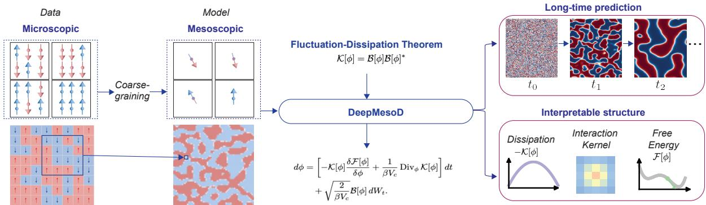  
Figure 1: Workflow of DeepMesoD. Microscopic trajectories are coarse-grained into observations of a mesoscopic field at a prescribed spatial scale. DeepMesoD uses these trajectories to estimate the physical structures in a mesoscopic field equation within a prescribed dynamical class.

We first validate DeepMesoD in the Ising–Kac model, whose hydrodynamic limit provides analytic references for the learned field equation (13, 14). We then apply the same construction to a Cr2Ge2Te6-like two-dimensional ferromagnet (17, 18) and layered CrBr3 (19–24), two systems whose mesoscopic equations are not known in closed form. Atomistic-spin trajectories provide microscopic references in both systems. In $\mathrm { C r B r _ { 3 } }$ , the modelled multistep response is consistent with our magneto-photoluminescence measurements. Controlled numerical experiments with the learned stacking-fault interaction show how fault number and placement afect the calculated field response.

## DeepMesoD Methodology

From microscopic trajectories to field observations We first describe how microscopic trajectories provide coarse-grained field observations. While our framework is designed for general dissipative mesoscopic dynamics, for clarity we specialise our discussion to magnetic spin systems defined on a lattice. We denote the index set of microscopic spins by I and the state space of each spin by S. The microscopic configuration $\sigma ( t ) = ( \sigma _ { j } ( t ) ) _ { j \in \mathcal { T } } \in \mathsf { S } ^ { \mathcal { T } }$ is assumed to evolve as a continuous-time Markov process. For example, in the Ising–Kac ferromagnet, ${ \mathsf S } = \{ - 1 , + 1 \}$ and $\sigma ( t )$ evolves as a Markov jump process under Glauber dynamics (13, 25, 26). Another example is classical Heisenberg magnets, where each atomic spin is represented by a three-dimensional unit vector. In this case, $\mathsf { S } = \mathbb { S } ^ { 2 }$ is the unit sphere, and $\sigma _ { j } ( t )$ specifies the orientation of atomic spin j. The trajectories are recorded at discrete observation times. At each recorded time, we compute coarse observations at N spatial locations $\mathbf { x } _ { i } \in \Omega$ . For each location, ${ \mathcal { C } } ( \mathbf { x } _ { i } ) \subset { \mathcal { T } }$ contains the microscopic spins in its averaging neighbourhood, with $V _ { c } = \vert \mathcal { C } ( \mathbf { x } _ { i } ) \vert$ fixed within each system. The observation map Q gives the value $z _ { i } ( t )$ at that position:

$$
z _ { i } ( t ) = \mathcal { Q } ( \mathbf { x } _ { i } ; \sigma ( t ) ) = \frac { 1 } { V _ { c } } \sum _ { j \in \mathcal { C } ( \mathbf { x } _ { i } ) } \sigma _ { j } ( t ) .
$$

These averages give scalar magnetisation for Ising–Kac $( q = 1 )$ and three-component magnetisation for the atomistic spin systems $( q = 3 )$ , where each microscopic spin is a unit vector. We seek a

mesoscopic field $\phi \colon \Omega \times [ 0 , \infty )  \mathbb { R } ^ { q }$ whose dynamics reproduce the observations,

$$
z _ { i } ( t ) \approx \phi ( \mathbf { x } _ { i } , t ) .
$$

Thus each training observation pairs a spatial position $\mathbf { x } _ { i }$ with a field value $z _ { i } ( t )$ . We write Φ for the space of these fields at any fixed time.

Field dynamics and fluctuation–dissipation structure We aim to learn an efective equation for the evolution of $\phi$ from the observations $z _ { i } ( t )$ . We consider fields whose spatial integral is not conserved and whose coarse-grained observations exhibit thermal fluctuations, motivating a description that combines relaxation and noise. We model the relaxation as free-energy-driven dissipation, giving the stochastic field equation in Itˆo form

$$
\partial _ { t } \phi = - \mathcal { K } [ \phi ] \frac { \delta \mathcal { F } [ \phi ] } { \delta \phi } + \frac { 1 } { \beta V _ { c } } \operatorname { D i v } _ { \phi } \mathcal { K } [ \phi ] + \sqrt { \frac { 2 } { \beta V _ { c } } } \mathcal { B } [ \phi ] \xi ,\tag{1}
$$

where $\beta = T ^ { - 1 }$ is the inverse temperature in Boltzmann units. The noise $\xi$ is a zero-mean, $p -$ component Gaussian field that is white in space and time, with

$$
\begin{array} { r } { \mathbb { E } [ \xi ( \mathbf { x } , t ) \xi ( \mathbf { y } , s ) ^ { \mathsf { T } } ] = I _ { p } \delta ( \mathbf { x } - \mathbf { y } ) \delta ( t - s ) , } \end{array}
$$

where $I _ { p }$ is the $p \times p$ identity matrix.

This hypothesis space is inspired by Landau’s model, but with important distinctions. First, the free-energy functional $\mathcal { F }$ is not assumed to involve a polynomial energy density, nor gradient-based domain penalisation $( \lVert \nabla \phi \rVert ^ { 2 } )$ . Instead, we minimally constrain this functional to satisfy locality and translational invariance on homogeneous domains (details below). Second, we explicitly model the rate of thermal dissipation via a general dissipation operator $\kappa .$ We similarly constrain K by symmetry principles, in the spirit of Onsager’s reciprocal relations (27). Third, we explicitly model state-dependent thermal noise (B), which is assumed to satisfy a fluctuation–dissipation relation ${ \cal K } [ \phi ] = { \cal B } [ \phi ] { \cal B } [ \phi ] ^ { * }$ , where ∗ denotes the adjoint operator. The divergence term $( \beta V _ { c } ) ^ { - 1 } \mathrm { D i v } _ { \phi } \mathcal { K } [ \phi ]$ represents the thermal drift in the Itˆo form of the stochastic diferential equation with state-dependent dissipation. As the fields and operators are defined on function spaces, rigorous definitions of this term and the stochastic-integral formulation are given in the SI Appendix, section 1. In summary, instead of guessing explicit function forms as in phenomenological modelling, here we constrain the physical quantities by broad symmetry and invariance principles, and leave exact functional and operator identification as a learning problem under these constraints. Below we present the precise constraints we apply to each quantity.

Free energy and spatial interaction We constrain the free-energy density at each position to depend on the local field and on a variation field that describes its spatial environment:

$$
\mathcal { F } [ \phi ] = \int _ { \Omega } \rho ( \phi ( \mathbf { x } ) , ( \mathcal { L } _ { J } \phi ) ( \mathbf { x } ) ) ~ d \mathbf { x } .\tag{2}
$$

The energy density $\rho \colon \mathbb { R } ^ { q } \times \mathbb { R } ^ { q } $ R depends on the local value $\phi ( \mathbf { x } )$ and the variation field ${ \mathcal { L } } _ { J } \phi$ The bounded operator $\mathcal { L } _ { J } \colon \Phi  \Phi$ is defined by

$$
( \mathcal { L } _ { J } \phi ) ( \mathbf { x } ) = \int _ { \Omega } J ( \mathbf { x } , \mathbf { y } ) [ \phi ( \mathbf { x } ) - \phi ( \mathbf { y } ) ] d \mathbf { y } ,
$$

where $J \colon \Omega \times \Omega  \mathbb { R }$ is a spatial interaction kernel learned from data. We use the normalisation convention

$$
\int _ { \Omega } J ( \mathbf { x } , \mathbf { y } ) d \mathbf { y } = 1 , \qquad \mathbf { x } \in \Omega .
$$

Notice that the variation field $\mathcal { L } _ { J } \phi$ vanishes by construction on spatially uniform $\phi .$ The energydensity function $\rho$ and the interaction kernel J are learned jointly from the coarse-field trajectories. This generalises the Landau form of the free energy functional, corresponding to the choice $\rho ( u , v ) =$ $g ( u ) + \kappa \| v \| ^ { 2 } .$ , where $g$ is a local energy density and J is chosen so the last term is a non-local approximation of the gradient norm, which describes interfacial energy. Our parametrisation, however, allows for non-additive interactions between bulk and interfacial energies, and this turns out to be important for the van der Waals magnets we investigate later.

Factorised dissipation operator We now discuss the construction of the dissipation operator. Since we enforce the fluctuation–dissipation relation through the factorisation $\mathcal { K } = B B ^ { * }$ , it sufices to parametrise the factor B. This factorisation makes $\kappa [ \phi ]$ self-adjoint and positive semidefinite, as expected for a dissipation operator. At a fixed field state, $B [ \phi ]$ maps a p-component input noise field to a perturbation of the q-component magnetisation field. Its matrix-valued kernel $b [ \phi ] ( \mathbf { x } , \mathbf { y } )$ has $q$ rows indexing magnetisation components at x and $p$ columns indexing noise components at $\mathbf { y } .$ For an input field $\eta ,$ the factor acts as

$$
[ B [ \phi ] \eta ] ( \mathbf { x } ) = \int _ { \Omega } { b [ \phi ] ( \mathbf { x } , \mathbf { y } ) \eta ( \mathbf { y } ) d \mathbf { y } } .
$$

In this work we study short-range interactions and assume a locality radius $R > 0$ . The factor $b [ \phi ] ( \mathbf { x } , \mathbf { y } )$ vanishes when the distance between x and y exceeds $R ,$ and depends on $\phi$ only through field values within distance $R$ of $\mathbf { x } .$ For example, single-spin flips in Ising–Kac Glauber dynamics produce local instantaneous fluctuations in nonoverlapping block averages, while their rates depend on surrounding spins, motivating these locality assumptions. On periodic homogeneous domains, sharing the same local coeficient rule across positions makes the factor translation equivariant and reusable on larger domains without retraining, at fixed coarse-graining scale and numerical resolution. Numerical details are given in Materials and Methods.

Learning from field observations We learn the energy density $\rho ,$ the spatial interaction kernel J, and factor kernel b from the observations $z _ { i } ( t )$ at positions $\mathbf { x } _ { i }$ . We use a multilayer perceptron (MLP) to represent $\rho ,$ trainable interaction coeficients to represent J (here assumed to be piecewise constant, thus uniquely defined by a square matrix of function values), and a convolutional neural network (CNN) to represent the dependence of b on local field values. For training, we first learn the noise factor B from fluctuations in the observed field increments after subtracting their fitted mean drift. The fluctuation–dissipation relation then gives $\mathcal { K } = B B ^ { * }$ . With the factor parameters fixed, we jointly fit $\rho$ and $J$ to the observed field increments using the complete deterministic drift in (1). After training, we numerically integrate the learned drift in (1) to simulate the mesoscopic field on a coarse grid. The learned equations enable simulations on much larger domains without retraining (SI Appendix, section 2G) and run thousands to tens of thousands of times faster than atomistic spin dynamics for the two magnetic materials (Materials and Methods). Details are given in Materials and Methods and the SI Appendix. For the magnetic systems below, we use the conventional notation m for a scalar magnetisation field and m for a vector magnetisation field, in place of $\phi .$

## Validation against hydrodynamic limit

Microscopic model and mesoscopic references The Ising model is a classical model of magnetic order and phase transitions built from lattice spins with two possible orientations (25). Its Kac variant couples spins over many lattice spacings through an interaction kernel (e.g. Gaussian) while keeping the total interaction strength fixed (13). Under stochastic spin flips governed by Glauber dynamics (26), its known hydrodynamic limit provides a reference for validating the mesoscopic dynamics learned by DeepMesoD (13, 14).

We consider the two-dimensional periodic microscopic lattice $\mathcal { I } = ( \mathbb { Z } / L \mathbb { Z } ) ^ { 2 }$ of linear size $L _ { ; }$ , with spin configuration $\sigma ( t ) \in \{ - 1 , + 1 \} ^ { \mathcal { I } }$ . A spin at site $j$ flips at the heat-bath Glauber rate

$$
\begin{array} { r } { c _ { j } ( \sigma ) = \displaystyle \frac { 1 } { 2 } \left[ 1 - \sigma _ { j } \operatorname { t a n h } ( \beta H _ { j } ( \sigma ) ) \right] , } \\ { H _ { j } ( \sigma ) = \displaystyle \sum _ { \ell \neq j } J ( j - \ell ) \sigma _ { \ell } + h _ { \mathrm { e x t } } , } \end{array}
$$

where $H _ { j }$ is the local interaction field and $h _ { \mathrm { e x t } }$ is the applied field . We use a normalised periodic Gaussian Kac kernel of range $\epsilon _ { \mathrm { K } }$ in unit-domain coordinates on $\mathbb { T } ^ { 2 }$ , the unit periodic domain. The kernel $J ( j - \ell )$ denotes its corresponding lattice weight . The flips satisfy detailed balance with respect to the Boltzmann distribution $\operatorname* { P r } ( \sigma ) \propto \exp [ - \beta \mathcal { H } ( \sigma ) ]$ , with Ising–Kac Hamiltonian

$$
\mathcal { H } ( \sigma ) = - \frac { 1 } { 2 } \sum _ { \stackrel { j , \ell \in \mathcal { T } } { j \neq \ell } } J ( j - \ell ) \sigma _ { j } \sigma _ { \ell } - h _ { \mathrm { e x t } } \sum _ { j \in \mathcal { T } } \sigma _ { j } .
$$

Averaging $V _ { c }$ spins at each coarse position $\mathbf { x } _ { i }$ gives the scalar observations $z _ { i } ( t ) \approx m ( \mathbf { x } _ { i } , t )$ . The simulation procedure is given in Materials and Methods and the SI Appendix, section 2A.

Under Kac scaling, each averaging cell contains increasingly many spins $( V _ { c } \to \infty )$ while its diameter becomes small relative to the interaction range. Microscopic fluctuations average out , and the hydrodynamic limit gives the deterministic magnetisation equation (13, 14)

$$
\partial _ { t } m ( { \bf x } , t ) = - m ( { \bf x } , t ) + \operatorname { t a n h } \bigl ( \beta [ ( J * m ) ( { \bf x } , t ) + h _ { \mathrm { e x t } } ] \bigr ) ,\tag{3}
$$

where $\begin{array} { r } { ( J * m ) ( \mathbf { x } ) = \int _ { \mathbb { T } ^ { 2 } } J ( \mathbf { x } - \mathbf { y } ) m ( \mathbf { y } ) d \mathbf { y } } \end{array}$ and $\begin{array} { r } { \int _ { \mathbb { T } ^ { 2 } } J ( \mathbf { r } ) d \mathbf { r } = 1 } \end{array}$ . We rewrite (3) in the deterministic form of (1), with the reference dissipation operator K defined accordingly. The reference free energy $\mathcal { F } _ { \mathrm { r e f } }$ has the form (2), with energy density

$$
\begin{array} { r } { \rho ( m , \ell ) = g _ { \mathrm { r e f } } ( m ) - h _ { \mathrm { e x t } } m + \frac 1 2 m \ell , } \\ { \ell = \mathcal { L } _ { J } m , \qquad } \end{array}
$$

where $\ell = m - J * m$ . The homogeneous equilibrium free-energy density is

$$
g _ { \mathrm { r e f } } ( m ) = { \frac { 1 } { \beta } } \left[ { \frac { 1 + m } { 2 } } \log { \frac { 1 + m } { 2 } } + { \frac { 1 - m } { 2 } } \log { \frac { 1 - m } { 2 } } \right] - { \frac { 1 } { 2 } } m ^ { 2 } + C .
$$

Here $C$ is an arbitrary additive constant. We consider two temperatures on either side of the critical temperature $T _ { c } = 1$ at zero field. At $T = 0 . 7 5$ , spins collectively align to form magnetic domains, whereas at $T = 1 . 5$ , thermal fluctuations prevent spontaneous magnetic order.

The hydrodynamic limit describes deterministic evolution, whereas finite averaging cells still exhibit fluctuations. Spin-flip activity determines the noise covariance and hence a dissipation

reference through the fluctuation–dissipation relation. Let $\begin{array} { r } { \bar { c } _ { i } = V _ { c } ^ { - 1 } \sum _ { j \in \mathcal { C } ( \mathbf { x } _ { i } ) } c _ { j } ( \sigma ) } \end{array}$ be the mean instantaneous flip activity in cell i. Conditioning on the observation $z _ { i } = m$ gives

$$
K _ { \mathrm { c o v } } ( m ) = 2 \beta \mathbb { E } [ \bar { c } _ { i } \mid z _ { i } = m ] .\tag{4}
$$

We compare the learned dynamics with (3), the homogeneous energy density with $g _ { \mathrm { r e f } }$ , and the dissipation response with $K _ { \mathrm { c o v } }$ (Figure 2). The free-energy and finite-block covariance derivations are given in the SI Appendix, sections 2B–C.

Simulation and model setup The simulations use $L = 4 0 9 6$ and $\epsilon _ { \mathrm { K } } = 1 / 6 4$ . Each $3 2 \times 3 2$ block contains $V _ { c } = 1 0 2 4 ~ \mathrm { s p i n s } .$ and the observations are stored on a $1 2 8 \times 1 2 8$ array. The microscopic initial conditions are sampled from local Bernoulli probabilities whose mean magnetisation is specified by multiscale Gaussian random fields. At $T = 0 . 7 5$ , the first 500 time steps from each of three independently generated trajectories are used for training. At $T = 1 . 5 ,$ , the first 100 time steps from each trajectory are used for training. A separate initial field is generated for evaluation, and three microscopic realisations initialised from this field are averaged to form the reference trajectory. The evaluation rollouts contain 5,000 steps at $T = 0 . 7 5$ and 1,000 at $T = 1 . 5$ . Each reported learned-model result at a given temperature is based on three independent training runs with diferent random seeds. The temporal sampling and training details are given in Materials and Methods and the SI Appendix, sections 2A and 2D.

For the Ising validation, we use $\rho ( m , \ell ) = g ( m ) - h _ { \mathrm { e x t } } m + \textstyle { \frac { 1 } { 2 } } m \ell$ and learn the homogeneous density g and a symmetric interaction ${ \widehat { J } } ,$ with $\ell = \mathcal { L } _ { \hat { J } } m$ . The hat distinguishes the learned interaction from the reference $J .$ This choice allows a direct comparison of g with $g _ { \mathrm { r e f } }$ while learning the spatial interaction from data.

We compare DeepMesoD with the hydrodynamic-limit equation (3), a local Allen–Cahn approximation, and a patch CNN fitted directly to $\partial _ { t } m$ . The Allen–Cahn approximation replaces the nonlocal Kac interaction by its local second-order expansion, while the CNN provides an unconstrained data-driven baseline. Their numerical definitions are given in the SI Appendix, section 2E. $\mathrm { A n }$ FNO trained on the same short Ising trajectories produced unstable autoregressive rollouts, so we omit its results from Figure 2 and present an FNO comparison for the atomistic spin system below.

Validation of dynamics and physical structure Figure 2 evaluates the learned equation in the ordered regime at $T = 0 . 7 5$ and in the disordered regime at $T = 1 . 5$ , both at $h _ { \mathrm { e x t } } = 0$ DeepMesoD maintains a low field mean absolute error over 5,000 evaluation steps at $T = 0 . 7 5$ and 1,000 at $T = 1 . 5$ , while the CNN accumulates substantially larger error (panels A and B). The spatial mean magnetisation follows the microscopic and hydrodynamic-limit references throughout the same intervals (panels C and D). The Allen–Cahn approximation has its largest error early in the rollout and lower error later, consistent with its second-order expansion better approximating the nonlocal interaction as the field becomes smoother.

The same figure compares the learned constitutive functions with their references. The homogeneous density $g$ reproduces the double-well structure at $T = 0 . 7 5$ and the single-well structure at $T = 1 . 5$ and tracks the reference profiles $g _ { \mathrm { r e f } }$ (panels E and $F )$ . The conditional response of the learned dissipation operator, defined in the caption, agrees with the reference $K _ { \mathrm { c o v } } ( m )$ defined in (4) and estimated from microscopic trajectories (panel G). For panel $H ,$ we average the learned of-centre interaction weights over ofsets at the same distance from the centre. The resulting radia profile agrees with the Gaussian reference, although training does not constrain weights at equal distances to be equal. Rollouts on larger periodic domains retain comparable errors at the same coarse-graining scale and numerical resolution (SI Appendix, section 2G).

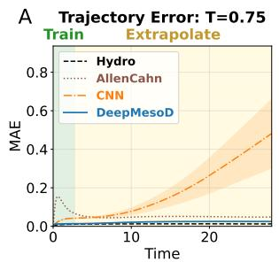

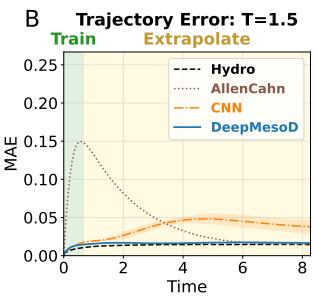

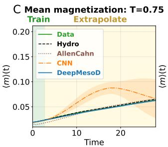

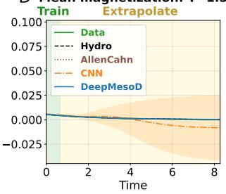

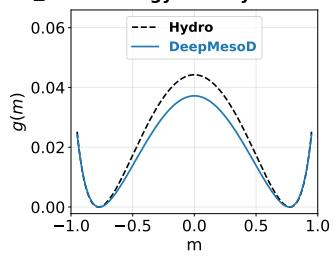

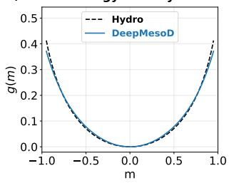

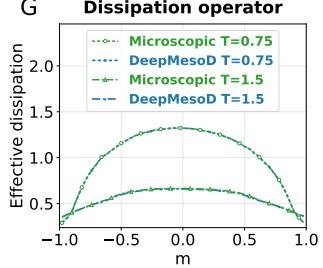

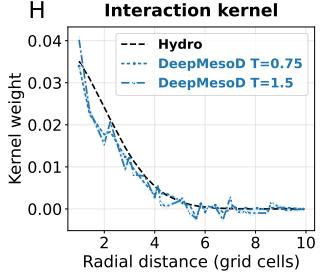  
Figure 2: Validation of DeepMesoD in the Ising–Kac system with hydrodynamic limit. The DeepMesoD rollouts are noise-free with the Itˆo thermal drift retained. A,B. Field mean absolute error at each evaluation time for $T = 0 . 7 5$ and $T = 1 . 5$ . Green shading marks the training interval, and yellow shading marks the subsequent rollout-only interval. C,D. Mean magnetisation during the same rollouts. E,F. Homogeneous free-energy density $g ( m )$ , compared with the hydrodynamic-limit reference. Each curve is shifted independently so that its minimum is zero. G. Conditional dissipation-operator response ${ \mathbb E } \{ [ { \mathcal K } [ { \phi } ] \mathbf { 1 } ] ( \mathbf { x } ) ~ | ~ \phi ( \mathbf { x } ) = m \}$ , compared with the reference in (4) computed from the corresponding microscopic trajectories. H. Of-centre interaction weights, averaged over ofsets with the same radial distance and compared with the Gaussian Ising–Kac kernel. For DeepMesoD and the CNN baseline, lines show the mean across three training seeds, and shaded bands indicate one standard deviation.

## Discovery of mesoscopic structure in atomistic systems

We next apply DeepMesoD to atomistic spin dynamics trajectories from two magnetic systems whose mesoscopic equations are not known in closed form (17, 18). In a Cr2Ge2Te6-like twodimensional ferromagnet, we examine whether the learned equation recovers the anisotropy, exchange, and state-dependent dissipation required for long rollouts (28). In CrBr3, we use the learned stacking-fault interaction in controlled numerical experiments that vary the number and placement of fault interfaces. The resulting responses reveal how this interaction organises multistep magnetic switching. Once learned, these neural-network field equations permit stable simulations over larger spatial domains at substantially lower computational cost than atomistic spin dynamics.

Microscopic model and atomistic spin dynamics At the atomistic level, both systems are described by a classical Heisenberg spin Hamiltonian, with a unit spin $\mathbf { s } _ { i } \in S ^ { 2 }$ carrying moment $\mu _ { s }$ at each magnetic site. For these vector spins, we write $\mathbf { s } _ { i }$ in place of the microscopic variable $\sigma _ { i }$ used above. A general form of the Hamiltonian is

$$
\mathcal { H } = - \sum _ { i < j } J _ { i j } \ : \mathbf { s } _ { i } \cdot \mathbf { s } _ { j } - k _ { u } \sum _ { i } ( \mathbf { s } _ { i } \cdot \mathbf { e } ) ^ { 2 } - \mu _ { s } \sum _ { i } \mathbf { s } _ { i } \cdot \mathbf { B } + \mathcal { H } _ { \mathrm { d i p } } ,
$$

combining exchange with couplings $J _ { i j }$ , uniaxial anisotropy of strength $k _ { u }$ about the easy axis $\mathbf { e } ,$ Zeeman coupling to an applied field B, and the long-range dipolar interaction $\mathcal { H } _ { \mathrm { d i p } }$ . The $\mathrm { C r _ { 2 } G e _ { 2 } T e _ { 6 } - }$ like ferromagnet and the $\mathrm { C r B r _ { 3 } }$ film difer in lattice geometry and material parameters $\{ J _ { i j } , k _ { u } , \mu _ { s } \}$ and the stacking fault in the latter enters as a local modification of the exchange couplings across the fault plane.

Given this Hamiltonian, each spin evolves under the stochastic Landau-Lifshitz-Gilbert (LLG) equation

$$
\begin{array} { l } { \displaystyle \frac { d \mathbf { s } _ { i } } { d t } = - \frac { \gamma } { 1 + \alpha ^ { 2 } } \mathbf { s } _ { i } \times \left( \mathbf { H } _ { i } + \alpha \mathbf { s } _ { i } \times \mathbf { H } _ { i } \right) , } \\ { \displaystyle \mathbf { H } _ { i } = - \frac { 1 } { \mu _ { s } } \frac { \partial \mathcal { H } } { \partial \mathbf { s } _ { i } } + \boldsymbol { \zeta } _ { i } , } \end{array}\tag{5}
$$

which combines reversible precession about the efective field $\mathbf { H } _ { i } ,$ Gilbert damping with strength $\alpha ,$ and thermal noise $\zeta _ { i }$ whose covariance is fixed by the fluctuation–dissipation relation at temperature $T .$ . We integrate these equations with VAMPIRE v7.0.0 (17, 18), which supplies the microscopic trajectories that DeepMesoD coarse-grains.

In both systems, the coarse observations are obtained by the same block average as before, now applied to the three-component spins:

$$
z _ { i } ( t ) = V _ { c } ^ { - 1 } \sum _ { j \in \mathcal { C } ( \mathbf { x } _ { i } ) } \mathbf { s } _ { j } ( t ) \in \mathbb { R } ^ { 3 } .
$$

We learn a vector field m with $z _ { i } ( t ) \approx \mathbf { m } ( \mathbf { x } _ { i } , t )$ and $| { \bf m } | \le 1$ . Unlike the Ising–Kac model, whose coarse-grained constitutive structure is analytically known, no general constitutive description is available for atomistic spin systems governed by the LLG equation.

$\mathbf { C r _ { 2 } G e _ { 2 } T e _ { 6 } } – \mathbf { l i k e }$ two-dimensional van der Waals ferromagnet Two-dimensional van der Waals magnets such as $\mathrm { C r I _ { 3 } }$ and $\mathrm { C r _ { 2 } G e _ { 2 } T e _ { 6 } }$ provide atomically thin platforms for exploring lowdimensional magnetism and developing spintronic devices (29). Simulating two-dimensional magnets at experimentally relevant spatial and temporal scales is essential because their collective behaviour may not be captured in small computational domains. Large-scale atomistic simulations, for example, have revealed finite-size magnetic order beyond the conventional Mermin–Wagner limit, but at substantial computational cost, involving millions of spins and days of simulation (28). By learning thermodynamically consistent mesoscopic dynamics from atomistic trajectories, DeepMesoD enables cheaper spatial scale-up and long-horizon prediction beyond the reach of direct microscopic simulation. It is also of scientific interest to evaluate if an Allen–Cahn-type phenomenologica model can quantitatively capture the mesoscopic dynamics of these magnets.

For the two-dimensional van der Waals ferromagnet, we specialise the general Hamiltonian above by restricting $J _ { i j }$ to a uniform nearest-neighbour coupling $J ,$ setting the applied field to zero, and neglecting dipolar interactions. With the easy axis chosen along $z ,$ the resulting anisotropic Heisenberg Hamiltonian reads

$$
H ( \mathbf { s } ) = - \sum _ { \langle i , j \rangle } J \mathbf { s } _ { i } \cdot \mathbf { s } _ { j } - k _ { u } \sum _ { i } ( s _ { i } ^ { z } ) ^ { 2 } ,
$$

where each site carries a classical unit spin $\mathbf { s } _ { i } \in S ^ { 2 } , J > 0$ is the ferromagnetic exchange coupling, and $k _ { u } > 0$ is the uniaxial anisotropy strength. The uniaxial anisotropy stabilises finite-temperature magnetic order, and the exchange and anisotropy parameters are adopted from Ref. (28). Under this efective modelling hypothesis, DeepMesoD uses the same finite-scale, thermodynamically consistent dissipative construction introduced in (1) and applied to the Ising–Kac system. The learned interaction kernel obeys the unit-sum constraint, $\begin{array} { r } { \sum _ { r } \widehat { J } ( r ) = 1 } \end{array}$ , and for the present vector-valued magnetisation field, the dissipation construction is extended from the scalar case by replacing each scalar coupling with a $3 \times 3$ block. Specifically, $b _ { i } ( s ; { \mathbf { m } } ) \in \mathbb { R } ^ { 3 \times 3 }$ acts on the three spin components of neighbouring coarse cells, while the factorisation $K = B B ^ { T }$ and the finite-range construction remain unchanged. The factor uses the same $3 \times 3$ neighbourhood of noise sources as in the Ising–Kac system.

DeepMesoD is trained on 10 independent atomistic spin dynamics trajectories generated from random spin initialisations. Each trajectory is simulated for 250 ps with a microscopic time step of 0.1 fs, and configurations are saved every 1 ps. Training data are drawn from the first 150 ps of each trajectory, with the remaining 100 ps reserved for later-time evaluation. We further assess out-ofdistribution generalisation with a triangular-domain initial condition, in which a single triangular magnetic domain is embedded in an otherwise uniformly magnetised background. Additional evaluations on domain-wall configurations are reported in the SI, section 3D. Two unstructured baselines are compared: the patch-wise CNN used in the Ising–Kac experiments and a Fourier neural operator (FNO (30)) that learns the field evolution as a black-box operator. For the triangular-domain initial condition, atomistic reference data are available over 0–1 ns, where prediction errors can be evaluated (Figure 3A and SI Appendix, section 3D). The learned-model rollout extends to 25 ns, a timescale beyond the practical reach of ASD for the same system under a comparable computational budget. Over 1–25 ns, the predicted mean magnetisation remains bounded and approaches −1 as the minority domain shrinks and the system relaxes towards a uniformly magnetised state (Figure 3B). In contrast, the CNN and FNO baselines become unstable during long rollouts.

No violations of $| \mathbf { m } | \leq 1$ were detected for DeepMesoD in the reported tests. Table 1 shows 0.00% unphysical predictions across the three tested initial conditions, against ${ > } 3 7 \%$ and ${ > } 8 1 \%$ for CNN and FNO.

Table 1: Physical constraint violations in learned-model predictions. Percentage of grid points where the predicted spin magnitude exceeds the unit sphere $( | \mathbf { m } | > 1 )$ across three magnetic configurations, without any post-processing. The 0.00% entries for DeepMesoD indicate zero detected violations.
<table><tr><td>Model</td><td>Random</td><td>Domain Wall</td><td>Triangular domain</td></tr><tr><td>DeepMesoD</td><td>0.00%</td><td>0.00%</td><td>0.00%</td></tr><tr><td>CNN</td><td>37.59%</td><td>94.48%</td><td>94.44%</td></tr><tr><td>FNO</td><td>81.66%</td><td>96.66%</td><td>98.31%</td></tr></table>

Beyond stable rollout, DeepMesoD reconstructs the free-energy functional, dissipation operator, and interaction kernel of the ASD system directly from data. The learned free-energy landscape exhibits a double-well profile with minima at $m _ { z } \approx \pm 1$ , consistent with the underlying uniaxial anisotropy (Figure 3D, left). These minima provide energetically favoured magnetised states, supporting a physical interpretation of the stable relaxation observed in the rollouts. Compared with the additive dependence assumed in the hydrodynamic limit of the Ising–Kac model, the learned thermodynamic force $\partial { F } / \partial ( J m _ { z } )$ exhibits a nonlinear dependence on both $m _ { z }$ and $J m _ { z }$ The resulting two-dimensional response surface contains clear non-separable structure (Figure 3D, middle and right), demonstrating that the general parametrisation of the free-energy density used in DeepMesoD can represent thermodynamic couplings beyond an additive form. The learned

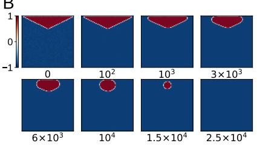

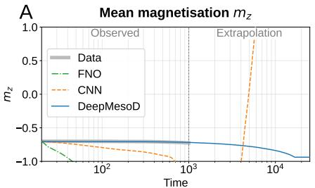

C  
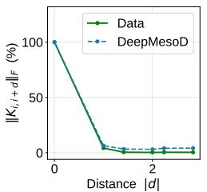

$$
K _ { \perp }
$$

B  
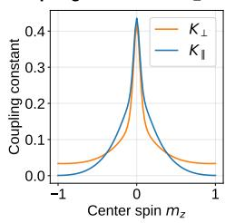

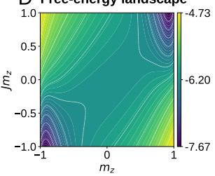

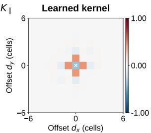

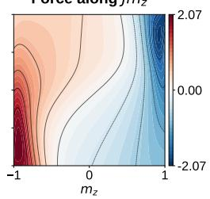

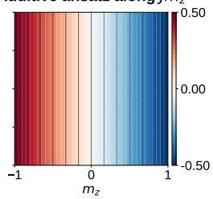  
Figure 3: Long-term stability and thermodynamic-structure recovery in atomistic spin dynamics. A. Long-term rollout from a triangular-domain initial condition on the same lattice. The DeepMesoD prediction is noise-free with the Itˆo thermal drift retained. Training uses random-initial-state trajectories. The triangular-domain initial condition is used for geometricinitial-condition extrapolation, not for fitting these stages. The dashed boundary at 1 ns separates the interval with an atomistic reference (“Observed”) from the interval without a reference (“Extrapolation”), ending at 25 ns. Time labels are in ps. The atomistic reference permits accuracy comparisons over 0–1 ns, but extending it to 25 ns is computationally costly. The 1–25 ns learnedmodel rollout assesses numerical stability and qualitative relaxation. B. Predicted magnetisation fields at the indicated times in ps. The triangular minority domain contracts towards a uniform magnetised state. C. Recovered Kernel. Left: spatial decay of the learned dissipation operator, quantified by the Frobenius norm of the block $K _ { i , i + d }$ with distance d relative to the on-site block. Middle: dissipation coupling constants $K _ { \perp }$ and $K _ { \parallel }$ as functions of centre spin $m _ { z } ,$ exhibiting an even (symmetric) profile that peaks near the disordered state and reflecting the expected axial anisotropy between the two coupling modes. Right: learned interaction kernel, revealing a dominant nearest-neighbour structure consistent with short-range exchange coupling. D. Recovered free energy. Left: free-energy landscape $F ( m _ { z } , J m _ { z } )$ exhibiting a double-well profile with minima at $m _ { z } = \pm 1$ , consistent with the underlying uniaxial anisotropy. Middle: thermodynamic force $\partial { F } / \partial ( J m _ { z } )$ recovered by DeepMesoD, which is a general nonlinear function of both $m _ { z }$ and $J m _ { z }$ and exhibits non-trivial contour structure. Right: the hydrodynamic limit $\partial { F } / \partial ( J m _ { z } )$ , which assumes an additive dependence on $m _ { z }$ alone, yields a purely striped pattern independent of $J m _ { z } ,$ demonstrating that the additive assumption fails to capture the full free-energy structure of this system.

dissipation is likewise strongly localised in space. The Frobenius norm of the coupling block $K _ { i , i + d }$ is largest on the on-site block $( d = 0 )$ and drops sharply already at $d = 1$ , so the operator is efectively on-site dissipation(Figure 3C, left). For the on-site block itself, although $K _ { i i }$ is parametrised as a full $3 \times 3$ matrix, the learned operator is approximately diagonal in the spin components, with in-plane entries $K _ { x x } \approx K _ { y y } \equiv K _ { \parallel }$ , out-of-plane entry $K _ { z z } \equiv K _ { \perp }$ , and negligible of-diagonal coupling. Both coupling constants depend approximately evenly on $m _ { z }$ and peak near the disordered state $( m _ { z } \approx 0 )$ , reflecting the reduced phase space available for fluctuations in the ordered phases (Figure 3C, middle). Finally, the recovered spatial interaction kernel exhibits a dominant nearestneighbour structure consistent with the lattice symmetry, recovering the short-range exchange coupling without prescribing this structure (Figure 3C, right). The recovered thermodynamic components provide an interpretable description of the observed relaxation.

Layered CrBr3 from a learned fault interaction to multistep field response CrBr3 is a van der Waals ferromagnet whose interlayer magnetic coupling depends on the stacking registry of adjacent layers. Diferent stacking configurations, including monoclinic M-stacking and rhombohedral AB-stacking, correspond to diferent relative translations between adjacent layers and can favour antiferromagnetic or ferromagnetic interlayer correlations (Figure 4A) (23, 24). Experimentally, such magnetic switching can be probed through magneto-photoluminescence (magneto-PL), where photoluminescence refers to light emitted following optical excitation and its response can depend on the magnetic state of the material (19). Our magneto-PL measurements on an approximately 50 nm $\mathrm { C r B r _ { 3 } }$ flake show abrupt changes in PL intensity associated with magnetic switching (Figure 4D). These measurements reveal the occurrence of magnetic switching, but do not directly resolve the spatial magnetisation dynamics that connect the local stacking fault to the observed macroscopic response. In particular, how the modified exchange interface reorganises magnetic domains and mediates switching across the film remains dificult to access experimentally. Atomistic spin dynamics simulations can in principle resolve these processes, but become prohibitively expensive over the spatial and temporal scales required to follow domain formation and collective switching. This motivates the use of DeepMesoD to learn an efective mesoscopic description that retains the influence of the microscopic stacking-dependent exchange while enabling direct study of the resulting domain evolution and macroscopic magnetisation dynamics.

Because the layered geometry provides prior information about the distinction between in-plane and interlayer interactions, we impose additional structure on the interaction kernel, separating these two contributions to reduce the parameter space and make their physical roles explicit. We generate atomistic spin dynamics trajectories for a 51.4 nm $\mathrm { C r B r _ { 3 } }$ film with a single antiferromag netic stacking fault at its midplane. Averaging three atomic layers per slab gives 28 resolved slabs. From these trajectories, DeepMesoD learns the energy-density function, the spatial interaction, and the dissipation operator of the coarse-field equation. We represent the spatial interaction kernel as a separable product: its layer-dependent factor captures variations associated with surfaces and stacking faults, whereas its in-plane factor represents short-range exchange. At coarse indices (x, y, z), the interaction kernel is

$$
J _ { ( x , y , z ) , ( x ^ { \prime } , y ^ { \prime } , z ^ { \prime } ) } = J _ { z } ( z , z ^ { \prime } ) J _ { x y } ( x - x ^ { \prime } , y - y ^ { \prime } ) \equiv ( J _ { z } \otimes J _ { x y } ) _ { ( x , y , z ) , ( x ^ { \prime } , y ^ { \prime } , z ^ { \prime } ) } .
$$

Here $J _ { z }$ is a global layer-to-layer matrix, whereas $J _ { x y }$ is a local finite-range in-plane kernel.

Applying DeepMesoD to these trajectories yields the interaction kernels and free-energy landscape shown in Figure 4B and C. The learned interlayer kernel $J _ { z }$ has a predominantly tridiagonal structure, with the coupling across the stacking fault between coarse-grained layers 13 and 14 reversing sign relative to the bulk interlayer coupling (Figure 4B, left). The in-plane kernel $J _ { x y }$ is isotropic and approximately nearest-neighbour, consistent with the symmetry of the $\mathrm { C r B r _ { 3 } }$ lattice (Figure 4B, right). Through the learned free energy, this fault-induced change in the interaction kernel alters the equilibrium structure of the system. Restricting the free energy to configurations with spatially uniform magnetisation within the blocks above and below the fault reveals four distinct minima in the mean-magnetisation and block-contrast coordinates (Figure 4C). Two correspond to parallel block magnetisations and two to antiparallel block magnetisations. This contrasts with a uniformly ferromagnetic system, which exhibits only two symmetry-related minima. The additional basins therefore reveal fault-induced equilibrium states and provide a mesoscopic free-energy picture for the multiple magnetic transitions associated with the stacking fault.

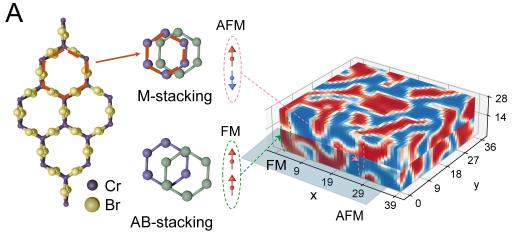

B  
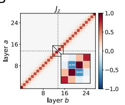

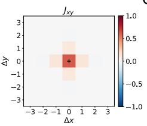  
C

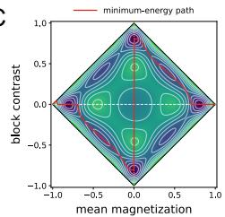

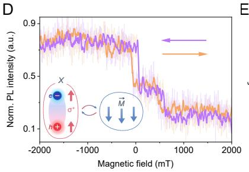

E  
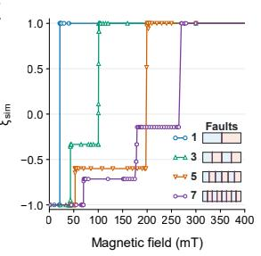

FT  
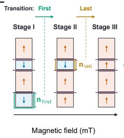

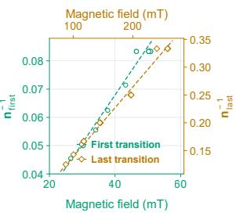  
Figure 4. A learned stacking-fault interaction connects internal geometry to multistep magnetic response in $\bf C r B r _ { 3 }$ . A. Structural and magnetic schematic of layered $\mathrm { C r B r _ { 3 } }$ . Left: crystal structure of $\mathrm { C r B r _ { 3 } }$ (Cr atoms in purple, Br atoms in gold). Middle: top and side views of representative M-stacking and AB-stacking configurations, where M denotes monoclinic stacking and AB denotes rhombohedral stacking and the two adjacent layers are coloured purple and green. Right: schematic AFM (antiparallel) and FM (parallel) interlayer spin alignments across a stacking fault, shown alongside the simulated three-dimensional magnetisation field $m _ { z }$ at the final time step. The light-blue plane marks the stacking-fault interface between coarse slabs 13 and 14 (zero-based indices), and the pink (AFM) and green (FM) dashed circles highlight representative anti-correlated and correlated magnetic subdomains on either side of the fault. B. Efective interaction kernels learned by DeepMesoD without supplying the fault location as a model input. Left: learned interlayer kernel $J _ { z }$ as a function of layer indices a and b, showing a predominantly tridiagonal structure. The coupling across the stacking-fault interface between coarse slabs 13 and 14 (zero-based indices) has the opposite sign to the bulk interlayer coupling. Right: learned in-plane kernel $J _ { x y }$ as a function of in-plane displacement $( \Delta x , \Delta y )$ , showing an isotropic, short-range profile. C. Learned free-energy landscape for configurations with spatially uniform magnetisation within each of the two blocks. The coordinates are the mean magnetisation $m = ( m _ { \mathrm { t o p } } + m _ { \mathrm { b o t t o m } } ) / 2$ and block contrast $\Delta m = ( m _ { \mathrm { t o p } } - m _ { \mathrm { b o t t o m } } ) / 2$ . The four minima represent correlated states at $( m , \Delta m ) = ( \pm m _ { 0 } , 0 )$ and anti-correlated states at $( m , \Delta m ) = ( 0 , \pm m _ { 0 } )$ . The red curves indicate minimum-energy paths connecting these basins. D. Magneto-photoluminescence signature of magnetic transitions on a roughly 50 nm $\mathrm { C r B r _ { 3 } }$ flake. The normalised PL intensity is shown as a function of out-of-plane magnetic field for sweeps from $- 2 \mathrm { T }$ $2 \mathrm { T }$ and from $2 \mathrm { T }$ to $- 2 \mathrm { T }$ , with a step-like PL response to the applied magnetic field. The purple and orange curves show smoothed traces, while the faint traces in the background show the corresponding unsmoothed experimental data. Arrows indicate the magnetic-field sweep directions. The inset shows a schematic of exciton–magnetisation coupling in CrBr . X denotes a $\mathrm { C r B r _ { 3 } }$ exciton, represented here by an electron–hole pair with both carrier spins oriented upward. The $\sigma ^ { + }$ label denotes the circular polarisation associated with this representative optically active exciton configuration. The local magnetisation vector M is chosen to point downward. E. Calculated equilibrium mean interfacial sign correlation $\xi _ { \mathrm { s i m } }$ versus external field for the 51.4 nm film containing one, three, five, or seven approximately uniformly spaced stacking faults. This observable averages the product of longitudinal magnetisation signs across each fault

over in-plane cells, fault planes, and equilibrium configurations [(6)]. The plateaus correspond to dominant block-alignment sectors. The small diagrams show the fault locations. F. Dependence of the first and final transition fields on fault positions for films containing three faults. Left: starting from alternating block magnetisations, the outer block opposing the field reverses first, followed by the remaining antiparallel internal block. Green and orange outlines identify these blocks, whose thicknesses are $n _ { \mathrm { f i r s t } }$ and $n _ { \mathrm { l a s t } }$ , respectively, measured in resolved slabs. Right: inverse thicknesses $n _ { \mathrm { f i r s t } } ^ { - 1 }$ and $n _ { \mathrm { l a s t } } ^ { - 1 }$ plotted against the first and final transition fields, respectively. Symbols denote the simulated geometries; dashed linear fits show the approximately linear relationships.

Having identified how a single stacking fault reshapes the free-energy landscape and introduces additional equilibrium basins, we next examine how this mechanism extends to films containing multiple faults. In particular, we ask how the number and spatial arrangement of stacking faults modify the field-dependent magnetic response. Addressing this question requires systematic variation of the fault configuration while resolving the resulting magnetisation dynamics. Atomistic spin dynamics simulations can represent individual faults explicitly, but systematic exploration over fault number, position, film geometry, and applied field becomes prohibitively expensive as the number of microscopic spins increases. Experiments can measure the resulting macroscopic switching response, but the number and positions of stacking faults are dificult to control indepen dently, and the internal magnetisation dynamics associated with a particular fault configuration are not directly resolved. Once DeepMesoD has learned the mesoscopic free energy and interaction structure, however, diferent fault configurations can be introduced through the layer-dependent coupling and explored directly at the coarse-grained level.

We introduce an out-of-plane field through the Zeeman term

$$
\mathcal { F } _ { \theta , J , h } [ \mathbf { m } ] = \mathcal { F } _ { \theta , J } [ \mathbf { m } ] - \alpha _ { h } h \int _ { \Omega } m _ { z } ( \mathbf { x } ) d \mathbf { x } ,
$$

where $h$ is the dimensionless applied field, $m _ { z }$ is the out-of-plane magnetisation component, and $\alpha _ { h }$ converts the field to the learned free-energy scale. We calibrate $\alpha _ { h }$ after training as described in Materials and Methods. To vary the fault geometry, we retain the 28 resolved slabs and insert translated copies of the learned fault neighbourhood at prescribed interfaces of $J _ { z }$ , keeping the other learned quantities fixed. We quantify the response by the mean sign correlation across al fault planes, so that each internal interface contributes to the observable:

$$
\xi _ { \mathrm { s i m } } ( h ) = \mathbb { E } _ { h } \left[ \frac { 1 } { N _ { f } N _ { x y } } \sum _ { f = 1 } ^ { N _ { f } } \sum _ { i = 1 } ^ { N _ { x y } } \mathrm { s i g n } \Big [ m _ { z , i } ^ { f , + } \Big ] \mathrm { s i g n } \Big [ m _ { z , i } ^ { f , - } \Big ] \right] ,\tag{6}
$$

where $N _ { f }$ is the number of stacking faults, $N _ { x y }$ is the number of in-plane coarse-grained cells, and $m _ { z , i } ^ { f , + }$ and $m _ { z , i } ^ { f , - }$ denote the out-of-plane magnetisation in cell i of the slabs immediately above and below fault $f$ in a configuration at applied field h. The expectation $\mathbb { E } _ { h }$ averages over equilibrium configurations within and across the retained block-alignment sectors at fixed h. Thus, $\xi _ { \mathrm { s i m } } = 1$ and −1 indicate equal and opposite longitudinal magnetisation signs, respectively, at every interface cell throughout the equilibrium ensemble. Intermediate values can arise from mixed alignments within a fault plane, diferent alignments among fault planes, or averaging over configurations. Direct trajectories do not sample all relevant block-alignment sectors on the accessible time scale. We therefore use bidirectional annealed importance sampling, which connects ensembles through intermediate distributions and estimates their relative equilibrium weights from bidirectional switching work (31, 32), to evaluate (6). Computational details are given in Materials and Methods and the SI Appendix, section 4D.

We vary the interlayer interaction kernel $J _ { z }$ to represent one, three, five, and seven approximately uniformly spaced faults while keeping the other learned quantities fixed (SI Appendix, section 4D). The resulting equilibrium field responses exhibit distinct plateaus that reflect successive changes in the dominant block-alignment sectors (Figure 4E). Increasing the fault number changes the plateau sequence and extends the response to higher fields in the tested geometries. The simulated plateaus reflect changes in interfacial block alignment, whereas the PL steps in Figure 4D are an optical signature of changes in magnetic state. These calculations provide a possible magnetic interpretation of our PL steps.

We next fix the number of stacking faults at three and examine how their positions afect the first and final equilibrium transition fields (Figure 4F). Each fault geometry divides the 28-slab film into four magnetic blocks with thicknesses $n _ { 1 } , n _ { 2 } , n _ { 3 } , n _ { 4 }$ , counted consecutively through the film in resolved slabs, with $\textstyle \sum _ { k = 1 } ^ { 4 } n _ { k } = 2 8$ . The left schematic illustrates two successive transitions from alternating block magnetisations as the field increases. The outer block opposing the field reverses first; its thickness is $n _ { \mathrm { f i r s t } }$ , and it is outlined in green. The remaining antiparallel internal block, outlined in orange, then reverses to align all four blocks with the field. Its thickness is $n _ { \mathrm { l a s t } } = \operatorname* { m i n } ( n _ { 2 } , n _ { 3 } )$ . The outer block that reverses first is separated by one block from the internal block that reverses last.

Across the tested fault geometries, the first and final transition fields vary approximately linearly with $n _ { \mathrm { f i r s t } } ^ { - 1 }$ and $n _ { \mathrm { l a s t } } ^ { - 1 }$ , respectively, as shown in the right panel. The scaling can be understood from the competition between the Zeeman energy gained by aligning a block with the applied field and the interfacial free-energy cost of replacing antiparallel alignments with parallel ones. For a fixed lateral area and comparable magnetisation magnitude, the Zeeman energy gain scales with the applied field times the thickness of the reversing block. If the interfacial cost remains comparable across fault geometries, the critical field therefore scales approximately inversely with the block thickness, so that thicker blocks switch at lower applied fields.

## Discussion

## Physical interpretation and computational scale

The results demonstrate three uses of learned mesoscopic dynamics: extending simulations in time and space, analysing thermodynamic structure, and isolating how spatial interactions control collective magnetic response.

First, evolving the coarse field avoids resolving every atomistic spin and extends short microscopic observations to longer-time simulations. In the two-dimensional atomistic spin system, predictions agree with an atomistic reference up to 1 ns and remain bounded during relaxation to 25 ns. For the two-dimensional ferromagnet and CrBr3, the wall-clock speedups over atomistic spin dynamics are approximately $4 . 1 \times 1 0 ^ { 3 }$ and $4 . 0 \times 1 0 ^ { 4 }$ , respectively, without operator-specific optimisation (Materials and Methods). The Ising calculations also demonstrate evaluation on larger spatial domains at fixed coarse-graining scale and resolution (SI Appendix, section 2G).

Second, the learned equations preserve thermodynamic structure while allowing the free energy, interaction kernel, and dissipation to be analysed separately. In Ising, the learned energy density reproduces the double-well and single-well profiles at the two temperatures, and the conditiona dissipation response agrees with the finite-block fluctuation reference. In the atomistic systems, the energy density reveals uniaxial anisotropy, the dissipation varies with the magnetisation, and the $\mathrm { C r B r _ { 3 } }$ interaction kernel identifies a reversal of interlayer coupling at the stacking fault.

Third, the learned interactions enable controlled calculations of mesoscopic magnetic properties. In $\mathrm { C r B r _ { 3 } } .$ , changing the number and placement of fault interfaces while holding the other learned quantities fixed isolates their efects on interfacial alignment and field-induced switching. The calculated plateaus track changes in magnetic alignment across fault interfaces, providing a magnetic perspective on the multistep optical response observed in magneto-photoluminescence. In the future, atomic-resolution scanning transmission electron microscopy (23) combined with magnetic measurements could help examine the predicted relation between stacking-fault geometry and magnetic response in real samples.

## Relation to other data-driven methods

We then discuss related work on data-driven dynamics modelling. Neural operators such as DeepONet and Fourier neural operators learn black-box mappings between input and solution fields (30, 33). Equation-discovery methods including SINDy, AI-Feynman, and PDE-Net infer governing expressions using prescribed candidate libraries, symbolic search spaces, or structured diferential representations (34–37). For coarse-grained particle trajectories, symmetry-informed candidate libraries and sparse regression have been used to infer deterministic hydrodynamic equations for active matter (38). Efective stochastic dynamics can also be learned from microscopic simulations by fitting drift and difusion functions using objectives based on stochastic numerical integrators (39). OnsagerNet, generalised-Onsager learning, and GENERIC-informed models parametrise thermodynamically structured dynamics for finite-dimensional state vectors rather than directly parametrising mesoscopic field equations (40–44). Recent work extends Onsagerstructured learning to mesoscopic field dynamics through deterministic trajectory fitting (45). A related approach learns conserved density dynamics from molecular dynamics trajectories (46). By contrast, DeepMesoD develops a more general mesoscopic modelling framework based on symmetry principles and the fluctuation–dissipation relation, with flexible free-energy functionals and dissipation operators for nonconserved fields.

Stat-PINNs and DeepMesoD both use fluctuation statistics to constrain dissipation and mean evolution to learn the free energy (47), but obtain these statistics diferently. Stat-PINNs prepare and evolve microscopic replica ensembles around prescribed field profiles, whereas DeepMesoD uses increments along recorded mesoscopic field trajectories. The same trajectories supply both the mean evolution and fluctuation statistics, removing the need to prepare and evolve additional microscopic replicas for each prescribed field profile. The two methods also difer in how they represent operators. Stat-PINNs learn weak-form dissipation entries in a selected finite-element space. DeepMesoD defines a factor B on the field space and constructs ${ \cal K } = B B ^ { * }$ , then learns its numerical representation. This separates the definition of the operator structure from its numerical discretisation. Self-adjointness and positive semidefiniteness follow from the factorisation. DeepMesoD also learns the spatial interaction kernel $J ( \mathbf { x } , \mathbf { y } )$ , which reveals how diferent regions interact. In $\mathrm { C r B r _ { 3 } } .$ modifying this kernel enables controlled numerical experiments that help reveal how spatial interactions shape collective magnetic behaviour (Figure 4E,F). DeepMesoD includes the thermal drift $\mathrm { D i v } _ { \phi } \mathcal { K } [ \phi ] / ( \beta V _ { c } )$ in the Itˆo equation (1), whereas Stat-PINNs derive this term but omit it under their asymptotic scaling. In the formal Fokker–Planck equation, this term ensures zero probability current at Gibbs equilibrium. At finite coarse-graining volume $V _ { c } ,$ , omitting it while keeping the same free energy and noise covariance generally breaks detailed balance with respect to that equilibrium.

## Dynamical assumptions and scope

Hohenberg and Halperin classify critical dynamics according to whether the order parameter is conserved and how it couples to other slow variables (48). Among these classes, Model A describes relaxation of a nonconserved order parameter, whereas Model B describes transport-driven evolution of a conserved order parameter. Couplings to additional slow fields and reversible dynamics give rise to further classes. Here, DeepMesoD describes the selected coarse field using Markovian Model-A-type dynamics at the prescribed scale.

Atomistic LLG dynamics includes reversible precession as well as dissipation. At the chosen coarse-graining scale, spatial averaging suppresses incoherent transverse precession, and the SI diagnostics (sections 3B and 4A) show no statistically resolved reversible coupling between the remaining transverse motion and the longitudinal magnetisation $m _ { z }$ . These observations support the dissipative description of the longitudinal dynamics compared here. Conserved fields or systems with appreciable reversible couplings require a diferent field equation. Eliminating unresolved microscopic variables can produce memory and coloured noise, as described by Mori–Zwanzig theory (15, 49). The ab initio generalised Langevin equation provides a data-driven example in which a force field, memory kernel, and noise model are learned from atomistic trajectories while satisfying the fluctuation–dissipation relation (50). These are worthy avenues to explore in future work.

Beyond these dynamical assumptions, the accuracy of the learned mesoscopic equation also depends on the microscopic trajectories used as reference data. The trajectories studied here are generated from efective spin Hamiltonians rather than first-principles simulations. Machine-learned interatomic potentials could extend this framework to more materials by providing microscopic trajectories with first-principles-informed energies and forces (7, 8, 51). Spin-dependent potentials such as DeepSPIN also provide magnetic torques for spin-lattice dynamics (52). Learning mesoscopic equations from these trajectories could extend simulations of collective magnetic dynamics towards device-relevant spatial scales.

## Materials and Methods

## Microscopic data generation

Ising–Kac trajectories are generated by heat-bath Glauber dynamics on a $4 , 0 9 6 \times 4 , 0 9 6$ periodic lattice with spacing $1 / 4 { , } 0 9 6$ . The Gaussian Kac interaction has range $\epsilon _ { \mathrm { K } } = 1 / 6 4$ , corresponding to 64 lattice spacings. The reported datasets use zero external field at $T = 0 . 7 5$ and $T = 1 . 5$ , with multiscale Gaussian-random-field initial conditions.

We generate atomistic spin dynamics trajectories for the $\mathrm { C r _ { 2 } G e _ { 2 } T e _ { 6 } }$ -like two-dimensional ferromagnet by integrating the stochastic LLG equation with VAMPIRE $\mathrm { v } 7 . 0 . 0 \ ( 1 8 )$ . Ten independent trajectories of a $1 { , } 0 2 4 \times 1$ ,024 monolayer are generated at $T = 1 0 \mathrm { K }$ for 250 ps, with configurations saved every 1 ps.

The same VAMPIRE package is used to generate atomistic spin dynamics trajectories for a 51.4 nm CrBr film with one antiferromagnetic stacking fault at its midplane. The $2 0 0 \times 2 0 0 \mathrm { n m ^ { 2 } }$ reference film contains approximately $2 \times 1 0 ^ { 7 }$ spins. Ten independent zero-field trajectories are generated at $T = 5 0 \mathrm { K }$ for 500 ps, with full spin configurations saved every 2 ps. The SI Appendix (sections 2A, 3A, and 4A) gives the microscopic parameters, integration settings, and initial conditions for all three systems.

## Common coarse-graining and learning procedure

The observations $z _ { i } ( t )$ at positions $\mathbf { x } _ { i }$ are block averages over neighbourhoods containing $V _ { c }$ microscopic sites. For Ising–Kac, a block width of 32 gives $V _ { c } = 1 { , } 0 2 4$ and maps the $4 { , } 0 9 6 ^ { 2 }$ lattice to a $1 2 8 ^ { 2 }$ array of coarse magnetisations . For the two-dimensional ferromagnet, a block width of 16 gives $V _ { c } = 2 5 6$ and maps the ${ 1 , 0 2 4 } ^ { 2 }$ lattice to a $6 4 ^ { 2 }$ array. For $\mathrm { C r B r _ { 3 } }$ , the atomistic spin configurations are averaged over nonoverlapping blocks of size $5 . 0 1 \times 5 . 4 2 \times 1 . 8 4 \mathrm { n m ^ { 3 } }$ , each containing three atomic layers. This procedure produces a $4 0 \times 3 7 \times 2 8$ array, with $V _ { c } = 4 8 0$

The reported calculations place the coarse observations on regular arrays and use a unit-spacing piecewise-constant numerical representation. These control regions define the spatial quadrature. They are distinct from the microscopic averaging neighbourhoods that determine $V _ { c } .$

The observations satisfy $z _ { i } ( t ) \approx \phi ( \mathbf { x } _ { i } , t )$ . In the training formulas below, $z ( t )$ denotes these observations arranged by position and field component. The subscript N on numerical quantities denotes discretisation on the N coarse cells. The energy-density function $\rho$ is represented by a multilayer perceptron, written as $\rho _ { \theta }$ when its trainable parameters $\theta$ are explicit. The interaction kernel J is represented by trainable coeficients $J _ { N }$ , which act identically on each field component to form the interaction input. Applying the spatial quadrature to (2) gives the numerical free energy $\mathcal { F } _ { N } ( z )$ . A convolutional neural network with parameters $\vartheta$ represents the local dependence of the factor kernel b: it takes the field values in a neighbourhood of each cell and returns a $q \times p$ coeficient matrix for each allowed noise-source ofset. Assembling these coeficients gives $B _ { \vartheta , N } ( z ) \in \mathbb { R } ^ { N q \times N p }$ and the dissipation operator $K _ { \vartheta , N } ( z ) = B _ { \vartheta , N } ( z ) B _ { \vartheta , N } ( z ) ^ { \mathsf { T } }$

Training uses three stages. Stage 1 fits an auxiliary conditional drift $\widehat { f }$ by minimising the meansquared error $\mathbb { E } _ { \mathrm { t r a i n } } \Vert \widehat { f } ( z ^ { n } ) - d _ { N } ^ { n } \Vert ^ { 2 }$ , where $d _ { N } ^ { n }$ is a finite-diference drift label specified for each system in the SI Appendix, sections 2A and 2D, 3C.1, and 4B.2. At consecutive recorded times $t _ { n }$ and $t _ { n + 1 }$ , write $\Delta t _ { n } = t _ { n + 1 } - t _ { n }$ and $z ^ { n } = z ( t _ { n } ) , \quad \Delta z ^ { n } = z ^ { n + 1 } - z ^ { n }$ . Stage 2 fits the factor parameters using the residual increments $r _ { N } ^ { n } = \Delta z ^ { n } - \widehat { f } ( z ^ { n } ) \Delta t _ { n }$ . Let W index the magnetisation components in a group of neighbouring coarse cells. Stage 2 minimises the Gaussian quasi-likelihood

$$
\begin{array} { l } { \displaystyle { \mathcal { L } _ { K } = \frac { 1 } { 2 | W | } \bigg \langle \log \operatorname* { d e t } \bigl ( \Sigma _ { W } ^ { n } + \lambda I _ { W } \bigr ) + ( r _ { N , W } ^ { n } ) ^ { \mathsf { T } } \bigl ( \Sigma _ { W } ^ { n } + \lambda I _ { W } \bigr ) ^ { - 1 } r _ { N , W } ^ { n } \bigg \rangle _ { n , W } } , } \\ { \displaystyle { \Sigma _ { W } ^ { n } = \frac { 2 \Delta t _ { n } } { \beta V _ { c } } [ K _ { \vartheta , N } ( z ^ { n } ) ] _ { W , W } } . } \end{array}
$$

Here $\Sigma _ { W } ^ { n }$ is the model covariance of the residual increments indexed by $W , r _ { N , W } ^ { n }$ is the residual restricted to W, |W| is the number of scalar field entries indexed by $W , I _ { W }$ is its identity matrix, $\lambda > 0$ is a numerical covariance floor, and the brackets average over sampled time-window pairs.

After Stage 2, the fitted factor parameters are held fixed. The resulting operator $K _ { \vartheta , N } ( z )$ remains state dependent while Stage 3 jointly optimises the free energy and interaction against the observed field changes. Its direct drift loss is

$$
\begin{array} { r l } & { e _ { F , J , i } ^ { n } = \left[ \frac { \Delta z ^ { n } } { \Delta t _ { n } } \right] _ { i } + \left[ K _ { \vartheta , N } ( z ^ { n } ) \nabla _ { z } \mathcal { F } _ { N } ( z ^ { n } ) \right] _ { i } - \displaystyle \frac { 1 } { \beta V _ { c } } \left[ \mathrm { D i v } _ { z } K _ { \vartheta , N } ( z ^ { n } ) \right] _ { i } , } \\ & { \mathcal { L } _ { F , J } ^ { \mathrm { d i r } } = \mathbb { E } _ { \mathrm { t r a i n } } \left[ \big | e _ { F , J , i } ^ { n } \big | ^ { 2 } \right] . } \end{array}
$$

Here i indexes coarse-cell magnetisation components, and $\mathbb { E } _ { \mathrm { t r a i n } }$ denotes the empirical average over sampled entries and increments. The coordinate state divergence and the system-specific sampling and loss normalisations are given in the SI Appendix, sections 1C, 2D, 3C, and 4B.

## Ising–Kac implementation

The Ising free energy uses a homogeneous density $g _ { \boldsymbol { \theta } } .$ , the parameterised version of g in the Results, and a symmetric, unit-sum interaction ${ \widehat { J } } _ { N }$ with ofsets in a $1 5 \times 1 5$ neighbourhood. The scalar factor reads a $1 5 \times 1 5$ field patch and acts on noise sources at the nine ofsets in a $3 \times 3$ neighbourhood. Its coeficients are even under global spin reversal.

## Two-dimensional-ferromagnet implementation

The two-dimensional ferromagnet uses a component-shared $1 3 \times 1 3$ unit-sum interaction, a threecomponent drift network, and a scalar energy-density network. The factor has $q = p = 3$ and assigns a $3 \times 3$ matrix to each ofset in $\boldsymbol { S } _ { B } = \{ - 1 , 0 , 1 \} ^ { 2 }$ . Three circular convolutional layers give a $7 \times 7$ state receptive field, while the noise sources lie in a $3 \times 3$ neighbourhood.

## CrBr3 implementation and equilibrium calculations

The $\mathrm { C r B r _ { 3 } }$ drift and free energy use independently fitted separable interactions: a unit-sum $7 \times 7$ in-plane kernel and a symmetric, unnormalised $2 8 \times 2 8$ layer matrix. The layer matrix carries the interlayer coupling strength. The factor acts within each slab and shares its coeficients across slabs; interlayer coupling enters through the free energy. Stage 3 uses the unnormalised direct drift loss. System-specific free-energy formulas, network architectures, sampling, and optimisation settings are given in the SI Appendix, section 4B. Because the training trajectories are generated at zero field, we calibrate the coupling to the applied field after training. We add the Zeeman densit $\mathrm { y } - \alpha _ { h } h m _ { z }$ and fit $\alpha _ { h }$ from paired opposite-field increments at ±25 and ±50 mT. The fit gives $\alpha _ { h } = 0 . 1 8 9 4$ for $h = B / ( \mu _ { 0 } M _ { s } )$ with $\mu _ { 0 } M _ { s } = 0 . 3 3 9 3 ~ \mathrm { T }$ , where $M _ { s }$ is the saturation magnetisation. The learned energy density, interaction kernels, and dissipation operator remain fixed during this calibration.

Multi-fault calculations retain the 28-slab film thickness. We decompose the learned single-fault matrix into a background and a local fault correction, then add translated copies of this correction at the prescribed interfaces. Overlapping contributions are summed, and entries outside the film are omitted. The construction and example matrices are given in the SI Appendix, section 4D. The energy-density network, in-plane kernel, dissipation factor, temperature, and field calibration remain fixed.

Long direct trajectories do not cross all block-alignment sectors on the available simulation time scale. Equilibrium sector weights are therefore computed by bidirectional annealed importance sampling. For each sampled configuration, we evaluate the sign statistic inside (6) and combine its sector averages using the restricted partition-function weights. A transition bracket is formed by two adjacent simulated field values for which the dominant block-alignment sector changes. The first and last brackets locate the two transitions plotted in Figure 4F. Further sampling details are given in the SI Appendix, section 4D.

## Simulation timing

For the Cr2Ge2Te6-like two-dimensional ferromagnet, advancing the system by 1 ps takes 16.2 s with VAMPIRE (17, 18) on 128 CPU cores, and 3.96 ms with DeepMesoD on one NVIDIA L40S GPU. For CrBr3, advancing the system by 2 ps takes 190.05 s with VAMPIRE (17, 18) on 128 CPU cores, and 4.8 ms with DeepMesoD on the same GPU.

## Magneto-photoluminescence (PL) measurements

Magneto-PL measurements were performed in a home-built backscattering microscope integrated with an attocube attoDRY 2100 closed-cycle cryostat operated at 1.7 K and equipped with a superconducting magnet providing fields up to 9 T. The sample was excited with a continuous-wave 730 nm laser at a power of $\approx 5 0 \mu \mathrm { W }$ and focused to a spot size of ≈ 1 µm, and the emitted light was collected through the same objective and detected using a spectrometer equipped with a 150 lines/mm grating and a CCD camera. An out-of-plane magnetic field was applied and swept in both directions. Circularly polarised excitation was generated using a quarter-wave plate placed in the excitation path.

## Data and code availability

The code is available at https://github.com/MLDS-NUS/DeepMesoD.

## Acknowledgments

This work was supported by the National University of Singapore and the AI for Science Institute, Beijing, through the AISI–NUS Joint Research Initiative Fund 2025 Award. This work was also supported by the Ministry of Education (Singapore) through the Research Centre of Excellence program (grant EDUN C-33-18-279-V12, I-FIM).

## References

1. A Hubert, R Sch¨afer, Magnetic domains: the analysis of magnetic microstructures. (Springer Science & Business Media), (1998).

2. S Grebenchuk, et al., Topological spin textures in an insulating van der waals ferromagnet. Adv. Mater. 36, 2311949 (2024).

3. J Z´azvorka, et al., Thermal skyrmion difusion used in a reshufler device. Nat. Nanotechnol. 14, 658–661 (2019).

4. SM Allen, JW Cahn, A microscopic theory for antiphase boundary motion and its application to antiphase domain coarsening. Acta Metall. 27, 1085–1095 (1979).

5. JW Cahn, JE Hilliard, Free energy of a nonuniform system. i. interfacial free energy. The J. Chem. Phys. 28, 258–267 (1958).

6. W E, Principles of multiscale modeling. (Cambridge University Press), (2011).

7. W Jia, et al., Pushing the limit of molecular dynamics with ab initio accuracy to 100 million atoms with machine learning in SC20: International Conference for High Performance Computing, Networking, Storage and Analysis. (IEEE Press), (2020).

8. Z Guo, et al., Extending the limit of molecular dynamics with ab initio accuracy to 10 billion atoms in Proceedings of the 27th ACM SIGPLAN Symposium on Principles and Practice of Parallel Programming. (ACM), (2022).

9. LD Landau, On the theory of phase transitions. Phys. Z. Sowjetunion 11, 26–35 (1937).

10. LD Landau, EM Lifshitz, Statistical Physics. (Butterworth-Heinemann, Oxford), 3rd edition, (1980).

11. C Kipnis, C Landim, Scaling Limits of Interacting Particle Systems. (Springer), (1999).

12. H Spohn, Large Scale Dynamics of Interacting Particles. (Springer), (1991).

13. E Presutti, Scaling limits in statistical mechanics and microstructures in continuum mechanics. (Springer), (2009).

14. A De Masi, E Orlandi, E Presutti, L Triolo, Glauber evolution with kac potentials. I. mesoscopic and macroscopic limits, interface dynamics. Nonlinearity 7, 633–696 (1994).

15. R Zwanzig, Nonequilibrium Statistical Mechanics. (Oxford University Press), (2001).

16. JGEM Fraaije, et al., The dynamic mean-field density functional method and its application to the mesoscopic dynamics of quenched block copolymer melts. The J. Chem. Phys. 106, 4260–4269 (1997).

17. B Skubic, J Hellsvik, L Nordstr¨om, O Eriksson, A method for atomistic spin dynamics simulations: Implementation and examples. J. Physics: Condens. Matter 20, 315203 (2008).

18. RF Evans, et al., Atomistic spin model simulations of magnetic nanomaterials. J. Physics: Condens. Matter 26, 103202 (2014).

19. M Grzeszczyk, et al., Strongly correlated exciton–magnetization system for optical spin pumping in CrBr and CrI . Adv. Mater. 35, 2209513 (2023).

20. L Kipczak, et al., Resonant raman scattering of few layers CrBr3. Sci. Reports 14, 7484 (2024).

21. SY Grebenchuk, et al., Correlations in magnetic sub-domains as an unconventional phase diagram for van der waals ferromagnets. Adv. Sci. 12, 2500562 (2025).

22. J Fullerton, et al., Observation of topological chirality switching induced freezing of a skyrmion crystal. Adv. Mater. 38, e13067 (2026) Epub 2025 Oct 28.

23. S Yang, et al., Controlling the 2d magnetism of CrBr3 by van der waals stacking engineering. J. Am. Chem. Soc. 145, 28184–28190 (2023).

24. F Yao, et al., Multiple antiferromagnetic phases and magnetic anisotropy in exfoliated CrBr3 multilayers. Nat. Commun. 14, 4969 (2023).

25. E Ising, Beitrag zur theorie des ferromagnetismus. Zeitschrift f¨ur Physik 31, 253–258 (1925).

26. RJ Glauber, Time-dependent statistics of the ising model. J. mathematical physics 4, 294–307 (1963).

27. L Onsager, Reciprocal relations in irreversible processes. i. Phys. Rev. 37, 405 (1931).

28. S Jenkins, et al., Breaking through the mermin-wagner limit in 2d van der waals magnets. Nat. Commun. 13, 6917 (2022).

29. KS Burch, D Mandrus, JG Park, Magnetism in two-dimensional van der waals materials. Nature 563, 47–52 (2018).

30. Z Li, et al., Fourier neural operator for parametric partial diferential equations (arXiv:2010.08895) (2020).

31. RM Neal, Annealed importance sampling. Stat. Comput. 11, 125–139 (2001).

32. MR Shirts, E Bair, G Hooker, VS Pande, Equilibrium free energies from nonequilibrium measurements using maximum-likelihood methods. Phys. Rev. Lett. 91, 140601 (2003).

33. L Lu, P Jin, G Pang, Z Zhang, GE Karniadakis, Learning nonlinear operators via DeepONet based on the universal approximation theorem of operators. Nat. Mach. Intell. 3, 218–229 (2021).

34. SL Brunton, JL Proctor, JN Kutz, Discovering governing equations from data by sparse identification of nonlinear dynamical systems. Proc. Natl. Acad. Sci. 113, 3932–3937 (2016).

35. SM Udrescu, M Tegmark, AI feynman: A physics-inspired method for symbolic regression. Sci. Adv. 6, eaay2631 (2020).

36. Z Long, Y Lu, X Ma, B Dong, PDE-net: Learning PDEs from data in International Conference on Machine Learning. (PMLR), pp. 3208–3216 (2018).

37. Z Long, Y Lu, B Dong, PDE-net 2.0: Learning PDEs from data with a numeric-symbolic hybrid deep network. J. Comput. Phys. 399, 108925 (2019).

38. R Supekar, et al., Learning hydrodynamic equations for active matter from particle simulations and experiments. Proc. Natl. Acad. Sci. 120, e2206994120 (2023).

39. F Dietrich, et al., Learning efective stochastic diferential equations from microscopic simulations: Linking stochastic numerics to deep learning. Chaos: An Interdiscip. J. Nonlinear Sci. 33, 023121 (2023).

40. H Yu, X Tian, W E, Q Li, OnsagerNet: Learning stable and interpretable dynamics using a generalized Onsager principle. Phys. Rev. Fluids 6, 114402 (2021).

41. X Chen, et al., Constructing custom thermodynamics using deep learning. Nat. Comput. Sci. 4, 66–85 (2024).

42. A Zhu, BW Soh, GA Pavliotis, Q Li, Identifiable learning of dissipative dynamics (arXiv:2510.24160) (2025).

43. M Grmela, HC Ottinger, Dynamics and thermodynamics of complex fluids. i. development of ¨ a general formalism. Phys. Rev. E 56, 6620 (1997).

44. Z Zhang, Y Shin, GE Karniadakis, GFINNs: GENERIC formalism informed neural networks for deterministic and stochastic dynamical systems. Philos. Transactions Royal Soc. A: Math. Phys. Eng. Sci. 380, 20210207 (2022).

45. Z Li, A Zhu, Q Li, Hypothesis-driven construction of mesoscopic dynamics (arXiv:2605.16211) (2026).

46. M Chen, P Zhong, Z Zhang, Q Li, Learning ab initio phase-field models (arXiv preprint arXiv:2610.01432) (2026).

47. S Huang, Z He, N Dirr, J Zimmer, C Reina, Statistical-physics-informed neural networks (statpinns): A machine learning strategy for coarse-graining dissipative dynamics. J. Mech. Phys. Solids 194, 105908 (2025).

48. PC Hohenberg, BI Halperin, Theory of dynamic critical phenomena. Rev. Mod. Phys. 49, 435–479 (1977).

49. H Mori, Transport, collective motion, and Brownian motion. Prog. Theor. Phys. 33, 423–455 (1965).

50. P Xie, R Car, W E, Ab initio generalized langevin equation. Proc. Natl. Acad. Sci. 121, e2308668121 (2024).

51. P Friederich, F H¨ase, J Proppe, A Aspuru-Guzik, Machine-learned potentials for nextgeneration matter simulations. Nat. Mater. 20, 750–761 (2021).

52. T Yang, et al., Deep learning illuminates spin and lattice interaction in magnetic materials. Phys. Rev. B 110, 064427 (2024).

## Supplementary Information

## 1 Theoretical and methodological details

## A Function-space formulation

## A.1 Free-energy derivative

We use the field space $\Phi = L ^ { 2 } ( \Omega ; \mathbb { R } ^ { q } )$ and the interaction operator $\mathcal { L } _ { J }$ defined in the main text. The inner product is $\begin{array} { r } { \langle u , v \rangle _ { \Phi } = \int _ { \Omega } u ( \mathbf { x } ) \cdot v ( \mathbf { x } ) } \end{array}$ dx. The dual of Φ is identified with Φ through the $L ^ { 2 }$ Riesz representation. The functional derivative therefore satisfies $\begin{array} { r } { D \mathcal { F } [ \phi ] ( v ) = \langle \delta \mathcal { F } [ \phi ] / \delta \phi , v \rangle \Phi } \end{array}$ for every perturbation $v \in \Phi$

Let $\rho _ { \theta } \colon \mathbb { R } ^ { q } \times \mathbb { R } ^ { q } \to \mathbb { R }$ be the continuously diferentiable energy-density function, with θ denoting its trainable parameters. For $\psi = \mathcal { L } _ { J \phi }$ , write

$$
\mathcal { F } _ { \theta , J } [ \phi ] = \int _ { \Omega } \rho _ { \theta } ( \phi ( \mathbf { x } ) , \psi ( \mathbf { x } ) ) \ d \mathbf { x } .
$$

We assume that this functional is Fr´echet diferentiable on the fields considered. With $u _ { 1 } ( \mathbf { x } ) =$ $\partial _ { 1 } \rho _ { \theta } ( \phi ( \mathbf { x } ) , \psi ( \mathbf { x } ) )$ and $u _ { 2 } ( { \bf x } ) = \partial _ { 2 } \rho _ { \theta } ( \phi ( { \bf x } ) , \psi ( { \bf x } ) )$ ), its derivative is

$$
\begin{array} { r l } & { D \mathcal { F } _ { \theta , J } [ \phi ] ( \boldsymbol { v } ) = \langle \boldsymbol { u } _ { 1 } , \boldsymbol { v } \rangle _ { \Phi } + \langle \boldsymbol { u } _ { 2 } , \mathcal { L } _ { J } \boldsymbol { v } \rangle _ { \Phi } , } \\ & { \qquad \frac { \delta \mathcal { F } _ { \theta , J } [ \phi ] } { \delta \phi } = \boldsymbol { u } _ { 1 } + \mathcal { L } _ { J } ^ { * } \boldsymbol { u } _ { 2 } . } \end{array}
$$

Here $\mathcal { L } _ { J } ^ { * }$ is the Hilbert-space adjoint. Under the unit-integral convention in the main text,

$$
( { \mathcal { L } } _ { J } ^ { * } u ) ( \mathbf { x } ) = u ( \mathbf { x } ) - \int _ { \Omega } J ( \mathbf { y } , \mathbf { x } ) u ( \mathbf { y } ) d \mathbf { y } .
$$

## B Finite-scale stochastic equation

The white noise ξ in the main text is the formal time derivative of a cylindrical Wiener process $W _ { t }$ on $\mathcal { U } = L ^ { 2 } ( \Omega ; \mathbb { R } ^ { p } )$ . Its components satisfy $\begin{array} { r } { \mathbb { E } [ \xi _ { a } ( \mathbf { x } , t ) \xi _ { c } ( \mathbf { y } , s ) ] = \delta _ { a c } \delta ( \mathbf { x } - \mathbf { y } ) \delta ( t - s ) } \end{array}$ . Thus the term $B [ \phi ] \xi$ is interpreted through the Itˆo integral $\textstyle \int B [ \phi ( t ) ] d W _ { t }$ . For each admissible field $\phi ,$ the factor kernel satisfies $b [ { \phi } ] \in L ^ { 2 } ( \Omega \times \Omega ; \mathbb { R } ^ { q \times p } )$ , so its integral operator $ B [ \phi ] : \mathcal { U }  \Phi $ is Hilbert–Schmidt.

For the field equation in the main text, let $\{ e _ { n } \} _ { n \ge 1 }$ be an orthonormal basis of Φ. If K is Fr´echet diferentiable and the following limit converges in Φ independently of the chosen basis, we define

$$
\operatorname { D i v } _ { \phi } { K [ \phi ] } = \operatorname* { l i m } _ { M \to \infty } \sum _ { n = 1 } ^ { M } { D K [ \phi ] [ e _ { n } ] e _ { n } } .
$$

Here $D \mathcal { K } [ \phi ] [ e _ { n } ]$ is the derivative in the direction $e _ { n }$ . Along an adapted field trajectory, we assume that $B [ \phi ( t ) ]$ is predictable and that E $\begin{array} { r } { \int _ { 0 } ^ { t _ { * } } \| \mathcal { B } [ \phi ( t ) ] \| _ { \mathrm { H S } } ^ { 2 } d t < \infty } \end{array}$ for every finite $t _ { * } > 0$ . These conditions make the stochastic integral well defined.

## C Finite-coordinate stationary density

Here N is the number of coarse cells and q the number of field components per cell.

The piecewise-constant reconstruction $\mathcal { R } _ { N } \colon \mathbb { R } ^ { N q } \to \Phi$ assigns each cell its field value and defines the numerical field space $\Phi _ { N } = \mathrm { i m } \mathcal { R } _ { N }$ . For the coordinate calculations below, $\boldsymbol { u } \in \mathbb { R } ^ { N q }$ collects the field values by position and component. When evaluating training losses, these coordinates are supplied by the observations z defined in Materials and Methods. Their piecewise-constant reconstruction is $\phi _ { N } = \mathcal { R } _ { N } u$ . The numerical free energy $\mathcal { F } _ { N }$ evaluates the free-energy functional defined in the main text with unit spatial integration weights. These weights give identity mass matrices, so the coordinate gradient represents the $L ^ { 2 }$ free-energy derivative. In another numerical basis, the mass matrices must be included when representing this derivative, the factor adjoint, and the noise covariance.

For numerical eficiency, we represent $J ( \mathbf { x } , \mathbf { y } )$ as piecewise constant on pairs of numerical cells and learn its matrix of coeficients $J _ { N }$ . These coeficients can be shared across spatial ofsets where translation symmetry applies. This is a numerical representation of the interaction kernel; a general function of $\displaystyle ( \mathbf { x } , \mathbf { y } )$ can also be parameterised when needed.

The factor coeficients are numerical coeficients in the state and noise bases. Let $\scriptstyle { S _ { B } }$ be the allowed noise-source ofsets, and let $P _ { i } ^ { R } u$ denote the field patch of radius R centred at cell i , where R bounds both the state dependence and the noise-source range as in the main text . For a latent vector $\eta _ { N } \in \mathbb { R } ^ { N p }$ , the factor acts as

$$
[ B _ { \vartheta , N } ( u ) \eta _ { N } ] _ { i , a } = \sum _ { s \in \cal S _ { B } } \sum _ { c = 1 } ^ { p } b _ { \vartheta , a c } ( P _ { i } ^ { R } u , s ) ( \eta _ { N } ) _ { i + s , c } .
$$

Here $a \in \{ 1 , \ldots , q \}$ indexes field components and $c \in \{ 1 , \ldots , p \}$ indexes noise channels. On a periodic homogeneous domain, the same coeficient network is applied at every position. With fitted parameters, write ${ B _ { N } ( u ) = B _ { \vartheta , N } ( u ) }$ and $K _ { N } ( u ) = B _ { N } ( u ) B _ { N } ( u ) ^ { \mathsf { T } }$ . The operator acts on a vector g as $K _ { N } ( u ) g = B _ { N } ( u ) ( B _ { N } ( u ) ^ { \top } g )$ without forming a dense covariance matrix. Since two field entries can share a noise source, the support of $K _ { N }$ lies in $S _ { B } - S _ { B }$ and is bounded by radius 2R .

The corresponding finite-coordinate equation is

$$
d u = \left[ - K _ { N } ( u ) \nabla _ { u } \mathcal { F } _ { N } ( u ) + \frac { 1 } { \beta V _ { c } } \operatorname { D i v } _ { u } K _ { N } ( u ) \right] d t + \sqrt { \frac { 2 } { \beta V _ { c } } } B _ { N } ( u ) d W _ { t } ^ { ( N ) } .\tag{S1}
$$

where ${ W } _ { t } ^ { ( N ) }$ is a standard N p-dimensional Wiener process and

$$
[ \operatorname { D i v } _ { u } K _ { N } ( u ) ] _ { i } = \sum _ { j = 1 } ^ { N q } \partial [ K _ { N } ( u ) ] _ { i j } / \partial u _ { j } .
$$

Assume that the finite-coordinate equation is nonexplosive and admits a density satisfying the Fokker–Planck equation. For the complete drift, its probability current reduces to

$$
j _ { i } = - \sum _ { j } [ K _ { N } ] _ { i j } \left[ \big ( \partial _ { u _ { j } } \mathcal { F } _ { N } \big ) \pi + \frac { 1 } { \beta V _ { c } } \partial _ { u _ { j } } \pi \right] .
$$

For $\pi _ { \mathrm { e q } } ( u ) \propto \exp [ - \beta V _ { c } \mathcal { F } _ { N } ( u ) ]$ , the bracket vanishes. Under normalisability and zero probability flux, this density is stationary. Omitting the state-divergence term leaves an uncancelled derivative of $K _ { N }$ when the dissipation depends on the field.

## D Estimation from field increments

The observed increments are $\Delta z = z ( t + \Delta t ) - z ( t )$

For a model increment $\Delta u = u ( t + \Delta t ) - u ( t )$ , the orders in the short-time conditional moments follow from the difusion generator. Write the coordinate equation as $\begin{array} { r } { d u \ = \ f ( u ) d t \ + \ } \end{array}$

$\sqrt { 2 / ( \beta V _ { c } ) } B _ { N } ( u ) d W _ { t } ^ { ( N ) }$ , where f is the conditional drift and $B _ { N } B _ { N } ^ { \sf T } = K _ { N }$ . For a smooth scalar test function $h \colon  { \mathbb { R } } ^ { N q } \to  { \mathbb { R } }$ , its generator is

$$
\mathcal { L } h = f \cdot \nabla h + \frac { 1 } { \beta V _ { c } } K _ { N } : \nabla ^ { 2 } h .
$$

Here $\nabla$ and $\nabla ^ { 2 }$ are the coordinate gradient and Hessian, and $\begin{array} { r } { A : C = \sum _ { i , j } A _ { i j } C _ { i j } } \end{array}$ denotes matrix contraction. For smooth coeficients, the Markov semigroup gives $\mathbb { E } [ h ( u ( t + \dot { \Delta t } ) ) \mid u ( t ) = u ] = h ( u ) +$ $\Delta t \mathcal { L } h ( u ) + O ( \Delta t ^ { 2 } ) \left( 1 \right)$ . Applying this expansion to $h _ { i } ( v ) = v _ { i } - u _ { i }$ gives the conditional mean below. Applying it to $h _ { i j } ( v ) = ( v _ { i } - u _ { i } ) ( v _ { j } - u _ { j } )$ gives the raw second moment $2 [ K _ { N } ] _ { i j } \Delta t / ( \beta V _ { c } ) + O ( \Delta t ^ { 2 } )$ . Subtracting the outer product of the conditional mean changes only the $O ( \Delta t ^ { 2 } )$ term. Hence

$$
\begin{array} { c l } { { \mathbb { E } [ \Delta u \mid u ] = f ( u ) \Delta t + O ( \Delta t ^ { 2 } ) , } } \\ { { { } } } \\ { { { \mathrm { C o v } [ \Delta u \mid u ] = \displaystyle \frac { 2 \Delta t } { \beta V _ { c } } K _ { N } ( u ) + O ( \Delta t ^ { 2 } ) . } } } \end{array}
$$

At the finite sampling interval, these relations define the short-time Gaussian quasi-likelihood used for estimation. Stage 1 estimates the conditional drift from finite diferences of the observations, as specified in the system-specific implementation sections below, and gives a residual increment $r = \Delta z - \widehat { f } ( z ) \Delta t$ . Stage 2 estimates the dissipation factor from the covariance of r. Let W index the magnetisation components in a group of neighbouring coarse cells, as W does in Materials and Methods. Stage 2 minimises

$$
\begin{array} { r l r } {  { \mathcal { L } _ { K } = \frac { 1 } { 2 | \mathcal { W } | } \Big \langle \log \operatorname* { d e t } ( \Sigma _ { \mathcal { W } } + \lambda I _ { \mathcal { W } } ) + r _ { \mathcal { W } } ^ { \mathsf { T } } ( \Sigma _ { \mathcal { W } } + \lambda I _ { \mathcal { W } } ) ^ { - 1 } r _ { \mathcal { W } } \Big \rangle , } } \\ & { } & { \Sigma _ { \mathcal { W } } ( z ) = \frac { 2 \Delta t } { \beta V _ { c } } [ K _ { N } ( z ) ] _ { \mathcal { W } } . } \end{array}
$$

Here $[ K _ { N } ( z ) ] _ { \mathcal { W } }$ is the principal covariance block of the complete coordinate matrix. The brackets denote an empirical average over the sampled increments and windows. The term $\lambda I _ { \mathcal { W } }$ , with $\lambda > 0$ is a numerical covariance floor and is not part of the fluctuation–dissipation covariance. The vector $r _ { \mathcal { W } }$ is the residual restricted to these components, $I _ { \mathcal { W } }$ is the identity on its scalar field entries, and |W| is their number. This covariance block includes all latent noise sources whose factor support reaches the observation window. After Stage 2, the fitted factor parameters are held fixed while Stage 3 jointly optimises the free energy and interaction against the observed field changes. The fitted operator $K _ { N } ( z )$ still varies with the field state z.

For $z ^ { n } = z ( t _ { n } ) , \Delta z ^ { n } = z ( t _ { n + 1 } ) - z ( t _ { n } )$ , and $\Delta t _ { n } = t _ { n + 1 } - t _ { n }$ , Stage 3 uses the direct drift residual

$$
e _ { F , J , i } ^ { n } = \left[ \frac { \Delta z ^ { n } } { \Delta t _ { n } } \right] _ { i } + [ K _ { N } ( z ^ { n } ) \nabla _ { z } \mathcal { F } _ { N } ( z ^ { n } ) ] _ { i } - \frac { 1 } { \beta V _ { c } } \left[ \mathrm { D i v } _ { z } K _ { N } ( z ^ { n } ) \right] _ { i } ,
$$

$$
\mathcal { L } _ { F , J } ^ { \mathrm { d i r } } = \mathbb { E } _ { \mathrm { t r a i n } } \Big [ \big | e _ { F , J , i } ^ { n } \big | ^ { 2 } \Big ] .
$$

Here i indexes coarse-cell magnetisation components, and $\mathbb { E } _ { \mathrm { t r a i n } }$ averages over the sampled coordinates and increments. The free-energy gradient and the state derivatives in $\mathrm { D i v } _ { z } K _ { N }$ are evaluated by automatic diferentiation.

## 2 Ising–Kac implementation and experiments

## A Microscopic dynamics and coarse graining

The microscopic reference is a two-dimensional periodic Ising–Kac model with heat-bath Glauber spin flips. The microscopic index set is $\mathcal { I } = ( \mathbb { Z } / L \mathbb { Z } ) ^ { 2 }$ , as in the main text, and $\mathbf { r } _ { i } = i / L \in \mathbb { T } ^ { 2 }$ is the

normalised microscopic position of site i. A spin $\sigma _ { i } \in \{ - 1 , 1 \}$ at site i flips with rate

$$
c _ { i } ( \sigma ) = \frac { \alpha } { 2 } \left[ 1 - \sigma _ { i } \operatorname { t a n h } \Bigl ( \beta h _ { i } ^ { \mathrm { l o c } } ( \sigma ) \Bigr ) \right] ,
$$

where α is the attempt rate and $h _ { i } ^ { \mathrm { l o c } }$ is its interaction field. The local field is

$$
h _ { i } ^ { \mathrm { l o c } } ( \sigma ) = h _ { \mathrm { e x t } } + \sum _ { j \neq i } J ( i - j ) \sigma _ { j } ,
$$

where $h _ { \mathrm { e x t } }$ is the external field and $J ( i - j )$ is the normalised lattice weight associated with the displacement $( i - j ) / L$ . This dynamics satisfies detailed balance with respect to the microscopic Gibbs measure. For a cell $\mathcal { C } _ { i } = \mathcal { C } ( \mathbf { x } _ { i } )$ containing $V _ { c }$ spins, the coarse observation at $\mathbf { x } _ { i }$ is $z _ { i } =$ $m _ { i } = V _ { c } ^ { - 1 } \Sigma _ { j \in \mathcal { C } ( { \bf x } _ { i } ) } \sigma _ { j }$ . The main calculations use zero external field and temperatures $T = 0 . 7 5$ and $T = 1 . 5 ,$ , with $k _ { \mathrm { B } } = 1$ . They use $V _ { c } = 1 0 2 4$ , mapping a $4 0 9 6 \times 4 0 9 6$ microscopic lattice to a $1 2 8 \times 1 2 8$ mesoscopic field.

The lattice spacing is $1 / 4 0 9 6$ in normalised coordinates. The Kac interaction range is $\epsilon _ { \mathrm { K } } = 1 / 6 4$ ， and a block width of 32 gives $V _ { c } = 1 0 2 4$ . The simulator uses adaptive $\tau$ leaping.

At step $n ,$ the simulator sets $\tau _ { n } = \epsilon _ { \tau } / r _ { \mathrm { m a x } } ( \sigma ^ { n } )$ , where $\epsilon _ { \tau } = 0 . 0 0 5$ and $r _ { \operatorname* { m a x } } ( \sigma ^ { n } )$ is the largest spin-flip rate in the current microscopic configuration. One microscopic configuration is recorded after each τ-leap step and is subsequently block averaged. The stored times therefore define the nonuniform intervals $\Delta t _ { n }$ used to form the forward increments.

Gaussian random field initialisation . We generate two independent mean-zero Gaussian random fields $\varphi _ { \mathrm { L } } , \varphi _ { \mathrm { S } } \colon  { \mathbb { T } } ^ { 2 } \to \mathbb { R }$ with Gaussian power spectra. Their correlation lengths are $1 / 1 6$ and $3 / 5 1 2$ in the unit-torus coordinates, and they are rescaled to standard deviations 1.5 and 2.0. The initial magnetisation-bias field is

$$
m _ { 0 } ( { \bf x } ) = \operatorname { t a n h } \left( \frac { \varphi _ { \mathrm { L } } ( { \bf x } ) + 0 . 4 \varphi _ { \mathrm { S } } ( { \bf x } ) } { 0 . 2 } \right) .
$$

At microscopic position $\mathbf { r } _ { \ell }$ , the initial spin is sampled independently with $\mathrm { P r } [ \sigma _ { \ell } ( 0 ) = + 1 ] = ( 1 +$ $m _ { 0 } ( \mathbf { r } _ { \ell } ) ) / 2$ . The initial coarse field is then obtained by the prescribed block average.

## B Independent theoretical references

The hydrodynamic reference is written on the unit torus. Let $J \colon  { \mathbb { T } } ^ { 2 } \to  { \mathbb { R } } _ { + }$ be the periodic Gaussian Kac kernel with range $\epsilon _ { \mathrm { K } } > 0$ , normalised by $\begin{array} { r } { \int _ { \mathbb { T } ^ { 2 } } J ( \mathbf { x } ) d \mathbf { x } = 1 } \end{array}$ . This continuous kernel is defined by the Fourier coeficients

$$
J ^ { \mathsf { F } } ( \mathbf { n } ) = \exp \left[ - { \frac { \epsilon _ { \mathrm { K } } ^ { 2 } } { 2 } } | 2 \pi \mathbf { n } | ^ { 2 } \right] , \qquad \mathbf { n } \in \mathbb { Z } ^ { 2 } .
$$

The simulator evaluates this kernel at the microscopic lattice displacements by Fourier synthesis. The resulting lattice weights have unit sum before the self-interaction coeficient is omitted from the local field. For the heat-bath rate above, the conditional spin drift is

$$
\begin{array} { r } { \mathbb { E } [ d \sigma _ { i } \mid \sigma ] / d t = - \alpha \sigma _ { i } + \alpha \operatorname { t a n h } \Bigl ( \beta h _ { i } ^ { \mathrm { l o c } } ( \sigma ) \Bigr ) . } \end{array}
$$

With the time unit chosen so that $\alpha = 1$ , this relation gives the reference mean evolution after coarse graining. Under Kac scaling, the interaction range in lattice spacings diverges and each averaging cell contains increasingly many spins $( V _ { c } \to \infty )$ , while its diameter is small relative to

that range. The lattice interaction converges to convolution with $J ,$ and fluctuations of the block averages vanish . The block magnetisation then converges to

$$
\partial _ { t } m ( { \bf x } , t ) = - m ( { \bf x } , t ) + \operatorname { t a n h } ( \beta [ ( J * m ) ( { \bf x } , t ) + h _ { \mathrm { e x t } } ] ) .
$$

The right-hand side is denoted by $f _ { \mathrm { j u m p } } [ m ]$ . The corresponding homogeneous free-energy density is

$$
g _ { \mathrm { r e f } } ( m ) = { \frac { 1 } { \beta } } \left[ { \frac { 1 + m } { 2 } } \log { \frac { 1 + m } { 2 } } + { \frac { 1 - m } { 2 } } \log { \frac { 1 - m } { 2 } } \right] - { \frac { 1 } { 2 } } m ^ { 2 } + C .
$$

The entropy terms are continuously extended to $m = \pm 1$ using $0 \log 0 = 0$ . The reference functional is

$$
{ \mathcal { F } } _ { \mathrm { r e f } } [ m ] = \int _ { \mathbb { T } ^ { 2 } } \left[ g _ { \mathrm { r e f } } ( m ) - h _ { \mathrm { e x t } } m + { \textstyle { \frac { 1 } { 2 } } } m { \mathcal { L } } _ { J } m \right] d { \bf x } .
$$

For fields uniformly bounded away from $m = \pm 1$ , its functional derivative is

$$
\frac { \delta \mathcal { F } _ { \mathrm { r e f } } [ m ] } { \delta m } = \beta ^ { - 1 } \mathrm { a r c t a n h } ( m ) - J \ast m - h _ { \mathrm { e x t } } .
$$

The monotonicity of tanh makes the hydrodynamic drift oppose this free-energy derivative, so it can be expressed as $\partial _ { t } m = - \mathcal { K } [ m ] \delta \mathcal { F } _ { \mathrm { r e f } } / \delta m$ with nonnegative reference dissipation. Here C is an arbitrary additive constant. The drift and free-energy derivative are hydrodynamic-limit references. The covariance reference below describes fluctuations in finite averaging cells.

At zero field, normalisation of $J$ makes a spatially uniform field satisfy $\partial _ { t } m = - m + \operatorname { t a n h } ( \beta m )$ The linear growth rate at $m = 0$ is $\beta - 1$ , which changes sign at $\beta _ { c } = 1$ , or $T _ { c } = 1$ . Equivalently, $g _ { \mathrm { r e f } } ^ { \prime \prime } ( 0 ) = \beta ^ { - 1 } - 1 = T - 1$ . This is the critical temperature of the hydrodynamic reference.

## C Finite-block covariance reference

Let $\Delta m _ { i }$ be the increment of the block average in cell i over an infinitesimal interval dt. A flip of spin $\ell \in \mathcal { C } _ { i }$ changes $m _ { i }$ by $- 2 \sigma _ { \ell } / V _ { c }$ . Conditional on the microscopic configuration $\sigma _ { : }$ , the jump-process quadratic variation is therefore

$$
\mathbb { E } \big [ ( \Delta m _ { i } ) ^ { 2 } \mid \sigma \big ] = \frac { 4 } { V _ { c } } \bar { c } _ { i } d t + o ( d t ) , \qquad \bar { c } _ { i } = \frac { 1 } { V _ { c } } \sum _ { \ell \in \mathcal { C } _ { i } } c _ { \ell } ( \sigma ) .\tag{S2}
$$

For the nonoverlapping Ising blocks used here, a single spin flip belongs to only one block. Hence $\mathbb { E } [ \Delta m _ { i } \Delta m _ { j } \mid \sigma ] = o ( d t )$ for $i \neq j$ . The noise term in (S1) has coordinate covariance $2 K _ { N } d t / ( \beta V _ { c } )$ Equating its diagonal entry with (S2), then conditioning on $m _ { i } = m$ , gives

$$
K _ { \mathrm { c o v } } ^ { ( m ) } ( m ) = 2 \beta \mathbb { E } [ \bar { c } _ { i } \mid m _ { i } = m ] .\tag{S3}
$$

This is the finite-block instantaneous covariance reference used in the main-text Ising comparison. It is diagonal in coarse-cell coordinates only in the $d t \to 0$ quadratic-variation limit. Covariances of sampled increments at a finite interval also include correlations induced by deterministic evolution.

At a spatially uniform Kac-limit equilibrium value $m ^ { * }$ , the heat-bath identity tanh $\left( \beta h _ { i } ^ { \mathrm { l o c } } \right) = m ^ { * }$ gives $\mathbb { E } [ c _ { i } \mid m ^ { * } ] = ( 1 - m ^ { * 2 } ) / 2$ . (S3) then reduces to $K _ { \mathrm { c o v } } ^ { ( m ) } ( m ^ { * } ) = \beta ( 1 - m ^ { * 2 } )$

## D Ising implementation

Stage 1 conditional drift. For the Ising Stage 1 model, the drift at cell i is represented by a pointwise MLP evaluated on $m _ { i }$ and $( C m ) _ { i }$ i. Here C is an auxiliary learned $1 5 \times 1 5$ unit-sum convolution used only in the drift regression. The MLP has three hidden layers of width 128 with Softplus activations. The MLP and $C$ are optimised jointly with a batch size of 256 for 2,000 epochs and 500 batches per epoch. Adam starts at $1 0 ^ { - 3 }$ for both parameter groups, and both learning rates are halved every 500 epochs. Training samples are balanced over the centre magnetisation and patch mean using 10 bins. The fitted drift is held fixed when forming the residual increments for Stage 2.

Stage 2 dissipation factor. For DeepMesoD in the Ising–Kac system, the factor network is evaluated on a $1 5 \times 1 5$ field patch and uses $\boldsymbol { S } _ { B } = \{ - 1 , 0 , 1 \} ^ { 2 }$ . With periodic $\ell ^ { \infty }$ distance measured in coordinate spacings, the state patch extends seven cells from its centre and the noise sources extend one cell, so the common bound in the main text is $R = 7$ . Its three $3 \times 3$ convolutional layers use dilations 1, 2, and 4, so the centre readout has a $1 5 \times 1 5$ efective state receptive field. The first two layers have 32 output channels and tanh activations. The last layer returns nine direction values and one amplitude value. The direction vector is normalised and multiplied by a positive Softplus-transformed amplitude. The resulting factor coeficients are constrained to be even under global spin reversal. One row of $K _ { N }$ couples a $5 \times 5$ neighbourhood . The factor has one latent noise channel, $p = 1$ . The Stage 2 quasi-likelihood uses a $3 \times 3$ local observation window.

The Ising finite-range runs use the selected initial portions of three independent trajectories and a patch batch size of 256. Stage 2 starts from a fresh random factor and uses 10 equal bins of the centre magnetisation for state-balanced sampling. The factor is trained for 2,000 epochs and 100 batches per epoch. Adam starts at $5 \times 1 0 ^ { - 4 }$ , and the learning rate is halved every 200 epochs. The covariance floor λ in the Stage 2 likelihood is $1 0 ^ { - 8 }$

Stage 3 free energy and interaction. The fitted factor parameters are held fixed during Stage 3, while the operator remains state dependent. The free-energy density and interaction are initialised afresh and optimised jointly against the observed drift. For this reference calculation, $\begin{array} { r } { \rho _ { \theta } ( m , \ell ) = g _ { \theta } ( m ) - h _ { \mathrm { e x t } } m + \frac { 1 } { 2 } m \ell . } \end{array}$ , with $\ell = \mathcal { L } _ { \hat { J } } m$ . The homogeneous density $g _ { \theta }$ is even under spin reversal. The interaction $\widehat { J }$ is represented by a symmetric, unit-sum $1 5 \times 1 5$ periodic convolution kernel without an imposed radial form. Its coeficients are averaged between opposite ofsets and projected to unit sum before use.

For the numerical magnetisation vector $m _ { N } ~ = ~ ( m _ { i } ) _ { i = 1 } ^ { N }$ , the free energy and its coordinate derivative are

$$
\begin{array} { c } { { \mathcal { F } _ { \theta , \widehat { J } , N } ( m _ { N } ) = \displaystyle \sum _ { i } \left[ g _ { \theta } ( m _ { i } ) - h _ { \mathrm { e x t } } m _ { i } \right] - \displaystyle \frac { 1 } { 2 } \sum _ { i } m _ { i } \left[ ( \widehat { J } _ { N } m _ { N } ) _ { i } - m _ { i } \right] , } } \\ { { \left[ \nabla _ { m _ { N } } \mathcal { F } _ { \theta , \widehat { J } , N } ( m _ { N } ) \right] _ { i } = g _ { \theta } ^ { \prime } ( m _ { i } ) + m _ { i } - ( \widehat { J } _ { N } m _ { N } ) _ { i } - h _ { \mathrm { e x t } } . } } \end{array}
$$

For a spatially uniform field, the interaction action vanishes. The plotted homogeneous density is $g _ { \theta } ( m ) - h _ { \mathrm { e x t } } m$ up to an additive constant; each displayed curve is shifted by its own minimum.

Stage 3 uses batch size 256 for 400,000 Adam updates. The learning rate starts at $1 0 ^ { - 3 }$ and is halved every 40,000 updates. The final update supplies the evaluated model.

The selected initial intervals of three independently generated trajectories are all used for training. Each trajectory supplies 500 recorded time steps at $T = 0 . 7 5$ and 100 at $T = 1 . 5$ . There is no validation split or validation-based checkpoint selection.

A separately generated initial field is used for evaluation, and three microscopic realisations from that field provide the reference rollout. Three training seeds are evaluated at each temperature.

## E Baselines and displayed quantities

The hydrodynamic baseline integrates the nonlocal limiting equation given above. The Allen–Cahn baseline replaces the Kac convolution by its isotropic second-moment expansion. Its coeficients are fixed by $\beta$ and the Kac range. The patch CNN predicts the drift from a $1 5 \times 1 5$ field patch without a free-energy or dissipation-operator parametrisation .

For the unit-normalised Kac kernel and $h _ { \mathrm { e x t } } = 0 .$ , the Allen–Cahn approximation used in the comparison is

$$
\partial _ { t } m = - m + \operatorname { t a n h } ( \beta m + \kappa \Delta m ) , \qquad \kappa = \frac { \beta \epsilon _ { \mathrm { K } } ^ { 2 } } { 2 } .
$$

The baselines and DeepMesoD are evaluated at the microscopic recording times. The patch CNN is trained on the same trajectories and temperature-dependent intervals as DeepMesoD. It is trained independently for three random seeds, whose mean and population standard deviation are reported.

Let 1 be the coordinate vector whose entries are all one. The dissipation curve in the main figure is

$$
K _ { \bf 1 } ^ { ( m ) } ( m ) = \mathbb { E } ( [ K _ { N } ( u ) { \bf 1 } ] _ { i } \vert u _ { i } = m ) .
$$

The learned operator and the microscopic finite-block reference are evaluated on the same nonuniform fields and conditioned on the same magnetisation bins. For the instantaneous spin-flip process, distinct cells have zero cross quadratic variation. For the learned finite-range operator, this response contains the on-site entry and the signed sum of all represented of-site entries in the row.

For the interaction plot, the learned interaction coeficients and the continuous Gaussian reference are compared on the same $1 5 \times 1 5$ set of ofsets. The reference coeficients are obtained by evaluating J at $\mathbf { r } / N _ { c } .$ , where $N _ { c } = 1 2 8$ is the number of coarse coordinates along one side of the unit domain, and normalising the sampled coeficients to unit sum. The displayed curves average coeficients over ofsets with the same radial distance. The centre coeficient is omitted without renormalising the remaining coeficients. This averaging is used only for visualisation and does not impose radial symmetry during training.

## F Evaluation field rollouts

The rollouts use the models from the main Ising figure and begin from a separately generated coarse field. The microscopic reference is the mean of three independent realisations from this field. The displayed DeepMesoD evolution is deterministic. Its Wiener increment is set to zero, while the state-divergence term remains in the drift. No clipping or field postprocessing is applied.

## G Training-horizon and larger-domain evaluations

Figure S3 compares rollout errors across training durations and domain sizes. The first two panels compare models trained with the initial 10% and 50% of the recorded fields in each trajectory. The last two panels evaluate models trained on $1 2 8 \times 1 2 8$ fields without retraining on larger periodic domains. The mesoscopic cell scale, coarse-graining volume $V _ { c } ,$ , microscopic lattice spacing, and physical parameters are unchanged. For each setting, the reported quantity is the mean over the full rollout of the spatial field MAE against the corresponding microscopic reference.

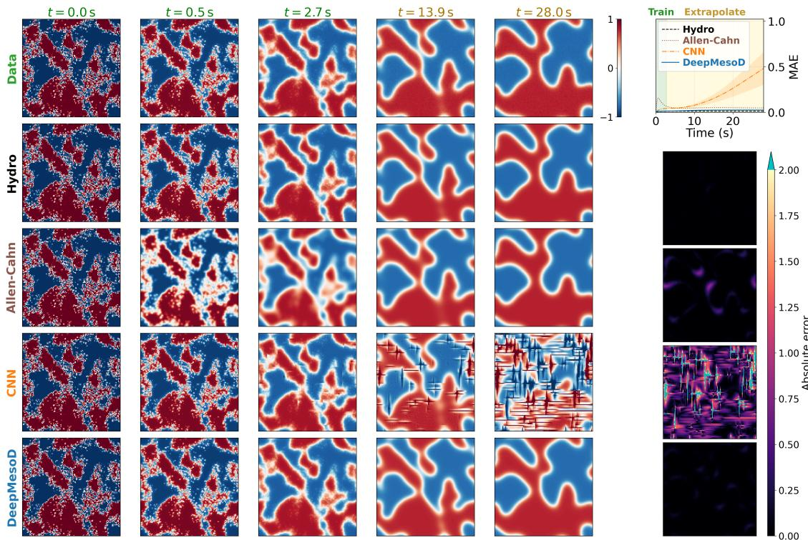  
Figure S1: Ising field evolution at $T = 0 . 7 5$ . The DeepMesoD rollouts are noise-free with the Itˆo thermal drift retained. Rows show the microscopic reference, the hydrodynamic-limit equation, the Allen–Cahn approximation, the patch CNN, and the final finite-range DeepMesoD model. All methods start from the same evaluation field, and the microscopic reference is the average of three independent realisations initialised from that field. Green column labels mark saved times inside the training duration. Ochre labels mark later rollout times. Every panel uses the display range [−1, 1]. Values outside this range in the two late CNN panels appear saturated.

At the fixed coarse-graining scale, the learned model retains comparable rollout errors on the larger periodic domains without retraining. Increasing the training portion from 10% to 50% slightly reduces the DeepMesoD error at $T = 0 . 7 5$ and leaves it nearly unchanged at $T = 1 . 5$

## H Spatial structure of the dissipation operator

Spatial coeficient magnitudes. Let $\mathcal { D } = \mathcal { S } _ { B } - \mathcal { S } _ { B }$ be the set of displacements induced by the finite-range factor. Let $s \in \{ 1 , 2 , 3 \}$ index the independently trained Stage 2 factors, and write $K _ { N } ^ { ( s ) }$ for the coordinate dissipation matrix produced by factor s. For each displacement $\mathbf { r } \in \mathcal { D }$ , we calculate the root-mean-square coordinate coeficient $K _ { \mathrm { R M S } } ( { \bf r } )$

$$
K _ { \mathrm { R M S } } ( \mathbf { r } ) = \left( \mathbb { E } _ { s , u , i } \Bigl [ \left[ K _ { N } ^ { ( s ) } ( u ) \right] _ { i , i + \mathbf { r } } ^ { 2 } \Bigr ] \right) ^ { 1 / 2 } .
$$

The expectation is the uniform empirical average over the three factor seeds, three independently generated evaluation trajectories, 24 sampled times from each trajectory, and every periodic cell index. At both temperatures, the RMS profile is dominated by the on-site coeficient, while all represented of-site ofsets are small on the common colour scale.

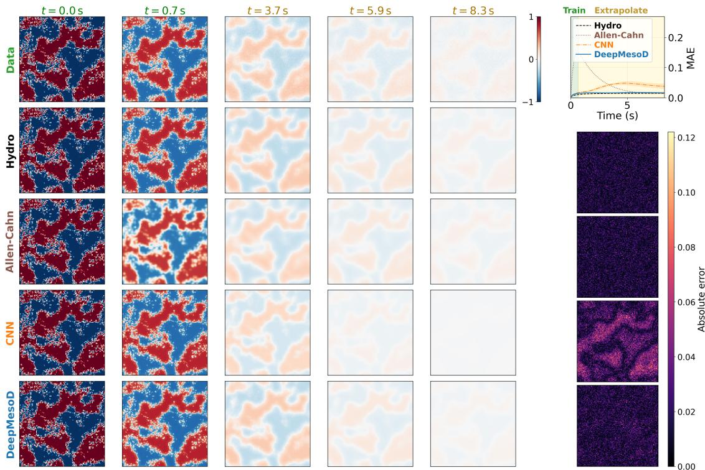  
Figure S2: Ising field evolution at $T = 1 . 5$ . The DeepMesoD rollouts are noise-free with the Itˆo thermal drift retained. Rows show the microscopic reference, the hydrodynamic-limit equation, the Allen–Cahn approximation, the patch CNN, and the final finite-range DeepMesoD model. All methods start from the same evaluation field, and the microscopic reference is the average of three independent realisations initialised from that field. Green column labels mark saved times inside the training duration. Ochre labels mark later rollout times. Every panel uses the display range [−1, 1].

## 3 Two-dimensional ferromagnet

## A Microscopic dynamics and coarse graining

The two-dimensional ferromagnet is simulated by atomistic spin dynamics. The same microscopic dynamical law is used for the layered $\mathrm { C r B r _ { 3 } }$ system described in the following section. At each magnetic site $i ,$ a classical unit spin $\mathbf { s } _ { i } \in \mathbb { S } ^ { 2 }$ carries magnetic moment $\mu _ { s }$ . The general microscopic Hamiltonian is

$$
{ \mathcal { H } } ( \mathbf { s } ) = - \sum _ { i < j } J _ { i j } \mathbf { s } _ { i } \cdot \mathbf { s } _ { j } - k _ { u } \sum _ { i } ( \mathbf { s } _ { i } \cdot \mathbf { e } ) ^ { 2 } - \mu _ { s } \sum _ { i } \mathbf { s } _ { i } \cdot \mathbf { B } + { \mathcal { H } } _ { \mathrm { d i p } } ,
$$

where $J _ { i j }$ denotes the exchange coupling, $k _ { u }$ is the uniaxial anisotropy about the easy axis $\mathbf { e } ,$ B is the applied field, and $\mathcal { H } _ { \mathrm { d i p } }$ is the dipolar interaction. The two systems difer in their lattice geometry and material parameters. In the $\mathrm { C r B r _ { 3 } }$ system, the stacking fault additionally changes the exchange coupling across one interface.

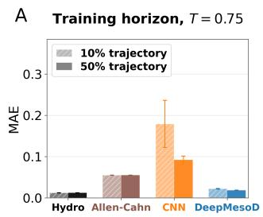

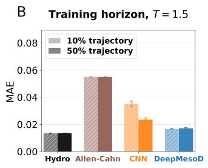

C  
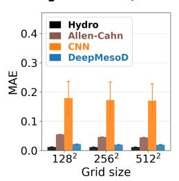

D  
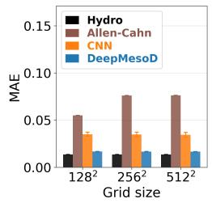  
Figure S3: Training-horizon and larger-domain diagnostics for the Stage 3 drift fit. The DeepMesoD rollouts are noise-free with the Itˆo thermal drift retained. The first two panels compare the hydrodynamic-limit equation, the Allen–Cahn approximation, the patch CNN, and DeepMesoD when the initial 10% or 50% of the recorded fields in each training trajectory is used. The last two panels compare the same methods on $1 2 8 \times 1 2 8 , 2 5 6 \times 2 5 6$ , and $5 1 2 \times 5 1 2$ periodic fields. The models are not retrained for the larger domains, and the mesoscopic cell scale and $V _ { c }$ remain fixed. Bars report the trajectory-averaged spatial MAE. Error bars for the learned models show one population standard deviation across three random seeds.

A  
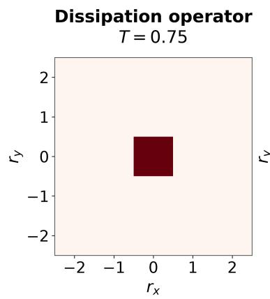  
B

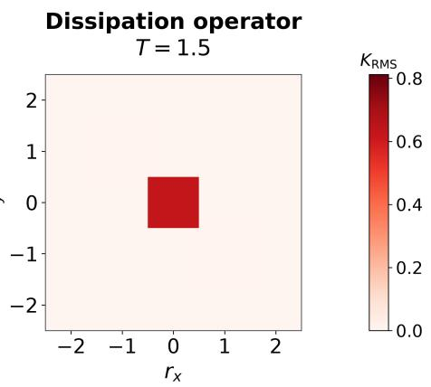  
Figure S4: Spatial structure of the learned Ising dissipation operator. The plots show $K _ { \mathrm { R M S } } ( { \bf r } )$ , computed from the coordinate realisation $K _ { N } ( u ) = B _ { N } ( u ) B _ { N } ( u ) ^ { \top }$ on evaluation fields. The RMS statistic reports coeficient magnitude without sign cancellation. The displayed $5 \times 5$ window is the complete coordinate support of $K _ { N }$ . The coeficient network uses a $1 5 \times 1 5$ field patch to determine these entries.

Each spin evolves according to the stochastic Landau–Lifshitz–Gilbert equation

$$
\begin{array} { r l r } & { \frac { d { \mathbf { s } } _ { i } } { d t } = - \frac { \gamma } { 1 + \alpha ^ { 2 } } { \mathbf { s } } _ { i } \times \left[ { \mathbf { H } } _ { i } + \alpha { \mathbf { s } } _ { i } \times { \mathbf { H } } _ { i } \right] , } & \\ & { \mathbf { H } _ { i } = - \frac { 1 } { \mu _ { s } } \frac { \partial \mathcal { H } } { \partial { \mathbf { s } } _ { i } } + \boldsymbol { \zeta } _ { i } . } & \end{array}
$$

Here $\gamma$ is the gyromagnetic ratio, α is the Gilbert damping, and $\zeta _ { i }$ is a zero-mean thermal field whose covariance is fixed by the microscopic fluctuation–dissipation relation at temperature T. The precessional and damping terms preserve $| { \bf s } _ { i } | = 1$ . We integrate this dynamics with VAMPIRE $\mathrm { v } 7 . 0 . 0 \ ( 2 )$ using the Heun scheme. For either system, the mesoscopic field in a cell $\mathcal { C } _ { i }$ containing $V _ { c }$ microscopic spins is the three-component block magnetisation

$$
\mathbf { m } _ { i } ( t ) = \frac { 1 } { V _ { c } } \sum _ { j \in \mathcal { C } _ { i } } \mathbf { s } _ { j } ( t ) \in \mathbb { R } ^ { 3 } , \qquad | \mathbf { m } _ { i } ( t ) | \leq 1 .
$$

System and coarse-graining parameters. The two-dimensional reference system specialises the Hamiltonian above to nearest-neighbour ferromagnetic exchange and easy-axis anisotropy,

$$
{ \mathcal { H } } _ { \mathrm { 2 D } } ( \mathbf { s } ) = - { \frac { 1 } { 2 } } \sum _ { \langle i , j \rangle } J \mathbf { s } _ { i } \cdot \mathbf { s } _ { j } - K _ { u } \sum _ { i } ( s _ { i } ^ { z } ) ^ { 2 } .
$$

The parameters are $J = 1 . 0 \times 1 0 ^ { - 2 1 } \mathrm { J } , K _ { u } = 5 . 0 \times 1 0 ^ { - 2 3 } \mathrm { J } / \mathrm { a t o m }$ , and $\mu _ { s } = 3 . 0 \mu _ { B }$ , following Ref. (3). The Gilbert damping is $\alpha = 1$ , and the applied field is zero. The system is a $1 0 2 4 \times 1 0 2 4$ monolayer at temperature $T = 1 0 \mathrm { K }$ . The microscopic integration step is 0.1 fs, and the trajectory is sampled at 1 ps intervals. Ten independent trajectories are initialised from random spin configurations and evolved for $2 . 5 \times 1 0 ^ { 6 }$ integration steps (250 ps). Frames from 75 to 150 ps are used to estimate the drift and free energy, the first 150 ps are used to estimate the dissipation, and the 150–250 ps segments of these same trajectories are reserved for later-time evaluation. Nonoverlapping 16 × 16 blocks give $V _ { c } = 2 5 6$ and map the microscopic lattice to a $6 4 \times 6 4$ mesoscopic vector field. Consecutive saved fields provide the 1 ps forward increments used in estimation.

## B Assessment of reversible dynamics under coarse graining

In the present work, we restrict attention to the easy-axis magnetisation $m _ { z }$ and represent its coarse grained evolution by Model-A dynamics. The microscopic stochastic LLG equation also contains reversible precession, so this representation requires that reversible motion make no appreciable contribution to the coarse-grained $m _ { z }$ channel. Our claim is that block averaging suppresses spatially incoherent transverse precession, while any coherent precession that remains is a rotation about the easy axis and hence changes $( m _ { x } , m _ { y } )$ without changing $m _ { z } .$

To test this claim, we measure four complementary quantities: the transverse angular velocity, antisymmetric cross-correlations between magnetisation components, the dependence of highfrequency transverse spin-wave power on the coarse-graining volume $V _ { c } ,$ and the circular polarisation and frequency of the surviving transverse motion. Together, these quantities test both parts of the claim: whether incoherent precession is suppressed by coarse graining and whether the remaining reversible motion couples to $m _ { z }$

Reversible rotation in the transverse $( m _ { x } , m _ { y } )$ plane is measured by the domain-sign-weighted angular velocity

$$
\omega _ { \mathrm { p r e c } } = \frac { \langle \mathrm { s i g n } ( \langle m _ { z , i } \rangle _ { t } ) \left( m _ { x , i } \partial _ { t } m _ { y , i } - m _ { y , i } \partial _ { t } m _ { x , i } \right) \rangle _ { i , t } } { \left. m _ { x , i } ^ { 2 } + m _ { y , i } ^ { 2 } \right. _ { i , t } } .
$$

Here i indexes coarse cells and $\langle \cdot \rangle _ { t }$ denotes a temporal average. The domain-sign factor aligns the opposite precessional handedness of up- and down-magnetised domains before averaging.

More generally, we compute the antisymmetric cross-correlations

$$
J _ { a b } = \frac { \langle \mathrm { s i g n } ( \langle m _ { z , i } \rangle _ { t } ) \left( \delta m _ { a , i } \partial _ { t } m _ { b , i } - \delta m _ { b , i } \partial _ { t } m _ { a , i } \right) \rangle _ { i , t } } { \sigma _ { a } \sigma _ { b } } , \qquad \delta m _ { a , i } = m _ { a , i } - \langle m _ { a , i } \rangle _ { t } ,
$$

where $\sigma _ { a }$ is the standard deviation of component a. The in-plane quantity $J _ { x y }$ probes transverse rotation, while $J _ { z x }$ and $J _ { z y }$ test whether reversible motion couples directly to the coarse-grained $m _ { z }$ channel.

To determine how spatial averaging afects incoherent precession, we measure the transverse spin-wave power over a high-frequency band,

$$
P _ { \mathrm { S W } } ( V _ { c } ) = \int _ { 1 0 0 \mathrm { G H z } } ^ { 5 0 0 \mathrm { G H z } } \left[ | \widetilde { m } _ { x } ( f ; V _ { c } ) | ^ { 2 } + | \widetilde { m } _ { y } ( f ; V _ { c } ) | ^ { 2 } \right] d f ,
$$

and compare $P _ { \mathrm { S W } } ( V _ { c } ) / P _ { \mathrm { S W } } ( 1 )$ across block sizes. This isolates the suppression of spatially incoherent transverse modes by coarse graining.

The handedness and frequency of the transverse motion that remains after coarse graining are characterised by the circularly polarised spectrum

$$
P _ { \mathrm { c i r c } } ( f ) = | \widetilde { m } _ { x } ( f ) + \mathrm { i } \widetilde { m } _ { y } ( f ) | ^ { 2 } - | \widetilde { m } _ { x } ( f ) - \mathrm { i } \widetilde { m } _ { y } ( f ) | ^ { 2 }
$$

and its power-weighted mean frequency

$$
{ \overline { { f } } } _ { \mathrm { p r e c } } = { \frac { \int f \left| P _ { \mathrm { c i r c } } ( f ) \right| d f } { \int \left| P _ { \mathrm { c i r c } } ( f ) \right| d f } } .
$$

Together, these quantities distinguish incoherent spin-wave dephasing from coherent rotation and determine whether either contribution produces a reversible component in the coarse-grained $m _ { z }$ dynamics.

Upon spatial coarse-graining, both the high-frequency and relaxational spectral powers decrease approximately inversely with the block volume, indicating that incoherent fluctuations are progressively averaged out. A coherent, single-handed precession about the z axis nevertheless remains identifiable, with a mean frequency of $5 . 4 2 \mathrm { G H z }$ , corresponding to an efective field of 193.3±1.5 mT. Importantly, the associated reversible coupling is confined to the transverse $m _ { x } – m _ { y }$ plane: $J _ { x y }$ is finite, whereas $J _ { z x }$ and $J _ { z y }$ are statistically consistent with zero. Thus, although transverse spins precess coherently, this motion does not generate a reversible contribution to the longitudinal $m _ { z }$ dynamics, supporting an efective Model-A description of the $m _ { z }$ channel.

## C Implementation

## C.1 Stage 1: conditional drift

Stage 1 estimates the conditional mean of the coarse-field increments. At cell i, the drift model is

$$
\widehat { \mathbf { a } } _ { \eta } ( \mathbf { m } ) _ { i } = \mathrm { M L P } _ { \eta } \left( \mathbf { m } _ { i } , ( \widehat { J } ^ { ( 1 ) } \mathbf { m } ) _ { i } , \beta , h \right) ,
$$

where ${ \widehat J } ^ { ( 1 ) }$ is a learned $1 3 \times 1 3$ circular-convolution kernel. The same spatial kernel is applied componentwise to $m _ { x } , m _ { y }$ , and $m _ { z }$ . Thus, the pointwise input to the MLP is

$$
\begin{array} { r } { \left[ m _ { x } , m _ { y } , m _ { z } , ( \widehat { J } ^ { ( 1 ) } \mathbf { m } ) _ { x } , ( \widehat { J } ^ { ( 1 ) } \mathbf { m } ) _ { y } , ( \widehat { J } ^ { ( 1 ) } \mathbf { m } ) _ { z } , \beta , h \right] \in \mathbb { R } ^ { 8 } . } \end{array}
$$

The MLP has three hidden layers of width 64, with tanh activations, and a three-dimensional output.

For two consecutive saved fields $\mathbf { m } ^ { n } = \mathbf { m } ( t _ { n } )$ and $\mathbf { m } ^ { n + 1 } = \mathbf { m } ( t _ { n + 1 } )$ , let

$$
\mathbf { d } ^ { n } = { \frac { \mathbf { m } ^ { n + 1 } - \mathbf { m } ^ { n } } { \Delta t _ { n } } } , \qquad \Delta t _ { n } = t _ { n + 1 } - t _ { n } .
$$

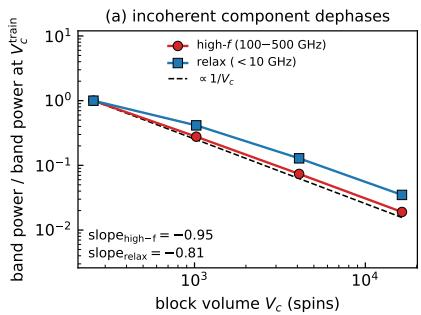

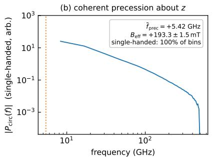

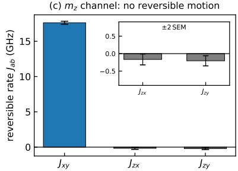  
Figure S5: Validation of the efective Model-A description for the longitudinal magnetisation $m _ { z }$ in a two-dimensional ferromagnet with large damping. (a) The spectral power in both the highfrequency (100–500 GHz) and relaxational (< 10 GHz) bands decreases with the coarse-graining volume $V _ { c } ,$ with fitted exponents −0.95 and −0.81, respectively, close to the $V _ { c } ^ { - 1 }$ scaling expected for incoherent fluctuations. (b) The circularly polarised spectrum reveals a coherent, single-handed precession about the z axis, with mean frequency $\bar { f } _ { \mathrm { p r e c } } = + 5 . 4 2 \mathrm { G H z }$ , corresponding to $B _ { \mathrm { e f f } } ~ =$ $1 9 3 . 3 { \pm } 1 . 5 { \mathrm { m T } }$ . (c) The inferred reversible generator is dominated by $J _ { x y }$ , which describes rotation within the transverse $m _ { x } – m _ { y }$ plane, while $J _ { z x }$ and $J _ { z y }$ remain consistent with zero (inset, with error bars denoting ±2 SEM). The coherent transverse precession therefore produces no reversible motion in the $m _ { z }$ channel. Results are obtained from VAMPIRE simulations with $1 6 \times 1 6$ coarsegraining blocks, $V _ { c } = 2 5 6$ , and 10 independent seeds.

The convolution and MLP are trained jointly by the mean-squared error between $\mathbf { d } ^ { n }$ and $\widehat { \mathbf { a } } _ { \eta } ( \mathbf { m } ^ { n } )$ No additional regularisation term is used. Stage 1 is used only to estimate the conditional mean that is subtracted from the increments in Stage 2. Neither its MLP nor its auxiliary kernel ${ \widehat J } ^ { ( 1 ) }$ enters the final mesoscopic equation.

## C.2 Stage 2: dissipation factor

Stage 2 freezes the Stage 1 model and learns a finite-range factor $B _ { h } [ \mathbf { m } ]$ . The dissipation operator is defined by

$$
K _ { h } [ { \bf m } ] = B _ { h } [ { \bf m } ] B _ { h } [ { \bf m } ] ^ { \top } ,
$$

which makes it symmetric and positive semidefinite by construction. The factor acts on a threecomponent latent field $\boldsymbol { \xi }$ over the radius-one ofset set

$$
\begin{array} { r } { { \cal S } _ { B } = \{ - 1 , 0 , 1 \} ^ { 2 } . } \end{array}
$$

Its coordinate action is

$$
\left[ B _ { h } ( \mathbf { m } ) \pmb { \xi } \right] _ { i } ^ { a } = \sum _ { s \in \mathscr { S } _ { B } } \sum _ { c = 1 } ^ { 3 } b _ { i } ( s ; \mathbf { m } ) ^ { a c } \xi _ { i + s } ^ { c } , \qquad b _ { i } ( s ; \mathbf { m } ) \in \mathbb { R } ^ { 3 \times 3 } .
$$

A three-layer circular CNN reads the local magnetisation environment and returns one $3 \times 3$ matrix for each of the nine ofsets, or $9 \times 3 \times 3 = 8 1$ coeficients at every cell.

For a displacement $d ,$ the corresponding $3 \times 3$ block of the dissipation operator is

$$
\left[ K _ { h } ( \mathbf { m } ) \right] _ { i , i + d } ^ { a e } = \sum _ { s \in \cal { S } _ { B } } \sum _ { c = 1 } ^ { 3 } b _ { i } ( s ; \mathbf { m } ) ^ { a c } b _ { i + d } ( s - d ; \mathbf { m } ) ^ { e c } ,
$$

where a factor coeficient is zero when its ofset lies outside $\scriptstyle { S _ { B } }$ . Because $B _ { h }$ has radius one, $K _ { h }$ has maximum radius two.

The covariance observation window has radius one,

$$
\mathcal { W } _ { i } = i + \{ - 1 , 0 , 1 \} ^ { 2 } .
$$

It therefore contains nine cells and $d _ { \mathscr { W } } = 3 | \mathscr { W } | = 2 7$ scalar field entries. Let $K _ { h , \mathcal { W } }$ be the corresponding principal covariance block of the complete periodic operator. Conditional on $\mathbf { m } ^ { n }$ , Stage 2 models the short-time increment as

$$
\Delta { \mathbf { m } } _ { \mathcal { W } } ^ { n } \sim \mathcal { N } ( \Delta t _ { n } \hat { \mathbf { a } } _ { \eta , \mathcal { W } } ( { \mathbf { m } } ^ { n } ) , \Sigma _ { \mathcal { W } } ^ { n } ) , \qquad \Sigma _ { \mathcal { W } } ^ { n } = \frac { 2 \Delta t _ { n } } { \beta V _ { c } } K _ { h , \mathcal { W } } [ { \mathbf { m } } ^ { n } ] .
$$

With

$$
\mathbf { r } _ { \mathcal { W } } ^ { n } = \Delta \mathbf { m } _ { \mathcal { W } } ^ { n } - \Delta t _ { n } \widehat { \mathbf { a } } _ { \eta , \mathcal { W } } ( \mathbf { m } ^ { n } ) ,
$$

the factor is fitted by the full-covariance Gaussian negative log-likelihood

$$
\mathcal { L } _ { K } = \frac { 1 } { 2 d _ { \mathcal { W } } } \mathbb { E } \Big [ \log \operatorname* { d e t } \Sigma _ { \mathcal { W } } ^ { n } + ( \mathbf { r } _ { \mathcal { W } } ^ { n } ) ^ { \mathsf { T } } ( \Sigma _ { \mathcal { W } } ^ { n } ) ^ { - 1 } \mathbf { r } _ { \mathcal { W } } ^ { n } \Big ] .
$$

The normalised quadratic residual of the fitted model is

$$
\frac { 1 } { d _ { \mathcal { W } } } \mathbb { E } \Big [ ( { \bf r } _ { \mathcal { W } } ^ { n } ) ^ { \top } ( \Sigma _ { \mathcal { W } } ^ { n } ) ^ { - 1 } { \bf r } _ { \mathcal { W } } ^ { n } \Big ] \simeq 1 . 0 1 9 ,
$$

close to the unit value expected when the learned covariance has the correct noise scale.

The learned operator is strongly localised . To quantify its spatial structure, define the distancebinned block magnitude relative to the on-site block by

$$
R _ { K } ( d ) = \frac { \mathbb { E } _ { i , \mathbf { m } , | r | = d } \left\| [ K _ { h } ( \mathbf { m } ) ] _ { i , i + r } \right\| _ { \mathrm { F } } } { \mathbb { E } _ { i , \mathbf { m } } \left\| [ K _ { h } ( \mathbf { m } ) ] _ { i , i } \right\| _ { \mathrm { F } } } .
$$

The measured value is approximately $R _ { K } ( 1 ) = 4 . 2 \%$ , while the represented couplings at larger distances decrease rapidly to below 0.5%.

## C.3 Stage 3: free energy and interaction

Stage 3 freezes the fitted factor $B _ { h }$ , and hence $K _ { h }$ , while jointly learning the free-energy density and the final interaction kernel. The free energy is

$$
\mathcal { F } _ { \boldsymbol { \theta } , J } [ \mathbf { m } ] = \sum _ { \boldsymbol { y } } \Psi _ { \boldsymbol { \theta } } \Big ( \mathbf { m } _ { \boldsymbol { y } } , ( \widehat { J } ^ { ( 3 ) } \mathbf { m } ) _ { \boldsymbol { y } } , \boldsymbol { \beta } , \boldsymbol { h } \Big ) .
$$

Here ${ \widehat J } ^ { ( 3 ) }$ is a learned $1 3 \times 1 3$ circular convolution applied componentwise to the three magnetisation components. It is initialised and trained independently of the auxiliary Stage 1 kernel ${ \widehat J } ^ { ( 1 ) }$ . The local density $\Psi _ { \theta }$ , the system-specific energy density corresponding to $\rho _ { \theta }$ in the general formulation, is an MLP with three hidden layers of width 64, tanh activations, and one scalar output.

Let $\ell = \widehat { J } ^ { ( 3 ) } \mathbf { m }$ , and let $\partial _ { 1 } \Psi _ { \theta }$ and $\partial _ { 2 } \Psi _ { \theta }$ denote derivatives with respect to the local magnetisation and interaction-field inputs, respectively. The thermodynamic force is obtained by diferentiating the complete free energy:

$$
\mathbf { g } _ { \theta , J } ( x ) = \frac { \delta { \mathcal { F } } _ { \theta , J } } { \delta \mathbf { m } ( x ) } = \partial _ { 1 } \Psi _ { \theta } ( \mathbf { m } _ { x } , { \boldsymbol { \ell } } _ { x } , { \boldsymbol { \beta } } , h ) + \left[ ( \widetilde { J } ^ { ( 3 ) } ) ^ { \top } \partial _ { 2 } { \Psi } _ { \theta } ( \mathbf { m } , { \boldsymbol { \ell } } , { \boldsymbol { \beta } } , h ) \right] _ { x } .
$$

Thus, diferentiation includes both the direct dependence on ${ \bf m } _ { x }$ and the dependence of neighbouring energy densities on $\mathbf { m } _ { x }$ through the convolution.

The conditional drift of the final finite- $V _ { c }$ equation is

$$
\mathbf { a } _ { \theta } ( \mathbf { m } ) = - K _ { h } [ \mathbf { m } ] \mathbf { g } _ { \theta , J } ( \mathbf { m } ) + \frac { 1 } { \beta V _ { c } } \mathrm { D i v } _ { \mathbf { m } } K _ { h } [ \mathbf { m } ] .
$$

Noise-free prediction integrates m˙ ${ \bf \mu } = { \bf a } _ { \theta } ( { \bf m } )$ , retaining the thermal drift while setting the Wiener increment to zero. Writing $\varepsilon = ( \beta V _ { c } ) ^ { - 1 }$ , its continuous-time energy balance is

$$
\frac { d \mathcal { F } _ { \theta , J } } { d t } = - \mathbf { g } _ { \theta , J } ^ { \mathsf { T } } K _ { h } \mathbf { g } _ { \theta , J } + \varepsilon \mathbf { g } _ { \theta , J } ^ { \mathsf { T } } \mathrm { D i v } _ { \mathbf { m } } K _ { h } .
$$

Only the first term is necessarily nonpositive. Thus, these predictions are distinct from pure gradient flow, which omits both thermal drift and noise, and from the full stochastic model, which retains both. Neither the noise-free prediction nor the full stochastic model has a general pathwise free-energy descent guarantee.

For an observed rate $\mathbf { d } ^ { n }$ , define

$$
\mathbf { q } ^ { n } = { \frac { 1 } { \beta V _ { c } } } \operatorname { D i v } _ { \mathbf { m } } K _ { h } [ \mathbf { m } ^ { n } ] - \mathbf { d } ^ { n } .
$$

The quantity $K _ { h } [ \mathbf { m } ^ { n } ] \mathbf { g } _ { \theta , J } ( \mathbf { m } ^ { n } ) - \mathbf { q } ^ { n }$ is a training residual, not a samplewise physical identity: the observed rate contains stochastic fluctuations and finite-lag error relative to the conditional drift. Stage 3 minimises its normalised mean-square loss

$$
\mathcal { L } _ { \mathcal { F } , J } = \frac { \mathbb { E } \Big [ \| K _ { h } [ \mathbf { m } ^ { n } ] \mathbf { g } _ { \theta , J } ( \mathbf { m } ^ { n } ) - \mathbf { q } ^ { n } \| ^ { 2 } \Big ] } { \mathrm { r m s } ( \mathbf { q } ) ^ { 2 } } .
$$

The action of the dissipation operator is evaluated matrix-free as

$$
K _ { h } \mathbf { g } _ { \boldsymbol { \theta } , J } = B _ { h } \Big ( B _ { h } ^ { \mathsf { T } } \mathbf { g } _ { \boldsymbol { \theta } , J } \Big ) ,
$$

so the complete matrix $K _ { h }$ is never explicitly assembled.

## C.4 Optimisation schedule

The three stages are trained sequentially for 3000, 1000, and 3000 epochs, respectively. Every stage starts with learning rate $1 0 ^ { - 3 }$ . The learning rate is decayed by a factor of 0.5 every 300 epochs in Stage 1, every 100 epochs in Stage 2, and every 300 epochs in Stage 3. The Stage 1 checkpoint is frozen for Stage 2, and the fitted Stage 2 factor is frozen for Stage 3. The Stage 1 auxiliary kernel and Stage 3 interaction kernel are initialised and trained independently.

## D Evaluation field rollouts

We evaluate the learned dynamics on three qualitatively diferent initial conditions. The first uses random initial spins and is therefore consistent with the distribution represented in the training trajectories. Following a rapid quench, the system evolves from a highly disordered state with many small domains towards a state dominated by larger domains. Figure S6 illustrates this evolution. The drift and free-energy components are trained using the interval from 75 to 150 ps, while DeepMesoD remains accurate when extrapolated to 250 ps. In contrast, both the FNO and the patch CNN develop substantial errors during the extrapolation interval, with the FNO becoming unstable most rapidly.

The domain-wall initial condition tests whether the learned dynamics preserve a coherent interface over long times. Figure S8 illustrates that DeepMesoD maintains the position and structure of the wall through 1000 ps, whereas the two unstructured baselines progressively diverge from the atomistic reference. The triangular-domain initial condition provides a complementary test of relaxation towards the negative, uniformly magnetised state. As shown in Figure S7, DeepMesoD reproduces the expected contraction of the minority domain and its eventual disappearance, while the FNO and CNN again accumulate large errors during the rollout. Reference-based errors for the triangular-domain initial condition are evaluated only over 0–1000 ps. The main text also shows a rollout to 25,000 ps. Beyond 1000 ps, only numerical stability, boundedness, and qualitative relaxation are assessed because no atomistic reference is available.

Together, these tests cover evolution from a disordered state, persistence of a sharp domain wall, and curvature-driven relaxation to equilibrium. Accuracy comparisons are restricted to intervals with atomistic references. The later segments of the random-initial-state trajectories assess temporal extrapolation, while triangular-domain and domain-wall initial conditions assess geometricinitial-condition extrapolation.

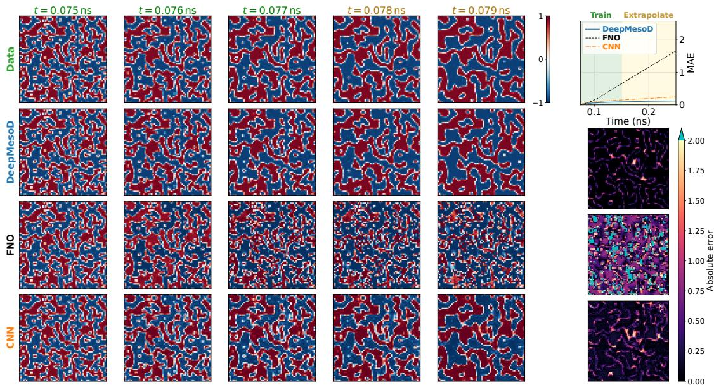  
Figure S6: Random-initial-condition rollout for the two-dimensional ferromagnet. The DeepMesoD rollout is noise-free with the Itˆo thermal drift retained. Each column shows a saved time, with green labels marking times within the training-data interval and ochre labels marking extrapolated times. Rows show the atomistic reference, the finite-range DeepMesoD model, the Fourier neural operator (FNO), and the patch CNN. The reference is the mean of independent atomistic realisations initialised from the same coarse field. The right-hand panels show the rollout MAE and the corresponding absolute-error fields. All magnetisation fields use the display range [−1, 1].

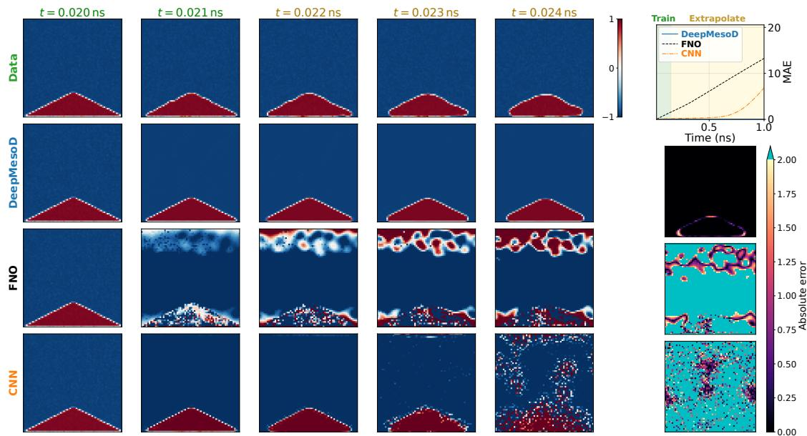  
Figure S7: Triangular-domain rollout for the two-dimensional ferromagnet. The DeepMesoD rollout is noise-free with the Itˆo thermal drift retained. The triangular minority domain is evolved from the same initial condition by the atomistic reference, DeepMesoD, the $\mathrm { F N O } ,$ and the patch CNN. Green and ochre labels distinguish times before and after the 150 ps training horizon of the random-initial-state data. Neither colour indicates that triangular-domain data entered training. Comparisons with the atomistic reference are restricted to 0–1000 ps. DeepMesoD reproduces the domain evolution over this reference interval, whereas the unconstrained baselines develop substantially larger errors. The right-hand panels show the rollout MAE and absolute-error fields only where atomistic reference data are available. All magnetisation fields use the display range [−1, 1].

## 4 $\mathbf { C r B r _ { 3 } }$ film with a stacking fault

## A Microscopic dynamics and coarse graining

The $\mathrm { C r B r _ { 3 } }$ calculations use the same classical-spin Hamiltonian, stochastic LLG dynamics, VAM-PIRE v7.0.0 Heun integrator, and block-average definition introduced for the two-dimensional ferromagnet above.

$\mathrm { C r B r _ { 3 } }$ is represented by its magnetic $\mathrm { C r ^ { 3 + } }$ sublattice only. Br-mediated superexchange is incorporated into efective exchange constants. The Cr sites form a honeycomb lattice with in-plane hexagonal lattice constant $a = 6 . 2 6 \mathrm { \AA }$ , nearest-neighbour Cr–Cr distance

$$
d = { \frac { a } { \sqrt { 3 } } } = 3 . 6 1 \mathrm { { \AA } } ,
$$

and a rectangular four-atom unit cell of dimensions $a \times { \sqrt { 3 } } a$ . These cells are stacked with an interlayer spacing $c = 6 . 1 2 \mathrm { \AA }$ . Each $\mathrm { C r ^ { 3 + } }$ site has $S = 3 / 2 .$ , carries $\mu _ { s } = 3 . 0 2 \mu _ { B }$ , and has uniaxial anisotropy $k _ { u } = 8 . 9 3 \times 1 0 ^ { - 2 4 } \mathrm { J } _ { / }$ /atom along the out-of-plane (001) easy axis. The Gilbert damping is $\alpha = 0 . 1$

The exchange parameters are the intralayer nearest-neighbour coupling $J _ { 1 } = 2 . 1 2 \times 1 0 ^ { - 2 1 } \mathrm { { J } }$ 2 the ferromagnetic bulk interlayer coupling $J _ { c } = 3 . 5 9 \times 1 0 ^ { - 2 2 } \mathrm { J } / \mathrm { a t o m }$ , and the antiferromagnetic stacking-fault coupling $J _ { f } = - 2 . 7 7 \times 1 0 ^ { - 2 3 } \mathrm { J } / \mathrm { a t o m }$ . The film contains 84 atomic layers, corresponding to a thickness of 51.4 nm, with a single antiferromagnetic stacking fault at the midplane separating two 42-layer blocks. The upper block is shifted in-plane by one nearest-neighbour vector, changing the interlayer bond topology relative to the bulk stacking, and the coupling across this interface is set to $J _ { f }$ . Periodic boundary conditions are imposed in x and $y ,$ with lateral sizes from 200 to 800 nm, while the two surfaces in z are open. The $2 0 0 \times 2 0 0 \times 5 1 . 4 \mathrm { n m ^ { 3 } }$ reference film contains approximately $2 \times 1 0 ^ { 7 }$ microscopic spins.

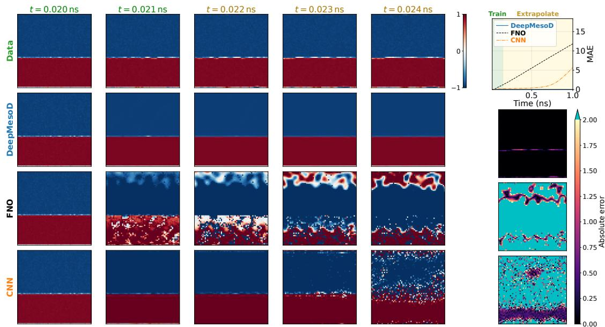  
Figure S8: Domain-wall rollout for the two-dimensional ferromagnet. The DeepMesoD rollout is noise-free with the Itˆo thermal drift retained. Time-label colours refer to the randominitial-state training horizon and do not indicate training on domain-wall data. The initial configuration contains a nearly planar domain wall separating oppositely magnetised regions. Rows compare the atomistic reference, DeepMesoD, the FNO, and the patch CNN over the observed and extrapolated time intervals. DeepMesoD maintains the position and morphology of the wall, while the baseline models accumulate larger deviations during extrapolation. The right-hand panels show the rollout MAE and absolute-error fields only where atomistic reference data are available. All magnetisation fields use the display range [−1, 1].

Each trajectory begins from an independently sampled random spin configuration. At $t = 0$ the system is instantaneously quenched to $T = 5 0 \mathrm { K }$ at zero applied field and then integrated for $2 . 5 \times 1 0 ^ { 5 }$ steps with a 2 fs time step, giving a total duration of $5 0 0 \mathrm { p s }$ . Ten statistically independent trajectories are generated, using a distinct random seed for both the initial spin configuration and the thermal integrator noise in every trajectory. Full atomic spin configurations and cell-averaged magnetisation fields are saved every $2$ ps.

For coarse graining, the Cr moments are averaged over nonoverlapping $5 . 0 1 \times 5 . 4 2 \times 1 . 8 4 \mathrm { n m ^ { 3 } }$ cells. Each slab spans three atomic layers, and the learning calculation uses $V _ { c } = 4 8 0$ . The in-plane cell spacings difer by $7 . 6 \%$ , a geometric anisotropy retained in the learned grid-index kernels. For the $2 0 0 \times 2 0 0 \times 5 1 . 4 \mathrm { n m ^ { 3 } }$ reference film, this gives a $4 0 \times 3 7 \times 2 8$ mesoscopic vector field with 251 saved frames per trajectory. Consecutive fields provide the $2 \mathrm { p s }$ forward increments.

The quantities used to assess reversible motion in $\mathrm { C r B r _ { 3 } }$ follow the definitions introduced in section B for the two-dimensional ferromagnet. The high-frequency transverse power decreases nearly inversely with the block volume, whereas the low-frequency relaxational power is much less sensitive to coarse graining. This contrast shows that block averaging selectively suppresses spatially incoherent precession while retaining the slow collective dynamics. The surviving transverse motion is single-handed and corresponds to coherent precession about the z axis at $\bar { f } _ { \mathrm { p r e c } } = 3 . 5 3 \mathrm { G H z }$ . The antisymmetric correlation rates $J _ { z x }$ and $J _ { z y }$ are statistically consistent with zero, while $J _ { x y }$ remains finite. These diagnostics support the dissipative description of the longitudinal magnetisation at the chosen coarse-graining scale.

Model-A validation of the m channel CrBr (VAMPIRE, 84 layers, lattice blocks $V _ { c } = 4 8 0 ) .$ , 10 seeds

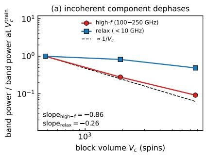

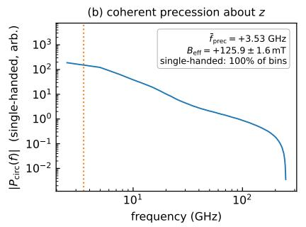

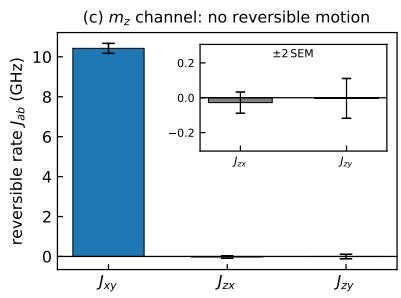  
Figure S9: Validation of the efective Model-A description for the longitudinal magnetisation $m _ { \cdot }$ z in the layered $\mathrm { C r B r _ { 3 } }$ film. (a) The normalised high-frequency transverse spectral power (100–250 GHz) decreases with coarse-graining volume $V _ { c }$ with a fitted exponent of −0.86, close to the $V _ { c } ^ { - 1 }$ scaling expected for spatially incoherent fluctuations. In contrast, the low-frequency relaxational power (< 10 GHz) decreases more slowly, with a fitted exponent of −0.26. (b) The circularly polarised spectrum identifies a coherent, single-handed precession about the z axis, with mean frequency $\bar { f } _ { \mathrm { p r e c } } = + 3 . 5 3 \mathrm { G H z } ,$ corresponding to an efective field $B _ { \mathrm { e f f } } = 1 2 5 . 9 { \pm } 1 . 6 \mathrm { m T }$ . (c) The antisymmetric correlation rate is dominated by $J _ { x y }$ , which describes rotation in the transverse $m _ { x } – m _ { y }$ plane, whereas $J _ { z x }$ and $J _ { z y }$ are consistent with zero (inset, with error bars denoting ±2 SEM). The coherent transverse precession therefore generates no detectable reversible motion in the $m _ { z }$ channel. Results are obtained from VAMPIRE simulations of the 84-layer film using lattice-commensurate blocks with the training coarse-graining volume $V _ { c } = 4 8 0$ and 10 independent seeds.

## B Implementation

Here m collects the coarse-cell magnetisations, and $B _ { N } ( \mathbf { m } )$ and $K _ { N } ( { \bf m } )$ denote the corresponding numerical factor and dissipation matrices. The $\mathrm { C r B r _ { 3 } }$ model follows the same three-stage construction as the two-dimensional ferromagnet: Stage 1 estimates the conditional drift, Stage 2 learns the factorised dissipation operator $K _ { N } = B _ { N } B _ { N } ^ { \sf T }$ , and Stage 3 learns the free energy and interaction with the fitted factor parameters held fixed. The principal change is the treatment of the third spatial direction. The interaction kernel couples diferent slabs and can therefore represent surfaces and the stacking fault, whereas the finite-range dissipation factor acts independently within each slab. The working model uses $\beta = 0 . 0 2 , V _ { c } = 4 8 0$ , and $h = 0$ during training. The numerical time unit is ns.

## B.1 Factorised three-dimensional interaction kernel

Let $\mathbf { x } = ( x , y )$ index an in-plane coarse cell and let $z \in \{ 1 , \dots , L _ { z } \}$ , with $L _ { z } = 2 8$ , index the coarse slabs. Slab z contains atomic layers $3 z - 2 , 3 z - 1$ , and 3z in one-based numbering. The midplane

fault separates atomic layers 42 and 43, hence coarse slabs 14 and 15 in this notation, or slabs 13 and 14 in the zero-based numbering used in the main text. In Stages 1 and 3, the interaction is parametrised as

$$
J ( z _ { \mathrm { o u t } } , z _ { \mathrm { i n } } , r ) = J _ { z } ( z _ { \mathrm { o u t } } , z _ { \mathrm { i n } } ) J _ { x y } ( r ) , \qquad r \in \{ - 3 , \ldots , 3 \} ^ { 2 } ,
$$

and is applied componentwise to the three magnetisation components:

$$
( J \mathbf { m } ) _ { \mathbf { x } , z } = \sum _ { z ^ { \prime } = 1 } ^ { L _ { z } } J _ { z } ( z , z ^ { \prime } ) \sum _ { r \in \{ - 3 , \ldots , 3 \} ^ { 2 } } J _ { x y } ( r ) \mathbf { m } _ { \mathbf { x } + r , z ^ { \prime } } .
$$

The shared $7 \times 7$ in-plane profile $J _ { x y }$ uses circular padding in x and y and is normalised to unit sum. Here $J _ { x y }$ is the spatial kernel of the main text, distinct from the antisymmetric correlation rates $J _ { a b }$ used above. The layer matrix $J _ { z } \in \mathbb { R } ^ { 2 8 \times 2 8 }$ is symmetric but is not normalised . The full layer matrix allows the learned interaction to vary at the two free surfaces and across the film midplane. Neither the location nor the coupling of the stacking fault is supplied during training. Because the coarse cells have unequal in-plane spacings, all kernels are learned in grid-index coordinates and the resulting geometric anisotropy is absorbed by $J _ { x y }$

## B.2 Stage 1: conditional drift

Stage 1 uses an independently initialised factorised kernel $J ^ { ( 1 ) }$ and models the conditional drift as

$$
\widehat { \mathbf { a } } _ { \eta } ( \mathbf { m } ) _ { \mathbf { x } , z } = \mathrm { M L P } _ { \eta } \left( \mathbf { m } _ { \mathbf { x } , z } , ( J ^ { ( 1 ) } \mathbf { m } ) _ { \mathbf { x } , z } \right) \in \mathbb { R } ^ { 3 } .
$$

Since $\beta$ and h are fixed in this dataset, they are not included as network inputs. The six input coordinates are $[ \mathbf { m } , J ^ { ( 1 ) } \mathbf { m } ]$ . The same MLP is shared over all slabs. It has three hidden layers of width 64, tanh activations, and a three-dimensional output. Thus all explicit layer dependence enters through the learned matrix $J _ { z } ^ { ( 1 ) }$

The regression target is the one-frame drift estimate

$$
\mathbf { d } ^ { n } = \frac { \mathbf { m } ^ { n + 1 } - \mathbf { m } ^ { n } } { \Delta t } , \qquad \Delta t = 0 . 0 0 2 \mathrm { n s } .
$$

The convolution and MLP are trained jointly by the mean-squared error between $\mathbf { d } ^ { n }$ and $\widehat { \mathbf { a } } _ { \eta } ( \mathbf { m } ^ { n } )$ Stage 1 is trained on frames $5 0 \leq n < 2 5 1$ , corresponding to 100–500 ps, for 3000 epochs. Adam starts at $1 0 ^ { - 3 }$ , and the learning rate is multiplied by 0.8 every 300 epochs. Stage 1 is used only to define the conditional mean of the Stage 2 residual. It does not enter the final mesoscopic equation.

## B.3 Stage 2: dissipation factor

Stage 2 freezes the three-dimensional Stage 1 drift and learns the same matrix-valued finite-range factor used for the two-dimensional ferromagnet, but applies it independently to every z slab. With $\boldsymbol { S } _ { B } = \{ - 1 , 0 , 1 \} ^ { 2 }$

$$
\big [ B _ { N } ( { \bf m } ) \xi \big ] _ { { \bf x } , z } ^ { a } = \sum _ { s \in { \cal S } _ { B } } \sum _ { c = 1 } ^ { 3 } b _ { { \bf x } , z } ( s ; { \bf m } ) ^ { a c } \xi _ { { \bf x } + s , z } ^ { c } .
$$

There is therefore no dissipative coupling between distinct slabs: the layer-to-layer dynamics is represented by the free-energy interaction $J _ { z }$ , not by $B _ { N }$ . Within a slab, each of the nine ofsets carries a full $3 \times 3$ matrix. A three-layer circular CNN with channels $3  3 2  3 2  8 1$ , tanh activations, and an efective $7 \times 7$ state patch predicts the 81 coeficients at each cell. The diagona entries of the central block are passed through a Softplus map to keep them positive. The complete factor is made even under global spin reversal,

$$
\begin{array} { r } { b [ { \bf m } ]  \frac { 1 } { 2 } \big ( b [ { \bf m } ] + b [ - { \bf m } ] \big ) , } \end{array}
$$

but no fourfold or dihedral in-plane symmetry is imposed, because the lattice-commensurate coarse cells are not square. As in the two-dimensional model, $B _ { N }$ has radius one and $K _ { N } = B _ { N } B _ { N } ^ { \sf T }$ has maximum in-plane radius two.

For each sampled slab, the covariance likelihood is evaluated on a $3 \times 3$ in-plane observation window W, containing $d _ { W } = 2 7$ scalar magnetisation entries. The complete $5 \times 5$ latent halo is retained, and

$$
K _ { N , \mathcal { W } } = L _ { \mathcal { W } } L _ { \mathcal { W } } ^ { \top } .
$$

Here $L _ { \mathcal { W } }$ contains the rows of $B _ { N }$ indexed by W and all latent columns contributing to those rows.

The factor is fitted with the Gaussian quasi-likelihood in section D, using the frozen Stage 1 drift to form the residual increments. Stage 2 uses all frames $0 \leq n < 2 5 1$ and is trained for 1000 epochs with Adam initialised at $1 0 ^ { - 3 }$ . The learning rate is halved every 200 epochs. Samples are balanced over $| \mathbf { m } |$ . Ten magnitude bins supply 20 batches of 128 patches per epoch. We set the covariance floor in section D to $\lambda = 1 0 ^ { - 8 }$

## B.4 Stage 3: free energy and interaction

Stage 3 holds the fitted factor parameters fixed and learns

$$
\mathcal { F } _ { \boldsymbol { \theta } , J } [ \mathbf { m } ] = \sum _ { \mathbf { x } , z } \rho _ { \boldsymbol { \theta } } \left( \mathbf { m } _ { \mathbf { x } , z } , ( J ^ { ( 3 ) } \mathbf { m } ) _ { \mathbf { x } , z } \right) .
$$

The factorised $7 \times 7  – \mathrm { b y - 2 8 \times 2 8 }$ interaction $J ^ { ( 3 ) }$ is initialised and trained independently of $J ^ { ( 1 ) }$ The local density network has six inputs $[ \mathbf { m } , J ^ { ( 3 ) } \mathbf { m } ]$ , three hidden layers of width 64 with tanh activations, and one scalar output. No explicit layer embedding is used, so interpretable layer dependence is carried by $J _ { z } ^ { \left( 3 \right) }$ . Here $\mathcal { F } _ { \boldsymbol { \theta } , J } [ \mathbf { m } ]$ is the numerical free energy $\mathcal { F } _ { N } ( { \bf m } )$ for this layered implementation. The second input to $\rho _ { \theta }$ is $J ^ { ( 3 ) }$ m, and the unnormalised layer matrix carries the interlayer coupling strength.

The vector $\mathbf { g } _ { \boldsymbol { \theta } , J }$ represents the free-energy derivative in the numerical coordinates,

$$
\mathbf { g } _ { \theta , J } = \nabla _ { \mathbf { m } } \mathcal { F } _ { N } ( \mathbf { m } ) = \partial _ { 1 } \rho _ { \theta } + ( J ^ { ( 3 ) } ) ^ { \mathsf { T } } \partial _ { 2 } \rho _ { \theta } .
$$

The thermodynamic force is $- \mathbf { g } _ { \theta , J }$ . The derivative is evaluated by automatic diferentiation on the complete field, which retains the adjoint contribution from every energy density coupled through $J ^ { ( 3 ) }$

For every training field, define

$$
\mathbf { q } ^ { n } = \frac { 1 } { \beta V _ { c } } \operatorname { D i v } _ { \mathbf { m } } K _ { N } [ \mathbf { m } ^ { n } ] - \frac { \Delta \mathbf { m } ^ { n } } { \Delta t } .
$$

The state divergence is evaluated by local Jacobian contraction and is precomputed because the factor parameters are held fixed. Stage 3 minimises the direct residual

$$
\mathcal { L } _ { \mathcal { F } , J } = \mathbb { E } \left. K _ { N } [ \mathbf { m } ^ { n } ] \mathbf { g } _ { \theta , J } ( \mathbf { m } ^ { n } ) - \mathbf { q } ^ { n } \right. ^ { 2 } .
$$

The operator action is computed independently in each slab as

$$
K _ { N } \mathbf { g } _ { \theta , J } = B _ { N } \Big ( B _ { N } ^ { \top } \mathbf { g } _ { \theta , J } \Big ) ,
$$

without assembling the full dissipation matrix.

Stage 3 uses frames $5 0 ~ \leq ~ n ~ < ~ 2 5 1$ , with stride three for the precomputed state-divergence targets. It is trained for 2000 epochs with Adam initialised at $1 0 ^ { - 3 }$ . The learning rate is halved every 400 epochs. Each epoch contains 50 updates with four complete fields per update. The selected increments start every third frame from 100 to 496 $\mathrm { p s } ,$ giving $6 7$ increments per trajectory, each of duration 2 ps.

## B.5 Zeeman calibration

The zero-field training data do not identify the scale of the Zeeman term. It is therefore calibrated after the three-stage fit using

$$
\rho _ { \mathrm { Z } } = - \alpha _ { h } h m _ { z } , \qquad h = \frac { B } { \mu _ { 0 } M _ { s } } , \qquad \mu _ { 0 } M _ { s } = 0 . 3 3 9 3 \mathrm { T } .
$$

Fitting paired $+ B$ and $- B$ increments at 25 and 50 mT gives

$$
\alpha _ { h } = 0 . 1 8 9 4
$$

for the dimensionless field $h ,$ or equivalently a coeficient of $0 . 5 5 8 1 \mathrm { T } ^ { - 1 }$ when the field is expressed directly in tesla. The fit uses inverse-variance weighting, with statistical uncertainty 0.0089 on $\alpha _ { h }$

## C Prediction dynamics

The $\mathrm { C r B r _ { 3 } }$ trajectory rollouts integrate the finite- $. V _ { c }$ conditional drift with the Itˆo thermal drift retained and the Wiener increment set to zero.

The equilibrium field responses are computed from sector weights using annealed importance sampling, as described below.

## D Inference with multiple stacking faults

The factorised interaction representation also permits inference for films containing more stacking faults than the single fault present in the training trajectories. We retain the original $L _ { z } = 2 8$ coarse slabs. Let $f _ { 0 }$ denote the fault interface in the training geometry and let $\mathcal { F } = \{ f _ { 1 } , \ldots , f _ { N _ { t } } \}$ be a prescribed set of interfaces in the same 28-slab film. We form a background matrix $J _ { z } ^ { \mathrm { b g } }$ by replacing entries near the original fault with the median learned coupling at the same layer separation, estimated from interior entries away from the fault. Both the coupling range and the fault-neighbourhood radius are four resolved slabs. Within this coupling range, an entry is replaced if either layer index lies within four slabs of $f _ { 0 }$ . All other entries remain unchanged. The fault correction is $\Delta J _ { z } = J _ { z } - J _ { z } ^ { \mathrm { b g } }$ , and the multi-fault matrix is

$$
J _ { z } ^ { ( \mathcal { F } ) } ( a , b ) = J _ { z } ^ { \mathrm { b g } } ( a , b ) + \sum _ { f \in \mathcal { F } } \Delta J _ { z } ( a - f + f _ { 0 } , b - f + f _ { 0 } ) .
$$

Here $\Delta J _ { z }$ is zero outside the film’s index range. Translated corrections add where they overlap.   
Placing a single fault at $f _ { 0 }$ recovers the original learned matrix.

Figure S10 shows matrices containing one, three, five, and seven approximately evenly spaced faults. They are controlled modifications of the geometry-dependent matrix $J _ { z }$ . The local freeenergy density $\rho _ { \theta }$ , in-plane kernel $J _ { x y } ,$ dissipation factor $B _ { N }$ , and all network weights remain fixed. Copying the learned fault motif to prescribed interfaces therefore isolates how fault geometry changes the field response within the learned model, without additional microscopic training trajectories.

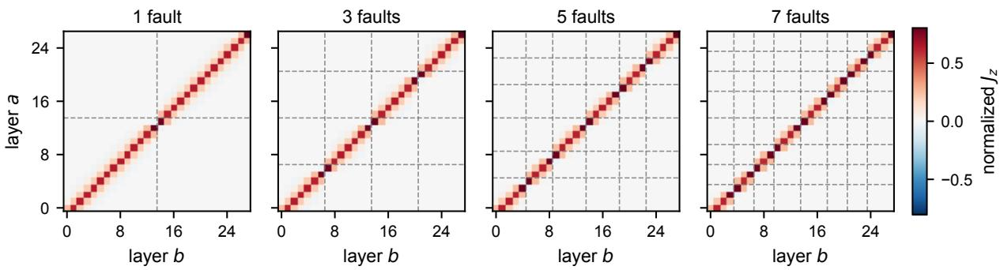  
Figure S10: Construction of multi-fault interlayer kernels at fixed film thickness. From left to right, the learned single-fault structure is used to assemble $2 8 \times 2 8$ layer matrices containing 1, 3, 5, and $7$ stacking faults. Dashed horizontal and vertical lines mark the prescribed fault interfaces. At every added interface, the local fault correction extracted from the learned single-fault $J _ { z }$ is added to the background matrix defined above. All matrices are displayed on the same normalised colour scale. Only $J _ { z }$ is modified. The film thickness, local free energy, in-plane interaction, dissipation operator, and network weights remain unchanged, and no retraining is performed.

## D.1 Equilibrium sector weights from annealed importance sampling

At a fixed dimensionless field h, direct trajectories relax within a block-alignment sector but do not visit all sectors with their equilibrium probabilities on the simulated time scale. Each sector specifies the signs of the out-of-plane block magnetisations . Let S denote the set of retained block-alignment sectors and let $\Gamma _ { s }$ be the configurations in sector $s \in S .$ . For the field-dependent free energy $\mathcal { F } _ { h } .$ , which abbreviates $\mathcal { F } _ { \boldsymbol { \theta } , J , h }$ of the main text for the prescribed fault geometry, the restricted partition function is

$$
Z _ { s } ( h ) = \int _ { \Gamma _ { s } } \exp [ - \beta V _ { c } \mathcal { F } _ { h } [ \phi ] ] \mathcal { D } \phi .\tag{S4}
$$

The integrals here are over the numerical field coordinates used in the calculations. For a configuration $\phi ,$ , the fault-plane statistic is

$$
\xi ( \phi ) = \frac { 1 } { N _ { f } N _ { x y } } \sum _ { f = 1 } ^ { N _ { f } } \sum _ { i = 1 } ^ { N _ { x y } } \mathrm { s i g n } \Bigl ( m _ { z , i } ^ { f , + } \Bigr ) \mathrm { s i g n } \Bigl ( m _ { z , i } ^ { f , - } \Bigr ) .\tag{S5}
$$

Here $N _ { f }$ is the number of faults, $N _ { x y }$ is the number of cells per plane, and $m _ { z , i } ^ { f , + }$ and $m _ { z , i } ^ { f , - }$ are the out-of-plane magnetisations immediately above and below fault $f .$ Its conditional equilibrium average within sector s is

$$
\bar { \xi } _ { s } ( h ) = \frac { 1 } { Z _ { s } ( h ) } \int _ { \Gamma _ { s } } \xi ( \phi ) \exp [ - \beta V _ { c } \mathcal { F } _ { h } [ \phi ] ] \mathcal { D } \phi .\tag{S6}
$$

The equilibrium response reported in main-text Fig. 4E is therefore

$$
\xi _ { \mathrm { s i m } } ( h ) = \sum _ { s \in \mathcal { S } } p _ { s } ( h ) \bar { \xi } _ { s } ( h ) , \qquad p _ { s } ( h ) = \frac { Z _ { s } ( h ) } { \sum _ { r \in \mathcal { S } } Z _ { r } ( h ) } .\tag{S7}
$$

Intermediate values of $\xi _ { \mathrm { s i m } }$ can arise from mixed alignments within a fault plane, diferent alignments among fault planes, or averaging over configurations.

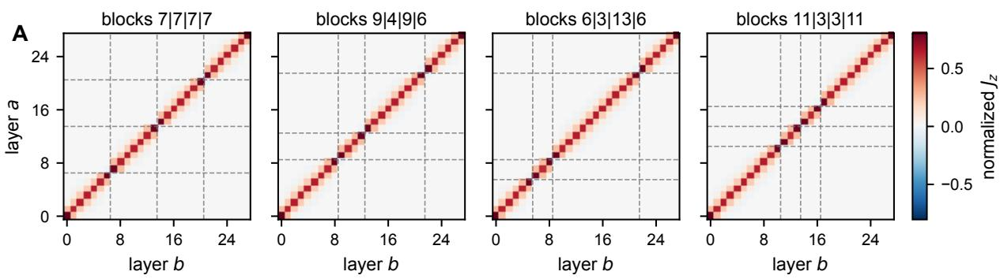

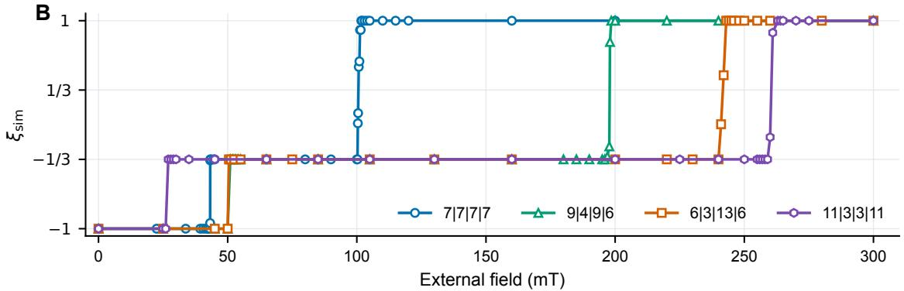  
Figure S11: Efect of fault placement at fixed fault number. A. Four interlayer matrices assembled from the learned fault motif, each containing three stacking faults at diferent prescribed interfaces. The labels give the corresponding block thicknesses in coarse-slab units. B. Equilibrium mean fault-plane correlation $\xi _ { \mathrm { s i m } }$ as a function of external field for the same four geometries. The field dependence is calculated from the equilibrium sector weights described below. Points below the running maximum of $\xi _ { \mathrm { s i m } }$ as the field increases are omitted from the displayed switching traces. The complete unfiltered values are retained in the source data. The local free energy, in-plane interaction, dissipation operator, field calibration, and network weights are unchanged.

The ratios of the restricted partition functions are evaluated by bidirectional annealed importance sampling (4). For a bridge with unnormalised densities $\widetilde { \pi } _ { 0 } , \dots , \widetilde { \pi } _ { L }$ , normalising constants $Z _ { 0 } , \ldots , Z _ { L }$ , and samples $\phi _ { 0 } , \ldots , \phi _ { L } .$ −1 propagated by Markov transitions that preserve the successive bridge distributions, the forward importance weight is

$$
w _ { 0 \to L } = \prod _ { \ell = 1 } ^ { L } \frac { \widetilde { \pi } _ { \ell } ( \phi _ { \ell - 1 } ) } { \widetilde { \pi } _ { \ell - 1 } ( \phi _ { \ell - 1 } ) } , \qquad \mathbb { E } _ { 0 \to L } [ w _ { 0 \to L } ] = \frac { Z _ { L } } { Z _ { 0 } } .\tag{S8}
$$

The reverse schedule estimates the reciprocal ratio and provides an overlap check between the endpoint work distributions. Forward and reverse work overlap, endpoint sampling diagnostics, and repeated paths are used to assess each field value. These partition-function ratios determine the probabilities $p _ { s } ( h )$ in (S7). The annealing index labels the statistical bridge and is not physical time. The longest AIS runs used 736 annealing stages, with four Hamiltonian Monte Carlo updates of 16 leapfrog steps per stage. A transition bracket is formed by two adjacent simulated field values for which the dominant block-alignment sector changes. The midpoints of the first and last brackets give the field coordinates in main-text Fig. 4F, paired with $n _ { \mathrm { f i r s t } } ^ { - 1 }$ and $n _ { \mathrm { l a s t } } ^ { - 1 }$ , respectively.

## Supplementary References

1. GA Pavliotis, Stochastic Processes and Applications. (Springer), (2014).

2. RF Evans, et al., Atomistic spin model simulations of magnetic nanomaterials. J. Physics: Condens. Matter 26, 103202 (2014).

3. S Jenkins, et al., Breaking through the mermin-wagner limit in 2d van der waals magnets. Nat. Commun. 13, 6917 (2022).

4. RM Neal, Annealed importance sampling. Stat. Comput. 11, 125–139 (2001).