# Deterministic Prediction as Global Velocity: Flow Matching for Probabilistic Time-Series Forecast

Jiajing Hu jiajing.hu@tufts.edu   
Department of Computer Science   
Tufts University   
Xu Han xu.han@tufts.edu   
Department of Computer Science   
Tufts University   
Li-Ping Liu liping.liu@tufts.edu   
Department of Computer Science   
Tufts University

Reviewed on OpenReview: https: // openreview. net/ forum? id= dDEDwFnnoA

## Abstract

Accurate uncertainty quantification is critical for many time series forecasting applications, and recent studies have increasingly adopted generative models to capture predictive uncertainty. Existing approaches often combine deterministic forecasting with generative modeling to improve predictive performance. However, their joint training is typically unstable because the deterministic model is embedded within the generative process, resulting in deep computational graphs and changing the probability transport path. In this work, we propose DV-Flow, a unified flow-matching formulation that incorporates the deterministic predictor as a parallel velocity component rather than as the endpoint of the trans port path. This design enables stable end-to-end optimization while subsuming several existing formulations as special cases, allowing direct comparisons among them. Extensive experiments on six real-world datasets demonstrate that DV-Flow consistently improves probabilistic forecasting performance over strong baselines. Our code is available at https://github.com/tufts-ml/dv-flow-time-series.

## 1 Introduction

Time series forecasting plays a crucial role in domains such as finance, logistics, and healthcare (Zhang et al., 2024). Many downstream decision-making tasks built on forecasts require probabilistic quantification of future trajectories. From a modeling standpoint, this involves learning the conditional distribution of future time series given the past. Accordingly, many deterministic and probabilistic approaches were developed.

Deterministic forecasting models (Lin et al., 2024a; Wu et al., 2021; Zeng et al., 2023; Fan et al., 2022; Box & Jenkins, 1970; Sims, 1980; Liu et al., 2023; Nie et al., 2022; Lim et al., 2021) are typically trained to minimize the squared prediction error and therefore approximate the conditional mean of the data distribution. These models excel at producing accurate point forecasts, but their characterization of predictive uncertainty can only come from a Gaussian assumption derived from the mean squared error.

Probabilistic models such as difusion models (Ho et al., 2020; 2022) and flow-matching frameworks (Lipman et al., 2022; Tong et al., 2023; Liu et al., 2022) have demonstrated strong capabilities in modeling complex, high-dimensional distributions, and have been successfully applied to time series forecasting (Rasul et al., 2021; Kerrigan et al., 2024b; Tamir et al., 2024; Zhang et al., 2024; Hu et al., 2024; Gao et al., 2024; Kollovieh et al., 2024b; Fan et al., 2024). Although these models enable sampling of diverse future trajectories and thus support full-trajectory uncertainty quantification, they are not explicitly designed to recover the conditional mean, which remains a central quantity for forecasting.

To leverage the complementary strengths of deterministic and probabilistic models, recent works have explored hybrid formulations that combine both components. Existing approaches typically fall into two categories. Two-stage methods (Gong et al., 2024; Xu et al., 2025) first train a deterministic predictor and then fit a probabilistic model conditioned on its output. Although stable, such approaches forgo the potential benefits of joint optimization. Alternatively, several recent methods (Li et al., 2025; Srivastava et al., 2024; Yu et al., 2024; Li et al., 2024) pursue fully end-to-end training by incorporating the deterministic predictor directly into difusion or flow-matching formulations. In these approaches, the deterministic model either defines a residual variable or serves as a prior state of the generative path.

A key consequence of the previous joint training designs is that the generative model takes the output of the deterministic predictor as part of its input when constructing the intermediate states of the flow or difusion process, forming deep computational graphs and yielding a non-stationary regression task during joint optimization. Similar optimization challenges arising from moving targets have been widely recognized in reinforcement learning and adversarial learning (Mnih et al., 2015; Goodfellow et al., 2014). In addition, many existing end-to-end hybrid approaches optimize only the difusion (or flow-matching) objective, updating both components without explicitly supervising the deterministic predictor, which may not learn the conditional mean and simply increases the network depth.

In this work, we propose a novel joint-training flow-matching formulation that absorbs the deterministic forecast into the flow-matching velocity as a global velocity component. Specifically, the deterministic forecast gives a global velocity direction, which depends only on the historical context. The original flowmatching velocity is then retained as the local velocity, which is state- and time-dependent and captures the complex distribution of the target time series. Moreover, we add an auxiliary loss that explicitly supervises the deterministic component to leverage the strength of the deterministic point forecaster, while the local velocity captures higher-order variability and uncertainty. This formulation preserves the strengths of both deterministic and probabilistic models and enables principled, stable end-to-end joint training, leading to improved forecast performance and more reliable uncertainty quantification.

We evaluate our model on six real-world benchmark datasets spanning diverse domains, including electricity consumption and stock prices, where reliable uncertainty quantification is critical for decision-making. Beyond comparisons with SOTA baselines, we identify a unified framework that captures existing hybrid formulations as special cases and conduct a systematic empirical study in a controlled experimental setting. This controlled comparison enables a direct assessment of how diferent hybrid formulations afect distribution fitting, velocity fitting, and optimization stability.

In summary, our work contributes to research on probabilistic forecasting of time series in three aspects:

• We introduce a Dual Velocity flow matching framework (DV-Flow) that treats the deterministic predictor as a velocity component and thereby enables stable end-to-end joint training.

• We analyze the decomposition of probabilistic forecasting into a center prediction and variance estimation through trajectory sampling.

• We evaluate DV-Flow through controlled experiments and on real-world datasets, demonstrating that the proposed DV-Flow method exhibits stable training dynamics and improves forecast probabilistic distribution performance.

## 2 Related work

Deterministic forecasting models generate single-point predictions of future values from past observations without modeling uncertainty. Classical statistical approaches such as ARIMA (Box & Jenkins, 1970) capture linear dependencies through autoregression, diferencing, and moving averages. Recently, Transformer-based models achieve strong results by modeling long-range dependencies with attention, such as Temporal Fusion Transformer (TFT) (Lim et al., 2021), PatchTST (Nie et al., 2022), and iTransformer (Liu et al., 2023).

Probabilistic models forecast distributions rather than point estimates, enabling uncertainty quantification for risk-sensitive applications such as finance, supply chain, and healthcare. Early neural approaches like DeepAR (Salinas et al., 2020) used RNNs to model conditional distributions across related series. More recent work leverages difusion (Ho et al., 2020; 2022) and flow-matching frameworks for probabilistic forecasting (Gao et al., 2024; Fan et al., 2024). Examples include TimeGrad (Rasul et al., 2021), which introduces difusion-based autoregression, Difusion-TS (Yuan & Qiao, 2024), which captures seasonality and trends with Fourier-based objectives, TSDif (Kollovieh et al., 2024a) which uses a self-guiding difusion framework, and TSFlow (Kollovieh et al., 2024b), which applies flow matching with Gaussian Process priors.

To leverage the strength of both deterministic models and probabilistic models, several works have explored hybrid methods that combine them. $\mathrm { D ^ { 3 } U }$ (Li et al., 2025) leverages a pretrained point forecasting model to predict the high-certainty part of the data and trains a separate difusion model to learn the residual distribution. STVD (Srivastava et al., 2024) combines a deterministic downscaling component for a coarser prediction and a difusion module to learn the residual error to add finer details. DifCast (Yu et al., 2024) trains a global deterministic motion model and a local residual difusion. CGFM (Xu et al., 2025) combines a pretrained deterministic model and a flow matching model to learn the residual. TMDM (Li et al., 2024) leverages a deterministic transformer model to learn the expectation of future trajectory based on context, and uses it as the endpoint prior in the difusion process. NsDif (Ye et al., 2025) further generalizes this deterministic-as-prior formulation by pretraining conditional mean and variance estimators and using their predictions to define a context-dependent Gaussian endpoint and an uncertainty-aware noise schedule. These estimators are fixed during difusion training, resulting in a cascaded alternative to joint end-to-end optimization. CasCast (Gong et al., 2024) combines a deterministic component and difusion in a cascaded manner. It first trains a deterministic model, and then uses its prediction as condition in the downstream difusion model.

## 3 Preliminaries

Flow matching. Let $p ^ { * } ( \mathbf { y } )$ over $\mathbb { R } ^ { D }$ be the data distribution for a given training set Y. Flow matching models aim to learn an implicit generative model that transforms a simple prior distribution $p ( \epsilon )$ , typically a standard Gaussian distribution, to the complex target data distribution. The implicit model is essentially an ODE defined by a vector field, which is learned by a neural network.

A typical setting of flow matching is Rectified Flow (Liu et al., 2022; Lipman et al., 2022), which defines the vector field with straight lines between data samples and random noise. Let $\mathbf { y } ^ { 1 } \sim p ^ { * } ( \mathbf { y } )$ and $\mathbf { y } ^ { 0 } = \epsilon \sim$ $p ^ { 0 } = \mathcal { N } ( 0 , \mathbf { I } )$ . For $\tau \sim \mathcal { U } [ 0 , 1 ]$ $\mathbf { y } ^ { \tau } = \tau \mathbf { y } ^ { 1 } + ( 1 - \tau ) \mathbf { y } ^ { 0 }$ forms a straight line between $\mathbf { y } ^ { 1 }$ and $\mathbf { y } ^ { 0 }$ . At each location $\mathbf { y } ^ { \tau }$ , the vector field conditioned on two endpoints is $u ( { \mathbf { y } } ^ { \tau } , \tau \mid ( { \mathbf { y } } ^ { 0 } , { \mathbf { y } } ^ { 1 } ) ) = { \mathbf { y } } ^ { 1 } - { \mathbf { y } } ^ { 0 }$ . The vector field $v ^ { * } ( \mathbf { y } ^ { \tau } , \tau ) = \mathbb { E } _ { \mathbf { y } ^ { 0 } , \mathbf { y } ^ { 1 } } [ u ( \mathbf { y } ^ { \tau } , \tau \mid ( \mathbf { y } ^ { 0 } , \mathbf { y } ^ { 1 } ) ) ]$ by marginalizing over all pairs of $( \mathbf { y } ^ { 0 } , \mathbf { y } ^ { 1 } )$ is the ideal vector field that specifies the distribution $p ^ { * }$ . The vector field is learned by minimizing the following loss:

$$
\begin{array} { r l } & { L = \mathbb { E } _ { \tau , \mathbf { y } ^ { 0 } , \mathbf { y } ^ { 1 } } \big [ \| v _ { \phi } ( \mathbf { y } ^ { \tau } , \tau ) - u ( \mathbf { y } ^ { \tau } , \tau \mid ( \mathbf { y } ^ { 0 } , \mathbf { y } ^ { 1 } ) ) \| ^ { 2 } \big ] } \\ & { \quad = \mathbb { E } _ { \tau , \mathbf { y } ^ { 0 } , \mathbf { y } ^ { 1 } } \big [ \| v _ { \phi } ( \mathbf { y } ^ { \tau } , \tau ) - v ^ { * } ( \mathbf { y } ^ { \tau } , \tau ) \| ^ { 2 } \big ] + \mathbb { E } _ { \tau , \mathbf { y } ^ { 0 } , \mathbf { y } ^ { 1 } } \big [ \| v ^ { * } ( \mathbf { y } ^ { \tau } , \tau ) - u ( \mathbf { y } ^ { \tau } , \tau \mid ( \mathbf { y } ^ { 0 } , \mathbf { y } ^ { 1 } ) ) \| ^ { 2 } \big ] . } \end{array}\tag{1}
$$

The training objective in the first line is easy to implement. It can be composed as the error in fitting the vector field and a constant term. The objective computed on a validation set can also be used to compare diferent models to measure how well they fit the target vector field.

With a trained vector field $v _ { \phi } ( \mathbf { y } ^ { \tau } , \tau )$ , we can draw samples from the learned model by integrating through the ODE path:

$$
{ \bf y } ^ { 1 } = { \bf y } ^ { 0 } + \int _ { \tau = 0 } ^ { 1 } v _ { \phi } ( { \bf y } ^ { \tau } , \tau ) d \tau , \quad { \bf y } ^ { 0 } \sim p ^ { 0 } .
$$

Generative models in time series forecasting. Consider a D-dimensional multivariate time series sampled at time points indexed by $t = 1 , \dots , T$ . Given past observations $\mathbf { x } _ { 1 : t _ { 0 } } .$ , where $\mathbf { x } _ { t } \in \mathbb { R } ^ { D }$ , time series forecasting aims to learn the conditional future data distribution $p ^ { * } \big ( \mathbf { y } _ { t _ { 0 } + 1 : T } \big | \mathbf { x } _ { 1 : t _ { 0 } } \big )$ . For simplicity of notation, we will omit the subscript timestamps and use y to represent ${ \bf y } _ { t _ { 0 } + 1 : T }$ and x to represent $\mathbf { x } _ { 1 : t _ { 0 } }$ in the following sections. Difusion and flow matching have been successfully applied to time series forecasting. To apply a generative model to the forecasting task, we set $p ^ { * } ( \mathbf { y } \vert \mathbf { x } )$ as the target distribution, which is learned by a difusion-based or flow-matching generative model specified by a neural network $v ( \mathbf { y } ^ { \tau } , \tau , \mathbf { x } )$

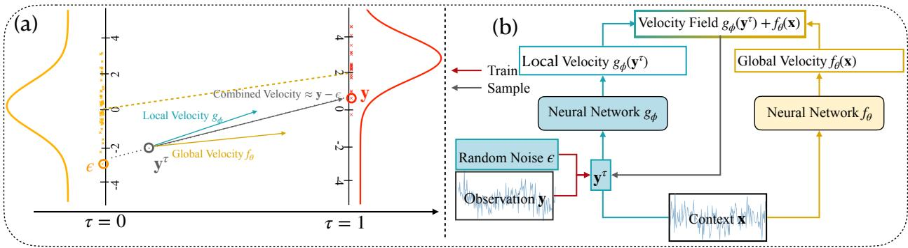  
Figure 1: (a) Proposed velocity combination framework. The orange distribution on the left is the random noise at $\tau = 0$ , and the red distribution on the right is the target distribution at $\tau = 1$ . Yellow dotted line shows that the deterministic model that predicts the target endpoint can also be interpreted as a global velocity from origin to the center of the target distribution. The velocity from ϵ to y is decomposed into a global velocity and a local velocity. (b) Model architecture for DV-Flow. We removed the nested dependency between $v _ { \phi }$ and $f _ { \theta }$ , and combine them in parallel.

Unlike a typical generative task $( \mathrm { e . g . }$ , image generation), previous observations x provide rich information about the target and require special treatment. Sending x to the neural network $v ( \mathbf { y } ^ { \tau } , \tau , \mathbf { x } )$ is often not enough to extract all the information about y. An important approach is to train a deterministic predictive model $f _ { \boldsymbol { \theta } } ( \mathbf { x } )$ and let $f _ { \boldsymbol { \theta } } ( \mathbf { x } )$ contribute to the parameterization of $v ( \mathbf { y } ^ { \tau } , \tau , \mathbf { x } )$

Residual-based models such as $\mathrm { D ^ { 3 } U }$ (Li et al., 2025), STVD (Srivastava et al., 2024) and DifCast (Yu et al., 2024) first compute the residual $\mathbf { r } _ { \theta } ^ { 1 } = \mathbf { y } - f _ { \theta } ( \mathbf { x } )$ and then learn the distribution of $\mathbf { r } _ { \theta } ^ { 1 }$ with a difusion-based model, which is specified by the network $v _ { \phi } ( \mathbf { r } _ { \theta } ^ { \tau } , \tau , \mathbf { x } )$ . In this approach, the neural network cannot see the pattern $( \mathrm { e . g . }$ , the trend) in the original time series.

Deterministic-as-prior models such as TMDM (Li et al., 2024) use a deterministic prediction to specify the noise distribution in the generative model, so the model transforms “informative” noise to the target distribution. It runs denoising starting from $f _ { \theta } ( \mathbf { x } ) + \epsilon$

Both types of models can be implemented in the flow-matching framework using similar parameterizations, which we will detail below.

## 4 Method

In this section, we introduce DV-Flow (Dual-Velocity Flow), a new hybrid flow-matching framework that combines global and local velocity fields for time series forecasting. In this method, we use the deterministic component as a velocity term rather than as an endpoint of the transport path.

We still use Gaussian noise ϵ as the start of the ODE in the flow matching model, and $p ( \mathbf { y } \vert \mathbf { x } )$ as the target distribution. In particular, we parameterize the velocity as:

$$
v _ { \theta , \phi } ( \mathbf { y } ^ { \tau } , \tau \mid \mathbf { x } ) = f _ { \theta } ( \mathbf { x } ) + g _ { \phi } ( \mathbf { y } ^ { \tau } , \tau , \mathbf { x } ) ,
$$

where $f _ { \theta } ( \mathbf { x } )$ aims for a deterministic prediction, which can be interpreted as a constant velocity, and $g _ { \phi }$ is the neural network for the local velocity. A visual demonstration can be found in Figure 1. With $\mathbf { y } ^ { \tau } = ( 1 - \tau ) \boldsymbol { \epsilon } + \tau \mathbf { y }$ , the loss function is:

$$
\mathcal { L } = \mathbb { E } _ { \epsilon , \mathbf { y } , \mathbf { x } , \tau } \left[ \big | \big | \mathbf { y } - \epsilon \big ) - v _ { \theta , \phi } \big ( \mathbf { y } ^ { \tau } , \tau \mid \mathbf { x } \big ) \big | \big | ^ { 2 } \right] .\tag{2}
$$

From the standard flow matching (Lipman et al., 2022), the optimal vector field $v _ { * } ( \mathbf { y } ^ { \tau } , \tau | \mathbf { x } )$ for an input x is

$$
v _ { * } ( \mathbf { y } ^ { \tau } , \tau \vert \mathbf { x } ) = \mathbb { E } _ { \epsilon , \mathbf { y } } \left[ \mathbf { y } - \epsilon \mid \mathbf { y } ^ { \tau } , \mathbf { x } \right] ,\tag{3}
$$

and the loss can be decomposed into $\mathscr { L } = D + C$ with

$$
D = \mathbb { E } _ { \epsilon , \mathbf { y } , \mathbf { x } , \tau } \left[ \| v _ { \theta , \phi } ( \mathbf { y } ^ { \tau } , \tau \mid \mathbf { x } ) - v _ { * } ( \mathbf { y } ^ { \tau } , \tau \mid \mathbf { x } ) \| ^ { 2 } \right] , \quad C = \mathbb { E } _ { \epsilon , \mathbf { y } , \mathbf { x } , \tau } \left[ \| ( \mathbf { y } - \epsilon ) - v _ { * } ( \mathbf { y } ^ { \tau } , \tau \mid \mathbf { x } ) \| ^ { 2 } \right] .\tag{4}
$$

In this decomposition, the second term $C$ is a constant: it represents the diference between the marginal vector field and the conditional vector fields. Therefore, minimizing the loss is equivalent to minimizing the diference between the learned vector field $v _ { \theta , \phi }$ and the true marginal vector field $v _ { * }$

A comparison to other hybrid formulations. We present two alternative parameterizations that incorporate a deterministic forecasting component into the flow matching model. These approaches are adapted from existing difusion-based forecasting methods and can be viewed as intermediate formulations bridging previous methods and the proposed approach.

In the first case, the model learns the distribution of the residual. Let $\mathbf { r } ^ { 0 } = \epsilon$ and $\mathbf { r } ^ { 1 } = \mathbf { y } - f _ { \theta } ( \mathbf { x } )$ . The expected vector field has the following relationship to the proposed method.

$$
v _ { * } ^ { r } ( \mathbf { r } ^ { \tau } , \tau | \mathbf { x } ) = \mathbb { E } _ { \epsilon , \mathbf { y } } [ \mathbf { y } - f _ { \theta } ( \mathbf { x } ) - \epsilon \mid \mathbf { r } ^ { \tau } , \mathbf { x } ] = v _ { * } ( \mathbf { y } ^ { \tau } , \tau | \mathbf { x } ) - f _ { \theta } ( \mathbf { x } ) .
$$

Here $\mathbf { r } ^ { \tau } = \mathbf { y } ^ { \tau } - \tau f _ { \theta } ( \mathbf { x } )$ . Suppose a neural network $v ^ { r } ( \mathbf { r } ^ { \tau } , \tau , \mathbf { x } )$ is parameterized to fit $v _ { * } ^ { r } .$ , then the training loss can still be decomposed into $D ^ { r } + C$ , with $D ^ { r } = \mathbb { E } _ { \epsilon , \mathbf { y } } \left[ \| v ^ { r } ( \mathbf { r } ^ { \tau } , \tau , \mathbf { x } ) - v _ { * } ^ { r } ( \mathbf { r } ^ { \tau } , \tau | \mathbf { x } ) \| ^ { 2 } \right]$ , and the term $C$ being exactly the same as in equation 4.

It has an equivalent form $v ^ { r , y } ( \mathbf { y } ^ { \tau } , \tau , \mathbf { x } ) = v ^ { r } ( \mathbf { r } ^ { \tau } , \tau , \mathbf { x } ) + f _ { \boldsymbol { \theta } } ( \mathbf { x } )$ with $v _ { * }$ as the fitting target. Then we also have $D ^ { r } = \mathbb { E } _ { \epsilon , \mathbf { y } } \left[ \| v ^ { r , y } ( \mathbf { y } ^ { \tau } , \tau , \mathbf { x } ) - v _ { * } ( \mathbf { y } ^ { \tau } , \tau | \mathbf { x } ) \| ^ { 2 } \right]$ . When $v ^ { r , y } ( \mathbf { y } ^ { \tau } , \tau , \mathbf { x } ) = v _ { \theta , \phi } ( \mathbf { y } ^ { \tau } , \tau , \mathbf { x } )$ , the model defined on the residuals has the same distribution as the previous model, and the learning objective is also the same.

In the second case, the noise is informative and contains the deterministic prediction $\mathbf { h } ^ { 0 } = ( f _ { \theta } ( \mathbf { x } ) + \epsilon )$ and $\mathbf { h } ^ { 1 } = \mathbf { y }$ . In this case, the optimal vector field is

$$
v _ { * } ^ { h } ( \mathbf { h } ^ { \tau } , \tau | \mathbf { x } ) = \mathbb { E } _ { \epsilon , \mathbf { y } } [ \mathbf { y } - \left( f _ { \theta } ( \mathbf { x } ) + \epsilon \right) | \ \mathbf { h } ^ { \tau } , \mathbf { x } ] = v _ { * } ( \mathbf { y } _ { \tau } , \tau | \mathbf { x } ) - f _ { \theta } ( \mathbf { x } ) .
$$

Here $\mathbf { h } ^ { \tau } = \mathbf { y } ^ { \tau } + ( 1 - \tau ) f _ { \theta } ( \mathbf { x } )$ . The neural network $v ^ { h } ( \mathbf { h } ^ { \tau } , \tau | \mathbf { x } )$ in this setting has the same fitting target as $v ^ { r } ( \mathbf { r } ^ { \tau } , \tau | \mathbf { x } )$ , although the input is diferent. The learning objective can be decomposed by $D ^ { h } + C$ , with the constant term $C$ the same as the other two cases. The equivalent form $v ^ { h , y } ( \mathbf { y } ^ { \tau } , \tau , \mathbf { x } ) = v ^ { h } ( \mathbf { h } ^ { \tau } , \tau , \mathbf { x } ) + f _ { \boldsymbol { \theta } } ( \mathbf { x } )$ should fit $v _ { * }$ , and $D ^ { h }$ also measures the error between $v ^ { h , y }$ and $v _ { * }$

The three parameterizations are equivalent on the output side. However, they take diferent inputs and behave diferently in model training. For parameterization $v ^ { r } ( \mathbf { r } ^ { \tau } , \tau | \mathbf { x } )$ , the residual $\mathbf { r } ^ { 1 } = \mathbf { y } - f _ { \theta } ( \mathbf { x } )$ depends on the output of the deterministic model. The same is true for $v ^ { h } ( \mathbf { h } ^ { \tau } , \tau | \mathbf { x } )$ where $\mathbf { h } ^ { 0 } = \epsilon + f _ { \theta } ( \mathbf { x } )$ . In both cases, the neural network that computes the vector field $( v ^ { r }$ or $v ^ { h } )$ is deeply coupled with $f _ { \theta } .$ If they are jointly trained, the updates of $f _ { \theta }$ continuously change the fitting targets of $v ^ { r }$ or $v ^ { h }$ , creating additional dificulties in the training procedure. Furthermore, $f _ { \theta }$ is not trained to make point-wise predictions, so it merely increases the depth of the network $( v ^ { r } \ \mathrm { o r } \ v ^ { h } )$ for vector computation.

Since we can derive $v _ { \theta , \phi } , v ^ { r , y }$ , and $v ^ { h , y }$ from the three parameterizations, all of which fit $v _ { * }$ , we can measure their fitting errors by comparing their learning objectives on a validation set. In our experiment, we examine how they behave diferently in model training.

Joint training. In our new method, we jointly train the global and local velocity components in a combined objective:

$$
\mathcal { L } = \mathbb { E } _ { \epsilon , \mathbf { y } , \mathbf { x } , \tau } \left[ \big \| ( \mathbf { y } - \epsilon ) - \big ( f _ { \theta } ( \mathbf { x } ) + g _ { \phi } ( \mathbf { y } ^ { \tau } , \tau , \mathbf { x } ) \big ) \big \| ^ { 2 } \right] + \lambda \mathbb { E } _ { \mathbf { x } , \mathbf { y } } \big [ \mathcal { L } _ { f } ( \mathbf { y } , f _ { \theta } ( \mathbf { x } ) ) \big ] .\tag{5}
$$

The point-wise loss term $\mathcal { L } _ { f } ( \mathbf { y } , f _ { \theta } ( \mathbf { x } ) )$ explicitly supervises the deterministic predictor. Common choices include MSE and MAE. When the conditional mean $\mathbb { E } [ \mathbf { y } \vert \mathbf { x } ]$ is in a location with a high probability density, training $f _ { \boldsymbol { \theta } } ( \mathbf { x } )$ towards the distribution mean helps to improve overall performance. However, when the mean is at a low-density location (e.g., in a bimodal distribution), it is not helpful for $f _ { \boldsymbol { \theta } } ( \mathbf { x } )$ to capture the mean. With our proposed parameterization method, the two neural networks $f _ { \theta } ( \mathbf { x } )$ and $g _ { \phi } ( \mathbf { y } ^ { \tau } , \tau , \mathbf { x } )$ do not directly depend on each other, so the training is more stable than the other two methods.

Relationship with distribution fitting. We now study the proposed model from the perspective of mean-variance decomposition and inspect its relationship with predictive uncertainty.

Theorem 1. Let $v _ { \theta , \phi }$ be the flow matching model defined in equation 4, and assume $v _ { \theta , \phi }$ learns the true vector field v∗ for a given x. Let the time dependent vector field $g ^ { \prime } ( \mathbf { r } , \tau ) = g _ { \phi } ( \mathbf { r } + \tau f _ { \theta } ( \mathbf { x } ) , \tau , \mathbf { x } )$ , then the ODE defined by $g ^ { \prime }$ pushes the Gaussian noise ϵ to the distribution with samples $\mathbf { y } - f _ { \boldsymbol { \theta } } ( \mathbf { x } )$ . In particular, if $f _ { \theta } ( \mathbf { x } ) = \mathbb { E } _ { \mathbf { y } } [ \mathbf { y } \mid \mathbf { x } ]$ , then the ODE defined by g′ pushes ϵ to a zero-mean distribution. Alternatively, if $f _ { \theta } ( \mathbf { x } )$ is a coordinate-wise conditional median of y given x, then the ODE defined by $g ^ { \prime }$ pushes ϵ to a residual distribution for which a coordinate-wise conditional median is zero.

Theorem 1 is better understood from the residual formulation. We provide the proof in the Appendix A. We can check the theorem with two simple cases. Suppose $g _ { \phi } ( \mathbf { y } ^ { \tau } , \tau , \mathbf { x } ) = \mathbf { 0 }$ , when $f _ { \boldsymbol { \theta } } ( \mathbf { x } )$ is supervised with MSE loss, then:

$$
\mathbb { E } [ \mathbf { y } ^ { 1 } | \mathbf { x } ] = f _ { \boldsymbol \theta } ( \mathbf { x } ) , \quad \mathrm { V a r } [ \mathbf { y } ^ { 1 } | \mathbf { x } ] = \mathbf { I } .\tag{6}
$$

In this case, $f _ { \boldsymbol { \theta } } ( \mathbf { x } )$ carries the zero-mean noise to a new location without changing its variance. In a more complex case where $g _ { \phi } ( \mathbf { y } ^ { \tau } , \tau , \mathbf { x } ) = \mathbf { A } ( \mathbf { y } ^ { \tau } - \tau f _ { \theta } ( \mathbf { x } ) )$ , then $g _ { \phi } ( \mathbf { r } , \tau ) = \mathbf { A } \mathbf { r }$ , then:

$$
\begin{array} { r } { \mathbb { E } [ \mathbf { y } ^ { 1 } | \mathbf { x } ] = f _ { \boldsymbol { \theta } } ( \mathbf { x } ) , \quad \mathrm { V a r } [ \mathbf { y } ^ { 1 } | \mathbf { x } ] = e ^ { \mathbf { A } } ( e ^ { \mathbf { A } } ) ^ { \top } . } \end{array}\tag{7}
$$

However, if the linear function is applied to $\mathbf { y } ^ { \tau } \colon g _ { \phi } ( \mathbf { y } ^ { \tau } , \tau , \mathbf { x } ) = \mathbf { A } \mathbf { y } ^ { \tau }$ , then $g _ { \phi }$ afects both the mean transfor mation and the covariance propagation, while $f _ { \boldsymbol { \theta } } ( \mathbf { x } )$ contributes only to the mean through the linear response $\mathbf { A } ^ { - 1 } ( e ^ { \mathbf { A } } - I ) f _ { \theta } ( \mathbf { x } )$ :

$$
\mathbb { E } [ \mathbf { y } ^ { 1 } | \mathbf { x } ] = \mathbf { A } ^ { - 1 } ( e ^ { \mathbf { A } } - I ) f _ { \boldsymbol { \theta } } ( \mathbf { x } ) , \quad \mathrm { V a r } [ \mathbf { y } ^ { 1 } | \mathbf { x } ] = e ^ { \mathbf { A } } ( e ^ { \mathbf { A } } ) ^ { \top } .\tag{8}
$$

When $f _ { \boldsymbol \theta } ( \mathbf { x } ) = \mathrm { M e d i a n } [ \mathbf { y } ^ { 1 } | \mathbf { x } ]$ , the two configurations of $g _ { \phi }$ in equation 6 and equation 7 yield similar results, except that $f _ { \boldsymbol { \theta } } ( \mathbf { x } )$ becomes the median. All derivations are given in the Appendix A. With a complex neural network $g _ { \phi }$ , the model can capture non-linear variances in the data and should perform better than a Gaussian model.

Model Architecture. In the task of time series forecasting, we adopt iTransformer (Liu et al., 2023) as the backbone network for both $v _ { \phi } ( \mathbf { y } ^ { \tau } , \tau , \mathbf { x } )$ and $f _ { \boldsymbol { \theta } } ( \mathbf { x } )$

To better capture the correlation between neighboring steps, we sample noise ϵ from a zero-mean Gaussian–process specified with Ornstein–Uhlenbeck (exponential) kernel $K ( t , t ^ { \prime } ) =$ $\exp \left( - \frac { | d | } { l } \right)$ , where $d = t - t ^ { \prime }$ is the temporal lag and l is a nonnegative correlation-length hyperparameter.

Proper normalization is essential for stable training. We propose Seasonal-Adjusted Time-Adaptive Normalization (SATN), which first removes seasonal components from the data and then applies a time-dependent normalization scheme $\begin{array} { r } { ( \mathbf { y } _ { t } \gets \frac { \mathbf { y } _ { t } - \mathbf { x } _ { 0 } } { { \pmb \sigma } _ { t } } ) } \end{array}$ . Motivated by Brownian motion, we treat the last observation in the context window as the starting point of the forecasting trajectory and center the prediction window accordingly. Under this view, we assume that the residual variance grows with the forecasting horizon and normalize each time step using a linearly increasing variance schedule estimated from the data. Figure 2 illustrates the residuals of the Electricity dataset after removing seasonality and centering the prediction window by the last observation in the context sequence. We observe that the residual variance increases monotonically with the forecasting horizon: predictions closer to the context window exhibit smaller deviations, while those farther away become progressively more dispersed. This behavior motivates our time-adaptive normalization strategy, which explicitly accounts for the growth of uncertainty over time. This transforms the prediction sequence into a process with approximately unit marginal variance, improving alignment with the Gaussian prior used in flow matching and mitigating variance disparities across time steps. Additional details are provided in Appendix I.

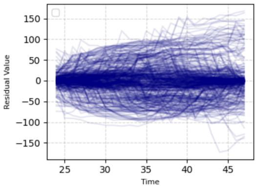  
Figure 2: Residuals on the Electricity dataset after removing seasonality and centering by the last context observation. The variance increases with the forecasting horizon, motivating our time-adaptive normalization scheme.

In the sampling procedure, the integration is computed from the Dormand–Prince 45 (Dormand & Prince, 1980) ODE solver. By solving Equation 9, we obtain a transformed sample $\mathbf { y } ^ { 1 }$ . This sample is then reverse scaled with SATN. A complete sampling procedure is summarized in Algorithm 2. Note that even though $f _ { \boldsymbol { \theta } } ( \mathbf { x } )$ is used at every step, since it is τ-invariant, we only need to compute it once up front, and it can be treated as a fixed value in the integral. Therefore, adding the deterministic network does not slow down inference.

$$
\hat { \mathbf { y } } = f _ { \theta } ( \mathbf { x } ) ; \quad \mathbf { y } ^ { 1 } = \epsilon + \int _ { \tau = 0 } ^ { 1 } v _ { \theta , \phi } ( \mathbf { y } ^ { \tau } , \tau , \mathbf { x } ) d \tau = \epsilon + \int _ { \tau = 0 } ^ { 1 } ( \hat { \mathbf { y } } + g _ { \phi } ( \mathbf { y } ^ { \tau } , \tau , \mathbf { x } ) ) d \tau\tag{9}
$$

## 5 Experiments

In this section, we evaluate the ability of the proposed model to forecast time series and quantify uncertainty using datasets from real-world applications. In Section 5.1 we compare DV-Flow with existing baselines, in Section 5.2 we study diferent hybrid formulations under our unified framework, and in Section 5.3 we investigate the efect of the point-wise loss term in the objective.

Datasets. We use six widely adopted multivariate benchmark datasets: five from GluonTS (Alexandrov et al., 2019)-Electricity (Dua & Taniskidou, 2017), Exchange (Lai et al., 2018), Trafic (Dua & Taniskidou, 2017), Solar (Lai et al., 2018), KDDCup (Stolfo et al., 1999)-and one finance dataset consisting of minutelevel log returns of 486 stocks from S&P 500 index. Dataset statistics can be found in Table 1. We use the standard train and test splits provided by GluonTS.

Table 1: Dataset Information.
<table><tr><td>Dataset</td><td>Timesteps</td><td>Channels</td><td>Frequency</td><td>Context</td><td>Forecast</td><td>Seasonal-window</td></tr><tr><td>Electricity</td><td>5,833</td><td>370</td><td>Hour</td><td>24</td><td>24</td><td>24</td></tr><tr><td>Exchange</td><td>6,071</td><td>8</td><td>Day</td><td>30</td><td>30</td><td>30</td></tr><tr><td>Traffic</td><td>4,001</td><td>963</td><td>Hour</td><td>24</td><td>24</td><td>24</td></tr><tr><td>Solar</td><td>7,009</td><td>137</td><td>Hour</td><td>24</td><td>24</td><td>24</td></tr><tr><td>KDDCup</td><td>8,448</td><td>270</td><td>Hour</td><td>24</td><td>24</td><td>24</td></tr><tr><td>SP500</td><td>255,840</td><td>486</td><td>Minute</td><td>30</td><td>30</td><td>-</td></tr></table>

Baselines. We compare our model against one traditional statistical model ARIMA (Box & Jenkins, 1970), three deterministic models TFT (Lim et al., 2021), PatchTST (Nie et al., 2022), and iTransformer (Liu et al., 2023); five probabilistic models: TimeGrad (Rasul et al., 2021), Difusion-TS (Yuan & Qiao, 2024), DeepAR (Salinas et al., 2020), TSDif (Kollovieh et al., 2024a), and TSFlow (Kollovieh et al., 2024b); and two hybrid models: TMDM (Li et al., 2024) and $\mathrm { D ^ { 3 } U }$ (Li et al., 2025). To evaluate predictive probabilities, we sample 100 trajectories for each probabilistic model on the test set. We use 150 inference steps.

Implementation details. For both networks, the hidden dimensions are set to 1024, with 8 attention heads and 4 stacked attention layers. Models are trained using the AdamW optimizer (Loshchilov, 2017), with a learning rate of $2 e ^ { - 4 }$ and a weight decay of $1 e ^ { - 5 }$ . For the local velocity network, the flow-matching time step τ is encoded using Fourier positional embeddings (Vaswani, 2017) into $\mathbb { R } ^ { 3 2 }$ , which is then appended to the input as an additional token in the transformer sequence. We use 8 workers on a single NVIDIA A100 GPU node for all experiments. Mean and standard deviation for all models are obtained from three independent runs. We use $\lambda = 0 . 3$ across all datasets for point-wise loss. We use the Dormand–Prince 45 ODE solver with an absolute tolerance of $\mathrm { a t o l } = 1 0 ^ { - 6 }$ and a relative tolerance of $\mathrm { r t o l } = 1 0 ^ { - 3 }$

Table 2: Test $\mathrm { C R P S _ { s u m } }$ ↓
<table><tr><td>Method</td><td>Electricity</td><td>Exchange</td><td>Traffic</td><td>Solar</td><td> $\mathrm { K D D C u p }$ </td><td>SP500</td></tr><tr><td>ARIMA</td><td> $0 . 6 0 5 8 \pm 0 . 0 0 0$ </td><td> $0 . 0 0 6 2 \pm 0 . 0 0 0$ </td><td> $0 . 7 2 6 5 \pm 0 . 0 0 0$ </td><td> $0 . 5 4 5 0 \pm 0 . 0 0 0$ </td><td> $0 . 1 1 1 1 \pm 0 . 0 0 0$ </td><td> $1 . 0 7 6 8 \pm 0 . 0 0 0$ </td></tr><tr><td>TFT</td><td> $0 . 0 2 7 6 \pm 0 . 0 0 1$ </td><td> $0 . 0 0 8 5 \pm 0 . 0 0 2$ </td><td> $0 . 0 5 8 2 \pm 0 . 0 2 6$ </td><td> $0 . 9 5 0 9 \pm 0 . 3 5 7$ </td><td> $0 . 9 3 7 5 \pm 0 . 1 1 0$ </td><td> $0 . 8 2 6 0 \pm 0 . 0 7 2$ </td></tr><tr><td>PatchTST</td><td> $0 . 0 2 3 1 \pm 0 . 0 0 5$ </td><td> $0 . 0 1 0 9 \pm 0 . 0 0 5$ </td><td> $0 . 0 9 0 6 \pm 0 . 0 2 2$ </td><td> $0 . 8 9 5 8 \pm 0 . 0 2 4$ </td><td> $0 . 9 2 2 8 \pm 0 . 0 6 5$ </td><td> $0 . 9 4 3 0 \pm 0 . 0 1 2$ </td></tr><tr><td>iTransformer</td><td> $0 . 0 2 2 8 \pm 0 . 0 0 2$ </td><td> $0 . 0 0 8 7 \pm 0 . 0 0 3$ </td><td> $0 . 0 6 8 9 \pm 0 . 0 1 7$ </td><td> $0 . 9 0 7 8 \pm 0 . 0 3 4$ </td><td> $0 . 5 9 0 2 \pm 0 . 1 8 1$ </td><td> $0 . 8 9 6 8 \pm 0 . 1 0 6$ </td></tr><tr><td>DeepAR</td><td> $0 . 0 3 7 3 \pm 0 . 0 1 2$ </td><td> $0 . 0 0 7 7 \pm 0 . 0 0 2$ </td><td> $0 . 0 4 3 4 \pm 0 . 0 0 4$ </td><td> $0 . 4 0 2 0 \pm 0 . 0 0 3$ </td><td> $0 . 1 6 0 0 \pm 0 . 0 6 6$ </td><td> $0 . 9 4 5 5 \pm 0 . 0 2 0$ </td></tr><tr><td>Diffusion-TS</td><td> $0 . 0 7 7 3 \pm 0 . 0 0 4$ </td><td> $0 . 0 0 9 0 \pm 0 . 0 0 3$ </td><td> $0 . 5 7 7 1 \pm 0 . 0 1 4$ </td><td> $0 . 5 4 4 7 \pm 0 . 0 2 4$ </td><td> $0 . 4 3 9 5 \pm 0 . 1 8 9$ </td><td> $0 . 9 0 6 3 \pm 0 . 0 1 5$ </td></tr><tr><td>TimeGrad</td><td> $0 . 0 2 0 6 \pm 0 . 0 0 1$ </td><td> $0 . 0 0 6 0 \pm 0 . 0 0 1$ </td><td> $0 . 0 4 4 0 \pm 0 . 0 0 6$ </td><td> $0 . 3 5 6 5 \pm 0 . 0 1 6$ </td><td> $0 . 1 1 6 5 \pm 0 . 0 3 3$ </td><td> $0 . 9 0 8 9 \pm 0 . 0 0 3$ </td></tr><tr><td>TSDiff</td><td> $0 . 0 4 9 0 \pm 0 . 0 0 0$ </td><td> $0 . 0 1 1 0 \pm 0 . 0 0 1$ </td><td> $0 . 0 9 8 0 \pm 0 . 0 0 2$ </td><td> $0 . 3 5 8 0 \pm 0 . 0 2 0$ </td><td> $0 . 3 7 7 8 \pm 0 . 0 3 7$ </td><td> $0 . 9 1 9 9 \pm 0 . 0 1 2$ </td></tr><tr><td>TSFlow</td><td> $0 . 0 2 3 9 \pm 0 . 0 0 0$ </td><td> $0 . 0 0 4 9 \pm 0 . 0 0 0$ </td><td> $0 . 1 3 0 7 \pm 0 . 0 0 1$ </td><td> $0 . 3 4 0 8 \pm 0 . 0 3 6$ </td><td> $0 . 1 1 7 9 \pm 0 . 0 2 8$ </td><td> $0 . 9 7 8 6 \pm 0 . 0 4 7$ </td></tr><tr><td>TMDM</td><td> $0 . 0 4 4 0 \pm 0 . 0 0 2$ </td><td> $\underline { { 0 . 0 0 4 7 } } \pm 0 . 0 0 0$ </td><td> $0 . 0 6 5 0 \pm 0 . 0 0 3$ </td><td> $1 . 2 4 6 1 \pm 0 . 3 9 1$ </td><td> $0 . 1 4 6 3 \pm 0 . 0 1 3$ </td><td> $0 . 8 7 0 5 \pm 0 . 0 3 3$ </td></tr><tr><td>D³U</td><td> $0 . 0 2 6 1 \pm 0 . 0 0 2$ </td><td> $0 . 0 0 5 9 \pm 0 . 0 0 1$ </td><td> $0 . 0 5 8 6 \pm 0 . 0 0 4$ </td><td> $1 . 5 6 2 2 \pm 0 . 2 9 6$ </td><td> $0 . 1 1 1 4 \pm 0 . 0 2 0$ </td><td> $0 . 9 7 5 0 \pm 0 . 0 3 4$ </td></tr><tr><td>DV-Flow</td><td> $\mathbf { 0 . 0 1 9 7 \pm 0 . 0 0 0 }$ </td><td> $\mathbf { 0 . 0 0 4 6 \pm 0 . 0 0 0 }$ </td><td> ${ \bf 0 . 0 3 8 6 \pm 0 . 0 0 5 }$ </td><td> $\mathbf { 0 . 3 2 8 0 \pm 0 . 0 3 2 }$ </td><td> $\mathbf { 0 . 0 5 7 8 \pm 0 . 0 0 1 }$ </td><td> $\mathbf { 0 . 7 9 5 8 \pm 0 . 0 1 8 }$ </td></tr></table>

Evaluation metrics. We use CRPS (Matheson & Winkler, 1976) to jointly assess the calibration and sharpness of the predictive distribution represented by the forecast samples. Following Rasul et al. (2021), we use $\mathrm { C R P S } _ { \mathrm { s u m } } = \mathbb { E } _ { t } \bigl [ \mathrm { C R P S } ( \hat { F } _ { \mathrm { s u m } } ^ { t } ( \cdot ) , \sum _ { i = 1 } ^ { D } y _ { i , t } ) \bigr ]$ , which evaluates the predictive calibration and sharpness of the sum of each time series at each time step and then aggregates the CRPS values across time by averaging them. Here, $\hat { F } _ { \mathrm { s u m } } ^ { t } ( \cdot )$ denotes the empirical cumulative distribution function (CDF) of the sum of the variables at time t. The empirical CDF is computed from samples from the predictive model.

In this work, we propose a new evaluation metric $\mathrm { C o r r - C R P S _ { \mathrm { m e a n } } }$ that evaluates the uncertainty quantification of the correlation between time series, as the correlation is an important consideration in applications such as stock investment. Note that $\mathbf { y } \in \dot { \mathbb { R } } ^ { ( T - t _ { 0 } ) \times D }$ denote the observed D-dimensional time series in the future window. Let $C o r r _ { i j }$ denote the correlation between the i-th and j-th univariable time series in this time window. Here $C o r r _ { i j }$ can be viewed as a sample from the true distribution of correlation values. We then compute samples $\{ \widehat { C o r r } _ { i j } ^ { s } : s = 1 , \ldots , S \}$ from forecasting samples and estimate the CDF $\hat { F } _ { i j } ( \cdot )$ from these samples. The CRPS metric computed from $C o r r _ { i j }$ and $\hat { F } _ { i j } ( \cdot )$ measures how well forecast samples capture uncertainty in the correlation between time series i and j. To obtain a single evaluation metric, we aggregate the CRPS over all $i j$ pairs and all y instances in the test set. Formally, $\mathrm { C o r r - C R P S _ { \mathrm { m e a n } } }$ is defined as the follow where where n indexes test instances:

$$
\mathrm { C o r r - C R P S } _ { \mathrm { m e a n } } = \frac { 2 } { N D ( D - 1 ) } \sum _ { n = 1 } ^ { N } \sum _ { i , j } \mathrm { C R P S } \left( \widehat { F } _ { i j } ^ { ( n ) } , C o r r _ { i j } ^ { ( n ) } \right) .
$$

We further evaluate the quantile forecasts derived from the sampled predictive distributions. Following Lim et al. (2021), we use q-Risk, a normalized quantile-loss metric that evaluates the accuracy of the predicted conditional q-quantile by penalizing underestimation and overestimation. We report q-Risk at $q \ : = \ : 0 . 9 ,$ denoted as Q90. Details of the metrics can be found in Appendix D.

## 5.1 Compare with existing baselines

In this section, we evaluate DV-Flow against the baseline methods with three metrics: CRPS on time series forecasts, CRPS on correlation among forecast time series dimensions, and quantile loss. In all tables, the best results are highlighted in bold, while the second best are underlined.

CRPS . First, we compare DV-Flow against baselines in terms of marginal distribution probability. Table 2 presents our main results on six datasets evaluated by $\mathrm { C R P S _ { s u m } }$ . DV-Flow substantially outperforms the other common baselines on all six datasets. This robust performance is evident across diverse domains, from the highly periodic patterns in Electricity to the more stochastic behavior in Exchange-Rate, demonstrating the wide applicability of our method. Specifically, the significant advantage in CRPSsum indicates that DV-Flow fits the distribution the best, highlighting the efectiveness of our hybrid velocity formulation with stable joint training.

Table 3: Testset $\mathrm { C o r r \mathrm { - } C R P S _ { m e a n } \downarrow }$
<table><tr><td>Method</td><td>Electricity</td><td>Exchange</td><td>Traffic</td><td>Solar</td><td>KDDCup</td><td>SP500</td></tr><tr><td>TFT</td><td> $0 . 3 7 6 9 \pm 0 . 0 2 9$ </td><td> $1 . 1 2 0 8 \pm 0 . 1 4 2$ </td><td> $0 . 1 3 5 6 \pm 0 . 0 0 1$ </td><td> $0 . 1 1 7 8 \pm 0 . 0 0 0$ </td><td> $1 . 5 4 1 2 \pm 0 . 0 5 2$ </td><td> $1 . 2 4 7 7 \pm 0 . 2 9 9$ </td></tr><tr><td>PatchTST</td><td> $0 . 3 1 1 5 \pm 0 . 0 1 3$ </td><td> $0 . 8 1 1 8 \pm 0 . 0 1 2$ </td><td> $0 . 1 8 3 4 \pm 0 . 0 1 2$ </td><td> $0 . 8 1 2 8 \pm 0 . 0 0 2$ </td><td> $0 . 8 2 0 3 \pm 0 . 0 0 4$ </td><td> $0 . 7 4 8 5 \pm 0 . 0 0 1$ </td></tr><tr><td>iTransformer</td><td> $0 . 2 1 4 4 \pm 0 . 0 0 3$ </td><td> $0 . 0 3 2 4 \pm 0 . 0 1 0$ </td><td> $0 . 1 7 4 1 \pm 0 . 0 5 2$ </td><td> $0 . 8 0 7 8 \pm 0 . 0 0 6$ </td><td> $0 . 8 1 7 3 \pm 0 . 0 0 9$ </td><td> $0 . 7 5 6 6 \pm 0 . 0 0 0$ </td></tr><tr><td>DeepAR</td><td> $0 . 2 2 4 2 \pm 0 . 1 0 7$ </td><td> $0 . 7 8 0 4 \pm 0 . 0 4 0$ </td><td> $0 . 2 7 2 4 \pm 0 . 3 4 3$ </td><td> $0 . 2 0 7 4 \pm 0 . 0 1 8$ </td><td> $0 . 7 1 6 0 \pm 0 . 0 0 4$ </td><td> $0 . 7 5 5 4 \pm 0 . 0 0 0$ </td></tr><tr><td>Diffusion-TS</td><td> $0 . 2 3 7 8 \pm 0 . 0 0 6$ </td><td> $0 . 8 1 8 3 \pm 0 . 0 2 1$ </td><td> $0 . 2 3 3 9 \pm 0 . 0 0 2$ </td><td> $0 . 1 0 4 9 \pm 0 . 0 0 7$ </td><td> $1 . 3 0 3 0 \pm 0 . 1 0 7$ </td><td> $1 . 2 1 1 6 \pm 0 . 0 5 0$ </td></tr><tr><td>TimeGrad</td><td> $0 . 1 9 6 5 \pm 0 . 0 0 6$ </td><td> $0 . 6 9 2 9 \pm 0 . 0 1 0$ </td><td> $0 . 1 2 7 4 \pm 0 . 0 0 9$ </td><td> $0 . 0 8 9 0 \pm 0 . 0 0 2$ </td><td> $0 . 6 9 0 0 \pm 0 . 0 4 6$ </td><td> $0 . 7 4 8 4 \pm 0 . 0 0 1$ </td></tr><tr><td>TSDiff</td><td> $\mathbf { 0 . 1 6 1 6 \pm 0 . 0 0 1 }$ </td><td> $0 . 7 8 3 1 \pm 0 . 1 7 5$ </td><td> $\mathbf { 0 . 0 7 6 7 \pm 0 . 0 0 2 }$ </td><td> $\underline { { 0 . 0 7 5 9 } } \pm 0 . 0 0 5$ </td><td> $0 . 6 8 1 8 \pm 0 . 0 2 2$ </td><td> $0 . 7 4 7 5 \pm 0 . 0 0 4$ </td></tr><tr><td>TSFlow</td><td> $0 . 1 8 2 4 \pm 0 . 0 0 0$ </td><td> $\underline { { 0 . 6 7 1 7 } } \pm 0 . 0 1 6$ </td><td> $\underline { { 0 . 0 9 1 7 } } \pm 0 . 0 0 0$ </td><td> $0 . 0 7 9 6 \pm 0 . 0 1 0$ </td><td> $\underline { { 0 . 6 5 8 9 } } \pm 0 . 0 1 8$ </td><td> $0 . 7 4 4 7 \pm 0 . 0 0 2$ </td></tr><tr><td>TMDM</td><td> $1 . 2 0 8 8 \pm 0 . 4 0 1$ </td><td> $0 . 8 0 9 2 \pm 0 . 0 4 2$ </td><td> $0 . 4 7 8 9 \pm 0 . 3 1 1$ </td><td> $0 . 6 8 7 7 \pm 0 . 0 4 6$ </td><td> $0 . 7 8 1 5 \pm 0 . 0 3 1$ </td><td> $0 . 7 5 2 8 \pm 0 . 0 0 1$ </td></tr><tr><td>D3U</td><td> $0 . 2 7 9 8 \pm 0 . 0 0 6$ </td><td> $0 . 8 3 6 7 \pm 0 . 0 1 7$ </td><td> $0 . 1 2 2 8 \pm 0 . 0 0 1$ </td><td> $0 . 1 0 5 6 \pm 0 . 0 1 3$ </td><td> $0 . 7 0 3 6 \pm 0 . 0 1 6$ </td><td> $\underline { { 0 . 7 3 7 6 } } \pm 0 . 0 0 2$ </td></tr><tr><td>DV-Flow</td><td> $\underline { { 0 . 1 7 6 1 } } \pm 0 . 0 0 2$ </td><td> $\mathbf { 0 . 6 3 8 0 \pm 0 . 0 1 3 }$ </td><td> $0 . 0 9 3 4 \pm 0 . 0 0 3$ </td><td> $\mathbf { 0 . 0 7 5 2 \pm 0 . 0 0 4 }$ </td><td> $\mathbf { 0 . 6 5 4 4 \pm 0 . 0 0 7 }$ </td><td> $\mathbf { 0 . 6 2 5 6 \pm 0 . 0 0 2 }$ </td></tr></table>

Table 4: Testset Q90 ↓
<table><tr><td>Method</td><td>Electricity</td><td>Exchange</td><td>Traffic</td><td>Solar</td><td> $\mathrm { K D D C u p }$ </td><td>SP500</td></tr><tr><td>TFT</td><td> $0 . 0 5 6 6 \pm 0 . 0 1 5$ </td><td> $0 . 0 1 1 7 \pm 0 . 0 0 6$ </td><td> $0 . 1 5 1 6 \pm 0 . 0 2 3$ </td><td> $0 . 2 1 1 6 \pm 0 . 0 4 2$ </td><td> $0 . 7 1 3 2 \pm 0 . 0 1 2$ </td><td> $0 . 5 8 6 8 \pm 0 . 0 2 8$ </td></tr><tr><td>PatchTST</td><td> $0 . 0 4 0 7 \pm 0 . 0 0 2$ </td><td> $0 . 0 0 6 8 \pm 0 . 0 0 2$ </td><td> $0 . 1 1 5 0 \pm 0 . 0 1 0$ </td><td> $0 . 4 5 9 6 \pm 0 . 0 7 9$ </td><td> $0 . 6 7 3 9 \pm 0 . 0 5 6$ </td><td> $0 . 5 6 9 4 \pm 0 . 0 2 9$ </td></tr><tr><td>iTransformer</td><td> $0 . 0 3 5 0 \pm 0 . 0 0 1$ </td><td> $0 . 0 0 7 8 \pm 0 . 0 0 2$ </td><td> $0 . 1 2 7 3 \pm 0 . 0 1 8$ </td><td> $0 . 3 0 2 9 \pm 0 . 0 3 6$ </td><td> $0 . 4 9 7 6 \pm 0 . 0 4 4$ </td><td> $0 . 5 4 9 2 \pm 0 . 0 0 4$ </td></tr><tr><td>DeepAR</td><td> $0 . 0 3 8 0 \pm 0 . 0 0 3$ </td><td> $\underline { { 0 . 0 0 5 0 } } \pm 0 . 0 0 0$ </td><td> $\mathbf { 0 . 0 9 1 1 } \pm 0 . 0 0 1$ </td><td> $0 . 3 1 9 4 \pm 0 . 0 1 7$ </td><td> $0 . 3 9 9 2 \pm 0 . 0 7 4$ </td><td> $0 . 5 3 8 4 \pm 0 . 0 0 8$ </td></tr><tr><td>Diffusion-TS</td><td> $0 . 1 1 1 2 \pm 0 . 0 0 8$ </td><td> $0 . 0 2 5 8 \pm 0 . 0 0 4$ </td><td> $0 . 8 2 7 9 \pm 0 . 0 2 9$ </td><td> $0 . 7 9 8 5 \pm 0 . 0 6 0$ </td><td> $0 . 4 2 1 2 \pm 0 . 0 5 6$ </td><td> $0 . 7 1 2 2 \pm 0 . 0 2 9$ </td></tr><tr><td>TimeGrad</td><td> $0 . 0 4 1 2 \pm 0 . 0 0 4$ </td><td> $0 . 0 0 8 2 \pm 0 . 0 0 0$ </td><td> $0 . 1 1 2 0 \pm 0 . 0 2 1$ </td><td> $0 . 2 1 8 1 \pm 0 . 0 1 0$ </td><td> $0 . 3 0 4 8 \pm 0 . 0 3 6$ </td><td> $0 . 5 5 6 5 \pm 0 . 0 0 5$ </td></tr><tr><td>TSDiff</td><td> $0 . 0 4 0 3 \pm 0 . 0 0 3$ </td><td> $0 . 0 1 6 6 \pm 0 . 0 1 4$ </td><td> $0 . 1 4 1 1 \pm 0 . 0 0 4$ </td><td> $0 . 2 9 1 6 \pm 0 . 0 1 8$ </td><td> $0 . 2 8 0 4 \pm 0 . 0 4 3$ </td><td> $0 . 5 4 7 2 \pm 0 . 0 1 3$ </td></tr><tr><td>TSFlow</td><td> ${ \bf 0 . 0 3 2 9 } \pm 0 . 0 0 0$ </td><td> $0 . 0 0 5 3 \pm 0 . 0 0 0$ </td><td> $0 . 1 4 5 4 \pm 0 . 0 0 1$ </td><td> $\underline { { 0 . 1 9 8 8 } } \pm 0 . 0 2 8$ </td><td> $0 . 2 8 5 9 \pm 0 . 0 0 8$ </td><td> $0 . 5 6 3 6 \pm 0 . 0 3 7$ </td></tr><tr><td>TMDM</td><td> $0 . 1 2 1 2 \pm 0 . 0 0 1$ </td><td> $0 . 0 1 0 1 \pm 0 . 0 2 2$ </td><td> $0 . 3 8 8 5 \pm 0 . 0 1 6$ </td><td> $1 . 9 5 3 6 \pm 0 . 0 6 6$ </td><td> $0 . 4 6 0 8 \pm 0 . 0 2 5$ </td><td> $0 . 6 7 2 3 \pm 0 . 0 0 3$ </td></tr><tr><td>D3U</td><td> $0 . 0 4 2 3 \pm 0 . 0 0 2$ </td><td> $0 . 0 0 5 8 \pm 0 . 0 0 1$ </td><td> $0 . 1 3 6 0 \pm 0 . 0 0 1$ </td><td> $0 . 7 7 0 3 \pm 0 . 0 9 0$ </td><td> $\underline { { 0 . 2 5 2 9 } } \pm 0 . 0 4 4$ </td><td> $0 . 5 8 9 8 \pm 0 . 0 0 4$ </td></tr><tr><td>DV-Flow</td><td> $0 . 0 3 4 8 \pm 0 . 0 0 2$ </td><td> $\mathbf { 0 . 0 0 4 1 } \pm 0 . 0 0 0$ </td><td> $0 . 1 0 5 4 \pm 0 . 0 0 3$ </td><td> ${ \bf 0 . 1 8 6 6 \pm 0 . 0 2 5 }$ </td><td> $\mathbf { 0 . 2 0 5 4 \pm 0 . 0 0 7 }$ </td><td> ${ \bf 0 . 5 2 3 5 \pm 0 . 0 0 8 }$ </td></tr></table>

Corr-CRPSmean. Our method achieves the best $\mathrm { C o r r - C R P S _ { \mathrm { m e a n } } }$ performance on 4 out of 6 datasets, demonstrating its strong ability to capture cross-dimensional dependency structures in multivariate forecasting. Unlike vanilla $\mathrm { C R P S _ { s u m } }$ , which evaluates each dimension independently, $\mathrm { C o r r - C R P S _ { \mathrm { m e a n } } }$ explicitly measures whether the predicted samples preserve the correlation patterns observed in the ground truth. The consistent improvements across diverse datasets suggest that our model not only produces better marginal forecasts, but also better models the joint dynamics among variables. This is particularly important in applications such as finance and energy systems, where correlations between dimensions play a critical role in downstream decision-making.

Q90. We then compare DV-Flow against baselines in terms of quantile risk. The results are presented in Table 4, where DV-Flow demonstrates clear superiority over all baseline models. It ranks first on four of the six datasets and second best for the rest two. This result underscores the model’s capacity to capture 90% of future outcomes with tight and informative prediction intervals, avoiding overly conservative or overly wide uncertainty estimates. For this analysis, we re-evaluated all baselines using their oficial implementations to ensure a fair comparison; iTransformer’s configuration was specifically aligned with our backbone for consistency. Details in Appendix C

## 5.2 Dissecting diferent hybrid formulations

In this section, we conduct a thorough investigation of diferent settings in flow matching for time series forecasting. We mainly consider the setup of the flow-matching model for learning the target distribution.

Table 5: Test set performance across hybrid formulations. ↓
<table><tr><td>Dataset</td><td>Metric</td><td> $\mathrm { R e s i d u a l } _ { 0 . 3 }$ </td><td> $\mathrm { R e s i d u a l _ { 0 } }$ </td><td> $\mathrm { D P _ { 0 . 3 } }$ </td><td> $\mathrm { D P _ { 0 } }$ </td><td>DV-Flow</td></tr><tr><td rowspan="2">Electricity</td><td>CRPSsum</td><td> $0 . 0 3 2 6 \pm 0 . 0 1 6$ </td><td> $0 . 0 2 8 8 \pm 0 . 0 1 7$ </td><td> $0 . 0 2 3 9 \pm 0 . 0 0 1$ </td><td> $0 . 0 2 6 4 \pm 0 . 0 0 1$ </td><td> $\mathbf { 0 . 0 1 9 7 \pm 0 . 0 0 0 }$ </td></tr><tr><td>Q90</td><td> $0 . 0 4 1 0 \pm 0 . 0 0 9$ </td><td> $0 . 0 3 5 1 \pm 0 . 0 0 1$ </td><td> $0 . 0 3 6 7 \pm 0 . 0 0 2$ </td><td> $0 . 0 3 6 4 \pm 0 . 0 0 1$ </td><td> $\mathbf { 0 . 0 3 4 8 \pm 0 . 0 0 2 }$ </td></tr><tr><td rowspan="2">Exchange</td><td>CRPSsum</td><td> $0 . 0 0 5 2 \pm 0 . 0 0 0$ </td><td> $0 . 0 0 5 2 \pm 0 . 0 0 0$ </td><td> $0 . 0 0 4 9 \pm 0 . 0 0 0$ </td><td> $0 . 0 0 4 9 \pm 0 . 0 0 1$ </td><td> $\mathbf { 0 . 0 0 4 6 \pm 0 . 0 0 0 }$ </td></tr><tr><td>Q90</td><td> $0 . 0 0 4 2 \pm 0 . 0 0 0$ </td><td> $0 . 0 0 4 3 \pm 0 . 0 0 0$ </td><td> $0 . 0 0 4 1 \pm 0 . 0 0 0$ </td><td> $0 . 0 0 4 1 \pm 0 . 0 0 1$ </td><td> $\mathbf { 0 . 0 0 4 1 } \pm 0 . 0 0 0$ </td></tr><tr><td rowspan="2">Traffic</td><td> $\mathrm { C R P S _ { s u m } }$ </td><td> $0 . 0 6 0 4 \pm 0 . 0 0 4$ </td><td> $0 . 0 6 6 5 \pm 0 . 0 2 8$ </td><td> $0 . 0 5 6 1 \pm 0 . 0 2 0$ </td><td> $0 . 1 2 0 4 \pm 0 . 0 2 1$ </td><td> $\mathbf { 0 . 0 3 8 6 \pm 0 . 0 0 5 }$ </td></tr><tr><td>Q90</td><td> $0 . 1 3 2 2 \pm 0 . 0 3 2$ </td><td> $0 . 1 1 5 1 \pm 0 . 0 1 2$ </td><td> $0 . 1 1 8 7 \pm 0 . 0 1 6$ </td><td> $0 . 1 7 6 2 \pm 0 . 0 3 1$ </td><td> $\mathbf { 0 . 1 0 5 4 } \pm 0 . 0 0 3$ </td></tr><tr><td rowspan="2">Solar</td><td> $\mathrm { C R P S _ { s u m } }$ </td><td> $0 . 4 2 9 8 \pm 0 . 0 6 9$ </td><td> $0 . 4 2 6 2 \pm 0 . 0 3 3$ </td><td> $0 . 3 4 6 7 \pm 0 . 0 3 8$ </td><td> $0 . 3 8 1 7 \pm 0 . 0 9 9$ </td><td> $\mathbf { 0 . 3 2 8 0 \pm 0 . 0 3 2 }$ </td></tr><tr><td>Q90</td><td> $0 . 2 4 2 7 \pm 0 . 0 4 9$ </td><td> $0 . 2 6 1 1 \pm 0 . 1 5 9$ </td><td> $\mathbf { 0 . 1 7 5 0 \pm 0 . 0 0 5 }$ </td><td> $0 . 2 9 1 5 \pm 0 . 1 9 4$ </td><td> $0 . 1 8 6 6 \pm 0 . 0 2 5$ </td></tr><tr><td rowspan="2"> $\mathrm { K D D C u p }$ </td><td> $\mathrm { C R P S _ { s u m } }$ </td><td> $0 . 0 9 3 3 \pm 0 . 0 4 1$ </td><td> $0 . 1 0 4 5 \pm 0 . 0 2 0$ </td><td> $0 . 0 7 9 3 \pm 0 . 0 1 3$ </td><td> $0 . 1 0 4 6 \pm 0 . 0 2 8$ </td><td> $\mathbf { 0 . 0 5 7 8 \pm 0 . 0 0 1 }$ </td></tr><tr><td>Q90</td><td> $0 . 2 2 4 4 \pm 0 . 0 1 2$ </td><td> $0 . 2 3 3 8 \pm 0 . 0 0 9$ </td><td> $0 . 2 2 2 6 \pm 0 . 0 0 9$ </td><td> $0 . 2 2 7 8 \pm 0 . 0 1 0$ </td><td> $\mathbf { 0 . 2 0 5 4 \pm 0 . 0 0 7 }$ </td></tr><tr><td rowspan="2">SP500</td><td> $\mathrm { C R P S _ { s u m } }$ </td><td> $0 . 8 1 3 9 \pm 0 . 0 3 3$ </td><td> $0 . 8 2 1 5 \pm 0 . 0 3 7$ </td><td> $0 . 8 3 2 6 \pm 0 . 0 3 1$ </td><td> $0 . 8 1 3 2 \pm 0 . 0 3 8$ </td><td> $\mathbf { 0 . 7 9 5 8 \pm 0 . 0 1 8 }$ </td></tr><tr><td>Q90</td><td> $0 . 5 2 5 3 \pm 0 . 0 0 5$ </td><td> $0 . 5 3 2 8 \pm 0 . 0 1 2$ </td><td> $0 . 5 2 7 8 \pm 0 . 0 0 3$ </td><td> $0 . 5 3 3 5 \pm 0 . 0 1 1$ </td><td> $\mathbf { 0 . 5 2 3 5 \pm 0 . 0 0 8 }$ </td></tr></table>

Across all three hybrid formulations, we use the same SATN preprocessing, Gaussian-process prior, two iTransformer networks, training budget, optimization settings, and point-wise auxiliary loss.

Distribution fitting. Table 5 compares the forecast performance across diferent hybrid formulations under a controlled environment, where DP denotes Deterministic-as-Prior, and subscripts $\left( \mathrm { e . g . , 0 . 3 ~ o r ~ _ { 0 } } \right)$ indicate the weight λ assigned to the point-wise deterministic loss. We use $\lambda = 0 . 3$ to ensure a fair comparison with our proposed parameterization, and additionally consider $\lambda = 0$ to isolate the efect of the point-wise loss during training. Compared with $\mathrm { R e s i d u a l _ { 0 . 3 } }$ and $\mathrm { D P _ { 0 . 3 } }$ , DV-Flow achieves the lowest $\mathrm { C R P S _ { s u m } }$ on all six datasets and the lowest Q90 on five of the six datasets. Because the three formulations use identical architectures, preprocessing, priors, auxiliary losses, optimization settings, and training budgets, these improvements isolate the benefit of the proposed dual-velocity parameterization. Additional controlled experiments using standard normalization and an independent Gaussian prior are reported in Appendix E. Under these simplified settings, DV-Flow continues to outperform the residual-based and deterministic-as-prior formulations, providing further evidence that its advantage arises from the dual-velocity parameterization rather than the choice of normalization or prior.

Among the remaining hybrid variants, training with $\lambda = 0 . 3$ performs more competitively than $\lambda = 0 .$ , further demonstrating that incorporating point-wise supervision for the deterministic predictor improves forecasting performance.

More broadly, the results reveal that end-to-end coupling alone is insuficient for strong performance; without point-wise deterministic anchoring or gradient control, previous hybrid formulations do not have an advantage over DV-Flow. This reinforces our theoretical analysis: stable hybrid modeling requires both a fixed probability path and a properly aligned deterministic component. DV-Flow uniquely satisfies these conditions, explaining its consistent dominance across datasets and metrics.

Velocity error. In this section, we investigate how efectively each hybrid formulation fits the velocity field. We have shown in Section 4 that the velocity error can be directly compared across hybrid methods. We therefore analyze how diferent formulations afect the velocity error. We evaluate the velocity prediction error using the test sets of Electricity and Solar. We compute the learning objective from Eq 5. As shown in Figure 3, DV-Flow achieves the lowest velocity error when the flow time τ is small, demonstrating the efec tiveness of the proposed hybrid formulation. Errors in the early stages of ODE integration accumulate over time, making accurate velocity estimation near the noise distribution especially important for maintaining trajectory quality throughout the generation process. By reducing initial trajectory deviations, the proposed DV-Flow method improves the fidelity of the final generated samples. Velocity-error plots for the remaining datasets are provided in Appendix F and exhibit a similar pattern. In particular, DV-Flow consistently achieves lower velocity error near $\tau  0$ than the residual-based and deterministic-as-prior formulations, providing further evidence that the proposed dual-velocity parameterization more accurately estimates the velocity field during the early stages of the generative trajectory.

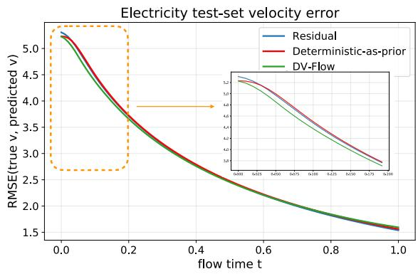

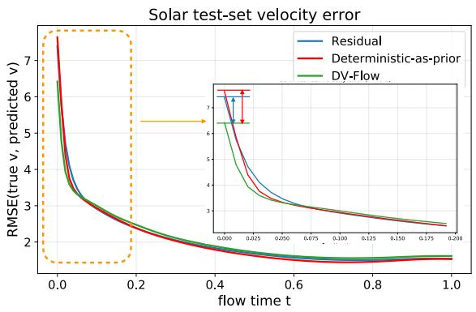  
Figure 3: Velocity Error Comparison. We compare the RMSE of velocity predictions against ground truth on the test set for DV-Flow, residual-based, and deterministic-as-prior. While all three formulations converge as $\tau  1$ , DV-Flow (green) starts with the lowest velocity error when $\tau  0 .$ , demonstrating our formulation has an advantage when τ is small.

Training stability. In this section, we empirically test the theoretical claim that state-dependent coupling in fully joint hybrid formulations leads to unstable training dynamics.

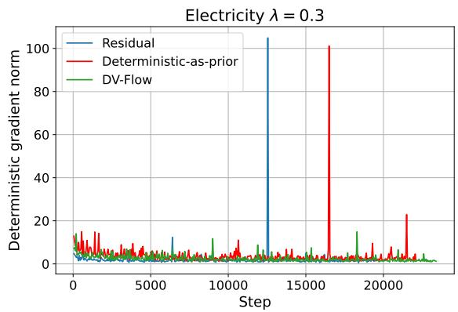

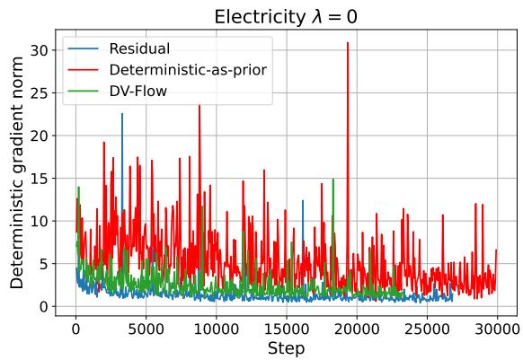  
Figure 4: Gradient norm. On the left, we compare DV-Flow, the residual-based and deterministic-asprior formulations with $\lambda = 0 . 3 .$ . On the right, we repeat the comparison with $\lambda = 0 .$ . In both settings, residual-based and deterministic-as-prior training exhibits large gradient spikes, whereas DV-Flow remains stable without large spikes.

We evaluate training stability by measuring the trace of the gradient norm during training. In Figure 4, we compare DV-Flow, residual-based, and deterministic-as-prior variants for both $\lambda = 0 . 3$ (left) and $\lambda = 0$ (right). In both cases, residual-based and deterministic-as-prior exhibit large spikes in the gradient norm, whereas DV-Flow does not show such spikes. These sharp gradient spikes indicate optimization instability and support our hypothesis that nested coupling creates a deep computation graph, which leads to illconditioned gradients and unstable training. In contrast, the DV-Flow formulation avoids deep sequential coupling by placing the global and local velocities in parallel, resulting in stable gradient behavior without large spikes. Gradient-norm plots for the remaining datasets are provided in Appendix G and exhibit a similar pattern. Across these datasets, the residual-based and deterministic-as-prior formulations show pronounced gradient spikes, whereas DV-Flow maintains substantially more stable gradient norms throughout training.

## 5.3 Investigation of the efect of the point-wise loss

We now study the efect of the point-wise loss across diferent regularization strengths and loss functions.

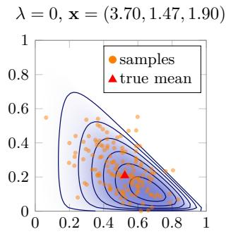

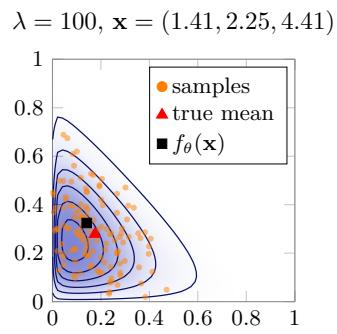

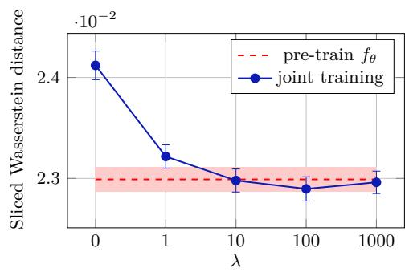  
Figure 5: Investigation of the efect of point-wise loss on a toy dataset generated from a Dirichlet distribtuion.

Table 6: Test set performance across λ settings. ↓
<table><tr><td>Method</td><td>Metric</td><td>Electricity</td><td>Exchange</td><td>Traffic</td><td>Solar</td><td>KDDCUP</td></tr><tr><td rowspan="2">No-deterministic</td><td> $\mathrm { C R P S _ { s u m } }$ </td><td> $0 . 0 2 1 8 \pm 0 . 0 0 1$ </td><td> $0 . 0 0 6 3 \pm 0 . 0 0 2$ </td><td> $0 . 0 7 4 7 \pm 0 . 0 3 9$ </td><td> $0 . 3 9 6 4 \pm 0 . 0 5 2$ </td><td> $0 . 1 0 5 2 \pm 0 . 0 5 3$ </td></tr><tr><td>Q90</td><td> $0 . 0 3 4 9 \pm 0 . 0 0 0$ </td><td> $0 . 0 0 5 1 \pm 0 . 0 0 1$ </td><td> $0 . 1 2 4 7 \pm 0 . 0 2 5$ </td><td> $\mathbf { 0 . 1 6 3 3 \pm 0 . 0 1 0 }$ </td><td> $0 . 2 2 6 1 \pm 0 . 0 1 3$ </td></tr><tr><td rowspan="2">No-deterministic 2X</td><td> $\operatorname { C R P S } _ { \operatorname { Q 9 0 } }$ </td><td> $\begin{array} { c } { 0 . 0 2 9 1 \pm 0 . 0 0 6 } \\ { 0 . 0 4 1 1 \pm 0 . 0 0 5 } \end{array}$ </td><td> $0 . 0 0 5 0 \pm 0 . 0 0 0$ </td><td> $0 . 0 4 9 2 \pm 0 . 0 0 7$ </td><td> $0 . 4 0 0 7 \pm 0 . 0 2 3$ </td><td> $0 . 1 2 1 3 \pm 0 . 0 2 2$ </td></tr><tr><td></td><td></td><td> $0 . 0 0 5 2 \pm 0 . 0 0 1$ </td><td> $0 . 1 0 7 0 \pm 0 . 0 0 2$ </td><td> $0 . 2 4 1 2 \pm 0 . 0 9 2$ </td><td> $0 . 2 3 1 2 \pm 0 . 0 0 4$ </td></tr><tr><td rowspan="2">Pre-train</td><td> $\operatorname { C R P S } _ { \operatorname { Q 9 0 } }$ </td><td></td><td> $0 . 0 0 5 3 \pm 0 . 0 0 0$ </td><td> $0 . 0 6 7 2 \pm 0 . 0 1 0$ </td><td> $\begin{array} { l } { 0 . 5 1 1 9 \pm 0 . 0 0 7 } \\ { 0 . 3 3 1 7 \pm 0 . 0 3 5 } \end{array}$ </td><td> $0 . 2 0 0 2 \pm 0 . 1 3 7$ </td></tr><tr><td></td><td> $\begin{array} { c } { 0 . 0 2 3 5 \pm 0 . 0 0 2 } \\ { 0 . 0 4 1 8 \pm 0 . 0 0 4 } \end{array}$ </td><td> $0 . 0 0 4 2 \pm 0 . 0 0 0$ </td><td> $0 . 1 4 3 4 \pm 0 . 0 0 6$ </td><td></td><td> $0 . 2 6 8 7 \pm 0 . 0 2 2$ </td></tr><tr><td rowspan="2"> $\lambda = 0$ </td><td> $\mathrm { C R P S _ { s u m } }$ </td><td></td><td> $0 . 0 0 5 4 \pm 0 . 0 0 1$ </td><td> $0 . 0 4 2 6 \pm 0 . 0 0 8$ </td><td> $0 . 4 0 0 6 \pm 0 . 1 0 2$ </td><td> $0 . 1 2 1 3 \pm 0 . 0 2 2$ </td></tr><tr><td>Q90</td><td> $\begin{array} { c } { 0 . 0 3 0 1 \pm 0 . 0 0 0 } \\ { 0 . 0 3 7 8 \pm 0 . 0 0 2 } \end{array}$ </td><td> $0 . 0 0 4 3 \pm 0 . 0 0 0$ </td><td> $0 . 1 0 6 3 \pm 0 . 0 0 4$ </td><td> $0 . 2 5 9 0 \pm 0 . 1 3 4$ </td><td> $0 . 2 3 1 2 \pm 0 . 0 0 4$ </td></tr><tr><td rowspan="2"> $\mathrm { D V - F l o w / M S E }$ </td><td></td><td> $\begin{array} { r } { 0 . 0 2 0 3 \pm 0 . 0 0 2 } \\ { \mathbf { 0 . 0 3 4 3 } \pm 0 . 0 0 2 } \end{array}$ </td><td> $0 . 0 0 4 7 \pm 0 . 0 0 0$ </td><td> $\mathbf { 0 . 0 3 7 2 \pm 0 . 0 0 4 }$ </td><td> $0 . 3 3 1 8 \pm 0 . 0 2 9$ </td><td> $0 . 1 0 2 8 \pm 0 . 0 1 4$ </td></tr><tr><td> $\operatorname { C R P S } _ { \operatorname { Q 9 0 } }$ </td><td></td><td> $\mathbf { 0 . 0 0 3 9 } \pm 0 . 0 0 0$ </td><td> $0 . 1 0 5 7 \pm 0 . 0 0 2$ </td><td> $0 . 1 9 6 3 \pm 0 . 0 1 7$ </td><td> $0 . 2 2 3 0 \pm 0 . 0 0 7$ </td></tr><tr><td rowspan="2"> $\mathrm { D V - F l o w / M A E }$ </td><td> $\operatorname { C R P S } _ { \operatorname { Q 9 0 } }$ </td><td></td><td> $\mathbf { 0 . 0 0 4 6 \pm 0 . 0 0 0 }$ </td><td> $0 . 0 3 8 6 \pm 0 . 0 0 5$ </td><td> $\mathbf { 0 . 3 2 8 0 \pm 0 . 0 3 2 }$ </td><td> $\mathbf { 0 . 0 5 7 8 \pm 0 . 0 0 1 }$ </td></tr><tr><td></td><td> $\begin{array} { r } { \mathbf { 0 . 0 1 9 7 } \pm 0 . 0 0 0 } \\ { 0 . 0 3 4 8 \pm 0 . 0 0 2 } \end{array}$ </td><td> $0 . 0 0 4 1 \pm 0 . 0 0 0$ </td><td> $\mathbf { 0 . 1 0 5 4 } \pm 0 . 0 0 3$ </td><td> $0 . 1 8 6 6 \pm 0 . 0 2 5$ </td><td> $\mathbf { 0 . 2 0 5 4 \pm 0 . 0 0 7 }$ </td></tr></table>

The efect of point-wise loss in a toy example. We first study the proposed method on a toy dataset. We generate data from a Dirichlet distribution, where the input $\mathbf { x } = \left( x _ { 1 } , x _ { 2 } , x _ { 3 } \right)$ has three entries. For each sample, one component is selected uniformly at random and drawn from [3, 4], while the remaining two components are independently drawn from [1, 2]. We then sample a probability vector from a Dirichlet distribution parameterized by $\mathbf { x } ,$ and define the target ${ \bf y } = ( y _ { 1 } , y _ { 2 } )$ as the first two entries of the sampled probability vector. The conditional distribution of y is fully determined by x and is known analytically.

We train our model using ${ \bf 1 } , 0 2 4 \left( { \bf x } , { \bf y } \right)$ training samples. After training, we generate samples of y conditioned on each x and compare the resulting distributions with the ground-truth distributions using the sliced Wasserstein distance, where a smaller value indicates better performance. Figure 5 presents the results for the first toy dataset, while an additional example is provided in Figure 12 in the appendix. In the first example, $\lambda = 1 0 0$ achieves the best results, although its improvement over the variant with a pre-trained $f _ { \theta }$ is relatively small. In contrast, for the second toy dataset in Appendix J, which poses a more challenging learning problem, setting $\lambda = 0$ yields significantly better performance than using a pre-trained $f _ { \theta } .$ Overall, our experiments do not reveal a universally optimal choice of λ. Treating λ as a tunable hyperparameter therefore appears to be a promising direction for further improving predictive performance.

Strength of regularization from the point-wise loss. We compare three strategies: no-deterministic component, pre-train the deterministic component $( \lambda = + \infty )$ , and joint training without point-wise loss $( \lambda = 0 )$ . For the no-deterministic configuration, we additionally evaluate a doubled-size neural network with a parameter count comparable to that of DV-Flow, in order to determine whether DV-Flow’s performance gains arise simply from increased model capacity. As shown in Table 6, DV-Flow outperforms all three formulations in terms of $\mathrm { C R P S _ { s u m } }$ across all datasets, and achieves the best Q90 on four out of five datasets, ranking second on the remaining one. This demonstrates that each component contributes to performance: the deterministic model improves the conditioning of context, joint training enables efective interaction between components, and the point-wise loss ensures proper alignment of the deterministic predictor.

Table 7: Ablation study on dual velocity ↓
<table><tr><td>Method</td><td>Metric</td><td>Electricity</td><td>Exchange</td><td>Traffic</td><td>KDDCUP</td><td>SP500</td></tr><tr><td rowspan="2">vanilla FM</td><td> $\mathrm { C R P S _ { s u m } }$ </td><td> $0 . 0 2 5 7 \pm 0 . 0 0 4$ </td><td> $0 . 0 0 6 5 \pm 0 . 0 0 0$ </td><td> $0 . 0 5 1 7 \pm 0 . 0 0 5$ </td><td> $0 . 2 4 2 6 \pm 0 . 0 8 9$ </td><td> $0 . 8 8 8 4 \pm 0 . 0 5 1$ </td></tr><tr><td>Q90</td><td> $\mathbf { 0 . 0 3 4 4 } \pm 0 . 0 0 1$ </td><td> $0 . 0 0 5 9 \pm 0 . 0 0 0$ </td><td> $0 . 1 0 8 0 \pm 0 . 0 0 1$ </td><td> $0 . 3 4 6 1 \pm 0 . 0 5 9$ </td><td> $0 . 5 2 4 6 \pm 0 . 0 0 5$ </td></tr><tr><td rowspan="2">vanilla  $\mathrm { F M } + \mathrm { S A T N }$ </td><td></td><td> $0 . 0 2 5 9 \pm 0 . 0 0 3$ </td><td> $0 . 0 0 5 6 \pm 0 . 0 0 0$ </td><td> $0 . 0 5 4 6 \pm 0 . 0 0 6$ </td><td> $0 . 1 7 0 9 \pm 0 . 0 9 2$ </td><td> $0 . 8 8 3 8 \pm 0 . 0 5 2$ </td></tr><tr><td> $\mathrm { C R P S _ { s u m } }$ </td><td> $0 . 0 3 9 6 \pm 0 . 0 0 5$ </td><td> $0 . 0 0 4 6 \pm 0 . 0 0 0$ </td><td> $0 . 1 2 0 4 \pm 0 . 0 1 5$ </td><td> $0 . 2 6 8 3 \pm 0 . 0 5 1$ </td><td> $0 . 5 2 5 8 \pm 0 . 0 0 3$ </td></tr><tr><td rowspan="2"> $\mathrm { F M } + \mathrm { S A T N } + \mathrm { G P }$  vanilla</td><td></td><td> $0 . 0 2 4 7 \pm 0 . 0 0 3$ </td><td> $0 . 0 0 5 3 \pm 0 . 0 0 0$ </td><td> $0 . 0 4 6 1 \pm 0 . 0 1 1$ </td><td> $0 . 1 4 0 7 \pm 0 . 0 2 0$ </td><td> $0 . 8 5 6 0 \pm 0 . 0 1 6$ </td></tr><tr><td> $\mathrm { C R P S _ { s u m } }$ </td><td> $0 . 0 3 6 8 \pm 0 . 0 0 2$ </td><td> $0 . 0 0 4 3 \pm 0 . 0 0 0$ </td><td> $0 . 1 0 6 5 \pm 0 . 0 0 2$ </td><td> $0 . 2 3 4 1 \pm 0 . 0 0 1$ </td><td> $0 . 5 3 8 2 \pm 0 . 0 1 5$ </td></tr><tr><td rowspan="2">DV-Flow</td><td> $\mathrm { C R P S _ { s u m } }$ </td><td> $\mathbf { 0 . 0 1 9 7 \pm 0 . 0 0 0 }$ </td><td> $\mathbf { 0 . 0 0 4 6 \pm 0 . 0 0 0 }$ </td><td> $\mathbf { 0 . 0 3 8 6 \pm 0 . 0 0 5 }$ </td><td> $\mathbf { 0 . 0 5 7 8 \pm 0 . 0 0 1 }$ </td><td> $\mathbf { 0 . 7 9 5 8 \pm 0 . 0 1 8 }$ </td></tr><tr><td>Q90</td><td> $0 . 0 3 4 8 \pm 0 . 0 0 2$ </td><td> $\mathbf { 0 . 0 0 4 1 } \pm 0 . 0 0 0$ </td><td> $\mathbf { 0 . 1 0 5 4 \pm 0 . 0 0 3 }$ </td><td> $\mathbf { 0 . 2 0 5 4 \pm 0 . 0 0 7 }$ </td><td> $\mathbf { 0 . 5 2 3 5 \pm 0 . 0 0 8 }$ </td></tr></table>

Choice of point-wise loss. We use MAE as the pointwise loss term in the objective function. As shown in Baringhaus & Franz (2004); Szekely et al. (2005); Gneiting & Raftery (2007), CRPS can be written as the following, where $Z , Z ^ { \prime } \sim F$ are independent samples and x is the observation:

$$
\mathrm { C R P S } = \mathbb { E } _ { F } | Z - x | - \frac { 1 } { 2 } \mathbb { E } _ { F } | Z - Z ^ { \prime } | .\tag{10}
$$

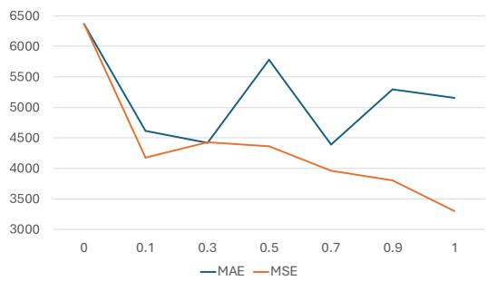

It shows that MAE is closely aligned with the CRPS evaluation objective used in probabilistic forecasting. This formulation highlights CRPS as a distributional generalization of MAE: the first term corresponds to the expected absolute deviation from the observation, while the second term penal-

Figure 6: $\ell _ { 2 }$ distance between the prediction mean and median across various λ levels.

izes excessive dispersion. In the degenerate case where F collapses to a point mass, CRPS reduces to MAE. Therefore, MAE provides a more natural auxiliary objective when the downstream goal is strong CRPS performance. Under this view, the deterministic model supplies a median-centered baseline forecast, while the flow component focuses on refining the predictive distribution around this baseline. Table 6 shows that training with MAE loss has an overall better $\mathrm { C R P S _ { s u m } }$ than training with MSE loss.

Furthermore, MAE supervision preserves skewness more efectively than MSE supervision on skewed data. We demonstrate it with the Electricity dataset, which exhibits large outliers during peak usage periods. As shown in Figure 6, the $\ell _ { 2 }$ distance between the prediction mean and median decreases as λ increases under MSE training, while remaining relatively stable under MAE training.

## 5.4 Ablation

To distinguish the contribution of the proposed dual-velocity parameterization from those of SATN and the Gaussian-process prior, we conduct a controlled incremental ablation. Starting from vanilla flow matching, we progressively introduce SATN, the Gaussian-process prior, and the dual-velocity parameterization. All configurations use the same backbone architecture, optimization settings, and training budget. As shown in Table 7, DV-Flow achieves the lowest $\mathrm { C R P S _ { s u m } }$ across all datasets, often by a substantial margin, and the lowest Q90 on four of the five datasets. Most importantly, the comparison between the complete DV-Flow model and vanilla flow matching with both SATN and the Gaussian-process prior difers only in the velocity parameterization. Therefore, the improvement between these configurations directly isolates the contribution of the proposed dual-velocity design, rather than attributing it to SATN or the Gaussian-process prior.

## 6 Limitation

DV-Flow moderately increases the number of learnable parameters and the runtime during both training and forecasting. Adding the deterministic predictor increases the total parameter count of DV-Flow to approximately 1.3× that of the corresponding single-network model. The training time per epoch is approximately 1.4× that of the single-network model, 2.2× that of representative probabilistic-only baselines, and 1.4× that of other hybrid baselines. The peak GPU memory usage is approximately 1.14× that of the single-network model and approximately the same as that of the hybrid baselines. DV-Flow requires approximately 1.1× the inference time of flow-based single-network baseline, and 2.1× that of the difusion-based hybrid baselines. We use 100 function evaluations across all models for the inference time analysis. We use 100 function evaluations across all models for the inference time analysis.

## 7 Conclusion

We introduce DV-Flow, a hybrid flow-matching framework that incorporates a deterministic model as an additional velocity component, rather than treating it as the endpoint of the transport path. This design avoids deep computational graphs and preserves a fixed probability path, resulting in more stable and eficient end-to-end training. Empirically, DV-Flow consistently outperforms baseline methods across multiple benchmark datasets, improving both predictive performance and training stability in fully joint settings. The proposed dual-velocity parameterization may also extend to broader conditional-generation domains, which we leave for future work.

## Impact Statement

This work aims to improve the reliability and stability of probabilistic time series forecasting, which may benefit decision-making in applications such as weather, energy, and finance, while sharing the same considerations regarding data bias and responsible deployment as other forecasting models.

## References

Alexander Alexandrov, Konstantinos Benidis, Michael Bohlke-Schneider, Valentin Flunkert, Jan Gasthaus, Tim Januschowski, Danielle C Maddix, Syama Rangapuram, David Salinas, Jasper Schulz, et al. Gluonts: Probabilistic time series models in python. arXiv preprint arXiv:1906.05264, 2019.

Michael Baake and Ulrike Schlaegel. The peano-baker series. Proceedings of the Steklov Institute of Mathematics, 275(1):155–159, 2011.

Ludwig Baringhaus and Carsten Franz. On a new multivariate two-sample test. Journal of multivariate analysis, 88(1):190–206, 2004.

Mathieu Blondel, Arthur Mensch, and Jean-Philippe Vert. Diferentiable divergences between time series. In International Conference on Artificial Intelligence and Statistics, pp. 3853–3861. PMLR, 2021.

George E. P. Box and Gwilym M. Jenkins. Time Series Analysis: Forecasting and Control. Holden-Day, 1st edition, 1970.

Jannis Chemseddine, Paul Hagemann, Gabriele Steidl, and Christian Wald. Conditional wasserstein distances with applications in bayesian ot flow matching. arXiv preprint arXiv:2403.18705, 2024.

Ricky TQ Chen, Yulia Rubanova, Jesse Bettencourt, and David K Duvenaud. Neural ordinary diferential equations. Advances in neural information processing systems, 31, 2018.

Kyunghyun Cho, Bart Van Merriënboer, Caglar Gulcehre, Dzmitry Bahdanau, Fethi Bougares, Holger Schwenk, and Yoshua Bengio. Learning phrase representations using rnn encoder-decoder for statistical machine translation. arXiv preprint arXiv:1406.1078, 2014.

Andrea Coletta, Sriram Gopalakrishnan, Daniel Borrajo, and Svitlana Vyetrenko. On the constrained timeseries generation problem. Advances in Neural Information Processing Systems, 36, 2024.

Jefery T. Connor, Robert D. Martin, and Les E. Atlas. Recurrent neural networks and robust time series prediction. IEEE Transactions on Neural Networks, 5(2):240–254, 1994.

J. R. Dormand and P. J. Prince. A family of embedded runge–kutta formulae. Journal of Computational and Applied Mathematics, 6(1):19–26, 1980. doi: 10.1016/0771-050X(80)90013-3. URL https://www. sciencedirect.com/science/article/pii/0771050X80900133.

Dheeru Dua and Efi Karra Taniskidou. Uci machine learning repository, 2017. URL http://archive.ics. uci.edu/ml.

Wei Fan, Shun Zheng, Xiaohan Yi, Wei Cao, Yanjie Fu, Jiang Bian, and Tie-Yan Liu. Depts: Deep expansion learning for periodic time series forecasting. arXiv preprint arXiv:2203.07681, 2022.

Xinyao Fan, Yueying Wu, Chang Xu, Yuhao Huang, Weiqing Liu, and Jiang Bian. Mg-tsd: Multi-granularity time series difusion models with guided learning process. arXiv preprint arXiv:2403.05751, 2024.

Ronald Aylmer Fisher. Statistical methods for research workers. In Breakthroughs in statistics: Methodology and distribution, pp. 66–70. Springer, 1970.

Jiaxin Gao, Qinglong Cao, and Yuntian Chen. Auto-regressive moving difusion models for time series forecasting. arXiv preprint arXiv:2412.09328, 2024.

Tilmann Gneiting and Adrian E Raftery. Strictly proper scoring rules, prediction, and estimation. Journal of the American statistical Association, 102(477):359–378, 2007.

Junchao Gong, Lei Bai, Peng Ye, Wanghan Xu, Na Liu, Jianhua Dai, Xiaokang Yang, and Wanli Ouyang. Cascast: Skillful high-resolution precipitation nowcasting via cascaded modelling. arXiv preprint arXiv:2402.04290, 2024.

Ian J Goodfellow, Jean Pouget-Abadie, Mehdi Mirza, Bing Xu, David Warde-Farley, Sherjil Ozair, Aaron Courville, and Yoshua Bengio. Generative adversarial nets. Advances in neural information processing systems, 27, 2014.

Jonathan Ho, Ajay Jain, and Pieter Abbeel. Denoising difusion probabilistic models. Advances in neural information processing systems, 33:6840–6851, 2020.

Jonathan Ho, Tim Salimans, Alexey Gritsenko, William Chan, Mohammad Norouzi, and David J Fleet. Video difusion models. Advances in Neural Information Processing Systems, 35:8633–8646, 2022.

Sepp Hochreiter and Jürgen Schmidhuber. Long short-term memory. Neural computation, 9(8):1735–1780, 1997.

Yang Hu, Xiao Wang, Lirong Wu, Huatian Zhang, Stan Z Li, Sheng Wang, and Tianlong Chen. Fm-ts: Flow matching for time series generation. arXiv preprint arXiv:2411.07506, 2024.

Hongbin Huang, Minghua Chen, and Xiao Qiao. Generative learning for financial time series with irregular and scale-invariant patterns. In The Twelfth International Conference on Learning Representations, 2024.

Gavin Kerrigan, Giosue Migliorini, and Padhraic Smyth. Dynamic conditional optimal transport through simulation-free flows. In The Thirty-eighth Annual Conference on Neural Information Processing Systems, 2024a. URL https://openreview.net/forum?id=tk0uaRynhH.

Gavin Kerrigan, Giosue Migliorini, and Padhraic Smyth. Functional flow matching. In Sanjoy Dasgupta, Stephan Mandt, and Yingzhen Li (eds.), Proceedings of The 27th International Conference on Artificial Intelligence and Statistics, volume 238 of Proceedings of Machine Learning Research, pp. 3934–3942. PMLR, 02–04 May 2024b.

Marcel Kollovieh, Abdul Fatir Ansari, Michael Bohlke-Schneider, Jasper Zschiegner, Hao Wang, and Yuyang Bernie Wang. Predict, refine, synthesize: Self-guiding difusion models for probabilistic time series forecasting. Advances in Neural Information Processing Systems, 36, 2024a.

Marcel Kollovieh, Marten Lienen, David Lüdke, Leo Schwinn, and Stephan Günnemann. Flow matching with gaussian process priors for probabilistic time series forecasting. arXiv preprint arXiv:2410.03024, 2024b.

Guokun Lai, Wei-Cheng Chang, Yiming Yang, and Hanxiao Liu. Modeling long-and short-term tempora patterns with deep neural networks. In The 41st international ACM SIGIR conference on research & development in information retrieval, pp. 95–104, 2018.

Qi Li, Zhenyu Zhang, Lei Yao, Zhaoxia Li, Tianyi Zhong, and Yong Zhang. Difusion-based decoupled deterministic and uncertain framework for probabilistic multivariate time series forecasting. In The Thirteenth International Conference on Learning Representations, 2025.

Yuxin Li, Wenchao Chen, Xinyue Hu, Bo Chen, Mingyuan Zhou, et al. Transformer-modulated difusion models for probabilistic multivariate time series forecasting. In The Twelfth International Conference on Learning Representations, 2024.

Bryan Lim, Sercan Ö Arık, Nicolas Loef, and Tomas Pfister. Temporal fusion transformers for interpretable multi-horizon time series forecasting. International Journal of Forecasting, 37(4):1748–1764, 2021.

Shengsheng Lin, Weiwei Lin, Xinyi Hu, Wentai Wu, Ruichao Mo, and Haocheng Zhong. Cyclenet: enhancing time series forecasting through modeling periodic patterns. arXiv preprint arXiv:2409.18479, 2024a.

Shengsheng Lin, Weiwei Lin, Wentai Wu, Haojun Chen, and Junjie Yang. Sparsetsf: Modeling long-term time series forecasting with 1k parameters. arXiv preprint arXiv:2405.00946, 2024b.

Yaron Lipman, Ricky TQ Chen, Heli Ben-Hamu, Maximilian Nickel, and Matt Le. Flow matching for generative modeling. arXiv preprint arXiv:2210.02747, 2022.

Xingchao Liu, Chengyue Gong, and Qiang Liu. Flow straight and fast: Learning to generate and transfer data with rectified flow. arXiv preprint arXiv:2209.03003, 2022.

Yong Liu, Tengge Hu, Haoran Zhang, Haixu Wu, Shiyu Wang, Lintao Ma, and Mingsheng Long. itransformer: Inverted transformers are efective for time series forecasting. arXiv preprint arXiv:2310.06625, 2023.

I Loshchilov. Decoupled weight decay regularization. arXiv preprint arXiv:1711.05101, 2017.

Nanye Ma, Mark Goldstein, Michael S Albergo, Nicholas M Bofi, Eric Vanden-Eijnden, and Saining Xie. Sit: Exploring flow and difusion-based generative models with scalable interpolant transformers. In European Conference on Computer Vision, pp. 23–40. Springer, 2024.

James E Matheson and Robert L Winkler. Scoring rules for continuous probability distributions. Management science, 22(10):1087–1096, 1976.

Volodymyr Mnih, Koray Kavukcuoglu, David Silver, Andrei A Rusu, Joel Veness, Marc G Bellemare, Alex Graves, Martin Riedmiller, Andreas K Fidjeland, Georg Ostrovski, et al. Human-level control through deep reinforcement learning. nature, 518(7540):529–533, 2015.

Mahdi Pakdaman Naeini, Gregory Cooper, and Milos Hauskrecht. Obtaining well calibrated probabilities using bayesian binning. In Proceedings of the AAAI conference on artificial intelligence, volume 29, 2015.

Yuqi Nie, Nam H Nguyen, Phanwadee Sinthong, and Jayant Kalagnanam. A time series is worth 64 words: Long-term forecasting with transformers. arXiv preprint arXiv:2211.14730, 2022.

Michael Poli, Stefano Massaroli, Atsushi Yamashita, Hajime Asama, and Jinkyoo Park. Torchdyn: A neural diferential equations library. arXiv preprint arXiv:2009.09346, 2020.

Syama Sundar Rangapuram, Matthias W Seeger, Jan Gasthaus, Lorenzo Stella, Yuyang Wang, and Tim Januschowski. Deep state space models for time series forecasting. Advances in neural information processing systems, 31, 2018.

Kashif Rasul, Abdul-Saboor Sheikh, Ingmar Schuster, Urs Bergmann, and Roland Vollgraf. Multivariate probabilistic time series forecasting via conditioned normalizing flows. arXiv preprint arXiv:2002.06103, 2020.

Kashif Rasul, Calvin Seward, Ingmar Schuster, and Roland Vollgraf. Autoregressive denoising difusion models for multivariate probabilistic time series forecasting. In International Conference on Machine Learning, pp. 8857–8868. PMLR, 2021.

David Salinas, Valentin Flunkert, Jan Gasthaus, and Tim Januschowski. Deepar: Probabilistic forecasting with autoregressive recurrent networks. International journal of forecasting, 36(3):1181–1191, 2020.

Christopher A. Sims. Macroeconomics and reality. Econometrica, 48(1):1–48, 1980.

Yang Song, Jascha Sohl-Dickstein, Diederik P Kingma, Abhishek Kumar, Stefano Ermon, and Ben Poole. Score-based generative modeling through stochastic diferential equations. arXiv preprint arXiv:2011.13456, 2020.

Prakhar Srivastava, Ruihan Yang, Gavin Kerrigan, Gideon Dresdner, Jeremy McGibbon, Christopher S Bretherton, and Stephan Mandt. Precipitation downscaling with spatiotemporal video difusion. Advances in Neural Information Processing Systems, 37:56374–56400, 2024.

Kamile Stankeviciute, Ahmed M Alaa, and Mihaela van der Schaar. Conformal time-series forecasting. Advances in neural information processing systems, 34:6216–6228, 2021.

Salvatore Stolfo, Wei Fan, Wenke Lee, Andreas Prodromidis, and Philip Chan. Kdd cup 1999 data. https: //doi.org/10.24432/C51C7N, 1999. UCI Machine Learning Repository.

Sophia Sun and Rose Yu. Copula conformal prediction for multi-step time series forecasting. arXiv preprint arXiv:2212.03281, 2022.

Ilya Sutskever, Oriol Vinyals, and Quoc V Le. Sequence to sequence learning with neural networks. Advances in neural information processing systems, 27, 2014.

Gabor J Szekely, Maria L Rizzo, et al. Hierarchical clustering via joint between-within distances: Extending ward’s minimum variance method. Journal of classification, 22(2):151–184, 2005.

Ella Tamir, Najwa Laabid, Markus Heinonen, Vikas Garg, and Arno Solin. Conditional flow matching for time series modelling. In ICML 2024 Workshop on Structured Probabilistic Inference & Generative Modeling, 2024. URL https://openreview.net/forum?id=Hqn4Aj7xrQ.

Yusuke Tashiro, Jiaming Song, Yang Song, and Stefano Ermon. Csdi: Conditional score-based difusion models for probabilistic time series imputation. Advances in neural information processing systems, 34: 24804–24816, 2021.

Alexander Tong, Nikolay Malkin, Guillaume Huguet, Yanlei Zhang, Jarrid Rector-Brooks, Kilian Fatras, Guy Wolf, and Yoshua Bengio. Improving and generalizing flow-based generative models with minibatch optimal transport. arXiv preprint arXiv:2302.00482, 2023.

A Vaswani. Attention is all you need. Advances in Neural Information Processing Systems, 2017.

Vladimir Vovk, Alexander Gammerman, and Glenn Shafer. Algorithmic learning in a random world, volume 29. Springer, 2005.

Haixu Wu, Jiehui Xu, Jianmin Wang, and Mingsheng Long. Autoformer: Decomposition transformers with auto-correlation for long-term series forecasting. Advances in neural information processing systems, 34: 22419–22430, 2021.

Tianyu Xie, Yu Zhu, Longlin Yu, Tong Yang, Ziheng Cheng, Shiyue Zhang, Xiangyu Zhang, and Cheng Zhang. Reflected flow matching. arXiv preprint arXiv:2405.16577, 2024.

Huibo Xu, Runlong Yu, Likang Wu, Xianquan Wang, and Qi Liu. Bridging the last mile of prediction: Enhancing time series forecasting with conditional guided flow matching. arXiv preprint arXiv:2507.07192, 2025.

Weiwei Ye, Zhuopeng Xu, and Ning Gui. Non-stationary difusion for probabilistic time series forecasting. arXiv preprint arXiv:2505.04278, 2025.

Demin Yu, Xutao Li, Yunming Ye, Baoquan Zhang, Chuyao Luo, Kuai Dai, Rui Wang, and Xunlai Chen. Difcast: A unified framework via residual difusion for precipitation nowcasting. In Proceedings of the IEEE/CVF Conference on Computer Vision and Pattern Recognition, pp. 27758–27767, 2024.

X Yuan and Y Qiao. Difusion-ts: Interpretable difusion for general time series generation. arxiv 2024. arXiv preprint arXiv:2403.01742, 2024.

Ailing Zeng, Muxi Chen, Lei Zhang, and Qiang Xu. Are transformers efective for time series forecasting? In Proceedings of the AAAI conference on artificial intelligence, volume 37, pp. 11121–11128, 2023.

Xi Zhang, Yuan Pu, Yuki Kawamura, Andrew Loza, Yoshua Bengio, Dennis L Shung, and Alexander Tong. Trajectory flow matching with applications to clinical time series modeling. arXiv preprint arXiv:2410.21154, 2024.

## A Derivation of distribution learning with linear assumption

## A.1 Theorem proof

Proof. Consider the DV-Flow ODE

$$
\frac { d \mathbf { y } ^ { \tau } } { d \tau } = f _ { \theta } ( \mathbf { x } ) + g _ { \phi } ( \mathbf { y } ^ { \tau } , \tau , \mathbf { x } ) , \qquad \mathbf { y } ^ { 0 } = \epsilon .\tag{11}
$$

Define the shifted residual coordinate

$$
\mathbf { r } ^ { \tau } = \mathbf { y } ^ { \tau } - \tau f _ { \theta } ( \mathbf { x } ) .\tag{12}
$$

Since $f _ { \theta } ( \mathbf { x } )$ is independent of $\tau ,$ diferentiating both sides gives

$$
\frac { d { \bf r } ^ { \tau } } { d \tau } = \frac { d { \bf y } ^ { \tau } } { d \tau } - f _ { \theta } ( { \bf x } ) .\tag{13}
$$

Substituting the DV-Flow ODE, we obtain

$$
\frac { d \mathbf { r } ^ { \tau } } { d \tau } = f _ { \theta } ( \mathbf { x } ) + g _ { \phi } ( \mathbf { y } ^ { \tau } , \tau , \mathbf { x } ) - f _ { \theta } ( \mathbf { x } )\tag{14}
$$

$$
\begin{array} { r } { { \bf \Xi } = g _ { \phi } ( { \bf y } ^ { \tau } , \tau , { \bf x } ) . } \end{array}\tag{15}
$$

Using $\mathbf { y } ^ { \tau } = \mathbf { r } ^ { \tau } + \tau f _ { \theta } ( \mathbf { x } )$ , this becomes

$$
\frac { d \mathbf { r } ^ { \tau } } { d \tau } = g _ { \phi } ( \mathbf { r } ^ { \tau } + \tau f _ { \theta } ( \mathbf { x } ) , \tau , \mathbf { x } ) .\tag{16}
$$

Let

$$
g ^ { \prime } ( \mathbf { r } ^ { \tau } , \tau ) = g _ { \phi } ( \mathbf { r } ^ { \tau } + \tau f _ { \theta } ( \mathbf { x } ) , \tau , \mathbf { x } ) .\tag{17}
$$

Then the residual coordinate follows the ODE

$$
\frac { d \mathbf { r } ^ { \tau } } { d \tau } = g ^ { \prime } ( \mathbf { r } ^ { \tau } , \tau ) , \qquad \mathbf { r } ^ { 0 } = \mathbf { y } ^ { 0 } = \epsilon .\tag{18}
$$

At $\tau = 1$ , we have

$$
\mathbf { r } ^ { 1 } = \mathbf { y } ^ { 1 } - f _ { \theta } ( \mathbf { x } ) .\tag{19}
$$

Therefore, if the DV-Flow ODE transports ϵ to samples $\mathbf { y } ^ { 1 } \sim p ( \mathbf { y } \mid \mathbf { x } )$ , then the transformed ODE defined by $g ^ { \prime }$ transports ϵ to samples

$$
\mathbf { r } ^ { 1 } = \mathbf { y } ^ { 1 } - f _ { \theta } ( \mathbf { x } ) .\tag{20}
$$

Equivalently, the terminal distribution of the residual-coordinate ODE is the distribution of $\mathbf { y } - f _ { \boldsymbol { \theta } } ( \mathbf { x } )$

$$
f _ { \theta } ( \mathbf { x } ) = \mathbb { E } [ \mathbf { y } \mid \mathbf { x } ] ,\tag{21}
$$

then

$$
\operatorname { \mathbb { E } } [ \mathbf { r } ^ { 1 } \mid \mathbf { x } ] = \operatorname { \mathbb { E } } [ \mathbf { y } - f _ { \theta } ( \mathbf { x } ) \mid \mathbf { x } ] = \operatorname { \mathbb { E } } [ \mathbf { y } \mid \mathbf { x } ] - f _ { \theta } ( \mathbf { x } ) = 0 .\tag{22}
$$

Thus the ODE defined by $g ^ { \prime }$ pushes Gaussian noise to a zero-mean residual distribution.

Alternatively, suppose that $f _ { \boldsymbol { \theta } } ( \mathbf { x } )$ is a coordinate-wise conditional median of $\mathbf { y }$ given x, i.e.,

$$
f _ { \theta } ( \mathbf { x } ) = \operatorname { M e d } ( \mathbf { y } \mid \mathbf { x } ) .\tag{23}
$$

By the translation equivariance of the median,

$$
{ \begin{array} { r l } & { \operatorname { M e d } ( \mathbf { r } ^ { 1 } \mid \mathbf { x } ) = \operatorname { M e d } \left( \mathbf { y } - f _ { \theta } ( \mathbf { x } ) \mid \mathbf { x } \right) } \\ & { \qquad = \operatorname { M e d } ( \mathbf { y } \mid \mathbf { x } ) - f _ { \theta } ( \mathbf { x } ) = 0 . } \end{array} }\tag{24}
$$

Thus, the ODE defined by $g ^ { \prime }$ pushes Gaussian noise to a residual distribution for which zero is a coordinatewise conditional median. □

## A.2 General linear form

Assume the prior is a standard Gaussian distribution $\mathbf { y } ^ { 0 } \sim \mathcal { N } ( 0 , I )$ , and the local velocity has a linear form: $g _ { \phi } = A ( \tau ) \mathbf { y } ^ { \tau } + a ( \tau )$ . The ODE becomes: $\dot { \mathbf { y } } ^ { \tau } = A ( \tau ) \mathbf { y } ^ { \tau } + a ( \tau ) + f _ { \theta } ( \mathbf { x } )$ . Consider the homogeneous part

$$
\dot { \mathbf { y } } ^ { \tau } = \boldsymbol { A } ( \tau ) \mathbf { y } ^ { \tau }
$$

The solution is $\mathbf { y } ^ { \tau } = \varPhi ( \tau , s ) \mathbf { y } ^ { s }$ , where $\begin{array} { r } { \frac { \partial \varPhi ( \tau , s ) } { \partial \tau } = A ( \tau ) \varPhi ( \tau , s ) } \end{array}$ , and $\varPhi ( s , s ) = I$ . Now make an ansatz for some vector $c ( \tau )$

$$
\mathbf { y } ^ { \tau } = \varPhi ( \tau , 0 ) c ( \tau )\tag{25}
$$

If we diferentiate the ansatz:

$$
\begin{array} { l } { { \displaystyle { \dot { \bf y } ^ { \tau } } = \frac { \partial \phi ( \tau , 0 ) } { \partial \tau } c ( \tau ) + \varPhi ( \tau , 0 ) c ( { \dot { \tau } } ) } } \\ { { \displaystyle ~ = A ( \tau ) \varPhi ( \tau , 0 ) c ( \tau ) + \varPhi ( \tau , 0 ) c ( { \dot { \tau } } ) } } \\ { { \displaystyle ~ = A ( \tau ) { \bf x } ^ { \tau } + \varPhi ( \tau , 0 ) c ( { \dot { \tau } } ) } } \end{array}\tag{26}
$$

Compare with the original ODE $\dot { \mathbf { y } } ^ { \tau } = A ( \tau ) \mathbf { y } ^ { \tau } + a ( \tau ) + f _ { \theta } ( \mathbf { x } )$ , we get $\varPhi ( \tau , 0 ) c ( \dot { \tau } ) = a ( \tau ) + f _ { \theta } ( \mathbf { x } )$ . Therefore, $\dot { c ( \tau ) } = \varPhi ( \tau , 0 ) ^ { - 1 } ( a ( \tau ) + f _ { \theta } ( \mathbf { x } ) ) = \varPhi ( 0 , \tau ) ( a ( \tau ) + f _ { \theta } ( \mathbf { x } ) )$ . Integrate for $c ( \tau )$

$$
c ( \tau ) = c ( 0 ) + \int _ { 0 } ^ { \tau } \varPhi ( 0 , s ) ( a ( s ) + f _ { \theta } ( \mathbf { x } ) ) d s\tag{27}
$$

At $\boldsymbol { \tau } = 0 , \mathbf { y } ^ { \tau } = \boldsymbol { \phi } ( 0 , 0 ) c ( 0 ) = I c ( 0 ) = \mathbf { y } ^ { 0 }$ , therefore, $c ( 0 ) = \mathbf { y } ^ { 0 }$ . Back substitute Equation 25:

$$
\begin{array} { l } { \displaystyle { \mathbf { y } ^ { \tau } = \varPhi ( \tau , 0 ) c ( \tau ) } } \\ { \displaystyle { \quad = \varPhi ( \tau , 0 ) [ \mathbf { y } ^ { 0 } + \int _ { 0 } ^ { \tau } \varPhi ( 0 , s ) ( a ( s ) + f _ { \theta } ( \mathbf { x } ) ) d s ] } } \\ { \displaystyle { \quad = \varPhi ( \tau , 0 ) \mathbf { y } ^ { 0 } + \int _ { 0 } ^ { \tau } \varPhi ( \tau , s ) ( a ( s ) + f _ { \theta } ( \mathbf { x } ) ) d s } } \end{array}\tag{28}
$$

For better understanding of $\phi ( \tau , s )$ , according to the Peano-Baker series Baake & Schlaegel (2011):

$$
\begin{array} { l } { \displaystyle \varPhi ( \tau , s ) = I + \int _ { s } ^ { \tau } A ( \mathfrak { c } ) \varPhi ( \varsigma , s ) d \varsigma } \\ { \displaystyle = I + \int _ { s } ^ { \tau } A ( \mathfrak { c } ) d \varsigma + \int _ { s } ^ { \tau } A ( \mathfrak { c } _ { 1 } ) \int _ { s } ^ { \varsigma _ { 1 } } A ( \mathfrak { c } _ { 2 } ) d \varsigma _ { 1 } d \varsigma _ { 2 } + . . . } \\ { \displaystyle = I + \sum _ { n = 1 } ^ { \infty } \mathcal { T } _ { n } ( \tau ) } \end{array}\tag{29}
$$

Where

$$
{ \mathcal { T } } _ { n } ( \tau ) = \int _ { s } ^ { \tau } A ( \varsigma _ { 1 } ) \int _ { s } ^ { \varsigma _ { 1 } } A ( \varsigma _ { 2 } ) \cdot \cdot \cdot \int _ { s } ^ { \varsigma _ { n - 1 } } A ( \varsigma _ { n } ) d \varsigma _ { 1 } d \varsigma _ { 2 } \cdot \cdot \cdot d \varsigma _ { n }
$$

According to Equation 28, $\begin{array} { r } { \mathbf { y } ^ { 1 } = \varPhi ( 1 , 0 ) \mathbf { y } ^ { 0 } + \int _ { 0 } ^ { 1 } \varPhi ( 1 , s ) ( a ( s ) + f _ { \theta } ( \mathbf { x } ) ) d s . } \end{array}$

$$
\begin{array} { l } { \displaystyle \mu ^ { 1 } = \mathbb { E } [ \mathbf { y } ^ { 1 } ] } \\ { \displaystyle = \mathbb { E } [ \hat { \boldsymbol { \phi } } ( 1 , 0 ) \mathbf { y } ^ { 0 } + \int _ { 0 } ^ { 1 } \hat { \boldsymbol { \phi } } ( 1 , s ) ( a ( s ) + f _ { \boldsymbol { \theta } } ( \mathbf { x } ) ) d s ] } \\ { \displaystyle = \bar { \boldsymbol { \phi } } ( 1 , 0 ) \mathbb { E } [ \mathbf { y } ^ { 0 } ] + \int _ { 0 } ^ { 1 } \bar { \boldsymbol { \phi } } ( 1 , s ) ( a ( s ) + f _ { \boldsymbol { \theta } } ( \mathbf { x } ) ) d s } \\ { \displaystyle = \int _ { 0 } ^ { 1 } \bar { \boldsymbol { \phi } } ( 1 , s ) ( a ( s ) + f _ { \boldsymbol { \theta } } ( \mathbf { x } ) ) d s } \\ { \displaystyle = \int _ { 0 } ^ { 1 } \bar { \boldsymbol { \phi } } ( 1 , s ) ( a ( s ) + f _ { \boldsymbol { \theta } } ( \mathbf { x } ) ) d s } \\ { \displaystyle \mathbf { \boldsymbol { \Sigma } } ^ { 1 } = V a r ( \mathbf { y } ^ { 1 } ) = V a r ( \boldsymbol { \phi } ( 1 , 0 ) \mathbf { y } ^ { 0 } + \int _ { 0 } ^ { 1 } \boldsymbol { \phi } ( 1 , s ) ( a ( s ) + f _ { \boldsymbol { \theta } } ( \mathbf { x } ) ) d s ) } \\ { \displaystyle = V a r ( \bar { \boldsymbol { \phi } } ( 1 , 0 ) \mathbf { y } ^ { 0 } ) + \bar { \boldsymbol { \phi } } ( 1 , 0 ) \hat { l } \bar { \boldsymbol { \phi } } ( 1 , 0 ) ^ { T } } \end{array}\tag{30}
$$

## A.3 Special Case of Constant A

For the special case where $A ( \tau ) \equiv A$ is constant and $a ( \tau ) \equiv 0$ , solving the ODE $\begin{array} { r } { \frac { \partial \phi ( \tau , s ) } { \partial \tau } = A \varPhi ( \tau , s ) } \end{array}$ with initial condition $\phi ( s , s ) = I ,$ we get $\varPhi ( \tau , s ) = e ^ { A ( \tau - s ) }$ . Therefore, $\varPhi ( 1 , s ) = e ^ { A ( 1 - s ) }$ , plug in Equation 30 we get:

$$
\begin{array} { l } { \displaystyle \mu _ { 1 } = \int _ { 0 } ^ { 1 } \varPhi ( 1 , s ) f _ { \theta } ( \mathbf { x } ) d s } \\ { \displaystyle \quad = f _ { \theta } ( \mathbf { x } ) \int _ { 0 } ^ { 1 } e ^ { A ( 1 - s ) } d s } \\ { \displaystyle \quad = f _ { \theta } ( \mathbf { x } ) [ A ^ { - 1 } e ^ { A ( 1 - s ) } ] _ { 0 } ^ { 1 } } \\ { \displaystyle = f _ { \theta } ( \mathbf { x } ) [ - A ^ { - 1 } - ( - A ^ { - 1 } ) e ^ { A } ] } \\ { \displaystyle = A ^ { - 1 } ( e ^ { A } - I ) f _ { \theta } ( \mathbf { x } ) } \end{array}\tag{31}
$$

Here, the deterministic network $f _ { \boldsymbol { \theta } } ( \mathbf { x } )$ contributes only to the mean, while the covariance is entirely deter mined by the local velocity through A. In particular, when A has negative eigenvalues, the transformation $e ^ { A }$ contracts the space, leading to a small covariance $\pmb { \Sigma } ^ { 1 }$ , where the rollouts of the prediction are centered around the mean.

## B Algorithms

Algorithm 1 Training Algorithm 2 Sampling   
Require: data dist. $p ^ { * } ;$ prior $p _ { 0 } = \mathcal { N } ( \mathbf { 0 } , \mathbf { K } ( t , t ^ { \prime } ) ) ;$ noise Require: prior $\mathrm { G P }$ noise $p _ { 0 } = \mathcal { N } ( \mathbf { 0 } , \mathbf { K } ( t , t ^ { \prime } ) )$ ; trained lo  
σmin; gϕ; $f _ { \boldsymbol { \theta } } ; \lambda$ cal velocity net $g _ { \phi } ;$ trained deterministic net $f _ { \boldsymbol { \theta } } ;$ sea-  
1: $\mathcal { X } \sim p ^ { \ast }$ ▷ full dataset sonal cycle s (from train set); scale $\sigma$ (from train set),   
2: s ← calc\_seasonality(X ) steps N   
3: σ ← calc\_sigma(X) 1: for $i = 1 , 2 , \dots$ do   
4: for $i = 1 , 2 , \dots$ do 2: $\begin{array} { r } { \mathbf { x } \sim p ^ { * } ( \mathbf { x } ) ; \quad \mathbf { y } ^ { 0 } \sim p _ { 0 } } \end{array}$   
5: $\begin{array} { r } { \mathbf { x } , \mathbf { y } \sim p ^ { * } ( \mathbf { x } ) ; \quad \mathbf { y } ^ { 0 } \sim p _ { 0 } } \end{array}$ 3: $\mathbf { x } \gets \mathrm { S A T N } ( \mathbf { x } , \mathbf { s } , \pmb { \sigma } )$   
6: $\mathbf { x } \gets \mathrm { S A T N } ( \mathbf { x } , \mathbf { s } , \pmb { \sigma } )$ 4: $\hat { \mathbf { y } } \gets f _ { \theta } ( \mathbf { x } )$   
7: $\mathbf { y } \gets \mathrm { S A T N } ( \mathbf { y } , \mathbf { s } , \pmb { \sigma } )$ 5: $\hat { v }  g _ { \phi } + \hat { \mathbf { y } }$   
8: $\tau \sim \mathcal { U } ( 0 , 1 )$ yˆ 1 ← ODESolver $\left( \hat { v } , \mathbf { y } ^ { 0 } , [ 0 , 1 ] , N = 1 5 0 ; \right.$   
9: $\mathbf { y } ^ { \tau }  ( 1 - \tau ) \mathbf { y } ^ { 0 } + \tau \mathbf { y }$ 6: method = Dopri5, $\mathrm { a t o l = 1 0 ^ { - 6 } } ,$ rtol $= 1 0 ^ { - 3 } )$   
10: $\mathbf { u } ^ { \tau }  \partial _ { \tau } \mathbf { y } ^ { \tau } = \mathbf { y } - \mathbf { y } ^ { 0 }$ ▷ Invert SATN normalization   
11: $\begin{array} { r } { { \mathcal { L } } ( \theta , \phi )  \operatorname { E q } { \mathrm { ~ 5 ~ } } } \end{array}$ 7: $\mathbf { y } ^ { 1 }  \pmb { \sigma } _ { t } \odot \mathbf { y } ^ { 1 } + \mathbf { x } _ { t _ { 0 } }$   
12: $\theta , \phi \gets \mathrm { U p d a t e } \big ( \theta , \phi , \nabla _ { \theta , \phi } \mathcal { L } \big )$ 8: $\mathbf { y } ^ { 1 }  \mathrm { a d d } _ { - }$ \_seasona $( \mathbf { y } ^ { 1 } , \mathbf { s } )$   
13: end for 9: end for

## C Baselines

For all uncertainty quantification experiments, we conduct our own evaluations of the baseline models. Specifically, we run the oficial implementations of TimeGrad, Difusion-TS, TMDM and $D ^ { 3 } U$ using their released code and default settings. For DeepAR , TFT , PatchTST , and iTransformer , we use the implementations provided by GluonTS applying default hyperparameters, except for iTransformer . Since our model uses iTransformer as the backbone, we align the configuration and set the hidden size to 1024 fo consistency.

Table 8: Test set performance across hybrid formulations. ↓
<table><tr><td>Dataset</td><td>Metric</td><td> $\mathrm { R e s i d u a l } _ { 0 . 3 }$ </td><td> $\mathrm { D P _ { 0 . 3 } }$ </td><td>DV-Flow</td></tr><tr><td rowspan="2">Electricity</td><td> $\mathrm { C R P S _ { s u m } }$ </td><td> $0 . 0 3 0 9 \pm 0 . 0 0 7$ </td><td> $0 . 0 2 3 1 \pm 0 . 0 2$ </td><td> $\mathbf { 0 . 0 2 2 5 \pm 0 . 0 0 3 }$ </td></tr><tr><td>Q90</td><td> $0 . 0 3 6 1 \pm 0 . 0 0 2$ </td><td> $\mathbf { 0 . 0 3 3 4 } \pm 0 . 0 0 3$ </td><td> $0 . 0 3 4 2 \pm 0 . 0 0 1$ </td></tr><tr><td rowspan="2">Exchange</td><td> $\mathrm { C R P S _ { s u m } }$ </td><td> $0 . 0 1 0 6 \pm 0 . 0 0 3$ </td><td> $0 . 0 1 2 5 \pm 0 . 0 0 5$ </td><td> $\mathbf { 0 . 0 0 5 3 \pm 0 . 0 0 0 }$ </td></tr><tr><td>Q90</td><td> $0 . 0 1 5 4 \pm 0 . 0 1 0$ </td><td> $0 . 0 1 6 9 \pm 0 . 0 0 9$ </td><td> $\mathbf { 0 . 0 0 7 7 \pm 0 . 0 0 0 }$ </td></tr><tr><td rowspan="2">Traffic</td><td> $\mathrm { C R P S _ { s u m } }$ </td><td> $0 . 0 4 7 5 \pm 0 . 0 0 2$ </td><td> $0 . 0 5 1 2 \pm 0 . 0 1 8$ </td><td> $\mathbf { 0 . 0 3 9 7 \pm 0 . 0 0 2 }$ </td></tr><tr><td>Q90</td><td> $0 . 1 1 5 3 \pm 0 . 0 0 4$ </td><td> $0 . 1 4 0 7 \pm 0 . 0 5 2$ </td><td> $\mathbf { 0 . 1 0 9 4 } \pm 0 . 0 0 3$ </td></tr><tr><td rowspan="2">Solar</td><td> $\mathrm { C R P S _ { s u m } }$ </td><td> $0 . 4 1 5 6 \pm 0 . 0 1 5$ </td><td> $0 . 4 0 4 5 \pm 0 . 1 4 9$ </td><td> $\mathbf { 0 . 3 1 8 2 \pm 0 . 0 5 4 }$ </td></tr><tr><td>Q90</td><td> $0 . 2 3 1 8 \pm 0 . 0 5 7$ </td><td> $0 . 1 7 2 7 \pm 0 . 0 0 5$ </td><td> $\mathbf { 0 . 1 7 0 0 \pm 0 . 0 0 4 }$ </td></tr><tr><td rowspan="2">KDDCup</td><td> $\mathrm { C R P S _ { s u m } }$ </td><td> $0 . 1 9 4 8 \pm 0 . 0 5 1$ </td><td> $0 . 1 7 9 8 \pm 0 . 0 4 1$ </td><td> $\mathbf { 0 . 1 7 1 8 \pm 0 . 0 3 7 }$ </td></tr><tr><td>Q90</td><td> $\mathbf { 0 . 2 7 9 7 \pm 0 . 0 3 3 }$ </td><td> $0 . 3 3 4 8 \pm 0 . 0 3 8$ </td><td> $0 . 3 3 0 9 \pm 0 . 0 1 3$ </td></tr><tr><td rowspan="2">SP500</td><td> $\mathrm { C R P S _ { s u m } }$ </td><td> $0 . 8 1 3 4 \pm 0 . 0 7 2$ </td><td> $0 . 8 4 8 0 \pm 0 . 0 5 8$ </td><td> $\mathbf { 0 . 7 7 9 9 } \pm 0 . 0 1 8$ </td></tr><tr><td>Q90</td><td> $0 . 5 1 8 4 \pm 0 . 0 0 1$ </td><td> $0 . 5 2 3 2 \pm 0 . 0 0 4$ </td><td> $\mathbf { 0 . 5 1 6 7 \pm 0 . 0 0 7 }$ </td></tr></table>

## D Evaluation Metics

Following Lim et al. (2021), q-Risk is defined as:

$$
q \mathrm { - R i s k } = \frac { 2 \sum _ { i = 1 } ^ { D } \sum _ { \substack { x _ { i , t } \in \tilde { \mathcal X } } } \sum _ { t = t _ { 0 } + 1 } ^ { T } Q L ( x _ { i , t } , \hat { x } _ { i , t } , q ) } { \sum _ { i = 1 } ^ { D } \sum _ { \substack { x _ { i , t } \in \tilde { \mathcal X } } } \sum _ { t = t _ { 0 } + 1 } ^ { T } | x _ { i , t } | } , \quad Q L ( x , \hat { x } , q ) = q ( x - \hat { x } ) _ { + } + ( 1 - q ) ( \hat { x } - x ) _ { + }
$$

Where $\tilde { \mathcal X }$ is the test data space with M samples, and $q$ is the quantile. We report q-Risk at $q = 0 . 9$ , denoted as Q90.

## E Additional Controlled Experiments

In order to study whether the advantage of the dual-velocity design depends on the simultaneous presence of SATN and the correlated GP prior, we conducted an additional controlled experiment in which both components were removed: (1) we replaced SATN with standard global normalization, using the global mean and standard deviation of each dimension calculated from the training set, and (2) we replaced the correlated GP prior with independent Gaussian noise. From Table 8, we can see that the advantage of the dual-velocity design remains present in the more simplified setting.

## F Velocity Error on Other Datasets

Figure 7 presents the velocity errors on the Trafic, Exchange Rate, KDD, and SP500 datasets. We observe a consistent pattern across all datasets except SP500: DV-Flow achieves lower velocity errors during the early stages of the trajectory. On SP500, the three variants exhibit comparable errors, although DV-Flow maintains a slight advantage throughout the entire trajectory.

## G Gradient Norm on Other Datasets

Figure 8 presents the gradient norms on the additional datasets with $\lambda = 0 . 3$ . Across all datasets, the residualbased and deterministic-as-prior formulations exhibit large gradient spikes, whereas DV-Flow maintains stable gradients without pronounced spikes.

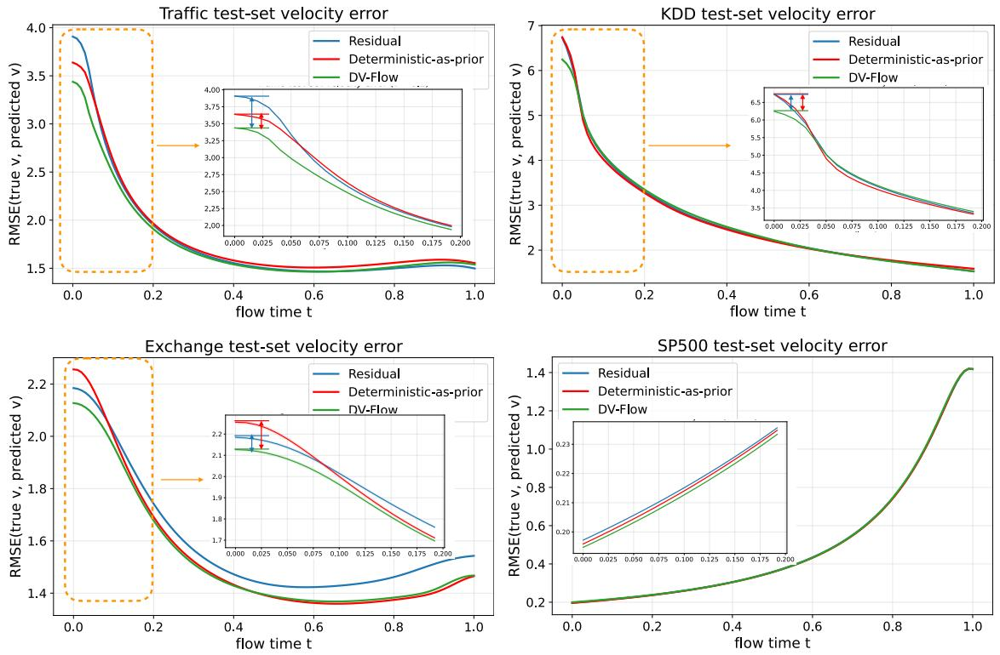  
Figure 7: Velocity Error Comparison. We compare the RMSE of velocity predictions against ground truth on the test set for DV-Flow, residual-based, and deterministic-as-prior. While all three formulations converge as $\tau  1$ , DV-Flow (green) starts with the lowest velocity error when $\tau  0$ , demonstrating our formulation has an advantage when τ is small.

## H Visualization

In this section, we aim to gain a visual understanding of how DV-Flow generates its predictions and to examine the form of the resulting prediction bands. Figure 9 plots predictive intervals and the mean absolute deviation between our final predictions and the deterministic prediction for two datasets. Variability does not simply grow toward the end of the forecast window; instead, it mirrors the variance present in the training data. For electricity, variance is highest around 12:00–18:00 when demand peaks and lowest overnight (21:00–06:00). Our model reproduces these patterns, yielding predictive distributions that closely match the empirical variability.

## I Seasonal-Adjusted Time-Adaptive Normalization

we design Seasonal-Adjusted Time-Adaptive Normalization (SATN). We remove seasonal components that do not require a learnable module directly from the data, allowing the forecasting model to focus on learning the remaining temporal dynamics. Let s denote seasonality:

$$
\mathbf { y } _ { t } \gets \mathbf { y } _ { t } - \mathbf { s } _ { t }
$$

In typical continuous time series, residuals near the present—such as $\mathbf { y } _ { t _ { 0 } + 1 }$ —tend to have a lower variance and are closer in value to the most recent observation $\mathbf { x } _ { t _ { 0 } }$ (Figure 10 in Appendix, step 1, 3).

We design our normalization method from the perspective of Brownian motion. Specifically, we assume that the residual sequence y evolves similarly to a Brownian motion originating from the last step in the context window $\mathbf { x } _ { t _ { 0 } }$ . Under this assumption, we normalize y to resemble a Gaussian Process with approximately

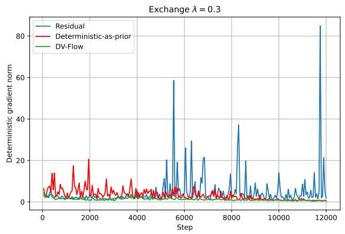

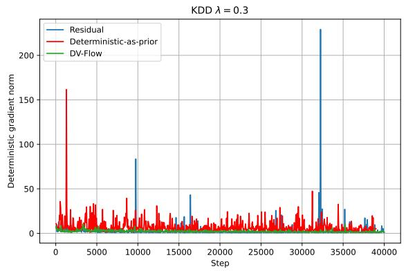

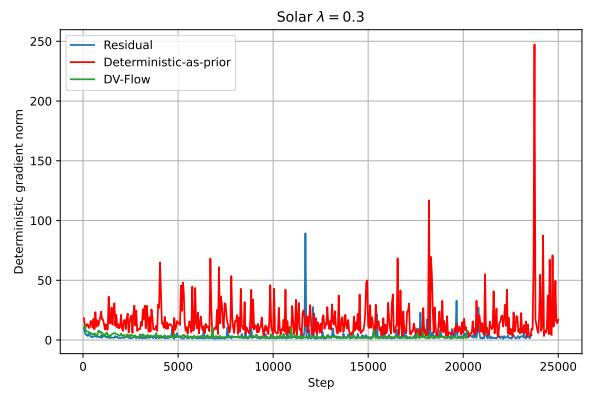

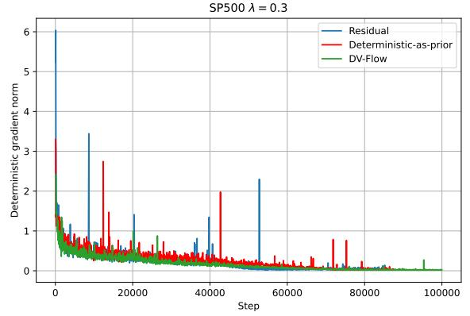

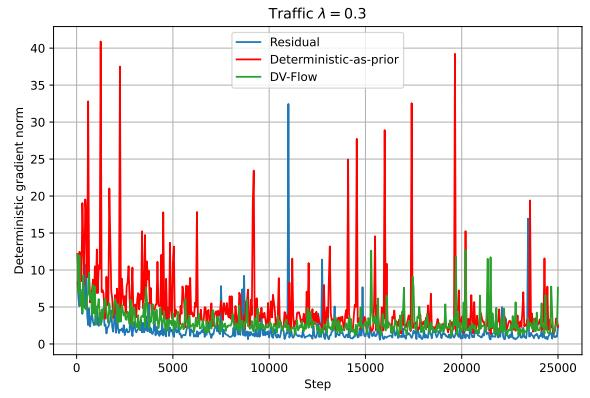  
Figure 8: Gradient norm. We compare DV-Flow, the residual-based and deterministic-as-prior formula tions with $\lambda = 0 . 3 .$ . In all datasets, residual-based and deterministic-as-prior training exhibits large gradient spikes, whereas DV-Flow remains stable without large spikes.

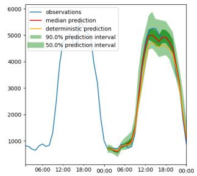

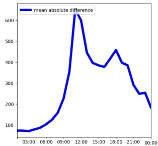

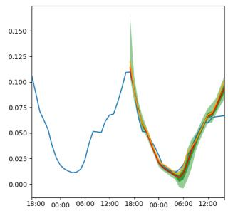

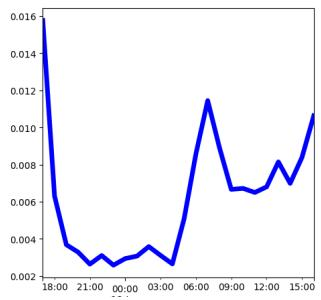  
Figure 9: Left: prediction interval; Right: MAE between the final prediction and deterministic prediction. Top: Electricity; Bottom: Trafic.

unit marginal variance at each time step. This facilitates stable training and better alignment with the prior distribution used in flow matching.

We normalize y as follows:

$$
\mathbf { y } _ { t } \gets \frac { \mathbf { y } _ { t } - \mathbf { x } _ { t _ { 0 } } } { \pmb { \sigma } _ { t } }\tag{32}
$$

$\sigma _ { t }$ is computed on the basis of the linear interpolation property of Brownian motion, where the variance grows proportionally with time: $\begin{array} { r } { \pmb { \sigma } _ { t _ { 0 } + 1 } ^ { 2 } = \mathbb { E } \big [ ( \mathbf { y } _ { ( t _ { 0 } + 1 ) } - \mathbf { x } _ { t _ { 0 } } ) ^ { 2 } \big ] , \quad \pmb { \sigma } _ { T } ^ { 2 } = \mathbb { E } \big [ ( \mathbf { y } _ { T } - \mathbf { x } _ { t _ { 0 } } ) ^ { 2 } \big ] } \end{array}$ . Usually $\sigma _ { t _ { 0 } + 1 } ^ { 2 } < \sigma _ { T } ^ { 2 }$ To ensure that the variance increases monotonically with t, we estimate it using the following linear schedule $\begin{array} { r } { \pmb { \sigma } _ { t } ^ { 2 } = ( t - ( t _ { 0 } + 1 ) ) \Delta + \pmb { \sigma } _ { ( t _ { 0 } + 1 ) } ^ { 2 } , \Delta = \frac { \alpha } { | T - ( t _ { 0 } + 1 ) | } ( \pmb { \sigma } _ { T } ^ { 2 } - \pmb { \sigma } _ { ( t _ { 0 } + 1 ) } ^ { 2 } ) } \end{array}$ where α is a hyperparameter. All calculations are performed independently for each variable of the time series.

For the context input $\mathbf { x } _ { 1 : t _ { 0 } }$ , we normalize it similarly to the prediction window y to maintain consistency in scale throughout the sequence. Specifically, for each $t < t _ { 0 }$ , we compute $\begin{array} { r l r } { \mathbf { x } _ { t } \gets \frac { \mathbf { x } _ { t } - \mathbf { x } _ { t _ { 0 } } } { \sigma _ { t } } , } & { { } } & { \sigma _ { t } ^ { 2 } = \frac { t _ { 0 } - t } { t _ { 0 } - 1 } \mathbb { E } [ ( \mathbf { x } _ { 1 } - \mathbf { \rho } } \end{array}$ $\mathbf { x } _ { t _ { 0 } } ) ^ { 2 } ]$ . We encode the context sequence $\mathbf { x } _ { t }$ and the prediction sequence $\mathbf { y } _ { t } ^ { \tau }$ separately and then concatenate the encoded $E ( \mathbf { x } _ { t } )$ from the context window and $E ( \mathbf { y } _ { t } ^ { \tau } )$ from the prediction window into a single sequence, before running it through the transformer. The training algorithm can be found in Algorithm 1.

The seasonal component of the time series often captures dominant low-frequency structures. Let W denote the seasonal cycle length, which can be inferred from the data’s periodicity. For example, in hourly time series with daily seasonality, $W = 2 4$ . Define ${ \alpha _ { t } } \in ( 1 , \ldots , w )$ as the position of time t within its seasonal cycle. The seasonal mean at cycle position w is computed as: $\mathbf { u } _ { w } = \mathrm { m e a n } ( \{ \mathbf { x } _ { t } : \alpha _ { t } = w \} )$ . We then define the deterministic seasonal estimate as: $\mathbf { s } _ { t } = \mathbf { u } _ { \alpha _ { t } }$ . This simple, nonparametric method provides a robust seasonal baseline, allowing the generative model to focus on learning the residual distribution.

We represent the seasonal cycle as $\mathbf { s } \ast \in \mathbb { R } ^ { D \times w }$ , where s∗ is assumed to be drawn from a Gaussian distribution:

$$
\mathbf { s } \ast = \mathcal { N } ( \mu _ { s } , \sigma _ { \mathrm { m i n } } I )\tag{33}
$$

When $\sigma _ { \mathrm { m i n } }$ approaches 0, the seasonal cycle s∗ will be very close to its mean $\pmb { \mu } _ { s }$ . We estimate ${ \bf S } ( t _ { 0 } { + } 1 ) { : } T$ as the empirical mean of the seasonal cycle. Specifically, we select an arbitrary time step within the cycle window [1, w] and sample all corresponding data points $\boldsymbol { \mathcal { X } } \in \mathbb { R } ^ { D \times w }$ from the training data that align with the chosen start position of the cycle window. For example, in hourly data, if hour 1 is chosen as the start of the cycle window, we extract all 24-length data points from diferent days that begin at hour 11. The mean $\pmb { \mu } _ { s }$ is then computed as $\begin{array} { r } { \mu _ { s } = \frac { 1 } { N } \sum \mathcal { X } } \end{array}$ , where N is the total number of sampled data points.

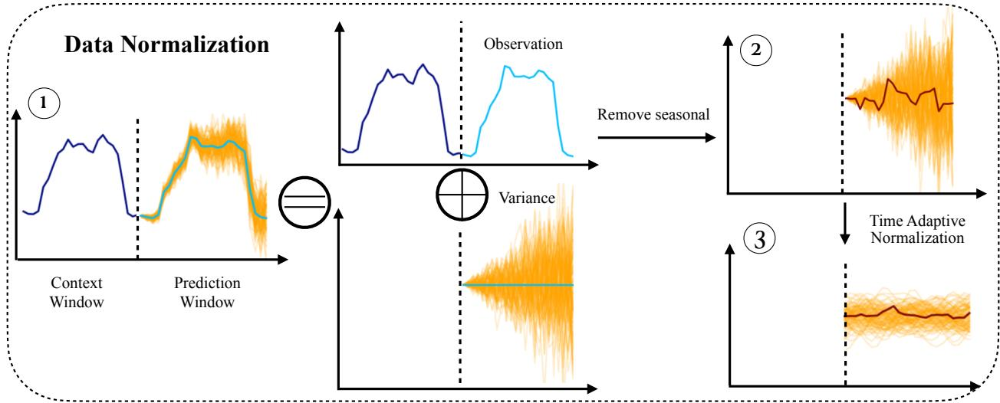  
Figure 10: Data Normalization. Step 1: Assume the data follows Brownian motion after the last time step of the context window. Variance is smaller when close to the context window, and becomes bigger as time step increases. The data can be decomposed into two parts: the observation, and the variance. Step 2: Remove seasonal component. Step 3: Run time-adaptive normalization on the residual. At this point, the variance across all time steps are scaled to the same level.

After obtaining the seasonal cycle s∗, we perform adjustment and concatenation to reshape it to align with the current time series x. Suppose x starts at position m and ends at position $n ,$ where m and n are relative positions within the cycle window $\left[ 1 : w \right]$ . The adjustment involves shifting s∗ such that the adjusted seasonal cycle $\mathbf { s } ^ { a }$ is defined as $\mathbf { s } ^ { a } = [ \mathbf { s } * [ m : ] ; \mathbf { s } * [ : m ] ]$ , where [; ] denotes concatenation.

Let the length of x be l. The time series x spans $\lfloor l / w \rfloor$ full cycles, with an ofset of l mod w steps. The final full seasonal efect is constructed by fist concatenating $\mathbf { s } ^ { a }$ repeated $\lfloor l / w \rfloor$ times to account for the full cycles, and then appending the first l mod w steps of $\mathbf { s } ^ { a }$ to account for the remaining partial cycle. A visual illustration of this process can be found in Figure 11.

$$
\mathbf { s } = [ \lfloor l / w \rfloor * [ \mathbf { s } ^ { a } ] ; \mathbf { s } ^ { a } [ : l \bmod w ] ]
$$

## J More results on the toy dataset

In this toy dataset, x is a random vector uniformly sampled from $[ - 1 , 1 ] ^ { 3 }$ . We compute the centers of two Gaussian mixtures with $\mu _ { 1 } = \mathbf { W } _ { 1 } \mathbf { x } .$ and $\begin{array} { r } { \mu _ { 2 } = d \frac { \mathbf { W } _ { 2 } \mathbf { x } } { \| \mathbf { W } _ { 2 } \mathbf { x } \| } + \mu _ { 1 } } \end{array}$ . Here $\mathbf { W } _ { 1 }$ and $\mathbf { W } _ { 2 }$ are two parameters randomly initialized from a standard Gaussian distribution. Note that the distance between the two centers is always d. Both mixtures have covariance I. The first mixture has weight 0.7, while the second misture has weight 0.3. Therefore, x decides both the mean and variance of the predictive distribution. Compared with the first toy dataset, the covarinace of the entire Gaussian mixture does not directly correspond to scale of $\mathbf { x } ,$ therefore, it is harder to learn for the predictive model.

For both toy datasets, we train a DV-Flow model with a feedforward backbone, which has 3 hidden layers. The size of each hidden layer is fixed to 32. The model is trained with 1000 epochs as we can aford the computation. On each dataset, we test the model with 100 random runs. The performance is computed from the mean and variance from these runs.

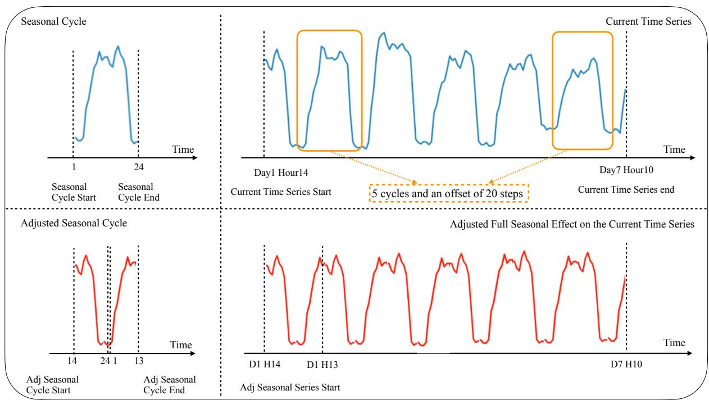  
Figure 11: Top Left: Seasonal Cycle that starts at position 1 of the cycle window. Top Right: Current time series data that starts at position 14 of the cycle window, with 5 cycles and 10 ofset steps. Bottom Left: Adjusted Seasonal Cycle that starts at position 14, same as the current time series. Bottom Right: Adjusted full seasonal efect on the current time series, which is the concatenation of 5 adjusted seasonal cycles and the first 10 steps from the adjusted seasonal cycle.

On this toy dataset, we also compare predictive samples of y for a single x against the true predictive distribution. On this dataset, we see that λ = 0 gives much better performances than other λ choices. It is also much better than pre-training $f _ { \theta }$ with point-wise loss. It worth more investigation how the performances of diferent λ values are related to the distribution, but it is clear that the choice of λ is important to the model performance.

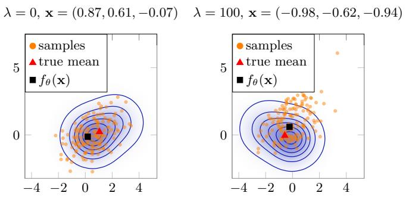

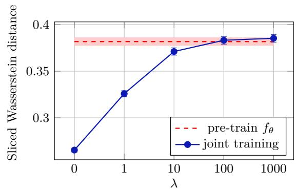  
Figure 12: Investigation of the efect of point-wise loss on another toy dataset generated from Gaussian mixture models.