# ECG-RSI: Recursive Self-Improvement through Targeted Electrocardiogram Waveform Evolution

Xiaoliang Wang1,2,\*, Zhuo Chen2,\*, Chuanyang Zheng2, Jiangwei Lao2, Quanbin Wang2 Honglin Lin3,4, Jiajia Liu2, Zhihong Lu2, Hao Jin1, Jian Wang2, Lijun Wu2,3,†

1Zhejiang University 2Ant Group

3Shanghai Artificial Intelligence Laboratory 4Shanghai Jiao Tong University

## Abstract

Electrocardiogram (ECG) models need supervision that targets evolving weaknesses and remains faithful to waveform evidence. We introduce ECG-RSI, a recursive self-improvement framework combining verified waveform synthesis with feedback-guided intervention search. Signal remeasurement verifies waveform edits; construction errors guide generator repair, while learner errors motivate interventions compared on a separate selection set. Across seven benchmarks, three rounds raise Qwen3.5-35B-A3B's mean question-answering accuracy from 34.57% to 56.04% and mean classification F1 from 24.27 to 34.03. Across the retained trajectory, the preferred supervision shifts from direct reinforcement to confusion-focused contrasts. Continued feedback correction yields diminishing external gains. These results motivate separating error diagnosis from intervention selection and checking whether gains on the feedback set transfer to independent benchmarks.

Project: https://pork-pay.github.io/ECG-RSI/

GitHub: https://github.com/pork-pay/ECG-RSI

## 1 Introduction

Electrocardiogram (ECG) interpretation requires connecting waveform patterns to measurable features and clinically meaningful conclusions. Multimodal models have begun to learn this connection from ECG images and instruction data [1, 2, 3]. Efective ECG supervision grounds each answer in the waveform presented to the model. Changes in heart rate, intervals, or morphology can alter the interpretation of related ECG findings.

Existing studies improve ECG supervision through instruction construction and evidence-aware learning [1, 2, 3], while conditional signal generators expand waveform diversity [4, 5]. Yet it remains dificult to turn a learner’s specific weakness into a controlled training example. A generated waveform must express the intended ECG feature without introducing conflicting changes, and its question and answer must agree with the resulting signal. Training mixtures must adapt to newly identified weaknesses, persistent confusions, and shifts in task dificulty after each round. Our central insight is to use learner feedback to specify ECG evidence and signal measurements to verify it

We propose ECG-RSI, a framework that connects targeted ECG data synthesis with feedback-driven recursive self-improvement (Fig. 1). Its data factory generates questions from existing signals and uses constrained reverse perturbations to synthesize waveforms with requested feature contrasts. The resulting waveforms are remeasured before their questions and answers are accepted. Construction failures guide revisions to perturbation operators and question-generation workflows, while the learner’s errors guide the categories, tasks, and dificulty levels of subsequent training data. At each round, candidate data recipes are used to train and compare model branches, and the selected branch informs the next round of synthesis and training.

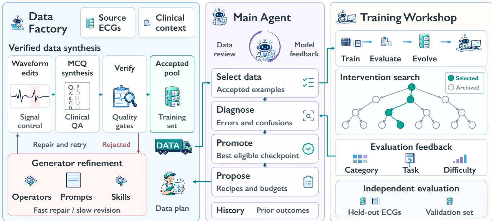  
Fig. 1 ECG-RSI: feedback-driven data and model evolution. The data factory constructs and verifies ECG questions, with rejected candidates driving local revisions of operators, prompts, and skills. The main agent diagnoses feedback, proposes interventions, and selects accepted data for training. The training workshop evaluates candidate checkpoints and supplies category-, task-, and dificulty-level feedback. Independent evaluation is separated from the update loop. The search tree and highlighted path illustrate candidate comparison and model selection.

Our contributions are threefold:

• We propose ECG-RSI, a framework that separates construction feedback for repairing data generation from learner feedback for proposing and comparing subsequent training interventions.

• We develop target-driven reverse waveform synthesis, which translates desired ECG feature contrasts into constrained signal perturbations and verifies the resulting waveforms to provide measurement-grounded supervision.

• We analyze how intervention utility changes with the learner: the retained trajectory shifts from direct reinforcement to confusion-focused contrasts, while continued feedback correction yields diminishing gains on external benchmarks.

## 2 Related Work

## 2.1 ECG Multimodal Learning and Evidence-Grounded Supervision

Medical vision-language foundation models provide a broader basis for domain adaptation. MedGemma adapts Gemma 3 models for medical image and text understanding and supports further task-specific fine-tuning [6]. Complementary work examines the integration of knowledge graphs with multimodal learning [7].

ECG-language models have progressed from ECG instruction tuning and multimodal alignment toward more flexible question answering and clinically grounded interpretation. PULSE, a multimodal large language model for ECG image comprehension, is instruction-tuned on ECGInstruct, an ECG image instruction dataset, and evaluated on ECGBench, a benchmark for ECG image interpretation [1]. GEM links signal and image representations to measurable ECG evidence [2]. ECG-R1 incorporates clinical protocols and diagnostic-evidence supervision into ECG interpretation [3]. Subsequent work broadens the types of questions, input formats, and supervision available to ECG models: anyECG-chat supports flexible ECG inputs and multiple tasks [8], Q-Heart introduces knowledge-informed ECG question answering [9], ECG-LLM uses clinically structured questions for cardiac reasoning [10], and ELF studies a simpler encoder-free ECG-language architecture [11]. MEETI aligns signals, images, extracted features, and interpretations within a multimodal ECG dataset [12], while ECG-Expert-QA provides diagnostically diverse questions for evaluation [13]. ECG input representations also afect performance [14]. Multi-source contrastive learning ofers another way to broaden supervision: MS-ECG-FM aligns ECGs with ECG, echocardiography, radiology, and discharge reports, whose diagnostic information is complementary [15].

ECG Mirage probes whether predictions depend on the patient-specific ECG [16]. ECG-Reasoning-Benchmark examines stepwise ECG interpretation [17], and recent work evaluates ECG reasoning by separating waveform perception from clinical deduction [18]. Image-based model evaluations likewise expose the dificulty of reliable ECG interpretation from rendered tracings [19]. These studies motivate supervision that remains tied to the waveform presented to the learner. ECG-RSI addresses this need by constructing requested feature contrasts and deriving questions and answers from measurements of the resulting signals.

## 2.2 Conditional ECG Synthesis and Controlled Interventions

ECG synthesis has advanced through disease-conditioned adversarial generation [4], conditional difusion [20, 21], clinical-text conditioning [22], and report- and patient-conditioned generation [5]. MIDT-ECG and FlowECG further investigate waveform fidelity, inter-lead coherence, and generation eficiency [23, 24]. More directly related to controllability, ECGTwin generates condition-guided personalized ECGs while seeking to preserve individual characteristics [25], and TransDifECG explores semantically controllable signal generation [26]. Generative counterfactual ECGs have also been used to study how waveform changes afect an AI-ECG model’s predictions [27]

ECG-RSI constructs training examples for a specified learner weakness: it starts with a training-side waveform and a requested feature contrast, applies a constrained intervention, and remeasures the result. It accepts an example only when the intended change is achieved and relevant non-target properties are preserved; its question and answer are then grounded in the resulting waveform.

## 2.3 Feedback-Driven Data Evolution and Recursive Self-Improvement

Earlier self-improvement methods revise responses or retain verbal feedback [28, 29], generate instruction data [30, 31], or iteratively refresh reasoning supervision [32]. More recent systems connect generated tasks to learner improvement: CoEvolve guides task synthesis using learner behavior [33], NeoHorse-1 adapts post-training mixtures using capability evidence [34], and Absolute Zero and VisPlay couple task generation with solver improvement [35, 36]. SynCo makes this dependence explicit by jointly training a synthesizer and reasoner, with task validity, answer reliability, and outcome-grounded teachability providing feedback to the synthesizer [37]. Multiple reasoner rollouts per task provide this feedback, so estimated teaching value depends on the current policy’s observed outcomes. RSIBench-Data places data construction and selection at the center of RSI evaluation [38]. Related studies examine whether a self-synthetic pipeline continues to provide learnable information [39], while VISA revises multimodal instruction synthesis using verification and target-model failures [40]. Recursive on-policy distillation co-evolves the privileged teacher with the student [41], while RLTL;DR internalizes concise feedback from failed attempts [42]. Both make the supervision produced by an earlier attempt useful to subsequent learning.

A complementary line changes the mechanism of improvement: agent code and workflows [43, 44], skills [45], data preparation [46, 47], or environments and search strategies [48, 49]. These updates require assessment: revision selection [50, 51], evolving self-evaluation [52], hidden evaluations [53], and pairwise candidate ranking [54] provide diferent ways to compare candidates. Other studies guide subsequent adaptation [55, 56] or alternate harness evolution with model learning [57]. Structured knowledge is another object of improvement [58, 59]; in medicine, MedZERO couples task generation with evidence-grounded reasoning and controlled knowledge accumulation [60].

Paired evaluations also help identify diminishing returns and earlier artifacts worth retaining [61]. In a setting with frozen model weights, Agent Plasticity measures how eficiently experience produces future held-out gains relative to learning cost, showing that endpoint performance, acquisition eficiency, and transfer to harder conditions can diverge [62]. ECG-RSI grounds intervention proposals in ECG-specific error diagnostics: construction feedback repairs synthesis, learner feedback proposes interventions, and separate selection and external evaluations assess their utility.

## 3 Method

ECG-RSI couples verified synthesis with feedback-driven training (Fig. 1). Construction feedback checks waveform and question validity; learner feedback selects data for model-specific utility [38].

## 3.1 Framework and Feedback Interfaces

System state and data boundaries. At round �, the system state comprises the accepted learner $\theta _ { t . }$ , retained training pool $D _ { t } ,$ and construction policy $\phi _ { t }$ . The policy contains retrieval constraints, waveform operators, prompts, and reusable rules, separate from learner weights [43]. Source ECGs and morphology donors are restricted to training data and are patient-disjoint from development and independent evaluation data.

$V _ { \mathrm { f b } }$ diagnoses errors; $V _ { \mathrm { s e l } }$ selects models. Evaluation data are held out from generation and selection.

Twofeedback loops. Construction feedback identifies invalid waveform edits or questions and guides generator repair. Learner feedback guides recipes using gaps in ECG capability, question type, dificulty, and confusion pairs. For a selected update path, one round can be summarized as

$$
\begin{array} { r l } & { \boldsymbol { e } _ { t } = \mathrm { D i a g n o s e } ( \boldsymbol { \theta } _ { t } , V _ { \mathrm { f b } } ) , } \\ & { \boldsymbol { q } _ { t } = \mathrm { P l a n } ( \boldsymbol { e } _ { t } , D _ { t } ; B _ { t } ) , } \\ & { ( A _ { t } , L _ { t } , \boldsymbol { \phi } _ { t + 1 } ) = \mathrm { C o n s t r u c t V a l i d a t e } ( \boldsymbol { q } _ { t } , S _ { \mathrm { t r a i n } } , \boldsymbol { \phi } _ { t } ) , } \\ & { \widetilde { \boldsymbol { \theta } } _ { t + 1 } = \mathrm { T r a i n } ( \boldsymbol { \theta } _ { t } , A _ { t } \cup R _ { t } ) , } \\ & { \qquad \boldsymbol { \theta } _ { t + 1 } = \mathrm { P r o m o t e } ( \boldsymbol { \theta } _ { t } , \widetilde { \boldsymbol { \theta } } _ { t + 1 } ; V _ { \mathrm { s e l } } ) . } \end{array}\tag{1}
$$

Here $B _ { t }$ is the construction budget, $A _ { t }$ the accepted new examples, $L _ { t }$ the construction log, and $R _ { t }$ the replay data. Equation (1) describes one candidate; sibling recipes use the same parent with separate examples and policy versions. Promotion adds the winning examples to $D _ { t } ;$ otherwise, the parent and retained pool remain unchanged.

## 3.2 Targeted ECG Synthesis with Measurement-Grounded Supervision

## 3.2.1 Targeted Waveform Construction

Forward synthesis derives questions, answers, and explanations from measured training ECGs. Reverse synthesis edits an eligible waveform to express a requested feature contrast, then remeasures the signal before constructing supervision. Both routes check evidence, context, answer uniqueness, and explanation support.

Reverse requests come from learner weaknesses or distractors in training questions. A normal-versus-prolonged PR contrast specifies a measurable target and a corresponding waveform edit.

Target selection and constrained editing. A delineator extracts $u = f ( S )$ from ECG �: heart rate (HR), R–R interval (RR), P-onset-to-QRS-onset interval (PR), QRS duration, QRS-onset-to-T-end interval (QT), corrected QT (QTc), and amplitudes. Feature � on source � is scored by $s _ { i k } = a _ { i k } r _ { k } d _ { k } \colon$ definability $a _ { i k , }$ reliability $r _ { k } ,$ and diagnostic utility $d _ { k } .$ Eligible scores exceed the registered threshold. Appendix A.6 details conversions, weighting, and scale normalization. An eligible request specifies the target range, protected features and tolerances, permitted operators and donors, and attempt budget. The policy applies an operator sequence $S ^ { \prime } = T _ { \delta } ( S )$ after checking applicability. PR edits require P and QRS onsets; complex diagnoses require morphology beyond interval changes (Fig. 2).

## 3.2.2 Validation and Generator Repair

Re-extract $u ^ { \prime } = f ( S ^ { \prime } )$ after editing. For target feature � and requested change $\Delta _ { k }$ , record the target error

$$
E _ { \mathrm { t a r g e t } } = \left| \left[ f _ { k } ( S ^ { \prime } ) - f _ { k } ( S ) \right] - \Delta _ { k } \right|
$$

separately from the drift of each protected feature $j ,$

$$
E _ { \mathrm { p r o t e c t } , j } = \left| f _ { j } ( S ^ { \prime } ) - f _ { j } ( S ) \right| .
$$

Acceptance requires target and protected-feature errors to satisfy their respective tolerances, with checks of boundary continuity, unedited regions, lead consistency, morphology, leakage, diversity, and cost.

The accepted signal is rendered for question, answer, context, and explanation generation. Review requires a unique supported answer and evidence for each claimed observation, so supervision follows the remeasured signal.

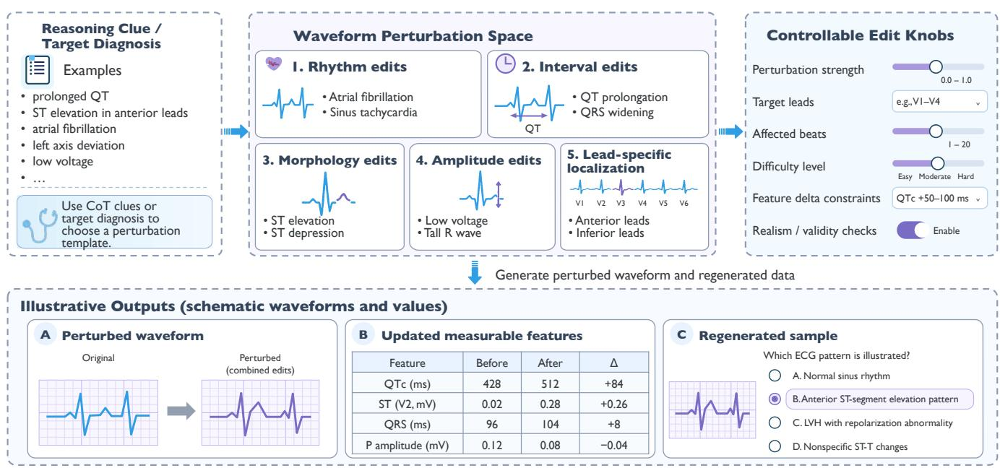  
localized signal edit. Edited waveforms are remeasured to check the target and protected features before question generation, linking controllable signal changes to evidence-grounded Fig. 2 Controllable waveform perturbations across rhythm, intervals, morphology, amplitude, and individual leads. The examples supervision.illustrate how an intended feature change is translated into a localized signal edit. Edited waveforms are remeasured to check the target and protected features before question generation, linking controllable signal changes to evidence-grounded supervision.

Constructionfailure and generator repair. Repairs follow failures [46]: signal errors guide operator revisions; missing morphology guides applicability/retrieval revisions; ambiguity guides question/context revisions; unsupported explanations guide prompt revisions.

Repairs record their trigger, changed rule, validation result, and scope. Old and revised versions are compared on matched sources, requests, seeds, and budgets; adoption requires signal and question checks to pass. Appendices A.2 and A.3 describe the rules and recording protocol; Appendix D provides stage prompts.

## 3.3 Feedback-Driven Recursive Model Improvement

## 3.3.1 Learner Diagnosis and Data Recipes

Errors, invalid outputs, and regressions guide recipes by category �, learner-relative dificulty �, and supervision �:

$$
\pi _ { t } ^ { a } ( g , d , s ) = p _ { t } ^ { a } ( g ) p _ { t } ^ { a } ( d \mid g ) p _ { t } ^ { a } ( s \mid g , d ) .\tag{2}
$$

Dificulty is learner-relative [35]. For training-side question �, $K _ { i }$ independent answers under fixed decoding settings give $\begin{array} { r } { \widehat { p } _ { i t } = K _ { i } ^ { - 1 } \sum _ { r = 1 } ^ { K _ { i } } \mathbf { 1 } [ \widehat { y } _ { i r } = y _ { i } ] , } \end{array}$ , used to group reliably solved, mixed-success, and unresolved examples. Probe budgets, scoring, output-validity requirements, and thresholds are fixed before branch comparison.

Supervision can retain the teacher explanation, expand intermediate ECG evidence, or add checks targeting an observed learner error. As in iterative reasoning supervision [32], explanations supply training targets; paired variants must preserve the verified image, question, options, answer, and clinical facts.

Recipes also fix source/edit constraints, replay, and training budgets. Recipe selection changes the data mixture;   
operator or prompt repair changes ��. These interventions are tracked separately (Appendix A.1).

## 3.3.2 Same-Parent Branch Exploration

Feedback and training-side probes define three recipe families from the same parent $\theta _ { t }$ [44, 48]:

• A: Direct reinforcement. Increase quotas for weak categories and question types while retaining relatedcategory controls: a recipe for atrioventricular (AV) block emphasizes conduction measurements and diagnostic interpretation.

• B: Confusion contrast. Sample recurrently confused category pairs; construct options and explanations around their distinguishing ECG evidence. Regional ST-elevation myocardial infarction (STEMI) contrasts, for example, emphasize lead-specific localization.

• C: Dificulty and task curriculum. Reweight dificulty bins and question types using learner probes, e.g., increasing $\mathrm { L } 3 ,$ multistep, or evidence-chain questions. Curriculum denotes a branch-specific mixture.

Recipes specify sampling quotas and construction requests: retrieve eligible waveforms or apply permitted edits, then run the shared measurement and question-validity gates (Section 3.2.2). Category, dificulty, and task constraints can overlap; Tab. 12 lists each round’s actual mixtures.

Each branch retains the same historical training manifest and adds 10,000 previously unused accepted questions, without an extra shared baseline set. All branches use three epochs of supervised fine-tuning (SFT) with matched settings; the language model is updated while the vision encoder and multimodal aligner remain frozen. For ECG image �, question �, optional context �, and explanation–answer target �, the training loss is

$$
\mathcal { L } _ { \mathrm { M C Q } } = - \sum _ { \ell } \log p _ { \theta } ( y _ { \ell } \mid I , Q , C , y _ { < \ell } ) .\tag{3}
$$

Replay and new-data exposure are recorded in examples and tokens; training settings appear in Appendix A.5.

## 3.3.3 Model Selection and Retained Lineage

After matched SFT, evaluate candidates on $V _ { \mathrm { s e l } }$ . Apply the predesignated output-validity and non-target regression tolerances, then retain the highest-scoring qualifying checkpoint and its data [51]. Archive other branches; if none qualifies, retain the parent.

Reevaluate the retained learner on $V _ { \mathrm { f b } }$ to construct new recipes: directions are reselected each round. Fig. 3 illustrates the process; Section 5.7 reports the choices.

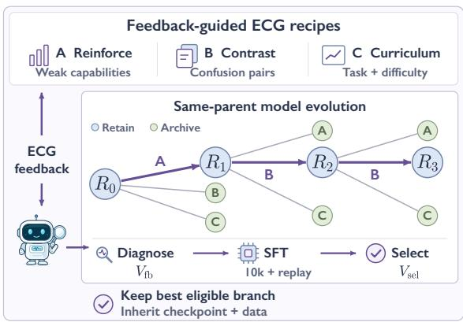  
Fig. 3 Schematic of feedback-guided model evolution. $\mathsf { A } / \mathsf { B } / \mathsf { C }$ change category coverage, confusion contrasts, or dificulty/task mixtures. Each candidate adds 10,000 accepted questions plus replay. Purple shows an illustrative lineage. Tab. 12 reports measured mixtures, scores, and choices.

## 4 Experiments

We evaluate benchmark performance, round-wise gains, and the training value of feedback-guided synthesis. The analysis asks how feedback granularity afects data utility, which candidate directions yield the strongest updates, and whether reductions in feedback errors transfer to external benchmarks.

The seven-benchmark aggregate (S7) is the equal-weight mean of four accuracy and three F1 scores on a 0–100 scale. MMMU-ECG, CSN, and G12EC use single-choice accuracy; ECG-QA uses exact-match accuracy over answer sets. PTB-XL, CPSC2018, and CODE-15% are multi-label classification tasks. F1 is the harmonic mean of precision and recall; Δ denotes an absolute score diference.

Evaluation tasks. We evaluate eight ECG tasks comprising 10,840 items. The seven tasks included in $\mathrm { S 7 }$ contain 10,697 items; the 143-item MedXpertQA-MM ECG subset is reported separately. S7 weights task scores equally and excludes MedX and LUDB. Appendix B.5 (Tab. 21) lists the datasets, split identifiers, sample counts, and metrics.

## 4.1 Main Benchmark Results

Tab. 1 compares the recorded scores of closed-source, open-source, and ECG-specific models with ECG-RSI on seven benchmarks. ECG-RSI R3 has the highest S7 (46.61) among the compared models.

After three rounds, Qwen3.5-35B-A3B's mean accuracy across the four question-answering (QA) benchmarks increases from 34.57% to 56.04%, a 21.47-percentage-point gain; its mean F1 across the three classification benchmarks increases from 24.27 to 34.03, a 9.77-point gain. Gains are calculated from unrounded means.

Tab. 1 Comparison of ECG-RSI with proprietary, open-source, and ECG-specific models on seven benchmarks. The first four columns report question-answering accuracy and the next three report classification F1; S7 is their equal-weight mean on a 0–100 scale. ECG-RSI R3 achieves the highest aggregate score.
<table><tr><td>Model / method</td><td>MMMU ECG Acc.</td><td>CSN Acc.</td><td>G12EC Acc.</td><td>ECG-QA Acc.</td><td>PTB-XL F1</td><td>CPSC 2018 F1</td><td>CODE 15% F1</td><td>S7</td></tr><tr><td colspan="7">Proprietary models</td><td colspan="2"></td></tr><tr><td>GPT-5.6-sol</td><td>56.00</td><td>58.70</td><td>60.20</td><td>32.10</td><td>37.40</td><td>24.30</td><td>42.80</td><td>44.50</td></tr><tr><td>Gemini-3.8-Flash</td><td>59.10</td><td>57.90</td><td>59.60</td><td>33.40</td><td>36.80</td><td>23.70</td><td>40.90</td><td>44.49</td></tr><tr><td colspan="9">Open-source and base models</td></tr><tr><td>+ LINGSHU-7B [63]</td><td>47.60</td><td>45.20</td><td>46.80</td><td>26.30</td><td>33.87</td><td>18.60</td><td>36.50</td><td>36.41</td></tr><tr><td>+ LINGSHU-32B [63]</td><td>51.30</td><td>48.90</td><td>50.40</td><td>28.70</td><td>39.45</td><td>20.80</td><td>38.20</td><td>39.68</td></tr><tr><td>+HuatuoGPT-V-7B [64]</td><td>44.80</td><td>41.60</td><td>43.20</td><td>25.40</td><td>31.15</td><td>17.30</td><td>33.90</td><td>33.91</td></tr><tr><td>Qwen3.5-35B-A3B</td><td>42.00</td><td>30.91</td><td>41.36</td><td>23.99</td><td>29.50</td><td>13.10</td><td>30.20</td><td>30.15</td></tr><tr><td>+ECG-R1 [3]</td><td>38.12</td><td>44.87</td><td>47.05</td><td>28.63</td><td>22.91</td><td>17.88</td><td>34.55</td><td>33.43</td></tr><tr><td>+ PULSE [1]</td><td>39.24</td><td>45.16</td><td>43.87</td><td>21.55</td><td>26.08</td><td>14.92</td><td>26.82</td><td>31.09</td></tr><tr><td colspan="9">ECG-RSI</td></tr><tr><td>+ ECG-RSI R0</td><td>42.00</td><td>30.91</td><td>41.36</td><td>23.99</td><td>29.50</td><td>13.10</td><td>30.20</td><td>30.15</td></tr><tr><td>+ ECG-RSI R3</td><td>57.50</td><td>67.23</td><td>66.24</td><td>33.18</td><td>38.30</td><td>22.80</td><td>41.00</td><td>46.61</td></tr></table>

All scores are on a 0–100 scale. Bold and underlining mark the best and second-best values within each model group; ties share a rank. Blue shading highlights our final model. denotes medical specialization. Qwen3.5-35B-A3B is the initial model (ECG-RSI R0). ECG-R1 and PULSE are ECG-specific comparison models.

## 4.2 Evolution across Rounds

Tab. 2 and Fig. 4 show the R0–R3 trajectory of series R-A. Each winning branch adds 10,000 new accepted questions to the cumulative training set and replays all prior data. Appendix B provides feedback breakdowns.

Tab. 2 Round-wise benchmark performance of series R-A. R0 is the starting model; each accepted update adds 10,000 new questions while retaining historical training data. Bold and underlining mark the best and second-best values within each column; blue/red arrows indicate increases/decreases from the previous round, and blue shading marks R3. Aggregate performance improves through R3, although several individual metrics peak at R2.
<table><tr><td>R-A round</td><td>MMMU ECG Acc.</td><td>CSN Acc.</td><td>G12EC Acc.</td><td>ECG-QA Acc.</td><td>PTB-XL F1</td><td>CPSC 2018 F1</td><td>CODE 15% F1</td><td>S7</td></tr><tr><td>RO</td><td>42.00</td><td>30.91</td><td>41.36</td><td>23.99</td><td>29.50</td><td>13.10</td><td>30.20</td><td>30.15</td></tr><tr><td>R1</td><td>48.00↑</td><td>61.68↑</td><td>64.61↑</td><td>33.56↑</td><td>32.90↑</td><td>23.00↑</td><td>38.80↑</td><td>43.22↑</td></tr><tr><td>R2</td><td>56.00↑</td><td>64.86↑</td><td>66.39↑</td><td>34.55↑</td><td>36.40↑</td><td>23.90↑</td><td>41.50↑</td><td>46.23↑</td></tr><tr><td>R3</td><td>57.50↑</td><td>67.23↑</td><td>66.24↓</td><td>33.18↓</td><td>38.30↑</td><td>22.80↓</td><td>41.00↓</td><td>46.61↑</td></tr><tr><td>∆(R3-R0)</td><td>+15.50↑</td><td>+36.32↑</td><td>+24.88↑</td><td>+9.19↑</td><td>+8.80↑</td><td>+9.70↑</td><td>+10.80↑</td><td>+16.46↑</td></tr></table>

R0 is the starting model in R-A. Δ(R3−R0) reports the total score diference; arrows in R1–R3 indicate changes from the previous round.

Section 4.4 analyzes feedback errors by ECG capability, question type, and dificulty; Tab. 4 reports the question-type and dificulty breakdowns, and Tab. 5 reports the ECG-category breakdown.

## 4.3 Validation-Set Performance

MedX denotes the ECG subset of MedXpertQA. LUDB denotes the Lobachevsky University Electrocardiography Database, whose waveform annotations include P-wave, QRS-complex, and T-wave boundaries and peaks. The LUDB accuracy below refers to the ECG evaluation task constructed from that database.

Tab. 3 and Fig. 4(c) show that MedX accuracy rises from 51.57% to 57.24%, despite a small R2 decline. LUDB accuracy improves at every round, from 53.45% to 67.24%.

Tab. 3 Validation accuracy on MedX and LUDB across four rounds. The change columns report later minus earlier accuracy, in percentage points. Both datasets improve overall; LUDB increases at every round, whereas MedX shows a small intermediate decline.
<table><tr><td colspan="6">Accuracy (%)</td><td colspan="3">Accuracy difference</td></tr><tr><td>Dataset</td><td>R0</td><td>R1</td><td>R2</td><td>R3</td><td>R1-R0</td><td>R2-R1</td><td>R3-R2</td><td>R3-R0</td></tr><tr><td>MedX</td><td>51.57</td><td>55.94</td><td>55.86</td><td>57.24</td><td>+4.37</td><td>-0.08</td><td>+1.38</td><td>+5.67</td></tr><tr><td>LUDB</td><td>53.45</td><td>61.28</td><td>63.28</td><td>67.24</td><td>+7.83</td><td>+2.00</td><td>+3.96</td><td>+13.79</td></tr></table>

Fig. 4 summarizes round-wise benchmark and validation performance together with historical strategy trajectories.

Accuracy (%)  
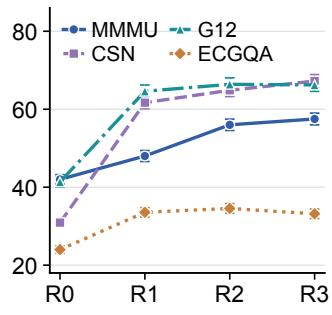  
(a) MCQ accuracy

F1 (%)  
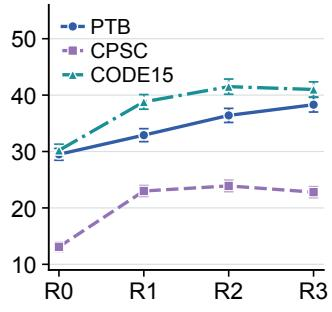  
(b) Classification F1

Accuracy (%)  
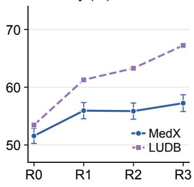  
(c) Validation

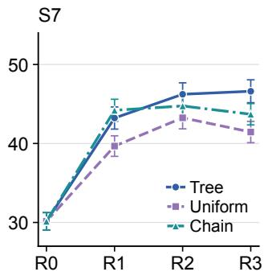  
(d) Strategies  
Fig. 4 Round-wise benchmark, validation, and strategy results. (a) Four multiple-choice question (MCQ) accuracy metrics; (b) three classification F1 metrics; (c) MedX and LUDB validation accuracy; (d) seven-benchmark aggregate score (S7) for tree, uniform-allocation, and chain trajectories. Higher values indicate better performance. Error bars show ±1 standard deviation (SD) where available; LUDB has no SD bars. The panels distinguish broad gains from task-specific fluctuations and the late-round declines of the two strategy controls.

## 4.4 Feedback Diagnostics across Rounds

Error rates fall from 26.11% to 12.97% for L1, from 38.52% to 24.43% for L2, and from 58.20% to 38.17% for L3. L3 has the largest reduction and highest R3 error rate. Errors keep falling as S7 gains diminish (Section 5.9).

Tab. 4 summarizes error rates by question type and dificulty; Tab. 5 gives the ECG-category breakdown. These development-feedback statistics diagnose data needs. Overall feedback uses 3,000 questions, with 1,189, 983, 803, and 640 errors at R0–R3. Appendix B lists the category-level counts.

Tab. 4 Feedback error rates (%) by question type and dificulty across R0–R3. � is the group size; full dificulty-level error counts appear in Tab. 17.
<table><tr><td colspan="3">Question type</td><td rowspan="2"></td><td colspan="3">Difficulty</td></tr><tr><td>Round</td><td>PM</td><td>IA</td><td>CD</td><td>L1</td><td>L2 L3</td></tr><tr><td>N</td><td>1,037</td><td>1,186</td><td>777</td><td>1,218</td><td>1,093</td><td>689</td></tr><tr><td>R0</td><td>32.98</td><td>38.87</td><td>43.37</td><td>26.11</td><td>38.52</td><td>58.20</td></tr><tr><td>R1</td><td>26.62↓</td><td>32.80↓</td><td>38.74↓</td><td>20.28↓</td><td>33.12↓</td><td>51.81↓</td></tr><tr><td>R2</td><td>21.31↓</td><td>27.57↓</td><td>33.85↓</td><td>16.09</td><td>28.27</td><td>44.41↓</td></tr><tr><td>R3</td><td>17.65↓</td><td>23.10↓</td><td>29.73↓</td><td>12.97↓</td><td>24.43↓</td><td>38.17↓</td></tr><tr><td> $\Delta _ { 0  3 }$ </td><td>15.33↓</td><td>15.77↓</td><td>13.64↓</td><td>13.14↓</td><td>14.09↓</td><td>20.03↓</td></tr></table>

PM: perception/measurement; IA: interpretation/analysis; CD: clinical decision/treatment. Blue shading marks R3; bold/underlining mark the lowest/second-lowest rates. Blue arrows indicate decreases from the previous round; $\Delta _ { 0  3 }$ is R0 minus R3 error rate, in percentage points.

Tab. 5 ECG-category feedback error rates (%). �: recorded sample count; $\Delta _ { 0  3 } \colon$ R0 minus R3 error rate, in percentage points (computed before rounding). Blue marks R3; bold/underline mark the best/second-best rates; ↓ marks reductions. Full names and counts: Tab. 18.  

<table><tr><td>N</td><td>168</td><td>154</td><td>147</td><td>132</td><td>128</td><td>143</td><td>136</td><td>121</td><td>109</td><td>105</td><td>118</td><td>139</td><td>141</td><td>149</td><td>145</td><td>116</td><td>108</td><td>152</td><td></td><td>124</td><td>134</td><td>117</td><td>113 101</td></tr><tr><td>R0</td><td>25.0</td><td>39.6</td><td>44.9</td><td>28.0</td><td>26.6</td><td>40.6</td><td>39.0</td><td>38.0</td><td>42.2</td><td>48.6</td><td>44.1</td><td>36.7</td><td>35.5</td><td>44.3</td><td>43.4</td><td>46.6</td><td>49.1</td><td>37.5</td><td></td><td>41.1</td><td>41.0</td><td>42.7</td><td>41.6 45.5</td></tr><tr><td>R1</td><td>19.6↓</td><td>32.5↓</td><td>38.1↓</td><td>22.0↓</td><td>20.3↓</td><td>33.6↓</td><td>32.4↓</td><td>31.4↓</td><td>34.9</td><td>41.0↓</td><td>36.4↓</td><td>30.2</td><td>29.1↓</td><td>37.6↓</td><td>36.6↓</td><td>38.8↓</td><td>40.7↓</td><td>30.9↓</td><td>33.9↓</td><td>34.3↓</td><td>35.9↓</td><td>34.5↓</td><td>37.6↓</td></tr><tr><td>R2</td><td>14.9</td><td>26.6↓</td><td>32.0↓</td><td>16.7</td><td>15.6↓</td><td>27.3</td><td>26.5↓</td><td>25.6</td><td>28.4</td><td>34.3</td><td>29.7</td><td>24.5</td><td>23.4</td><td>31.5</td><td>30.3↓</td><td>31.9↓</td><td>34.3</td><td>25.0</td><td>27.4</td><td>28.4↓</td><td>29.9</td><td>28.3</td><td>30.7↓</td></tr><tr><td>R3</td><td>11.3↓</td><td>21.4↓</td><td>26.5↓</td><td>12.9↓</td><td>11.7↓</td><td>21.7↓</td><td>21.3↓</td><td>19.8↓</td><td>22.0↓</td><td>27.6↓</td><td>23.7↓</td><td>19.4↓</td><td>18.4↓</td><td>26.2↓</td><td>24.8↓</td><td>25.9↓</td><td>27.8↓</td><td>19.7↓</td><td>21.8↓</td><td>22.4↓</td><td>23.9↓</td><td>22.1↓</td><td>23.8↓</td></tr><tr><td> $\Delta _ { 0  3 } \downarrow$ </td><td>13.7</td><td>18.2</td><td>18.4</td><td>15.2</td><td>14.8</td><td>18.9</td><td>17.6</td><td>18.2</td><td>20.2</td><td>21.0</td><td>20.3</td><td>17.3</td><td>17.0</td><td>18.1</td><td>18.6</td><td>20.7</td><td>21.3</td><td>17.8</td><td>19.4</td><td>18.7</td><td>18.8</td><td>19.5</td><td>21.8</td></tr></table>

## 5 Ablation Studies

We first assess waveform validity and the contribution of synthesis components. We then examine three linked questions: whether finer feedback improves training utility, whether the most prominent weakness determines the best training direction, and whether continued feedback improvement translates into external gains.

## 5.1 Efectiveness of the Synthesis Method

Quantitative waveform-feature validation. We report waveform-feature error statistics, including mean absolute error (MAE) and root mean squared error (RMSE), from a single synthesis run of 10,000 samples in Tab. 6.

All six features meet the adopted MAE criteria (Status = Met), supporting numerical fidelity of the synthesized waveforms.

For each feature, let $e _ { i } = { \hat { x } } _ { i } - x _ { i }$ and compute

$$
\overline { { e } } = \frac { 1 } { n } \sum _ { i } e _ { i } , \quad \mathbf { M A E } = \frac { 1 } { n } \sum _ { i } | e _ { i } | , \quad \mathbf { R M S E } = \sqrt { \frac { 1 } { n } \sum _ { i } e _ { i } ^ { 2 } } , \quad s _ { e } ^ { 2 } = \frac { 1 } { n - 1 } \sum _ { i } ( e _ { i } - \overline { { e } } ) ^ { 2 } .\tag{4}
$$

Tab. 6 Waveform-feature errors from a single synthesis run of 10,000 samples and comparison with the adopted MAE criteria. Blue marks MAE values meeting the adopted criteria.
<table><tr><td>Feature Unit</td><td></td><td>Bias</td><td>MAE</td><td>RMSE</td><td> $s _ { e } ^ { 2 }$  </td><td>MAE limit</td><td>Status</td></tr><tr><td>HR</td><td>bpm</td><td>0.63</td><td>2.14</td><td>2.22</td><td>4.53</td><td>≤3</td><td>Met</td></tr><tr><td>RR</td><td>ms</td><td>3.11</td><td>15.28</td><td>15.36</td><td>226.28</td><td>&lt; 20</td><td>Met</td></tr><tr><td>PR</td><td>ms</td><td>0.57</td><td>7.71</td><td>7.78</td><td>60.21</td><td>≤ 25</td><td>Met</td></tr><tr><td>QRS</td><td>ms</td><td>4.12</td><td>4.58</td><td>4.61</td><td>4.28</td><td>≤30</td><td>Met</td></tr><tr><td>QT</td><td>ms</td><td>0.94</td><td>9.71</td><td>9.85</td><td>96.15</td><td>≤ 30</td><td>Met</td></tr><tr><td>QTc</td><td>ms</td><td>0.86</td><td>10.22</td><td>10.34</td><td>106.19</td><td>≤ 40</td><td>Met</td></tr></table>

Error is remeasured minus target. Bias, MAE, RMSE, and limits use the listed unit; $s _ { e } ^ { 2 }$ uses squared units and denominator � − 1. Limits are the evaluation criteria adopted for this experiment. Variance values are approximations reconstructed from the reported two-decimal Bias and RMSE, with $n = 1 0 , 0 0 0$ valid observations per feature: $\begin{array} { r } { s _ { e } ^ { 2 } = \frac { n } { n - 1 } ( \mathrm { R M S E } ^ { 2 } - \mathrm { B i a s } ^ { 2 } ) } \end{array}$

## 5.2 Blinded Review by Human Physicians

Tab. 7 Physician review of 240 examples (95% confidence intervals). Stages 1–3 assess morphology, editing fidelity, and answers/explanations.
<table><tr><td>Metric</td><td>Value</td><td>95% CI</td><td>n</td><td>Source</td></tr><tr><td>Target attainment</td><td>0.82</td><td>[0.76, 0.87]</td><td></td><td>240 Stage 2</td></tr><tr><td>Non-target preservation</td><td>0.79</td><td>[0.73, 0.84]</td><td></td><td>240 Stage 2</td></tr><tr><td>Morphology consistency</td><td>0.86</td><td>[0.81, 0.90]</td><td></td><td>240 Stage 1</td></tr><tr><td>Lead consistency</td><td>0.83</td><td>[0.78, 0.88]</td><td></td><td>240 Stage 1</td></tr><tr><td>Answer accuracy</td><td>0.88</td><td>[0.83, 0.92]</td><td></td><td>240 Stage 3</td></tr><tr><td>Explanation support</td><td>0.76</td><td>[0.70, 0.81]</td><td></td><td>240 Stage 3</td></tr><tr><td>Expected-parameter references</td><td>0.09</td><td>[0.06, 0.13]</td><td></td><td>240 Stage 3</td></tr><tr><td>Inter-rater K</td><td>0.78</td><td></td><td></td><td>[0.71, 0.85] 240 Two raters</td></tr></table>

CIs use Wilson intervals or bootstrap; � is Cohen’s �. Lower expected-parameter reference rates are better; higher values are better for the other metrics.

We randomly sample 240 examples stratified by six edit types (HR, RR, PR, QRS, QT, and QTc), with 40 examples per type. Two human physicians score the examples independently. We report 95% confidence intervals (CIs) for the review metrics.

In stage 1, target labels, generation parameters, and teacher responses are hidden while waveform morphology and lead consistency are assessed. In stage 2, the physicians inspect the before/after waveforms and editing targets to assess target attainment and non-target preservation. Stage 3 assesses answers, explanations, and expected-parameter references.

Answer correctness and evidence support. Mean physician ratings are 0.88 for answer correctness and 0.76 for explanation support $( \kappa = 0 . 7 8 )$ . The stages assess morphology, editing fidelity, and answer/explanation quality.

Tab. 8 Clinical review by edit type: 40 examples per type, 240 overall. Values are aggregated physician ratings; higher is better.
<table><tr><td>Edit</td><td>n</td><td>Target</td><td>Preserve</td><td>Morph.</td><td>Answer</td><td>Support</td></tr><tr><td>HR</td><td>40</td><td>0.85</td><td>0.80</td><td>0.88</td><td>0.90</td><td>0.78</td></tr><tr><td>RR</td><td>40</td><td>0.78</td><td>0.75</td><td>0.82</td><td>0.85</td><td>0.72</td></tr><tr><td>PR</td><td>40</td><td>0.80</td><td>0.78</td><td>0.85</td><td>0.88</td><td>0.75</td></tr><tr><td>QRS</td><td>40</td><td>0.83</td><td>0.81</td><td>0.87</td><td>0.89</td><td>0.77</td></tr><tr><td>QT</td><td>40</td><td>0.82</td><td>0.79</td><td>0.86</td><td>0.87</td><td>0.76</td></tr><tr><td>QTc</td><td>40</td><td>0.84</td><td>0.80</td><td>0.88</td><td>0.89</td><td>0.78</td></tr><tr><td>Total 240</td><td></td><td>0.82</td><td>0.79</td><td>0.86</td><td>0.88</td><td>0.76</td></tr></table>

Variation across edit types. Target attainment ranges from 0.78 for RR to 0.85 for HR. Explanation support varies

from 0.72 to 0.78 and remains below answer accuracy for every edit type. The stratified results show that the gap is shared across editing targets.

The columns distinguish target attainment, preservation of non-target features, morphology consistency, answer accuracy, and explanation support.

## 5.3 Multi-Model Question-Quality Scores

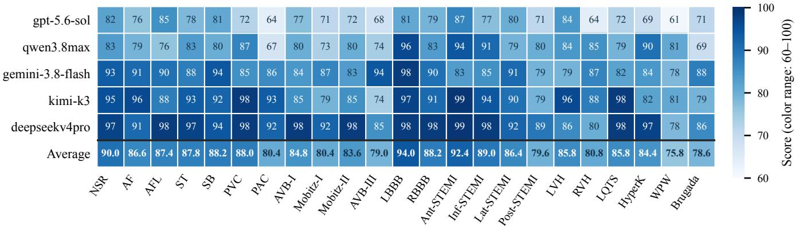  
Fig. 5 Recorded scores from five models for synthetic ECG questions across 23 categories (0–100 scale). The bottom row is the per-category arithmetic mean across models; the unweighted mean over all 115 model–category cells is 85.09, reported as the full-method Question score in Tab. 10. The shared color scale spans 60–100, from light blue (low) to dark blue (high).

Fig. 5 shows five-model scores across 23 ECG categories. R1 uses 10,000 of 16,193 candidate questions.

## 5.4 Data Construction and Feedback Selection

Four data configurations each add 10,000 SFT questions from the same checkpoint (S7 = 43.22).

Tab. 9 separates ordinary questions, forward synthesis, added reverse synthesis, and feedback-guided selection. ΔS7 is relative to the shared checkpoint. Ordinary questions and forward-only synthesis yield similar scores (44.15 and 44.27). Adding reverse synthesis raises S7 to 45.56; feedbackguided selection further raises it to 46.23, the largest gain.

Tab. 9 Data-construction and selection ablation from a shared checkpoint with S7 = 43.22.
<table><tr><td>Group</td><td>Added data</td><td>S7</td><td>ΔS7</td></tr><tr><td>A</td><td>Ordinary training-side questions</td><td>44.15</td><td>+0.93</td></tr><tr><td>B</td><td>Forward-only synthesis</td><td>44.27</td><td>+1.05</td></tr><tr><td>C</td><td>Forward + reverse, fixed selection proportions</td><td>45.56</td><td>+2.34</td></tr><tr><td>D</td><td>Forward + reverse, feedback-guided selection</td><td>46.23</td><td>+3.01</td></tr></table>

## 5.5 Synthesis-Component Ablation

Tab. 10 compares synthesis updates at a fixed target of 10,000 accepted questions. The full method requires 16,193 candidates to reach this target, versus 36,723 with operator updates frozen and 22,398 with skill updates frozen (2.27 and 1.38 times as many, respectively). Freezing updates reduces question-quality scores and downstream R1 S7.

## 5.6 Feedback Granularity and Training Utility

To isolate feedback resolution, Tab. 11 compares four selection configurations from the same parent (S7 = 43.22), each adding 10,000 accepted questions. Only the feedback dimensions used for selection vary.

Tab. 10 R1 synthesis eficiency and training outcomes at a fixed target of 10,000 accepted questions. Candidate counts include rejected questions, and the pass rate measures the fraction accepted. Question scores assess generated-data quality, whereas S7 measures downstream model performance; ΔS7 is relative to the full method. Freezing operator or skill updates increases candidate requirements and reduces both quality scores and downstream performance.
<table><tr><td>Method</td><td>Candidates required</td><td>Pass (%)</td><td>Question score</td><td>S7</td><td>ΔS7</td></tr><tr><td>Full method</td><td>16,193</td><td>61.76</td><td>85.09</td><td>43.22</td><td>0.00</td></tr><tr><td>Freeze operator updates</td><td>36,723</td><td>27.23</td><td>71.90</td><td>39.29</td><td>-3.93</td></tr><tr><td>Freeze skill updates</td><td>22,398</td><td>44.65</td><td>79.20</td><td>40.15</td><td>-3.07</td></tr></table>

Each method trains on 10,000 accepted questions. The full-method Question score (85.09) is the unweighted arithmetic mean of the 115 model–category scores (five models × 23 categories) in Fig. 5, using the same question set and scoring rubric. Candidates include rejections; ΔS7 compares with the full method.

The fixed-mixture and four-dimensional configurations share their endpoints with Tab. 9. Category-only feedback yields S7 = 45.60, close to 45.56 with fixed selection. Adding question type raises S7 to 45.98; including dificulty and confusion pairs raises it further to 46.23. With the same added-data volume, resolving these finer capability gaps produces more useful training examples.

Tab. 11 Feedback granularity under a common parent and a fixed budget of 10,000 added questions per configuration. ΔS7 is relative to the parent score of 43.22. The final column isolates the gain over fixed selection.
<table><tr><td>Feedback used for selection</td><td>S7</td><td>∆S7</td><td>∆S7 vs. fixed</td></tr><tr><td>None: fixed mixture</td><td>45.56</td><td>+2.34</td><td>0.00</td></tr><tr><td>ECG category</td><td>45.60</td><td>+2.38</td><td>+0.04</td></tr><tr><td>Category + question type</td><td>45.98</td><td>+2.76</td><td>+0.42</td></tr><tr><td>Category + type + difficulty + confusion pairs</td><td>46.23</td><td>3+3.01</td><td>+0.67</td></tr></table>

## 5.7 Round-Wise Branch Selection and Data Composition

Feedback-guided branch evolution compares candidate interventions at each round and retains the best qualifying update on a separate selection set. Tab. 12 reports all three same-parent candidates at each transition. Each candidate adds 10,000 accepted questions with matched historical replay and training settings. Selection uses $S _ { \mathrm { s e l } }$ on $V _ { \mathrm { s e l } } ,$ distinct from external S7.

Tab. 12 Actual candidate compositions and branch choices across three rounds. A, B, and C denote direct reinforcement, confusion contrast, and dificulty/task curriculum. Exactly one branch is retained per round. Percentages describe overlapping attributes of each branch’s 10,000 examples. Pair percentages cover the listed pair families jointly.
<table><tr><td></td><td></td><td>Round Branch New-data composition</td><td> $S _ { \mathrm { s e l } }$ </td><td>Decision</td></tr><tr><td>R0→R1 A</td><td></td><td>AV block 45%; L3 50%; measurement questions 60%</td><td></td><td>42.66 ✓ Retain</td></tr><tr><td></td><td>B</td><td>Mobitz I/II and LBBB/RBBB contrasts 55%; L3 40%</td><td></td><td>40.51 Archive</td></tr><tr><td></td><td>C</td><td>L2+L3 60%; clinical-reasoning questions 50%</td><td></td><td>38.27 Archive</td></tr><tr><td>R1→R2 A</td><td></td><td>Four regional STEMI categories 50%; L3 55%; image-localization questions 45%</td><td></td><td>44.12 Archive</td></tr><tr><td></td><td>B</td><td>Anterior/lateral and inferior/posterior STEMI contrasts 60%; L3 45%</td><td></td><td>45.08✓Retain</td></tr><tr><td></td><td>C</td><td>L3 70%; multistep-reasoning questions 55%</td><td></td><td>43.55 Archive</td></tr><tr><td>R2→R3 A</td><td></td><td>AF/AFL/PAC/PVC categories 45%; L3 50%; rhythm-reading questions 55%</td><td></td><td>45.90 Archive</td></tr><tr><td></td><td>B</td><td>AF/AFL and PAC/PVC contrasts 55%; L3 45%</td><td></td><td>46.03 ✓ Retain</td></tr><tr><td></td><td>C</td><td>L3 65%; evidence-chain explanation questions 50%</td><td></td><td>44.71 Archive</td></tr></table>

AV: atrioventricular; LBBB/RBBB: left/right bundle branch block; STEMI: ST-segment elevation myocardial infarction; AF/AFL: atrial fibrillation/flutter; PAC/PVC: premature atrial/ventricular contraction.

From weak-category coverage to discriminative evidence. Direct reinforcement is preferred in the first comparison, despite a 52% Mobitz I/II confusion error in the parent. Branch A reaches $S _ { \mathrm { s e l } } = 4 2 . 6 6 ,$ , compared with 40.51 for the contrast-focused branch. Its emphasis on AV-block coverage and measurement is followed by reductions in L3 and Mobitz II errors (Tab. 13). A prominent confusion therefore does not, by itself, identify the best candidate intervention in this comparison.

The later comparisons favor confusion-focused supervision. Regional STEMI contrasts score 45.08 in R1→R2, versus 44.12 for direct reinforcement and 43.55 for curriculum adjustment. Rhythm contrasts score 46.03 in R2→R3, versus 45.90 and 44.71 for the alternatives. L3 errors remain substantial throughout these comparisons, but the curriculum-focused candidate is not selected in either comparison.

Tab. 13 Data retained along the selected lineage and subsequent feedback outcomes. Counts are derived from the winning branch percentages and its 10,000 accepted questions. Category/pair counts overlap with L3 counts. Blue shading marks the final update; bold counts identify the targeted data, and blue values mark the updated error rates.
<table><tr><td>Update</td><td>Retained data</td><td>Error rate (%): before → after</td></tr><tr><td></td><td>R0→R1 (A) AV block: 4,500 (45%); L3: 5,000 (50%); measurement: 6,000 (60%)</td><td>L3: 58.20→51.81; Mobitz II: 48.57→40.95</td></tr><tr><td></td><td>R1→R2 (B) Regional STEMI contrasts: 6,000 (60%); L3: 4,500 (45%)</td><td>L3: 51.81→44.41; posterior STEMI: 40.74→34.26</td></tr><tr><td></td><td>R2→R3 (B) AF/AFL and PAC/PVC contrasts: 5,500 (55%); L3: 4,500 (45%)</td><td>L3: 44.41→38.17; AF: 26.62→21.43; AFL: 31.97→26.53</td></tr></table>

Tab. 13 connects the selected recipes to subsequent feedback outcomes. Both later recipes retain 4,500 L3 questions while changing the targeted diagnostic contrasts, illustrating that dificulty and content are overlapping recipe choices.

## 5.8 Comparison of RSI Evolution Strategies

Tab. 14 and 15 compare tree, uniform-allocation, and chain trajectories in R-A. Tree finishes at ${ \bf S } 7 = 4 6 . 6 1 { \bf \Sigma } _ { . }$ , ahead of uniform (41.45), chain (43.70), and chain's best round (44.75).

All three strategies improve over R0. In the final round, tree rises from 46.23 to 46.61, while uniform falls from 43.25 to 41.45 and chain from 44.75 to 43.70. Chain leads R1; tree finishes highest.

Tab. 14 S7 trajectories in R-A. The last three columns report total gain, the finalround change, and the final gap to tree. Blue shading marks tree; all diferences use the S7 scale.
<table><tr><td>Strategy</td><td>R0</td><td>R1</td><td>R2</td><td>R3</td><td>R3-R0</td><td>R3-R2</td><td>R3 vs. tree</td></tr><tr><td>Tree</td><td>30.15</td><td>43.22</td><td>46.23</td><td>46.61</td><td>+16.46</td><td>+0.38</td><td>0.00</td></tr><tr><td>Uniform</td><td>30.15</td><td>39.67</td><td>43.25</td><td>41.45</td><td>+11.30</td><td>-1.80</td><td>-5.16</td></tr><tr><td>Chain</td><td>30.15</td><td>44.20</td><td>44.75</td><td>43.70</td><td>+13.55</td><td>-1.05</td><td>-2.91</td></tr></table>

Tab. 15 Synthesis-update ablations and historical strategy trajectories (S7, higher is better). Left: R1 mean ± standard deviation; Δ is relative to the full method. Right: round-wise S7; $\Delta _ { 0  3 }$ is the total improvement. Blue/red arrows denote increases/decreases from the reference or previous round. Bold/underlining mark the best/second-best scores in each comparison. Blue shading highlights the full method and R3.  
Synthesis updates (R1)
<table><tr><td>Method</td><td> $S 7 \left( \mathrm { m e a n } \pm S \mathrm { D } \right)$  Δ</td></tr><tr><td>Full method  $4 3 . 2 2 \pm 1 . 4 0$ </td><td>0.00</td></tr><tr><td>Freeze operators</td><td> $3 9 . 2 9 \pm 1 . 3 0 $  -3.93↓</td></tr><tr><td>Freeze skills</td><td> $\underline { { 4 0 . 1 5 } } \pm 1 . 3 0$  -3.07↓</td></tr></table>

R1 S7 falls from 43.22 to 39.29 with frozen operators and to 40.15 with frozen skills. See Tab. 10 for synthesis eficiency.

Historical strategies
<table><tr><td>Round</td><td>Tree</td><td>Uniform</td><td>Chain</td></tr><tr><td>R0</td><td>30.15</td><td>30.15</td><td>30.15</td></tr><tr><td>R1</td><td>43.22↑</td><td>39.67↑</td><td>44.20↑</td></tr><tr><td>R2</td><td>46.23↑</td><td>43.25↑</td><td>44.75↑</td></tr><tr><td>R3</td><td>46.61↑</td><td>41.45↓</td><td>43.70↓</td></tr><tr><td> $\Delta _ { 0  3 }$ </td><td>+16.46↑</td><td>+11.30↑</td><td>+13.55↑</td></tr></table>

## 5.9 Results Analysis

Fine-grainedfeedback improves training utility. With a shared parent and 10,000 added questions, S7 reaches 46.23 with full feedback, versus 45.56 with fixed selection and 45.60 with category-only feedback (Tab. 11).

Error diagnosis proposes candidates; comparison selects the update. The retained path in Tab. 12 changes from direct reinforcement to confusion-focused supervision. This supports treating feedback as a source of candidate interventions, rather than a deterministic prescription for the next data mixture. The training utility of a proposa is assessed by comparing candidates from the same parent.

Useful training evidence changes with the learner. The selected data move from AV-block measurements to regional STEMI contrasts and then rhythm contrasts. These changes concern both what evidence is targeted and how it is presented. Historical data are replayed, while fresh feedback redirects the next additions; the reported path therefore reflects repeated intervention selection rather than repetition of a fixed recipe.

Local correction has diminishing external returns. In the category-level summary, feedback error falls from 39.63% to 21.33% across R0–R3, but successive external S7 gains shrink to 13.07, 3.01, and 0.38 (Tabs. 18 and 2). ECG-QA, CPSC2018, and CODE-15% regress in R3 despite fewer feedback errors. In this run, continued correction on the feedback set is therefore insuficient to characterize external progress. Transfer value and regressions must be examined alongside error frequency.

## 6 Conclusion

ECG-RSI combines verified bidirectional synthesis with empirical comparison of training interventions. The retained recipe shifts from direct reinforcement to confusion-focused contrasts as the learner changes. This supports separating weakness diagnosis from intervention selection within the tested setting: an error profile proposes directions, while candidate comparison determines which update to retain.

Across three rounds, S7 rises from 30.15 to 46.61, and MedXpert ECG accuracy from 51.57% to 57.24%. Operator and skill updates improve synthesis eficiency and downstream performance. However, continued feedback-error reductions yield diminishing S7 gains, so transfer and regression checks remain necessary for interpreting progress beyond the feedback set.

Declaration of AI Assistance. AI tools assisted with language polishing, formatting, and figure preparation.

Reproducibility Statement. The main text reports benchmark trajectories, feedback diagnostics, controlled ablations, blinded clinical review, and model-based question-quality scores. Supplementary materials provide the construction and training protocols, category-level records, prompts, and complete case responses. The present release is limited to the manuscript; the implementation and training-data files are not released.

## References

[1] Ruoqi Liu, Yuelin Bai, Xiang Yue, and Ping Zhang. Teach multimodal LLMs to comprehend electrocardiographic images. arXiv preprint arXiv:2410.19008, 2024.

[2] Xiang Lan, Feng Wu, Kai He, Qinghao Zhao, Shenda Hong, and Mengling Feng. GEM: Empowering MLLM for grounded ECG understanding with time series and images. arXiv preprint arXiv:2503.06073, 2025.

[3] Jiarui Jin, Haoyu Wang, Xingliang Wu, Xiaocheng Fang, Xiang Lan, Zihan Wang, Deyun Zhang, Bo Liu, Yingying Zhang, Xian Wu, Hongyan Li, and Shenda Hong. ECG-R1: protocol-guided and modality-agnostic MLLM for reliable ECG interpretation. CoRR, abs/2602.04279, 2026. doi: 10.48550/ARXIV.2602.04279. URL https://doi.org/10.48550/arXiv.2602.04279.

[4] Jintai Chen, Kuanlun Liao, Kun Wei, Haochao Ying, Danny Z. Chen, and Jian Wu. ME-GAN: Learning panoptic electrocardio representations for multi-view ECG synthesis conditioned on heart diseases. arXiv preprint arXiv:2207.10670, 2022.

[5] Yongfan Lai, Jiabo Chen, Deyun Zhang, Yue Wang, Shijia Geng, Hongyan Li, and Shenda Hong. DifuSETS: 12-lead ECG generation conditioned on clinical text reports and patient-specific information. arXiv preprint arXiv:2501.05932, 2025.

[6] Andrew Sellergren, Sahar Kazemzadeh, Tiam Jaroensri, et al. MedGemma Technical Report. arXiv preprint arXiv:2507.05201, 2025. doi: 10.48550/arXiv.2507.05201. URL https://arxiv.org/abs/2507.05201.

[7] Zhuo Chen, Yichi Zhang, Yin Fang, Yuxia Geng, Lingbing Guo, Xiang Chen, Qian Li, Wen Zhang, Jiaoyan Chen, Yushan Zhu, Jiaqi Li, Xiaoze Liu, Jef Z. Pan, Ningyu Zhang, and Huajun Chen. Knowledge graphs meet multi-modal learning: A comprehensive survey. CoRR, abs/2402.05391, 2024. doi: 10.48550/ARXIV.2402.05391. URL https: //doi.org/10.48550/arXiv.2402.05391.

[8] Haitao Li, Ziyu Li, Yiheng Mao, et al. anyECG-chat: A Generalist ECG-MLLM for Flexible ECG Input and Multi-Task Understanding. CoRR, abs/2506.00942, 2025. URL https://arxiv.org/abs/2506.00942.

[9] Hung Manh Pham, Jialu Tang, Aaqib Saeed, and Dong Ma. Q-Heart: ECG Question Answering via Knowledge-Informed Multimodal LLMs. CoRR, abs/2505.06296, 2025. URL https://arxiv.org/abs/2505.06296.

[10] Alexander Selivanov, Friederike Jungmann, Jan Kehrer, et al. ECG-LLM: Foundation Model for ECG-Based Cardiac Reasoning. CoRR, abs/2607.16323, 2026. URL https://arxiv.org/abs/2607.16323.

[11] William Han, Tony Chen, Chaojing Duan, et al. ELF: A Family of Encoder-Free ECG-Language Models. CoRR, abs/2601.18798 2026. URL https://arxiv.org/abs/2601.18798.

[12] Deyun Zhang, Xiang Lan, Shijia Geng, et al. MEETI: A Multimodal ECG Dataset from MIMIC-IV-ECG with Signals, Images Features and Interpretations. CoRR, abs/2507.15255, 2025. URL https://arxiv.org/abs/2507.15255.

[13] Xu Wang, Jiaju Kang, Puyu Han, et al. ECG-Expert-QA: A Benchmark for Evaluating Medical Large Language Models in Heart Disease Diagnosis. CoRR, abs/2502.17475, 2025. URL https://arxiv.org/abs/2502.17475.

[14] William Han, Chaojing Duan, Zhepeng Cen, et al. Signal, Image, or Symbolic: Exploring the Best Input Representation for Electrocardiogram-Language Models Through a Unified Framework. CoRR, abs/2505.18847, 2025. URL https: //arxiv.org/abs/2505.18847.

[15] Robert A. Lewis, I-Min Chiu, Kyle Verrier, Karthik Jayaraman Raghuram, Francoise Marvel, Salar Abbaspourazad, Anshuman Mishra, Guillermo Sapiro, Andrew C. Miller, and Joseph Futoma. MS-ECG-FM: Towards a More Universal Electrocardiogram Foundation Model for Health Monitoring using Multi-source Contrastive Learning, 2026. URL https://arxiv.org/abs/2610.07662.

[16] Jinning Liang, Mingcheng Zhu, and Tingting Zhu. ECG Mirage: Revealing and mitigating the underutilisation of ECGs in vision-language models for clinical prediction. arXiv preprint arXiv:2609.21755, 2026. URL https://arxiv.org/abs/ 2609.21755.

[17] Jungwoo Oh, Hyunseung Chung, Junhee Lee, et al. ECG-Reasoning-Benchmark: A Benchmark for Evaluating Clinical Reasoning Capabilities in ECG Interpretation. CoRR, abs/2603.14326, 2026. URL https://arxiv.org/abs/2603.14326.

[18] Maxwell A. Xu, Harish Haresamudram, Catherine W. Liu, et al. How Well Do Multimodal Models Reason on ECG Signals? CoRR, abs/2603.00312, 2026. URL https://arxiv.org/abs/2603.00312.

[19] Nibras Soubh, Eva Rasenack, Helge Haarmann, et al. Performance of Vision-Enabled Large Language Models in Image-Based Electrocardiogram Interpretation: Exploratory Evaluation. Journal of Medical Internet Research, 28:e86692, 2026. doi: 10.2196/86692. URL https://doi.org/10.2196/86692.

[20] Juan Miguel Lopez Alcaraz and Nils Strodthof. Difusion-based conditional ECG generation with structured state space models. arXiv preprint arXiv:2301.08227, 2023.

[21] Sergey Skorik and Aram Avetisyan. SSSD-ECG-nle: New label embeddings with structured state-space models for ECG generation. arXiv preprint arXiv:2407.11108, 2024.

[22] Hyunseung Chung, Jiho Kim, Joon-myoung Kwon, Ki-Hyun Jeon, Min Sung Lee, and Edward Choi. Text-To-ECG: 12-lead electrocardiogram synthesis conditioned on clinical text reports. arXiv preprint arXiv:2303.09395, 2023.

[23] Zhuoyi Huang, Nutan Sahoo, Anamika Kumari, Girish Kumar, Kexuan Cai, Shixing Cao, Yue Kang, Tian Xia, Somya Chatterjee, Nicholas Hausman, Aidan Jay, Eric S. Rosenthal, Soundar Srinivasan, Sadid Hasan, Alex Fedorov, and Sulaiman Vesal. High-fidelity synthetic ECG generation via mel-spectrogram informed difusion training. arXiv preprint arXiv:2510.05492, 2025.

[24] Vitalii Bondar, Serhii Semenov, Vira Babenko, and Dmytro Holovniak. FlowECG: Using flow matching to create a more eficient ECG signal generator. arXiv preprint arXiv:2509.10491, 2025.

[25] Yongfan Lai, Bo Liu, Xinyan Guan, et al. ECGTwin: Personalized ECG Generation Using Controllable Difusion Model. CoRR, abs/2508.02720, 2025. URL https://arxiv.org/abs/2508.02720.

[26] Yuxin Lin, Jing Ma, Suyu Dong, et al. TransDifECG: Semantically controllable ECG synthesis via transformer-based difusion modeling. Journal of Biomedical Informatics, 172:104948, 2025. doi: 10.1016/j.jbi.2025.104948. URL https: //doi.org/10.1016/j.jbi.2025.104948.

[27] Jong-Hwan Jang, Yong-Yeon Jo, Sora Kang, et al. A novel XAI framework for explainable AI-ECG using generative counterfactual XAI (GCX). Scientific Reports, 15:23608, 2025. doi: 10.1038/s41598-025-08080-5. URL https://doi.org/ 10.1038/s41598-025-08080-5.

[28] Aman Madaan, Niket Tandon, Prakhar Gupta, Skyler Hallinan, Luyu Gao, Sarah Wiegrefe, Uri Alon, Nouha Dziri, Shrima Prabhumoye, Yiming Yang, Shashank Gupta, Bodhisattwa Prasad Majumder, Katherine Hermann, Sean Welleck, Amir Yazdanbakhsh, and Peter Clark. Self-Refine: Iterative Refinement with Self-Feedback. In Advances in Neural Information Processing Systems (NeurIPS), 2023. URL https://arxiv.org/abs/2303.17651.

[29] Noah Shinn, Federico Cassano, Ashwin Gopinath, Karthik Narasimhan, and Shunyu Yao. Reflexion: language agents with verbal reinforcement learning. In Alice Oh, Tristan Naumann, Amir Globerson, Kate Saenko, Moritz Hardt, and Sergey Levine, editors, Advances in Neural Information Processing Systems 36: Annual Conference on Neural Information Processing Systems 2023, NeurIPS 2023, New Orleans, LA, USA, December 10 - 16, 2023, 2023. URL http://papers.nips. cc/paper\_files/paper/2023/hash/1b44b878bb782e6954cd888628510e90-Abstract-Conference.html.

[30] Yizhong Wang, Yeganeh Kordi, Swaroop Mishra, Alisa Liu, Noah A. Smith, Daniel Khashabi, and Hannaneh Hajishirzi. Self-Instruct: Aligning Language Models with Self-Generated Instructions. In Proceedings of the 61st Annual Meeting of

the Association for Computational Linguistics (ACL), 2023. URL https://arxiv.org/abs/2212.10560.

[31] Can Xu, Qingfeng Sun, Kai Zheng, Xiubo Geng, Pu Zhao, Jiazhan Feng, Chongyang Tao, Qingwei Lin, and Daxin Jiang. WizardLM: Empowering large pre-trained language models to follow complex instructions. In International Conference on Learning Representations (ICLR), 2024. URL https://arxiv.org/abs/2304.12244.

[32] Eric Zelikman, Yuhuai Wu, Jesse Mu, and Noah D. Goodman. STaR: Bootstrapping Reasoning With Reasoning. In Advances in Neural Information Processing Systems (NeurIPS), 2022. URL https://arxiv.org/abs/2203.14465.

[33] Shidong Yang, Ziyu Ma, Tongwen Huang, Yiming Hu, Yong Wang, and Xiangxiang Chu. CoEvolve: Training LLM Agents via Agent-Data Mutual Evolution. arXiv preprint arXiv:2604.15840, 2026. URL https://arxiv.org/abs/2604.15840.

[34] NeoHorse Team. NeoHorse-1: Towards Recursive Self-Improvement via Agentic Post-Training with Routing Harness. arXiv preprint arXiv:2609.08183, 2026. URL https://arxiv.org/abs/2609.08183.

[35] Andrew Zhao, Yiran Wu, Yang Yue, et al. Absolute Zero: Reinforced Self-play Reasoning with Zero Data. arXiv preprint arXiv:2505.03335, 2025. URL https://arxiv.org/abs/2505.03335.

[36] Yicheng He, Chengsong Huang, Zongxia Li, Jiaxin Huang, and Yonghui Yang. VisPlay: Self-Evolving Vision-Language Models from Images. arXiv preprint arXiv:2511.15661, 2025. URL https://arxiv.org/abs/2511.15661.

[37] Wei Yang, Shawn Li, Yuehan Qin, Yawei Wang, Mingxi Wang, Shixuan Li, Tiankai Yang, Jiate Li, Jesse Thomason, Xuezhe Ma, and Yue Zhao. SynCo: Data Synthesis Co-Training for Self-Evolving LLMs via Multi-Agent Reinforcement Learning, 2026. URL https://arxiv.org/abs/2610.11345.

[38] Fanqing Meng, Lingxiao Du, Qiguang Chen, Ziqi Zhao, Haocheng Lu, Mengkang Hu, and Michael Qizhe Shieh. Rsibench-data: Benchmarking data-centric research for recursive self-improvement. CoRR, abs/2607.25886, 2026. doi: 10.48550/ARXIV.2607.25886. URL https://doi.org/10.48550/arXiv.2607.25886.

[39] Wei Liu, Siya Qi, Yali Du, and Yulan He. Self-Play Only Evolves When Self-Synthetic Pipeline Ensures Learnable Information Gain. CoRR, abs/2603.02218, 2026. URL https://arxiv.org/abs/2603.02218.

[40] Min Zeng, Guanxin Tan, Libin Cen, et al. VISA: Agentic Self-Evolving Data Synthesis for Multimodal Instruction Following. CoRR, abs/2608.26013, 2026. URL https://arxiv.org/abs/2608.26013.

[41] Shangjian Yin, Zehao Zhao, Kavosh Asadi, Rui Liu, Yuchen Lu, Shike Mei, Hang Cui, Luke Simon, Zhouxing Shi, and Hamed Firooz. Recursive Self-Improvement via On-Policy Distillation for Reasoning. arXiv preprint arXiv:2609.30652, 2026. URL https://arxiv.org/abs/2609.30652.

[42] Michael Kirchhof, Eleonora Gualdoni, Andrew Szot, Khashayar Gatmiry, Aryo Lotfi, Abbas Kazerouni, Omar Attia, Sanjoy Chowdhury, and Alexander Toshev. RLTL;DR: Self-improvement by Internalizing Self-generated Feedback. arXiv preprint arXiv:2609.37633, 2026. URL https://arxiv.org/abs/2609.37633

[43] Eric Zelikman, Eliana Lorch, Lester Mackey, and Adam Tauman Kalai. Self-Taught Optimizer (STOP): Recursively Self-Improving Code Generation. In Conference on Language Modeling (COLM), 2024. URL https://arxiv.org/abs/ 2310.02304.

[44] Jenny Zhang, Shengran Hu, Cong Lu, Robert Lange, and Jef Clune. Darwin Gödel Machine: Open-Ended Evolution of Self-Improving Agents. arXiv preprint arXiv:2505.22954, 2025. URL https://arxiv.org/abs/2505.22954. Version 3, revised March 2026.

[45] Zefeng Wang, Minxi Yan, Jinhe Bi, Sikuan Yan, Volker Tresp, and Yunpu Ma. MetaSkill-Evolve: Recursive Self-Improvement of LLM Agents via Two-Timescale Meta-Skill Evolution. arXiv preprint arXiv:2607.05297, 2026. URL https://arxiv. org/abs/2607.05297.

[46] Cehao Yang, Xiaojun Wu, Xueyuan Lin, Chengjin Xu, Xuhui Jiang, Hui Xiong, and Jian Guo. Datafoundry: Evolving data preparators via recursive self-improvement. CoRR, abs/2608.29966, 2026. doi: 10.48550/ARXIV.2608.29966. URL https://doi.org/10.48550/arXiv.2608.29966.

[47] Siyu Yan, Yizhen Gao, Yilin Wang, et al. DataEvolver: Self-Evolving Multi-Agent Data Construction for Text-Rich Image Generation. CoRR, abs/2606.31537, 2026. URL https://arxiv.org/abs/2606.31537.

[48] Tong Zheng, Xidong Wu, Zheng Zhang, Zhankui He, Chaoyi Zhang, Benjamin Coleman, Ruoqiao Wei, Di Bai, Haolin Liu, Rui Liu, Xue Wang, Yue Zhuan, Wang-Cheng Kang, Renkai Xiang, Heng Huang, Xinwu Cheng, and Yunsong Guo. Dream-RSI: Recursive Self-Improvement through Evolving Worlds. Technical report, Google and collaborating institutions, 2026. URL https://dream-rsi.com/assets/dream-rsi.pdf

[49] Shu Liu, Shubham Agarwal, Monishwaran Maheswaran, Mert Cemri, Zhifei Li, Qiuyang Mang, Ashwin Naren, Ethan Boneh, Audrey Cheng, Melissa Z. Pan, Alexander Du, Kurt Keutzer, Alvin Cheung, Alexandros G. Dimakis, Koushik Sen, Matei Zaharia, and Ion Stoica. EvoX: Meta-Evolution for Automated Discovery. arXiv preprint arXiv:2602.23413, 2026. URL https://arxiv.org/abs/2602.23413.

[50] Jenny Zhang, Bingchen Zhao, Wannan Yang, et al. Hyperagents. CoRR, abs/2603.19461, 2026. URL https://arxiv.org/ abs/2603.19461.

[51] Peng Xia, Rujun Han, Zifeng Wang, et al. RRSI: Regularized Recursive Self-Improvement of Agent Harnesses. CoRR, abs/2609.24972, 2026. URL https://arxiv.org/abs/2609.24972.

[52] Kaiyuan Liu, Ziyuan Zhuang, Rongxiang Weng, and Jieping Ye. RecurSE: Bounded Recursive Self-Evaluation for LLM Rubric Judges. arXiv preprint arXiv:2608.24231, 2026. URL https://arxiv.org/abs/2608.24231.

[53] Dhruv Srikanth, Bingchen Zhao, Dixing Xu, Yuxiang Wu, and Zhengyao Jiang. Recursive self-improvement of AI research agents. arXiv preprint arXiv:2609.26457, 2026. URL https://arxiv.org/abs/2609.26457.

[54] Xinghong Fu, Aravinth Kulanthaivelu, and Yutaro Yamada. Self Improvement via Fast Tree-search. arXiv preprint arXiv:2609.19526, 2026. URL https://arxiv.org/abs/2609.19526.

[55] Jinxin Hu, Hao Deng, Haibo Xing, Lingyu Mu, Muyu Zou, Weiqin Yang, Sirui Chen, Bohao Wang, Zhezheng Hao, Hao Zhang, Zulong Chen, Shizhun Wang, Yu Zhang, Xiaoyi Zeng, and Jiawei Chen. Astar: Learning to propose evolution directions for self-evolving industrial AI systems. CoRR, abs/2608.27287, 2026. doi: 10.48550/ARXIV.2608.27287. URL https://doi.org/10.48550/arXiv.2608.27287.

[56] Xiaoyin Chen, Canwen Xu, Yite Wang, et al. Learning to Self-Evolve. CoRR, abs/2603.18620, 2026. URL https: //arxiv.org/abs/2603.18620.

[57] Shuhan Xue, Jianyuan Zhong, Ziyuan Nan, Wenbin Li, Zhaochen Yu, Jinchao Ding, Qiang Gao, Pengyu Zhan, Yuntong Zhang, Tian Cheng, Zhenfei Yin, Yingcheng Wu, and Ling Yang. ScienceBuddy: Recursive-in-Recursive Self-Improvement for Interactive Scientific Agents. arXiv preprint arXiv:2609.17523, 2026. URL https://arxiv.org/abs/2609.17523.

[58] Meiduo Chong, Shaolei Zhang, Ju Fan, and Xiaoyong Du. EvoOntology: A Self-Evolving Ontology Layer for Data Agents. CoRR, abs/2609.15779, 2026. URL https://arxiv.org/abs/2609.15779.

[59] Ruoyu Wu, Shenfu Xie, Yinqian Sun, Haibo Tong, and Feifei Zhao. Mediskill-evo: Process-constrained self-evolution for evidence-grounded clinical interaction. CoRR, abs/2608.23397, 2026. doi: 10.48550/ARXIV.2608.23397. URL https: //doi.org/10.48550/arXiv.2608.23397.

[60] Xilin Dang, Weilin Ruan, Xue Yang, Jinghao Wang, Xiaowei Hu, Jinpeng Li, and Pheng-Ann Heng. MedZERO: Self-Evolving Agents for Open-Ended Medical Reasoning Through Controlled Knowledge Accumulation. arXiv preprint arXiv:2610.08327 2026. URL https://arxiv.org/abs/2610.08327.

[61] Enoch Yin, Bin Liu, and Zhengling Qi. When Is Enough Enough in Self-Evolving LLM Systems? arXiv preprint arXiv:2610.04756, 2026. URL https://arxiv.org/abs/2610.04756.

[62] Harman Singh, Anton Bakhtin, Rulin Shao, Gabriel Synnaeve, Ilia Kulikov, Rob Fergus, Sanjeev Arora, Kurt Keutzer, Jason Weston, Anuj Mahajan, and Anirudh Goyal. Agent Plasticity: Measuring Self-Improvement Through Experience, 2026. URL https://arxiv.org/abs/2610.08902.

[63] LASA Team, Weiwen Xu, Hou Pong Chan, Long Li, Mahani Aljunied, et al. Lingshu: A Generalist Foundation Model for Unified Multimodal Medical Understanding and Reasoning. CoRR, abs/2506.07044, 2025. URL https://dblp.org/rec/ journals/corr/abs-2506-07044.

[64] Junying Chen, Ruyi Ouyang, Anningzhe Gao, Shunian Chen, Guiming Hardy Chen, Xidong Wang, Ruifei Zhang, Zhenyang Cai, Ke Ji, Guangjun Yu, Xiang Wan, and Benyou Wang. Huatuogpt-vision, towards injecting medical visual knowledge into multimodal llms at scale. CoRR, abs/2406.19280, 2024. doi: 10.48550/ARXIV.2406.19280. URL https://doi.org/10.48550/arXiv.2406.19280.

[65] Juekai Lin, Honglin Lin, Yuqian Yuan, Xiaolong Wu, Jie Cao, Liang Liang, Yunqi Cao, Yun Zhu, Wenqiao Zhang, and Lijun Wu. MMVistaReason: Toward open-data and post-training recipes for multimodal reasoning. CoRR, abs/2610.01352, 2026. doi: 10.48550/ARXIV.2610.01352. URL https://arxiv.org/abs/2610.01352.

## Appendix Contents and Reading Guide

The entries below link to all supplementary sections and their starting pages.

<table><tr><td>Section</td><td>Contents</td><td>Page</td></tr><tr><td rowspan="2">A</td><td>Supplementary Method Details</td><td>18</td></tr><tr><td>Data recipes, construction repair, recipe search, and implementation settings.</td><td></td></tr><tr><td rowspan="2">A.1</td><td>Student-Conditioned Data Recipes</td><td>18</td></tr><tr><td>Learner-conditioned recipe design and controlled difficulty probes.</td><td>19</td></tr><tr><td rowspan="2">A.2</td><td>Construction Feedback and Versioned Repair</td><td></td></tr><tr><td>Construction failure diagnosis and version-controlled generator updates.</td><td>19</td></tr><tr><td rowspan="2">A.3</td><td>Waveform Construction and Validation Details</td><td></td></tr><tr><td>Waveform editing operators and signal-level validation rules. Bounded Recipe Search within the Learning Loop</td><td>20</td></tr><tr><td rowspan="2">A.4</td><td></td><td></td></tr><tr><td>Candidate recipe branching, evaluation, and model promotion.</td><td></td></tr><tr><td>Section</td><td>Contents (continued)</td><td>Page</td></tr><tr><td>A.5</td><td>Training Configuration</td><td>20</td></tr><tr><td rowspan="2">A.6</td><td>Optimizer, batching, distributed training, and frozen components.</td><td></td></tr><tr><td>Parameter Extraction and Selection Details ECG measurement extraction, reliability, and parameter selection.</td><td>21</td></tr><tr><td></td><td></td><td></td></tr><tr><td rowspan="2">B</td><td>Supplementary Experiments and Data</td><td>21</td></tr><tr><td>Feedback counts, branch records, and waveform measurements.</td><td></td></tr><tr><td>B.1</td><td>Difficulty-Level Feedback Counts Round-wise feedback counts for each difficulty level.</td><td>21</td></tr><tr><td>B.2</td><td>Category-Level Feedback Counts</td><td>21</td></tr><tr><td></td><td>Round-wise feedback counts across ECG task categories.</td><td></td></tr><tr><td>B.3</td><td>Supplementary Branch-Evaluation Records</td><td>22</td></tr><tr><td></td><td>Candidate branch evaluation and selection records.</td><td></td></tr><tr><td>B.4</td><td>Multi-Seed Results on ECG Tasks</td><td>23</td></tr><tr><td></td><td>Multi-seed evaluation results and variability across ECG tasks.</td><td></td></tr><tr><td>B.5</td><td>Evaluation Splits</td><td>23</td></tr><tr><td></td><td>Eight enabled splits, sample counts, and metrics (Tab. 21).</td><td></td></tr><tr><td>C</td><td>ECG Task Taxonomy</td><td>23</td></tr><tr><td></td><td>Medical grouping of the 23 ECG task categories.</td><td></td></tr><tr><td>D</td><td>Stage-wise Prompt Templates</td><td>24</td></tr><tr><td>D.1</td><td>Instructions for the construction, review, repair, and learning stages. Constrained waveform construction</td><td></td></tr><tr><td></td><td>Waveform editing constraints and structured construction outputs.</td><td>24</td></tr><tr><td>D.2</td><td></td><td></td></tr><tr><td></td><td>Evidence-grounded question and context generation</td><td>25</td></tr><tr><td></td><td>Question and context generation grounded in waveform evidence.</td><td></td></tr><tr><td>D.3</td><td>Teacher answer and evidence explanation</td><td>25</td></tr><tr><td></td><td>Teacher answers and supporting evidence explanations.</td><td></td></tr><tr><td>D.4</td><td>Independent quality and acceptance review</td><td>25</td></tr><tr><td></td><td>Independent checks for question quality and acceptance.</td><td></td></tr><tr><td>D.5</td><td>Construction failure and versioned repair</td><td>25</td></tr><tr><td></td><td>Failure analysis and versioned generator repair.</td><td></td></tr><tr><td>D.6</td><td>Learner-feedback diagnosis and recipe proposal</td><td>26</td></tr><tr><td></td><td>Learner error diagnosis and next-round recipe proposals.</td><td></td></tr><tr><td>D.7</td><td>Candidate comparison and model promotion</td><td>26</td></tr><tr><td></td><td>Candidate comparison criteria and model promotion decisions.</td><td></td></tr><tr><td>E</td><td>Prompts and Case Studies</td><td>26</td></tr><tr><td></td><td>Complete worked examples with prompts and model responses.</td><td></td></tr><tr><td>E.1</td><td>Case 1: PR prolongation</td><td>26</td></tr><tr><td></td><td>PR-interval editing and the corresponding question-answer example.</td><td></td></tr><tr><td>E.2</td><td>Case 2: Heart-rate slowing</td><td>30</td></tr><tr><td></td><td></td><td></td></tr><tr><td></td><td>Heart-rate editing and the corresponding question-answer example.</td><td></td></tr></table>

## A Supplementary Method Details

## A.1 Student-Conditioned Data Recipes

Equation (2) defines the joint recipe over category, dificulty, and supervision representation.

Here � is a task/capability category, � is learner-relative dificulty, and � is a supervision representation. Each recipe also registers retrieval/edit constraints, replay, and budgets. The operator and prompt library � determines which requests can be constructed. Selecting among fixed templates changes the recipe; editing a template or operator changes the library version. These interventions must be evaluated separately.

Dificulty estimation. With the current learner and decoding settings fixed, answer each training-side candidate independently $K _ { i }$ times and estimate dificulty from its fraction of correct responses:

$$
\widehat { p } _ { i t } = \frac { 1 } { K _ { i } } \sum _ { r = 1 } ^ { K _ { i } } \mathbf { 1 } [ \widehat { y } _ { i r } = y _ { i } ] .\tag{5}
$$

Group candidates into reliably solved, mixed-success, and unresolved questions.

Supervision representations. A verified question can have (i) the original teacher rationale, (ii) an evidenceexpanded rationale making required intermediate observations explicit, and (iii) an error-targeted rationale adding checks motivated by the student’s observed failure pattern. “Chain of thought $( \mathrm { C o T } ) ^ { \prime \prime }$ denotes teacher-generated explanations used for supervision. Store token count under the student’s tokenizer, required evidence-step coverage, and the checks added. Paired expansions preserve the image, question, options, answer, and clinical facts.

Dificulty belongs to the current learner. Register the rollout budget, concept-level scoring, position-counterbalancing policy, minimum valid-output rate, and binning thresholds before branch comparison. Approximate bins are reliably solved, mixed success, and unresolved; $0 / K _ { i }$ denotes unresolved performance under this probe. Parsing/truncation remain separate flags: report end-to-end correctness and correctness conditional on valid output.

ECG-specific supervision repair. For a QRS-width error, a candidate expanded target identifies QRS onset/ofset, converts grid distance to milliseconds, and checks the threshold, using independently verified fiducials. If measurements are already correct but the label is wrong, add the relevant cross-lead diferential evidence. Error type and waveform evidence guide interventions, supported by contrastive probes, scored outputs, and signals. Fig. 3 maps feedback to data-selection and generation requests for branch validation.

## A.2 Construction Feedback and Versioned Repair

Acceptance also checks leakage and diversity.

Repair by failure type. Acceptance tracks target attainment, non-target drift, continuity, lead consistency, morphology, context, answer uniqueness, and cost. Target errors or boundary artifacts guide operator revisions; missing morphology guides applicability/retrieval revisions; ambiguity guides question/context revisions; unsupported explanations guide prompt revisions.

Reusable rules and version records. Each skill specifies applicability, sources, operator order, parameter ranges, failure handling, and question rules. Updates record feedback, changes, proposer, both versions, validation results, and next-round scope. Compare the original and revised versions on the same source signals, requests, random seeds, and attempt budgets, and adopt revisions after independent operator and question regression checks.

## A.3 Waveform Construction and Validation Details

Bidirectional synthesis and reverse perturbation. The forward route measures and renders a real training waveform, then constructs a supported question, context, and answer. The reverse route selects an eligible training waveform for a target contrast, applies constrained operators, and remeasures it before rendering and question construction. A PR-interval contrast requires measurable P and QRS onsets. The edit must reach the target range while preserving heart rate and QRS morphology within fixed tolerances. Complex disease patterns require verified morphology and clinical evidence. Both routes share question, context, and explanation checks. Bidirectional synthesis creates examples; dual feedback repairs construction and chooses subsequent requests.

Sources: (i) retrieved training ECGs, (ii) reused/reweighted accepted questions, (iii) training-distractor targets, (iv) controlled edits, and (v) audited training-side morphology donors. Check feasibility, applicability, and evidence. For a source � and permitted donor set, construct $S ^ { \prime } = T _ { \delta } ( S )$ and re-extract $u ^ { \prime } = f ( S ^ { \prime } )$ . Store target error $\big | [ f _ { k } ( S ^ { \prime } ) - f _ { k } ( S ) ] - \Delta _ { k } ^ { \mathrm { r e \bar { q } u e s t } } \big |$ and protected drift $| f _ { j } ( S ^ { \prime } ) - f _ { j } ( S ) |$ separately. Check continuity, unedited regions, lead alignment, and class morphology. Sources/donors are patient-disjoint from feedback, selection, and evaluation.

## A.4 Bounded Recipe Search within the Learning Loop

Construction feedback validates examples and guides generator repair. Learner feedback supplies the demand profile and delayed utility for recipe selection. Each round follows five registered steps:

1. Score the accepted learner on $V _ { \mathrm { f b } }$ and probe training candidates to update category, dificulty, and error profiles.

2. Propose a bounded recipe set $\mathcal { A } _ { t }$ from these profiles and prior outcomes; save the proposer and exact recipe.

3. Construct and validate each recipe’s training data under fixed gates. From the same parent checkpoint, run matched small-budget SFT branches with fixed replay and optimizer settings.

4. Compare candidates under the registered selection protocol, including forgetting and output validity.

5. Promote the accepted candidate and its recipe/policy versions, then remeasure for the next round. Full-budget retraining of a pilot winner restarts from the registered parent and requires validation before promotion.

For branch �, the simplest candidate utility is

$$
\Delta U _ { t } ( a ) = S _ { \mathrm { s e l } } \big ( \mathrm { S F T } ( \theta _ { t } , D _ { t } ^ { a } \cup R _ { t } ; b ) \big ) - S _ { \mathrm { s e l } } ( \theta _ { t } ) ,\tag{6}
$$

Here $\Delta U _ { t } ( a )$ is the selection-score improvement of branch � over its parent, not a weighted sum over branches. $S _ { \mathrm { s e l } }$ evaluates a learner on $V _ { \mathrm { s e l } }$ and is distinct from the external seven-benchmark score S7. Here � is the shared pilot budget; $S _ { \mathrm { s e l } }$ is the preregistered capability-macro score over fixed eligible tasks.

Each round trains candidate branches from the same parent, compares them on a fixed development set, and retains the best qualifying branch. The next round starts from that model, while unselected branches are archived. The search tree records candidates; the retained path records the selected model updates.

Fig. 3 illustrates candidate exploration and checkpoint inheritance, with a colored example lineage. Section 3.3.2 defines the three recipe families; Tab. 12 reports measured compositions, scores, and selections.

## A.5 Training Configuration

Each round uses three training epochs and a maximum sequence length of 28,672 tokens. Packing, padding-free batching, and sequence parallelism are enabled. The micro-batch size is per GPU.

Tab. 16 Training hyperparameters and distributed settings.
<table><tr><td>Parameter</td><td>Setting</td><td>Parameter</td><td>Setting</td></tr><tr><td colspan="4">Sequence and topology</td></tr><tr><td>Epochs / maximum tokens</td><td>3 /28,672</td><td>Optimizer</td><td>Distributed Adam</td></tr><tr><td>Micro-batch / global batch</td><td>1/32</td><td>Peak / minimum LR Schedule / warmup</td><td> $1 0 ^ { - 5 } / 1 0 ^ { - 7 }$  Cosine / 5%</td></tr><tr><td>Gradient accumulation</td><td>1 128 (16 × 8)</td><td>Weight decay / grad. clip</td><td>0.1 (constant) / 1.0</td></tr><tr><td>GPUs (nodes × GPUs) DP / TP / PP / CP</td><td></td><td>Adam</td><td>0.9/0.95/10-8</td></tr><tr><td>EP /ETP</td><td>32 / 4/1/1</td><td> $\beta _ { 1 } / \beta _ { 2 } / \epsilon$ </td><td>bfloat16 / float32</td></tr><tr><td>Packing / padding-free</td><td>8/1 Enabled / enabled</td><td>Compute / master precision CPU offload fraction</td><td>1.0</td></tr><tr><td colspan="4">Modules and experts</td></tr><tr><td>Attention backend</td><td>FlashAttention</td><td>Grouped GEMM</td><td>Enabled</td></tr><tr><td>Recompute modules</td><td>core_attn, moe, mlp</td><td>Permutation fusion</td><td>Disabled</td></tr><tr><td>Shared-expert overlap</td><td>Enabled</td><td>Auxiliary loss / router dtype</td><td>10-6 / float32</td></tr></table>

DP, TP, PP, CP, EP, and ETP denote data, tensor, pipeline, context, expert, and expert-tensor parallelism.

Distributed Adam uses cosine learning-rate (LR) decay with 5% warmup. Computation uses bfloat16; master parameters, gradients, and Adam states use float32. Optimizer CPU ofload is enabled with fraction 1.0.

The language model is trainable; the vision encoder and multimodal aligner are frozen. Selected modules are recomputed, with FlashAttention as the attention backend. GEMM denotes general matrix multiplication.

Open-data curation and capacity-aware post-training for broader multimodal reasoning are also studied in MMVistaReason [65].

## A.6 Parameter Extraction and Selection Details

A delineator supplies candidate measurements

$$
u = f ( S ) , \quad u \in \mathbb { R } ^ { M } .\tag{7}
$$

At 25 mm/s, a 1 mm horizontal square is 40 ms and a 5 mm square is 200 ms; at 10 mm/mV, 1 mm vertically is 0.1 mV (a 5 mm square is 0.5 mV). PR is measured from P onset to QRS onset, and QT from QRS onset to T ofset.

The parameter selector uses reliability and diagnostic utility,

$$
r _ { k } = \frac { 1 / \hat { \sigma } _ { k } } { \sum _ { j } { 1 / \hat { \sigma } _ { j } } } ,\tag{8}
$$

$$
s _ { i k } = a _ { i k } r _ { k } d _ { k } ,\tag{9}
$$

$$
C _ { i } = \{ k : s _ { i k } > \tau _ { \mathrm { p a r a m } } \} .\tag{10}
$$

Here $a _ { i k }$ is definability, $\hat { \sigma } _ { k }$ an extraction-error scale, and $d _ { k }$ a probe-based utility.

Scale specification. Comparing inverse error scales across features requires a common dimensionless normalization, with reference scales for measurements in bpm, ms, and mV.

## B Supplementary Experiments and Data

This appendix summarizes round-wise feedback statistics, branch-evaluation results, and waveform data. Overall feedback statistics use a fixed set of 3,000 questions, with 1,189, 983, 803, and 640 errors at R0–R3, respectively.

## B.1 Dificulty-Level Feedback Counts

Residual dificulty. L3 error falls from 58.20% to 38.17%, the largest reduction across dificulty levels. It also retains the highest final error rate; L1 falls to 12.97%. Counts and group sizes distinguish changes in error rate from diferences in group size.

Tab. 17 Dificulty-level errors: count (%). Group sizes appear in the header.
<table><tr><td>Round</td><td>L1 N = 1,218</td><td>L2 N = 1,093</td><td>L3 N = 689</td></tr><tr><td>R0</td><td>318 (26.11)</td><td>421 (38.52)</td><td>401 (58.20)</td></tr><tr><td>R1</td><td>247 (20.281)</td><td>362 (33.121)</td><td>357 (51.81↓)</td></tr><tr><td>R2</td><td>196 (16.091)</td><td>309 (28.271)</td><td>306 (44.41↓)</td></tr><tr><td>R3</td><td>158 (12.97↓)</td><td>267 (24.43↓)</td><td>263 (38.17↓)</td></tr></table>

For this table and Tab. 18, blue marks R3. Bold and underlined values identify the best and second-best rates; ↓ marks a decrease from the previous round.

## B.2 Category-Level Feedback Counts

Tab. 4 and 5 in Section 4.4 summarize the feedback trajectories. The recorded category-level breakdown follows.

Tab. 18 Recorded error counts and rates (%) for 23 ECG categories across R0–R3. �: group size. Each question is assigned to one primary category; category counts sum to 3,000. Error rates are error counts divided by the corresponding �.
<table><tr><td></td><td></td><td colspan="4">Error count</td><td colspan="4">Error rate (%)</td></tr><tr><td>Group</td><td>N</td><td>R0</td><td>R1</td><td>R2</td><td>R3</td><td>R0</td><td>R1</td><td>R2</td><td>R3</td></tr><tr><td>Normal Sinus Rhythm</td><td>168</td><td>42</td><td>33</td><td>25</td><td>19</td><td>25.00</td><td>19.64↓</td><td>14.88↓</td><td>11.31↓</td></tr><tr><td>Atrial Fibrillation</td><td>154</td><td>61</td><td>50</td><td>41</td><td>33</td><td>39.61</td><td>32.47↓</td><td>26.62↓</td><td>21.43↓</td></tr><tr><td>Atrial Flutter</td><td>147</td><td>66</td><td>56</td><td>47</td><td>39</td><td>44.90</td><td>38.10↓</td><td>31.97↓</td><td>26.53↓</td></tr><tr><td>Sinus Tachycardia</td><td>132</td><td>37</td><td>29</td><td>22</td><td>17</td><td>28.03</td><td>21.97↓</td><td>16.67↓</td><td>12.88↓</td></tr><tr><td>Sinus Bradycardia</td><td>128</td><td>34</td><td>26</td><td>20</td><td>15</td><td>26.56</td><td>20.31↓</td><td>15.63↓</td><td>11.72↓</td></tr><tr><td>Premature Ventricular Contraction</td><td>143</td><td>58</td><td>48</td><td>39</td><td>31</td><td>40.56</td><td>33.57↓</td><td>27.27↓</td><td>21.68↓</td></tr></table>

<table><tr><td></td><td colspan="5">Error count</td><td colspan="5">Error rate (%)</td></tr><tr><td>Group</td><td>N</td><td>R0</td><td>R1</td><td>R2</td><td>R3</td><td>R0</td><td></td><td>R1</td><td>R2</td><td>R3</td></tr><tr><td>Premature Atrial Contraction</td><td>136</td><td>53</td><td>44</td><td>36</td><td>29</td><td>38.97</td><td></td><td>32.35↓</td><td>26.47↓</td><td>21.32↓</td></tr><tr><td>First-Degree AV Block</td><td>121</td><td>46</td><td>38</td><td>31</td><td>24</td><td>38.02</td><td></td><td>31.40↓</td><td>25.62↓</td><td>19.83↓</td></tr><tr><td>Mobitz I AV Block</td><td>109</td><td>46</td><td>38</td><td>31</td><td>24</td><td></td><td>42.20</td><td>34.86↓</td><td>28.44↓</td><td>22.02↓</td></tr><tr><td>Mobitz II AV Block</td><td>105</td><td>51</td><td>43</td><td>36</td><td>29</td><td></td><td>48.57</td><td>40.95↓</td><td>34.29↓</td><td>27.62↓</td></tr><tr><td>Complete AV Block</td><td>118</td><td>52</td><td>43</td><td>35</td><td>28</td><td></td><td>44.07</td><td>36.44↓</td><td>29.66↓</td><td>23.73↓</td></tr><tr><td>Left Bundle Branch Block</td><td>139</td><td>51</td><td>42</td><td>34</td><td>27</td><td></td><td>36.69</td><td>30.22↓</td><td>24.46↓</td><td>19.42↓</td></tr><tr><td>Right Bundle Branch Block</td><td>141</td><td>50</td><td>41</td><td>33</td><td>26</td><td></td><td>35.46</td><td>29.08↓</td><td>23.40↓</td><td>18.44↓</td></tr><tr><td>Anterior STEMI</td><td>149</td><td>66</td><td>56</td><td>47</td><td>39</td><td></td><td>44.30</td><td>37.58↓</td><td>31.54↓</td><td>26.17↓</td></tr><tr><td>Inferior STEMI</td><td>145</td><td>63</td><td>53</td><td>44</td><td></td><td>36</td><td>43.45</td><td>36.55↓</td><td>30.34↓</td><td>24.83↓</td></tr><tr><td>Lateral STEMI</td><td>116</td><td>54</td><td>45</td><td>37</td><td></td><td>30</td><td>46.55</td><td>38.79↓</td><td>31.90↓</td><td>25.86↓</td></tr><tr><td>Posterior STEMI</td><td>108</td><td>53</td><td>44</td><td>37</td><td></td><td>30</td><td>49.07</td><td>40.74↓</td><td>34.26↓</td><td>27.78↓</td></tr><tr><td>Left Ventricular Hypertrophy</td><td>152</td><td>57</td><td>47</td><td>38</td><td></td><td>30</td><td>37.50</td><td>30.92↓</td><td>25.00↓</td><td>19.74↓</td></tr><tr><td>Right Ventricular Hypertrophy</td><td>124</td><td>51</td><td>42</td><td>34</td><td></td><td>27</td><td>41.13</td><td>33.87↓</td><td>27.42↓</td><td>21.77↓</td></tr><tr><td>Long QT Syndrome</td><td>134</td><td>55</td><td>46</td><td>38</td><td></td><td>30</td><td>41.04</td><td>34.33↓</td><td>28.36↓</td><td>22.39↓</td></tr><tr><td>Hyperkalemia</td><td>117</td><td>50</td><td>42</td><td>35</td><td></td><td>28</td><td>42.74</td><td>35.90↓</td><td>29.91↓</td><td>23.93↓</td></tr><tr><td>Wolff-Parkinson-White Syndrome</td><td>113</td><td>47</td><td>39</td><td>32</td><td></td><td>25</td><td>41.59</td><td>34.51↓</td><td>28.32↓</td><td>22.12↓</td></tr><tr><td>Brugada Syndrome</td><td>101</td><td>46</td><td>38</td><td>31</td><td></td><td>24</td><td>45.54</td><td>37.62↓</td><td>30.69</td><td>23.76↓</td></tr><tr><td>Overall reference</td><td>3,000</td><td>1,189</td><td>983</td><td>803</td><td>640</td><td></td><td>39.63</td><td>32.77↓</td><td>26.77↓</td><td>21.33↓</td></tr></table>

## B.3 Supplementary Branch-Evaluation Records

The parent and three candidates are compared on the same R0→R1 development protocol. The table reports overall accuracy, three macro scores, and selection score �; Δ� is relative to the parent.

All candidates pass the score and decline gates. A is promoted with the highest selection score (42.66); B and C remain eligible. Worst-group changes are accuracy diferences from the parent, in percentage points. Tab. 12 gives all three rounds of candidate selection and the full A→B→B retained path.

Tab. 19 R0→R1 development scores and branch selection. Blue marks the promoted branch.
<table><tr><td>Metric</td><td>Parent</td><td>A</td><td>B</td><td>C</td></tr><tr><td>Overall (%)</td><td>30.15</td><td>43.22</td><td>41.09</td><td>38.78</td></tr><tr><td>Five-group macro (%)</td><td>29.80</td><td>42.10</td><td>40.25</td><td>38.10</td></tr><tr><td>Task-type macro (%)</td><td>30.05</td><td>42.85</td><td>40.80</td><td>38.45</td></tr><tr><td>Difficulty macro (%)</td><td>29.60</td><td>41.90</td><td>39.95</td><td>37.70</td></tr><tr><td>S</td><td>29.93</td><td>42.66</td><td>40.51</td><td>38.27</td></tr><tr><td>∆S</td><td>一</td><td>+12.73</td><td>+10.58</td><td>+8.34</td></tr><tr><td>Worst-group change</td><td>一</td><td>-1.20</td><td>-1.80</td><td>-2.10</td></tr><tr><td>Score / decline gate</td><td>一</td><td>✓ Pass</td><td>√ Pass ✓ Pass</td><td></td></tr></table>

## B.4 Multi-Seed Results on ECG Tasks

Scores are reported for three independent training runs; SD is the sample standard deviation. The base row uses the same fixed initialization.

Mean ECG-task scores rise from 33.40 at R1 to 37.82 at R3, with SD between 0.22 and 0.29 across trained rounds.

Tab. 20 ECG-task scores across three training seeds.
<table><tr><td>Model</td><td>Seed 1</td><td>Seed 2</td><td>Seed 3</td><td>Mean ± SD</td></tr><tr><td>Base</td><td>30.15</td><td>30.15</td><td>30.15</td><td> $3 0 . 1 5 \pm 0 . 0 0$ </td></tr><tr><td>ECG-RSI R1</td><td>33.42</td><td>33.18</td><td>33.61</td><td> $3 3 . 4 0 \pm 0 . 2 2$ </td></tr><tr><td>ECG-RSI R2</td><td>35.27</td><td>35.04</td><td>35.48</td><td> $3 5 . 2 6 \pm 0 . 2 2$ </td></tr><tr><td>ECG-RSI R3</td><td>37.86</td><td>37.52</td><td>38.09</td><td> ${ \bf 3 7 . 8 2 \pm 0 . 2 9 }$ </td></tr></table>

## B.5 Evaluation Splits

Tab. 21 Enabled evaluation splits. The first seven contribute equally to S7; MedXpert-ECG is reported separately. Counts describe evaluation items.
<table><tr><td>Benchmark</td><td>Split</td><td>N Task / reported metric</td></tr><tr><td>MMMU-ECG</td><td>mmmu-ecg</td><td>200 Single-choice accuracy</td></tr><tr><td>CSN</td><td>csn-test-no-cot</td><td>1,611 Single-choice accuracy</td></tr><tr><td>G12EC</td><td> $\mathtt { g 1 2 - t e s t - n o - c o t }$ </td><td>2,026 Single-choice accuracy</td></tr><tr><td>ECG-QA</td><td>ecgqa-test</td><td>1,317 Answer-set exact-match accuracy</td></tr><tr><td>PTB-XL</td><td>ptb-test</td><td>2,082 Multi-label F1</td></tr><tr><td>CPSC2018</td><td>cpsc-test</td><td>2,061 Multi-label F1</td></tr><tr><td>CODE-15%</td><td>code15-test</td><td>1,400 Multi-label F1</td></tr><tr><td></td><td>MedXpert-ECG medxpert-ecg</td><td>143 Five-option accuracy (A-E)</td></tr><tr><td colspan="2">Total</td><td>10,840</td></tr></table>

MMMU-ECG is the MMMU-inspired ECG multiple-choice task in ECGBench. CSN denotes Chapman–Shaoxing– Ningbo; G12EC denotes the Georgia 12-Lead ECG Challenge Database. ECG-QA (ECG-QA: A Comprehensive Question Answering Dataset Combined With Electrocardiogram) uses questions based on PTB-XL. CPSC2018 denotes the China Physiological Signal Challenge 2018, and CODE-15% is the public subset of Clinical Outcomes in Digital Electrocardiography. MedXpert-ECG contains ECG questions selected from MedXpertQA-MM. The configurations ptb-test-report (500 items) and arena (50 items) are not enabled and are excluded from the total. LUDB is evaluated separately from these eight splits.

Figure labels MMMU, G12, ECGQA, PTB, CPSC, and CODE15 correspond to MMMU-ECG, G12EC, ECG-QA, PTB-XL, CPSC2018, and CODE-15%, respectively.

## C ECG Task Taxonomy

Fig. 6 groups the 23 ECG tasks by medical category; sector areas encode category counts.

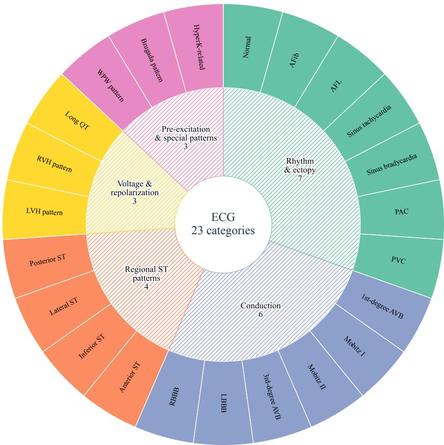  
Fig. 6 Medical taxonomy organizing the 23 ECG task categories. Each outer sector denotes one category; inner sectors group related categories, with areas and counts indicating the number of categories in each group. The diagram summarizes task coverage and the grouping used for category-level feedback.

## D Stage-wise Prompt Templates

This appendix documents reusable prompt templates for the method interfaces. Bracketed fields are filled with request-specific inputs and tool results. Section D.3 reproduces the teacher-answer instruction; the other templates are organized by function. The following cases retain their original questions and saved responses.

## D.1 Constrained waveform construction

<table><tr><td>Prompt P1</td></tr><tr><td>System role. You are an ECG waveform-construction agent. Convert a target feature request into an auditable edit plan. User inputs. [request ID], [training-source waveform and sampling rate], [lead names and calibration], [measured landmarks and uncertainty], [target ranges], [protected features and tolerances], [allowed operators and donors], [retry budget]. Instructions. Check source eligibility and landmark reliability. For the forward route, extract supported features without changing the signal. For the reverse route, specify operator order, parameters, and edit mask. Invoke the supplied editing and measurement tools, then compare observed targets and protected drift with the fixed tolerances. Check boundary continuity, lead alignment, and required morphology. If tools or required landmarks are unavailable, return blocked; if validity checks; failure codes; edited-signal reference. Report executed results separately from proposed operations.</td></tr><tr><td>verification fails, repair within budget or reject. Output fields. Status; source identities; operator plan; requested and observed measurements with units; protected drift;</td></tr></table>

## D.2 Evidence-grounded question and context generation

<table><tr><td>Prompt P2</td></tr><tr><td>System role. You construct ECG multiple-choice questions from verified signal evidence. Keep internal labels and generator intent out of the student-visible question. User inputs. [verified ECG image], [measurement evidence], [supported label level], [target category], [question type and</td></tr><tr><td>difficulty], [option count], [context policy], [permitted source context]. Instructions. Write one question with exactly the requested number of options and one evidence-supported answer. Use</td></tr><tr><td>plausible distractors that remain incorrect for this signal. Ask only at the supported level: measurement, ECG pattern, or clinically supported diagnosis. Default to image-only or traceable demographics. Mark any synthetic teaching context</td></tr><tr><td>explicitly and check it against the achieved waveform. Output fields. Student-visible question, options, and allowed context; evaluator-only answer, evidence mapping, context provenance, category, and difficulty; ambiguity or insufficient-evidence flag.</td></tr></table>

## D.3 Teacher answer and evidence explanation

<table><tr><td>Prompt P3</td></tr><tr><td>Please reason step by step, and put your final answer within \boxed{}.</td></tr></table>

## D.4 Independent quality and acceptance review

<table><tr><td>Prompt P4</td></tr><tr><td>System role. You audit a candidate ECG training example. User inputs. [source and edited evidence], [target/protected-feature checks], [question and options], [context provenance], [proposed answer and teacher response], [fixed rubric and aggregation rule].</td></tr><tr><td>Instructions. Independently solve the question, then audit target attainment, protected drift, morphology, context consistency, answer uniqueness, leakage, and explanation support. Return separate decisions for each gate and cite the relevant observation. Score only with the supplied rubric. The aggregate-score threshold is 80/100, but every mandatory</td></tr><tr><td>gate must also pass. Output fields. Independent answer; gate-wise pass/fail decisions and evidence; rubric scores; aggregate if defined; accept/review/reject status; failure codes and repair target.</td></tr></table>

## D.5 Construction failure and versioned repair

<table><tr><td>Prompt P5</td></tr><tr><td>System role. You propose a minimal repair to a failed data-construction component while keeping the acceptance criteria fixed.</td></tr><tr><td>User inputs. [failed attempt and evidence], [failure codes], [current operator/prompt/skill version], [allowed repair scope], [fixed regression suite], [attempt budget]. Instructions. Map numerical or boundary failures to operator repair; missing morphology to applicability or donor retrieval;</td></tr><tr><td>ambiguity/leakage to question or context repair; unsupported explanation to response-prompt repair. Specify the exact change and why it addresses the observed failure. Compare old and new versions on the same sources, requests, seeds, and budget. Quarantine or reject when the budget is exhausted.</td></tr><tr><td>Output fields. Triggering failure; component; exact revision; old/new version; proposer; validation results; acceptance rationale; next-round scope.</td></tr></table>

D.6 Learner-feedback diagnosis and recipe proposal
<table><tr><td>Prompt P6</td></tr><tr><td>System role. You propose training-data interventions from development feedback. User inputs. [accepted parent and feedback version], [category/type/difficulty counts and errors], [confusions and</td></tr><tr><td>regressions], [training-pool coverage], [construction yield/cost], [history], [token and attempt budgets]. Instructions. Prioritize deficits with adequate support; report sparse or uncertain groups explicitly. Propose distinct</td></tr><tr><td>candidates for direct weakness coverage, confusion contrasts, and difficulty or evidence-granularity progression. For each, give normalized category, difficulty, and supervision-style allocations; requested feature ranges; protected attributes; allowed</td></tr><tr><td>routes/operators; source filters; and cost limits. A/B/C retain the same previous cumulative training set unchanged and</td></tr><tr><td>each add 10,000 first-use accepted questions, without an extra shared baseline set; only the winning additions enter the next cumulative set.</td></tr><tr><td></td></tr><tr><td>Output fields. candidate recipes and hypotheses; normalized allocations and budgets; construction requests; provenance restrictions.</td></tr></table>

## D.7 Candidate comparison and model promotion

<table><tr><td>Prompt P7</td></tr><tr><td>System role. You apply a preregistered development-only promotion rule to comparable candidate learners. User inputs. [parent and candidate checkpoint IDs], [new/replay manifests], [supervised-token budgets], [fixed selection-set results], [primary score], [regression tolerances], [tie/stopping rules].</td></tr><tr><td>Instructions. Check that candidates share the required parent, training budget, and evaluation protocol. Apply the supplied score, regression, and valid-output gates exactly; do not invent thresholds. Promote only an eligible candidate,</td></tr><tr><td>otherwise retain the parent. Count only previously unused accepted items from the promoted branch toward cumulative additions, preserving replay provenance. Archive other branches and log the decision.</td></tr><tr><td>Output fields. Comparability checks; gate results; chosen checkpoint or retain-parent decision; supporting scores; admitted item manifest; replay manifest; stopping status.</td></tr></table>

## E Prompts and Case Studies

Blue bold text marks reasoning cues and reported values; amber text marks assumptions or grounding concerns.

## E.1 Case 1: PR prolongation

<table><tr><td>Case 1: PR prolongation</td></tr><tr><td>Waveform construction Copy the P wave and QRS-T segment, lengthen the PQ segment, and shorten the TP segment to preserve the RR interval.</td></tr><tr><td>The target PR is 300 ms; remeasurement yields PR 298 ms andHR 74.6 bpm</td></tr><tr><td>Question Question: Under the automatic closed-loop measurement convention of this data-construction pipeline, which parameter</td></tr><tr><td>analysis and conclusion are correct for this 12-lead ECG?</td></tr><tr><td>Options: A: HR 74.6 bpm, PR 130.0 ms, QRS 96.0 ms, QTc 393.7 ms -&gt; Conclusion: no first-degree atrioventricular block</td></tr><tr><td>B: HR 48.0 bpm, PR 298.0 ms, QRS 96.0 ms, QTc 393.7 ms -&gt; Conclusion: sinus bradycardia with first-degree</td></tr><tr><td>atrioventricular block C: HR 74.6 bpm, PR 298.0 ms, QRS 96.0 ms, QTc 393.7 ms -&gt; Conclusion: first-degree atrioventricular block</td></tr><tr><td>D: HR 74.6 bpm, PR 298.0 ms, QRS 130.0 ms, QTc 393.7 ms -&gt; Conclusion: first-degree atrioventricular block with intraventricular conduction delay</td></tr></table>

(b) Perturbed waveform

Case 1 PR-interval prolongation  
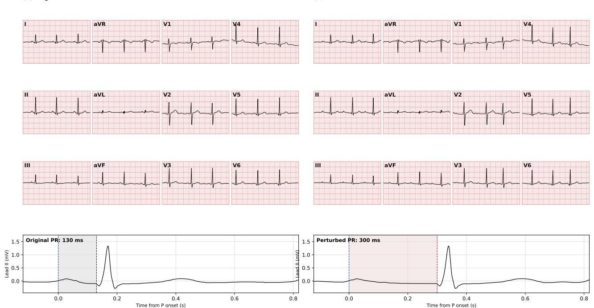  
Fig. 7 Targeted PR prolongation, shown through original and edited ECGs with lead II details. The edit lengthens the PQ segment and compensates in the TP segment to preserve the RR interval. The target PR is 300 ms and the remeasured PR is 298 ms; these automatic measurements support the subsequent parameter-comparison question.

<table><tr><td>Case 1: PR prolongation (continued)</td></tr><tr><td>Please reason step by step, and put your final answer within \boxed{}.</td></tr><tr><td>Qwen3.8 response Let me analyze this ECG question.</td></tr><tr><td>The question is asking (in Chinese): &quot;According to the automatic closed-loop measurement criteria of this data construction pipeline, looking at this 12-lead ECG, which of the following parameter analyses and conclusions is correct?&quot;</td></tr><tr><td>Options:</td></tr><tr><td>A: HR 74.6 bpm, PR 130.0 ms, QRS 96.0 ms, QTc 393.7 ms → Conclusion: No first-degree AV block observed</td></tr><tr><td>B: HR 48.0 bpm, PR 298.0 ms, QRS 96.0 ms, QTc 393.7 ms → Conclusion: Sinus bradycardia with first-degree AV block</td></tr><tr><td>C:HR 74.6 bpm, PR 298.0 ms, QRS 96.0 ms, QTc 393.7 ms → Conclusion: First-degree AV block D: HR 74.6 bpm, PR 298.0 ms, QRS 130.0 ms, QTc 393.7 ms → Conclusion: First-degree AV block with intraventricular</td></tr><tr><td>conduction delay</td></tr><tr><td>I need to look at the ECG and determine the parameters. Looking at the ECG: the rhythm strip (II rhythm) shows about 12 beats over some length. Let me estimate the heart rate. The rhythm strip is probably 10 seconds? Let me count: I see 12 QRS complexes in the II rhythm strip. If the strip is 10 seconds,</td></tr><tr><td>HR ≈ 12 * 6 = 72 bpm... actually 12 beats in 10 seconds = 72 bpm. Hmm, but the option says 74.6 bpm. That&#x27;s plausible.</td></tr><tr><td>Looking at the PR interval: in lead II, there&#x27;s a P wave before each QRS. The PR interval looks... let me see. In the rhythm strip, the P wave appears just before the QRS? Actually, there&#x27;s a small bump (P wave) before the QRS, and a T wave after the QRS. Let me look more carefully.</td></tr><tr><td>In lead II (second row first column), there&#x27;s a small P wave, then QRS, then T wave. The distance from P to QRS looks</td></tr><tr><td>short? Hmm. But the question says &quot;perturbed waveform&quot;—this is a synthetic case with perturbations added. The question is about the &quot;automatic closed-loop measurement criteria&quot; of the data construction pipeline. Probably the ground truth parameters are:</td></tr></table>

## Case 1: PR prolongation (continued)

Looking at the waveform: in lead II, before each QRS there’s a P wave... hmm, actually looking at the rhythm strip: after each QRS there’s a T wave, and before the next QRS there’s a P wave? Let me look: pattern per beat: QRS spike, then T wave bump, then another bump (P wave?), then QRS. Actually, in the rhythm strip I see: spike, then bump, then bump, then spike... spacing: after the spike at \~x=290, bump at \~340, bump at \~390, spike at \~455. Hmm, so two bumps between spikes: T wave and P wave. If the P wave is at \~390 and QRS at \~455, then PR interval is \~65 px? Need scale.

## Case 1: PR prolongation (continued)

Let me reconfirm PR visually: in lead II rhythm strip, between QRS spikes: T wave bump right after spike, then P wave bump before next spike. Distance from P bump to spike: e.g., P at \~390, spike at \~455: 65 px. Large box size: let me estimate grid: panel width \~500 px with \~13 large boxes? Hmm, 500/13 ≈ 38.5 px per large box → consistent with 7.7 px/mm (5 mm = 38.5 px). So 65 px = 1.69 large boxes = 338 ms? Hmm, that’s more than 298. But my pixel guesses are rough; maybe P at \~400. Anyway, among options, PR 298 is the prolonged one; 130 would be about half a large box (2.6 small boxes = 26 px). Visually the P-QRS distance is clearly more than 1 large box? Hmm, 298 ms = 7.45 small boxes = 1.49 large boxes. 130 ms = 3.25 small boxes = 0.65 large boxes. Visually the distance from P bump onset to QRS onset looks like \~1.5 large boxes? Plausible.

Actually, PR interval is measured from P onset to QRS onset. The P bump peak at \~390-400, onset maybe \~380; QRS onset \~450. Diference \~70 px ≈ 1.8 large boxes = 360 ms? Hmm, too long. But my pixel readings from memory of the image are unreliable. Given the options, only C is internally consistent: HR 74.6 (not bradycardia), PR prolonged 298 → first-degree AV block, QRS normal 96 → no intraventricular conduction delay. So C.

Thus final answer: C.

## Final answer

Looking at the rhythm strip: the R-R intervals correspond to a rate of about 75 bpm (not bradycardia), each P wave is followed by a QRS with a clearly prolonged P-R interval (about 300 ms, i.e., >200 ms), the QRS complexes are narrow (about 96 ms, no intraventricular conduction delay), and QTc is normal (\~394 ms). Therefore the correct interpretation is sinus rhythm at \~74.6 bpm with a prolonged PR interval (298 ms) = first-degree AV block, with normal QRS duration.

\- A is wrong because the PR is clearly prolonged, not 130 ms.

\- B is wrong because the rate is \~75 bpm, not 48 bpm.

\- D is wrong because the QRS is narrow (96 ms), not 130 ms.

\boxed{C}

Case 1 error analysis. At 25 mm/s, 130 ms corresponds to 3.25 small boxes, not the 2.6 stated in one part of the response. Bundle branch block assessment combines QRS duration with characteristic morphology. The response also references the intended answer and calibrates estimates from option values.

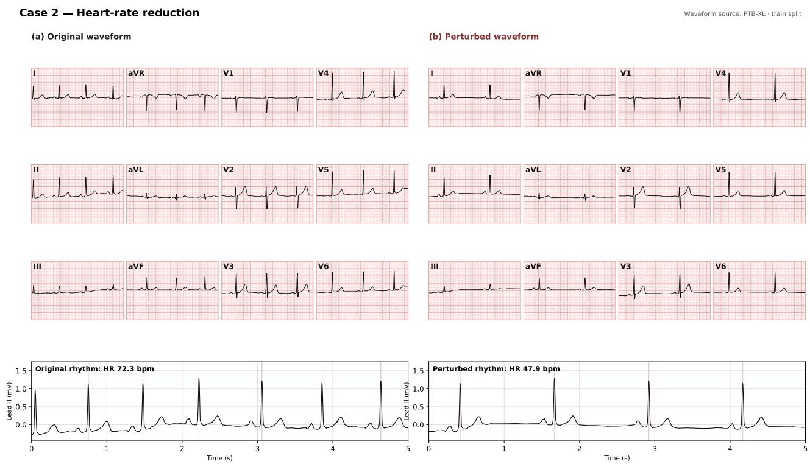  
Fig. 8 Targeted heart-rate slowing, shown through original and edited ECGs with lead II details. Extending the TP segment increases the interval between beats while copying the P–QRS–T segment. The target is 48 bpm and remeasurement gives 47.9 bpm; the subsequent question compares this rate change with alternative interval-based interpretations.

E.2 Case 2: Heart-rate slowing
<table><tr><td>Case 2: Heart-rate slowing</td></tr><tr><td>Waveform construction</td></tr><tr><td>Copy the P-QRS-T segment and extend the TP segment between beats. The target heart rate is 48 bpm, corresponding to an RR interval of 1.25 s. Remeasurement yields HR 47.9 bpm,PR 150 ms, QRS 48 ms, and QTc 348.5 ms.</td></tr><tr><td>Question</td></tr><tr><td>Question: Under the automatic closed-loop measurement convention of this data-construction pipeline, which parameter analysis and conclusion are correct for this 12-lead ECG?</td></tr><tr><td>Options:</td></tr><tr><td>A: HR 72.3 bpm, PR 150.0 ms, QRS 48.0 ms, QTc 348.5 ms-&gt; Conclusion: normal heart rate</td></tr><tr><td>B: HR 47.9 bpm, PR 150.0 ms, QRS 48.0 ms, QTc 348.5 ms -&gt; Conclusion: sinus bradycardia C: HR 47.9 bpm, PR 220.0 ms, QRS 48.0 ms,QTc 348.5 ms -&gt; Conclusion: sinus bradycardia with first-degree</td></tr><tr><td>atrioventricular block</td></tr><tr><td>D: HR 47.9 bpm, PR 150.0 ms, QRS 48.0 ms, QTc 490.0 ms -&gt; Conclusion: sinus bradycardia with QT prolongation Please reason step by step, and put your final answer within \boxed{}.</td></tr><tr><td>Qwen3.8 response</td></tr><tr><td>Let me analyze this ECG. The question is in Chinese: &quot;According to the automatic closed-loop measurement criteria of this data construction pipeline, looking at this 12-lead ECG, which of the following parameter analyses and conclusions is</td></tr><tr><td>correct?&quot; Options:</td></tr><tr><td>A: HR 72.3 bpm, PR 150.0 ms, QRS 48.0 ms, QTc 348.5 ms→ Conclusion: normal heart rate</td></tr><tr><td>B:HR 47.9 bpm, PR 150.0 ms, QRS 48.0 ms,QTc 348.5 ms → Conclusion: sinus bradycardia</td></tr><tr><td>C: HR 47.9 bpm, PR 220.0 ms, QRS 48.0 ms, QTc 348.5 ms → Conclusion: sinus bradycardia with first-degree AV block</td></tr><tr><td>D: HR 47.9 bpm, PR 150.0 ms, QRS 48.0 ms, QTc 490.0 ms → Conclusion: sinus bradycardia with prolonged QT interval I need to look at the ECG and determine the heart rate, PR interval, QRS width, and QTc.</td></tr><tr><td>Looking at the rhythm strip (II rhythm): there are about 8 QRS complexes across the entire strip. The strip length is probably 10 seconds? Let me estimate. Paper speed 25 mm/s. Each lead panel shows about 2 beats across roughly 5.5</td></tr><tr><td>seconds? Let me look at the grid. Actually, let me estimate the RR interval from the image. In the II rhythm strip, the QRS complexes appear at approximately x positions: 253, 483, 713, 943, 1200?, ... hmm, let me look: peaks at about 253, about 483, about 713, about 943, about 1200?</td></tr><tr><td>Actual spacing: from the figure, peaks at x ≈ 253, 483, 713, 943, 1200, 1430, 1660, 1890? Hmm, the spacing looks like about 230 pixels.</td></tr><tr><td>Grid: at 25 mm/s, small box = 1 mm = 0.04 s; large box = 5 mm = 0.2 s. The panel width is probably 250 mm? Hmm. Let me think about the intended answer. This seems to be from a synthetic dataset (&quot;Case 2· Perturbed waveform&quot;), with ground truth parameters: HR 47.9 bpm (bradycardia), PR 150 ms (normal), QRS 48 ms (narrow? actually 48 ms is quite</td></tr><tr><td>narrow but plausible as synthetic), QTc 348.5 ms (normal). So the conclusion: sinus bradycardia. Option B. But let me check the visual RR interval: HR 47.9 bpm → RR ≈ 1.25 s = 31.25 small boxes = 6.25 large boxes. In the rhythm strip, the distance between QRS peaks: if the strip is 10 s with 8 beats, then RR ≈ 1.25 s → 8 beats in 10 s gives HR about 48?</td></tr><tr><td>Actually 8 beats in 10 s: RR = 10/7 ≈ 1.43 s → HR 42. Hmm, but with 8 beats across the strip: intervals = 7; 7 * 1.25 = 8.75 s, plus margins ≈ 10 s strip. Plausible. Check PR: in lead II, the P wave appears just before the QRS with a short interval (about 150 ms = 3.75 small boxes). Visually,</td></tr><tr><td>the P wave is close to the QRS, not far away. So PR 150 ms is plausible; PR 220 would be first-degree AV block, but the P-QRS distance looks short (P wave just before QRS). In the rhythm strip, the P wave appears about 1 small box? Hmm.</td></tr><tr><td></td></tr><tr><td>QTc: QT interval looks normal: T wave follows QRS soon after. QTc 348.5 is normal (shortish but normal). QTc 490 would be prolonged; visually the QT interval here: QRS to T end is probably about 400 ms? At HR 48, QTc = QT / sqrt(RR). If QT ≈ 400 ms and RR = 1.25, then QTc = 400/1.118 = 357. So QTc 348.5 is consistent.</td></tr></table>

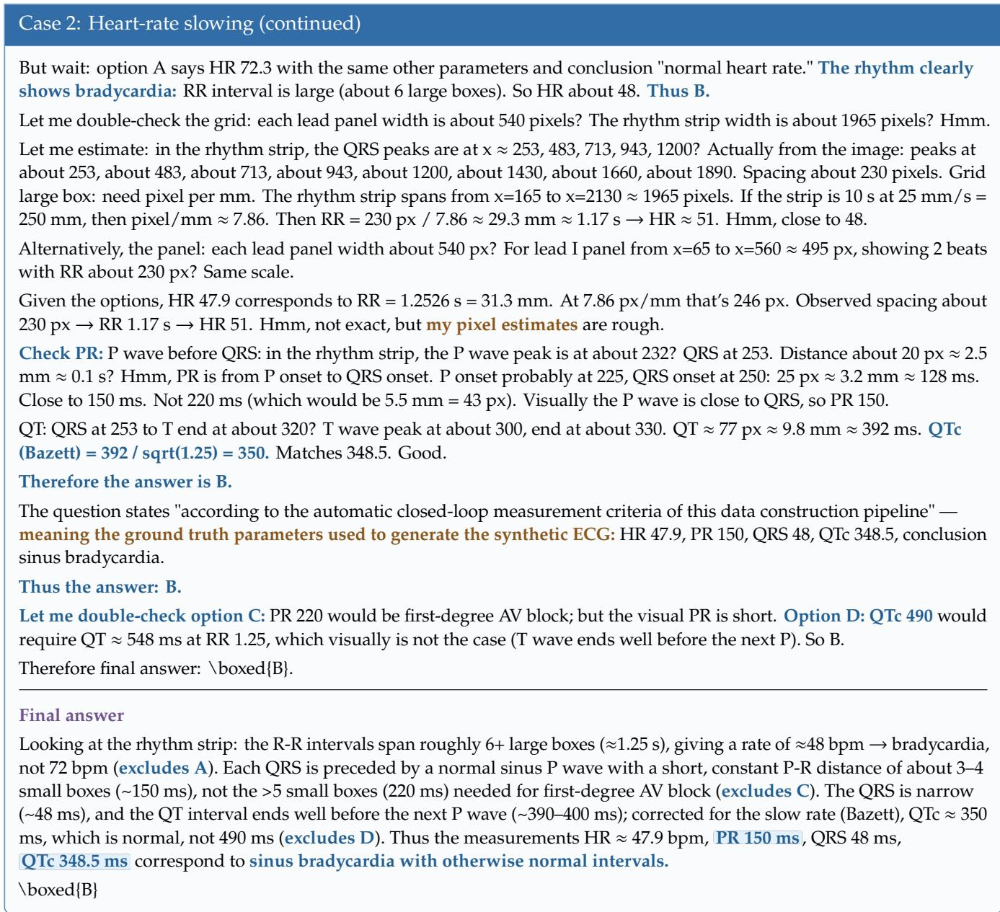  
Case 2 error analysis. Eight beats in ten seconds give approximately 48 bpm. Seven R–R intervals span the first to last R peaks. The response justifies QRS duration by the synthetic origin and invokes the intended answer.