# Enabling Token-wise Importance Sampling in Of-Policy RLVR with Proximal KL Regularization

Hao Bai Jiarui Yao Tong Zhang

University of Illinois Urbana-Champaign

## Abstract

In reinforcement learning with verifiable rewards (RLVR), asynchronous generation, differences between rollout and training policies, and response reuse across optimizer minibatch updates can all produce of-policy data. Token-wise importance weighting allows policy-gradient methods to reuse these responses without multiplying likelihood ratios across a long response, but it generally biases the gradient. We prove that, under coverage and local expressiveness conditions, adding full future KL credit makes the exact proximal optimizer the update’s unique stationary policy. The result holds even when responses come from a mixture of older policies and requires neither full-response importance weights nor a fitted critic. We also prove convergence of continuous-time tabular population updates under persistent coverage and timevarying behavior policies, and give a finite-sample reward guarantee for linear logistic models under additional assumptions. These results motivate Proximal KL, a practical of-policy RLVR method that separates the proximal reference from the sampling policy and replaces ordinary PPO clipping with bounded future KL credit. Across all seven matched of-policy comparisons on Qwen3-1.7B and Qwen3-4B, Proximal KL achieves higher micro-averaged accuracy than GRPO over eight math benchmarks, spanning two learning rates, response reuse, and rollout staleness. The absolute improvement in micro-averaged accuracy reaches 2.58%. A separate on-policy comparison shows comparable aggregate accuracy for the two methods. These gains accompany stable optimization: in the periodic-refresh experiments, Proximal KL avoids the training collapses observed in PG and CISPO, attains higher training accuracy than GRPO, and reaches higher accuracy in fewer policy updates. To explain these gains, ablations first compare how of-policy sampling is corrected: token-wise weighting outperforms sequence-level and unweighted controls. With token-wise correction retained, future KL feedback reduces sen sitivity to the tested baseline perturbation relative to PPO clipping. The extent of this feedback matters as well: a finite future cost horizon improves AIME24 mean@16 and pass@16 over the full tail, while fixed-policy measurements show that truncation reduces correction variance over the tested horizons.

Project page: https://biechi.github.io/blog/offpolicy-proximal-kl/

## 1 Introduction

Reinforcement learning with verifiable rewards (RLVR) optimizes a policy from verifier-scored responses, often generated by a behavior policy that difers from the policy being optimized. This of-policy mismatch has several sources. Asynchronous systems overlap generation and optimization, so responses may come from earlier policy versions (Fu et al., 2025; Bai et al., 2026; Zhu et al., 2025; RadixArk, 2026). Reusing collected trajectories across optimizer minibatch updates introduces mismatch as the current policy changes, even when collection is synchronous. We study the common problem of learning from these of-policy responses.

Policy-gradient methods such as GRPO and DAPO use token-wise importance ratios (Shao et al., 2024; Yu et al., 2025). Exact importance correction of a response-level objective instead multiplies the ratios across the response, which can have high variance for long responses. Token-wise weighting avoids this product but generally biases the gradient. We ask when an update based on token-wise weights and sampled rewards, without a fitted value or Q function, still retains the proximal target. This target is the optimizer of a KL-regularized objective.

We study a proximal objective that penalizes the reverse KL divergence from the current policy to a reference policy held fixed during each optimization round (Geist et al., 2019; Tomar et al., 2022). The reference defines the improvement target, while the behavior policy determines the sampling distribution. Following batch-size-invariant policy optimization (Hilton et al., 2022), we separate these policies so the target remains fixed even when the data-generating distribution difers from the current policy. For autoregressive responses, the regularized policy gradient assigns each token the current and all future token log-ratio costs, as expressed by Future-KL credit (Yao et al., 2026). We combine this full credit with a single importance ratio for the current token.

Our main result shows that, under coverage and local expressiveness, the expected token-wise update with full future KL credit vanishes if and only if the learner equals the proximal optimizer. The result holds for any supported stale behavior policy or mixture of behavior-policy versions, although the expected update can difer from the exact proximal gradient away from the optimizer. The proof uses the soft path-consistency identity established by PCL and Trust-PCL (Nachum et al., 2017, 2018). With independent tabular logits and persistent coverage, we further prove convergence of continuous-time updates (Appendix E).

To study learning from sampled responses, we also give a finite-sample reward guarantee after repeated reference refreshes for a linear logistic model, whose token logits depend linearly on trainable parameters through fixed features (summarized in Theorem 2, with the precise statement in Appendix F). Under its assumptions, the final policy approaches the comparator’s expected reward for a single response. Its mismatch condition bounds the sum of learner-weighted squared token log ratios along each response path, and the update never forms the response-level product of ratios. This analysis motivates a practical algorithm that can also be applied to nonlinear models such as Transformers.

Guided by these results, we develop Proximal KL Regularization (Proximal KL). The practical update records each token’s behavior probability, periodically refreshes the proximal reference, and subtracts bounded future KL costs from a group-relative reward advantage before applying the token-wise importance weight. A bound on each log-ratio cost limits individual contributions, while a tunable horizon limits how many future costs are included. The update omits ordinary PPO clipping. Section 4 discusses the trade-of between bias and variance when bounding the costs, and Section 6.4 evaluates these choices empirically.

Contributions. To our knowledge, this is the first stationary-policy guarantee for critic-free tokenwise importance weighting with full future KL credit under supported stale behavior mixtures. We also prove tabular convergence and, for a realizable linear logistic model, a finite-sample reward guarantee under correct-solution coverage using a full-credit group update with repeated reference refreshes (Theorem 2). Our empirical comparisons show that Proximal KL achieves higher microaveraged held-out accuracy than GRPO in all seven matched of-policy settings in Section 6.3. These gains span eight math benchmarks, 1.7B and 4B models, and the tested learning rates and rollout staleness levels, including fresh rollouts reused across optimizer minibatches. In the separate on-policy comparison, Proximal KL attains aggregate accuracy comparable to GRPO. Complementary periodic-refresh experiments show that Proximal KL sustains training gains through the collapses observed in PG and CISPO and attains higher training accuracy than GRPO at comparable optimizer-update counts (Section 6.2). The ablations connect these outcomes to update design: current-token importance correction outperforms Sequence-level IS and IS-free settings, and future KL feedback is less sensitive to the tested baseline perturbation than PPO clipping. The tightest tested future-cost bound combines strong accuracy with smaller gradient-norm excursions, while a finite horizon outperforms both strong local and full-tail corrections. Fixed-policy measurements confirm that truncation reduces correction variance over the tested horizons (Section 6.4).

## 2 Related Work

Proximal updates. Proximal methods control policy changes relative to a reference policy, as in TRPO (Schulman et al., 2015). Regularized MDPs and mirror-descent policy optimization formalize KL-based updates (Geist et al., 2019; Tomar et al., 2022). Batch-size-invariant policy optimization (Hilton et al., 2022) distinguishes the proximal reference from the behavior policy, separating the optimization target from the sampling distribution. AReaL and AsyncWebRL apply this distinction to asynchronous optimization (Fu et al., 2025; Bai et al., 2026). Slime and Miles support asynchronous rollout and training pipelines that reduce bubble time (Zhu et al., 2025; RadixArk, 2026). FRPO derives the on-policy Future-KL gradient identity for autoregressive regularization (Yao et al., 2026). We use this identity for expected reward regularized against a fixed proximal reference (Appendix D.2), then characterize the stationary policy when full future credit is combined with a single current-token importance ratio under behavior-policy mismatch, including stale behavior mixtures.

PCL establishes soft path consistency and minimizes the corresponding errors on of-policy trajectories (Nachum et al., 2017). Trust-PCL extends this approach to relative-entropy regularization against an updated reference (Nachum et al., 2018). Soft Q-learning learns soft Bellman values and an associated sampling policy (Haarnoja et al., 2017); Unified PCL represents policy and value with one Q model (Nachum et al., 2017). Schulman et al. (2017a) derive regularized Monte Carlo policy gradients and relate them to soft Q-learning with value fitting. Our analysis concerns the stationary policy of an update that combines policy scores with token-wise importance weights, sampled rewards, and full future credit. The update requires no fitted values or optimization of a consistency residual (Section 5).

Policy-gradient methods. REINFORCE uses sampled policy scores (Williams, 1992), while PPO uses a clipped policy-gradient surrogate (Schulman et al., 2017b). For language-model reasoning, GRPO constructs group-relative advantages (Shao et al., 2024), and DAPO develops clipping and sampling choices (Yu et al., 2025). V-trace and Retrace correct bootstrapped value or Q targets for of-policy data using truncated importance traces (Espeholt et al., 2018; Munos et al., 2016). Vtrace also weights its policy update by a current-action ratio. Their fixed-point guarantees concern corrected value learning. We establish the unique stationary policy of the actor update itself, using sampled rewards, full future KL credit, and current-token importance weighting without a fitted critic.

Compatible approximation and policy-improvement closure provide structural conditions for policygradient convergence (Agarwal et al., 2021; Yuan et al., 2023; Bhandari and Russo, 2024). Appendix F relates these conditions to our bounded Gibbs-target representation assumption and its concrete examples.

We also acknowledge related unpublished work by Audrey Huang and collaborators on coverage collapse and reference re-anchoring in policy optimization after pre-training (private communication with Nan Jiang).

## 3 Setup and Proximal Update

The proximal reference defines the optimization target, while the behavior policy generates training responses. Asynchronous RLVR systems such as AReaL, StreamRL, AsyncWebRL, Slime, and Miles overlap generation and policy updates to reduce bubble time (Fu et al., 2025; Zhong et al., 2025; Bai et al., 2026; Zhu et al., 2025; RadixArk, 2026). The behavior policy may therefore difer from both the current learner and the fixed proximal reference.

We regularize expected reward by the reverse KL divergence from the learner to the reference (Geist et al., 2019; Tomar et al., 2022), with the reference policy updated between optimization rounds. Let the prompt set and generation tree be finite. Write $x \sim \mathcal { D }$ for a prompt, τ for its response, and $R ( x , \tau ) \in \{ 0 , 1 \}$ for the verifier reward. The current policy π is optimized relative to $\pi _ { k } ,$ fixed during round k; responses are sampled from $\pi _ { \mathrm { b e h a v } } \colon$

$$
J _ { k } ( \theta ) = \mathbb { E } _ { \boldsymbol { x } \sim \mathcal { D } , \tau \sim \pi _ { \theta } } [ R ( \boldsymbol { x } , \tau ) ] - \beta \mathbb { E } _ { \boldsymbol { x } \sim \mathcal { D } } D _ { \mathrm { K L } } ( \pi _ { \theta } ( \cdot \mid \boldsymbol { x } ) | | \pi _ { k } ( \cdot \mid \boldsymbol { x } ) ) , \qquad \beta > 0 .\tag{1}
$$

Its maximizer over response policies is $\pi _ { k } ^ { * } ( \tau ~ \vert ~ x ) = \pi _ { k } ( \tau ~ \vert ~ x ) e ^ { R ( x , \tau ) / \beta } / Z _ { k } ( x )$ , where $Z _ { k } ( x ) \ =$ $\mathbb { E } _ { \tau \sim \pi _ { k } ( \cdot | x ) } e ^ { R ( x , \tau ) / \beta }$ . The objective-gap identity in Equation (D.3) gives this standard Gibbs characterization; we include it for completeness. For binary rewards, the Gibbs step multiplies the reference probability of each correct response by $e ^ { 1 / \beta }$ before renormalizing. Thus the reference determines which responses are reweighted, and $\beta$ controls the strength of this reweighting.

Proximal regularization also has benefits in the on-policy setting (Schulman et al., 2015; Tomar et al., 2022). For binary rewards, its exact unrestricted optimizer improves every prompt whose success probability lies strictly between zero and one (Proposition D.1). Appendix D.1 illustrates the benefit of proximal regularization in a shared-parameter model; Section 6.3 reports an on-policy comparison.

Diferentiating the response-level objective gives the Future-KL policy-gradient expression (Schulman et al., 2017a; Yao et al., 2026): each token’s log-probability gradient is weighted by the reward advantage minus the current and future log-ratio costs. Penalizing only the current token generally omits part of the regularization gradient (Appendix D.2). Let T be the maximum response length, padding shorter responses with deterministic terminal actions. For $\tau = ( a _ { 1 } , \ldots , a _ { T } )$ and $h _ { i } = ( x , a _ { < i } )$ , define the learner-to-reference ratio and the learner-to-behavior importance weight as

$$
\rho _ { i } = \frac { \pi _ { \theta } ( a _ { i } \mid h _ { i } ) } { \pi _ { k } ( a _ { i } \mid h _ { i } ) } , \qquad w _ { i } = \frac { \pi _ { \theta } ( a _ { i } \mid h _ { i } ) } { \pi _ { \mathrm { b e h a v } } ( a _ { i } \mid h _ { i } ) } = \frac { \pi _ { k } ( a _ { i } \mid h _ { i } ) } { \pi _ { \mathrm { b e h a v } } ( a _ { i } \mid h _ { i } ) } \rho _ { i } .\tag{2}
$$

Importance weighting and future KL credit serve diferent purposes: the weights correct the sampling distribution, while the KL costs define the regularized return. Exact response-level importance sampling uses the product of current-to-behavior ratios in Equation (2), whose variance can grow exponentially with response length. Starting from the policy-gradient expression for objective (1), we replace the response-wise importance weight by one ratio for each sampled token. For the current policy θ, the expected token-wise policy-gradient field is

$$
\begin{array} { l } { { \displaystyle \widehat { A } _ { i } ^ { \mathrm { K L } } ( \theta ) = R - b ( h _ { i } ) - \beta \sum _ { j = i } ^ { T } \log \rho _ { j } ( \theta ) } , } \\ { { \displaystyle M _ { \mathrm { b e h a v } } ( \theta ) = \mathbb { E } _ { \tau \sim \pi _ { \mathrm { b e h a v } } } \sum _ { i } \frac { \pi _ { \theta } ( a _ { i } \mid h _ { i } ) } { \pi _ { \mathrm { b e h a v } } \left( a _ { i } \mid h _ { i } \right) } \widehat { A } _ { i } ^ { \mathrm { K L } } ( \theta ) \nabla _ { \theta } \log \pi _ { \theta } ( a _ { i } \mid h _ { i } ) . } } \end{array}\tag{3}
$$

The expectation also includes $x \sim \mathcal { D }$ . The baseline $b ( h _ { i } )$ depends only on the history, is held fixed during diferentiation, and may be zero. We likewise treat the advantage as a fixed coeficient when

computing an update, then recompute it after the policy changes. The resulting field uses observed rewards and policy log probabilities without a fitted value or Q function. We analyze its stationary points directly, allowing the field to depend on the behavior policy.

## 4 Algorithm

Proximal KL. Our update combines token-wise importance weighting with bounded future KL credit. The update uses verifier rewards, policy log probabilities, and statistics from groups of responses, without fitting a value or Q function.

Algorithm 1 specifies the token-wise proximal update for diferentiable autoregressive policies, including Transformers. Each round holds the reference fixed for L optimizer updates. Updates may reuse sampled response groups, and the behavior policy follows its own refresh schedule. Each sampled token is paired with its probability under the behavior policy; the frozen reference defines the KL cost.

For a group of $G \ge 2$ responses, let $\widehat { A } _ { m }$ denote the reward advantage assigned to response m, held fixed during diferentiation. For response m of length $T _ { m }$ , write $h _ { m , i } = ( x , a _ { m , < i } )$ for the history before token $a _ { m , i }$ . The two ratios in Equation (2) are

$$
\rho _ { m , i } = \frac { \pi _ { \theta } ( a _ { m , i } \mid h _ { m , i } ) } { \pi _ { k } ( a _ { m , i } \mid h _ { m , i } ) } , \quad w _ { m , i } = \frac { \pi _ { \theta } ( a _ { m , i } \mid h _ { m , i } ) } { \pi _ { \mathrm { b e h a v } , m } ( a _ { m , i } \mid h _ { m , i } ) } = \frac { \pi _ { k } ( a _ { m , i } \mid h _ { m , i } ) } { \pi _ { \mathrm { b e h a v } , m } ( a _ { m , i } \mid h _ { m , i } ) } \rho _ { m , i } .\tag{4}
$$

Here $\pi _ { \mathrm { b e h a v } , m }$ is the behavior policy that generated response $m$ . The KL correction uses the learnerto-reference log ratio $\ell _ { m , i } = \log \rho _ { m , i } ;$ the score loss uses the learner-to-behavior weight $w _ { m , i }$ . Thus $\rho _ { m , i }$ measures policy movement from the frozen reference, while $w _ { m , i }$ corrects the sampled token’s action distribution for the behavior policy that generated it. They coincide when $\pi _ { \mathrm { b e h a v } , m } = \pi _ { k } ;$ using $\rho _ { m , i }$ alone in the loss would otherwise omit the reference-to-behavior correction in Equation (4). Define the practical clipped correction by

$$
C _ { m , i } ^ { ( H ) } = \beta \sum _ { j = i } ^ { \operatorname* { m i n } ( T _ { m } , i + H - 1 ) } \mathrm { c l i p } ( \ell _ { m , j } , - \epsilon _ { F } , \epsilon _ { F } ) .\tag{5}
$$

Here H is the window size for the future KL correction: at token $i ,$ the window covers the current token and up to H − 1 subsequent tokens. The full-tail choice H = full uses every remaining token from position i to the end of the response; equivalently, the sum ends at $T _ { m }$ without window truncation. Setting $\epsilon _ { F } = \infty$ disables cost clipping. There is no window-length normalization, and $| C _ { m , i } ^ { ( H ) } | \le \beta \epsilon _ { F } \operatorname* { m i n } ( H , T _ { m } - i + 1 )$ for finite bounds. A tail-decay variant retains unit weight for the first H positions and weights the remaining clipped costs with a linear decrease to zero at the response end.

For each optimizer minibatch, minimize the following loss, averaged over its nonpadding action tokens:

$$
\mathcal { L } ^ { ( H ) } = - \frac { 1 } { N _ { \mathrm { t o k } } } \sum _ { m , i } \mathrm { s g } \left[ \frac { \pi _ { \theta } ( a _ { m , i } \mid h _ { m , i } ) } { \pi _ { \mathrm { b e h a v } , m } ( a _ { m , i } \mid h _ { m , i } ) } ( \widehat { A } _ { m } - C _ { m , i } ^ { ( H ) } ) \right] \log \pi _ { \theta } ( a _ { m , i } \mid h _ { m , i } ) .\tag{6}
$$

The sum is over sampled action tokens in the minibatch, $N _ { \mathrm { t o k } }$ is the number of nonpadding action tokens, and sg stops all gradients through its argument. Coeficients are recomputed at every learner update. Adam minimizes this loss without ordinary PPO clipping.

Cost clipping limits the sampled KL credit, and stop-gradient holds the resulting coeficient fixed when diferentiating the loss. Even when a log-ratio cost reaches its bound, the token’s score gradient remains active. Thus saturation of a cost does not suppress that token’s entire update. Appendix A specifies the group-normalized reward advantage and relates this loss to the ascent surrogate.

Algorithm 1 Proximal KL with token-wise importance weighting   
Require: Initial learner $\theta _ { 0 } ;$ rounds $K ;$ optimizer updates per round $L ;$   
group size $G \geq 2 ;$ KL coeficient $\beta ;$ window $H ;$ cost bound $\epsilon _ { F } ;$ Adam settings.   
Ensure: Final policy $\pi _ { \boldsymbol { \theta } _ { K } }$   
1: Initialize the behavior policy with $\theta _ { 0 } ;$ retain its probability for each sampled token.   
2: for $k = 0 , \ldots , K - 1$ do   
3: Freeze $\pi _ { k }  \pi _ { \theta _ { k } }$ and set $\vartheta _ { 0 } \gets \theta _ { k }$   
4: for $j = 0 , \ldots , L - 1$ do   
5: Set current learner $\theta  \vartheta _ { j }$   
6: Select new or reused response groups with behavior probabilities and verifier rewards.   
7: Compute reward advantages $\widetilde { \boldsymbol { A } } _ { m }$ for these groups.   
8: Select optimizer minibatch $B _ { j }$ from these groups.   
9: Recompute $\rho _ { m , i }$ and $w _ { m , i }$ by Equation $( 4 )$   
10: Form $\ell _ { m , i } =$ log $\rho _ { m , i }$ per token.   
11: Form $C _ { m , i } ^ { ( H ) }$ by Equation (5).   
12: Form loss $\mathcal { L } ^ { ( H ) }$ by Equation (6) on $B _ { j }$   
13: Update $\vartheta _ { j + 1 }$ with Adam.   
14: Refresh the behavior policy according to its update schedule.   
15: end for   
16: Set $\theta _ { k + 1 }  \vartheta _ { L }$   
17: end for   
18: return $\pi _ { \theta _ { K } }$

Appendix F specifies the changes to Algorithm 1 used for its finite-sample analysis, including projection of each group-gradient step onto a parameter ball around the reference. This projection is used only in the theoretical variant.

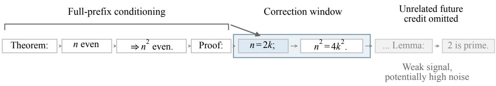  
Figure 1: Finite future-KL window. The policy conditions on the full prefix, while KL credit includes the current token and up to H − 1 subsequent tokens.

Trade-of between bias and variance in Proximal KL future tail. In the on-policy population setting, full, unmodified future KL credit supplies the complete regularization gradient. Estimating the full tail, however, can produce substantial sampling fluctuations. Clipping the costs limits extreme contributions, while shortening the window limits their accumulation. Both choices can introduce approximation bias in exchange for controlling these fluctuations, serving a stabilizing role analogous to gradient clipping in SGD. Figure 1 shows how an intermediate window retains nearby future costs while limiting the number of terms in the correction. Token-wise of-policy weighting introduces a separate approximation, as discussed in Section 3. Section 6.4 evaluates these choices empirically.

Proximal KL uses the following ascent surrogate; training minimizes its negative:

$$
{ \mathcal { L } } _ { \mathrm { P K L } } ( \theta ) = \mathbb { E } _ { \pi _ { \mathrm { b e h a v } } } \sum _ { i } { \frac { \pi _ { \theta } } { \pi _ { \mathrm { b e h a v } } } } \operatorname { s g } [ { \widehat { A } } _ { m } - C _ { i } ^ { ( H ) } ] .\tag{7}
$$

Here m indexes the sampled response and i indexes its tokens; the policy ratios and $C _ { i } ^ { ( H ) }$ are evaluated at token i of response m. The expectation includes prompts and sampled responses. We suppress the response index on token quantities in these comparison formulas.

When accumulated log-ratio costs are positive, they reduce the coeficient multiplying the policy score. This provides feedback on movement from the reference without a clipping gate that depends on the advantage sign. With raw verifier rewards and a history-only baseline, a full future window $( H \geq T )$ with no cost clipping supplies the regularization gradient on-policy and preserves the proximal stationary target under the population assumptions in Section 5. Group normalization can change this field, so the guarantee does not automatically extend to updates using normalized advantages. Horizon truncation controls the extent of the practical KL feedback.

To put this feedback in context, we compare it with updates that control policy movement through clipping and with an unclipped policy-gradient update. These comparisons distinguish the efect of future KL credit from the choice of importance weighting.

GRPO. Our baseline is a variant of the GRPO loss (Shao et al., 2024). The original objective also includes a sampled KL penalty to a separate reference model, typically the initial SFT policy $\pi _ { 0 }$ . This term penalizes departure from that reference in addition to PPO clipping. Following DAPO (Yu et al., 2025), the surrogate below omits this initial-reference penalty: its objective is verifier reward, without a constraint that the final policy remain close to initialization. By contrast, the KL term in Proximal $K L$ penalizes movement from the periodically refreshed $\pi _ { k }$ during each improvement round. It controls updates while allowing cumulative movement away from $\pi _ { 0 } ;$ it therefore has a diferent role from an initial-reference penalty.

Our GRPO variant uses symmetric PPO clipping and decouples the proximal reference from the behavior policy (Hilton et al., 2022; Fu et al., 2025), with the loss averaged over action tokens. Its ascent surrogate is:

$$
\mathcal { L } _ { \mathrm { G R P O } } ( \theta ) = \mathbb { E } _ { \pi _ { \mathrm { b e h a v } } } \sum _ { i } \frac { \pi _ { k } } { \pi _ { \mathrm { b e h a v } } } \operatorname* { m i n } \Bigl ( \rho _ { i } \widehat { A } _ { m } , \mathrm { c l i p } ( \rho _ { i } , 1 - \epsilon _ { \mathrm { c l i p } } , 1 + \epsilon _ { \mathrm { c l i p } } ) \widehat { A } _ { m } \Bigr ) .\tag{8}
$$

Here $\epsilon _ { \mathrm { c l i p } }$ is the PPO clipping width. The surrogate omits the future KL gradient, while token-wise importance weighting leaves prefixes and sufixes under the behavior distribution.

PPO clipping treats advantage noise diferently according to the proximal ratio and advantage sign (Schulman et al., 2017b; Hilton et al., 2022). Above the upper ratio bound, it removes positive score-function contributions and can change the expected update. For the symmetric noise example in Figure 2, this reduces conditional coeficient variance but shifts the mean. In the ideal unclipped, token-weighted update, a detached history-only baseline cancels as long as the additive KL correction is unchanged (Appendix C.3).

CISPO. This update (MiniMax et al., 2025) clips the detached current-to-behavior importance weight without future KL correction. With lower and upper bounds $c _ { \mathrm { l o } }$ and $c _ { \mathrm { h i } }$ , its ascent surrogate is:

$$
{ \mathcal { L } } _ { \mathrm { C I S P O } } ( \theta ) = \mathbb { E } _ { \pi _ { \mathrm { b e h a v } } } \sum _ { i } \operatorname { s g } \left[ \mathrm { c l i p } \left( { \frac { \pi _ { \theta } } { \pi _ { \mathrm { b e h a v } } } } , c _ { \mathrm { l o } } , c _ { \mathrm { h i } } \right) \widehat { A } _ { m } \right] \log \pi _ { \theta } ( a _ { i } \mid h _ { i } ) .\tag{9}
$$

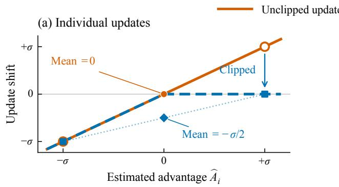

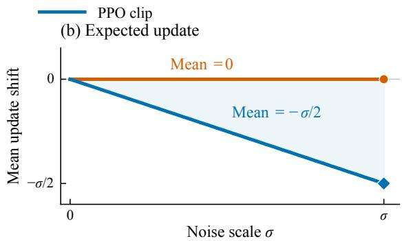  
Figure 2: At fixed $\rho _ { i } > 1 + \epsilon _ { \mathrm { c l i p } } .$ , the unperturbed advantage is zero and $\widehat { A } _ { m } = \pm \sigma$ with equal probability. (a) PPO clipping removes positive update shifts. (b) The mean shift is $- \sigma / 2$ with clipping and zero without it; clipping also reduces conditional coeficient variance. The common importance-weighted policy score is factored out.

Both bounds apply to the detached weight while retaining the score-function contribution.

PG. PG uses reward advantages with current-to-behavior importance weighting and no future KL regularization. Its surrogate is equivalent to the GRPO surrogate without PPO clipping:

$$
\mathcal { L } _ { \mathrm { P G } } ( \theta ) = \mathbb { E } _ { \pi _ { \mathrm { b e h a v } } } \sum _ { i } \frac { \pi _ { \theta } } { \pi _ { \mathrm { b e h a v } } } \operatorname { s g } [ \widehat { A } _ { m } ] .\tag{10}
$$

Removing PPO clipping eliminates the bias introduced by its gate, but the reward-gradient estimator still omits the regularization term in $\nabla J _ { k } \ ( \mathrm { A p p e n d i x \ A } )$ . Under learner-policy sampling, future KL credit supplies that term when using raw rewards and a history-only baseline. Token-wise importance weighting introduces a separate of-policy approximation, and large weights can amplify stochastic gradient contributions. Adding future KL credit to this update gives the Proximal KL surrogate in Equation (7).

Alternative importance weights. We compare the token-wise ratio in Equation (7) with two alternatives that retain each token’s corrected advantage. Section 6.4 evaluates how these choices afect training stability and held-out accuracy.

Sequence-level IS. This control replaces the token-wise ratio by its geometric mean over the response. Following the ascent-surrogate convention above, its update is

$$
\mathcal { L } _ { \mathrm { s e q u e n c e - l e v e l ~ I S } } ( \theta ) = \mathbb { E } _ { \pi _ { \mathrm { b e h a v } } } \sum _ { i } \mathrm { s g } \left[ \left( \frac { \pi _ { \theta } \big ( a _ { m , 1 : T _ { m } } \mid x \big ) } { \pi _ { \mathrm { b e h a v } , m } \big ( a _ { m , 1 : T _ { m } } \mid x \big ) } \right) ^ { 1 / T _ { m } } ( \widehat { A } _ { m } - C _ { i } ^ { ( H ) } ) \right] \log \pi _ { \theta } \big ( a _ { i } \mid h _ { i } \big ) .\tag{11}
$$

The $1 / T _ { m }$ power forms the geometric mean over response m’s $T _ { m }$ action tokens, following GSPOtoken (Zheng et al., 2025).

IS-free. This control removes importance weighting, giving

$$
{ \mathcal { L } } _ { \mathrm { I S - f r e e } } ( \theta ) = \mathbb { E } _ { \pi _ { \mathrm { b e h a v } } } \sum _ { i } \operatorname { s g } [ { \widehat { A } } _ { m } - C _ { i } ^ { ( H ) } ] \log \pi _ { \theta } ( a _ { i } \mid h _ { i } ) .\tag{12}
$$

As above, response indices on token quantities and the common sampled-action-token normalization are suppressed; training minimizes the negative surrogate. The detached coeficient multiplies each

token’s log probability, so each token retains its own future KL credit in both controls. Neither uses PPO clipping or a separate proximal-to-behavior factor. Appendix A discusses the corresponding token-averaged updates.

## 5 Theoretical Guarantees

Full future KL credit gives token-wise importance weighting a common proximal target, even when the responses come from stale policies. We first state this mechanism for population updates. We then summarize a finite-sample reward guarantee for a projected group-gradient variant; Appendix F gives its full specification and proof.

The key observation is that, at the proximal target, the reward minus the full future KL cost depends only on the current history. The sampled continuation no longer changes this coeficient. Current-token importance weighting then makes its expected score contribution zero, even when later tokens were generated by an older policy. The first result shows that, under the stated conditions, this cancellation also identifies the target uniquely.

Theorem 1 (Token-wise importance weighting preserves the proximal target). Fix $\pi _ { k }$ and assume the finite-support, behavior-coverage, policy-expressiveness, and population-update conditions (A1) through (A4) in Appendix E.2. Let $M _ { \mathrm { b e h a v } } ( \theta )$ be the expected token-wise of-policy policy-gradient field in Equation (3). For any stale behavior policy, or mixture of behavior-policy versions with their logged probabilities,

$$
M _ { \mathrm { b e h a v } } ( \theta ) = 0 \quad \Longleftrightarrow \quad \pi _ { \theta } = \pi _ { k } ^ { * } .
$$

Thus the token-wise update has the same unique stationary policy as the proximal objective, although its expected update can difer from $\nabla J _ { k } ( \theta )$ at other policies.

Here local expressiveness means that parameter changes span every independent token log-odds direction. The proof and precise assumptions are in Appendix E. Local expressiveness lets us translate a zero parameter update into a condition at each history, while behavior coverage ensures that every relevant history contributes to that condition.

Diferent behavior policies can therefore change the update direction without changing its stationary policy. Convergence additionally requires progress toward that target. For independent tabular logits and history visit probabilities uniformly bounded away from zero, global trajectories of the continuous-time population update converge under time-varying behavior policies (Theorem E.2). This establishes convergence toward a fixed reference’s target when the expected update is available exactly. To account for sampled responses and repeated reference refreshes, we next study a linear logistic model with bounded fixed features. A frozen-feature linear output head is one example; applying a linearized model to a nonlinear Transformer additionally requires control of approximation errors. In this setting, the finite-sample result below shows how repeatedly fitting and refreshing the reference can improve the final policy’s reward.

Analyzed variant. Each round holds the reference fixed and uses fresh groups of responses to fit its proximal target. The update combines token-wise importance weights with full future KL credit, centers the reward-minus-KL residual within each group, and projects each step onto a parameter ball. A randomly selected iterate becomes the next reference. Appendix F specifies this analyzed variant. Table 3 summarizes how the population update underlying Theorem 1 is adapted in Algorithm 1.

Theorem 2 (Finite-sample reward guarantee, informal). Consider the analyzed variant in a linear logistic model with bounded fixed features, deterministic binary rewards, and responses of at most T tokens. At every reference, assume its Gibbs target is exactly represented by a parameter within Euclidean distance $B / \beta$ of the reference parameter, where $B \geq 1$ is uniform across rounds. Assume uniformly controlled token ratios and a suficiently small aggregate token-wise behavior mismatch throughout training, with precise conditions specified in Theorem $F . 1 0$ in Appendix F. Let $\pi _ { \star }$ be a comparator whose correct-response probability at each prompt is at most $C _ { \star }$ times that of the initial policy. For any $0 < \varepsilon < 1$ , suitable algorithm parameters and training budgets ensure that the policy $\pi _ { K }$ obtained after K reference refreshes satisfies

$$
\begin{array} { r } { \mathbb { E } J ( \pi _ { K } ) \geq J ( \pi _ { \star } ) - \varepsilon , \qquad J ( \pi ) = \mathbb { E } _ { x } \operatorname* { P r } _ { \pi } ( R = 1 \mid x ) . } \end{array}
$$

For a fixed group size, the number of scored training responses is polynomial in T, the representation bound B, $C _ { \star }$ , and $1 / \varepsilon$ . The expectation includes training randomness and output selection.

Remark 3 (Aggregate token-wise log-ratio second moment). At history $h _ { i }$ , let $p _ { i } = \pi _ { \theta } ( \cdot \mid h _ { i } )$ and $q _ { i } = \pi _ { \mathrm { b e h a v } } ( \cdot \mid h _ { i } )$ be the learner and behavior token distributions, and write $w _ { i } ( a ) = p _ { i } ( a ) / q _ { i } ( a )$ Theorem F.10 controls the sum of learner-weighted second moments $\mathbb { E } _ { p _ { i } } [ ( \log w _ { i } ) ^ { 2 } ]$ , taking a uniform bound on their sum along each response path and over training updates. It denotes this aggregate by $V _ { \mathrm { l o g } } .$ . For example, if | log $| w _ { i } | \leq a / \sqrt { T }$ uniformly, for a fixed constant $a > 0$ suficiently small to meet the theorem’s conditions, then $V _ { \mathrm { l o g } } \leq a ^ { 2 }$ independently of response length. In contrast, the sequence ratio $\textstyle \prod _ { i = 1 } ^ { T } w _ { i }$ can grow exponentially in ${ \sqrt { T } } \colon$ : multiplying the tokenwise bounds gives $\begin{array} { r } { \prod _ { i = 1 } ^ { T } w _ { i } \leq e ^ { a \sqrt { T } } } \end{array}$ . Higher moments of history likelihood ratios sharpen the dependence on accuracy. The argument applies to any real moment order at least two. For each fixed $\delta \in ( 0 , 1 ]$ , under the theorem’s δ-dependent token-ratio condition, the accuracy dependence is $1 / \varepsilon$ plus $c _ { \delta } / \varepsilon ^ { 1 + \delta }$ , apart from the problem and round-count factors displayed there, where $c _ { \delta } = \exp ( ( 1 + \delta ^ { - 1 } ) V _ { \log } )$ . Smaller δ can require tighter token-ratio control and increase $c _ { \delta }$ . On policy, $V _ { \mathrm { l o g } } = 0$ and the direct historytransfer bound yields $1 / \varepsilon$ dependence, apart from the logarithmic round-count factors.

The guarantee shows that repeated proximal updates can turn initial correct-solution coverage into a policy whose single-response success probability approaches the comparator’s. Each round approximately fits the current reference’s proximal target; refreshing the reference then allows further reward improvement. Appendix G gives examples of the representation bound; Remark F.11 gives the uniform-coverage case.

Single-response reward compared with best-of-N. The comparator can also describe a procedure that samples several responses at inference time. This gives a concrete interpretation of the single-response guarantee. Let $p _ { 0 } ( x ) \ = \ \mathrm { P r } _ { \pi _ { 0 } } ( R \ = \ 1 \ | \ x )$ . Drawing N responses from the initial policy and selecting a correct one whenever available gives oracle success probability $1 - ( 1 - p _ { 0 } ( x ) ) ^ { N } \leq N p _ { 0 } ( x )$ Thus the guarantee applies with $C _ { \star } = N$ : one response from the trained policy approaches the reward of oracle best-of-N selection at initialization, under the theorem’s conditions. The training budget and the oracle’s inference budget are accounted for separately. These results explain the roles of the two policies in the practical algorithm. For implementation, the reference determines the improvement target, while the logged behavior policy determines the importance correction. Full future KL credit preserves the target in the analyzed population update. Our experiments examine the stability and performance trade-ofs introduced by bounded costs and finite windows.

## 6 Empirical Experiments

We evaluate Proximal KL in two of-policy training settings. Periodic rollout-policy refresh tests stability across model sizes. Training with controlled rollout staleness combines asynchronous generation with response reuse across multiple optimizer minibatches. These settings test stable optimization and held-out reasoning accuracy when the behavior policy difers from the policy being optimized.

## 6.1 Setup

All compared methods omit the KL penalty to the initial model. The reward-advantage normalization follows the training setting below and is shared across methods within each setting.

Working Default. We recommend H = full, $\beta = 0 . 3 0$ , and $\epsilon _ { F } = 0 . 0 5$ as a general starting configuration for Proximal KL. This choice is shared across all four model sizes in the periodicrefresh experiments. A shorter horizon provides a model-specific adjustment; for 4B, we suggest H = 32 as a starting point with the same coeficient and cost bound. The ablations examine how horizon tuning can further improve accuracy. The actual configurations used for the reported results are listed in Appendices B.2 and C.2.

Training with Periodic Policy Refresh. At each training iteration, we collect a fresh batch of responses and use that batch once for a single optimizer update. The training-policy weights therefore change every iteration, whereas the rollout-policy weights are synchronized with the training policy only once every 64 optimizer updates and remain fixed between refreshes. Successive batches can thus be generated by the same older policy while training progresses. This provides a controlled simulation of delayed policy synchronization in asynchronous RL, where response generation uses earlier policy versions while optimization continues. We train Qwen3 models (Yang et al., 2025) on verifiable math tasks using Slime (Zhu et al., 2025), comparing PG, CISPO, GRPO, and Proximal KL across model sizes under this shared refresh schedule. Reward advantages subtract the mean reward within each prompt group, without standard-deviation normalization. Figure 3 reports training accuracy, defined in Appendix B.1; all configurations are in Appendix B.2.

Training with Controlled Rollout Staleness. Following AReaL (Fu et al., 2025), we combine asynchronous rollout generation with multiple optimizer minibatches per batch on filtered math prompts. We explicitly control the permitted rollout staleness and verify the realized policy-version gaps from training logs. Reward advantages standardize rewards within each prompt group, as defined in Equation (A.2). We compare GRPO and Proximal KL, adding PG for the stability test, and include a separate comparison with fresh rollouts and one optimizer minibatch. PPO clipping is disabled in that separate comparison because it is designed to discourage large policy changes when reusing rollout data, whereas this on-policy comparison has zero staleness and uses each batch for only one update. Held-out evaluation covers MATH500 (Lightman et al., 2024), OlympiadBench (He et al., 2024), MinervaMath (Lewkowycz et al., 2022), Gaokao2023MathEn, AIME24/25 (Mathematical Association of America, n.d.), and AMC23/24. MATH500, OlympiadBench, MinervaMath, and Gaokao2023MathEn use greedy pass@1. AIME24/25 and AMC23/24 use mean@16, the fraction of correct responses among 16 attempts per problem. The learning curves also report pass@16, the fraction of problems solved by at least one of those attempts. Appendix C.1 gives the reporting details; Appendix C.2 specifies the data, training configurations, and evaluation budgets.

## 6.2 Stability Test

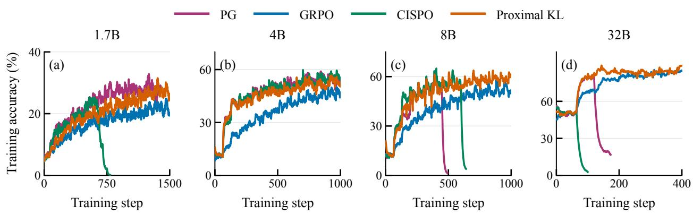  
Figure 3: Periodic-refresh training with FP8 rollouts and BF16 optimization at $1 \times 1 0 ^ { - 6 } ,$ , with a rollout refresh interval of 64 optimizer updates. Panels (a) through (d): 1.7B, 4B, 8B, and 32B. All panels use BF16 KV. EMA $\alpha = 0 . 1 0$ . Configurations: Appendix B.2.

Proximal KL sustains training gains when PG and CISPO collapse. Figure 3 distinguishes early reward gains from stable optimization. At 1.7B, CISPO initially improves alongside the other methods before its training accuracy falls sharply. At 8B and 32B, both PG and CISPO undergo large accuracy declines, despite substantial accuracy earlier in training. Proximal KL retains its gains across all four displayed model sizes using the same working default. All four methods apply importance weights, so importance correction alone does not ensure stable optimization. The comparison instead supports combining token-wise weighting with proximal KL feedback as model scale increases.

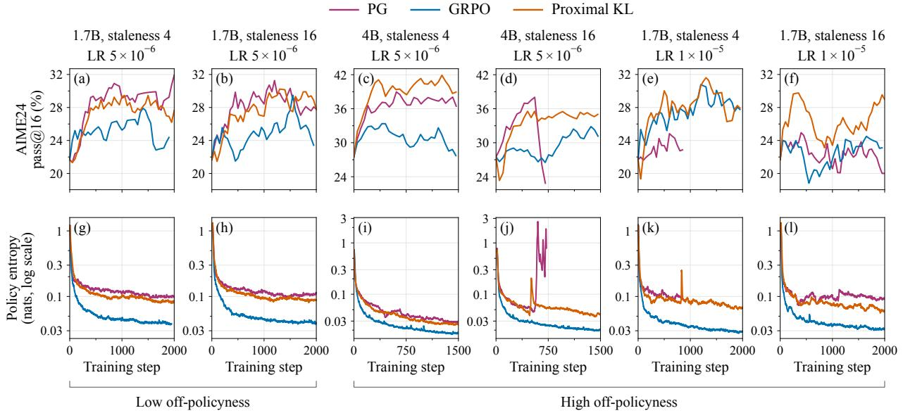  
Figure 4: Stability across six settings. Top: AIME24 pass@16; bottom: policy entropy on logarithmic axes. The first four columns match Figure $5 ;$ the last two use $1 . 7 \mathrm { B } , 1 \times 1 0 ^ { - 5 }$ , at staleness levels 4 and 16. EMA $\alpha = 0 . 2 0$ . Bottom groups distinguish the smaller-model/lower-rate settings from larger-model or higher-rate settings; each column specifies its rollout staleness. Display limits and configurations: Appendix C.2.

Training with controlled staleness reveals a similar limitation of $\mathrm { P G } \mathrm { : }$ its competitive performance at 1.7B and the lower learning rate does not carry over reliably to larger models or larger learning rates. The 4B run with staleness 16 sufers a sharp AIME24 pass@16 decline with large entropy excursions $( \mathrm { F i g u r e \ 4 ( d , j ) } )$ ; the higher-learning-rate runs show limited sustained gains and a later decline at staleness 16 (panels e,f). In contrast, GRPO and Proximal KL avoid comparable collapses over their displayed trajectories in both settings. We also ablate GRPO’s clipping width: increasing $\epsilon _ { \mathrm { c l i p } }$ from 0.2 to 0.4 produces larger gradient excursions and a temporary decline in training accuracy (Appendix C.5).

Proximal KL improves training accuracy with fewer updates than GRPO. GRPO avoids the collapses of PG and CISPO, but its training accuracy rises more slowly than that of Proximal KL in Figure 3. The diference is visible across model sizes: Proximal KL moves ahead during training at 1.7B, 4B, and 8B, and reaches the high-accuracy region earlier at 32B. For example, the 8B EMA-smoothed training accuracy first reaches 50% after about 200 updates with Proximal $K L ,$ compared with about 640 for GRPO. Thus, proximal KL feedback improves update eficiency as well as stability compared with $\mathrm { G R P O ; }$ removing ordinary PPO clipping need not sacrifice controlled progress. The higher mean training accuracy over the common final 100-update window at 1.7B, 4B, and 8B also shows that the advantage persists beyond the initial rise.

Under controlled rollout staleness, Proximal KL also achieves higher late AIME24 pass@16 in the four $5 \times 1 0 ^ { - 6 }$ settings spanning both model sizes and staleness levels (Figure 4, panels (a) through (d)). At the larger learning rate $1 \times 1 0 ^ { - 5 }$ , the checkpoint evaluations in Table 1 also favor Proximal KL in Average and on MATH500, OlympiadBench, MinervaMath, and Gaokao greedy pass@1 at both staleness levels. These results show higher training accuracy under periodic policy refresh and improved held-out accuracy in the comparisons with controlled staleness. Given the stability limitations of PG and CISPO and our computational budget, we concentrate the benchmark comparison in Section 6.3 on GRPO and Proximal KL.

## 6.3 Held-out Set Evaluation

Proximal KL improves overall reasoning accuracy in every matched of-policy comparison. Table 1 reports higher Average for Proximal KL than GRPO in all seven of-policy method pairs. Average pools correct responses across eight benchmarks, measuring response accuracy over the complete evaluation suite. The gain holds across both model sizes, both tested learning rates, and all tested rollout staleness levels, reaching an absolute improvement of 2.58%. Thus, the stable training gains translate into improved held-out accuracy across the tested of-policy settings.

The accuracy advantage also holds when response reuse is the source of of-policy updates: with fresh rollouts reused across four minibatches, Proximal KL achieves higher Average. In the separate on-policy comparison, which uses fresh rollouts and one optimizer minibatch, the two methods attain comparable aggregate accuracy. This control assesses the practical methods under fresh sampling; it is distinct from the idealized proximal improvement results in Section 3. We therefore characterize the empirical result as comparable on-policy performance, with consistently higher aggregate accuracy in the tested of-policy comparisons.

The AIME24 learning curves show that the gain extends to both response accuracy and prompt coverage. Proximal KL reaches higher later mean@16 and pass@16 across the four settings in Figure 5. These trajectories complement the raw checkpoint evaluations: the advantage is visible during training as well as in held-out checkpoint comparisons.

Proximal KL retains its advantage in the higher-staleness configuration. Using the checkpoint scores already reported in Table 1, we examine how Qwen3-4B accuracy changes between rollout staleness levels 4 and 16. Both settings use learning rate $5 \times 1 0 ^ { - 6 }$ and four optimizer minibatches per batch. Table 2 reports each method’s score at staleness 16 minus its score at staleness 4; a larger change means better retention of accuracy. We compare the reported training configurations, which are specified in Appendix C.2.

Table 1: Raw checkpoint accuracy (%). 1.7B: mean ± sample SD over three seeds. Average pools 4,149 responses per seed across eight benchmarks and reports the mean across seeds; Bold: higher mean in each column within a matched comparison; both bold if the unrounded gap is below 0.50%. Protocols are in Appendix C.1.
<table><tr><td>Setting</td><td>Stale- LR ness</td><td>Method</td><td>MATH500 pass@1</td><td>Olympiad pass@1</td><td>Minerva pass@1</td><td>Gaokao pass@1</td><td>AIME24 mean@16</td><td>AIME25 mean@16</td><td>AMC23 mean@16</td><td>AMC24 mean@16</td><td>Average</td></tr><tr><td colspan="10">Model: Qwen3-1.7B</td></tr><tr><td></td><td></td><td>Base</td><td>56.10</td><td>23.15</td><td>22.43</td><td>51.17</td><td>4.27</td><td>2.92</td><td>27.66</td><td>13.47</td><td>24.15</td></tr><tr><td>On-policy 0</td><td></td><td>5e-6 GRPO</td><td>68.93 ± 1.03 32.84 ± 1.28 28.92 ± 0.77</td><td></td><td></td><td></td><td>59.53 ± 0.45 8.89 ± 0.96</td><td></td><td>5.97 ± 0.94 46.30 ± 2.17 26.53 ± 0.24 34.50</td><td></td><td></td></tr><tr><td>On-policy 0</td><td></td><td>5e-6 Proximal KL 67.80 ± 1.20</td><td></td><td>33.14 ± 0.67 29.90 ± 1.0658.40 ± 0.92</td><td></td><td></td><td></td><td></td><td>10.07 ± 1.20 5.62 ± 0.75 45.10 ± 0.39</td><td>25.42 ± 0.28</td><td>34.09</td></tr><tr><td>Off-policy 0</td><td></td><td>5e-6 GRPO</td><td>65.40 ± 2.46</td><td>28.24± 0.62</td><td>28.68 ± 2.05 58.05 ± 1.06 8.96 ± 1.57</td><td></td><td></td><td></td><td>6.74 ± 0.43 42.24 ± 2.26</td><td>22.78 ± 0.97</td><td>31.99</td></tr><tr><td>Off-policy 0</td><td></td><td>5e-6 Proximal KL</td><td>67.20 ± 1.00</td><td>29.67 ± 1.0429.41 ± 0.74 58.40 ± 0.849.72 ± 0.43</td><td></td><td></td><td></td><td></td><td>5.69 ± 1.3944.84 ± 2.86 24.17 ± 1.6033.13</td><td></td><td></td></tr><tr><td>Off-policy 4</td><td></td><td>5e-6 GRPO</td><td>64.80 ± 1.11</td><td>28.98 ± 0.94 29.17 ± 1.1856.74 ± 0.806.88 ± 0.55</td><td></td><td></td><td></td><td></td><td>5.83 ± 1.0844.06 ± 1.08 24.21 ± 2.16 32.14</td><td></td><td></td></tr><tr><td>Off-policy 4</td><td></td><td>5e-6 Proximal KL 68.00 ± 0.20</td><td></td><td>29.48 ± 1.63 28.92 ± 0.77 57.27 ± 0.608.68 ± 0.60</td><td></td><td></td><td></td><td></td><td>5.07 ± 0.43 45.68 ± 1.57 24.17 ± 0.37 33.00</td><td></td><td></td></tr><tr><td>Off-policy 16</td><td></td><td>5e-6 GRPO</td><td>66.13±1.51</td><td></td><td>29.43 ± 1.35 28.31 ± 0.37 56.22 ± 0.75 7.57 ± 1.56</td><td></td><td></td><td></td><td>6.88 ± 0.83 45.05 ± 1.33 23.01 ± 1.47 32.41</td><td></td><td></td></tr><tr><td>Off-policy 16</td><td></td><td></td><td>5e-6 Proximal KL 68.60 ± 1.74</td><td>29.57 ± 0.23 29.78 ± 0.37 57.18 ± 0.45 9.51 ± 1.18</td><td></td><td></td><td></td><td></td><td>6.39 ± 1.20 44.64 ± 1.73 23.94 ± 0.2933.18</td><td></td><td></td></tr><tr><td>Off-policy 4</td><td></td><td>1e-5 GRPO</td><td>58.67 ±3.06</td><td>24.73±1.77</td><td></td><td></td><td></td><td></td><td>22.30 ± 1.66 52.48 ± 0.90 11.60 ± 0.43 5.28 ± 2.84 47.66 ± 4.32 21.30 ± 1.95 30.39</td><td></td><td></td></tr><tr><td>Off-policy 4</td><td></td><td>1e-5 Proximal KL 64.33 ± 2.39</td><td></td><td></td><td>29.08 ± 2.53 24.88 ±3.72 55.96 ± 4.05 9.65 ± 1.15</td><td></td><td></td><td></td><td>4.03 ± 0.6452.29 ± 2.32 23.33 ± 1.60 32.97</td><td></td><td></td></tr><tr><td>Off-policy 16</td><td></td><td>1e-5 GRPO</td><td>61.20 ± 2.11</td><td></td><td>25.27 ± 1.12 25.25 ± 0.93 53.52 ± 1.20 7.50 ± 1.50</td><td></td><td></td><td></td><td>5.07 ± 1.88 47.19 ± 3.12 23.75 ± 2.41 30.93</td><td></td><td></td></tr><tr><td>Off-policy 16</td><td></td><td>1e-5 Proximal KL 63.73 ± 0.61 27.35 ± 0.37 27.21 ± 2.24 55.00 ± 0.66 9.10 ± 1.67</td><td></td><td></td><td></td><td></td><td></td><td> $3 . 1 9 \pm 1 . 2 0$ </td><td>45.63 ± 2.98 20.37 ± 1.60 30.98</td><td></td><td></td></tr></table>

<table><tr><td></td><td></td><td>Base</td><td>63.75</td><td>35.61</td><td>25.74</td><td>56.92</td><td>8.59</td><td>8.33</td><td>41.25</td><td>30.42</td><td>34.01</td></tr><tr><td>Off-policy 4</td><td></td><td>5e-6 GRPO</td><td>81.20</td><td>43.92</td><td>39.71</td><td>71.54</td><td>15.83</td><td>10.21</td><td>79.22</td><td>33.47</td><td>47.17</td></tr><tr><td>Off-policy 4</td><td></td><td>5e-6 Proximal KL 82.40</td><td></td><td>44.66</td><td>40.44</td><td>71.28</td><td>18.33</td><td>10.63</td><td>74.84</td><td>39.31</td><td>48.13</td></tr><tr><td>Off-policy 16</td><td></td><td>5e-6 GRPO</td><td>79.60</td><td>43.32</td><td>39.34</td><td>69.45</td><td>15.42</td><td>11.04</td><td>70.63</td><td>37.78</td><td>46.13</td></tr><tr><td>Off-policy 16</td><td></td><td>5e-6 Proximal KL 81.00</td><td></td><td>45.99</td><td>40.44</td><td>72.32</td><td>21.04</td><td>10.21</td><td>70.31</td><td>42.22</td><td>48.35</td></tr></table>

Table 2: Qwen3-4B accuracy changes (%) from staleness 4 to 16 at $5 \times 1 0 ^ { - 6 }$ . Diferences use unrounded Table 1 scores. ↑/↓: increase/decrease; →: unchanged. Bold: larger signed change.
<table><tr><td>Staleness Method</td><td></td><td>MATH500 pass@1</td><td>Olympiad pass@1</td><td>Minerva pass@1</td><td>Gaokao pass@1</td><td>AIME24 mean@16</td><td>AIME25 mean@16</td><td>AMC23 mean@16</td><td>AMC24 mean@16</td><td>Average</td></tr><tr><td> $4  1 6$ </td><td>GRPO</td><td>↓1.60</td><td>↓0.59</td><td>↓0.37</td><td>↓2.09</td><td>↓0.42</td><td>↑ 0.83</td><td>↓8.59</td><td> $\uparrow 4 . 3 1$ </td><td>↓1.04</td></tr><tr><td> $4  1 6$ </td><td>Proximal KL</td><td>↓1.40</td><td>↑1.34</td><td>→ 0.00</td><td>↑1.04</td><td>↑2.71</td><td>↓0.42</td><td>↓4.53</td><td> $\uparrow ~ 2 . 9 2$ </td><td>↑0.22</td></tr></table>

Average rises for Proximal KL and falls for GRPO as rollout staleness increases. The benchmarklevel changes support this distinction: Proximal KL improves OlympiadBench and Gaokao greedy pass@1 and AIME24 mean@16, while GRPO declines on these metrics. Across the eight benchmarks, Proximal KL has the more favorable change on six. These comparisons show that Proximal KL retains its accuracy advantage over GRPO in the tested higher-staleness configuration.

## 6.4 Ablations

To understand why the working default is efective and how tuning can improve it, we examine the update choices that sustain its gains. We first test the need for current-token importance correction and the sensitivity introduced by PPO clipping. We then examine the bound on individual future costs and the correction horizon. These ablations support bounded future KL feedback as a general choice. A finite horizon can further improve accuracy, and separate fixed-policy measurements show that truncation reduces correction variance.

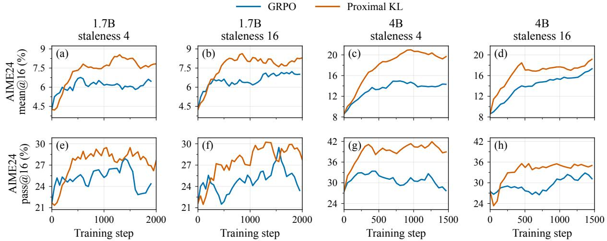  
Figure 5: AIME24 at $5 \times 1 0 ^ { - 6 }$ . Top: mean@16; bottom: pass@16. Columns: 1.7B staleness 4, 1.7B staleness 16, 4B staleness 4, and 4B staleness 16. Configurations are given in Appendix C.2. EMA $\alpha = 0 . 2 0 ;$ shared Base within each model at step 0.

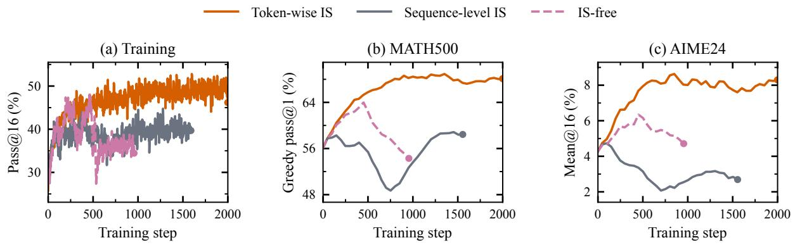  
Figure 6: Importance-weighting comparison: $1 . 7 \mathrm { B } , 5 \times 1 0 ^ { - 6 }$ , staleness 16, full tail, $\beta = 0 . 3 0$ . Token-specific future KL credit is retained in all three updates. $\mathrm { E M A } \ \alpha = 0 . 2 0 $ ; shared evaluation step 0.

Token-wise correction achieves higher held-out accuracy than sequence-level IS and IS-free updates. Motivated by Theorem 1, we compare current-token weighting with sequencelevel and unweighted alternatives while retaining future KL credit. Under the theorem’s population assumptions, full future KL credit lets current-token weighting preserve the proximal stationary target without an exact response-level ratio product. Removing IS altogether leaves the expected score under the behavior policy, so the proximal optimizer need not remain stationary. Figure 6 tests token-wise weighting against Sequence-level IS and IS-free in Equations (11) and (12); all three retain token-specific future KL credit. The sequence-level control uses the geometric mean of token ratios.

Token-wise IS sustains training pass@16 and achieves stronger MATH500 greedy pass@1 and AIME24 mean@16 than both controls in the displayed evaluations. Both controls undergo substantial declines in held-out accuracy, despite retaining the same future KL credit. Thus, reducing correction to the current token is compatible with strong practical performance, whereas discarding correction loses that benefit. These results are consistent with the theoretical motivation for token-wise correction and support its practical use alongside future KL credit.

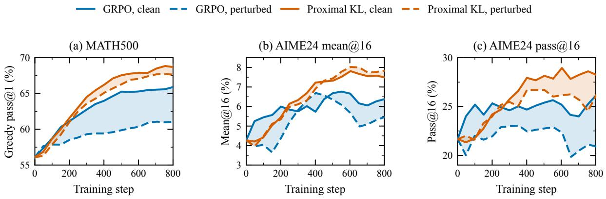  
Figure 7: Baseline perturbation at 1.7B, $5 \times 1 0 ^ { - 6 }$ , staleness 4. Solid/dashed: unperturbed (clean)/perturbed. Shading shows the score diference between the two curves. EMA α = 0.20.

Proximal KL is less sensitive to the tested baseline perturbation than PPO clipping. To understand why Proximal KL achieves higher accuracy than the PPO-clipped baseline, we investigate whether the two updates respond diferently to errors in the estimated reward baseline. The intervention shifts the common baseline within prompt groups with nonconstant rewards, preserving verifier rewards and within-group advantage diferences (Appendix C.3). We compare each method’s perturbed trajectory with its own unperturbed trajectory, using the configurations in Appendix C.3. The separation between each pair of curves measures the change under this intervention.

Proximal KL better preserves performance than GRPO on MATH500 greedy pass@1 and AIME24 mean@16 and pass@16 (Figure 7). Comparing each method with its own clean reference distinguishes sensitivity to the perturbation from the diference between their original scores. The smaller changes for Proximal KL support using additive future KL feedback in place of an advantagedependent clipping gate. This experiment connects the clipping mechanism discussed in Section 4 to changes in held-out accuracy during practical training.

Proximal KL benefits from bounded future KL costs. Having replaced PPO clipping with future KL feedback, we ask whether the correction can be used without bounding its individual token costs. Figure 8 varies $\epsilon _ { F }$ while retaining the full future horizon and the same KL coeficient. The unbounded setting retains regularization and removes only the bound on each future cost. We compare AIME24 mean@16 and pass@16 alongside gradient norms measured before optimizer clipping, so accuracy and large gradient excursions can be assessed together.

The default bound achieves good AIME24 mean@16 and pass@16, with smaller pre-clipping gradient-norm excursions than the loosest and unbounded settings. A moderately larger bound also retains good accuracy, showing that efective regularization does not require a single precise clipping threshold. These observations support bounding individual future costs before they accumulate in the correction. Removing PPO clipping therefore remains compatible with controlling correction magnitude through the future-cost bound.

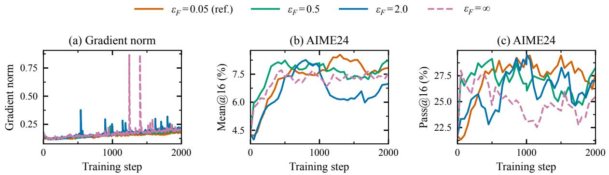  
Figure 8: Future-cost clipping: $1 . 7 \mathrm { B } , 5 \times 1 0 ^ { - 6 }$ , staleness 4, full tail, $\beta = 0 . 3 0 ;$ ; EMA 0.20, shared evaluation step 0. Gradient norms precede optimizer clipping.

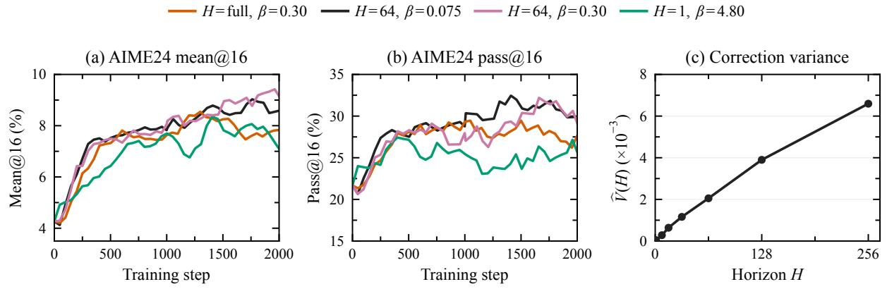  
Figure 9: Future KL horizon ablation. (a,b) $1 . 7 \mathrm { B } , 5 \times 1 0 ^ { - 6 }$ , staleness 4; EMA 0.20. $( H , \beta ) = ( 1 , 4 . 8 0 )$ and (64, 0.075) match $\beta H = 4 . 8 .$ (c) Fixed-policy correction variance.

A finite horizon can outperform the full-tail working default. Starting from the full-tail working default, we ask whether truncating future credit can further improve accuracy. Figure 9 compares the full tail with intermediate windows and a one-token correction. The comparison includes both a fixed KL coeficient and a matched product βH, allowing us to examine whether increasing the local coeficient can compensate for removing future terms.

Both intermediate-window settings outperform the full tail in AIME24 mean@16 and pass@16 near the end of their shared observation range, including with the default KL coeficient held fixed. With βH matched, the one-token correction improves mean@16 more slowly than the intermediate window. Thus, shortening the tail can improve on the working default, while increasing the local coeficient does not replace future-token credit. This is the practical trade-of suggested by the theory: truncation omits part of the ideal future credit, but can reduce fluctuations in the correction. The fixed-policy diagnostic below measures this second efect independently of training.

Truncating the future sum reduces correction variance at fixed policies. To test the variance argument for horizon truncation in Section 4, we measure how extending the future sum changes correction variability at fixed policies. For each retained response, we accumulate the scalar correction at its first token, compute its sample variance across responses to the same prompt, and average these variances across prompts. Policies, responses, the correction coeficient, and the cost bound are held fixed across horizons. Appendix C.3 specifies the calculation; this paired comparison isolates the efect of extending the sum on the same data.

Figure 9(c) shows that, with policies and responses held fixed, the average variance of the accumulated correction increases over the tested horizons. Truncating the tail therefore reduces correction variability in this diagnostic. Longer sums fluctuate more across responses to the same prompt, on average, even without any change in the policies. This supports horizon truncation as a way to control fluctuations in future KL feedback. The measurement quantifies variation in the scalar correction; the training curves show how horizon choice afects held-out accuracy.

## 7 Conclusion

Proximal KL combines token-wise importance weighting with future KL credit for of-policy RLVR, where the behavior policy difers from the policy being optimized. Under the stated coverage and expressiveness conditions, we prove that the full-tail critic-free update has the exact proximal optimizer as its unique stationary policy and that tabular population flow converges to this target. Repeated reference refreshes allow further reward improvement: for linear logistic models, we give a finite-sample reward guarantee for a projected group update under the stated representation, sampling, and correct-solution coverage assumptions. The bound depends on an aggregate tokenwise log-ratio second moment. The practical algorithm uses clipped costs and an optional finite window. The held-out evaluations in Section 6.3 show higher micro-averaged accuracy for Proximal KL than GRPO in all seven matched of-policy settings, while the separate on-policy comparison yields comparable aggregate accuracy. Periodic-refresh experiments complement these gains with stable training where PG and CISPO can collapse, and higher training accuracy than GRPO at comparable optimizer-update counts. The ablations favor retaining current-token correction and future credit together, while bounding individual costs and truncating the horizon control correction fluctuations. An adaptive choice of H could improve this balance by retaining useful future credit without accumulating unnecessary variability.

## Acknowledgments

We thank Xuanchang Zhang for discussions on parts of the theoretical analysis and Chenlu Ye for discussions on the periodic policy-refresh experiments.

This work was supported in part by NSF grants 2416897, 2505932, and 2601666 and ONR grant N000142512318. Computing resources were provided by the National Center for Supercomputing Applications (NCSA) through Delta (NSF OAC-2005572) and DeltaAI (NSF OAC-2320345), as well as Illinois Computes and the NAIRR Pilot (NAIRR250157).

Generative AI tools were used under the authors’ direction for assistance with literature searches, coding, conducting and analyzing experiments, deriving theoretical results and proofs, and polishing the manuscript.

## References

Alekh Agarwal, Sham M. Kakade, Jason D. Lee, and Gaurav Mahajan. On the theory of policy gradient methods: Optimality, approximation, and distribution shift. Journal of Machine Learning Research, 22(98):1–76, 2021.

Hao Bai, Rui Yang, Chenlu Ye, Spencer Whitehead, Aviral Kumar, and Tong Zhang. AsyncWebRL: Eficient asynchronous reinforcement learning for multi-step visual web agents. arXiv preprint arXiv:2606.05597, 2026.

Jalaj Bhandari and Daniel Russo. Global optimality guarantees for policy gradient methods. Operations Research, 72(5):1906–1927, 2024. doi: 10.1287/opre.2021.0014.

Lasse Espeholt, Hubert Soyer, Remi Munos, Karen Simonyan, Vlad Mnih, Tom Ward, Yotam Doron, Vlad Firoiu, Tim Harley, Iain Dunning, Shane Legg, and Koray Kavukcuoglu. IMPALA: Scalable distributed deep-RL with importance weighted actor-learner architectures. In Proceedings of the 35th International Conference on Machine Learning, volume 80 of Proceedings of Machine Learning Research, pages 1407–1416, 2018.

Wei Fu, Jiaxuan Gao, Xujie Shen, Chen Zhu, Zhiyu Mei, Chuyi He, Shusheng Xu, Guo Wei, Jun Mei, Jiashu Wang, Tongkai Yang, Binhang Yuan, and Yi Wu. AReaL: A large-scale asynchronous reinforcement learning system for language reasoning. In Advances in Neural Information Processing Systems, volume 38, pages 40748–40774, 2025. doi: 10.52202/085713-1218.

Matthieu Geist, Bruno Scherrer, and Olivier Pietquin. A theory of regularized markov decision processes. In Proceedings of the 36th International Conference on Machine Learning, volume 97 of Proceedings of Machine Learning Research, pages 2160–2169, 2019.

Tuomas Haarnoja, Haoran Tang, Pieter Abbeel, and Sergey Levine. Reinforcement learning with deep energy-based policies. In Proceedings of the 34th International Conference on Machine Learning, volume 70 of Proceedings of Machine Learning Research, pages 1352–1361, 2017.

Chaoqun He, Renjie Luo, Yuzhuo Bai, Shengding Hu, Zhen Leng Thai, Junhao Shen, Jinyi Hu, Xu Han, Yujie Huang, Yuxiang Zhang, Jie Liu, Lei Qi, Zhiyuan Liu, and Maosong Sun. Olympiad-Bench: A challenging benchmark for promoting AGI with olympiad-level bilingual multimodal scientific problems. In Proceedings of the 62nd Annual Meeting of the Association for Computational Linguistics (Volume 1: Long Papers), pages 3828–3850. Association for Computationa Linguistics, 2024. doi: 10.18653/v1/2024.acl-long.211.

Jacob Hilton, Karl Cobbe, and John Schulman. Batch size-invariance for policy optimization. In Advances in Neural Information Processing Systems, volume 35, pages 17086–17098, 2022.

Chi Jin, Zhuoran Yang, Zhaoran Wang, and Michael I. Jordan. Provably eficient reinforcement learning with linear function approximation. In Proceedings of Thirty Third Conference on Learning Theory, volume 125 of Proceedings of Machine Learning Research, pages 2137–2143. PMLR, 2020.

Aitor Lewkowycz, Anders Andreassen, David Dohan, Ethan Dyer, Henryk Michalewski, Vinay Ramasesh, Ambrose Slone, Cem Anil, Imanol Schlag, Theo Gutman-Solo, Yuhuai Wu, Behnam Neyshabur, Guy Gur-Ari, and Vedant Misra. Solving quantitative reasoning problems with language models. In Advances in Neural Information Processing Systems, volume 35, pages 3843– 3857, 2022. doi: 10.52202/068431-0278.

Hunter Lightman, Vineet Kosaraju, Yura Burda, Harri Edwards, Bowen Baker, Teddy Lee, Jan Leike, John Schulman, Ilya Sutskever, and Karl Cobbe. Let’s verify step by step. In The Twelfth International Conference on Learning Representations, pages 16954–16977, 2024.

Mathematical Association of America. MAA invitational competitions. https://maa.org/ maa-invitational-competitions/, n.d. American Invitational Mathematics Examination (AIME) overview. Accessed September 25, 2026.

MiniMax, Aili Chen, Aonian Li, Bangwei Gong, et al. MiniMax-M1: Scaling test-time compute eficiently with lightning attention. arXiv preprint arXiv:2506.13585, 2025.

Rémi Munos, Tom Stepleton, Anna Harutyunyan, and Marc G. Bellemare. Safe and eficient ofpolicy reinforcement learning. In Advances in Neural Information Processing Systems, volume 29, 2016.

Ofir Nachum, Mohammad Norouzi, Kelvin Xu, and Dale Schuurmans. Bridging the gap between value and policy based reinforcement learning. In Advances in Neural Information Processing Systems, volume 30, 2017.

Ofir Nachum, Mohammad Norouzi, Kelvin Xu, and Dale Schuurmans. Trust-PCL: An of-policy trust region method for continuous control. In International Conference on Learning Representations, 2018.

RadixArk. Miles v0.1: Production-level post-training. arXiv preprint arXiv:2609.08368, 2026.

John Schulman, Sergey Levine, Philipp Moritz, Michael Jordan, and Pieter Abbeel. Trust region policy optimization. In Proceedings of the 32nd International Conference on Machine Learning, volume 37 of Proceedings of Machine Learning Research, pages 1889–1897, 2015.

John Schulman, Xi Chen, and Pieter Abbeel. Equivalence between policy gradients and soft qlearning. arXiv preprint arXiv:1704.06440, 2017a.

John Schulman, Filip Wolski, Prafulla Dhariwal, Alec Radford, and Oleg Klimov. Proximal policy optimization algorithms. arXiv preprint arXiv:1707.06347, 2017b.

Zhihong Shao, Peiyi Wang, Qihao Zhu, Runxin Xu, Junxiao Song, Xiao Bi, Haowei Zhang, Mingchuan Zhang, Y. K. Li, Y. Wu, and Daya Guo. DeepSeekMath: Pushing the limits of mathematical reasoning in open language models. arXiv preprint arXiv:2402.03300, 2024.

Manan Tomar, Lior Shani, Yonathan Efroni, and Mohammad Ghavamzadeh. Mirror descent policy optimization. In International Conference on Learning Representations, 2022.

Ronald J. Williams. Simple statistical gradient-following algorithms for connectionist reinforcement learning. Machine Learning, 8:229–256, 1992. doi: 10.1007/BF00992696.

An Yang, Anfeng Li, Baosong Yang, Beichen Zhang, Binyuan Hui, Bo Zheng, Bowen Yu, Chang Gao, Chengen Huang, Chenxu Lv, Chujie Zheng, Dayiheng Liu, Fan Zhou, Fei Huang, Feng Hu, Hao Ge, Haoran Wei, Huan Lin, Jialong Tang, Jian Yang, Jianhong Tu, Jianwei Zhang, Jianxin Yang, Jiaxi Yang, Jing Zhou, Jingren Zhou, Junyang Lin, Kai Dang, Keqin Bao, Kexin Yang, Le Yu, Lianghao Deng, Mei Li, Mingfeng Xue, Mingze Li, Pei Zhang, Peng Wang, Qin Zhu, Rui Men, Ruize Gao, Shixuan Liu, Shuang Luo, Tianhao Li, Tianyi Tang, Wenbiao Yin, Xingzhang Ren, Xinyu Wang, Xinyu Zhang, Xuancheng Ren, Yang Fan, Yang Su, Yichang Zhang, Yinger Zhang, Yu Wan, Yuqiong Liu, Zekun Wang, Zeyu Cui, Zhenru Zhang, Zhipeng Zhou, and Zihan Qiu. Qwen3 technical report. arXiv preprint arXiv:2505.09388, 2025.

Jiarui Yao, Ruida Wang, Hao Bai, and Tong Zhang. Future-KL regularized GRPO: Process-level credit assignment from f-divergence regularization. arXiv preprint arXiv:2601.10201, 2026.

Qiying Yu, Zheng Zhang, Ruofei Zhu, Yufeng Yuan, Xiaochen Zuo, Yu Yue, Weinan Dai, Tiantian Fan, Gaohong Liu, Juncai Liu, Lingjun Liu, Xin Liu, Haibin Lin, Zhiqi Lin, Bole Ma, Guangming Sheng, Yuxuan Tong, Chi Zhang, Mofan Zhang, Ru Zhang, Wang Zhang, Hang Zhu, Jinhua Zhu, Jiaze Chen, Jiangjie Chen, Chengyi Wang, Hongli Yu, Yuxuan Song, Xiangpeng Wei, Hao Zhou, Jingjing Liu, Wei-Ying Ma, Ya-Qin Zhang, Lin Yan, Yonghui Wu, and Mingxuan Wang. DAPO: An open-source LLM reinforcement learning system at scale. In Advances in Neural Information Processing Systems, volume 38, pages 125532–125554, 2025. doi: 10.52202/085713-3775.

Rui Yuan, Simon S. Du, Robert M. Gower, Alessandro Lazaric, and Lin Xiao. Linear convergence of natural policy gradient methods with log-linear policies. In International Conference on Learning Representations, 2023.

Tong Zhang. Mathematical Analysis of Machine Learning Algorithms. Cambridge University Press, 2023. doi: 10.1017/9781009093057.

Chujie Zheng, Shixuan Liu, Mingze Li, Xiong-Hui Chen, Bowen Yu, Chang Gao, Kai Dang, Yuqiong Liu, Rui Men, An Yang, Jingren Zhou, and Junyang Lin. Group sequence policy optimization. arXiv preprint arXiv:2507.18071, 2025.

Yinmin Zhong, Zili Zhang, Xiaoniu Song, Hanpeng Hu, Chao Jin, Bingyang Wu, Nuo Chen, Yukun Chen, Yu Zhou, Changyi Wan, Hongyu Zhou, Yimin Jiang, Yibo Zhu, and Daxin Jiang. StreamRL: Scalable, heterogeneous, and elastic RL for LLMs with disaggregated stream generation. arXiv preprint arXiv:2504.15930, 2025.

Zilin Zhu, Chengxing Xie, Xin Lv, and slime Contributors. slime: An LLM post-training framework for RL scaling. https://github.com/THUDM/slime, 2025. GitHub repository.

## A Practical Update Design

Proximal and behavior policies. The reference is frozen between its scheduled refreshes, as specified in Appendix C.2. The stored rollout probabilities identify the behavior policy that generated each response. In GRPO, the ratio $\rho _ { i }$ measures movement from the proximal policy for PPO clipping. Proximal KL instead uses the current-to-behavior weight $\pi _ { \theta } / \pi _ { \mathrm { b e h a v } }$ directly in Equation (7). Its proximal reference enters the future KL correction; the importance weight need not be split into two ratios.

Bias relative to the proximal objective. Fix $\theta ,$ the reference policy, and the sampling law. With exact response importance correction, raw rewards, and a detached history-only baseline, a reward-gradient estimator satisfies

$$
\begin{array} { r } { \mathbb { E } \widehat { g } _ { \mathrm { r e w a r d } } - \nabla J _ { k } = \beta \nabla _ { \theta } \mathbb { E } _ { x \sim \mathcal { D } } D _ { \mathrm { K L } } \left( \pi _ { \theta } ( \cdot \vert x ) \Vert \pi _ { k } ( \cdot \vert x ) \right) . } \end{array}\tag{A.1}
$$

The diference is exactly the omitted KL gradient, which vanishes at the reference policy. Full future KL credit supplies this term under exact sampling, and response-wide importance weighting preserves the equality of policy. Replacing response-wide weights with token-wise weights generally changes the gradient field. Group normalization and clipping the future log-ratio costs introduce additional approximations.

Group normalization and KL correction. For a group of G responses, define

$$
\overline { { { R } } } = \frac { 1 } { G } \sum _ { m = 1 } ^ { G } R _ { m } , \qquad s _ { R } ^ { 2 } = \frac { 1 } { G - 1 } \sum _ { m = 1 } ^ { G } ( R _ { m } - \overline { { { R } } } ) ^ { 2 } , \qquad \widehat { A } _ { m } = \frac { R _ { m } - \overline { { { R } } } } { s _ { R } + 1 \times 1 0 ^ { - 5 } } .\tag{A.2}
$$

For each token, subtract the KL correction $C _ { m , i } ^ { ( H ) }$ from its reward advantage (Equation (5)). The correction includes the current token and stops at the response boundary, with no normalization by window length. The window determines which costs enter the sum, while $\beta$ sets their per-token strength.

Detached update coeficients. The loss in Equation (6) uses the group-normalized reward advantage and future KL correction defined above. Holding its coeficients fixed during diferentiation gives the score-function ascent direction of Equation (7). The loss averages over sampled tokens; the population analysis averages token-score sums over responses.

The horizon controls how far sampled future credit extends, and the log-ratio bound limits each cost. Both choices can introduce approximation bias. Their efect on total update variance depends on the covariance between retained and omitted terms. Group normalization and token averaging can also change the expected update field and its stationary policy.

Scope of the implementation. The implementation uses shared Transformer parameters and Adam with the estimator choices listed in Table 3. Section 5 explains their relation to the stationarypolicy guarantee, and Section 6.4 evaluates clipping and future-credit horizon. Appendix C.2 gives the settings.

Table 3: From the stationary-policy result to the implemented update.
<table><tr><td>Ideal condition</td><td>Implemented choice</td><td>Effect on the sampled update</td></tr><tr><td>Full future KL tail</td><td>Horizon H, including H = full</td><td>Selects how far credit extends; a finite window omits later costs.</td></tr><tr><td>ratio</td><td>Unclipped future log Optional log-ratio clipping</td><td>Bounds each future cost and changes its expec- tation when active; the choice is independent</td></tr><tr><td>History-only baseline</td><td>Group-normalized reward advantage</td><td>of the sampling policy. Sets the reward scale from sampled responses; the resulting field can differ from the ideal one.</td></tr><tr><td>Population response average</td><td>Minibatch token average</td><td>Adds sampling noise; token normalization can change the relative weights of responses.</td></tr></table>

Sequence-level IS and IS-free controls. Figure 6 compares the updates in Equations (11) and (12) with token-wise weighting. All three retain token-specific future KL credit and average the loss over nonpadding action tokens. Sequence-level IS uses the geometric mean of the currentto-behavior token ratios. Detaching this weight and multiplying each token’s log probability by its corrected advantage gives the GSPO-token gradient (Zheng et al., 2025). The IS-free control sets the weight to one. The geometric mean difers from the full-response ratio product; both controls retain the cost bound $\epsilon _ { F }$ and omit PPO clipping.

## B Training with Periodic Policy Refresh

This appendix collects the training protocol, model and precision settings, and method-specific hyperparameters for the periodic-refresh experiments.

## B.1 Training Protocol

Each iteration collects a fresh response batch and uses it for one optimizer update. Rollout weights are synchronized with the training policy every 64 optimizer updates and remain fixed between refreshes, so successive batches can come from the same older policy while the training policy changes. The key configurations are given in Appendix B.2. Correct boxed answers receive reward +1; incorrect or invalid answers receive −1. Training accuracy is the fraction of correct responses, computed as $( 1 + \overline { { R } } ) / 2$ , where R is the mean verifier reward before centering. For the comparison between Proximal KL and GRPO, we average raw training accuracy over the last 100 updates observed for both methods within each setting, restricting this summary to settings with at least 100 updates for each method.

## B.2 Hyperparameters

We train Qwen3-1.7B-Base, 4B-Base, 8B-Base, and Qwen3-32B on DAPO-Math-17K (Yang et al., 2025; Yu et al., 2025) using Slime (Zhu et al., 2025). We use a post-trained checkpoint for 32B because a corresponding pre-trained checkpoint was unavailable to us. The smaller models use base checkpoints. Rollouts use FP8 W/A and BF16 KV, while optimization uses BF16. Table 4 summarizes the key choices for the training curves in Figure 3.

All methods use Adam, with gradient-norm clipping at 1. Advantages subtract the group mean without standard-deviation normalization, and losses average over response tokens. PG and Proximal KL use current-token current-to-behavior importance weights; Section 4 defines all four update rules. The curves use EMA $\alpha = 0 . 1 0$

Table 4: Key hyperparameters for training with periodic policy refresh. Merged cells denote shared settings; refresh intervals count optimizer updates.
<table><tr><td>Method</td><td>Setting</td><td colspan="4">Qwen3</td></tr><tr><td></td><td>Model size</td><td>1.7B</td><td>4B</td><td>8B</td><td>32B</td></tr><tr><td rowspan="7">Shared</td><td>Learning rate</td><td></td><td> $1 \times 1 0 ^ { - 6 }$ </td><td></td><td></td></tr><tr><td>Rollout refresh interval</td><td></td><td></td><td>64</td><td></td></tr><tr><td>Prompts × responses per batch</td><td></td><td></td><td> $3 2 \times 8$ </td><td></td></tr><tr><td>Optimizer updates per batch</td><td></td><td></td><td>1</td><td></td></tr><tr><td>Prompt / response limits (tokens)</td><td></td><td></td><td>1,024 / 16,384</td><td></td></tr><tr><td>Sampling temperature</td><td></td><td></td><td>1.0</td><td></td></tr><tr><td>Displayed updates (maximum)</td><td>1,500</td><td></td><td>1,000</td><td>400</td></tr><tr><td rowspan="2">GRPO</td><td>PPO clip (proximal reference)</td><td></td><td> $\mathrm { Y e s } \ ( \epsilon _ { \mathrm { c l i p } } = 0 . 2 )$ </td><td></td><td></td></tr><tr><td>Reference refresh interval L</td><td></td><td></td><td>32</td><td></td></tr><tr><td rowspan="5">Proximal KL</td><td>Future horizon H</td><td></td><td>Full</td><td></td><td></td></tr><tr><td>Coefficientβ</td><td></td><td>0.30</td><td></td><td></td></tr><tr><td>Future log-ratio bound  $\epsilon _ { F }$ </td><td></td><td></td><td>0.05</td><td></td></tr><tr><td>Reference refresh interval L</td><td></td><td></td><td>16</td><td></td></tr><tr><td>PPO clip</td><td></td><td></td><td>No</td><td></td></tr><tr><td>PG</td><td>PPO clip</td><td></td><td>No</td><td></td><td></td></tr><tr><td>CISPO</td><td>Importance-weight clipping</td><td></td><td></td><td>[0,5]</td><td></td></tr></table>

## C Training with Controlled Rollout Staleness

This appendix collects the training and evaluation protocols, hyperparameters, and ablation diagnostics for the experiments with controlled staleness. Appendix A describes the practical updates, and Appendix E gives the theoretical target guarantee.

## C.1 Training and Evaluation Protocols

Rollout generation overlaps with policy optimization, and collected batches are reused across successive optimizer minibatches. We control rollout staleness and verify the realized policy-version gaps from training logs. The model, data, optimization, reference-policy, and evaluation settings are given in Appendix C.2.

Figure 5 reports EMA-smoothed online evaluation curves, whereas Table 1 reports separate raw checkpoint evaluations. Checkpoint scores use neither smoothing nor performance-based checkpoint selection. The stability test reports held-out accuracy together with policy entropy; the gradient diagnostics measure norms before optimizer clipping. Appendix C.2 gives the shared settings and evaluation budgets.

Evaluation metrics. Mean@16 measures correctness per response, while pass@16 measures the fraction of prompts solved at least once. For independent attempts with per-prompt success probability p, expected pass@16 is $1 - ( 1 - p ) ^ { 1 6 }$ . Because this transformation is nonlinear, the two metrics describe diferent aspects of performance. The figures show both; Tables 1 and 2 report response accuracy only. MATH500, OlympiadBench, MinervaMath, and Gaokao2023MathEn use greedy pass@1 on 500, 674, 272, and 383 problems. AIME24, AIME25, AMC23, and AMC24 use mean@16 on 30, 30, 40, and 45 problems, respectively, with 16 responses per problem. Base rows report evaluations of the corresponding base models. Average in Table 1 is micro accuracy: the total number of correct generated responses across the eight benchmarks divided by 4,149 (500, 674, 272, 383, 480, 480, 640, and 720 responses, respectively). Each generated response contributes once, without counting pass@16 as an additional observation.

For three-seed rows, we compute this average within each seed and report only its mean across seeds.

## C.2 Hyperparameters

Hyperparameter Selection. We selected the final configurations for Proximal KL through a small number of manual adjustments under a limited tuning budget. Starting from a working configuration, we inspected early learning curves and adjusted hyperparameters when the improvement was insuficient. Each final configuration was obtained after a few such adjustments and retained for stable training. The horizon and clipping ablations separately examine how these choices afect optimization.

We train Qwen3-1.7B-Base and Qwen3-4B-Base on 9,453 prompts derived from FRPO’s filtered DAPO-Math data (Yao et al., 2026; Yu et al., 2025), using AReaL (Fu et al., 2025). Table 5 gives the shared batch, sampling, and optimizer settings. Adam uses $( \beta _ { 1 } , \beta _ { 2 } ) = ( 0 . 9 , 0 . 9 9 9 ) , \epsilon _ { \mathrm { A d a m } } = 1 \times 1 0 ^ { - 8 }$ a constant learning rate, and no weight decay. Of-policy batches use four optimizer minibatches. Reward advantages use the group normalization in Equation (A.2). The of-policy GRPO control uses symmetric PPO clipping with width $\epsilon _ { \mathrm { c l i p } } = 0 . 2$ . At nonzero staleness, the proximal reference is recomputed before each global batch and frozen for its minibatches.

To improve training eficiency, all 4B experiments in this controlled-staleness setting use dynamic sampling (Yu et al., 2025). We discard prompt groups with identical verifier rewards and collect replacement groups to fill the training batch, using the same filtering rule for all compared methods.

Staleness and reference settings. The asynchronous comparisons control rollout staleness at 4 or 16. For the 1.7B GRPO comparison at staleness 4, the recorded mean staleness is approximately 4. The separate comparisons with zero staleness use either one or four optimizer minibatches. Their Proximal KL runs use the full tail, $\beta = 0 . 0 3$ , no future-cost clipping, and a reference refreshed every 50 updates. The one-minibatch controls omit PPO clipping.

Evaluation. Table 1 reports three-seed means for 1.7B at 2,000 updates and 4B scores at approximately 1,500 updates. The performance and stability curves use EMA α = 0.20.

Table 5: Hyperparameters for training with controlled staleness. Columns specify controlled rollout staleness $4 ;$ the comparison at staleness 16 uses the corresponding setting. At 1.7B, the $1 \times 1 0 ^ { - 5 }$ Proximal KL run with staleness 16 uses $H = 6 4 , \beta = 0 . 6 0$ . At 4B, staleness 4 uses a 32-token unit-weight prefix and a linearly decayed remainder; staleness 16 uses $H = 8 ,$ with $\beta = 0 . 2 5$ in both cases. PG shares GRPO’s batch, sampling, optimizer, reward-normalization, and staleness settings. Merged cells denote shared values.
<table><tr><td rowspan="3">Method</td><td>Setting</td><td colspan="2">Off-policy</td></tr><tr><td>Model</td><td>Qwen3-1.7B</td><td>Qwen3-4B</td></tr><tr><td>Learning rate</td><td> $1 \times 1 0 ^ { - 5 }$ </td><td> $5 \times 1 0 ^ { - 6 }$ </td></tr><tr><td>GRPO</td><td>PPO clip Prompts per batch</td><td>Yes</td><td></td></tr><tr><td></td><td>Responses per prompt</td><td>128</td><td></td></tr><tr><td></td><td></td><td>16</td><td></td></tr><tr><td></td><td>Response limit (tokens)</td><td>8,192</td><td></td></tr><tr><td></td><td>Sampling temperature</td><td>1.0</td><td></td></tr><tr><td></td><td>Optimizer</td><td>Adam</td><td></td></tr><tr><td></td><td>Gradient-norm limit</td><td>1.0</td><td></td></tr><tr><td></td><td>Minibatches per batch</td><td>4</td><td></td></tr><tr><td></td><td>Reward normalization</td><td>Within each prompt group</td><td></td></tr><tr><td></td><td>Rollout staleness</td><td>4</td><td></td></tr><tr><td></td><td>Evaluation budget (updates)</td><td></td><td>≈1,500</td></tr><tr><td>PG</td><td>PPO clip</td><td>No</td><td></td></tr><tr><td></td><td>Coefficient  $\beta$ </td><td>0</td><td></td></tr><tr><td></td><td>Minibatches per batch</td><td>4</td><td></td></tr><tr><td></td><td>Batch, sampling, and optimizer</td><td>As GRPO above</td><td></td></tr><tr><td>Proximal KL</td><td>Future horizon H</td><td>Full</td><td>32 + linear tail</td></tr><tr><td></td><td>Coefficient  $\beta$ </td><td></td><td>0.25</td></tr><tr><td></td><td>PPO clip</td><td>No</td><td></td></tr><tr><td></td><td>Future log-ratio bound  $\epsilon _ { F }$ </td><td>0.05</td><td></td></tr><tr><td></td><td>Reference refresh (global batches)</td><td>1</td><td></td></tr><tr><td></td><td>Prompts per batch</td><td>128</td><td></td></tr><tr><td></td><td>Responses per prompt</td><td>16</td><td></td></tr><tr><td></td><td>Response limit (tokens)</td><td>8,192</td><td></td></tr><tr><td></td><td>Sampling temperature</td><td>1.0</td><td></td></tr><tr><td></td><td>Optimizer</td><td>Adam</td><td></td></tr><tr><td></td><td>Gradient-norm limit</td><td>1.0</td><td></td></tr><tr><td></td><td>Minibatches per batch</td><td>4</td><td></td></tr><tr><td></td><td>Reward normalization</td><td>Within each prompt group</td><td></td></tr><tr><td></td><td>Rollout staleness</td><td>4</td><td></td></tr><tr><td></td><td>Evaluation budget (updates)</td><td></td><td>≈1,500</td></tr></table>

## C.3 Ablation Configurations

This section gives the perturbation construction and variance estimator used in Section 6.4.

Baseline Perturbation. An underestimated baseline makes every response in a group appear better, without changing their relative ranking. We test how GRPO and Proximal KL respond by adding one to each normalized advantage in groups with nonconstant rewards:

$$
\widehat { A } _ { g , m } ^ { \prime } = \widehat { A } _ { g , m } + I _ { g } , \qquad I _ { g } = { \bf 1 } \{ \operatorname* { m a x } _ { m } R _ { g , m } > \operatorname* { m i n } _ { m } R _ { g , m } \} .\tag{C.1}
$$

Verifier rewards, reward normalization, and within-group advantage diferences remain unchanged.   
For Proximal KL, future KL credit is computed as usual and subtracted after the shift.

Why clipping matters. PPO clipping reacts to the advantage sign: above the upper ratio bound, positive advantages contribute no gradient, while negative ones still do. A common upward shift can therefore switch some contributions of. For detached advantages and a frozen positive behavior correction, the score coeficient is $\frac { \pi _ { \theta } } { \pi _ { \mathrm { b e h a v } } } q _ { \mathrm { c l i p } } ( \rho _ { i } , \widehat { A } _ { m } )$ , where, away from the clipping boundaries,

$$
\begin{array} { r } { q _ { \mathrm { c l i p } } ( \rho , A ) = \left\{ \begin{array} { l l } { \operatorname* { m a x } ( A , 0 ) , } & { \rho < 0 . 8 , } \\ { A , } & { 0 . 8 < \rho < 1 . 2 , } \\ { \operatorname* { m i n } ( A , 0 ) , } & { \rho > 1 . 2 . } \end{array} \right. } \end{array}\tag{C.2}
$$

Above the upper bound, symmetric noise ±σ has zero mean before clipping. Removing its positive half gives $q _ { \mathrm { c l i p } }$ mean $- \sigma / 2$ and reduces its variance from $\sigma ^ { 2 }$ to $\sigma ^ { 2 } / 4$ (Figure 2). These coeficient moments factor out the common importance-weighted policy score.

Without clipping, a history-only baseline expresses no preference among the possible actions and cancels in expectation: their probabilities sum to one, whose gradient is zero. For a detached shift b(h) and positive sampling support,

$$
\mathbb { E } _ { a \sim \pi _ { \mathrm { b e h a v } } ( \cdot | h ) } \left[ \frac { \pi _ { \theta } ( a \mid h ) } { \pi _ { \mathrm { b e h a v } } ( a \mid h ) } b ( h ) \nabla _ { \theta } \log \pi _ { \theta } ( a \mid h ) \right] = b ( h ) \nabla _ { \theta } \sum _ { a } \pi _ { \theta } ( a \mid h ) = 0 .\tag{C.3}
$$

An additive future KL correction unchanged by the shift preserves this expected cancellation; the clipping gate need not.

This contrast motivates the experiment. The group-shared shift depends on sampled rewards through $I _ { g } ,$ so sensitivity is measured directly: each method’s perturbed run is compared with its unperturbed run to assess how well it preserves held-out accuracy (Section 6.4).

Correction Variance at Fixed Policies. We measure how the total correction varies across responses to the same prompt as H increases. We reuse the same tokenized responses and two frozen Qwen3-1.7B checkpoints, which supply current and reference probabilities. This diagnostic pair difers from the original within-minibatch pair. We use 16 prompts with 16 responses each, $\beta = 0 . 3 0$ , and $\epsilon _ { F } = 0 . 0 5$

Each response $y _ { p m }$ to prompt $x _ { p }$ gives one scalar: its first-token correction, summing costs through H or its final token $T _ { p m }$ ，

$$
C _ { p m } ^ { ( H ) } : = C _ { 1 } ^ { ( H ) } ( x _ { p } , y _ { p m } ) = \beta \sum _ { j = 1 } ^ { \operatorname* { m i n } ( H , T _ { p m } ) } \mathrm { c l i p } ( \log \rho _ { j } , - \epsilon _ { F } , \epsilon _ { F } ) ,\tag{C.4}
$$

where $\rho _ { j }$ is the current-to-reference token-probability ratio. The sum is not divided by H or response length.

We compute the sample variance of these numbers within each prompt, then average equally across prompts. This excludes diferences between prompt means. With P prompts and M responses per prompt,

$$
\begin{array} { l } { { \displaystyle \overline { { C } } _ { p } ^ { ( H ) } : = \frac { 1 } { M } \sum _ { m = 1 } ^ { M } C _ { p m } ^ { ( H ) } , } } \\ { { \displaystyle \widehat V ( H ) : = \frac { 1 } { P } \sum _ { p = 1 } ^ { P } \left[ \frac { 1 } { M - 1 } \sum _ { m = 1 } ^ { M } ( C _ { p m } ^ { ( H ) } - \overline { { C } } _ { p } ^ { ( H ) } ) ^ { 2 } \right] . } } \end{array}\tag{C.5}
$$

Larger $\widehat { V } ( H )$ means correction sums are more spread out within prompts, on average. The measured quantity is the scalar correction sum defined above.

Figure 9(c) plots the measured $\widehat { V } ( H )$ in units of $1 \times 1 0 ^ { - 3 }$ , without smoothing.

## C.4 Learning-Rate Selection

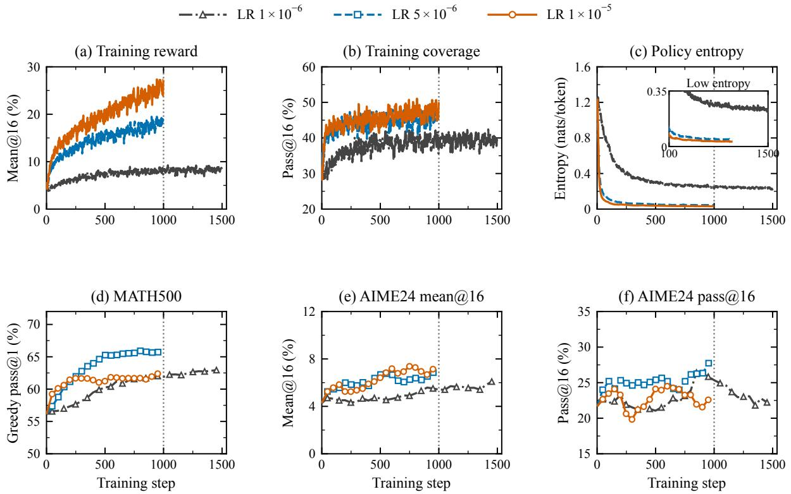  
Figure 10: Qwen3-1.7B GRPO learning-rate sweep, staleness 4. Dotted line: 1,000 updates; EMA $\alpha = 0 . 2 0$

The aggregate accuracy advantage of Proximal KL over GRPO holds at both learning rates: its micro-averaged accuracy is higher in every matched of-policy $5 \times 1 0 ^ { - 6 }$ and $1 \times 1 0 ^ { - 5 }$ comparison in Table 1. We choose $5 \times 1 0 ^ { - 6 }$ for the main comparison because both methods achieve higher greedy pass@1 on all four greedy-evaluated benchmarks at staleness levels 4 and 16 (Table 1). The Qwen3- 1.7B rows at $1 \times 1 0 ^ { - 5 }$ in Table 1 are discussed in the stability test (Section 6.2). The 1.7B GRPO sweep provides further context (Figure 10): averaging the displayed EMA-smoothed observations at steps 650 to 999, $5 \times 1 0 ^ { - 6 }$ gives the highest MATH500 greedy pass@1 and AIME24 pass@16, while AIME24 mean@16 favors $1 \times 1 0 ^ { - 5 }$

## C.5 GRPO Clipping Width

We ablate GRPO’s PPO clipping width to assess the training stability of the baseline. Increasing $\epsilon _ { \mathrm { c l i p } }$ from 0.2 to 0.4 expands the interval from [0.8, 1.2] to [0.6, 1.4], allowing larger changes in the policy ratio before clipping. Both configurations use four optimizer minibatches and the same reward normalization.

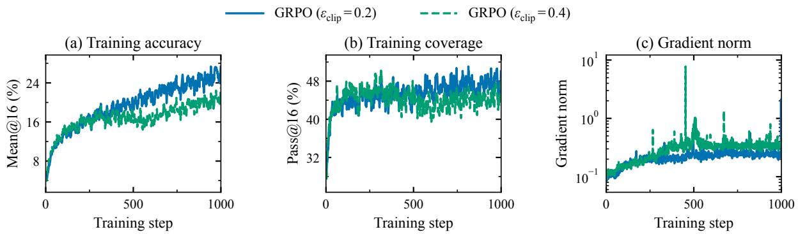  
Figure 11: GRPO clipping-width comparison: Qwen3-1.7B, $1 \times 1 0 ^ { - 5 }$ , staleness setting 4. Accuracy uses EMA $\alpha = 0 . 2 0 ;$ gradient norms are raw and shown on a logarithmic axis.

Wider clipping leads to less stable training in this comparison (Figure 11). With $\epsilon _ { \mathrm { c l i p } } ~ = ~ 0 . 4 .$ larger gradient-norm excursions accompany a temporary decline in training mean@16 and pass@16. The narrower interval maintains a steadier increase in training mean@16 with smaller gradient excursions. These observations support retaining $\epsilon _ { \mathrm { c l i p } } = 0 . 2$ for the reported GRPO baseline.

## D Proximal target and future KL gradient

For a fixed full-support reference $\pi _ { k }$ and $\beta > 0$ , the proximal objective has an explicit response-level maximizer. We recall it and its objective-gap identity for completeness.

Proposition D.1 (Exact proximal improvement). For $\beta > 0$ and a full-support reference $\pi _ { k }$ , the unrestricted proximal maximizer is

$$
\pi _ { k } ^ { * } ( \tau \mid x ) = \frac { \pi _ { k } ( \tau \mid x ) e ^ { R ( x , \tau ) / \beta } } { Z _ { k } ( x ) } , \qquad Z _ { k } ( x ) = \mathbb { E } _ { \tau \sim \pi _ { k } ( \cdot \mid x ) } e ^ { R ( x , \tau ) / \beta } .\tag{D.1}
$$

For binary rewards, let $p _ { k } ( x ) = \operatorname* { P r } _ { \pi _ { k } } ( R = 1 \mid x )$ and $p _ { k } ^ { * } ( x ) = \operatorname* { P r } _ { \pi _ { k } ^ { * } } ( R = 1 \mid x )$ . For every prompt with $0 < p _ { k } ( x ) < 1$

$$
p _ { k } ^ { * } ( x ) = \frac { e ^ { 1 / \beta } p _ { k } ( x ) } { 1 - p _ { k } ( x ) + e ^ { 1 / \beta } p _ { k } ( x ) } > p _ { k } ( x ) , \qquad \frac { p _ { k } ^ { * } ( x ) } { 1 - p _ { k } ^ { * } ( x ) } = e ^ { 1 / \beta } \frac { p _ { k } ( x ) } { 1 - p _ { k } ( x ) } .\tag{D.2}
$$

The probability formula extends to $p _ { k } ( x ) = 0$ and $p _ { k } ( x ) = 1$ by continuity. For positive initial success probability, repeated exact updates with fixed $\beta$ make the success probability converge to one.

We write $J _ { k } ( \pi )$ for the proximal objective evaluated at a policy, so $J _ { k } ( \theta ) = J _ { k } ( \pi _ { \theta } )$ . At the Gibbs target its value is $J _ { k } ( \pi _ { k } ^ { * } ) = \beta \mathbb { E } _ { \lambda }$ x log $Z _ { k } ( x )$ . For any response policy $\pi ,$ the corresponding objectivegap identity is

$$
J _ { k } ( \pi _ { k } ^ { * } ) - J _ { k } ( \pi ) = \beta \mathbb { E } _ { x } D _ { \mathrm { K L } } ( \pi ( \cdot \mid x ) \| \pi _ { k } ^ { * } ( \cdot \mid x ) ) .\tag{D.3}
$$

Proof of Proposition D.1. Substituting the Gibbs form into the KL divergence gives the objectivegap identity. Its right-hand side is nonnegative and vanishes only at $\pi = \pi _ { k } ^ { * } .$ , proving maximality. For binary rewards, conditioning the Gibbs form on success gives Equation (D.2). Each exact reference refresh adds $1 / \beta$ to the success log-odds, so repeated exact updates send the success probability to one. □

## D.1 Illustration of proximal feedback with shared parameters

Proximal and trust-region methods are established tools for controlling policy changes (Schulman et al., 2015; Tomar et al., 2022). The following example illustrates how proximal feedback can limit interference between prompts that share parameters. It compares ordinary Euclidean rewardgradient flow with repeated exact proximal solves in the same policy class, providing context for the on-policy experiment.

Construction. Take two equally likely prompts, a single action $a \in \{ 0 , 1 \}$ , and reward $R = a$ Let $p _ { m } = \pi _ { \boldsymbol { \theta } } ( 1 \mid x _ { m } ) = \sigma ( u _ { m } ^ { \top } \boldsymbol { \theta } )$ , where $\sigma$ is the logistic function, and set

$$
\begin{array} { r l } & { u _ { 1 } = ( 1 , 1 ) ^ { \top } / 5 , \qquad u _ { 2 } = ( 1 , - 4 ) ^ { \top } / 5 , \qquad \theta _ { 0 } = ( - \Delta , \Delta ) ^ { \top } , } \\ & { \qquad \Delta = \log \frac { 1 - p _ { \mathrm { i n i t } } } { p _ { \mathrm { i n i t } } } , \qquad 0 < p _ { \mathrm { i n i t } } \le 1 / 6 4 . } \end{array}
$$

Initially $( p _ { 1 } , p _ { 2 } ) = ( 1 / 2 , p _ { \mathrm { i n i t } } )$ . The shared head can solve both prompts: along $\theta = ( c , 0 ) ^ { \top }$ , both success probabilities approach one as $c \to \infty$

Proposition D.2 (Reward-gradient flow versus exact proximal updates). From this initialization, Euclidean gradient flow for $J ( \theta ) = ( p _ { 1 } + p _ { 2 } ) / 2$ converges in policy space to $\left( p _ { 1 } , p _ { 2 } \right) = \left( 1 , 0 \right)$ and never achieves $J > 1 / 2$ . Repeated exact proximal updates with any fixed $\beta > 0$ are representable by the same head and converge to $( p _ { 1 } , p _ { 2 } ) = ( 1 , 1 )$

Proof. Write $z _ { m } = u _ { m } ^ { \top } \theta$ and $d _ { m } = p _ { m } ( 1 - p _ { m } )$ . Reward-gradient flow satisfies

$$
\dot { z } _ { 1 } = ( 2 d _ { 1 } - 3 d _ { 2 } ) / 5 0 , \qquad \dot { z } _ { 2 } = ( - 3 d _ { 1 } + 1 7 d _ { 2 } ) / 5 0 .
$$

In the region $z _ { 1 } \ge 0 , z _ { 1 } + z _ { 2 } \le - \Delta$ , we have $d _ { 1 } \geq e ^ { - z _ { 1 } } / 4$ and $d _ { 2 } \leq e ^ { - z _ { 1 } } p _ { \mathrm { i n i t } } / ( 1 - p _ { \mathrm { i n i t } } )$ , hence $d _ { 2 } / d _ { 1 } \leq 4 / 6 3 < 1 / 1 4$ . Thus $\dot { z } _ { 1 } > 0$ and $\dot { z } _ { 1 } + \dot { z } _ { 2 } = ( - d _ { 1 } + 1 4 d _ { 2 } ) / 5 0 < 0$ . These strict inequalities hold on the boundary as well, so the flow points into the region, which contains the initialization. Invariance of this region implies $p _ { 2 } \leq 1 - p _ { 1 }$ and $J \le 1 / 2$ . If the increasing $z _ { 1 }$ were bounded, $d _ { 1 }$ and consequently $\dot { z } _ { 1 }$ would be bounded below by positive constants, a contradiction. Therefore $z _ { 1 } \to \infty$ and $z _ { 2 }  - \infty$

By Proposition D.1, an exact proximal update adds $1 / \beta$ to each success logit. The parameter increment $( 5 , 0 ) ^ { \top } / \beta$ realizes both changes simultaneously and has norm $5 / \beta$ . Thus this model satisfies the local target representation condition of Theorem F.10 at every reference when $B \geq 5$ Repeating these exact solves K times, with $p _ { K , m }$ denoting the success probability on prompt $x _ { m }$ gives

$$
( p _ { K , 1 } , p _ { K , 2 } ) = \big ( \sigma ( K / \beta ) , \sigma ( - \Delta + K / \beta ) \big ) \longrightarrow ( 1 , 1 ) .
$$

Proximal feedback. For a fixed reference with logits $z _ { k , m }$ , diferentiation gives

$$
\nabla J _ { k } ( \theta ) = \frac { 1 } { 2 } \sum _ { m = 1 } ^ { 2 } u _ { m } p _ { m } ( 1 - p _ { m } ) \{ 1 - \beta ( z _ { m } - z _ { k , m } ) \} .
$$

Because $u _ { 1 } ^ { \top } u _ { 2 }$ is negative, improving one prompt can interfere with the other. The factor in braces vanishes when a prompt’s logit increment reaches $1 / \beta$ . At the exact proximal solution, both prompts have this increment, realized simultaneously by the parameter change $( 5 , 0 ) ^ { \top } / \beta$ . Repeated exact solves therefore improve both prompts, whereas the reward-gradient flow drives the second prompt’s success probability to zero.

## D.2 The Gradient of Proximal Improvement

FRPO identifies the regularization credit assigned to each generated token. Because an earlier token afects later prefixes, its policy-gradient coeficient includes the subsequent regularization costs. We apply this identity with a linear reward utility and a reference held fixed throughout one proximal round.

For $h _ { i } = ( x , a _ { < i } )$ , define $\rho _ { i } = \pi _ { \theta } ( a _ { i } \mid h _ { i } ) / \pi _ { k } ( a _ { i } \mid h _ { i } ) , \ell _ { i } = \log \rho _ { i }$ , and $\psi _ { i } = \nabla _ { \theta } \log \pi _ { \theta } ( a _ { i } \mid h _ { i } )$ . These are the reference ratio, its log cost, and the token score, respectively. The following derivation gives the future-KL identity directly; it is also the linear-reward specialization of the Future-KL identity in FRPO (Yao et al., 2026, Theorem 4.1, Equations (4.2) through (4.5)). The trajectory score is $\textstyle \sum _ { i } \psi _ { i }$ . Diferentiating the proximal objective in Equation (1) therefore gives

$$
\nabla _ { \theta } J _ { k } ( \theta ) = \mathbb { E } _ { \pi _ { \theta } } \left[ \left( \sum _ { i } \psi _ { i } \right) \left( R - \beta \sum _ { j } \ell _ { j } \right) - \beta \sum _ { j } \psi _ { j } \right] .
$$

The last term has expectation zero because $\mathbb { E } _ { \pi _ { \theta } } [ \psi _ { j } ~ | ~ h _ { j } ] = 0$ . For $j < i ,$ the earlier cost $\ell _ { j }$ is fixed given $h _ { i } .$ , so $\mathbb { E } _ { \pi _ { \theta } } [ \psi _ { i } \ell _ { j } ] = 0$ for the same reason. A history-only baseline $b ( h _ { i } )$ also cancels against the conditional score. Removing these terms leaves the current and future costs:

$$
\widehat { A } _ { i } ^ { \mathrm { K L } } = R - b ( h _ { i } ) - \beta \sum _ { j = i } ^ { T } \ell _ { j } ,\tag{D.4}
$$

$$
\nabla _ { \theta } J _ { k } ( \theta ) = \mathbb { E } _ { \pi _ { \theta } } \sum _ { i = 1 } ^ { T } \psi _ { i } \widehat { A } _ { i } ^ { \mathrm { K L } } .\tag{D.5}
$$

We hold the sampled coeficient fixed when diferentiating the loss. Its cost sum includes the current token and all later tokens, so omitting future costs generally changes the gradient. FRPO distinguishes assigning these regularization costs from correcting for stale sampling. We address the sampling correction in Appendix E.

## E Asynchronous updates with token-wise importance weighting

Asynchronous learning reuses responses from older policies. We study a policy-gradient (PG) update that uses sampled rewards, full future KL credit, and one importance weight per sampled token, without fitting a value function. We first characterize its stationary policy, then prove convergence under stronger assumptions on the population dynamics.

## E.1 Exact Response Correction

We first state the exact importance correction for a complete response, then study the stationary target of current-token weighting.

Proposition E.1 (Exact response-level importance correction). Fix the learner, reference, and behavior policies on the finite generation tree, with the same prompt distribution and positive token probabilities. Let $\psi _ { i } = \nabla _ { \theta } \log \pi _ { \theta } ( a _ { i } \mid h _ { i } )$ , and use the full future KL advantage from Equation (3) with a history-only baseline. Then

$$
\begin{array} { r l r } & { } & { \frac { \pi _ { \boldsymbol { \theta } } \left( \tau \mid \boldsymbol { x } \right) } { \pi _ { \mathrm { b e h a v } } \left( \tau \mid \boldsymbol { x } \right) } = \displaystyle \prod _ { i = 1 } ^ { T } \left[ \frac { \pi _ { k } \left( a _ { i } \mid h _ { i } \right) } { \pi _ { \mathrm { b e h a v } } \left( a _ { i } \mid h _ { i } \right) } \rho _ { i } \right] , } \\ & { } & { \nabla _ { \boldsymbol { \theta } } J _ { k } ( \boldsymbol { \theta } ) = \mathbb { E } _ { \pi _ { \mathrm { b e h a v } } } \left[ \frac { \pi _ { \boldsymbol { \theta } } \left( \tau \mid \boldsymbol { x } \right) } { \pi _ { \mathrm { b e h a v } } \left( \tau \mid \boldsymbol { x } \right) } \sum _ { i } \psi _ { i } \widehat { A } _ { i } ^ { \mathrm { K L } } \right] . } \end{array}\tag{E.1}
$$

Proof. The autoregressive factorization gives the response likelihood ratio. Changing measure from the behavior policy to the learner policy then recovers the full future KL gradient in Equation (D.5).

## E.2 Token-Wise Importance Weighting and Its Stationary Target

The proof uses the soft-consistency mechanism of PCL and Trust-PCL (Nachum et al., 2017, 2018). Steps 1 and 2 show that the future-KL advantage cancels pathwise at the proximal target. Step 4 converts a zero expected score update into conditions at each action and uses backward induction to identify the unique stationary policy, even with stale continuations. The soft values are analytical quantities used only in the proof; the learner needs terminal rewards and full future credit. Here “synchronous” means $\pi _ { \mathrm { b e h a v } } = \pi _ { \theta }$ at every update, a stronger condition than collecting synchronously and then reusing rollouts. In Step 4, $\ddot { Q } ( h , a )$ abbreviates the conditional coeficient $\widetilde { Q } _ { \mathrm { b e h a v } } ( h , a )$ defined there.

Algorithm 1 specifies how responses are collected, behavior probabilities are logged, and the reference is refreshed in the practical update. The stationary-policy theorem analyzes the full, unmodified population field in Equation (3), with a detached history-only baseline. Its assumptions are separate from those of the finite-sample theorem for the linear logistic model.

## Assumptions for Theorem 1.

(A1) Finite supported model. The prompt distribution has finite support with positive probability on every included prompt. Each prompt has a finite token-generation tree and a fixed terminal reward. Let T be the maximum response length. After termination, pad to depth T with deterministic absorbing actions, whose scores and KL costs are zero. The reference $\pi _ { k }$ is fixed during the round, and both $\pi _ { k }$ and every learner policy under consideration assign positive probability to every allowed token.

(A2) Covered behavior sampling. Responses come from a fixed behavior policy or a mixture of behavior-policy versions. For each response, select one version before generation and hold it fixed throughout that response. Retain the actual version-specific token probabilities used to sample it. Every nonterminal history in the generation tree has positive behavior occupancy; all such histories are relevant because the reference has full support. Every contributing version assigns positive probability to each allowed next token at that history.

(A3) Representability and local expressiveness. The learner class contains $\pi _ { k } ^ { * } .$ Collect all relevant independent next-token log odds into $z ( \theta )$ . Its Jacobian $D z ( \theta )$ has full row rank at every parameter considered, so local parameter changes span every such log-odds direction. Independent tabular logits satisfy this condition.

(A4) Ideal population update. The field is the exact expectation of Equation (E.2) under the behavior sampling law, held fixed during diferentiation; the conditional continuation expectations are exact population quantities. The field uses the full, unmodified future KL sum and an action-independent, history-only baseline held fixed during diferentiation. No finite-horizon truncation, group normalization, or finite-batch approximation enters this field.

We index context depth by the next token position, so depth $( h _ { i } ) = i$

The token-wise expected update is

$$
M _ { \mathrm { b e h a v } } ( \theta ) = \mathbb { E } _ { \pi _ { \mathrm { b e h a v } } } \sum _ { i = 1 } ^ { T } \frac { \pi _ { k } ( a _ { i } \mid h _ { i } ) } { \pi _ { \mathrm { b e h a v } } ( a _ { i } \mid h _ { i } ) } \rho _ { i } \psi _ { i } \widehat { A } _ { i } ^ { \mathrm { K L } } .\tag{E.2}
$$

Proof of Theorem 1. For a history h, define the soft partition function, value, and action value as follows. The expectation in $Z _ { k } ( h )$ averages over the entire continuation from h under the reference:

$$
\begin{array} { r } { Z _ { k } ( h ) = \mathbb { E } _ { \pi _ { k } ( \cdot | h ) } e ^ { R / \beta } , \qquad V _ { k } ( h ) = \beta \log Z _ { k } ( h ) , } \\ { Q _ { k } ( h , a ) = V _ { k } ( h a ) . \qquad } \end{array}\tag{E.3}
$$

At a terminal history h, $V _ { k } ( h ) = R$

Step 1: obtain the token-level proximal policy. The partition function at context h averages the partition functions of its children:

$$
Z _ { k } ( h ) = \sum _ { a } \pi _ { k } ( a \mid h ) Z _ { k } ( h a ) .\tag{E.4}
$$

Conditioning the response-level Gibbs law (D.1) on context h therefore gives

$$
\pi _ { k } ^ { * } ( a \mid h ) = \pi _ { k } ( a \mid h ) { \frac { Z _ { k } ( h a ) } { Z _ { k } ( h ) } } .\tag{E.5}
$$

Taking logs and using $V _ { k } = \beta$ log $Z _ { k }$ gives the regularized Q-function identity

$$
\log \frac { \pi _ { k } ^ { * } ( a \mid h ) } { \pi _ { k } ( a \mid h ) } = \frac { Q _ { k } ( h , a ) - V _ { k } ( h ) } { \beta } .\tag{E.6}
$$

Step 2: telescope along a sampled sufix. With $\ell _ { j } = \log \rho _ { j }$ , define the future-only target and rewrite the algorithm’s advantage as

$$
\widehat { Q } _ { i } ^ { \pi _ { \theta } } = R - \beta \sum _ { j > i } \ell _ { j } , \qquad \widehat { A } _ { i } ^ { \mathrm { K L } } = \widehat { Q } _ { i } ^ { \pi _ { \theta } } - \beta \ell _ { i } - b ( h _ { i } ) .\tag{E.7}
$$

Apply (E.6) to every token after i:

$$
\begin{array} { c } { { \beta \displaystyle \sum _ { j > i } \log \frac { \pi _ { k } ^ { * } ( a _ { j } \mid h _ { j } ) } { \pi _ { k } ( a _ { j } \mid h _ { j } ) } = \displaystyle \sum _ { j > i } \{ V _ { k } ( h _ { j + 1 } ) - V _ { k } ( h _ { j } ) \} } } \\ { { = R - V _ { k } ( h _ { i + 1 } ) . } } \end{array}\tag{E.8}
$$

All intermediate values cancel. Since $h _ { i + 1 } = h _ { i } a _ { i }$ , the remaining value is $V _ { k } ( h _ { i + 1 } ) = Q _ { k } ( h _ { i } , a _ { i } )$ Substitution into (E.7) proves the pathwise identities

$$
\widehat { Q } _ { i } ^ { \pi _ { k } ^ { * } } = Q _ { k } ( h _ { i } , a _ { i } ) , \qquad \widehat { A } _ { i } ^ { \mathrm { K L } } ( \pi _ { k } ^ { * } , \tau ) = V _ { k } ( h _ { i } ) - b ( h _ { i } ) .\tag{E.9}
$$

They hold for every supported sufix, before taking any expectation.

Step 3: measure the error away from the solution. To measure the error for an arbitrary learner $\pi _ { \boldsymbol { \theta } } .$ , subtract the telescoping identity for $\pi _ { k } ^ { * }$ from the learner’s future-KL return. This gives

$$
\widehat { Q } _ { i } ^ { \pi _ { \theta } } - Q _ { k } ( h _ { i } , a _ { i } ) = - \beta \sum _ { j > i } \log \frac { \pi _ { \theta } ( a _ { j } \mid h _ { j } ) } { \pi _ { k } ^ { * } ( a _ { j } \mid h _ { j } ) } .\tag{E.10}
$$

The target error at token i is exactly the sum of the downstream log-policy errors, scaled by $- \beta$ This identity also controls the perturbation term in the convergence proof below.

Step 4: identify the zero of the expected update. Let $d _ { \mathrm { b e h a v } } ( h )$ include both prompt probability and behavior prefix occupancy. Write $\psi _ { \boldsymbol \theta } ( h , a ) = \nabla \log \pi _ { \boldsymbol \theta } ( a \mid h )$ . To include mixed behavior-policy versions, let v denote the version that generated a response and let $\omega ( v \mid h )$ be its conditional probability given the observed context, before sampling the next action. For $i = \mathrm { d e p t h } ( h )$ , define

$$
\widetilde { Q } _ { \mathrm { b e h a v } } ( h , a ) = \sum _ { v } \omega ( v \mid h ) \mathbb { E } _ { \pi _ { \mathrm { b e h a v } , v } } [ \widehat { Q } _ { i } ^ { \pi _ { \theta } } \mid h _ { i } = h , a _ { i } = a ] .\tag{E.11}
$$

The coeficient averages over versions conditional on $h ,$ fixes the current action to $^ { a , }$ and samples the remaining tokens from that version. Current-action importance weighting cancels the version’s action probability. The resulting mixture weights are therefore $\omega ( v \mid h )$ , rather than weights conditional on both the history and action. A single behavior policy is the special case with one version. Taking the expectation of (E.2) with each response’s logged version-specific probabilities gives

$$
\begin{array} { l l l } { \displaystyle M _ { \mathrm { b e h a v } } ( \theta ) = \sum _ { h } d _ { \mathrm { b e h a v } } ( h ) \sum _ { a } \pi _ { \theta } ( a \mid h ) \psi _ { \theta } ( h , a ) } \\ { \displaystyle \left[ \widetilde { Q } _ { \mathrm { b e h a v } } ( h , a ) - \beta \log \frac { \pi _ { \theta } ( a \mid h ) } { \pi _ { k } ( a \mid h ) } - b ( h ) \right] . } \end{array}\tag{E.12}
$$

In synchronous training, this field equals $\nabla J _ { k } ( \theta )$ . With stale responses, it remains the expected update in (E.2) but generally difers from the gradient of $J _ { k }$ . The ratio corrects the current action’s distribution, while the history and later tokens still follow the behavior policy. The sequence-wise correction in Equation (E.1) recovers the exact gradient.

For tabular logits at h, define $u ( h , a ) = \widetilde Q _ { \mathrm { b e h a v } } ( h , a ) - \beta \log ( \pi _ { \theta } ( \textit { a } | h ) / \pi _ { k } ( \textit { a } | h ) )$ . Write $p ( a ) = \pi _ { \theta } ( a \mid$ $h )$ . The softmax score $\nabla _ { z _ { h } } \log p ( a ) = e _ { a } - p$ gives the expected logit block $d _ { \mathrm { b e h a v } } ( h ) [ \mathrm { d i a g } ( \pmb { p } ) - \pmb { p } \pmb { p } ^ { \top } ] \pmb { u }$ For positive $^ { p , }$ the quadratic form of the matrix is $\operatorname { V a r } _ { a \sim p } [ u ( h , a ) ]$ ; hence its kernel consists exactly of constant vectors. Positive behavior occupancy therefore makes the block zero exactly when $u ( h , a )$ is constant over actions. A softmax has a redundant common-shift direction; passing from its full logit vector to independent log-odds removes only that direction and leaves this zero condition unchanged.

At the last token, $\widetilde Q ( h , a ) = R = Q _ { k } ( h , a )$ , so this condition is equivalent to $\left( \mathrm { E . 6 } \right)$ ; hence the lasttoken policy must be $\pi _ { k } ^ { * }$ . If all later-token policies equal $\pi _ { k } ^ { * } ,$ Step 2 makes $\widetilde { Q } ( h , a ) = Q _ { k } ( h , a )$ at the current history, and the same argument forces its policy to equal $\pi _ { k } ^ { * } .$ . Backward induction proves that the token-wise field vanishes at every history exactly at the proximal policy.

Conversely, at $\pi _ { \boldsymbol { \theta } } = \pi _ { k } ^ { * }$ , Equation (E.9) gives $\widehat { A } _ { i } ^ { \mathrm { K L } } = V _ { k } ( h _ { i } ) - b ( h _ { i } )$ on every response. Conditional on each history and behavior version $v ,$ let $w _ { i , v } = \pi _ { \theta } ( a _ { i } \mid h _ { i } ) / \pi _ { \mathrm { b e h a v } , v } ( a _ { i } \mid h _ { i } )$ . Then

$$
\mathbb { E } _ { \pi _ { \mathrm { b e h a v } , v } } [ w _ { i , v } \psi _ { i } \widehat { A } _ { i } ^ { \mathrm { K L } } \mid h _ { i } , v ] = ( V _ { k } ( h _ { i } ) - b ( h _ { i } ) ) \mathbb { E } _ { \pi _ { k } ^ { * } } [ \psi _ { i } \mid h _ { i } ] = 0 .
$$

Thus the Gibbs policy also makes the expected field zero.

For a shared-parameter model, collect the independent log odds into a vector $z ( \theta )$ and let $g _ { z }$ be this same field in those coordinates. The chain rule gives $M _ { \mathrm { b e h a v } } ( \theta ) = D z ( \theta ) ^ { \top } g _ { z }$ . Full row rank of $D z ( \theta )$ makes its transpose injective, so the parameter-space field is zero exactly when $g _ { z } = 0$ . This proves Theorem 1 under the stated local controllability assumption. □

## E.3 Population Convergence and Outer Improvement

We next connect the stationary target to improvement across reference refreshes. First, we prove convergence of the tabular population flow to the frozen-reference target. We then show that stopping each inner solve at a suficiently small success-log-odds error still yields improvement after every refresh.

For the convergence result, we specialize Theorem 1 to independent softmax logits at every history, continuous-time population updates, and behavior occupancy uniformly bounded away from zero. These conditions yield a direct Lyapunov analysis of the update dynamics.

Fix $\pi _ { k }$ and follow this ordinary population PG field. Let t denote time, let $d _ { t } ( h )$ be the behavior occupancy of history h, and define, for $i = \mathrm { d e p t h } ( h )$ ，

$$
\widetilde { Q } _ { t } ( h , a ) = \sum _ { v } \omega _ { t } ( v \mid h ) \mathbb { E } _ { \pi _ { \mathrm { b e h a v } , t , v } } [ \widehat { Q } _ { i } ^ { \pi _ { \theta ( t ) } } \mid h _ { i } = h , a _ { i } = a ] .\tag{E.13}
$$

Theorem E.2 (Convergence of the asynchronous population flow). Assume (A1) through $( A \ 4 )$ at every time t, with independent softmax logits at every nonterminal history and a fixed reference $\pi _ { k }$ . Allow the behavior policy or mixture of behavior-policy versions to vary with time. Require its mixture weights and conditional continuation probabilities to be measurable in time, and hold the sampling law fixed when forming each update. Consider a global absolutely continuous solution of the population logit flow from finite initial logits. Suppose $d _ { t } ( h ) \geq d _ { \operatorname* { m i n } } > 0$ for every nonterminal history and all $t \geq 0$ . As a visit probability, $d _ { t } ( h ) \leq 1$ . Fix a history h with m allowed actions. Let $z _ { h } ( t )$ be its learner logit vector, so $\pi _ { \boldsymbol \theta ( t ) } ( \cdot \ \vert \ h ) \ = \ \mathrm { s o f t m a x } ( z _ { h } ( t ) )$ Choose target logits $z _ { h } ^ { * }$ with softmax $( z _ { h } ^ { * } ) = \pi _ { k } ^ { * } ( \cdot \mid h )$ ; these logits are determined up to an additive common shift. Write $\mathbf { \mathbf { \mathit { p } } } _ { h } ( t ) = \pi _ { \theta ( t ) } ( \cdot \mid h ) , \mathbf { \mathbf { \mathit { p } } } _ { h } ^ { * } = \pi _ { k } ^ { * } ( \cdot \mid h )$ , and

$$
P _ { h } = I - \frac { 1 } { m } \mathbf { 1 } \mathbf { 1 } ^ { \top } , \qquad \mathbf { r } _ { h } ( t ) = P _ { h } \log \frac { \mathbf { p } _ { h } ( t ) } { \mathbf { p } _ { h } ^ { * } } .
$$

The logarithm and division are componentwise. Write $\epsilon _ { h } ( t ) = \widetilde { Q } _ { t } ( h , \cdot ) - Q _ { k } ( h , \cdot )$ and ${ \mathsf { C } } ( { \pmb { p } } ) \ =$ $\mathrm { d i a g } ( \pmb { p } ) - \pmb { p } \pmb { p } ^ { \top }$ . Then the ordinary expected PG logit flow at h is

$$
\dot { z } _ { h } ( t ) = d _ { t } ( h ) \mathsf { C } ( \pmb { p } _ { h } ( t ) ) \{ - \beta \pmb { r } _ { h } ( t ) + \epsilon _ { h } ( t ) \} .\tag{E.14}
$$

Consequently, for $\begin{array} { r } { \mathcal { V } _ { h } ( t ) = \frac { 1 } { 2 } \| \pmb { r } _ { h } ( t ) \| _ { 2 } ^ { 2 } } \end{array}$

$$
\begin{array} { r l } & { { \dot { \mathcal { V } } } _ { h } ( t ) = - \beta d _ { t } ( h ) { \pmb { r } } _ { h } ( t ) ^ { \top } { \mathsf { C } } ( { \pmb { p } } _ { h } ( t ) ) { \pmb { r } } _ { h } ( t ) } \\ & { ~ + d _ { t } ( h ) { \pmb { r } } _ { h } ( t ) ^ { \top } { \mathsf { C } } ( { \pmb { p } } _ { h } ( t ) ) { \pmb { \epsilon } } _ { h } ( t ) . } \end{array}\tag{E.15}
$$

The policies satisfy ${ \bf p } _ { h } ( t )  { \bf p } _ { h } ^ { * }$ at every history, including under arbitrary time-varying supported behavior mixtures satisfying the occupancy bound.

Proof. For a prescribed measurable behavior law, interpret the flow as an absolutely continuous solution satisfying the diferential equation almost everywhere in time (a Carathéodory solution). On the finite response trees, the vector field is measurable in time and locally Lipschitz in the logits, uniformly over behavior laws. Log-softmax terms grow at most linearly in the logits, and probabilities and scores are bounded. Thus the vector field has at most linear growth, which ensures global existence from finite initial logits. The derivative identities and inequalities below hold almost everywhere; their integrated forms follow from absolute continuity. For a behavior law chosen from past learner policies, the convergence assertion applies to any global absolutely continuous solution satisfying the assumptions, conditional on existence of such a solution.

Let $e _ { a }$ be the one-hot vector for action a. The softmax identity $\nabla _ { z _ { h } } \log p _ { h } ( a ) = e _ { a } - p _ { h }$ and (E.12) give the ordinary PG logit block

$$
d _ { t } ( h ) \mathsf { C } ( { p } _ { h } ) \left\{ \widetilde { Q } _ { t } ( h , \cdot ) - \beta \log \frac { p _ { h } } { \pi _ { k } ( \cdot \mid h ) } \right\} ;
$$

the action-independent baseline vanishes because ${ \mathsf { C } } ( { \pmb { p } } _ { h } ) { \bf 1 } = { \bf 0 }$ . The proximal identity (E.6) implies

$$
Q _ { k } ( h , \cdot ) - \beta \log \frac { \pmb { p } _ { h } ^ { * } } { \pi _ { k } ( \cdot \mid h ) } = V _ { k } ( h ) \mathbf { 1 } .
$$

Subtracting this identity inside the PG block and again removing constants with ${ \mathsf { C } } ( { \pmb { p } } _ { h } ) { \bf 1 } = { \bf 0 }$ proves (E.14). Finally, $\boldsymbol { r } _ { h } = P _ { h } ( \boldsymbol { z } _ { h } - \boldsymbol { z } _ { h } ^ { * } )$ and the right-hand side of (E.14) sums to zero, so ${ \dot { \pmb r } } _ { h } = { \dot { \pmb z } } _ { h }$ Taking the inner product with $\boldsymbol { r } _ { h }$ proves (E.15).

Backward convergence of ordinary PG. At the last token position the future cost sum is empty, so $\widehat { Q } _ { T } ^ { \pi _ { \theta ( t ) } } = \bar { R = { Q } _ { k } ( h , a ) }$ for every learner policy. Thus $\boldsymbol { \epsilon } _ { h } ( t ) = \mathbf { 0 }$ . Equation (E.15) therefore makes $\nu _ { h } ( t )$ nonincreasing. The centered log ratios remain bounded, so normalization and the positive support of $\pmb { p } _ { h } ^ { * }$ keep every component of ${ \mathbf { } } p _ { h } ( t )$ uniformly away from zero. Consequently, $\begin{array} { r } { \lambda _ { h } : = \operatorname* { i n f } _ { t \geq 0 } \operatorname* { m i n } _ { a } p _ { h } ( t , a ) > 0 } \end{array}$ . For centered $\boldsymbol { r } _ { h }$ , the weighted-variance identity gives

$$
r _ { h } ^ { \top } \mathbb { C } ( p _ { h } ) \pmb { r } _ { h } = \mathrm { V a r } _ { a \sim p _ { h } } [ r _ { h } ( a ) ] \geq \lambda _ { h } \| \pmb { r } _ { h } \| _ { 2 } ^ { 2 } .
$$

Thus $\dot { \mathcal { V } } _ { h } \le - 2 \beta d _ { \operatorname* { m i n } } \lambda _ { h } \mathcal { V } _ { h }$ , and the last-token policies converge exponentially to $\pmb { p } _ { h } ^ { * }$

Proceed backward by induction. Define

$$
\operatorname { o s c } _ { j } ( t ) = \operatorname* { m a x } _ { h : \operatorname { d e p t h } ( h ) = j } \operatorname { o s c } _ { a } \log { \frac { \pi _ { \theta ( t ) } ( a \mid h ) } { \pi _ { k } ^ { * } ( a \mid h ) } } .
$$

Here $\begin{array} { r } { \mathrm { o s c } _ { a } f ( a ) = \mathrm { m a x } _ { a } f ( a ) - \mathrm { m i n } _ { a } f ( a ) } \end{array}$ is the range across allowed actions. Because both policies are normalized, their log probability ratio either vanishes for every action or takes both nonpositive and nonnegative values. Its absolute value is therefore bounded by its oscillation $\mathrm { o s c } _ { j } ( t )$ . If all depths after i converge exponentially, the tail identity (E.10) gives, uniformly over histories at depth i,

$$
\| \epsilon _ { h } ( t ) \| _ { \infty } \leq \beta \sum _ { j > i } \mathrm { o s c } _ { j } ( t ) \leq C _ { i } e ^ { - c _ { i } t }
$$

for some $C _ { i } , c _ { i } > 0$ . To handle $\mathbf { \nabla } _ { \mathbf { { r } } _ { h } } = \mathbf { 0 }$ without a separate case, fix $\nu > 0$ . The flow equation and the negative semidefiniteness of its first term imply

$$
\frac { d } { d t } \sqrt { \| \pmb { r } _ { h } ( t ) \| _ { 2 } ^ { 2 } + \nu } \le d _ { t } ( h ) \| \mathsf C ( \pmb { p } _ { h } ( t ) ) \| _ { \mathrm { o p } } \| \epsilon _ { h } ( t ) \| _ { 2 } .
$$

The right-hand side is integrable. Integrating and then letting $\nu \downarrow 0$ shows that $\mathbf { } r _ { h } ( t )$ remains bounded, so ${ \mathbf { } } p _ { h } ( t )$ again remains uniformly in the interior. Applying Young’s inequality to (E.15) then gives constants $c _ { h } , C _ { h } > 0$ such that

$$
\dot { \mathcal { V } } _ { h } ( t ) \leq - c _ { h } \mathcal { V } _ { h } ( t ) + C _ { h } \| \epsilon _ { h } ( t ) \| _ { 2 } ^ { 2 } .
$$

The forcing term decays exponentially, so Gronwall’s inequality yields $\mathcal { V } _ { h } ( t ) \to ~ 0$ exponentially. Backward induction proves convergence to $\pi _ { k } ^ { * }$ at every history. □

Corollary E.3 (Reference refresh with approximate inner solves). Assume a finite prompt set, binary reward, and a full-support initial reference with $0 < p _ { 0 } ( x ) < 1$ for every prompt, where $p _ { k } ( x ) = \operatorname* { P r } _ { \tau \sim \pi _ { k } ( \cdot | x ) } [ R ( x , \tau ) = 1 ]$ . Fix $\beta > 0$ and $\varepsilon _ { \mathrm { l o g i t } } \in ( 0 , 1 / \beta )$ . At round k, let $\pi _ { k } ^ { * }$ maximize the proximal objective with reference $\pi _ { k ; }$ , write $p _ { k } ^ { * } ( x ) = \mathrm { P r } _ { \tau \sim \pi _ { k } ^ { * } ( \cdot | x ) } [ R ( x , \tau ) = 1 ]$ , and refresh the reference to a full-support approximation $\pi _ { k + 1 }$ satisfying, for every prompt,

$$
| \mathrm { l o g i t } p _ { k + 1 } ( x ) - \mathrm { l o g i t } p _ { k } ^ { * } ( x ) | \leq \varepsilon _ { \mathrm { l o g i t } } .\tag{E.16}
$$

Then, with logit $( p ) = \log ( p / ( 1 - p ) )$ and $\sigma ( u ) = ( 1 + e ^ { - u } ) ^ { - 1 }$

$$
p _ { k } ( x ) \geq \sigma ( \mathrm { l o g i t } p _ { 0 } ( x ) + k ( 1 / \beta - \varepsilon _ { \mathrm { l o g i t } } ) ) \longrightarrow 1 .
$$

Under the assumptions of Theorem E.2 in each round, its inner flow reaches the required tolerance in finite time.

Proof. By Proposition D.1,

$$
\mathrm { l o g i t } p _ { k } ^ { * } ( x ) = \mathrm { l o g i t } p _ { k } ( x ) + 1 / \beta .
$$

Hence each approximate round increases every success log-odds by at least $1 / \beta - \varepsilon _ { \mathrm { l o g i t } } > 0$ . Summing these increments and applying σ proves the bound and convergence. Theorem E.2 gives convergence to $\pi _ { k } ^ { * }$ in each inner flow. The finite prompt set and continuity of success log-odds then give a finite stopping time satisfying Equation (E.16) for all prompts. □

The stopping condition measures each inner solve by its success-log-odds error relative to the proximal target. Proposition D.1 gives the exact step’s improvement, and any fixed tolerance below $1 / \beta$ leaves a positive increment at every outer round. Appendix F gives a finite-sample reward guarantee using expected trajectory-KL gaps to measure inner accuracy.

## F Finite-sample convergence with a linear logistic model

This appendix gives the precise version of Theorem 2. We first specify the model, sampling rules, and projected group update. Lemmas F.1 through F.6 establish inner accuracy, and Lemmas F.7 through F.9 propagate proximal errors across reference refreshes. Theorem F.10 then gives the complete reward guarantee and budgets.

Token ratios and their second-moment budget. Let T bound the response length and $h _ { i } =$ $( x , a _ { < i } )$ be the history before token i. At each training update, write $p _ { i } = \pi _ { \theta } ( \cdot \mid h _ { i } )$ for the learner token distribution, $q _ { i } = \pi _ { \mathrm { b e h a v } } ( \cdot \mid h _ { i } )$ for the behavior distribution, and $w _ { i } = p _ { i } / q _ { i }$ . Throughout this appendix, $V _ { \mathrm { l o g } } \geq 0$ denotes a deterministic upper bound satisfying

$$
\underset { \mathrm { r o u n d s , ~ u p d a t e s } , x , \tau } { \exp } \sum _ { i = 1 } ^ { T } \mathbb { E } _ { a \sim p _ { i } } [ ( \log w _ { i } ) ^ { 2 } ] \leq V _ { \mathrm { l o g } } .\tag{F.1}
$$

Here $\tau = ( a _ { 1 } , \ldots , a _ { T } )$ ranges over supported responses and $h _ { i } = ( x , a _ { < i } )$ follows that same response path. The essential supremum includes training randomness. For a fixed pair of policies and prompt, it is only over response paths. Thus the bound controls the sum of predictable second moments along a path, rather than summing separate worst-case histories.

Linear logistic model and training rounds. For the finite-sample analysis, we use a linear logistic model on finite prompt and response trees, with deterministic binary rewards. Let T bound response length and $h _ { i } = ( x , a _ { < i } )$ denote the entire prefix before token i. Short responses can be padded with a deterministic absorbing action whose score and KL cost are zero. The response horizon $T \geq 1$ is distinct from the practical credit window H. Let d denote the parameter dimension and let $\phi ( h , a ) \ \in \ \mathbb { R } ^ { d }$ be a fixed feature vector describing candidate token a at prefix $h ,$ with $\| \phi ( h , a ) \| _ { 2 } \leq 1$ . In the linear logistic model, the token logit is $\theta ^ { \top } \phi ( h , a )$ , and softmax converts these logits into probabilities:

$$
\pi _ { \theta } ( a \mid h ) = \frac { \exp ( \theta ^ { \top } \phi ( h , a ) ) } { \sum _ { a ^ { \prime } } \exp ( \theta ^ { \top } \phi ( h , a ^ { \prime } ) ) } , \qquad \theta \in \mathbb { R } ^ { d } .\tag{F.2}
$$

The same vector θ controls all histories and positions. Features may depend on the full prefix, but remain fixed throughout training. One example is fine-tuning a Transformer’s linear output layer while freezing its hidden representations. The analysis also applies to a first-order approximation of full-layer fine-tuning around a fixed parameter vector: the features are the logit gradients at that vector, and the logits may include a fixed baseline term. This gives a neural tangent kernel interpretation of the linearized policy. Applying the result to the nonlinear Transformer requires additional control of the approximation error.

Each round k holds the reference $\pi _ { k } = \pi _ { \theta _ { k } }$ fixed while updating the learner toward its Gibbs target.   
The behavior policy supplies the responses used for these inner updates.

Group update for the convergence analysis. The analyzed variant of Algorithm 1 uses full KL credit and projected gradient steps. Each inner update uses a fresh group of $G \ge 2$ responses under the sampling rules below. This replaces batch collection and minibatch selection in lines 6 and 8. With the full future window, we also replace the normalized advantages and loss in lines $^ { 7 } { \mathrm { ; } }$ 11, and 12 by the full residual and centered group estimator below. Let $B \geq 1$ be the representation bound in the target representation condition below, and set $\beta = 1 6 B \sqrt { T }$ and $r _ { \mathrm { p r o j } } = B / \beta$ . Use step size $\eta ~ = ~ [ 2 0 4 8 \beta T ( 1 + T / G ) ] ^ { - 1 }$ . Let $\Pi _ { k }$ be Euclidean projection onto the parameter ball $\{ \theta : \| \theta - \theta _ { k } \| _ { 2 } \leq r _ { \mathrm { p r o j } } \}$ , centered at the frozen reference. Projection leaves a proposed step unchanged inside the ball and rescales its displacement from $\theta _ { k }$ to length $r _ { \mathrm { p r o j } }$ otherwise:

$$
U _ { m } = R _ { m } - \beta \sum _ { i = 1 } ^ { T } \ell _ { m , i } ,
$$

$$
\Psi _ { m } = \sum _ { i = 1 } ^ { T } w _ { m , i } \nabla _ { \theta } \log \pi _ { \theta } ( a _ { m , i } \mid h _ { m , i } ) , \qquad \bar { U } = \frac { 1 } { G } \sum _ { l = 1 } ^ { G } U _ { l } ,
$$

$$
\widehat g _ { j } = \frac { 1 } { G - 1 } \sum _ { m = 1 } ^ { G } \Psi _ { m } ( U _ { m } - \bar { U } ) , \qquad \vartheta _ { j + 1 } = \Pi _ { k } ( \vartheta _ { j } + \eta \widehat g _ { j } ) .\tag{F.3}
$$

Here $m = 1 , \ldots , G$ indexes responses and $i = 1 , \dots , T$ indexes tokens, with $h _ { m , i } = ( x , a _ { m , < i } )$ . The reward of response m is $R _ { m } = R ( x , \tau _ { m } )$ , and $\vartheta _ { j }$ is the learner parameter after j inner updates, starting from $\vartheta _ { 0 } = \theta _ { k }$ . At the current learner $\theta = \vartheta _ { j }$ , the token weight and reference log ratio are

$$
w _ { m , i } = \frac { \pi _ { \theta } ( a _ { m , i } \mid h _ { m , i } ) } { \pi _ { \mathrm { b e h a v } } ( a _ { m , i } \mid h _ { m , i } ) } , \qquad \ell _ { m , i } = \log \frac { \pi _ { \theta } ( a _ { m , i } \mid h _ { m , i } ) } { \pi _ { k } ( a _ { m , i } \mid h _ { m , i } ) } .
$$

The denominator of $w _ { m , i }$ is the logged probability under the single behavior policy selected for the entire group; this policy generates all G responses.

Sampling for the analyzed update. Before each inner update, select a supported behavior policy using only information available before drawing the group. Independently of the past, draw a fresh prompt $x \sim \mathcal { D }$ . Conditional on this prompt and the selected behavior policy, draw $G \geq 2$ independent responses and log their actual token probabilities. Group admission is independent of realized actions, rewards, and lengths; consumed responses are not reused.

The normalization by $G - 1$ corrects the finite-group scaling; using $1 / G$ instead gives the same parameter update after multiplying the step size by $G / ( G - 1 )$ . At line 13, replace Adam by the projected gradient step in Equation (F.3). Algorithm 1 as implemented does not perform this projection; the finite-sample theorem concerns the projected group variant specified here.

At line 16, select an independent uniform pre-update output $\theta _ { k + 1 } = \vartheta _ { I } , I \sim \mathrm { U n i f } \{ 0 , \dots , L - 1 \}$ where L is the number of inner updates in round k. The coeficients are detached as in Algorithm 1. Earlier costs in the full residual cancel against each weighted token score in expectation, giving the full-tail population field.

Target representation and bounded iterates. Assume some $\theta _ { k } ^ { * }$ with $\| \theta _ { k } ^ { * } - \theta _ { k } \| _ { 2 } \leq r _ { \mathrm { p r o j } }$ exactly represents the Gibbs policy at every legal history. Choose $\theta _ { k } ^ { * }$ as the exact representing parameter closest to $\theta _ { k }$ . For fixed features on the finite trees, exact representation imposes linear constraints on token log odds, so the set of representers is a nonempty closed afine set with a fixed constraint matrix. The target log odds depend continuously on $\theta _ { k } ,$ , so the closest representer is unique and depends continuously, and hence measurably, on $\theta _ { k }$ . The assumed existence of a representer in the ball ensures that this choice also lies in the ball. Starting at $\vartheta _ { 0 } = \theta _ { k }$ , projection ensures that every inner iterate satisfies

$$
\| \vartheta _ { j } - \theta _ { k } \| _ { 2 } \leq r _ { \mathrm { p r o j } } = B / \beta , \qquad j = 0 , \ldots , L .\tag{F.4}
$$

Thus projection enforces the iterate bound, and bounded features turn it into the uniform token bound $| \log ( \pi _ { \vartheta _ { j } } / \pi _ { k } ) | \le 2 r _ { \mathrm { p r o j } }$ . The estimator retains the full, unmodified KL costs. For binary rewards, the Gibbs target also stays near the reference: $| \log ( \pi _ { k } ^ { * } / \pi _ { k } ) | \le 1 / \beta$

With the choice $\beta ~ = ~ 1 6 B \sqrt { T }$ in Theorem F.10, the radius in Equation (F.4) is $1 / ( 1 6 \sqrt { T } )$ . If exact Gibbs targets admit parameter representations whose displacement from the reference tends uniformly to zero as $\beta$ increases, a suficiently large B places them inside this ball. Appendix G gives tabular and shared-feature examples and the corresponding condition for fixed Transformer tangent features. Approximate representation introduces additional error terms (Remark F.13); application to a nonlinear Transformer also requires control of linearization and gradient errors.

Relation to representation assumptions in prior work. Compatible function approximation links log-linear policy updates to value-function approximation in natural policy-gradient analyses (Agarwal et al., 2021) and to inexact policy mirror descent (Yuan et al., 2023). Closure of the policy class under policy improvement is another related structural condition (Bhandari and Russo, 2024). Our assumption requires exact representation of each reference-relative Gibbs target with parameter displacement at most $B / \beta$ . Let $Q _ { k }$ be the reference’s soft action value in Equation (E.3). A suficient condition is that some history-dependent ofset $c _ { k } ( h )$ and vector $v _ { k } \in \mathbb { R } ^ { d }$ with $\| v _ { k } \| _ { 2 } \le B$ satisfy $Q _ { k } ( h , a ) - c _ { k } ( h ) = v _ { k } ^ { \top } \phi ( h , a )$ at every legal history and action; then $\theta _ { k } + v _ { k } / \beta$ represents the target. Agarwal et al. (2021, Remark 24) identify zero transfer bias in linear MDPs; Appendix G verifies this representation condition for tabular policies and a deterministic linear-MDP subclass.

Outer rounds and the final reward guarantee. Over outer rounds $k = 0 , \ldots , K - 1$ , each inner solve produces an independently selected output that becomes the reference for the following round. Theorem F.10 specifies how many inner updates and outer rounds are suficient to obtain a reward guarantee for one response from the final policy.

For a comparator policy $\pi _ { \star }$ , write $p _ { \star } ( x ) = \operatorname* { P r } _ { \pi _ { \star } } [ R = 1 \mid x ]$ and $p _ { 0 } ( x ) = \mathrm { P r } _ { \pi _ { 0 } } [ R = 1 \mid x ]$ . Assume initial correct-solution coverage

$$
p _ { \star } ( x ) \leq C _ { \star } p _ { 0 } ( x ) , \qquad C _ { \star } \geq 1 , \quad \mathrm { f o r ~ e v e r y ~ p r o m p t ~ o f ~ p o s i t i v e ~ p r o b a b i l i t y } .\tag{F.5}
$$

The coverage condition compares total probability mass on correct responses, so it can hold without bounded likelihood ratios for individual trajectories. Let $J ( \pi ) = \mathbb { E } _ { x } \operatorname* { P r } _ { \pi } [ R = 1 \mid x ]$

Best-of-N specialization. Let $q N$ be the oracle distribution obtained by drawing N independent responses from $\pi _ { 0 }$ for each prompt and selecting a correct one when any exists. Its success probability satisfies

$$
\begin{array} { r } { p _ { q _ { N } } ( x ) = 1 - ( 1 - p _ { 0 } ( x ) ) ^ { N } \leq N p _ { 0 } ( x ) . } \end{array}\tag{F.6}
$$

Thus the theorem applies with $\pi _ { \star } = q _ { N }$ and $C _ { \star } = N$ . The resulting guarantee compares the reward of one response from the trained policy with that of oracle best-of-N selection at initialization. The theorem accounts separately for the training budget and the oracle’s N draws per prompt.

Uniform behavior mismatch. For the supporting lemmas below, assume the token ratios satisfy $1 / 2 \le w _ { i } \le 2$ at every allowed action and history at every actual iterate, almost surely, and assume $V _ { \mathrm { l o g } } \leq 1 / 8$ , with $V _ { \mathrm { l o g } }$ as in Equation (F.1). The parameter B, local target representation, and these mismatch conditions are required at every encountered reference. The full reward theorem is stated after the inner and outer lemmas, as Theorem F.10.

At the represented target, every response to a prompt has full residual $\beta$ log $Z _ { k } ( x )$ . Group centering therefore makes every sampled update zero at the target, a property that controls its sampling second moment.

## F.1 Accuracy of one proximal round

We establish Lemma F.6 using log-moment and history-transfer bounds, a drift estimate, and a group-estimator noise bound.

## Log-moment bounds and history transfer

We introduce the token errors, then use one conditional log-moment bound for likelihood-ratio moments and the conditional means needed in the drift analysis. A single transfer lemma converts these moments into learner-history expectations.

Policies, expectations, and token errors. Fix a reference $\pi _ { k }$ , its Gibbs target $\pi _ { k } ^ { * }$ from Equation (E.5), and one current learner $\pi _ { \theta }$ . At token position $i ,$ the history is $h _ { i } = ( x , a _ { < i } )$ . Write

$$
p _ { i } ( a ) = \pi _ { \theta } ( a \mid h _ { i } ) , \qquad q _ { i } ( a ) = \pi _ { \mathrm { b e h a v } } ( a \mid h _ { i } ) , \qquad p _ { i } ^ { * } ( a ) = \pi _ { k } ^ { * } ( a \mid h _ { i } ) , \qquad w _ { i } = \frac { p _ { i } ( a _ { i } ) } { q _ { i } ( a _ { i } ) } .\tag{F.7}
$$

The expectation $\mathbb { E } _ { p _ { i } }$ averages only the next action at the fixed history $h _ { i } ; \mathbb { E } _ { q _ { i } }$ does the same under the behavior policy. By contrast, $\mathbb { E } _ { q }$ averages a whole behavior response for a fixed prompt, including its random histories; $\mathbb { E } _ { p }$ averages a learner response. All policies have the same finite support, and responses have at most T tokens. Absorbing padding tokens have probability and importance ratio one and log error zero.

The error relative to the Gibbs target and the cost relative to the reference are

$$
z _ { i } = \log \frac { p _ { i } ( a _ { i } ) } { p _ { i } ^ { * } ( a _ { i } ) } , \qquad \ell _ { i } = \log \frac { p _ { i } ( a _ { i } ) } { \pi _ { k } ( a _ { i } \mid h _ { i } ) } , \qquad m _ { i } = \mathbb { E } _ { p _ { i } } z _ { i } , \qquad u _ { i } = z _ { i } - m _ { i } .\tag{F.8}
$$

These two log ratios serve diferent purposes: z measures error to the target, whereas $\ell _ { i }$ is the KL cost used by the algorithm. The mean $m _ { i } = \mathrm { K L } ( p _ { i } \| p _ { i } ^ { * } )$ is a function of the history. The centered error $u _ { i }$ has $\mathbb { E } _ { p _ { i } } u _ { i } = 0$ . Measure its squared size first at one history and then over behavior histories:

$$
\sigma _ { i } ^ { 2 } = \mathbb { E } _ { p _ { i } } u _ { i } ^ { 2 } , \qquad v _ { i } = \mathbb { E } _ { q } \sigma _ { i } ^ { 2 } .\tag{F.9}
$$

Thus $v _ { i }$ is not a new type of error: it averages the same conditional variance $\sigma _ { i } ^ { 2 }$ over the histories visited at position i.

Centered log error as a directional score. For the linear logistic model in Equation (F.2), suppose the target is represented exactly by $\theta ^ { * }$ , so $p _ { i } ^ { * } = \pi _ { \theta ^ { * } } ( . ~ | ~ h _ { i } )$ . Define the parameter error $\Delta = \theta - \theta ^ { * }$ and the token score $\psi _ { i } = \nabla _ { \theta } \log p _ { i } ( a _ { i } )$ . At a fixed history let $\begin{array} { r } { Z _ { i } ( \theta ) = \sum _ { a } \exp ( \theta ^ { \top } \phi ( h _ { i } , a ) ) } \end{array}$ be the softmax normalizer. Taking the log ratio of the two softmax policies gives

$$
z _ { i } = \Delta ^ { \top } \phi ( h _ { i } , a _ { i } ) - \log Z _ { i } ( \theta ) + \log Z _ { i } ( \theta ^ { * } ) .
$$

The last two terms do not depend on the sampled action. Subtracting the $p _ { i }$ -mean therefore removes them, while diferentiating the log softmax gives

$$
\begin{array} { r } { u _ { i } = \Delta ^ { \top } \big ( \phi ( h _ { i } , a _ { i } ) - \mathbb { E } _ { p _ { i } } \phi ( h _ { i } , a ) \big ) , \qquad \psi _ { i } = \phi ( h _ { i } , a _ { i } ) - \mathbb { E } _ { p _ { i } } \phi ( h _ { i } , a ) . } \end{array}
$$

Consequently the centered log error is exactly the score in the parameter-error direction. Summing the importance-weighted token scores defines the response score:

$$
u _ { i } = \Delta ^ { \top } \psi _ { i } , \qquad \Psi = \sum _ { i } w _ { i } \psi _ { i } , \qquad \Delta ^ { \top } \Psi = \sum _ { i } w _ { i } u _ { i } , \qquad \sigma _ { i } ^ { 2 } = \mathrm { V a r } _ { p _ { i } } [ \Delta ^ { \top } \phi ( h _ { i } , a ) ] .\tag{F.10}
$$

Finally, normalization of $p _ { i } ^ { * }$ gives $1 = \mathbb { E } _ { p _ { i } } e ^ { - z _ { i } } = e ^ { - m _ { i } } \mathbb { E } _ { p _ { i } } e ^ { - u _ { i } }$ , hence

$$
m _ { i } = \log \mathbb { E } _ { p _ { i } } e ^ { - u _ { i } } .\tag{F.11}
$$

The following scalar bounds use only these centering and normalization identities; the linear model is needed when connecting them to parameter updates.

Lemma F.1 (Conditional log moments and sequential composition). For a centered random variable $X \leq b$ with $b > 0$ , the Bernstein log-MGF bound is

$$
\log \mathbb { E } e ^ { t X } \le \frac { e ^ { b t } - 1 - b t } { b ^ { 2 } } \mathbb { E } X ^ { 2 } \le \frac { t ^ { 2 } \mathbb { E } X ^ { 2 } } { 2 ( 1 - b t / 3 ) } , \qquad 0 \le b t < 3 ,\tag{F.12}
$$

where the first inequality holds for every $t \geq 0$ . Now let $\begin{array} { r } { W _ { i } = \prod _ { j < i } w _ { j } } \end{array}$ be a prefix likelihood ratio and assume $w _ { i } \geq 1 / 2$ . Use the pathwise budget $V _ { \mathrm { l o g } }$ from Equation (F.1), and let $b > 0$ uniformly bound log $w _ { i } - \mathbb { E } _ { p _ { i } }$ log $w _ { i }$ from above. For every $t \geq 0$

$$
\log \mathbb { E } _ { q } W _ { i } ^ { 1 + t } \leq V _ { \log } \left[ t + \frac { e ^ { b t } - 1 - b t } { b ^ { 2 } } \right] .\tag{F.13}
$$

For $b t < 3$ , the right side is at most $V _ { \mathrm { l o g } } [ t + t ^ { 2 } / ( 2 ( 1 - b t / 3 ) ) ]$ ]. In particular, for $0 < \delta \leq 1$ , if | log $w _ { i } | \leq 3 \delta / 2$

$$
\delta \log \mathbb { E } _ { q } W _ { i } ^ { 1 + 1 / \delta } \leq ( 1 + \delta ^ { - 1 } ) V _ { \log } .\tag{F.14}
$$

These bounds hold for every prefix and the full-response ratio $W _ { T + 1 }$

Proof. Equation (F.12) is the conditional log-MGF estimate of Zhang (2023, Lemma 2.20 and Equation (2.13)). At a fixed history, write $Y _ { i } = \log { w _ { i } } , \mu _ { i } = \mathbb { E } _ { p _ { i } } Y _ { i }$ , and $\nu _ { i } ( h _ { i } ) = \mathbb { E } _ { p _ { i } } Y _ { i } ^ { 2 }$ . Normalization gives $\mathbb { E } _ { p _ { i } } e ^ { - Y _ { i } } = 1$ . Since $w _ { i } \geq 1 / 2 , e ^ { - y } - 1 + y \leq y ^ { 2 }$ for $y \geq - \log 2 .$ , and hence

$$
0 \leq \mu _ { i } = \mathbb { E } _ { p _ { i } } [ e ^ { - Y _ { i } } - 1 + Y _ { i } ] \leq \nu _ { i } ( h _ { i } ) , \qquad { \mathrm { V a r } } _ { p _ { i } } Y _ { i } \leq \nu _ { i } ( h _ { i } ) .
$$

Let $g _ { b } ( t ) = t + ( e ^ { b t } - 1 - b t ) / b ^ { 2 }$ . Equation (F.12) gives log $\mathbb { E } _ { p _ { i } } e ^ { t Y _ { i } } \leq g _ { b } ( t ) \nu _ { i } ( h _ { i } )$ . The sequential exponential identity (Zhang, 2023, Lemma 13.1), applied under the learner policy, yields

$$
\mathbb { E } _ { p } \exp \left( t \sum _ { j < i } Y _ { j } - \sum _ { j < i } \log \mathbb { E } _ { p _ { j } } e ^ { t Y _ { j } } \right) = 1 .
$$

The pathwise budget implies $\textstyle \sum _ { j < i }$ log $\mathbb { E } _ { p _ { j } } e ^ { t Y _ { j } } \ \le \ g _ { b } ( t ) V _ { \mathrm { l o g } }$ . Since $\mathbb { E } _ { q } W _ { i } ^ { 1 + t } = \mathbb { E } _ { p } W _ { i } ^ { t }$ , this proves Equation (F.13). The rational bound follows from Equation (F.12). Taking $b = 3 \delta / 2$ and $t = 1 / \delta$ proves Equation (F.14), because $\mu _ { i } \geq 0$

Lemma F.2 (Moment bounds and history transfer). Let $W = d P / d Q$ for distributions on the same finite support, let $0 \leq f \leq M$ , and write $a = \mathbb { E } _ { Q } f$ . For every real $s \geq 2$

$$
\begin{array} { r } { \mathbb { E } _ { P } f \le a + ( \mathbb { E } _ { Q } W ^ { s } - 1 ) ^ { 1 / s } M ^ { 1 / s } a ^ { 1 - 1 / s } . } \end{array}\tag{F.15}
$$

If $W \leq C$ almost surely, then $\mathbb { E } _ { P } f \le C a$ . For prefix histories with $1 / 2 \le w _ { i } \le 2$ and pathwise budget $V _ { \mathrm { l o g } } \leq 1 / 8$ , the second-moment specialization gives

$$
\mathbb { E } _ { q } ( W _ { i } - 1 ) ^ { 2 } \leq e ^ { 5 V _ { \mathrm { l o g } } / 3 } - 1 \leq 2 V _ { \mathrm { l o g } } , \qquad \mathbb { E } _ { h _ { i } \sim p } f _ { i } \leq \mathbb { E } _ { h _ { i } \sim q } f _ { i } + c _ { 0 } \sqrt { 2 V _ { \mathrm { l o g } } \mathbb { E } _ { h _ { i } \sim q } f _ { i } }\tag{F.16}
$$

for any $c _ { 0 } > 0$ and $0 \leq f _ { i } \leq c _ { 0 } ^ { 2 }$

Proof. For $w \geq 0$ and $s \geq 2 , | w - 1 | ^ { s } \leq w ^ { s } - 1 - s ( w - 1 )$ ; diferentiation on either side of $w = 1$ verifies this inequality. Since $\mathbb { E } _ { Q } W = 1 , \mathbb { E } _ { Q } | W - 1 | ^ { s } \le \mathbb { E } _ { Q } W ^ { s } - 1$ . Hölder applied to $\mathbb { E } _ { Q } [ ( W - 1 ) f ]$ together with $\bar { f ^ { s / ( s - 1 ) } } \leq M ^ { 1 / ( s - 1 ) } f$ , proves Equation (F.15). The bounded-ratio case follows from $\mathbb { E } _ { P } f = \mathbb { E } _ { Q } [ W f ]$ . For the prefix specialization, apply the rational bound in Lemma F.1 with $t = 1$ and $b = \log 2 \colon$

$$
\log \mathbb { E } _ { q } W _ { i } ^ { 2 } \leq \left( 1 + \frac { 1 } { 2 ( 1 - \log 2 / 3 ) } \right) V _ { \log } \leq \frac { 5 } { 3 } V _ { \log } .
$$

Normalization gives $\mathbb { E } _ { q } ( W _ { i } - 1 ) ^ { 2 } = \mathbb { E } _ { q } W _ { i } ^ { 2 } - 1$ . For $0 \leq v \leq 1 / 8$ , convexity yields $e ^ { 5 v / 3 } - 1 \leq$ $8 ( e ^ { 5 / 2 4 } - 1 ) v \le 2 v$ . Taking $s = 2$ and $M = c _ { 0 } ^ { 2 }$ proves the transfer bound. □

Lemma F.3 (Martingale continuation bounds). Let $( \mathcal { F } _ { i } ) _ { i = 1 } ^ { T + 1 }$ be a filtration, with ${ \mathcal { F } } _ { i }$ representing the history before step i. Let $\xi _ { i } , z _ { i }$ be square-integrable $\mathcal { F } _ { i + 1 }$ -measurable variables, for $i = 1 , \dots , T$ Suppose $\mathbb { E } [ \xi _ { i } \mid \mathcal { F } _ { i } ] = 0$ , and write $\mu _ { i } = \mathbb { E } [ z _ { i } \mid { \mathcal { F } } _ { i } ]$ . For nonnegative ${ \mathcal { F } } _ { i }$ -measurable $v _ { i }$ with $\mathbb { E } \sum _ { i } v _ { i } <$ ∞ and constants $D , B _ { 0 } , \Gamma \ge 0$ , assume

$$
\mathbb { E } [ \xi _ { i } ^ { 2 } \mid \mathcal { F } _ { i } ] \leq D v _ { i } , \qquad \mathrm { V a r } ( z _ { i } \mid \mathcal { F } _ { i } ) \leq B _ { 0 } v _ { i } , \qquad \mathbb { E } \left( \sum _ { i } \mu _ { i } \right) ^ { 2 } \leq \Gamma ^ { 2 } \mathbb { E } \sum _ { i } v _ { i } .
$$

Then

$$
\left| \mathbb { E } \sum _ { i } \xi _ { i } \sum _ { t > i } z _ { t } \right| \leq \sqrt { D } \Gamma \mathbb { E } \sum _ { i } v _ { i } , \qquad \mathrm { V a r } \left( \sum _ { i } z _ { i } \right) \leq 2 ( B _ { 0 } + \Gamma ^ { 2 } ) \mathbb { E } \sum _ { i } v _ { i } .\tag{F.17}
$$

The same statements hold conditionally on initial information when all hypotheses hold under that conditioning.

Proof. Set $M = \textstyle \sum _ { i } \xi _ { i }$ and $A = \textstyle \sum _ { i } \mu _ { i }$ . Conditional centering and martingale orthogonality give $\begin{array} { r } { \mathbb { E } M ^ { 2 } \leq D \mathbb { E } \sum _ { i } v _ { i } } \end{array}$ and

$$
\mathbb { E } \sum _ { i } \xi _ { i } \sum _ { t > i } z _ { t } = \mathbb { E } [ M A ] .
$$

Indeed, replace each later $z _ { t }$ by its conditional mean; terms with $t \leq i$ in MA vanish by conditioning on ${ \mathcal { F } } _ { i }$ . Cauchy-Schwarz proves the first bound. The increments $z _ { i } - \mu _ { i }$ are martingale diferences, so $\begin{array} { r } { \mathbb { E } ( \sum _ { i } ( z _ { i } - \mu _ { i } ) ) ^ { 2 } \leq B _ { 0 } \mathbb { E } \sum _ { i } v _ { i } } \end{array}$ . Writing $\begin{array} { r } { \sum _ { i } z _ { i } = \sum _ { i } ( z _ { i } - \mu _ { i } ) + A } \end{array}$ and using $( x + y ) ^ { 2 } \leq 2 x ^ { 2 } + 2 y ^ { 2 }$ proves the second bound. □

## Progress toward the proximal target

The next lemma combines the exact soft-Q identity with control of the error introduced by behaviorsampled continuation values. Its conditional mean estimate uses the same Bernstein bound as the history-transfer argument.

Lemma F.4 (Progress and continuation error). Use the token errors and scores in Equations (F.8) through (F.10). Suppose that, for some $c _ { 0 } > 0$ , the span of $\Delta ^ { \top } \phi ( h _ { i } , \cdot )$ is at most $2 c _ { 0 } , 2 c _ { 0 } \leq 3 / 1 6$ and $1 / 2 \le w _ { i } \le 2$ , and use the pathwise budget in Equation (F.1). Set

$$
\Gamma = \frac { \sqrt { V _ { \mathrm { l o g } } } } { \log 2 } + \frac { 8 } { 1 5 } c _ { 0 } \sqrt { T } , \qquad e _ { i } = - \beta \sum _ { t > i } z _ { t } .
$$

Then $\sigma _ { i } \le c _ { 0 } , 0 \le m _ { i } \le ( 8 / 1 5 ) \sigma _ { i } ^ { 2 }$ , and

$$
\mathbb { E } _ { q } \left( \sum _ { i } \mathbb { E } _ { q _ { i } } z _ { i } \right) ^ { 2 } \leq \Gamma ^ { 2 } \sum _ { i } v _ { i } .\tag{F.18}
$$

For the full residual U in Equation (F.3),

$$
- \mathbb { E } _ { q } [ ( \Delta ^ { \top } \Psi ) U ] = \beta \sum _ { i } v _ { i } - \sum _ { i } \mathbb { E } _ { q } [ w _ { i } u _ { i } e _ { i } ] , \qquad \mathbb { E } \widehat { g } = \mathbb { E } _ { q } [ \Psi U ] .\tag{F.19}
$$

The continuation error satisfies

$$
\left| \sum _ { i } \mathbb { E } _ { q } [ w _ { i } u _ { i } e _ { i } ] \right| \leq \sqrt { 2 } \Gamma \beta \sum _ { i } v _ { i } .\tag{F.20}
$$

All expectations condition on the reference, learner, behavior policy, and prompt.

Proof. The span condition gives $\left| u _ { i } \right| \le 2 c _ { 0 }$ and $\sigma _ { i } \leq c _ { 0 }$ . By normalization, $m _ { i } = \log \mathbb { E } _ { p _ { i } } e ^ { - u _ { i } }$ . Apply Equation (F.12) to $- u _ { i }$ with $t = 1$ and $b = 2 c _ { 0 }$ to obtain

$$
0 \leq m _ { i } \leq \frac { \sigma _ { i } ^ { 2 } } { 2 ( 1 - 2 c _ { 0 } / 3 ) } \leq \frac { 8 } { 1 5 } \sigma _ { i } ^ { 2 } .
$$

For $| y | \leq \log 2 , | e ^ { - y } - 1 | \leq | y | /$ log 2. Since $\mathbb { E } _ { p _ { i } } u _ { i } = 0$ , Cauchy-Schwarz therefore gives

$$
\vert \mathbb { E } _ { q _ { i } } u _ { i } \vert = \vert \mathbb { E } _ { p _ { i } } [ ( w _ { i } ^ { - 1 } - 1 ) u _ { i } ] \vert \leq \frac { \sqrt { \mathbb { E } _ { p _ { i } } [ ( \log w _ { i } ) ^ { 2 } ] } } { \log 2 } \sigma _ { i } .
$$

Write $\gamma _ { i } ( h _ { i } ) = \sqrt { \mathbb { E } _ { p _ { i } } [ ( \log w _ { i } ) ^ { 2 } ] } / \log 2 + ( 8 / 1 5 ) c _ { 0 }$ . Then $| \mathbb { E } _ { q _ { i } } z _ { i } | \le \gamma _ { i } ( h _ { i } ) \sigma _ { i }$ and, along every response path, $\begin{array} { r } { \sum _ { i } \gamma _ { i } ( h _ { i } ) ^ { 2 } \le \Gamma ^ { 2 } } \end{array}$ . Pathwise Cauchy-Schwarz gives $\begin{array} { r } { ( \sum _ { i } \mathbb { E } _ { q _ { i } } z _ { i } ) ^ { 2 } \leq \Gamma ^ { 2 } \sum _ { i } \sigma _ { i } ^ { 2 } ; } \end{array}$ ; taking expectations proves Equation (F.18).

Apply Lemma F.3 with $\xi _ { i } ~ = ~ w _ { i } u _ { i }$ , predictable variance bound $\sigma _ { i } ^ { 2 }$ , and $D = B _ { 0 } = 2$ . Indeed, $\mathbb { E } _ { q _ { i } } ( w _ { i } u _ { i } ) = 0$ and $\mathbb { E } _ { q _ { i } } ( w _ { i } ^ { 2 } u _ { i } ^ { 2 } ) \le 2 \sigma _ { i } ^ { 2 }$ , while $\mathrm { V a r } _ { q _ { i } } z _ { i } = \mathrm { V a r } _ { q _ { i } } u _ { i } \le 2 \sigma _ { i } ^ { 2 }$ . Equation (F.18) supplies its conditional-mean hypothesis. Its first conclusion, multiplied by $\beta ,$ proves Equation (F.20).

Finally, let $V _ { k }$ and $Q _ { k }$ be the reference’s soft value and action value in Equation (E.3). The softpolicy identity in Equation (E.6) telescopes along the deterministic response tree to give

$$
R - \beta \sum _ { t > i } \ell _ { t } = Q _ { k } ( h _ { i } , a _ { i } ) - \beta \sum _ { t > i } z _ { t } , \qquad Q _ { k } ( h _ { i } , a _ { i } ) - \beta \ell _ { i } = V _ { k } ( h _ { i } ) - \beta z _ { i } .
$$

Hence $\begin{array} { r } { U = V _ { k } ( h _ { i } ) - \beta z _ { i } + e _ { i } - \beta \sum _ { t < i } \ell _ { t } } \end{array}$ . The history-dependent terms cancel against $w _ { i } u _ { i }$ because $\mathbb { E } _ { q _ { i } } ( w _ { i } u _ { i } ) ~ = ~ 0$ , while $\mathbb { E } _ { q _ { i } } ( w _ { i } u _ { i } z _ { i } ) \ \stackrel {  } { = } \ \mathbb { E } _ { p _ { i } } u _ { i } ^ { 2 } \ = \ \sigma _ { i } ^ { 2 }$ . Summing proves the first identity in Equation (F.19). The group-mean identity follows from Lemma F.5 and $\mathbb { E } _ { q } \Psi = 0$ □

## Group-estimator mean and noise

Lemma F.5 (Group covariance moments). Let $( S _ { m } , U _ { m } ) , m = 1 , \ldots , G$ , be independent copies of a random pair $( S , U )$ with $S \in \mathbb { R } ^ { d } , \mathbb { E } S = 0$ , and $G \ge 2$ . Assume $\mathbb { E } \Vert S \Vert ^ { 2 } , \mathbb { E } U ^ { 2 }$ , and $\mathbb { E } [ \| S \| ^ { 2 } ( U - \mathbb { E } U ) ^ { 2 } ]$ are finite. Define $\begin{array} { r } { \bar { U } = G ^ { - 1 } \sum _ { m } U _ { m } } \end{array}$ and

$$
g = \frac { 1 } { G - 1 } \sum _ { m = 1 } ^ { G } S _ { m } ( U _ { m } - \bar { U } ) .
$$

Then $\mathbb { E } g = \mathbb { E } [ S U ] . ~ I f \mathbb { E } \| S \| ^ { 2 } \leq M$ and $\| S \| \le R _ { S }$ almost surely, then

$$
\mathbb { E } \| g \| ^ { 2 } \leq \left( M + \frac { R _ { S } ^ { 2 } } { G - 1 } \right) \operatorname { V a r } ( U ) .\tag{F.21}
$$

Both conclusions also hold conditionally when the pairs are independent copies given the conditioning information.

Proof. Write $Y = U - \mathbb { E } U , \mu = \mathbb { E } [ S Y ]$ , and $g = A - B _ { \mathrm { c r o s s } }$ , where

$$
A = \frac { 1 } { G } \sum _ { m } S _ { m } Y _ { m } , \qquad B _ { \mathrm { c r o s s } } = \frac { 1 } { G ( G - 1 ) } \sum _ { m \neq l } S _ { m } Y _ { l } .
$$

Centering and independence give $\mathbb { E } A = \mu , \mathbb { E } B _ { \mathrm { c r o s s } } = 0$ , and

$$
\begin{array} { r l } & { \mathbb { E } \| A \| ^ { 2 } = \frac { \mathbb { E } [ \| S \| ^ { 2 } Y ^ { 2 } ] } { G } + \frac { G - 1 } { G } \| \mu \| ^ { 2 } , } \\ & { \mathbb { E } \| B _ { \mathrm { c r o s s } } \| ^ { 2 } = \frac { \mathbb { E } \| S \| ^ { 2 } \operatorname { V a r } ( U ) + \| \mu \| ^ { 2 } } { G ( G - 1 ) } , \qquad \mathbb { E } \langle A , B _ { \mathrm { c r o s s } } \rangle = 0 . } \end{array}
$$

Only identical and reversed ordered index pairs survive in the second moment of $B _ { \mathrm { c r o s s } } ;$ all other terms contain an independent centered factor. Put $s = \mathbb { E } \| S \| ^ { 2 } \leq \operatorname* { m i n } ( M , R _ { S } ^ { 2 } )$ . Cauchy-Schwarz gives $\| \mu \| ^ { 2 } \leq s \mathrm { V a r } ( U )$ , while $\mathbb { E } [ \| S \| ^ { 2 } Y ^ { 2 } ] \le R _ { S } ^ { 2 }$ Var(U). The coeficient of $\operatorname { V a r } ( U )$ is therefore at most

$$
\frac { R _ { S } ^ { 2 } } { G } + \left( 1 + \frac { 3 - G } { G ( G - 1 ) } \right) s .
$$

For $G \geq 3$ this is at most $M + R _ { S } ^ { 2 } / ( G - 1 )$ . For $G = 2$ it is $R _ { S } ^ { 2 } / 2 + 3 s / 2 \leq R _ { S } ^ { 2 } + M$ . This proves Equation (F.21), including groups of size two. □

## Inner accuracy guarantee

Coverage moments. At each actual inner iterate, let $P _ { i }$ and $Q _ { i }$ be the learner and behavior distributions of the history before token i, conditional on the prompt and the training information before the fresh group is drawn. Write $W _ { i } = d P _ { i } / d Q _ { i }$ . For $2 \leq s < \infty$ , define

$$
\mathcal { C } _ { s } = \underset { k , j , x , i } { \mathrm { e s s } } \underset { 0 } { \mathrm { s u p } } ( \mathbb { E } _ { Q _ { i } } W _ { i } ^ { s } ) ^ { 1 / ( s - 1 ) } , \qquad \mathcal { C } _ { \infty } = \underset { k , j , x , i , h _ { i } } { \mathrm { e s s } } W _ { i } ( h _ { i } ) .\tag{F.22}
$$

The suprema include all encountered reference rounds, inner iterates, positive-probability prompts, token positions, and selected behavior policies; they also include training randomness. Assume the coeficient used below is finite. These coeficients serve exclusively as auxiliary quantities in the proof.

Lemma F.6 (Accuracy of one proximal round). Assume the linear logistic model in Equation (F.2) and the local target representation condition stated above. For $B \geq 1$ and $G \geq 2$ , set $\beta = 1 6 B \sqrt { T }$ and $r _ { \mathrm { p r o j } } = B / \beta$ . Use the projected group update in Equation (F.3) under the sampling conditions stated with that update. Assume $1 / 2 \le w _ { i } \le 2$ for every allowed action and history at every actual iterate, almost surely. Assume $V _ { \mathrm { l o g } } \leq 1 / 8 _ { \mathrm { \Omega } }$ , with the uniform second-moment budget in Equation (F.1). For one outer round k, freeze $\pi _ { k }$ and start at $\vartheta _ { 0 } = \theta _ { k }$ . Run L inner updates of Equation (F.3) with $\eta = [ 2 0 4 8 \beta T ( 1 + T / G ) ] ^ { - 1 }$ . Set $\theta _ { \mathrm { o u t } } = \vartheta _ { I }$ , with $I \sim \mathrm { U n i f } \{ 0 , \dots , L - 1 \}$ drawn independently. Write $A = 6 4 0 B \sqrt { T } ( 1 + T / G ) , c _ { 0 } = ( 2 B + 1 ) / ( 2 \beta )$ , and $\Omega = \beta T c _ { 0 } ^ { 2 }$ . For every finite $s \geq 2$ , the coverage coeficient in Equation (F.22) gives

$$
\beta \mathbb { E } \mathrm { K L } ( \pi _ { \theta _ { \mathrm { o u t } } } \| \pi _ { k } ^ { * } ) \leq \frac { 3 A } { 5 L } + \frac { 3 } { 5 } [ \Omega ( \mathcal { C } _ { s } ^ { s - 1 } - 1 ) ] ^ { 1 / s } \left( \frac { A } { L } \right) ^ { 1 - 1 / s } .\tag{F.23}
$$

If $\mathcal { C } _ { \infty } < \infty$ , the same gap is at most $3 { \mathcal { C } } _ { \infty } A / ( 5 L )$ . Trajectory KL is averaged over prompts. The outer expectation is over sampled groups and the output index.

Proof of Lemma F.6. Steps 1 through 4 control the update using histories sampled from the behavior policy. Step 5 then converts the resulting energy bound into a bound on learner trajectory KL. Current-token weights sufice to control the update; prefix weights enter only when changing the history distribution in Step 5.

Let ${ \mathcal { F } } _ { j }$ contain the reference, past updates, current learner, and selected behavior policy before the fresh prompt group at update $j$ is drawn. Fix one reference. Write $\theta ^ { * } = \theta _ { k } ^ { * } .$ , and retain $\vartheta _ { j }$ for the inner iterates. All expectations within an update condition on the reference, learner, and selected behavior policy before drawing the fresh prompt group. The behavior policy may depend on past updates. For a fixed prompt, write $q _ { i } , p _ { i }$ , and $p _ { i } ^ { * }$ for the behavior, learner, and represented Gibbs conditional distributions at prefix $h _ { i }$ . Let $\psi _ { i } = \nabla \log p _ { i } ( a _ { i } )$ and $w _ { i } = p _ { i } ( a _ { i } ) / q _ { i } ( a _ { i } )$

Step 1: projection and uniform token bounds. Projection in Equation (F.3) ensures that every iterate satisfies $\lVert \boldsymbol { \vartheta } _ { j } - \boldsymbol { \theta } _ { k } \rVert _ { 2 } \leq r _ { \mathrm { p r o j } }$ . Bounded features give

$$
\left| \log \frac { \pi _ { \theta } ( a \mid h ) } { \pi _ { \theta _ { k } } ( a \mid h ) } \right| \le 2 r _ { \mathrm { p r o j } } = 2 B / \beta .
$$

Indeed, $t _ { a } = ( \theta - \theta _ { k } ) ^ { \top } \phi ( h , a )$ has span at most $2 r _ { \mathrm { p r o j } }$ , and the log ratio is $t _ { a } - \log \mathbb { E } _ { \pi _ { \theta _ { k } } } e ^ { t }$ . The log moment lies between the minimum and maximum of t. These bounds hold at every legal history, including histories absent from the sampled group.

Let $c _ { 0 } = ( 2 B + 1 ) / ( 2 \beta )$ . The learner’s pairwise log-odds change from the reference is at most $2 B / \beta$ The represented Gibbs target’s change is at most $1 / \beta$ by Equation (E.6), since binary-reward soft values lie in [0, 1]. Subtracting these changes shows that the span of $( \theta - \theta ^ { * } ) ^ { \top } \phi ( h , \cdot )$ is at most $2 c _ { 0 }$ Consequently its variance is at most $c _ { 0 } ^ { 2 } .$ . The quantity $c _ { 0 }$ bounds the conditional token error $\sigma _ { i }$ from Equation (F.9). Lemma F.4 combines this local bound with the token-mismatch budget $V _ { \mathrm { l o g } }$ from Equation (F.1). Its aggregate relative error bound is

$$
\Gamma = \frac { \sqrt { V _ { \mathrm { l o g } } } } { \log { 2 } } + \frac { 8 } { 1 5 } c _ { 0 } \sqrt { T } .\tag{F.24}
$$

Because $\beta = 1 6 B \sqrt { T } , B \geq 1$ , and $V _ { \mathrm { l o g } } \leq 1 / 8$

$$
2 c _ { 0 } \leq \frac { 3 } { 1 6 \sqrt { T } } , \qquad \Gamma \leq \frac { 1 } { \sqrt { 8 } \log 2 } + \frac { 1 } { 2 0 } < \frac { 3 } { 5 } , \qquad \sqrt { 2 } \Gamma \leq \frac { 1 } { 2 \log 2 } + \frac { \sqrt { 2 } } { 2 0 } < \frac { 4 } { 5 } .
$$

These are deterministic bounds valid at every iterate.

Step 2: exact-Q progress dominates the aggregate Q-estimation error. Fix the current iterate $\theta = \vartheta _ { j }$ . Recall that $v _ { i }$ is the average squared centered token log error at position i. With exact soft Q-values, the expected update would make progress $\beta \sum _ { i } v _ { i }$ toward $\theta ^ { * }$ . Future KL credit replaces each exact Q-value by an estimate with error $e _ { i } = - \beta \sum _ { t > i } z _ { t }$ . Lemma F.4 separates these two contributions to the actual update.

Step 1 supplies the span bound required by Lemma F.4. The assumed token-mismatch budget supplies its other hypothesis. Lemma F.4 therefore bounds the aggregate Q-estimation error by a fraction $\sqrt { 2 } \Gamma$ of the exact-Q progress. Its decomposition therefore yields

$$
- \mathbb { E } _ { q } [ ( \Delta ^ { \top } \Psi ) U ] \geq \underbrace { \beta \sum _ { i } v _ { i } } _ { \mathrm { e x a c t - Q ~ p r o g r e s s } } - \underbrace { \sqrt { 2 } \Gamma \beta \sum _ { i } v _ { i } } _ { \mathrm { b o u n d ~ o n ~ Q - e s t i m a t i o n ~ e r r o r ~ } } \geq \frac { \beta } { 5 } \sum _ { i } v _ { i } .
$$

The key point is that both terms scale with the same squared token-score errors; as the learner approaches the target, the Q-estimation error shrinks along with the progress term. Step 1 ensures $\sqrt { 2 } \Gamma < 1$ , so the update retains a positive direction toward the target even with behavior-sampled sufixes.

Finally, average over prompts and define

$$
\mathcal { E } _ { j } = \beta \sum _ { i } \mathbb { E } _ { \boldsymbol { x } \sim \mathcal { D } , \boldsymbol { h } _ { i } \sim \pi _ { \mathrm { b e h a v } } } \sigma _ { i } ^ { 2 } = \mathbb { E } _ { \boldsymbol { x } \sim \mathcal { D } } \left[ \beta \sum _ { i } v _ { i } \right] .\tag{F.25}
$$

The group-mean identity in Lemma F.4 converts the response-level bound directly into the drift needed for the parameter update:

$$
\langle \mathbb { E } [ \widehat { g } _ { j } \mid \mathcal { F } _ { j } ] , \theta ^ { * } - \vartheta _ { j } \rangle \geq \frac { 1 } { 5 } \mathcal { E } _ { j } .\tag{F.26}
$$

Step 3: the full group second moment. Recall the trajectory Gibbs formula in Section 3: $\log ( \pi _ { k } ^ { * } ( \tau \mid x ) / \pi _ { k } ( \tau \mid x ) ) = R / \beta$ −log $Z _ { k } ( x )$ . Here $\begin{array} { r } { Z _ { k } ( x ) = \mathbb { E } _ { \tau \sim \pi _ { k } ( \cdot | x ) } e ^ { \bar { R } / \beta } } \end{array}$ is the reference normalizer. Summing the token errors gives $\textstyle \sum _ { i } z _ { i } = \log ( \pi _ { \theta } ( \tau ~ | ~ x ) / \pi _ { k } ^ { * } ( \tau ~ | ~ x ) )$ . Substituting into $U = R -$ $\beta \log ( \pi _ { \boldsymbol { \theta } } ( \tau \textit { \textbf { | } } x ) / \pi _ { k } ( \tau \textit { \textbf { | } } x ) )$ gives $\begin{array} { r } { U = \beta \log Z _ { k } ( x ) - \beta \sum _ { i } z _ { i } } \end{array}$ . For a fixed prompt, $z _ { i } - \mathbb { E } _ { q _ { i } } z _ { i }$ has conditional mean zero. Its conditional variance equals that of $u _ { i } .$ , since $z _ { i } = u _ { i } + m _ { i }$ and $m _ { i }$ fixed by the history. It is at most $\mathbb { E } _ { q _ { i } } u _ { i } ^ { 2 } \le 2 \mathbb { E } _ { p _ { i } } u _ { i } ^ { 2 } = 2 \sigma _ { i } ^ { 2 }$ , where the inequality uses $p _ { i } / q _ { i } \ge 1 / 2$ Equation (F.18) supplies the conditional-mean bound. The variance conclusion of Lemma F.3, with $B _ { 0 } = 2$ , therefore gives

$$
\operatorname { V a r } _ { q } ( U ) \leq 2 \beta ^ { 2 } ( 2 + \Gamma ^ { 2 } ) \sum _ { i } v _ { i } .
$$

Bounded features and $w _ { i } \leq 2$ give

$$
\mathbb { E } _ { q } \Psi = 0 , \qquad \mathbb { E } _ { q } \Vert \Psi \Vert ^ { 2 } \leq 2 T , \qquad \Vert \Psi \Vert \leq 4 T .
$$

The second-moment bound follows from martingale orthogonality and $\mathbb { E } _ { q _ { i } } [ w _ { i } ^ { 2 } \| \psi _ { i } \| ^ { 2 } ] \le 2 \mathbb { E } _ { p _ { i } } \| \phi -$ $\begin{array} { r } { \mathbb { E } _ { p _ { i } } \phi \lVert ^ { 2 } \leq 2 } \end{array}$ . Apply Lemma F.5 conditionally on the prompt with $S = \Psi , M = 2 T$ , and $R _ { S } = 4 T$ It gives

$$
\mathbb { E } \Vert \widehat { g } \Vert ^ { 2 } \leq 2 T \left( 1 + \frac { 8 T } { G - 1 } \right) \operatorname { V a r } _ { q } ( U ) .
$$

This bound includes the cross-response contribution for $G = 2$ . Averaging over prompts proves

$$
\mathbb { E } [ \| \widehat { g } _ { j } \| ^ { 2 } \mid \mathcal { F } _ { j } ] \le \Lambda \mathcal { E } _ { j } , \qquad \Lambda = 4 \beta T ( 2 + \Gamma ^ { 2 } ) \left( 1 + \frac { 8 T } { G - 1 } \right) .\tag{F.27}
$$

Because $G \geq 2 .$ , we have $2 T ( 1 + 8 T / ( G - 1 ) ) \ \leq \ 3 2 T \left( 1 + T / G \right)$ . Since $\Gamma < 3 / 5 , \Lambda \leq 6 4 ( 2 +$ $9 / 2 5 ) \beta T \left( 1 + T / G \right) < 1 5 2 \beta T \left( 1 + T / G \right)$ and $\eta \Lambda < 1 5 2 / 2 0 4 8 < 1 / 5$

Step 4: gradient recursion and accumulated energy. By the definition of ${ \mathcal { F } } _ { j }$ , the quantities $\vartheta _ { j } , \theta ^ { \ast }$ , and $\mathcal { E } _ { j }$ are fixed when conditioning on ${ \mathcal { F } } _ { j }$ . The fresh group supplies the conditional drift and second-moment bounds in Equations (F.26) and (F.27). The representation assumption puts $\theta ^ { * }$ in the projection ball. Nonexpansiveness of projection, the drift bound, and $\eta \Lambda \leq 1 / 5$ give the conditional recursion

$$
\mathbb { E } [ \| \vartheta _ { j + 1 } - \theta ^ { * } \| ^ { 2 } | \mathcal { F } _ { j } ] \le \| \vartheta _ { j } - \theta ^ { * } \| ^ { 2 } - \frac { \eta } { 5 } \mathcal { E } _ { j } .\tag{F.28}
$$

Taking expectations and telescoping gives

$$
\sum _ { j < L } \mathbb { E } \mathcal { E } _ { j } \leq \frac { 5 \| \theta _ { k } - \theta ^ { * } \| ^ { 2 } } { \eta } \leq \frac { 5 r _ { \mathrm { p r o j } } ^ { 2 } } { \eta } = 6 4 0 B \sqrt { T } \left( 1 + T / G \right) .\tag{F.29}
$$

The equality uses $r _ { \mathrm { p r o j } } = B / \beta , \eta ^ { - 1 } = 2 0 4 8 \beta T \left( 1 + T / G \right)$ , and $\beta = 1 6 B \sqrt { T }$ . Projection bounds every iterate; the residuals and token weights are also bounded. All conditional expectations in the recursion are therefore finite, and the argument requires no stopping-time event or failure probability.

Step 5: moment transfer and random output. The energy $\mathcal { E } _ { j }$ averages conditional token variances over behavior histories. Apply Lemma F.2 with $f _ { i } = \sigma _ { i } ^ { 2 } \le \mathrm { { } } \mathrm { { } } c _ { 0 } ^ { 2 }$ to transfer these averages to learner histories. Hölder across token positions and Jensen across prompts give

$$
\beta \sum _ { i } \mathbb { E } _ { P _ { i } } \sigma _ { i } ^ { 2 } \leq \mathcal { E } _ { j } + [ \Omega ( \mathcal { C } _ { s } ^ { s - 1 } - 1 ) ] ^ { 1 / s } \mathcal { E } _ { j } ^ { 1 - 1 / s } .
$$

The conditional KL is $m _ { i } \le ( 8 / 1 5 ) \sigma _ { i } ^ { 2 } \le 3 \sigma _ { i } ^ { 2 } / 5$ by Lemma F.4. The trajectory KL chain rule therefore gives

$$
\beta \mathrm { K L } ( \pi _ { \vartheta _ { j } } \| \pi _ { k } ^ { * } ) \leq \frac { 3 } { 5 } \mathcal { E } _ { j } + \frac { 3 } { 5 } [ \Omega ( \mathcal { C } _ { s } ^ { s - 1 } - 1 ) ] ^ { 1 / s } \mathcal { E } _ { j } ^ { 1 - 1 / s } ,
$$

where trajectory KL includes the prompt average. Average over the independent uniform output index and training randomness. Jensen’s inequality and Equation (F.29), $\textstyle \sum _ { j < L } \mathbb { E } { \mathcal { E } } _ { j } \leq A$ , prove Equation (F.23). For bounded prefix ratios, Lemma F.2 instead gives $\begin{array} { r } { \beta \sum _ { i } \mathbb { E } _ { P _ { i } } \sigma _ { i } ^ { 2 } \le \mathcal { C } _ { \infty } \mathcal { E } _ { j } } \end{array}$ , yielding $3 { \mathcal { C } } _ { \infty } A / ( 5 L )$

Every step conditions on the starting reference, so these bounds also hold conditionally at each random reference encountered during training. □

The moment order changes only the history-transfer step of the analysis. The update uses currenttoken ratios throughout, and every displayed inner-error bound tends to zero as L grows.

## F.2 Reward improvement across reference refreshes

The inner result bounds the error of one solve with a frozen reference. To connect successive solves, let $p _ { k } ( x )$ be the single-response success probability of reference $\pi _ { k } .$ , and let $p _ { k } ^ { * } ( x )$ be that of its exact Gibbs target $\pi _ { k } ^ { * } .$ . These satisfy logit $p _ { k } ^ { * } ( x ) = \mathrm { l o g i t } p _ { k } ( x ) + 1 / \beta$ by Proposition D.1. We now track how expected proximal gaps, averaged over prompts, afect this improvement across reference refreshes. This allows us to use the inner error bound without assuming a uniform success-logit stopping tolerance.

Theorem F.10 states the initial coverage requirement, outer-round count, inner sampling budget, and final reward guarantee. We state and prove it after the propagation lemmas below.

Propagation of proximal errors. We express binary success probabilities in angular coordinates and track the error relative to the ideal Gibbs trajectory. The resulting bound depends only on proximal gaps, so it applies to any inner optimizer.

Lemma F.7 (Accumulation of errors in a concave recursion). Let $F : [ 0 , \pi / 2 ] \to [ 0 , \pi / 2 ]$ be increasing and concave, with $F ( 0 ) = 0$ and $F ( \alpha ) \geq \alpha$ . Consider an ideal sequence satisfying $\alpha _ { k + 1 } ^ { * } = F ( \alpha _ { k } ^ { * } )$ and an approximate sequence $\alpha _ { k } \in [ 0 , \pi / 2 ]$ , both starting at the same positive value $\alpha _ { 0 } = \alpha _ { 0 } ^ { * } > 0$ Define the one-step error and the accumulated relative deficit by

$$
\xi _ { k } = | \alpha _ { k + 1 } - F ( \alpha _ { k } ) | , \qquad a _ { k } = \left( 1 - \frac { \alpha _ { k } } { \alpha _ { k } ^ { * } } \right) _ { + } , \qquad ( t ) _ { + } = \operatorname* { m a x } \{ t , 0 \} .
$$

Then

$$
a _ { K } \leq \sum _ { k = 0 } ^ { K - 1 } \frac { \xi _ { k } } { \alpha _ { k + 1 } ^ { * } } \leq \frac { \sum _ { k = 0 } ^ { K - 1 } \xi _ { k } } { \alpha _ { 0 } ^ { * } } .\tag{F.30}
$$

Thus the relative deficit is bounded by the sum of one-step errors, each scaled by the corresponding ideal value.

Proof. The definition of $a _ { k }$ gives $0 \leq a _ { k } \leq 1$ and $\alpha _ { k } \geq ( 1 - a _ { k } ) \alpha _ { k } ^ { * }$ . Concavity and $F ( 0 ) = 0$ imply $F ( ( 1 - a _ { k } ) \alpha _ { k } ^ { * } ) \geq ( 1 - a _ { k } ) F ( \alpha _ { k } ^ { * } )$ . Combining this with monotonicity and the one-step error bound gives

$$
\begin{array} { r l } & { \alpha _ { k + 1 } \geq F ( \alpha _ { k } ) - \xi _ { k } } \\ & { \qquad \geq F ( ( 1 - a _ { k } ) \alpha _ { k } ^ { * } ) - \xi _ { k } } \\ & { \qquad \geq ( 1 - a _ { k } ) F ( \alpha _ { k } ^ { * } ) - \xi _ { k } = ( 1 - a _ { k } ) \alpha _ { k + 1 } ^ { * } - \xi _ { k } . } \end{array}
$$

Divide by $\alpha _ { k + 1 } ^ { * } > 0$ , rearrange, and take the positive part:

$$
a _ { k + 1 } \leq a _ { k } + \frac { \xi _ { k } } { \alpha _ { k + 1 } ^ { * } } .
$$

Starting from $a _ { 0 } = 0$ , sum over k to obtain the first bound in Equation (F.30). The ideal values are nondecreasing because $F ( \alpha ) \geq \alpha , \mathrm { s o } \ \alpha _ { k + 1 } ^ { * } \geq \alpha _ { 0 } ^ { * } > 0$ . Replacing each denominator by $\alpha _ { 0 } ^ { \ast }$ proves the second bound. □

The recursion lemma controls a relative deficit. The following elementary bound converts that deficit into a reward gap, using initialization coverage and the number of exact Gibbs rounds.

Lemma F.8 (From relative angular deficit to reward gap). Let $p _ { 0 } \in ( 0 , 1 ]$ be the initial success probability and $p _ { \star } \in [ 0 , 1 ]$ a comparator success probability with $p _ { \star } \leq C _ { \star } p _ { 0 }$ , where $C _ { \star } \geq 1$ . For a tolerance $\varepsilon _ { 0 } \in ( 0 , 1 )$ and $\beta > 0$ , suppose $K \ge \lceil \beta \log ( 3 C _ { \star } / \varepsilon _ { 0 } ) \rceil$ . Iterating the success-odds identity in Equation (D.2) of Proposition D.1 multiplies the initial odds by $e ^ { K / \beta }$ . Thus the ideal success probability after K exact Gibbs rounds is

$$
P _ { K } = \frac { e ^ { K / \beta } p _ { 0 } } { 1 - p _ { 0 } + e ^ { K / \beta } p _ { 0 } } .
$$

For any actual final success probability $p _ { K } \in [ 0 , 1 ]$ , define $\alpha _ { K } = \arcsin \sqrt { p _ { K } } , \alpha _ { K } ^ { * } = \arcsin \sqrt { P _ { K } } ,$ and $a _ { K } = ( 1 - \alpha _ { K } / \alpha _ { K } ^ { * } ) _ { + }$ as in Lemma F.7. Then

$$
p _ { \star } - p _ { K } \leq \varepsilon _ { 0 } + 1 6 p _ { \star } a _ { K } ^ { 2 } .\tag{F.31}
$$

Proof. Equation (F.31) is immediate if $p _ { \star } ~ < ~ \varepsilon _ { 0 }$ . Otherwise $p _ { \star } \leq C _ { \star } p _ { 0 }$ and $e ^ { K / \beta } \geq 3 C _ { \star } / \varepsilon _ { 0 }$ give $P _ { K } \ge 3 p _ { \star } / ( \varepsilon _ { 0 } + 3 p _ { \star } ) \ge 3 / 4$ , hence $\alpha _ { K } ^ { * } \ge \pi / 3$ . If $p _ { \star } \leq 1 / 2$ and $p _ { K } < p _ { \star }$ , then $\alpha _ { K } < \pi / 4$ , so $a _ { K } > 1 / 4$ and $p _ { \star } - p _ { K } \le 1 6 p _ { \star } a _ { K } ^ { 2 }$ ; the case $p _ { K } \geq p _ { \star }$ is immediate. For $p _ { \star } > 1 / 2$ and $p _ { K } \leq P _ { K }$ , the Lipschitz property of cosine gives

$$
1 - p _ { K } \le 2 ( 1 - P _ { K } ) + 2 ( \alpha _ { K } ^ { * } - \alpha _ { K } ) ^ { 2 } .
$$

The convex function $p _ { \star } - 1 + 2 \varepsilon _ { 0 } / ( \varepsilon _ { 0 } + 3 p _ { \star } )$ is at most $\varepsilon _ { 0 }$ on $[ \varepsilon _ { 0 } , 1 ]$ , as verified at both endpoints. Therefore

$$
p _ { \star } - p _ { K } \le \varepsilon _ { 0 } + 2 ( \alpha _ { K } ^ { * } ) ^ { 2 } a _ { K } ^ { 2 } \le \varepsilon _ { 0 } + 1 6 p _ { \star } a _ { K } ^ { 2 } .
$$

The last inequality uses $\alpha _ { K } ^ { * } \leq \pi / 2$ and $p _ { \star } > 1 / 2$ , which imply $2 ( \alpha _ { K } ^ { * } ) ^ { 2 } \leq \pi ^ { 2 } / 2 < 8 \leq 1 6 p _ { \star }$ . If $p _ { K } > P _ { K }$ , the same endpoint bound gives $p _ { \star } - p _ { K } \leq \varepsilon _ { 0 }$

Lemma F.9 (Relative angular transfer). Assume binary rewards, KL coeficient $\beta > 0$ from (1), and a comparator $\pi _ { \star }$ satisfying (F.5) with $C _ { \star } \geq 1$ . Let $\varepsilon _ { 0 } \in ( 0 , 1 )$ be a finite-round reward tolerance and let the number of reference refreshes satisfy $K \ge \lceil \beta \log ( 3 C _ { \star } / \varepsilon _ { 0 } ) \rceil$ . Any sequence of positive policies $\pi _ { 0 } , \ldots , \pi _ { K }$ starting at the covered initialization satisfies

$$
J ( \pi _ { \star } ) - J ( \pi _ { K } ) \leq \varepsilon _ { 0 } + \frac { 2 \pi ^ { 2 } C _ { \star } } { \beta } \left( \sum _ { k = 0 } ^ { K - 1 } \sqrt { D _ { k } } \right) ^ { 2 } \leq \varepsilon _ { 0 } + \frac { 2 \pi ^ { 2 } C _ { \star } K } { \beta } \sum _ { k = 0 } ^ { K - 1 } D _ { k } ,\tag{F.32}
$$

where $D _ { k } \ = \ \beta \mathbb { E } _ { x } { \mathrm { K L } } ( \pi _ { k + 1 } \| \pi _ { k } ^ { * } )$ is the unrestricted proximal gap. In particular, for an expected inner-gap tolerance $\zeta > 0 , \mathbb { E } D _ { k } \leq \zeta$ at every round implies

$$
J ( \pi _ { \star } ) - \mathbb { E } J ( \pi _ { K } ) \leq \varepsilon _ { 0 } + \frac { 2 \pi ^ { 2 } C _ { \star } K ^ { 2 } } { \beta } \zeta .\tag{F.33}
$$

The bound separates the finite-round tolerance from the accumulated errors of the inner solves.

Proof of Lemma F.9. Fix a prompt x. If $p _ { 0 } ( x ) = 0$ , coverage forces $p _ { \star } ( x ) = 0$ , so the rewardgap bound is immediate. Assume henceforth $p _ { 0 } ( x ) > 0$ We compare the actual sequence of trained policies with an ideal sequence in which every proximal problem is solved exactly. Let $p _ { k } = \operatorname* { P r } _ { \pi _ { k } } [ R = 1 \mid x ]$ be the actual policy’s success probability after k rounds. Let $P _ { k }$ be the success probability along the ideal sequence, starting from the same initialization, so $P _ { 0 } = p _ { 0 }$ . For binary rewards, an exact Gibbs update multiplies the success odds by $e ^ { 1 / \beta }$ (Proposition D.1). Hence

$$
P _ { k + 1 } = { \frac { e ^ { 1 / \beta } P _ { k } } { 1 - P _ { k } + e ^ { 1 / \beta } P _ { k } } } .
$$

The actual inner solves approximate their Gibbs targets. Our goal is to control how far the actual success probabilities $p _ { k }$ fall behind the ideal probabilities $P _ { k }$ as these approximation errors accumulate. The comparator success probability is $p _ { \star } = \operatorname* { P r } _ { \pi _ { \star } } [ R = 1 \mid x ]$ ; the theorem’s initialization coverage condition gives $p _ { \star } \leq C _ { \star } p _ { 0 }$

To relate success probabilities to the KL errors of the inner solves, express each binary success distribution as a point on the unit circle:

$$
( \sqrt { 1 - p _ { k } } , \sqrt { p _ { k } } ) = ( \cos \alpha _ { k } , \sin \alpha _ { k } ) , \qquad \alpha _ { k } = \arcsin \sqrt { p _ { k } } , \qquad \alpha _ { k } ^ { * } = \arcsin \sqrt { P _ { k } } .
$$

The angle $\alpha _ { k }$ describes the actual policy, and $\alpha _ { k } ^ { * }$ describes the ideal sequence. Distances between these unit-circle points are Hellinger distances, which we will bound using trajectory KL at the end of the proof. The Gibbs map in angular coordinates is

$$
F ( \alpha ) = \arctan ( e ^ { 1 / ( 2 \beta ) } \tan \alpha ) , \qquad F ^ { \prime } ( \alpha ) = \frac { e ^ { 1 / ( 2 \beta ) } } { 1 + ( e ^ { 1 / \beta } - 1 ) \sin ^ { 2 } \alpha } .
$$

Thus F is increasing and concave on $[ 0 , \pi / 2 ]$ , with $F ( 0 ) = 0$ and $F ( \alpha ) \geq \alpha$ . In particular, $\alpha _ { k + 1 } ^ { * } =$ $F ( \alpha _ { k } ^ { * } ) ; \sin ^ { 2 } F ( \alpha _ { k } )$ is the success probability after the exact Gibbs step from the actual reference $\pi _ { k }$ . We can therefore apply Lemma F.7 to these two angle sequences. Its one-step error $\xi _ { k } =$ $| \alpha _ { k + 1 } - F ( \alpha _ { k } ) |$ measures how accurately round k solves the proximal problem for its actual reference. Its relative deficit $a _ { k } = ( 1 - \alpha _ { k } / \alpha _ { k } ^ { * } ) .$ + measures how far training has fallen behind the ideal sequence. The lemma gives Equation (F.30), which we now convert into a reward bound.

Lemma F.8 now converts the relative deficit into $p _ { \star } - p _ { K } \leq \varepsilon _ { 0 } + 1 6 p _ { \star } a _ { K } ^ { 2 }$ . Combine this with the accumulated-deficit estimate in Equation (F.30). Since $( \alpha _ { 0 } ^ { * } ) ^ { 2 } \geq p _ { 0 }$ and $p _ { \star } \leq C _ { \star } p _ { 0 }$ , we obtain

$$
p _ { \star } - p _ { K } \leq \varepsilon _ { 0 } + 1 6 C _ { \star } \left( \sum _ { k < K } \xi _ { k } \right) ^ { 2 } .
$$

Use the unnormalized squared Hellinger distance $\begin{array} { r } { H ^ { 2 } ( p , q ) = \sum _ { a } ( \sqrt { p ( a ) } - \sqrt { q ( a ) } ) ^ { 2 } } \end{array}$ . For Bernoulli distributions at angular distance $0 \le \xi \le \pi / 2 , H ^ { 2 } = 4 \sin ^ { 2 } ( \xi / 2 ) \ge 8 \xi ^ { 2 } / \pi ^ { 2 }$ , and $H ^ { 2 } \leq \mathrm { K L }$ . For a fixed prompt x, compare the next actual response policy $\pi _ { k + 1 }$ with the exact Gibbs target $\pi _ { k } ^ { * }$ of the current reference. Mapping a response τ to its binary reward $R ( x , \tau )$ turns these response distributions into Bernoulli distributions. Their success probabilities are $p _ { k + 1 }$ and $\sin ^ { 2 } F ( \alpha _ { k } )$ , respectively, so their angular distance is precisely $\xi _ { k } = | \alpha _ { k + 1 } - F ( \alpha _ { k } ) |$

The data-processing inequality says that applying this reward map cannot increase KL divergence. Let Bern(p) denote the binary distribution with success probability $p .$ Combining data processing with the preceding Hellinger bound gives, for each prompt,

$$
\begin{array} { r l } & { \frac { 8 } { \pi ^ { 2 } } \xi _ { k } ( x ) ^ { 2 } \leq H ^ { 2 } \big ( \mathrm { B e r n } ( p _ { k + 1 } ( x ) ) , \mathrm { B e r n } ( \sin ^ { 2 } F ( \alpha _ { k } ( x ) ) ) \big ) } \\ & { \qquad \leq \mathrm { K L } \big ( \mathrm { B e r n } ( p _ { k + 1 } ( x ) ) \| \mathrm { B e r n } ( \sin ^ { 2 } F ( \alpha _ { k } ( x ) ) ) \big ) } \\ & { \qquad \leq \mathrm { K L } \big ( \pi _ { k + 1 } ( \cdot \mid x ) \| \pi _ { k } ^ { * } ( \cdot \mid x ) \big ) . } \end{array}
$$

Averaging over prompts and recalling the proximal-gap definition $D _ { k } = \beta \mathbb { E } _ { x } { \mathrm { K L } } ( \pi _ { k + 1 } ( \cdot \mid x ) \| \pi _ { k } ^ { * } ( \cdot \mid$ $x ) )$ yields

$$
\mathbb { E } _ { x } \xi _ { k } ( x ) ^ { 2 } \le \frac { \pi ^ { 2 } } { 8 \beta } D _ { k } .
$$

Finally, average the reward-gap bound above over prompts. The $L _ { 2 }$ triangle inequality then gives

$$
J ( \pi _ { \star } ) - J ( \pi _ { K } ) \leq \varepsilon _ { 0 } + 1 6 C _ { \star } \mathbb { E } _ { x } \left( \sum _ { k < K } \xi _ { k } ( x ) \right) ^ { 2 } \leq \varepsilon _ { 0 } + 1 6 C _ { \star } \left( \sum _ { k < K } \sqrt { \mathbb { E } _ { x } \xi _ { k } ( x ) ^ { 2 } } \right) ^ { 2 } .
$$

Substituting the angular-error bound proves the first inequality in Equation (F.32). Cauchy-Schwarz gives the second, and expectation over training proves (F.33). □

## F.3 Complete finite-sample reward guarantee

Theorem F.10 (Single-response reward from covered initialization). Assume the linear logistic model with bounded features and deterministic binary rewards. For $B \geq 1$ and $G \geq 2 ,$ , set $\beta =$ $1 6 B \sqrt { T } , r _ { \mathrm { p r o j } } = B / \beta$ , and $\eta = [ 2 0 4 8 \beta T ( 1 + T / G ) ] ^ { - 1 }$ . At every actual reference $\pi _ { k } = \pi _ { \theta _ { k } }$ , assume there exists $\theta _ { k } ^ { * }$ with $\lVert { \boldsymbol { \theta } } _ { k } ^ { * } - { \boldsymbol { \theta } } _ { k } \rVert _ { 2 } \leq r _ { \mathrm { p r o j } }$ such that, for every prompt x and legal response $\tau , \pi _ { \theta _ { k } ^ { * } } ( \tau \mid$ $x ) = \pi _ { k } ^ { * } ( \tau \mid x )$ , where $\pi _ { k } ^ { * }$ is the Gibbs target defined in Section 3. Since softmax assigns positive probability to every legal history, this equality of response distributions also gives equality of their conditional token distributions. Start each inner solve at $\vartheta _ { 0 } = \theta _ { k }$ and run Equation (F.3) under the sampling conditions stated with that update. Fix $\delta \in ( 0 , 1 ]$ and use $w _ { i }$ and $V _ { \mathrm { l o g } }$ from Equation (F.1). Assume the token condition

$$
| \log w _ { i } | \leq \operatorname* { m i n } \{ \log 2 , 3 \delta / 2 \} , \qquad V _ { \log } \leq \frac { 1 } { 8 }\tag{F.34}
$$

holds uniformly over allowed actions, histories, rounds, and updates, almost surely. Write $c _ { \delta } =$ exp $\mathopen { } \mathclose \bgroup \left( ( 1 + \delta ^ { - 1 } ) V _ { \mathrm { l o g } } \aftergroup \egroup \right) \leq \exp ( ( 1 + \delta ^ { - 1 } ) / 8 )$

For $\varepsilon \in \mathsf { \Gamma } ( 0 , 1 )$ and a comparator satisfying Equation (F.5), choose $K = \lceil \beta \log ( 6 C _ { \star } / \varepsilon ) \rceil$ , write $\kappa = 1 + T / G$ and $X = C _ { \star } K ^ { 2 } / \varepsilon ,$ and run $L = \left\lceil 2 0 0 0 \kappa X + 4 0 0 0 c _ { \delta } \kappa X ^ { 1 + \delta } \right\rceil$ inner group updates at each reference. After each solve, set $\theta _ { k + 1 } = \vartheta _ { I }$ , where $I \sim \operatorname { U n i f } \{ 0 , \dots , L - 1 \}$ is drawn independently. Then $\mathbb { E } J ( \pi _ { K } ) \geq J ( \pi _ { \star } ) - \varepsilon _ { \mathrm { : } }$ , using at most

$$
G K + \frac { 2 0 0 0 ( G + T ) C _ { \star } K ^ { 3 } } { \varepsilon } + \frac { 4 0 0 0 c _ { \delta } ( G + T ) C _ { \star } ^ { 1 + \delta } K ^ { 3 + 2 \delta } } { \varepsilon ^ { 1 + \delta } }\tag{F.35}
$$

scored responses. All displayed numerical constants are absolute.

Proof of Theorem F.10. Set $\zeta = \varepsilon \beta / ( 4 \pi ^ { 2 } C _ { \star } K ^ { 2 } )$ and $s = 1 + 1 / \delta$ . Lemma F.1 gives $\mathcal { C } _ { s } ~ \leq ~ c _ { \delta }$ Substituting the stated L into Lemma F.6 bounds each of its two terms by $\zeta / 2$ : use $3 A / ( 5 \zeta ) =$ $9 6 \pi ^ { 2 } \kappa X , 3 \Omega / ( 5 \zeta ) < X$ 2 $2 0 0 0 > 1 9 2 \pi ^ { 2 }$ , and $4 0 0 0 > 3 8 4 \pi ^ { 2 }$ . Applying the lemma conditionally at each reference gives $\mathbb { E } D _ { k } \le \zeta$ , where $D _ { k } = \beta \mathbb { E } _ { x } { \mathrm { K L } } ( \pi _ { k + 1 } \| \pi _ { k } ^ { * } )$ . Lemma F.9, with tolerance $\varepsilon / 2$ and the stated K, then yields

$$
J ( \pi _ { \star } ) - \mathbb { E } J ( \pi _ { K } ) \leq \frac { \varepsilon } { 2 } + \frac { 2 \pi ^ { 2 } C _ { \star } K ^ { 2 } } { \beta } \zeta = \varepsilon .
$$

Multiplying L by GK gives the response bound, including the GK ceiling contribution. □

Remark F.11 (Uniform history coverage). For the coeficient $\mathcal { C } _ { \infty }$ defined in Equation (F.22), the bounded-coverage case of Lemma F.6 gives the same reward guarantee with $L = \lceil 9 6 \pi ^ { 2 } \mathcal { C } _ { \infty } \kappa X \rceil$ under the remaining assumptions of Theorem F.10 with its token condition replaced by $1 / 2 \le w _ { i } \le 2$ and $V _ { \mathrm { l o g } } \leq 1 / 8$ . A uniform full-response ratio bound also bounds ${ \mathcal { C } } _ { \infty } ,$ since $W _ { i } = \mathbb { E } _ { q } [ W _ { T + 1 } \mid h _ { i } ]$ for each fixed prompt and policy pair. The coeficient $\mathcal { C } _ { \infty }$ can grow exponentially with response length, whereas $V _ { \mathrm { l o g } }$ aggregates tokenwise log-ratio second moments additively.

Remark F.12 (Practical cost clipping). Projection gives $| \log ( \pi _ { \vartheta _ { i } } / \pi _ { k } ) | \le 2 B / \beta$ at every legal token by Equation (F.4). Thus cost clipping with $\epsilon _ { F } \geq 2 B / \beta$ leaves the analyzed update unchanged. Section 4 discusses the bias and variance trade-of when clipping is active.

Remark F.13 (Approximate target representation). For a parameter $\widetilde { \theta } _ { k } ^ { * }$ approximating the Gibbs target, define $\begin{array} { r } { r _ { k } ( h , a ) = \log ( \pi _ { \widetilde { \theta } _ { \star } ^ { * } } ( a \mid h ) / \pi _ { k } ^ { * } ( a \mid h ) ) } \end{array}$ . At this parameter, the full residual satisfies

$$
U _ { m } = \beta \log Z _ { k } ( x ) - \beta \sum _ { i } r _ { k } ( h _ { m , i } , a _ { m , i } ) .
$$

Hence $| r _ { k } ( h , a ) | \leq \bar { r } _ { k }$ implies $| U _ { m } - \beta \log Z _ { k } ( x ) | \le \beta T \bar { r } _ { k }$ . The residual can therefore vary among responses within a prompt group.

## G Examples of local target representation

The local target representation condition of Theorem F.10 requires the model to represent each Gibbs target with a parameter change of norm at most $B / \beta$ . The examples below meet this requirement at every reference, including those produced by projected inner solves. In the tabular, deterministic linear-MDP, and explicit shared-feature examples, the same constant B works for every $\beta > 0$ , so choosing B before $\beta = 1 6 B \sqrt { T }$ is valid.

Independent tabular logits. Use one coordinate for each legal history-action pair, with one-hot features in $\mathbb { R } ^ { d }$ . Each conditional distribution then has its own trainable logits. Equation (E.6) implies that adding $Q _ { k } ( h , a ) / \beta$ to the reference logits gives the Gibbs policy. A common shift of the logits at a history leaves its probabilities unchanged, so we can choose

$$
\theta _ { k , h , a } ^ { * } - \theta _ { k , h , a } = \frac { 1 } { \beta } \left( Q _ { k } ( h , a ) - \frac { \operatorname* { m a x } _ { a ^ { \prime } } Q _ { k } ( h , a ^ { \prime } ) + \operatorname* { m i n } _ { a ^ { \prime } } Q _ { k } ( h , a ^ { \prime } ) } { 2 } \right) .
$$

For binary rewards, $0 \leq Q _ { k } ( h , a ) \leq 1$ , and thus $\lVert { \boldsymbol { \theta } } _ { k } ^ { * } - { \boldsymbol { \theta } } _ { k } \rVert _ { 2 } \leq \sqrt { d } / ( 2 \beta )$ . Thus $B \geq \operatorname* { m a x } \{ 1 , \sqrt { d } / 2 \}$ ensures local representation at every reference. In a fully branching response tree, however, d can grow exponentially with $T .$ This choice of B therefore does not generally yield a sampling budget polynomial in the response horizon.

The two-prompt shared-head example in Appendix D.1 also satisfies the condition at every reference, with $B \geq 5$

Deterministic linear MDPs. Consider a finite-horizon linear MDP (Jin et al., 2020) with deterministic transitions, zero rewards before the final position, and a deterministic binary terminal reward. At position i, let the normalized features be $\phi _ { i } ( s , a ) \in \mathbb { R } ^ { d _ { i } }$ , with $\| \phi _ { i } ( s , a ) \| _ { 2 } \leq 1$ . For $i < T$ assume the transition kernel has the linear representation

$$
P _ { i } ( \cdot \mid s , a ) = \phi _ { i } ( s , a ) ^ { \top } \mu _ { i } ( \cdot ) , \qquad \left\| \int V ( s ^ { \prime } ) d \mu _ { i } ( s ^ { \prime } ) \right\| _ { 2 } \leq M _ { i } \| V \| _ { \infty }
$$

for every bounded V, where $\mu _ { i }$ is a vector of signed measures and $M _ { i }$ is fixed. At the final position, assume $R ( s , a ) = \phi _ { T } ( s , a ) ^ { \top } b _ { T } \in \{ 0 , 1 \}$ with $\| b _ { T } \| _ { 2 } \leq M _ { T }$ . Use one parameter block per stage and the corresponding block feature at each history, with the state determined by its prompt and action prefix. Every reference in this log-linear family is a Markov policy on these states.

For a fixed reference $\pi _ { k } .$ , define backward soft values by

$$
\begin{array} { r l r l } & { Q _ { k , T } ( \boldsymbol { s } , \boldsymbol { a } ) = R ( \boldsymbol { s } , \boldsymbol { a } ) , \qquad } & & { Q _ { k , i } ( \boldsymbol { s } , \boldsymbol { a } ) = V _ { k , i + 1 } ( F _ { i } ( \boldsymbol { s } , \boldsymbol { a } ) ) \quad ( \boldsymbol { i } < T ) , } \\ & { } & & { V _ { k , i } ( \boldsymbol { s } ) = \beta \log \displaystyle \sum _ { \boldsymbol { a } } \pi _ { k , i } ( \boldsymbol { a } \mid \boldsymbol { s } ) e ^ { Q _ { k , i } ( \boldsymbol { s } , \boldsymbol { a } ) / \beta } . } \end{array}
$$

Here $F _ { i } ( s , a )$ is the deterministic next state. These are the conditional log normalizers of the trajectory Gibbs target, so its token policy is $\pi _ { k , i } ( a \mid s ) \exp \{ ( Q _ { k , i } ( s , a ) - V _ { k , i } ( s ) ) / \beta \}$ . Backward induction gives $0 \leq Q _ { k , i } , V _ { k , i } \leq 1$ for every reference and every $\beta > 0$ . The transition representation implies

$$
Q _ { k , i } ( \boldsymbol { s } , \boldsymbol { a } ) = \phi _ { i } ( \boldsymbol { s } , \boldsymbol { a } ) ^ { \top } v _ { k , i } , \qquad v _ { k , i } = \int V _ { k , i + 1 } ( \boldsymbol { s } ^ { \prime } ) d \mu _ { i } ( \boldsymbol { s } ^ { \prime } ) \ ( i < T ) , \qquad v _ { k , T } = b _ { T } .
$$

Thus $\| v _ { k , i } \| _ { 2 } ~ \le ~ M _ { i }$ , and adding $v _ { k , i } / \beta$ to each reference parameter block represents the Gibbs policy. The combined change has norm at most $( \sum _ { i } M _ { i } ^ { 2 } ) ^ { 1 / 2 } / \beta$ . Choosing $B \geq \operatorname* { m a x } \{ 1 , ( \sum _ { i } M _ { i } ^ { 2 } ) ^ { 1 / 2 } \}$ therefore verifies the local representation condition uniformly over references and temperatures. This permits choosing B before $\beta = 1 6 B \sqrt { T }$ . The transition-operator and terminal-reward coeficient bounds are explicit parts of this example; deterministic dynamics by themselves do not imply them.

A shared-feature family with $B = 1$ . For any $T \geq 1$ , take one prompt, actions $a _ { i } \in \{ - 1 , 1 \}$ , and

$$
\phi ( h _ { i } , a _ { i } ) = e _ { i } \left( a _ { i } \prod _ { t < i } a _ { t } \right) \in \mathbb { R } ^ { T } , \qquad R = \frac { 1 } { 2 } \left( 1 + \prod _ { i = 1 } ^ { T } a _ { i } \right) ,
$$

where $e _ { i }$ is the ith coordinate vector and the empty product is one. The feature has norm one and ties the same parameter coordinate across all histories at a given position. Each token’s normalizer is 2 cosh $\theta _ { i }$ , independent of the prefix. Multiplying the response probability by $e ^ { R / \beta }$ changes only the final coordinate, so the Gibbs policy is represented exactly by

$$
\theta _ { k } ^ { * } = \theta _ { k } + \frac { e _ { T } } { 2 \beta } , \qquad \| \theta _ { k } ^ { * } - \theta _ { k } \| _ { 2 } = \frac { 1 } { 2 \beta } \leq \frac { B } { \beta } \quad \mathrm { w i t h ~ } B = 1 .
$$

The representation holds at every reference and horizon, and adding zero feature coordinates leaves the bound unchanged. In the transformed coordinates $a _ { i } \prod _ { t < i } a _ { t }$ , reward depends only on the final coordinate. Thus the example gives uniform local representation in a shared-feature model whose reward structure is simple.

Fixed tangent features. For the linearized model described after Equation (F.2), a suficient condition is that, at every reference, $Q _ { k } ( h , a ) - c _ { k } ( h ) \ : = \ : v _ { k } ^ { \top } \phi ( h , a )$ for some history-dependent ofset $c _ { k } ( h )$ and coeficient vector with $\| v _ { k } \| _ { 2 } \le B$ . Then $\theta _ { k } + v _ { k } / \beta$ represents the Gibbs target, also when the logits include a fixed ofset. Minimizing over valid coeficients and history ofsets gives the required representation norm; for fixed history ofsets, the minimum coeficient norm is the corresponding reproducing-kernel Hilbert-space norm in the feature kernel. Because the soft values depend on $\beta ,$ the norm bound must hold at $\beta = 1 6 B \sqrt { T }$ . One suficient way to choose B first is to verify the same bound for every $\beta \geq 1 6 \sqrt { T }$ and every reference in the model family. Approximate representation contributes the residual described in Remark F.13; application to a nonlinear Transformer additionally requires control of logit linearization and gradient errors along training.