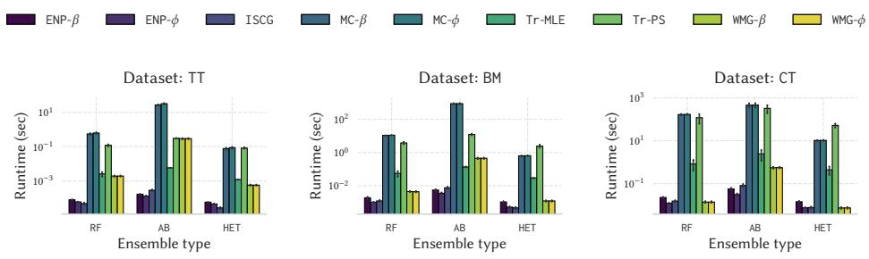
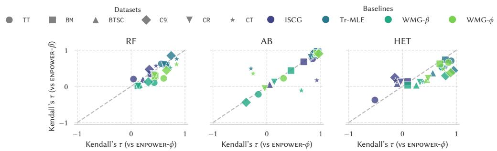
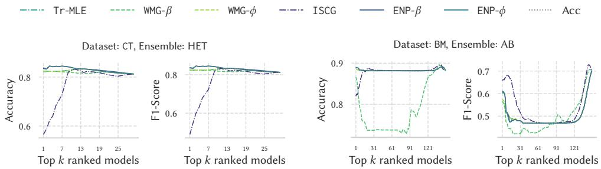
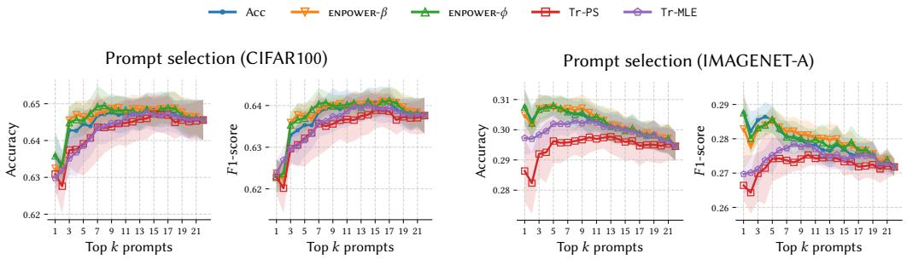
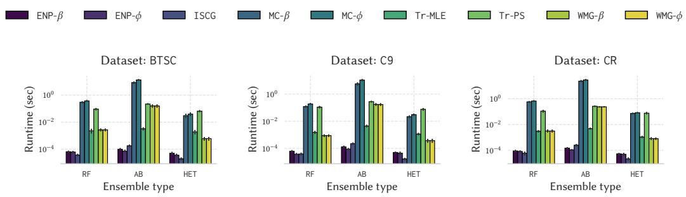
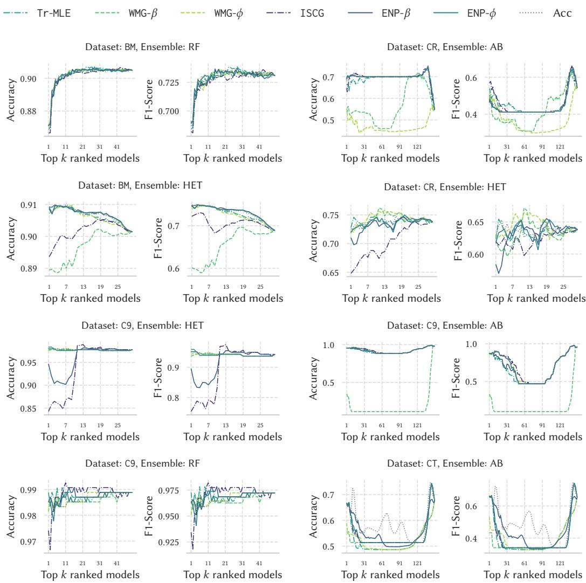
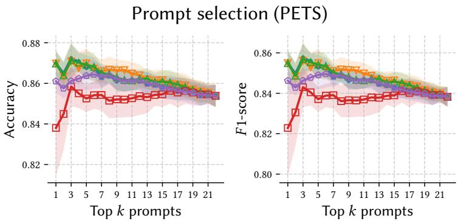
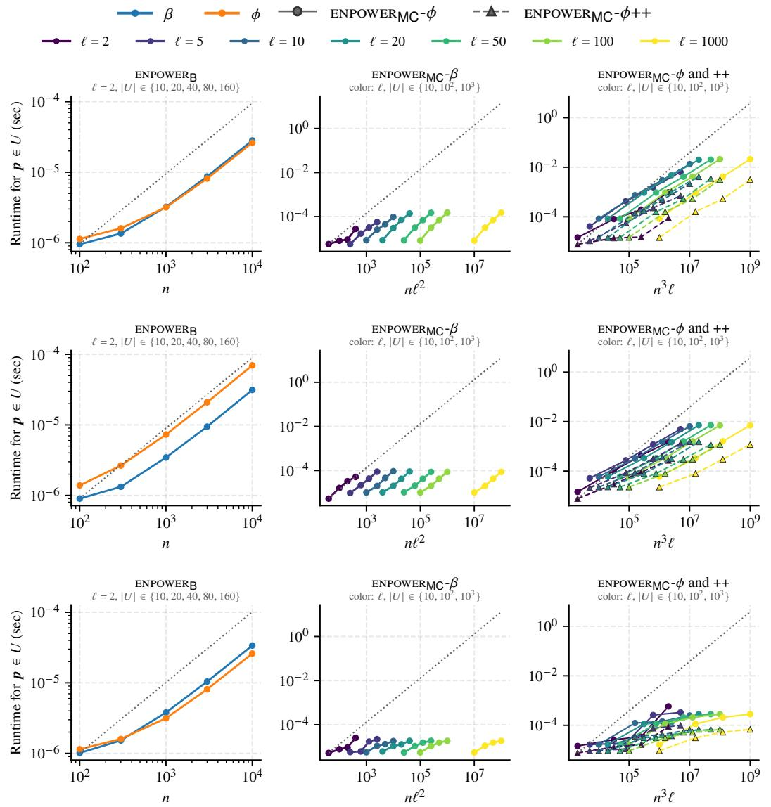

# Exact power indices for plurality-voting ensembles

Ilie Sarpe<sup>∗1†</sup> Theofanis Georgakopoulos<sup>∗2</sup> Aristides Gionis<sup>1,3</sup>

<sup>1</sup>KTH Royal Institute ofTechnology, Stockholm, Sweden <sup>2</sup>Ericsson BCSS, Stockholm, Sweden <sup>3</sup>Digital Futures, Stockholm, Sweden

## Abstract

Plurality-voting ensembles aggregate the predictions of multiple base classifiers and output the most voted class, with ties typically broken at random. Despite the simple aggregation rule, attributing the impact of each base classifier to the ensemble’s predictions is far from straightforward. That is, a single base classifier’s impact depends on how it interacts with the votes of all other classifiers in the ensemble, for example, in resolving ties, and not only on its own predictions. We address the attribution problem using established tools from cooperative game theory, studying the Banzhaf and Shapley power indices for new games modeling plurality voting and random tie-breaking, for binary and multiclass classification settings. Computing power indices is, in general, intractable. Surprisingly, our methods, collectively named ENPOWER, enable the exact computation of Banzhaf and Shapley values in linear time for the binary classification setting and in lowdegree polynomial time for the multiclass setting. The algorithms in ENPOWER rely on new combinatorial formulations of the Banzhaf and Shapley indices, yielding closed-form solutions for the binary case and ordinary generating function representations for the multiclass case. We validate empirically the methods in ENPOWER demonstrating their high applicability, providing attribution values not captured by existing methods. We apply the attribution of ENPOWER to: ensemble pruning and prompt-based ensembling of vision-language models.

## 1 Introduction

Ensemble methods, which combine the predictions of multiple base classifiers through a voting mechanism, are widely used in modern machine learning, as they achieve higher accuracy and robustness than individual models [37, 49]. Among the variety of aggregation rules [33], plurality voting—where the prediction corresponds to the most voted class, with ties broken uniformly at random—is a well-established scheme that applies directly to binary and multiclass classification and is used by many ensembles and popular software packages [24, 49].

Attribution is a central question for an ensemble, that is, quantifying how much each base classifier contributes to the ensemble’s predictions. Simple heuristics, such as leave-one-out accuracy or per-model performance, ignore the interactions among base models: such heuristics measure the contribution of a base classifier to a single sub-ensemble, i.e., the full or empty one, respectively, among the Θ(2<sup>n</sup>) sub-ensembles (where n corresponds to the number of base classifiers). For example, a single vote of a base classifier can modify the prediction of any sub-ensemble with a tie for the most voted class. Cooperative game theory addresses precisely this problem through power indices, in particular the Banzhaf value [3] and the Shapley value [38], uniquely characterized by natural axioms, faithfully capture the contribution of a player to the outcome of the game.

Computing power indices is intractable in general, involving a summation over an exponential number of coalitions, which we also refer to as sub-ensembles. Prior work has therefore resorted either to approximations [2, 36] or to restricted game classes, most prominently weighted majority games (WMGs) [42, 46]. However, these approaches do not capture plurality voting with random tie-breaking and cannot easily be applied to multiclass settings.

We first introduce a new game capturing plurality-voting ensembles with random tie-breaking. We then design ENPOWER, a collection of algorithms computing the exact Banzhaf and Shapley power indices of every base classifier in our game, for binary and multiclass classification. We consider base classifiers casting hard votes. Since our analysis considers only the votes of the base classifiers, our results are agnostic to the underlying models and apply to heterogeneous ensembles. The power indices we obtain can be used for many important applications such, ensemble pruning [19], data validation, and feature selection [16]. We first address the binary case, which differently from a WMG is not a simple game (i.e., a monotone game with values in {0, 1}) due to random tie-breaking. We obtain closed-forms for both power indices, computable in time ${ \mathcal { O } } ( | { \mathcal { D } } | n )$ , where |D| is the number of test points. We then provide a new algorithmic contribution for the multiclass case with ℓ classes, where existing games do not capture faithfully ensemble aggregation. We show how to compute exactly the Banzhaf values in time $\mathcal { O } ( | \mathcal { D } | n \ell ^ { 2 } )$ and the Shapley values in time $\mathcal { O } ( | \mathcal { D } | n ^ { 3 } \ell )$ , that is, polynomial in n and ℓ. We consider unweighted votes; extending ENPOWER to weighted plurality voting is non-trivial.

Our technical results exploit structural symmetries: base classifiers with identical votes yield the same contributions to the ensemble. In the binary case, this yields closed-form solutions for both power indices. In the multiclass case, we encode coalition counts via ordinary generating functions [13] with low degree, computed efficiently with dynamic programming. Our techniques build on previous methods using ordinary generating functions to compute power indices in WMGs [4]. We also discuss a variant of our dynamic programming approach for the Shapley values using fast polynomial multiplication, with a faster asymptotic time bound.

In our experimental evaluation we use the Banzhaf and Shapley values computed with ENPOWER on two applications: ensemble pruning [18, 25], and prompt-based ensembling of vision-language models [35], on a zero-shot image classification task. Our empirical study shows that ENPOWER is highly efficient in practice computing exact power indices in a few seconds on most instances, and produces attribution values that are not captured by existing methods, directly characterizing plurality-voting ensembles with random tie-breaking.

## 2 Related work

Ensembles combine predictions of base models using a voting mechanism [37]. Prior work has considered learning algorithms to obtain homogeneous or heterogeneous base models, e.g., through boosting, bagging, or stacking [33], and different aggregation rules to combine predictions of base models. Widely-adopted rules include averaging, majority voting, and plurality voting [49], which is the focus of our work.

Attribution is a key challenge in explainable AI [30], and power indices have been used extensively to assign values to individual models or features [26, 40, 44]. To the best of our knowledge, our work is the first to consider the attribution problem in plurality-voting ensembles with random tie-breaking, for both binary and multiclass settings.

Earlier work has mostly focused on computing power indices for ensembles under binary classification, building on results from classical cooperative game theory [7, 10] and weighted majority games (WMGs) [12, 14, 15]. Under unitary weights, power indices for WMGs can be computed in polynomial time [42], while recent contributions use techniques similar to ours [17]. However, as we discuss in Sec. A, WMGs cannot be used effectively in our setting.

Close to our work, Rozemberczki and Sarkar [36] study a game for ensembles of soft binary classifiers aggregated through a majority rule. They design an approximation algorithm using multilinear extensions to estimate Shapley values. Ykhlef and Bouchaffra [47] use a classical result by Deng and Papadimitriou [10] to model ensemble diversity through Shapley values, capturing, however, only pairwise relationships among base models and not matching the ensemble’s aggregation rule. Ykhlef and Bouchaffra [46] apply their diversity scoring to Banzhaf values computed over WMGs. In Sec. 5 we show that our exact methods are much faster than prior work [42, 47], and are comparable with the fastest approximate method by Rozemberczki and Sarkar [36]. Moreover, our algorithms yield new values not captured by existing methods. Our methods are specifically designed for multiclass settings, where prior work cannot be adapted; see Sec. A for details on additional related work.

## 3 Preliminaries

Let $\mathcal { C } = \{ C _ { 1 } , \ldots , C _ { n } \}$ be an ensemble of n classifiers, where each classifier $C \in { \mathcal { C } }$ corresponds to a function $C : \mathcal { X } \mapsto \mathcal { Y }$ from a domain $\mathcal { X }$ to a target label set $\mathcal { Y } = \{ y _ { 1 } , . . . , y _ { \ell } \}$ . We use $C ( x ) \in \mathcal { V }$ to denote the class assigned by $C$ to data point $x \in \mathcal { X }$ . We do not assume that classifiers come from the same model family, neither we require access to training data.

Our goal is to characterize the contribution of each classifier $C \in { \mathcal { C } }$ . Inspired by attribution methods in machine learning [16, 26, 41], we employ ideas from cooperative game theory.

Definition 3.1 ([7]). A characteristic function game (or simply game) G is given by a pair $( N , v )$ where $N = [ n ]$ is a finite non-empty set of players, and $v : 2 ^ { \dot { N } } \to \mathbb { R }$ is a characteristic function mapping each coalition $S \subseteq N$ to a value $v ( S )$

Power indices are used to capture the contribution of players in games by considering changes in the value of coalitions that the players participate. Two of the most popular indices, widely adopted in the literature and considered in this paper, are the Banzhaf and Shapley values, defined below.

Definition 3.2. Given a game $G = ( N , v )$ the Banzhaf value $\beta _ { i } ( G )$ (or simply $\beta _ { i }$ when the game G is clear) of player $i \in N$ and the Shapley value $\phi _ { i } ( G )$ (or simply ϕ<sub>i</sub>) are defined respectively $\mathrm { a s } , { } ^ { 1 }$

$$
\beta _ { i } \doteq \frac { 1 } { 2 ^ { n - 1 } } \sum _ { i \in S \subseteq N } \left( v ( S ) - v ( S - i ) \right) , \quad \phi _ { i } \doteq \sum _ { i \in S \subseteq N } \frac { ( n - | S | ) ! ( | S | - 1 ) ! } { n ! } \left( v ( S ) - v ( S - i ) \right)\tag{1}
$$

The Shapley values are the unique values that satisfy the following desirable properties: dummy $p l a y e r ,$ , symmetry, linearity, and efficiency (see Sec. B.1). The Banzhaf values satisfy all the above properties except efficiency. While Shapley values are the natural choice when the values must sum to $v ( N )$ , the Banzhaf values are more robust to noise and easier to estimate, making them preferable in stochastic or large-scale regimes [44].

Next, we define the characteristic function v for our setting. Given a data point $x \in \mathcal { X }$ and a coalition $S \subseteq { \mathcal { C } }$ , we let $p ( x , S ) \in \mathbb { Z } ^ { \ell }$ be a vote profile, where the j-th component corresponds to the number of classifiers from S voting for $y _ { j }$ . We simplify $\pmb { p } ( x , S ) \mathrm { t o } p ( S )$ or p when $x , S$ are clear from the context. We define the majority set of labels $\mathcal { M } ( \bar { x } , S ) = \{ y _ { j } \in \mathcal { V } : p _ { j } \geq p _ { i } , i \in [ \ell ] \}$ }, containing the labels receiving the most votes from the classifiers in the coalition $S \subseteq { \mathcal { C } }$

We now introduce characteristic function games that model how plurality voting ensembles with random tie-breaking are used in practice for (1) binary classification; and (2) multiclass classification.

Binary classification. For a data point $z = ( x , y ) \in \mathcal { X } \times \mathcal { Y }$ , with $\mathcal { V } = \{ 0 , 1 \}$ , and a coalition $S \subseteq { \mathcal { C } } , S \neq \emptyset$ , we consider the point-wise characteristic function game $G _ { z } = ( \mathcal { C } , v _ { \mathsf { B } } )$ with

$$
v _ { \mathsf { B } } ( z , S ) \doteq \left\{ \begin{array} { l l } { 1 , } & { \mathrm { ~ i f ~ } \{ y \} = \mathcal { M } ( S ) , } \\ { \frac { 1 } { 2 } , } & { \mathrm { ~ i f ~ } y \in \mathcal { M } ( S ) \mathrm { ~ a n d ~ } | \mathcal { M } ( S ) | = 2 , } \\ { 0 , } & { \mathrm { ~ o t h e r w i s e } . } \end{array} \right.\tag{2}
$$

We let $v _ { \mathsf { B } } ( z , \emptyset ) \doteq 0$ for technical purposes. In other words, for a data point $z = ( x , y )$ , the function $v _ { \mathsf { B } }$ assigns a score to each coalition ${ \overline { { S } } } \subseteq { \mathcal { C } }$ , which is: 1 if the majority of models in S correctly identify label y; 1/2 if there is a tie; and 0 if the majority of models in S make an incorrect prediction.

The game $G _ { z }$ is defined for a single data point z. For a test set $\mathcal { D } ,$ we define the game $G _ { \mathcal { D } }$ by averaging the point-wise values $v _ { \mathsf { B } } ( z , S ) , z \ \in \mathcal { D }$ , i.e., $\begin{array} { r } { v _ { \mathsf { B } } ( \mathcal { D } , S ) = \frac { 1 } { | \mathcal { D } | } \sum _ { ( x , y ) \in \mathcal { D } } v _ { \mathsf { B } } ^ { - } ( z , S ) } \end{array}$ . The Banzhaf and Shapley values satify linearity and an efficient computation of the values for $v _ { \mathsf { B } } ( z , S )$ implies efficient computation for the values for $v _ { \mathsf { B } } ( \mathcal { D } , S )$ . Thus, we focus on computing the Banzhaf and Shapley values of $G _ { z }$ for a single point z. We drop the first argument of v<sub>B</sub>, when clear from the context. It can be shown that $v _ { \mathsf { B } }$ does not feature standard properties enabling efficient computation.

Lemma 3.3. The characteristicfunction v ${ \mathsf { \mathsf { B } } } { \left( { z , \cdot } \right) } : 2 ^ { \mathcal { C } } \to \{ 0 , \frac { 1 } { 2 } , 1 \}$ is neither supermodular, nor superadditive, nor monotone.

All proofs can be found in Sec. C. Since $v _ { \mathsf { B } } ( z , \cdot )$ is not monotone and it can be $\textstyle { \frac { 1 } { 2 } }$ , our game is not a simple game (i.e., a monotone game with values in $\{ 0 , 1 \} )$ , in particular not a WMG (see Def. B.6). Therefore, we cannot use existing standard algorithms to compute the power indices for our formulation. From the previous lemma, one may think that exact computation of power indices for our new game is intractable. Surprisingly, we can show that both the Banzhaf and Shapley values can be computed efficiently, see Sec. 4.1.

Theorem 3.4. Let C be an ensemble of classifiers, D a test dataset, and $G _ { \mathcal { D } } = ( \mathcal { C } , v _ { \mathsf { B } } ( \mathcal { D } , \cdot ) )$ the characteristicfunction game over D. For all classifiers $C _ { i } \in \mathcal { C }$ the Banzhaf values $\beta _ { i } ( G _ { D } )$ and the Shapley values $\phi _ { i } ( G _ { D } )$ can be computed in linear-time complexity $\mathcal { O } ( | \mathcal { D } | n )$

The term $| \mathcal D |$ in the running time comes from averaging $\beta _ { i } ( G _ { z } )$ and $\phi _ { i } ( G _ { z } )$ over all $z \in \mathcal { D }$ to compute $\beta _ { i } ( G _ { D } )$ and $\phi _ { i } ( G _ { D } )$ . The linear term ${ \mathcal { O } } ( n )$ is the time needed to compute $\beta _ { i } ( G _ { z } )$ and $\phi _ { i } ( G _ { z } )$

Multiclass classification. We consider a set of labels $\mathcal { Y } = \{ y _ { 1 } , . . . , y _ { \ell } \}$ with $\ell > 2$ . For a single data point $z = ( x , y )$ , we define the game $G _ { z } = ( \mathcal { C } , v _ { \mathsf { M C } } )$ where $v _ { \mathsf { M C } } ( z , \emptyset ) \doteq 0$ and for $S \subseteq { \mathcal { C } } , S \neq \emptyset$ it is

$$
v _ { \mathsf { M C } } ( z , S ) \doteq \left\{ { \begin{array} { l l } { { \frac { 1 } { | { \mathcal { M } } ( S ) | } } , } & { { \mathrm { i f ~ } } y \in { \mathcal { M } } ( S ) , { \mathrm { ~ a n d } } } \\ { 0 , } & { { \mathrm { o t h e r w i s e } } . } \end{array} } \right.\tag{3}
$$

We then define the characteristic function for dataset D by $\begin{array} { r } { v _ { \mathsf { M C } } ( \mathcal { D } , S ) = \frac { 1 } { | \mathcal { D } | } \sum _ { ( x , y ) \in \mathcal { D } } v _ { \mathsf { M C } } ( z , S ) } \end{array}$ Clearly, the characteristic function $v _ { \mathsf { M C } }$ generalizes $v _ { \mathsf { B } }$ from Eq. (2).

To state our result in the multiclass case we need one additional definition. First, without loss of generality (simply by permuting the class labels), we will assume that for any data point $( x , y )$ it holds $y = y _ { 1 } \in \mathcal { V }$ . We let $n _ { j }$ be the number of classifiers predicting class $y _ { j } , j \in [ \ell ]$ for data point $( x , y )$ Finally, let $U = \{ p ( \Vec { x , \mathcal { C } } ) = ( n _ { 1 } , n _ { 2 } , . . . , n _ { \ell } ) : ( x , y \ ' ) \in \mathcal { D }$ and $n _ { 2 } \le \cdots \le \dot { n _ { \ell } } \bar { 1 }$ be the set of unique vote profiles, where $n _ { 1 }$ is the number of correct classifiers. Clearly, $| U | \leq | D |$ ; moreover, $| U | \leq n + 1$ for binary classification, since a profile is determined by $n _ { 1 }$ . In practice, |U| can be much smaller than |D| also in the multiclass case: when most classifiers are accurate, many points share their vote profile (see |U| in Table 2). We now state the generalization of Theorem 3.4 in the multiclass case.

Theorem 3.5. Let C be an ensemble ofclassifiers, D be a test dataset, and $G _ { \mathcal { D } } = ( \mathcal { C } , v _ { \mathsf { M C } } ( \mathcal { D } , \cdot ) )$ be the characteristicfunction game over D. For all classifiers $i \in [ n ]$ the Banzhafvalues $\beta _ { i } ( G _ { \mathcal { D } } )$ can be computed exactly in time $\mathcal { O } ( \vert U \vert n \ell ^ { 2 } + \vert \mathcal { D } \vert n )$ , and the Shapley values $\phi _ { i } ( G _ { D } )$ can be computed exactly in time $\mathcal { O } ( \vert \dot { U } \vert n ^ { 3 } \ell + \vert \mathcal { D } \vert \ddot { n } )$

## 4 Methods

We present our polynomial-time algorithms for exact computation of Banzhaf and Shapley values.   
All missing proofs are reported in Sec. C.

## 4.1 Binary classification

Intuition. As explained in the previous section, we focus on computing the Banzhaf and Shapley values $\beta _ { i } ( G _ { z } )$ and $\phi _ { i } ( G _ { z } )$ for a single data point z, and then average over all data in D to compute $\beta _ { i } ( G _ { D } )$ and $\phi _ { i } ( G _ { D } )$ . For each classifier $i \in \left[ n \right]$ the power indices $\bar { \beta } _ { i }$ and $\phi _ { i }$ are given by a weighed sum of the marginal gain $v _ { \mathsf { B } } ( S ) - v _ { \mathsf { B } } ( S - i )$ , over all coalitions $S \subseteq [ n ]$ with $i \in S$ . We observe that for a correct classifier, if $S - i \neq \emptyset$ then a non-zero marginal gain can only attain value $\textstyle { \frac { 1 } { 2 } } ;$ ; and a symmetrical argument applies to an incorrect classifier. Furthermore, a marginal gain of $\textstyle { \frac { 1 } { 2 } }$ is attained only in two cases, namely, (a) if the classifier i introduces a tie, in which case $v _ { \mathsf { B } } ( S - \bar { i } ) = 0$ and $\begin{array} { r } { v _ { \mathsf { B } } ( S ) = \frac { 1 } { 2 } ; } \end{array}$ or (b) if i breaks a tie, in which case $\begin{array} { r } { v _ { \mathsf { B } } ( S - i ) = \frac { 1 } { 2 } } \end{array}$ and $v _ { \mathsf { B } } ( S ) = 1$ . This key observation is formalized in Lemma C.1. Interestingly, given the special structure of the sets $S - i$ , we can compute efficiently the number of such coalitions through combinatorial arguments. In addition, by combining with symmetry arguments we obtain our efficient algorithms from Theorem 3.4.

We now show the closed-form solutions of the power indices.

Theorem 4.1 (Banzhaf). Let C be an ensemble, and $z = ( x , y ) \in \mathcal { D }$ be a test data point. Let $n _ { + } = | \{ C \in \mathcal { C } : C ( x ) = y \}$ be the number ofclassifiers in C that make a correct prediction $f o r z ,$ and $n _ { - } = n - n _ { + }$ the number ofclassifiers that make an incorrect prediction. For each $i \in [ n ]$ it is

$$
\beta _ { i } ( G _ { z } ) = \frac { 1 } { 2 ^ { n } } \left( { \binom { n } { n - } } + 1 \right) \ i f C _ { i } ( x ) = y , \quad \beta _ { i } ( G _ { z } ) = - \frac { 1 } { 2 ^ { n } } \left( { \binom { n } { n + } } - 1 \right) \ i f C _ { i } ( x ) \neq y\tag{4}
$$

Theorem 4.2 (Shapley). Under the same notation as in Theorem 4.1, for each $i \in [ n ]$ it is

$$
\phi _ { i } ( G _ { z } ) = \frac { 1 } { n } + \frac { T _ { + } } { 2 } \quad i f C _ { i } ( x ) = y , \quad \phi _ { i } ( G _ { z } ) = - \frac { T _ { - } } { 2 } \quad i f C _ { i } ( x ) \neq y ,\tag{5}
$$

where, if we let $\sigma \in \{ + , - \}$ and $\tau \in \{ + , - \}$ with $\sigma \neq \tau$ then

$$
T _ { \sigma } = { \frac { ( n - 2 n _ { \sigma } ) ! ( 2 n _ { \sigma } - 1 ) ! } { n ! } } { \binom { n _ { \sigma } } { n _ { \sigma } } } + \sum _ { h = 1 } ^ { \operatorname* { m i n } \{ n _ { \sigma } , n _ { \sigma } - 1 \} } { \binom { n _ { \sigma } - 1 } { h - 1 } } { \binom { n _ { \tau } } { h } } { \frac { ( n - 2 h - 1 ) ! ( 2 h - 1 ) ! } { n ! } } ( 2 n _ { \sigma } + n - 4 h ) ,
$$

where ${ \binom { m } { k } } = 0 ,$ , for any $k > m$ or $k < 0$

The proofs of Theorems 4.1 and 4.2 are given in Sec. C.3. The resulting approach is shown in Algorithm 1. It receives as input the power index $\psi \in \{ \phi , \beta \}$ to be computed, the trained ensemble ${ \mathcal { C } } ,$ and the test dataset $\mathcal { D } .$ The algorithm initializes $\psi _ { i } = 0 ,$ , for all $i \in [ n ]$ , and then iterates over all data points in $\mathcal { D } .$ For each data point $( x , y )$ , it computes $n _ { + }$ the number of classifiers that correctly predict the current label $y .$ . It uses $n _ { + }$ to compute $\psi _ { i }$ via a closed-form solution through subroutine Get\_ψ, the details of which are provided in Algorithm 2. The correctness of Algorithm 1 follows from Theorems 4.1 and 4.2 and the linearity of power indices.

To bound the time complexity we assume that evaluating the prediction $C ( x )$ of each classifier $C \in { \mathcal { C } }$ can be done in $\mathcal { O } ( 1 )$ time, and that each arithmetic operation takes $\mathcal { O } ( 1 )$ time.<sup>2</sup> The correctness of Theorem 3.4 and stated complexity follows immediately as a corollary of Theorems 4.1 to 4.3.

Theorem 4.3. Algorithm 1 computes the Banzhaf values $\psi _ { i } = \beta _ { i } ( G _ { D } )$ and the Shapley values $\psi _ { i } = \phi _ { i } ( G _ { D } )$ over the game $G _ { \mathcal { D } }$ in time $\mathcal { O } ( | \mathcal { D } | n )$ . The memory required is ${ \mathcal { O } } ( n )$

## 4.2 Multiclass classification

Intuition. Let $C _ { i }$ be a correct classifier; an analogous argument will apply to an incorrect classifier. Consider all coalitions $S \subseteq [ n ]$ containing i where $C _ { i }$ yields non-zero marginal contribution $v _ { \mathsf { M C } } ( S ) -$ $v _ { \mathsf { M C } } ( S - i )$ . These are the only coalitions that contribute to the power indices $\phi _ { i }$ or $\beta _ { i }$ . We characterize the structure of these coalitions and the exact marginal gain introduced by $C _ { i }$ in Lemma C.2. Since the multiclass setting introduces a much more complex structure, we cannot count these coalitions directly. Instead, we leverage ordinary generating functions [13, 17] (see Def. B.9).

Fix an integer $h \geq 1$ and consider coalitions of incorrect classifiers where no incorrect label receives more than h votes. We design a polynomial $P _ { h } ( t )$ with variable t, where the k-th coefficient $[ t ^ { k } ] P _ { h } ( t )$ is the number of coalitions in $S ( k , h ) , \mathrm { i . e . }$ , coalitions where exactly k incorrect labels receive h votes, and all remaining labels receive fewer than h votes (Lemma 4.4). To form a coalition in $S ( k , h )$ we select, independently for each incorrect label $y _ { j } , j \in [ 2 , \ell ]$ , either: (a) fewer than $h$ classifiers; or (b) exactly $\dot { h }$ of the $n _ { j }$ classifiers voting for $y _ { j } { \mathrm { : } }$ and case (b) holds for exactly k labels. There are $\begin{array} { r } { A _ { j } ( h ) = \sum _ { q = 0 } ^ { h - 1 } \binom { n _ { j } } { q } } \end{array}$ ways to select classifiers for case (a) and $\begin{array} { r } { B _ { j } ( h ) = \binom { n _ { j } } { h } } \end{array}$ ways to select classifiers for case (b). We multiply $B _ { j } ( h )$ by t, such that the exponent $k \geq 0$ of $t ^ { k }$ is the number of incorrect labels for case (b). This yields $\begin{array} { r } { P _ { h } ( t ) = \prod _ { j = 2 } ^ { \ell } ( A _ { j } ( h ) + B _ { j } ( h ) t ) } \end{array}$ of degree at most $\ell - 1$ with $[ t ^ { k } ] P _ { h } ( t ) = | S ( k , h ) |$ . We then show that the marginal gain of a correct classifier on a coalition formed by correct classifiers and a coalition in $\textstyle { \mathcal { S } } ( k , h )$ depends only on k and on whether there are $h - 1$ or h other correct classifiers (Lemma C.2). We use this result to obtain the Banzhaf value $\beta _ { i }$ for each correct classifier i by summing the marginal gains weighted by $[ t ^ { k } ] P _ { h } ( t )$ for $h \in \left\lceil n _ { 1 } \right\rceil$ and $k \in [ \ell - 1 ]$ (Theorem 4.6). Dividing $\bar { P _ { h } } ( t )$ by the factor $( A _ { j } ( h ) ^ { \smile } + B _ { j } ( \bar { h } ) \dot { t } )$ of label $y _ { j } ~ .$ yields $\beta _ { i }$ for all classifiers voting for $y _ { j } , j \in [ 2 , \ell ]$ (Corollary 4.5). Each $P _ { h } ( t )$ can be computed in $\mathcal { O } ( \ell ^ { 2 } )$ time.

On the other hand, the Shapley formula weights each coalition S by a function of its size |S|, while each coefficient $[ t ^ { k } ] P _ { h } ( t )$ counts coalitions of different sizes together. To fix this issue we rely on a bivariate polynomial $P _ { h } ( t , u )$ whose coefficient $[ t ^ { k } u ^ { m } ] P _ { h } ( t , u )$ is the number of coalitions in $S ( k , h )$ with exactly m classifiers (Lemma C.5). To do so, we track the size of the coalitions through a second variable u: (i) in case (a) above, selecting $q < h$ classifiers voting for $y _ { j }$ contributes $u ^ { q } ;$ while (ii) in case (b), selecting h classifiers contributes $t u ^ { h }$ . The degrees of $P _ { h } ( t , u )$ in t and u are at most $\ell - 1$ and $n ,$ respectively. We compute $P _ { h } ( t , u )$ by dynamic programming, and obtain the Shapley values by combining the coefficients of these polynomials over $h \geq 1$ as in the Banzhaf case. We also develop an algorithm based on fast polynomial multiplication in Sec. H.2.

Finally, for the computation of both Banzhaf and Shapley values, we heavily exploit symmetries to avoid redundant computations, achieving a highly-optimized algorithm in practice. We proceed to state our technical results; the proofs are given in Sec. C.

## 4.2.1 Computation of Banzhaf values in the multiclass setting

We first introduce the univariate polynomial we use to compute efficiently the Banzhaf values.

Lemma 4.4. Let $z = ( x , y )$ be a test data point. For any $h \geq 1$ , consider the generating function

$$
P _ { h } ( t ) = \prod _ { j = 2 } ^ { \ell } ( A _ { j } ( h ) + B _ { j } ( h ) t ) , w h e r e A _ { j } ( h ) = \sum _ { q = 0 } ^ { h - 1 } { \binom { n _ { j } } { q } } a n d B _ { j } ( h ) = { \binom { n _ { j } } { h } } .
$$

Fix $h \in [ n ]$ ] and $k \in [ \ell - 1 ]$ . Let $S ( k , h )$ be the set ofcoalitions $S \subseteq { \mathcal { C } } ^ { \prime }$ such that: $( i ) \mathcal { C } ^ { \prime } = \mathcal { C } \backslash \{ C \in \mathcal { C }$ $C ( x ) = y \} ; ( i i ) \ \lvert \mathcal { M } ( S ) \rvert = k ; ( i i i ) p _ { j } ( S ) = h f o r e a c h \ j \in \mathcal { M } ( S )$ . Then $| S ( k , h ) | = [ t ^ { k } ] P _ { h } ( t )$

In other words, the coefficients of $P _ { h } ( t )$ correspond to the number of sets $| S ( k , h )$ | that are used to obtain a closed-form solution for $\beta _ { i } ( \dot { G } _ { z } )$ , for all correct classifiers $C _ { i }$ . To obtain $\dot { \beta } ( G _ { z } )$ for all $C _ { i }$ voting for an incorrect label $y _ { j } \neq y _ { 1 }$ , we need to remove the contribution of classifiers voting for $y _ { j }$ from the sets in $S ( k , h )$ as specified by the next corollary.

Corollary 4.5. Under the setting of Lemma $4 . 4 ,$ fix $j \in \{ 2 , \dots , \ell \}$ , and let $\mathcal { S } _ { - j } ( k , h )$ be defined analogously to $S ( k , h )$ for coalitions $S \subseteq { \mathcal { C } } ^ { \prime } \backslash \{ { \bar { C } } \in { \bar { \mathcal { C } } } : { \dot { C } } ( x ) = y _ { j } \}$ . That is, no coalition S from $\mathscr { S } _ { - j } ( k , h )$ contains a classifier voting for class $y _ { j }$ . Then it holds that

$$
| S _ { - j } ( k , h ) | = [ t ^ { k } ] \frac { P _ { h } ( t ) } { A _ { j } ( h ) + B _ { j } ( h ) t } .
$$

We show how to use the coefficients of $P _ { h } ( t )$ to obtain a closed-form solution for $\beta _ { i } \mathrm { { ^ { s } } }$

Theorem 4.6. Let $z = ( x , y _ { 1 } ) \in \mathcal { D }$ be a test data point. Let $\begin{array} { r } { f _ { 1 } ( k , h ) = k \binom { n _ { 1 } - 1 } { h } + \binom { n _ { 1 } - 1 } { h - 1 } } \end{array}$ for any $k , h \geq 0$ and $\begin{array} { r l } { f _ { j } ( k , h ) = \binom { n _ { 1 } } { h } \left\lceil { \binom { n _ { j } - 1 } { h } + \frac { 1 } { k + 1 } \binom { n _ { j } - 1 } { h - 1 } } \right\rceil } \end{array}$ for any $k , h \geq 0$ and $j \in \{ 2 , \ldots , \ell \}$ . For any correct classifier $C _ { i }$ with $C _ { i } ( x ) = y _ { 1 }$ and any incorrect classifier $i ^ { \prime }$ with $C _ { i ^ { \prime } } ( x ) = y _ { j }$ it holds

$$
\begin{array} { r } { \beta _ { i } = \frac { 1 } { 2 ^ { n - 1 } } \left( 1 + \displaystyle \sum _ { h = 1 } ^ { n _ { 1 } } \displaystyle \sum _ { k = 1 } ^ { \ell - 1 } \frac { f _ { 1 } ( k , h ) } { k + 1 } [ t ^ { k } ] P _ { h } ( t ) \right) ~ a n d ~ \beta _ { i ^ { \prime } } = - \frac { 1 } { 2 ^ { n - 1 } } \displaystyle \sum _ { h = 1 } ^ { n _ { j } } \displaystyle \sum _ { k = 0 } ^ { \ell - 2 } \frac { f _ { j } ( k , h ) } { k + 2 } [ t ^ { k } ] \frac { P _ { h } ( t ) } { A _ { j } ( h ) + B _ { j } ( h ) } t . } \end{array}
$$

Theorem 4.6 has strong algorithmic implications: by computing the coefficients of polynomials $P _ { h } ( t )$ and $P _ { h } ( t ) / ( A _ { j } + B _ { j } ( t ) )$ ), for $j \in \left\{ 2 , \ldots , \ell \right\}$ and $h \geq 1$ , we can efficiently compute $\beta _ { i } ( G _ { z } )$ for all $i \in [ n ]$ and $z \in \mathcal { D }$ . We detail the entire procedure in Algorithm 3, which, in addition to the closed-form solutions of Theorem $4 . 6 ,$ , exploits symmetries to further reduce the time complexity.

Theorem 4.7. Algorithm 3 computes the exact Banzhafvalues $\beta _ { i } ( G _ { \mathcal { D } } )$ of the base classifiers of an ensemble C in the multiclass setting in time $\mathcal { O } ( | U | n \ell ^ { 2 } + \bar { | } \mathcal { D } | n )$ . The memory required is ${ \mathcal { O } } ( { \dot { \ell } } ( n + | { \dot { U } } | ) )$ ).

We can further reduce the complexity of computing $P _ { h } ( t )$ from $\mathcal { O } ( \ell ^ { 2 } )$ to $\mathcal { O } ( \ell \log \ell )$ by performing polynomial multiplication via the fast Fourier transform (FFT) algorithm, at the expense of higher constants and a more complex implementation. In practice, we find that our $\mathcal { O } ( \ell ^ { 2 } )$ solution is highly efficient, as shown in our experimental evaluation (e.g., see Table 5).

## 4.2.2 Computation of Shapley values in the multiclass setting

As already mentioned, we cannot use $P _ { h } ( t )$ to obtain the values of $\phi _ { i } ( G _ { z } )$ , since the k-th coefficient $[ t ^ { k } ] P _ { h } ( t )$ accounts for sets of different cardinality. To fix this issue, we design a bivariate ordinary generating function allowing us to keep track of the size of each set contributing to $S ( k , h )$ by partitioning it as $S ( k , h ) = \cup _ { m \geq 1 } S ( k , h , m )$ and requiring each set of $S ( k , h , m )$ to have cardinality m. We introduce our main result below, while we defer the detailed technical results to Sec. C.5.

For $h \geq 1$ and $j \in [ 2 , \ell ]$ , let $\begin{array} { r } { A _ { j } ( h ; u ) ~ \doteq ~ \sum _ { q = 0 } ^ { h - 1 } \binom { n _ { j } } { q } u ^ { q } , ~ B _ { j } ( h ; u ) ~ \doteq ~ \binom { n _ { j } } { h } u ^ { h } } \end{array}$ , and $P _ { h } ( t , u ) \stackrel { . } { = }$ $\begin{array} { r } { \prod _ { j = 2 } ^ { \ell } ( A _ { j } ( h ; u ) + B _ { j } ( h ; u ) t ) } \end{array}$ . The exponent of u will count the classifiers in a coalition, $\mathrm { i . e . }$ $[ t ^ { \bar { k } } u ^ { m } ] P _ { h } ( t , u ) = | S ( k , h , m ) |$ (see Lemma C.5). When $u = 1$ we recover $A _ { j } ( h ) , B _ { j } ( h )$ and $P _ { h } ( t )$ from Lemma 4.4. For ease of notation let $\begin{array} { r } { \eta ( a ) \doteq \frac { ( n - a ) ! ( a - 1 ) ! } { n ! } } \end{array}$ , for $1 \leq a \leq n$ . Furthermore, let

$$
f _ { 1 } ( k , h , m ) \doteq { \frac { 1 } { k + 1 } } \left( k { \binom { n _ { 1 } - 1 } { h } } \eta ( m + h + 1 ) + { \binom { n _ { 1 } - 1 } { h - 1 } } \eta ( m + h ) \right) { \mathrm { ~ a n d ~ } }
$$

$$
f _ { j } ( k , h , m ) \doteq \frac { 1 } { k + 2 } { \binom { n _ { 1 } } { h } } \left[ { \binom { n _ { j } - 1 } { h } } \eta ( m + 2 h + 1 ) + \frac { 1 } { k + 1 } { \binom { n _ { j } - 1 } { h - 1 } } \eta ( m + 2 h ) \right] , \ j \in [ 2 , \ell ] .
$$

By convention, a term with a zero binomial is $0 ,$ irrespective of the argument of $\eta ( \cdot )$

Theorem 4.8. Let $z = ( x , y ) \in \mathcal { D }$ be a test data point. For any classifier $C _ { i }$ making a correct prediction, $i . e . , C _ { i } ( x ) = y _ { 1 }$ , it holds that its Shapley value over $G _ { z }$ is given by

$$
\phi _ { i } ( G _ { z } ) = \frac { 1 } { n } + \sum _ { h = 1 } ^ { n _ { 1 } } \sum _ { k = 1 } ^ { \ell - 1 } \sum _ { m = k h } ^ { n - n _ { 1 } } f _ { 1 } ( k , h , m ) [ t ^ { k } u ^ { m } ] P _ { h } ( t , u ) .
$$

Furthermore, for any classifier $C _ { i }$ predicting an incorrect class $C _ { i } ( x ) = y _ { j } , j \in \{ 2 , \ldots , \ell \}$ it holds

$$
- \phi _ { i } ( G _ { z } ) = \sum _ { h = 1 } ^ { n _ { j } } \sum _ { k = 0 } ^ { \ell - 2 } \sum _ { m = h k } ^ { n - ( n _ { 1 } + n _ { j } ) } f _ { j } ( k , h , m ) [ t ^ { k } u ^ { m } ] \frac { P _ { h } ( t , u ) } { A _ { j } ( h ; u ) + B _ { j } ( h ; u ) t } .
$$

The above result implies that computing the coefficients of the polynomials $P _ { h } ( t , u )$ , with degrees bounded by $\ell - 1$ in t and $n - n _ { 1 }$ in $u ,$ enables a closed-form solution for $\phi _ { i }$ . To compute the coefficients of $P _ { h } ( t , u )$ we develop a dynamic-programming algorithm presented in Sec. D.

Theorem 4.9. Algorithm 4 computes the exact Shapley values $\phi _ { i } ( G _ { D } )$ ofthe base classifiers ofan ensemble C in the multiclass setting in time $\mathcal { O } ( \vert U \vert n ^ { 3 } \dot { \ell } + \dot { \vert } \mathcal { D } \vert n )$ . The memory required is ${ \mathcal { O } } ( { \dot { \ell } } ( n + | { \dot { U } } | ) )$

We further introduce ENPOWE ${ \mathsf { R } } _ { { \mathsf { M C } } ^ { - } } \phi { + + }$ , improving the above time complexity bound in Sec. H, which we evaluate in Sec. G.6. The underlying idea of such method is to reduce the size of the dynamic programming matrices used to evaluate Theorem 4.8, we defer to Sec. H for more details.

## 5 Experiments

We consider the following research questions: (Q1) evaluate the efficiency and scalability of EN-POWER; (Q2) compare the rankings produced by ENPOWER and existing methods; (Q3) investigate the use of the rankings of ENPOWER for ensemble pruning; and (Q4) use ENPOWER for prompt ensembling of vision models on a zero-shot learning classification task. We defer to Sec. G.6 for synthetic experiments validating the tightness of our time complexity bounds.

Algorithms. Our algorithms for exact computation are denoted by ENPOWER-ϕ and ENPOWER-β.

Binary classification. We consider the following baselines, described in detail in Sec. F.1: ISCG [47]; Tr-MLE [34]; Tr-PS [27]; and WMG [42]. These baselines are associated with games defined in prior work. We also consider MC-ϕ and MC-β: Monte-Carlo approximations with sample size set to $n ^ { 2 }$

Multiclass classification. We only show the scalability of ENPOWER (see Table 5), as all other methods, with the exception of ISCG, are not applicable to the multiclass setting, or have very high runtime. We show an application of the output of ENPOWER for the multiclass setting in Sec. 5.4. For the prompt-ensembling of Sec. 5.4 we also consider Tr-MLE and Tr-PS, which we apply through a “correct-versus-rest” reduction detailed in Sec. F.3.

Setup. Details on our experimental setup are in Sec. $\mathrm { F . } ^ { 3 }$ on six popular datasets from the UCI repository (see Sec. F.1). For each dataset we obtain a 75/15/10 split of the data, where $7 5 \%$ is used for training, 15% for computing the power indices, and 10% as test data for the experiments on sub-ensemble selection, see also Sec. F. Baselines Tr-MLE and $\mathtt { T r } \mathtt { P S }$ are from [36]. Unless otherwise stated we considered five random (seeded) splits of each dataset, processed as detailed above, and our metrics are averaged over such instances. We then execute each method once per split. Except for MC and Tr-PS all other methods are deterministic.

  
Figure 1: Runtime (mean and standard deviation) on our largest datasets, binary classification.

  
Figure 2: For each pair (dataset, baseline) encoded by a pair (shape, color), we display the Kendall’s τ with respect to the exact rankings obtained by ENPOWER-ϕ and ENPOWER-β on the x-axis, and y-axis respectively, averaged over five splits. Each plot corresponds to a different ensemble.

Ensembles. We consider three different ensembles (i) RF: a random forest with $n = 5 0$ trees; (ii) AB: an ensemble built with AdaBoost containing $n = 1 5 0$ models; and (iii) HET: and heterogeneous ensemble containing $n = 3 0$ models, 10 decision trees and 5 of each of the remaining types: SVMs, logistic regressors, gradient boosting, and multi layer perceptrons. See Sec. F for more details.

## 5.1 Efficiency and scalability

We start with answering Q1. The results are reported in Figure 1 and Figure 6. ENPOWER methods are among the fastest for binary classification. Even on the largest datasets, where the sampling methods Tr-PS and MC require up to hundreds and thousands of seconds, respectively, ENPOWER methods terminate in less than one second, as captured by Theorem $4 . 3 .$ . The exact method WMG is also very efficient, however it requires between one and three orders of magnitude more time than ENPOWER on AB, note that such configuration has the largest number of base classifiers $( n = 1 5 0 )$ In fact, the dynamic program of Uno [42] has a cost at least quadratic in n for each game of U, while Algorithm 1 evaluates a closed form. ISCG has a comparable runtime to ENPOWER, however it does not faithfully capture plurality voting ensembles (see Sec. 5.2 and Sec. F.3). Finally, Tr-MLE is more than one order of magnitude slower compared to ENPOWER on our largest datasets, while providing only approximate solutions. The runtimes of ENPOWER for the multiclass setting are reported in Table 5, where we observe a high runtime for computing Shapley values on our largest dataset (CT) on ensemble AB with $n = 1 5 0$ due to the $\mathcal { O } ( n ^ { 3 } )$ term in the complexity. We would like to remind, however, that our method is the first specifically tailored to solve the multiclass case.

## 5.2 Comparison of rankings of base classifiers

Next, we consider Q2. We compare the rankings of the base classifiers produced by ENPOWER and the baselines using Kendall’s τ . We recall, that rankings are used for different applications, including ensemble pruning, data validation, and interpretability. We report the results in Figure 2.

  
Figure 3: Generalization metrics for sub-ensemble selection, averaged over five random splits.

We first observe that ISCG has low ranking correlation with ENPOWER on RF and HET, and a high correlation on AB, except on BTSC. Similarly, except for few instances, the correlations of WMG-β and ENPOWER-β do not exceed 0.5. Interestingly, WMG-ϕ exhibits slightly higher correlations with ENPOWER-ϕ. Finally, there is quite high correlation $( > 0 . 5 )$ among the rankings of ENPOWER-ϕ and Tr-MLE, despite the latter being approximate and on a different game, with the exception of CT on AB.

We note that the correlation values are particularly dependent on the baseline considered. Tr-MLE has $\tau > 0 . 5$ with ENPOWER-ϕ on most configurations except CT on AB. In contrast, baselines WMG and ISCG range from negative correlation to values above 0.9 for a fixed ensemble and different datasets. For example, the value of τ between WMG-β and ENPOWER-ϕ on AB is below −0.3 and above 0.8, on datasets C9 and BTSC, respectively. In summary, we observe that ENPOWER provides rankings that are not fully captured by previous methods, providing a unique characterization of plurality-voting ensembles with random tie-breaking.

## 5.3 Sub-ensemble selection

We now consider Q3. Given an ensemble C and a ranking of its base classifiers, we assess the generalization of the sub-ensemble obtained by retaining the top-k classifiers. We use rankings according to ENPOWER and the baselines. We additionally include a baseline ranking base classifiers by their individual accuracy on $\mathcal { D } _ { \mathrm { v a l } } .$ , denoted as ACC. For each sub-ensemble we evaluate its accuracy and (macro) $F _ { \mathrm { 1 } } { \mathrm { - s c o r e } }$ . We compute the rankings of all methods on $\mathcal { D } _ { \mathrm { v a l } }$ , and both metrics on $\mathcal { D } _ { \mathrm { t e s t } } ,$ , of the same split. Classifiers with equal values are ordered by increasing index $C _ { i } , i \in [ n ]$ . We vary the parameter k in [n]. The predictions of a sub-ensemble are obtained by plurality voting with random tie-breaking, i.e., the voting rule of $v _ { \mathsf { B } }$ . That is, for a test point where the two classes receive the same number of votes we draw the prediction uniformly at random. We compute both metrics on the resulting predictions, and report their mean over the five random splits.

We show some representative results in Figure 3 (see Sec. G.4 for an extended discussion). We observe that sub-ensembles produced with rankings by ENPOWER are often among those with the largest accuracy and $F _ { \mathrm { 1 } } { \mathrm { - s c o r e } }$ . For example, on CT with HET, ENPOWER matches or outperforms all baselines for all values of k; on BM with AB, ENPOWER matches ACC for all values of k, while the accuracy of WMG-β is much lower than that of all other methods for intermediate values of k. Interestingly, on the same configuration, ISCG attains a higher $F _ { 1 }$ -score for small values of k. To answer Q3, while our methods are not directly optimized for sub-ensemble selection, they can provide a valuable contribution in addition to existing methods, given their high practical applicability.

## 5.4 Large vision model prompt ensembling

Last, we consider Q4. Recall that prompt ensembling is an LLM-engineering technique used to improve performance on tasks such as zero-shot image classification [35]. Here, we select $n = 2 2$ general-purpose prompt templates, which act as our models; see Table 11. For each image in the input dataset we first compute its normalized embedding using CLIP, obtaining $\scriptstyle { \mathbf { x } } _ { \mathrm { i m g } }$ . Then we proceed as follows: (i) we instantiate each prompt template $i \in [ n ]$ with the ℓ possible classes, obtaining prompts $S _ { 1 } ^ { i } , \ldots , S _ { \ell } ^ { i } ; ( i i )$ we use CLIP to compute the normalized embedding of each of the prompts obtaining vectors $\pmb { v } _ { 1 } ^ { i } , \dotsc , \pmb { v } _ { \ell } ^ { i } ; ( i i i )$ we compute the dot products $\pmb { x } _ { \mathrm { i m g } } \cdot \pmb { v } _ { j } ^ { i } ; ( i v )$ we select the class $j ^ { * } ( i ) = \arg \operatorname* { m a x } _ { j } \pmb { x } _ { \mathrm { i m g } } \cdot \pmb { v } _ { j } ^ { i }$ as vote for model $i \in [ n ] ; ^ { 4 }$ (v) the final predictions of the ensemble are evaluated according to plurality voting with random tie-breaking. We split each dataset in half obtaining $\mathcal { D } _ { \mathrm { v a l } }$ and $\mathcal { D } _ { \mathrm { t e s t } }$ (over five random splits). We use $\mathcal { D } _ { \mathrm { v a l } }$ to compute the rankings of the models according to three different algorithms: ACC: ranking prompts by raw accuracy, a common practice for LLM engineering; ENPOWER-β and ENPOWER-ϕ: ranking using our definitions of β and ϕ for the multiclass setting. We also rank prompts with Tr-MLE and Tr-PS (see Sec. F.3). The resulting rankings are reported in Tables 9 to 11. Finally, we use $\mathcal { D } _ { \mathrm { t e s t } }$ of each split to evaluate the accuracy and F -score on the sub-ensemble obtained by retaining only the top-k models, for $k \in \{ 1 , \ldots , n \}$

  
Figure 4: Accuracy and F<sub>1</sub>-score test metrics for the prompt ensembling of CLIP on $\mathcal { D } _ { \mathrm { t e s t } }$ (see Sec. 5.4), for varying k. We report mean and standard deviation (over multiple splits).

We report the result for the CIFAR and IMAGENET-A datasets in Figure 4, the missing dataset is in Sec. G.5, and the best and average metrics over k in Table 7. We observe that the sub-ensembles obtained through the rankings computed by ENPOWER attain a higher accuracy and $F _ { \mathrm { 1 } } { \mathrm { - s c o r e } }$ than the ones of Tr-MLE and Tr-PS, for the best k and on average over all $k \in [ n ]$ , on all three datasets. Importantly, Tr-MLE and Tr-PS not accounting for how incorrect models for the $\ell - 1$ incorrect labels, differently from our game v (see Secs. A and F.3). Furthermore the selection of ENPOWER matches or improves also over the baseline ACC. We also note that in general, the best performing ensembles $( k \in [ 1 , 1 7 ]$ , see Table 7) have smaller sizes than the full ensemble of $n = 2 2$ prompts. Highlighting that using a larger set of prompts to classify challenging images often yields less accurate predictions. Our results suggest that the Banzhaf and Shapley values computed by ENPOWER can be used to improve the predictive power of vision models under prompt ensembling. Another interesting application is enhancing vision model interpretabilty by comparing the rankings of the prompts across different methods, as shown in Tables 9 to 11, for which we defer to the discussion in Sec. G.5.

## 6 Conclusions

We introduce new characteristic function games modeling the predictions of models in pluralityvoting ensembles with random tie-breaking, in binary and multiclass settings. We then design new exact polynomial-time algorithms, named collectively as ENPOWER, to compute the Banzhaf and Shapley values of the models in the ensemble. Our algorithms are based on non-trivial combinatorial identities, and the use of ordinary generating functions for the multiclass case. We show in practice that the indices obtained by ENPOWER: (i) are extremely efficient to compute and are not captured by previous methods; (ii) can be applied to ensemble pruning and LLM prompt ensembling with remarkable results. Interesting future directions include: (i) use our indices for data validation; (ii) study other popular power indices under our new game.

## Acknowledgments and Disclosure of Funding

The authors declare no competing interests that could create a conflict of interest. This research was supported by the Swedish Research Council project ExCLUS (2024-05603), the Marie Curie Doctoral Training Network ARMADA (101168951), and the Wallenberg AI, Autonomous Systems and Software Program (WASP) funded by the Knut and Alice Wallenberg Foundation. Computational resources were provided on the Berzelius system funded by the Knut and Alice Wallenberg foundation and operated by NAISS.

## References

[1] R. Amer, F. Carreras, and A. Magaña. The Banzhaf–Coleman index for games with r alternatives. Optimization, 44(2):175–198, January 1998. ISSN 1029-4945. doi: 10.1080/ 02331939808844407.

[2] Yoram Bachrach, Evangelos Markakis, Ezra Resnick, Ariel D Procaccia, Jeffrey S Rosenschein, and Amin Saberi. Approximating power indices: theoretical and empirical analysis. Autonomous Agents and Multi-Agent Systems, 20(2):105–122, 2010.

[3] John F Banzhaf III. Weighted voting doesn’t work: A mathematical analysis. Rutgers Law Review, 19(2):317–343, 1964.

[4] J. M. Bilbao, J. R. Fernández, A. Jiménez Losada, and J. J. López. Generating functions for computing power indices efficiently. Top, 8(2):191–213, December 2000. ISSN 1863-8279. doi: 10.1007/bf02628555.

[5] E. M. Bolger. A characterization of an extension of the banzhaf value to multicandidate voting games. SIAM Journal on Discrete Mathematics, 3(4):466–477, November 1990. ISSN 1095-7146. doi: 10.1137/0403040.

[6] A. Bostan, G. Lecerf, and É. Schost. Tellegen’s principle into practice. In Proceedings of the 2003 international symposium on Symbolic and algebraic computation, ISSAC03, pages 37–44. ACM, August 2003. doi: 10.1145/860854.860870.

[7] Georgios Chalkiadakis, Edith Elkind, and Michael Wooldridge. Computational Aspects of Cooperative Game Theory. Springer International Publishing, 2012. ISBN 9783031015588. doi: 10.1007/978-3-031-01558-8.

[8] Vincent C. H. Chua, C. H. Ueng, and H. C. Huang. A method for evaluating the behavior of power indices in weighted plurality games. Social Choice and Welfare, 19(3):665–680, 2002. ISSN 1432-217X. doi: 10.1007/s003550100144.

[9] Shay Cohen, Gideon Dror, and Eytan Ruppin. Feature selection via coalitional game theory. Neural Computation, 19(7):1939–1961, 2007. ISSN 1530-888X. doi: 10.1162/neco.2007.19.7. 1939.

[10] Xiaotie Deng and Christos H. Papadimitriou. On the complexity of cooperative solution concepts. Mathematics ofOperations Research, 19(2):257–266, 1994. ISSN 1526-5471.

[11] Thomas G. Dietterich. Ensemble Methods in Machine Learning, pages 1–15. Springer Berlin Heidelberg, 2000. ISBN 9783540450146. doi: 10.1007/3-540-45014-9\_1.

[12] Alican Dogan and Derya Birant. A weighted majority voting ensemble approach for classification. In 4th International Conference on Computer Science and Engineering (UBMK), pages 1–6. IEEE, 2019. doi: 10.1109/ubmk.2019.8907028.

[13] Philippe Flajolet and Robert Sedgewick. Analytic Combinatorics. Cambridge University Press, 4 edition, 2013. ISBN 9780521898065.

[14] Harris Georgiou, Michael Mavroforakis, and Sergios Theodoridis. A Game-Theoretic Approach to Weighted Majority Voting for Combining SVM Classifiers, pages 284–292. Springer Berlin Heidelberg, 2006.

[15] Harris V. Georgiou and Michael E. Mavroforakis. A game-theoretic framework for classifier ensembles using weighted majority voting with local accuracy estimates, 2013.

[16] Amirata Ghorbani and James Zou. Data shapley: Equitable valuation of data for machine learning. In International Conference on Machine Learning, pages 2242–2251. PMLR, 2019.

[17] Naonori Kakimura and Yoshihiko Terai. Computing power indices in weighted majority games with formal power series. In International Conference and Workshops on Algorithms and Computation, pages 323–336, 2026.

[18] Zardad Khan, Naz Gul, Nosheen Faiz, Asma Gul, Werner Adler, and Berthold Lausen. Optimal trees selection for classification via out-of-bag assessment and sub-bagging. IEEE Access, 9: 28591–28607, 2021.

[19] Vrushali Y Kulkarni and Pradeep K Sinha. Pruning of random forest classifiers: A survey and future directions. In 2012 International Conference on Data Science & Engineering (ICDSE), pages 64–68, 2012.

[20] Ludmila I. Kuncheva and Christopher J. Whitaker. Measures of diversity in classifier ensembles and their relationship with the ensemble accuracy. Machine Learning, 51(2):181–207, 2003. ISSN 1573-0565.

[21] Sascha Kurz, Alexander Mayer, and Stefan Napel. Weighted committee games. European Journal ofOperational Research, 282(3):972–979, May 2020. ISSN 0377-2217. doi: 10.1016/j. ejor.2019.10.023.

[22] Sascha Kurz, Alexander Mayer, and Stefan Napel. Influence in weighted committees. European Economic Review, 132:103634, February 2021. ISSN 0014-2921. doi: 10.1016/j.euroecorev. 2020.103634.

[23] Nan Li, Yang Yu, and Zhi-Hua Zhou. Diversity Regularized Ensemble Pruning, pages 330–345. Springer Berlin Heidelberg, 2012. ISBN 9783642334603.

[24] Andy Liaw and Matthew Wiener. Classification and regression by randomforest. R News, 2(3): 18–22, 2002. URL https://CRAN.R-project.org/doc/Rnews/.

[25] Zhenyu Lu, Xindong Wu, Xingquan Zhu, and Josh Bongard. Ensemble pruning via individual contribution ordering. In Proceedings of the 16th ACM SIGKDD international conference on Knowledge discovery and data mining, pages 871–880. ACM, 2010. doi: 10.1145/1835804. 1835914.

[26] Scott M Lundberg and Su-In Lee. A unified approach to interpreting model predictions. Advances in neural information processing systems, 30, 2017.

[27] Sasan Maleki, Long Tran-Thanh, Greg Hines, Talal Rahwan, and Alex Rogers. Bounding the estimation error of sampling-based shapley value approximation, 2013.

[28] Tomomi Matsui and Yasuko Matsui. A survey of algorithms for calculating power indices of weighted majority games. Journal ofthe Operations Research Society ofJapan, 43(1):71–86, 2000. ISSN 2188-8299. doi: 10.15807/jorsj.43.71.

[29] Alexander Mayer and Stefan Napel. Weighted scoring committees. Games, 12(4):94, December 2021. ISSN 2073-4336. doi: 10.3390/g12040094.

[30] Dang Minh, H. Xiang Wang, Y. Fen Li, and Tan N. Nguyen. Explainable artificial intelligence: a comprehensive review. Artificial Intelligence Review, 55(5):3503–3568, 2021. ISSN 1573-7462.

[31] Rory Mitchell, Joshua Cooper, Eibe Frank, and Geoffrey Holmes. Sampling permutations for shapley value estimation. Journal ofMachine Learning Research, 23(43):1–46, 2022.

[32] Michael Mitzenmacher and Eli Upfal. Probability and computing. Cambridge University Press, 2017.

[33] Ammar Mohammed and Rania Kora. A comprehensive review on ensemble deep learning: Opportunities and challenges. Journal ofKing Saud University - Computer and Information Sciences, 35(2):757–774, 2023. ISSN 1319-1578.

[34] Guillermo Owen. Multilinear extensions of games. Management Science, 18(5-part-2):64–79, 1972. ISSN 1526-5501.

[35] Alec Radford, Jong Wook Kim, Chris Hallacy, Aditya Ramesh, Gabriel Goh, Sandhini Agarwal, Girish Sastry, Amanda Askell, Pamela Mishkin, Jack Clark, et al. Learning transferable visual models from natural language supervision. In International conference on machine learning, pages 8748–8763. PmLR, 2021.

[36] Benedek Rozemberczki and Rik Sarkar. The Shapley value of classifiers in ensemble games. In Proceedings of the 30th ACM International Conference on Information & Knowledge Management, CIKM ’21, pages 1558–1567. ACM, October 2021. doi: 10.1145/3459637. 3482302.

[37] Omer Sagi and Lior Rokach. Ensemble learning: A survey. WIREs Data Mining and Knowledge Discovery, 8(4), 2018. ISSN 1942–4795.

[38] Lloyd S. Shapley. A value for n-person games. Princeton University Press, 1953.

[39] Lloyd S Shapley. Cores of convex games. International Journal of Game Theory, 1(1):11–26, 1971.

[40] Erik Štrumbelj and Igor Kononenko. An efficient explanation of individual classifications using game theory. The Journal of Machine Learning Research, 11:1–18, 2010.

[41] Erik Štrumbelj and Igor Kononenko. Explaining prediction models and individual predictions with feature contributions. Knowledge and information systems, 41(3):647–665, 2014.

[42] Takeaki Uno. Efficient Computation of Power Indices for Weighted Majority Games, pages 679–689. Springer Berlin Heidelberg, 2012. ISBN 9783642352614. doi: 10.1007/ 978-3-642-35261-4\_70.

[43] Joachim von zur Gathen and Jürgen Gerhard. Modern Computer Algebra. Cambridge University Press, April 2013. ISBN 9781139856065. doi: 10.1017/cbo9781139856065.

[44] Jiachen T Wang and Ruoxi Jia. Data Banzhaf: A robust data-valuation framework for machine learning. In International conference on artificial intelligence and statistics, pages 6388–6421. PMLR, 2023.

[45] Danny Wood, Tingting Mu, Andrew M. Webb, Henry W. J. Reeve, Mikel Luján, and Gavin Brown. A unified theory of diversity in ensemble learning. Journal of Machine Learning Research, 24(1), 2023.

[46] Hadjer Ykhlef and Djamel Bouchaffra. An efficient ensemble pruning approach based on simple coalitional games. Information Fusion, 34:28–42, 2017. ISSN 1566-2535.

[47] Hadjer Ykhlef and Djamel Bouchaffra. Induced subgraph game for ensemble selection. International Journal on Artificial Intelligence Tools, 26(1), 2017. ISSN 1793-6349.

[48] Yi Zhang, Samuel Burer, W Nick Street, Kristin P Bennett, and Emilio Parrado-Hernández. Ensemble pruning via semi-definite programming. Journal of machine learning research, 7(7), 2006.

[49] Zhi-Hua Zhou. Ensemble Methods, Foundations and algorithms. Chapman and Hall/CRC machine learning and pattern recognition. Chapman and Hall CRC, second edition, 2025. ISBN 1040307663.

## Limitations

We now list the major limitations and assumptions of our work.

• our methods are only applicable to ensembles constituting of base models that provide a hard classification;

• there are inputs for which our methods do not match baseline methods; we describe such behavior in Sec. 5 and discuss the related trade-offs. For example, on ensemble sub-selection, our methods may achieve high accuracy but low F<sub>1</sub>-score, or vice-versa. To support our findings we provide additional results in Sec. G.

• we force each base classifier to provide a hard classification for our experiment regarding prompt ensembling in Sec. 5.4, to fit our framework. We remark that the original work of [35] used soft votes.

## LLM usage

Large language models (LLMs) were used to assist portions of this research and manuscript preparation. In particular, LLMs were used to:

• assist with proofreading and improving presentation;

• help explore proof ideas and check edge cases;

• assist with implementation and debugging;

• support data analysis and visualization;

• assist with literature exploration.

All technical results, proofs, experiments, and conclusions were verified by the authors, who assume full responsibility for the content of the manuscript.

A Extended discussion on related work 16   
B Background 17   
B.1 Cooperative game theory 17   
B.2 Combinatorics . 17   
C Proofs of main results 18   
C.1 Auxiliary technical results 18   
C.2 Proofs of Sec. 3 19   
C.3 Proofs of Sec. 4.1 20   
C.4 Proofs of Sec. 4.2.1 23   
C.5 Proofs of Sec. 4.2.2 26   
D Pseudocode 29   
D.1 Binary classification . 29   
D.2 Multiclass classification . 29   
E Efficient and numerically stable implementation 32   
F Reproducibility 34   
F.1 Setup 34   
F.2 Datasets 36   
F.3 Baselines 37   
G Additional experimental results 39   
G.1 Monte-Carlo approximation 39   
G.2 Runtime of ENPOWER <sub>C</sub> 40   
G.3 Accuracy of the base classifiers 40   
G.4 Ensemble sub-selection 41   
G.5 CLIP prompt ensembling 42   
G.6 Synthetic experiments . 42   
H A refined multiclass Shapley value computation 47   
H.1 ENPOWER<sub>MC</sub>-ϕ++: an improved algorithm . 48   
H.2 A fast polynomial multiplication-based algorithm 53

## A Extended discussion on related work

The generalization of an ensemble is characterized by a bias-variance-diversity complexity trade-off that must be considered during learning [11, 20]. Diversity, which informally captures correlations among the models’ predictions, requires a careful balancing as it directly impacts bias and variance [45]. Diversity motivates the need for ensemble pruning [23, 25], an active area of research [19, 48], which aims at selecting a sub-ensemble with better generalization performance, reducing significantly the size of the full ensemble and controlling the bias-variance-diversity tradeoff. Our methods provide a valuable addition to existing pruning techniques (as we show in Sec. 5), especially given the efficiency of ENPOWER and the fact that we our methods are model-agnostic. We defer to dedicated textbooks and surveys for more details [37, 49].

Weighted majority games (WMGs) have been studied extensively in the literature, and under unitary weights, power indices for WMGs can be computed in polynomial time [17, 42]. However, as we discuss below, WMGs do not capture our setting. First, we recall that a WMG is a simple game, i.e., a monotone game in which coalitions are rewarded with values that are either 0 or 1, and that its quota, which is necessary for achieving a majority, isfixed in advance (see Def. B.6). Consider an ensemble $\mathcal { C }$ with unitary weights, as in our setting, and a quota $q \in [ n ]$ ]. Given a model $i \in [ n ]$ and a coalition $S$ such that ${ \bar { i } } \notin S ,$ , the marginal contribution $\bar { v ( S + i ) } - \bar { v ( S ) }$ is nonzero if and only if $| S | = q - 1$ . That is, the Shapley and Banzhaf values of model $i \in [ n ]$ in a WMG depend only on the coalitions of size $q - 1$ . For example, under the majority quota $q = \lfloor n / 2 \rfloor + 1$ , no coalition with fewer than $\lfloor n / 2 \rfloor$ classifiers contributes to the power indices of the models. In our experiments, we rank the models by their power indices and retain the top-k models, for every $k \in [ \bar { n } ]$ (see Sec. 5). When $k < \lfloor n / 2 \rfloor$ , the power indices of a WMG ignore every coalition of size at most k. In contrast, under our game, the power indices can depend on coalitions of any size (see Lemma C.1).

Furthermore, most of the existing game formulations on which prior work is based, including the works by Rozemberczki and Sarkar [36], Uno [42] and Ykhlef and Bouchaffra [46] cannot be adapted to the multiclass setting without incurring high computational cost and loss in information. The reason is that typical approaches define $\bar { \mathcal { O } } ( \ell )$ binary games and aggregate the indices over all pairs retaining the correct label, or all possible pairs solving $\mathcal { O } ( \ell ^ { 2 } )$ binary games. Despite being inefficient, this approach does not capture how the predictions for different classes interact with each other, as it is done by our definition of $v _ { \mathsf { M C } }$ . Note that the work by Ykhlef and Bouchaffra [47] is the only method applicable for the multiclass setting, which however does not model accurately how the base models interact over the final ensembles’ predictions. That is, the work of [47] assumes that classifiers correspond to nodes on a clique $Q ,$ and the characteristic function for a subset S of models is proportional to the weighted volume of the induced subgraph $Q [ S ]$ , using the classical result from Deng and Papadimitriou [10] (see also Sec. F.3). This differs significantly from aggregation mechanisms used in ensemble models.

Finally, the rule underlying our characteristic function $v _ { \mathsf { M C } }$ , i.e., plurality voting with tie-breaking, has been studied in social choice. Bolger [5] and Amer et al. [1] extend the Banzhaf index to games with r alternatives (here $r = \ell )$ Their characteristic function is defined on the partitions of the players into r groups, one per alternative. The marginal contribution of a player $p$ corresponds to the variation in the value of the characteristic function when the vote of $p$ moves from one group to another. The resulting power index evaluates the marginal contributions over the partitions of $[ n ]$ , of which there are up to $\ell ^ { n }$ , instead of over the $2 ^ { n }$ coalitions considered in our work. Note that such indices range over all possible votes, thus in an unweighted setting all players are symmetric, and every player receives the same value, i.e., the indices cannot distinguish the classifiers. Kurz et al. [21], Mayer and Napel [29] characterize the weight vectors that yield the same outcome for every voting profile under plurality and other voting rules, and Kurz et al. [22] define new power indices for weighted committees. Chua et al. [8] compare power indices for weighted plurality, modeled as a simple game. We remark that none of the above works considers a notion of correctness for the votes of the players. In contrast, our power indices are computed for the votes of the classifiers, and vary across classifiers with different predictions even though the votes are unweighted, as shown both by our theoretical results (see Theorems 4.6 and 4.8) and in practice (see Sec. 5).

## B Background

## B.1 Cooperative game theory

Both the Banzhaf and Shapley values are grounded in well-established axiomatic foundations from cooperative game theory [7], which we recall below. The Shapley values is uniquely characterized by the four properties of dummy player, symmetry, linearity, and efficiency, whereas the Banzhaf value satisfies the properties of dummy player, symmetry and linearity.

Property B.1 (Dummy player). Given a game $G = ( N , v )$ a player $i \in N$ is said to be a dummy player if it holds that $\dot { v } ( \mathbf { \bar { \cal S } } + i ) = v ( \boldsymbol { \cal S } )$ for all coalitions $S \subseteq [ N ]$ that do not contain i. The value $\psi _ { i } ( v )$ of a dummy player in a game G should equal to 0.

Property B.2 (Symmetry). If i and j are two players in a game $G = ( N , v )$ who are equivalent, in the sense that $v ( S + i ) \stackrel { \cdot } { = } v ( S + j )$ for any coalition $S \subseteq N$ that contains neither i nor j, then it should be $\psi _ { i } ( v ) = \psi _ { j } ( v )$

Property B.3 (Linearity). If two coalition games $G _ { v } = ( N , v )$ and $G _ { w } = ( N , w )$ are combined, then their combined values should correspond to the values derived from v and the values derived from $w ,$ , that ${ \mathrm { i s } } ,$ it should be $\psi _ { i } ( v + w ) = \psi _ { i } ( v ) + \psi _ { i } ( w )$ , for every $i \in N \mathrm { A l s o }$ , for any real number $\alpha ,$ it should be $\psi _ { i } ( \alpha v ) = \alpha \psi _ { i } ( v )$ , for every $i \in N$

Property B.4 (Efficiency). The sum of the values of all players in a game $G = ( N , v )$ should be equal to the value of the grand coalition, i.e., $\textstyle \sum _ { i \in N } \psi _ { i } ( v ) ^ { \cdot } = { \dot { v } } ( N )$

A sum game is the cooperative game whose characteristic function is the pointwise sum of those of a set of games defined over the same set of players.

Definition B.5 (Sum game). Given an integer $k \geq 2$ , and characteristic function games $G _ { 1 } =$ $( N , v _ { 1 } ) , \ldots , G _ { k } = \bar { ( N , v _ { k } ) }$ the sum of $G _ { 1 } , \ldots , G _ { k }$ denoted with $\begin{array} { r } { G _ { + } = G _ { 1 } + \cdot \cdot \cdot + G _ { k } ^ { - } = \sum _ { i } G _ { i } } \end{array}$ is a game $G _ { + } = ( N , v _ { + } )$ such that for any coalition $S \subseteq N$ it holds $\begin{array} { r } { v _ { + } ( S ) = \sum _ { i = 1 } ^ { k } v _ { i } ( S ) } \end{array}$

Weighted majority games (WMGs) are a classical model of voting systems in which each player carries a weight and a coalition wins precisely when its total weight reaches a fixed quota [7, 28].

Definition B.6 (Weighted majority game (WMG)). Let $N = \{ 1 , \ldots , n \}$ be a finite set of players. A weighted majority game is a characteristic function game $( N , v )$ for which given weights $w _ { 1 } , \ldots , w _ { n } \in \mathbb { R } _ { \ge 0 }$ and a quota $q > 0$ such that, for every coalition ${ \dot { S } } \subseteq N$

$$
v ( S ) = \left\{ { 1 \atop 0 } \right. \mathrm { i f } \sum _ { i \in S } w _ { i } \geq q ,
$$

## B.2 Combinatorics

We recall some standard combinatorial results used in our analysis.

Lemma B.7 (Pascal’s rule). For any $n , k \in  { \mathbb { N } } _ { > 0 }$ it holds

$$
{ \binom { n - 1 } { k } } + { \binom { n - 1 } { k - 1 } } = { \binom { n } { k } } ,
$$

where we assume ${ \binom { n } { k } } = 0$ whenever $n < k .$

Lemma B.8 (Vandermonde’s identity). For any non-negative integers $\boldsymbol { \imath } , \boldsymbol { b } , \boldsymbol { c } \in \mathbb { N } _ { > 0 }$ it holds

$$
\sum _ { j = 0 } ^ { c } { \binom { a } { j } } { \binom { b } { c - j } } = { \binom { a + b } { c } } .
$$

Definition B.9 (Flajolet and Sedgewick [13], Chapter 1). The ordinary generating function of a sequence $\{ A _ { j } \}$ is the power series

$$
P ( x ) = \sum _ { j = 0 } ^ { \infty } A _ { j } x ^ { j } .
$$

Variable $x$ is denoted as the ordinary generating function indeterminate. We denote with $[ x ^ { \ell } ] P ( x )$ the operation of extracting the coefficient of $x ^ { \ell }$ in $P ( x )$

## C Proofs of main results

## C.1 Auxiliary technical results

Lemma C.1. Let $( x , y )$ be a data point and consider the characteristic function v . Without loss of generality let $y = y _ { 1 } \in \mathcal { V }$ . For any classifier $C _ { i } \in { \mathcal { C } } ,$ , and any coalition $S \subseteq { \mathcal { C } }$ with $i \in S$ and ${ \dot { S } } - i \neq \emptyset$ , the marginal gain $v _ { \mathsf { B } } ( S ) \dot { - } v _ { \mathsf { B } } ( S - i )$ takes values

$$
v _ { \mathrm { B } } ( S ) - v _ { \mathrm { B } } ( S - i ) = \left\{ \begin{array} { l l } { \frac { 1 } { 2 } , } & { i f C _ { i } ( x ) = y , ( p _ { 1 } ( S - i ) = p _ { 2 } ( S - i ) ) \ o r ( p _ { 1 } ( S - i ) = p _ { 2 } ( S - i ) - 1 ) , } \\ { - \frac { 1 } { 2 } , } & { i f C _ { i } ( x ) \neq y , ( p _ { 1 } ( S - i ) = p _ { 2 } ( S - i ) ) \ o r ( p _ { 1 } ( S - i ) - 1 = p _ { 2 } ( S - i ) ) , } \\ { 0 , } & { o t h e r w i s e . } \end{array} \right.
$$

$$
\begin{array} { r } { I f S - i = \emptyset t h e n v _ { \mathbb { B } } ( S ) - v _ { \mathbb { B } } ( S - i ) \ i s \ I i f C _ { i } ( x ) = y , a n d O \ i f C _ { i } ( x ) \neq y . } \end{array}
$$

Proof of Lemma $C . l .$ . We fix a data point $( x , y = y _ { 1 } )$ and a classifier $C _ { i } \in \mathcal { C }$ . To compute the marginal gain $v _ { \mathsf { B } } ( S ) - v _ { \mathsf { B } } ( S - i )$ , for any $S \subseteq { \mathcal { C } }$ with $i \in S$ , first note that since $v _ { \mathsf { B } } ( \emptyset ) = 0$ , it follows that if $S - i = \emptyset$ then $v _ { \mathsf { B } } ( S ) - v _ { \mathsf { B } } ( S - i )$ is 1 when $C _ { i } ( x ) = y$ , and it is 0 when $C _ { i } ( x ) \neq y$ Hence we focus on the case $S - i \neq \emptyset$

Correct classifier. $( C _ { i } ( x ) = y )$ We distinguish the following cases, which follow from the definition of v<sub>B</sub>(·), see Eq. (2):

$$
\begin{array} { r l } & { \mathrm { ( i ) } v _ { \mathsf { B } } ( S - i ) = 0 , \operatorname { h e n c e } p _ { 1 } ( S - i ) < p _ { 2 } ( S - i ) ; } \\ & { \mathrm { ( i i ) } v _ { \mathsf { B } } ( S - i ) = \frac { 1 } { 2 } , \operatorname { h e n c e } p _ { 1 } ( S - i ) = p _ { 2 } ( S - i ) ; \mathrm { a n d } } \\ & { \mathrm { ( i i i ) } v _ { \mathsf { B } } ( S - i ) = 1 , \operatorname { h e n c e } p _ { 1 } ( S - i ) > p _ { 2 } ( S - i ) . } \end{array}
$$

Clearly for case (iii) it follows that $v _ { \mathsf { B } } ( S ) = 1$ , and therefore $v _ { \mathsf { B } } ( S ) - v _ { \mathsf { B } } ( S - i ) = 0$ . For case (i) it holds that if $p _ { 1 } ( S - i ) = p _ { 2 } ( S - i ) - 1$ then $\begin{array} { r } { v _ { \mathsf { B } } ( S ) = \frac { 1 } { 2 } } \end{array}$ , otherwise if $p _ { 1 } ( S - i ) < p _ { 2 } ( S - i ) - 1$ then clearly $v _ { \mathsf { B } } ( S ) = 0$ . It follows that for case (i) it is $\begin{array} { r } { v _ { \mathsf { B } } ( S ) - v _ { \mathsf { B } } ( S - i ) = \frac { 1 } { 2 } } \end{array}$ if and only if $p _ { 1 } ( S - i ) = p _ { 2 } ( S - i ) - 1$ . Finally, for case (ii) if $\begin{array} { r } { v _ { \mathsf { B } } ( S - i ) = \frac { 1 } { 2 } } \end{array}$ it holds that $v _ { \mathsf { B } } ( S ) = 1$ , proving the first part of the claim.

Incorrect classifier. $( C _ { i } ( x ) \neq y )$ The claim follows by a symmetrical argument noting that any classifier $i \in \mathcal { C }$ making an incorrect prediction can only decrease the value of $v _ { \mathsf { B } } ( S - \bar { i } )$ , for any $S - i \subseteq { \mathcal { C } }$ . Specifically,

(i) if $v _ { \mathsf { B } } ( S - i ) = 1$ and $p _ { 1 } ( S - i ) - 1 = p _ { 2 } ( S - i )$ , then $\begin{array} { r } { v _ { \mathsf { B } } ( S ) = \frac { 1 } { 2 } } \end{array}$ , thus $\begin{array} { r } { v _ { \mathsf { B } } ( S ) - v _ { \mathsf { B } } ( S - i ) = - \frac { 1 } { 2 } } \end{array}$ (ii) If $\begin{array} { r } { v _ { \mathsf { B } } ( S - i ) = \frac { 1 } { 2 } } \end{array}$ then $p _ { 1 } ( S - i ) = p _ { 2 } ( S - i )$ . Hence, a classifier i making an incorrect prediction breaks the tie negatively, so $v _ { \mathsf { B } } ( S ) = 0$ , yielding a marginal contribution of $- \frac { 1 } { 2 }$

(iii) In all other cases, the characteristic function value does not change, yielding a marginal contribution of 0.

Lemma C.2. Let $( x , y )$ be a data point and consider the characteristic function $v _ { \mathsf { M C } } .$ . Without loss of generality let $y = y _ { 1 } \in \mathcal { V }$ . For any classifier $C _ { i } \in \mathcal { C }$ with $C _ { i } ( x ) = y ,$ , and any coalition $S \subseteq { \mathcal { C } }$ with $i \in S$ and $S - i \neq \emptyset$ , the marginal gain $v _ { \mathsf { M C } } ( S ) - v _ { \mathsf { M C } } ( S - i )$ takes values

$$
\left\{ \begin{array} { l l } { \frac { 1 } { \left| M ( S - i ) \right| + 1 } , } & { i f \left| { \mathcal M } ( S - i ) \right| > 0 a n d p _ { 1 } ( S - i ) = p _ { j } ( S - i ) - 1 , f o r e a c h j \in { \mathcal M } ( S - i ) , } \\ { \frac { \left| { \mathcal M } ( S - i ) \right| - 1 } { \left| M ( S - i ) \right| } , } & { i f \left| { \mathcal M } ( S - i ) \right| > 1 a n d p _ { 1 } ( S - i ) = p _ { j } ( S - i ) , f o r e a c h j \in { \mathcal M } ( S - i ) , } \\ { 0 , } & { o t h e r w i s e . } \end{array} \right.
$$

On the other hand,for any $C _ { i } \in \mathcal { C }$ with $C _ { i } ( x ) = y _ { j }$ , where $y _ { j } \neq y _ { 1 }$ <sub>1</sub>, and any coalition $S \subseteq { \mathcal { C } }$ with $i \in S$ and $S - i \neq { \dot { \varnothing } }$ , the marginal gain $v _ { \mathsf { M C } } ( S ) - \mathsf { \bar { v } } _ { \mathsf { M C } } ( S - \bar { i } )$ takes values

$$
\left\{ \begin{array} { l l } { - \frac { 1 } { | M ( S - i ) | } , } & { i f p _ { j } ( S - i ) = p _ { j ^ { \prime } } ( S - i ) , f o r e a c h j ^ { \prime } \in \mathcal { M } ( S - i ) a n d 1 \in \mathcal { M } ( S - i ) , } \\ { - \frac { 1 } { | M ( S - i ) | ( | M ( S - i ) | + 1 ) } , } & { i f p _ { j } ( S - i ) = p _ { j ^ { \prime } } ( S - i ) - 1 , f o r e a c h j ^ { \prime } \in \mathcal { M } ( S - i ) a n d 1 \in M ( S - i ) , } \\ { 0 , } & { o t h e r w i s e . } \end{array} \right.
$$

Finally, $i f S - i = 0 , t h e n v _ { \mathrm { M C } } ( S ) - v _ { \mathrm { M C } } ( S - i ) i s 1 i f C _ { i } ( x ) = y , a n d i t i s 0 i f C _ { i } ( x ) \neq y .$

ProofofLemma C.2. We fix a data point $( x , y = y _ { 1 } )$ and a classifier $C _ { i } \in \mathcal { C }$ . We compute the marginal gain $v _ { \mathsf { M C } } ( S ) - v _ { \mathsf { M C } } ( S - i )$ for any $S \subseteq { \mathcal { C } }$ with $i \in S$ . First note that since $v _ { \mathsf { M C } } ( \emptyset ) = 0$ , if $S - i = \emptyset$ then v<sub>MC</sub> $( \dot { S } ) - v _ { \mathsf { M C } } ( \dot { S } - \dot { \iota } )$ is 1 when $C _ { i } ( x ) = y$ , and it is 0 when $C _ { i } ( x ) \neq y$ . Hence we focus on the case $S - i \neq \emptyset$

We distinguish the following cases, which follow from the definition of $v _ { \mathsf { M C } } ( \cdot )$ , see Eq. (3):

$$
( i ) ~ v _ { \mathsf { M C } } ( S - i ) = 0 , \mathsf { h e n c e } ~ p _ { 1 } ( S - i ) < p _ { i } ( S - i ) ~ \mathsf { f o r } ~ j \in { \mathcal { M } } ( S - i ) ;
$$

(ii) v<sub>MC</sub>(S −i) = 1/|M(S −i)|, hence $p _ { 1 } ( S - i ) = p _ { j } ( S - i )$ for $j \in \mathcal { M } ( S - i ) , | \mathcal { M } ( S - i ) | \geq 1 ;$

Correct classifier. $( C _ { i } ( x ) = y )$ We first consider case (i) for which $1 \notin \mathcal { M } ( S - i )$ . Note that $p _ { 1 } ( S ) = p _ { 1 } ( S - i ) + 1$ and hence if $p _ { 1 } ( S - i ) + 1 < p _ { j } ( S - i ) = p _ { j } ( \dot { S } )$ then $v _ { \mathsf { M C } } ( S ) = 0$ and therefore $v _ { \sf M C } ( S ) - v _ { \sf M C } ( S - i ) = 0$ . Thus, it holds $v _ { \mathsf { M C } } ( S ) - v _ { \mathsf { M C } } ( S - i ) \neq 0$ if and only if $p _ { 1 } ( S - i ) + 1 = p _ { j } ( S - i )$ for each $j \in \mathcal { M } ( S - i )$ . Therefore $v _ { \mathsf { M C } } ( S ) = 1 / ( | { \cal M } ( S - i ) | + 1 )$ and in turn $v _ { \sf M C } ( S ) - \bar { v } _ { \sf M C } ( S - i ) = 1 / ( | \mathcal { M } ( S - i ) | + 1 )$

For case (ii) note first that $p _ { j } ( S ) = p _ { j } ( S - i )$ for each $j \geq 2 ,$ since $C _ { i } ( x ) = y$ . Hence, for each $j \in \mathcal { M } ( S - i ) , j \geq 2$ , it holds $p _ { 1 } ( S ) \dot { = } p _ { 1 } ( S - i ) + 1 = p _ { j } ( S - i ) + 1 > p _ { j } ( S )$ , and this also holds for each $j \notin \mathcal { M } ( S - i ) , j \ge 2 .$ , that is $p _ { j } ( S - i ) < \bar { p } _ { 1 } ( S - i )$ . Therefore $\mathcal { M } ( S ) = \{ 1 \}$ and $v _ { \mathsf { M C } } ( S ) = 1$ . Note that it must be that $| { \mathcal { M } } ( S - i ) | > 1$ otherwise if $| { \mathcal { M } } ( S - i ) | = 1$ then $v _ { \mathsf { M C } } ( S ) = v _ { \mathsf { M C } } ( S - i )$ , yielding no marginal gain for the addition of i to $S - i$ . Therefore, we have that $v _ { \mathsf { M C } } ( S ) - v _ { \mathsf { M C } } ( S - i ) = 1 - 1 / | \mathcal { M } ( S - i ) |$ . This yields the claim for correct classifiers.

Incorrect classifier. $( C _ { i } ( x ) = y _ { i } , j \ge 2 )$ For case (i) we have that $p _ { 1 } ( S ) = p _ { 1 } ( S - i )$ , since $C _ { i } ( x ) \neq y _ { 1 }$ , while max $\begin{array} { r } { \cdot _ { j ^ { \prime } \in [ \ell ] } p _ { j ^ { \prime } } ( \bar { S } ) \geq \operatorname* { m a x } _ { j ^ { \prime } \in [ \ell ] } p _ { j ^ { \prime } } ( S - i ) > p _ { 1 } ( S - i ) } \end{array}$ , where the last inequality is the defining property of case (i). Hence 1 $\notin { \mathcal { M } } ( S )$ , and therefore $v _ { \mathsf { M C } } ( S ) = 0 = v _ { \mathsf { M C } } ( S - i )$ That is, for case (i) it holds that $v _ { \mathsf { M C } } ( S ) - v _ { \mathsf { M C } } ( S - i ) = 0$

For case (ii) we distinguish the following two sub-cases

(ii.a) $p _ { j } ( S - i ) = p _ { j ^ { \prime } } ( S - i )$ for each $j ^ { \prime } \in \mathcal { M } ( S - i )$ and $1 \in \mathcal { M } ( S - i )$ );

$$
( i i . b ) ~ p _ { j } ( S - i ) = p _ { j ^ { \prime } } ( S - i ) - 1 \mathrm { ~ f o r ~ e a c h ~ } j ^ { \prime } \in \mathcal { M } ( S - i ) \mathrm { ~ a n d ~ } 1 \in \mathcal { M } ( S - i ) .
$$

For (ii.a) first note that $v _ { \mathsf { M C } } ( S - i ) = 1 / ( | { \cal M } ( S - i ) | )$ by Eq. (3). Thus, $p _ { j } ( S ) = p _ { j } ( S - i ) + 1 >$ $p _ { i ^ { \prime } } ( S - i )$ for each $j ^ { \prime } \in \mathcal { M } ( S - i )$ , implying $v _ { \mathsf { M C } } ( S ) = 0$ and therefore $v _ { \mathsf { M C } } ( S ) - v _ { \mathsf { M C } } ( S - i ) =$ $0 ^ { - } - 1 / ( | \mathcal { M } ( S - i ) | ) = - 1 / | \mathcal { M } ( S - i ) |$

For (ii.b) it holds $v _ { \mathsf { M C } } ( S - i ) = 1 / ( | { \cal M } ( S - i ) | )$ . Since $p _ { j } ( S - i ) = p _ { j ^ { \prime } } ( S - i ) - 1$ we have that $p _ { j } ( S ) = p _ { j } ( S - i ) + 1 = p _ { j ^ { \prime } } ( S - i )$ and therefore $j \not \in \mathcal { M } ( S - i )$ while $j \in \mathcal { M } ( S )$ . This implies that $v _ { \mathsf { M C } } ( \bar { S } ) = 1 / ( 1 + | { \mathcal { M } } ( \bar { S } - i ) | )$ and therefore $v _ { \mathsf { M C } } \dot { ( } S ) - v _ { \mathsf { M C } } \dot { ( } S - i \big ) \stackrel { \circ } { = } 1 / ( 1 + \big | \mathcal { M } ( S - i ) \big | ) -$ $1 / ( | \mathcal { M } ( \dot { S } - i ) | ) \dot { = } - 1 \dot { / } [ ( | \mathcal { M } ( S - \dot { i } ) | ) ( 1 + | \mathcal { M } ( S - i ) | ) ]$

Finally, it is sufficient to observe that in all other cases where $1 \notin \mathcal { M } ( S - i )$ the addition of i can never alter the value of $v _ { \mathsf { M C } } ( S - i )$ . Similarly, if $1 \in \mathcal { M } ( S - i )$ and $p _ { i ^ { \prime } } ( S - i ) - p _ { i } ( S - i ) \geq 2$ for $j ^ { \prime } \in \mathcal { M } ( S - i )$ , then $p _ { j } ( S ) \dot { = } p _ { j } ( \dot { S } - i ) + \dot { 1 } < p _ { j ^ { \prime } } ( S - i \dot { ) }$ , thus $\mathcal { M } ( S ) \dot { = } \mathcal { M } ( \dot { S } - i )$ and the addition of i yields $v _ { \mathsf { M C } } ( S ) = v _ { \mathsf { M C } } ( S - i )$ . Since p<sub>j</sub>′ (S − i) = max<sub>h∈[ℓ]</sub> p<sub>h</sub>(S − i) for $j ^ { \prime } \in \mathcal { M } ( S - i )$ , our case split for $p _ { j ^ { \prime } } ( S - i ) - p _ { j } ( S - i )$ in $\{ 0 , 1 , \geq 2 \}$ is exhaustive, which proves the claim for an incorrect classifier and concludes the proof. □

## C.2 Proofs of Sec. 3

Lemma C.3 (Restatement of Lemma 3.3). The characteristicfunction $v _ { \mathsf { B } } : 2 ^ { \mathcal { C } } \to \{ 0 , \frac { 1 } { 2 } , 1 \}$ is

(i) neither supermodular;

(ii) nor superadditive;

(iii) nor monotone.

Proof. We prove the lemma by providing counterexamples. Consider an ensemble $\mathcal { C } = \{ C _ { 1 } , \ldots , C _ { 5 } \}$ with 5 classifiers. Fix a data-point $z = ( x , 1 )$ and let $C _ { 1 } ( x ) = C _ { 2 } ( x ) = C _ { 5 } ( x ) = 1$ and $C _ { 3 } ( x ) =$ $C _ { 4 } ( x ) = 0$ . Fix the coalition $S = \{ C _ { 1 } , \ldots , \stackrel { \textstyle } { C _ { 4 } } \}$ . Clearly, $\begin{array} { r } { v _ { \mathsf { B } } ( S ) \dot { = } \frac { 1 } { 2 } . } \end{array}$ . Let $\dot { S } _ { 1 } = \{ C _ { 1 } , C _ { 2 } \}$ and $S _ { 2 } = \{ C _ { 3 } , C _ { 4 } \}$ , and note that $S _ { 1 } \cap S _ { 2 } = \emptyset$ . Further, let $\{ C _ { 3 } \} = S _ { 3 } \subseteq S _ { 4 } ^ { \tilde { \mathbf { \alpha } } } = \{ C _ { 1 } , C _ { 2 } , \dot { C } _ { 3 } \}$ . We have:

$$
\begin{array} { r } { ( i ) \ 1 - 1 = v _ { \mathrm { B } } ( S _ { 4 } \cup \{ C _ { 5 } \} ) - v _ { \mathrm { B } } ( S _ { 4 } ) < v _ { \mathrm { B } } ( S _ { 3 } \cup \{ C _ { 5 } \} ) - v _ { \mathrm { B } } ( S _ { 3 } ) = \frac { 1 } { 2 } - 0 ; } \end{array}
$$

$$
( i i ) \ { \frac { 1 } { 2 } } = v _ { \mathsf { B } } ( S ) = v _ { \mathsf { B } } ( S _ { 1 } \cup S _ { 2 } ) < v _ { \mathsf { B } } ( S _ { 1 } ) + v _ { \mathsf { B } } ( S _ { 2 } ) = 1 + 0 ;
$$

$$
( i i i ) \enspace { \frac { 1 } { 2 } } = v _ { \mathsf { B } } ( S ) < v _ { \mathsf { B } } ( S _ { 1 } ) = 1 .
$$

Corollary C.4. The characteristic function game $G = ( \mathcal { C } , v _ { \mathsf { B } } )$ is non-convex.

ProofofCorollary $C . 4 .$ It is a well-known result in cooperative game theory that a game $G = ( N , v )$ is convex if and only if its characteristic function v is supermodular [39]. 口

## C.3 Proofs of Sec. 4.1

Proof of Theorem $4 . l .$ . Fix a test data point $z = ( x , y ) \in \mathcal { D }$ and, without loss of generality, let $y = y _ { 1 }$ Expressing the summation in Def. 3.2 over the subsets of ${ \mathcal { C } } - i ,$ the Banzhaf value of a classifier $i \in [ n ]$ corresponds to

$$
\beta _ { i } ( G _ { z } ) = \frac { 1 } { 2 ^ { n - 1 } } \sum _ { S \subseteq \mathcal { C } - i } \left( v _ { \mathsf { B } } ( S + i ) - v _ { \mathsf { B } } ( S ) \right) = \mathbb { E } _ { S } \left[ v _ { \mathsf { B } } ( S + i ) - v _ { \mathsf { B } } ( S ) \right] \mathrm { ~ , ~ }
$$

where $S$ is a uniformly random subset of ${ \mathcal { C } } - i .$ . That is, each classifier $j \in \mathcal { C } - i$ is included in $S$ independently with probability $1 / 2$ . Let $n _ { + } ( S ) \doteq | \{ j \in S : C _ { j } ( x ) = y \} |$ and $n _ { - } ( S ) \doteq | \{ j \in S$ $C _ { j } ( \bar { x } ) \not = y \}$ | be the number of correct and of incorrect classifiers in S. Recall $n _ { + }$ and n corresponds to the number of correct and incorrect classifiers in $\mathcal { C } .$ . Furthermore, we have $p _ { 1 } ( S ) = n _ { + } ( S )$ and $p _ { 2 } ( S ) = n _ { - } ( S )$ . Note that the random variables $n _ { + } ( S )$ and $n _ { - } ( S )$ are independent, since a model is either correct or not. Recall that we use the convention $\binom { m } { k } = 0$ for $k < 0$ or $k > m$

Correct classifier. $( C _ { i } ( x ) = y )$ The set ${ \mathcal { C } } - i$ contains $n _ { + } - 1$ correct and $n _ { - }$ incorrect classifiers, thus $n _ { + } ( S ) \sim \mathrm { B i n } ( n _ { + } - 1 , 1 / 2 )$ and $n _ { - } ( S ) \sim \mathrm { B i n } ( n _ { - } , 1 / 2 )$ . By Lemma C.1, for $S \ne \emptyset$ the marginal gain of i is $\textstyle { \frac { 1 } { 2 } }$ if $n _ { - } ( S ) - n _ { + } ( S ) \in \{ 0 , 1 \}$ and it is 0 otherwise, while for $S = \emptyset$ it is 1. Since, conditioning on $S = \emptyset$ it holds $n _ { - } ( S ) - \bar { n } _ { + } ( S ) = 0$ , we have that for every $S \subseteq { \mathcal { C } } - i$

$$
v _ { \mathrm { B } } ( S + i ) - v _ { \mathrm { B } } ( S ) = \frac { 1 } { 2 } \Im [ n _ { - } ( S ) - n _ { + } ( S ) \in \{ 0 , 1 \} ] + \frac { 1 } { 2 } \Im [ S = \emptyset ] \ .
$$

Thus,

$$
\beta _ { i } ( G _ { z } ) = \frac { 1 } { 2 } \operatorname* { P r } [ n _ { - } ( S ) = n _ { + } ( S ) ] + \frac { 1 } { 2 } \operatorname* { P r } [ n _ { - } ( S ) = n _ { + } ( S ) + 1 ] + \frac { 1 } { 2 } \operatorname* { P r } [ S = \emptyset ] \ ,\tag{6}
$$

by taking the expectation over S. We now compute the three terms separately.

$$
\begin{array} { r l } & { \mathrm { P r } [ n _ { - } ( S ) = n _ { + } ( S ) ] = \displaystyle \sum _ { k \geq 0 } \mathrm { P r } [ n _ { + } ( S ) = k ] \mathrm { P r } [ n _ { - } ( S ) = k ] = \displaystyle \sum _ { k \geq 0 } \binom { n _ { + } - 1 } { k } \binom { n _ { - } } { k } \left( \frac { 1 } { 2 } \right) ^ { n _ { + } - 1 + n - 1 } } \\ & { \qquad = \displaystyle \frac { 1 } { 2 ^ { n - 1 } } \displaystyle \sum _ { k \geq 0 } \binom { n _ { + } - 1 } { k } \binom { n _ { - } } { n _ { -- } k } = \displaystyle \frac { 1 } { 2 ^ { n - 1 } } \binom { n - 1 } { n _ { - } } \ . } \end{array}
$$

The first equality uses the independence of $n _ { + } ( S )$ and $n _ { - } ( S )$ The second one uses that both $n _ { + } ( S )$ and $n _ { - } ( S )$ are binomial random variables with parameter $1 / 2$ . The third equality follows by $n _ { + } + n _ { - } = n$ and the symmetry of the binomial coefficients, i.e., $\textstyle { \binom { a } { k } } = { \binom { a } { a - k } }$ . Finally, the last equality uses the Vandermonde’s identity (Lemma B.8) with $a = n _ { + } - 1 , b = n _ { - }$ and $c = n _ { - }$ . The second term of Eq. (6) is obtained analogously,

$$
\begin{array} { l } { \displaystyle \operatorname* { P r } [ n _ { - } ( S ) = n _ { + } ( S ) + 1 ] = \sum _ { k \geq 0 } \operatorname* { P r } [ n _ { + } ( S ) = k ] \operatorname* { P r } [ n _ { - } ( S ) = k + 1 ] } \\ { \displaystyle \quad = \frac { 1 } { 2 ^ { n - 1 } } \sum _ { k \geq 0 } { \binom { n _ { + } - 1 } { k } } { \binom { n _ { - } } { k + 1 } } } \\ { \displaystyle \quad = \frac { 1 } { 2 ^ { n - 1 } } \sum _ { k \geq 0 } { \binom { n _ { + } - 1 } { k } } { \binom { n _ { - } } { n _ { - } - 1 - k } } = \frac { 1 } { 2 ^ { n - 1 } } { \binom { n _ { - } - 1 } { n _ { - } - 1 } } ~ , } \end{array}
$$

where the last equality follows by Vandermonde’s identity with $a = n _ { + } - 1 , b = n$ <sub>−</sub> and $c = n _ { - } - 1$ The third term of Eq. (6) corresponds to $\operatorname* { P r } [ S = \varnothing ] = 2 ^ { - ( n - 1 ) }$ , since S is a uniformly random subset of the $n - 1$ classifiers in ${ \mathcal { C } } - i .$ . Combining all three terms above with $\operatorname { E q . } \left( 6 \right)$ we have

$$
\beta _ { i } ( G _ { z } ) = \frac { 1 } { 2 ^ { n } } \left(  { \binom { n - 1 } { n _ { - } } } + { { \binom { n - 1 } { n _ { - } - 1 } } } \right) + \frac { 1 } { 2 ^ { n } } = \frac { 1 } { 2 ^ { n } } \left( { { \binom { n } { n _ { - } - 1 } } + 1 } \right) \ ,
$$

where we used Pascal’s rule (Lemma B.7), which yields the first part of the claim.

Incorrect classifier. $( C _ { i } ( x ) \neq y )$ The set ${ \mathcal { C } } - i$ contains $n _ { + }$ correct and $n _ { - } - 1$ incorrect classifiers, hence $n _ { + } ( S ) \sim \mathrm { B i n } ( n _ { + } , 1 / 2 )$ and $n _ { - } ( S ) \sim \mathrm { B i n } ( n _ { - } - 1 , 1 / 2 )$ . By Lemma C.1, for $S \neq \emptyset$ the marginal gain of i is $- { \frac { 1 } { \mathit { \Omega } } }$ if $n _ { + } ( S ) - n _ { - } ( S ) \in \{ 0 , 1 \}$ and it is 0 otherwise, while for $S = \emptyset$ it is 0. Hence, for every $S \subseteq { \mathcal { C } } ^ {  } - i .$

$$
v _ { \mathsf { B } } ( S + i ) - v _ { \mathsf { B } } ( S ) = - \frac { 1 } { 2 } \Im \left[ n _ { + } ( S ) - n _ { - } ( S ) \in \{ 0 , 1 \} \right] + \frac { 1 } { 2 } \Im \left[ S = \emptyset \right] \ ,
$$

where the last term accounts for the correction of the marginal gain over $S = \emptyset$ . Thus

$$
\beta _ { i } ( G _ { z } ) = - \frac { 1 } { 2 } \operatorname* { P r } [ n _ { + } ( S ) = n _ { - } ( S ) ] - \frac { 1 } { 2 } \operatorname* { P r } [ n _ { + } ( S ) = n _ { - } ( S ) + 1 ] + \frac { 1 } { 2 ^ { n } } \ ,
$$

by taking the expectation over S. The two probabilities in the above sum follow from the computations of the previous case, by simply exchanging the roles of correct and of incorrect classifiers. That is, it is sufficient to replace $n _ { + } - 1$ with $n _ { - } - 1$ and $n _ { - }$ with $n _ { + }$ . Therefore

$$
\operatorname* { P r } [ n _ { + } ( S ) = n _ { - } ( S ) ] = { \frac { 1 } { 2 ^ { n - 1 } } } { \binom { n - 1 } { n _ { + } } } , \qquad \operatorname* { P r } [ n _ { + } ( S ) = n _ { - } ( S ) + 1 ] = { \frac { 1 } { 2 ^ { n - 1 } } } { \binom { n - 1 } { n _ { + } - 1 } } ~ .
$$

Combining the above we have

$$
\beta _ { i } ( G _ { z } ) = - \frac { 1 } { 2 ^ { n } } { \binom { n } { n _ { + } } } + \frac { 1 } { 2 ^ { n } } = - \frac { 1 } { 2 ^ { n } } \left( { \binom { n } { n _ { + } } } - 1 \right) \ ,
$$

by Pascal’s rule (Lemma B.7), which yields the claim and concludes the proof.

ProofofTheorem 4.2. Similar to the proof of Theorem 4.1 we prove the claim by distinguishing between correct and incorrect classifiers.

Correct classifier. $( C _ { i } ( x ) = y )$ . Without loss of generality we fix $y = y _ { 1 }$ . Hence, $n _ { + } = p _ { 1 } ( \mathcal { C } )$ From Def. 3.2 and Lemma C.1 it follows that the coalitions $i \in S , S \subseteq { \mathcal { C } }$ yielding a non-zero term for the difference $v _ { \mathsf { B } } ( S ) - v _ { \mathsf { B } } ( S - i )$ in the computation of the Shapley value $\phi _ { i }$ are such that, (1) $S - i = \emptyset ; ( 2 ) p _ { 1 } ( S - \dot { i } ) = \dot { p _ { 2 } } ( S - \dot { i } )$ ; and (3) $\bar { p } _ { 1 } ( S - i ) = p _ { 2 } ( \bar { S ^ { } - i } ) - 1$ . Clearly in case $( 1 ) \ v _ { \mathsf { B } } ( \{ i \} ) - v _ { \mathsf { B } } ( \emptyset ) = 1$ . Next, in cases $( 2 )$ and (3) it holds that $\begin{array} { r } { \mathsf { \tilde { v } } _ { \mathsf { B } } ( S ) - \mathsf { \tilde { v } } _ { \mathsf { B } } ( S - i ) = \mathsf { \tilde { \Omega } } _ { 2 } } \end{array}$ , since $C _ { i } ( x ) = y .$ Recall that we let $n _ { + } = | \{ C \in \mathcal { C } : C ( x ) = y \} |$ , and $n _ { - } = n - n _ { + }$ . We can therefore express the Shapley values of $\operatorname { E q . } \left( 1 \right)$ as

$$
\phi _ { i } = \frac { 1 } { n } + \frac { 1 } { 2 } \left( T _ { 1 } + T _ { 2 } \right) ,
$$

where

$$
T _ { 1 } = \sum _ { h = 1 } ^ { \operatorname* { m i n } \{ n _ { + } - 1 , n _ { - } \} } \frac { ( n - ( 2 h + 1 ) ) ! ( 2 h ) ! } { n ! } { \binom { n _ { + } - 1 } { h } } { \binom { n _ { - } } { h } }
$$

corresponds to the contribution for the Shapley value $\phi _ { i }$ provided by coalitions of the type $S - i$ for which it holds $p _ { 1 } ( S - i ) = p _ { 2 } ( S - i )$ . Furthermore,

$$
T _ { 2 } = \sum _ { h = 1 } ^ { \mathrm { m i n } \{ n _ { + } , n _ { - } \} } \frac { ( n - 2 h ) ! ( 2 h - 1 ) ! } { n ! } { \binom { n _ { + } - 1 } { h - 1 } } { \binom { n _ { - } } { h } }
$$

corresponds to the contribution for the Shapley value $\phi _ { i }$ provided by coalitions $S - i$ such that $p _ { 1 } ( S - i ) = p _ { 2 } ( S - i ) - 1$ . Finally, the term $1 / n$ accounts for $S - i { \overset { \cdot } { = } } \emptyset$ . Hence,

$$
T _ { 1 } + T _ { 2 } = \frac { ( n - 2 n _ { + } ) ! ( 2 n _ { + } - 1 ) ! } { n ! } { \binom { n _ { - } } { n _ { + } } }
$$

$$
+ \sum _ { h = 1 } ^ { \operatorname* { m i n } \{ n _ { + } - 1 , n _ { - } \} } { \binom { n _ { - } } { h } } \frac { ( n _ { - } - 2 h - 1 ) ! ( 2 h - 1 ) ! } { n ! } \left[ ( n - 2 h ) { \binom { n _ { + } - 1 } { h - 1 } } + 2 h { \binom { n _ { + } - 1 } { h } } \right]
$$

By simple manipulations we obtain the first part of the claim

$$
\begin{array} { c } { { ( n - 2 h ) { \binom { n _ { + } - 1 } { h - 1 } } + 2 h { \binom { n _ { + } - 1 } { h } } \stackrel { ( a ) } { = } ( n - 2 h ) { \binom { n _ { + } - 1 } { h - 1 } } + 2 ( n _ { + } - h ) { \binom { n _ { + } - 1 } { h - 1 } } } } \\ { { = { \binom { n _ { + } - 1 } { h - 1 } } ( n + 2 n _ { + } - 4 h ) , } } \end{array}
$$

where in (a) we used the known identity $\begin{array} { r } { k \binom { n } { k } = n \binom { n } { k - 1 } } \end{array}$

Incorrect classifier. $( C _ { i } ( x ) \neq y )$ . Following the analysis of the case above, by noticing the analogy in the argument for incorrect classifiers, with respect to correct classifiers, we can express

$$
\begin{array} { l l } { \displaystyle \phi _ { i } = - \frac 1 2 \left( \sum _ { h = 1 } ^ { \operatorname* { m i n } \{ n _ { - } - 1 , n _ { + } \} } \frac { ( n - ( 2 h + 1 ) ) ! ( 2 h ) ! } { n ! } { \binom { n _ { - } - 1 } { h } } { \binom { n _ { + } } { h } } \right. } \\ { \displaystyle + \left. \sum _ { h = 1 } ^ { \operatorname* { m i n } \{ n _ { - } , n _ { + } \} } \frac { ( n - 2 h ) ! ( 2 h - 1 ) ! } { n ! } { \binom { n _ { - } - 1 } { h - 1 } } { \binom { n _ { + } } { h } } \right) . } \end{array}
$$

Following the same manipulations for the case of correct classifiers we obtain the claim.

ProofofTheorem 4.3. First we note that by the symmetry property, it is a trivial fact that $\phi _ { i } = \phi _ { i ^ { \prime } }$ and $\beta _ { i } = \beta _ { i { ' } }$ for any two classifiers $i \neq i ^ { \prime }$ and $i , i ^ { \prime } \in [ n ]$ such that $C _ { i } = C _ { i ^ { \prime } }$ . Furthermore, recall that symmetry holds for both ϕ and $\beta$ . This property allows us to compute the closed-form solution of $\phi _ { i }$ and $\beta _ { i }$ only once for each game $G _ { z }$ , and assign such values to all classifier according to their predictions, as detailed below.

Banzhaf power index. The values of $\beta _ { i } , i \in [ n ]$ for all classifiers can be computed by evaluating the closed-form solution of Theorem 4.1, in O(1) time. Furthermore, note that the value of $\beta _ { i } ( G _ { z } ) , i \in$ [n] will be equal for all correct classifiers, and incorrect classifiers respectively over a fixed $( x , y ) \in \mathcal { D }$ by symmetry. Hence, we can compute the two terms of Theorem 4.1, a single time for each test data point. Therefore, the complexity of obtaining $\beta _ { i } ( G _ { ( x , y ) } )$ is bounded by $\begin{array} { r } { \sum _ { i = 1 } ^ { n } \mathcal { O } ( 1 ) = \mathcal { O } ( n ) } \end{array}$ To obtain $\beta _ { i } ( G _ { D } )$ we use the linearity property of the Banzhaf power index, performing $\mathcal { O } ( | \mathcal { D } | )$ computations, one on each test data point in D. Yielding as final time complexity

$$
\sum _ { ( x , y ) \in { \mathcal { D } } } \sum _ { i = 1 } ^ { n } { \mathcal { O } } ( 1 ) = { \mathcal { O } } ( | { \mathcal { D } } | n ) ,
$$

which yields the first part of the claim.

Shapley power index. By Theorem 4.2 the values of $\phi _ { i } , i \in [ n ]$ for all classifiers can be computed through the evaluation of the summation from Eq. (5). The summation can be evaluated once per each game $G _ { z }$ efficiently in linear time ${ \mathcal { O } } ( n )$ (see Sec. E). Similar to the Banzhaf case above, using the symmetry of Shapley values for a game $G _ { z }$ then all correct classifiers will have the same Shapley value. Similarly, all incorrect classifiers will also attain the same Shapley value, hence we only need to compute the summation in Eq. (5) at one time. That is we have to obtain $\phi _ { i }$ for a classifier $\bar { i } \in [ n ]$ such that $C _ { i } ( x ) = y$ . Then we know, thanks to the efficiency property, that

$$
v _ { \mathsf { B } } ( [ n ] ) = \sum _ { i \in [ n ] } \phi _ { i } = \sum _ { i : C _ { i } ( x ) = y } \phi _ { i } + \sum _ { i : C _ { i } ( x ) \neq y } \phi _ { i } .
$$

It follows that the value $\phi _ { i }$ , for any i such that $C _ { i } ( x ) ~ \neq ~ y ,$ , can be computed by $( v _ { \mathsf { B } } ( [ n ] ) \textrm { -- }$ $\textstyle \sum _ { i : C _ { i } ( x ) = y } \phi _ { i } ) / n _ { - }$ , where $n _ { - } ~ = ~ | \bar { \{ i ~ : ~ C _ { i } ( x ) ~ \neq ~ y \} }$ | provided that $n _ { - } > 0$ . Therefore, the final complexity of the algorithm is bounded by

$$
\sum _ { ( x , y ) \in { \cal { D } } } \left( { \mathcal { O } } ( n ) + \sum _ { i = 1 } ^ { n } { \mathcal { O } } ( 1 ) \right) = { \mathcal { O } } ( | { \mathcal { D } } | n ) .
$$

Concerning the memory complexity, note that by symmetry, we have to compute the values of $\beta _ { i }$ (or $\phi _ { i } )$ only once per vote profile $p \in U$ . Storing the values of the power indices (for all vote profiles) requires $\mathcal { O } ( \vert U \vert )$ memory and retaining the final output uses $\mathcal { O } ( n )$ memory. Since $| U | \leq n + 1$ in the binary classification setting, the total memory is $\mathcal { \bar { O } } ( | U | + n ) \stackrel { \cdot } { = } \mathcal { O } ( n )$ , concluding the proof.

## C.4 Proofs of Sec. 4.2.1

ProofofLemma 4.4. Consider the expansion of the k-th order coefficient in $P _ { h } ( t )$ for $k \in [ 1 , \ell - 1 ]$

$$
\begin{array} { l } { { \displaystyle [ t ^ { k } ] P _ { h } ( t ) = [ { \boldsymbol { k } ^ { k } } ] \prod _ { j = 2 } ^ { \ell } ( A _ { j } ( h ) + B _ { j } ( h ) t ) } } \\ { { = \sum _ { I \subseteq \{ 2 , \ldots , \ell \} \atop { I \mid = k } } \left( \prod _ { j \in I } B _ { j } ( h ) \prod _ { j \notin I } A _ { j } ( h ) \right) } } \\ { { = \sum _ { I \subseteq \{ 2 , \ldots , \ell \} \atop { I \mid = k } } \left( \prod _ { j \in I } { \binom { n _ { j } } { h } } \prod _ { j \notin I } ^ { h - 1 } { \binom { n _ { j } } { q } } \right) . } } \end{array}
$$

The first equality follows from the definition of $P _ { h } ( t )$ , the second from the expansion of a product of binomial terms, and the third by the definitions of ${ \dot { A } } _ { j } ( h )$ and $B _ { j } ( h )$ .

We now show that $| S ( k , h ) |$ equals the above term via a combinatorial argument. By definition, $S ( k , h )$ contains subsets of classifiers $S \subseteq { \mathcal { C } } ^ { \prime }$ that exclude the correct label $y _ { 1 }$ . For any ${ \dot { S } } \in { \mathcal { S } } ( k , h )$ exactly k labels must have h votes, while all other labels $j \in \{ 2 , \ldots , \ell \}$ must have strictly fewer than h votes.

We can construct such coalitions by first selecting a subset of labels $I \subseteq \{ 2 , \ldots , \ell \}$ of size $| I | = k$ to attain h votes. For a fixed I, we calculate the number of choices $T _ { I }$

• forcing $p _ { i } ( S ) = h$ for $j \in I \colon$ we must select exactly h classifiers for each label in I. There are $\textstyle \prod _ { j \in I } { \binom { n _ { j } } { h } }$ ways to do this;

• forcing $p _ { j } ( S ) < h$ for $j \notin I { : }$ for each label $j \in \{ 2 , \ldots , \ell \} \setminus I ,$ , we must select $q \in$ $\{ 0 , \ldots , h - 1 \}$ classifiers. Summing over possible values of q for a single label j gives $\begin{array} { r } { \sum _ { q = 0 } ^ { h - 1 } \binom { n _ { j } } { q } = A _ { j } ( h ) } \end{array}$ . Applying the product rule across all labels not in I gives $\textstyle \prod _ { j \not \in I } A _ { j } ( h )$

Thus, $\begin{array} { r } { T _ { I } = \prod _ { j \in I } { \binom { n _ { j } } { h } } \prod _ { j \not \in I } A _ { j } ( h ) } \end{array}$ . Summing T<sub>I</sub> over all possible subsets I of size k yields,

$$
| S ( k , h ) | = \sum _ { \stackrel { I \subseteq \{ 2 , \dotsc , \ell \} } { | I | = k } } \left( \prod _ { j \in I } { \binom { n _ { j } } { h } } \prod _ { j \not \in I } \sum _ { q = 0 } ^ { h - 1 } { \binom { n _ { j } } { q } } \right) = [ t ^ { k } ] P _ { h } ( t ) ,
$$

which concludes the proof.

Proof of Corollary 4.5. By the definition of $P _ { h } ( t )$ , factoring out the term for label $y _ { j }$ yields

$$
\frac { P _ { h } ( t ) } { A _ { j } ( h ) + B _ { j } ( h ) t } = \prod _ { j ^ { \prime } = 2 \atop j ^ { \prime } \not = j } ^ { \ell } ( A _ { j ^ { \prime } } ( h ) + B _ { j ^ { \prime } } ( h ) t ) .
$$

This expression is exactly the generating function from Lemma 4.4 applied to the ensemble ${ \mathcal { C } } ^ { \prime } \backslash \{ C \in$ ${ \mathcal { C } } : C ( { \bar { x } } ) = y _ { i } \}$ and the label set $\mathcal { V } \setminus \{ y _ { 1 } , y _ { j } \}$ . Since coalitions $S \in \bar { S } _ { - j } ( k , h )$ contain no classifiers with predictions for $y _ { j } ,$ it follows that $p _ { j } ( \mathbf { \bar { \boldsymbol { S } } } ) = 0$ . Applying an identical combinatorial counting argument as in Lemma 4.4 to the new product above yields the claim. □

Proof of Theorem 4.6. Let us first prove the claim for a correct classifier.

Correct classifier $( C _ { i } ( x ) = y )$ . Let $S _ { 1 } = \{ S \subseteq [ n ] : i \in S , S - i \neq \emptyset , | { \mathcal { M } } ( S - i ) | > 1 , p _ { 1 } ( S - i ) =$ $p _ { j } ( S - i ) , j \in \mathcal { M } ( S - i ) \}$ , and let $S _ { 2 } = \{ \dot { S } \subseteq [ \bar { n } ] : i \in S , S - i \neq \emptyset , | \mathcal { M } ( S - i ) | > 0 , p _ { 1 } ( S - i ) =$ $\begin{array} { r } { p _ { j } ( S - i ) - 1 , j \in \mathcal { M } ( \dot { S } - i ) \} } \end{array}$ . Furthermore let $\dot { S } _ { 1 } ( k ) = \{ S \in \mathcal { S } _ { 1 } : \lvert \mathcal { M } ( \dot { S } - i ) \rvert = k \}$ for $k \in [ 2 , \ell ]$ and $S _ { 2 } ( \dot { k } ) = \{ \bar { S } \in \mathcal { S } _ { 2 } : | \mathcal { M } ( \bar { S } - i ) | = k \}$ for $k \in [ 1 , \ell - \mathrm { i } ]$ . By Lemma C.2 we have that

$$
2 ^ { n - 1 } \beta _ { i } = \sum _ { i \in S \subseteq [ n ] } v _ { \mathsf { M C } } ( S ) - v _ { \mathsf { M C } } ( S - i )\tag{7}
$$

$$
= 1 + \sum _ { S \in \cal { S } _ { 1 } } \frac { | \mathcal { M } ( S - i ) | - 1 } { | \mathcal { M } ( S - i ) | } + \sum _ { S \in \cal { S } _ { 2 } } \frac { 1 } { | \mathcal { M } ( S - i ) | + 1 }\tag{8}
$$

$$
= 1 + \sum _ { k = 2 } ^ { \ell } \sum _ { S \in \cal S } \frac { k - 1 } { k } + \sum _ { k = 1 } ^ { \ell - 1 } \sum _ { S \in \cal S _ { 2 } ( k ) } \frac { 1 } { k + 1 }\tag{9}
$$

$$
= 1 + \sum _ { k = 2 } ^ { \ell } \sum _ { h = 1 } ^ { n _ { 1 } - 1 } \frac { k - 1 } { k } { \binom { n _ { 1 } - 1 } { h } } | \mathcal { S } ( k - 1 , h ) | + \sum _ { k = 1 } ^ { \ell - 1 } \sum _ { h = 0 } ^ { n _ { 1 } - 1 } \frac { 1 } { k + 1 } { \binom { n _ { 1 } - 1 } { h } } | \mathcal { S } ( k , h + 1 ) |\tag{10}
$$

$$
= 1 + \sum _ { h = 1 } ^ { n _ { 1 } - 1 } { \binom { n _ { 1 } - 1 } { h } } \sum _ { k = 1 } ^ { \ell - 1 } { \frac { k } { k + 1 } } | \mathcal { S } ( k , h ) | + \sum _ { h = 1 } ^ { n _ { 1 } } { \binom { n _ { 1 } - 1 } { h - 1 } } \sum _ { k = 1 } ^ { \ell - 1 } { \frac { 1 } { k + 1 } } | \mathcal { S } ( k , h ) |\tag{11}
$$

$$
= 1 + \sum _ { h = 1 } ^ { n _ { 1 } - 1 } \sum _ { k = 1 } ^ { \ell - 1 } \frac { \vert S ( k , h ) \vert } { k + 1 } \left[ k \binom { n _ { 1 } - 1 } { h } + \binom { n _ { 1 } - 1 } { h - 1 } \right] + \sum _ { k = 1 } ^ { \ell - 1 } \frac { 1 } { k + 1 } \vert S ( k , n _ { 1 } ) \vert\tag{12}
$$

$$
= 1 + \sum _ { h = 1 } ^ { n _ { 1 } - 1 } \sum _ { k = 1 } ^ { \ell - 1 } \frac { [ x ^ { k } ] P _ { h } ( x ) } { k + 1 } \left[ k { \binom { n _ { 1 } - 1 } { h } } + { \binom { n _ { 1 } - 1 } { h - 1 } } \right] + \sum _ { k = 1 } ^ { \ell - 1 } \frac { [ x ^ { k } ] P _ { h _ { 1 } } ( x ) } { k + 1 }\tag{13}
$$

$$
= 1 + \sum _ { h = 1 } ^ { n _ { 1 } } \sum _ { k = 1 } ^ { \ell - 1 } \frac { [ x ^ { k } ] P _ { h } ( x ) } { k + 1 } \left[ k \binom { n _ { 1 } - 1 } { h } + \binom { n _ { 1 } - 1 } { h - 1 } \right] .\tag{14}
$$

In the above derivation, $\mathrm { E q . ~ ( 7 ) }$ holds is by definition of Banzhaf value and Eq. (8) follows by Lemma C.2. Eq. (9) holds by the definition of $S _ { 1 } ( k )$ and $S _ { 2 } ( k )$ , noting that they form a partition of $S _ { 1 }$ and $S _ { 2 }$ , respectively. Eq. (10) follows from a combinatorial selection to count sets from $S _ { 1 } ( k )$ and $S _ { 2 } ( k )$ : we first choose the number of correct classifiers from $\{ C : C ( x ) = y \}$ and combine it with the definition of $S ( k , h )$ . Eqs (11), (12) and (13) follow from simple manipulations, including re-indexing and carrying out boundary terms. Finally, the claim in Eq. (14) follows from the fact that $f ( k , n _ { 1 } ) = 1$ since $\bar { ( } { } ^ { n _ { 1 } - 1 } ) = 0$

We now prove the remaining part of the claim for an incorrect classifier.

Incorrect classifier $( C _ { i } ( x ) = y _ { i } , j \neq 1 )$ . We now let $S _ { 3 } = \{ S \subseteq [ n ] : i \in S , S - i \neq \emptyset , | { \mathcal { M } } ( S -$ $i ) | \ge 2 , p _ { 1 } ( S - i ) = p _ { j } ( S - i ) \stackrel { - } = p _ { j ^ { \prime } } ( S - i ) , j ^ { \prime } \in \mathcal { M } ( S - i ) \} , \mathrm { a n d } \bar { \mathcal { S } } _ { 4 } ^ { \cdot } = \{ S \subseteq [ n ] : i \in S , S - i \neq j ^ { \prime } , S , N \} .$ $\emptyset , | { \mathcal { M } } ( S - i ) | \geq 1 , p _ { j } { \check { ( } } { \check { S } } - i { \big ) } ^ { \prime } + 1 = p _ { 1 } ( S - i ) = p _ { j ^ { \prime } } { \big ( } S - i { \big ) } ^ { \prime } , j ^ { \prime } \in { \mathcal { M } } ( S - i ) \}$ . In analogy with the previous case we partition the two sets above as $S _ { 3 } ( \bar { k } ) = \{ S \in { \mathcal S } _ { 3 } : | { \mathcal M } ( S - \bar { i } ) | = k \}$ for ${ \bar { k } } \in [ 2 , \ell ]$ and $S _ { 4 } ( k ) = \{ S \in \mathcal { S } _ { 4 } : | \mathcal { M } ( S - i ) | = k \}$ for $k \in [ 1 , \ell - \mathrm { ~ i } ]$ . We can compute the Banzhaf value as

$$
- 2 ^ { n - 1 } \beta _ { i } = - \sum _ { i \in S \subseteq [ n ] } v _ { \mathsf { M C } } ( S ) - v _ { \mathsf { M C } } ( S - i )\tag{15}
$$

$$
= \sum _ { S \in S _ { 3 } } \frac { 1 } { | \mathcal { M } ( S - i ) | } + \sum _ { S \in S _ { 4 } } \frac { 1 } { | \mathcal { M } ( S - i ) | ( | \mathcal { M } ( S - i ) | + 1 ) }\tag{16}
$$

$$
= \sum _ { k = 2 } ^ { \ell } \sum _ { S \in S _ { 3 } ( k ) } \frac { 1 } { k } + \sum _ { k = 1 } ^ { \ell - 1 } \sum _ { S \in S _ { 4 } ( k ) } \frac { 1 } { k ( k + 1 ) }\tag{17}
$$

$$
= \sum _ { k = 2 } ^ { \ell } \sum _ { h = 1 } ^ { n _ { j } - 1 } \frac { 1 } { k } \binom { n _ { j } - 1 } { h } \binom { n _ { 1 } } { h } | S _ { - j } ( k - 2 , h ) |
$$

$$
\begin{array} { l } { { \displaystyle + \sum _ { k = 1 } ^ { \ell - 1 } \sum _ { h = 0 } ^ { n _ { j } - 1 } \binom { n _ { j } - 1 } { h } \binom { n _ { 1 } } { h + 1 } | \mathcal { S } _ { - j } ( k - 1 , h + 1 ) | \frac { 1 } { k ( k + 1 ) } } } \\ { { \displaystyle = \sum _ { h = 1 } ^ { n _ { j } } \sum _ { k = 0 } ^ { \ell - 2 } \binom { n _ { j } - 1 } { h } \binom { n _ { 1 } } { h } \frac { | \mathcal { S } _ { - j } ( k , h ) | } { k + 2 } + \sum _ { h = 1 } ^ { n _ { j } } \sum _ { k = 0 } ^ { \ell - 2 } \binom { n _ { j } - 1 } { h - 1 } \binom { n _ { 1 } } { h } \frac { | \mathcal { S } _ { - j } ( k , h ) | } { ( k + 1 ) ( k + 2 ) } } } \end{array}\tag{18}
$$

(19)

$$
= \sum _ { h = 1 } ^ { n _ { j } } \sum _ { k = 0 } ^ { \ell - 2 } \frac { | \mathcal { S } _ { - j } ( k , h ) | } { k + 2 } { \binom { n _ { 1 } } { h } } \left[ { \binom { n _ { j } - 1 } { h } } + \frac { 1 } { k + 1 } { \binom { n _ { j } - 1 } { h - 1 } } \right]\tag{20}
$$

$$
= \sum _ { h = 1 } ^ { n _ { j } } \sum _ { k = 0 } ^ { \ell - 2 } \frac { f _ { j } ( k , h ) } { k + 2 } [ t ^ { k } ] \frac { P _ { h } ( t ) } { A _ { j } ( h ) + B _ { j } ( h ) t } .\tag{21}
$$

In the above derivations, Eq. (15) follows by Def. 3.2. Eq. (16) follows by Lemma C.2. Eq. (17) follows by noting that $S _ { 3 } ( k )$ and $S _ { 4 } ( k )$ form a partition of $S _ { 3 }$ and $S _ { 4 }$ respectively. Eq. (18) follows by counting the sets in $S _ { 3 } ( k )$ and $S _ { 4 } ( k )$ with a combinatorial argument. We now discuss how to build sets from $S _ { 3 } ( k )$ . That is, (i) we first select the $h \geq 1$ classifiers voting for $y _ { j }$ for which we have $\binom { n _ { j } - 1 } { h }$ possible choice; (ii) we then select the number of correct classifiers to match the h classifiers in $S - i$ selected, for which we have $\textstyle { \binom { n _ { 1 } } { h } }$ possible choices (iii) for any $k \geq 2$ we have to fix $k - 2$ labels to tie the h votes for $y _ { j }$ and $y _ { 1 }$ , and all remaining labels (with possibly no votes) to have strictly less than h votes. This corresponds exactly to the definition of $| S _ { - j } ( k - 2 , h ) |$ . Summing over all possible values of h for fixed k yields the first part of $\operatorname { E q } .$ (18). The sets of $S _ { 4 } ( k )$ follow an analogous construction yielding Eq. (18). Finally, Eqs (19) and (20) follow by simple algebraic manipulations and summation re-indexing. Finally, Eq. (21) follows by the definition of $f _ { j } ( k , h )$ . This concludes the proof. □

Proof of Theorem 4.7. Consider two data points $d _ { 1 } = ( x _ { 1 } , y _ { 1 } )$ and $d _ { 2 } = ( x _ { 2 } , y _ { 2 } )$ with identical vote profiles. By the symmetry axiom, and as captured by our Theorem 4.6, the values of $\beta _ { i } ( G _ { d _ { 1 } } )$ and $\dot { \beta } _ { i } ( G _ { d _ { 2 } } )$ depend strictly on the values $n _ { j } \mathrm { ~ f o r ~ } \bar { j } \in [ \ell ]$ . That is, under two identical vote profiles $\pmb { p } ^ { d _ { 1 } } = \pmb { p } ^ { d _ { 2 } }$ , it holds that $\beta _ { i } ( G _ { d _ { 1 } } ) = \beta _ { i ^ { \prime } } ( G _ { d _ { 2 } } )$ if either both i and $i ^ { \prime }$ vote for the correct label, or if $C _ { i } ( x _ { 1 } ) = y _ { j }$ and $C _ { i ^ { \prime } } ( x _ { 2 } ) = \stackrel { \cdot } { y _ { j ^ { \prime } } }$ where $j , \bar { j } ^ { \prime } \neq 1$ and $n _ { j } = n _ { j { ' } }$ . This observation allows us to compute the Banzhaf values exactly once per unique vote profile, caching the result and reusing it in O(1) time for any two points with the same vote profile.

For a unique vote profile of $( x , y )$ , the algorithm first obtains $n _ { j } , j \in [ \ell ]$ in ${ \mathcal { O } } ( n )$ time. Then, the algorithm iterates over $h \in [ n _ { 1 } ]$ . Inside this loop, it computes the coefficients of the polynomial $P _ { h } ( t )$ in $\mathcal { O } ( \ell ^ { 2 } )$ time. The contribution to $\beta _ { i }$ for any correct classifier provided by $P _ { h } ( t )$ is computed in $\mathcal O ( \ell )$ time. Next, for each incorrect class $j \in [ 2 , \ell ]$ , the algorithm obtains the polynomial $Q _ { h } ^ { j } ( t ) \doteq P _ { h } ( t ) / ( A _ { j } ( h ) + B _ { j } ( h ) t )$ in $\mathcal O ( \ell )$ time. Evaluating the contribution to $\beta _ { i }$ for any classifier voting for $y _ { j }$ in $\mathcal { O } ( \ell )$ time. By caching $\dot { P } _ { h } ( t )$ the algorithm can process all incorrect classes in $\textstyle \sum _ { j = 2 } ^ { \ell } { \mathcal { O } } ( \ell )$ time. After processing each unique profile of $U _ { : }$ , we iterate through all classifiers correcting for the factor $2 ^ { n - 1 }$ as shown by Theorem 4.6, which takes ${ \mathcal { O } } ( n )$ per vote profile. Finally, the output corrects for the factor $| \mathcal D |$ , using the linearity property of power indices.

The overall time complexity is bounded by

$$
\sum _ { u = 1 } ^ { | U | } \left( \mathcal { O } ( n ) + \sum _ { h = 1 } ^ { n _ { 1 } } \left[ \mathcal { O } ( \ell ^ { 2 } ) + \mathcal { O } ( \ell ) + \sum _ { j = 2 } ^ { \ell } \mathcal { O } ( \ell ) \right] \right) + \mathcal { O } ( | \mathcal { D } | n ) = \mathcal { O } ( | U | n \ell ^ { 2 } + | \mathcal { D } | n ) ,
$$

where the $\mathcal { O } ( | \mathcal { D } | n )$ is required to evaluate the predictions of all classifiers of C. If predictions are provided in input, e.g., through a preprocessing, then such term can be dropped.

Finally, the algorithm requires no more than $\mathcal { O } ( | U | \ell + n + \ell n ) = \mathcal { O } ( \ell ( n + | U | ) )$ ) auxiliary space. That is, 1. $\mathcal { O } ( | \mathbf { \breve { U } } | \ell )$ is required to store the dictionaries of unique vote profiles and the Banzhaf values of their game; $2 . { \dot { \mathcal { O } } } ( n )$ is necessary to accumulate the global output for the ensemble; 3. finally $\mathcal O ( \ell )$ is required to store the coefficients of the polynomial $\bar { P _ { h } } ( t )$ for any iteration $h \geq 1$ , which concludes the proof. □

## C.5 Proofs of Sec. 4.2.2

Lemma C.5. $L e t \left( x , y \right) \in \mathcal { D }$ be a test data point. Without loss of generality, let $y = y _ { 1 } \in \mathcal { V }$ . For any $h \geq 1 a n d j \in [ 2 , \dot { \ell } ]$ , we define the two polynomials

$$
A _ { j } ( h ; u ) = \sum _ { q = 0 } ^ { h - 1 } { \binom { n _ { j } } { q } } u ^ { q } \quad a n d \quad B _ { j } ( h ; u ) = { \binom { n _ { j } } { h } } u ^ { h } .
$$

Consider the ordinary generatingfunction $\begin{array} { r } { P _ { h } ( t , u ) = \prod _ { i = 2 } ^ { \ell } ( A _ { j } ( h ; u ) + t B _ { j } ( h ; u ) ) . } \end{array}$

Fix $h \in [ n ] , k \in \{ 1 , \dots , \ell - 1 \}$ , and m $\geq 0 .$ . Let $S ( k , h , m )$ be the set of coalitions $S \subseteq { \mathcal { C } } ^ { \prime }$ such that: $( i ) \dot { \mathcal { C } } ^ { \prime } = \mathcal { C } \setminus \left\{ \dot { C } \in \dot { \mathcal { C } } : C ( \dot { x } ) = y \right\} ; ( i i ) \left| \mathcal { M } ( S ) \right| = k ; ( i i \dot { i } ) p _ { j } ( S ) = \dot { h } f o r$ r each $j \in \mathcal { M } ( S )$ ; and (iv) the number ofclassifiers in $S$ is exactly $| S | = { \dot { m } }$ . Then it holds that

$$
| S ( k , h , m ) | = [ t ^ { k } u ^ { m } ] P _ { h } ( t , u ) .
$$

Proof. We now expand $P _ { h } ( t , u )$ ). To do so we first extract the k-th coefficient in t. That is, analogously to the proof of Lemma 4.4 it holds that

$$
\begin{array} { r l } { \bar { t } ^ { k _ { \parallel } n } | P _ { k } ( \hat { t } , \hat { t } , s ) = } & { \frac { 1 } { w ^ { 2 } ( 2 \pi - s \ell ) } ( \displaystyle \prod _ { j = 1 } B _ { j } ( h , s ) \displaystyle \prod _ { j = 1 } \Delta _ { j } ( h , s ) ) \prod _ { i = 1 } \hat { t } ( h ; u _ { i } ) \Bigg ) } \\ & { = | \mu ^ { n } | \displaystyle \sum _ { i = 1 , \ldots , n \atop i \in \{ I _ { k - \ell } ^ { n } \} } ( \displaystyle \prod _ { j = 1 } \binom { n } { s } a _ { j } ^ { k _ { \parallel } n } \displaystyle \prod _ { j = 1 } ^ { k - 1 } ( \displaystyle \prod _ { i = 1 } ^ { n } a _ { j } ^ { k _ { \parallel } n } ) u ^ { n } ) } \\ & { = \displaystyle \sum _ { i \in \{ I _ { k - \ell } ^ { n } \} } ( \displaystyle \prod _ { j = 1 } \binom { n } { s } \displaystyle \prod _ { j = 1 } ^ { k - 1 } a _ { j } ^ { k _ { \parallel } n - 1 - k \ell } \displaystyle \prod _ { j = 1 } ^ { k - 1 } ( \displaystyle \prod _ { i = 1 } ^ { n } a _ { j } ^ { k _ { \parallel } n } ) u ^ { n } ) } \\ & { = \displaystyle \sum _ { i \in \{ I _ { k - \ell } ^ { n } \} } ( \displaystyle \prod _ { j = 1 } \binom { n } { s } \displaystyle \prod _ { i = 1 } ^ { k } a _ { j } ^ { k _ { \parallel } n - k \ell } \displaystyle \prod _ { j = 1 } ^ { k - 1 } a _ { j } ^ { k _ { \parallel } n } \displaystyle \prod _ { j = 1 } ^ { n } a _ { j } ^ { k _ { \parallel } n } ) } \\ &  = \displaystyle \sum _ { k \in \{ I _ { k - \ell } ^ { n } \} } ( \displaystyle \prod _ { j = 1 } ^ { k } ( \displaystyle \prod _ { k } ^ { n } ) _ { a _ { k } \in \{ I _ { k - \ell } ^ { n } , k \ell \} } \displaystyle \prod _ { j = 1 } ^  k - 1  \end{array}
$$

The first equality extracts the coefficient of $[ t ^ { k } ]$ , and the second equality expands terms A and B by their definition. The third equality follows by noting that $\textstyle \prod _ { j \in I } u ^ { \bar { h } } = u ^ { \bar { k } h }$ . Therefore, the extraction of $[ u ^ { m } ]$ corresponds to extracting $[ u ^ { m - k h } ]$ from the polynomial $\begin{array} { r } { \prod _ { j \notin I } \sum _ { q _ { j } = 0 } ^ { h - 1 } { \binom { n _ { j } } { q _ { j } } } u ^ { q _ { j } } } \end{array}$ . Finally, the last equality follows by the definition of polynomial multiplication (Cauchy product). We now show that $| \bar { \boldsymbol { S } } ( k , h , m ) |$ corresponds to the above term by a combinatorial argument. By definition, $S ( k , h , m )$ contains subsets ${ \dot { S } } \subseteq { \mathcal { C } } ^ { \prime }$ , where classifiers voting for the correct label are excluded from $\scriptstyle { \mathcal { C } } ^ { \prime }$ . For any $S \in S ( k , h , m )$ , exactly k labels must receive exactly h votes, all other incorrect labels must receive strictly fewer than h votes, and the total number of classifiers in S must sum to m.

We now construct a coalition from $S ( k , h , m )$ as follows. We first select a subset of labels $I \subseteq$ $\{ 2 , \ldots , \ell \}$ of size $| I | = k$ corresponding to the k labels receiving exactly h votes. For a fixed I, we compute the number of sets that belong to $S ( k , h , m )$ as follows

• forcing $p _ { j } ( S ) = h$ for $j \in I \colon$ we select exactly h classifiers for each label in I. This yields $\textstyle \prod _ { j \in I } { \binom { n _ { j } } { h } }$  possible combinations. Note that, the selection of such classifiers collectively contributes to kh classifiers in the final set $S \in S ( k , h , m )$

• forcing $p _ { j } ( S ) < h$ for $j \notin I { : }$ for each remaining incorrect label $j \in \{ 2 , \dots , \ell \} \setminus I ,$ we must select $q _ { j } \in \{ 0 , \ldots , h - 1 \}$ classifiers. For a specific sequence of choices $( q _ { j } ) _ { j \notin I } .$ , there are $\prod _ { j \not \in I } { \binom { n _ { j } ^ { - } } { q _ { j } } }$ ways to select the classifiers. Note that, given the additional constrain of $| S | = m$ , then it must hold that a valid selection yields $\begin{array} { r } { \sum _ { j \notin I } q _ { j } = m - \sum _ { j \in I } k = m - k h } \end{array}$

Therefore, by summing over all possible subsets I we get

$$
| S ( k , h , m ) | = \sum _ { \substack { I \subseteq \{ 2 , \ldots , \ell \} } } \left( \prod _ { j \in I } { \binom { n _ { j } } { h } } \sum _ { \substack { q _ { j } \in \{ 0 , \ldots , h - 1 \} \mathrm { f o r a l l } j \notin I } } \prod _ { j \notin I } { \binom { n _ { j } } { q _ { j } } } \right) = [ t ^ { k } u ^ { m } ] P _ { h } ( t , u ) ,
$$

concluding the proof.

Corollary C.6. Under the setting of Lemma $C . 5 , f x j \in \{ 2 , \ldots , \ell \}$ . Let $S _ { - j } ( k , h , m )$ be defined analogously to $S ( k , h , m )$ for coalitions $S \subseteq { \mathcal { C } } ^ { \prime } \backslash \{ C \in { \mathcal { C } } : { \dot { C } } ( x ) = { \dot { y } } _ { j } \}$ . That $i s ,$ a coalition S from $\mathcal { S } _ { - j } ( k , h , m )$ contains no classifier voting for class $y _ { j } .$ . Then it holds that

$$
| S _ { - j } ( k , h , m ) | = [ t ^ { k } u ^ { m } ] \frac { P _ { h } ( t , u ) } { A _ { j } ( h ; u ) + B _ { j } ( h ; u ) t } .
$$

Proof. The proof follows an analogous argument to that of Corollary 4.5. By the definition of $P _ { h } ( t , u )$ , factoring out the term for label $y _ { j } , j \in [ 2 , \ell ]$ yields

$$
\frac { P _ { h } ( t , u ) } { A _ { j } ( h ; u ) + B _ { j } ( h ; u ) t } = \prod _ { \stackrel { j ^ { \prime } = 2 } { j ^ { \prime } \neq j } } ^ { \ell } ( A _ { j ^ { \prime } } ( h ; u ) + B _ { j ^ { \prime } } ( h ; u ) t ) .
$$

This expression is exactly the generating function from Lemma C.5 applied to the ensemble ${ \mathcal { C } } ^ { \prime } \backslash \{ C \in$ ${ \mathcal { C } } : { \bar { C ( x ) } } = y _ { j } \}$ and the label set $\mathcal { V } \backslash \{ y _ { 1 } , y _ { j } \}$ . Since coalitions $S \in { \mathcal { S } } _ { - j } ( k , h , m )$ contain no classifiers with predictions for $y _ { j }$ , it follows that $p _ { j } ( S ) = 0$ . Applying an identical combinatorial counting argument as in Lemma C.5 to the new product above yields the claim. □

Proof of Theorem 4.8. Let us first prove the claim for a correct classifier.

Correct classifier $( C _ { i } ( x ) = y )$ . Similarly to the proof of Theorem 4.6. Let $S _ { 1 } = \{ S \subseteq [ n ] : i \in$ $S , S - i \neq \emptyset , | \mathcal { M } ( S - \dot { i } ) | \stackrel { } { > } \dot { \mathrm { 1 } } , p _ { 1 } ( S - i ) \stackrel {  } = p _ { j } ( S - \dot { i } ) , j \in \mathcal { M } ( S - i ) \} , \mathrm { a n d } \mathrm { l e t } S _ { 2 } = \{ S \subseteq  n  : i \in \mathcal { N } \} .$ $S , S - i \neq \emptyset , | { \mathcal { M } } ( S - i ) | > 0 , p _ { 1 } ( S - i ) = { \bar { p } } _ { j } ( S - i ) - 1 , j \in { \mathcal { M } } ( { \bar { S } } - i ) \}$ . We have that,

2)

3)

$$
\begin{array} { r l r l } {  { \mathcal { G } _ { i } } \ } & { = \sum _ { j \in \mathcal { F } } \operatorname { s u p } \big ( | \mathcal { S } | \big | \mathcal { C } | \big | \mathcal { S } \big | \big | \mathcal { S } - \big | \mathcal { S } \big | \big | \big ) } \\ & { } & { \quad - \frac { 1 } { \nu ^ { 2 } } \sum _ { i = 1 } ^ { n } \mathcal { G } _ { i } \big [ \mathcal { S } \big | \mathcal { S } \big | \big | \mathcal { H } \big ( \mathcal { S } - \mathcal { S } \big | \big ) - 1 \big ] } \\ & { } & { = \frac { 1 } { \nu } \sum _ { i = 1 } ^ { n } \mathcal { G } _ { i } \big [ \mathcal { S } \big | \big | \mathcal { S } \big | \big | \mathcal { H } \big ( \mathcal { S } - \mathcal { S } \big | \big ) - \frac { 1 } { \nu ^ { 2 } } \big | \mathcal { S } \big | \mathcal { S } \big | \mathcal { S } \big | \big | \mathcal { A } \big | \mathcal { S } - \frac { 1 } { \nu ^ { 2 } } \big | \big | + 1 } \\ & { } & { \quad - \frac { 1 } { \nu } \sum _ { i = 2 } ^ { n } \frac { \nu - 1 } { \nu - 1 } \frac { \nu - 1 } { \nu - 1 } \frac { \nu - 1 } { \nu } \frac { \nu - 1 } { \nu } \big | \mathcal { S } \big | \mathcal { H } \big ( \mathcal { S } + \mathcal { A } + \big 1 ) \binom { \alpha } { \nu - 1 } { \nu } \big | \mathcal { S } \big | \mathcal { S } \big | \mathcal { S } \big | \mathcal { S } \big | \big { S } - 1 , \mathcal { H } _ { i } \nu _ { i } \big | \big | } \\ & { } &  \quad \times \frac { \big ( \sum _ { j = 1 } ^ { n } \nu - \frac { 1 } { \nu - 1 } \nu \big ) ^ { 2 n - 1 } } { \nu - 1 } \frac { \nu - 1 } { \nu } \frac { \nu } { \nu } \big | \mathcal { S } \big | \mathcal { H } \big ( \mathcal  S  \end{array}\tag{4}
$$

5)

(26)

$$
= \frac { 1 } { n } + \sum _ { k = 1 } ^ { \ell - 1 } \sum _ { h = 1 } ^ { n _ { 1 } } \sum _ { m = k h } ^ { n - n _ { 1 } } f _ { 1 } ( k , h , m ) [ t ^ { k } u ^ { m } ] P _ { h } ( t , u ) ,\tag{27}
$$

where Eq. (22) follows by the definition of Shapley (Eq. (1)), Eq. (23) follow by Lemma $\mathrm { C } . 2$ , and the definition of $S _ { 1 }$ and $\dot { S } _ { 2 } . \mathrm { E q } . ( 2 4 )$ follows by summing over all sets of $S _ { 1 }$ and $S _ { 2 }$ . We show how to account for the summation over the sets in $ { \boldsymbol { S } } _ { 1 }$ , the summation accounting for sets in $S _ { 2 }$ follows an analogous formulation. That is, (i) first we fix the number of classes in $\mathcal { M } ( S - i )$ that vote for an incorrect label $( \mathrm { i } . \mathrm { e } . , k ) ; ( i i )$ for each incorrect label we fix the cardinality of the classifiers voting for it (i.e., h) (iii) we then weight the number of sets $S \in S _ { 1 }$ with $i \in S$ with the product rule, by first selecting $\binom { n _ { 1 } - 1 } { h }$ classifiers voting for the correct label, excluding i and multiplying it by $| S ( k - 1 , h , m ) |$ . Therefore, this corresponds to sets $S \in S _ { 1 }$ where there are h classifiers voting for the correct label, k labels attaining h votes over $p ( S )$ and all remaining labels having strictly less than h votes. Finally, by the definition of $| S ( k - 1 , h , m )$ | each set has exactly cardinality $( m + h + 1 )$ . Combining all the above each set must be weighted $\eta ( m + h + 1 ) ( k - \mathrm { \bar { 1 } } ) / k$ to retain correctness. Eq. (25) follows by re-indexing the summations. Eq. (26) follows by grouping the two summations. Finally, Eq. (27) follows by the definition of $f _ { 1 } ( k , \bar { h } , m )$ combined with Lemma C.5.

Incorrect classifier $( C _ { i } ( x ) = y _ { i } , j \neq 1 )$ . We now let $S _ { 3 } = \{ S \subseteq [ n ] : i \in S , S - i \neq \emptyset , | { \mathcal { M } } ( S -$ $\begin{array} { r } { i ) | \ge 2 , p _ { 1 } ( S - i ) = p _ { j } ( \bar { S } - i ) \overset {  } { = } p _ { j ^ { \prime } } ( S - i ) , j ^ { \prime } \in \mathcal { M } ( S - i ) \overset { \cdot } { \operatorname { \mathrm { \normalfont ~ f } } } , \mathrm { a n d } \overset {  } { S } \overset {  } { = } \{ S \subseteq [ n ] : i \in \delta _ { , } ^ { \prime } S - i \neq i , i \} . } \end{array}$ $\emptyset , | { \mathcal { M } } ( S - i ) | \geq 1 , p _ { j } { \bar { ( S - i ) } } + 1 { \stackrel { * } { = } } p _ { 1 } ( S - i ) = p _ { j ^ { \prime } } ( S - i ) , j ^ { \prime } \in { \mathcal { M } } ( S - i ) \}$

$$
\begin{array} { r l r l r l } { - \gamma _ { 5 } } & { = } & { - \sum _ { i = 1 } ^ { n } \gamma _ { i } ( \lambda _ { i } ^ { ( 1 ) } ( \lambda _ { i } ^ { ( 2 ) } - \lambda _ { i } ^ { ( 2 ) } - \lambda _ { i } ^ { ( 3 ) } )  } & & {  \langle \beta _ { i } ^ { ( 3 ) }  } \\ & { } & { - \sum _ { j = 1 } ^ { n } \frac { ( \lambda _ { i } ^ { ( 2 ) } \lambda _ { j } ^ { ( 3 ) } ) } { \lambda _ { i } ^ { ( 3 ) } \lambda _ { j } ^ { ( 3 ) } } \sum _ { j = 1 } ^ { n } \frac { \gamma _ { j } ^ { ( 1 ) } \lambda _ { j } ^ { ( 3 ) } } { \lambda _ { j } ^ { ( 4 ) } \lambda _ { j } ^ { ( 4 ) } } } & & {  \langle \beta _ { i } ^ { ( 3 ) } \rangle  } \\ & { } & { - \sum _ { j = 1 } ^ { n } \frac { \gamma _ { j } ^ { ( 1 ) } \lambda _ { j } ^ { ( 3 ) } } { \lambda _ { i } ^ { ( 4 ) } \lambda _ { j } ^ { ( 4 ) } } \sum _ { j = 1 } ^ { n } \frac { \gamma _ { j } ^ { ( 1 ) } \lambda _ { j } ^ { ( 4 ) } } { \lambda _ { j } ^ { ( 4 ) } \lambda _ { j } ^ { ( 4 ) } } } & & {  \langle \beta _ { i } ^ { ( 3 ) } \rangle  } \\ & { } &  - \sum _ { j = 1 } ^ { n } \frac { \gamma _ { j } ^ { ( 1 ) } \lambda _ { j } ^ { ( 4 ) } } { \lambda _ { i } ^ { ( 2 ) } \lambda _ { j } ^ { ( 4 ) } } \sum _ { j = 1 } ^ { n } \frac { \gamma _ { j } ^ { ( 1 ) } \lambda _ { j } ^ { ( 4 ) } } { \lambda _ { j } ^ { ( 4 ) } } ( 1 + 2 \lambda _ { i } ^ { ( 2 ) } ( \lambda _ { j } ^ { ( 3 ) } ) ) ( \lambda _ { i } ^ \end{array}\tag{33}
$$

where Eq. (28) follows by Eq. (1). Eq. (29) follows by Lemma C.2 and the definitions of $S _ { 3 }$ and $S _ { 4 }$ Eq. (30) follows by a combinatorial selection of the sets in $S _ { 3 }$ and $S _ { 4 }$ , with an analogous argument detailed for the case of correct classifiers, combined with the definition of $| S _ { - j } ( k , h , m )$ |. Eq. (31) follows by re-indexing the summations. Finally, Eq. (32) follows by grouping the two summations noting that $\binom { n _ { j } - 1 } { n _ { i } } = \bar { 0 }$ , the definition of $f _ { j } , j \in [ 2 , \ell ]$ and Corollary C.6. □

Proof of Theorem 4.9. As shown in the proof of Theorem 4.7 we only need to compute the values of $\phi _ { i }$ for all classifiers $i \in [ n ]$ yielding a unique vote profile $p \in U$ , by symmetry.

Fix a data point $( x , y )$ the our Algorithm 4 first evaluates the predictions of all classifiers in ${ \mathcal { O } } ( n )$ time, and applies the mapping such that $y = y _ { 1 } \mathrm { i n } \mathcal { O } ( \ell )$ time. Note that any label $y _ { j }$ with $n _ { i } = 0$ can be ignored, since $A _ { i } ( h ; \overline { { u } } ) = 1$ and $B _ { j } ( h ; u ) { \stackrel { \cdot } { = } } 0 { \mathrm { f o r } } \dot { h } \geq 1 , { \mathrm { i . e } } .$ ., its factor in $P _ { h } ( t , u )$ is 1. Thus, we assume $n _ { j } \geq 1$ for $\bar { j } \in [ 2 , \ell ]$ . Algorithm 4 then iterates over $h \in [ n _ { 1 } ]$ initializing a matrix $P _ { h }$ of size $\ell \times ( n - \overset { \cdot } { n } _ { 1 } + 1 )$ , which contains the coefficient of the polynomial $\bar { P } _ { h } ( t , u )$ . All matrices $P _ { h } , h \ge 1$ can be computed within a time complexity bounded by

```latex
Algorithm 1: ENPOWER : exact computation of Banzhaf and Shapley values for binary classifiers
Input: $\psi \in \{ \beta , \phi \} ;$ ensemble $\mathcal { C } = \{ C _ { 1 } , \ldots , C _ { n } \}$ ; dataset $\mathcal { D }$
1 for $i \in [ n ]$ do $\psi _ { i } \big ( G _ { \mathcal { D } } \big )  0$ ;
2 foreach $( x , y ) \in \mathcal { D }$ do
3 $\begin{array} { r } { n _ { + } \stackrel { \cdot } {  } \sum _ { C \in \mathcal { C } } \mathbb { 1 } [ C ( x ) = y ] } \end{array}$ ;
4 for $i \gets 1$ to n do
5 $\psi _ { i } ( G _ { \mathcal { D } } ) \gets \psi _ { i } ( G _ { \mathcal { D } } ) + \mathsf { G e t \_ } \psi ( n , n _ { + } , C _ { i } ( x ) , y )$ ;
6 return $\left\{ \frac { \psi _ { i } ( G _ { \mathcal { D } } ) } { | \mathcal { D } | } \right\} _ { i \in [ n ] }$
```

$$
\begin{array} { r l } { \displaystyle \sum _ { h = 1 } ^ { n _ { 1 } } \sum _ { j = 2 } ^ { \ell } \sum _ { i = 0 } ^ { j - 2 } } & { \displaystyle \sum _ { m = 0 } ^ { \ j - 1 } \mathcal { O } ( \operatorname* { m i n } ( n _ { j } , h ) ) \leq \sum _ { h = 1 } ^ { n _ { 1 } } \sum _ { j = 2 } ^ { \ell } \mathcal { O } ( \ell ( n - n _ { 1 } ) n _ { j } ) } \\ & { \quad \quad \quad \quad \quad \quad \quad \quad = \mathcal { O } ( n _ { 1 } \ell ( n - n _ { 1 } ) ) \displaystyle \sum _ { j = 2 } ^ { \ell } n _ { j } } \\ & { \quad \quad \quad \quad \quad \quad \quad = \mathcal { O } ( n _ { 1 } \ell ( n - n _ { 1 } ) ^ { 2 } ) = \mathcal { O } ( \ell n ^ { 3 } ) , } \end{array}
$$

where the first step follows by the independence of the summations on m and $i ,$ and by the facts that $\begin{array} { r } { j - 2 \le \ell ; \sum _ { j ^ { \prime } = 2 } ^ { j - 1 } n _ { j ^ { \prime } } \le \sum _ { j ^ { \prime } = 2 } ^ { \ell } n _ { j ^ { \prime } } = n - n _ { 1 } ; } \end{array}$ and that mi $\textstyle 1 ( a , b ) \leq a$ . The first equality follows by the linearity of the sum, and the second equality follows again by $\begin{array} { r } { \sum _ { j ^ { \prime } = 2 } ^ { \ell } n _ { j ^ { \prime } } = n - n _ { 1 } } \end{array}$ . Clearly the last step bounds $\left( n - n _ { 1 } \right) \leq r$ and $n _ { 1 } \leq n$ . For each matrix $P _ { h }$ the algorithm computes the Shapley values of a correct classifier in $\mathcal { O } ( \ell n )$ time, using the result of Theorem 4.8. For each incorrect label, the algorithm computes the coefficients of the polynomial $Q _ { j } ( t , u ) \dot { = } P _ { h } ( t , u ) / ( A _ { j } ( h ; u ) + B _ { j } ( h ; u ) t )$ updating the matrix $P _ { h }$ in place with a time complexity bounded by $\mathcal { O } ( \ell ( n - n _ { 1 } ) n _ { j } )$ , it then computes the related Shapley value in $\mathcal { O } ( \ell n ) = \mathcal { O } ( \ell n n _ { j } )$ time, and it then restores the matrix $P _ { h }$ adding class $j \in [ 2 , \ell ]$ in $\mathcal { O } ( \ell ( n - n _ { 1 } ) n _ { j } )$ time. Therefore, summing over $j \in [ 2 , \ell ]$ and using $\textstyle \sum _ { j = 2 } ^ { \ell } n _ { j } = n - n _ { 1 }$ we obtain a time complexity bounded by $\mathcal { O } ( \ell n ^ { 2 } )$ time for each $h _ { ; }$ , and $\mathcal { O } ( \ell n ^ { 3 } )$ over all $h \in [ n _ { 1 } ]$ Therefore, the time complexity of Algorithm 4 is bounded by $\mathcal { O } ( \vert U \vert n ^ { 3 } \ell + \vert \dot { \mathcal { D } } \vert n )$ . The memory complexity is bounded by $\mathcal { O } ( \lvert \bar { U } \rvert \ell + \ell \bar { n } ) = \mathcal { O } ( \ell ( \lvert U \rvert + n ) )$ ).

## D Pseudocode

## D.1 Binary classification

Computation of Banzhaf and Shapley values. Pseudocode for our main algorithm, which is presented in Sec. 4.1, is shown in Algorithm 1,

We detail the missing subroutine Get-ψ of Algorithm 1 in Algorithm 2. That is, Algorithm 2 simply computes the Banzhaf (when $\psi = \beta )$ or Shapley (when $\psi = \phi )$ according to Theorem 4.1 and Theorem 4.2 respectively.

We remark that in practice we do not execute the loop in Algorithm 1 of Algorithm 1. That is, we need to execute ${ \tt G e t - } \psi$ exactly twice for any point $( x , y ) \in \bar { \mathcal { D } }$ of the dataset $\begin{array} { r } { \bar { \mathcal { D } } ; } \end{array}$ the first execution is to obtain the values of the power index on $v _ { \mathsf { B } } ( x )$ for all correct models and the second execution is to obtain the remaining values. That is, by symmetry all correct models will have the same power index on the game $G = ( \mathcal { C } , v _ { \mathsf { B } } ( x ) )$ , and similarly for all the incorrect models. We discuss how to implement efficiently our method in Sec. E.

## D.2 Multiclass classification

Banzhaf computation over $v _ { \mathsf { M C } }$ $\left( \mathbf { E N P O W E R } _ { \mathsf { M C } } { \boldsymbol { \cdot } } \beta \right)$ . We detail the pseudocode of our approach that computes the values of $\beta _ { i } ( G _ { \mathcal { D } } )$ in Algorithm 3. The algorithm proceeds by processing each element independently in the loop from Algorithm 3. It applies the relabeling discussed in Sec. 4.2 from Algorithm 3 to Algorithm 3, setting class 1 as the correct one and all the remaining classes as incorrect ones, we use ${ \bar { D } } [ \cdot ]$ to denote a dictionary data structure. The main loop of the algorithm from Algorithm 3 simply computes the power indices as dictated by Theorem 4.6. Note that, while obtaining the coefficients of $\bar { P _ { h } }$ , with our approach, requires $O ( \ell ^ { 2 } )$ (Algorithm 3), we compute the term $A _ { j } ( h )$ (Algorithm 3) using $A _ { j - 1 } ( h )$ , i.e., avoiding to recompute the summation for each value of h. The loop in Algorithm 3 computes the Banzhaf values for all incorrect models, according to the class they voted to. We then update the Banzhaf values of each model in Algorithm 3 according to the class for which each model voted. The final output in Algorithm 3 reports the average of the values as captured by the definition of $G _ { \mathcal { D } }$

Algorithm 2: Get- $- \beta ( n , n _ { + } , C _ { i } ( x ) , y )$ and $\mathsf { G e t } - \phi ( n , n _ { + } , C _ { i } ( x ) , y )$   
Input: number of classifiers n, number of correct predictions $n _ { + }$ , prediction $C _ { i } ( x )$ , label y   
1 Procedure Get ${ \bf \xi } \cdot \beta ( n , n _ { + } , C _ { i } ( x ) , y )$   
2 $n _ { - }  n - n _ { + } ;$   
3 if $C _ { i } ( x ) = y$ then   
4 return $\left( { \binom { n } { n _ { - } } } + 1 \right) 2 ^ { - n } ;$   
5 else   
6 return $- \left( { \binom { n } { n + } } - 1 \right) 2 ^ { - n } ;$   
7 Procedure $\mathsf { G e t } \ – \phi ( n , n _ { + } , C _ { i } ( x ) , y )$   
8 $a \gets 0 ; b \gets 0 ; \phi _ { i } \gets 0 ;$   
9 if $C _ { i } ( x ) = y$ then   
10 $a  \frac { ( n - 2 n _ { + } ) ! ( 2 n _ { + } - 1 ) ! } { n ! } { \binom { n _ { - } } { n _ { + } } }$   
11 $b \gets \operatorname* { m i n } \{ n _ { - } , n _ { + } ^ { \cdots } - 1 \} ;$   
12 $\phi _ { i }  { \frac { 1 } { n } } + { \frac { 1 } { 2 } } ( a + \sum _ { h = 1 } ^ { b } { \binom { n + - 1 } { h - 1 } } { \binom { n - } { h } } { \frac { ( n - 2 h - 1 ) ! ( 2 h - 1 ) ! } { n ! } } ( 2 n _ { + } + n - 4 h ) )$   
13 else   
14 $a  { \frac { ( n - 2 n _ { - } ) ! ( 2 n _ { - } - 1 ) ! } { n ! } } { \binom { n _ { + } } { n _ { - } } }$   
15 $b \gets \operatorname* { m i n } \{ n _ { + } , n _ { - } ^ { ' * } - 1 \}$   
16 ϕ $\begin{array} { l } {  \displaystyle - \frac { 1 } { 2 } ( a + \sum _ { h = 1 } ^ { b } { \binom { n - 1 } { h - 1 } } { \binom { n + } { h } } \frac { ( n - 2 h - 1 ) ! ( 2 h - 1 ) ! } { n ! } ( 2 n _ { - } + n - 4 h ) ) } \end{array}$   
17 return $\phi _ { i } ;$

Note that our actual implementation does not compute the power indices $\beta _ { i }$ all points in D as we apply the symmetry property to process only the points in D yileding unique vote profiles as discussed in Sec. 3. We detail how to process only the unique vote profiles in the pseudocode of ENPOWER<sub>MC</sub>-ϕ that we will discuss next.

Shapley computation over v<sub>MC</sub> (ENPOWER<sub>MC</sub>-ϕ). Algorithm 4 displays the pseudocode of EN-POWER<sub>MC</sub>-ϕ computing the Shapley values for the multiclass case implementing our theoretical results of Theorem 4.8.

The algorithm is similar to Algorithm 3, while slightly more complex due to the introduction of the bivariate polynomial from Theorem 4.8. We now detail the main differences with respect to Algorithm 3. First, as mentioned previously, and as captured by our theoretical results we need to compute the Shapley values only for the points yileding unique vote profiles. To do so, we use a dictionary $\scriptstyle J _ { \mathrm { u n i q u e } }$ (Algorithm 4) which caches the vote profiles seen so far and the Shapley values for the specific game (Algorithm 4). If the vote profile has been observed we can simply use the cached values, and update the global Shapley values of all points (Algorithm 4 and Algorithm 4). Otherwise the algorithm processes the vote profile, by implementing Theorem 4.8. In Algorithm 4 we compute $P _ { h }$ with a dynamic programming approach storing the coefficients of the bivariate polynomial necessary to compute the Shapley values for all models.

The dynamic programming approach is detailed in Algorithm 5. Such approach computes a matrix $P _ { h } [ k , m ]$ containing all coefficients of the bivariate polynomial $P _ { h } ( t , u )$ . That is, each row $k \in$ $[ 0 , \ell - 1 ]$ will correspond to the coefficients of the polynomial in u after the extraction of the k-th coefficient in $t ~ ( \mathrm { i . e . , } ~ [ t ^ { k } ] P _ { h } ( t , u ) )$ . In other words, the entry $P _ { h } [ k , m ]$ contains the counts of all coalitions of $S ( k , h , \dot { m } )$ ). The algorithm processes one incorrect class $j \in [ 2 , \ell ]$ at a time, computing the number of sets that such class contributes towards the coefficients of $\dot { P _ { h } } ( t , u )$ . To detail the recursion used by the algorithm, for $j \in [ \ell ]$ let<sup>5</sup>

$$
P _ { h } ^ { ( j ) } ( t , u ) \doteq \prod _ { j ^ { \prime } = 2 } ^ { j } \left( A _ { j ^ { \prime } } ( h ; u ) + B _ { j ^ { \prime } } ( h ; u ) t \right) ,
$$

be the partial product over the first $j - 1$ incorrect classes (arbitrarily labelled). We define $P _ { h } ^ { ( 1 ) } ( t , u ) =$ 1 to correspond to the empty product. Note that $P _ { h } ^ { ( \ell ) } ( t , u ) = P _ { h } ( t , u )$ . We also let $\begin{array} { r } { n ^ { ( j ) } \doteq \sum _ { j ^ { \prime } = 2 } ^ { j } n _ { j ^ { \prime } } } \end{array}$ be the number of classifiers voting for one of such classes. The next lemma formalizes the recursion used in Algorithm 5, and proves its correctness.

Lemma D.1. Fix $h \geq 1 , f o r j \in [ 2 , \ell ] , k \in [ 0 , \ell - 1 ] a n d m \in [ 0 , n ^ { ( j ) } ] ,$ , let

$$
P _ { h } ^ { ( j ) } [ k , m ] = \sum _ { q = 0 } ^ { \operatorname * { m i n } ( n _ { j } , h - 1 , m ) } { \binom { n _ { j } } { q } } P _ { h } ^ { ( j - 1 ) } [ k , m - q ] + 1 [ k \ge 1 \wedge m \ge h ] { \binom { n _ { j } } { h } } P _ { h } ^ { ( j - 1 ) } [ k - 1 , m - h ] ,
$$

where $P _ { h } ^ { ( 1 ) } [ k , m ] \doteq \mathtt { 1 } [ k = 0 \land m = 0 ]$ , and $P _ { h } ^ { ( j ) } [ k , m ] \doteq 0 f o r m > n ^ { ( j ) }$ , as $P _ { h } ^ { ( j ) } ( t , u )$ has degree at most $\mathbf { \Omega } _ { n } ( j )$ in u. Then,for each $j = 1 , \ldots , \ell , k \in [ 0 , \ell - 1 ]$ and $m \in [ 0 , n ^ { ( j ) } ]$ it holds that

$$
P _ { h } ^ { ( j ) } [ k , m ] = [ t ^ { k } u ^ { m } ] P _ { h } ^ { ( j ) } ( t , u ) .\tag{34}
$$

Proof. We proceed by induction on $j \geq 1$ , i.e., the number of incorrect classes evaluated by the recursion.

Base case $( j = 1 )$ . By definition $P _ { h } ^ { ( 1 ) } ( t , u )$ is the empty product, i.e., $P _ { h } ^ { ( 1 ) } ( t , u ) = 1 = t ^ { 0 } u ^ { 0 }$ Therefore, for each $k \in [ 0 , \ell - 1 ]$ and $m \geq 0$ it holds that $[ t ^ { k } u ^ { m } ] P _ { h } ^ { ( 1 ) } ( t , u ) = \Im [ k = 0 \land m = 0 ] =$ $P _ { h } ^ { ( 1 ) } [ k , m ]$

Inductive step. Fix $j \in [ 2 , \ell ]$ and assume that $P _ { h } ^ { ( j - 1 ) } [ k , m ] = [ t ^ { k } u ^ { m } ] P _ { h } ^ { ( j - 1 ) } ( t , u )$ holds for each $k \in$ $[ 0 , \ell - 1 ]$ and $m \geq 0$ , where both sides equal 0 for $m > n ^ { ( j - 1 ) }$ , since $P _ { h } ^ { ( j - 1 ) } ( t , u )$ has degree at most $n ^ { ( j - 1 ) }$ in u. By definition of $P _ { h } ^ { ( j ) } ( t , u )$ we have $P _ { h } ^ { ( j ) } ( t , u ) = P _ { h } ^ { ( j - 1 ) } ( t , u ) \left( A _ { j } ( h ; u ) + B _ { j } ( h ; u ) t \right)$ Note that terms $A _ { j } ( h ; u )$ and $\ddot { B } _ { j } ( h ; u )$ do not depend on $t ,$ thus for $k \in [ 0 , \bar { \ell } - 1 ]$ extracting the coefficient of $t ^ { k }$ yields

$$
[ t ^ { k } ] P _ { h } ^ { ( j ) } ( t , u ) = A _ { j } ( h ; u ) [ t ^ { k } ] P _ { h } ^ { ( j - 1 ) } ( t , u ) + B _ { j } ( h ; u ) [ t ^ { k - 1 } ] P _ { h } ^ { ( j - 1 ) } ( t , u ) ,
$$

where the second term is 0 when $k = 0$ . First note that each of the above terms is a polynomial in $u .$ Thus, let $m \in [ 0 , n ^ { ( j ) } ]$ , we now extract the coefficient of $u ^ { m }$ from each of the two terms above. Considering the first term, we have

$$
\begin{array} { r l } & { \bigl [ u ^ { m } \bigr ] \Bigl ( A _ { j } ( h ; u ) [ t ^ { k } ] P _ { h } ^ { ( j - 1 ) } ( t , u ) \Bigr ) = \displaystyle \sum _ { q = 0 } ^ { h - 1 } { \binom { n _ { j } } { q } } [ t ^ { k } u ^ { m - q } ] P _ { h } ^ { ( j - 1 ) } ( t , u ) } \\ & { \qquad \quad = \qquad \displaystyle \sum _ { q = 0 } ^ { \operatorname* { m i n } ( n _ { j } , h - 1 , m ) } { \binom { n _ { j } } { q } } P _ { h } ^ { ( j - 1 ) } [ k , m - q ] \ , } \end{array}
$$

the first equality follows by the definition of $A _ { j } ( h ; u )$ and the Cauchy product. The last equality uses the inductive hypothesis and ignores zero terms, that is: (a) terms with $q > m$ , since $m - q < 0$ and the polynomial $P _ { h } ^ { ( j - 1 ) } ( t , u )$ has only monomials of non-negative degree in $u ;$ and (b) terms with $q > n _ { j }$ , since ${ \binom { n _ { j } } { q } } = 0$ . For the second term, since $\begin{array} { r } { B _ { j } ( h ; u ) = { \binom { n _ { j } } { h } } u ^ { h } } \end{array}$ , the multiplication by $u ^ { h }$ increases by exactly h the degree in u of each monomial of $P _ { h } ^ { ( j - 1 ) } ( t , u )$ . Therefore, the extraction of $[ u ^ { m } ]$ corresponds to extracting $\left[ u ^ { m - h } \right]$ from $P _ { h } ^ { ( j - 1 ) } ( t , u )$ , hence

$$
\begin{array} { r l r } & { } & { [ { \boldsymbol u } ^ { m } ] \left( B _ { j } ( h ; { \boldsymbol u } ) [ t ^ { k - 1 } ] P _ { h } ^ { ( j - 1 ) } ( t , { \boldsymbol u } ) \right) = \binom { n _ { j } } { h } [ t ^ { k - 1 } { \boldsymbol u } ^ { m - h } ] P _ { h } ^ { ( j - 1 ) } ( t , { \boldsymbol u } ) } \\ & { } & { = \binom { n _ { j } } { h } P _ { h } ^ { ( j - 1 ) } [ k - 1 , m - h ] ~ , } \end{array}
$$

using the inductive hypothesis. Note that the above term equals 0 for $m < h ,$ , and for $n _ { j } < h$ since $\binom { n _ { j } } { h } = 0$ . Summing the two terms yields the right-hand side of Eq. (34), that is

$$
[ t ^ { k } u ^ { m } ] P _ { h } ^ { ( j ) } ( t , u ) = P _ { h } ^ { ( j ) } [ k , m ] ,
$$

concluding the induction, and yielding the claim.

Note that by the above result we have $P _ { h } ^ { ( \ell ) } [ k , m ] = | S ( k , h , m ) |$ , since $P _ { h } ^ { ( \ell ) } ( t , u ) = P _ { h } ( t , u )$ and by Lemma C.5.

Algorithm 6 implements Eq. (34) in place, i.e., using a single matrix $P _ { h }$ , initialized to $P _ { h } ^ { ( 1 ) }$ by $\mathrm { A l \mathrm { - } }$ gorithm 5. The term for $q = 0$ in Eq. (34) equals $P _ { h } ^ { ( j - 1 ) } [ k , m ]$ , i.e., the current value of the entry, which is maintained in place. By Eq. (34), the value of an entry $[ k , m ]$ is obtained from the entries $[ k , m - q ]$ for $q \in [ 1 , \operatorname* { m i n } ( n _ { j } , h - 1 ) ]$ and $\left[ k - 1 , m - h \right]$ , i.e., from entries in the same row with a smaller column, or in a smaller row. Since the algorithm processes both rows and columns in decreasing order, these entries are processed after $[ k , m ]$ , and thus each entry (when processed) holds its value for $P _ { h } ^ { ( j - 1 ) }$ when read, preserving the correctness of our result. Note that by reversing the recursion (e.g., see [42]) we can remove any class in-place, as we do in Algorithm 7. We update the Shapley values ϕ<sub>i</sub> to be reported in output in Algorithm 4, and finally output the average values over $\mathcal { D } \left( \mathrm { A l g o r i t h m } 4 \right)$ . That is upon the computation of the coefficients of the polynomial $P _ { h } ( t , u )$ our Algorithm 4 simply implements the result from Theorem 4.8.

Note that in the loop computing the Shapley values for the incorrect classifiers (Algorithm 4), we modify in place the matrix $\bar { P } _ { h } [ k , m ]$ , for a space efficient implementation, by safely removing classes as mentioned above using Algorithm 7.

We discuss in Sec. E how to implement our methods without incurring in numerical issues due to the presence of large binomial and factorial terms.

Monte-Carlo sampling baseline. We present our baseline MC in Algorithm 8. The algorithm takes in input a sample size $s ,$ the dataset D and the ensemble C. The algorithm process each model $i \in [ n ]$ independently by sampling s coalitions $S$ such that $\mathbb { P } [ S ] = 1 / 2 ^ { n - 1 }$ for the Banzhaf value and ${ \begin{array} { r } { \ } { \bar { \mathbb { P } } } [ S ] = { \frac { { \textrm { ( } } n - | S | ) ! { \dot { ( } } | S | - 1 ) ! } { n ! } } } \end{array} $ for the Shapley index. That is, such probability accounts for the weight of each marginal gain $v ( S + i ) - v ( S )$ in the respective power index, that is, the estimate is unbiased. The output averages across samples, and over the entire dataset D the marginal contribution of $v ( S + i ) - \bar { v ( S ) }$ for all the s samples over each point. Since evaluating $v ( S )$ on a point requires computing all the votes of the sampled coalition with size bounded by $n ,$ , the final complexity is $\mathcal { O } ( s n ^ { 2 } | \mathcal { D } | )$ . We remark that more advanced and sample efficient techniques exists, e.g., [31]. However, our baseline serves to show that a simple sampling algorithm is significantly more inaccurate and inefficient compared to our algorithms in ENPOWER.

## E Efficient and numerically stable implementation

In this section we briefly details about our practical implementation of ENPOWER. We highlight how we addressed specific issues regarding numerical stability and efficiency.

Banzhaf power index $\left( \mathbf { E N P O W E R _ { \mathsf { B } } } \right)$ . For simplicity fix $i \in [ n ]$ to be a correct classifier, an analogous discussion applies to incorrect classifiers. From Theorem 4.1 we can express the Banzhaf index as ${ \binom { n } { n - } } / 2 ^ { n } + { \bar { ( } } { \bar { \frac { 1 } { 2 } } } ^ { n } )$ ). Therefore, computing the Banzhaf index evaluating each individual term will yield to numerical issues, given by the large values attained by $2 ^ { n }$ and by $\scriptstyle { \binom { n } { n - } }$ . However, we observe that $\left( { \ L _ { n _ { - } } ^ { n } } \right) / 2 ^ { n }$ corresponds to the probability that a Binomial random variable $\begin{array} { r } { \mathrm { B i n } ( n , \frac { 1 } { 2 } ) } \end{array}$ equals $n _ { - }$

Algorithm 3: ENPOWER<sub>MC</sub>-β: exact computation of Banzhaf values for multiclass classification   
Input: dataset ${ \mathcal { D } } ,$ ensemble $\mathcal { C } = \{ C _ { 1 } , \ldots , C _ { n } \}$ , labels Y.   
1 $\beta _ { i } \gets 0 \mathrm { f o r } i \in [ n ] ;$   
2 for $( x , y ) \in \mathcal { D }$ do   
3 $\begin{array} { r } { \dot { n } _ { 1 }  \sum _ { C \in \mathcal { C } } 1 [ C = y ] ; } \end{array}$   
4 $D [ y ] \gets 1 ; \top  2 ;$   
5 for $r \gets 1$ to ℓ do   
6 $\mathbf { i f } \ y _ { r } \neq y$ then   
7 $\begin{array} { r } { \tilde { { n _ { j } } }  \sum _ { C \in \mathcal { C } } 1 [ C = y _ { r } ] ; D [ y _ { r } ]  j ; j  j + 1 ; } \end{array}$   
8 for $j  1$ to ℓ do $\bar { \beta } _ { j } ^ { \prime } \gets 0 ;$   
9 $\beta _ { 1 } ^ { \prime }  1 ;$   
10 for $h \gets 1$ to $n _ { 1 }$ do   
11 for $\begin{array} { r } { j \gets 2 \mathbf { t o } \ell \mathbf { d o } A _ { j } ( h ) \gets \sum _ { q = 0 } ^ { h - 1 } \binom { n _ { j } } { q } , B _ { j } ( h ) \gets \binom { n _ { j } } { h } } \end{array}$   
12 $\begin{array} { r } { P _ { h } ( t ) \gets \prod _ { j = 2 } ^ { \ell } ( A _ { j } ( h ) + B _ { j } ( h ) t ) ; } \end{array}$   
13 $\begin{array} { r } { \beta _ { 1 } ^ { \prime }  \beta _ { 1 } ^ { \prime } + \sum _ { k = 1 } ^ { \ell - 1 } \frac { 1 } { k + 1 } [ k \binom { n _ { 1 } - 1 } { h } + \binom { n _ { 1 } - 1 } { h - 1 } ] [ t ^ { k } ] P _ { h } ( t ) ; } \end{array}$   
14 for $j  2$ to ℓ do   
15 $\begin{array} { r } { \beta _ { j } ^ { \prime }  \beta _ { j } ^ { \prime } - \sum _ { k = 0 } ^ { \ell - 2 } \frac { 1 } { k + 2 } { \binom { n _ { 1 } } { h } } [ { \binom { n _ { j } - 1 } { h } } + \frac { 1 } { k + 1 } { \binom { n _ { j } - 1 } { h - 1 } } ] [ t ^ { k } ] \frac { P _ { h } ( t ) } { A _ { j } ( h ) + B _ { j } ( h ) t } ; } \end{array}$   
16 for $i \gets 1$ to n do   
17 $y _ { C } \gets C _ { i } ( x ) ;$   
18 $j  D [ y _ { C } ] ;$   
19 $\beta _ { i }  \bar { \beta _ { i } } + \bar { \beta } _ { j } ^ { \prime } / 2 ^ { n - 1 }$   
20 return $\{ \beta _ { i } / | \mathcal { D } | \} _ { i \in [ n ] } ;$

Therefore, we employ such simple results to directly compute the ratio $\left( { \ L _ { n _ { - } } ^ { n } } \right) / 2 ^ { n }$ , and we account for the missing term in $\beta _ { i }$ using a numerically stable implementation to evaluate the value ${ \frac { 1 } { 2 } } ^ { n }$

Shapley power index $\mathbf { \left( E N P O W E R _ { B } \right) }$ . The computation of $\operatorname { E q . } \ ( 5 )$ by its definition has several drawbacks. First it is not numerically stable, due to the large values of the terms involved in the summation, leading to numerical issues. Second, there are several repeated calculations, involving factorial and binomial terms. To address the above issues we evaluate $\phi _ { i } , i \in [ n ]$ through a recursive formula. That is, if we set $\begin{array} { r } { w _ { 0 } = ( n + 2 n _ { \sigma } - 4 ) , T _ { 0 } = \frac { n _ { \tau } } { n ( n - 1 ) ( n - 2 ) } } \end{array}$ and

$$
w _ { j } = w _ { j - 1 } - 4 \quad \mathrm { ~ a n d ~ } \quad T _ { h } = \frac { 2 ( n _ { \sigma } - h ) ( n _ { \tau } - h ) ( 2 h + 1 ) } { ( h + 1 ) ( n - 2 h - 1 ) ( n - 2 h - 2 ) } T _ { h - 1 } ,
$$

for $h \geq 1$ , then we can express $\phi _ { i }$ with the summation

$$
\phi _ { i } = \sum _ { h \geq 0 } T _ { h } w _ { h } .
$$

The above expression allows us to compute the Shapley values from $\operatorname { E q . } \left( 5 \right)$ efficiently in linear time ${ \mathcal { O } } ( n )$ . That is, we use a constant number of operations to evaluate each term $T _ { h } w _ { h }$ . Moreover, the above summation is numerically stable since it avoids evaluating factorials and binomials.

Banzhaf and Shapley power indices for the multiclass case $\left( \mathbf { E N P O W E R } _ { \mathsf { M C } } \right)$ . We note that a naive implementation of Algorithms 3 and 4 would incur in numerical issues (such as integer overflows) due to the computation of large binomial and factorials. To fix such issue our C++ implementation represents the coefficients of the dynamic programming matrices as exact integers. Specifically, for each vote profile we use the smallest fixed-width unsigned integer to represent the numbers used in the evaluations of Theorem $4 . 6$ and Theorem 4.8, ranging the length from 128 up to 1024 bits, which supports ensembles with $n \leq 1 0 2 3$ . We then only evaluate in floating point the final weighted sum corresponding to the power indices. Note that long integers increase the cost of arithmetical operations such as multiplications, which is however necessary to enable the practical usability of our methods, i.e., retaining the accuracy of the exact computation of our methods. As a concrete example, the above discussion explains the high runtime of ENPOWER-ϕ on the CT dataset and the AdaBoost ensemble from Table 5.

Algorithm 4: ENPOWER<sub>MC</sub>-ϕ: exact computation of Shapley values for multiclass classification   
Input: dataset ${ \mathcal { D } } ,$ ensemble $\overline { { \mathcal { C } = \{ C _ { 1 } , \ldots , C _ { n } \} } }$ , labels Y.   
1 $\phi _ { i } \gets 0 \mathrm { f o r } i \in [ n ]$   
2 $J _ { \mathrm { u n i q u e } } $ empty dictionary   
3 for $( x , y ) \in \bar { \mathcal { D } }$ do   
4 $\begin{array} { r } { \dot { n } _ { 1 }  \sum _ { C \in \mathcal { C } } \Im [ C = y ] } \end{array}$   
5 $D [ y ] \gets 1 ; \bar { j } \gets 2$   
6 $\pmb { p }  ( n _ { 1 } , 0 , \dots , 0 ) \in \mathbb { R } ^ { \ell }$   
7 for $r \gets 1$ to ℓ do   
8 $\mathbf { i f } \ y _ { r } \neq y$ then   
9 $\begin{array} { r } { \dot { n _ { j } }  \sum _ { C \in \mathcal { C } } 1 [ C = y _ { r } ] ; p _ { j }  n _ { j } ; D [ y _ { r } ]  j ; j  j + 1 } \end{array}$   
10 if $p \in J _ { u n i q u e }$ then   
11 $( \phi _ { 1 } ^ { \prime } , \ldots , \phi _ { \ell } ^ { \prime } )  J _ { \mathrm { u n i q u e } } [ p ]$   
12 else   
13 for $j  1$ to ℓ do ${ \phi } _ { j } ^ { \prime } \gets 0$   
14 $\phi _ { 1 } ^ { \prime }  1 / n$   
15 for $h  1$ to $n _ { 1 }$ do   
16 $P _ { h }  \mathsf { C }$ omputeCoeffsDP(n<sub>j</sub> for $j \in [ 2 , \ell ] , h )$   
17 for $k \gets 1$ to $\ell - 1$ do   
18 for $m \gets k h$ to $n - n _ { 1 }$ do   
19 $\phi _ { 1 } ^ { \prime }  \phi _ { 1 } ^ { \prime } + f _ { 1 } ( k , h , m ) P _ { h } [ k , m ]$   
20 for $n _ { j } \in J _ { \mathrm { u n i q u e } } . \mathrm { k e y s ( ) }$ do   
21 $\check { P _ { h } } \gets$ RemoveClass $( P _ { h } , n _ { j } , h )$   
22 $\phi _ { \mathrm { c u r r } }  0$   
23 for $k  0$ to $\ell - 2$ do   
24 for $m \gets$ kh to $n - \left( n _ { 1 } + n _ { j } \right)$ do   
25 $\phi _ { \mathrm { c u r r } }  \phi _ { \mathrm { c u r r } } + f _ { j } ( k , h , \bar { m } ) P _ { h } [ k , m ]$   
26 $\begin{array} { r } { P _ { h } \gets \mathtt { A d d C l a s s } ( P _ { h } , n _ { j } , h , \ell - 2 , \sum _ { j ^ { \prime } \geq 2 } n _ { j ^ { \prime } } - n _ { j } ) } \end{array}$   
27 $J _ { \mathrm { u n i q u e } } [ { \pmb p } ]  ( \phi _ { 1 } ^ { \prime } , . . . , \phi _ { \ell } ^ { \prime } )$   
28 for $i \gets 1$ to n do   
29 $y _ { C } \gets C _ { i } ( x )$   
30 $j  D [ y _ { C } ]$   
31 $\bar { \phi _ { i } }  \bar { \phi _ { i } } + \bar { \phi _ { j } ^ { \prime } }$   
32 return $\{ \phi _ { i } / | \mathcal { D } | \} _ { i \in [ n ] }$

Algorithm 5: ComputeCoeffsDP(n<sub>j</sub> for $j \in [ 2 , \ell ] , h )$   
Input: Number of classifiers $n _ { j }$ for each incorrect class $j \in [ 2 , \ell ] ,$ , threshold h   
1 $n ^ { \prime }  0 ; P _ { h }  \mathbf { 0 } \in \mathbb { R } ^ { \ell \times ( \sum _ { j \geq 2 } \bar { n } _ { j } + 1 ) }$ ;   
2 $P _ { h } [ 0 , 0 ] \gets 1 ;$   
3 for $j  2$ to ℓ do   
4 $P _ { h } \gets I$ AddClass $P _ { h } , n _ { j } , h , j - 2 , n ^ { \prime } ) ;$   
5 $n ^ { \prime } \gets n ^ { \prime } + n _ { j } ;$   
6 return $P _ { h } ;$

## F Reproducibility

## F.1 Setup

Environment. The code was executed on a machine with four Intel Xeon Gold 6252N CPU @ 2.30/3.60GHz and 3TB of RAM memory. All experiments are executed in the same container based on Debian Linux, obtained through Apptainer,<sup>6</sup> and that we provide with our source code.<sup>7</sup> Our container builds the necessary environment specifying: the C++ compiler and the Python versions and packages. Each run is sequential: it uses a single thread on a dedicated CPU core. All our reported time measurements do not include the training of the ensembles or the evaluation of the predictions of base models.

```perl
Algorithm 6: AddClass( $P _ { h } , n _ { j } , h , u , m ^ { \prime } )$
Input: Matrix $P _ { h } ,$ counts $n _ { j }$ , threshold $h ,$ max current label ties $u ,$ max incorrect votes $m ^ { \prime }$
1 q<sub>max</sub> ← min $( n _ { j } , h - 1 )$
2 for $k \gets u$ downto 0 do
3 for m $ m ^ { \prime }$ downto 0 do
4 if $P _ { h } [ k , m ] > 0$ then
5 if $n _ { j } \geq h$ then
6 $\begin{array} { r } { \dot { P } _ { h } [ k + 1 , m + h ] \gets P _ { h } [ k + 1 , m + h ] + P _ { h } [ k , m ] \cdot \binom { n _ { j } } { h } ; } \end{array}$
7 for $q \gets q _ { \mathrm { m a x } }$ downto 1 do
8 $\begin{array} { r } { \dot { P } _ { h } [ k , m + q ]  P _ { h } [ k , m + q ] + P _ { h } [ k , m ] \cdot \binom { n _ { j } } { q } ; } \end{array}$
9 return $P _ { h } ;$
```

Algorithm 7: RemoveClass $P _ { h } , n _ { j } , h )$   
Input: Matrix $P _ { h } ,$ classifier count $n _ { j }$ , threshold h   
1 q<sub>max</sub> ← min $( n _ { j } , h - 1 )$   
2 $\textstyle n ^ { \prime } \gets \sum _ { i = 2 } ^ { \ell } n _ { i }$   
3 for $k  0$ to $\ell - 2$ do   
4 for $m \gets 0$ to $n ^ { \prime }$ do   
5 i $\mathbf { f } n _ { j } \geq h$ and $k \geq 1$ and m $\geq h$ then   
6 $\overset { \mathcal { S } } { P } _ { h } [ k , m ]  P _ { h } [ k , m ] - P _ { h } [ k - 1 , m - h ] \cdot ( \overset { n _ { j } } { n _ { h } } )$   
7 for $q \gets 1$ to $q _ { \mathrm { m a x } }$ do   
8 if $m \geq q$ then   
9 $\begin{array} { r } { P _ { h } [ \bar { k } , m ] \gets P _ { h } [ k , m ] - P _ { h } [ k , m - q ] \cdot \binom { n _ { j } } { q } ; } \end{array}$   
10 return $P _ { h } ;$

All our methods use either Python or C++: (i) we use C++17, compiled with ${ \tt g } ^ { + + }$ and optimization flags for all algorithms of ENPOWER, i.e., ENPOWER-β and ENPOWER-ϕ for the binary and multiclass settings, and ENPOWER<sub>MC</sub>-ϕ++; and our baselines WMG and ISCG, and the sampling baseline MC. (ii) we use Python 3.10 for the baselines Tr-MLE and Tr-PS, i.e., using the code of Rozemberczki and Sarkar $[ 3 \dot { 6 } ] . ^ { 8 }$ We also use Python to train all ensembles through Scikit-learn, and computing the predictions of CLIP by using PyTorch.

Algorithm 8: Monte-Carlo estimation of $\psi \in \{ \phi , \beta \}$   
Input: Dataset D, ensemble C, sample size s.   
1 $\hat { \psi } _ { i } \gets 0 , i \in [ n ] ;$   
2 for $i \gets 1$ to n do   
3 for $k \gets 1$ to s do   
4 $S \gets \emptyset$ ;   
5 if $\psi = \beta$ then   
6 $S \gets \{ j \neq i : \mathtt { F a i r C o i n } _ { j } = \mathtt { H } \} .$   
7 else   
8 σ ← RandomPermutation(n);   
9 $S \gets \{ j : \sigma _ { j } < \sigma _ { i } \} ;$   
10 for $( x , y ) \in \mathcal { D }$ do $\hat { \psi } _ { i }  \hat { \psi } _ { i } + ( v ( S + i ) - v ( S ) ) ;$   
11 return $\left\{ \hat { \psi } _ { i } / ( s | \mathcal { D } | ) \right\} _ { i \in [ n ] } ;$

Table 1: Datasets used for binary and multiclass classification settings in Sec. 5. Classes (ℓ), denotes the original number of labels, which are also retained for the multiclass experiments. The last two columns display the number of points in $\mathcal { D } _ { \mathrm { v a l } } \cup \mathcal { D } _ { \mathrm { t e s t } }$ with label $y = 1$ and $y = 0$ after binarization.
<table><tr><td>Dataset (Label)</td><td> $\lvert \mathcal { D } _ { \mathrm { v a l } } \rvert + \lvert \mathcal { D } _ { \mathrm { t e s t } } \rvert$ </td><td>Classes (l)</td><td> $y = 1$ </td><td> $y = 0$ </td></tr><tr><td>Blood Transfusion (BTSC)</td><td>187</td><td>2</td><td>143</td><td>44</td></tr><tr><td>Credit-G (CR)</td><td>250</td><td>2</td><td>179</td><td>71</td></tr><tr><td>CNAE-9 (C9)</td><td>270</td><td>9</td><td>38</td><td>232</td></tr><tr><td>Titanic (TT)</td><td>328</td><td>2</td><td>210</td><td>118</td></tr><tr><td>Bank Marketing (BM)</td><td>11 303</td><td>2</td><td>9994</td><td>1309</td></tr><tr><td>Covertype (CT)</td><td>145 253</td><td>7</td><td>70 628</td><td>74 625</td></tr></table>

Table 2: Dataset statistics for the zero-shot multiclass classification experiment. For each dataset we display its total number of images, and the number of possible classes. We also show $| \mathcal { D } _ { \mathrm { v a l } } |$ , used to compute the ranking metrics, and $| \mathcal { D } _ { \mathrm { t e s t } } |$ used to evaluate the generalization of model selection. Column |U| reports the number of unique vote profiles observed on $\mathcal { D } _ { \mathrm { v a l } }$ (the ensemble has $n = 2 2$ base predictors), averaged over five splits. Other columns do not depend on the split.
<table><tr><td>Dataset</td><td>Total images</td><td>Classes (l)</td><td> $| \mathcal { D } _ { \mathrm { v a l } } |$ </td><td> $| \mathcal { D } _ { \mathrm { t e s t } } |$ </td><td>|U|</td></tr><tr><td>CIFAR (Cifar-100)</td><td>10000</td><td>100</td><td>5000</td><td>5000</td><td> $6 7 5 . 2 \pm 6 . 6$ </td></tr><tr><td>PETS (Oxford-IIIT Pets)</td><td>3669</td><td>37</td><td>1834</td><td>1835</td><td> $1 2 3 . 6 \pm 5 . 4$ </td></tr><tr><td>IMAGENET-A (ImageNet-A)</td><td>7500</td><td>200</td><td>3750</td><td>3750</td><td> $8 6 1 . 0 \pm 1 1 . 6$ </td></tr></table>

## CLIP. We use CLIP’s version ViT-B/32.<sup>9</sup>

Ensembles training. As mentioned in Sec. 5 for our experiments comparing with sota (state-ofthe-art) approaches we use the 75% of data points of each dataset to train three different ensembles. More in detail we use the default classifiers available from Scikit-learn. In particular,

1. For both RF and AB we do not set any custom parameter other than the number of classifiers required;

2. For HET we train each classifier with slightly different parameters to enforce heterogeneity. All the details of the parameter settings are easily accessed in our code repository https://github. com/iliesarpe/enpower.

## F.2 Datasets

We describe the datasets used in our experiments of Sec. 5. The scripts to replicate the processing of our datasets is in our code repository https://github.com/iliesarpe/enpower.

Binary and multiclass classification. The datasets used in our experiments for the binary and multiclass classification experiments of Sec. 5 are reported in Table 1. We additionally report the distribution of the classes of each dataset in Table 1. All datasets are publicly available.<sup>10</sup> Each dataset was processed with a standard pipeline as follows,

• for the binary classification scenario we remapped multiple classes by retaining the most frequent class as positive $( y = 1 )$ and all other classes collectively as negative $( y = 0 ) $

• numerical features were standardized to zero mean and unit variance;

• missing values were set to the median for the respective feature;

• categorical features were mapped to integers;

• we split each dataset with a 75/15/10 split. The 75% split of data points is used for training. The 15% spit constitutes $\mathcal { D } _ { \mathrm { v a l } }$ used to compute the rankings of the power indices according to the various methods. Finally, the remaining 10% split is used for testing, constituting $\mathcal { D } _ { \mathrm { t e s t } }$ . We first draw the 75% training split at random, and then split the remaining 25% of the points at random into $\mathcal { D } _ { \mathrm { v a l } }$ (60% of the remaining) and $\mathcal { D } _ { \mathrm { t e s t } }$ (40% of remaining points).

Table 3: Class-imbalance statistics for the multiclass datasets of Sec. 5.4 (computed on $\mathcal { D } _ { \mathrm { v a l } } \cup \mathcal { D } _ { \mathrm { t e s t } }$ hence equal on every split). ℓ is the number of classes. “min/max” are the smallest/largest number of points (images) with the same class; $I R = \operatorname* { m a x } { \big / }$ min is the imbalance ratio; CV is the coefficient of variation computed over the cardinality of all classes; and $H _ { \mathrm { n o r m } } \in ( 0 , 1 ]$ is the normalized Shannon entropy of the class distribution (1 corresponds to a uniform distribution).
<table><tr><td>Dataset</td><td>Classes (l)</td><td>min</td><td>max</td><td>IR</td><td>CV (%)</td><td> $H _ { \mathrm { n o r m } }$ </td></tr><tr><td>CIFAR (Cifar-100)</td><td>100</td><td>100</td><td>100</td><td>1.00</td><td>0.0</td><td>1.000</td></tr><tr><td>PETS (Oxford-IIIT Pets)</td><td>37</td><td>88</td><td>100</td><td>1.14</td><td>2.6</td><td>1.000</td></tr><tr><td>IMAGENET-A (ImageNet-A)</td><td>200</td><td>3</td><td>100</td><td>33.33</td><td>78.2</td><td>0.946</td></tr></table>

  
(a) CIFAR

  
(b) PETS

  
(c) IMAGENET-A  
Figure 5: Sample images from the three datasets considered in Sec. 5.4. CIFAR consists of tiny, low resolution (32×32 pixel) images. PETS consists of high quality images of different pets with fine-grained classes, and IMAGENET-A is a notorious challenging dataset for image classification.

LLM prompt ensembling. For our experiments of Sec. 5.4 we rely on publicly available datasets for image classification. Their statistics are reported in Table 2, and some sample images are show in Figure 5. We further report the statistics for class distribution in Table 3. We observe that our datasets are heterogeneous: CIFAR is perfectly balanced (imbalance ratio (IR) 1.0), PETS is nearly balanced (IR, 1.14), and IMAGENET-A is highly imbalanced (IR, 33.3), showing that our methods are not affected by class distribution as captured by our theoretical results. Each dataset was split retaining 50% of its points for $\mathcal { D } _ { \mathrm { v a l } }$ and the rest for $\mathcal { D } _ { \mathrm { t e s t } }$

## F.3 Baselines

Baselines for binary classification. Here we provide more details for the baselines of our experiments.

ISCG [47] computes the Shapley values of each base classifier through a game on a graph capturing pairwise relationship between base classifier (see Sec. 2) and their diversity across predictions. Note that the game of ISCG does not capture how the actual ensemble aggregates their votes. The game is an induced subgraph game [10] on the complete graph where each vertex corresponds to a base classifier, with the addition of self-loops. An edge $\{ i , j \}$ has weight $w _ { i j }$ , and the self-loop at vertex i has weight $w _ { i i }$ . The value v of a coalition S corresponds to the sum of the weights of the edges and self-loops with both endpoints in S. The Shapley value of $C _ { i }$ corresponds to $\begin{array} { r } { w _ { i i } + \frac { 1 } { 2 } \sum _ { j \neq i } \bar { w _ { i j } } \ : [ 1 0 ] } \end{array}$ The weights depend only on which classifiers are correct. For a point drawn uniformly at random from $\mathcal { D } _ { \mathrm { v a l } }$ , let $\bar { Z _ { i } } = 1$ if $C _ { i }$ classifies the point correctly, and $Z _ { i } = 0$ otherwise. Following Ykhlef and Bouchaffra [47, Eq. (5) to (7)], we set

$$
\begin{array} { r } { w _ { i i } = \operatorname* { P r } [ Z _ { i } = 1 ] , \qquad w _ { i j } = \frac { 1 } { 2 } \big ( \operatorname* { P r } [ Z _ { i } = 1 \mid Z _ { j } = 0 ] + \operatorname* { P r } [ Z _ { j } = 1 \mid Z _ { i } = 0 ] \big ) \quad \mathrm { f o r ~ } i \neq j . } \end{array}
$$

Hence $w _ { i i }$ corresponds to the accuracy of $C _ { i }$ on $\mathcal { D } _ { \mathrm { v a l } }$ . While the term $\mathrm { P r } [ Z _ { i } = 1 \ | \ Z _ { j } = 0 ]$ corresponds to the fraction of the points misclassified by $C _ { j }$ that $C _ { i }$ classifies correctly. When $\bar { C _ { j } }$ performs no classifications, we set the fraction to 0. We compute the weights on $\mathcal { D } _ { \mathrm { v a l } }$ , as for all other methods.

Tr-MLE and Tr-PS implement the algorithms of Owen [34] and Maleki et al. [27], respectively. Both methods compute the Shapley values under the definition of game introduced in Rozemberczki and Sarkar [36], and both methods are approximate. In our setting, for each point $z = ( x , y )$ in $\mathcal { D } _ { \mathrm { v a l } }$ Troupe considers a simple weighted majority game, in which base classifier $C _ { i }$ has weight $\begin{array} { r } { w _ { i } \overset { \cdot } { ( } x ) = \frac { 1 } { n } \mathbb { 1 } [ C _ { i } ( x ) = y ] } \end{array}$ ]. And for a fixed coalition ${ \bar { S } } \subseteq { \mathcal { C } }$ it holds

$$
v _ { \mathsf { T r } } ( z , S ) = \mathbb { 1 } \Bigl [ \sum _ { i \in S } w _ { i } ( x ) > q \Bigr ] , \qquad q = \frac { 1 } { 2 } .
$$

That is, a coalition $S$ attains a value of 1 for the game over z it contains at least $n / 2$ base classifiers that are correct on x. Note that the quota is relative to the size n of the ensemble, not to $| S |$ , and must be fixed in advance. The power-index that we report for $C _ { i } , i \in [ n ]$ corresponds to average of its Shapley value over the games of the points in $\mathcal { D } _ { \mathrm { v a l } }$ . We use the code of Rozemberczki and Sarkar [36] with the above weights and quota. Tr-PS samples 1 000 permutations, and we execute it five times. While, Tr-MLE is deterministic. We note that on a point with at most $n / 2$ correct base classifiers the grand coalition has value 0, and every Shapley value of that game is $0 .$ . The code of the authors does not return 0 on such a point, and we use their code unaltered.<sup>11</sup>

WMG implements the algorithms of [42] for computing the Banzhaf and Shapley values under WMGs, for which we set the weight of a classifier on a point to 1 if it predicts the label of the point correctly and to 0 otherwise, and the quota to $q = \lfloor n / 2 \rfloor + 1$ . Each point of $\mathcal { D } _ { \mathrm { v a l } }$ thus defines one WMG. For each model $C _ { i } .$ its power index Banzhaf (resp. Shapley) value that we report under WMG is obtained as the average over the points of $\mathcal { D } _ { \mathrm { v a l } }$ . Note that in a WMG for a fixed point, the power index depends only on the number of correct base classifiers, $\mathrm { i . e . , } n _ { + }$ . We therefore run the dynamic program of Uno [42] once per distinct value of $n _ { + }$ , and reuse its output for all points with the same values of $n _ { + }$

We have also implemented two simple Monte-Carlo algorithms for our game, denoted as $\mathtt { M C - } \phi$ and $\mathtt { M C - } \beta .$ Given that these algorithms require a high runtime to converge, and have poor estimation quality (see Table 4) we did not consider such baselines in our discussion. On every configuration, we draw $\dot { n } ^ { 2 }$ samples for each base classifier. We remark that obtaining efficient sampling algorithms for our formulation remains an interesting and challenging open direction, especially for the multiclass case.

Baselines for multiclass classification. All our baselines based on WMGs do not directly extend to the multiclass setting (see Sec. A). Possible ways to adapt such baselines for a fixed point $z = ( x , y )$ are to average the power indices obtained over (i) one binary game for each pair of labels, i.e., $\dot { \mathcal { O } } ( \ell ^ { 2 } )$ games for each point; or (ii) one binary game between y and each of the $\ell - 1$ incorrect labels, i.e., $\mathcal O ( \ell )$ games for each point. The only method admitting a multiclass formulation, by Ykhlef and Bouchaffra [47], has no public implementation, and it already correlates poorly with our indices in the binary case in our implementation (specifically on RF and HET, see Sec. 5.2). We therefore consider Tr-MLE and Tr-PS as our multiclass baselines, with a simpler reduction than (i) and (ii): a single binary game for each point, between y and all other incorrect labels. The game $v _ { \mathsf { T r } }$ of Troupe is a simple weighted game where a coalition (i.e., a sub-ensemble) either wins or loses. Hence, such formulation cannot capture which of the $\ell - 1$ incorrect classes an incorrect model votes for. For each point $z = ( x , y ) \ \mathrm { o f } \ D _ { \mathrm { v a l } }$ we evaluate Troupe as follows: we retain only the correctness of the predictions of model $C _ { i }$ on the data point $x , \mathrm { i . e . , \mathbb { 1 } } [ C _ { i } ( x ) = y ] ;$ ; and we assign to each base classifier a weight $\begin{array} { r } { w _ { i } ( x ) = \frac { 1 } { n } \mathbb { 1 } [ C _ { i } ( x ) = y ] } \end{array}$ , as for the binary case. That is, a coalition $S$ wins, i.e., $v _ { \mathsf { T r } } ( z , S ) = 1$ , if it contains more than $n / 2$ correct base classifiers (quota $\begin{array} { r } { q = \frac { 1 } { 2 } ) } \end{array}$ . We then execute Tr-MLE and Tr-PS on such game with the parameters of the binary case, and average the values of each $C _ { i } , i \in [ n ]$ over the points of $\mathcal { D } _ { \mathrm { v a l } }$ . The above game $v _ { \mathsf { T r } }$ differs substantially from $\begin{array} { r l } { { v _ { \mathsf { M C } } } : \left( i \right) } & { { } } \end{array}$ each incorrect base classifier has weight $0 , \mathrm { i . e . }$ , models voting for different incorrect labels cannot be distinguished; (ii) $v _ { \mathsf { T r } }$ requires more than $n / 2$ correct classifiers to evaluate to 1, while $v _ { \mathsf { M C } }$ does not require a fixed quota; and $( i i i ) ~ v _ { \mathsf { T r } }$ does not account for ties (see Eq. (3)), as it requires a strict majority. For example, let $n = 2 2$ , and consider a point z with 8 correct votes and 2 votes on each of the remaining 7 incorrect labels. According to the plurality voting rule, the ensemble classifies x correctly, thus v<sub>MC</sub> $( z , { \mathcal { C } } ) = 1$ , while $v _ { \mathsf { T r } } ( z , \mathcal { C } ) = 0$ , and every Shapley value of $v _ { \mathsf { T r } }$ for the game over z is 0, since $v _ { \mathsf { T r } } ( z , S ) = 0$ for every $S \subseteq { \mathcal { C } }$ . Data points with less than $n / 2$ base correct classifiers are common in our experiments, e.g., on IMAGENET-A (see Table 11).

Table 4: Approximation error of the MC baseline. For each dataset and power index we report the maximum absolute $\left( \varepsilon _ { \mathrm { a b s } } \right)$ and the maximum relative approximation error $\left( \varepsilon _ { \mathrm { r e l } } \right)$ , over all models from C. We further report the Kendall’s (τ) and Spearman (ρ) ranking coefficients, with the exact scores computed by ENPOWER. The results are the average and standard deviation over five random splits.
<table><tr><td>Dataset</td><td>Ensemble</td><td>Index</td><td> $\varepsilon _ { \mathrm { a b s } }$ </td><td> $\varepsilon _ { \mathrm { r e l } }$ </td><td> $\mathrm { K e n d a l l } ^ { \prime } \mathrm { s } \left( \tau \right)$ </td><td>Spearman (ρ)</td></tr><tr><td rowspan="6">BTSC</td><td rowspan="2">RF</td><td>φ</td><td>0.0045 ± 0.0007</td><td> $0 . 4 2 \pm 0 . 1 5$ </td><td> $0 . 7 2 0 \pm 0 . 0 3 6$ </td><td> $0 . 8 8 9 \pm 0 . 0 2 7$ </td></tr><tr><td>β</td><td> $0 . 0 0 0 3 \pm 0 . 0 0 0 0$ </td><td> $3 . 3 4 \pm 4 . 5 1$ </td><td> $0 . 9 6 7 \pm 0 . 0 0 4$ </td><td> $0 . 9 9 7 \pm 0 . 0 0 1$ </td></tr><tr><td rowspan="2">AB</td><td>φ</td><td> $\overline { { 0 . 0 0 1 3 \pm 0 . 0 0 0 2 } }$ </td><td> $0 . 2 6 \pm 0 . 1 8$ </td><td> $\overline { { 0 . 8 1 9 \pm 0 . 0 3 0 } }$ </td><td> $\overline { { 0 . 9 3 0 \pm 0 . 0 1 7 } }$ </td></tr><tr><td>β</td><td> $0 . 0 0 0 7 \pm 0 . 0 0 0 1$ </td><td> $0 . 0 7 \pm 0 . 0 2$ </td><td> $0 . 7 9 4 \pm 0 . 0 3 6$ </td><td> $0 . 9 1 7 \pm 0 . 0 2 3$ </td></tr><tr><td rowspan="2">HET</td><td>φ</td><td> $0 . 0 1 1 1 \pm 0 . 0 0 2 1$ </td><td> $0 . 5 1 \pm 0 . 1 0$ </td><td> $0 . 5 1 5 \pm 0 . 0 9 4$ </td><td> $0 . 6 7 6 \pm 0 . 1 0 5$ </td></tr><tr><td>β</td><td> $0 . 0 0 0 5 \pm 0 . 0 0 0 2$ </td><td> $1 3 . 7 2 \pm 2 5 . 0 7$ </td><td> $0 . 8 8 6 \pm 0 . 0 7 3$ </td><td> $0 . 9 6 4 \pm 0 . 0 3 4$ </td></tr><tr><td rowspan="6">CR</td><td rowspan="2">RF</td><td>φ</td><td> $0 . 0 0 4 3 \pm 0 . 0 0 0 5$ </td><td> $0 . 3 8 \pm 0 . 0 6$ </td><td> $0 . 7 8 0 \pm 0 . 0 2 6$ </td><td> $0 . 9 3 0 \pm 0 . 0 1 5$ </td></tr><tr><td>β</td><td> $0 . 0 0 0 4 \pm 0 . 0 0 0 1$ </td><td> $1 . 6 1 \pm 0 . 9 6$ </td><td> $0 . 9 6 8 \pm 0 . 0 0 5$ </td><td> $0 . 9 9 7 \pm 0 . 0 0 1$ </td></tr><tr><td rowspan="2">AB</td><td>φ</td><td> $0 . 0 0 1 0 \pm 0 . 0 0 0 2$ </td><td> $0 . 2 8 \pm 0 . 2 0$ </td><td> $0 . 8 8 2 \pm 0 . 0 1 4$ </td><td> $0 . 9 6 4 \pm 0 . 0 0 6$ </td></tr><tr><td>β</td><td> $0 . 0 0 0 4 \pm 0 . 0 0 0 1$ </td><td> $0 . 0 7 \pm 0 . 0 8$ </td><td> $0 . 8 6 3 \pm 0 . 0 2 1$ </td><td>0.953 ± 0.010</td></tr><tr><td rowspan="2">HET</td><td>φ</td><td> $0 . 0 1 0 6 \pm 0 . 0 0 2 2$ </td><td> $0 . 4 6 \pm 0 . 1 4$ </td><td> $0 . 5 5 8 \pm 0 . 1 7 0$ </td><td> $0 . 7 2 0 \pm 0 . 1 9 4$ </td></tr><tr><td>β</td><td> $0 . 0 0 0 7 \pm 0 . 0 0 0 1$ </td><td> $0 . 9 6 \pm 0 . 8 7$ </td><td> $0 . 9 3 1 \pm 0 . 0 3 7$ </td><td>0.986 ± 0.010</td></tr><tr><td rowspan="6">C9</td><td rowspan="2">RF</td><td>φ</td><td> $\overline { { 0 . 0 0 6 3 \pm 0 . 0 0 0 9 } }$ </td><td> $0 . 3 1 \pm 0 . 0 4$ </td><td> $\overline { { 0 . 2 8 8 \pm 0 . 0 8 9 } }$ </td><td> $\overline { { 0 . 4 0 6 \pm 0 . 1 1 2 } }$ </td></tr><tr><td>β</td><td> $0 . 0 0 0 1 \pm 0 . 0 0 0 0$ </td><td> $0 . 6 0 \pm 0 . 3 5$ </td><td> $0 . 7 9 1 \pm 0 . 0 4 3$ </td><td> $0 . 9 3 8 \pm 0 . 0 2 1$ </td></tr><tr><td rowspan="2">AB</td><td>φ</td><td> $0 . 0 0 2 3 \pm 0 . 0 0 0 2$ </td><td> $0 . 1 0 \pm 0 . 0 5$ </td><td> $0 . 8 0 0 \pm 0 . 0 1 7$ </td><td> $0 . 9 2 9 \pm 0 . 0 0 8$ </td></tr><tr><td>β</td><td> $0 . 0 0 1 5 \pm 0 . 0 0 0 3$ </td><td>0.06 ± 0.03</td><td> $0 . 7 6 4 \pm 0 . 0 4 1$ </td><td>0.910 ± 0.022</td></tr><tr><td rowspan="2">HET</td><td>φ</td><td> $\overline { { 0 . 0 1 4 8 \pm 0 . 0 0 2 9 } }$ </td><td> $\overline { { 0 . 4 2 \pm 0 . 0 9 } }$ </td><td> $\overline { { 0 . 4 5 7 \pm 0 . 1 3 9 } }$ </td><td>0.609 ± 0.152</td></tr><tr><td>β</td><td> $0 . 0 0 0 3 \pm 0 . 0 0 0 1$ </td><td>3.42 ± 2.97</td><td>0.816 ± 0.065</td><td>0.935 ± 0.032</td></tr><tr><td rowspan="6">TT</td><td rowspan="2">RF</td><td>φ</td><td> $0 . 0 0 5 6 \pm 0 . 0 0 0 9$ </td><td>0.30 ± 0.03</td><td> $0 . 4 4 4 \pm 0 . 0 7 0$ </td><td>0.620 ± 0.082</td></tr><tr><td>β</td><td> $0 . 0 0 0 1 \pm 0 . 0 0 0 0$ </td><td>5.38 ± 3.58</td><td>0.963 ± 0.008</td><td>0.996 ± 0.001</td></tr><tr><td rowspan="2">AB</td><td>φ</td><td> $\overline { { 0 . 0 0 1 0 \pm 0 . 0 0 0 0 } }$ </td><td> $0 . 1 2 \pm 0 . 0 6$ </td><td> $0 . 9 3 6 \pm 0 . 0 1 5$ </td><td>0.989 ± 0.005</td></tr><tr><td>β</td><td> $0 . 0 0 0 6 \pm 0 . 0 0 0 1$ </td><td>0.06 ± 0.02</td><td> $0 . 8 9 1 \pm 0 . 0 2 0$ </td><td>0.970 ± 0.008</td></tr><tr><td rowspan="2">HET</td><td>φ</td><td> $\overline { { 0 . 0 1 3 6 \pm 0 . 0 0 2 8 } }$ </td><td> $\overline { { 0 . 5 1 \pm 0 . 0 8 } }$ </td><td> $\overline { { 0 . 7 0 6 \pm 0 . 0 4 7 } }$ </td><td> $\overline { { 0 . 8 7 2 \pm 0 . 0 3 2 } }$ </td></tr><tr><td>β</td><td> $0 . 0 0 0 6 \pm 0 . 0 0 0 1$ </td><td> $0 . 8 6 \pm 0 . 6 3$ </td><td> $0 . 9 1 3 \pm 0 . 0 2 2$ </td><td>0.980 ± 0.007</td></tr><tr><td rowspan="7">BM</td><td rowspan="2">RF</td><td>φ</td><td> $0 . 0 0 5 6 \pm 0 . 0 0 0 7$ </td><td> $0 . 3 1 \pm 0 . 0 4$ </td><td></td><td>0.126 ± 0.117</td></tr><tr><td>β</td><td> $0 . 0 0 0 0 \pm 0 . 0 0 0 0$ </td><td> $3 . 1 4 \pm 2 . 7 9$ </td><td> $0 . 0 8 1 \pm 0 . 0 7 5$   $0 . 9 7 1 \pm 0 . 0 0 6$ </td><td>0.997 ± 0.001</td></tr><tr><td rowspan="2">AB</td><td>φ</td><td> $\overline { { 0 . 0 0 1 5 \pm 0 . 0 0 0 2 } }$ </td><td> $\overline { { 0 . 9 0 \pm 0 . 4 7 } }$ </td><td> $\overline { { 0 . 9 2 9 \pm 0 . 0 2 0 } }$ </td><td> $\overline { { 0 . 9 8 4 \pm 0 . 0 0 9 } }$ </td></tr><tr><td>β</td><td> $0 . 0 0 0 4 \pm 0 . 0 0 0 2$ </td><td> $0 . 4 6 \pm 0 . 2 9$ </td><td> $0 . 9 4 1 \pm 0 . 0 2 9$ </td><td> $0 . 9 8 7 \pm 0 . 0 1 2$ </td></tr><tr><td rowspan="2">HET</td><td>φ</td><td> $\overline { { 0 . 0 1 3 4 \pm 0 . 0 0 2 6 } }$ </td><td> $0 . 4 3 \pm 0 . 0 7$ </td><td> $\overline { { 0 . 1 8 7 \pm 0 . 1 0 7 } }$ </td><td> $\overline { { 0 . 2 5 9 \pm 0 . 1 3 2 } }$ </td></tr><tr><td>β</td><td> $0 . 0 0 0 1 \pm 0 . 0 0 0 0$ </td><td> $0 . 5 1 \pm 0 . 4 7$ </td><td> $0 . 9 7 0 \pm 0 . 0 1 8$ </td><td> $0 . 9 9 6 \pm 0 . 0 0 3$ </td></tr><tr><td rowspan="2">RF</td><td>φ</td><td> $\overline { { 0 . 0 0 5 6 \pm 0 . 0 0 0 7 } }$ </td><td> $\overline { { 0 . 2 9 \pm 0 . 0 4 } }$ </td><td> $\overline { { 0 . 0 5 3 \pm 0 . 0 7 2 } }$ </td><td> $\overline { { 0 . 0 7 7 \pm 0 . 0 9 7 } }$ </td></tr><tr><td> $\beta$ </td><td> $0 . 0 0 0 0 \pm 0 . 0 0 0 0$ </td><td> $0 . 5 3 \pm 0 . 5 4$ </td><td> $0 . 9 7 0 \pm 0 . 0 0 8$ </td><td> $0 . 9 9 7 \pm 0 . 0 0 1$ </td></tr><tr><td rowspan="4"></td><td>AB</td><td></td><td> $0 . 0 0 1 0 \pm 0 . 0 0 0 2$ </td><td> $1 . 6 8 \pm 2 . 0 0$ </td><td> $0 . 8 4 3 \pm 0 . 0 2 0$ </td><td> $0 . 9 4 5 \pm 0 . 0 1 1$ </td></tr><tr><td rowspan="2"></td><td>φ</td><td> $0 . 0 0 0 4 \pm 0 . 0 0 0 1$ </td><td></td><td></td><td> $0 . 9 2 9 \pm 0 . 0 3 1$ </td></tr><tr><td>β</td><td></td><td> $6 . 2 8 \pm 4 . 1 3$ </td><td> $0 . 8 2 5 \pm 0 . 0 3 7$ </td><td></td></tr><tr><td rowspan="2">HET</td><td>φ</td><td> $\overline { { 0 . 0 1 1 9 \pm 0 . 0 0 2 4 } }$ </td><td> $\overline { { 0 . 4 0 \pm 0 . 0 5 } }$ </td><td> $\overline { { 0 . 6 6 6 \pm 0 . 0 3 6 } }$ </td><td> $\overline { { 0 . 8 4 8 \pm 0 . 0 2 6 } }$ </td></tr><tr><td>β</td><td> $0 . 0 0 0 2 \pm 0 . 0 0 0 1$ </td><td> $0 . 2 8 \pm 0 . 2 0$ </td><td> $0 . 9 8 0 \pm 0 . 0 0 5$ </td><td> $0 . 9 9 8 \pm 0 . 0 0 0$ </td></tr></table>

## G Additional experimental results

## G.1 Monte-Carlo approximation

We show the estimation quality achieved by our simple sampling baseline from Algorithm 8 in Table 4. We computed, for each model the absolute error $\varepsilon _ { \mathrm { a b s } } = | \psi _ { i } - \hat { \psi } _ { i } |$ and the relative error $\varepsilon _ { \mathrm { r e l } } =$ $| \psi _ { i } - \hat { \psi } _ { i } | / | \psi _ { i } |$ where $\hat { \psi } _ { i }$ corresponds to the estimate provided by MC-ψ for $\psi \in \{ \beta , \phi \}$ . Finally we also report the Kendall’s τ and Spearman’s correlation metrics. We recall that the results refer to the binary classification in Sec. 4.1, where the sample size is $s = n ^ { 2 } ;$ ; note that the number of possible samples is exponential in n.

We observe from Table 4, that overall the performances of the sampling approach are quite remarkable in recovering most of the ranking metrics. However, we also note that on some configurations (e.g., BM with RF and HET, and CT with RF) the ranking metrics with the exact Shapley values are below 0.3. We also observe a non-negligible relative error in some configurations (e.g., BTSC with HET), likely due to the small values of the values of $\phi _ { i }$ and $\beta _ { i }$ for $i \in \left[ n \right]$ . This connects to a well known phenomena for sampling algorithms, which require a very high sample size to provide high quality approximations of extremely small values [32].

We remark that we leave as an open direction designing efficient sampling algorithms, especially for the multiclass case, e.g., by reusing samples across different models.



Table 5: Runtime (seconds) of ENPOWER on $\mathcal { D } _ { \mathrm { v a l } }$ in the multiclass setting. The results are the average and standard deviation over five random splits. $\mathtt { E N P O W E R } _ { \mathsf { M C } ^ { - } } \phi + +$ corresponds to the refined algorithm of Sec. H.
<table><tr><td>Ensemble</td><td>Method</td><td>C9</td><td>CT</td></tr><tr><td rowspan="3"> $\mathtt { R F } ( n = 5 0 )$ </td><td> $\scriptstyle \mathrm { E N P O W E R - } \beta$ </td><td> $( 3 . 7 \pm 0 . 4 ) \cdot 1 0 ^ { - 3 }$ </td><td> $0 . 1 0 \pm 0 . 0 1$ </td></tr><tr><td> $\scriptstyle \mathrm { E N P O W E R - } \phi$ </td><td> $0 . 1 4 \pm 0 . 0 2$ </td><td> $2 . 6 \pm 0 . 2$ </td></tr><tr><td> $\mathtt { E N P O W E R } _ { \mathsf { M C } ^ { - } } \phi + +$ </td><td> $( 2 . 8 \pm 0 . 4 ) \cdot 1 0 ^ { - 2 }$ </td><td> $0 . 4 8 \pm 0 . 0 4$ </td></tr><tr><td rowspan="3"> $\mathtt { A B } ( n = 1 5 0 )$ </td><td> $\scriptstyle \mathrm { E N P O W E R - } \beta$ </td><td> $( 5 . 0 \pm 0 . 9 ) \cdot 1 0 ^ { - 2 }$ </td><td> $1 . 9 \pm 0 . 4$ </td></tr><tr><td> $\scriptstyle \mathrm { E N P O W E R - } \phi$ </td><td> $7 . 8 \pm 1 . 4$ </td><td> $2 6 5 \pm 5 0$ </td></tr><tr><td> $\mathtt { E N P O W E R } _ { \mathsf { M C } ^ { - } } \phi + +$ </td><td> $2 . 7 \pm 0 . 5$ </td><td> $7 7 \pm 1 4$ </td></tr><tr><td rowspan="3">HET  $( n = 3 0 )$ </td><td> $\scriptstyle \mathrm { E N P O W E R - } \beta$ </td><td> $( 1 . 5 \pm 0 . 2 ) \cdot 1 0 ^ { - 3 }$ </td><td> $( 4 . 0 \pm 0 . 1 ) \cdot 1 0 ^ { - 2 }$ </td></tr><tr><td> $\scriptstyle \mathrm { E N P O W E R - } \phi$ </td><td> $( 3 . 3 \pm 0 . 4 ) \cdot 1 0 ^ { - 2 }$ </td><td> $0 . 4 2 \pm 0 . 0 1$ </td></tr><tr><td> $\mathtt { E N P O W E R } _ { \mathsf { M C } ^ { - } } \phi + +$ </td><td> $( 7 . 4 \pm 1 . 2 ) \cdot 1 0 ^ { - 3 }$ </td><td> $( 9 . 0 \pm 0 . 3 ) \cdot 1 0 ^ { - 2 }$ </td></tr></table>

Figure 6: Runtime comparison (mean and standard deviation) on the missing datasets from Table 1 not reported in Sec. 5 due to space constraints.

## G.2 Runtime of ENPOWER<sub>MC</sub>

Table 5 reports the runtime of our methods on the two datasets of Table 1 with $\ell \geq 3$ labels, i.e., datasetsC9 and CT. ENPOWER-β requires at most 2 seconds in all configurations, including CT, our largest dataset. ENPOWER-ϕ requires at most 8 seconds on C9, and at most 3 seconds on CT with RF and HET. The only exception corresponds to CT with AB, our largest ensemble $( n = 1 5 0 )$ , where ENPOWER-ϕ requires approximately 4 minutes, due to the $\mathcal { O } ( n ^ { 3 } )$ term in its complexity and to the exact integer arithmetic (see Sec. E); ENPOWER -ϕ++ reduces this runtime to about 77 seconds.

## G.3 Accuracy of the base classifiers

Table 6 reports the mean and the standard deviation of the accuracy of the base classifiers on $\mathcal { D } _ { \mathrm { v a l } } .$ , for each combination of dataset and ensemble.

Table 6: Accuracy on $\mathcal { D } _ { \mathrm { v a l } }$ of the base classifiers of each ensemble, binary classification. Each entry is the mean ± the standard deviation over the base classifiers of the ensemble, both averaged over five random splits.
<table><tr><td>Ensemble</td><td>BTSC</td><td>CR</td><td>C9</td><td>TT</td><td>BM</td><td>CT</td></tr><tr><td>RF</td><td> $0 . 6 9 7 \pm 0 . 0 3 3$ </td><td> $0 . 6 4 8 \pm 0 . 0 3 5$ </td><td> $0 . 9 7 9 \pm 0 . 0 1 4$ </td><td> $0 . 8 8 4 \pm 0 . 0 3 2$ </td><td> $0 . 8 6 8 \pm 0 . 0 0 3$ </td><td> $0 . 8 8 6 \pm 0 . 0 0 5$ </td></tr><tr><td>AB</td><td> $0 . 5 1 0 \pm 0 . 2 5 1$ </td><td> $0 . 5 0 5 \pm 0 . 1 7 6$ </td><td> $0 . 5 3 4 \pm 0 . 3 7 6$ </td><td> $0 . 5 3 5 \pm 0 . 1 5 6$ </td><td> $0 . 5 4 5 \pm 0 . 3 1 1$ </td><td> $0 . 5 1 9 \pm 0 . 0 2 5$ </td></tr><tr><td>HET</td><td> $0 . 7 4 5 \pm 0 . 0 3 2$ </td><td> $0 . 7 0 0 \pm 0 . 0 3 6$ </td><td> $0 . 9 4 0 \pm 0 . 0 6 2$ </td><td> $0 . 8 3 4 \pm 0 . 1 2 1$ </td><td> $0 . 8 9 5 \pm 0 . 0 0 8$ </td><td> $0 . 7 6 8 \pm 0 . 0 6 8$ </td></tr></table>

  
Figure 7: Generalization metrics for sub-ensemble selection, missing results from Sec. 5.3.

## G.4 Ensemble sub-selection

We present additional experimental results for the sub-ensemble selection task in Figure 7. To complement our discussion, we observe that a selection of the top-k models with the rankings provided by ENPOWER yields a sub-ensemble consistently ranking among the ones with best generalization for the accuracy and $F _ { 1 }$ -score metrics. There are, however few exceptions. On CT with AB, ACC attains higher accuracy and $F _ { \mathrm { 1 } } { \mathrm { - s c o r e } }$ for intermediate values of k. On CR with HET, WMG-ϕ and WMG-β attain higher metrics for small values of k. On both configurations the base classifiers have similar accuracy (see Table $6 )$ , thus the rankings of the methods depend on how each formulation weights the classifiers on points with tied votes. The indices of ENPOWER capture the contribution of each base classifier to the full ensemble with random tie-breaking, and such contributions may differ on a sub-ensemble of size $k < n$ . We believe that such behavior may also be related to other specific properties of the datasets and of the base models. Connecting properties of the input dataset with the use of the indices of ENPOWER for sub-ensemble selection is an interesting and important direction for our work. We note that when performing sub-ensemble selection, a different approach is to recompute the indices of the remaining players after selecting a model, i.e., see [9].

  
Figure 8: Accuracy and F<sub>1</sub>-score test metrics for the prompt ensembling of CLIP on $\mathcal { D } _ { \mathrm { t e s t } }$ (see Sec. 5.4), as a function of k. Missing results from Sec. 5.4.

## G.5 CLIP prompt ensembling

The missing results of Sec. 5.4 on the PETS dataset are reported in Figure 8. Table 7 reports, for each ranking, the best accuracy and $F _ { 1 }$ -score over k, the value of k attaining it, and the average of each metric over $k \in [ n ]$ . The best $k \in [ n ]$ corresponds to the value that maximizes the mean metric over the five $\mathcal { D } _ { \mathrm { t e s t } } \left( \mathrm { i . e . } \right.$ ., chosen independently for the accuracy and $F _ { \mathrm { 1 } } { \mathrm { - s c o r e ) } }$ . Each entry of the table corresponds to the mean and its the standard deviation over the splits. As discussed in our main Sec. 5.4, a selection according to the power indices yields metrics comparable to ACC and higher than Tr-MLE and Tr-PS.

Table 8 reports the runtime of all methods on $\mathcal { D } _ { \mathrm { v a l } } .$ . ENPOWER-β terminates in less than 0.02 seconds and ENPOWER-ϕ in less than one second on all three datasets, while Tr-PS requires up to 1.3 seconds.

In addition we also show the variation in the rankings produced by accuracy and our methods on a fixed split in Tables 9 to 11. An analysis of such tables provides some interesting results about the interaction between different prompts. We note that, for example, on dataset CIFAR the prompt “A cropped photo of a $\{ \} . \ '$ , which is highly ranked by accuracy, has a poor ranking according to power indices. That is, such prompt is affecting the overall performances of the ensemble, as it can be seen by its negative Banzhaf value.

Other interesting trends can be observed over Tables 9 to 11 for example

• the rankings of prompt “A macro shot of a {}" in Table 10. That is such prompt that has poor accuracy ranking but high synergy with the overall ensemble as captured by power indices.

• the rankings of prompt “A photo of a {}, with a watermark.” on the IMAGENET-A dataset in Table 11. That prompt is ranked high by accuracy, but is has significantly smaller ranks according to power indices.

Overall our experiments for prompt ensembling show that ENPOWER for multiclass classification can provide a valuable addition for LLM prompt engineering, and to enhance the interpretability of LLM predictions under different prompts.

## G.6 Synthetic experiments

Real data does not allow us to control the parameters that determine the runtime of ENPOWER. We therefore generate synthetic instances in which we vary the number |U| of unique vote profiles, the ensemble size n and the number of classes ℓ. Recall that the runtime of our algorithms depends on |U| and not on |D|. Finally, for the Shapley values we will also consider the runtime our refined algorithm ENPOWER -ϕ++ from Sec. H.

Table 7: Prompt ensembling of CLIP, metrics on $\mathcal { D } _ { \mathrm { t e s t } }$ of the sub-ensemble for varying k (see Sec. 5.4). Columns report, best: the maximum over k of the average over the five random splits, and the k attaining it. Avg.: the average over $k \in [ n ]$ . Bold marks the best value for each configuration.
<table><tr><td>Dataset</td><td>Ranking</td><td>best acc.</td><td>k</td><td>avg. acc.</td><td>best  $F _ { 1 }$ </td><td> $k$ </td><td> $\operatorname { a v g . } F _ { 1 }$ </td></tr><tr><td>CIFAR100</td><td>AcC</td><td> $0 . 6 4 8 \pm 0 . 0 0 5$ </td><td>14</td><td> $0 . 6 4 5 \pm 0 . 0 0 4$ </td><td> $\mathbf { 0 . 6 4 1 \pm 0 . 0 0 4 }$ </td><td>16</td><td> $0 . 6 3 7 \pm 0 . 0 0 3$ </td></tr><tr><td></td><td>ENPOWER-β</td><td> $\mathbf { 0 . 6 4 9 \pm 0 . 0 0 4 }$ </td><td>10</td><td> $\mathbf { 0 . 6 4 6 \pm 0 . 0 0 4 }$ </td><td> $\mathbf { 0 . 6 4 1 \pm 0 . 0 0 3 }$ </td><td>16</td><td> $\mathbf { 0 . 6 3 8 \pm 0 . 0 0 3 }$ </td></tr><tr><td></td><td>ENPOWER-φ</td><td> $\mathbf { 0 . 6 4 9 \pm 0 . 0 0 4 }$ </td><td>8</td><td> $\mathbf { 0 . 6 4 6 \pm 0 . 0 0 4 }$ </td><td> $\mathbf { 0 . 6 4 1 \pm 0 . 0 0 4 }$ </td><td>17</td><td> $\mathbf { 0 . 6 3 8 \pm 0 . 0 0 3 }$ </td></tr><tr><td></td><td>Tr-PS</td><td> $0 . 6 4 7 \pm 0 . 0 0 5$ </td><td>15</td><td> $0 . 6 4 3 \pm 0 . 0 0 6$ </td><td> $0 . 6 3 9 \pm 0 . 0 0 4$ </td><td>15</td><td> $0 . 6 3 5 \pm 0 . 0 0 4$ </td></tr><tr><td></td><td>Tr-MLE</td><td> $0 . 6 4 8 \pm 0 . 0 0 4$ </td><td>14</td><td> $0 . 6 4 3 \pm 0 . 0 0 5$ </td><td> $0 . 6 4 0 \pm 0 . 0 0 3$ </td><td>14</td><td> $0 . 6 3 6 \pm 0 . 0 0 3$ </td></tr><tr><td>IMAGENET-A</td><td>AcC</td><td> $\mathbf { 0 . 3 0 8 \pm 0 . 0 0 4 }$ </td><td>4</td><td> $0 . 3 0 2 \pm 0 . 0 0 4$ </td><td> $\mathbf { 0 . 2 8 8 \pm 0 . 0 0 5 }$ </td><td>1</td><td> $\mathbf { 0 . 2 7 9 \pm 0 . 0 0 3 }$ </td></tr><tr><td></td><td>ENPOWER-β</td><td> $0 . 3 0 7 \pm 0 . 0 0 3$ </td><td>5</td><td> $\mathbf { 0 . 3 0 3 \pm 0 . 0 0 4 }$ </td><td> $0 . 2 8 5 \pm 0 . 0 0 4$ </td><td>5</td><td> $\mathbf { 0 . 2 7 9 \pm 0 . 0 0 3 }$ </td></tr><tr><td></td><td>ENPOWER-φ</td><td> $\mathbf { 0 . 3 0 8 \pm 0 . 0 0 3 }$ </td><td>5</td><td> $0 . 3 0 2 \pm 0 . 0 0 4$ </td><td> $\mathbf { 0 . 2 8 8 \pm 0 . 0 0 5 }$ </td><td>1</td><td> $\mathbf { 0 . 2 7 9 \pm 0 . 0 0 3 }$ </td></tr><tr><td></td><td>Tr-PS</td><td> $0 . 2 9 8 \pm 0 . 0 0 6$ </td><td>13</td><td> $0 . 2 9 5 \pm 0 . 0 0 4$ </td><td> $0 . 2 7 5 \pm 0 . 0 0 3$ </td><td>10</td><td> $0 . 2 7 2 \pm 0 . 0 0 2$ </td></tr><tr><td></td><td>Tr-MLE</td><td> $0 . 3 0 3 \pm 0 . 0 0 4$ </td><td>8</td><td> $0 . 3 0 0 \pm 0 . 0 0 4$ </td><td> $0 . 2 7 9 \pm 0 . 0 0 4$ </td><td>8</td><td> $0 . 2 7 5 \pm 0 . 0 0 3$ </td></tr><tr><td>PETS</td><td>AcC</td><td> $\mathbf { 0 . 8 7 2 \pm 0 . 0 0 7 }$ </td><td>3</td><td> $0 . 8 6 2 \pm 0 . 0 0 5$ </td><td> $\mathbf { 0 . 8 5 8 \pm 0 . 0 0 7 }$ </td><td>3</td><td> $0 . 8 4 6 \pm 0 . 0 0 4$ </td></tr><tr><td></td><td> $\operatorname { E N P O W E R - } \beta$ </td><td> $0 . 8 7 1 \pm 0 . 0 0 9$ </td><td>3</td><td> $\mathbf { 0 . 8 6 3 \pm 0 . 0 0 6 }$ </td><td> $0 . 8 5 6 \pm 0 . 0 0 9$ </td><td>3</td><td> $\mathbf { 0 . 8 4 8 \pm 0 . 0 0 5 }$ </td></tr><tr><td></td><td> $\mathrm { E N P O W E R - } \phi$ </td><td> $0 . 8 7 1 \pm 0 . 0 0 8$ </td><td>3</td><td> $0 . 8 6 2 \pm 0 . 0 0 5$ </td><td> $0 . 8 5 7 \pm 0 . 0 0 8$ </td><td>3</td><td> $0 . 8 4 7 \pm 0 . 0 0 5$ </td></tr><tr><td></td><td>Tr-PS</td><td> $0 . 8 5 8 \pm 0 . 0 1 0$ </td><td>3</td><td> $0 . 8 5 3 \pm 0 . 0 0 7$ </td><td> $0 . 8 4 3 \pm 0 . 0 1 0$ </td><td>3</td><td> $0 . 8 3 8 \pm 0 . 0 0 6$ </td></tr><tr><td></td><td>Tr-MLE</td><td> $0 . 8 6 4 \pm 0 . 0 0 7$ </td><td>6</td><td> $0 . 8 5 9 \pm 0 . 0 0 5$ </td><td> $0 . 8 5 0 \pm 0 . 0 0 7$ </td><td>6</td><td> $0 . 8 4 4 \pm 0 . 0 0 4$ </td></tr></table>

Table 8: Runtime (seconds) of the ranking methods on $\mathcal { D } _ { \mathrm { v a l } }$ for the prompt ensembling of CLIP, average ± standard deviation over five random splits.
<table><tr><td>Method</td><td>CIFAR100</td><td>IMAGENET-A</td><td>PETS</td></tr><tr><td> $\scriptstyle \mathbf { E N P O W E R - } \beta$ </td><td> $( 1 . 1 7 \pm 0 . 0 1 ) \cdot 1 0 ^ { - 2 }$ </td><td> $( 1 . 3 7 \pm 0 . 0 4 ) \cdot 1 0 ^ { - 2 }$ </td><td> $( 1 . 6 4 \pm 0 . 0 9 ) \cdot 1 0 ^ { - 3 }$ </td></tr><tr><td> $\mathrm { E N P O W E R - } \phi$ </td><td> $( 3 . 6 1 \pm 0 . 0 7 ) \cdot 1 0 ^ { - 1 }$ </td><td> $( 5 . 1 4 \pm 0 . 1 8 ) \cdot 1 0 ^ { - 1 }$ </td><td> $( 3 . 4 5 \pm 0 . 2 0 ) \cdot 1 0 ^ { - 2 }$ </td></tr><tr><td>Tr-PS</td><td> $( 1 . 3 3 \pm 0 . 1 3 ) \cdot 1 0 ^ { 0 }$ </td><td> $( 8 . 6 4 \pm 0 . 4 4 ) \cdot 1 0 ^ { - 1 }$ </td><td> $( 3 . 7 7 \pm 0 . 0 4 ) \cdot 1 0 ^ { - 1 }$ </td></tr><tr><td>Tr-MLE</td><td> $( 2 . 3 7 \pm 0 . 0 5 ) \cdot 1 0 ^ { - 2 }$ </td><td> $( 1 . 8 4 \pm 0 . 0 8 ) \cdot 1 0 ^ { - 2 }$ </td><td> $( 1 . 2 6 \pm 0 . 0 2 ) \cdot 1 0 ^ { - 2 }$ </td></tr></table>

Data generation. A vote profile is determined by two integers: the number $n _ { 1 }$ of classifiers predicting the correct class, and the number r of incorrect labels receiving at least one vote. We allocate the $n - n _ { 1 }$ incorrect votes evenly over r labels, i.e., $( n - n _ { 1 } )$ mod r labels receive $\lceil ( n - n _ { 1 } ) / r \rceil$ votes and the other ones receive $\lfloor ( { \dot { n } } - n _ { 1 } ) / r \rfloor$ votes. There are $\ell - 1$ incorrect labels and $n - n _ { 1 }$ incorrect votes, thus $r \leq r _ { \operatorname* { m a x } } ( n _ { 1 } ) \ { \stackrel { \cdot } { = } } \ \operatorname* { m i n } \{ \ell - { \bar { 1 } } , n - n _ { 1 } \}$ . We consider $1 \leq r \leq r _ { \operatorname* { m a x } } ( n _ { 1 } ) { \mathrm { i f } } n _ { 1 } < n$ , and $r = 0 { \mathrm { i f } } n _ { 1 } = n$ . Each distinct pair $( n _ { 1 } , r )$ yields a distinct profile. Given $p \in ( 0 , 1 )$ , we build an instance of |U| profiles as follows.

1. Let $n _ { 1 } ^ { \star } \doteq \lfloor p n + 1 / 2 \rfloor .$ , i.e., pn rounded to the nearest integer.

2. Order the values $n _ { 1 } \in \{ 0 , \ldots , n \}$ as the sequence $n _ { 1 } ^ { \star } , n _ { 1 } ^ { \star } - 1 , n _ { 1 } ^ { \star } + 1 , n _ { 1 } ^ { \star } - 2 , n _ { 1 } ^ { \star } + 2 , \ldots ,$ i.e., in increasing order of $| n _ { 1 } - n _ { 1 } ^ { \star } |$ and, breaking ties in favor of the smallest value.

3. Build a list U of profiles by replacing each $n _ { 1 }$ in this sequence with the profiles $( n _ { 1 } , r )$ in decreasing order of r, i.e., $( n _ { 1 } , r _ { \operatorname* { m a x } } ( n _ { 1 } ) ) , ( n _ { 1 } , r _ { \operatorname* { m a x } } ( n _ { 1 } ) - 1 ) , \ldots , ( n _ { 1 } , 1 )$ . The value $n _ { 1 } = n$ is replaced with the single profile $( n , 0 )$

4. An instance consists of the first |U| profiles of such a list (i.e., of U).

Hence the fraction of correct models $n _ { 1 } / n$ is close to the parameter p. Furthermore, for each $n _ { 1 }$ the profiles that assign the incorrect votes over most of the incorrect labels are generated first. Note that when the incorrect votes are distributed evenly, many coalitions result in a tie, increasing the runtime of our algorithms for $v _ { \mathsf { M C } } ( \cdot )$ . For the binary case it holds $r _ { \operatorname* { m a x } } ( n _ { 1 } ) \leq 1$ i.e., a profile is determined by n<sub>1</sub> uniquely. We vary $p \in \{ 0 . 1 , 0 . 5 , 0 . 9 \} , \mathrm { i . e . }$ ., representing ensembles of base classifiers with low, medium and high accuracy. In the binary case we vary $n \in \{ 1 0 0 , 3 0 0 , 1 0 0 0 , 3 0 0 0$ , 10 000} and $| U | \in \{ 1 0 , 2 \bar { 0 } , 4 0 , 8 0 , 1 \bar { 6 } 0 \}$ . In the multiclass case we vary n ∈ {10, 25, 50, 100}, ℓ ∈ {2, 5, 10, 20, 50, 100, 1000} and $| U | \overset { \prime } { \in } \{ 1 0 , 1 0 ^ { 2 } , 1 0 ^ { 3 } \}$ . We do not consider configurations with less than the fixed number |U| of profiles. We run each instance five times and divide its median runtime by |U|. For each $( p , n , \ell )$ we report the median of these values over |U|, which we denote as the runtime per unique profile. The time complexity of our methods is linear in |U|, thus dividing by |U| isolates the influence of all other parameters on the runtime.

Results. Figure 9 reports the runtime per unique profile in log-log scale, where each row corresponds to a different value of $p .$ In each panel the horizontal axis corresponds to the bound on the time complexity of the corresponding theorem (i.e., according to the setting and power index considered). That is

Table 9: Prompt ensemble evaluation for LLM zero-shot multiclass image classification (CIFAR100). Each prompt corresponds to a different model of C. All values and rankings are computed on the validation split $\mathcal { D } _ { \mathrm { v a l } }$ . Columns $\Delta _ { \beta }$ and $\Delta _ { \phi }$ display the difference in the validation rankings induced by the power indices $\beta ( G _ { \sf M C } )$ and $\phi ( G _ { \mathsf { M C } } )$ with respect to validation accuracy.
<table><tr><td rowspan="2">Prompt template</td><td colspan="2">Accuracy</td><td colspan="2">Banzhaf</td><td colspan="2">Shapley</td><td rowspan="2"> $\Delta _ { \beta }$ </td><td rowspan="2"> $\Delta _ { \phi }$ </td></tr><tr><td>Value</td><td>Rank</td><td>Value</td><td>Rank</td><td>Value</td><td>Rank</td></tr><tr><td>A pixelated photo of a { }.</td><td>0.6338</td><td>1</td><td>0.00296</td><td>1</td><td>0.03285</td><td>1</td><td></td><td></td></tr><tr><td>A heavily compressed JPEG photo of a { }.</td><td>0.6308</td><td>2</td><td>0.00262</td><td>2</td><td>0.03226</td><td>2</td><td></td><td></td></tr><tr><td>A high-resolution, crisp photo of a { }.</td><td>0.6248</td><td>3</td><td>0.00113</td><td>5</td><td>0.03047</td><td>4</td><td>↓2</td><td>↓1</td></tr><tr><td>A cropped photo of a {}.</td><td>0.6242</td><td>4</td><td>-0.00003</td><td>15</td><td>0.02941</td><td>10</td><td>↓11</td><td>↓6</td></tr><tr><td>A photo of a { }, cluttered background.</td><td>0.6238</td><td>5</td><td>0.00161</td><td>3</td><td>0.03077</td><td>3</td><td>↑2</td><td>↑2</td></tr><tr><td>An unusual, hard to recognize photo of a {}.</td><td>0.6236</td><td>6</td><td>0.00095</td><td>8</td><td>0.03024</td><td>6</td><td>↓2</td><td></td></tr><tr><td>A photo of a {}, with a watermark.</td><td>0.6232</td><td>7</td><td>0.00075</td><td>9</td><td>0.02991</td><td>9</td><td>↓2</td><td>↓2</td></tr><tr><td>A hand-drawn illustration of a { }.</td><td>0.6212</td><td>8</td><td>0.00070</td><td>10</td><td>0.02997</td><td>7</td><td>2</td><td>↑1</td></tr><tr><td>A black and white photo of a { }.</td><td>0.6206</td><td>9</td><td>0.00153</td><td>4</td><td>0.03046</td><td>5</td><td>↑5</td><td>↑4</td></tr><tr><td>A painting of a {}.</td><td>0.6198</td><td>10</td><td>0.00102</td><td>7</td><td>0.02992</td><td>8</td><td>↑3</td><td>↑2</td></tr><tr><td>A blurry photo of a {}.</td><td>0.6196</td><td>11</td><td>0.00032</td><td>13</td><td>0.02934</td><td>11</td><td>2</td><td></td></tr><tr><td>A photo of a { }.</td><td>0.6184</td><td>12</td><td>-0.00006</td><td>16</td><td>0.02884</td><td>12</td><td>4</td><td></td></tr><tr><td>A poor quality, grainy photo of a { }.</td><td>0.6112</td><td>13</td><td>0.00036</td><td>12</td><td>0.02866</td><td>14</td><td></td><td>↓1</td></tr><tr><td>A photo focusing on the shape of a { }.</td><td>0.6100</td><td>14</td><td>-0.00041</td><td>18</td><td>0.02776</td><td>17</td><td>4</td><td>↓3</td></tr><tr><td>A photo focusing on the texture of a {}.</td><td>0.6098</td><td>15</td><td>-0.00027</td><td>17</td><td>0.02787</td><td>16</td><td></td><td>↓1</td></tr><tr><td>A photo of a { }, with text over it.</td><td>0.6076</td><td>16</td><td>0.00041</td><td>11</td><td>0.02847</td><td>15</td><td>↑5</td><td>↑1</td></tr><tr><td>A zoomed-out photo of a {}.</td><td>0.6046</td><td>17</td><td>-0.00084</td><td>20</td><td>0.02699</td><td>19</td><td>↓3</td><td>↓2</td></tr><tr><td>A photo of a { } in its natural environment.</td><td>0.6046</td><td>18</td><td>0.00113</td><td>6</td><td>0.02871</td><td>13</td><td>↑12</td><td>↑5</td></tr><tr><td>A photo focusing closely on the details of a { }.</td><td>0.6032</td><td>19</td><td>-0.00064</td><td>19</td><td>0.02688</td><td>20</td><td></td><td></td></tr><tr><td>A close-up photo of a {}.</td><td>0.6002</td><td>20</td><td>-0.00107</td><td>22</td><td>0.02633</td><td>21</td><td>↓2</td><td>↓1</td></tr><tr><td>A sketch of a {}.</td><td>0.5992</td><td>21</td><td>0.00010</td><td>14</td><td>0.02741</td><td>18</td><td>↑7</td><td>↑3</td></tr><tr><td>A macro shot of a { }.</td><td>0.5872</td><td>22</td><td>-0.00092</td><td>21</td><td>0.02536</td><td>22</td><td>↑1</td><td></td></tr></table>

• the left column reports ENPOWER-β and ENPOWER-ϕ for the binary classification setting $( \ell = 2 )$ as a function of n (Theorem 4.3);

• the middle column reports ENPOWER-β in the multiclass classification setting as a function of $n \ell ^ { 2 }$ (Theorem 4.7); and

• the right column reports ENPOWER-ϕ (circles, solid lines) and ENPOWER<sub>MC</sub>-ϕ++ (triangles, dashed lines) as a function of $n ^ { 3 } \ell$ (Theorem 4.9).

Regarding the figures concerning the multiclass case each line connects the values of n for a fixed ℓ, colored by the value of ℓ. The dotted line in each panel corresponds to theoretical bound. In the binary classification setting, the runtime per unique profile of ENPOWER grows linearly with n (with a constant slightly smaller than 1), as predicted by Theorem 4.3. In the multiclass setting for ENPOWER-β for a fixed value of ℓ the runtime scales with n almost linearly as from the bound in Theorem $4 . 7$ . The only setting where the runtime appears to be slightly larger than linear in $n ,$ is for $p = 0 .$ 1 and a high value of $\bar { \ell , }$ where the number of incorrect labels approaches n. Interestingly, we observe that increasing ℓ for a fixed n does not result in the $\mathcal { O } ( \ell ^ { 2 } )$ of our bound, that is our bounds can be likely improved. Similarly, the theoretical runtime of ENPOWER-ϕ and ENPOWER ${ \cdot } { \mathsf { M C } } ^ { - } { \phi } { + } { + }$ for large values of $ { { \mathbf { \rho } } } _ { n } { } ^ { 3 } \ell$ is likely pessimistic given that in practice our methods are much more efficient. Finally, our method ENPOWER<sub>MC</sub>-ϕ++ is always more efficient than ENPOWER- $\cdot \phi ,$ as captured by our analysis (see Sec. H).

Table 10: Prompt ensemble evaluation for LLM zero-shot multiclass image classification (PETS). Each prompt corresponds to a different model of C. All values and rankings are computed on the validation split $\mathcal { D } _ { \mathrm { v a l } }$ . Columns $\Delta _ { \beta }$ and $\Delta _ { \phi }$ display the difference in the validation rankings induced by the power indices $\beta ( G _ { \sf M C } )$ and $\phi ( G _ { \mathsf { M C } } )$ with respect to validation accuracy.
<table><tr><td rowspan="2">Prompt template</td><td colspan="2">Accuracy</td><td colspan="2">Banzhaf</td><td colspan="2">Shapley</td><td rowspan="2"> $\Delta _ { \beta }$ </td><td rowspan="2"> $\Delta _ { \phi }$ </td></tr><tr><td>Value</td><td>Rank</td><td>Value</td><td>Rank</td><td>Value</td><td>Rank</td></tr><tr><td>A poor quality, grainy photo of a { }.</td><td>0.8648</td><td></td><td>0.00434</td><td></td><td>0.04529</td><td></td><td></td><td></td></tr><tr><td>A blurry photo of a {}.</td><td>0.8539</td><td>2</td><td>0.00328</td><td>2</td><td>0.04335</td><td>2</td><td></td><td></td></tr><tr><td>A close-up photo of a {}.</td><td>0.8522</td><td>3</td><td>0.00327</td><td>3</td><td>0.04312</td><td>3</td><td></td><td></td></tr><tr><td>A cropped photo of a {}.</td><td>0.8506</td><td>4</td><td>0.00188</td><td>4</td><td>0.04175</td><td>4</td><td></td><td></td></tr><tr><td>A heavily compressed JPEG photo of a { }.</td><td>0.8462</td><td>5</td><td>0.00095</td><td>9</td><td>0.04059</td><td>7</td><td>4</td><td>↓2</td></tr><tr><td>A photo focusing on the texture of a { }.</td><td>0.8451</td><td>6</td><td>0.00163</td><td>6</td><td>0.04088</td><td>6</td><td></td><td></td></tr><tr><td>A photo of a { }.</td><td>0.8446</td><td>7</td><td>0.00019</td><td>10</td><td>0.03962</td><td>8</td><td>↓3</td><td>↓1</td></tr><tr><td>A pixelated photo of a { }.</td><td>0.8435</td><td>8</td><td>0.00180</td><td>5</td><td>0.04099</td><td>5</td><td>↑3</td><td>↑3</td></tr><tr><td>A high-resolution, crisp photo of a { }.</td><td>0.8375</td><td>9</td><td>-0.00002</td><td>13</td><td>0.03878</td><td>9</td><td>4</td><td></td></tr><tr><td>A photo of a {}, with text over it.</td><td>0.8337</td><td>10</td><td>-0.00045</td><td>15</td><td>0.03811</td><td>12</td><td>5</td><td>↓2</td></tr><tr><td>A zoomed-out photo of a {}.</td><td>0.8310</td><td>11</td><td>0.00009</td><td>11</td><td>0.03839</td><td>11</td><td></td><td></td></tr><tr><td>A photo of a { } in its natural environment.</td><td>0.8261</td><td>12</td><td>-0.00033</td><td>14</td><td>0.03759</td><td>14</td><td></td><td>↓2</td></tr><tr><td>A photo of a { }, with a watermark.</td><td>0.8250</td><td>13</td><td>-0.00142</td><td>17</td><td>0.03657</td><td>16</td><td>4</td><td>↓3</td></tr><tr><td>A sketch of a {}.</td><td>0.8233</td><td>14</td><td>-0.00001</td><td>12</td><td>0.03768</td><td>13</td><td>↑2</td><td>↑1</td></tr><tr><td>A photo focusing closely on the details of a { }.</td><td>0.8201</td><td>15</td><td>-0.00092</td><td>16</td><td>0.03642</td><td>17</td><td></td><td>↓2</td></tr><tr><td>A macro shot of a {}.</td><td>0.8195</td><td>16</td><td>0.00126</td><td>7</td><td>0.03869</td><td>10</td><td></td><td>↑6</td></tr><tr><td>A photo focusing on the shape of a {}.</td><td>0.8168</td><td>17</td><td>-0.00225</td><td>19</td><td>0.03494</td><td>18</td><td></td><td>↓1</td></tr><tr><td>A painting of a {}.</td><td>0.8141</td><td>18</td><td>-0.00247</td><td>21</td><td>0.03464</td><td>19</td><td>3</td><td></td></tr><tr><td>A photo of a {}, cluttered background.</td><td>0.8108</td><td>19</td><td>-0.00236</td><td>20</td><td>0.03443</td><td>20</td><td></td><td></td></tr><tr><td>An unusual, hard to recognize photo of a { }.</td><td>0.8086</td><td>20</td><td>-0.00344</td><td>22</td><td>0.03313</td><td>21</td><td>↓2</td><td></td></tr><tr><td>A black and white photo of a {}.</td><td>0.7999</td><td>21</td><td>0.00097</td><td>8</td><td>0.03676</td><td>15</td><td>↑13</td><td>6</td></tr><tr><td>A hand-drawn illustration of a {}.</td><td>0.7863</td><td>22</td><td>-0.00198</td><td>18</td><td>0.03286</td><td>22</td><td>↑4</td><td></td></tr></table>

Table 11: Prompt ensemble evaluation for LLM zero-shot multiclass image classification (IMAGENET-A). Each prompt corresponds to a different model of C. All values and rankings are computed on the validation split $\mathcal { D } _ { \mathrm { v a l } }$ . Columns $\Delta _ { \beta }$ and $\Delta _ { \phi }$ display the difference in the validation rankings induced by the power indices $\beta ( G _ { \sf M C } )$ and $\phi ( G _ { { \sf M C } } )$ with respect to validation accuracy.
<table><tr><td rowspan="2">Prompt template</td><td colspan="2">Accuracy</td><td colspan="2">Banzhaf</td><td colspan="2">Shapley</td><td rowspan="2"> $\Delta _ { \beta }$ </td><td rowspan="2"> $\Delta _ { \phi }$ </td></tr><tr><td>Value</td><td>Rank</td><td>Value</td><td>Rank</td><td>Value</td><td>Rank</td></tr><tr><td>A poor quality, grainy photo of a { }.</td><td>0.3136</td><td>1</td><td>0.00359</td><td>1</td><td>0.01936</td><td>1</td><td></td><td></td></tr><tr><td>A pixelated photo of a { }.</td><td>0.3029</td><td>2</td><td>0.00242</td><td>3</td><td>0.01738</td><td>3</td><td></td><td>↓1</td></tr><tr><td>A photo of a { }, with a watermark.</td><td>0.2989</td><td>3</td><td>0.00096</td><td>8</td><td>0.01581</td><td>6</td><td>5</td><td>↓3</td></tr><tr><td>A blurry photo of a {}.</td><td>0.2989</td><td>4</td><td>0.00184</td><td>4</td><td>0.01656</td><td>4</td><td></td><td></td></tr><tr><td>An unusual, hard to recognize photo of a { }.</td><td>0.2981</td><td>5</td><td>0.00295</td><td>2</td><td>0.01750</td><td>2</td><td>↑3</td><td>↑3</td></tr><tr><td>A heavily compressed JPEG photo of a {}.</td><td>0.2949</td><td>6</td><td>0.00154</td><td>5</td><td>0.01583</td><td>5</td><td>个 1</td><td>↑1</td></tr><tr><td>A zoomed-out photo of a { }.</td><td>0.2893</td><td>7</td><td>0.00066</td><td>10</td><td>0.01468</td><td>8</td><td>3</td><td>↓1</td></tr><tr><td>A cropped photo of a {}.</td><td>0.2888</td><td>8</td><td>0.00071</td><td>9</td><td>0.01463</td><td>9</td><td>1</td><td>↓1</td></tr><tr><td>A hand-drawn illustration of a { }.</td><td>0.2872</td><td>9</td><td>0.00137</td><td>6</td><td>0.01501</td><td>7</td><td>个 3</td><td>↑2</td></tr><tr><td>A photo of a { }, with text over it.</td><td>0.2869</td><td>10</td><td>0.00049</td><td>11</td><td>0.01428</td><td>10</td><td></td><td></td></tr><tr><td>A photo of a { }.</td><td>0.2853</td><td>11</td><td>-0.00027</td><td>15</td><td>0.01353</td><td>12</td><td>4</td><td>↓1</td></tr><tr><td>A photo of a { }, cluttered background.</td><td>0.2840</td><td>12</td><td>-0.00035</td><td>16</td><td>0.01337</td><td>13</td><td>4</td><td>↓1</td></tr><tr><td>A photo of a {} in its natural environment.</td><td>0.2797</td><td>13</td><td>0.00116</td><td>7</td><td>0.01420</td><td>11</td><td>6</td><td>↑2</td></tr><tr><td>A painting of a { }.</td><td>0.2779</td><td>14</td><td>-0.00000</td><td>13</td><td>0.01309</td><td>14</td><td></td><td></td></tr><tr><td>A photo focusing on the shape of a { }.</td><td>0.2776</td><td>15</td><td>-0.00043</td><td>17</td><td>0.01261</td><td>16</td><td>2</td><td>↓1</td></tr><tr><td>A high-resolution, crisp photo of a { }.</td><td>0.2765</td><td>16</td><td>-0.00136</td><td>20</td><td>0.01162</td><td>18</td><td>4</td><td>↓2</td></tr><tr><td>A black and white photo of a {}.</td><td>0.2739</td><td>17</td><td>0.00024</td><td>12</td><td>0.01289</td><td>15</td><td>5</td><td>↑2</td></tr><tr><td>A sketch of a {}.</td><td>0.2704</td><td>18</td><td>-0.00004</td><td>14</td><td>0.01240</td><td>17</td><td>4</td><td>↑1</td></tr><tr><td>A photo focusing on the texture of a {}.</td><td>0.2579</td><td>19</td><td>-0.00080</td><td>18</td><td>0.01048</td><td>19</td><td></td><td></td></tr><tr><td>A photo focusing closely on the details of a { }.</td><td>0.2544</td><td>20</td><td>-0.00180</td><td>21</td><td>0.00934</td><td>20</td><td></td><td></td></tr><tr><td>A close-up photo of a {}.</td><td>0.2365</td><td>21</td><td>-0.00218</td><td>22</td><td>0.00727</td><td>22</td><td>1</td><td>↓1</td></tr><tr><td>A macro shot of a {}.</td><td>0.2349</td><td>22</td><td>-0.00134</td><td>19</td><td>0.00808</td><td>21</td><td>3</td><td></td></tr></table>

  
Figure 9: Runtime to process a unique vote profile on synthetic instances, where $p = 0 . 1$ (top), $p = 0 . 5$ (middle) and $p = 0 . 9$ (bottom). The y-axis reports the measured time to compute the power indices under a vote profile $p \in U$ with n players and ℓ labels. See Sec. G.6 for a detailed description of each panel.

## H A refined multiclass Shapley value computation

Algorithm 4 can be implemented efficiently, improving over the time complexity bound of Theorem 4.9. In this section we detail such a procedure. The key technical idea is that, for any fixed $h \geq 1$ the matrix $P _ { h }$ holding the coefficients of $P _ { h } ( t , u )$ (i.e., the matrix whose entry $P _ { h } [ k , m ]$ corresponds to the coefficient $[ t ^ { k } u ^ { m } ] P _ { h } ( t , u ) )$ , does not necessarily require to be of size of ℓ rows and $n - n _ { 1 } + 1$ columns as in Algorithm 4. The definition of $S ( k , h , m )$ yields $| S ( k , h , m ) | = 0$ for most of the triplets $k , h , m$ , and by allocating a matrix that retains every non-zero coefficient of $P _ { h } ( t , u )$ , we will improve the time complexity of the resulting algorithm. More precisely, fix $h \geq 1$ and recall from Lemma C.5 that $\begin{array} { r } { P _ { h } ( t , u ) = \prod _ { i = 2 } ^ { \ell } ( A _ { j } ( h ; u ) + B _ { j } ( h ; u ) t ) } \end{array}$ , where $\begin{array} { r } { B _ { j } ( h ; u ) = { \binom { n _ { j } } { h } } u ^ { h } } \end{array}$ . In each factor, the variable t multiplies the single monomial $B _ { j } ( h ; u )$ , and each such monomial contains exactly variable $u ^ { h } . \mathrm { A }$ monomial $t ^ { k } u ^ { m }$ of $P _ { h } ( t , u )$ therefore collects a factor $u ^ { h }$ from each of its k factors that have term $B _ { j } ( h ; u )$ contributing to $t ^ { k }$ , thus $[ t ^ { k } u ^ { m } ] P _ { h } ( t , u ) = 0$ when $m < k h$ . In other words, each monomial $t ^ { k } u ^ { m }$ of $P _ { h } ( t , u )$ with a non-zero coefficient, must have $m \geq k h$ . We use this insight to reduce the computation performed by ENPOW ${ \mathrm { a R } } _ { \mathsf { M C } } { \cdot } \phi ,$ as it guarantees that the entries $P _ { h } [ k , m ]$ with $m < k h$ are never visited by the algorithm. We formalize our argument in Lemma H.2, and in Sec. H.2 we further exploit such insights to remove factor $u ^ { h }$ from $B _ { j } ( h ; u )$ , recovering the coefficients of $P _ { h } ( t , u )$ by their degree in t.

We express our bounds as functions of the vote profile of a fixed data point from D. Throughout we fix a test data point $z = ( x , y ) \in \mathcal { D }$ and we let $y = y _ { 1 }$ , as by our convention in $\mathrm { S e c . } \ \overline { { 4 . 2 . 2 } } , 2 $ Furthermore, let $N \dot { = } n - n _ { 1 } = | \mathcal { C } ^ { \prime } |$ be the number of incorrect classifiers from ${ \mathcal { C } } ,$ , and we let

$$
n _ { ( 1 ) } \geq n _ { ( 2 ) } \geq \cdot \cdot \cdot \geq n _ { ( \ell - 1 ) }
$$

denote the values $\{ n _ { j } \} _ { j \in [ 2 , \ell ] }$ sorted in non-increasing order.

Definition H.1. For $h \in \mathbb { Z }$ we let

$$
K ( h ) \doteq \big | \{ j \in [ 2 , \ell ] : n _ { j } \ge h \} \big | , h \ge 1 , \qquad \mathrm { a n d } \qquad \Phi ( h ) \doteq \sum _ { j = 2 } ^ { \ell } \operatorname* { m i n } \{ n _ { j } , h \} , h \ge 0 \ .
$$

In particular, $\Phi ( 0 ) = 0$ . Furthermore, for each $j \in [ 2 , \ell ]$ and $h \geq 1$ we let

$$
{ \cal K } _ { - j } ( h ) \doteq { \cal K } ( h ) - \mathtt { 1 } [ n _ { j } \ge h ] .
$$

The value $K ( h )$ is the number of incorrect labels receiving at least $h \geq 1$ votes, while $\Phi ( h )$ corresponds to the number of classifiers obtained by retaining, for each incorrect label, at most h of the classifiers predicting it. The value $K _ { - j } ( h )$ is the number of incorrect labels other than $y _ { j }$ receiving at least h votes. We have $K ( h ) \leq \ell - \mathrm { \ i }$ and $\Phi ( h ) \leq N$ . For a fixed $h \geq 1$ we compute the matrix $\bar { P _ { h } }$ with $K ( h ) + 1$ rows and $\Phi ( h ) + 1$ columns, in place of the ℓ rows and $n - n _ { 1 } + 1$ columns of Algorithm 4. We will show that all the remaining entries are zero, thus the refined algorithm retains the correctness of Algorithm 4. Such a matrix will still contain the entries $P _ { h } [ k , \bar { m } ]$ with $m < k h$ , which are zero as observed above, for simplicity of the analysis, simplifying our main result presented in Theorem $\mathrm { H } . 7 . ^ { 1 2 }$

We let $H ^ { \star } \doteq \operatorname* { m i n } \bigl \{ n _ { 1 } , n _ { ( 1 ) } \bigr \}$ denote the upper bound on the range of h. The following value will be fundamental for our analysis, recall that min $\{ n _ { j } , n _ { ( 1 ) } \} = n _ { j }$ for any $j \geq 2$ , thus we let

$$
N ^ { \star } \doteq \Phi ( H ^ { \star } ) = \sum _ { j = 2 } ^ { \ell } \operatorname* { m i n } \{ n _ { j } , \operatorname* { m i n } \{ n _ { 1 } , n _ { ( 1 ) } \} \} = \sum _ { j = 2 } ^ { \ell } \operatorname* { m i n } \{ n _ { j } , n _ { 1 } \} \le \operatorname* { m i n } \left\{ n - n _ { 1 } , ( \ell - 1 ) n _ { 1 } \right\} \ .
$$

We now show how to implement Algorithm 4 refining the time complexity of Theorem 4.9 to

$$
\mathcal { O } \big ( | U | \big ( ( N ^ { \star } ) ^ { 3 } + \ell ( N ^ { \star } ) ^ { 2 } \big ) + | \mathcal { D } | n \big ) \ ,
$$

a result that we prove in Theorem H.7 below. The refined bound is never worse than the bound of Theorem 4.9, for every vote profile.

Consider the following two settings: (a) when all but a constant number of classifiers are correct, i.e., $n - n _ { 1 } = \mathcal { O } ( 1 )$ , we have $N ^ { \star } \leq \mathsf { \bar { N } } = { \mathcal { O } } ( 1 )$ , thus the time complexity reduces to $\mathcal { O } \big ( | U | \ell + | \mathcal { D } | n \big )$ (b) when the correct label receives a constant number of votes, $\mathrm { i . e . , } n _ { 1 } = \mathcal { O } ( 1 )$ , we have $N ^ { \star } =$ $\mathcal { O } ( \operatorname* { m i n } \{ n , \ell \} )$ , thus the time complexity reduces to $\mathcal { O } \big ( | U | \ell \operatorname* { m i n } \{ n , \ell \} ^ { 2 } + | \mathcal { D } | n \big )$ , as min $\{ n , \ell \} ^ { 3 } \leq$ ℓ min $\{ n , \ell \} ^ { 2 }$ , that is we do not incur a factor $\mathcal { O } ( n ^ { 3 } \ell )$ as in Theorem 4.9.

We now introduce the modifications to Algorithm 4, restricting the size of $P _ { h }$ and enabling our improved time complexity.

## H.1 ENPOWE $\mathbf { R } _ { \mathsf { M C } } { \boldsymbol { - } } \phi { \boldsymbol { + } } { \boldsymbol { + } } :$ an improved algorithm

We now list the modifications to Algorithm 4 to obtain our improved algorithm named EN-$\mathrm { P O W E R } _ { \mathsf { M C } } – \phi t +$

First we need some definitions, for $k \in \{ 1 , \ldots , \ell - 1 \}$ and $h \geq 1$ , we let

$$
\overline { { { m } } } ( k , h ) \doteq \operatorname* { m i n } \left\{ N , k + \Phi ( h - 1 ) \right\} .
$$

Similarly, for each $j \in \{ 2 , \ldots , \ell \} , k \in \{ 0 , \ldots , \ell - 2 \}$ and $h \geq 1$ we let

$$
\overline { { { m } } } _ { - j } ( k , h ) \doteq \operatorname* { m i n } \{ N - n _ { j } , k + \Phi ( h - 1 ) - \operatorname* { m i n } \{ n _ { j } , h - 1 \} \} \ ,
$$

where $N - n _ { j } = n - ( n _ { 1 } + n _ { j } )$ is the number of classifiers predicting a label in $\mathcal { V } - \{ y _ { 1 } , y _ { j } \}$

We are now ready to introduce $\mathtt { E N P O W E R } _ { \mathsf { M C } ^ { - } } \phi + +$ . The algorithm exploits Def. H.1 to allocate a smaller matrix $P _ { h }$ and to adjust the index boundaries of the loops performed. The body of all methods, including RemoveClass and AddClass, remains unaltered, except for the modifications that we now list, each followed by the statement certifying its correctness.

• After Algorithm 4, after computing the counts $n _ { j }$ for $j ~ \in ~ [ 2 , \ell ] ,$ , compute $n _ { ( 1 ) } =$ $\operatorname* { m a x } _ { j \in [ 2 , \ell ] } n _ { j }$ , the value $H ^ { \star } \quad = \quad$ min $\{ n _ { 1 } , n _ { ( 1 ) } \}$ , and the values $K ( h )$ and $\Phi ( h )$ for $h \in [ \dot { 1 } , \dot { H } ^ { \star } ]$ from Def. H.1. The counts $n _ { j }$ are integers and the algorithm uses only $h \leq H ^ { \star }$ . Thus, we can use bucket sort to compute the array $c [ v ] \doteq | \{ j ^ { \mathit { \Delta } } \in [ 2 , \ell ] : n _ { i } = v \} |$ for $v \in [ 0 , H ^ { \star } - 1 ]$ , and the count $c _ { \geq } \ \doteq \ | \bar { \{ j \ \in \ [ 2 , \ell ] \ : \ \dot { n _ { j } } \ \geq \ \ddot { H } ^ { \star } \} } |$ , in ${ \mathcal { O } } ( \ell + H ^ { \star } )$ time. Compute $\begin{array} { r } { K ( h ) = c _ { \geq } + \sum _ { v = h } ^ { H ^ { \star } - 1 } c [ v ] } \end{array}$ for every $h \in [ 1 , H ^ { \star } ]$ by a single scan of c from $v = \bar { H } ^ { \star } - 1$ down to $v = 1$ accumulating the suffix sums. Furthermore, compute $\Phi ( h ) = \Phi ( h - 1 ) + K ( h )$ from $K ( h )$ and $\Phi ( 0 ) = 0$ by Lemma $\mathrm { H } . 5 \ : ( i )$ . Since $H ^ { \star } \leq N ^ { \star }$ the overall time complexity is dominated by $\mathcal { O } ( \mathcal { \ell } + N ^ { \star } )$ per vote profile.

• In Algorithm 4, replace the upper limit $n _ { 1 }$ of the loop over h with $H ^ { \star } = \displaystyle \operatorname* { m i n } \bigl \{ n _ { 1 } , n _ { ( 1 ) } \bigr \}$ by Corollary H.4 (i).

• In Algorithm 4, allocate $P _ { h }$ with $K ( h ) + 1$ rows and $\Phi ( h ) + 1$ columns, instead of ℓ rows and $n - n _ { 1 } + 1$ columns, by Lemma $\mathrm { H } . 5 \ : ( i i i )$ and $( i v )$

• In Algorithm 4, replace the upper limit $\ell - 1$ of the loop over k with $K ( h )$ , by Lemma H.5 (iii).

• In Algorithm 4, replace the upper limit $n - n _ { 1 }$ of the loop over m with min $\{ \overline { { m } } ( k , h ) , \Phi ( h ) \}$ by Corollary H.4 (ii) and Lemma H.5 (iv).

• In Algorithm 4, do not perform the iteration for a label $y _ { j }$ with $n _ { j } < h ,$ , that is, process y<sub>j</sub> only for $h \leq$ min $\{ H ^ { \star } , n _ { j } \}$ , by Corollary $\mathrm { H . 4 } \left( i \right)$ . By simply processing the keys of $\bar { J } _ { u n i q u e }$ in non-increasing order of $n _ { j } .$ , we stop the loop at the first key with $n _ { j } < h$ . Such an order is obtained in $\mathcal { O } ( \ell + H ^ { \star } )$ time from the array c computed above.

• In Algorithm 4, replace the upper limit $\ell - 2$ of the loop over k with $K _ { - j } ( h )$ , by Lemma H.5 (v).

• In Algorithm 4, replace the upper limit $n \ : - \ : ( n _ { 1 } \ : + \ : n _ { j } )$ of the loop over m with min $\{ \overline { { { m } } } _ { - j } ( k , h ) , \Phi ( h ) \}$ , by Corollary H.4 (iii) and Lemma H.5 (v).

All above modifications, avoid the iteration over entries of $P _ { h } [ k , m ]$ (as used in Algorithm 4) that do not contribute towards the output of Algorithm 4, as we now show.

Lemma H.2. Let $h \geq 1$ and let $P _ { h } ( t , u )$ be the generatingfunction ofLemma C.5.

(i) For every $k \in \{ 1 , \ldots , \ell - 1 \}$ and every m $\geq 0 ,$

$$
[ t ^ { k } u ^ { m } ] P _ { h } ( t , u ) = 0 \quad w h e n e \nu e r \quad m < k h \ o r \ m > \overline { { { m } } } ( k , h ) .
$$

(ii) For every $j \in [ 2 , \ell ] ,$ , every $k \in \{ 0 , \ldots , \ell - 2 \}$ and every $m \geq 0 ,$

$$
[ t ^ { k } u ^ { m } ] \frac { P _ { h } ( t , u ) } { A _ { j } ( h ; u ) + B _ { j } ( h ; u ) t } = 0 \quad w h e n e v e r \quad m < k h \ o r \ m > \overline { { { m } } } _ { - j } ( k , h ) .
$$

Proof. (i) Let $k \in \{ 1 , \ldots , \ell - 1 \} , h \geq 1$ , by Lemma C.5 it holds that $[ t ^ { k } u ^ { m } ] P _ { h } ( t , u ) = | S ( k , h , m ) |$ therefore it is sufficient to show that $S ( k , \dot { h } , m ) = \emptyset$ for $m < k h$ and $m > { \overline { { m } } } ( k , h )$

Let $S \in S ( k , h , m )$ , by definition we have $S \subseteq { \mathcal { C } } ^ { \prime }$ hence $y _ { 1 } \notin { \mathcal { M } } ( S )$ , and $k = | \mathcal { M } ( S )$ |. Each label of $\mathcal M ( S )$ receives exactly h votes from S, thus m $, \geq k h$ by the pigeonhole principle. Furthermore, each label $y _ { j } \in { \mathcal { M } } ( S )$ satisfies $n _ { i } \geq h$ , hence min $\{ n _ { j } , h { \stackrel { \cdot } { - } } 1 \} = { \bar { h } } - 1$ , while each incorrect label $y _ { j } \notin { \mathcal { M } } ( S )$ receives at most $h - \mathrm { \bar { 1 } }$ votes and thus can have at most min $\{ n _ { j } , h - 1 \}$ } classifiers in $S ,$ therefore

$$
m \le k h + \sum _ { y _ { j } \notin \mathcal { M } ( S ) } \operatorname* { m i n } \{ n _ { j } , h - 1 \} = k h + \Phi ( h - 1 ) - k ( h - 1 ) = k + \Phi ( h - 1 ) \ .
$$

Since $m = | S | \le | { \mathcal { C } } ^ { \prime } | = N .$ , any $S \in \mathcal { S } ( k , h , m )$ must have $m \leq { \overline { { m } } } ( k , h )$ . We have shown that $S ( k , h , m ) \stackrel { \cdot } { = } \ddot { \emptyset }$ for every m outside $[ k h , \dot { m } ( k , h ) ]$ , proving the first part of the claim.

(ii) Let $k \in \{ 0 , \ldots , \ell - 2 \} , h \geq 1$ , and $j \in [ 2 , \ell ]$ , the proof is analogous to the above, by replacing $S ( k , h , m )$ with the set $S _ { - j } ( k , h , m )$ of Corollary C.6. Note in fact, that under such scenario $S \in { \cal S } _ { - j } ( k , h , m )$ can be formed by models voting for the $\ell - 2$ incorrect labels other than $y _ { j }$ , and thus the sum bounding m above should be modified to not account for the term of label $y _ { j }$ . Hence any $S \in { \cal S } _ { - i } ( k , h , m )$ must have m $\leq N - n _ { i }$ and $m \leq k + \Phi ( h - 1 ) - \operatorname* { m i n } \{ n _ { j } , h - \bar { 1 } \}$ , that is $m \leq \overline { { m } } _ { - j } ( \bar { k } , h )$ by the definition of $\overline { { { m } } } _ { - j } ( k , \dot { h } )$ , and $m \geq k h$ by the same pigeonhole argument, proving the statement. □

The above bounds are tight. Consider a vote profile with $n _ { j } \geq h$ for every $j \in [ 2 , \ell ]$ , a coalition $S$ with exactly h classifiers from each of the k incorrect labels attains $m = k h .$ now include $h - 1$ classifiers voting for each remaining incorrect label, it holds $m = k h + ( \ell - 1 - k ) ( h - 1 )$ and $\mathcal { M } ( S )$ remains unaltered, where $\Phi ( h - \bar { 1 } ) = ( \ell - 1 ) ( h - 1 )$ on such a profile, hence $m = k + \Phi ( h - 1 ) = { \overline { { m } } } ( k , h )$

When the incorrect predictions are focused on few classes, most coefficients $[ t ^ { k } u ^ { m } ] P _ { h } ( t , u )$ equal 0.   
This is captured formally in the next lemma.

Lemma H.3. Let $k \in \{ 1 , \ldots , \ell - 1 \}$ and $h \geq 1 . \ I f h > n _ { ( k ) }$ , then $[ t ^ { k } u ^ { m } ] P _ { h } ( t , u ) = 0 f o r$ every $m \geq 0$

Proof. Fix $k \in \{ 1 , \ldots , \ell - 1 \}$ and $h \geq 1$ . By Lemma C.5, $[ t ^ { k } u ^ { m } ] P _ { h } ( t , u ) = | S ( k , h , m ) |$ , and every $S \in S ( k , h , m )$ has k incorrect labels receiving exactly h votes from $S \subseteq { \mathcal { C } } ^ { \prime }$ , thus $n _ { j } \geq h$ for each such label $y _ { j }$ . If $h > n _ { ( k ) }$ then at most $k - 1$ labels $j \in [ 2 , \ell ]$ satisfy $n _ { j } \geq h$ , so no such $S$ exists and $\boldsymbol { S } ( \boldsymbol { k } , h , m ) \dot { = } \boldsymbol { \emptyset }$ □

We now show that using the ranges of Lemma H.2 and Lemma H.3 our Theorem 4.8 retains its correctness.

Corollary H.4. Let $H ^ { \star } = \displaystyle \operatorname* { m i n } \bigl \{ n _ { 1 } , n _ { ( 1 ) } \bigr \}$ . The statement of Theorem 4.8 holds with the following modifications.

(i) Replace the upper limit ofthe summation over $h ,$ which is $n _ { 1 }$ in the first identity and $n _ { j }$ in the second, by $H ^ { \star }$ and by min $\{ H ^ { \star } , n _ { j } \} = \operatorname* { m i n } \{ n _ { 1 } , n _ { j } \}$ , respectively.

(ii) For a correct classifier replace the upper limit $n - n _ { 1 }$ over m with ${ \overline { { m } } } ( k , h )$

(iii) For an incorrect classifier predicting $y _ { j }$ replace the upper limit $n - \left( n _ { 1 } + n _ { j } \right)$ over m with ${ \overline { { m } } } _ { - j } ( k , h )$

Proof. (i) Consider the two sums defining the Shapley value from Theorem 4.8. The summation in h for the Shapley value of a correct classifier has upper limit $n _ { 1 }$ , and all terms for $h > n _ { ( 1 ) }$ are zero since $k \geq 1$ and $n _ { ( k ) } \leq n _ { ( 1 ) }$ thus by Lemma H.3 it holds $[ t ^ { k } u ^ { m } ] P _ { h } ( t , u ) = 0$

Similarly, the summation in h for the Shapley value of an incorrect classifier has upper limit $n _ { j } \le n _ { ( 1 ) }$ and its terms with $h > n _ { 1 }$ are zero, since $f _ { j } ( k , h , m )$ evaluates to zero since $\binom { n _ { 1 } } { h } = 0$ by the definition of $f _ { j }$ in Sec. 4.2.2. Therefore the two summations are restricted to $h \leq H ^ { \star }$ and to $h \leq \operatorname* { m i n } \{ n _ { 1 } , n _ { j } \}$ respectively, both of which retain the correctness of Theorem 4.8, proving the first part of the claim.

(ii) and (iii) Both substitutions truncate the two sums, note ${ \overline { { m } } } ( k , h ) \leq n - n _ { 1 }$ and $\overline { { { m } } } _ { - j } ( k , h ) \leq$ $n - ( n _ { 1 } + n _ { j } )$ by definition. By Lemma H.2, every truncated term contributes a factor $[ t ^ { k } u ^ { m } ] P _ { h } ( t , u )$ respectively $[ t ^ { k } u ^ { m } ] P _ { h } ( t , u ) / ( A _ { j } ( h ; u ) + B _ { j } ( h ; u ) t )$ , equal to zero. This concludes the proof.

The modification of Algorithm 4 uses the bound min $\{ H ^ { \star } , n _ { j } \}$ of Corollary $\mathrm { H . 4 } \left( i \right)$ . For simplicity, our analysis of Theorem H.7 uses the weaker bound $\grave { H ^ { \star } }$ , which is common to all the incorrect labels and can be used as common bound for the iterations of the loop of Algorithm 4.

As mentioned, ENPOWER<sub>MC</sub>-ϕ++ builds at each iteration $h \in [ 1 , H ^ { \star } ]$ a matrix of size $( K ( h ) +$ $1 ) \times ( \Phi ( h ) + 1 )$ to retain the non-zero coefficients of $P _ { h } ( t , u )$ , we now show the key combinatorial identities allowing such construction, and connect $K ( h )$ and $\Phi ( h )$

Lemma H.5. Let $H = n _ { ( 1 ) } , H ^ { \star } = \operatorname* { m i n } \{ n _ { 1 } , n _ { ( 1 ) } \}$ and $\hbar x h \ge 1$ . The following hold.

(i) $K ( h ) = \Phi ( h ) - \Phi ( h - 1 )$

(ii) $\Phi ( H ) = N a n d \Phi ( h ^ { \prime } ) \leq N$ for every $h ^ { \prime } \geq 0 .$

(iii) $[ t ^ { k } u ^ { m } ] P _ { h } ( t , u ) = 0 f o r e \nu e r y k > K ( h )$ and every $m \geq 0 .$

(iv) $[ t ^ { k } u ^ { m } ] P _ { h } ( t , u ) = 0 f o r$ every $m > \Phi ( h )$ and every $k \geq 0 .$

(v) For every $j \in [ 2 , \ell ] ,$ , with $K _ { - j } ( h )$ as in Def. H.1,

$$
[ t ^ { k } u ^ { m } ] \frac { P _ { h } ( t , u ) } { A _ { j } ( h ; u ) + B _ { j } ( h ; u ) t } = 0
$$

for every $k > K _ { - j } ( h )$ and every $m \geq 0 ,$ , and for every $m > \Phi ( h ) - \operatorname* { m i n } \{ n _ { j } , h \}$ and every $\overset { \cdot } { k } \geq 0 .$

Proof. We prove (i). Let $a \ge ~ 0$ and $h \geq 1$ . If $a \ge h$ then min $\{ a , h \} - \operatorname* { m i n } \{ a , h - 1 \} =$ $h - \bar { ( h - 1 ) } = 1 .$ . If $a \leq h - 1$ then min $\{ a , h \} - \operatorname* { m i n } \{ a , h - 1 \} { \mathit { \Omega } } = { \mathit { \Omega } } { \mathit { a } } - { \mathit { a } } = { \mathit { \Omega } } { \mathit { 0 } }$ . Therefore, min $\{ a , h \} - \operatorname* { m i n } \{ a , h - 1 \} = \mathbb { 1 } [ a \geq h ]$ ]. Hence,

$$
\Phi ( h ) - \Phi ( h - 1 ) = \sum _ { j = 2 } ^ { \ell } \mathbf { 1 } [ n _ { j } \geq h ] = K ( h ) \ \mathrm { ~ , ~ }
$$

where the first equality uses the above identity, and the second equality is from the definition of $K ( h )$ proving (i).

We prove (ii). By the definition of H we have $n _ { j } \leq H$ for every $j \in [ 2 , \ell ]$ , hence min $\{ n _ { j } , H \} = n _ { j }$ and $\begin{array} { r } { \Phi ( H ) = \sum _ { i = 2 } ^ { \ell } n _ { j } = N } \end{array}$ . Furthermore, the function $\Phi ( h )$ is non-decreasing in $h ,$ thus $\Phi ( h ) \leq$ $\Phi ( H ) = N$ for $h \leq H$ , and $\Phi ( h ) = N$ for $h > H$ , proving (ii).

We prove (iii). By the definition of $K ( h )$ , at most $K ( h )$ labels $j \in [ 2 , \ell ]$ satisfy $n _ { j } \ \geq \ h$ , thus $n _ { ( k ) } < h$ for every $k > K ( h )$ . The claim then follows from Lemma H.3, proving (iii).

We prove (iv). By Lemma $\mathrm { C } . 5 , [ t ^ { k } u ^ { m } ] P _ { h } ( t , u ) = | S ( k , h , m ) |$ . Fix $k \geq 0 , h \geq 1 , m \geq 0$ and $S \in \overline { { S ( k , h , m ) } }$ , each label of ${ \bf \mathcal { M } } ( { \bf \bar { \it S } } )$ receives exactly h votes from S and each incorrect label not in $\mathcal M ( S )$ receives at most $h - 1$ votes. Thus $S$ contains at most min $\{ n _ { j } , h \}$ classifiers predicting $y _ { j }$ , for every $j \in [ 2 , \ell ]$ . Summing over all incorrect labels yields $m = \bar { | S | } \leq \mathbf { \bar { \Phi } } ( h )$ , hence $\boldsymbol { S } ( \boldsymbol { k } , h , \overline { { m } } ) = \boldsymbol { \emptyset }$ for every m $> \Phi ( h )$ , proving (iv).

We prove (v). Fix $j \in [ 2 , \ell ]$ , by Corollary C.6 it holds $[ t ^ { k } u ^ { m } ] P _ { h } ( t , u ) / ( A _ { j } ( h ; u ) + B _ { j } ( h ; u ) t ) =$ $| \mathcal { S } _ { - j } ( k , h , m )$ |, where a coalition $S \in \bar { S _ { - j } } ( k , h , m )$ contains no classifier predicting $y _ { j } .$ . Each label of $\breve { \mathscr { M } } ( S )$ receives exactly h votes from ${ \bf \bar { \theta } } _ { S , \theta }$ hence it corresponds to a label $y _ { j ^ { \prime } }$ with $\boldsymbol { j ^ { \prime } } \ne \boldsymbol { j }$ and $n _ { j ^ { \prime } } \geq h ,$ for which there are $K _ { - j } ( h )$ such labels by Def. H.1, thus $S _ { - j } ( k , \bar { h , } m ) = \emptyset$ for every $k ^ { \check { \mathbf { \theta } } } > K _ { - j } ( h )$ . Furthermore, $S$ contains at most min $\{ n _ { j ^ { \prime } } , h \}$ classifiers predicting $y _ { j ^ { \prime } }$ for every $j ^ { \prime } \ne \dot { j }$ by the argument of $( i v )$ , thus $\begin{array} { r } { m = | S | \leq \sum _ { i ^ { \prime } \neq i } \tilde { \operatorname* { m i n } } \{ n _ { j ^ { \prime } } , h \} = \Phi ( \boldsymbol { \hat { h } } ) - \operatorname* { m i n } \{ \tilde { n _ { j } } , h \} } \end{array}$ , proving (v) and concluding the proof. □

We now need a final technical lemma used to prove our main bound on the time complexity of $\mathtt { E N P O W E R } _ { \mathsf { M C } ^ { - } } \phi + +$

Lemma H.6. Fix $H ^ { \star } = \displaystyle \operatorname* { m i n } \bigl \{ n _ { 1 } , n _ { ( 1 ) } \bigr \}$ and let $N ^ { \star } = \Phi ( H ^ { \star } )$ . Then

$$
{ \frac { ( N ^ { \star } ) ^ { 3 } } { 3 } } \leq \sum _ { h = 1 } ^ { H ^ { \star } } K ( h ) \Phi ( h ) ^ { 2 } \leq { \frac { ( N ^ { \star } ) ^ { 3 } } { 3 } } + 2 \ell ( N ^ { \star } ) ^ { 2 } .
$$

Proof. First note that the function $\Phi ( h )$ is non-decreasing in h and $\Phi ( 0 ) = 0$ , furthermore $\Phi ( H ^ { \star } ) =$ $N ^ { \star }$ by the definition of $N ^ { \star }$ . Now consider the sets

$$
X _ { h } \doteq \{ x \in \mathbb { Z } : \Phi ( h - 1 ) < x \le \Phi ( h ) \} \ ,
$$

for $h \in [ 1 , H ^ { \star } ]$ . Sets $X _ { h }$ form a partition of the set $Z = \{ 1 , \ldots , N ^ { \star } \}$ . For any $x \in Z$ we let $\operatorname { c o l } ( x ) { \dot { } } \in [ 1 , 7 ^ { \star } ]$ be the unique index such that $x \in X _ { \mathrm { c o l } ( x ) }$ . The sets $X _ { h }$ contains exactly $\Phi ( h ) - \Phi ( h - 1 )$ integers, and therefore by Lemma H. $5 \left( i \right) \left| X _ { h } \right| = K ( h )$ , thus $\operatorname { c o l } ( x )$ takes the value h for exactly $K { \dot { ( h ) } }$ indices $x \in Z$ . Hence

$$
\sum _ { h = 1 } ^ { H ^ { \star } } K ( h ) \Phi ( h ) ^ { 2 } = \sum _ { h = 1 } ^ { H ^ { \star } } \sum _ { x \in X _ { h } } \Phi ( h ) ^ { 2 } = \sum _ { x = 1 } ^ { N ^ { \star } } \Phi ( \mathrm { c o l } ( x ) ) ^ { 2 } ,\tag{35}
$$

where the first equality follows by $| X _ { h } | = K ( h )$ and in the last equality we grouped the terms of the summation by their value of $\operatorname { c o l } ( x )$ , and used the fact that $X _ { h } , h \geq 1$ forms a partition of $Z .$

We now prove the lower bound. By the definition of $\operatorname { c o l } ( x )$ we have $x \ \leq \ \Phi ( \mathrm { c o l } ( x ) )$ , hence $\Phi ( \mathrm { c o l } ( x ) ) ^ { \bullet } \geq x ^ { 2 }$ . Thus

$$
\sum _ { h = 1 } ^ { H ^ { \star } } K ( h ) \Phi ( h ) ^ { 2 } \ge \sum _ { x = 1 } ^ { N ^ { \star } } x ^ { 2 } = \frac { ( N ^ { \star } ) ^ { 3 } } { 3 } + \frac { ( N ^ { \star } ) ^ { 2 } } { 2 } + \frac { N ^ { \star } } { 6 } \ge \frac { ( N ^ { \star } ) ^ { 3 } } { 3 } ,
$$

where the first inequality follows by Eq. (35), and the equality follows by the well known sum $\textstyle \sum _ { h = 1 } ^ { a } x ^ { 2 } = a ( a + \bar { 1 } ) ( 2 \bar { a } + 1 ) / 6 , a \bar { \geq } 1$

We conclude proving the upper bound. By the definition of col(x) we have $x > \Phi ( \\\\\\\\mathrm { c o l } ( x ) - 1 )$ , and $\Phi ( \operatorname { c o l } ( x ) - 1 ) = \Phi ( \operatorname { c o l } ( x ) ) - K ( \operatorname { c o l } ( x ) )$ by Lemma H.5 (i). By the above

$$
K ( \operatorname { c o l } ( x ) ) = \Phi ( \operatorname { c o l } ( x ) ) - \Phi ( \operatorname { c o l } ( x ) - 1 ) > \Phi ( \operatorname { c o l } ( x ) ) - x ,
$$

and thus $\Phi ( \operatorname { c o l } ( x ) ) - x \leq K ( \operatorname { c o l } ( x ) ) - 1$ since $x , \Phi ( \mathrm { c o l } ( x ) )$ and $K ( \mathrm { c o l } ( x ) )$ are integers. Now note

$$
\Phi ( \mathrm { c o l } ( x ) ) ^ { 2 } - x ^ { 2 } = \bigl ( \Phi ( \mathrm { c o l } ( x ) ) - x \bigr ) \bigl ( \Phi ( \mathrm { c o l } ( x ) ) + x \bigr ) \leq 2 N ^ { \star } \bigl ( K ( \mathrm { c o l } ( x ) ) - 1 \bigr ) \enspace ,
$$

where we used $\Phi ( \operatorname { c o l } ( x ) ) \leq \Phi ( H ^ { \star } ) = N ^ { \star }$ and $x \leq N ^ { \star }$ . Consider the following sum

$$
\begin{array} { r l } & { \displaystyle \sum _ { x = 1 } ^ { N ^ { \star } } \Big ( \Phi ( \mathrm { c o l } ( x ) ) ^ { 2 } - x ^ { 2 } \Big ) \leq 2 N ^ { \star } \displaystyle \sum _ { h = 1 } ^ { H ^ { \star } } K ( h ) \big ( K ( h ) - 1 \big ) } \\ & { \qquad \leq 2 N ^ { \star } ( \ell - 2 ) \displaystyle \sum _ { h = 1 } ^ { H ^ { \star } } K ( h ) = 2 ( N ^ { \star } ) ^ { 2 } ( \ell - 2 ) ~ , } \end{array}
$$

the first inequality follows from the above bound and by grouping the terms by their value of $\operatorname { c o l } ( x ) \in [ 1 , ^ { \mathbf { \bar { H } } ^ { \star } ] }$ , where for fixed h there are exactly $K ( \dot { h } )$ such terms $( \mathrm { i . e . , } | X _ { h } | = K ( h ) )$ . The second inequality follows since $K ( h ) \leq \ell - 1$ and the final equality uses $\begin{array} { r } { \sum _ { h = 1 } ^ { H ^ { \star } } K ( h ) = \Phi ( H ^ { \star } ) - } \end{array}$ $\Phi ( 0 ) = N ^ { \star }$ . From Eq. (35) we have that $\begin{array} { r } { \sum _ { h = 1 } ^ { H ^ { \star } } K ( h ) \Phi ( h ) ^ { 2 } = \sum _ { x = 1 } ^ { N ^ { \star } } x ^ { 2 } + \sum _ { x = 1 } ^ { N ^ { \star } } \left( \Phi ( \operatorname { c o l } ( x ) ) ^ { 2 } - x ^ { 2 } \right) } \end{array}$ thus

$$
\sum _ { h = 1 } ^ { H ^ { \star } } K ( h ) \Phi ( h ) ^ { 2 } \leq \frac { ( N ^ { \star } ) ^ { 3 } } { 3 } + ( N ^ { \star } ) ^ { 2 } + 2 ( N ^ { \star } ) ^ { 2 } ( \ell - 2 ) \leq \frac { ( N ^ { \star } ) ^ { 3 } } { 3 } + 2 \ell ( N ^ { \star } ) ^ { 2 } , \nonumber
$$

where we used the well known bound $\begin{array} { r } { \sum _ { x = 1 } ^ { N ^ { \star } } x ^ { 2 } \leq ( N ^ { \star } ) ^ { 3 } / 3 + ( N ^ { \star } ) ^ { 2 } } \end{array}$ , which holds for every $N ^ { \star } \geq 1$ which concludes the proof. □

The above identity will be used to bound the total number of operations performed by EN-POWER -ϕ++ at each of its iterations $h \in [ 1 , H ^ { \star } ]$ . To obtain a final bound for the processing of the full dataset $\mathcal { D }$ we need the following definition, let $\widetilde { N } = \mathrm { m a x } _ { ( x , y ) \in \mathcal { D } } N _ { x } ^ { \star }$ , where $N _ { x } ^ { \star }$ depends on the vote profile for x (recall that we fixed a single data point $( x , y )$ up to now). We can now prove the time complexity of ENPOWER<sub>MC</sub>-ϕ++.

Theorem H.7. Consider ENPOWE $\mathsf { \cdot } \mathsf { M C } ^ { - } \phi + + \mathsf { \Gamma } ( A$ lgorithm 4 modified as listed in Sec. $H . l ) ,$ , its output coincides with the output ofAlgorithm 4, and its time complexity to compute the Shapley valuesfor all classifiers in C in the game G<sub>D</sub> for a dataset D is bounded by

$$
\mathcal { O } \Big ( \vert U \vert \big ( ( \widetilde { N } ) ^ { 3 } + \ell ( \widetilde { N } ) ^ { 2 } \big ) + \vert { \mathcal { D } } \vert n \Big ) ~ ,
$$

and its memory complexity is bounded by $\mathcal { O } ( | U | \ell + \ell \widetilde { N } )$

Proof. The output of ENPOWER<sub>MC</sub>-ϕ++ corresponds to the output of Algorithm 4 by Corollary H.4.

We now bound the time complexity. As in the proof of Theorem 4.9, by symmetry it is sufficient to compute the values $\phi _ { i } , i \in [ n ]$ for the data points in D with unique vote profile $p \in U$ , and evaluating the predictions of all classifiers over D has time complexity $\mathcal { O } ( | \mathcal { D } | n )$ . Fix one data point $( x , y ) \in \bar { \mathcal { D } }$ with its vote profile, and let $H ^ { \star } = H _ { x } ^ { \star }$ and $N ^ { \star } = N _ { x } ^ { \star }$ for ease of notation.

Fix an iteration $h \in [ 1 , H ^ { \star } ]$ of ENPOWER<sub>MC</sub>-ϕ++, then the matrix retaining the coefficients of $P _ { h } ( t , u )$ has size $( K ( \boldsymbol { h } ) + 1 ) ^ { \setminus } \times ( \Phi ( \boldsymbol { h } ) + 1 )$ . For each $j \in [ 2 , \ell ]$ the polynomial $A _ { j } ( h ; u )$ has at most min $\{ h , n _ { j } + 1 \}$ non-zero coefficients and $B _ { j } ( h ; { u } )$ has at most one, thus multiplying the matrix by $A _ { j } ( \boldsymbol { \bar { h } } ; \boldsymbol { u } ) \dot { + } B _ { j } \dot { ( \boldsymbol { h } ; \boldsymbol { u } ) } t$ requires $\mathcal { O } ( K ( h ) \Phi ( h ) )$ min $\{ n _ { j } , h \} )$ ) operations. Summing over the labels and using $\begin{array} { r } { \sum _ { j = 2 } ^ { \ell } \operatorname* { m i n } \{ n _ { j } , h \} = \Phi ( h ) } \end{array}$ , the matrix is computed in $\mathcal { O } ( K ( h ) \Phi ( h ) ^ { 2 } )$ operations. The terms contributing to the Shapley value of a correct classifier require then $\mathcal { O } ( K ( h ) \Phi ( h ) )$ operations, by a simple linear scan of the matrix. For an incorrect label $j \in [ 2 , \ell ]$ the division and the multiplication with $A _ { j } ( h ; u ) + B _ { j } ( h ; u ) t$ are dominated by the construction of the matrix, hence the time complexity of processing all incorrect labels is bounded by $\mathcal { O } ( \ell K ( h ) \Phi ( h ) + K ( h ) \Phi ( h ) ^ { 2 } )$

Now observe that $H ^ { \star } \leq N ^ { \star }$ , since the term of $N ^ { \star }$ indexed by a label j attaining $n _ { j } = n _ { ( 1 ) }$ equals min $\{ n _ { ( 1 ) } , n _ { 1 } \} = H ^ { \star }$ , and every term of $N ^ { \star }$ is non-negative. Iterating over the labels for any fixed h has $\mathcal O ( \ell )$ time complexity contributing $\mathcal { O } ( \ell H ^ { \star } ) = \mathcal { O } ( \ell N ^ { \star } )$ over the iterations of ENPOWER<sub>MC</sub>-ϕ++. Furthermore, note that $\dot { \ell } + H ^ { \star } = \mathcal { O } \big ( \bar { \ell } N ^ { \star } \big )$ , thus the complexity of bucket sort is dominated by the above. Summing the costs over the iterations we have

$$
\sum _ { h = 1 } ^ { H ^ { \star } } { \cal O } \big ( K ( h ) \Phi ( h ) ^ { 2 } + \ell K ( h ) \Phi ( h ) \big ) + { \cal O } ( \ell N ^ { \star } ) = { \cal O } \big ( ( N ^ { \star } ) ^ { 3 } + \ell ( N ^ { \star } ) ^ { 2 } \big ) ,
$$

where we used Lemma H.6 and

$$
\sum _ { h = 1 } ^ { H ^ { \star } } K ( h ) \Phi ( h ) \le N ^ { \star } \sum _ { h = 1 } ^ { H ^ { \star } } K ( h ) = ( N ^ { \star } ) ^ { 2 } ,
$$

which holds since $\Phi ( h ) \leq \Phi ( H ^ { \star } ) = N ^ { \star }$ and $\begin{array} { r } { \sum _ { h = 1 } ^ { H ^ { \star } } K ( h ) = \Phi ( H ^ { \star } ) - \Phi ( 0 ) } \end{array}$ by Lemma H.5 (i).

Now consider the processing of the entire dataset D, for each point $( x , y ) \in \mathcal { D }$ we have $N _ { x } ^ { \star } \leq \widetilde N$ by definition. Thus, summing over the vote profiles of U and considering the evaluation of the votes of all classifiers, the time complexity to compute $\phi _ { i } , i \in [ n ]$ is bounded by

$$
\mathcal { O } \Big ( \vert U \vert \big ( ( \widetilde { N } ) ^ { 3 } + \ell ( \widetilde { N } ) ^ { 2 } \big ) + \vert { \mathcal { D } } \vert n \Big ) ~ ,
$$

proving our main result.

Finally, note that the memory complexity is dominated by storing the largest matrix across all data points in D thus $\mathcal { O } ( K ( h ) \Phi ( h ) ) = \mathcal { O } ( \ell \widetilde { N } )$ , and the $\mathcal { O } ( | U | \ell )$ values of the unique vote profile, and the output, as in the proof of Theorem 4.9, which concludes the proof. □

We now show that the time complexity of ENPOWER<sub>MC</sub>-ϕ++ improves over that of Algorithm 4.

Corollary H.8. Recall that $\begin{array} { r } { N ^ { \star } = \sum _ { j = 2 } ^ { \ell } \operatorname* { m i n } \{ n _ { j } , n _ { 1 } \} } \end{array}$ . For the processing of a unique vote profile of afixed data point $( x , y ) \in \mathcal { D }$ with $N ^ { \star } \geq \ell ,$ the time complexity of ENPOWER -ϕ++ improves on the bound of Theorem 4.9 by a factor

$$
\Theta \left( \ell \left( \frac { n } { N ^ { \star } } \right) ^ { 3 } \right) ,
$$

that is, the improvement is

$$
\Omega \left( \operatorname * { m a x } \left\{ \ell \left( \frac { n } { n - n _ { 1 } } \right) ^ { 3 } , \frac { n ^ { 3 } } { \ell ^ { 2 } n _ { 1 } ^ { 3 } } \right\} \right) \ .
$$

Proof. By the hypothesis we have $N ^ { \star } \geq \ell .$ Thus, $\ell ( N ^ { \star } ) ^ { 2 } \leq ( N ^ { \star } ) ^ { 3 }$ , and the bound on the time complexity of ENPOWER<sub>MC</sub>-ϕ++ from Theorem H.7 becomes $\mathcal { O } \dot { ( } ( N ^ { \star } ) ^ { 3 } )$ ), for a single data point.

Now recall that by Theorem 4.9, the complexity of Algorithm 4 to process a single data point $( \mathrm { i . e . }$ unique vote profile) is bounded by $\mathcal { O } ( \ell n ^ { \mathbf { \dot { 3 } } } )$ . Thus the improvement, evaluated by the ratio of the bounds is $\frac { \ell n ^ { 3 } } { ( N ^ { \star } ) ^ { 3 } }$ , yielding the first claim.

The second claim follows by upper bounding $N ^ { \star }$ with min $\{ n - n _ { 1 } , ( \ell - 1 ) n _ { 1 } \}$ , as already shown. Substituting such a bound in $\frac { \ell n ^ { 3 } } { ( N ^ { \star } ) ^ { 3 } }$ yields

$$
\frac { \ell n ^ { 3 } } { \operatorname* { m i n } \{ n - n _ { 1 } , ( \ell - 1 ) n _ { 1 } \} ^ { 3 } } = \operatorname* { m a x } \left\{ \ell \left( \frac { n } { n - n _ { 1 } } \right) ^ { 3 } , \frac { \ell n ^ { 3 } } { ( \ell - 1 ) ^ { 3 } n _ { 1 } ^ { 3 } } \right\} ,
$$

where we used that for positive numbers $A , B , C$ it holds $A / \operatorname* { m i n } \{ B , C \} ^ { 3 } = \operatorname* { m a x } \{ A / B ^ { 3 } , A / C ^ { 3 } \}$ since $x \mapsto x ^ { 3 }$ is increasing. The claim follows by $\ell / ( \ell - 1 ) ^ { 3 } = \Theta ( \bar { \ell } ^ { - 2 } )$ , concluding the proof.

First note, that under the hypothesis $\begin{array} { r l r } { N ^ { \star } } & { { } \geq } & { \ell , } \end{array}$ the lower bound of Lemma H.6 yields $\begin{array} { r } { \sum _ { h < H ^ { \star } } K ( h ) \Phi ( h ) ^ { 2 } = \Theta ( ( N ^ { \star } ) ^ { 3 } ) } \end{array}$ . That is, the bound on the complexity of ENPOWER<sub>MC</sub>-ϕ++ is tight, thus the above improvement is not an artifact of our analysis.

Furthermore, the bound from Theorem H.7 is never worse than the bound of Theorem 4.9, for any vote profile, since $N ^ { \star } \leq n - n _ { 1 } \leq n$ and thus $( N ^ { \star } ) ^ { 3 } + \ell ( N ^ { \star } ) ^ { 2 } \leq 2 \ell n ^ { 3 }$ The improvement is substantial on vote profiles where most classifiers are correct. Consider a data point with $N ^ { \star } \geq \ell$ on which a fraction $\alpha \in ( 0 , 1 )$ of the classifiers predicts y we thus have $N ^ { \star } \leq ( 1 - \alpha ) n$ , and by Corollary H.8 the improvement is $\Omega ( \ell / ( 1 - \alpha ) ^ { 3 } )$ , i.e., a factor $1 0 ^ { 3 } \ell$ for $\alpha = 9 / 1 0$

## H.2 A fast polynomial multiplication-based algorithm

We observe that for any fixed iteration $h \in [ 1 , H ^ { \star } ]$ , ENPOWER -ϕ++ incurs a total cost of $\mathcal { O } ( K ( h ) \Phi ( h ) ^ { 2 } )$ for building the matrix retaining the coefficients of $P _ { h } ( t , u )$ , due to our simple way of performing polynomial multiplication. That is, we process one label at a time and AddClass and RemoveClass respectively multiply and divide the matrix by the bivariate polynomials $A _ { j } ( h ; u ) + B _ { j } ( h ; u ) t$ for any $j ~ \in ~ [ 2 , \ell ]$ We briefly describe an algorithm attaining $\mathcal { O } ( K ( h ) ( \dot { \Phi ( h - 1 ) } + \dot { 1 } )$ ) log $( K ( h ) ( \Phi ( h - 1 ) { \bar { + } } 1 ) )$ log ℓ) cost for processing the matrix containing the coefficients of $P _ { h } ( t , u )$ , relying on fast polynomial multiplication. We however note that we do not implement such technique, as fast polynomial multiplication requires to perform the products modulo a set of primes, followed by the use of the Chinese remainder theorem, while we focus on exact arithmetic, similar concerns are known for weighted majority games (see Kakimura and Terai [17]). For our analysis we use the notation $\mathsf { M } ( s )$ to denote the number of operations used to multiply two univariate polynomials of degree less than s, following the convention of von zur Gathen and Gerhard [43]. We recall that it holds $\mathsf { M } ( s ) = \mathcal { O } ( s \log s )$ over a ring supporting the FFT, or $\mathsf { M } ( s ) = \mathcal { O } ( s \log s$ log log s) over an arbitrary commutative ring [43, Table 8.6].

The algorithm. Fix $h \geq 1$ and recall from Lemma C.5 tha $\begin{array} { r } { P _ { h } ( t , u ) = \prod _ { j = 2 } ^ { \ell } ( A _ { j } ( h ; u ) + B _ { j } ( h ; u ) t ) } \end{array}$ where $\begin{array} { r } { B _ { j } ( h ; u ) = { \binom { n _ { j } } { h } } u ^ { h } } \end{array}$

The variable t marks a label receiving exactly h votes, hence in each factor t it appears only in the monomial $B _ { j } ( h ; u ) t$ , always multiplied by $u ^ { \dot { h } }$ . A monomial $t ^ { k } u ^ { m }$ of $P _ { h } ( t , u )$ therefore collects one factor $u ^ { h }$ from each of the k factors contributing t, that is, the exponent m contains a term kh which is determined by the exponent k of t. We can thus remove such a term, and for $j \in [ 2 , \ell ]$ we let

$$
F _ { j } ( t , u ) \doteq A _ { j } ( h ; u ) + \binom { n _ { j } } { h } t \ .
$$

That is $\begin{array} { r } { P _ { h } ( t , u ) = \prod _ { j = 2 } ^ { \ell } F _ { j } ( u ^ { h } t , u ) } \end{array}$ , or equivalently

$$
[ t ^ { k } u ^ { m } ] P _ { h } ( t , u ) = [ t ^ { k } u ^ { m - k h } ] \prod _ { j = 2 } ^ { \ell } F _ { j } ( t , u ) , \qquad \mathrm { f o r e v e r y } \ k \ge 0 \ \mathrm { a n d } \ m \ge 0 ,
$$

i.e., by simply substituting $u ^ { h } t$ for t recovers the removed factors. The algorithm we now describe computes the coefficients of $\textstyle \prod _ { i = 2 } ^ { \ell } F _ { j } ( t , u )$ . The coefficients of $P _ { h } ( t , u )$ are then recovered by the identity above, that is by the map of the indices moving the coefficient of indices $( k , m )$ to the indices $( k , m + k h )$ . Using the factors $F _ { j } ( t , u )$ allows us to reduce the degree of the generating function in u, yielding a faster polynomial multiplication. To simplify our notation, in the remainder of this subsection we let $P _ { h } ( t , u )$ denote $\textstyle \prod _ { j = 2 } ^ { \ell } F _ { j } ( t , u )$ , leaving thus the above substitution implicit in the notation.

Bottom-up pass. We can compute the matrix with the coefficients of $P _ { h } ( t , u )$ by divide and conquer as follows

(a) discard every label $y _ { j } , j ~ \ge ~ 2$ with $n _ { j } = 0$ , for which $A _ { j } ( h ; u ) = 1$ and $\binom { n _ { j } } { h } = 0$ , hence $F _ { i } ( t , u ) = 1$ , and let $\ell _ { h } \leq \ell - 1$ be the number of remaining labels;

(b) build a binary tree whose nodes hold sets of labels with $n _ { j } \ge 1 , j \ge 2$ : the root holds the $\ell _ { h }$ labels with non-zero votes. Any (internal) node holds a set $\bar { \boldsymbol { J } }$ of at least two labels, with its two children holding a balanced partition of J of sizes $\lceil | J | / 2 \rceil$ and $\lfloor | J | / 2 \rfloor . \mathrm { ~ A ~ }$ leaf holds a single label, therefore the tree has $\ell _ { h }$ leaves and depth $\lceil \log _ { 2 } \ell _ { h } \rceil$ , since it is a complete binary tree.

(c) assign to each leaf the factor $F _ { j } ( t , u )$ of the single label $y _ { j }$ it holds, and to each internal node the product of the two polynomials of its children. Thus a node holding a set $J _ { v }$ holds $\textstyle \prod _ { j \in J _ { v } } F _ { j } ( t , u )$ and the root node holds $P _ { h } ( t , u )$

(d) the polynomial of each node v in the tree has degree $K _ { v } \doteq | \{ j \in J _ { v } : n _ { j } \ge h \} |$ in t and degree $\Phi _ { v } \doteq \sum _ { j \in J _ { \tau } }$ min $\{ n _ { j } , h - 1 \}$ in $u ,$ since $\binom { n _ { j } } { h }$ is zero for $n _ { j } < h$ , while the degree in u of $F _ { j } ( t , u )$ is the degree of $A _ { j } ( h ; u )$ , that is min $\{ n _ { j } , h - 1 \}$ , as the coefficient of t in $F _ { j } ( t , u )$ does not depend on u. Therefore, the matrix of coefficients representing $\textstyle \prod _ { j \in J _ { v } } F _ { j } ( t , { \bar { u } } )$ of node v has $( K _ { v } + 1 ) \times ( \Phi _ { v } + 1 )$ entries. Note that the root of the tree holds a matrix with $( K ( h ) + 1 ) \times ( \Phi ( h - 1 ) + 1 )$ entries, in place of the $( K ( h ) + 1 ) \times ( \Phi ( h ) + 1 )$ entries required to store the coefficients of $P _ { h } ( t , u )$ without our substitution;

(e) for any internal node v with children w and r let $P _ { w }$ and $P _ { r }$ represent the two polynomials of the two nodes respectively. To compute $\textstyle \prod _ { j \in J _ { v } } F _ { j } ( t , u )$ from $P _ { w } , P _ { r }$ apply the Kronecker substitution $t = u ^ { \Phi _ { v } + 1 }$ on both $P _ { w } , P _ { r }$ , which maps each polynomial to a univariate polynomial in u. The image of $P _ { w }$ has degree $K _ { w } ( \Phi _ { v } + \bar { 1 } ) + \bar { \Phi _ { w } } \leq ( K _ { v } + 1 ) ( \Phi _ { v } + 1 ) - \bar { 1 }$ , since $K _ { w } \le K _ { v }$ and $\Phi _ { w } \le \Phi _ { v }$ , and analogously for $P _ { r }$ . The two images can be multiplied with $O ( \mathsf { M } ( ( K _ { v } + 1 ) ( \Phi _ { v } + 1 ) ) )$ ) operations [43, Corollary 8.28]. To recover the coefficients of $\textstyle \prod _ { j \in J _ { v } } F _ { j } ( t , u )$ it is sufficient to split the resulting product of the two images into consecutive blocks of $\Phi _ { v } + 1$ coefficients, the block of index $k \in [ 0 , K _ { v } ]$ corresponds to the coefficients of the term $t ^ { k }$ . Such a splitting inverts the substitution since $J _ { v }$ is the disjoint union of $J _ { w }$ and $J _ { r } ,$ hence $\Phi _ { w } + \Phi _ { r } = \Phi _ { \imath }$ <sub>v</sub> (see (d) above) and the product $\Pi _ { j \in J _ { v } } F _ { j } ( t , u )$ has degree at most $\Phi _ { v }$ in the variable u. The monomials $t ^ { k } u ^ { m }$ with $k \in [ 0 , K _ { v } ]$ and $n \in [ 0 , \Phi _ { v } ]$ ] are therefore mapped to the distinct powers $u ^ { k ( \Phi _ { v } + 1 ) + m }$ , avoiding overlap.

It is clear that processing the tree in a bottom-up manner, we recover at the root node the matrix retaining the coefficients of $P _ { h } ( t , u )$ . In turn, this allows us to compute the contribution of index h to the Shapley value of a correct classifier, by the first equation of Theorem 4.8.

To bound the total time complexity of an iteration $h \in [ 1 , H ^ { \star } ]$ of the algorithm we sum the cost of computing the polynomials of the nodes of the tree, one level at a time. Let $V _ { L }$ be the set of the nodes at level $\bar { L } \in \mathsf { \bar { \Gamma } } [ 0 , \lceil \log _ { 2 } \ell _ { h } \rceil ]$ ] of the tree, and recall from (e) that computing the polynomial of a node v requires $O ( \mathsf { \bar { M } } ( ( K _ { v } + 1 ) ( \Phi _ { v } + 1 ) ) )$ ) operations. The label sets of the nodes of $\mathrm { ~ \bar { ~ } { ~ V _ { L } ~ } ~ }$ are pairwise disjoint subsets of the $\ell _ { h }$ labels, thus $\begin{array} { r } { \sum _ { v \in V _ { L } } K _ { v } \le K ( h ) , \sum _ { v \in V _ { L } } \Phi _ { v } \le \Phi ( h - 1 ) } \end{array}$ , and $| V _ { L } | \le \ell _ { h }$ Therefore

$$
\sum _ { v \in V _ { L } } ( K _ { v } + 1 ) ( \Phi _ { v } + 1 ) \le K ( h ) \Phi ( h - 1 ) + K ( h ) + \Phi ( h - 1 ) + \ell _ { h } = \mathcal { O } \bigl ( K ( h ) ( \Phi ( h - 1 ) + 1 ) \bigr )\tag{36}
$$

where the first inequality expands the product and uses $\begin{array} { r } { \sum _ { v \in V _ { L } } K _ { v } \Phi _ { v } \le ( \sum _ { v \in V _ { L } } K _ { v } ) ( \sum _ { v \in V _ { L } } \Phi _ { v } ) } \end{array}$ which holds since all the terms are non-negative. The last step groups the first two terms as $K ( h ) { \bar { \Phi } } ( h -$ $1 ) + K ( h ) = K ( h ) ( \Phi ( h - 1 ) + 1 )$ , and bounds each of the two remaining terms with ${ \cal K } ( h ) ( \dot { \Phi } ( h - \dot { 1 } ) +$ 1). The term $\Phi ( h - 1 )$ is bounded since $K ( h ) \ge 1$ for every $h \leq H ^ { \star }$ , while for the term $\ell _ { h }$ we use $\ell _ { h } \leq K ( h ) ( \Phi ( h { - } 1 ) { + } 1 )$ . In fact, for $h = 1$ we have $\Phi ( 0 ) = { \dot { 0 } }$ , hence $K ( h ) ( \Phi ( h - 1 ) + 1 ) = K ( 1 ) =$ $\ell _ { h }$ , and the bound holds with equality. For $h \geq 2$ each of the $\ell _ { h }$ labels has min $\{ n _ { j } , h - 1 \} \ge 1$ hence $\Phi ( h - 1 ) \geq \ell _ { h }$ , and the bound follows by $K ( h ) \ge 1$

The cost of performing the polynomial multiplications on a fixed level is therefore $\begin{array} { r } { \sum _ { v \in V _ { t } } \mathcal { O } ( \mathsf { M } ( ( K _ { v } + } \end{array}$ $1 ) ( \Phi _ { v } + 1 ) ) ) = { \mathcal O } ( \mathsf { M } ( K ( h ) ( \Phi ( h - 1 ) + 1 ) ) )$ , by the superlinearity $\mathsf { M } ( s ) + \mathsf { M } ( s ^ { \prime } ) \bar { \le } \mathsf { M } ( s + s ^ { \prime } )$ and by $\mathsf { M } ( c s ) = \mathcal { O } ( \mathsf { M } ( s ) )$ for any constant $c ,$ see von zur Gathen and Gerhard [43, Section 8.3].

The tree has $\mathcal { O } ( \log \ell )$ levels, thus summing the cost of the levels yields a total of ${ \mathcal { O } } ( \mathsf { M } ( K ( h ) ( \Phi ( h -$ $1 ) + 1 ) ) \log \ell )$ number of operations. The bound $\mathsf { M } ( s ) = \mathcal { O } ( s \log s )$ of the FFT to perform the multiplications over the tree yields a time complexity bounded by $\bar { \mathcal { O } } ( \bar { K ( h ) } ( \Phi ( h - 1 ) + 1 ) \bar { \log ( K ( h ) } ( \Phi ( h - 1 )$ ${ \bar { 1 } } ) + 1 ) ) \log \ell )$

Top-down pass. We now show that the divisions required RemoveClass can be performed without incurring in an additional complexity cost. In particular, for $j \in [ 2 , \ell ]$ let

$$
Q _ { j } \doteq \prod _ { j ^ { \prime } = 2 \atop j ^ { \prime } \ne j } ^ { \ell } \left( A _ { j ^ { \prime } } ( h ; u ) + B _ { j ^ { \prime } } ( h ; u ) t \right) \ ,
$$

that is, $Q _ { j }$ is the generating function of Corollary $\mathrm { C . 6 } ,$ obtained by removing the factor of $y _ { j }$ from the polynomial of Lemma C.5. Note that $Q _ { j }$ is a product of the factors of Lemma C.5, and not of the factors $F _ { j } ( t , u )$ used by the tree. We will show that we do not require to compute explicitly the matrices $Q _ { j }$ , and we can recover their contribution from our tree constructed above. For a fixed $h \in [ 1 , H ^ { \star } ]$ we can express

$$
\begin{array} { r l } & { f _ { j } ( k , h , m ) = \binom { n _ { 1 } } { h } \left[ \binom { n _ { j } - 1 } { h } w _ { 1 } ( k , m ) + \binom { n _ { j } - 1 } { h - 1 } w _ { 2 } ( k , m ) \right] \textrm { , w h e r e } } \\ & { w _ { 1 } ( k , m ) \doteq \frac { \eta ( m + 2 h + 1 ) } { k + 2 } \textrm { , a n d } w _ { 2 } ( k , m ) \doteq \frac { \eta ( m + 2 h ) } { ( k + 1 ) ( k + 2 ) } \ . } \end{array}
$$

Note that the dependency of $f _ { j }$ on the label $y _ { j }$ is limited to the two binomial coefficients, while $w _ { 1 }$ and $w _ { 2 }$ are common to all the labels $j \in [ 2 , \ell ]$ . We extend $\eta ( \cdot )$ by $\eta ( a ) \doteq 0$ for $a > n$ , thus $w _ { 1 } ( k , m )$ and $w _ { 2 } ( k , m )$ can be evaluated for every $k \geq 0$ and $m \geq 0 .$ . Fix $i \in \{ 1 , 2 \}$ , for a polynomial $G ( t , u )$ we let

$$
\Lambda ( G , w _ { i } ) \doteq \sum _ { k \ge 0 } \sum _ { m \ge 0 } w _ { i } ( k , m ) [ t ^ { k } u ^ { m } ] G . 
$$

The two sums have finitely many non-zero terms, since G has finitely many non-zero coefficients, and $w _ { i } ( k , m )$ is defined for every $k \geq 0$ and $m \geq 0$ by our extension of $\eta ( \cdot )$ , hence $\Lambda ( \cdot , w _ { i } )$ is a linear functional on the polynomials in t and u. Furthermore, for $j \in [ 2 , \ell ]$ and $h \geq 1$ we let

$$
S _ { h } ( j ) \doteq \sum _ { k = 0 } ^ { \ell - 2 } \sum _ { m = h k } ^ { n - ( n _ { 1 } + n _ { j } ) } f _ { j } ( k , h , m ) [ t ^ { k } u ^ { m } ] Q _ { j } ,
$$

that is $S _ { h } ( j )$ is the summand of index h of the second equation of Theorem 4.8, i.e., a classifier predicting the incorrect label $y _ { j }$ has Shapley value $- \textstyle \sum _ { h = 1 } ^ { n _ { j } } S _ { h } ( j )$ over $G _ { z }$ . The next lemma shows that $S _ { h } ( j )$ is determined by the two values $\Lambda ( Q _ { j } , w _ { 1 } )$ and $\Lambda ( Q _ { j } , w _ { 2 } )$ ), that is by two linear functionals of $Q _ { j }$ . Hence, to evaluate $\dot { S } _ { h } ( j )$ we do not need to process the $( \sp K - \sb j ( h ) + 1 ) ( \Phi ( h - 1 ) - \operatorname* { m i n } \{ n _ { j } , h - 1 \}$ $1 \} + 1 \}$ entries of the matrix representing $Q _ { j }$ after the map of the indices.

Lemma H.9. $F i x j \in [ 2 , \ell ]$ and $h \geq 1$ . The two sums defining $\Lambda ( Q _ { j } , w _ { i } ) , i \in \{ 1 , 2 \}$ , have finitely many non-zero terms, and

$$
S _ { h } ( j ) = { \binom { n _ { 1 } } { h } } \left[ { \binom { n _ { j } - 1 } { h } } \Lambda ( Q _ { j } , w _ { 1 } ) + { \binom { n _ { j } - 1 } { h - 1 } } \Lambda ( Q _ { j } , w _ { 2 } ) \right] ~ .
$$

Proof. By Lemma H.5 (v) and Lemma H.2 (ii), a pair of indices $( k , m )$ for which $[ t ^ { k } u ^ { m } ] Q _ { j } \ne 0$ must satisfy

$$
\begin{array} { r } { k \leq K _ { - j } ( h ) \leq \ell - 2 \qquad \mathrm { a n d } \qquad h k \leq m \leq \Phi ( h ) - \operatorname* { m i n } \{ n _ { j } , h \} \leq n - \left( n _ { 1 } + n _ { j } \right) ~ , } \end{array}\tag{37}
$$

where the bound on k and the bound $m \leq \Phi ( h ) - \operatorname* { m i n } \{ n _ { j } , h \}$ follow by Lemma $\mathrm { H } . 5 \left( v \right)$ . Furthermore, $K _ { - j } ( h ) \leq \ell - 2$ since $K _ { - j } ( h )$ counts the incorrect labels other than $y _ { j }$ receiving at least h votes, which are at most $\ell - 2 ,$ thus by the fact that $k \leq \ell - 2$ and from Lemma $\mathrm { H } . 2 ( \bar { i } \bar { i } )$ it must be that $m \geq h k$ . The last inequality holds since

$$
\begin{array}{c} \Phi ( h ) - \operatorname* { m i n } \{ n _ { j } , h \} = \sum _ { \substack { j ^ { \prime } \in [ 2 , \ell ] , j ^ { \prime } \neq j } } \operatorname* { m i n } \{ n _ { j ^ { \prime } } , h \} \leq \sum _ { \substack { j ^ { \prime } \in [ 2 , \ell ] , j ^ { \prime } \neq j } } n _ { j ^ { \prime } } = N - n _ { j }  \end{array} .
$$

Hence $Q _ { j }$ has finitely many non-zero coefficients, and this holds also for the two sums defining $\Lambda ( Q _ { j } , w _ { i } )$ , which sum over the non-zero coefficients of $Q _ { j }$ . Note that our extension of η does not modify any non-zero term. That is, consider a pair $( k , m )$ of indices with $\binom { n _ { 1 } } { h } \binom { n _ { j } - 1 } { h } [ t ^ { k } u ^ { m } ] Q _ { j } \neq 0 .$ it must be that $h \leq n _ { 1 } , h \leq n _ { j } - 1$ and $m \leq n - \left( n _ { 1 } + n _ { j } \right)$ by Eq. (37), hence $m + 2 h + 1 \leq n .$ and analogously $m + 2 h \le n$ when $\binom { n _ { 1 } } { h } \binom { n _ { j } - 1 } { h - 1 } [ t ^ { k } u ^ { m } ] Q _ { j } \neq 0$

By the definition of $f _ { j }$ and by linearity,

$$
S _ { h } ( j ) = { \binom { n _ { 1 } } { h } } \left[ { \binom { n _ { j } - 1 } { h } } T _ { 1 } + { \binom { n _ { j } - 1 } { h - 1 } } T _ { 2 } \right] ~ , \qquad T _ { i } \doteq \sum _ { k = 0 } ^ { \ell - 2 } \sum _ { m = h k } ^ { n - ( n _ { 1 } + n _ { j } ) } w _ { i } ( k , m ) [ t ^ { k } u ^ { m } ] Q _ { j } ~ .
$$

In the definition of $\Lambda ( Q _ { j } , w _ { i } )$ , each pair $( k , m )$ of indices outside the ranges defining $T _ { i }$ yields $[ t ^ { k } u ^ { m } ] Q _ { j } = 0$ by Eq. (37), thus contributing a zero term to $\Lambda ( Q _ { j } , w _ { i } )$ . Therefore it holds $T _ { i } =$ $\bar { \Lambda } ( Q _ { j } , w _ { i } ) \mathrm { f o r } i \in \{ 1 , 2 \}$ , which concludes the proof. □

By Lemma H.9 and Theorem 4.8, at a fixed iteration $h \in [ 1 , H ^ { \star } ]$ the contribution $S _ { h } ( j )$ of every classifier predicting an incorrect label is determined by the $2 ( \ell - 1 )$ ) values $\Lambda ( Q _ { j } , w _ { i } )$ , for $j \in [ 2 , \ell ]$ and $i \in \{ \bar { 1 } , 2 \} . ^ { 1 3 }$ We now briefly discuss how to obtain the values $\Lambda ( Q _ { j } , w _ { i } )$ , by a top-down pass on the product tree built for computing the coefficients of $P _ { h } ( t , u )$ , avoiding the explicit computation of $Q _ { j } , j \in [ 2 , \ell ]$ , which would defeat our improvement in the time complexity.

For a node v of the tree, with labels $J _ { v } ,$ let $\begin{array} { r } { P _ { v } \doteq \prod _ { j \in J _ { v } } F _ { j } ( t , u ) } \end{array}$ be its polynomial, and let $\begin{array} { r } { R _ { v } \doteq \prod _ { i \notin J _ { v } } F _ { j } ( t , u ) } \end{array}$ be the product of the factors outside its subtree. Thus, $R _ { v } ( u ^ { h } t , u ) = Q _ { j }$ for any leaf node v holding label $y _ { j } ,$ by the map of the indices of the factors $F _ { j } ( t , u )$ . In addition, it is simple to observe that $R _ { w } = R _ { v } \mathbf { \check { P } } _ { r }$ for the two children w and r of an internal node v. We now fix $i \in \{ 1 , 2 \}$ for the rest of our discussion, our argument will apply for each such value independently. To account for the map of the indices we let $\bar { \hat { w } } _ { i } ( k , m ) \doteq \bar { w _ { i } } \bar { ( k , m + k h ) }$ , which is clearly defined for every $k \geq 0$ and $m \geq 0$ by our extension of $\eta ( \cdot )$ . Substituting $m = m ^ { \prime } + k h$ in the definition of $\Lambda ( \cdot , w _ { i } )$ yields $\Lambda ( R _ { v } , \widehat { w } _ { i } ) \dot { = } \Lambda ( Q _ { j } , w _ { i } )$ for any leaf node v holding $y _ { j }$ . For each node v consider the linear functional $\Lambda _ { v } ( X ) \doteq \Lambda ( \hat { X } R _ { v } , \widehat { w } _ { i } )$ , where the argument $\bar { X }$ corresponds to a polynomial of degree at most $K _ { v }$ in t and at most $\Phi _ { v }$ in u, that is $\bar { X }$ ranges over the polynomials with the degrees of $P _ { v }$ . Note that $R _ { v }$ has degree $K ( h ) - K _ { \iota }$ in t and $\Phi ( \bar { h } - 1 ) - \Phi _ { v }$ in $u ,$ since each factor $\bar { F _ { j } ( t , u ) , j \notin J _ { v } }$ defining $R _ { v }$ has non-negative coefficients, thus their product sums the degrees of all factors, summing up to $\begin{array} { r } { \check { K } ( h ) - K _ { v } } \end{array}$ and $\bar { \Phi } ( h - 1 ) - \Phi _ { v }$ by (d) and Def. H.1. Hence the product $X R _ { v }$ has degree at most $K ( h )$ in t and at most $\Phi ( h - 1 )$ in u, that is the degrees of $P _ { h } ( t , u )$ . In particular, since $\check { P } _ { v } R _ { v } = P _ { h } ( t , \dot { u } )$ for any node v in the tree we have $\Lambda _ { v } ( P _ { v } ) = \mathsf { \bar { \Lambda } } ( P _ { h } , \widehat { w } _ { i } )$ . Any polynomial X of the domain of $\Lambda _ { v }$ is the sum of its monomials $t ^ { k } u ^ { m }$ weighted by the coefficients $X [ k , m ]$ , hence by linearity

$$
\Lambda _ { v } ( X ) = \sum _ { k = 0 } ^ { K _ { v } } \sum _ { m = 0 } ^ { \Phi _ { v } } X [ k , m ] \Lambda _ { v } ( t ^ { k } u ^ { m } ) ,
$$

that is $\Lambda _ { v }$ is determined by its $( K _ { v } + 1 ) ( \Phi _ { v } + 1 )$ values on the monomials. We represent such values with a matrix of dimension $( K _ { v } + 1 ) \times ( \Phi _ { v } + 1 )$ , and we use $\Lambda _ { v } [ k , m ] \doteq \Lambda _ { v } ( t ^ { \bar { k } } u ^ { m } )$ to denote the entries retained in such a matrix. The next lemma shows two important properties exploited by our algorithm, used to evaluate the linear functionals $\Lambda _ { v }$

Lemma H.10. $F i x i \in \{ 1 , 2 \} , h \in [ 1 , H ^ { \star } ]$ and a node v ofthe tree, and let $R _ { v } [ k ^ { \prime } , m ^ { \prime } ] \doteq [ t ^ { k ^ { \prime } } u ^ { m ^ { \prime } } ] R _ { v } ,$ with the convention $\tilde { R _ { v } } [ k ^ { \prime } , m ^ { \prime } ] = \bar { 0 }$ whenever $k ^ { \prime } < \bar { 0 _ { } } o r m ^ { \prime } < 0 \quad$ . For every $\bar { k \mathrm { ~ \in ~ } [ 0 , K _ { v } ] }$ and $m \in [ 0 , \Phi _ { v } ]$ we have

$$
\Lambda _ { v } [ k , m ] = \sum _ { k ^ { \prime } \ge 0 } \sum _ { m ^ { \prime } \ge 0 } \widehat { w } _ { i } ( k + k ^ { \prime } , m + m ^ { \prime } ) R _ { v } [ k ^ { \prime } , m ^ { \prime } ] ,\tag{i}
$$

where the sums havefinitely many non-zero terms.

(ii) For every polynomial $G ( t , u )$ of degree at most $K _ { v } - k$ in t and at most $\Phi _ { v } - m$ in u it holds

$$
\Lambda _ { v } ( t ^ { k } u ^ { m } G ) = \sum _ { k ^ { \prime } \ge 0 } \sum _ { m ^ { \prime } \ge 0 } G [ k ^ { \prime } , m ^ { \prime } ] \Lambda _ { v } [ k + k ^ { \prime } , m + m ^ { \prime } ] .
$$

Proof. (i) The multiplication by the monomial $t ^ { k } u ^ { m }$ shifts the coefficients of $R _ { v }$ by k and $m ,$ that is $[ t ^ { a } u ^ { \dot { b } } ] ( t ^ { \dot { k } } u ^ { m } R _ { v } ) = \dot { R } _ { v } [ a - k , \dot { b } - m ]$ for every $a \geq 0$ and $b \geq 0$ . By the definitions of $\Lambda _ { v }$ and of Λ we thus have

$$
\Lambda _ { v } [ k , m ] = \Lambda ( t ^ { k } u ^ { m } R _ { v } , { \widehat w } _ { i } ) = \sum _ { a \geq 0 } \sum _ { b \geq 0 } { \widehat w } _ { i } ( a , b ) R _ { v } [ a - k , b - m ] ,
$$

and the claim follows by the substitutions $a = k + k ^ { \prime }$ and $b = m + m ^ { \prime } .$ , noting that the terms with $a < k$ or $b < m$ are zero by definition. It is simple to note that the sum has finitely many non-zero terms since $R _ { v }$ is a polynomial, and $\widehat { w } _ { i } ( a , b )$ is defined for every $a \geq 0$ and $b \geq 0$ by our extension of $\eta ( \cdot )$

(ii) Expanding $G$ over its monomials and multiplying by $t ^ { k } u ^ { m }$ yields $\begin{array} { r l } { t ^ { k } u ^ { m } G } & { { } = } \end{array}$ $\begin{array} { r l r } {  { \sum { } } } & { { } } & { \sum { } _ { k ^ { \prime } > 0 } \sum _ { m ^ { \prime } > 0 } G [ k ^ { \prime } , m ^ { \prime } ] t ^ { k + k ^ { \prime } } u ^ { m + m ^ { \prime } } } \end{array}$ . Each of its monomials lies in the domain of $\Lambda _ { v } ,$ , since $k + \bar { k } ^ { \prime } \leq \bar { K _ { v } }$ and $m + m ^ { \prime } \le \Phi _ { \imath }$ by the assumption on the degrees of $G ,$ and on the values of k and $m ,$ , thus $t ^ { k } u ^ { m } G$ is in the domain of $\Lambda _ { v }$ . The claim follows by the linearity of $\Lambda _ { v }$ and by $\Lambda _ { v } [ k + k ^ { \prime } , m + m ^ { \prime } ] = \Lambda _ { v } ( t ^ { k + k ^ { \prime } } u ^ { m + m ^ { \prime } } )$ □

We are now ready to detail our top-down algorithm, fix $i \in \{ 1 , 2 \}$ and proceed as follows

(i) the root v has $J _ { v } = [ 2 , \ell ]$ and $R _ { v } = 1$ , hence $\Lambda _ { v } ( X ) = \Lambda ( X , \widehat { w } _ { i } )$ and $\Lambda _ { v } [ k , m ] = { \widehat w } _ { i } ( k , m )$ for $k \in [ 0 , K ( h ) ]$ ] and $m \mathbf { \bar { \Psi } } = [ 0 , \Phi ( h - 1 ) ]$

(ii) at an internal node v with children w and r we have $R _ { w } ~ = ~ R _ { v } P _ { r }$ . Thus $\Lambda _ { w } ( X ) \ =$ $\Lambda ( X P _ { r } R _ { v } , \widehat { w } _ { i } ) = \Lambda _ { v } ( X P _ { r } )$ , by evaluating $X = t ^ { k } u ^ { m }$ it holds

$$
\Lambda _ { w } [ k , m ] = \Lambda _ { v } ( t ^ { k } u ^ { m } P _ { r } ) = \sum _ { k ^ { \prime } = 0 } ^ { K _ { r } } \sum _ { m ^ { \prime } = 0 } ^ { \Phi _ { r } } P _ { r } [ k ^ { \prime } , m ^ { \prime } ] \Lambda _ { v } [ k + k ^ { \prime } , m + m ^ { \prime } ] ,\tag{38}
$$

for $k \in [ 0 , K _ { w } ]$ and $m \in [ 0 , \Phi _ { w } ]$ , where we used Lemma H.10 (ii) with $G = P _ { r }$ , note that the degrees satisfy the bounds of the lemma, since $K _ { w } + K _ { r } = K _ { v }$ and $\Phi _ { w } + \Phi _ { r } = \Phi _ { v } , \mathrm { i . e . }$ $K _ { r } \le \mathsf { \bar { K } } _ { v } - k$ and $\Phi _ { r } \le \Phi _ { v } - m$ . That is, we can obtain $\Lambda _ { w }$ from the entries of $P _ { r }$ (computed in the bottom-up processing of the tree) and from the entries of $\Lambda _ { v }$ (already available since we are processing the tree top-down). The matrix $\Lambda _ { r }$ is obtained analogously from $\Lambda _ { v }$ and $P _ { w }$ Note that we do not have to compute Eq. (38) by evaluating each entry independently. Such an evaluation would require $( K _ { w } ^ { \bullet } + 1 ) ( \mathring { \Phi } _ { w } + 1 ) \mathring { (} K _ { r } + 1 ) ( \mathring { \Phi } _ { r } + 1 )$ operations, which is up to quadratic in the size of the matrix of $\dot { P _ { v } }$ , defeating our purpose. We show in Lemma H.11 how to obtain the entries of the matrix of $\Lambda _ { w }$ by a single polynomial multiplication of two bivariate polynomials. The first polynomial has the entries of the matrix of $\Lambda _ { v }$ as its coefficients, and the second one is $P _ { r }$ with its indices reversed. Computing both $\Lambda _ { w }$ and $\Lambda _ { r }$ is thus reduced to $\mathcal { O } ( \mathsf { M } ( ( K _ { v } + 1 ) ( \Phi _ { v } + 1 ) ) )$ ) total operations, that is the cost incurred at the node v to build $P _ { v }$ in the bottom-up phase;

(iii) read $\Lambda _ { v } [ 0 , 0 ]$ for any leaf v, that is, for a leaf v holding the label $y _ { j }$ it holds $R _ { v } ( u ^ { h } t , u ) = Q _ { j }$ hence $\dot { \Lambda _ { v } } [ 0 , \dot { 0 } ] = \dot { \Lambda _ { v } } ( 1 ) = \Lambda ( R _ { v } , \widehat { w } _ { i } ) = \Lambda ( Q _ { j } , w _ { i } )$ . Finally, use such values to compute $S _ { h } ( j )$ by Lemma H.9.

The next lemma shows that the matrix $\Lambda _ { w }$ (obtained in step (ii) above) can be computed from matrices $\Lambda _ { v }$ and from the matrix of $P _ { r }$ with its two indices reversed.<sup>14</sup>

Lemma H.11. $F i x \ : i \in \{ 1 , 2 \} , h \in [ 1 , H ^ { \star } ] ,$ , and an internal node v ofthe tree with children w and r. Let $C ( t , u )$ be the product ofthe two bivariate polynomials

$$
\sum _ { k = 0 } ^ { K _ { r } } \sum _ { m = 0 } ^ { \Phi _ { r } } P _ { r } [ K _ { r } - k , \Phi _ { r } - m ] t ^ { k } u ^ { m } , \qquad \sum _ { k = 0 } ^ { K _ { v } } \sum _ { m = 0 } ^ { \Phi _ { v } } \Lambda _ { v } [ k , m ] t ^ { k } u ^ { m } ,
$$

that $i s ,$ the first polynomial has at its coefficients the entries $o f P _ { r } \ r e { \nu } e r s e d , ^ { 1 5 }$ and the second polynomial holds the matrix of $\Lambda _ { v }$ as its coefficients. Then thefollowing hold.

(i) $\Lambda _ { w } [ k , m ] = [ t ^ { k + K _ { r } } u ^ { m + \Phi _ { r } } ] C ( t , u )$ for every $k \in [ 0 , K _ { w } ]$ and $m \in [ 0 , \Phi _ { w } ] ,$ ; and

(ii) the matrix $o f \Lambda _ { w }$ is obtained from the matrices of $\Lambda _ { v }$ and of P<sub>r</sub> with $\mathcal { \bar { O } } ( \mathsf { M } ( ( K _ { v } + 1 ) ( \Phi _ { v } + 1 ) ) )$ total operations.

Proof. (i) We adopt the convention $\Lambda _ { v } [ k , m ] = 0$ whenever $k < 0 , m < 0 , k > K _ { v } \mathrm { o r } m > \Phi _ { v }$ . For every $a \geq 0$ and $b \geq 0$ it holds

$$
[ t ^ { a } u ^ { b } ] C ( t , u ) = \sum _ { k ^ { \prime } = 0 } ^ { K _ { r } } \sum _ { m ^ { \prime } = 0 } ^ { \Phi _ { r } } P _ { r } [ K _ { r } - k ^ { \prime } , \Phi _ { r } - m ^ { \prime } ] \Lambda _ { v } [ a - k ^ { \prime } , b - m ^ { \prime } ] ,
$$

by the definition of polynomial multiplication and by our convention on $\Lambda _ { v } ,$ since the first factor of $\dot { C } ( t , u )$ has degree $\bar { K } _ { r }$ in t and $\Phi _ { r }$ in u. Thus

$$
[ t ^ { a } u ^ { b } ] C ( t , u ) = \sum _ { k ^ { \prime \prime } = 0 } ^ { K _ { r } } \sum _ { m ^ { \prime \prime } = 0 } ^ { \Phi _ { r } } P _ { r } [ k ^ { \prime \prime } , m ^ { \prime \prime } ] \Lambda _ { v } [ a - K _ { r } + k ^ { \prime \prime } , b - \Phi _ { r } + m ^ { \prime \prime } ] ,
$$

by substituting $k ^ { \prime \prime } = K _ { r } - k ^ { \prime }$ and $m ^ { \prime \prime } = \Phi _ { r } - m ^ { \prime }$ . Fix $k \in [ 0 , K _ { w } ]$ and $m \in [ 0 , \Phi _ { w } ]$ , and consider the identity above for $a = k + K$ <sub>r</sub> and $b = m + \Phi _ { r }$ . Each entry of $\Lambda _ { v }$ in the sum has therefore indices $k + k ^ { \prime \prime }$ and $m + m ^ { \prime \prime }$ , with $0 \leq k + k ^ { \prime \prime } \leq K _ { w } + K _ { r } = K _ { \iota }$ and $0 \le m + m ^ { \prime \prime } \le \Phi _ { w } + \Phi _ { r } = \Phi _ { v }$ , thus the indices do not range over the zero entries set by our convention. The resulting sum coincides with right-hand side of Eq. (38), which equals $\Lambda _ { w } [ k , \dot { m } ]$ and proves the first part of the claim.

(ii) We multiply the two bivariate polynomials defining $C ( t , u )$ similarly to how we obtain $P _ { v }$ at an internal node v of the tree in the bottom-up phase, that is, by the Kronecker substitution and the FFT. First we apply the Kronecker substitution $t = u ^ { \Phi _ { r } + \Phi _ { v } ^ { \bullet } + 1 }$ to the two factors of $C ( t , u )$ as in step (e) of the bottom-up algorithm. Note that the polynomial $C ( t , u )$ has degree at most $K _ { r } + K _ { \iota }$ in t and at most $\Phi _ { r } + \Phi _ { \tau }$ in u, hence the substitution maps the monomials $t ^ { a } u ^ { b }$ with $a \in [ 0 , K _ { r } + K _ { v } ]$ and $b \in [ 0 , \Phi _ { r } + \Phi _ { v } ]$ to distinct powers of $u .$ . To recover the coefficients of $C ( t , u )$ we split the coefficients of the product of the two images $( \mathrm { i . e . , F F T ^ { \circ } s }$ output) into consecutive blocks of $\Phi _ { r } + \Phi _ { v } + 1$ coefficients $\cdot ^ { 1 6 }$ The image of the second factor of $C ( t , u )$ has degree $K _ { v } ( \Phi _ { r } +$ $\Phi _ { v } + 1 ) + \Phi _ { v } \le ( K _ { v } + 1 ) ( 2 \Phi _ { v } + 1 ) - 1$ , since $\Phi _ { r } \leq \Phi _ { v }$ , and the image of the first factor has a smaller degree, since $K _ { r } \ \leq \ K _ { v }$ and $\Phi _ { r } \leq \Phi _ { v } .$ . The two images are therefore multiplied with $\mathcal { O } ( \mathsf { M } ( ( K _ { v } + 1 ) ( 2 \Phi _ { v } + 1 ) ) ) = \mathcal { O } ( \mathsf { M } ( ( K _ { v } + 1 ) ( \Phi _ { v } + 1 ) ) )$ operations by von zur Gathen and Gerhard [43, Corollary 8.28], since $( K _ { v } + 1 ) ( 2 \Phi _ { v } + \mathrm { \bar { 1 } } ) \le 2 ( \dot { K _ { v } } + \mathrm { \bar { 1 } } ) ( \Phi _ { v } + \mathrm { \bar { 1 } } )$ and $\mathsf { M } ( c s ) = \mathcal { O } ( \mathsf { M } ( s ) )$ for any constant c, as in the analysis of our bottom-up algorithm. We then recover the entries of the matrix of $\Lambda _ { w }$ by reading $( \dot { K _ { w } } + 1 ) ( \Phi _ { w } + 1 ) \le ( \bar { K _ { v } } + \bar { 1 } ) ( \Phi _ { v } + 1 )$ coefficients of $C ( t , u )$ , that is at most $\mathcal { O } ( ( K _ { v } + \mathrm { 1 } ) ( \Phi _ { v } + \mathrm { i } ) ) ,$ ) additional operations, which concludes the proof. □

The matrix $\Lambda _ { r }$ is obtained by Lemma H.11 simply exchanging the roles of w and $r ,$ hence processing a node v in the top-down pass requires $\mathcal { O } ( \mathsf { M } ( ( \dot { K } _ { v } + 1 ) ( \boldsymbol { \Phi } _ { v } + \mathbf { \bar { 1 } } ) ) )$ operations. By performing two top down passes, one for each value of $i \in \{ 1 , 2 \}$ , we thus obtain the contributions $S _ { h } ( j )$ of the iteration h for every $j \in [ 2 , \ell ]$ , and summing over h yields the Shapley value of the incorrect classifiers as from Theorem $4 . 8 \AA$ . The polynomials $P _ { r }$ used in step $( i i )$ above, are those computed by the bottom-up phase, and the matrix of $\bar { \Lambda } _ { \iota }$ has the size of the matrix of $P _ { v }$ . Therefore, the cost of processing a level of the tree in top-down is bounded as in the bottom-up pass. That is, each of the two top-down passes over $i \in \{ 1 , 2 \bar { \} }$ for an iteration $h \in [ 1 , H ^ { \star } ]$ of the algorithm requires $\mathcal { O } ( \mathsf { M } ( K ( h ) ( \Phi ( h - 1 ) { \bar { + } } 1 ) )$ log ℓ) operations.

We conclude with the resulting time complexity. Recall from the proof of Lemma H.6 that $\Phi ( \mathrm { c o l } ( x ) -$ $1 ) <$ x for every $x \in [ 1 , N ^ { \star } ]$ , and that $\operatorname { c o l } ( x )$ takes the value $h$ for exactly $K ( h )$ indices $x ,$ thus

$$
\sum _ { h = 1 } ^ { H ^ { \star } } K ( h ) \bigl ( \Phi ( h - 1 ) + 1 \bigr ) = \sum _ { x = 1 } ^ { N ^ { \star } } \bigl ( \Phi ( \cot ( x ) - 1 ) + 1 \bigr ) \leq \sum _ { x = 1 } ^ { N ^ { \star } } x \leq ( N ^ { \star } ) ^ { 2 } \ .
$$

Now note that the time complexity of performing an iteration $h$ is

$$
\mathcal { O } \big ( \mathsf { M } ( K ( h ) ( \Phi ( h - 1 ) + 1 ) ) \log \ell \big ) = \mathcal { O } \big ( K ( h ) ( \Phi ( h - 1 ) + 1 ) \log ( \ell \widetilde { N } ) \log \ell \big ) \ ,
$$

by using the bounds $\mathsf { M } ( s ) = \mathcal { O } ( s \log s ) , K ( h ) \leq \ell - 1$ and $\Phi ( h - 1 ) \leq \widetilde { N }$ , which hold for every h and every vote profile. Thus combining the above

$$
\begin{array} { r } { \mathcal { O } \left( \log ( \ell \widetilde { N } ) \log \ell \sum _ { h = 1 } ^ { H ^ { \star } } K ( h ) \big ( \Phi ( h - 1 ) + 1 \big ) \right) = \mathcal { O } \big ( ( N ^ { \star } ) ^ { 2 } \log ( \ell \widetilde { N } ) \log \ell \big ) } \\ { = \mathcal { O } \big ( ( \widetilde { N } ) ^ { 2 } \log ( \ell \widetilde { N } ) \log \ell \big ) \ . } \end{array}
$$

Finally, accounting for the processing of each unique vote profile in $U$ , we obtain a time complexity bounded by

$$
\mathcal { O } ( | U | ( \widetilde { N } ) ^ { 2 } \log ( \ell \widetilde { N } ) \log \ell + | \mathcal { D } | n ) ~ .
$$

Consider the bound of Theorem H.7, both bounds contain the term $\mathcal { O } ( | \mathcal { D } | n )$ for the evaluation of the classifiers over $\mathcal { D }$ . On the remaining term, the above bound is smaller by a factor $\Theta ( ( \stackrel { \sim } { N } +$ $\ell ) / ( \log ( \ell \widetilde { N } ) \log \ell ) )$ , showing the improvement in the asymptotic time complexity.

We conclude by noting that such an improvement comes at the price of larger memory complexity. In fact, for a fixed iteration $h \in [ 1 , \bar { H } ^ { \star } ]$ , the entire tree has memory complexity bounded by $\mathcal { O } ( K ( h ) ( \Phi ( h - 1 ) + 1 ) \log \ell )$ . That is, we need to retain all matrices at all $\mathcal { O } ( \log \ell )$ levels required for the top-down pass. Note that at each level such matrices have at most $\mathcal { O } ( \dot { K } ( \bar { h } ) ( \Phi ( h - 1 ) + 1 ) )$ entries (see Eq. (36)). The matrices of the functionals $\Lambda _ { v }$ do not add any asymptotic memory complexity. The resulting memory complexity is therefore bounded by $\mathcal { O } ( | U | \ell + \ell \widetilde { N } \log \ell )$