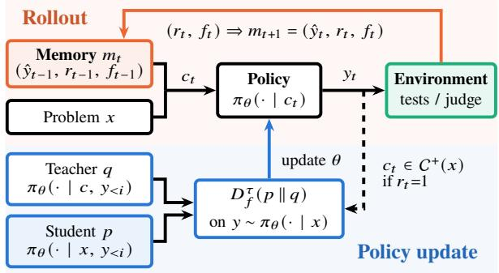
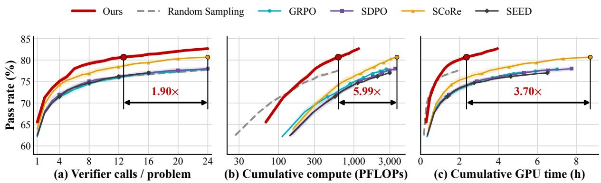
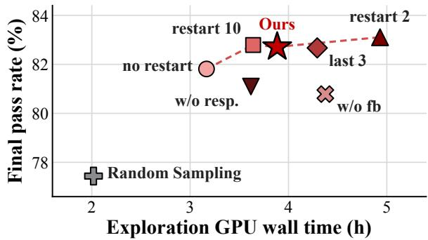

# Explore with Memory, Learn without It: In-Context Exploration and Self-Distillation for LLM Reasoning

Yutong Chen<sup>1</sup> Zhichao Xu<sup>2</sup> Rui Liu<sup>1</sup> Kunpeng Liu<sup>1</sup>\*

<sup>1</sup>Department of Computer Science, Clemson University

<sup>2</sup>Kahlert School of Computing, University of Utah

{yutong2, rliu3, kunpenl}@clemson.edu zhichao.xu@utah.edu

## Abstract

Exploration bounds learning efficiency in reinforcement learning with verifiable rewards (RLVR). Current methods explore mostly through independent sampling, without fully using the information gathered along the way, such as known wrong answers and environment feedback. We propose LEAF, which injects a dynamic, problem-specific memory into the context before every rollout. The memory contains the most recent response, its reward, and other environment feedback. It is updated after every verifier call. We decouple policy updates from rollouts and update the policy through self-distillation. On four benchmarks and two open models, LEAF accelerates exploration by about 4× compared with a random sampling baseline. On unseen test sets, it improves accuracy over the strongest baseline by 1.59 and 1.83 percentage points on the two models, while using less compute than any RL baseline. These results highlight the potential of LEAF in improving both exploration and learning efficiency.

Code is available at: https://github.   
com/on1262/LEAF.

## 1 Introduction

Reinforcement learning with verifiable rewards (RLVR) has become the main recipe for improving the reasoning and coding abilities of large language models (LLMs) (Shao et al., 2024; Guo et al., 2025; Yu et al., 2025; Zheng et al., 2025; Gao et al., 2025). It maximizes the expected reward, which must be estimated at each rollout step. Since this expectation cannot be computed exactly, most RLVR methods estimate it with Monte Carlo methods (Metropolis and Ulam, 1949), which require sampling several responses independently for each prompt.

In general RL, estimating advantages from rewards is challenging. Group-based methods compute advantages using a group of independent responses to the same prompt (Shao et al., 2024; Yu et al., 2025; Zheng et al., 2025). A larger group yields more accurate estimates but reduces rollout efficiency. Single-rollout methods such as PPO use a value function (Schulman et al., 2017). However, this requires a critic network. Learning an accurate critic is also challenging when training LLMs (Shao et al., 2024; Kazemnejad et al., 2025).

Research on iterative refinement investigates how to improve later responses using earlier attempts. Kumar et al. (2025) and Ekbote et al. (2025) use multi-turn reinforcement learning to train revision behavior, including intrinsic selfcorrection and refinement guided by execution feedback. Some methods learn from feedback and transfer knowledge into parameters. Song et al. (2026b) learns from feedback through self-distillation or feedback modeling. Shi et al. (2026) uses reinforcement learning combined with self-distillation.

Self-distillation methods (Hübotter et al., 2026; Zhao et al., 2026; He et al., 2026; Liu et al., 2026a; Wang et al., 2026; Jiang et al., 2026; Wu et al., 2026b) use the same model with privileged context, such as feedback, memories, or skills, as the teacher for an unconditioned student. Although self-distillation does not require duplicated responses, model behavior changes only during the policy update phase, without fully leveraging the model’s in-context learning ability. Methods such as those proposed by Dilkes et al. (2026) and Liu et al. (2026b) change exploration behavior using a fixed instruction or a self-generated tip. However, they still use duplicated group sampling. As Fig. 1 shows, our method is the only one of these designs that combines rich feedback, inference adaptation and a single rollout per step.

In our experiments, independent sampling tends to fail with the same wrong answer. For example, with random sampling on MBPP+, 77.3% (Qwen3- 8B) and 78.0% (Olmo-3-7B-Instruct) of the failed samples reproduce exactly the failing test output of an earlier sample for the same problem, and on MATH-500 47% of the wrong answers repeat an earlier wrong answer. When the previous answer is in the context, adding its feedback significantly reduces the rate of repeating that wrong answer, from 62.8% to 35.9% on average over MATH-500, LCB and MBPP+ and the two models. Refer to Appendix A for details.

<table><tr><td></td><td>Random sampling</td><td>SDPO</td><td>SCoRe</td><td>RLVR</td><td>Ours</td></tr><tr><td>Rich feedback</td><td>X</td><td>L</td><td>X</td><td>X</td><td>L</td></tr><tr><td>Inference adaptation</td><td>X</td><td>X</td><td>V</td><td>x</td><td></td></tr><tr><td>Single rollout</td><td></td><td>X</td><td>X</td><td>X</td><td></td></tr></table>

Figure 1: Properties of exploration methods as evaluated here. Richfeedback: uses textual feedback such as test output, not only the scalar reward. Inference adaptation: the rollout context changes with earlier attempts on the same problem, without a parameter update. Single rollout: one verified answer per problem per step.

Motivated by the strong effect of in-context learning, this work asks whether exploration can be improved by changing the context of each rollout. As illustrated by Fig. 2, our method keeps a memory for each problem that contains the last response, its reward and its environment feedback. During rollout, each problem only generates one sample per step. We update the memory based on previous attempts on the same problem. The memory is written into the rollout context as a short dialogue, so each new attempt revises the previous one, as the in-context refinement (Shinn et al., 2023; Madaan et al., 2023). During the policy update, the policy conditioned on the memory serves as the teacher, and self-distillation (Agarwal et al., 2024; Snell et al., 2022; Zhao et al., 2026) moves what the memory provides into the parameters. We name it LEAF, short for Learning from Earlier Attempts and Feedback, because each new attempt learns from the previous attempt and the feedback on it in context, and the policy update then learns from these attempts in its parameters.

We evaluate LEAF on four benchmarks, MATH-500 (mathematics), LiveCodeBench and MBPP+ (code generation) and SciKnowEval (science), with Qwen3-8B and Olmo-3-7B-Instruct. In exploration tasks, LEAF raises the cumulative pass rate over Random Sampling by 4.88 pp on average and reaches the final pass rate of Random Sampling with four times fewer verifier calls. In generalization tasks on unseen test sets, LEAF has the highest overall test accuracy, which is 1.59 pp (Qwen3- 8B) and 1.83 pp (Olmo-3-7B-Instruct) above the strongest baseline. We perform ablation studies on key components such as the feedback, the last response and the restart schedule. Results show that removing any of them lowers the final pass rate on both models.

  
Figure 2: Overview of LEAF. Rollout: each problem keeps a memory of its last response, reward and feedback, which forms the context of the next attempt. The memory is updated after each trial. Policy update: after all rollout steps are finished, the teacher conditioned on a successful context teaches the student without context through self-distillation.

## 2 Method

As illustrated in Fig. 2, in this section we introduce how LEAF explores and how it updates the parameters. Refer to Appendix B for implementation details and the exact prompts.

## 2.1 Preliminary

We first introduce the setting and notation. Given a set of problems D, each problem receives a budget of K verifier calls, and each call grades one answer. At step t, the environment returns a rollout reward $r _ { t } \in \{ 0 , 1 \}$ and feedback $f _ { t }$ for the answer $y _ { t }$ . We measure exploration ability by the cumulative pass rate

$$
\operatorname { p a s s @ } k = { \frac { 1 } { | \mathscr { D } | } } \sum _ { x \in \mathscr { D } } \operatorname* { m a x } _ { t \leq k } s _ { t } ( x ) ,\tag{1}
$$

where $s _ { t } ( x ) \in \{ 0 , 1 \}$ indicates whether $y _ { t }$ is correct. The environment feedback may expose $s _ { t }$ only partially. In code benchmarks the reward comes from public tests while $s _ { t }$ also requires hidden private tests, so pass@k is not a simple aggregate of observed rewards.

## 2.2 Explore with memory

For problem x at step t, the context $c _ { t }$ is a short dialogue: the problem x as the first user turn, $\hat { y } _ { t - 1 }$ as the assistant turn, and a final user turn with the verdict $r _ { t - 1 }$ , the feedback $f _ { t - 1 }$ and an instruction to check the problem again and give a corrected complete answer. We define the memory as $m _ { t } = ( \hat { y } _ { t - 1 } , r _ { t - 1 } , f _ { t - 1 } )$ , which is updated based on previous attempts. In each step, the policy generates $y _ { t } \sim \pi _ { \theta } ( \cdot \mid c _ { t } )$ , and the verifier call on y<sub>t</sub> produces $m _ { t + 1 }$

To prevent long previous answers from degrading the revision, $\hat { y } _ { t - 1 }$ in memory is a compressed response based on the raw response $y _ { t - 1 }$ . We keep the last $L = 2 { , } 0 0 0$ tokens of a longer answer in $\hat { y } _ { t - 1 }$ because the final result, code or conclusion usually sits at the end.

When each attempt revises the previous one, the memory can also hold the model on one line of solution. To keep previous attempts from misleading subsequent ones, we therefore reset the memory every $M = 5$ steps. At a restart step, the policy drafts an answer $\tilde { y } \sim \pi _ { \theta } ( \cdot \mid x )$ and revises it once with a blind instruction that asks it to check its own reasoning without any feedback. Only the revision is sent to the verifier.

Exploration with memory can be used alone or together with a policy update. In our experiments, updates during exploration changed the final pass rate little (Section 3.3.3), so by default LEAF explores with fixed parameters and updates the policy after all rollouts are done.

## 2.3 From memory to parameters

The memory changes the exploration behavior, but it cannot be applied to a new problem. We distill the experience of rollouts into parameters by selfdistillation. Unlike methods that interleave sampling and training, we first finish the rollout phase and then perform the policy update. This keeps the implementation simple and avoids waiting for long outputs inside every update step.

After a rollout of K steps on the training problems, we collect the set ${ \mathcal { C } } ^ { + } ( x )$ of contexts $c _ { t }$ whose following response $y _ { t }$ is correct for each problem x. Each context holds the memory that produced a correct answer, i.e. last response and feedback. At each update step, we sample a batch B of problems. For each $x \in B$ we randomly draw a context from ${ \mathcal { C } } ^ { + } ( x )$ and a student answer $y \sim \pi _ { \boldsymbol { \theta } } ( \cdot \mid x )$ generated from the plain prompt. Then we distill the token distribution from teacher to student.

At token position i of y, the student distribution is $p _ { i } = \pi _ { \theta } ( \cdot \mid x , y _ { < i } )$ and the teacher distribution is $q _ { i } = \operatorname { s g } [ \pi _ { \theta } ( \cdot \mid c , y _ { < i } ) ]$ , where sg stops the gradient. We compare them with a clipped $f \cdot$ -divergence over the full vocabulary V,

$$
D _ { f } ^ { \tau } ( p _ { i } \parallel q _ { i } ) = \sum _ { v \in \mathcal { V } } \operatorname* { m i n } \left( q _ { i , v } f \left( \frac { p _ { i , v } } { q _ { i , v } } \right) , \tau \right)\tag{2}
$$

We use $f ( u ) = u \log u$ by default, which gives the reverse KL divergence, i.e., $\mathrm { K L } ( p _ { i } \parallel q _ { i } )$ . We also compare other KL losses in Section 3.3.5. Following OPSD (Zhao et al., 2026), we cap each summand of Eq. (2) at a threshold τ to avoid length collapse. Entries above τ receive no gradient. We use $\tau = 1 0 ^ { - 3 }$ on MATH and no cap $( \tau = + \infty )$ on LiveCodeBench and SciKnowEval. The final loss is described as follows:

$$
{ \mathcal { L } } ( \theta ) = { \frac { 1 } { \sum _ { x \in { \mathcal { B } } } \left| y ^ { x } \right| } } \sum _ { x \in { \mathcal { B } } } \sum _ { i = 1 } ^ { \left| y ^ { x } \right| } w _ { i } ^ { x } D _ { f } ^ { \tau } { \big ( } p _ { i } ^ { x } \parallel q _ { i } ^ { x } { \big ) } ,\tag{3}
$$

where $y ^ { x } , p _ { i } ^ { x }$ and $q _ { i } ^ { x }$ belong to problem $x ,$ and $w _ { i } ^ { x }$ is a truncated importance weight (Appendix B). Algorithm 1 gives the complete procedure.

Algorithm 1 LEAF. $c _ { t } = \langle u _ { 1 } , a , u _ { 2 } \rangle \mathrm { ; }$ : user, assis  
tant and user turns.   
Require: problems D, policy $\pi _ { \theta } , K , M , L , S$   
1: for each $x \in \mathcal { D }$ in parallel do   
2: ${ \mathcal { C } } ^ { + } ( x ) \gets \emptyset$   
3: for ${ \dot { t } } = 1 , \dots , K$ do   
4: if $( t - 1 )$ mod $M = 0$ then ▷ restart   
5: $\tilde { y } \sim \overset { \cdot } { \pi } _ { \boldsymbol { \theta } } ( \cdot \mid x )$   
6: $c _ { t }  \langle \dot { x } , \dot { \mathrm { t a i l } } _ { L } ( \tilde { y } )$ , blind instruction⟩   
7: else   
8: $\hat { y } _ { t - 1 } \gets \mathrm { t a i l } _ { L } ( y _ { t - 1 } )$   
9: $\boldsymbol { c } _ { t } \gets \langle \boldsymbol { x } , \hat { y } _ { t - 1 } , ( \boldsymbol { r } _ { t - 1 } , f _ { t - 1 }$ , instruction)⟩   
10: $y _ { t } \sim \pi _ { \theta } ( { \cdot } \mid c _ { t } ) ; ( r _ { t } , f _ { t } )  \mathrm { E n v } ( x , y _ { t } )$   
11: if $r _ { t } = \mathrm { \dot { 1 } }$ and y<sub>t</sub> not truncated then $c ^ { + } ( x ) $   
${ \mathcal { C } } ^ { + } ( x ) \cup \{ c _ { t } \}$   
12: for $j = 1 , \dots , S$ do ▷ policy update   
13: sample batch $B \subseteq \{ x : { \mathcal { C } } ^ { + } ( x ) \neq \varnothing \}$   
14: $c \sim \operatorname { \bar { U n i f } } ( { \mathcal { C } } ^ { + } ( x ) ) , { \dot { y } } \sim \pi _ { \theta } ( \cdot \mid x )$ for each $x \in B$   
15: update θ with one gradient step on Eq. (3)   
16: return π<sub>θ</sub>

## 3 Experiments

We compare our method with baselines on two tasks. In the exploration task, we evaluate how quickly LEAF discovers correct solutions. To measure this ability, we compute pass@k after each step. In the in-distribution generalization task, we investigate whether the knowledge in rollout trajectories can be transferred to model parameters. The model first explores and updates policy on the training set, then we evaluate its accuracy on a held-out test set. The results of both tasks (Fig. 3, Table 1 and Table 2) are averaged over three runs with different random seeds, as is the length analysis in Table 3. Other ablation studies use a single seed.

  
Figure 3: Cumulative pass rate on four benchmarks against (a) verifier calls per problem, (b) cumulative compute in PFLOPs (log scale) and (c) cumulative GPU time. Both axes are averaged over the two models at each step.

## 3.1 Exploration tasks

## 3.1.1 Settings

Datasets. We collect four datasets for the exploration tasks: the 500 problems from MATH-500 (Hendrycks et al., 2021; Lightman et al., 2024), 131 problems from release v6 of LiveCodeBench (LCB) (Jain et al., 2025b) in the split used by SDPO (Hübotter et al., 2026), the 378 problems from MBPP+ (Liu et al., 2023), and 400 openended problems from SciKnowEval (Feng et al., 2024), with 100 problems each from biology, chemistry, materials, and physics. The SciKnowEval problems are randomly sampled, with 25% at level L5 and 75% at level L2. We filter out all multiplechoice and binary problems to prevent the model from guessing answers.

Verifiers and feedback. For MATH-500, we use only correctness as feedback. For SciKnowEval, we use a base LLM as a judge and provide only correctness as feedback. For coding benchmarks such as LCB and MBPP+, the feedback includes runtime errors, code, and test inputs and outputs. Only failed tests are included in the feedback. We divide all test cases into public and private sets. Rewards and feedback are based only on public tests. The pass rate is computed based on solutions that pass all tests in both the public and private sets. For a fair comparison, we assign K = 24 verifier calls per problem and at most 5 GPU hours per benchmark. We measure the wall time on one H200 GPU per run.

Decoding settings. We use Qwen3-8B (Yang et al., 2025a) with thinking disabled and Olmo-3- 7B-Instruct (Team Olmo, 2025). We sample from Qwen3-8B with a temperature of 1.0 and top-p of 1.0, and from Olmo-3-7B-Instruct with a temperature of 0.6 and top-p of 0.95. The maximum response length is 8,192 tokens for all methods, except when evaluating Olmo-3 on LiveCodeBench, where we use 16,384 tokens because we found that Olmo-3 produces longer reasoning sequences on this benchmark.

Baselines. We compare our method with five baselines. Random Sampling draws one independent sample per problem per step from the plain prompt. We include four RL baselines: GRPO (Shao et al., 2024) is a standard RLVR baseline. We use the higher clipping bound from DAPO (Yu et al., 2025). SDPO (Hübotter et al., 2026) is the most relevant method, as it also uses environment feedback and self-distillation. SCoRe (Kumar et al., 2025) trains on two-turn trajectories in which the second turn revises the first. We include SCoRe as a self-improvement baseline. SEED (Wu et al., 2026b) is a hybrid method that combines SFT and RL. For all baselines with policy updates, we use LoRA adapters (Hu et al., 2022) with rank 64 and a constant learning rate of 10<sup>−6</sup>.

Our method. LEAF runs only the rollout part of Algorithm 1. We use a restart interval of M = 5 and a tail length of L = 2,000 tokens. The variant with parameter updates during exploration is studied in Section 3.3.3. For a fair comparison, we count the rollout resource usage as a part of our method. Refer to Appendix C for details.

## 3.1.2 Results

<table><tr><td rowspan="2">Method</td><td colspan="3">Qwen3-8B</td><td colspan="3">Olmo-3-7B-Inst.</td></tr><tr><td></td><td>Pass GPU h PFLOPs</td><td></td><td></td><td>Pass GPU h PFLOPs</td><td></td></tr><tr><td>Random Sampling</td><td>77.44</td><td>0.66</td><td></td><td>625 78.15</td><td>3.42</td><td>676</td></tr><tr><td>GRPO</td><td>77.78</td><td>4.43</td><td>2,49478.00</td><td></td><td>9.58</td><td>2,885</td></tr><tr><td>SDPO</td><td>77.71</td><td>5.06</td><td></td><td>3,27778.31</td><td>10.46</td><td>3,843</td></tr><tr><td>SCoRe</td><td>78.65</td><td>5.09</td><td></td><td>3,05882.73</td><td>12.33</td><td>4,401</td></tr><tr><td>SEED</td><td>77.96</td><td>7.87</td><td></td><td>4,58077.47</td><td>9.43</td><td>3,796</td></tr><tr><td>Ours</td><td>80.84</td><td>1.47</td><td></td><td>1,04384.50</td><td>6.43</td><td>1,275</td></tr></table>

Table 1: Pass rate (%) averaged over the four benchmarks and summed exploration cost. Refer to $\mathsf { A p - }$ pendix D for results by seed and benchmark.

LEAF is more efficient and less costly than the best baseline. We found that our method has higher exploration efficiency and lower cost. In Table 1, LEAF reached 80.84% on Qwen3-8B and 84.50% on Olmo-3-7B, which surpasses the best baseline, SCoRe, by 2.19 pp and 1.77 pp. In Fig. 3, LEAF uses far less computation or GPU wall time than baselines. It accelerates the exploration by 3.70× compared with the best baseline. Since LEAF explores purely by in-context learning, the computation cost is at the same level as random sampling (grey line). But our method continuously improves with more compute.

## 3.2 In-distribution generalization tasks

## 3.2.1 Settings

Datasets. We train on three training sets that are disjoint from the test sets. In the training sets, we use all test cases for reward and feedback. There is no overlap between the training sets and the benchmarks in this task. For LiveCodeBench, the training set contains 478 problems from releases v2 to v5 of LiveCodeBench. For MATH, we randomly extract 500 Level 5 problems from the MATH training split (Hendrycks et al., 2021). For SciKnow-Eval, we extract 400 open problems from Biology/Chemistry/Material/Physics at level L5. We use the same test set as the exploration task

Benchmarks. The model trained on each training set is tested on the matching benchmark, LCB v6, MATH-500 or SciKnowEval, which together hold the same 1,031 problems as in exploration. We sample each problem with four responses and report the avg@4 as generalization performance.

SFT baseline. To test whether the gain comes from the correct answers collected during exploration rather than from self-distillation, we build an SFT baseline from the same rollouts as LEAF. For each successful context and its correct answer in our method, the base model rewrites the answer into a self-contained solution without the earlier attempts and the references to feedback. We keep only the correct rewrites and train the plain prompt on them with the same LoRA, batch size and number of steps as LEAF.

Other Experimental Settings. Training rollouts and test samples use the decoding settings of the exploration experiments. We compare four RL baselines, GRPO, SDPO, SCoRe and SEED, and an SFT baseline trained on the same rollouts as LEAF. They use the exploration settings except for a unified learning rate of $1 0 ^ { - 5 }$ and a budget of 20 verifier calls per training problem. For SEED, we found its compute time is significantly longer than that of other baselines. We lower the budget to 15 for a fair comparison. LEAF first explores each training set for K = 20 steps. It then runs S = 20 update steps with a batch size of 128. Refer to Appendix E for more details.

## 3.2.2 Results

LEAF achieves better performance on unseen test sets with lower cost. In Table 2, we find that LEAF reaches an overall avg@4 of 64.69% on Qwen3 and 63.01% on Olmo-3, exceeding the best baseline, GRPO on Qwen3 and SEED on Olmo-3, by 1.59 pp and 1.83 pp. LEAF is lower only on LCB (25.45% versus 26.02% for GRPO) and Sci-KnowEval (76.77% versus 76.83% for SEED) with Qwen3-8B. We found that our method uses significantly less compute. LEAF uses 2.64 and 3.15 EFLOPs, about 1.9 times less than SEED (4.88 and 5.94 EFLOPs). The GPU time of our method on Olmo-3 is close to that of GRPO and SDPO, but our method achieves higher performance.

LEAF improves accuracy without relying on better rollout data. In Table 2 we find that SFT reaches an overall avg@4 of only 58.16% and 58.21%, which is 6.53 pp and 4.80 pp below LEAF, although its compute is close to that of LEAF. SFT raises the accuracy on LCB and SciKnowEval over Base on both models, but its MATH-500 accuracy falls 7.23 pp and 7.79 pp below Base. This may be because the rewritten solutions are generated in a context that the student never sees, so imitating them pulls the student away from its own distribution, while LEAF matches the teacher on the student’s own answers. These results suggest that the gain of LEAF comes from the distillation method and not from the correct answers alone.

<table><tr><td></td><td colspan="6">Qwen3-8B</td><td colspan="6">Olmo-3-7B-Instruct</td></tr><tr><td></td><td>Method LCB↑</td><td>MATH↑</td><td>SciKE↑</td><td>Overall↑</td><td>GPU h↓</td><td>EFLOPs↓</td><td>LCB↑</td><td>MATH↑</td><td>SciKE↑</td><td>Overall↑</td><td>GPU h↓</td><td>EFLOPs↓</td></tr><tr><td>Base</td><td>19.78</td><td>84.08</td><td>74.40</td><td>59.42</td><td></td><td></td><td>21.25</td><td>89.12</td><td>69.25</td><td>59.87</td><td></td><td></td></tr><tr><td>GRPO</td><td>26.02</td><td>86.53</td><td>76.75</td><td>63.10</td><td>5.52</td><td>3.71</td><td>21.12</td><td>89.33</td><td>70.83</td><td>60.43</td><td>14.06</td><td>4.52</td></tr><tr><td>SDPO</td><td>25.64</td><td>81.65</td><td>72.96</td><td>60.08</td><td>5.82</td><td>4.35</td><td>23.66</td><td>82.38</td><td>66.98</td><td>57.68</td><td>14.23</td><td>5.93</td></tr><tr><td>SCoRe</td><td>22.71</td><td>84.32</td><td>75.17</td><td>60.73</td><td>5.57</td><td>4.17</td><td>20.48</td><td>88.95</td><td>68.38</td><td>59.27</td><td>17.71</td><td>6.33</td></tr><tr><td>SEED</td><td>25.89</td><td>85.58</td><td>76.83</td><td>62.77</td><td>6.72</td><td>4.88</td><td>22.33</td><td>89.10</td><td>72.10</td><td>61.18</td><td>14.56</td><td>5.94</td></tr><tr><td>SFT</td><td>22.26</td><td>76.85</td><td>75.38</td><td>58.16</td><td>3.32</td><td>2.44</td><td>22.77</td><td>81.33</td><td>70.52</td><td>58.21</td><td>13.47</td><td>3.00</td></tr><tr><td>Ours</td><td>25.45</td><td>91.85</td><td>76.77</td><td>64.69</td><td>3.70</td><td>2.64</td><td>24.05</td><td>90.62</td><td>74.35</td><td>63.01</td><td>14.03</td><td>3.15</td></tr></table>

Table 2: In-distribution generalization results. Avg@4 (%) on test sets. LCB: LiveCodeBench v6. MATH: MATH-500. SciKE: SciKnowEval. GPU h and EFLOPs $( 1 0 ^ { 1 8 } \mathrm { F L O P s } )$ sum the three training runs. For LEAF and SFT they include the exploration rollout that collects the training data, and for SFT also rewriting and verifying the solutions. Refer to Appendix F for results by run seed and training cost by stage.

## 3.3 Ablation studies

## 3.3.1 Effect of restart, last response, feedback and history length during exploration

We investigate the effect of the key components in our method. There are four ablations on exploration tasks: the last response, the feedback, the restart interval and the number of past rounds in the context. Each ablation removes one component. Refer to Appendix G.2 for details.

  
Figure 4: Exploration ablations on key components. Final pass rate against exploration GPU time, averaged over the two models. Our method in main experiments is denoted as red star.

Last response and feedback cause most improvement. In Fig. 4 we find that removing the compressed response of the last turn significantly drops performance on both models. We design LEAF w/o last response as a single user turn with the problem and the feedback without the assistant turn. Its pass rate ends at 79.70% and 82.49% instead of 80.94% and 84.49% on exploration tasks. Removing the feedback (LEAF w/o feedback) lowers the final pass rate more than removing the last response on Qwen3-8B but less on Olmo-3-7B-Instruct, where it lowers the mean accuracy by only 0.46 pp. This may be because the last response lets the model edit a concrete attempt, while feedback alone only says that an unseen attempt has failed.

Restarts cause a trade-off between pass@k and avg@k. We find that LEAF w/o restarts has the highest mean accuracy but a lower final pass rate compared with LEAF. Restarting every 2 steps has the highest final pass rate, but it significantly increases GPU wall time from 3.89 to 4.93 hours and drops the mean accuracy by 1.47 pp. One possible explanation is that a memory never reset keeps refining one line of solution, which helps on solved problems but explores less on the others. We use restart every 5 steps to keep a balance between pass rate and accuracy.

A longer history does not help consistently. We find that keeping the last three assistant and user rounds in the dialogue instead of one lowers the averaged final pass rate (82.71% to 82.67%) and raises the GPU time (3.89 to 4.29 hours). It may be because older rounds repeat attempts that the last round already revised, so they lengthen the context with little new information. We therefore keep only the last round in our method.

## 3.3.2 Effect of response length

Here we investigate how response length relates to the accuracy gain in exploration rollouts and generalization tasks. In Table 3, length and accuracy are compared with a reference (Random Sampling or Base) for each model and benchmark and then averaged. Refer to Appendix G.1 for details.

<table><tr><td rowspan="2"></td><td colspan="2">(a) Exploration</td><td colspan="2">(b) Generalization</td></tr><tr><td>Length</td><td>Gain (pp.)</td><td>Length</td><td>Gain (pp.)</td></tr><tr><td>GRPO</td><td>1.00</td><td>0.09</td><td>1.14</td><td>2.12</td></tr><tr><td>SDPO</td><td>0.99</td><td>0.21</td><td>0.98</td><td>-0.77</td></tr><tr><td>SCoRe</td><td>1.27</td><td>2.89</td><td>1.01</td><td>0.35</td></tr><tr><td>SEED</td><td>1.00</td><td>0.31</td><td>1.11</td><td>2.33</td></tr><tr><td>SFT</td><td></td><td></td><td>0.93</td><td>-1.46</td></tr><tr><td>Ours</td><td>1.17</td><td>4.88</td><td>1.60</td><td>4.20</td></tr></table>

Table 3: Response length and accuracy gain over the reference. Length: ratio of the mean response length to that of the reference. Gain: accuracy gain over the reference in pp.

LEAF turns extra exploration tokens into the largest pass rate gain. In Table 3(a), we find that LEAF writes answers 1.17 times as long as Random Sampling and raises the pass rate by 4.88 pp, which is the largest gain. SCoRe, which also revises an earlier attempt, writes even longer answers (1.27 times) but gains only 2.89 pp. Other baselines such as GRPO, SDPO and SEED keep almost the same length as Random Sampling and gain at most 0.31 pp.

The accuracy gain is related to the length after the policy update In Table 3(b), we find that the accuracy gain in generalization tasks is highly related to the response length across methods. SFT and SDPO shorten the responses and fall below Base by 1.46 and 0.77 pp, SCoRe keeps the length and gains 0.35 pp. GRPO and SEED lengthen the responses by 11 to 14% and gain 2.12 and 2.33 pp. LEAF extends this trend furthest, with responses 1.60 times as long as Base and the highest gain of 4.20 pp.

## 3.3.3 Effect of interleaved updates during exploration

In this section we investigate the effect of updating the parameters during exploration. We update the policy every N = 1, 2, 5, +∞ rollout steps and observe the final pass rate in exploration tasks. Refer to Appendix G.3 for details.

Updates during exploration add cost but no consistent gain. In Table 4 we find that on Qwen3- 8B all update intervals end slightly below no update (80.48% to 80.80% versus 80.94%). On Olmo-3-7B-Instruct, updates every step end higher (85.16%) and every 2 or 5 steps lower (84.14% and 84.25%) than no update (84.49%). The updates raise the GPU time by 2.3 to 3.8 times on Qwen3-8B and by 1.5 to 2.2 times on Olmo-3-

<table><tr><td rowspan="2">Method</td><td colspan="3">Qwen3-8B Olmo-3-7B-Inst.</td></tr><tr><td>Pass GPU h</td><td>Pass</td><td>GPU h</td></tr><tr><td>Random Sampling (ref.)</td><td>77.06</td><td>0.64 77.81</td><td>3.39</td></tr><tr><td>Ours (no update)</td><td>80.94</td><td>1.47 84.49</td><td>6.30</td></tr><tr><td>Ours + update every step</td><td>80.48</td><td>5.55 85.16</td><td>13.97</td></tr><tr><td>Ours + update every 2 steps 80.80</td><td></td><td>4.38 84.14</td><td>11.40</td></tr><tr><td>Ours + update every 5 steps 80.53</td><td></td><td>3.40 84.25</td><td>9.70</td></tr></table>

Table 4: Final cumulative pass rate (%, averaged over the four benchmarks) and exploration GPU hours.

7B-Instruct. These results highlight that updating parameters brings little extra improvement with in-context learning.

## 3.3.4 Effect of rollout traces in policy update

In the policy update, the rollout traces in the context decide how well the teacher answers. This ablation compares the teacher accuracy under three types of traces. Refer to Appendix G.4 for details. Successful traces are the contexts in C<sup>+</sup>(x), as in LEAF. Failure traces are the contexts whose following response is incorrect. Random traces keep the successful traces but replace the feedback with a different one, taken from another step of the same problem or, if none exists, from another problem. On MATH and SciKnowEval the feedback is only the verdict.

<table><tr><td rowspan="2">Traces</td><td colspan="3">Qwen3-8B</td><td colspan="2">Olmo-3-7B-Inst.</td></tr><tr><td>LCB</td><td>MATH</td><td>SciKE</td><td>LCB</td><td>MATH SciKE</td></tr><tr><td>Successful</td><td>82.98</td><td>90.86</td><td>83.23</td><td>71.03 96.16</td><td>67.93</td></tr><tr><td>Failure</td><td>39.82</td><td>60.30</td><td>67.07</td><td>44.76 79.48</td><td>50.13</td></tr><tr><td>Random</td><td>69.30</td><td>88.54</td><td>80.16</td><td>69.24 93.76</td><td>66.80</td></tr></table>

Table 5: Teacher accuracy (%) on the training problems under different rollout traces.

Memory of successful responses indicates higher teacher accuracy. In Table 5 we find that successful traces give the highest teacher accuracy on all three training sets and both models, 85.69% and 78.37% on average. Failure traces lower it to 55.73% and 58.12%, with the largest drop on LCB with Qwen3-8B (82.98% to 39.82%). Random traces lower it only to 79.33% and 76.60%. The largest drop is again on LCB with Qwen3-8B (13.68 pp), where the feedback holds the failed tests. This result reveals that the memory of successful responses leads to higher teacher accuracy in self-distillation.

<table><tr><td rowspan="2">Method</td><td colspan="2">Qwen3-8B</td><td colspan="2">Olmo-3-7B-Inst.</td></tr><tr><td>Overall</td><td>Trunc.</td><td>Overall</td><td>Trunc.</td></tr><tr><td>Base</td><td>59.41</td><td>0.02</td><td>59.84</td><td>2.04</td></tr><tr><td>Ours (reverse KL)</td><td>64.92</td><td>2.25</td><td>62.71</td><td>2.45</td></tr><tr><td>Ours w/ forward KL</td><td>63.80</td><td>1.77</td><td>60.93</td><td>2.02</td></tr><tr><td>Ours w/ JSD</td><td>59.69</td><td>0.10</td><td>62.04</td><td>1.83</td></tr></table>

Table 6: Ablations on three loss types. Overall test avg@4 (%) and truncated test responses (%, mean over the three test sets).

## 3.3.5 Effect of the divergence in the policy update

In this section we investigate the effect of the divergence in Eq. (2) on the policy update. We test 3 settings: Reverse KL, which is used in main experiments, Forward KL and JSD with $\beta \ : = \ : 0 . 5$ All other settings are unchanged. Refer to Appendix G.5 for details.

Reverse KL gives the highest overall accuracy. In Table 6, we find that reverse KL reaches 64.92% and 62.71%. Forward KL only reaches 63.80% and 60.93% and JSD reaches 59.69% and 62.04%. The largest drops are on MATH-500. JSD on Qwen3- 8B has a 13.1 pp degradation and Forward KL on Olmo-3-7B-Instruct also has a 6.6 pp degradation. One explanation is that reverse KL weights each entry by the student probability and tends to concentrate the student on the modes of the teacher, which suits a teacher whose context already led to a correct answer.

## 4 Related Work

Exploration in RLVR. Sampling a group of independent responses for each prompt is a fundamental approach to estimating advantages in RLVR (Shao et al., 2024; Yu et al., 2025; Zheng et al., 2025). Prior work finds that the efficiency of RLVR depends on which solutions are explored under a limited verification budget (Zhang et al., 2026; Setlur et al., 2026; Wu et al., 2026a). Larger groups allow for more extensive exploration that can substantially improve the estimate. However, sampling in this way suffers from a fundamental limitation: every response is generated from the same problem prompt, so a failed attempt cannot inform the next sample. Our work therefore aims to condition each rollout on earlier attempts at the same problem, which brings new information in every rollout trace.

Feedback guided refinement. Prior work explores prompting LLMs to revise their own outputs using information from earlier attempts. Shinn et al. (2023) stores verbal reflection across interactions. Madaan et al. (2023) introduces iterative selfrefinement. Song et al. (2026a); Yu et al. (2026) leverage in-context reinforcement learning and policy optimization. Some methods consider training models to use feedback more effectively rather than relying on prompting alone. They improve through textual critiques, explicit reflection or retrospective credit assignment (Du et al., 2025; Song et al., 2026b; Shi et al., 2026; Li et al., 2026; Ekbote et al., 2025; Jin et al., 2026; Jain et al., 2025a; Yuan and Xie, 2025). Such training may occur over multiple turns, such as Kumar et al. (2025), which trains models with reinforcement learning on two turns of self-correction. Mu et al. (2026) decouple multi-turn rollouts from a weighted fine-tuning by importance. In contrast to these works, LEAF generates one rollout per problem per step and updates the parameters by self-distillation on single trajectories, without reward objectives on groups of answers.

Self-distillation with privileged context. The memory-conditioned policy in LEAF can be viewed as a teacher with privileged context that is updated as the policy explores. Prior work primarily considers distilling a richer context into a model that must eventually answer without it (Snell et al., 2022; Agarwal et al., 2024), where the context holds environment feedback (Hübotter et al., 2026), privileged information on student-generated trajectories (Zhao et al., 2026), self-revision (He et al., 2026), procedural memories (Liu et al., 2026a) or skills (Wang et al., 2026; Jiang et al., 2026). Others combine distillation with supervised finetuning, preference optimization or reinforcement learning (Yang et al., 2025b; Wu et al., 2026b).

## 5 Conclusion

Independent rollouts make exploration less efficient in LLM reinforcement learning. We propose LEAF, which keeps a dynamic memory for each rollout trace and updates the policy by self-distillation, to improve learning efficiency. Our experiments found that LEAF reached the final pass rate of Random Sampling with about four times fewer verifier calls and ended above all RL baselines at lower compute without policy update. The selfdistillation further gave the best overall test accuracy. We conducted several ablation studies on key designs. The results highlight that LEAF can be a new framework with better exploration efficiency.

## Limitations

On LiveCodeBench and MBPP+ the feedback includes execution results such as errors and failed tests, while on MATH-500 and SciKnowEval it is only a correctness verdict, so the effect of richer feedback is tested on code tasks only. Although we conducted ablation studies on key components, how memory affects exploration still needs further research.

## Ethical Considerations

We use public datasets and open-weight models without collecting new personal data or involving human participants. We rely on the original dataset curation without additional screening for personal information or offensive content.

LEAF may inherit model biases and propagate errors from verifier feedback, including judgments from the LLM judge. Benchmark gains do not establish deployment safety: scientific answers require independent verification, and generated code requires security review. Computational costs are reported in Appendices C and E.

## References

Rishabh Agarwal, Nino Vieillard, Yongchao Zhou, Piotr Stanczyk, Sabela Ramos Garea, Matthieu Geist, and Olivier Bachem. 2024. On-policy distillation of language models: Learning from self-generated mistakes. In International Conference on Learning Representations.

Jim Dilkes, Vahid Yazdanpanah, and Sebastian Stein. 2026. Instruction-conditioned exploration for reinforcement learning with self-distillation to an unconditioned policy. arXiv preprint arXiv:2608.02087.

Chengyu Du, Jinyi Han, Yizhou Ying, Aili Chen, Qianyu He, Haokun Zhao, Haoran Guo, Sirui Xia, Jiaqing Liang, Zulong Chen, Liangyue Li, and Yanghua Xiao. 2025. Think thrice before you act: Progressive thought refinement in large language models. In International Conference on Learning Representations.

Chanakya Ekbote, Vijay Lingam, Sujay Sanghavi, Jun Huan, Behrooz Omidvar-Tehrani, Anoop Deoras, and Stefano Soatto. 2025. MURPHY: Feedbackaware GRPO with retrospective credit assignment for multi-turn code generation. arXiv preprint arXiv:2511.07833.

Kehua Feng, Xinyi Shen, Weijie Wang, Xiang Zhuang, Yuqi Tang, Qiang Zhang, and Keyan Ding. 2024. Sciknoweval: Evaluating multi-level scientific knowledge of large language models. arXiv preprint arXiv:2406.09098.

Chang Gao, Chujie Zheng, Xiong-Hui Chen, Kai Dang, Shixuan Liu, Bowen Yu, An Yang, Shuai Bai, Jingren Zhou, and Junyang Lin. 2025. Soft adaptive policy optimization. arXiv preprint arXiv:2511.20347.

Daya Guo, Dejian Yang, Haowei Zhang, Junxiao Song, Peiyi Wang, Qihao Zhu, Runxin Xu, Ruoyu Zhang, Shirong Ma, Xiao Bi, et al. 2025. DeepSeek-R1 incentivizes reasoning in LLMs through reinforcement learning. Nature, 645:633–638.

Yinghui He, Simran Kaur, Adithya Bhaskar, Yongjin Yang, Jiarui Liu, Narutatsu Ri, Liam Fowl, Abhishek Panigrahi, Danqi Chen, and Sanjeev Arora. 2026. Self-distillation zero: Self-revision turns binary rewards into dense supervision. arXiv preprint arXiv:2604.12002.

Dan Hendrycks, Collin Burns, Saurav Kadavath, Akul Arora, Steven Basart, Eric Tang, Dawn Song, and Jacob Steinhardt. 2021. Measuring mathematical problem solving with the MATH dataset. In Advances in Neural Information Processing Systems Datasets and Benchmarks Track.

Edward J. Hu, Yelong Shen, Phillip Wallis, Zeyuan Allen-Zhu, Yuanzhi Li, Shean Wang, Lu Wang, and Weizhu Chen. 2022. LoRA: Low-rank adaptation of large language models. In International Conference on Learning Representations.

Jonas Hübotter, Frederike Lübeck, Lejs Behric, Anton Baumann, Marco Bagatella, Daniel Marta, Ido Hakimi, Idan Shenfeld, Thomas Kleine Buening, Carlos Guestrin, and Andreas Krause. 2026. Reinforcement learning via self-distillation. In International Conference on Machine Learning.

Arnav Kumar Jain, Gonzalo Gonzalez-Pumariega, Wayne Chen, Alexander M Rush, Wenting Zhao, and Sanjiban Choudhury. 2025a. Multi-turn code generation through single-step rewards. In Proceedings of the 42nd International Conference on Machine Learning, volume 267 of Proceedings of Machine Learning Research, pages 26700–26716. PMLR.

Naman Jain, King Han, Alex Gu, Wen-Ding Li, Fanjia Yan, Tianjun Zhang, Sida Wang, Armando Solar-Lezama, Koushik Sen, and Ion Stoica. 2025b. Live-CodeBench: Holistic and contamination free evaluation of large language models for code. In International Conference on Learning Representations.

Yubo Jiang, Fengying Xie, Zhiguo Jiang, and Haopeng Zhang. 2026. Distill skills into weights, not prompts: Abstract skills as privileged signals for on-policy selfdistillation. arXiv preprint arXiv:2608.09826.

Yiyang Jin, Kunzhao Xu, Hang Li, Xueting Han, Yanmin Zhou, Cheng Li, and Jing Bai. 2026. Re-Veal: Self-evolving code agents via reliable selfverification. In International Conference on Learning Representations.

Amirhossein Kazemnejad, Milad Aghajohari, Eva Portelance, Alessandro Sordoni, Siva Reddy, Aaron Courville, and Nicolas Le Roux. 2025. VinePPO: Refining credit assignment in RL training of LLMs. In Proceedings ofthe 42nd International Conference on Machine Learning, volume 267 of Proceedings ofMachine Learning Research, pages 29557–29590. PMLR.

Aviral Kumar, Vincent Zhuang, Rishabh Agarwal, Yi Su, John D. Co-Reyes, Avi Singh, Kate Baumli, Shariq Iqbal, Colton Bishop, Rebecca Roelofs, et al. 2025. Training language models to self-correct via reinforcement learning. In International Conference on Learning Representations.

Woosuk Kwon, Zhuohan Li, Siyuan Zhuang, Ying Sheng, Lianmin Zheng, Cody Hao Yu, Joseph E. Gonzalez, Hao Zhang, and Ion Stoica. 2023. Efficient memory management for large language model serving with PagedAttention. In Proceedings ofthe 29th Symposium on Operating Systems Principles, pages 611–626.

Hynek Kydlícek. 2025. Math-Verify: Mathˇ verification library. https://github.com/ huggingface/math-verify.

Xuancheng Li, Haitao Li, Yujia Zhou, Yiqun Liu, and Qingyao Ai. 2026. MulFeRL: Enhancing reinforcement learning with verbal feedback in a multi-turn loop. arXiv preprint arXiv:2601.22900.

Hunter Lightman, Vineet Kosaraju, Yura Burda, Harri Edwards, Bowen Baker, Teddy Lee, Jan Leike, John Schulman, Ilya Sutskever, and Karl Cobbe. 2024. Let’s verify step by step. In International Conference on Learning Representations.

Jiawei Liu, Chunqiu Steven Xia, Yuyao Wang, and Lingming Zhang. 2023. Is your code generated by Chat-GPT really correct? rigorous evaluation of large language models for code generation. In Advances in Neural Information Processing Systems.

Ye Liu, Srijan Bansal, Bo Pang, Yang Li, Zeyu Leo Liu, Yifei Ming, Zixuan Ke, Shafiq Joty, and Semih Yavuz. 2026a. Procedural memory distillation: Online reflection for self-improving language models. arXiv preprint arXiv:2607.01480.

Zeyuan Liu, Jeonghye Kim, Xufang Luo, Dongsheng Li, and Yuqing Yang. 2026b. Exploratory memoryaugmented LLM agent via hybrid on- and off-policy optimization. In International Conference on Learning Representations.

Ilya Loshchilov and Frank Hutter. 2019. Decoupled weight decay regularization. In International Conference on Learning Representations.

Aman Madaan, Niket Tandon, Prakhar Gupta, Skyler Hallinan, Luyu Gao, Sarah Wiegreffe, Uri Alon, Nouha Dziri, Shrimai Prabhumoye, Yiming Yang, et al. 2023. Self-refine: Iterative refinement with self-feedback. In Advances in Neural Information Processing Systems.

Nicholas Metropolis and S. Ulam. 1949. The Monte Carlo method. Journal of the American Statistical Association, 44(247):335–341.

Jian Mu, Tianyi Lin, Chengwei Qin, Zhongxiang Dai, and Yao Shu. 2026. DRIFT: Decoupled rollouts and importance-weighted fine-tuning for efficient multiturn optimization. In Proceedings ofthe 43rd International Conference on Machine Learning, volume 306 of Proceedings ofMachine Learning Research, pages 90867–90893. PMLR.

John Schulman, Filip Wolski, Prafulla Dhariwal, Alec Radford, and Oleg Klimov. 2017. Proximal policy optimization algorithms. Preprint, arXiv:1707.06347.

Amrith Setlur, Matthew Y. R. Yang, Charlie Snell, Jeremy Greer, Ian Wu, Virginia Smith, Max Simchowitz, and Aviral Kumar. 2026. e3: Learning to explore enables extrapolation of test-time compute for LLMs. In International Conference on Learning Representations.

Zhihong Shao, Peiyi Wang, Qihao Zhu, Runxin Xu, Junxiao Song, Xiao Bi, Haowei Zhang, Mingchuan Zhang, Y. K. Li, Y. Wu, and Daya Guo. 2024. DeepSeekMath: Pushing the limits of mathematical reasoning in open language models. arXiv preprint arXiv:2402.03300.

Guangming Sheng, Chi Zhang, Zilingfeng Ye, Xibin Wu, Wang Zhang, Ru Zhang, Yanghua Peng, Haibin Lin, and Chuan Wu. 2025. HybridFlow: A flexible and efficient RLHF framework. In Proceedings of the Twentieth European Conference on Computer Systems, pages 1279–1297.

Taiwei Shi, Sihao Chen, Bowen Jiang, Linxin Song, Longqi Yang, and Jieyu Zhao. 2026. Experiential reinforcement learning. arXiv preprint arXiv:2602.13949.

Noah Shinn, Federico Cassano, Ashwin Gopinath, Karthik Narasimhan, and Shunyu Yao. 2023. Reflexion: Language agents with verbal reinforcement learning. In Advances in Neural Information Processing Systems.

Charlie Snell, Dan Klein, and Ruiqi Zhong. 2022. Learning by distilling context. arXiv preprint arXiv:2209.15189.

Kefan Song, Amir Moeini, Peng Wang, Lei Gong, Rohan Chandra, Shangtong Zhang, and Yanjun Qi. 2026a. Reward is enough: LLMs are in-context reinforcement learners. In International Conference on Learning Representations.

Yuda Song, Lili Chen, Fahim Tajwar, Remi Munos, Deepak Pathak, J. Andrew Bagnell, Aarti Singh, and Andrea Zanette. 2026b. Expanding the capabilities of reinforcement learning via text feedback. In International Conference on Machine Learning.

Team Olmo. 2025. Olmo 3. arXiv preprint arXiv:2512.13961.

Hao Wang, Guozhi Wang, Han Xiao, Yufeng Zhou, Yue Pan, Jichao Wang, Ke Xu, Yafei Wen, Xiaohu Ruan, Xiaoxin Chen, et al. 2026. Skill-SD: Skill-conditioned self-distillation for multi-turn LLM agents. arXiv preprint arXiv:2604.10674.

Ian Wu, Yuxiao Qu, Amrith Setlur, and Aviral Kumar. 2026a. Reasoning cache: Continual improvement over long horizons via short-horizon RL. In Proceedings of the 43rd International Conference on Machine Learning, volume 306 of Proceedings of Machine Learning Research, pages 136676–136706. PMLR.

Jinyang Wu, Shuo Yang, Zhengxi Lu, Fan Zhang, Yuhao Shen, Lang Feng, Haoran Luo, Zheng Lian, Shuai Zhang, Zhengqi Wen, and Jianhua Tao. 2026b. SEED: Self-evolving on-policy distillation for agentic reinforcement learning. arXiv preprint arXiv:2607.14777.

An Yang, Anfeng Li, Baosong Yang, Beichen Zhang, Binyuan Hui, Bo Zheng, Bowen Yu, Chang Gao, Chengen Huang, Chenxu Lv, et al. 2025a. Qwen3 technical report. arXiv preprint arXiv:2505.09388.

Ling Yang, Zhaochen Yu, Tianjun Zhang, Minkai Xu, Joseph E. Gonzalez, Bin Cui, and Shuicheng Yan. 2025b. SuperCorrect: Advancing small LLM reasoning with thought template distillation and selfcorrection. In International Conference on Learning Representations.

Qiying Yu, Zheng Zhang, Ruofei Zhu, Yufeng Yuan, Xiaochen Zuo, Yu Yue, Weinan Dai, Tiantian Fan, Gaohong Liu, Juncai Liu, et al. 2025. DAPO: An open-source LLM reinforcement learning system at scale. In Advances in Neural Information Processing Systems.

Tianrun Yu, Yuxiao Yang, Zhaoyang Wang, Kaixiang Zhao, Porter Jenkins, Xuchao Zhang, Chetan Bansal, Huaxiu Yao, and Weitong Zhang. 2026. Provable and practical in-context policy optimization for selfimprovement. In International Conference on Learning Representations.

Yurun Yuan and Tengyang Xie. 2025. Reinforce LLM reasoning through multi-agent reflection. In Proceedings of the 42nd International Conference on Machine Learning, volume 267 of Proceedings of Machine Learning Research, pages 73701–73731. PMLR.

Shenao Zhang, Yaqing Wang, Yinxiao Liu, Tianqi Liu, Peter Grabowski, Eugene Ie, Zhaoran Wang, and

Yunxuan Li. 2026. Beyond markovian: Reflective exploration via bayes-adaptive RL for LLM reasoning. In International Conference on Learning Representations.

Siyan Zhao, Zhihui Xie, Mengchen Liu, Jing Huang, Guan Pang, Feiyu Chen, and Aditya Grover. 2026. Self-distilled reasoner: On-policy self-distillation for large language models. In International Conference on Machine Learning.

Yanli Zhao, Andrew Gu, Rohan Varma, Liang Luo, Chien-Chin Huang, Min Xu, Less Wright, Hamid Shojanazeri, Myle Ott, Sam Shleifer, Alban Desmaison, Can Balioglu, Pritam Damania, Bernard Nguyen, Geeta Chauhan, Yuchen Hao, Ajit Mathews, and Shen Li. 2023. PyTorch FSDP: Experiences on scaling fully sharded data parallel. Proceedings of the VLDB Endowment, 16(12):3848–3860.

Chujie Zheng, Shixuan Liu, Mingze Li, Xiong-Hui Chen, Bowen Yu, Chang Gao, Kai Dang, Yuqiong Liu, Rui Men, An Yang, et al. 2025. Group sequence policy optimization. arXiv preprint arXiv:2507.18071.

## A Repeated wrong answers under independent sampling

This section specifies how repeated wrong answers are measured and reports the per-benchmark measurements behind the repeat statistics in the Introduction. We analyze MATH-500, LCB and MBPP+ for Qwen3-8B and Olmo-3-7B-Instruct. Unless stated otherwise, all runs in this section are single runs with the data, budget and decoding settings of Table 1.

Error signatures. We introduce error signatures to identify repetitive answers. On MATH-500, the error signature of a wrong answer is its normalized final answer. On LCB and MBPP+, the signature is the full public-test feedback text, that is, the failing input, output or error message shown to the model.

<table><tr><td rowspan="2"></td><td colspan="2">Qwen3-8B</td><td colspan="2">Olmo-3-7B-Instruct</td></tr><tr><td>Benchmark Wrong</td><td>Repeat (%)</td><td>Wrong</td><td>Repeat (%)</td></tr><tr><td>MATH-500</td><td>1,912</td><td>45.7</td><td>1,309</td><td>47.4</td></tr><tr><td>LCB</td><td>2,480</td><td>61.8</td><td>2,452</td><td>40.5</td></tr><tr><td>MBPP+</td><td>1,278</td><td>77.3</td><td>1,675</td><td>78.0</td></tr></table>

Table 7: Repeated wrong answers among the 24 independent Random Sampling responses per problem. Wrong is the total number of wrong responses over all problems. Repeat is the fraction of wrong responses whose error signature equals that of an earlier wrong response to the same problem. Correctness on LCB and MBPP+ is judged on public tests.

<table><tr><td>Model</td><td>Benchmark</td><td>Comparison</td><td>Problems</td><td>Repeat (%)</td><td>∆ Repeat (pp)</td><td>Fix (%)</td><td>∆ Fix (pp)</td></tr><tr><td rowspan="6">Qwen3-8B</td><td rowspan="2">MATH-500</td><td>w/o feedback</td><td>143</td><td>52.5 / 65.0</td><td>-12.5 (−17.9, −7.4)</td><td>29.5 / 19.8</td><td>+9.7 (+4.2, +15.1)</td></tr><tr><td>w/o last response</td><td>148</td><td>51.6 / 12.4</td><td>+39.2 (+34.1, +44.4)</td><td>30.9 / 53.0</td><td>-22.2 (−28.0, −16.7)</td></tr><tr><td rowspan="2">LCB</td><td>w/o feedback</td><td>115</td><td>38.3 / 67.6</td><td>-29.4 (−35.8, -23.3)</td><td>16.6 / 3.5</td><td>+13.0 (+8.2, +18.1)</td></tr><tr><td>w/o last response</td><td>117</td><td>38.2 / 23.8</td><td>+14.4 (+9.6, +18.9)</td><td>17.3 / 16.0</td><td>+1.3 (−1.7, +4.4)</td></tr><tr><td rowspan="2">MBPP+</td><td>w/o feedback</td><td>114</td><td>36.5 / 79.2</td><td>-42.7 (−49.0, −36.0)</td><td>54.6 / 16.7</td><td>+37.9 (+30.9, +44.9)</td></tr><tr><td>w/o last response</td><td>126</td><td>36.0 / 27.3</td><td>+8.7 (+2.8, +15.1)</td><td>55.4 / 60.5</td><td>−5.1 (−11.9, +1.2)</td></tr><tr><td rowspan="6">Olmo-3-7B-Instruct LCB</td><td rowspan="3">MATH-500</td><td>w/o feedback</td><td>72</td><td>41.1 / 52.8</td><td>-11.7 (−20.0, -3.3)</td><td>40.1 / 31.1</td><td>+9.0 (+1.0, +16.9)</td></tr><tr><td>w/o last response</td><td>77</td><td>39.0 / 13.9</td><td>+25.1 (+18.0, +32.7)</td><td>44.0/ 53.8</td><td>−9.8 (−17.3, −3.2)</td></tr><tr><td>w/o feedback</td><td>123</td><td>24.1 / 43.4</td><td>-19.3 (−24.0, -14.8)</td><td>23.6/ 15.5</td><td>+8.1 (+3.9, +12.4)</td></tr><tr><td rowspan="2">MBPP+</td><td>w/o last response</td><td>122</td><td>24.3 / 9.3</td><td>+15.0 (+11.3, +18.6)</td><td>23.0 / 18.4</td><td>+4.6 (+0.7, +8.8)</td></tr><tr><td>w/o feedback</td><td>90</td><td>22.8 / 68.5</td><td>-45.7 (−52.8, -38.6)</td><td>64.7 / 25.8</td><td>+38.9 (+30.7, +47.0)</td></tr><tr><td rowspan="2"></td><td>w/o last response</td><td>112</td><td>20.9 / 25.0</td><td>−4.1 (−11.0, +3.0)</td><td>68.5 / 59.1</td><td>+9.3 (+1.0, +17.4)</td></tr><tr><td></td><td></td><td></td><td></td><td></td><td></td></tr></table>

Table 8: Repeat and fix rates of LEAF compared with two memory ablations over the first 24 exploration steps. Repeat and Fix entries are listed as LEAF / comparison, averaged per problem over transitions and then over the problems shared by both conditions (Problems). ∆ is LEAF minus the comparison in percentage points, with the 95% bootstrap confidence interval over problems in parentheses.
<table><tr><td></td><td></td><td colspan="3">LEAF</td><td colspan="3">LEAF w/o feedback</td></tr><tr><td>Model</td><td>Benchmark</td><td>Repeat (%)</td><td>Base (%)</td><td>Ratio</td><td>Repeat (%)</td><td>Base (%)</td><td>Ratio</td></tr><tr><td rowspan="3">Qwen3-8B</td><td>MATH-500</td><td>60.9</td><td>16.6</td><td>3.67</td><td>73.4</td><td>17.3</td><td>4.24</td></tr><tr><td>LCB</td><td>41.8</td><td>23.3</td><td>1.79</td><td>66.8</td><td>30.2</td><td>2.21</td></tr><tr><td>MBPP+</td><td>55.4</td><td>40.9</td><td>1.35</td><td>85.0</td><td>38.1</td><td>2.23</td></tr><tr><td rowspan="3">Olmo-3-7B-Instruct</td><td>MATH-500</td><td>56.0</td><td>21.0</td><td>2.67</td><td>65.0</td><td>23.8</td><td>2.73</td></tr><tr><td>LCB</td><td>27.4</td><td>9.7</td><td>2.84</td><td>47.1</td><td>10.5</td><td>4.47</td></tr><tr><td>MBPP+</td><td>36.4</td><td>38.2</td><td>0.95</td><td>78.9</td><td>44.8</td><td>1.76</td></tr></table>

Table 9: Repeat rates relative to independent sampling, computed over all transitions of each condition together. Base is the fraction of the 24 Random Sampling responses to the same problem that are wrong with the same error signature as the previous answer, averaged over transitions. Ratio is the number of repeats divided by the sum of base frequencies.

Throughout this section, correctness on LCB and MBPP+ is judged on the public tests only.

Repeats under independent sampling. For each problem, we take the 24 Random Sampling responses in the order in which they were drawn. A wrong response counts as a repeat if its signature equals the signature of an earlier wrong response to the same problem. Wrong responses without an extracted answer count as non-repeats. The repeat rate is the number of repeats divided by the number of wrong responses, both summed over problems. Table 7 reports these rates.

Memory conditions and transitions. To measure repeats when the previous attempt is in the context, we compare three exploration conditions that differ only in the memory. LEAF shows the previous response and its feedback. LEAF w/o feedback shows the previous response followed by the blind correction instruction, which contains no correctness signal or test output. LEAF w/o last response shows the problem and the feedback in a single user turn, without the previous response.

These are the single runs of the ablations in Figure 4, restricted to the first 24 steps. A transition is a step t that is not a restart step and whose previous step t − 1 produced a wrong answer with an error signature. With M = 5, the restart steps are t = 1, 6, 11, 16, 21. These steps are excluded because the policy revises a fresh draft from the plain prompt instead of the step-(t − 1) answer.

Repeat and fix rates. Over transitions, the repeat rate is the fraction in which step t is wrong with the same signature as step t − 1. The fix rate is the fraction in which step t is correct. For the paired comparison in Table 8, we first average each problem’s repeat and fix rates over its transitions. We then average over the problems that have at least one transition under both LEAF and the comparison condition.

Table 8 reports the paired comparisons. Relative to LEAF w/o feedback, LEAF has a lower repeat rate and a higher fix rate in all six pairs, and its repeat rate averaged over the six pairs is lower by about 27 pp. Relative to LEAF w/o last response, LEAF has a higher repeat rate in five of the six pairs and a lower fix rate on MATH-500 for both models.

Base frequency under independent sampling. To relate the repeat rates of LEAF to independent sampling, we use the 24 Random Sampling responses to the same problem. For each transition, the base frequency is the fraction of those 24 responses that are wrong with the same signature as the step-(t−1) answer. Table 9 pools all transitions of a condition, without the problem matching used in Table 8. It reports the average repeat rate, the base frequency averaged over transitions, and the ratio of the number of repeats to the sum of base frequencies.

Table 9 compares these repeat rates with the base frequency under independent sampling. The repeat rates differ from those in Table 8 because they weight each transition equally and are not restricted to shared problems. The ratio for LEAF is lower than that for LEAF w/o feedback in all six pairs. Olmo-3-7B-Instruct MBPP+ is the only cell where the ratio for LEAF is below 1, so there LEAF repeats a wrong answer less often than independent sampling.

## B Method details

This section specifies the memory context, the restart step, the prompts and the policy update of LEAF in Algorithm 1. Unless stated otherwise, the exploration runs (Table 1) and the rollouts on the training sets that supply the teacher contexts for the policy update (Table 2) use the same construction. Benchmarks, decoding parameters and budgets are given in Appendix C and Appendix E.

## B.1 Memory context construction

Dialogue format. At a carry step t, meaning a step that is not a restart, the context $c _ { t }$ is a chat dialogue with three parts. The first part is the opening prompt of the problem. It is the user turn given below, preceded by a system turn for Olmo-3-7B-Instruct on LCB. The second part is an assistant turn that holds $\hat { y } _ { t - 1 } = \mathrm { t a i l } _ { L } ( y _ { t - 1 } )$ . The third part is a user turn made of the feedback section of step t − 1 and an improvement instruction, separated by a blank line. The assistant turn holds only the previous response, so earlier attempts in the same restart segment are not shown. For Qwen3-8B, we apply the chat template with thinking mode disabled. Olmo-3-7B-Instruct uses its own chat template, which ignores this flag.

Rendering of verdict and feedback. The feedback section depends on the verifier of each benchmark. On LCB and MBPP+, it starts with a sentence stating that the previous answer was executed against the public tests. A verdict sentence follows, and then the native feedback of the executor. When the executor returns no details, a fixed fallback sentence is used in their place. On MATH-500 and SciKnowEval, the section has only a sentence stating that the answer was checked against the reference, followed by the verdict. On MATH-500, the extracted final answer is not quoted back. On SciKnowEval, neither the judge’s reasoning nor the reference answer is shown.

On LCB, the native feedback comes from the SDPO code executor and covers failing tests only. If any test raises a runtime error, only the first such test is shown. Otherwise, the first timeout is shown, and failing that, the first test with an incorrect format. If none of these occur, the wrong answers are sorted by the combined length of the input and the actual output, shortest first, and at most two are shown. A wrong answer is rendered as the test index, the input, the actual output and the expected output. A runtime error is rendered as the error message and the last executed input. Each input line is capped at 250 characters and each input at 8 lines. The expected and actual outputs are each capped at 250 characters, and the whole feedback is capped at 2,000 characters. Tracebacks keep at most 3 frames, all of them inside the submitted solution. The program is taken from the longest fenced code block. On the LCB training set used for the policy update, tests run in order and stop at the first failure, so the feedback shows that one failure.

On MBPP+, each of the three public asserts is run and reported separately. The feedback starts with “Public test results: p/n asserts passed.” It then lists each failed assert together with its exception, capped at 300 characters. When all asserts pass, the feedback is “All public asserts passed.” Separate messages cover four cases: a program that does not compile, an execution timeout after 30 seconds, an exception raised before any test runs, and an answer from which no program can be extracted. The whole feedback is capped at 2,000 characters. MATH-500 answers are graded with math-verify (Kydlícekˇ , 2025) against the reference answer. SciKnowEval answers are graded by an LLM judge, which is the run’s own base model without LoRA.

Tail truncation. The transform tail uses L = 2,000 tokens. If a response has more than 2,000 tokens, the assistant turn holds the decoded text of its last 2,000 token IDs, with special tokens skipped. Otherwise the response is kept verbatim. The same transform is applied to the restart draft y˜.

## B.2 Restart with blind revision

A restart occurs at step 1 and every M = 5 steps after it. Within the budget of $K = 2 4$ calls, steps 1, 6, 11, 16 and 21 are restarts. At a restart step, the policy first drafts $\tilde { y } \sim \pi _ { \theta } ( \cdot \mid x )$ from the opening prompt. The context then becomes the opening prompt, an assistant turn holding tail<sub>L</sub>(˜y), and a user turn holding the blind correction instruction for the task type. The policy generates y<sub>t</sub> under this context. Only y is sent to the verifier and counted toward the budget, and the draft is not graded. The blind instruction contains no verdict and no test output. The next carry step uses y<sub>t</sub> and its feedback as memory.

## B.3 Exact prompts

Each prompt below is the full text of one turn.

Opening prompts for Qwen3-8B. The user turn is the benchmark instruction, a blank line and the problem text. There is no system turn. The LCB instruction is:

```markdown
You are a coding expert. You
will be given a coding problem,
and you need to write a correct
Python program that matches
the specification and passes
all tests. The time limit is
1 second. You may start by
outlining your thought process.
In the end, please provide the
complete code in a code block
enclosed with ```
```

The MATH instruction is:

You are a mathematics expert.   
You will be given a competition   
mathematics problem. Solve it   
and give the final answer. You   
may start by outlining your   
thought process. In the end,   
please put the final answer   
inside \boxed{}.

## The MBPP+ instruction is:

You are a coding expert.   
You will be given a Python   
programming task and the tests   
your code must satisfy. Write   
a correct Python program that   
matches the specification and

passes all tests. Keep the   
function names and signatures   
the tests require. You may   
start by outlining your thought   
process. In the end, please   
provide the complete code in a   
code block enclosed with \`\`\` \`\`\`.

The MBPP+ problem text is the task description, followed by “Your code should pass these tests:” and the three public asserts. For a task whose asserts need setup code, that code follows the asserts. The SciKnowEval instruction is:

You are a scientific reasoning   
expert. You will be given a   
science task. Reason about   
it step by step, then give the   
final answer. In the end, write   
"Final answer:" followed by your   
complete final answer, in the   
format the task asks for.

The SciKnowEval problem text is the dataset’s default task prompt, a blank line and the question.

Opening prompts for Olmo-3-7B-Instruct. Olmo-3-7B-Instruct uses the OLMES templates. On MATH, the user turn is the problem followed by a blank line and:

Present the answer in LaTex   
format: \boxed{Your answer}

On LCB, the system turn is:

You are an expert Python   
programmer. You will be given a   
question (problem specification)   
and will generate a correct   
Python program that matches the   
specification and passes all   
tests.

The LCB user turn is:

### Question:   
{question\_content}   
### Format:   
Provide CONCISE reasoning on how   
to arrive at the answer in the   
<think> </think> tag.   
{format}   
### Answer: (use the provided   
format with backticks)

Here, {format} takes one of two forms. With starter code, it is “You will use the following starter code to write the solution to the problem and enclose your code within delimiters.” followed by the starter code in a Python block. Without starter code, it is “Read the inputs from stdin solve the problem and write the answer to stdout (do not directly test on the sample inputs). Enclose your code within delimiters as follows. Ensure that when the python program runs, it reads the inputs, runs the algorithm and writes output to STDOUT.” followed by a Python block containing # YOUR CODE HERE. The MBPP+ user turn is:

{description}   
{function header}   
Your code should pass these   
tests:   
{three asserts}   
Provide CONCISE reasoning on   
how to arrive at the answer, and   
make sure to finish the response   
with the following:   
Here is the completed function:   
\`\`\`python   
(CODE)   
where (CODE) is the code for the   
complete function.

## The SciKnowEval user turn is:

Answer the following science   
task. Provide CONCISE reasoning   
for the answer, and make sure   
to finish the response with   
"Final answer:" followed by your   
complete answer in the format   
the task asks for.   
Task: {problem}   
Answer the above task and   
REMEMBER to finish your response   
with "Final answer:" followed by   
your complete answer.

Here, {problem} is the same problem text as for Qwen3-8B.

Carry-step user turn. On LCB and MBPP+, the final user turn of a carry step is:

Your previous answer was   
executed against the public   
tests.   
{verdict}   
{native\_feedback}   
Use this execution feedback to   
improve your answer. Re-check   
the original problem yourself   
and produce a corrected complete   
answer.

Here, {verdict} is “Your previous answer passed every public test.” or “Your previous answer failed the public tests.” When the native feedback is empty, it is replaced by “No failing test details were produced.” if the answer passed and by “No failing test details are available.” otherwise. On MATH-500 and SciKnowEval, the final user turn is:

Your previous answer was checked   
against the reference.   
{verdict}   
Use this outcome to improve your   
answer. Re-check the original   
problem yourself and produce a   
corrected complete answer.

Here, {verdict} is “Your previous answer was judged correct.” or “Your previous answer was judged incorrect.”

Blind correction instructions. At a restart step, the user turn after the draft holds the blind instruction for the task type. For code tasks (LCB and MBPP+), it is:

Review your previous answer   
carefully for reasoning,   
algorithmic, complexity, and   
implementation mistakes. Then   
produce a corrected complete   
answer to the original problem.   
Do not assume that any external   
correctness signal or test   
feedback is available.

## For MATH, it is:

Review your previous answer carefully for errors in reasoning, algebra, arithmetic, and the handling of special or boundary cases. Then produce a corrected complete answer to the original problem. Do not assume that any external correctness signal is available.

## For SciKnowEval, it is:

Review your previous answer carefully for errors in scientific reasoning, the facts and relationships you relied on, unit and magnitude handling, and whether you addressed what the question actually asks. Then produce a corrected complete answer to the original problem. Do not assume that any external correctness signal is available.

SciKnowEval judge. The judge reads the text after the last </think> of the response if that text is non-empty, and the whole response otherwise. A response longer than 12,000 characters is shown as its first 3,000 and last 9,000 characters, with an omission marker between them. The judge user message is:

You are an expert grader for   
science tasks. Decide whether   
the response to the task below   
is correct, using the reference   
answer as the ground truth.   
### Task   
{question}   
### Reference answer   
{reference}   
### Response   
{response}   
### Grading instructions   
{criterion}   
Judge the final answer the   
response gives; its style and   
length do not matter. Be strict   
but fair. A response that gives   
no final answer, hedges between   
several answers, or is cut off   
before answering is incorrect.   
Explain your judgment in at most   
three sentences, then end with   
\boxed{yes} if the response is   
correct or \boxed{no} if it is   
not.

Here, {criterion} is one of six criterion texts, selected by the SciKnowEval subtask. The verdict is read from the last \boxed{yes} or \boxed{no} in the judge output, and any other output counts as incorrect. The judge decodes greedily (temperature 0) with at most 512 new tokens.

## B.4 Self-distillation implementation

Teacher contexts. Before the policy update, LEAF runs $K \ : = \ : 2 0$ steps of the rollout above on each training set (LCB, MATH and SciKnowEval). For each problem, ${ \mathcal { C } } ^ { + } ( x )$ holds the contexts whose final response was correct and not truncated. A response that exactly repeats an earlier correct response to the same problem is dropped. A context is the full chat dialogue that produced the response. At a carry step, this dialogue includes the earlier attempt and its feedback. At a restart step, it includes the draft and the blind instruction. Only problems with a non-empty ${ \mathcal { C } } ^ { + } ( x )$ enter the update. At each update step, one context is drawn uniformly from ${ \mathcal { C } } ^ { + } ( x )$ for each problem in the batch.

Batches and student samples. The update runs $S = 2 0$ steps with 128 problems per step and one optimizer step per training step. Batches are cut from a fixed stream that concatenates per-epoch permutations of the eligible problems, where the permutation of epoch e is seeded by the schedule seed plus $e .$ For each problem, one student response $y \sim \pi _ { \boldsymbol { \theta } } ( \cdot \mid x )$ is sampled with vLLM (Kwon et al., 2023) from the plain opening prompt.

Teacher distribution. The teacher is the current policy with its current LoRA adapter. The teacher reads the drawn context followed by the same student response. Its logits are computed without gradients, which implements sg in the definition of $q _ { i } ^ { . }$ . Student and teacher logits are taken at every response position and divided by the model’s sampling temperature. The divergence is computed over the full vocabulary.

Importance weights. The student response is sampled with vLLM, whose token probabilities $\mu$ can differ slightly from those of the training engine. Before the update step, the training engine recomputes the log probability of every sampled token under the current parameters, and $w _ { i } ^ { x } = \operatorname* { m i n } ( \pi _ { \theta } ( y _ { i } ^ { x } \mid$ x, $y _ { < i } ^ { x } ) / \mu ( y _ { i } ^ { x } \mid x , y _ { < i } ^ { x } )$ , 2 in Equation 3, where $\mu$ is the vLLM probability of the sampled token. The weights are constants in the loss.

Clipped f-divergence. With the default $f ( u ) =$ u log u, each summand of Equation 2 is $p _ { i , v } \log ( p _ { i , v } / q _ { i , v } )$ , so the token loss is

$$
D ^ { \tau } ( p _ { i } \parallel q _ { i } ) = \sum _ { v \in \mathcal { V } } \operatorname* { m i n } \Bigl ( p _ { i , v } \log \frac { p _ { i , v } } { q _ { i , v } } , \tau \Bigr ) .\tag{4}
$$

We use $\tau = 1 0 ^ { - 3 }$ on MATH. On LCB and Sci-KnowEval, no cap is applied, and the loss is the unclipped reverse KL $\mathrm { K L } ( p _ { i } \parallel q _ { i } )$ . The forward-KL and JSD variants in Section 3.3.5 replace only the summand and keep the same cap on MATH.

Parameterization and optimization. We train a LoRA adapter with rank 64, alpha 64 and dropout 0.0 on all linear layers, with the backbone frozen. We use AdamW (Loshchilov and Hutter, 2019) with betas (0.9, 0.999), weight decay 0.01, a maximum gradient norm of 1.0 and a constant learning rate of $1 0 ^ { - 5 }$ with no warmup. Training runs in bfloat16 with FSDP (Zhao et al., 2023), gradient checkpointing, dynamic batch sizes and padding removal. Each run uses one H200 GPU and trains a separate adapter for each training set.

## C Exploration setup details

This section specifies the datasets, verifiers, cost measurement, and baseline configurations underlying the exploration results in Table 1 and Figure 3. Unless stated otherwise, every method is run on both Qwen3-8B with thinking disabled and Olmo-3-7B-Instruct, receives K = 24 verifier calls per problem, and is limited to 5 GPU hours per benchmark on one H200 GPU. The prompts that build the memory dialogue of LEAF are given in Appendix B.

## C.1 Datasets

The exploration pool contains 1,409 problems: 500 from MATH-500, 131 from LCB, 378 from MBPP+, and 400 from SciKnowEval. Each benchmark is trained and evaluated separately. The problem order within each benchmark file is shuffled with a fixed seed.

MATH-500. We use all 500 problems without filtering. Answers are graded with math-verify against the last \boxed{} expression in the response.

LCB. We use the 131 problems from release v6 of LiveCodeBench with contest dates from 2025- 02-01 to 2025-04-30, which is the split used by SDPO. The test cases of each problem are the private test cases released with LiveCodeBench. The worked examples in the problem statement belong to neither the public nor the private set defined below.

MBPP+. We use all 378 tasks of EvalPlus (Liu et al., 2023) MbppPlus v0.2.0. The prompt contains the task description followed by the three assert statements that the code must satisfy.

SciKnowEval. We start from the v2 test set and keep only the open-ended-qa and relation\_extraction types at levels L2 and L5, which excludes all multiple-choice and true/false problems. We then drop entries whose (instruction, question) pair occurs more than once. For each of the four domains (Biology, Chemistry, Material, and Physics), we draw 75 problems from L2 and 25 from L5 with a fixed seed, giving 100 problems per domain and 400 in total.

## C.2 Public and private tests

On the two coding benchmarks, the verifier reward and the feedback shown to the policy use only public tests. A response counts as correct for the pass rate only if it passes both the public and the private tests (Equation 1). For LCB, we split the test cases of each problem with a fixed random seed: half of the cases form the public set, and the remaining cases form the private set. Public tests run in the SDPO executor. Private tests are graded offline with the official LiveCodeBench runner. For MBPP+, the public set is the three asserts shown in the prompt, and each assert is executed separately. The private set is the MBPP+ plus\_input cases.

## C.3 Verifiers and feedback

Coding feedback. On LCB, the feedback lists failing public tests only. If a test raises a runtime error, the feedback shows the first such test with its error message and input. Otherwise, it shows the first timeout, then an incorrect-format message, and otherwise at most two wrong answer cases, chosen as the shortest by combined input and output length, each with its input, actual output, and expected output. Truncated responses receive a fixed message asking for a shorter response. Long inputs and outputs are truncated, tracebacks keep at most three frames inside the solution, and the whole feedback is capped at 2,000 characters. On MBPP+, the feedback reports the number of passed asserts and, for each failed assert, the assert and its exception. It also reports compilation errors, timeouts, and responses from which no program can be extracted.

Verdict-only feedback. On MATH-500 and Sci-KnowEval, the feedback states only whether the previous answer was judged correct. On MATH-500, neither the reference answer nor the extracted final answer is shown.

LLM judge. SciKnowEval answers are graded by the base model of the run without LoRA. The judge decodes greedily (temperature 0, top-p 1) with at most 512 new tokens. It sees only the text after the last </think> tag. A response longer than 12,000 characters is shown as its first 3,000 and last 9,000 characters, with an omission marker in between. The verdict is the last \boxed{yes} or \boxed{no} in the judge output, and any other output counts as incorrect. The judge user message is:

You are an expert grader for   
science tasks. Decide whether   
the response to the task below   
is correct, using the reference is correct, using the reference   
answer as the ground truth. answer as the ground truth.

### Task   
{question}   
### Reference answer   
{reference}   
### Response   
{response}   
### Grading instructions   
{criterion}   
Judge the final answer the   
response gives; its style and   
length do not matter. Be strict   
but fair. A response that gives   
no final answer, hedges between   
several answers, or is cut off   
before answering is incorrect.   
Explain your judgment in at most   
three sentences, then end with   
\boxed{yes} if the response is   
correct or \boxed{no} if it is   
not.

The {criterion} field is one of six texts selected by the SciKnowEval subtask: relation set, composition, summary, key content, derivation, and final result. The final-result criterion is:

The response is correct if its   
final result is equivalent to   
the reference answer: the same   
formula, value, expression,   
structure or material, allowing   
equivalent notation, units and   
rounding. The reasoning does   
not need to match the reference.   
If the reference answers several   
parts, every part must match.

The verifier for each benchmark, including the judge, is the same for every method.

## C.4 Metrics and compute measurement

Aligned steps. Step k of a problem refers to its first k graded answers. Random Sampling and LEAF produce one answer per problem per step. For the batch methods (GRPO, SDPO, SCoRe, and SEED), we align on the k-th answer of each problem rather than on the k-th training batch. The cumulative pass rate at step k follows Equation 1. The Pass column of Table 1 is the mean of the four per-benchmark pass rates at the last aligned step.

Budget cutoff. Each run stops at $\operatorname* { m i n } ( 2 4 , k _ { \mathrm { 5 h } } )$ steps, where $k _ { \mathrm { 5 h } }$ is the last step whose cumulative GPU time does not exceed 5 hours. A run cut by this cap is evaluated at the steps it completed.

GPU hours. All jobs run on a single H200 GPU (141 GB). For LEAF, we take the measured rollout wall time, split it over steps in proportion to the per-problem sampling time of each step, and add the start-up overhead. For the methods based on verl (Sheng et al., 2025), the time of each step is the initial overhead plus each answer’s share of the measured update time. For Random Sampling, the measured time of each generation chunk is allocated to steps by token count. The GPU hours in Table 1 are the cumulative values at the last aligned step, summed over the four benchmarks.

FLOPs. We estimate compute as

$$
\mathrm { F L O P s } = 2 N \cdot T _ { \mathrm { f w d } } + 6 N \cdot T _ { \mathrm { t r a i n } } ,\tag{5}
$$

where $N = 8 . 1 9 \times 1 0 ^ { 9 }$ for Qwen3-8B and $7 . 3 0 \times$ $1 0 ^ { 9 }$ for Olmo-3-7B-Instruct. Here, $T _ { \mathrm { f w d } }$ is the number of tokens processed in forward passes, and $T _ { \mathrm { t r a i n } }$ is the number of tokens that receive gradients. For LEAF and Random Sampling, $T _ { \mathrm { f w d } }$ counts the prompt and completion tokens of every generation call, including the restart drafts of LEAF and every judge call, and $T _ { \mathrm { t r a i n } } = 0$ . For the methods based on verl, $T _ { \mathrm { f w d } }$ counts the generated sequences, the old policy and reference log-probability passes, and the judge calls, together with the SDPO teacher forward pass, the second SCoRe turn, and the SEED analyzer and teacher passes. $T _ { \mathrm { t r a i n } }$ is the number of tokens in the policy updates. For SEED, $T _ { \mathrm { f w d } }$ also includes the collection rollouts and analyses, and $T _ { \mathrm { t r a i n } }$ includes three epochs of SFT tokens. Table 1 reports the result in PFL $\mathrm { O P s ( 1 0 ^ { 1 5 } F L O P s ) }$

Seeds. Each method is run with three seeds. Run $s \in \{ 1 , 2 , 3 \}$ shifts every seed by $( s - 1 ) \times 1 0 ^ { 8 }$ including the vLLM per-request decoding seed, the problem schedule of the batch methods, and the SEED analyzer seed. The problem set and the public/private split are the same for all three runs.

## C.5 Implementation details

Shared configuration. All batch baselines are implemented in verl. Each trains LoRA adapters with rank 64, alpha 64, and dropout 0 on all linear layers. We train in bfloat16 with FSDP, gradient checkpointing, and dynamic batch sizes. We use the AdamW optimizer with $\beta = ( 0 . 9 , 0 . 9 9 9 )$

<table><tr><td>Setting</td><td>Random Sampling</td><td>GRPO</td><td>SDPO</td><td>SCoRe</td><td>SEED</td><td>LEAF</td></tr><tr><td>Verifier calls / problem</td><td>24</td><td>24</td><td>24</td><td>24</td><td>24</td><td>24</td></tr><tr><td>GPU-hour cap / benchmark</td><td>5</td><td>5</td><td>5</td><td>5</td><td>5</td><td>5</td></tr><tr><td>Parameter updates</td><td>X</td><td>√</td><td>√</td><td>√</td><td>√</td><td>x</td></tr><tr><td>Questions / update</td><td></td><td>32</td><td>32</td><td>32</td><td>32</td><td></td></tr><tr><td>Responses / question</td><td>1 per step</td><td>8</td><td>8</td><td>4 × 2 turns</td><td>8</td><td>1 verified per step (+1 draft at restart)</td></tr><tr><td>Updates</td><td></td><td>47/13/36/38</td><td>47/13/36/38</td><td>47/13/36/38</td><td>8/2/6/6 (collect) + 39/11/30/32 (RL)</td><td></td></tr><tr><td>LoRA rank / alpha</td><td></td><td>64 / 64</td><td>64 / 64</td><td>64 / 64</td><td>64 / 64</td><td></td></tr><tr><td>Learning rate</td><td></td><td>10⁻⁶</td><td>10⁻⁶</td><td>10⁻⁶</td><td>10⁻⁶</td><td></td></tr><tr><td>Clip ratio (low / high)</td><td></td><td>0.2 / 0.28</td><td>一</td><td>0.2</td><td>0.2</td><td>一</td></tr><tr><td>KL coefficient to reference</td><td></td><td>none</td><td></td><td>1.0</td><td>0.01</td><td>一</td></tr><tr><td>Response limit (tokens)</td><td>8,192</td><td>8,192</td><td>8,192</td><td>8,192 per turn</td><td>8,192</td><td>8,192</td></tr><tr><td>Other</td><td></td><td></td><td>top-20 + tail EMA rate 0.01</td><td> $\beta _ { 1 } = 0 . 0 1 \bar { , } \beta _ { 2 } = 0 . 2 5$  bonus 10.0</td><td>SFT 3 epochs gate 5.0, OPD 0.01</td><td>M = 5 L = 2,000</td></tr></table>

Table 10: Exploration hyperparameters for all methods. The response limit is 16,384 tokens for Olmo-3-7B-Instruct on LCB, and SCoRe limits the two turns to 16,896 tokens in total. All methods with parameter updates use AdamW with weight decay 0.01, a maximum gradient norm of 1.0, and a constant learning rate. Dashes mark settings that do not apply or are not set separately for that method.
<table><tr><td></td><td></td><td colspan="2">MATH-500</td><td colspan="2">LCB</td><td colspan="2">MBPP+</td><td colspan="2">SciKnowEval</td><td colspan="2">Overall</td></tr><tr><td>Model</td><td>Method</td><td>Acc.</td><td>Pass</td><td>Acc.</td><td>Pass</td><td>Acc.</td><td>Pass</td><td>Acc.</td><td>Pass</td><td>Acc.</td><td>Pass</td></tr><tr><td rowspan="6">Qwen3-8B</td><td>Random Sampling</td><td>84.14</td><td>97.33</td><td>20.14</td><td>41.48</td><td>72.71</td><td>85.80</td><td>74.83</td><td>85.17</td><td>62.96</td><td>77.44</td></tr><tr><td>GRPO</td><td>84.01</td><td>96.87</td><td>19.99</td><td>43.00</td><td>73.15</td><td>86.07</td><td>74.83</td><td>85.17</td><td>63.00</td><td>77.78</td></tr><tr><td>SDPO</td><td>83.97</td><td>97.27</td><td>19.77</td><td>42.75</td><td>72.98</td><td>86.07</td><td>74.76</td><td>84.75</td><td>62.87</td><td>77.71</td></tr><tr><td>SCoRe</td><td>84.45</td><td>96.13</td><td>20.42</td><td>41.98</td><td>72.16</td><td>85.89</td><td>76.35</td><td>90.58</td><td>63.34</td><td>78.65</td></tr><tr><td>SEED</td><td>84.04</td><td>97.33</td><td>19.72</td><td>43.77</td><td>72.96</td><td>85.89</td><td>74.85</td><td>84.83</td><td>62.89</td><td>77.96</td></tr><tr><td>LEAF</td><td>87.30</td><td>96.73</td><td>29.89</td><td>47.07</td><td>74.50</td><td>86.07</td><td>80.32</td><td>93.50</td><td>68.00</td><td>80.84</td></tr><tr><td rowspan="6">Olmo-3-7B-Instruct</td><td>Random Sampling</td><td>88.77</td><td>97.73</td><td>20.94</td><td>43.26</td><td>68.27</td><td>85.10</td><td>68.74</td><td>86.50</td><td>61.68</td><td>78.15</td></tr><tr><td>GRPO</td><td>88.79</td><td>97.47</td><td>20.93</td><td>43.00</td><td>68.13</td><td>85.19</td><td>68.38</td><td>86.33</td><td>61.56</td><td>78.00</td></tr><tr><td>SDPO</td><td>88.66</td><td>97.80</td><td>20.94</td><td>43.77</td><td>68.23</td><td>85.10</td><td>68.72</td><td>86.58</td><td>61.64</td><td>78.31</td></tr><tr><td>SCoRe</td><td>88.64</td><td>97.67</td><td>24.27</td><td>49.36</td><td>69.71</td><td>85.63</td><td>73.58</td><td>98.25</td><td>64.05</td><td>82.73</td></tr><tr><td>SEED</td><td>88.15</td><td>97.87</td><td>20.92</td><td>41.73</td><td>68.09</td><td>84.22</td><td>68.99</td><td>86.08</td><td>61.54</td><td>77.47</td></tr><tr><td>LEAF</td><td>93.44</td><td>97.40</td><td>31.97</td><td>55.22</td><td>75.74</td><td>87.30</td><td>75.65</td><td>98.08</td><td>69.20</td><td>84.50</td></tr></table>

Table 11: Exploration results by benchmark, averaged over three run seeds (%). Acc. is the average accuracy over all answers up to the cutoff step, and Pass is the cumulative pass rate at that step. Overall is the macro average over the four benchmarks. The cutoff step of a run is the last step reached by all four benchmarks, as in Table 1. It is step 16 for SEED on Olmo-3-7B-Instruct at seeds 1 and 2 and step 24 otherwise.

weight decay 0.01, a maximum gradient norm of 1.0, and a constant learning rate of $1 0 ^ { - 6 }$ without warmup. Each update uses 32 questions, one PPO mini-batch of 32, and one epoch. Rollouts use the decoding settings of the main text: temperature 1.0 and top-p 1.0 for Qwen3-8B, and temperature 0.6 and top-p 0.95 for Olmo-3-7B-Instruct. The response limit is 8,192 tokens, except 16,384 tokens for Olmo-3-7B-Instruct on LCB. The batch methods apply a per-token rollout importance sampling correction with threshold 2.0. To spend K = 24 verifier calls per problem with groups of 8 answers, each batch method runs ⌈⌈24|D|/8⌉/32⌉ updates: 47 on MATH-500, 13 on LCB, 36 on MBPP+, and 38 on SciKnowEval. Table 10 summarizes the settings of each method.

Random Sampling. Random Sampling draws one response per problem per step from the plain prompt with vLLM and does not update parameters. It uses the same decoding settings, response limits, and verifiers as the other methods.

GRPO. GRPO samples 8 responses per question and normalizes advantages by the group standard deviation. It uses the vanilla clipped policy loss with a lower clip ratio of 0.2 and the higher clip bound of 0.28 from DAPO, without a KL term.

SDPO. SDPO samples 8 responses per question and distills from a teacher whose prompt adds a successful response from the same group and the environment feedback on the failed attempt. A response is not used as the demonstration for itself. The teacher prompt is:

<table><tr><td></td><td></td><td colspan="3">Pass (%) by seed</td><td colspan="3">Mean over 3 seeds</td></tr><tr><td>Model</td><td>Method</td><td>Seed 1</td><td>Seed 2</td><td>Seed 3</td><td>Pass (%)</td><td>GPU h</td><td>PFLOPs</td></tr><tr><td rowspan="6">Qwen3-8B</td><td>Random Sampling</td><td>77.06</td><td>77.53</td><td>77.74</td><td> $7 7 . 4 4 \pm 0 . 3 4$ </td><td> $0 . 6 6 \pm 0 . 0 3$ </td><td>625 ± 1</td></tr><tr><td>GRPO</td><td>78.18</td><td>76.97</td><td>78.18</td><td> $7 7 . 7 8 \pm 0 . 7 0$ </td><td> $4 . 4 3 \pm 0 . 0 9$ </td><td> ${ 2 , 4 9 4 \pm 3 }$ </td></tr><tr><td>SDPO</td><td>78.35</td><td>76.98</td><td>77.79</td><td> $7 7 . 7 1 \pm 0 . 6 9$ </td><td> $5 . 0 6 \pm 0 . 1 0$ </td><td> $^ { 3 , 2 7 7 \pm 5 }$ </td></tr><tr><td>SCoRe</td><td>78.52</td><td>78.85</td><td>78.57</td><td> $7 8 . 6 5 \pm 0 . 1 8$ </td><td> $5 . 0 9 \pm 0 . 0 6$ </td><td> ${ 3 , 0 5 8 \pm 5 }$ </td></tr><tr><td>SEED</td><td>77.87</td><td>77.73</td><td>78.26</td><td> $7 7 . 9 6 \pm 0 . 2 7$ </td><td> $7 . 8 7 \pm 0 . 1 6$ </td><td> $^ { 4 , 5 8 0 \pm 8 }$ </td></tr><tr><td>LEAF</td><td>80.94</td><td>81.00</td><td>80.59</td><td> $8 0 . 8 4 \pm 0 . 2 2$ </td><td> $1 . 4 7 \pm 0 . 0 4$ </td><td> $1 , 0 4 3 \pm 2$ </td></tr><tr><td rowspan="6">Olmo-3-7B-Instruct</td><td>Random Sampling</td><td>77.81</td><td>78.54</td><td>78.09</td><td> $7 8 . 1 5 \pm 0 . 3 7$ </td><td> $3 . 4 2 \pm 0 . 0 5$ </td><td> $6 7 6 \pm 3$ </td></tr><tr><td>GRPO</td><td>77.24</td><td>78.70</td><td>78.05</td><td> $7 8 . 0 0 \pm 0 . 7 3$ </td><td> $9 . 5 8 \pm 0 . 3 0$ </td><td> $2 , 8 8 5 \pm 3 4$ </td></tr><tr><td>SDPO</td><td>78.65</td><td>77.89</td><td>78.39</td><td> $7 8 . 3 1 \pm 0 . 3 8$ </td><td> $1 0 . 4 6 \pm 0 . 1 4$ </td><td> $3 , 8 4 3 \pm 2 6$ </td></tr><tr><td>SCoRe</td><td>82.21</td><td>82.88</td><td>83.09</td><td> $8 2 . 7 3 \pm 0 . 4 6$ </td><td> $1 2 . 3 3 \pm 0 . 0 2$ </td><td> $^ { 4 , 4 0 1 \pm 3 2 }$ </td></tr><tr><td>SEED</td><td>76.78†</td><td>77.42†</td><td>78.23</td><td> $7 7 . 4 7 \pm 0 . 7 3$ </td><td> $9 . 4 3 \pm 1 . 9 7$ </td><td> $^ { 3 , 7 9 6 \pm 1 , 1 5 2 }$ </td></tr><tr><td>LEAF</td><td>84.49</td><td>84.60</td><td>84.42</td><td> $8 4 . 5 0 \pm 0 . 0 9$ </td><td> $6 . 4 3 \pm 0 . 1 2$ </td><td> $^ { 1 , 2 7 5 \pm 1 }$ </td></tr></table>

Table 12: Exploration pass rate (%) by run seed, macro-averaged over MATH-500, LCB, MBPP+, and SciKnowEval, with the summed exploration cost underlying Table 1. The last three columns are means ± sample standard deviations over 3 seeds. <sup>†</sup>The MATH-500 cell stopped at 16 steps, so the values are taken at step 16.
<table><tr><td>Model</td><td>Method</td><td>MATH-500</td><td>LCB</td><td>MBPP+</td><td>SciKnowEval</td><td>Total</td></tr><tr><td rowspan="6">Qwen3-8B</td><td>Random Sampling</td><td>0.30 / 199 / 12.1</td><td>0.09 / 73 / 4.4</td><td>0.10 / 88 / 5.4</td><td>0.17 / 265 / 16.2</td><td>0.66 / 625 / 38.1</td></tr><tr><td>GRPO</td><td>1.82 / 998 / 12.2</td><td>1.01 / 362 / 4.4</td><td>0.67 / 441 / 5.4</td><td>0.92 / 693 / 7.3</td><td>4.43 / 2,494 / 29.3</td></tr><tr><td>SDPO</td><td>2.04 / 1,351 / 12.0</td><td>1.10 / 477 / 4.4</td><td>0.84 / 584 / 5.4</td><td>1.08 / 865 / 7.4</td><td>5.06 / 3,277 / 29.2</td></tr><tr><td>SCoRe</td><td>2.07 / 1,152 / 10.8</td><td>1.03 / 413 / 3.8</td><td>0.85 / 570 / 5.3</td><td>1.14 / 923 / 6.6</td><td>5.09 / 3,058 / 26.4</td></tr><tr><td>SEED</td><td>3.20 / 1,889 / 15.0</td><td>1.28 / 665 / 5.4</td><td>1.53 / 869 / 6.7</td><td>1.88 / 1,157 / 8.7</td><td>7.87 / 4,580 / 35.7</td></tr><tr><td>LEAF</td><td>0.48 / 350 / 21.4</td><td>0.46 / 140 / 8.5</td><td>0.22 / 172 / 10.5</td><td>0.31 / 381 / 23.3</td><td>1.47 / 1,043 / 63.7</td></tr><tr><td rowspan="6">Olmo-3-7B-Instruct</td><td>Random Sampling</td><td>1.35 / 227 / 15.5</td><td>1.45 / 157 / 10.8</td><td>0.38 / 90 / 6.2</td><td>0.23 / 201 / 13.8</td><td>3.42 / 676 / 46.3</td></tr><tr><td>GRPO</td><td>3.71 / 1,134 / 15.5</td><td>3.03 / 780 / 10.7</td><td>1.69 / 449 / 6.2</td><td>1.15 / 521 / 6.2</td><td>9.58 / 2,885 / 38.6</td></tr><tr><td>SDPO</td><td>4.12 / 1,562 / 15.5</td><td>3.30 / 1,057 / 10.6</td><td>1.75 / 596 / 6.1</td><td>1.28 / 628 / 6.2</td><td>10.46 / 3,843 / 38.4</td></tr><tr><td>SCoRe</td><td>4.52 / 1,612 / 16.9</td><td>3.92 / 1,085 / 11.4</td><td>2.31 / 862 / 9.0</td><td>1.58 / 842 / 6.6</td><td>12.33 / 4,401 / 43.9</td></tr><tr><td>SEED</td><td>3.32 / 1,506 / 15.1</td><td>2.76 / 1,006 / 10.2</td><td>1.81 / 629 / 6.2</td><td>1.53 / 656 / 6.0</td><td>9.43 / 3,796 / 37.5</td></tr><tr><td>LEAF</td><td>2.16 / 450 / 30.8</td><td>2.80 / 296 / 20.3</td><td>1.01 / 245 / 16.7</td><td>0.47 / 284 / 19.4</td><td>6.43 / 1,275 / 87.3</td></tr></table>

Table 13: Exploration cost by benchmark, averaged over three run seeds. Each cell lists GPU h / PFLOPs / generated tokens (M), accumulated up to the cutoff step defined in Table 11. Total is the sum over the four benchmarks.

{prompt}{solution}{feedback}   
Correctly solve the original   
question.

Distillation uses the top-20 tokens with a tail bucket, $\alpha = 1 . 0 \mathrm { { : } }$ , an importance-sampling clip of 2.0, and an EMA teacher with update rate 0.01. The teacher prompt is limited to 10,240 tokens.

SCoRe. SCoRe samples 4 two-turn trajectories per question, and the second turn uses the blind correction instruction of the task type. It uses a KL loss coefficient of 1.0 (low\_var\_kl), a clip ratio of 0.2, $\beta _ { 1 } = 0 . 0 1$ , and $\beta _ { 2 } = 0 . 2 5$ . The first 25% of updates, rounded down, form stage 1 (11, 3, 9, and 9 updates on MATH-500, LCB, MBPP+, and SciKnowEval), and stage 2 adds a correction bonus of 10.0. Each turn is limited to 8,192 tokens, and the two turns together are limited to 16,896 tokens.

SEED. SEED reserves 16% of the updates, rounded to the nearest integer, for collecting hindsight skills: 8, 2, 6, and 6 updates’ worth of rollouts on MATH-500, LCB, MBPP+, and SciKnowEval. These collection rollouts count toward the 24 verifier calls per problem. An analyzer writes skills at temperature 0, with feedback limited to 2,048 tokens and skills to 500 tokens. SFT on the collected data runs for 3 epochs with batch size 8. RL then runs for the remaining 39, 11, 30, and 32 updates with the SEED loss, a gate scale of 5.0, an on-policy distillation coefficient of 0.01, a reference KL coefficient of 0.01 (low\_var\_kl), and a clip ratio of 0.2. For Olmo-3-7B-Instruct, the token budget per RL update is limited to its maximum position embedding length of 65,536.

LEAF. LEAF runs the rollout part of Algorithm 1 without parameter updates, using a restart interval of M = 5 (restarts at steps 1, 6, 11, 16, and 21) and a tail length of L = 2,000 tokens. Responses are generated with vLLM using GPU memory utilization 0.9, at most 16,384 batched tokens, and with prefix caching and chunked prefill enabled. The decoding settings, response limits, verifiers, and judge are the same as for Random Sampling.

<table><tr><td>x-axis</td><td>Seed 1</td><td>Seed 2</td><td>Seed 3</td><td></td><td>Mean Mean curve</td></tr><tr><td>Verifier calls</td><td>1.97</td><td>2.20</td><td>1.63</td><td> $1 . 9 4 \pm 0 . 2 9$ </td><td>1.90</td></tr><tr><td>PFLOPs</td><td>6.19</td><td>6.91</td><td>5.25</td><td> $6 . 1 2 \pm 0 . 8 3$ </td><td>5.99</td></tr><tr><td>GPU time</td><td>3.85</td><td>4.10</td><td>3.33</td><td> $3 . 7 6 \pm 0 . 4 0$ </td><td>3.70</td></tr></table>

Table 14: Speedup of LEAF over SCoRe (×) on the two-model average curves of Figure 3. We report the mean ± standard deviation of the per-seed ratios over 3 seeds. Mean curve is the ratio on the curve averaged over the three seeds.

## D Exploration results by benchmark and seed

This section reports the per-seed and perbenchmark measurements underlying the aggregate exploration results in Table 1 and Figure 3.

## D.1 Results by seed

Table 12 lists the per-seed pass rates whose means appear in Table 1. On both models, LEAF has the highest pass rate and SCoRe the second highest at every run seed. Across run seeds, the pass rate of LEAF varies by less than 0.5 pp on each model.

Speedup over SCoRe. The speedup in Figure 3 is computed on the curve averaged over the two models. It is the ratio between the x value of the last SCoRe point and the x value at which LEAF first reaches the same pass rate. Table 14 reports this ratio for each x-axis of Figure 3. Against Random Sampling, the same definition on the verifiercall axis gives 4.07×.

## D.2 Results by benchmark

Table 11 reports two values for each benchmark, averaged over the three run seeds. The first is the average accuracy, which is the fraction of correct answers among all graded answers up to the cutoff step. The second is the cumulative pass rate at that step. Overall is the macro average over the four benchmarks.

On Qwen3-8B, LEAF has the highest average accuracy on all four benchmarks (Table 11). Its pass rate is the highest on LCB, more than 3 pp above the next method, and on SciKnowEval, and ties with GRPO and SDPO for the highest on MBPP+. On MATH-500, its pass rate is above that of SCoRe and below those of the other methods. On Olmo-3-7B-Instruct, LEAF again has the highest average accuracy on every benchmark (Table 11).

## D.3 Cost by benchmark

Table 13 reports the exploration cost of each benchmark, accumulated up to the cutoff step of the run and averaged over the three run seeds. GPU hours, PFLOPs, and generated tokens follow the accounting in Appendix C.

On both models, LEAF uses fewer GPU hours than each of the four RL baselines on every benchmark except Olmo-3-7B-Instruct LCB, where SEED uses slightly fewer, and more than Random Sampling on every benchmark (Table 13). On Olmo-3-7B-Instruct, its total GPU hours are about two thirds of those of the cheapest RL baseline, and LCB is its most expensive benchmark. The PFLOPs of LEAF are below those of the four RL baselines on every benchmark for both models. This is consistent with the absence of parameter updates during exploration.

## E Generalization setup details

This section specifies the training sets, test protocol, SFT baseline, training budgets and cost accounting underlying the in-distribution generalization results in Table 2. Unless stated otherwise, every method trains a separate LoRA adapter on each of the three training sets and is tested on the matching benchmark, and each run uses one H200 GPU. Table 2 reports means over three run seeds. A run seed s shifts the problem order, the decoding seed, the context draw of LEAF, the analyzer seed of SEED, the rewrite seed of the SFT baseline and the test sampling seed by $( s - 1 ) \times 1 0 ^ { 8 }$ . The dataset files and the problem selection seed are fixed, so all three seeds use the same training and test problems.

## E.1 Training sets

The three training sets are disjoint from the test sets. For LCB, we take the problems in releases v2 to v5 of LiveCodeBench, that is, release v5 without the problems of release v1. We then apply static checks and remove duplicates as well as problems that collide with the 131 test problems, which leaves 478 problems. During training, all test cases of a training problem are used for reward and feedback. On these training sets, the code executor runs the tests in order and stops at the first failure, so the feedback shows a single failing test. For MATH, we sample 500 Level 5 problems from the MATH training split and drop problems whose text matches a MATH-500 problem. For SciKnow-Eval, we sample 100 open L5 problems from each of the biology, chemistry, materials and physics domains, and none of these 400 problems is in the 400-problem test set.

<table><tr><td></td><td></td><td colspan="2">Qwen3-8B</td><td colspan="2">Olmo-3-7B-Instruct</td></tr><tr><td>Training set</td><td>Problems</td><td> $\left| \{ x : { \mathcal { C } } ^ { + } ( x ) \neq \varnothing \} \right|$ </td><td> $( c ^ { + } , y ^ { + } )$  pairs</td><td> $\left| \{ x : { \mathcal { C } } ^ { + } ( x ) \neq \varnothing \} \right|$ </td><td> $( c ^ { + } , y ^ { + } )$  pairs</td></tr><tr><td>LCB (v2–v5)</td><td>478</td><td>303.0</td><td>3,965</td><td>335.3</td><td>3,921</td></tr><tr><td>MATH (Level 5)</td><td>500</td><td>432.0</td><td>6,895</td><td>467.3</td><td>8,567</td></tr><tr><td>SciKnowEval (L5)</td><td>400</td><td>335.3</td><td>3,694</td><td>377.3</td><td>4,407</td></tr></table>

Table 15: Training sets for in-distribution generalization and the data collected by the $K = 2 0$ step exploration rollout of LEAF, averaged over three run seeds. $\left| \{ x : { \mathcal { C } } ^ { + } ( x ) \neq \varnothing \} \right|$ is the number of problems with at least one successful context, which is also the number of problems used in the policy update. $( c ^ { + } , y ^ { + } )$ pairs counts the distinct correct, untruncated answers with their contexts, summed over problems.

Table 15 lists the training set sizes and the data collected by the exploration rollout of LEAF. A problem enters the policy update only if its rollout produced at least one correct, untruncated answer, i.e., if ${ \mathcal { C } } ^ { + } ( x ) \neq \emptyset$ . The SFT baseline is built from the same $( c ^ { + } , y ^ { + } )$ pairs.

The policy update uses most of the problems in every training set, from about 63% on LCB for Qwen3-8B to about 94% on SciKnowEval for Olmo-3-7B-Instruct. LCB has the smallest fraction for both models, and Olmo-3-7B-Instruct uses a larger fraction than Qwen3-8B on every training set. MATH gives the most pairs for both models.

## E.2 Test protocol

Each trained adapter is tested on its matching benchmark: LCB v6 (131 problems), MATH-500 (500 problems) or SciKnowEval (400 problems). We sample four responses per problem with the decoding settings and response length limit of training, using a separate seed for each response. LCB responses are graded on all test cases, both public and private. MATH-500 responses are graded with math-verify on the last \boxed{}, and SciKnow-Eval responses with the base-model judge. Let $z _ { i , j } \in \{ 0 , 1 \}$ indicate whether response $j$ to problem i is correct. With $P$ test problems, we compute avg@4 and pass@4. Overall is the arithmetic mean of avg@4 on LCB, MATH-500 and SciKnowEval.

## E.3 SFT baseline

The SFT baseline tests whether training on the correct answers collected by the rollout of LEAF gives the same gain as self-distillation. It uses the same rollout as LEAF and runs three stages: rewriting, verification and supervised training.

Rewriting. For every pair of a successful context $c ^ { + }$ and its correct answer $y ^ { + }$ , the base model of the run rewrites $y ^ { + }$ into a self-contained solution $y ^ { * }$ The request consists of the system turn of the plain prompt, if there is one, and one user turn. When $c ^ { + }$ contains an earlier attempt, the user turn is:

{plain user prompt}   
Below is an earlier solving   
session for this problem:   
earlier attempts, the feedback   
on them, and a final solution   
that was verified to be correct.   
<session>   
{transcript}   
</session>   
<correct\_solution>   
{y+}   
</correct\_solution>   
Rewrite the correct solution   
into a complete, self-contained   
solution to the problem, written   
as if you were solving it   
for the first time. Remove   
the wrong attempts, the   
invalid derivations, the   
wrong intermediate results   
and every reference to earlier   
attempts, feedback, checking   
or corrections. Present the   
correct reasoning in a logical   
order, keeping its intermediate   
results. {ending} Output only   
the rewritten solution.

The transcript lists the turns of $c ^ { + }$ after the plain prompt, labeled [Problem prompt], [Earlier attempt] and [Feedback]. When $c ^ { + }$ has no earlier attempt, the sentence and the session block are replaced by “Below is a solution to this problem that was verified to be correct.” The ending keeps the final answer of $y ^ { + }$ fixed. For MATH it is:

<table><tr><td>Model</td><td>Training set</td><td>Pairs</td><td>Kept</td><td>Dropped</td><td>Kept per round (1/2/3/4/5)</td><td>Length</td><td>Trunc. (%)</td><td>GPU h</td></tr><tr><td rowspan="3">Qwen3-8B</td><td>LCB</td><td>3,965</td><td>3,959</td><td>6</td><td>3,940 / 18 / 1 / 0 / 0</td><td>349</td><td>0.00</td><td>0.44</td></tr><tr><td>MATH</td><td>6,895</td><td>6,895</td><td>0</td><td>6,889 / 5 / 1 / 0 / 0</td><td>737</td><td>0.01</td><td>0.37</td></tr><tr><td>SciKnowEval</td><td>3,694</td><td>3,588</td><td>106</td><td>3,415 / 96 / 41 / 22 / 15</td><td>1,031</td><td>0.03</td><td>0.39</td></tr><tr><td rowspan="3">Olmo-3-7B-Instruct</td><td>LCB</td><td>3,921</td><td>3,899</td><td>22</td><td>3,823 / 57 / 12 / 5 / 2</td><td>404</td><td>0.00</td><td>0.58</td></tr><tr><td>MATH</td><td>8,567</td><td>8,566</td><td>1</td><td>8,562 / 2 / 0 / 1 / 0</td><td>597</td><td>0.00</td><td>0.95</td></tr><tr><td>SciKnowEval</td><td>4,407</td><td>3,964</td><td>443</td><td>3,031 / 484 / 227 / 136 / 86</td><td>899</td><td>3.96</td><td>1.49</td></tr></table>

Table 16: Statistics of the rewritten solutions $y ^ { * }$ used by the SFT baseline, averaged over three run seeds and rounded. Pairs is the number of $( c ^ { + } , y ^ { + } )$ pairs. Kept and Dropped count pairs whose rewrite did or did not pass the verifier within 5 rounds. Kept per round gives the number of pairs first accepted in each round. Length is the mean number of tokens of the kept rewrites. Trunc. is the fraction of truncated rewrite generations over all rounds. GPU h covers rewriting and verification.

The final answer must be   
exactly the same as in the   
correct solution: end with   
\boxed{{answer}}.

Here, {answer} is the last boxed answer of $y ^ { + }$ For LCB, the ending requires the same complete program in a single python code block. For Sci-KnowEval, it requires exactly the same final answer after “Final answer:”. Rewrites are sampled at temperature 0.7 and top-p 0.95, with the response length limit of training.

Verification. Each rewrite is checked by the verifier at training time: all test cases of the training problem for LCB, math-verify for MATH, and the LLM judge for SciKnowEval. A rewrite is kept only if it is judged correct. A pair whose rewrites fail in all 5 rounds is dropped.

Supervised fine-tuning. The SFT model learns to map the plain prompt x to $y ^ { \ast }$ with a negative log-likelihood loss. It uses the same LoRA configuration, learning rate $( 1 0 ^ { - 5 } )$ , batch size and number of steps as the policy update of LEAF: 128 examples per step for 20 steps, i.e., 2,560 examples per run. Every training set in Table 16 has more kept rewrites than this, so each run uses less than one epoch.

Table 16 reports the rewrite statistics, averaged over the three run seeds.

On LCB and MATH, at most 22 pairs per training set are dropped. SciKnowEval has the most dropped pairs and the longest kept rewrites, 1,031 and 899 tokens on average. Supervised training alone takes 0.55 and 0.52 GPU hours.

## E.4 Training budgets

Shared training configuration. All trained methods use LoRA adapters with the configuration of the exploration experiments (Appendix C)

and a constant learning rate of 10<sup>−5</sup>. Training rollouts use the decoding settings of the exploration experiments: temperature 1.0 and top-p 1.0 for Qwen3-8B with thinking disabled, and temperature 0.6 and top-p 0.95 for Olmo-3-7B-Instruct. The maximum response length is 8,192 tokens, except for Olmo-3-7B-Instruct on LCB, where it is 16,384 tokens.

GRPO, SDPO and SCoRe. Each of these baselines receives a budget of 20 verifier calls per training problem. They sample 8 responses per problem (for SCoRe, 4 trajectories of 2 turns each) and use 32 problems per update, so the budget gives 38, 40 and 32 updates on LCB, MATH and SciKnowEval, respectively. The remaining settings are the same as in exploration.

SEED. At a budget of 20 verifier calls per problem, the seed-1 SEED training took 9.58 GPU hours on Qwen3-8B and 19.07 on Olmo-3-7B-Instruct, compared with 5.32–6.00 and 14.03– 17.65 for GRPO, SDPO and SCoRe. We therefore lower its budget to 15 verifier calls per training problem. This gives 29, 30 and 24 updates on LCB, MATH and SciKnowEval, of which the first 5, 5 and 4 form the collection stage. SFT and RL follow as in exploration.

LEAF. LEAF first runs the rollout part of Algorithm 1 on each training set for K = 20 steps. It uses M = 5, L = 2,000 and the feedback of the exploration experiments, so the MATH feedback contains only the verdict. The policy update then runs S = 20 steps with a batch of 128 problems and one optimizer step per training step. For each problem in the batch, the update samples one student response from the plain prompt and draws a context uniformly from C<sup>+</sup>(x), separately for each step and problem. The divergence is the reverse

<table><tr><td>Model</td><td>Method</td><td>LCB</td><td>MATH</td><td>SciKE</td><td>Overall</td></tr><tr><td rowspan="5">Qwen3-8B</td><td>Base GRPO</td><td>19.08 / 18.89 / 21.37 25.38 / 25.95 / 26.72</td><td>84.45 / 83.60 / 84.20 86.35 / 86.90 / 86.35</td><td>74.69 / 74.00 / 74.50 75.62 / 77.25 / 77.38</td><td>59.41 / 58.83 / 60.02 62.45 / 63.37 / 63.48</td></tr><tr><td>SDPO</td><td>25.57 / 25.57 / 25.76</td><td>82.00 / 81.40 / 81.55</td><td>73.56 / 72.12 / 73.19</td><td>60.38 / 59.70 / 60.17</td></tr><tr><td>SCoRe</td><td></td><td></td><td></td><td></td></tr><tr><td>SEED</td><td>22.52 / 22.52 / 23.09</td><td>84.20 / 84.70 / 84.05</td><td>75.31 / 75.06 / 75.12</td><td>60.68 / 60.76 / 60.76</td></tr><tr><td>SFT</td><td>26.34 / 25.00 / 26.34 22.52 / 23.47 / 20.80</td><td>86.20 / 84.55 / 86.00 77.40 / 77.00 / 76.15</td><td>76.75 / 77.19 / 76.56 76.00 / 75.50 / 74.62</td><td>63.10 / 62.25 / 62.97 58.64 / 58.66 / 57.19</td></tr><tr><td rowspan="6">Olmo-3-7B-Instruct</td><td>LEAF</td><td>26.15 / 25.76 / 24.43</td><td>91.75 / 92.15 / 91.65</td><td>76.88 / 77.25 / 76.19</td><td>64.92 / 65.05 / 64.09</td></tr><tr><td>Base</td><td>21.56 / 22.14 / 20.04</td><td>89.15 / 89.35 / 88.85</td><td>68.81 / 69.19 / 69.75</td><td>59.84 / 60.22 / 59.55</td></tr><tr><td>GRPO</td><td>21.76 / 22.14 / 19.47</td><td>90.10 / 88.80 / 89.10</td><td>69.56 / 72.38 / 70.56</td><td>60.47 / 61.10 / 59.71</td></tr><tr><td>SDPO</td><td>22.71 / 24.24 / 24.05</td><td>82.00 / 83.60 / 81.55</td><td>66.88 / 67.81 / 66.25</td><td>57.19 / 58.55 / 57.28</td></tr><tr><td>SCoRe</td><td>20.61 / 20.42 / 20.42</td><td>89.05 / 88.95 / 88.85</td><td>68.62 / 68.56 / 67.94</td><td>59.43 / 59.31 / 59.07</td></tr><tr><td rowspan="4"></td><td>SEED</td><td>21.76 / 22.52 / 22.71</td><td>89.65 / 88.70 / 88.95</td><td>71.81 / 73.12 /71.38</td><td>61.07 / 61.45 / 61.01</td></tr><tr><td>SFT</td><td>23.47 / 22.14 / 22.71</td><td>81.95 / 80.95 / 81.10</td><td>70.25 / 71.06 / 70.25</td><td>58.56 / 58.05 / 58.02</td></tr><tr><td>LEAF</td><td>24.05 / 23.28 / 24.81</td><td>90.40 / 90.45 / 91.00</td><td>73.69 / 75.00 / 74.38</td><td>62.71 / 62.91 / 63.39</td></tr><tr><td></td><td></td><td></td><td></td><td></td></tr></table>

Table 17: Test avg@4 results by run seed (%). Values are ordered by run seed 1 / 2 / 3. Overall is the mean of LCB, MATH and SciKE for the same run seed.
<table><tr><td>Model</td><td>Method</td><td>LCB</td><td>MATH</td><td>SciKE</td><td>Overall</td></tr><tr><td rowspan="6">Qwen3-8B</td><td>Base</td><td>19.78 / 31.55</td><td>84.08 / 93.53</td><td>74.40 / 81.00</td><td>59.42</td></tr><tr><td>GRPO</td><td>26.02 / 35.62</td><td>86.53 / 94.33</td><td>76.75 / 82.33</td><td>63.10</td></tr><tr><td>SDPO</td><td>25.64 / 34.10</td><td>81.65 / 91.40</td><td>72.96 / 80.58</td><td>60.08</td></tr><tr><td>SCoRe</td><td>22.71 / 32.82</td><td>84.32 / 93.60</td><td>75.17 / 81.92</td><td>60.73</td></tr><tr><td>SEED</td><td>25.89 / 35.88</td><td>85.58 / 93.87</td><td>76.83 / 82.42</td><td>62.77</td></tr><tr><td>SFT LEAF</td><td>22.26 / 33.08 25.45 / 34.86</td><td>76.85 / 88.87 91.85 / 96.20</td><td>75.38 / 84.83</td><td>58.16 64.69</td></tr><tr><td rowspan="6">Olmo-3-7B-Instruct</td><td></td><td></td><td></td><td>76.77 / 82.25</td><td></td></tr><tr><td>Base GRPO</td><td>21.25 / 29.26</td><td>89.12 / 95.80</td><td>69.25 / 80.50</td><td>59.87</td></tr><tr><td>SDPO</td><td>21.12 / 30.79 23.66 / 34.10</td><td>89.33 / 96.00 82.38 / 91.60</td><td>70.83 / 82.67 66.98 / 78.58</td><td>60.43 57.68</td></tr><tr><td>SCoRe</td><td>20.48 / 29.77</td><td>88.95 / 95.53</td><td>68.38 / 79.75</td><td>59.27</td></tr><tr><td>SEED</td><td>22.33 / 33.59</td><td>89.10 / 95.60</td><td>72.10 / 82.50</td><td>61.18</td></tr><tr><td>SFT</td><td>22.77 / 32.82</td><td>81.33 / 91.67</td><td>70.52 / 83.00</td><td></td></tr><tr><td rowspan="4"></td><td></td><td></td><td></td><td></td><td>58.21</td></tr><tr><td>LEAF</td><td>24.05 / 36.13</td><td>90.62 / 96.13</td><td>74.35 / 86.25</td><td>63.01</td></tr><tr><td></td><td></td><td></td><td></td><td></td></tr><tr><td></td><td></td><td></td><td></td><td></td></tr></table>

Table 18: Test avg@4 / pass@4 (%), averaged over three run seeds. Overall is the mean avg@4 over LCB, MATH and SciKE.

KL in Equation 2, with $\tau = 1 0 ^ { - 3 }$ on MATH and no cap on LCB and SciKnowEval, averaged over tokens as in Equation 3.

## E.5 Cost accounting

GPU hours in Table 2 are the summed elapsed times of a run’s completed or timed-out jobs on the three training sets. FLOPs use the estimate of Appendix C: 2N per forward token plus 6N per trained token. For LEAF, the cost includes the $K = 2 0$ step exploration rollout and the policy update. In the update, forward tokens cover student generation and the teacher and behavior forward passes, and trained tokens are the student tokens. For SFT, the cost includes the same rollout, the rewriting and verification in Table 16, and supervised training. The cost of SEED includes its collection stage. Averaged over the three run seeds, the exploration rollout takes 1.58 GPU hours for Qwen3-8B and 9.93 for Olmo-3-7B-Instruct, and the policy update of LEAF takes 2.12 and 4.11 GPU hours.

## F Generalization results by benchmark and seed

This section reports the measurements underlying the in-distribution generalization results in Table 2. Settings, training sets and cost accounting follow Appendix E. Each trained method is run with three run seeds, 1, 2, and 3. The training and test problems are identical across run seeds. Base is not trained, so its values vary across run seeds only through the test-sampling seed. Test accuracy is avg@4 (%) on LCB v6, MATH-500 and SciKnow-Eval, and Overall is the arithmetic mean of the three. Pass@4 and the cost breakdown by training set are also reported as means over the three run seeds.

<table><tr><td></td><td></td><td colspan="7">GPU h</td><td colspan="4">EFLOPs</td></tr><tr><td>Model</td><td>Method</td><td>LCB</td><td>MATH</td><td>SciKE</td><td>Train</td><td>Rollout</td><td>Rewrite</td><td>Total</td><td>Train</td><td>Rollout Rewrite</td><td></td><td>Total</td></tr><tr><td rowspan="6">Qwen3-8B</td><td>GRPO</td><td>1.78</td><td>2.42</td><td>1.31</td><td>5.52</td><td>一</td><td></td><td>5.52</td><td>3.71</td><td></td><td></td><td>3.71</td></tr><tr><td>SDPO</td><td>1.84</td><td>2.03</td><td>1.96</td><td>5.82</td><td></td><td></td><td>5.82</td><td>4.35</td><td></td><td></td><td>4.35</td></tr><tr><td>SCoRe</td><td>1.69</td><td>2.40</td><td>1.47</td><td>5.57</td><td></td><td></td><td>5.57</td><td>4.17</td><td></td><td></td><td>4.17</td></tr><tr><td>SEED</td><td>2.21</td><td>2.79</td><td>1.71</td><td>6.72</td><td></td><td></td><td>6.72</td><td>4.88</td><td></td><td></td><td>4.88</td></tr><tr><td>SFT</td><td>0.16</td><td>0.17</td><td>0.22</td><td>0.55</td><td>1.58</td><td>1.19</td><td>3.32</td><td>0.39</td><td>1.36</td><td>0.69</td><td>2.44</td></tr><tr><td>LEAF</td><td>0.49</td><td>0.98</td><td>0.65</td><td>2.12</td><td>1.58</td><td></td><td>3.70</td><td>1.28</td><td>1.36</td><td></td><td>2.64</td></tr><tr><td rowspan="6">Olmo-3-7B-Instruct</td><td>GRPO</td><td>6.91</td><td>5.46</td><td>1.70</td><td>14.06</td><td>一</td><td></td><td>14.06</td><td>4.52</td><td></td><td></td><td>4.52</td></tr><tr><td>SDPO</td><td>8.59</td><td>4.11</td><td>1.53</td><td>14.23</td><td></td><td></td><td>14.23</td><td>5.93</td><td></td><td></td><td>5.93</td></tr><tr><td>SCoRe</td><td>9.30</td><td>6.27</td><td>2.15</td><td>17.71</td><td></td><td></td><td>17.71</td><td>6.33</td><td></td><td></td><td>6.33</td></tr><tr><td>SEED</td><td>6.72</td><td>5.40</td><td>2.44</td><td>14.56</td><td></td><td></td><td>14.56</td><td>5.94</td><td></td><td></td><td>5.94</td></tr><tr><td>SFT</td><td>0.17</td><td>0.14</td><td>0.21</td><td>0.52</td><td>9.93</td><td>3.02</td><td>13.47</td><td>0.33</td><td>1.70</td><td>0.97</td><td>3.00</td></tr><tr><td>LEAF</td><td>1.90</td><td>1.46</td><td>0.75</td><td>4.11</td><td>9.93</td><td></td><td>14.03</td><td>1.44</td><td>1.70</td><td></td><td>3.15</td></tr></table>

Table 19: Training cost by training set and stage, averaged over three run seeds. LCB, MATH and SciKE give the training GPU h on each training set, and Train is their sum. Rollout is the exploration rollout that collects the training data of LEAF and SFT, and Rewrite is the generation and verification of the SFT targets. Total GPU h and Total EFLOPs $( 1 0 ^ { 1 8 }$ FLOPs) equal the values in Table 2. – marks a stage that the method does not use.

## F.1 Results by run seed

Table 17 reports the seed-level test avg@4 underlying the means in Table 2. Each cell lists run seeds $1 / 2 / 3$ in that order. The seed-1 values of Base and LEAF are the single-run values used in the ablations, for example in Table 6. All three SEED run seeds use a budget of 15 verifier calls per training problem. Per-seed GPU h and EFLOPs are not reported separately.

On Qwen3-8B, LEAF has the highest Overall at every run seed. The second-highest Overall is SEED at run seed 1 and GRPO at run seeds 2 and 3. LEAF also has the highest MATH-500 accuracy at every run seed, more than 5 pp above GRPO, the second-highest method. On LCB, LEAF is not the highest at any run seed, where SEED is highest at run seed 1 and GRPO at run seeds 2 and 3. SFT scores below Base in Overall and on MATH-500 at every run seed.

On Olmo-3-7B-Instruct, LEAF has the highest Overall at every run seed, and SEED has the second highest at every run seed. LEAF also has the highest MATH-500 and SciKnowEval accuracy at every run seed. On LCB, SDPO exceeds LEAF at run seed 2. SFT scores below Base in Overall at every run seed, and SDPO’s MATH-500 accuracy is more than 5 pp below Base at every run seed.

## F.2 Pass@4

Table 18 reports test avg@4 and pass@4, averaged over the three run seeds. Here, avg@4 is the fraction of all four responses per problem that are correct, and pass@4 is the fraction of test problems with at least one correct response. The Overall column equals the Overall values in Table 2.

On Qwen3-8B, LEAF has the highest pass@4 on MATH-500, about 2 pp above $\mathrm { G R P O } ,$ the second highest method. On LCB, SEED and GRPO have a higher pass@4 than LEAF, and SFT has the highest pass@4 on SciKnowEval. On Olmo-3-7B-Instruct, LEAF has the highest pass@4 on all three test sets.

## F.3 Training cost by training set

Table 19 separates the cost by training set and by stage, averaged over the three run seeds. GPU h and FLOPs follow the accounting in Appendix E. For SEED, the training columns include its collection stage. For LEAF and SFT, Rollout is the 20-step exploration rollout on the three training sets that produces the training data. For SFT, Rewrite is the generation and verification of the rewritten solutions. Its FLOPs count 2N per prompt and completion token of the rewriting calls and exclude the verification, with $N = 8 . 1 9 \times 1 0 ^ { 9 }$ for Qwen3- 8B and $7 . 3 0 \times 1 0 ^ { 9 }$ for Olmo-3-7B-Instruct.

For LEAF, the exploration rollout accounts for less than half of the total GPU h on Qwen3-8B and about 70% on Olmo-3-7B-Instruct, where the LCB rollout is the largest part. The training FLOPs of LEAF are a quarter to a third of those of the four RL baselines on both models. On Qwen3-8B, the MATH training set has the largest training GPU h for every method except SFT, and on Olmo-3-7B-Instruct the LCB training set does. For SFT, the rewriting stage takes more GPU time than supervised training on both models.

<table><tr><td></td><td colspan="4">Qwen3-8B</td><td colspan="4">Olmo-3-7B-Instruct</td></tr><tr><td>Method</td><td>MATH-500</td><td>LCB</td><td>MBPP+</td><td>SciKE</td><td>MATH-500</td><td>LCB</td><td>MBPP+</td><td>SciKE</td></tr><tr><td>Random Sampling</td><td>883</td><td>841</td><td>395</td><td>344</td><td>1,175</td><td>2,821</td><td>483</td><td>207</td></tr><tr><td>GRPO</td><td>886</td><td>839</td><td>395</td><td>345</td><td>1,175</td><td>2,792</td><td>478</td><td>206</td></tr><tr><td>SDPO</td><td>871</td><td>835</td><td>391</td><td>353</td><td>1,171</td><td>2,767</td><td>471</td><td>204</td></tr><tr><td>SCoRe</td><td>802</td><td>900</td><td>455</td><td>395</td><td>1,310</td><td>3,266</td><td>853</td><td>385</td></tr><tr><td>SEED</td><td>885</td><td>836</td><td>392</td><td>346</td><td>1,159</td><td>2,829</td><td>485</td><td>209</td></tr><tr><td>LEAF</td><td>694</td><td>859</td><td>382</td><td>416</td><td>1,194</td><td>3,598</td><td>791</td><td>292</td></tr></table>

Table 20: Mean response tokens per graded answer during exploration, averaged over three run seeds.
<table><tr><td rowspan="2">Method</td><td colspan="3">Qwen3-8B</td><td colspan="3">Olmo-3-7B-Instruct</td></tr><tr><td>LCB</td><td>MATH-500</td><td>SciKE</td><td>LCB</td><td>MATH-500</td><td>SciKE</td></tr><tr><td>Base</td><td>843 / 0.00</td><td>879 / 0.12</td><td>341 / 0.00</td><td>2,781 / 2.61</td><td>1,166 / 2.95</td><td>205 / 0.15</td></tr><tr><td>GRPO</td><td>936 / 0.00</td><td>1,001 / 0.35</td><td>412 / 0.00</td><td>3,049 / 2.54</td><td>1,201 / 3.10</td><td>254 / 0.29</td></tr><tr><td>SDPO</td><td>808 / 0.00</td><td>678 / 0.00</td><td>471 / 1.40</td><td>3,674 / 2.42</td><td>747 / 1.00</td><td>171 / 0.02</td></tr><tr><td>SCoRe</td><td>849 / 0.00</td><td>878 / 0.10</td><td>350 / 0.04</td><td>2,765 / 1.72</td><td>1,190 / 3.23</td><td>205 / 0.13</td></tr><tr><td>SEED</td><td>828 / 0.06</td><td>925 / 0.12</td><td>394 / 0.02</td><td>2,677 / 1.27</td><td>1,219 / 3.20</td><td>304 / 0.90</td></tr><tr><td>SFT</td><td>538 / 0.06</td><td>594 / 0.00</td><td>423 / 0.08</td><td>2,640 / 1.27</td><td>751 / 1.10</td><td>291 / 0.65</td></tr><tr><td>LEAF</td><td>1,167 / 0.00</td><td>1,864 / 6.33</td><td>477 / 0.13</td><td>4,264 / 4.01</td><td>1,401 / 4.00</td><td>398 / 0.27</td></tr></table>

Table 21: Test response length after the policy update. Each cell lists the mean completion tokens and the truncation rate (%), both averaged over three run seeds. Means include truncated responses.

## G Additional ablation results

This section gives the per-benchmark measurements behind the ablation studies in the main text, in the same order as the main text. Unless stated otherwise, every ablation is a single run with run seed 1. The policy-update ablations are compared with the seed-1 Base and LEAF checkpoints. The response length analysis is the exception and uses all three run seeds. Exploration cells report “mean accuracy over the 24 steps / cumulative pass rate at the last step”. On LCB and MBPP+, an answer counts as correct only if it passes both the public and the private tests. GPU hours, PFLOPs and generated tokens of exploration follow the accounting in Appendix C, and training costs of the policy update follow Appendix E.

## G.1 Response length

Table 20 reports the per-benchmark response lengths underlying Table 3(a), and Table 21 reports those underlying Table 3(b). For exploration, the length is the number of response tokens per graded answer. For the policy update, it is the mean number of completion tokens over all four test responses per problem, including truncated responses. Both are averaged over the three run seeds. A test response is truncated when its finish reason is length or it reaches the response limit. For each model and benchmark, the length ratio in Table 3 divides the three-seed mean length of a method by that of the reference (Random Sampling or Base), and the gain subtracts the three-seed mean accuracy of the reference from that of the method. Table 3 reports the arithmetic means of the ratio and the gain over the model and benchmark cells, eight in exploration and six in generalization.

During exploration, LEAF writes longer answers than Random Sampling on LCB and SciKnowEval for both models and on Olmo-3-7B-Instruct MBPP+, with the largest relative difference on Olmo-3-7B-Instruct MBPP+. On MATH-500, its answers are shorter on Qwen3-8B and close to Random Sampling on Olmo-3-7B-Instruct. SCoRe is longer than Random Sampling in seven of the eight cells, and GRPO, SDPO and SEED stay within 3% of Random Sampling in every cell. After the policy update, LEAF has the longest test responses in all six model and test-set cells (Table 21). The largest relative increase over Base is on Qwen3-8B MATH-500, where the mean length more than doubles and the truncation rate rises to 6.33%. SFT shortens LCB and MATH-500 responses for both models.

## G.2 Restart, last response, feedback and history

This section reports the component ablations in Figure 4 separately for each benchmark. Each variant changes one part of the context of LEAF and keeps the rest of the exploration setting. This includes the budget of min(24 steps, 5 GPU h) per benchmark and the H200 engine parameters.

<table><tr><td>Model</td><td>Variant</td><td>MATH-500</td><td>LCB</td><td>MBPP+</td><td>SciKE</td><td>Total</td></tr><tr><td rowspan="7">Qwen3-8B</td><td>LEAF</td><td>0.48 / 350 / 21.4</td><td>0.46 / 140 / 8.6</td><td>0.22 / 173 / 10.6</td><td>0.32 / 380 / 23.2</td><td>1.47 / 1,044 / 63.7</td></tr><tr><td>w/o last response</td><td>0.55 / 280 / 17.1</td><td>0.47 / 108 / 6.6</td><td>0.17 / 139 / 8.5</td><td>0.27 / 326 / 19.9</td><td>1.47 / 854 / 52.1</td></tr><tr><td>w/o feedback</td><td>0.52 / 371 / 22.6</td><td>0.49 / 140 / 8.5</td><td>0.20 / 194 / 11.8</td><td>0.35 / 434 / 26.5</td><td>1.56 / 1,139 / 69.5</td></tr><tr><td>Restart every 2</td><td>0.63 / 421 / 25.7</td><td>0.46 / 164 / 10.0</td><td>0.25 / 213 / 13.0</td><td>0.33 / 419 / 25.6</td><td>1.68 / 1,217 / 74.3</td></tr><tr><td>Restart every 10</td><td>0.43 / 331 / 20.2</td><td>0.50 / 134 / 8.2</td><td>0.21 / 160 / 9.8</td><td>0.29 / 367 / 22.4</td><td>1.43 / 992 / 60.6</td></tr><tr><td>No restart</td><td>0.39 / 314 / 19.2</td><td>0.52 / 124 / 7.5</td><td>0.20 / 145 / 8.9</td><td>0.25 / 351 / 21.4</td><td>1.36 / 934 / 57.0</td></tr><tr><td>Last 3 rounds</td><td>0.57 / 483 / 29.5</td><td>0.58 / 195 / 11.9</td><td>0.24 / 246 / 15.0</td><td>0.35 / 453 / 27.6</td><td>1.74 / 1,377 / 84.0</td></tr><tr><td rowspan="7">Olmo-3-7B-Instruct</td><td>LEAF</td><td>2.04 / 449 / 30.7</td><td>2.81 / 298 / 20.4</td><td>0.99 / 244 / 16.7</td><td>0.46 / 284 / 19.4</td><td>6.30 / 1,274 / 87.3</td></tr><tr><td>w/o last response</td><td>2.07 / 361 / 24.7</td><td>2.41 / 237 / 16.2</td><td>0.86 / 151 / 10.3</td><td>0.42 / 249 / 17.1</td><td>5.77 / 998 / 68.3</td></tr><tr><td>w/o feedback</td><td>2.98 / 563 / 38.5</td><td>2.24 / 264 / 18.1</td><td>1.42 / 331 / 22.7</td><td>0.56 / 324 / 22.2</td><td>7.19 / 1,482 / 101.5</td></tr><tr><td>Restart every 2</td><td>2.85 / 560 / 38.4</td><td>3.44 / 354 / 24.2</td><td>1.36 / 312 / 21.4</td><td>0.53 / 321 / 22.0</td><td>8.18 / 1,548 / 106.0</td></tr><tr><td>Restart every 10</td><td>1.94 / 414 / 28.3</td><td>2.61 / 273 / 18.7</td><td>0.87 / 222 / 15.2</td><td>0.43 / 272 / 18.6</td><td>5.85 / 1,181 / 80.9</td></tr><tr><td>No restart</td><td>1.61 / 386 / 26.4</td><td>2.17 / 250 / 17.1</td><td>0.74 / 190 / 13.0</td><td>0.45 / 258 / 17.6</td><td>4.97 / 1,083 / 74.2</td></tr><tr><td>Last 3 rounds</td><td>2.66 / 629 / 43.1</td><td>2.59 / 341 / 23.4</td><td>1.12 / 359 / 24.6</td><td>0.48 / 334 / 22.9</td><td>6.84 / 1,663 / 113.9</td></tr></table>

Table 22: Exploration cost of the component ablations. Each cell lists GPU hours, PFLOPs and generated tokens (millions), cumulative at the last step of the benchmark. Total is the sum over the four benchmarks.
<table><tr><td>Model</td><td>Variant</td><td>MATH-500</td><td>LCB</td><td>MBPP+</td><td>SciKE</td><td>Overall</td></tr><tr><td rowspan="6">Qwen3-8B</td><td>LEAF</td><td>87.12 / 97.20</td><td>29.48 / 47.33</td><td>74.17 / 86.24</td><td>80.52 / 93.00</td><td>67.82 / 80.94</td></tr><tr><td>w/o last response</td><td>84.07 / 98.00</td><td>21.56 / 46.56</td><td>71.88 / 86.24</td><td>77.02 / 88.00</td><td>63.63 / 79.70</td></tr><tr><td>w/o feedback</td><td>85.92 / 95.60</td><td>22.30 / 38.93</td><td>71.10 / 83.60</td><td>80.67 / 93.25</td><td>65.00 / 77.84</td></tr><tr><td>Restart every 2</td><td>86.15 / 97.60</td><td>24.71 / 46.56</td><td>72.72 / 86.77</td><td>79.30 / 92.50</td><td>65.72 / 80.86</td></tr><tr><td>Restart every 10</td><td>87.75 / 95.80</td><td>31.71 / 47.33</td><td>75.18 / 84.92</td><td>81.52 / 94.50</td><td>69.04 / 80.64</td></tr><tr><td>No restart</td><td>88.47 / 95.40</td><td>36.04 / 47.33</td><td>76.17 / 83.33</td><td>82.41 / 93.25</td><td>70.77 / 79.83</td></tr><tr><td rowspan="6">Olmo-3-7B-Instruct</td><td>Last 3 rounds</td><td>86.83 / 95.20</td><td>30.31 / 47.33</td><td>75.60 / 86.51</td><td>81.12 / 93.50</td><td>68.46 / 80.63</td></tr><tr><td>LEAF</td><td>93.68 / 97.40</td><td>32.38 / 55.73</td><td>76.17 / 87.57</td><td>76.13 / 97.25</td><td>69.59 / 84.49</td></tr><tr><td>w/o last response</td><td>90.75 / 97.80</td><td>22.39 / 49.62</td><td>69.40 / 86.77</td><td>70.09 / 95.75</td><td>63.16 / 82.49</td></tr><tr><td>w/o feedback</td><td>92.86 / 97.60</td><td>29.23 / 53.44</td><td>73.41 / 83.86</td><td>81.03 / 100.00</td><td>69.13 / 83.72</td></tr><tr><td>Restart every 2</td><td>92.78 / 97.80</td><td>30.38 / 54.96</td><td>74.34 / 89.15</td><td>77.49 / 99.50</td><td>68.75 / 85.35</td></tr><tr><td>Restart every 10 No restart</td><td>94.25 / 97.40</td><td>34.03 / 57.25</td><td>76.87 / 88.36</td><td>75.54 / 96.75</td><td>70.17 / 84.94</td></tr><tr><td rowspan="4"></td><td></td><td>95.32 / 97.80</td><td>35.18 / 55.73</td><td>77.50 / 84.66</td><td>73.72 / 97.00</td><td>70.43 / 83.80</td></tr><tr><td>Last 3 rounds</td><td>93.25 / 97.60</td><td>33.68 / 56.49</td><td>75.72 / 86.24</td><td>77.79 / 98.50</td><td>70.11 / 84.71</td></tr><tr><td></td><td></td><td></td><td></td><td></td><td></td></tr><tr><td></td><td></td><td></td><td></td><td></td><td></td></tr></table>

Table 23: Component ablations during exploration (%). Each cell lists the mean accuracy over the 24 steps and the cumulative pass rate at step 24. Overall is the unweighted mean over the four benchmarks. Single run with run seed 1.

• LEAF w/o last response replaces the dialogue with a single user turn. This turn holds the problem, the feedback on the unseen previous answer and the revision instruction.

• LEAF w/o feedback keeps the previous answer but replaces the feedback with the blind correction instruction. The verifier still runs for grading.

• The restart variants restart every 2 or 10 steps instead of every 5, and the no-restart variant restarts only at step 1.

• The last-3 variant keeps the last three rounds since the most recent restart. Each round holds a compressed response and its feedback, and only the newest user turn asks for a revision.

Table 23 reports accuracy and pass rate, and Table 22 reports the cost.

Removing the last response lowers the mean accuracy on every benchmark for both models. The largest drop is on LCB, about 8 pp on Qwen3-8B and 10 pp on Olmo-3-7B-Instruct. Its final pass rate on MATH-500 is slightly higher than that of LEAF for both models.

Removing the feedback lowers the LCB pass rate on Qwen3-8B by more than 8 pp and lowers the MBPP+ pass rate on both models. On Olmo-3-7B-Instruct SciKnowEval, w/o feedback has a higher mean accuracy than LEAF and reaches a pass rate of 100%.

Among the restart intervals, no restart gives the highest LCB mean accuracy on both models, but lower MBPP+ pass rates than LEAF on both models. No restart also has the lowest total GPU hours on both models, and the last-3 variant has the high-

<table><tr><td>Model</td><td>Treatment</td><td>MATH-500</td><td>LCB</td><td>MBPP+</td><td>SciKE</td><td>Overall</td><td>Cost</td></tr><tr><td rowspan="3">Qwen3-8B</td><td>No compression</td><td>86.87 / 96.80</td><td>28.88 / 46.56</td><td></td><td></td><td></td><td></td></tr><tr><td>Tail (LEAF)</td><td>87.00 / 97.00</td><td>29.29 / 47.33</td><td>74.94 / 85.71</td><td>80.88 / 92.75</td><td>68.03 / 80.70</td><td>1.53 / 1,045</td></tr><tr><td>Head and tail</td><td>87.09 / 96.40</td><td>30.22 / 48.09</td><td>74.26 / 86.51</td><td>80.76 / 93.25</td><td>68.08 / 81.06</td><td>1.45 / 1,043</td></tr><tr><td rowspan="5"></td><td>LLM summary</td><td></td><td>31.04 / 56.49</td><td></td><td>75.79 / 98.00</td><td></td><td></td></tr><tr><td>Tail (LEAF)</td><td>93.11 / 97.40</td><td>32.63 / 58.78</td><td>76.17 / 87.04</td><td>75.82 / 97.75</td><td>69.43 / 85.24</td><td>6.26 / 1,235</td></tr><tr><td>Olmo-3-7B-Instruct Head and tail</td><td>93.52 / 97.8032.35 / 56.49</td><td></td><td>75.29 / 86.77</td><td>76.66 / 98.25</td><td>69.45 / 84.83</td><td>6.39 / 1,247</td></tr><tr><td>Summary block</td><td></td><td>24.52 / 47.33</td><td></td><td>67.75 / 97.00</td><td></td><td></td></tr><tr><td>Lowest log-prob</td><td></td><td>28.72 / 51.91</td><td></td><td>76.27 / 97.50</td><td></td><td></td></tr></table>

Table 24: History compression ablation during exploration (%). Each benchmark cell lists the mean accuracy over the 24 steps and the cumulative pass rate at step 24. Cost lists total GPU hours and PFLOPs over the four benchmarks. Dashes mark benchmarks that were not run. Single run with run seed 1.
<table><tr><td>Model</td><td>Update interval</td><td>MATH-500</td><td>LCB</td><td>MBPP+</td><td>SciKE</td><td>Overall / Total</td></tr><tr><td colspan="7">Mean accuracy / cumulative pass rate (%)</td></tr><tr><td rowspan="4">Qwen3-8B</td><td>No update</td><td>87.12 / 97.20</td><td>29.48 / 47.33</td><td>74.17 / 86.24</td><td>80.52 / 93.00</td><td>67.82 / 80.94</td></tr><tr><td>Every step</td><td>87.49 / 96.60</td><td>28.98 / 45.04</td><td>74.61 / 86.77</td><td>80.97 / 93.50</td><td>68.01 / 80.48</td></tr><tr><td>Every 2 steps</td><td>87.28 / 96.60</td><td>29.99 / 46.56</td><td>74.86 / 87.04</td><td>80.77 / 93.00</td><td>68.23 / 80.80</td></tr><tr><td>Every 5 steps</td><td>87.07 / 96.60</td><td>28.31 / 45.04</td><td>74.64 / 86.24</td><td>80.44 / 94.25</td><td>67.61 / 80.53</td></tr><tr><td rowspan="4">Olmo-3-7B-Instruct</td><td>No update</td><td>93.68 / 97.40</td><td>32.38 / 55.73</td><td>76.17 / 87.57</td><td>76.13 / 97.25</td><td>69.59 / 84.49</td></tr><tr><td>Every step</td><td>93.59 / 97.60</td><td>31.96 / 56.49</td><td>76.36 / 87.30</td><td>76.10 / 99.25</td><td>69.52 / 85.16</td></tr><tr><td>Every 2 steps</td><td>93.27 / 97.60</td><td>31.97 / 54.20</td><td>76.18 / 86.77</td><td>75.94 / 98.00</td><td>69.34 / 84.14</td></tr><tr><td>Every 5 steps</td><td>93.57 / 98.00</td><td>32.00 / 52.67</td><td>76.23 / 87.57</td><td>76.72 / 98.75</td><td>69.63 / 84.25</td></tr><tr><td colspan="7">GPU h / PFLOPs / generated tokens (M)</td></tr><tr><td rowspan="4">Qwen3-8B</td><td>No update</td><td>0.48 / 350 / 21.4</td><td>0.46 / 140 / 8.60.22 / 173 / 10.6</td><td></td><td>0.32 / 380 / 23.2</td><td>1.47 / 1,044 / 63.7</td></tr><tr><td>Every step</td><td>2.07 / 1,507 / 31.9</td><td>1.31 / 312 / 10.2</td><td>0.98 / 739 / 15.8</td><td>1.19 / 999 / 29.1</td><td>5.55 / 3,557 / 86.9</td></tr><tr><td>Every 2 steps</td><td>1.57 / 930 / 26.6</td><td>1.24 / 226 / 9.4</td><td>0.70 / 454 / 13.1</td><td>0.86 / 693 / 26.2</td><td>4.38 / 2,302 / 75.3</td></tr><tr><td>Every 5 steps</td><td>1.03 / 542 / 23.1</td><td>1.09 / 170 / 8.8</td><td>0.61 / 266 / 11.4</td><td>0.68 / 484 / 24.2</td><td>3.40 / 1,463 / 67.5</td></tr><tr><td rowspan="4">Olmo-3-7B-Instruct</td><td>No update</td><td>2.04 / 449 / 30.7</td><td></td><td>2.81 / 298 / 20.40.99 / 244 / 16.7</td><td>0.46 / 284 / 19.4</td><td>6.30 / 1,274 / 87.3</td></tr><tr><td>Every step</td><td>4.91 / 1,647 / 41.1</td><td>4.91 / 625 / 22.62.57 / 844 / 22.5</td><td></td><td>1.58 / 782 / 24.8</td><td>13.97 / 3,898 / 110.9</td></tr><tr><td>Every 2 steps</td><td></td><td></td><td>3.94 / 1,114 / 37.54.17 / 445 / 21.72.10 / 559 / 20.1</td><td>1.20 / 532 / 21.9</td><td>11.40 / 2,650 / 101.2</td></tr><tr><td>Every 5 steps</td><td>3.15 / 671 / 33.1 3.93 / 348 / 21.01.60 / 346 / 17.8</td><td></td><td></td><td>1.01 / 366 / 20.3</td><td>9.70 / 1,730 / 92.1</td></tr></table>

Table 25: Interleaved policy updates during exploration, by benchmark. The upper block lists the mean accuracy over the steps and the cumulative pass rate at the last step. The lower block lists the cumulative cost at the last step. The last column gives the Overall value for accuracy and the total over the four benchmarks for cost.

<table><tr><td>Variant</td><td>Mean acc.</td><td>Final pass</td><td>GPU h PFLOPs</td></tr><tr><td>LEAF</td><td>68.705</td><td>82.715</td><td>3.885 1,159.0</td></tr><tr><td>w/o last response</td><td>63.395</td><td>81.095</td><td>3.620 926.0</td></tr><tr><td>w/o feedback</td><td>67.065</td><td>80.780</td><td>4.375 1,310.5</td></tr><tr><td>Restart every 2</td><td>67.235</td><td>83.105</td><td>4.930 1,382.5</td></tr><tr><td>Restart every 10</td><td>69.605</td><td>82.790</td><td>3.640 1,086.5</td></tr><tr><td>No restart</td><td>70.600</td><td>81.815</td><td>3.165 1,008.5</td></tr><tr><td>Last 3 rounds</td><td>69.285</td><td>82.670</td><td>4.290 1,520.0</td></tr></table>

Table 26: Component ablations averaged over Qwen3- 8B and Olmo-3-7B-Instruct, underlying Figure 4. Mean acc. and Final pass are the averages of the Overall values in Table 23 (%). GPU h and PFLOPs are the averages of the totals in Table 22.

est total PFLOPs.

Table 26 gives the two-model averages plotted in Figure 4. Restarting every 2 steps has the highest averaged final pass rate (83.105%) and the highest GPU hours (4.930). No restart has the highest averaged mean accuracy (70.600%) and the lowest GPU hours (3.165).

History compression. The tail length L in LEAF controls how a previous response longer than 2,000 tokens is shown in the memory. We compare the tail with five other ways of showing such a response:

• No compression shows the full response.

• LLM summary shows the model’s own summary of at most 1,000 tokens, generated as a further turn of the same conversation.

• Head and tail shows the first 1,000 and the last 1,000 tokens.

• Summary block asks every solving turn to end with a summary block. It always shows that block, cut to at most 500 tokens, followed by the final code or final answer.

<table><tr><td>Model</td><td>Training set</td><td>Problems</td><td>Succ./problem</td><td>Fail./problem</td><td>Plain prompt</td><td>Random</td><td>From other problems</td><td>Restart</td></tr><tr><td rowspan="3">Qwen3-8B</td><td>LCB</td><td>307</td><td>12.93</td><td>6.96</td><td>69</td><td>3,393</td><td>1,118</td><td>578</td></tr><tr><td>MATH</td><td>432</td><td>15.96</td><td>4.02</td><td>217</td><td>5,567</td><td>3,574</td><td>1,326</td></tr><tr><td>SciKnowEval</td><td>334</td><td>11.13</td><td>3.78</td><td>165</td><td>2,671</td><td>1,698</td><td>1,046</td></tr><tr><td rowspan="3">Olmo-3-7B-Instruct</td><td>LCB</td><td>334</td><td>11.59</td><td>8.40</td><td>33</td><td>3,223</td><td>558</td><td>648</td></tr><tr><td>MATH</td><td>469</td><td>18.32</td><td>1.63</td><td>328</td><td>6,932</td><td>5,307</td><td>1,658</td></tr><tr><td>SciKnowEval</td><td>375</td><td>11.68</td><td>8.13</td><td>46</td><td>3,467</td><td>872</td><td>912</td></tr></table>

Table 27: Trace statistics on the training problems. Problems is the number of problems with at least one successful context. Succ./problem and Fail./problem are the mean numbers of successful and failure contexts per problem. Plain prompt is the number of problems without a failure context. Random is the number of random-trace contexts with replaced feedback, and From other problems counts those whose feedback comes from another problem. Restart is the number of restart-step contexts kept unchanged.

• Lowest log-prob shows the 1,000 tokens with the lowest sampled log-probability, in their original order.

These runs use an earlier version of LEAF with different engine settings and chunked execution, so their GPU hours are not directly comparable with Table 22. No compression was run only on MATH-500 and LCB for Qwen3-8B. LLM summary, summary block and lowest log-prob were run only on LCB and SciKnowEval for Olmo-3- 7B-Instruct. Table 24 reports the results.

On Qwen3-8B, the tail and head-and-tail treatments are within 0.4 pp in Overall pass rate and close in cost. On Olmo-3-7B-Instruct, the tail has a higher Overall pass rate than head and tail. On Olmo-3-7B-Instruct LCB, the tail has the highest pass rate of all treatments, and the summary block has the lowest pass rate and the lowest mean accuracy. Against no compression on Qwen3-8B, the tail has slightly higher pass rates on MATH-500 and LCB.

## G.3 Interleaved updates

This section reports the interleaved update results in Table 4 separately for each benchmark. The rollout runs at every step as in LEAF. When the step index is a multiple of N, the policy update selects a batch, samples one student response per problem from the plain prompt and takes one optimizer step. The batch holds every problem with at least one correct, untruncated answer so far. For each problem, the teacher context is drawn uniformly from its successful contexts so far. The update uses the loss of Equation 3 and a learning rate of 10<sup>−6</sup>. Table 25 reports accuracy, pass rate and cost for each benchmark, with LEAF without updates as the first row of each block.

On Qwen3-8B, all three update intervals have lower LCB and MATH-500 pass rates than no update, and their SciKnowEval mean accuracies are within 0.5 percentage points of no update. On Olmo-3-7B-Instruct, all three update intervals have higher SciKnowEval pass rates than no update, with the highest from updating every step. Updating every step also has a higher Overall pass rate, measured after 22 steps on MATH-500 and LCB, while updating every 2 or 5 steps lowers the LCB pass rate. GPU hours increase on every benchmark for every update interval, by more than four times on Qwen3-8B MATH-500 when updating every step.

## G.4 Rollout traces in the policy update

This section gives the construction and teacher accuracy of the three trace types in Table 5, and the self-correction of the trained policy on the training problems. The three trace types differ only in the teacher context. The problems and the sampling settings are unchanged.

• Successful traces are the contexts in ${ \mathcal { C } } ^ { + } ( x )$

• Failure traces are the deduplicated contexts of the same problem whose following response is incorrect. A problem that is correct at all 20 rollout steps has no failure trace and uses the plain prompt instead.

• Random traces replace the feedback turn of each non-restart successful context with a feedback text that differs from the original. The replacement comes from another step of the same problem when one exists and from another problem otherwise. On MATH and SciKnowEval, the feedback holds only the verdict, so this replacement flips the verdict.

<table><tr><td></td><td></td><td colspan="5">Qwen3-8B</td><td colspan="5">Olmo-3-7B-Instruct</td></tr><tr><td>Set</td><td>Model</td><td>W→R</td><td>R→W</td><td>Repeat</td><td>Restart</td><td>Mean</td><td>W→R</td><td>R→W</td><td>Repeat</td><td>Restart</td><td>Mean</td></tr><tr><td rowspan="3">LCB</td><td>Base</td><td>26.26</td><td>3.59</td><td>7.71</td><td>45.60</td><td>65.80</td><td>29.73</td><td>16.15</td><td>0.17</td><td>48.20</td><td>57.81</td></tr><tr><td>LEAF</td><td>14.35</td><td>2.72</td><td>8.43</td><td>57.49</td><td>65.60</td><td>30.27</td><td>12.87</td><td>0.10</td><td>55.54</td><td>63.77</td></tr><tr><td>SFT</td><td>19.17</td><td>10.71</td><td>9.00</td><td>47.72</td><td>55.60</td><td>25.26</td><td>13.19</td><td>0.44</td><td>49.55</td><td>58.20</td></tr><tr><td rowspan="3">MATH</td><td>Base</td><td>15.92</td><td>2.37</td><td>64.80</td><td>76.50</td><td>79.86</td><td>24.92</td><td>1.10</td><td>47.54</td><td>89.66</td><td>92.24</td></tr><tr><td>LEAF</td><td>25.84</td><td>1.91</td><td>43.82</td><td>91.44</td><td>92.29</td><td>26.04</td><td>1.15</td><td>39.93</td><td>89.98</td><td>92.60</td></tr><tr><td>SFT</td><td>12.66</td><td>3.12</td><td>57.12</td><td>62.73</td><td>67.73</td><td>23.67</td><td>0.97</td><td>56.42</td><td>84.01</td><td>88.76</td></tr><tr><td rowspan="3">SciKE</td><td>Base</td><td>16.67</td><td>3.68</td><td>28.60</td><td>79.19</td><td>80.30</td><td>28.72</td><td>21.62</td><td>20.00</td><td>61.33</td><td>58.88</td></tr><tr><td>LEAF</td><td>21.52</td><td>2.97</td><td>18.90</td><td>85.03</td><td>86.02</td><td>50.84</td><td>6.94</td><td>14.58</td><td>72.27</td><td>82.88</td></tr><tr><td>SFT</td><td>29.38</td><td>11.40</td><td>18.07</td><td>75.75</td><td>73.17</td><td>28.42</td><td>18.69</td><td>24.18</td><td>61.87</td><td>61.15</td></tr></table>

Table 28: Self-correction on the training problems (%). LEAF is the policy trained with successful traces, and SFT is the SFT baseline. W→R is wrong-to-right, R→W is right-to-wrong, and Repeat is the repeated-error rate, all conditioned on the previous step. The wrong-to-wrong rate equals 100−W→R. Restart is the accuracy at restart steps, and Mean is the accuracy over all 10 steps. Single run with run seed 1.

<table><tr><td>Model</td><td>Traces</td><td>LCB</td><td>MATH SciKE</td><td></td></tr><tr><td rowspan="4">Qwen3-8B</td><td>Successful</td><td>82.98</td><td>90.86</td><td>83.23</td></tr><tr><td>Failure</td><td>39.82</td><td>60.30</td><td>67.07</td></tr><tr><td>excl. plain prompt 24.47</td><td></td><td>26.98</td><td>39.64</td></tr><tr><td>Random</td><td>69.30</td><td>88.54</td><td>80.16</td></tr><tr><td rowspan="4">Olmo-3-7B-Inst.</td><td>Successful</td><td>71.03</td><td>96.16</td><td>67.93</td></tr><tr><td>Failure</td><td>44.76</td><td>79.48</td><td>50.13</td></tr><tr><td>excl. plain prompt 39.87</td><td></td><td>46.99</td><td>44.22</td></tr><tr><td>Random</td><td>69.24</td><td>93.76</td><td>66.80</td></tr></table>

Table 29: Teacher accuracy (%) under each trace type, extending Table 5. The excl. plain prompt rows leave out problems without a failure context.

Contexts from restart steps hold no feedback and are kept unchanged.

Context statistics. Table 27 lists the number of contexts of each type. Under failure traces, the share of problems that fall back to the plain prompt ranges from about 10% on Olmo-3-7B-Instruct LCB to about 70% on Olmo-3-7B-Instruct MATH. On MATH, most random traces take their feedback from another problem on both models.

Teacher accuracy. The teacher accuracy in Table 5 is measured with the base model without LoRA. For each problem, the teacher receives four contexts. The context for sample k is drawn as the trainer draws it at step k. The teacher generates one response per context with the test sampling settings, and the training verifier scores it. Table 29 also gives the failure-trace accuracy over only the problems that have at least one failure context. Excluding the plain-prompt problems lowers the failure-trace accuracy in every cell.

Self-correction on the training set. We also measure how the trained policies revise their own answers on the training problems. The LEAF policy and the SFT baseline each run the exploration procedure of LEAF for 10 steps on its training set, with restarts at steps 1 and 6. For the base model, we use the first 10 steps of the rollout that produced the policy-update data. We count only adjacent steps (k, k +1) where k +1 is not a restart step, which gives 8 transitions per problem. We also count only the problems used in the policy update. Three rates are conditioned on the previous step:

• Wrong-to-right is the probability that step k + 1 is correct, given that step k is wrong.

• Right-to-wrong is the probability that step k + 1 is wrong, given that step k is correct.

• Repeat is the probability that step k + 1 is wrong and has the same extracted final answer as step k, given that step k is wrong.

Final answers are compared after removing whitespace. The extracted answer is the boxed answer on MATH, the program on LCB and the text after “Final answer:” on SciKnowEval. Table 28 reports these rates together with the restart-step accuracy and the mean accuracy. Both policies are the seed-1 checkpoints of Table 2.

On MATH and SciKnowEval, LEAF has lower repeat rates than the base model on both models. On Olmo-3-7B-Instruct SciKnowEval, LEAF also raises wrong-to-right from about 29% for the base model to about 51%, while SFT stays at the basemodel level. On Qwen3-8B LCB, LEAF instead has a lower wrong-to-right rate than the base model but a higher restart-step accuracy. SFT has a higher right-to-wrong rate than the base model on Qwen3- 8B LCB and SciKnowEval, and a lower mean accuracy than the base model in four of the six cells.

<table><tr><td>Model</td><td>Divergence</td><td>LCB v6</td><td>MATH-500</td><td>SciKE</td><td>Overall</td></tr><tr><td rowspan="4">Qwen3-8B</td><td>Base</td><td>19.08 / 31.30</td><td>84.45 / 93.60</td><td>74.69 / 80.50</td><td>59.41</td></tr><tr><td>Reverse KL (LEAF)</td><td>26.15 / 37.40</td><td>91.75 / 96.60</td><td>76.88 / 82.25</td><td>64.92</td></tr><tr><td>Forward KL</td><td>23.66 / 37.40</td><td>91.75 / 95.80</td><td>76.00 / 85.25</td><td>63.80</td></tr><tr><td>JSD</td><td>24.81 / 33.59</td><td>78.65 / 89.20</td><td>75.62 / 83.50</td><td>59.69</td></tr><tr><td rowspan="4">Olmo-3-7B-Instruct</td><td>Base</td><td>21.56 / 30.53</td><td>89.15 / 96.00</td><td>68.81 / 80.75</td><td>59.84</td></tr><tr><td>Reverse KL (LEAF)</td><td>24.05 / 33.59</td><td>90.40 / 96.00</td><td>73.69 / 86.50</td><td>62.71</td></tr><tr><td>Forward KL</td><td>24.24 /38.17</td><td>83.80 / 91.60</td><td>74.75 / 86.75</td><td>60.93</td></tr><tr><td>JSD</td><td>21.76/31.30</td><td>90.10 / 95.80</td><td>74.25 / 86.00</td><td>62.04</td></tr></table>

Table 30: Divergence ablation by test set (%). Each test cell lists avg@4 and pass@4. Overall is the mean avg@4 over LCB v6, MATH-500 and SciKnowEval, as in Table 6. Single run with run seed 1.

<table><tr><td>Model</td><td>Div. Trunc. (L / M / S)</td><td>GPU h (L / M / S) GPU h EFLOPs</td></tr><tr><td rowspan="5">Qwen3-8B</td><td>Base</td><td>0.00 / 0.05 / 0.00</td><td></td><td></td></tr><tr><td>RKL</td><td>0.00 / 6.70 / 0.06</td><td>0.47 / 0.95 / 0.62</td><td>2.04 1.28</td></tr><tr><td>FKL</td><td>0.00 / 5.00 / 0.31</td><td>0.51 / 0.94 / 0.69 2.15</td><td>1.26</td></tr><tr><td>JSD</td><td>0.00 / 0.00 / 0.31</td><td>0.53 / 0.67 / 0.71 1.90</td><td>1.12</td></tr><tr><td></td><td></td><td></td><td></td></tr><tr><td rowspan="4">Olmo-3-7B-I.</td><td>Base</td><td>2.67 / 3.25 / 0.19</td><td></td><td>4.04</td></tr><tr><td>RKL FKL</td><td>3.24 / 3.85 / 0.25</td><td>1.85 / 1.48 / 0.71 1.86 / 1.29 / 0.69</td><td>1.44 3.85</td></tr><tr><td>JSD</td><td>4.58 / 1.35 / 0.12</td><td>1.79 / 1.36 / 0.67</td><td>1.33</td></tr><tr><td></td><td>2.48 / 2.70 / 0.31</td><td>3.81</td><td>1.37</td></tr></table>

Table 31: Truncation rate of test responses (%) and training cost of the divergence ablation. L / M / S denote LCB v6 / MATH-500 / SciKnowEval for truncation and the corresponding training sets for GPU hours. The mean of the three truncation rates gives the Trunc. column of Table 6. Training cost excludes the data rollout.

## G.5 Divergence in the policy update

This section reports the divergence ablation in Table 6 separately for each test set. As in Equation 2, $p _ { i }$ is the student distribution and $q _ { i }$ is the teacher distribution. The three divergences are:

• reverse KL, which is $\mathrm { K L } ( p _ { i } \parallel q _ { i } )$

• forward KL, which is $\mathrm { K L } ( q _ { i } \parallel p _ { i } )$ ;

• JSD with $\beta = 0 . 5$ , which is $0 . 5 \mathrm { K L } ( p _ { i } \parallel m _ { i } ) +$ $0 . 5 \mathrm { K L } ( q _ { i } \parallel m _ { i } )$ with $m _ { i } = ( p _ { i } + q _ { i } ) / 2$

On MATH, each vocabulary term of every divergence is capped at $\tau = 1 0 ^ { - 3 }$ . Only the divergence changes. The importance weights, token averaging, learning rate, teacher contexts, seed and engine settings are those of LEAF, and all three variants use the same policy-update data. Table 30 reports test performance, and Table 31 reports truncation rates and training cost.

The MATH-500 drops stated in Section 3.3.5 are measured relative to reverse KL: 13.1 pp for JSD on Qwen3-8B and 6.6 pp for forward KL on Olmo-3-7B-Instruct. Both runs are also more than 5 pp below Base on MATH-500. On Qwen3-8B MATH-500, reverse KL has the highest truncation rate, followed by forward KL, and JSD has no truncated responses (Table 31). Forward KL has the highest SciKnowEval avg@4 on Olmo-3-7B-Instruct and the highest SciKnowEval pass@4 on Qwen3-8B. The training costs of the three divergences are about 2 GPU hours on Qwen3-8B and about 4 GPU hours on Olmo-3-7B-Instruct.

<table><tr><td>Model</td><td>Set</td><td>#Prob.</td><td>Base Update Rollout Rel. gain</td><td></td><td></td><td></td></tr><tr><td rowspan="3">Qwen3-8B</td><td>LCB</td><td>30742.35</td><td></td><td>58.31</td><td>72.64</td><td>52.69</td></tr><tr><td>MATH</td><td>432 73.15</td><td></td><td>86.34</td><td>81.71</td><td>154.05</td></tr><tr><td>SciKE</td><td>33474.63</td><td></td><td>82.63</td><td>82.04</td><td>108.08</td></tr><tr><td rowspan="3"></td><td>LCB</td><td></td><td>334 34.13</td><td>38.62</td><td>60.48</td><td>17.05</td></tr><tr><td>Olmo-3-7B-I. MATH</td><td>46980.44</td><td></td><td>83.58</td><td>93.82</td><td>23.51</td></tr><tr><td>SciKE</td><td>37544.47</td><td></td><td>70.67</td><td>61.07</td><td>157.83</td></tr></table>

Table 32: Internalization check on the training problems used in the policy update (%). Base, Update and Rollout are the base model, policy update and with-context rollout accuracies. Rel. gain is defined in the text.

Internalization check. We test how much of the with-context rollout accuracy the policy keeps without the context. We fix the subset of training problems with at least one correct answer, which are the problems used in the policy update. On this subset, we compare three accuracies:

• Base acc. is the avg@4 of the base model under the test generation and judging settings. On LCB, it uses all tests of the training problem.

• Policy-update acc. is the accuracy of the last student response for each problem during the policy update. This response is sampled from the plain prompt and judged offline in the same way.

• Rollout acc. is the correctness rate of the step-20 rollout of LEAF with context, which produced the policy-update data.

The relative gain is (Policy-update acc. − Base acc.)/(Rollout acc. − Base acc.). A value above 100% means that the policy without context exceeds the with-context rollout accuracy. Table 32 reports the results.

The policy without context exceeds the withcontext rollout accuracy in three cells: Qwen3-8B MATH, Qwen3-8B SciKnowEval and Olmo-3-7B-Instruct SciKnowEval. In the other three cells, the relative gain is about half on Qwen3-8B LCB and below a quarter on Olmo-3-7B-Instruct LCB and MATH. The policy update accuracy is above the base model accuracy in all six cells.