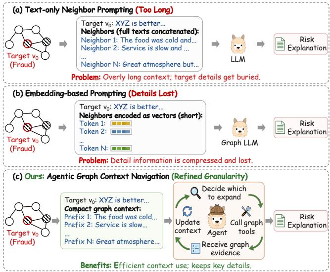
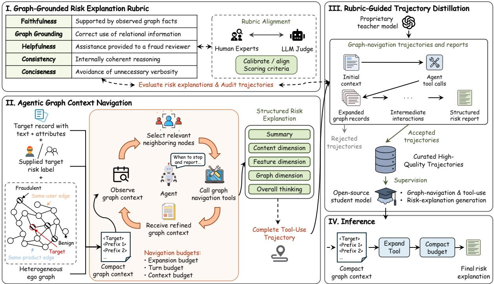
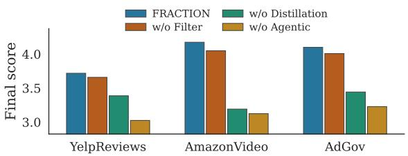
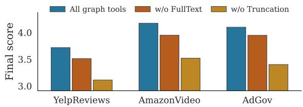
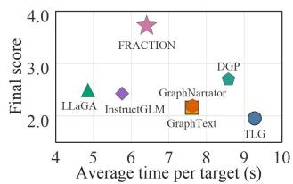
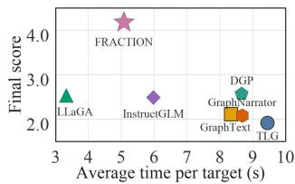

# FRACTION: Fraud Explanation Generation via Agentic Graph Context Navigation

Cecelia Soh1∗†, Jun Hu3∗, Yuan Li2‡, Cheng Chen2, Hui Liu2, Yanjia Zhu2, Hao He4, Bryan Hooi1, Bingsheng He1

1National University of Singapore 2ByteDance Inc.   
3Hefei University of Technology 4Virginia Tech

## Abstract

Graph fraud explanation generation emerges as an important task, which requires jointly leveraging graph structure and content information to produce human-readable explanations for a given risk label. An intuitive approach is to adapt exist- ing graph-enhanced large language models (LLMs), which inject graph structure into LLMs via graph-conditioned instruction tuning or structure-aware embeddings. However, existing methods face two key challenges in graph fraud explanation generation: a lack of evaluation protocols tailored to explana- tion quality, and a mismatch between the granularity of graph information they provide and what explanation generation re- quires. In this paper, we propose FRaud Explanation Generation via Agentic Graph Context NavigaTION (FRACTION), a framework for graph fraud explanation generation. To eval- uate explanation quality, we introduce a task-specific rubric that assesses faithfulness, graph grounding, helpfulness, con- sistency, and conciseness, and validate it against human judg-ments. To focus on fine-grained details of relevant neighbors without reading the entire neighborhood, we equip a language model with graph tools that progressively disclose neighbor records. To train our graph agent, we propose a rubric-guided trajectory distillation strategy through which the agent learns both tool-use behavior and structured explanation generation. Experimental results on three fraud datasets demonstrate con- sistent improvements over state-of-the-art baselines under a human-aligned rubric.

## Introduction

Graph-based fraud analysis has become increasingly impor- tant, with ra h data ca turin rich relational information among entities such as users, reviews, and companies (Cheng et al. 2025; Irofti, Patrascu, and Baltoiu 2021). Typically, in graph data, nodes represent entities, while edges encode re- lationships among them, such as users reviewing the same products, accounts sharing common devices, or reviews writ- ten by the same author, all of which provide valuable sig- nals for identifying fraudulent behavior. Studies on tasks such as graph-based fraud detection (Zhuo et al. 2024; Chen et al. 2024a; Yu, Liu, and Luo 2024; Duan et al. 2025) have demonstrated that leveraging relational information can sig- nificantly improve model performance.

  
Figure 1: Comparison of graph-to-prompt methods for graph- based fraud risk explanation.

Graph Fraud Explanation Generation is a task that generates human-readable explanations for fraud detection results based on graph data. It considers not only the target node itself but also relational evidence from its neighbor- ing nodes. For example, consider a review graph in which nodes represent reviews and edges indicate relations such as reviews written by the same user or posted for the same product. Given a review labeled as fraudulent, the generated explanation may combine evidence from both its content and its neighborhood, e.g., “the target review contains malicious language, and a neighboring review written by the same au- thor exhibits similar suspicious content.”

However, most existing graph fraud analysis studies fo- cus on tasks such as fraud detection, with limited attention paid to explanation generation. An intuitive approach is to adapt graph-enhanced LLMs (Chen et al. 2024b; Li et al. 2025) that take graph structure and text as joint input and generate human-readable explanations with LLMs. One line of work represents graph information directly as natural- language input to LLMs, as shown in Figure 1 (a). For exam-ple, TLG (Fatemi, Halcrow, and Perozzi 2024) and Graph-Text (Zhao et al. 2024) encode graph-structured information as textual prompts for LLMs. Another line of work instead encodes graph structure into dense representations that are in- jected into the LLM: for example, LLaGA (Chen et al. 2024b) and GraphGPT (Tang et al. 2024) reorganize neighborhoods into structure-aware embedding sequences, as shown in Fig- ure 1 (b). Despite their efectiveness, these graph-enhanced LLMs are primarily designed and optimized for tasks such as node classification and link prediction, without addressing two key challenges in fraud explanation generation.

The first challenge lies in evaluating open-ended fraud explanations. Unlike node classification or link predic- tion, whose outputs can be directly compared against fixed ground-truth labels, fraud explanations do not have a unique textual ground truth, as multiple explanations may express the same conclusion in distinct ways. Consequently, lexical- overlap metrics cannot adequately evaluate semantically equivalent explanations with diferent wording. Moreover, evaluating fraud explanations requires considering multiple task-specific aspects, including the use of target attributes, graph relations, and neighboring records, as well as the use- fulness, consistency, and conciseness of the explanation.

The second challenge is that the way existing graph- enhanced LLMs re resent ra h information ma not match the granularity required by fraud explanation generation. Pro- ducing a high-quality explanation for a target node requires focus on fine-grained details from its relevant neighbors, so that each claim in the explanation can be traced back to spe- cific evidence. However, text-based methods that place neigh- bor information directly into the prompt either overwhelm this focus when including all neighbors or lose it entirely when relying on a fixed retrieval budget that omits the records that matter most; embedding-based methods compress each neighboring node or subgraph into a fixed-dimensional rep- resentation, which discards the textual and metadata details needed to justify a specific conclusion.

In light of these challenges, we propose FRaud Explanation Generation via Agentic Graph Context NavigaTION (FRACTION), a framework for graph fraud explanation gen-eration. To evaluate explanation quality, we introduce a task- specific rubric that assesses faithfulness, graph grounding, helpfulness, consistency, and conciseness, and validate it against human judgments. To focus on fine-grained details of relevant neighbors without reading the entire neighborhood, we equip a language model with graph tools that progres- sively disclose neighbor records. To train our graph agent, we propose a rubric-guided trajectory distillation strategy through which the agent learns both tool-use behavior and structured explanation generation. Experimental results on three fraud datasets demonstrate consistent improvements over state-of-the-art baselines under a human-aligned rubric.

Our main contributions are as follows:

• We propose FRACTION, a framework for graph fraud ex-planation generation, together with a task-specific rubric that assesses faithfulness, graph grounding, helpfulness, consistency, and conciseness, and validate it against hu-

man judgments.

• To focus on fine-grained details of relevant neighbors without reading the entire neighborhood, we equip a lan- guage model with graph tools that progressively disclose neighbor records. To train this graph agent, we propose a rubric-guided trajectory distillation strategy through which the agent learns both tool-use behavior and struc- tured explanation generation.

• Experimental results on three fraud datasets demonstrate consistent improvements over state-of-the-art baselines under a human-aligned rubric.

## Related Work

## Graph-Enhanced Large Language Models

Recent studies have extended LLMs to graph-structured data by incorporating both graph structure and node attributes into their inputs. Existing methods can be broadly catego- rized by how graph context is exposed to the LLM. One line of work represents graph information explicitly as textual context. TLG (Fatemi, Halcrow, and Perozzi 2024) studies textual encodings of graph structures, GraphText (Zhao et al. 2024) constructs graph-syntax trees and linearizes them into text sequences, and InstructGLM (Ye et al. 2024) describes multi-scale graph neighborhoods through natural-language instructions. To make such context more manageable, G- Retriever (He et al. 2024) retrieves a task-relevant subgraph and provides its textualized content, together with a learned graph prompt, to the LLM, while DGP (Li et al. 2025) constructs text-only prompts that preserve fine-grained target-node information and summarize neighboring content.

Another line of work maps graph structure into dense rep- resentations that are injected into the LLM. GraphGPT (Tang et al. 2024) aligns graph representations with text through graph instruction tuning, while LLaGA (Chen et al. 2024b) reorganizes graph neighborhoods into structure-aware em- bedding sequences and projects them into the LLM input space. Despite their efectiveness, these methods expose graph context that is determined before generation and are primarily developed for graph prediction or question answer- ing. Neither paradigm directly supports the progressive ac- quisition of verifiable neighbor evidence required for fraud explanation generation.

## Natural-Language Explanations for Graph-Based Fraud Analysis

Existing explainable graph-based models for fraud detection and related applications expose influential features, relations, neighboring nodes, or message-passing structures through attention, expert knowledge, post-hoc explanation, architec- ture search, or learned masks. Early attention-based methods such as SemiGNN (Wang et al. 2019) and AMG-DP (Hu et al. 2020) identify important neighbors, graph views, and relation types. Know-GNN (Rao et al. 2021b) represents expert knowledge as graph functional dependencies to guide detec- tion and provide rule-based explanations, whereas NGS (Qin et al. 2022) searches for interpretable meta-graphs that ex-pose the relational message-passing structures used for pre- diction. xFraud (Rao et al. 2021a) combines a heterogeneous graph detector with a post-hoc explainer, MultiFraud (Wu, Chao, and Li 2024) produces explanations across multiple heterogeneous graphs, and SEFraud (Li et al. 2024) jointly learns feature and edge masks for self-explainable fraud de- tection. Although these methods reveal which graph com- ponents, relational patterns, or domain rules contribute to a prediction, they do not directly synthesize fine-grained tex- tual evidence into an auditor-facing natural-language report.

Recent work has explored natural-language explanations for model predictions. GraphNarrator (Pan et al. 2025) con-structs saliency-derived pseudo-explanations and trains an end-to-end generator to explain GNN predictions. Beyond graph models, PEX (Zhao and Daumé III 2025) measures prediction–explanation consistency and uses preference op- timization to improve it; SR-NLE (Wang and Atanasova 2025) improves post-hoc explanations through iterative selfcritique and refinement; and FaithLM (Chuang et al. 2026) evaluates and optimizes faithfulness through intervention- based refinement. Diferent from existing work, our FRAC- TION framework addresses graph-grounded fraud explana- tion through agentic graph context navigation, allowing the model to progressively acquire fine-grained evidence from a small set of relevant neighbors and ground each claim in verifiable records.

## Problem Definition

Let $\mathcal { G } = ( \nu , \mathcal { E } , \mathcal { R } )$ be a heterogeneous graph. A target node $v \in \mathcal V$ has textual and scalar attributes $x _ { v } \ ( \mathrm { e . g . }$ ., review text and rating), a supplied label $y _ { v } \in \{ \mathrm { Y } \mathrm { { E S } } , \mathrm { { N O } } \}$ , and relation- specific neighbors $ { \mathcal { N } } _ { r } ( v )$ for $r \in \mathcal { R }$ . The system generates a human-readable report:

$$
z _ { v } = f _ { \theta } \big ( x _ { v } , y _ { v } , \mathcal { C } _ { 0 } ( v ) , \mathcal { T } _ { v } \big ) ,\tag{1}
$$

where $\mathcal { C } _ { 0 } ( v )$ is the initial graph context and $\mathcal { T } _ { v }$ is an optional sequence of tool interactions. The label is an input to explain instead of the prediction target. Following the industrial prac- tice of ByteDance, we require each report to contain the fol- lowing sections: (i) Summary states the main conclusion; (ii) Content Dimension analyzes the textual content; (iii) Feature Dimension examines the scalar and metadata features; (iv) Graph Dimension evaluates evidence from relation-specific neighbors; and (v) Overall Thinking integrates the preceding evidence into the final assessment. Together, these sections provide a structured and evidence-based analysis of the target node.

## Method

In this section, we introduce FRaud Explanation Generation via Agentic Graph Context NavigaTION (FRACTION), a novel framework for graph fraud explanation generation.

## Overall Framework

As shown in Figure 2, FRACTION consists of the following three main components:

• Graph-Grounded Risk Explanation Rubric: We introduce a task-specific rubric that assesses faithfulness, graph grounding, helpfulness, consistency, and concise- ness, and validate it against human judgments.

• Agentic Graph Context Navigation: We equip a language-model agent with graph tools that progressively disclose selected neighbor records, enabling access to fine-grained evidence without loading every neighbor record in full.

• Rubric-Guided Trajectory Distillation: We filter teacher trajectories using the rubric and distill the accepted trajectories into an open-weight student model, which learns both graph-tool use and structured explana- tion generation.

## Graph-Grounded Risk Explanation Rubric

Existing lexical-overlap metrics against a single reference are inadequate for this task, since multiple valid reports may de- scribe the same evidence using substantially diferent word- ing. To evaluate explanation quality, we define a reference- free, evidence-conditioned rubric with five complementary dimensions: (a) Faithfulness: factual claims are supported by observed evidence; (b) Graph grounding: neighbors and relations are used correctly; (c) Helpfulness: the report is useful to a human reviewer; (d) Consistency: the report agrees with the label; (e) Conciseness: the report avoids redundancy and irrelevant content.

For an explanation trajectory $\tau ,$ the judge assigns an integer score $s _ { m } \in \{ 1 , \ldots , 5 \}$ to each dimension m. We aggregate the five scores as

$$
\begin{array} { r c l } { { q ( \tau ) } } & { { = } } & { { 0 . 3 5 s _ { \mathrm { f a i t h } } + 0 . 2 5 s _ { \mathrm { g r a p h } } + 0 . 2 5 s _ { \mathrm { h e l p } } } } \\ { { } } & { { } } & { { + 0 . 1 0 s _ { \mathrm { c o n s i s } } + 0 . 0 5 s _ { \mathrm { c o n c i s e } } , } } \end{array}\tag{2}
$$

where the coeficients are provided by ByteDance based on the preferences of domain experts. The judge receives the target record, the full graph context, and the final report, and evaluates each claim against available evidence. We validate the alignment between rubric-based judgments and human assessments, and apply the same rubric criteria to trajectory filtering and final evaluation. For example, suppose a report claims that the target review is suspicious because several reviews connected through a Same User relation use similar language. The claim receives high faithfulness and graph- grounding scores only if the observed records support the stated language pattern and the corresponding relation exists in the graph. A fluent claim that relies on undisclosed record details or an incorrect relation type is penalized, even if its conclusion matches the supplied risk label.

## Agentic Graph Context Navigation

To retrieve fine-grained evidence without loading all neigh- boring records in full, we design Agentic Graph Context Navigation (AGCN), which equips a language-model agent with graph tools that progressively disclose selected neigh- bor texts on demand (Figure 2, II).

Compact graph context. Given a target node v, let $\mathcal { N } _ { k } ( v )$ denote the nodes within k hops of v, excluding v itself; $g _ { v , u }$ the textualized hop and relation information connecting node v to node u; and $\mathrm { p r e f } ( x _ { u } )$ a short prefix of its record. After arranging neighbors in a fixed relation-aware order, the initial context is

  
Figure 2: Overall framework of FRaud Explanation Generation via Agentic Graph Context NavigaTION (FRACTION).

$$
\mathcal { C } _ { 0 } ( v ) = x _ { v } \oplus y _ { v } \oplus \bigoplus _ { u \in \mathcal { N } _ { k } ( v ) } \langle u , g _ { v , u } , \mathrm { p r e f } ( x _ { u } ) \rangle ,\tag{3}
$$

where ⊕ denotes concatenation. This representation exposes the breadth and heterogeneous structure of the k-hop ego graph while deferring the retrieval of more detailed node texts. AGCN therefore selects evidence from an informed, preconstructed neighborhood.

Graph navigation tools. At turn t, the agent is allowed to select visible node IDs $S _ { t } \subseteq { \mathcal { N } } _ { k } ( v )$ and invoke one of three tools: FullText $\cdot ( S _ { t } )$ returns complete texts; Trun- catedText $( S _ { t } , \ell _ { t } )$ returns texts truncated to length $\ell _ { t } ;$ and TextLength $\mathsf { \Omega } _ { [ \mathsf { } ] } ( S _ { t } )$ returns text lengths to guide the choice of retrieval granularity. Together, these tools allow the agent to adapt the amount of disclosed evidence under a limited context budget.

Graph navigation loop. At each turn, the agent either in-vokes a tool or stops to generate the final report:

$$
\begin{array} { r l r l } & { a _ { t } \sim \pi _ { \theta } ( \cdot \mid \mathcal { C } _ { t - 1 } , B _ { t } ) , } & & { a _ { t } \in \{ a _ { \mathrm { s t o p } } \} \cup \mathcal { A } _ { \mathrm { t o o l } } , } \\ & { \mathcal { C } _ { t } = \mathcal { C } _ { t - 1 } \oplus ( a _ { t } , o _ { t } ) , } & & { \mathrm { i f ~ } a _ { t } \in \mathcal { A } _ { \mathrm { t o o l } } , } \end{array}\tag{4}
$$

where $\mathcal { A } _ { \mathrm { t o o l } }$ comprises parameterized calls to FullText, TruncatedText, and TextLength, including the selected node set $S _ { t }$ and, when applicable, the truncation length $\ell _ { t } . B _ { t }$ denotes the remaining navigation budgets, ⊕ denotes context concatenation, and $o _ { t }$ denotes the tool output. The process terminates when the agent considers the accumulated evi- dence suficient or when no further tool call is permitted by the budgets. The agent then generates a structured risk explanation from the resulting context. The tool calls, tool outputs, and final explanation are retained as a trajectory for later distillation learning.

## Rubric-Guided Trajectory Distillation

To train the graph agent, we distill rubric-filtered trajectories generated by a large teacher model into a smaller open-weight student model. For each training target, the teacher generates a trajectory:

$$
\boldsymbol { \tau } = ( \mathcal { C } _ { 0 } , a _ { 1 } , o _ { 1 } , \ldots , a _ { n _ { \tau } } , o _ { n _ { \tau } } , z ) ,\tag{5}
$$

where $n _ { \tau }$ is the number of tool calls, $a _ { t }$ and $o _ { t }$ are the corre- sponding tool action and output, and z is the final explanation.

We evaluate each teacher trajectory using a separate LLM judge under the graph-grounded rubric. Let $\mathcal { D } _ { \mathrm { c a n d } }$ denote the set of candidate trajectories generated by the teacher. We first retain trajectories that meet the rubric quality threshold:

$$
\mathcal { D } _ { q } = \left\{ \tau \in \mathcal { D } _ { \mathrm { c a n d } } \vert q ( \tau ) \geq \gamma \right\} ,\tag{6}
$$

where $\mathcal { D } _ { q }$ is the quality-filtered trajectory $\operatorname { s e t } , q ( \tau )$ is defined in Equation 2, and $\gamma$ is the quality threshold. We then apply structural constraints to construct the final distillation dataset:

$$
\mathcal { D } _ { \mathrm { k e e p } } = \left\{ \tau \in \mathcal { D } _ { q } \left| \begin{array} { l } { n _ { \mathrm { e x p } } ( \tau ) \in [ n _ { \mathrm { m i n } } , n _ { \mathrm { m a x } } ] , } \\ { \ell _ { \mathrm { r e p } } ( \tau ) \in [ \ell _ { \mathrm { m i n } } , \ell _ { \mathrm { m a x } } ] , } \\ { c _ { \mathrm { s e c } } ( \tau ) = 1 } \end{array} \right. \right\} ,\tag{7}
$$

where $n _ { \mathrm { e x p } } ( \tau )$ denotes the number of neighbor-expansion rounds in trajectory $\tau , \ell _ { \mathrm { r e p } } ( \tau )$ denotes the final report length, and $c _ { \mathrm { s e c } } ( \tau )$ indicates whether all required report sections are present and correctly ordered. The resulting $\mathcal { D } _ { \mathrm { k e e p } }$ is the final set ofteacher trajectories retained for student fine-tuning after quality and structural filtering.

Rather than supervising only the final explanation, we dis- till the complete accepted trajectory. For a tokenized trajec-tory $( w _ { 1 } , \ldots , w _ { T _ { \tau } } )$ , let $\bar { \mathcal { T } } _ { \mathrm { a s s t } } ( \tau )$ denote the positions gen- erated by the assistant, including graph calls and the final explanation. The supervision mask is

$$
m _ { i } ^ { \tau } = \mathbb { I } \left[ i \in \mathcal { T } _ { \mathrm { a s s t } } ( \tau ) \right] ,\tag{8}
$$

and the student is optimized with

$$
\mathcal { L } _ { \mathrm { S F T } } = - \sum _ { \tau \in \mathcal { D } _ { \mathbf { k e e p } } } \sum _ { i = 1 } ^ { T _ { \tau } } m _ { i } ^ { \tau } \log p _ { \theta } ( w _ { i } \mid w _ { < i } ) .\tag{9}
$$

The initial graph context and tool outputs are masked from the loss because they are provided by the environment. The student conditions on these spans while being supervised to generate both graph calls and the final structured explanation.

## Inference

At deployment, the student receives the same initial context, tool schema, and navigation budgets as the teacher. It inde- pendently selects neighbors, conditions on the tool outputs returned during navigation, and generates the final structured explanation without further calls to the teacher.

## Experiments

We evaluate FRACTION on three graph-based fraud datasets. DeepSeek-v4-Pro (Xu et al. 2026) is used for teacher-trajectory generation, while GPT-5.5 (Singh et al. 2025) serves as the LLM judge. All methods are provided with the target risk label, so the experiments evaluate expla- nation generation rather than fraud classification.

## Datasets

We conduct experiments on YelpReviews, AmazonVideo, and AdGov, each of which contains text-rich nodes, risk labels, and application-specific graph relations. The detailed statistics are shown in Table 1. For each dataset, we use 1,000 training targets, 200 validation targets, and 400 test targets.

YelpReviews is derived from YelpChi (Rayana and Akoglu 2015), where reviews are represented as nodes and edges encode Same User, Same Business and Rating, and Same Business and Month relations. AmazonVideo is constructed from the Amazon review corpus (McAuley et al. 2015). Its edges represent Same Product, Same User, and Same Week and Rating relations. A review is labeled risky when it receives at least one helpfulness vote and its ratio ofhelpful votes to to- tal votes is below 0.5; all other reviews are labeled non-risky. AdGov is an industrial graph collected from a proprietary ad-vertising risk-governance platform. Its nodes represent daily company snapshots containing company attributes and ac-count activity. Edges connect companies through shared or similar identity information, such as business-registration at- tributes.

<table><tr><td>Dataset</td><td>Node Type</td><td>#Nodes</td><td># Edges</td><td># Edge Types</td></tr><tr><td>YelpReviews</td><td>Service Review</td><td>67,395</td><td>17,486,608</td><td>3</td></tr><tr><td>AmazonVideo</td><td>Product Review</td><td>37,126</td><td>9,883,406</td><td>3</td></tr><tr><td>AdGov</td><td>Company Snapshot</td><td>2,126,463</td><td>24,240,638</td><td>39</td></tr></table>

Table 1: Statistics of the three datasets.

## Baselines

We compare FRACTION with four groups of baselines: target-only prompting with Qwen3.6-27B (Yang et al. 2025) and DeepSeek-v4-Pro (Xu et al. 2026); static graphto-text methods, including TLG and GraphText; graph- enhanced LLMs, including LLaGA (Chen et al. 2024b), InstructGLM (Ye et al. 2024), and DGP (Li et al. 2025); and explanation-generation methods, including GraphNarra- tor (Pan et al. 2025) and PEX (Zhao and Daumé III 2025). We use oficial implementations and recommended configu- rations whenever available.

## Implementation Details

Each initially visible neighbor is represented by a 220- character prefix, with at most 100 neighbors per relation. The graph navigation budget permits up to 100 expanded nodes over 10 interaction turns. For each training target, we sample up to 10 teacher trajectories using a temperature of 0.7 and top-p of 0.9, stopping once one is admitted to $\mathcal { D } _ { \mathrm { k e e p } } . \mathrm { W e } \mathrm { \ s e i } \tilde { \gamma } = 4 . 0 , k = \bar { 1 } , \left[ \bar { n } _ { \mathrm { m i n } } , n _ { \mathrm { m a x } } \right] = [ 0 , 1 0 ]$ , and $[ \ell _ { \mathrm { m i n } } , \ell _ { \mathrm { m a x } } ] = [ 3 5 0 , 5 , 0 0 0 ]$ characters.

The student is initialized from Qwen3.6-27B and finetuned for two epochs using 4-bit LoRA with rank 16, scaling factor 32, and dropout 0.05. We use paged 8-bit AdamW with a learning rate of $2 \times 1 0 ^ { - 4 }$ and select the best checkpoint based on validation loss.

Training and inference use four high-performance GPUs with 96 GB of memory each. We use seed 42 for data parti- tioning, target sampling, neighbor ordering, and other local stochastic operations. All methods use the same test targets, prompts, and decoding settings.

## Evaluation Protocol

We evaluate generated explanations using the graph- grounded rubric introduced in the Graph-Grounded Risk Ex- planation Rubric subsection. We report Faithfulness, Graph Groundin , Hel fulness, Consistenc , and Conciseness, to- gether with their weighted final score and the pass rate under a threshold of 3.0 out of 5.0.

To ensure a fair comparison, all methods are evaluated un- der the same unified-evidence protocol. The GPT-5.5 judge receives the complete target-node information and all ac- cessible neighbors. Thus, evaluation is based on the same observable evidence regardless of the context or navigation strategy used by each method.

We additionally compare end-to-end inference latency on YelpReviews and AmazonVideo to assess the computational eficiency of diferent methods.

<table><tr><td>Method</td><td>Model</td><td>Final score</td><td>Pass rate</td><td>Faithfulness</td><td>Graph grounding</td><td>Helpfulness</td><td>Consistency</td><td>Conciseness</td></tr><tr><td colspan="9">Dataset: YelpReviews</td></tr><tr><td>Zero-shot target-only</td><td>Qwen3.6-27B</td><td>2.0615</td><td>0.00%</td><td>1.9300</td><td>1.0000</td><td>2.0425</td><td>3.9425</td><td>4.6225</td></tr><tr><td>Zero-shot target-only</td><td>DeepSeek-v4-Pro</td><td>2.2420</td><td>0.00%</td><td>2.1200</td><td>1.0000</td><td>2.3450</td><td>4.2375</td><td>4.8000</td></tr><tr><td>TLG</td><td>Qwen3.6-27B</td><td>1.9266</td><td>0.00%</td><td>1.7075</td><td>1.0025</td><td>1.8975</td><td>3.7025</td><td>4.6750</td></tr><tr><td>TLG</td><td>DeepSeek-v4-Pro</td><td>1.9545</td><td>0.00%</td><td>1.7500</td><td>1.0025</td><td>1.9225</td><td>3.7825</td><td>4.6500</td></tr><tr><td>GraphText</td><td>Qwen3.6-27B</td><td>2.0855</td><td>1.75%</td><td>1.8800</td><td>1.1625</td><td>2.0800</td><td>3.8500</td><td>4.6375</td></tr><tr><td>GraphText</td><td>DeepSeek-v4-Pro</td><td>2.1558</td><td>2.00%</td><td>1.9450</td><td>1.1425</td><td>2.1750</td><td>4.0850</td><td>4.7425</td></tr><tr><td>InstructGLM</td><td>Qwen3.6-27B</td><td>2.4254</td><td>12.75%</td><td>2.0950</td><td>1.6050</td><td>2.5425</td><td>4.2825</td><td>4.5400</td></tr><tr><td>DGP</td><td>Qwen3.6-27B</td><td>2.6930</td><td>37.00%</td><td>2.4400</td><td>1.8175</td><td>2.8225</td><td>4.4575</td><td>4.6650</td></tr><tr><td>LLaGA</td><td>Qwen3.6-27B</td><td>2.4921</td><td>17.50%</td><td>2.1400</td><td>1.7450</td><td>2.6200</td><td>4.2525</td><td>4.5325</td></tr><tr><td>PEX</td><td>Qwen3.6-27B</td><td>2.2126</td><td>0.00%</td><td>2.0450</td><td>1.0000</td><td>2.3350</td><td>4.2525</td><td>4.7575</td></tr><tr><td>GraphNarrator</td><td>Qwen3.6-27B</td><td>2.1933</td><td>3.50%</td><td>1.8675</td><td>1.4875</td><td>2.2600</td><td>4.0050</td><td>4.0450</td></tr><tr><td>FRACTION</td><td>Qwen3.6-27B</td><td>3.7080</td><td>91.75%</td><td>3.2450</td><td>3.3625</td><td>3.9925</td><td>4.9200</td><td>4.8300</td></tr><tr><td colspan="9"></td></tr><tr><td>Zero-shot target-only</td><td>Qwen3.6-27B 2.0826</td><td></td><td>0.00%</td><td>Dataset: AmazonVideo 1.9525</td><td>1.0000</td><td>2.0600</td><td>4.0375</td><td>4.6100</td></tr><tr><td>Zero-shot target-only</td><td>DeepSeek-v4-Pro</td><td>2.1450</td><td>0.00%</td><td>2.0125</td><td>1.0000</td><td>2.1150</td><td>4.2450</td><td>4.7475</td></tr><tr><td>TLG</td><td>Qwen3.6-27B</td><td>1.9259</td><td>0.00%</td><td>1.6925</td><td>1.0150</td><td>1.9050</td><td>3.7700</td><td>4.5300</td></tr><tr><td>TLG</td><td>DeepSeek-v4-Pro</td><td>1.9121</td><td>0.25%</td><td>1.6375</td><td>1.0075</td><td>1.8850</td><td>3.8575</td><td>4.6025</td></tr><tr><td>GraphText</td><td>Qwen3.6-27B</td><td>2.1226</td><td>3.75%</td><td>1.9400</td><td>1.1525</td><td>2.0850</td><td>4.0125</td><td>4.6600</td></tr><tr><td>GraphText</td><td>DeepSeek-v4-Pro</td><td>2.1090</td><td>1.50%</td><td>1.9400</td><td>1.0900</td><td>2.0775</td><td>4.0325</td><td>4.6975</td></tr><tr><td>InstructGLM</td><td>Qwen3.6-27B</td><td>2.4825</td><td>18.75%</td><td>2.2125</td><td>1.6375</td><td>2.5700</td><td>4.2950</td><td>4.5350</td></tr><tr><td>DGP</td><td>Qwen3.6-27B</td><td>2.5631</td><td>23.75%</td><td>2.3050</td><td>1.6650</td><td>2.7000</td><td>4.4025</td><td>4.4975</td></tr><tr><td>LLaGA</td><td>Qwen3.6-27B</td><td>2.5264</td><td>21.75%</td><td>2.2000</td><td>1.7875</td><td>2.5725</td><td>4.4200</td><td>4.4875</td></tr><tr><td>PEX</td><td>Qwen3.6-27B</td><td>2.2261</td><td>0.00%</td><td>2.0750</td><td>1.0000</td><td>2.2550</td><td>4.5025</td><td>4.7175</td></tr><tr><td>GraphNarrator</td><td>Qwen3.6-27B</td><td>2.0783</td><td>1.50%</td><td>1.8275</td><td>1.2075</td><td>2.1025</td><td>4.1200</td><td>3.9825</td></tr><tr><td>FRACTION</td><td>Qwen3.6-27B</td><td>4.1745</td><td>98.75%</td><td>4.2225</td><td>3.5675</td><td>4.2500</td><td>4.9575</td><td>4.9300</td></tr><tr><td colspan="9">Dataset: AdGov</td></tr><tr><td>Zero-shot target-only</td><td>DeepSeek-v4-Pro</td><td>2.7900</td><td>35.25%</td><td>2.5575</td><td>1.8425</td><td>3.0650</td><td>4.2900</td><td>4.7800</td></tr><tr><td>Zero-shot target-only</td><td>Qwen3.6-27B</td><td>2.7988</td><td>36.25%</td><td>2.5050</td><td>1.9075</td><td>3.1050</td><td>4.3250</td><td>4.7275</td></tr><tr><td>TLG</td><td>Qwen3.6-27B</td><td>2.8809</td><td>32.00%</td><td>2.3350</td><td>2.3450</td><td>3.2075</td><td>4.4400</td><td>4.6300</td></tr><tr><td>TLG</td><td>DeepSeek-v4-Pro</td><td>2.8565</td><td>29.00%</td><td>2.2950</td><td>2.3575</td><td>3.2275</td><td>4.2250</td><td>4.6900</td></tr><tr><td>GraphText</td><td>Qwen3.6-27B</td><td>3.0145</td><td>42.00%</td><td>2.4500</td><td>2.5525</td><td>3.3325</td><td>4.5125</td><td>4.6900</td></tr><tr><td>GraphText</td><td>DeepSeek-v4-Pro</td><td>2.8566</td><td>30.75%</td><td>2.3125</td><td>2.4500</td><td>3.1900</td><td>4.0225</td><td>4.7000</td></tr><tr><td>InstructGLM</td><td>Qwen3.6-27B</td><td>2.7996</td><td>27.50%</td><td>2.2475</td><td>2.2875</td><td>3.0875</td><td>4.3500</td><td>4.6850</td></tr><tr><td>DGP</td><td>Qwen3.6-27B</td><td>2.8025</td><td>31.50%</td><td>2.3575</td><td>2.1600</td><td>3.0675</td><td>4.3450</td><td>4.7200</td></tr><tr><td>LLaGA</td><td>Qwen3.6-27B</td><td>3.0299</td><td>46.00%</td><td>2.4475</td><td>2.6425</td><td>3.3150</td><td>4.5500</td><td>4.5775</td></tr><tr><td>PEX</td><td>Qwen3.6-27B</td><td>2.4074</td><td>0.25%</td><td>2.3425</td><td>1.0050</td><td>2.7350</td><td>4.1475</td><td>4.7550</td></tr><tr><td>GraphNarrator</td><td>Qwen3.6-27B</td><td>2.1253</td><td>7.75%</td><td>1.9200</td><td>1.2525</td><td>2.4125</td><td>3.1900</td><td>4.3600</td></tr><tr><td>FRACTION</td><td>Qwen3.6-27B</td><td>4.1035</td><td>94.25%</td><td>4.0125</td><td>3.6300</td><td>4.2250</td><td>4.9075</td><td>4.8925</td></tr><tr><td></td><td></td><td></td><td></td><td></td><td></td><td></td><td></td><td></td></tr></table>

Table 2: Performance comparison on graph fraud explanation generation across YelpReviews, AmazonVideo, and AdGov.

## Performance Analysis

Table 2 compares our method with the baselines on YelpRe- views, AmazonVideo, and AdGov. We draw the following observations:

• Zero-shot methods include Zero-shot target-only, TLG, and GraphText. The first uses only the target node, while the latter two are graph-enhanced LLM methods that ad- ditionally incorporate graph information. However, their final scores alternately outperform one another across datasets, indicating that zero-shot graph-enhanced meth- ods cannot reliably exploit graph information for this task.

• Trained graph-enhanced LLMs, including InstructGLM, DGP, and LLaGA, outperform the zero-shot methods in most cases, indicating the importance of training for ef- fectively utilizing graph information in this task.

• Explanation-generation methods, including PEX and

GraphNarrator, consistently underperform the trained graph-enhanced LLMs. PEX relies only on target-node information, while GraphNarrator selects neighbors us- ing predefined saliency signals. One potential reason for GraphNarrator’s weaker performance is that these sig- nals do not reliably capture semantic relevance, making it dificult to focus on the neighbor information most useful for explanation generation. This shows that these explanation-generation methods are not directly suited to graph fraud explanation generation.

• Diferent from existing methods, FRACTION uses agentic graph context navigation to progressively disclose rel- evant neighbor records and focus on their fine-grained details. It significantly outperforms all baselines across the three datasets and achieves the highest final scores, demonstrating the efectiveness of agentic graph context navigation for graph fraud explanation generation.

  
Figure 3: Ablation results of FRACTION and its variants.

  
Figure 4: Impact of graph tools.

## Detailed Analysis

We further examine the contribution ofthe main components, the behavior of graph-tool navigation, and the performance– eficiency trade-of.

Ablation Study We compare FRACTION with three variants: w/o Agentic, which replaces iterative graph navigation with single-turn generation from a fixed graph context; w/o Distillation, which directly uses the pretrained Qwen3.6- 27B model as a zero-shot graph agent; and w/o Filtering, which retains all teacher trajectories during fine-tuning with-out quality filtering. All variants use the same backbone and evaluation settings.

As shown in Figure 3, removing agentic navigation causes the largest performance drop on all datasets, demonstrating the importance of progressive evidence acquisition. Remov- ing distillation also substantially degrades performance, par- ticularly on AmazonVideo, showing that trajectory supervi-sion is critical for transferring the teacher’s navigation behav- ior. Filtering provides a smaller but consistent improvement, confirming the value of removing low-quality trajectories before fine-tuning.

Impact of Graph Tools We evaluate the contribution of diferent graph navigation tools while keeping the model, prompt, and context budget fixed. Figure 4 compares FRAC- TION with all tools against w/o FullText, which removes the FullText tool, and w/o Truncation, which removes both TruncatedText and TextLength. We remove them together because they are introduced specifically to guide truncated retrieval.

Removing FullText consistently reduces the final score across all datasets, indicating that complete neighbor records provide complementary fine-grained evidence. Removing Truncation causes a substantially larger drop, demonstrating the importance of adaptively controlling evidence granularity under a limited context budget. Overall, truncated retrieval is the primary contributor, while full-text retrieval provides additional detail when needed.

  
(a) YelpReviews

  
(b) AmazonVideo

Figure 5: Performance–time trade-of of FRACTION and representative baselines.
<table><tr><td>Dataset</td><td>N</td><td>Spearman ρ</td><td>p-value</td><td>Mean diff.</td><td>MAE</td><td>RMSE</td><td>Pass agree.</td></tr><tr><td>YelpReviews</td><td>20</td><td>0.7205</td><td>0.0003</td><td>0.0500</td><td>0.2500</td><td>0.3256</td><td>95.00%</td></tr><tr><td>AmazonVideo</td><td>20</td><td>0.4558</td><td>0.0434</td><td>0.2475</td><td>0.3625</td><td>0.4462</td><td>100.00%</td></tr></table>

Table 3: Alignment of rubric scores with human judgments.

Eficiency Analysis Figure 5 compares explanation quality and average inference time per target. FRACTION achieves the highest final score on both YelpReviews and Amazon- Video, requiring 6.42 and 5.08 seconds per target, respec- tively. It lies on the empirical Pareto frontier on both datasets, demonstrating that selective graph navigation substantially improves explanation quality with moderate inference over- head.

## Alignment with Human Judgments

Table 3 compares GPT-5.5 rubric scores with human judg-ments on 20 reports per dataset. GPT-5.5 shows significant score correlations on YelpReviews (ρ = 0.7205) and AmazonVideo (ρ = 0.4558), with pass-decision agreement of 95% and 100%, respectively. These results support its use as the LLM judge for trajectory filtering and final evaluation.

## Conclusion

We study graph fraud explanation generation, which re- quires jointly leveraging graph structure and content infor-mation to produce human-readable explanations for a sup- plied risk label. We propose FRACTION, a framework for graph fraud explanation generation. To evaluate explanation quality, FRACTION introduces a task-specific rubric that assesses faithfulness, graph grounding, helpfulness, consis- tency, and conciseness, and validates it against human judg-ments. To focus on fine-grained details of relevant neighbors without reading the entire neighborhood, FRACTION equips a language model with graph tools that progressively disclose neighbor records. To train the graph agent, FRACTION fur- ther adopts a rubric-guided trajectory distillation strategy through which the agent learns both tool-use behavior and structured explanation generation. Experimental results on three fraud datasets demonstrate consistent improvements over state-of-the-art baselines under a human-aligned rubric.

## References

Chen, N.; Liu, Z.; Hooi, B.; He, B.; Fathony, R.; Hu, J.; and Chen, J. 2024a. Consistency Training with Learnable Data Augmentation for Graph Anomaly Detection with Limited Supervision. In The Twelfth International Conference on Learning Representations.

Chen, R.; Zhao, T.; Jaiswal, A. K.; Shah, N.; and Wang, Z. 2024b. LLaGA: Large Language and Graph Assistant. In Proceedings of the 41st International Conference on Machine Learning, volume 235 of Proceedings of Machine Learning Research, 7809–7823. PMLR.

Cheng, D.; Zou, Y.; Xiang, S.; and Jiang, C. 2025. Graph neural networks for financial fraud detection: a review. Frontiers Comput. Sci., 19(9): 199609.

Chuang, Y.-N.; Wang, G.; Chang, C.-Y.; Tang, R.; Zhong, S.; Yang, F.; Wen, A.; Du, M.; Cai, X.; Braverman, V.; et al. 2026. FaithLM: Towards faithful explanations for large lan- guage models. In Proceedings of the 19th Conference of the European Chapter ofthe Associationfor Computational Linguistics (Volume 1: Long Papers), 3802–3824.

Duan, M.; He, D.; Zheng, T.; Jia, L.; Song, M.; Wang, X.; and Feng, Z. 2025. Global Attribute-Association Pattern Aggregation for Graph Fraud Detection. In Walsh, T.; Shah, J.; and Kolter, Z., eds., Thirty-Ninth AAAI Conference on Artificial Intelligence, Thirty-Seventh Conference on Innovative Applications of Artificial Intelligence, Fifteenth Symposium on Educational Advances in Artificial Intelligence, AAAI 2025, Philadelphia, PA, USA, February 25 - March 4, 2025, 11616–11624. AAAI Press.

Fatemi, B.; Halcrow, J.; and Perozzi, B. 2024. Talk like a Graph: Encoding Graphs for Large Language Models. In The Twelfth International Conference on Learning Representations.

He, X.; Tian, Y.; Sun, Y.; Chawla, N. V.; Laurent, T.; LeCun, Y.; Bresson, X.; and Hooi, B. 2024. G-Retriever: Retrieval- Augmented Generation for Textual Graph Understanding and Question Answering. In Advances in Neural Information Processing Systems, volume 37.

Hu, B.; Zhang, Z.; Zhou, J.; Fang, J.; Jia, Q.; Fang, Y.; Yu, Q.; and Qi, Y. 2020. Loan default analysis with multiplex graph learning. In Proceedings ofthe 29thACMinternational conference on information & knowledge management, 2525– 2532.

Irofti, P.; Patrascu, A.; and Baltoiu, A. 2021. Quick survey of graph-based fraud detection methods. arXiv:1910.11299.

Li, K.; Yang, T.; Zhou, M.; Meng, J.; Wang, S.; Wu, Y.; Tan, B.; Song, H.; Pan, L.; Yu, F.; et al. 2024. Sefraud: Graph-based self-explainable fraud detection via interpre- tative mask learning. In Proceedings of the 30th ACM SIGKDD Conference on Knowledge Discovery and Data Mining, 5329–5338.

Li, Y.; Hu, J.; Hooi, B.; He, B.; and Chen, C. 2025. DGP: A Dual-Granularity Prompting Framework for Fraud Detection with Graph-Enhanced LLMs. arXiv preprint arXiv:2507.21653.

McAuley, J.; Targett, C.; Shi, Q.; and van den Hengel, A. 2015. Inferring Networks of Substitutable and Complemen- tary Products. In Proceedings of the 21st ACM SIGKDD International Conference on Knowledge Discovery and Data Mining, 785–794. ACM.

Pan, B.; Xiong, Z.; Wu, G.; Zhang, Z.; Zhang, Y.; Hu, Y.; and Zhao, L. 2025. Graphnarrator: Generating textual ex- planations for graph neural networks. In Proceedings of the 63rd Annual Meeting of the Association for Computational Linguistics (Volume 1: Long Papers), 23–42.

Qin, Z.; Liu, Y.; He, Q.; and Ao, X. 2022. Explainable Graph-Based Fraud Detection via Neural Meta-Graph Search. In Proceedings of the 31st ACM International Conference on Information and Knowledge Management, 4414–4418.

Rao, S. X.; Zhang, S.; Han, Z.; Zhang, Z.; Min, W.; Chen, Z.; Shan, Y.; Zhao, Y.; and Zhang, C. 2021a. xFraud: explain- able fraud transaction detection. Proceedings of the VLDB Endowment, 15(3): 427–436.

Rao, Y.; Mi, X.; Duan, C.; Ren, X.; Cheng, J.; Chen, Y.; You, H.; Gao, Q.; Zeng, Z.; and Wei, X. 2021b. Know-gnn: An explainable knowledge-guided graph neural network for fraud detection. In International Conference on Neural Information Processing, 159–167. Springer.

Rayana, S.; and Akoglu, L. 2015. Collective Opinion Spam Detection: Bridging Review Networks and Metadata. In Proceedings of the 21st ACM SIGKDD International Conference on Knowledge Discovery and Data Mining, 985–994. ACM.

Singh, A.; Fry, A.; Perelman, A.; Tart, A.; Ganesh, A.; El- Kishky, A.; McLaughlin, A.; Low, A.; Ostrow, A.; Anan- thram, A.; et al. 2025. Openai gpt-5 system card. arXiv preprint arXiv:2601.03267.

Tang, J.; Yang, Y.; Wei, W.; Shi, L.; Su, L.; Cheng, S.; Yin, D.; and Huang, C. 2024. GraphGPT: Graph Instruction Tun- ing for Large Language Models. In Proceedings ofthe 47th International ACM SIGIR Conference on Research and Development in Information Retrieval, 491–500. ACM.

Wang, D.; Lin, J.; Cui, P.; Jia, Q.; Wang, Z.; Fang, Y.; Yu, Q.; Zhou, J.; Yang, S.; and Qi, Y. 2019. A semi-supervised graph attentive network for financial fraud detection. In 2019 IEEE international conference on data mining (ICDM), 598–607. IEEE.

Wang, Y.; and Atanasova, P. 2025. Self-critique and refine- ment for faithful natural language explanations. In Proceedings ofthe 2025 Conference on Empirical Methods in Natural Language Processing, 8492–8518.

Wu, B.; Chao, K.-M.; and Li, Y. 2024. Heterogeneous Graph Neural Networks for Fraud Detection and Explanation in Supply Chain Finance. Information Systems, 121: 102335.

Xu, A.; Lin, B.; Xue, B.; Wang, B.; Xu, B.; Wu, B.; Zhang, B.; Lin, C.; Dong, C.; Ling, C.; et al. 2026. Deepseek-v4: Towards highly eficient million-token context intelligence. arXiv preprint arXiv:2606.19348.

Yang, A.; Li, A.; Yang, B.; Zhang, B.; Hui, B.; Zheng, B.; Yu, B.; et al. 2025. Qwen3 Technical Report. arXiv preprint arXiv:2505.09388.

Ye, R.; Zhang, C.; Wang, R.; Xu, S.; and Zhang, Y. 2024. Language is All a Graph Needs. In Findings of the Associationfor Computational Linguistics: EACL 2024, 1955–1973. Association for Computational Linguistics.

Yu, H.; Liu, Z.; and Luo, X. 2024. Barely supervised learning for graph-based fraud detection. AAAI Press. ISBN 978-1- 57735-887-9.

Zhao, J.; Zhuo, L.; Shen, Y.; Qu, M.; Liu, K.; Bronstein, M. M.; Zhu, Z.; and Tang, J. 2024. GraphText: Graph Reason- ing in Text Space. In Adaptive Foundation Models: Evolving AI for Personalized and Eficient Learning.

Zhao, L.; and Daumé III, H. 2025. A Necessary Step toward Faithfulness: Measuring and Improving Consistency in Free- Text Explanations. In Proceedings ofthe 2025 Conference on Empirical Methods in Natural Language Processing, 15810– 15824.

Zhuo, W.; Liu, Z.; Hooi, B.; He, B.; Tan, G.; Fathony, R.; and Chen, J. 2024. Partitioning Message Passing for Graph Fraud Detection. arXiv:2412.00020.