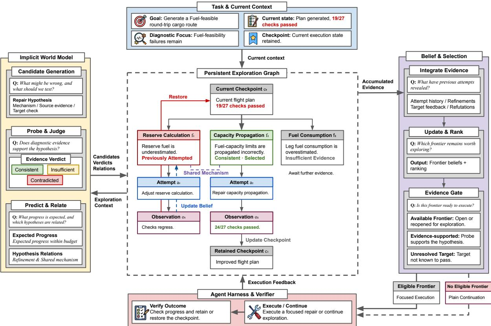
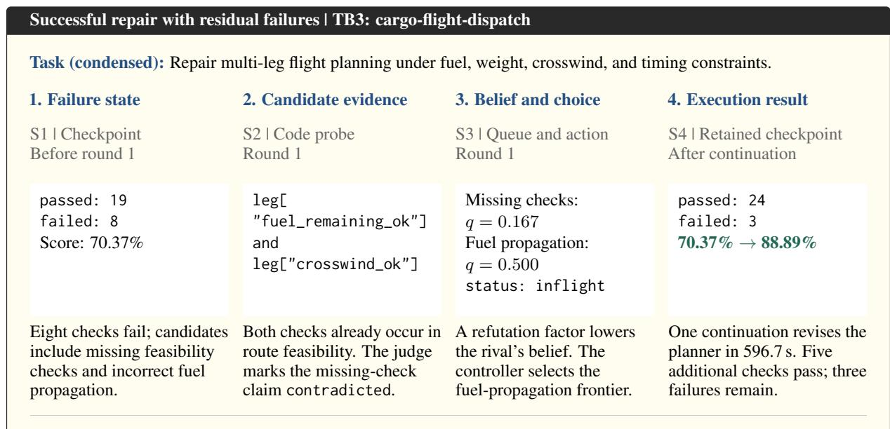
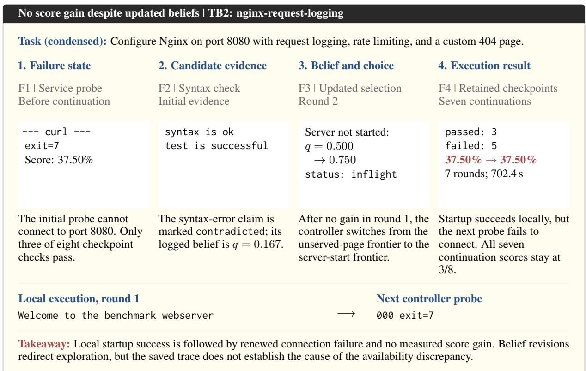

# Failure Recovery via Belief Updates and World Modeling for Long-Horizon Agents

Xiyang Wu\*<sup>1</sup> Zhichao Liu\*<sup>1</sup> Shengxin Zhang\*<sup>2</sup> Zongxia Li<sup>1</sup> Ming Li<sup>1</sup> Tianyi Zhou<sup>3</sup> Dinesh Manocha<sup>1</sup> <sup>1</sup>University of Maryland <sup>2</sup>Google <sup>3</sup>MBZUAI

## Abstract

Long-horizon agents often struggle to recover from failures whose causes lie several steps earlier, beyond what local reflection or backtracking can resolve. We introduce BE-LIEFWEAVER, a framework that combines persistent evidence across attempts with prospective reasoning over repair directions. It maintains a relational belief state over frontiers, attempts, observations, and checkpoints. Execution evidence updates related frontier priorities across attempts and rollback, while diagnostic evidence gates execution. An implicit world model (IWM) evaluates repair hypotheses, predicts progress, and identifies relations among frontiers to guide exploration. We further distill these reasoning components into a 9B student through supervised fine-tuning and on-policy distillation (OPD). Across three terminal-based benchmarks, BELIEFWEAVER improves aggregate final score by 5.1 percentage points over native Terminus-2 continuation, with positive trends in exploration efficiency. The distilled 9B student improves final score by 9.8 percentage points over the reported native baseline while reducing estimated teacher API cost by 54.8% relative to the matched teacher. These results show that persistent evidence and prospective reasoning can improve recovery in longhorizon agent tasks while substantially reducing reliance on teacher-model inference.

## 1 Introduction

Long-horizon agents tackle tasks such as autonomous research (Yamada et al., 2025), computer use (Xie et al., 2024), and sequential decisionmaking (Yao et al., 2022). However, early mistakes can propagate through long trajectories, trapping agents in repetitive attempts or leading to premature commitments that are difficult to reverse (Wang et al., 2026; Liu et al., 2026b; Li et al., 2026). The evidence needed to identify these mistakes often emerges only after many subsequent actions. Recovering from such failures requires agents to revisit earlier assumptions in light of new evidence and use what they learn to guide subsequent exploration.

Reflection allows agents to revise their behavior after failures or new evidence (Shinn et al., 2023; Madaan et al., 2023). Recovery may involve backtracking and trying another frontier, a testable hypothesis for repairing the current failure. Existing approaches often organize such alternatives as a tree to support branching and backtracking (Zhu et al., 2026; Chen et al., 2026; Jin et al., 2026). Long-horizon failures, however, can arise from earlier decisions or assumptions shared across branches (Zhuang et al., 2026; Rafi et al., 2026). Although rollback and persistent memory can preserve what happened, recovery still requires deciding how new verifier-grounded evidence should change the priorities of related repair hypotheses. When frontiers share prerequisites or interact across steps, evidence from one attempt can make another direction more or less promising (Zhang et al., 2026d; Liang et al., 2026). This motivates a persistent exploration state that carries evidence across rollback and uses it to reprioritize future exploration.

We represent exploration as a persistent relational state over frontiers, attempts, observations, and checkpoints. Recorded outcomes and candidate relations determine which unary evidence factors update each frontier’s priority (Mishra et al., 2024; Cao and Chen, 2026). This lets evidence from one attempt re-rank related alternatives, while diagnostic evidence separately controls execution eligibility. The state is preserved across rollback. Belief updates capture what has been learned, but recovery also requires deciding what to try next. Recent agentic world models (Zuo et al., 2026) use learned dynamics or outcome prediction to guide decisions (Zhou et al., 2024; Zhao et al., 2026). We use an implicit world model (IWM) to evaluate repair hypotheses, estimate prospective progress, and infer frontier relations, guiding their generation, refinement, and reconsideration. These repeated assessments can then be distilled into a lightweight student to reduce teacher inference cost (Yang et al., 2026).

In this paper, we introduce BELIEFWEAVER, a framework for long-horizon problem solving that combines a persistent relational exploration state with an implicit world model (IWM). The exploration state tracks frontiers, attempts, observations, and checkpoints, preserving evidence across rollback and using new outcomes to revise related hypotheses. The IWM evaluates repair hypotheses, estimates prospective progress, and infers relations among frontiers to guide what to explore next. Execution outcomes are then added back to the persistent state, so later decisions can build on earlier attempts. Because these assessments are used repeatedly during exploration, we distill them into a lightweight 9B student through supervised fine-tuning (SFT) and on-policy distillation (OPD) (Agarwal et al., 2024), improving task performance while reducing teacher API costs (Jolicoeur-Martineau, 2025). This makes recovery cumulative: failed attempts provide evidence for subsequent exploration rather than simply triggering another retry. Our contributions are:

• We introduce a recovery controller that uses retained execution evidence and relations among repair hypotheses to update frontier priorities. It can reprioritize candidates beyond the latest attempt, while a separate diagnostic gate controls execution eligibility.

• We develop an implicit world model that reasons over repair hypotheses, expected progress, and their relations, and distill this reasoning into a smaller student for efficient execution.

• Across three terminal-based benchmarks, BE-LIEFWEAVER improves aggregate final score by 5.1 points over native Terminus-2 continuation and also improves exploration efficiency. The distilled 9B student gains 9.8 points over the reported native baseline while reducing estimated teacher API cost by 54.8%.

## 2 Related Work

World Models for Agentic Reasoning. World models let agents reason about possible future outcomes before acting. Prior work has explored both implicit predictive models and explicit executable ones. FLARE (Zheng et al., 2025) predicts latent future observations for robot control, while Qwen-AgentWorld (Zuo et al., 2026) models agent– environment transitions for general-purpose agents. RAP (Hao et al., 2023) and WebDreamer (Gu et al., 2024) use LLMs to predict outcomes during planning, and WKM (Qiao et al., 2024) combines global task knowledge with local state. Other work builds executable models for internal simulation, including WorldCoder (Tang et al., 2024) and Executable World Models (Rodionov, 2026); Patch-World (Bai et al., 2026), OPINE-World (Courtis et al., 2026), and Tycho (Lehmann et al., 2026) further support inspection, replay, and revision. Our work instead uses consequence predictions and verifier feedback to maintain a persistent belief over unresolved frontiers and guide exploration across them.

Long-horizon and Recursive Agents. Longhorizon agents face context growth, evidence loss, error propagation, and difficulty recovering from earlier decisions (Chen et al., 2026; Zhu et al., 2026; Sun et al., 2025; Liu et al., 2026a). Recent work addresses these issues through persistent state, structured search, recursion, and recovery. Argus (Zhang et al., 2026e) uses a shared evidence graph to coordinate search. HTR (Jin et al., 2026) maintains a persistent tree of hypotheses, artifacts, evidence, and insights, propagating experimental findings to refine and guide later search. AgentRewind (Zhuang et al., 2026) restores earlier checkpoints while retaining memories from failed attempts. Recursive Language Models (Zhang et al., 2025) recurse over subproblems, while Recursive Agent Harnesses (Lumer et al., 2026) extend this to tool-using subagents. SciNav (Zhang and Sun, 2026) frames scientific coding as search over alternative solution branches. Our controller turns retained outcomes and frontier relations into explicit priority updates through unary evidence factors, including for candidates not executed in the latest attempt. A separate diagnostic gate determines which frontiers are eligible for execution.

Recent agents increasingly learn from accumulated experience or use uncertainty to decide what to explore next. SkillRL (Xia et al., 2026) jointly evolves a hierarchical skill library and agent policy, while COS-PLAY (Wu et al., 2026) discovers and refines reusable skills from interaction trajectories. Darwin Gödel Machine (Zhang et al., 2026a), Gödel Agent (Yin et al., 2025), and Hyperagents (Zhang et al., 2026b) go further by iteratively modifying the agent’s code, logic, or improvement process. MLEvolve (Du et al., 2026) combines cross-branch search with retrospective memory, while Uncertainty-Guided Tree Search (Mhammedi and Cohan, 2026) and Agentic Uncertainty (Zhang et al., 2026c) use epistemic uncertainty to guide exploration and reflection. Our work instead uses verifier-grounded evidence to update priorities over related frontiers, allowing the agent to revisit promising directions without changing the underlying agent.

## 3 Problem Formulation

Long-Horizon Problem Solving as Frontier Exploration. We consider an agent operating in a partially observable long-horizon environment, where decisions are conditioned on the interaction history $h _ { t }$ . Instead of modeling individual low-level actions, we formulate exploration over a time-varying set of problem-solving frontiers,

$$
\mathcal { F } _ { t } = \{ f _ { 1 } , \ldots , f _ { N _ { t } } \} .
$$

Each frontier $f _ { i }$ is a testable repair hypothesis that specifies a possible failure mechanism, the evidence needed to assess it, and the checks used to evaluate the repair. At step t, the agent either explores an eligible frontier or continues execution to gather evidence that can support, refine, or introduce new frontiers. The set $\mathcal { F } _ { t }$ evolves over time, while i identifies the same frontier across repeated attempts.

Persistent Exploration State. We maintain a relational graph

$$
G _ { t } = ( V _ { t } , \mathcal { R } _ { t } ) ,
$$

where $V _ { t }$ is the node set and $\mathcal { R } _ { t }$ is the relation edge set. The graph connects frontiers with their attempts, observations, and checkpoints, and links frontiers that share or refine failure mechanisms. For each frontier $f _ { i }$ , we maintain a belief

$$
b _ { t } ^ { i } = q _ { t } ^ { i } ( z _ { i } = 1 ) ,
$$

where $z _ { i } \in \{ 0 , 1 \}$ indicates whether the frontier remains worth pursuing and $q _ { t } ^ { i }$ is the corresponding belief distribution. We summarize the exploration state as

$$
B _ { t } = ( G _ { t } , \mathcal { E } _ { t } , \mathbf { b } _ { t } ) , \qquad \mathbf { b } _ { t } = ( b _ { t } ^ { i } ) _ { f _ { i } \in \mathcal { F } _ { t } } ,
$$

where $\mathcal { E } _ { t }$ contains accumulated diagnostic observations and execution feedback. Relations in $G _ { t }$ determine which observations activate unary evidence factors for each frontier, allowing new evidence to update the priority of related hypotheses beyond the latest attempt. New evidence $e _ { t + 1 }$ is incorporated through

$$
B _ { t + 1 } = \operatorname { U p d a t e } ( B _ { t } , e _ { t + 1 } ) .
$$

The exploration state persists across environment rollback, so evidence from earlier attempts remains available for subsequent decisions.

Implicit World Modeling of Exploration. Belief updates summarize what has already been learned from exploration, while choosing how to proceed requires reasoning about unexplored directions. We model this prospective reasoning with an implicit world model (IWM),

$$
\psi _ { \theta } ( B _ { t } , f _ { i } ) = \big ( \hat { d } _ { t } ^ { i } , \hat { p } _ { t } ^ { i } , \hat { r } _ { t } ^ { i } \big ) ,
$$

which assesses a candidate frontier $f _ { i }$ under the current exploration state $B _ { t } .$ . Here, $\hat { d } _ { t } ^ { i }$ evaluates the hypothesis against available evidence, $\hat { p } _ { t } ^ { i }$ estimates its potential for repair progress, and $\hat { r } _ { t } ^ { i }$ captures its relations to other frontiers. These assessments guide frontier eligibility and belief revision, connect evidence across related hypotheses, and support frontier generation, refinement, and reopening. The model is implicit because it reasons directly from the exploration context rather than learning an explicit transition model of the environment.

Exploration Objective. The goal of exploration is to make sustained progress toward task completion under a limited execution budget. At each step, the agent uses the accumulated evidence and frontier beliefs in $B _ { t }$ to maintain and prioritize plausible frontiers, while allowing earlier hypotheses to be revisited as new evidence emerges. When no frontier is ready to pursue, execution continues to gather evidence and expose new repair directions. The resulting feedback supplies new evidence $e _ { t + 1 }$ for updating the exploration state. The concrete gating and ranking rules are introduced in the next section.

## 4 Methodology

We propose BELIEFWEAVER, a framework for long-horizon problem solving that organizes exploration around testable repair hypotheses and evidence-grounded beliefs over which directions remain worth pursuing (Figure 1). An Implicit

  
Figure 1: Overview of BELIEFWEAVER. BELIEFWEAVER combines evidence from past attempts with prospective reasoning over candidate repairs. Given the task and current context (Blue Box), the implicit world model (Yellow Box) proposes repair hypotheses, gathers diagnostic evidence, and estimates their outcomes. The persistent exploration graph (Gray Dashed Box) retains hypotheses, attempts, observations, and relations across rollback. Belief-guided selection (Purple Box) uses this evidence to update frontier priorities, while diagnostic evidence determines execution eligibility. The agent harness and verifier (Pink Box) execute the selected frontier and feed the outcome back into the graph.

World Model proposes and evaluates candidate frontiers using targeted diagnostics and estimates of repair progress, while a Persistent Global Belief State tracks their evidence and relations across attempts and rollback. Diagnostic evidence determines which frontiers are eligible for execution, and belief scores rank the remaining candidates. Execution outcomes are then added back to the state, allowing failed attempts to reshape related hypotheses and reconsider previously deprioritized alternatives. To reduce repeated teacher inference, we distill four recurring IWM roles into a 9B student while keeping the recovery controller and executor unchanged.

## 4.1 Implicit World Model

The implicit world model (IWM) represents unresolved failures as structured hypotheses over possible mechanisms and repairs. For each hypothesis, it asks three questions: what may be causing the failure, whether the available evidence supports that explanation, and what progress is expected from pursuing the repair.

Candidate Hypothesis Generation. For each unresolved failure, a language model receives the task requirements, line-indexed source context, current diagnostics, and previous attempts, and proposes a testable repair hypothesis. Each proposal describes a mismatch between the implementation and specification, a possible underlying mechanism, relevant source locations, evidence to collect, and a target check. Valid proposals are added to the frontier catalog for later evaluation.

Diagnostic Probing and Evidence Judgment. For each candidate, the controller generates a diagnostic command and runs it in a temporary copy of the current environment. An evidence judge compares the observation with the candidate’s predicted current behavior and returns

$$
v _ { t } ^ { i } \in \{ \mathsf { c o n s i s t e n t } , \mathsf { i n s u f f i c i e n t } , \mathsf { c o n t r a d i c t e d } \} .
$$

The verdict determines execution eligibility, while contradictions also add refutation evidence to the belief state.

Prospective Evaluation. Two prompt-based experts estimate the consequences of pursuing each hypothesis. local\_code traces the relevant control and data flow to estimate mechanism validity and progress under a bounded repair attempt, while contract\_judge checks whether the current implementation violates the cited task requirement. Their outputs are combined into an estimate of strict progress using the mechanism selection and outcome composition in Appendix D.3. Relation queries also identify refinements and shared mechanisms among candidates, connecting unsuccessful attempts to related hypotheses.

Evidence verdicts determine execution eligibility and update beliefs, while candidate relations determine which relational evidence factors apply. Prospective estimates are used for candidate regeneration and conditional reopening. Selectable frontiers are ultimately ordered by the belief score in Section 4.2. Prompt templates, thresholds, and update rules are given in Appendix A.1.

## 4.2 Persistent Global Belief State

Long-horizon recovery often returns to earlier checkpoints after unsuccessful interventions. We maintain a persistent belief state over repair hypotheses and their evidence so that outcomes from previous attempts can shape what to explore next.

We represent this state as an exploration graph $G _ { t }$ over frontiers, attempts, observations, and checkpoints. Each attempt is linked to the frontier it pursues and its starting checkpoint, while frontier–frontier relations capture shared mechanisms and hypothesis refinements. The graph and its evidence persist across rollback.

For each frontier $f _ { i }$ , we introduce a binary variable $z _ { i }$ indicating whether it remains active for exploration. Starting from a neutral prior, we aggregate the evidence associated with $f _ { i }$ as

$$
q _ { t } ^ { i } ( z _ { i } ) = \frac { 1 } { Z _ { t } ^ { i } } \phi _ { 0 } ^ { i } ( z _ { i } ) \prod _ { a \in \mathcal { A } _ { t } ^ { i } } \psi _ { a } ( z _ { i } ; \mathcal { E } _ { t } , G _ { t } ) ,\tag{1}
$$

where $\mathcal { E } _ { t }$ is the accumulated evidence, $\mathcal { A } _ { t } ^ { i }$ indexes the factors applicable to frontier $i ,$ and $Z _ { t } ^ { i }$ is the normalization constant. We use $b _ { t } ^ { i } = q _ { t } ^ { i } ( z _ { i } = 1 )$ as the frontier priority for subsequent exploration.

Relations in $G _ { t }$ determine which unary evidence factors apply to each frontier. This lets an outcome from one attempt change the priority of a related frontier, while each belief is computed independently by local normalization.

We use four types of evidence: repeated attempts, refinements, historical target feedback, and probe-based refutation. Repeated failures lower the priority of the same frontier, while an untried refinement can remain promising. Historical target feedback downweights candidates whose targets have not improved in earlier attempts, and contradictory probe observations provide direct refutation evidence. Full factor definitions and parameter settings are given in Appendix A.2.

## 4.3 Evidence-Gated Execution

The controller uses the persistent belief state to decide which frontier should guide the next execution. Open or reopened frontiers are ranked by

$$
S _ { t } ( f _ { i } ) = b _ { t } ^ { i } - \lambda _ { \mathrm { f a i l } } \ell _ { t } ^ { i } ,\tag{2}
$$

where $\ell _ { t } ^ { i }$ indicates that the frontier’s most recent queue outcome is failure.

Ranking and execution eligibility are handled separately. Before execution, a frontier must receive a consistent evidence verdict and have a target that is not already satisfied. The highestranked eligible frontier is passed to the agent harness with its supporting evidence and execution context. If none qualifies, the agent continues without a frontier-specific focus.

The verifier then scores the resulting state. Improving checkpoints are retained, while unsuccessful updates are rolled back. In either case, the new observations and attempt history are added to the persistent state. Algorithm 1 summarizes the recovery loop from frontier selection through execution, verification, and state update. Additional fallback and checkpoint-retention rules are given in Appendix A.3.

## 4.4 Small-Model IWM Distillation

The IWM relies on four recurring model-assisted roles: probe generation, evidence judgment, frontier-relation inference, and task-clause assessment. These roles use structured inputs and outputs and account for much of the repeated teacher inference, so we distill them into a smaller student model.

We first train the student with SFT using LoRA (Hu et al., 2022) on teacher-generated, rolespecific request–response pairs. This gives the student the basic behavior and output structure needed to participate in exploration.

Algorithm 1 BELIEFWEAVER: Evidence-Guided   
Failure Recovery   
Require: Task T, executor π, verifier Verify, budget K   
Time subscripts are omitted.   
1: Initialize checkpoint c and persistent state $B = ( G , { \mathcal { E } } , \mathbf { b } )$   
2: while executor budget K remains do   
3: Generate or refine frontiers in $\mathcal { F }$   
4: Probe candidates in copies of $c ;$ collect verdicts $v ^ { i }$   
5: Estimate progress and infer frontier relations   
6: Update B from accumulated evidence   
7: eligible ← open/reopened frontiers in $\mathcal { F }$ with   
consistent verdicts and unmet targets   
8: if blocking verifier failure then   
9: $c ^ { \prime }  \bar { \pi } ( c |$ recovery context)   
10: else if ${ \mathcal { F } } ^ { \mathrm { e l i g i b l e } } \neq$ ∅ and not stagnant then   
11: $f ^ { * } \gets \mathrm { a r g }$ max<sub>f ∈Feligible</sub> $( \breve { b } ^ { i } - \lambda _ { \mathrm { f a i l } } \ell ^ { i } )$   
12: $c ^ { \prime }  \pi ( c | f ^ { * }$ , evidence)   
13: else   
14: $c ^ { \prime }  \pi ( c )$ ▷ plain continuation   
15: $e  \mathrm { V e r i f y } ( c ^ { \prime } )$   
16: Persist attempt and feedback e in $G , \mathcal { E }$   
17: $\mathbf { i f } \ : c ^ { \prime }$ improves the retained checkpoint then   
18: $c  c ^ { \prime }$   
19: else   
20: Roll back to c   
21: return c

SFT covers states collected under teacher-guided exploration. We therefore use on-policy distillation (OPD) to train on contexts induced by the student’s own decisions. During collection, the student handles the four distilled roles, while a shadow teacher answers the same requests for supervision without replacing the student’s outputs. These teacherlabeled examples are combined with the SFT data and earlier OPD rounds, and training continues from the latest accepted adapter. After validation, the updated student is used for the next collection round.

Only these recurring IWM roles are transferred to the student; the recovery controller, executor, belief-update rules, and prospective evaluation remain unchanged. Training details and validation criteria are provided in Appendix B.

## 5 Results

## 5.1 Experimental Setup

Experiment Design. We conduct two sets of experiments. First, using DeepSeek V4 Pro (Xu et al., 2026), we evaluate the contributions of structured continuation, world-model grounding, and persistent relational beliefs through controlled ablations. Second, we distill these capabilities into Qwen3.5- 9B (Qwen Team, 2026), comparing different distillation strategies in terms of task performance and teacher inference cost.

Benchmarks. We evaluate on 113 tasks from three terminal-based benchmarks: 65 from Terminal-Bench 2.0 (TB2), 23 from Terminal-Bench 3.0 (TB3) (Merrill et al., 2026), and 25 from Long-Horizon Terminal-Bench (LHTB) (Li et al., 2026). TB2 and TB3 cover diverse terminal tasks with testbased feedback, while LHTB emphasizes longerhorizon execution and provides score-only feedback. Together, they test recovery across different task lengths and levels of diagnostic information. Full task and evaluation details are given in Appendix C.

Baselines. We compare four configurations that progressively add components of BELIEFWEAVER: (1) TERMINUS-2, the native continuation baseline; (2) + STRUCTURED CONTINUATION, adding checkpointing, candidate execution, and rollback; (3) + WM GROUNDING, adding diagnostic probes, execution feedback, and candidate-specific target checks; and (4) full BELIEFWEAVER, adding persistent relational beliefs and evidence-gated execution. All configurations start from the same checkpoint with the same remaining execution budget.

Distillation. We evaluate three variants using Qwen3.5-9B (Qwen Team, 2026). SFT is trained on teacher responses, SFT + OPD adds teacher supervision collected during student-guided exploration, and SFT + OPD + GEN also lets the student generate repair hypotheses.

The student handles probe generation, evidence judgment, candidate-relation inference, and taskclause assessment in all three settings. Repair hypotheses remain teacher-generated for SFT and SFT + OPD, while SFT + OPD + GEN generates them with the student. Prospective evaluation remains teacher-based.

Both SFT and OPD train LoRA adapters with response-token cross-entropy while keeping the base model frozen. Each OPD round adds new teacher-labeled examples to the SFT data and earlier OPD data. All variants use the same executor and belief-update rules. API savings are measured against the matched teacher run. Training data and hyperparameters are given in Appendix B.

Evaluation protocol and metrics. For each paired comparison, methods start from the same checkpoint and receive the same remaining execution budget. We report Final as the test-pass fraction or graded reward of the final retained checkpoint (%). Step-AUC and Time-AUC summarize performance over agent steps and executor time, using a shared per-task step horizon and the remaining execution-time budget, respectively. Both are normalized and scaled by 100. We also track executor usage, execution time, and controller or teacher API usage during continuation. All metrics are averaged equally across tasks, with Overall pooling tasks across benchmarks. Additional accounting and evaluation details are provided in Appendix C.

<table><tr><td></td><td colspan="3">TB2</td><td colspan="3">TB3</td><td colspan="3">LHTB</td><td colspan="3">Overall</td></tr><tr><td>Method / Setting</td><td>Final↑</td><td>Step-AUC↑</td><td>Time-AUC↑</td><td>Final↑</td><td>Step-AUC↑</td><td>Time-AUC↑ Final↑</td><td>Step-AUC↑</td><td></td><td>Time-AUC↑</td><td>Final↑ Step-AUC↑</td><td></td><td>Time-AUC↑</td></tr><tr><td colspan="9">Baselines (DeepSeek V4 Pro)</td><td colspan="3"></td><td></td></tr><tr><td>TERMINUS-2</td><td>66.9±9.9</td><td>29.4±11.0</td><td>64.2±10.6</td><td>36.5±13.5</td><td>34.6±15.1</td><td>35.2±14.0</td><td>12.3±8.9</td><td>12.2±9.0</td><td> $1 2 . 3 { \pm } 9 . 1 $ </td><td>48.6±6.7</td><td>26.7±7.3</td><td>46.8±7.0</td></tr><tr><td>+ SC</td><td>68.2±10.3</td><td>29.9±11.0</td><td>65.6±10.3</td><td>45.5±13.4</td><td>37.2±14.9</td><td>36.7±13.8</td><td>13.8±9.2</td><td>12.6±9.1</td><td>12.2±9.0</td><td>51.5±6.9</td><td>27.6±7.3</td><td>47.9±6.9</td></tr><tr><td>+ WM</td><td>66.9±10.0</td><td>28.9±11.3</td><td> $6 4 . 5 { \pm } 1 0 . 5 $ </td><td>41.6±14.2</td><td>38.1±15.1</td><td>37.4±13.7</td><td>13.0±9.2</td><td>12.5±9.1</td><td>12.4±9.1</td><td>49.8±6.8</td><td>27.1±7.5</td><td>47.4±7.0</td></tr><tr><td colspan="9">Teacher model: full IWM and belief-graph controller</td><td colspan="3"></td><td></td></tr><tr><td colspan="10">71.2±9.6 32.7±11.1 66.6±10.1 46.6±13.7 38.5±14.6 36.3±14.1 14.8±9.3 13.1±9.1</td><td>53.7±6.6 29.5±7.4</td><td></td><td>48.4±6.9</td></tr><tr><td colspan="10">Student models (Qwen3.5-9B)</td><td></td><td></td><td></td></tr><tr><td>SFT</td><td>|69.4±10.4</td><td>32.0±12.4</td><td>65.9±10.4</td><td>54.1±15.3</td><td>44.0±16.4</td><td>42.1±16.9</td><td>20.9±10.7</td><td>11.6±9.2</td><td>17.0±9.8</td><td>55.6±7.2</td><td>29.9±8.2</td><td>50.3±7.3</td></tr><tr><td> $\mathrm { S F T + O P D }$ </td><td>74.5±9.3</td><td>31.1±11.2</td><td> $6 5 . 7 { \pm } 1 0 . 3 $ </td><td>50.9±15.3</td><td>42.2±16.7</td><td>42.0±16.7</td><td>23.4±10.5</td><td>12.2±8.9</td><td> $1 6 . 8 { \pm } 9 . 8 $ </td><td>58.4±6.6</td><td>29.2±7.6</td><td> $5 0 . 1 \pm 7 . 2$ </td></tr><tr><td>SFT + OPD + GEN</td><td>74.2±9.5</td><td>30.6±11.3</td><td> $6 4 . 1 { \pm } 1 0 . 7 \ $ </td><td>50.4±16.2</td><td>42.6±17.0</td><td>42.6±16.7</td><td>20.6±10.1</td><td>11.1±8.6</td><td> $1 6 . 8 { \pm } 9 . 9 $ </td><td>57.5±6.8</td><td>28.7±7.7</td><td> $4 9 . 3 { \pm } 7 . 3 $ </td></tr></table>

Table 1: Task performance and exploration efficiency on TB2, TB3, and LHTB. We report final test-pass fractions or graded rewards (%), Step-AUC, and Time-AUC (×100), where higher is better. The full teacher achieves the best Overall performance across all three metrics among teacher configurations. Distillation transfers these gains to the 9B student, with $\mathrm { S F T + O P D }$ achieving the highest Overall Final score among student variants. Dark and light blue shading indicate the best and second-best results in each column, ranked jointly for baselines and teachers and separately for students. Results are reported as means ± 95% bootstrap CI half-widths.

<table><tr><td>Method</td><td>Final</td><td>Step-AUC Time-AUC Exec. time (%; ∆ pp)↑ (points)↑ (points)↑</td><td></td><td>(s; ∆ %)↓</td></tr><tr><td>BASELINE</td><td></td><td>48.6±6.7 26.7±7.3 46.8±7.0</td><td></td><td> $4 8 3 . 8 { \pm } 5 3 . 9 $ </td></tr><tr><td> $\mathrm { T E A C H E R } \ \Delta$ </td><td> $+ 5 . 1 { \pm } 2 . 7 $ </td><td> $+ 2 . 9 { \pm } 1 . 7 \ + 1 . 6 { \pm } 1 . 7$ </td><td></td><td> $- 1 7 . 7 { \pm } 8 . 1$ </td></tr><tr><td> $\mathrm { S F T } + \mathrm { O P D } \Delta$ </td><td> $+ 9 . 8 { \pm } 6 . 1$ </td><td> $+ 2 . 5 { \pm } 7 . 8 $ </td><td> $+ 3 . 2 { \pm } 5 . 9$ </td><td> $1 6 . 4 { \pm } 1 0 . 4 $ </td></tr></table>

Table 2: Significance analysis of gains over the baseline. Values are reported with pointwise 95% bootstrap CI half-widths. Takeaway: The full teacher shows significant gains in final performance and Step-AUC, while the distilled student retains strong performance gains with lower inference cost.

## 5.2 Main Results

Improved task performance and exploration efficiency. Compared with native TERMINUS-2 continuation, BELIEFWEAVER improves Overall Final performance by 5.1 percentage points, with the largest gain on TB3 (+10.1 points). It also improves Overall Step-AUC by 2.8 points and Time-AUC by 1.6 points, achieving the strongest aggregate results among the teacher configurations. The gains in Final and Step-AUC are significant relative to the native baseline (Table 2). Together, these results show that BELIEFWEAVER not only reaches better retained checkpoints, but also makes useful progress earlier during continuation. This pattern is consistent with more effective recovery rather than gains appearing only at the end of execution.

Component ablations support the combined design. We use component ablations to examine the role of each stage in the full framework. STRUC-TURED CONTINUATION improves Overall Final, Step-AUC, and Time-AUC over TERMINUS-2 by 2.9, 0.9, and 1.1 points, respectively. Adding WM GROUNDING alone reduces Overall Final by 1.7 points, with small declines in both AUC metrics. Adding persistent relational beliefs and evidencegated execution on top of grounding improves Overall Final by 3.9 points, along with gains of 2.4 in Step-AUC and 1.0 in Time-AUC. The best results come from using grounding together with the full recovery controller, which updates frontier priorities from retained evidence and separately gates execution with diagnostic evidence. Since these two components are introduced together, their individual effects are not isolated.

Executor savings come with greater controller overhead. Table 3 compares resource usage across the four teacher configurations. We report executor steps, execution time, logged executor cost, and controller reservations per task. Compared with TERMINUS-2, BELIEFWEAVER reduces executor steps by 13.2%, execution time by 17.8%, and executor cost by 16.6%, while achieving a higher Final score. The full system uses slightly more executor resources than the intermediate ablations but attains the best task performance. It also requires more controller calls, with 33.4 reservations per task compared with 9.1 or fewer for the other configurations. This motivates distilling the recurring IWM roles to reduce teacher usage. The savings in this table refer to executor resources; teacher API savings are reported separately below.

<table><tr><td></td><td></td><td colspan="3">Executor resources</td><td>Controller</td></tr><tr><td>Method</td><td>Final (%)↑</td><td>Steps (/task)↓</td><td>Time (s/task).↓</td><td>Cost ($/task)↓</td><td>Reservations (/task)↓</td></tr><tr><td>TERMINUS-2</td><td></td><td></td><td></td><td>48.6±6.7 22.0±2.9 483.8±53.9 4.062±0.722</td><td>0.0±0.0</td></tr><tr><td>+ SC</td><td></td><td></td><td></td><td>51.5±6.9 18.5±3.6 394.5±63.3 3.375±0.755</td><td>7.9±1.2</td></tr><tr><td>+WM</td><td>49.8±6.8</td><td></td><td></td><td>17.7±3.5 392.8±64.0 3.122±0.699</td><td>9.1±1.3</td></tr><tr><td>BELIEFWEAVER</td><td>53.7±6.6</td><td></td><td></td><td>19.1±3.9 397.9±63.7 3.389±0.706</td><td>33.4±4.7</td></tr></table>

Table 3: Teacher continuation performance and resource usage. We average equally across tasks in Table 1 and report means ± 95% bootstrap CI halfwidths. SC denotes structured continuation, and WM adds world-model grounding. Takeaway: The full teacher improves performance and executor efficiency at the cost of greater controller overhead, motivating distillation.
<table><tr><td rowspan="2">Method</td><td rowspan="2">Final (%)↑</td><td rowspan="2">Exec. time (s/task)↓</td><td colspan="2">Teacher API</td></tr><tr><td>Requests (/task)↓</td><td>Est. cost ($/task)↓</td></tr><tr><td>TEACHER</td><td>53.7±6.6</td><td>397.9±63.7</td><td></td><td>32.9±4.7 0.550±0.145</td></tr><tr><td>SFT</td><td>55.6±7.2</td><td>387.7±62.6</td><td></td><td>14.6±2.2 0.248±0.050</td></tr><tr><td>SFT + OPD</td><td>58.4±6.6</td><td></td><td></td><td>404.6±69.3 15.0±2.6 0.248±0.052</td></tr><tr><td>SFT + OPD + GEN</td><td>57.5±6.8</td><td>401.7±66.6</td><td></td><td>8.4±1.7 0.100±0.023</td></tr></table>

Table 4: Student distillation performance and teacher API efficiency. We average equally across tasks in Table 1 and report means ± 95% bootstrap CI half-widths. All configurations use BELIEFWEAVER, with student labels indicating the distillation setting. Takeaway: SFT substantially reduces teacher API usage and cost, OPD achieves a higher Final score, and student-generated hypotheses bring further efficiency gains.

## 5.3 Distillation Results

Distillation transfers the recurring IWM decisions, while OPD yields a higher final score. We next ask whether the model-assisted IWM roles can be moved to a smaller student without losing the benefits of evidence-guided recovery. SFT already improves substantially over native TERMINUS-2, suggesting that these structured decisions can be learned from teacher supervision rather than requiring the full teacher at every step. OPD then trains the student on contexts produced by its own exploration. SFT + OPD reaches 58.4% Overall Final, 9.8 points above the native baseline, with a significant Final gain (Table 2). Its Final point estimate is also 4.7 points above the matched teacher. This suggests that on-policy supervision can do more than reproduce teacher outputs: it can adapt the distilled IWM roles to the states the student actually encounters during recovery. Overall, the results support a simple division of labor: SFT provides the structured IWM behavior, while OPD adapts it to the student’s exploration distribution. The recovery controller and executor remain unchanged, so the gains come from replacing and refining the recurring model-assisted decisions rather than distilling the entire agent.

Student-generated hypotheses yield the largest teacher savings. We assess distillation efficiency using executor time, teacher API requests, and estimated API cost from recorded token usage at \$1/\$4 per million input/output tokens. Across the tasks in Table 4, both SFT and SFT + OPD cut teacher requests and API cost by about 55% relative to the matched teacher. Moving repairhypothesis generation to the student yields larger savings: SFT + OPD + GEN reduces teacher requests by 74.5% and API cost by 81.9%, lowering the average teacher cost from \$0.550 to \$0.100 per task. It also reaches 57.5% Final, 3.8 points above the matched teacher. Teacher token usage follows the same pattern, decreasing by 55.4%, 55.1%, and 81.1% for SFT, SFT + OPD, and SFT + OPD + GEN, respectively. Overall, distillation substantially reduces teacher inference while maintaining strong task performance, with the largest savings when hypothesis generation is also moved to the student. These savings refer to teacher API usage rather than total end-to-end inference cost.

## 6 Conclusion

We presented BELIEFWEAVER, a framework for long-horizon failure recovery built around an evidence-guided recovery controller. The controller carries verifier-grounded evidence across attempts and rollback, uses relations among repair hypotheses to update frontier priorities, and separates execution eligibility from belief-based ranking. An implicit world model supports this process by generating and evaluating repair hypotheses, estimating prospective progress, and identifying relations among frontiers. Across three terminalbased benchmarks, BELIEFWEAVER improves task performance and exploration efficiency over native continuation. Distilling the recurring controller roles into a smaller student substantially reduces teacher API usage and cost while preserving strong task performance. Future work will study learned and uncertainty-aware belief updates, finer attribution among controller components, and recovery under sparse feedback or imperfect rollback.

## Limitations

Our framework has several limitations. Errors in IWM predictions or inferred relations can mis-rank frontiers and waste exploration effort. The current belief state also models only a small set of relations between repair hypotheses, which may be too limited when several failure causes interact. Finally, our experiments focus on terminal-based tasks with verifier feedback and reliable checkpoint restoration. It remains unclear how well the framework transfers to settings where feedback is sparse or rollback is noisy or unavailable.

## References

Rishabh Agarwal, Nino Vieillard, Yongchao Zhou, Piotr Stanczyk, Sabela Ramos Garea, Matthieu Geist, and Olivier Bachem. 2024. On-policy distillation of language models: Learning from self-generated mistakes. In International Conference on Learning Representations, volume 2024, pages 21246–21263.

Jiaxin Bai, Yue Guo, Yifei Dong, Jiaxuan Xiong, Tianshi Zheng, Yixia Li, Tianqing Fang, Yufei Li, Yisen Gao, Haoyu Huang, et al. 2026. Patchworld: Gradient-free optimization of executable world models. arXiv preprint arXiv:2605.30880.

Guanqun Cao and Liang Chen. 2026. J-law: Joint localization and actionable world modeling via coupled latent factor graphs. arXiv preprint arXiv:2606.28712.

Yaoqi Chen, Haibin Lai, Yuru Feng, Chuyu Han, Qianxi Zhang, Baotong Lu, Menghao Li, Xinjiang Wang, Zhirui Wang, Shusen Xu, et al. 2026. Beyond semantic organization: Memory as execution state management for long-horizon agents. arXiv preprint arXiv:2606.06090.

David Courtis, Wenhao Li, and Scott Sanner. 2026. Opine-world: Programmatic world modeling with ontology-error-prioritized interactive exploration. arXiv preprint arXiv:2607.01531.

Shangheng Du, Xiangchao Yan, Jinxin Shi, Zongsheng Cao, Shiyang Feng, Zichen Liang, Boyuan Sun, Tianshuo Peng, Yifan Zhou, Xin Li, et al. 2026. Mlevolve: A self-evolving framework for automated machine learning algorithm discovery. arXiv preprint arXiv:2606.06473.

Yu Gu, Kai Zhang, Yuting Ning, Boyuan Zheng, Boyu Gou, Tianci Xue, Cheng Chang, Sanjari Srivastava, Yanan Xie, Peng Qi, et al. 2024. Is your llm secretly a world model of the internet? model-based planning for web agents. arXiv preprint arXiv:2411.06559.

Shibo Hao, Yi Gu, Haodi Ma, Joshua Hong, Zhen Wang, Daisy Wang, and Zhiting Hu. 2023. Reasoning with language model is planning with world model. In Proceedings of the 2023 conference on empirical

methods in natural language processing, pages 8154– 8173.

Edward J Hu, Yelong Shen, Phillip Wallis, Zeyuan Allen-Zhu, Yuanzhi Li, Shean Wang, Lu Wang, and Weizhu Chen. 2022. LoRA: Low-rank adaptation of large language models. In International Conference on Learning Representations.

Jiajie Jin, Yuyang Hu, Kai Qiu, Qi Dai, Chong Luo, Guanting Dong, Xiaoxi Li, Tong Zhao, Xiaolong Ma, Gongrui Zhang, et al. 2026. Toward generalist autonomous research via hypothesis-tree refinement. arXiv preprint arXiv:2606.11926.

Alexia Jolicoeur-Martineau. 2025. Less is more: Recursive reasoning with tiny networks. arXiv preprint arXiv:2510.04871.

Jens Lehmann, Andrei Aioanei, and Sahar Vahdati. 2026. Tycho: Active abstraction with programmatic world models for arc-agi-3. arXiv preprint arXiv:2607.28287.

Zongxia Li, Zhongzhi Li, Yucheng Shi, Ruhan Wang, Junyao Yang, Zhichao Liu, Xiyang Wu, Anhao Li, Yue Yu, Ninghao Liu, et al. 2026. Long-horizonterminal-bench: Testing the limits of agents on longhorizon terminal tasks with dense reward-based grading. arXiv preprint arXiv:2607.08964.

Qiao Liang, Yuke Zhu, Chao Ge, Lei Yang, Ying Shen, Bo Zheng, and Sheng Guo. 2026. Learning from the irrecoverable: Error-localized policy optimization for tool-integrated llm reasoning. In Proceedings of the 64th Annual Meeting of the Association for Computational Linguistics (Volume 1: Long Papers), pages 11008–11028.

Mengyang Liu, Taozhi Chen, Zhenhua Xu, Xue Jiang, and Yihong Dong. 2026a. Multi-agent collaboration with state management. arXiv preprint arXiv:2605.20563.

Qi Liu, Jiaxin Mao, Fengbin Zhu, and Tat-Seng Chua. 2026b. Diagnosing search behavior and failure modes in long-horizon search agents. arXiv preprint arXiv:2608.01913.

Elias Lumer, Sahil Sen, Kevin Paul, and Vamse Kumar Subbiah. 2026. Recursive agent harnesses. arXiv preprint arXiv:2606.13643.

Aman Madaan, Niket Tandon, Prakhar Gupta, Skyler Hallinan, Luyu Gao, Sarah Wiegreffe, Uri Alon, Nouha Dziri, Shrimai Prabhumoye, Yiming Yang, et al. 2023. Self-refine: Iterative refinement with self-feedback. Advances in neural information processing systems, 36:46534–46594.

Mike Merrill, Alexander Shaw, Nicholas Carlini, Boxuan Li, Harsh Raj, Ivan Bercovich, Lin Shi, Jeong Shin, Thomas Walshe, E Kelly Buchanan, et al. 2026. Terminal-bench: Benchmarking agents on hard, realistic tasks in command line interfaces. In International Conference on Learning Representations, volume 2026, pages 40903–40986.

Zakaria Mhammedi and James Cohan. 2026. Decoupling exploration and policy optimization: Uncertainty guided tree search for hard exploration. arXiv preprint arXiv:2603.22273.

Utkarsh Aashu Mishra, Yongxin Chen, and Danfei Xu. 2024. Generative factor chaining: Coordinated manipulation with diffusion-based factor graph. In ICRA 2024 Workshop {\textemdash} Back to the Future: Robot Learning Going Probabilistic.

Shuofei Qiao, Runnan Fang, Ningyu Zhang, Yuqi Zhu, Xiang Chen, Shumin Deng, Yong Jiang, Pengjun Xie, Fei Huang, and Huajun Chen. 2024. Agent planning with world knowledge model. Advances in Neural Information Processing Systems, 37:114843–114871.

Qwen Team. 2026. Qwen3.5: Towards native multimodal agents.

Md Nakhla Rafi, Md Ahasanuzzaman, Dong Jae Kim, Zhijie Wang, and Tse-Hsun Chen. 2026. Falat: Tracing failures in llm agent trajectories via dependencyguided search. arXiv preprint arXiv:2606.00765.

Sergey Rodionov. 2026. Executable world models for arc-agi-3 in the era of coding agents. In International Conference on Artificial General Intelligence, pages 198–210. Springer.

Noah Shinn, Federico Cassano, Ashwin Gopinath, Karthik Narasimhan, and Shunyu Yao. 2023. Reflexion: Language agents with verbal reinforcement learning. Advances in neural information processing systems, 36:8634–8652.

Weiwei Sun, Miao Lu, Zhan Ling, Kang Liu, Xuesong Yao, Yiming Yang, and Jiecao Chen. 2025. Scaling long-horizon llm agent via context-folding. arXiv preprint arXiv:2510.11967.

Hao Tang, Darren Key, and Kevin Ellis. 2024. Worldcoder, a model-based llm agent: Building world models by writing code and interacting with the environment. Advances in Neural Information Processing Systems, 37:70148–70212.

Xinyu Jessica Wang, Haoyue Bai, Yiyou Sun, Haorui Wang, Shuibai Zhang, Wenjie Hu, Mya Schroder, Bilge Mutlu, Dawn Song, and Robert D Nowak. 2026. The long-horizon task mirage? diagnosing where and why agentic systems break. arXiv preprint arXiv:2604.11978.

Xiyang Wu, Zongxia Li, Guangyao Shi, Alexander Duffy, Tyler Marques, Matthew Lyle Olson, Tianyi Zhou, and Dinesh Manocha. 2026. Co-evolving llm decision and skill bank agents for long-horizon tasks. arXiv preprint arXiv:2604.20987.

Peng Xia, Jianwen Chen, Hanyang Wang, Jiaqi Liu, Kaide Zeng, Yu Wang, Siwei Han, Yiyang Zhou, Xujiang Zhao, Haifeng Chen, et al. 2026. Skillrl: Evolving agents via recursive skill-augmented reinforcement learning. arXiv preprint arXiv:2602.08234.

Tianbao Xie, Danyang Zhang, Jixuan Chen, Xiaochuan Li, Siheng Zhao, Ruisheng Cao, Toh J Hua, Zhoujun Cheng, Dongchan Shin, Fangyu Lei, et al. 2024. Osworld: Benchmarking multimodal agents for openended tasks in real computer environments. Advances in Neural Information Processing Systems, 37:52040–52094.

Anyi Xu, Bangcai Lin, Bing Xue, Bingxuan Wang, Bingzheng Xu, Bochao Wu, Bowei Zhang, Chaofan Lin, Chen Dong, Chenchen Ling, et al. 2026. Deepseek-v4: Towards highly efficient million-token context intelligence. arXiv preprint arXiv:2606.19348.

Yutaro Yamada, Robert Tjarko Lange, Cong Lu, Shengran Hu, Chris Lu, Jakob Foerster, Jeff Clune, and David Ha. 2025. The ai scientist-v2: Workshop-level automated scientific discovery via agentic tree search. arXiv preprint arXiv:2504.08066.

Xiyuan Yang, Sheikh Sarwar, Jingru Cheng, Zhan Shi, Duanshun Li, Huiyuan Chen, Haiyang Zhang, Chenlei Guo, Jingrui He, and Zhenyu Liao. 2026. Scaling automatic research agents via world models. arXiv preprint arXiv:2608.12564.

Shunyu Yao, Jeffrey Zhao, Dian Yu, Nan Du, Izhak Shafran, Karthik Narasimhan, and Yuan Cao. 2022. React: Synergizing reasoning and acting in language models. arXiv preprint arXiv:2210.03629.

Xunjian Yin, Xinyi Wang, Liangming Pan, Li Lin, Xiaojun Wan, and William Yang Wang. 2025. Gödel agent: A self-referential agent framework for recursively self-improvement. In Proceedings ofthe 63rd Annual Meeting ofthe Associationfor Computational Linguistics (Volume 1: Long Papers), pages 27890– 27913.

Alex L Zhang, Tim Kraska, and Omar Khattab. 2025. Recursive language models. arXiv preprint arXiv:2512.24601.

Jenny Zhang, Shengran Hu, Cong Lu, Robert Lange, and Jeff Clune. 2026a. Darwin gödel machine: openended evolution of self-improving agents. In International Conference on Learning Representations, volume 2026, pages 104223–104294.

Jenny Zhang, Bingchen Zhao, Wannan Yang, Jakob Foerster, Jeff Clune, Minqi Jiang, Sam Devlin, and Tatiana Shavrina. 2026b. Hyperagents. arXiv preprint arXiv:2603.19461.

Jiaxin Zhang, Caiming Xiong, and Chien-Sheng Wu. 2026c. Agentic confidence calibration. arXiv preprint arXiv:2601.15778.

Tianshu Zhang and Huan Sun. 2026. Scinav: A general agent framework for scientific coding tasks. arXiv preprint arXiv:2603.20256.

Yunfei Zhang, Boyu Feng, Changhua Pei, Zexin Wang, Zhihuang Peng, Xinlong Liu, Hengyue Jiang, Difeng

Ma, Jiayi Zhang, Yongzhou Yao, et al. 2026d. Longrca bench: Diagnosing responsible roles and root causes in long-horizon agent failures. arXiv preprint arXiv:2608.15242.

Zhen Zhang, Liangcai Su, Zhuo Chen, Xiang Lin, Haotian Xu, Simon Shaolei Du, Kaiyu Yang, Bo An, Lidong Bing, and Xinyu Wang. 2026e. Argus: Evidence assembly for scalable deep research agents. arXiv preprint arXiv:2605.16217.

Hongyu Zhao, Siyu Zhou, Haolin Yang, Zengyi Qin, and Tianyi Zhou. 2026. Neuro-symbolic synergy for interactive world modeling. arXiv preprint arXiv:2602.10480.

Ruijie Zheng, Jing Wang, Scott Reed, Johan Bjorck, Yu Fang, Fengyuan Hu, Joel Jang, Kaushil Kundalia, Zongyu Lin, Loic Magne, et al. 2025. Flare: Robot learning with implicit world modeling. arXiv preprint arXiv:2505.15659.

Siyu Zhou, Tianyi Zhou, Yijun Yang, Guodong Long, Deheng Ye, Jing Jiang, and Chengqi Zhang. 2024. Wall-e: World alignment by rule learning improves world model-based llm agents. arXiv preprint arXiv:2410.07484.

Jialiang Zhu, Gongrui Zhang, Xiaolong Ma, Lin Xu, Miaosen Zhang, Ruiqi Yang, Song Wang, Kai Qiu, Zhirong Wu, Qi Dai, et al. 2026. Re-trac: Recursive trajectory compression for deep search agents. arXiv preprint arXiv:2602.02486.

Yu Zhuang, Kefei Chen, Yitong Duan, Shuxin Zheng, Jian Li, and Xu-Yao Zhang. 2026. Agentrewind: Recoverable execution for long-horizon llm agents. arXiv preprint arXiv:2608.14380.

Yuxin Zuo, Zikai Xiao, Li Sheng, Fei Huang, Jianhong Tu, Yuxuan Liu, Tianyi Tang, Xiaomeng Hu, Yang Su, Qingfeng Lan, et al. 2026. Qwen-agentworld: Language world models for general agents. arXiv preprint arXiv:2606.24597.

## A Controller Details

Table 5 summarizes the controller settings used throughout the experiments. The following subsections describe how these settings enter belief updates, frontier selection, and execution.

## A.1 Implicit World Model

Candidate generation. The generator receives the task requirements, line-indexed source context, current diagnostics, existing candidates, and previous attempts. It returns structured repair hypotheses containing a proposed mechanism, the observed and required behavior, supporting source references, evidence to collect, a target check, and an optional parent candidate. The controller validates the required fields and references before adding them to the frontier catalog.

Probes and evidence verdicts. For each candidate, a separate model call generates a diagnostic command from the hypothesis and requested evidence. The command is executed in a temporary checkpoint copy, subject to the timeout and output-retention limits in Table 5. The evidence judge compares the observed output and return code against the candidate’s claimed current behavior: consistent indicates supporting evidence, contradicted indicates conflicting evidence, and insufficient is used when the probe does not resolve the claim. These verdicts are used by the evidence factors and execution gate described in Appendices A.2 and A.3.

Prospective evaluation and relations. The local\_code expert estimates mechanism validity and expected repair progress from the relevant control and data flow, while contract\_judge checks the current implementation against the cited task requirement. A separate relation query identifies links such as same\_mechanism and supports between candidates. These signals guide candidate regeneration and frontier reopening as exploration progresses, using the thresholds in Table 5.

## A.2 Evidence Factors and Belief Updates

Factor model. Each frontier has a binary active/inactive variable with uniform prior. Applicable evidence is represented by unary odds factors, giving

$$
O _ { t } ^ { i } = \lambda _ { \mathrm { a t t } } ^ { n _ { t } ^ { i } } \lambda _ { \mathrm { r e l } } ^ { r _ { t } ^ { i } } \lambda _ { \mathrm { t g t } } ^ { u _ { t } ^ { i } } \lambda _ { \mathrm { c t r } } ^ { c _ { t } ^ { i } } ,\tag{3}
$$

$$
b _ { t } ^ { i } = \frac { O _ { t } ^ { i } } { 1 + O _ { t } ^ { i } } ,\tag{4}
$$

where factor values are listed in Table 5. Candidate relations determine which unary factors apply to each frontier, but do not introduce pairwise potentials between frontier variables. Given the recorded graph and evidence, we therefore compute each frontier belief independently by local normalization. These beliefs are used to rank exploration frontiers rather than as calibrated estimates of mechanism correctness or repair success.

Let $\mathcal { D } _ { t }$ denote frontiers whose latest outcome is a failure or that have a recorded non-improving focused attempt. With queue attempt count $N _ { t } ^ { i }$ ,

$$
n _ { t } ^ { i } = \left\{ \begin{array} { l l } { \operatorname* { m a x } ( 1 , N _ { t } ^ { i } ) , } & { f _ { i } \in \mathcal { D } _ { t } , } \\ { 0 , } & { \mathrm { o t h e r w i s e } . } \end{array} \right.
$$

For an unfailed frontier, $r _ { t } ^ { i } = 1$ when its parent is in $\mathcal { D } _ { t }$ or it is linked to a member of $\mathcal { D } _ { t }$ by same\_mechanism or supports; otherwise $r _ { t } ^ { i } = 0$ The relation factor is applied once per frontier. Similarly, $u _ { t } ^ { i } = 1$ when an unfailed frontier targets a component previously modified by a focused attempt, and $c _ { t } ^ { i } = 1$ when its retained evidence verdict is contradicted. Target-history markers persist across rollback, while contradiction state is updated when new evidence becomes available.

Parameter choice. We set $\lambda _ { \mathrm { a t t } } = 0 . 3 4$ from development retry statistics: unsuccessful candidates improved substantially less often when revisited than other executed candidates. The remaining factor values are fixed on development data and listed in Table 5.

## A.3 Evidence-Gated Execution

Selection and gating. Only open or reopened frontiers are considered for execution. Candidates are ranked by

$$
S _ { t } ( f _ { i } ) = b _ { t } ^ { i } - \lambda _ { \mathrm { f a i l } } \ell _ { t } ^ { i } ,\tag{5}
$$

where $\ell _ { t } ^ { i }$ indicates whether the most recent attempt on $f _ { i }$ failed and $\lambda _ { \mathrm { f a i l } }$ is given in Table 5. The controller selects the highest-ranked candidate with a current consistent evidence verdict whose target is not already passing. Blocking verifier failures take precedence and trigger continuation aimed at restoring execution or producing the required deliverable. If no frontier passes the evidence gate, or exploration stagnates, the controller falls back to plain continuation.

<table><tr><td>Setting</td></tr><tr><td colspan="2">Exploration</td></tr><tr><td>Probe timeout Probe output limit Regeneration threshold</td><td>30 s 1,500 characters 0.02 expected progress 0.05 posterior/value gain</td></tr><tr><td colspan="2">Reopening margin Belief update</td></tr><tr><td colspan="2">Initial belief 0.5</td></tr><tr><td>Attempt factor  $\lambda _ { \mathrm { { a t t } } }$  Relation factor  $\lambda _ { \mathrm { { r e l } } }$  Target-history factor  $\lambda _ { \mathrm { t g t } }$ </td><td>0.34 3.0 0.5</td></tr><tr><td colspan="2">Contradiction factor  $\lambda _ { \mathrm { c t r } }$  0.2</td></tr><tr><td></td><td>Selection and execution</td></tr><tr><td colspan="2">Last-failure penalty  $\lambda _ { \mathrm { f a i l } }$ </td></tr><tr><td>Consecutive blocker limit</td><td>0.5 2 rounds</td></tr><tr><td>Stagnation trigger</td><td>2 non-improving attempts</td></tr></table>

Table 5: Controller settings. Default exploration, belief-update, and execution parameters used in all experiments.

Execution. For a selected frontier, the agent receives the task, current verification state, repair hypothesis, supporting evidence, and relevant attempt history. Plain continuation uses the same executor without frontier-specific context. After verification, improved checkpoints are retained and otherwise the environment is rolled back, while accumulated evidence and exploration history persist for subsequent belief updates.

## B Distillation Data and Training

Distillation setup. We distill four roles into a shared Qwen3.5-9B student: probe generation, evidence judgment, candidate-relation inference, and task-clause assessment. SFT and SFT + OPD retain teacher-based hypothesis generation, while SFT + OPD + Gen adds a separate generation adapter trained from the SFT checkpoint alongside the OPD adapter. Prospective evaluation remains teacher-based, with belief updates, execution gating, and task execution unchanged. Final evaluation tasks are excluded from SFT and OPD data collection, hypothesis-generation training, and development-based model selection. Training configurations are summarized in Table 6.

## B.1 Supervised Fine-Tuning

Data. We collect 859 SFT examples from 91 tasks across TB2, TB3 (Merrill et al., 2026), and LHTB (Li et al., 2026), using DeepSeek V4 Pro (Xu et al., 2026) as the teacher. Each example preserves the original request context, tool schema, and structured teacher response. We use a tasklevel split of 723 training and 136 development examples.

<table><tr><td>Setting</td><td>Value</td></tr><tr><td colspan="2">Shared settings</td></tr><tr><td>Student backbone Adaptation Rank / scaling / dropout</td><td>Qwen3.5-9B LoRA 16 / 32 / 0.05</td></tr><tr><td colspan="2">Effective batch size 8 Max. length (SFT / OPD)</td></tr><tr><td>Sampling</td><td>32,768 tokens Balanced by task and role</td></tr><tr><td>Supervised fine-tuning (SFT)</td><td></td></tr><tr><td colspan="2"></td></tr><tr><td>Initialization</td><td>New LoRA adapter</td></tr><tr><td>Learning rate</td><td> $2 \times 1 0 ^ { - 5 }$ </td></tr><tr><td>Training length</td><td>1 epoch</td></tr><tr><td colspan="2">On-policy distillation (OPD)</td></tr><tr><td>Initialization Learning rate</td><td>SFT / previous OPD adapter  $1 \times 1 0 ^ { - 5 }$ </td></tr><tr><td>Training length</td><td>1 epoch per round</td></tr><tr><td>Additional weighting Collection</td><td>Teacher-student disagreement 3 rounds; 28 tasks/round</td></tr><tr><td>Tasks per round</td><td>12 TB2 / 10 TB3 / 6 LHTB</td></tr><tr><td>Shadow teacher / fallback</td><td>Enabled / enabled</td></tr><tr><td>Acceptance evaluation</td><td>Fixed SFT development set</td></tr><tr><td>Parser acceptance</td><td></td></tr><tr><td></td><td>≥ 95% per distilled role</td></tr><tr><td>Evidence agreement</td><td> $\ge A _ { \mathrm { p r e v } } - 0 . 0 2$ </td></tr><tr><td colspan="2">Hypothesis generation (Gen)</td></tr><tr><td>Initialization</td><td>SFT checkpoint</td></tr><tr><td>Learning rate</td><td> $1 \times 1 0 ^ { - 5 }$ </td></tr><tr><td></td><td></td></tr><tr><td>Training length</td><td>1 epoch</td></tr><tr><td>Max. sequence length</td><td>65,536 tokens</td></tr><tr><td>Train / Val. examples</td><td>609 / 150</td></tr></table>

Table 6: Distillation training and data collection settings. The student is initialized with SFT and further trained through three rounds of on-policy distillation. SFT + OPD + Gen combines the OPD-trained controller with a separate hypothesis-generation adapter initialized from SFT. Example counts reflect request–teacherresponse pairs retained after sequence-length filtering.

SFT Warm Start. We train on the teacher’s structured responses with response-token cross-entropy, using the same chat template and tool-call format as at inference time. Sampling is balanced across task–role groups, with OPD additionally upweighting teacher–student disagreements. We train LoRA adapters with the base model frozen and discard examples beyond the context limit in Table 6. Each run uses one nominal epoch, with 5% linear warmup followed by linear decay to 0.1× the initial learning rate. We retain the checkpoint with the lowest development loss.

## B.2 On-Policy Distillation

Collection and weighting. OPD starts from the SFT student and follows the round and task allocation in Table 6. For each task, teacher-reference and student-assisted runs start from the same initial checkpoint. The student serves the four distilled roles, while a shadow teacher labels the same requests; failed student calls may fall back to the teacher. We retain valid teacher-labeled examples from student-induced contexts, teacherreference runs, and fallback calls, and deduplicate identical request–target pairs within each batch. Examples are upweighted when student and teacher disagree on evidence verdicts or on same\_mechanism/supports relations, in addition to the task–role balancing used for SFT.

Iterative updates and evaluation. At round $k ,$ we train on the original SFT data together with the retained OPD data from rounds 1, . . . , k, starting from the latest accepted adapter. Training uses the same response-token objective as SFT, with checkpoint selection on the combined development set. After each round, we evaluate the adapter on the fixed SFT development set. We retain it if parser acceptance is at least 95% for every distilled role and its evidence-verdict agreement with the teacher is within 2 percentage points of the previous accepted adapter, where $A _ { \mathrm { p r e v } }$ denotes the latter agreement (Table 6). The retained adapter is then used for the next round of data collection. The final student is the adapter retained after the last round, and we evaluate it from fresh initial checkpoints on the full downstream benchmarks using the same controller and execution protocol.

Hypothesis-generation extension. SFT + OPD + Gen combines the final OPD adapter for the four controller roles with a separate hypothesisgeneration adapter initialized from SFT. The generator replaces teacher-based candidate generation, proposing testable failure mechanisms and repair directions based on task requirements, code context, and execution feedback. It is trained on teacher request–hypothesis pairs using responsetoken cross-entropy. After filtering sequences longer than 65,536 tokens, the dataset contains 609 training and 150 validation examples. Training runs for one epoch at a learning rate of $1 0 ^ { - 5 }$ (Table 6).

Downstream evaluation. We evaluate the matched teacher and student configurations from the same initial checkpoints under identical execution budgets and verification procedures. All configurations share the same executor, controller logic, and belief-update rules, differing only in model-role assignments. Shadow-teacher labeling and teacher fallback are disabled during evaluation. Task coverage and metrics are detailed in Appendix C.

## C Evaluation Protocol and Metrics

## C.1 Evaluation Procedure

Tasks and shared settings. We evaluate 113 tasks: 65 from TB2, 23 from TB3, and 25 from LHTB. For each task, we run the executor until its first stop or half the total execution-time budget, then initialize all continuation methods from the same checkpoint. All methods share the executor, environment, verification procedure, and remaining budget. TB2 and TB3 provide scores and failingtest names, while LHTB provides scores only. For student evaluation, we rerun the matched teacher alongside SFT, SFT + OPD, and $\mathrm { S F T } + \mathrm { O P D } +$ Gen from shared checkpoints, with shadow-teacher labeling and teacher fallback disabled. To ensure task separation, we exclude all evaluation tasks from SFT and OPD data collection, hypothesisgeneration training, and development-based model selection.

Execution budgets. Each task i has a total executor-time budget:

$$
B _ { i } = \left\{ \begin{array} { l l } { \operatorname* { m i n } ( B _ { i } ^ { \mathrm { o f f c i a l } } , 1 8 0 0 ) \mathrm { s } , } & { \mathrm { T B 2 } , } \\ { 1 2 0 0 \mathrm { s } , } & { \mathrm { T B 3 } , } \\ { 7 2 0 \mathrm { s } , } & { \mathrm { L H T B } . } \end{array} \right.
$$

For TB2, budgets range from 600 to 1,800 seconds, depending on the task. The same budgets apply to teacher and student evaluations. After the initial execution consumes $t _ { i , 0 }$ seconds, each method receives the remaining $B _ { i } - t _ { i , 0 }$ seconds. Only executor time counts toward the budget. A continuation already running when the budget is exhausted may finish, while any continuation started afterward is excluded from scoring.

## C.2 Metric Computation

Final score. Final measures task performance at the last retained checkpoint, excluding rejected trials. For checkpoints with multiple tests, we compute the score as max $( r , p / ( p + f ) )$ , where $r$ is the official reward and $p$ and $f$ are the numbers of passed and failed tests. For single-score tasks, including LHTB, or checkpoints without test counts, we use the official graded reward. Final scores are reported as percentages.

Step-AUC. Step-AUC measures task progress over executor agent steps. Let $n _ { i , k }$ denote the number of agent steps in continuation round k and $q _ { i , k }$ the retained score after that round, with $q _ { i , 0 }$ denoting the initial score. For this metric, we use the test-pass fraction for multi-test checkpoints and the official reward otherwise. Agent steps are counted from trajectory entries attributed to the executor agent. For $K _ { i }$ continuation rounds and $\begin{array} { r } { N _ { i } = \sum _ { k = 1 } ^ { K _ { i } } n _ { i , k } } \end{array}$ steps,

$$
\mathrm { A U C } _ { i } ^ { \mathrm { s t e p } } = \frac { \sum _ { k = 1 } ^ { K _ { i } } n _ { i , k } q _ { i , k - 1 } + ( H _ { i } - N _ { i } ) q _ { i , K _ { i } } } { H _ { i } } .\tag{6}
$$

where $H _ { i }$ is the maximum continuation step count across the evaluated settings for task i. The retained score remains constant during each round and is carried forward to the common horizon $H _ { i }$

Time-AUC. Time-AUC measures task progress over executor time. Let $q _ { i } ( t )$ denote the latest retained checkpoint score at time $t ,$ computed using the Final-score definition and held constant between checkpoints. We compute

$$
\mathrm { A U C } _ { i } ^ { \mathrm { t i m e } } = \frac { \int _ { t _ { i , 0 } } ^ { B _ { i } } q _ { i } ( t ) d t } { \operatorname* { m a x } ( 1 , B _ { i } - t _ { i , 0 } ) } ,\tag{7}
$$

where $t _ { i , 0 }$ marks the start of continuation and $B _ { i }$ is the total executor-time budget. The integral is computed over the piecewise-constant score curve, with the last retained score carried forward to $B _ { i }$ if execution ends early. Time is measured using executor runtime, excluding controller inference and orchestration overhead. Both AUC metrics are reported as percentages, with higher values indicating earlier progress.

Executor resources. We aggregate executor steps, runtime, and cost across all continuation attempts, including rejected trials. Shared executions are counted for each setting that uses them. Runtime is measured in seconds and excludes the initial execution, controller inference, verification, and orchestration. If a round exceeds the execution budget, its full runtime and cost are included. Executor cost is calculated from the USD charges recorded in agent trajectories.

Controller and teacher API usage. Controller usage is measured by non-executor API reservations, including unresolved requests. Teacher API requests are counted from reservations for teacherserved roles, with token usage matched by reservation ID. Let $I _ { i }$ and $O _ { i }$ denote the total input and output tokens from matched successful teacher calls for task i. We estimate teacher API cost as

$$
C _ { i } ^ { \mathrm { t e a c h e r } } = \frac { I _ { i } + 4 O _ { i } } { 1 0 ^ { 6 } } ,\tag{8}
$$

using rates of \$1 and \$4 per million input and output tokens, respectively. Requests without matched usage records are counted toward API requests but not token usage or cost. The estimates cover teacher inference, excluding executor, student-serving, and training costs. Student routing also removes unused scalar-head and outer relation-refinement calls.

Savings. We measure reductions in teacher API requests, tokens, and estimated cost relative to the matched teacher:

$$
\mathrm { R e d u c t i o n ( \% ) } = 1 0 0 \left( 1 - { \frac { \overline { { x } } _ { \mathrm { s t u d e n t } } } { \overline { { x } } _ { \mathrm { t e a c h e r } } } } \right) ,\tag{9}
$$

where both means are computed over the same set of tasks.

## C.3 Statistical Uncertainty

We compute 95% confidence intervals from 200,000 task-level bootstrap samples (seed 0). Performance metrics are resampled within TB2, TB3, and LHTB using fixed weights of 65/113, 23/113, and 25/113. For paired comparisons, both methods use the same resampled tasks from their shared set. Resource metrics use equal task weights. We report ${ \widehat { \theta } } \pm h ,$ where h is the 95th percentile of $| \hat { \theta } ^ { * } - \hat { \theta } |$ across bootstrap samples.

## D Prompts and Structured Interfaces

We present the key prompts for hypothesis generation, evidence-based control, and prospective reasoning. Each role receives relevant task clauses, source code, hypotheses, observations, and attempt history. The excerpts follow the implementation; JSON examples illustrate tool arguments rather than actual traces.

Our running example uses count(n), which should return len(range(n)) but instead returns $n ~ + ~ 1$ . The hypothesis count\_inclusive identifies the extra increment, while test\_count is the failing test.

## D.1 Hypothesis Generation

Input. Numbered task clauses and source lines, current diagnostics, existing candidates, and attempt history.

## Key instructions.

Each mechanism must state the concrete behavior that is wrong now, the relevant symbol/data flow, and why it causes observed failure. After a failure, add a materially different mechanism or a narrower child. Do not prescribe old/new code, a patch, or claim a repair is correct.

Structured output. submit\_frontiers returns a frontiers array. Each entry specifies the defect, predicted outcome, evidence to collect, source and task references, and target check. Source anchors cover at most 20 lines in one file, and each task reference selects one atomic clause. An optional parent\_id links a refinement to an earlier hypothesis.

```jsonl
{"frontiers": [{
"frontier_id": "count_inclusive",
"mechanism": "count(n) adds one, so counts
are too large.",
"predicted_outcome": "test_count passes.",
"evidence_to_collect": "Print count(2).",
"source_evidence_path": "count.py",
"source_evidence_line_ids": ["L1", "L2"],
"claimed_actual_behavior": "Returns n + 1.",
"claimed_required_behavior": "Returns len(
range(n)).",
"task_evidence_line_ids": ["T1"],
"claimed_discrepancy": "One extra integer is
counted.",
"target_check": "test_count",
"related_paths": ["count.py"],
"parent_id": null
}]}
```

## D.2 Evidence Judgment

Input. The hypothesis, claimed behavior, diagnostic command, output, and return code. Key instructions.

Judge the hypothesis using only the diagnostic output:

• contradicted: the output disproves the claimed behavior;

• consistent: the output confirms the claimed behavior;

• insufficient: the output is inconclusive (e.g., failed command, timeout, or irrelevant output).

Do not rely on plausibility; if the probe contradicts the claim, label it contradicted.

Structured output. submit\_verdicts returns a verdicts array with a frontier ID, verdict, and supporting reason. For a probe returning 3 from count(2):

{"verdicts": [{   
"frontier\_id": "count\_inclusive",   
"verdict": "consistent",   
"reason": "count(2) printed 3, matching the   
claimed extra increment."   
}]}

## D.3 Prospective Evaluation and Frontier Relations

Input. Prospective evaluation uses candidate packets, current source, relevant task clauses, and portfolio context. Relation inference also considers verifier observations and attempt history. Local-code instructions.

Use only the candidate packet and relevant source code. Trace local control and data flow; a cited source line does not by itself establish a defect. Predict the outcome of one bounded repair attempt.

Structured output. For each candidate, submit\_consequence\_factors predicts mechanism validity and four conditional probabilities: progress under a valid or invalid mechanism, large progress given nonfull progress, and full resolution given progress. A separate contract judge predicts violates\_contract, satisfies\_contract, or insufficient, along with p\_mechanism\_valid, supporting references, and a causal trace.

Mechanism-probability selection. Let m<sub>L</sub> be the local-code estimate of mechanism validity and m<sub>J</sub> the contract-judge estimate after the consistency checks below. We use

$$
m = { \left\{ \begin{array} { l l } { m _ { J } , } & { { \mathrm { i f ~ t h e ~ j u d g e ~ i s ~ v a l i d ~ a n d ~ d e c i s i v e } } , } \\ { m _ { L } , } & { { \mathrm { o t h e r w i s e } } . } \end{array} \right. }\tag{10}
$$

## A judgment is decisive when it is

violates\_contract or satisfies\_contract; insufficient, abstention, or schema failure leaves m<sub>L</sub> unchanged. The judge affects only mechanism validity, while the remaining conditional probabilities come from local code.

Outcome composition. Let α and β denote the probabilities of strict progress under a valid and invalid mechanism, respectively; f the probability of full resolution given progress; and ℓ the probability of large progress given nonfull progress. All inputs lie in [0, 1]. For one bounded

repair attempt,

$$
p _ { \mathrm { p r o g } } = m \alpha + ( 1 - m ) \beta ,\tag{11}
$$

$$
p _ { \mathrm { n o \ c h a n g e } } = 1 - p _ { \mathrm { p r o g } } ,\tag{12}
$$

$$
p _ { \mathrm { p a r t i a l } } = p _ { \mathrm { p r o g } } ( 1 - f ) ( 1 - \ell ) ,\tag{13}
$$

$$
p _ { \mathrm { l a r g e } } = p _ { \mathrm { p r o g } } ( 1 - f ) \ell ,\tag{14}
$$

$$
p _ { \mathrm { f u l l } } = p _ { \mathrm { p r o g } } f .\tag{15}
$$

Strict progress is any verifier improvement; large progress additionally requires at least 20% of currently failing tests to newly pass without full resolution, and full resolution reaches reward 1. The runtime field expected\_progress is p<sub>prog</sub>. We set $p _ { \mathrm { h a r m } } = 0$ here and handle observed regressions separately through rollback. The mechanism probability m is distinct from the exploration belief $b _ { t } ^ { i }$ in Appendix A.2.

Consistency checks and fallback. Before selecting m, we reconcile the judge’s category, probability, and causal trace using fixed lexical rules. Explicit statements about current-code behavior take precedence. A trace supporting satisfaction sets satisfies\_contract and caps $m J$ at 0.2; a trace supporting violation sets violates\_contract and floors $m _ { J }$ at 0.8. Otherwise, we retain satisfaction only when $m J \le 0 . 3 5$ and violation only when $m J \ge 0 . 5$ Inconsistent judgments become insufficient with $m _ { J } = 0 . 5$ and fall back to the local-code estimate. If that estimate is unavailable, we use

$$
( m _ { L } , \alpha , \beta , \ell , f ) = ( 0 . 5 , 0 . 5 , 0 . 1 , 0 . 5 , 0 . 5 ) .
$$

A valid decisive judge may replace the default m<sub>L</sub>.   
Relation instructions.

Do not infer relations from shared files alone; prefer call/data-flow dependencies over lexical similarity. Use supports when evidence for one candidate strengthens another, requires when acting on one depends on another, conflicts for mutually exclusive claims, and same\_mechanism only for shared causes.

Structured output. submit\_relations returns directed candidate pairs, relation types, strengths in [0, 1], and rationales. In our example, a second candidate empty\_count attributes the failure at n = 0 to the same extra increment:

```jsonl
{"relations": [{
"source_id": "count_inclusive",
"target_id": "empty_count",
"relation": "same_mechanism",
"strength": 0.95,
"rationale": "Both failures arise from the
same extra increment."
}]}
```

## E Qualitative Case Studies

We examine two archived teacher traces to show how BELIEFWEAVER uses evidence to update candidate beliefs and select executor continuations. The cases include one score-improving repair and one trajectory with no score gain.

Reading the traces. Figures 2 and 3 follow four stages: failure state, candidate evidence, belief and choice, and execution result. Log excerpts and extracted fields are shown separately from condensed descriptions. The displayed q values are controller beliefs, and scores are retained-checkpoint testpass fractions.

Evidence, decisions, and outcomes. In Figure 2, code evidence contradicts a missing-check hypothesis, shifting selection toward a fuel-propagation candidate. The resulting continuation raises the score while leaving several failures unresolved. In Figure 3, belief updates redirect exploration toward the server-start hypothesis, but the retained score does not improve. Local startup succeeds, while the subsequent controller probe again fails to connect.

Failure analysis. The failed case highlights a gap between local execution success and retainedcheckpoint performance. Later candidates point to session-lifetime or filesystem-persistence issues, but neither is confirmed by the trace.

  
Takeaway: A concrete contradiction reduces belief in a competing hypothesis, followed by a score-improving continuation. This partial repair does not isolate the causal contribution of the belief change.

Figure 2: Successful continuation with residual failures. Four stages trace how evidence against one candidate shifts belief-based selection toward a successful partial repair. Monospaced excerpts and checkpoint fields are taken from the archived teacher trace; descriptions are condensed. q denotes the logged controller belief, and scores are retained-checkpoint test-pass fractions.  
  
Figure 3: Failure to improve despite belief updates. Four stages trace how updated evidence redirects exploration without improving the retained checkpoint. The log contrast below shows a mismatch between local startup success and the subsequent controller probe. Monospaced excerpts and checkpoint fields are taken from the archived teacher trace; descriptions are condensed. q denotes the logged controller belief, and scores are retained-checkpoint test-pass fractions.