# FastEEP: Fast Intra-Instance Elastic Scaling for Expert-Parallel MoE Serving

Yunfei Feng∗, Jingkai He∗, Shiqi Liu, Cheng Zhang, Dong Du, Erhu Feng† Institute of Parallel and Distributed Systems (IPADS), Shanghai Jiao Tong University

## Abstract

Large-scale expert parallelism (EP) has become the standard deployment configuration for Mixture-of-Experts (MoE) models in production. Meanwhile, the highly dynamic nature of LLM workloads requires providers to continuously adjust serving capacity to match fluctuating demand. Scaling MoE serving cannot be eficiently achieved by simply adding or removing serving instances; instead, it often requires resizing the EP group within an existing instance, which we refer to as intra-instance scaling. Existing inference engines primarily rely on instance-level scaling, which destroys and reconstructs entire serving instances, incurring substantial scaling overhead.

We present FastEEP (Fast Elastic Expert Parallel), a fast intra-instance scaling system for MoE serving based on the principle of Partial Reuse. FastEEP reuses existing runtime state across worker execution, GPU memory, and communication by separating reusable execution structures from the resources activated by the current EP configuration. This separation enables coordinated resource reclamation and reconfiguration while preserving costly-to-reconstruct state, allowing fast EP scaling without full instance teardown and reconstruction. Our evaluation shows that FastEEP achieves 4.5×–11.7× faster scaling than the existing vLLM-based approach across diferent models, enabling eficient, fine-grained scaling of MoE serving.

## 1 Introduction

Mixture-of-Experts (MoE) models have become the dominant paradigm for large language models (LLMs), scaling from billions to trillions of parameters [1–3]. By selectively activating experts, MoE balances model capacity with pertoken computation overhead.

Consequently, Expert Parallelism (EP) [4, 5] has emerged as the primary deployment strategy for MoE models. Under EP, experts are partitioned across multiple GPUs, tokens are dispatched to their routed experts for computation, and the resulting outputs are subsequently aggregated. In distributed inference clusters, increasing the EP degree efectively reduces redundant expert weights, which leaves more GPU memory available for KV caches and runtime execution. As a result, real-world MoE deployments scale EP across tens or even hundreds of GPUs [3]. Moreover, driven by continuous advances in interconnect and network fabrics (e.g., the CloudMatrix384 superpod [6] and NVL72/144 [7]), the EP scale continues to expand.

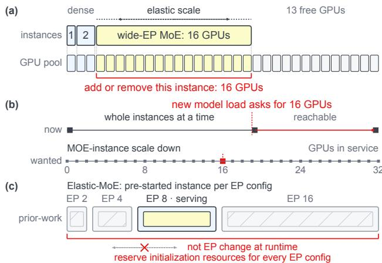  
Figure 1. Fine-grained EP scaling. (a) A wide-EP instance occupies tens of GPUs, so instance-level scaling moves resources in units far coarser than demand changes. (b) A new model need not evict the MoE instance: the instance can give up some GPUs and keep serving. (c) ElasticMoE [8] pre-starts one instance per EP configuration but cannot change the EP degree of a running instance.

However, while a large EP degree reduces serving costs, it compromises scaling elasticity. Dynamic auto-scaling is essential for handling fluctuating compute demands in modern inference systems, e.g., per-model request spikes in Model-asa-Service (MaaS) [9], dynamic sample completion and entry during ofline RL rollouts [10], and the volatile availability of spot instances and opportunistic resources [11]. Although extensive research [12–16] has explored dynamic scaling for LLM inference, prior approaches fundamentally treat an entire model instance as the minimum scaling granularity. While this instance-level scaling sufices for early dense models, where a single instance typically fits within a handful of GPUs, it becomes highly impractical for large-scale Expert Parallelism (EP) deployments spanning hundreds of GPUs and creates a severe dilemma. Deploying with a large EP degree restricts scaling elasticity, inevitably leading to compute resource over-provisioning during low-demand periods. Conversely, opting for a smaller EP degree improves scaling elasticity, but incurs a heavy memory penalty due to the redundant replication of model weights.

To break this dilemma, this paper advocates for intrainstance elasticity via dynamic EP scaling, which enables fine-grained elastic scaling by dynamically adjusting the EP degree at runtime. During periods of surging compute demand, the system expands the EP degree to handle higher loads. When demand decreases, FastEEP reduces the EP group size to release idle compute resources while keeping the serving instance active, thereby avoiding instance teardown and reconstruction. Intra-instance EP scaling pushes scaling granularity down to the single-GPU level, ensuring that provisioned compute resources precisely match highly dynamic workload demands.

However, enabling dynamic EP scaling is non-trivial. An MoE inference instance operates as a stateful, tightly coupled system rather than a collection of independent workers. As a result, scaling the EP degree up/down requires reconstructing global cluster state. Existing implementations trigger instance-wide execution stalls lasting from several seconds to tens of seconds, leaving GPU resources idle and causing severe Service Level Objective (SLO) violations for requests.

Our key insight is partial state reuse. We divide serving state into persistent and reconfigurable components. Reusing persistent structures, such as per-GPU runtimes and pre-negotiated collective communicators, avoids expensive distributed re-initialization. Asynchronous online reconfiguration updates the remaining state while serving continues, leaving only a brief coordinated transition.

To this end, we present FastEEP, an elastic MoE inference system that operationalizes partial state reuse. Specifically, FastEEP addresses the following three challenges.

Challenge-1 (Network): Immutable communication groups. EP inference relies on Data Parallel (DP) collectives and EP All-to-All communication, both ofwhich operate over pre-established communicators (e.g., NCCL groups [17]). Under the Single Program, Multiple Data (SPMD) paradigm, these collective operations mandate that every rank enters the call before execution can proceed. Existing communication groups cannot dynamically accommodate changing membership. Every EP scale-up/down forces the cluster to tear down active communicators and perform distributed re-initialization for new ones, which takes several to tens of seconds and incurs a cluster-wide stop-the-world pause.

Challenge-2 (Memory): Memory reclamation destroys execution contexts. Scaling down must aggressively release GPU memory. Although model weights and KV caches consume a large share of memory capacity, our empirical analysis reveals that transferring/reloading them is not the primary latency bottleneck. Instead, rebuilding components of the execution context, such as computation graph [18] bufers, kernel workspaces, and communication bufers, accounts for the vast majority of scaling latency. Purging these runtime states destroys persistent execution structures and forces costly network handshakes and graph recapture during scale-up.

Challenge-3 (Runtime): Safe worker retention and reuse. To eliminate GPU worker creation and initialization overheads during scale-up, the system retains scaled-down workers so they can be recycled. A target worker must stop GPU computation and remain alive, while active workers continue serving outside a brief coordinated transition. However, a worker’s execution is tightly coupled with the rest of the cluster: it computes attention for its local requests and executes expert layers for tokens dispatched from remote ranks. Even if a worker drains its local requests, remote GPUs may still route tokens to its hosted experts. The system must therefore toggle a worker’s participation safely without discarding its initialized state.

To solve the challenges, we propose the following designs. Design-1: Reusing communicators through flexible group splitting. FastEEP creates a parent NCCL communicator over the maximum worker set and retains its rank identities and bootstrap state. Each resize derives a subgroup containing only active workers, so collectives do not wait for inactive ranks. For expert dispatch and combine, a NIXL mask hides the same inactive ranks while connections among active peers remain in place. Switching the subgroup and mask together changes who communicates without rebuilding the distributed instance. Because every subgroup comes from the parent, later scale-up can reintroduce previously inactive workers.

Design-2: Reusing GPU context with fine-grained ofloading. FastEEP reclaims HBM from an inactive worker while preserving the runtime objects that are expensive to create. CUDA virtual memory lets it retain the device addresses of weights, KV-cache allocations, and graph bufers while releasing the physical pages behind them. Contents follow their use: data that must survive is backed up, replicated weights are fetched from active workers, and requestspecific KV state is moved or reconstructed. Graph bufers return to the addresses recorded in captured CUDA Graphs, allowing replay without recapture. Communication bufers are reclaimed only after remote access has stopped, so their release does not invalidate the retained communication state.

Design-3: Safe worker retention and reuse through coordinated sleep. FastEEP drains or moves requests of a target worker while making its experts available on the remaining workers. At a safe point, it switches request routing, expert placement, and communication membership together. After in-flight work finishes, the target skips GPU execution but keeps its process, executor, and CPU control threads alive; peers no longer send it tokens. On scale-up, the same worker rejoins only after its memory and connections are restored, avoiding reinitialization.

We implement FastEEP on vLLM and evaluate it across EP sizes from 2 to 16. Across six transitions on each measured model, FastEEP scales in 4.2–13.4 s, achieving geometricmean speedups of 7.0× over vLLM Elastic EP and 22.0× over restart. FastEEP also preserves steady-state throughput and enables colocated services to release and reassign GPUs without instance reconstruction.

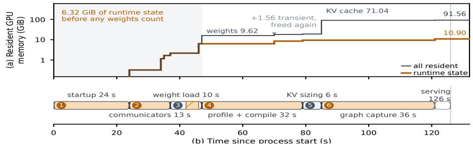

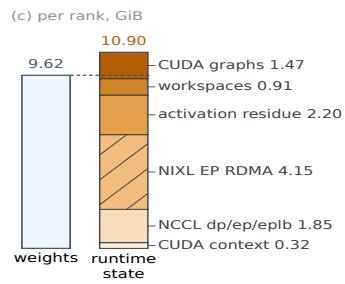  
Figure 2. Bringing one DeepSeek-V2-Lite rank online (DP=8, EP=8). (a) Runtime state reaches 6.32 GiB before weights are accounted for. (b) The rank reaches steady state after 126 s in six phases, of which only weight load moves model data. (c) The resulting 10.90 GiB of runtime state exceeds the 9.62 GiB of model weights on the rank.

## 2 Characterizing the Cost of MoE Scaling

Large-scale MoE inference requires dynamically provisioning GPU resources to match fluctuating trafic demands while maximizing compute utilization. However, Expert Parallelism (EP) fundamentally dictates both how GPU memory is partitioned and how flexibly resources can be reclaimed.

## 2.1 MoE Serving and Elasticity Requirement

Expert parallelism. In MoE architectures, each token is dynamically routed to its top-� experts. Because expert parameters dominate modern model footprints (e.g., 97% of all parameters in DeepSeek-V3 [3]), Expert Parallelism (EP) partitions these expert weights across �� ranks. Spreading experts reduces the per-GPU weight memory footprint, freeing HBM to accommodate larger KV caches. Attention is typically replicated across data-parallel (DP) workers or sharded under tensor parallelism (TP), with serving engines enforcing $E P = D P \times T P \left[ 1 9 \right]$ . Production clusters routinely deploy EP degrees in the hundreds [3, 20], driven further by advancements in high-speed interconnect fabrics [6, 7].

Demand moves faster than instances do. Real-world LLM inference workloads exhibit extreme short-term trafic volatility. In the two-month BurstGPT trace [21] (1.4M requests), 59% of ten-second windows experience no incoming requests, while busy periods exhibit a 25× swing between median and 99th-percentile arrival rates. Even in denser production environments like the Azure conversation trace [22, 23] (27M requests over one week), trafic fluctuates by 1.7× with equally transient spikes.

Facing such fluctuations, cluster operators are forced into a severe dilemma: provision for peak trafic and sufer severe idle overheads during troughs, or provision for median trafic and violate Service Level Objectives (SLOs) during bursts. This ineficiency is unsustainable in multi-tenant clusters where MaaS platforms, RL rollouts, and spot workloads contend for shared GPUs [9–11, 13, 24, 25]. Despite extensive eforts [12, 14–16, 26–30], existing frameworks operate strictly at the coarse granularity of whole instances, preloaded configurations, or full replicas. Crucially, none permit dynamically reconfiguring the active EP degree of a live, running instance.

The scaling must befine, fast, and reversible. Efective intra-instance scaling must satisfy three requirements:

• Fine-grained: As shown in Figure 1, instance-level scaling operates at a granularity far too coarse (dozens of GPUs) for demand shifts.

• Fast: Existing intra-instance resizing takes 36.4–92.0 s (§2.2), which is significantly longer than the median duration of the trafic excursions it is meant to handle.

• Reversible: Because trafic bursts are transient, resources added during a spike must be promptly reclaimed without incurring heavy tear-down and rebuild penalties.

## 2.2 The Cost of MoE EP Resizing

Existing designs resize whole instances. Current LLM serving systems manage capacity changes through coarsegrained instance manipulation or static pre-allocation. A naive restart tears down the entire instance and initializes a new one from scratch. vLLM’s Elastic EP avoids process restarts but still reconstructs the distributed runtime—recreating Ray workers, rebuilding process groups, and recapturing CUDA graphs [31]. Conversely, preloading approaches keep all parallel configurations resident simultaneously, paying exorbitant memory penalties [12, 16, 29, 30]. Runtimes with shadow modes preserve processes and execution graphs but freeze the parallel topology. Similarly, fault-tolerance mechanisms (e.g., SGLang rank-failure recovery [32]) mask failed peers and remap experts without yielding physical memory back to the GPU pool. While reparallelization and migration have been studied for full instances [11, 33] and systems like ElasticMoE require warmup periods during scale-up [8], no existing system can dynamically reconfigure the active EP degree of a live instance while returning individual GPUs to the shared pool.

A resize costs a rebuild. Figure 2 quantifies the latency breakdown of an instance rebuild, taking 126 s from process launch to steady-state serving across six distinct phases: 24 s startup, 13 s communicator construction, 10 s weight loading, 32 s operator profiling and compilation, 6 s KV sizing, and 36 s CUDA graph capture. Crucially, loading model weights takes only 10 s; the remaining 116 s is consumed by building the execution environment. In fact, 6.32 GiB of HBM is already consumed before model weights are loaded at � = 47 s. At steady state, runtime context overhead reaches 10.90 GiB, exceeding the 9.62 GiB of model weights, with full boot times spanning 156–267 s across configurations. Under a closed-loop �� 8 → 4 → 8 scaling cycle, vLLM Elastic EP requires 47 s to shrink and 75 s to grow, incurring 31 s and 44 s of complete service unavailability, respectively; a full process restart inflates service downtime to 141 s and 149 s (§5.3). Furthermore, service downtime is compounded by post-scaling load balancing (e.g., EPLB [34]), which causes sustained throughput degradation before converging.

Analyzing the state destroyed during a resize (Table 1) reveals that the overhead stems primarily from components invariant to the EP degree itself. Worker processes, compiled kernels, CUDA contexts, communication infrastructure, and captured graphs depend strictly on the model architecture, device, and maximum world size rather than the immedi ate EP degree. Memory allocations follow a similar trend: because NIXL transfer bufers are dimensioned for the maximum world size, an instance capable of scaling up to eight ranks allocates memory for eight ranks from startup, much of which is allocated outside the serving engine’s managed pools by driver-level libraries. What the EP degree truly dictates is merely a minimal set of dynamic state: active rank participation, expert-to-node placement mappings, physical page residency, and peer connectivity.

Three rigid bindings force the rebuild. Current inference runtimes enforce three structural bindings that make dynamic EP scaling impossible without a full rebuild:

• Immutable Communicator Binding: Collective communication groups are constructed for fixed rank sets. Under standard SPMD collective semantics, every member rank must synchronously enter a call, meaning dropping or adding a rank forces the destruction and distributed re-initialization of the process group—unless subcommunicators are derived from a persistent parent group spanning the maximum rank set [17].

• Static Memory & Address Binding: Captured CUDA graphs, operator kernel arguments, and registered RDMA memory regions tightly bind to hardcoded virtual memory addresses. Deallocating or resizing a bufer invalidates the execution path even when data shapes remain unchanged—unless virtual address spaces are decoupled from underlying physical page allocations.

• Tightly Coupled Worker Execution: An inference worker concurrently manages local request state, KV caches, and hosted experts serving remote token dispatches. A worker cannot independently pause or exit without triggering remote hangs—unless remote peers dynamically mask the rank and remap expert routes, similar to fault-recovery mechanisms [32].

While each binding stems from software implementation conventions rather than hardware constraints, no deployed system systematically breaks all three bindings to enable low-latency intra-instance EP scaling on live workloads.

Table 1. What a resize takes apart, itemized by state. Costs are the phases measured in Figure 2; footprints are steady-state values on the same rank. Only the last row is a function of the active EP degree.
<table><tr><td>State</td><td>Cost</td><td>EP-dep.</td><td>Today</td><td>Reused</td></tr><tr><td>Worker process, executor, kernels</td><td>24 s startup</td><td>no</td><td>destroyed</td><td>retained</td></tr><tr><td>Communication domains, RDMA buffers</td><td>13 s setup</td><td>members rebuilt only</td><td></td><td>subdomain derived</td></tr><tr><td>CUDA context</td><td>0.32 GiB</td><td>no</td><td>destroyed</td><td>retained</td></tr><tr><td>CUDA Graphs</td><td>36 s, 1.47 GiB</td><td>no</td><td>recaptured</td><td>replayed</td></tr><tr><td>Weights, KV cache, workspaces</td><td>9.62 / 71.04 GiB</td><td>sizes only reloaded</td><td></td><td>pages refilled</td></tr><tr><td>Expert placement, request routing</td><td></td><td>yes</td><td>rebuilt</td><td>rewritten in place</td></tr></table>

## 3 FastEEP Overview

Given a running MoE serving instance, FastEEP changes its EP size quickly while minimizing disruption to request processing. Scaling down releases GPUs for other workloads; scaling up restores GPU capacity when throughput and KVcache demand increases.

## 3.1 Existing Designs

Existing systems expose two approaches to changing the EP size of a serving instance.

Preloaded-instance switching. One approach preinitializes several instances of the same model with different parallel configurations. Inactive instances ofload their weights and KV cache to host memory, then restore them when selected. This avoids a full cold start, but each configuration still retains its processes, CUDA Graphs, and communication state. For MoE serving, that residual footprint is substantial: communication and driver allocations alone consume several GiB per GPU, while the full runtime state can exceed 10 GiB (§2.2). Moreover, preloading can cover only a fixed set of configurations, trading memory consumption for limited scaling flexibility.

Intra-instance reconstruction. The alternative reconstructs the running instance at the target size. vLLM Elastic EP [31] follows this approach: it changes the Ray worker set, rebuilds communication groups, and captures new CUDA Graphs. SGLang provides a related mechanism for rankfailure recovery [32], rather than deliberate resource scaling. Reconstruction supports more configurations than preloading, but repeats expensive initialization on every transition. In our experiments, an Elastic EP resize takes 36.4–92.0 s (§5.2), too long to track short-term workload changes.

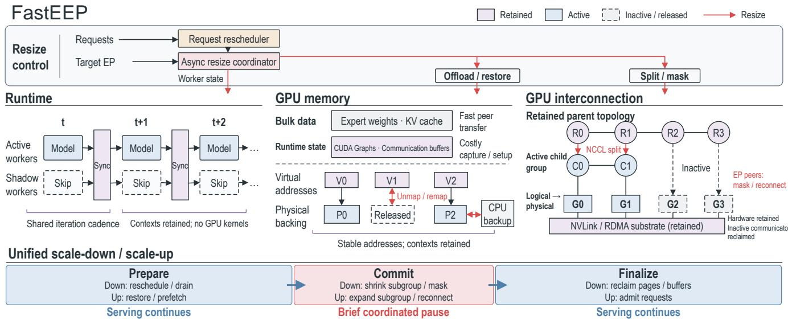  
Figure 3. Architecture of FastEEP. A maximum-size instance retains worker execution contexts, a parent communication domain, and virtual address ranges. Resizing changes the active worker set and physical-memory residency without reconstructing the instance.

## 3.2 Challenges

Reconfiguring a fixed communication fabric. Wide-EP inference couples two communication paths with diferent semantics: DP collectives synchronize attention workers, whereas EP All-to-All, implemented as point-to-point transfers, dispatches tokens to remote experts and returns their outputs. Their rank membership, transport endpoints, topol ogy, channels, and registered bufers are established during initialization (§2.2) and are assumed to remain fixed during execution. Under SPMD collective semantics, a single inactive rank can prevent the remaining ranks from making progress; conversely, stale EP routing may direct remote accesses to bufers that have already been reclaimed. An EP resize must therefore switch both communication paths to one consistent active-rank view. Reconstructing that view from scratch requires distributed bootstrap and topology setup— close to 20 s for an eight-GPU group in our measurements— and imposes a cluster-wide stall.

Reclaiming HBM without invalidating runtime state. Scaling down must release not only model weights and KV cache, but also the CUDA Graph storage, operator workspaces, and communication bufers that account for a substantial fraction of each worker’s HBM footprint. These allocations are not interchangeable byte arrays: captured CUDA Graph executables embed their device addresses, while communication libraries retain registrations and remote-access metadata for their bufers (§2.2). Conventional deallocation destroys these address and registration invariants, so scale-up must rebuild communicators and repeat graph warm-up and capture even if tensor shapes are unchanged. In our evaluated configurations, graph recapture alone takes 25–82 s. The memory challenge is thus to reclaim physical HBM without discarding the logical allocation identity required to reuse the execution context.

Quiescing workers without stopping service. Avoiding worker reconstruction requires a scaled-down worker to remain alive but quiescent while the rest of the instance continues serving. Reaching this state is dificult because each worker simultaneously owns local requests and their KV cache, participates in DP synchronization, and executes experts for tokens routed from remote ranks. Draining its local request queue therefore does not eliminate remote expert trafic or outstanding communication. A safe transition must jointly update request ownership, KV-cache placement, expert placement, token-routing tables, communication membership, and in-flight operations before any compute or memory resource is released. Otherwise, the resize can lose request state, invoke a collective with mismatched membership, or access reclaimed memory. This cross-subsystem transition must complete with only a brief coordinated pause rather than stopping the entire instance for worker teardown and reconstruction.

## 3.3 System Overview

FastEEP replaces reconstruction with partial reuse: it initializes the instance once, retains expensive long-lived state, and changes only the resources that participate in the active configuration.

At the memory layer, tagged CUDA virtual-memory pools preserve virtual addresses while selected physical pages are ofloaded or released. Weights can be restored from host memory or active peers, expired KV-cache pages can be discarded, and CUDA Graph storage can be restored without recapture. At the communication layer, FastEEP derives active NCCL subgroups from a persistent parent group1 and reconnects or masks NIXL peers instead of rebuilding the entire communication domain.

At the execution layer, FastEEP removes target workers from request routing, drains or re-issues their in-flight requests, remaps required experts, and masks inactive ranks from expert dispatch. The worker processes, executors, and compiled kernels remain alive for rapid reactivation.

A resize is executed as a staged transaction: prepare resources concurrently, commit the new active configuration at a short global quiescence point, and reclaim idle resources after request processing resumes. Together, these mechanisms preserve correctness while reducing scaling latency by 4.5–11.7× relative to vLLM Elastic EP (§5.2).

## 4 FastEEP Design

The three challenges above arise from a common cause: existing systems bind active resources to initialized runtime state within one lifecycle. Changing the EP size therefore destroys not only GPU resources, but also communication domains, device addresses, CUDA Graphs, and worker contexts, all of which must be rebuilt during scale-up.

FastEEP addresses this problem through partial state reuse, separating stable structural state from active state that changes with the EP size. It first decouples the physical communication network from logical participants, allowing diferent EP sizes to share one substrate. It then decouples virtual addresses from physical HBM, allowing shadow workers to release memory while preserving their execution contexts. Finally, the runtime combines changes to communication, memory, request routing, and expert placement into one consistent worker-state transition.

## 4.1 Reusing the Communication Network

MoE inference uses collectives for synchronization and aggregation and All-to-All communication for token dispatch and combine. Point-to-point peers can be controlled independently, but collective participants are fixed in a group. Rebuilding that group requires bootstrap, topology discovery, connection setup, and bufer allocation. FastEEP instead retains a global group over all workers. It suspends this group and releases its resources when idle, then reuses its context and control-plane state to derive a group for the current active workers.

All-to-All communication: dynamically changing point-to-point reachability. MoE dispatch and combine logically form an All-to-All operation. Resizing changes both active ranks and expert placement, so each token must reach the rank currently hosting its expert and return to its source under the same active view.

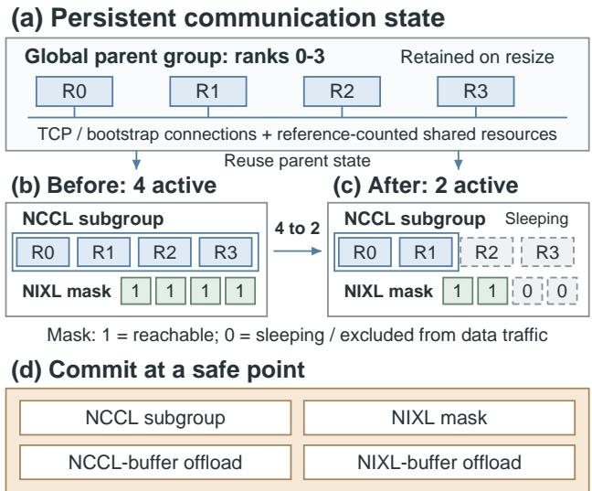  
Figure 4. Reusing communication state across a resize. A persistent parent domain retains the global rank space and bootstrap context. Scaling from four to two workers changes the NCCL subgroup and NIXL reachability mask. These views, the expert mapping, and request routing are committed together.

Point-to-point transfers naturally support dynamic membership because each peer has an independent lifecycle. NIXL EP uses UCX across nodes and separates remote-metadata exchange from endpoint creation [35]. It can cache peer metadata and create endpoints lazily or explicitly. Adding or removing a rank therefore afects only its endpoints, leaving other connections intact.

FastEEP retains the maximum-size logical rank space and represents visibility in a device-side mask read by dispatch and combine kernels. During scale-down, it masks a rank after replicas of its experts become available. During scaleup, it unmasks the rank only after its bufers and endpoints are ready. Membership thus changes without rebuilding the All-to-All domain.

Collective communication: retaining the parent domain and switching the active subgroup. NCCL communicator membership, however, is a synchronization contract: every member must enter each collective. As long as an inactive rank remains a member, all other ranks must wait for it. Masking inactive ranks in P2P operators does not resolve this issue because the inference communicator must include only the active ranks.

FastEEP therefore uses a two-level communication domain. At startup, it creates a parent domain spanning the maximum worker set and retains its rank space, bootstrap relationships, and control-plane state throughout the lifetime of the instance (less than 300 MB in total). Its data-plane resources can be selectively ofloaded to host memory during scaling. Each resize derives from this parent a working subgroup containing only active ranks. Scale-down installs a smaller subgroup and scale-up a larger one. Subgroups are always derived from the parent, so contraction never removes relationships needed for expansion.

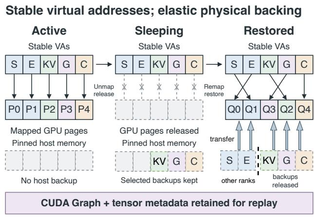  
S: shared E: expert KV: KV cache G: CUDA Graph C: communication  
Figure 5. Address-stable memory management. A shadow worker retains virtual address ranges while selected physical pages are released. On wake-up, new pages are mapped at the same addresses and restored according to allocation semantics.

NCCL communicator split implements this structure [17]. Active ranks receive the same color and form a subcommunicator, and inactive ranks remain outside it. Reusing the parent’s global identities and bootstrap context avoids worker restart and reconstruction of the distributed environment.

Unifying both communication paths with one active set. The NCCL subgroup and NIXL mask represent the same active set. The former makes DP collectives wait only for active workers; the latter restricts EP dispatch and combine to them. At one safe point, FastEEP publishes both views with the logical-expert-to-physical-slot mapping, making each rank visible to either all three structures or none.

## 4.2 Fine-Grained GPU Memory Management

Leaving distributed execution does not release a worker’s GPU memory. Besides weights and KV cache, it holds CUDA Graph bufers, operator workspaces, communication bufers, and runtime caches whose setup dominates startup cost. FastEEP therefore preserves their logical identities and execution contexts while ofloading contents or unmapping physical pages. A shadow worker (see §4.3) can reclaim HBM and later restore this state in place.

Preserving virtual addresses while changing physical mappings. Using CUDA Virtual Memory Management, FastEEP creates separate CuMem pools for shared weights, expert weights, KV cache, and CUDA Graph bufers. Scaledown unmaps and releases physical pages while retaining virtual addresses, tensor metadata, and object references. Scale-up maps new pages at the same addresses.

Stable addresses preserve kernel arguments, tensor pointers, and allocator objects, allowing wake-up without rebuilding runtime structures. Irreplaceable contents are backed up before unmapping; data available from another worker or cheap to reconstruct is discarded. This trades host-memory use for recovery latency without sacrificing address reuse.

Restoring weights and KV cache according to their semantics. Under EP, non-expert weights such as attention weights are replicated. A shadow worker can discard them and later restore them from an active rank over NVLink at their original addresses. Expert weights use the same deviceto-device path. The control plane computes the target placement and source–destination rank pairs so that every logical expert has a replica in the active set. It batches transfers by tensor or expert, while the data plane performs asynchronous peer copies on a separate CUDA stream.

For request-specific KV cache, FastEEP chooses among three policies for each block: discard and recompute it from the prompt and generated tokens after rescheduling; migrate it asynchronously to an active rank over NVLink; or swap it to pinned host memory and reload it later. This balances recovery latency, interconnect bandwidth, and host-memory use without retaining a shadow worker’s complete KV cache.

Ofloading CUDA Graph bufers. CUDA Graph capture fixes kernel arguments and device pointers in the graph executable. A reallocated bufer therefore invalidates replay if its address changes, even when its shape and contents do not. Repeating warm-up and capture also adds substantial scale-up latency.

FastEEP routes capture-time allocations to a dedicated CuMem graph pool. During the sleep transition, FastEEP backs up required contents and unmaps physical pages while preserving virtual addresses; on wake-up, it remaps pages and restores data at the same locations. The graph’s pointers, arguments, and topology remain unchanged, enabling direct replay without recapture. Thus, FastEEP preserves the graph execution context, not its original physical pages.

Communication-bufer reachability. Communication bufers may remain accessible to remote peers or in-flight kernels. Releasing one locally can therefore redirect remote writes into reallocated pages. FastEEP uses collective-group switching and point-to-point visibility as safe lifetime boundaries for these bufers.

For collectives, FastEEP first installs the new active subgroup and drains old operations. It then ofloads idle parentgroup bufers to pinned host memory and releases their HBM, retaining the group identity, rank information, and bootstrap context. Before the next resize, it restores the bufers at their original addresses and derives a new subgroup. The parent can thus persist without keeping its full data plane in HBM.

For point-to-point communication, the NIXL mask controls reclamation. During scale-down, the target is first removed from expert routing and the mask; after in-flight trafic drains and endpoints disconnect, FastEEP reclaims its NIXL bufers. Scale-up restores and registers bufers and establishes endpoints while the rank remains invisible, then unmasks it. Both paths follow one rule: revoke reachability before releasing memory, and restore memory before granting reachability.

## 4.3 Reusing Worker Execution Contexts

The preceding mechanisms make communication membership switchable and decouple memory identity from physical residency. The runtime combines them into one consistent worker-state transition.

Partial reuse changes worker state rather than creating or destroying workers. Scale-down stops target computation, removes the worker from the data plane, releases network bufers, and ofloads physical memory. Its process, executor, compiled kernels, virtual addresses, CUDA Graph executables, and control state remain intact. Scale-up restores memory and communication reachability and re-enables computation, avoiding process startup, model initialization, graph capture, and communication reconstruction.

The shadow worker state. A shadow worker retains its execution identity without consuming GPU compute resources. Its process, CPU threads, executor, virtual addresses and control state persist. Physical memory for weights, KV cache, graph bufers, and communication bufers is unmapped or ofloaded, leaving only the device state required for recovery. Wake-up restores these contents at their original addresses.

The worker is excluded from the NCCL subgroup and hidden by the NIXL mask, so it receives neither collectives nor dispatch and combine trafic. Its global rank, bootstrap information, and control connections remain available for recovery and later reconnection.

Before model execution, the runtime checks the active state. Shadow workers bypass the forward pass and launch no attention, expert, or communication kernels. Their CPU threads handle only control commands and barriers, yielding GPU compute while remaining ready to wake at a coordinated transition point.

Algorithm-level contraction. In DP+EP, attention parallelizes requests along DP, while experts parallelize tokens along EP. Each worker handles local requests and KV cache while serving expert tokens from peers. Scale-down must close both paths: stopping request scheduling alone does not stop remote expert trafic.

On the request path, FastEEP marks the target as draining and removes it from the active DP set. Existing requests drain or migrate. Once no active request or KV state remains, the runtime skips its attention forward pass.

On the expert path, FastEEP recomputes the logical-expertto-physical-slot mapping, reuses replicas on active workers, and copies missing experts into free slots over NVLink. Once every logical expert is available, it publishes the mapping and NIXL mask together, removing targets from dispatch and combine. Available expert slots therefore determine the minimum feasible active size, $N _ { \mathrm { m i n } }$

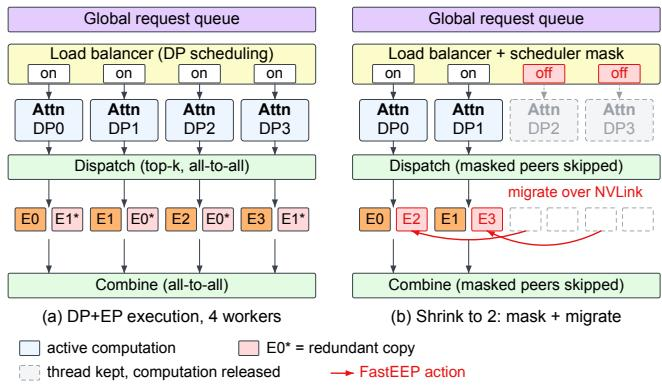  
Figure 6. Contracting DP and EP execution during scale-down. The scheduler stops routing new requests to target workers and drains or migrates their current requests. Missing experts are copied into available slots on the remaining workers before the target ranks leave the EP data path.

Only after both paths contract can the target sleep and release compute, communication, and HBM resources. Scaleup reverses this order: it restores memory, expert placement, and communication before admitting the worker to the active DP set.

Decoupling request and worker lifecycles. After a target begins draining, near-complete requests finish locally. FastEEP moves the rest to active workers and, based on recovery cost, recomputes their KV cache, migrates live blocks over NVLink, or stores them in pinned host memory.

The scheduler unbinds a request only after it completes or obtains another execution location. FastEEP can then reclaim the original KV cache and sleep the worker, decoupling request continuity from worker-resource lifetime.

The control plane moves workers between active and inactive states, using one active set as the commit boundary for request routing, expert placement, and communication. A configuration becomes visible only after all required resources are ready.

Scale-down. The control plane inspects each rank’s state, request queue, and KV-cache occupancy to select targets. It stops new admission, then drains requests or migrates their state. In parallel, it rearranges experts and transfers any weights missing from the contracted placement. Once requests and experts no longer depend on the targets, FastEEP ofloads their weights, KV cache, and CUDA Graph bufers and releases the HBM. It derives a new subgroup from the global NCCL group, updates the NIXL mask and endpoints, and switches views at a safe point. After old operations finish, it ofloads unused global-group and inactive rank bufers to the CPU, then marks the targets inactive.

Scale-up. The control plane selects shadow workers to wake, remaps their physical pages, and reloads CUDA Graph and communication bufers from the CPU. Through the retained global communication relationships, it copies nonexpert weights, expert weights, and required KV blocks from active ranks to their original addresses. It then derives the expanded NCCL subgroup, registers NIXL bufers, and establishes peer endpoints. Once all connections are ready, the control plane atomically publishes the expert mapping, communication view, and request routing and marks the ranks active. They can now receive requests without reinitializing their execution contexts.

## 5 Evaluation

We evaluate the performance benefits of FastEEP under real workloads, focusing on its ability to reduce the latency of scaling a running service and the resulting interference with live requests. We also evaluate the efectiveness of dynamic scaling in multi-model deployments.

Testbed. Experiments run on two GPU nodes. Each node has two Intel Xeon Platinum 8575C CPUs and eight NVIDIA H20-3e GPUs (140 GiB HBM each). The GPUs are connected by 900 GB/s intra-node NVLink. Inter-node communication uses eight BlueField-3 integrated ConnectX-7 NICs (400 Gb/s per NIC).

Implementation. FastEEP is implemented on vLLM v.0.27.0, Python 3.12, PyTorch 2.11.0+cu130, NCCL 2.28.9, and NIXL 1.2.0. The implementation adds about 5K lines of production code for elastic EP scaling, request transfer, NIXL rank masking, expert remapping, and weight refilling. These components are integrated with the vLLM scheduler and GPU worker without changing the MoE serving interface.

Baselines. For scaling comparisons, we evaluate three systems using the same software stack:

• Restart. It terminates the serving instance and relaunches vLLM with the target EP size.

• vLLM Elastic EP baseline [31]. It creates or removes Ray engines and reinitializes distributed communication.

• FastEEP. It leverages the elastic scaling mechanisms developed in this work for GPU communication, GPU memory management, and worker execution, thereby enabling efficient intra-instance scaling.

Models and workloads. Our scaling study covers six MoE models, including the DeepSeek-V2-Lite [36], Qwen3- 30B-A3B-Instruct-2507 [37], DeepSeek-V4-Flash [2], Qwen2- 57B-A14B [38], Qwen3-235B-A22B [37], and Mistral-Small-4-119B-2603 [39]. We use two classes of workloads. To isolate the throughput characteristics of EP, we use three fixed request shapes: prefill-heavy (4096 input / 128 output), balanced (1024 / 1024), and decode-heavy (256 / 2048). To evalu ate EP scaling latency under realistic serving conditions, we use real-world requests sampled from ShareGPT [40]. We evaluate EP sizes {2, 4, 8, 12, 16}, covering both intra-node and cross-node scaling.

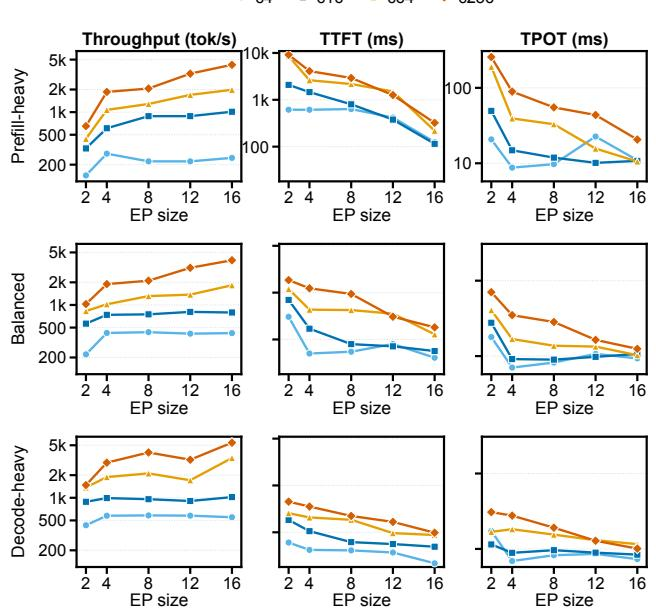

Figure 7. Serving performance (Qwen3-30B-A3B) across EP sizes for prefill-heavy, balanced, and decode-heavy requests (rows): output throughput, mean TTFT, and mean TPOT (columns).  
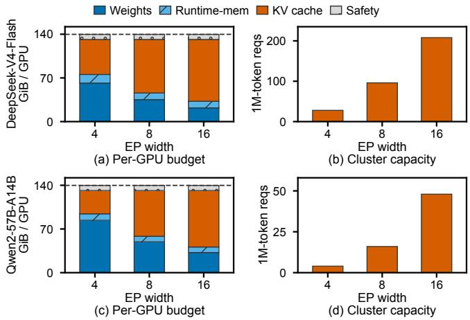  
Figure 8. KV-cache capacity for H20 GPUs, nixl\_ep, and 128 redundant experts. Each model occupies one row: the left panel shows the per-GPU memory budget across EP widths, and the right panel shows realizable cluster-wide concurrency for 106-token requests.

## 5.1 Performance and KV-Cache Capacity across EP Sizes

Figure 7 compares EP trends in throughput and latency across concurrency levels and request shapes.

The best EP size depends on load and request shape. At concurrency 4, increasing EP from 4 to 16 yields 0.88×, 0.99×, and 0.95× the EP-4 throughput for prefill-heavy, balanced, and decode-heavy requests, respectively, indicating that a wider EP is underutilized at low load. At concurrency 256, the same change improves throughput by 2.30×, 2.08×, and 1.85×. Prefill-heavy requests benefit most, while decodeheavy requests exhibit a flatter scaling trend. Thus, no single EP size is optimal: FastEEP can select the smallest EP that satisfies workload-specific TTFT and TPOT SLOs, scaling up as pressure increases and releasing GPUs when a smaller EP is suficient.

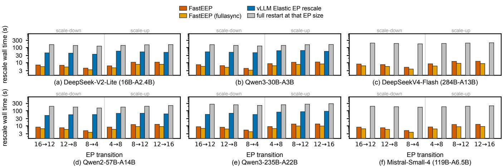  
Figure 9. End-to-end EP scaling latency across six MoE models. vLLM Elastic EP implementation could not scale DeepSeek-V4-Flash or Mistral-Small-4 (NaN). FullAsync refers to a mode in which the execution transition is synchronized with request processing.

EP size also controls runtime KV-cache capacity. As shown in Figure 8, increasing EP expands the available KV cache, which is especially valuable for high-concurrency, long-context and agentic workloads. FastEEP can therefore adapt EP to the workload type, meeting memory demand while improving GPU memory utilization.

## 5.2 End-to-End Scaling Latency

We evaluate six scale-up and scale-down transitions among {4, 8, 12, 16}. Figure 9 reports results for six models. FastEEP consistently reduces scaling latency across models and transitions. Across all models and six transitions, FastEEP completes scaling in 4.2–13.4 s, while its FullAsync variant takes 3.2–9.8 s. In comparison, vLLM Elastic EP takes 36.4– 92.0 s, and a full restart takes 126–293 s across all six models. Across all model-transition pairs for which Elastic EP is available, FastEEP achieves a 4.5×–11.7× speedup, with a 7.0× geometric mean; the FullAsync variant increases the geometric-mean speedup to 9.3×. Across all model-transition pairs, the geometric-mean speedups over restart are 22.0× and 29.3× for FastEEP and its FullAsync variant, respectively. Scale-up is generally more expensive than scale-down, but FastEEP is faster than both baselines for every available comparison, consistent with the benefit of reusing workers, communication state, and CUDA Graphs across model sizes and transition directions. The oficial vLLM Elastic EP implementation could not successfully run DeepSeek-V4-Flash and Mistral-Small-42; therefore, we omit Elastic EP results for these two models.

Expert re-layout and state restoration dominate the scaling path. Figure 10 compares the phase breakdowns of vLLM Elastic EP (a, b) and FastEEP (c, d) for the EP 8 → 4 scale-down and 4 → 8 scale-up of Qwen3-30B. In the plotted vLLM breakdown, scale-down totals 47 s: standby setup takes 10 s, expert resharding 9 s, compilation and warmup 11 s, and graph capture 15 s. Scale-up totals 75 s, including 17 s for standby setup, 7 s for weight and KV synchronization, 11 s for expert resharding, 14 s for compilation and warmup, and 18 s for graph capture.

For FastEEP, scale-down totals 4.21 s. The resize phase, which installs the new expert layout and communication view, takes 2.81 s; ofloading the shadow workers’ bufers takes 0.92 s and destroying their NIXL bufers takes 0.24 s. Scale-up totals 7.15 s. Waking workers takes 1.09 s, refilling weights takes 0.85 s, restoring NIXL connectivity takes 2.50 s, and resize takes 2.55 s. The remaining control steps are small in both directions. Thus, expert re-layout dominates FastEEP scale-down, while scale-up also pays for restoring workers, weights, and connectivity.

## 5.3 Scaling While Serving Requests

We send ShareGPT requests with a closed-loop concurrency of 128 for the first 100 s, 64 from 100 to 250 s, and 128 thereafter. The service follows 8 → 4 → 8. Figure 12 shows the throughput trace; all transitions are issued through the public HTTP API. FastEEP substantially shortens serving interruptions. For the 8 → 4 and 4 → 8 transitions, the zero-output windows are 4.2 s and 7.3 s for FastEEP, compared with 31 s and 44 s for Elastic EP and 141 s and 149 s for restart. Reusing worker, communication, and CUDA Graph state therefore allows serving to resume much sooner than rebuilding the runtime.

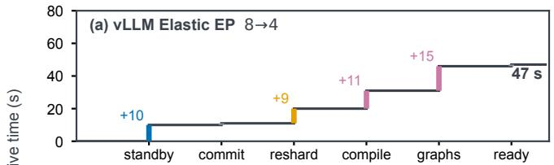

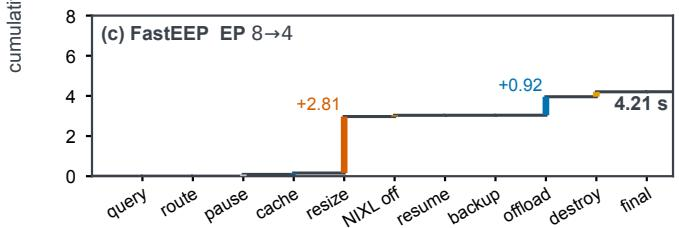

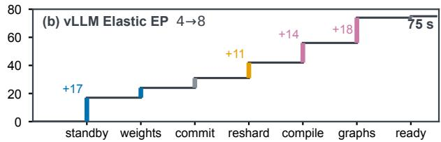

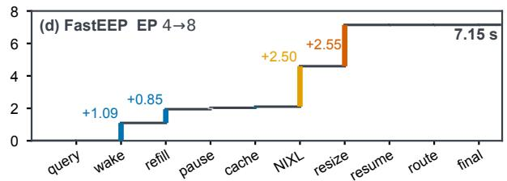  
Figure 10. Cumulative time across EP scaling phases for vLLM Elastic EP (a, b) and FastEEP (c, d), in the 8 → 4 and 4 → 8 directions.

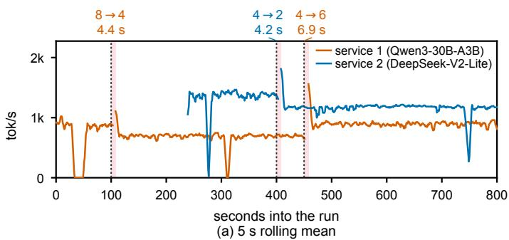

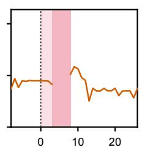  
s from trigger  
(b) 8 → 4, 4.4 s

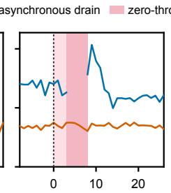  
s from trigger  
(c) 4 → 2, 4.2 s

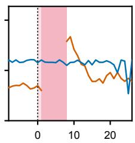  
(d) 4 → 6, 6.9 s

Figure 11. Resource-sharing trace for two colocated services: 5 s rolling mean in panel (a), raw 1 s samples in panels (b)–(d). Each service uses GPUs released by the other’s scale-down.  
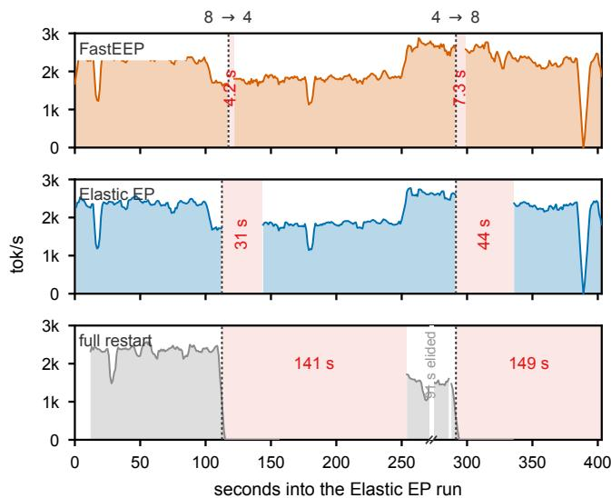  
Figure 12. Throughput during an 8 → 4 → 8 scaling cycle un der load (5 s rolling mean). Red bands mark zero-output intervals, whose durations measure service interruption.

Throughput tracks the active EP size. After scaledown, throughput settles at a lower level because fewer workers remain active; after scale-up, it returns to the higher range. Short dips outside the marked intervals reflect workload and runtime variation rather than additional scaling outages.

## 5.4 Scaling Multiple Models Simultaneously in MaaS

We colocate Qwen3-30B-A3B and DeepSeek-V2-Lite under independent demand. In Figure 11, Service 1 scales from EP 8 to 4 and releases four GPUs to Service 2. When its demand returns, Service 2 first scales from four GPUs to two, allowing Service 1 to grow from EP 4 to 6. Neither instance is reconstructed. Light-pink intervals are asynchronous drains that overlap serving; dark-pink intervals have no token output. The first 8 → 4 transition drains for 3 s and reconfigures in 4.4 s, while driver-reported free memory rises from 34 191 to 64 613 MiB.

Cross-service scaling imposes an ordering dependency. Released pages return to the node allocator rather than transferring directly between processes, so dependent transitions must be ordered. Service 1’s 4 → 6 scale-up (6.9 s) therefore follows Service 2’s 4→2 scale-down (4.2 s).

## 5.5 Performance Impact of FastEEP

Figure 13 shows that FastEEP preserves unmodified vLLM’s steady-state throughput at EP 4 and EP 8. Inactive-worker bufers move to CPU memory, while dormant workers run synchronization-only dummy iterations and launch no model computation. Partial reuse therefore adds no work to the steady-state inference path. Fully asynchronous scaling can transiently contend with inference while it prefetches or ofloads bufers and experts, but moving these transfers before the brief global pause reduces scaling latency.

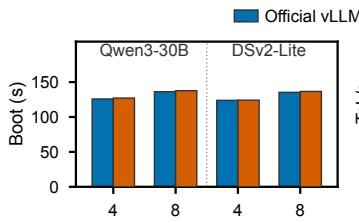

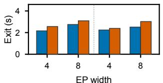

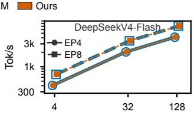

(a) Boot / teardown  
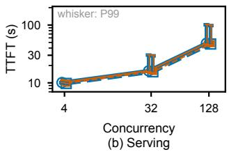  
Figure 13. Boot, teardown, and serving performance of FastEEP and unmodified vLLM at EP 4 and EP 8.

## 6 Discussion

The space–time trade-of. Fast scaling trades memory for reconstruction time. Rather than retaining a complete instance or preloaded replica, FastEEP manages workers, communicators, and memory regions independently. For state that is expensive to rebuild, it retains only the metadata needed for reuse, while releasing or ofloading data resources unused by the active configuration. This enables fast transitions without the memory cost ofan entire inactive configuration.

Prioritizing GPU resource reclamation. Persistence does not imply GPU residency. FastEEP maintains a communication group at the maximum world size, but after each resize it ofloads inactive GPU data bufers to CPU memory (2–4 GB, excluding the KV cache) and retains only the metadata needed for reuse. Initializing the system at the maximum world size therefore does not require the corresponding GPU resources to remain occupied throughout execution.

Scope and scalability. Unlike systems that recover failed ranks or switch entire models [13, 32], FastEEP focuses on changing the EP width of a running MoE instance. We evaluate FastEEP on a two-node, 16-GPU cluster with NCCL communication and inter-node RDMA. Although our evaluation is limited to 16 GPUs, the design scales to larger clusters by replacing centralized connection reconstruction with distributed state ofloading. This decentralized approach should scale more favorably than existing scaling mechanisms. Our implementation is open source and has been submitted to vLLM as a PR.

Limitations. FastEEP scales only within the maximum topology initialized at startup. Scale-up requires suficient available GPU memory, and larger topology changes still require reconstruction.

## 7 Related Work

Elastic MoE serving. vLLM Elastic EP [31] changes world size but rebuilds communicators. ElasticMoE [8], evaluated on Huawei’s Ascend NPUs, ofloads only model weights and KV caches yet remains fundamentally instance-level: scale-up switches to a preinitialized instance and requires warm-up. MoEless [41] scales individual experts as serverless functions. Rank-failure recovery [32] preserves CUDA Graphs through peer masking and expert remapping, without reclaiming GPU memory. FastEEP supports bidirectional rank scaling within one preinitialized maximum topology, reusing graphs and communication state while reclaiming inactive ranks’ physical memory.

Instance scaling and scheduling. Instance-level systems optimize loading and cold starts [12, 16, 29, 30, 42] or multiplex models and requests [13, 24, 25, 33, 43]. EP size ofers an additional allocation knob for goodput-oriented schedulers [44]; elastic sequence parallelism and memory pools provide complementary dimensions [45, 46]. Autoscaling policies decide when to resize [14, 15, 23, 26–28]; our mechanism supplies the transition and supports either side of prefill/decode disaggregation [47–49], although we evaluate a non-disaggregated deployment.

GPU virtual memory. vAttention and KunServe grow KV capacity with VMM [50, 51]; Prism, WarmServe, and vLLM sleep mode release pages without changing virtual addresses [42, 52]. Related abstractions manage tensors, defragmentation, memory ballooning, and MoE experts [53–56]. Foundry [57] uses deterministic addresses for graph transfer across processes; FlashBoot [58] accelerates weight loading and avoids NCCL group formation. FastEEP combines page release with graph replay and RDMA registration renewal across repeated EP resizes.

## 8 Conclusion

We presented FastEEP, a system for fast intra-instance EP scaling in MoE serving. Through partial state reuse, FastEEP preserves workers, stable virtual addresses, and the startup communication topology while selectively reclaiming and reconfiguring GPU resources. This design substantially reduces scaling latency and allows a running instance to adjust its GPU allocation without reconstruction. FastEEP enables MoE services to adapt to changing demand beyond fixed instance boundaries.

## References

[1] Kimi Team. 2026. Kimi K3: Open Frontier Intelligence. arXiv:2607.24653 [cs.CL] htps://arxiv.org/abs/2607.24653

[2] DeepSeek-AI. 2026. DeepSeek-V4: Towards Highly Eficient Million-Token Context Intelligence. arXiv:2606.19348 [cs.CL] htps://arxiv. org/abs/2606.19348

[3] DeepSeek-AI. 2024. DeepSeek-V3 Technical Report. arXiv:2412.19437 [cs.CL] htps://arxiv.org/abs/2412.19437

[4] Ruidong Zhu, Ziheng Jiang, Chao Jin, Peng Wu, Cesar A. Stuardo, Dongyang Wang, Xinlei Zhang, Huaping Zhou, Haoran Wei, Yang Cheng, Jianzhe Xiao, Xinyi Zhang, Lingjun Liu, Haibin Lin, Li-Wen Chang, Jianxi Ye, Xiao Yu, Xuanzhe Liu, Xin Jin, and Xin Liu. 2025. MegaScale-Infer: Eficient Mixture-of-Experts Model Serving with Disaggregated Expert Parallelism. In Proceedings of the ACM SIGCOMM 2025 Conference (São Francisco Convent, Coimbra, Portugal) (SIG-COMM ’25). Association for Computing Machinery, New York, NY, USA, 592–608. htps://doi.org/10.1145/3718958.3750506

[5] Chenggang Zhao, Shangyan Zhou, Liyue Zhang, Chengqi Deng, Zhean Xu, Yuxuan Liu, Kuai Yu, Jiashi Li, and Liang Zhao. 2025. DeepEP: an eficient expert-parallel communication library. htps://github.com/ deepseek-ai/DeepEP.

[6] Pengfei Zuo, Huimin Lin, Junbo Deng, Nan Zou, Xingkun Yang, Yingyu Diao, Weifeng Gao, Ke Xu, Zhangyu Chen, Shirui Lu, Zhao Qiu, Peiyang Li, Xianyu Chang, Zhengzhong Yu, Fangzheng Miao, Jia Zheng, Ying Li, Yuan Feng, Bei Wang, Zaijian Zong, Mosong Zhou, Wenli Zhou, Houjiang Chen, Xingyu Liao, Yipeng Li, Wenxiao Zhang, Ping Zhu, Yinggang Wang, Chuanjie Xiao, Depeng Liang, Dong Cao, Juncheng Liu, Yongqiang Yang, Xiaolong Bai, Yi Li, Huaguo Xie, Huatao Wu, Zhibin Yu, Lv Chen, Hu Liu, Yujun Ding, Haipei Zhu, Jing Xia, Yi Xiong, Zhou Yu, and Heng Liao. 2025. Serving Large Lan guage Models on Huawei CloudMatrix384. arXiv:2506.12708 [cs.DC] htps://arxiv.org/abs/2506.12708

[7] Xinming Wei, Chao Jin, Tuo Dai, Yinmin Zhong, Shan Yu, Chengxu Yang, Bingyang Wu, Zili Zhang, Jing Mai, Qianchao Zhu, Zhouyang Li, Yuliang Liu, and Guojie Luo. 2026. UltraEP: Unleash MoE Training and Inference on Rack-Scale Nodes with Near-Optimal Load Balancing. arXiv:2606.04101 [cs.DC] htps://arxiv.org/abs/2606.04101

[8] Gursimran Singh, Timothy Yu, Haley Li, Cheng Chen, Hanieh Sadri, Qintao Zhang, Yu Zhang, Ying Xiong, Yong Zhang, and Zhenan Fan. 2025. ElasticMoE: An Eficient Auto Scaling Method for Mixture-of Experts Models. arXiv:2510.02613 [cs.DC] htps://arxiv.org/abs/2510. 02613

[9] Ao Xiao, Bangzheng He, Baoquan Zhang, Baoxing Huai, Bingji Wang, Bo Wang, Bo Xu, Boyi Hou, Chan Yang, Changhong Liu, Cheng Cui, Chenyu Zhu, Cong Feng, Daohui Wang, Dayun Lin, Duo Zhao, Fengshao Zou, Fu Wang, Gangqiang Zhang, Gengyuan Dan, Guanjie Chen, Guodong Guan, Guodong Yang, Haifeng Li, Haipei Zhu, Haley Li, Hao Feng, Hao Huang, Hao Xu, Hengrui Ma, Hengtao Fan, Hui Liu, Jia Li, Jiang Liu, Jiang Xu, Jie Meng, Jinhan Xin, Junhao Hu, Juwei Chen, Lan Yu, Lanxin Miao, Liang Liu, Linan Jing, Lu Zhou, Meina Han, Mingkun Deng, Mingyu Deng, Naitian Deng, Nizhong Lin, Peihan Zhao, Peng Pan, Pengfei Shen, Ping Li, Qi Zhang, Qian Wang, Qin ZhC Qingrong Xia, Qingyi Zhang, Qunchao Fu, Ren Guo, Ruimin Gao, Shaochun Li, Sheng Long, Shentian Li, Shining Wan, Shuai Shen, Shuangfu Zeng, Shuming Jing, Siqi Yang, Song Zhang, Tao Xu, Tianlin Du, Ting Chen, Wanxu Wu, Wei Jiang, Weinan Tong, Weiwei Chen, Wen Peng, Wenli Zhou, Wenquan Yang, Wenxin Liang, Xiang Liu, Xiaoli Zhou, Xin Jin, Xinyu Duan, Xu Li, Xu Zhang, Xusheng Chen, Yalong Shan, Yang Gan, Yao Lu, Yi Deng, Yi Zheng, Ying Xiong, Yingfei Zheng, Yiyun Zheng, Yizhou Shan, Yong Gao, Yong Zhang, Yongqiang Yang, Yuanjin Gong, Yue Yu, Yuetao Chen, Yukun Zhu, Yulong He, Yusu Zhao, Yuyan Wu, Zenan Zhang, Zhaojin Zhuo, Zhaoyang Ji, Zhefeng Wang, Zheng Wang, Zhenan Fan, Zhenhua Yang, Zhenli Sheng, Zhibin Yu, Zhigang Ji, Zhihao Ren, Zhipeng Bian, Zhixia Liu, Zhiyu Dong,

Zhonghua Li, Zhou Yu, Zhuoming Shen, Zhuwei Peng, Zi Ye, Zihao Xiang, Zimin Fu, and Zixuan Zhang. 2025. Huawei Cloud Model-as-a-Service on the CloudMatrix384 SuperPod. arXiv:2508.02520 [cs.DC] htps://arxiv.org/abs/2508.02520

[10] Jingkai He, Tianjian Li, Erhu Feng, Dong Du, Qian Liu, Tao Liu, Yubin Xia, and Haibo Chen. 2026. History Doesn’t Repeat Itself but Rollouts Rhyme: Accelerating Reinforcement Learning with RhymeRL. In Proceedings ofthe 31st ACM International Conference on Architectural Support for Programming Languages and Operating Systems, Volume 2 (USA) (ASPLOS ’26). Association for Computing Machinery, New York, NY, USA, 929–945. htps://doi.org/10.1145/3779212.3790172

[11] Xupeng Miao, Chunan Shi, Jiangfei Duan, Xiaoli Xi, Dahua Lin, Bin Cui, and Zhihao Jia. 2024. SpotServe: Serving Generative Large Language Models on Preemptible Instances. In Proceedings of the 29th ACM International Conference on Architectural Support for Programming Languages and Operating Systems, Volume 2 (La Jolla, CA, USA) (ASPLOS ’24). Association for Computing Machinery, New York, NY, USA, 1112–1127. htps://doi.org/10.1145/3620665.3640411

[12] Dingyan Zhang, Haotian Wang, Yang Liu, Xingda Wei, Yizhou Shan, Rong Chen, and Haibo Chen. 2025. BlitzScale: Fast and Live Large Model Autoscaling with O(1) Host Caching. In 19th USENIX Symposium on Operating Systems Design and Implementation (OSDI ’25). USENIX Association, Berkeley, CA, USA, 275–293. htps://www. usenix.org/conference/osdi25/presentation/zhang-dingyan

[13] Yuxing Xiang, Xue Li, Kun Qian, Yufan Yang, Diwen Zhu, Wenyuan Yu, Ennan Zhai, Xuanzhe Liu, Xin Jin, and Jingren Zhou. 2025. Aegaeon: Efective GPU Pooling for Concurrent LLM Serving on the Market. In Proceedings of the ACM SIGOPS 31st Symposium on Operating Systems Principles (SOSP ’25). ACM, New York, NY, USA, 1030–1045. htps: //doi.org/10.1145/3731569.3764815

[14] Archit Patke, Dhemath Reddy, Saurabh Jha, Chandra Narayanaswami, Zbigniew Kalbarczyk, and Ravishankar Iyer. 2025. Hierarchical Autoscaling for Large Language Model Serving with Chiron. arXiv:2501.08090 [cs.DC] htps://arxiv.org/abs/2501.08090

[15] Ruiqi Lai, Hongrui Liu, Chengzhi Lu, Zonghao Liu, Siyu Cao, Siyang Shao, Yixin Zhang, Luo Mai, and Dmitrii Ustiugov. 2025. TokenScale: Timely and Accurate Autoscaling for Disaggregated LLM Serving with Token Velocity. arXiv:2512.03416 [cs.DC] htps://arxiv.org/abs/2512. 03416

[16] Yao Fu, Leyang Xue, Yeqi Huang, Andrei-Octavian Brabete, Dmitrii Ustiugov, Yuvraj Patel, and Luo Mai. 2024. ServerlessLLM: Low-Latency Serverless Inference for Large Language Models. In 18th USENIX Symposium on Operating Systems Design and Implementation (OSDI ’24). USENIX Association, Berkeley, CA, USA, 135–153. htps://www.usenix.org/conference/osdi24/presentation/fu

[17] Zhiyi Hu, Siyuan Shen, Tommaso Bonato, Sylvain Jeaugey, Cedell Alexander, Eric Spada, James Dinan, Jef Hammond, and Torsten Hoefler. 2025. Demystifying NCCL: An In-depth Analysis of GPU Communication Protocols and Algorithms. arXiv preprint arXiv:2507.04786 (2025). htps://arxiv.org/abs/2507.04786

[18] NVIDIA. 2026. CUDA Programming Guide: CUDA Graphs. htps://docs.nvidia.com/cuda/cuda-programming-guide/04-specialtopics/cuda-graphs.html

[19] Woosuk Kwon, Zhuohan Li, Siyuan Zhuang, Ying Sheng, Lianmin Zheng, Cody Hao Yu, Joseph E. Gonzalez, Hao Zhang, and Ion Stoica. 2023. Eficient Memory Management for Large Language Model Serving with PagedAttention. In Proceedings ofthe 29th Symposium on Operating Systems Principles (SOSP ’23). ACM, New York, NY, USA, 611–626. htps://doi.org/10.1145/3600006.3613165

[20] DeepSeek-AI. 2025. DeepSeek-V3/R1 Inference System Overview. Open Infra Index, day 6 release. htps://github.com/deepseekai/open-infra-index/blob/main/202502OpenSourceWeek/day\_6\_ one\_more\_thing\_deepseekV3R1\_inference\_system\_overview.md

[21] Yuxin Wang, Yuhan Chen, Zeyu Li, Xueze Kang, Yuchu Fang, Yeju Zhou, Yang Zheng, Zhenheng Tang, Xin He, Rui Guo, Xin Wang,

Qiang Wang, Amelie Chi Zhou, and Xiaowen Chu. 2025. BurstGPT: A Real-world Workload Dataset to Optimize LLM Serving Systems. arXiv:2401.17644 [cs.DC] htps://arxiv.org/abs/2401.17644

[22] Microsoft Azure. 2024. Azure LLM Inference Trace. Public dataset, Azure/AzurePublicDataset. htps://github.com/Azure/ AzurePublicDataset One week of production trafic collected May 10–19, 2024, released under CC-BY-4.0; accompanies the DynamoLLM paper.

[23] Jovan Stojkovic, Chaojie Zhang, Íñigo Goiri, Josep Torrellas, and Esha Choukse. 2025. DynamoLLM: Designing LLM Inference Clusters for Performance and Energy Eficiency. In 2025 IEEE International Symposium on High Performance Computer Architecture (HPCA ’25). IEEE, Piscataway, NJ, USA, 1348–1362. htps://doi.org/10.1109/HPCA61900. 2025.00102

[24] Jiangfei Duan, Runyu Lu, Haojie Duanmu, Xiuhong Li, Xingcheng Zhang, Dahua Lin, Ion Stoica, and Hao Zhang. 2024. MuxServe: Flexi ble Spatial-Temporal Multiplexing for Multiple LLM Serving. In Proceedings of the 41st International Conference on Machine Learning (ICML ’24) (Proceedings of Machine Learning Research, Vol. 235). PMLR, 11905– 11917. htps://proceedings.mlr.press/v235/duan24a.html

[25] Zhuohan Li, Lianmin Zheng, Yinmin Zhong, Vincent Liu, Ying Sheng, Xin Jin, Yanping Huang, Zhifeng Chen, Hao Zhang, Joseph E. Gonzalez, and Ion Stoica. 2023. AlpaServe: Statistical Multiplexing with Model Parallelism for Deep Learning Serving. In 17th USENIX Symposium on Operating Systems Design and Implementation (OSDI ’23). USENIX Association, Berkeley, CA, USA, 663–679. htps://www.usenix.org/ conference/osdi23/presentation/li-zhouhan

[26] Tao Huang, Pengfei Chen, Kyoka Gong, Jocky Hawk, Zachary Bright, Wenxin Xie, Kecheng Huang, and Zhi Ji. 2024. ENOVA: Au toscaling towards Cost-efective and Stable Serverless LLM Serving. arXiv:2407.09486 [cs.DC] htps://arxiv.org/abs/2407.09486

[27] Rongzhi Li, Ruogu Du, Zefang Chu, Sida Zhao, Chunlei Han, Zuocheng Shi, Yiwen Shao, Huanle Han, Long Huang, Zherui Liu, and Shufan Liu. 2025. Taming the Chaos: Coordinated Autoscaling for Heterogeneous and Disaggregated LLM Inference. arXiv:2508.19559 [cs.DC] htps: //arxiv.org/abs/2508.19559

[28] Zahra Yousefijamarani, Xinglu Wang, Qian Wang, Morgan Lindsay Heisler, Taha Shabani, Niloofar Gholipour, Parham Yassini, Hong Chang, Kan Chen, Qiantao Zhang, Xiaolong Bai, Jiannan Wang, Ying Xiong, Yong Zhang, and Zhenan Fan. 2025. HFX: Joint Design of Algorithms and Systems for Multi-SLO Serving and Fast Scaling. arXiv:2508.15919 [cs.DC] htps://arxiv.org/abs/2508.15919

[29] Minchen Yu, Rui Yang, Chaobo Jia, Zhaoyuan Su, Sheng Yao, Tingfeng Lan, Yuchen Yang, Zirui Wang, Yue Cheng, Wei Wang, Ao Wang, and Ruichuan Chen. 2025. �Scale: Enabling Fast Scaling for Serverless Large Language Model Inference. arXiv:2502.09922 [cs.DC] htps: //arxiv.org/abs/2502.09922

[30] Chiheng Lou, Sheng Qi, Chao Jin, Dapeng Nie, Haoran Yang, Yu Ding, Xuanzhe Liu, and Xin Jin. 2026. HydraServe: Minimizing Cold Start Latency for Serverless LLM Serving in Public Clouds. In 23rd USENIX Symposium on Networked Systems Design and Implementation (NSDI ’26). USENIX Association, Berkeley, CA, USA, 415–430. htps: //www.usenix.org/conference/nsdi26/presentation/lou

[31] Itay Alroy, Yongji Wu, Rui Qiao, Tyler Michael Smith, Moein Khazraee, Omri Kahalon, Tzu-Ling Kan, and Ron Tourgeman. 2026. Elastic Expert Parallelism in vLLM. vLLM Blog. htps://blog.vllm.ai/blog/2026-05- 14-elastic-expert-parallelism

[32] Xun Sun, Shaoyuan Chen, Pingchuan Ma, Yue Chen, Ziwei Yuan, Zhanhao Cao, Han Han, Shangming Cai, Teng Ma, Xuchun Shang, Xinpeng Zhao, Ke Yang, Junlin Wei, Lianzhi Lin, Yuji Liu, Feng Ren, Haoran Hu, Cheng Wan, Yingdi Shan, Yongwei Wu, and Mingxing Zhang. 2026. Surviving Partial Rank Failures in Wide Expert-Parallel MoE Inference. arXiv:2605.10670 [cs.DC] htps://arxiv.org/abs/2605. 10670

[33] Biao Sun, Ziming Huang, Hanyu Zhao, Wencong Xiao, Xinyi Zhang,

Yong Li, and Wei Lin. 2024. Llumnix: Dynamic Scheduling for Large Language Model Serving. In 18th USENIX Symposium on Operating Systems Design and Implementation (OSDI ’24). USENIX Association, Berkeley, CA, USA, 173–191. htps://www.usenix.org/conference/ osdi24/presentation/sun-biao

[34] vLLM Project. 2026. Expert Parallelism Deployment: Expert Parallel Load Balancer. vLLM documentation. htps://docs.vllm.ai/en/latest/ serving/expert\_parallel\_deployment.html

[35] NVIDIA. 2026. NIXL: NVIDIA Inference Xfer Library. Source repository. htps://github.com/ai-dynamo/nixl

[36] DeepSeek-AI. 2024. DeepSeek-V2: A Strong, Economical, and Eficient Mixture-of-Experts Language Model. arXiv:2405.04434 [cs.CL] htps: //arxiv.org/abs/2405.04434

[37] Qwen Team. 2025. Qwen3 Technical Report. arXiv:2505.09388 [cs.CL] htps://arxiv.org/abs/2505.09388

[38] Qwen Team. 2024. Qwen2 Technical Report. arXiv:2407.10671 [cs.CL] htps://arxiv.org/abs/2407.10671

[39] Mistral AI. 2026. Mistral-Small-4-119B-2603 Model Card. Hugging Face. htps://huggingface.co/mistralai/Mistral-Small-4-119B-2603

[40] ShareGPT. 2022. ShareGPT: Share Your Wildest ChatGPT Conversations with One Click. Open-source project. htps://github.com/ samsumon/sharegpt

[41] Hanfei Yu, Bei Ouyang, Shwai He, Ang Li, and Hao Wang. 2026. MoEless: Eficient MoE LLM Serving via Serverless Computing. arXiv:2603.06350 [cs.DC] htps://arxiv.org/abs/2603.06350

[42] Chiheng Lou, Sheng Qi, Rui Kang, Yong Zhang, Chen Sun, Pengcheng Wang, Xuanzhe Liu, and Xin Jin. 2026. WarmServe: Enabling One-for-Many GPU Prewarming for Multi-LLM Serving. arXiv:2512.09472 [cs.DC] htps://arxiv.org/abs/2512.09472

[43] Tyler Griggs, Xiaoxuan Liu, Jiaxiang Yu, Doyoung Kim, Wei-Lin Chiang, Alvin Cheung, and Ion Stoica. 2024. Mélange: Cost Eficient Large Language Model Serving by Exploiting GPU Heterogeneity. arXiv:2404.14527 [cs.DC] htps://arxiv.org/abs/2404.14527

[44] Aurick Qiao, Sang Keun Choe, Suhas Jayaram Subramanya, Willie Neiswanger, Qirong Ho, Hao Zhang, Gregory R. Ganger, and Eric P. Xing. 2021. Pollux: Co-adaptive Cluster Scheduling for Goodput-Optimized Deep Learning. In 15th USENIX Symposium on Operating Systems Design and Implementation (OSDI ’21). USENIX Association, Berkeley, CA, USA, 1–18. htps://www.usenix.org/conference/osdi21/ presentation/qiao

[45] Bingyang Wu, Shengyu Liu, Yinmin Zhong, Peng Sun, Xuanzhe Liu, and Xin Jin. 2024. LoongServe: Eficiently Serving Long-Context Large Language Models with Elastic Sequence Parallelism. In Proceedings of the ACM SIGOPS 30th Symposium on Operating Systems Principles (SOSP ’24). ACM, New York, NY, USA, 640–654. htps://doi.org/10. 1145/3694715.3695948

[46] Cunchen Hu, Heyang Huang, Junhao Hu, Jiang Xu, Xusheng Chen, Tao Xie, Chenxi Wang, Sa Wang, Yungang Bao, Ninghui Sun, and Yizhou Shan. 2024. MemServe: Context Caching for Disaggregated LLM Serving with Elastic Memory Pool. arXiv:2406.17565 [cs.DC] htps://arxiv.org/abs/2406.17565

[47] Yinmin Zhong, Shengyu Liu, Junda Chen, Jianbo Hu, Yibo Zhu, Xuanzhe Liu, Xin Jin, and Hao Zhang. 2024. DistServe: Disaggregating Prefill and Decoding for Goodput-optimized Large Language Model Serving. In 18th USENIX Symposium on Operating Systems Design and Implementation (OSDI ’24). USENIX Association, Berkeley, CA, USA, 193–210. htps://www.usenix.org/conference/osdi24/presentation/ zhong-yinmin

[48] Pratyush Patel, Esha Choukse, Chaojie Zhang, Aashaka Shah, Íñigo Goiri, Saeed Maleki, and Ricardo Bianchini. 2024. Splitwise: Eficient Generative LLM Inference Using Phase Splitting. In 2024 ACM/IEEE 51st Annual International Symposium on Computer Architecture (ISCA ’24). IEEE, Piscataway, NJ, USA, 118–132. htps://doi.org/10.1109/ ISCA59077.2024.00019

[49] Ruoyu Qin, Zheming Li, Weiran He, Jialei Cui, Feng Ren, Mingxing Zhang, Yongwei Wu, Weimin Zheng, and Xinran Xu. 2025. Mooncake: Trading More Storage for Less Computation—A KVCache-centric Architecture for Serving LLM Chatbot. In 23rd USENIX Conference on File and Storage Technologies (FAST ’25). USENIX Association, Berkeley, CA, USA, 155–170. htps://www.usenix.org/conference/fast25/ presentation/qin

[50] Ramya Prabhu, Ajay Nayak, Jayashree Mohan, Ramachandran Ramjee, and Ashish Panwar. 2025. vAttention: Dynamic Memory Management for Serving LLMs without PagedAttention. In Proceedings of the 30th ACM International Conference on Architectural Support for Programming Languages and Operating Systems, Volume 1 (ASPLOS ’25). ACM, New York, NY, USA, 1133–1150. htps://doi.org/10.1145/ 3669940.3707256

[51] Rongxin Cheng, Yuxin Lai, Xingda Wei, Rong Chen, and Haibo Chen. 2026. KunServe: Parameter-centric Memory Management for Eficient Memory Overloading Handling in LLM Serving. In Proceedings of the 21st European Conference on Computer Systems (EuroSys ’26). ACM, New York, NY, USA, 1244–1260. htps://doi.org/10.1145/3767295. 3769348

[52] Shan Yu, Yifan Qiao, Mingyuan Ma, Yangmin Li, Shuo Yang, Xinyuan Tong, Yang Wang, Zhiqiang Xie, Yuwei An, Shiyi Cao, Ke Bao, Deepak Vij, Xiaoning Ding, Yichen Wang, Qingda Lu, Zhong Wang, Gao Gao, Harry Xu, Junyi Shu, Jiarong Xing, and Ying Sheng. 2026. Prism: Cost-Eficient Multi-LLM Serving via GPU Memory Ballooning. arXiv:2505.04021 [cs.DC] htps://arxiv.org/abs/2505.04021 Balloon driver released as kvcached; reported deployed across 10K+ GPUs in production.

[53] Jiale Xu, Rui Zhang, Cong Guo, Weiming Hu, Zihan Liu, Feiyang

Wu, Yu Feng, Shixuan Sun, Changxu Shao, Yuhong Guo, Junping Zhao, Ke Zhang, Minyi Guo, and Jingwen Leng. 2024. vTensor: Flexible Virtual Tensor Management for Eficient LLM Serving. arXiv:2407.15309 [cs.DC] htps://arxiv.org/abs/2407.15309

[54] Cong Guo, Rui Zhang, Jiale Xu, Jingwen Leng, Zihan Liu, Ziyu Huang, Minyi Guo, Hao Wu, Shouren Zhao,Junping Zhao, and Ke Zhang. 2024. GMLake: Eficient and Transparent GPU Memory Defragmentation for Large-scale DNN Training with Virtual Memory Stitching. In Proceedings ofthe 29th ACM International Conference on Architectural Support for Programming Languages and Operating Systems, Volume 2 (ASPLOS ’24). ACM, New York, NY, USA, 450–466. htps://doi.org/10. 1145/3620665.3640423

[55] Jiale Xu, Rui Zhang, Yi Xiong, Cong Guo, Zihan Liu, Yangjie Zhou, Weiming Hu, Hao Wu, Changxu Shao, Ziqing Wang, Yongjie Yuan, Junping Zhao, Minyi Guo, and Jingwen Leng. 2025. eLLM: Elastic Memory Management Framework for Eficient LLM Serving. arXiv:2506.15155 [cs.DC] htps://arxiv.org/abs/2506.15155

[56] Ge Shi, Hanieh Sadri, Qian Wang, Yu Zhang, Ying Xiong, Yong Zhang, and Zhenan Fan. 2025. ExpertWeave: Eficiently Serving Expert-Specialized Fine-Tuned Adapters at Scale. arXiv:2508.17624 [cs.DC] htps://arxiv.org/abs/2508.17624

[57] Xueshen Liu, Yongji Wu, Yuncheng Yao, Danyang Zhuo, Ion Stoica, and Z. Morley Mao. 2026. Foundry: Template-Based CUDA Graph Context Materialization for Fast LLM Serving Cold Start. arXiv:2604.06664 [cs.DC] htps://arxiv.org/abs/2604.06664

[58] Issac Zhu, Hscos Zhang, Keith Jiang, Jack Li, Hugh Yin, and Jason Zhao. 2026. FlashBoot: Sub-Second Weight Loading for Large Models at Rack Scale. arXiv:2608.08482 [cs.DC] htps://arxiv.org/abs/2608.08482