# FlashMask-3: Efficient and Expressive Mask-Aware Distributed Attention

Guoxia Wang∗, Qianyue He∗, Siming Wu∗, Haoyang Xie∗, Qiwen Bao, Jinle Zeng, Jiabin Yang, Tian Wu, Dianhai Yu†

Baidu Inc. {wangguoxia, heqianyue, wusiming, xiehaoyang, yudianhai}@baidu.com

## Abstract

Long-context training of large language and multimodal models couples expressive structured attention masks (document, prefix-LM, share-question, slidingwindow, block-sparse) with multi-node context parallelism, exposing the mask as a dominant bottleneck. The column-wise sparse mask of FlashMask compresses such masks from O(n2) to O(n) via four query-axis boundary vectors and covers a broad family of structured patterns. Implemented for Ampere GPUs, FlashMask does not exploit FlashAttention-3’s TMA/WGMMA warp-specialized pipeline on Hopper GPUs, and offers no distributed support. We observe that the column-wise sparse mask is indexed by key positions but stores query-axis interval boundaries. Under any multi-chunk context-parallel assignment, this property reduces per-rank mask localization to a provably zero-communication clip–shift– max on the boundary vectors, directly compatible with the single-GPU kernel. Building on this property, FlashMask-3 introduces a mask-aware Hopper kernel with a three-role warp specialization atop the FlashAttention-3 TMA/WGMMA pipeline, together with a mask-aware distributed extension: zero-communication mask localization, a sparsity-aware load balancer (HCC-IPO), and a mask-aware compute-communication overlap with mask-driven communication pruning, whose forward all-gather additionally adopts topology-aware hierarchical routing. On a single H100 GPU across 12 structured masks at context lengths from 4K to 128K, FlashMask-3 improves achieved TFLOPs over FlashMask, FlexAttention, and MagiAttention by 45% to 141%, 34% to 71%, and 2% to 44%, respectively. Under context-parallel degrees from 4 to 32 with 8K sequence per device, it attains 31% to 75% compute-communication overlap efficiency and improves throughput over Megatron-Core CP (ring), Megatron-Core CP (all-gather) and MagiAttention by 1.80× to 3.71×, 1.71× to 2.92× and 1.09× to 1.46× respectively. In end-to-end training of a 118B-A14B MoE model at a 128K context on 128 H100 GPUs, it raises throughput by 7.3% to 11.0% over a Dual Chunk all-gather baseline, with attention forward+backward 24.5% to 44.9% faster. The source code is available at https://github.com/PaddlePaddle/FlashMask.

## 1 Introduction

Long-context training of large language and multimodal models increasingly relies on structured attention masks, including document masks [Dao et al., 2022], prefix-LM masks [Wang et al., 2026], share-question masks [Deng et al., 2025], sliding-window masks [Beltagy et al., 2020], and blocksparse patterns [Child et al., 2019, Yuan et al., 2025, Lu et al., 2025], to encode training-data semantics within a single packed batch. As context grows toward hundreds of thousands of tokens and training scales to multi-node context parallelism [Liu et al., 2023, Jacobs et al., 2023, Narayanan et al., 2021], masks become a first-class bottleneck: mask materialization, mask-aware kernel scheduling, and mask-induced load imbalance [Jiang et al., 2025, Tao and Huang, 2025] come to dominate step time. Programmable attention compilers [He et al., 2024] handle arbitrary masks but trail FlashAttention-3 (FA3) [Shah et al., 2024] in Hopper throughput; FA3 itself first-classes only causal, full, and varlen-document masks. The column-wise sparse representation of FlashMask [Wang et al., 2024] fills the expressiveness gap by encoding masks through four O(n) boundary vectors, covering 12+ structured patterns within an exact tiled kernel [Dao et al., 2022, Dao, 2023]. However, FlashMask was implemented on Ampere GPUs and predates FA3: it exploits neither Hopper’s TMA/WGMMA warp-specialized pipeline [Shah et al., 2024] nor any form of distributed context parallelism [Liu et al., 2023, Brandon et al., 2023, Narayanan et al., 2021].

We observe a structural property that resolves the distributed gap. Because the column-wise sparse mask is indexed by key positions but stores query-axis intervals [Wang et al., 2024], per-rank mask localization under any multi-chunk CP assignment reduces to an elementwise clip–shift–max on the boundary vectors, requiring no cross-rank communication and producing a rank-local tensor directly compatible with the single-GPU kernel (Theorem 1). Building on this property, we present FlashMask-3,3 which organizes mask-awareness along two axes: (i) a mask-aware Hopper kernel with three-role warp specialization integrating column-wise sparse scanning into the FA3 TMA/WGMMA pipeline (§3.1); and (ii) a mask-aware distributed extension combining zero-communication mask localization (§3.2), a sparsity-aware hierarchical load balancer(§3.3), and a mask-aware computecommunication overlap [Chang et al., 2024, NVIDIA, 2023] with topology-aware hierarchical routing and mask-driven communication pruning (§3.4).

Our main contributions are as follows:

• Mask-aware Hopper kernel. A three-role warp specialization (KV Index Generator, KV Loader, MMA Consumer) integrates column-wise sparse mask processing into the asynchronous TMA/WGMMA pipeline at near-zero overhead, complemented by a preemptive persistent-tile scheduler that restores SM-level balance under irregular masks.

• Mask-aware distributed extension. A zero-communication clip–shift–max mask localization with provable correctness; a sparsity-aware hierarchical load balancer (HCC-IPO); and a mask-aware compute-communication overlap with mask-driven communication pruning, whose forward all-gather uses topology-aware hierarchical routing and whose backward reduce-scatter is overlapped with attention recomputation through bitmask-AMO (Atomic Memory Operations) synchronization.

• Empirical evaluation. On a single H100 GPU across 12 structured masks at context lengths from 4K to 128K, FlashMask-3 improves achieved TFLOPs over FlashMask, FlexAttention, and MagiAttention by 45% to 141%, 34% to 71%, and 2% to 44%, respectively. Under context-parallel degrees from 4 to 32 with 8K sequence per device, it attains 31% to 75% compute-communication overlap efficiency and improves throughput over Megatron-Core CP (ring), Megatron-Core CP (all-gather) and MagiAttention by 1.80× to 3.71×, 1.71× to 2.92× and 1.09× to 1.46× respectively. In end-to-end training of a 118B-A14B MoE model at a 128K context on 128 H100 GPUs (CP degree 16), our distributed extension raises the training throughput by 7.3% to 11.0% over the same system using Dual Chunk balancing and all-gather communication.

## 2 Background

## 2.1 FlashAttention-3 on Hopper GPUs

The FlashAttention family [Dao et al., 2022, Rabe and Staats, 2021, Milakov and Gimelshein, 2018, Dao, 2023] computes exact attention O = softmax(QK⊤/ d)V without materializing the n × n score matrix, through tiling and online softmax. FlashAttention-3 [Shah et al., 2024] targets Hopper GPUs by adding asynchronous TMA loads, WGMMA instructions, and warp-specialized producer– consumer pipelines: a producer warp group issues TMA loads while consumer warp groups execute WGMMA, coordinated through a small set of cross-warp barriers. FlashMask-3 builds on this asynchronous backbone, inserting mask processing as an additional warp-specialized stage rather than inline branches in the main compute loop (§3.1).

## 2.2 Column-wise sparse mask representation

FlashMask [Wang et al., 2024] encodes structured attention masks from the perspective of key tokens. The score matrix is split along the diagonal into lower-triangular and upper-triangular regions, and the mask at each key j is encoded by four boundary vectors LTS, LTE, UTS, UTE $\in \mathbb { Z } _ { \geq 0 } ^ { n } ,$ with the masked query rows at key j given by $[ \mathrm { L T S } _ { j } , \mathrm { L T E } _ { j } ) \cup [ \mathrm { U T S } _ { j } , \mathrm { U T E } _ { j } )$ . The tensor is indexed by key positions but stores query-axis values, a structural asymmetry that we exploit for zero-communication distributed mask localization in §3.2. Inside a tiled kernel, blockwise max/min along the key axis classifies each query–key tile as fully-masked, partially-masked, or unmasked, supporting tile skipping (§3.1) and the cost model in §3.3.

Two alternative routes target masks beyond the FlashAttention-native subset. FlexAttention [He et al., 2024] JIT-compiles an arbitrary user-defined mask\_mod function via a Triton-based DSL [Tillet et al., 2019]; the compiled kernel handles arbitrary mask logic but follows a code path separate from FA3 and incurs per-mask compilation cost. MagiAttention [Tao and Huang, 2025] introduces an AttnSlice formulation paired with a dedicated Flex-Flash-Attention (FFA) kernel that natively supports arbitrary mask types; its distributed extension materializes per-rank mask structure via slice-cutting operations. In contrast, FlashMask-3 retains the O(n) column-wise sparse representation and reduces per-rank mask localization to a clip–shift–max on the boundary vectors at zero cross-rank communication (§3.2), with no per-rank slice materialization or kernel recompilation.

## 2.3 Context parallelism and load balancing

Context parallelism (CP) shards the query sequence across P ranks; each rank computes attention for its local queries against the global K, V stream exchanged across ranks. Ring Attention [Liu et al., 2023] circulates K, V around a device ring overlapped with blockwise attention; Striped Attention [Brandon et al., 2023] interleaves tokens for causal-load balance; DeepSpeed Ulysses [Jacobs et al., 2023] converts sequence parallelism into head parallelism via all-to-all; Megatron CP [Narayanan et al., 2021] pairs early and late query chunks (dual chunking) for balanced causal workload and obtains global K, V through a forward all-gather and a backward reduce-scatter. Under expressive masks, the monotonic-load assumption underlying dual chunking breaks, coupling two further challenges: balancing mask-induced sparse compute across ranks, and overlapping forward all-gather and backward reduce-scatter with mask-aware computation, both addressed in §3.

## 2.4 Compute–communication overlap

Compute–communication overlap operates at two levels. At the kernel-stream level, FLUX [Chang et al., 2024] fuses all-gather and reduce-scatter into GEMM tiles via signal-based dependencies, achieving near-complete overlap for linear layers; Ring Attention [Liu et al., 2023] overlaps K, V circulation with blockwise attention via dual CUDA streams. Extending tile-level fusion to attention is non-trivial because online softmax requires per-tile rescaling that degrades throughput upon splitting. At the topology level, NVSHMEM [NVIDIA, 2023] exposes GPU-initiated one-sided put/get over symmetric memory, enabling fine-grained overlap without CPU staging. These mechanisms form the substrate on which §3.4 builds a mask-aware overlap that prunes communication of fully-masked KV chunks and tracks per-segment readiness via bitmask-AMO synchronization.

A comprehensive discussion of additional related work is provided in Appendix B.

## 3 FlashMask-3

FlashMask-3 takes a column-wise sparse mask alongside (Q, K, V) tensors, with the same mask schema and the same kernel binary serving both single-GPU and query-sharded context-parallel execution. Mask-awareness propagates through four layers of the execution stack via four cooperating mechanisms (§3.1–§3.4), all reusing the same full/partial/unmasked block classification off the column-wise sparse boundary vectors at kernel runtime, host-side preprocessing, and communication side filtering. Figure 1 summarizes the cooperation.

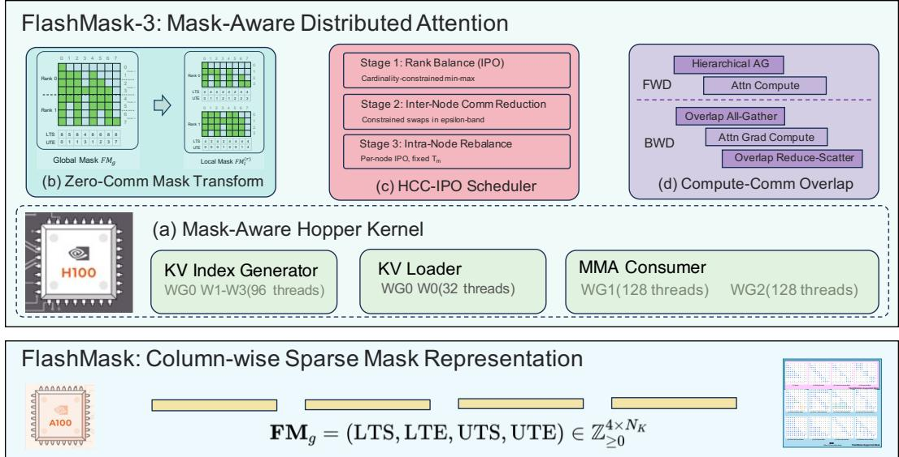  
Figure 1: Overview of FlashMask-3 across four layers of the execution stack.

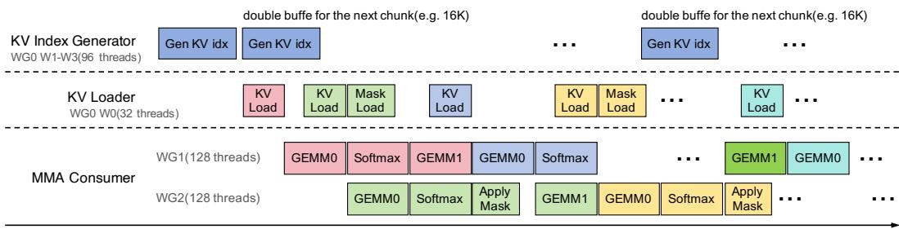  
Figure 2: Three-role warp specialization in the FlashMask-3 Hopper kernel: KV Index Generator (mask scan), KV Loader (TMA load), and MMA Consumer (WGMMA score), connected by three asynchronous pipelines.

## 3.1 Hopper-optimized mask-aware kernel

On Hopper, FA3 overlaps TMA-issued KV loads with WGMMA score and online softmax via two warp-group roles [Shah et al., 2024]; inserting column-wise sparse mask scanning into either role would stall the TMA queue or introduce a barrier inside the WGMMA critical path. We observe that FA3’s Producer warp group dedicates 128 threads to TMA issue while a single thread suffices to launch each op, leaving 96 threads idle every iteration; FlashMask-3 reclaims these threads as a third warp-specialized role, the KV Index Generator, which scans the column-wise sparse boundaries described in §2.2 and emits a queue of valid blocks classified as fully-masked, partially-masked, or unmasked via the blockwise max/min of {LTS, LTE, UTS, UTE}. The KV Loader consumes the queue and issues TMA loads only for listed blocks; the MMA Consumer runs the WGMMA score path, applying a row-interval mask only on partially-masked blocks (Figure 2). The same classification feeds host-side preprocessing in §3.3 and communication-side filtering in §3.4 on independent code paths.

Beyond warp specialization, irregular masks make per-Q-block valid-K-block counts vary by an order of magnitude, leaving SMs that own long-tail Q-blocks straggling under static tile-to-SM dispatch. We adopt a Preemptive Persistent Tile (PPT) scheduler in which each CTA atomically claims its next Q-block from a global counter, with the KV Index Generator issuing the atomic op so the claim overlaps with mask scanning and stays off the WGMMA critical path.

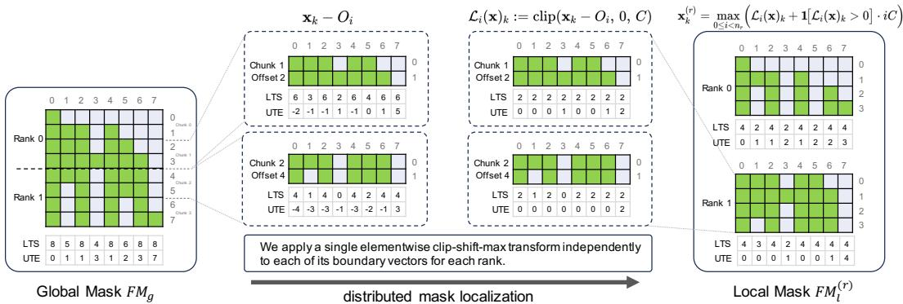  
Figure 3: Zero-communication mapping of global mask boundaries (LTS, UTE) to rank-local coordinates using the clip–shift–max transform (Eq. 1).

## 3.2 Zero-communication distributed mask transform

We localize the global column-wise sparse mask $\mathbf { F M } _ { g } = ( \mathrm { L T S } , \mathrm { L T E } , \mathrm { U T S } , \mathrm { U T E } ) \in \mathbb { Z } _ { > 0 } ^ { 4 \times N _ { K } }$ [Wang et al., 2024], where for each key $k ,$ the masked query intervals $[ \mathrm { L T S } _ { k } , \mathrm { L T E } _ { k } ) \cup [ \mathrm { U T S } _ { k } , \overline { { \mathrm { U T E } _ { k } } } )$ are defined by the lower- and upper-triangular pairs. To distribute this global mask to each rank without communication, we apply an elementwise clip–shift–max transform independently to each boundary vector. Suppose rank r owns $n _ { r }$ disjoint query chunks $\{ [ O _ { i } , O _ { i } + C ) \} _ { i = 0 } ^ { n _ { r } - 1 }$ , sorted by global offsets $O _ { 0 } < O _ { 1 } < \cdot \cdot \cdot < O _ { n _ { r } - 1 }$ , with chunk size C set by the upstream scheduler. For any global boundary vector x ∈ $\mathbb { Z } _ { > 0 } ^ { N _ { K } }$ , we define the single-chunk clip as $\mathcal { L } _ { i } ( \mathbf { x } ) _ { k } : = \mathrm { c l i p } ( \mathbf { x } _ { k } - O _ { i } , 0 , C )$ . The rank-local boundary vector $\mathbf { x } ^ { ( r ) }$ is then

$$
\mathbf { x } _ { k } ^ { ( r ) } = \operatorname* { m a x } _ { 0 \leq i < n _ { r } } \Bigl ( \mathcal { L } _ { i } ( \mathbf { x } ) _ { k } + \mathbf { 1 } \bigl [ \mathcal { L } _ { i } ( \mathbf { x } ) _ { k } > 0 \bigr ] \cdot i C \Bigr ) , \qquad k \in [ 0 , N _ { K } ) .\tag{1}
$$

Breaking down (1): (1) $\mathcal { L } _ { i }$ maps the global boundary to chunk i’s local $[ 0 , C )$ coordinate and clips out-of-chunk values; (2) $\mathcal { L } _ { i } + i C$ embeds chunk i’s local values into the rank-local concatenated space $\begin{array} { r } { \bigsqcup _ { i = 0 } ^ { n _ { r } - 1 } [ i C , ( i { + } 1 ) C ) } \end{array}$ , preserving the global chunk order; (3) the indicator ensures only non-empty clips are shifted, avoiding pollution from vacuous chunks; (4) maxi aggregates across all $n _ { r }$ chunks, ensuring only the chunk containing the boundary value $\mathbf { x } _ { k }$ contributes. Figure 3 illustrates this clip–shift–max process for representative LTS and UTE boundary vectors.

Theorem 1 in Appendix C.1 shows that the rank-local boundary intervals exactly match the global intervals at the corresponding global query positions. Thus, $\mathbf { \bar { F } } \mathbf { M } _ { l } ^ { ( r ) }$ encodes the per-rank mask without information loss. The transform requires only the global mask $\mathbf { F M } _ { g }$ and the rank-owned offsets $\{ O _ { i } \} _ { i = 0 } ^ { n _ { r } - 1 }$ , so there is no need for cross-rank communication. The output preserves the kernel interface described in §3.1, and any upstream chunk assignment (§3.3) is integrated through this single tensor-level interface.

## 3.3 Hierarchical Sparsity-Aware Compute-Communication Balancing

Achieving efficient distributed attention requires jointly optimizing both compute and communication loads, especially under structured sparsity. While balancing per-rank compute loads is critical to avoid stragglers, disregarding the communication topology can easily lead to excessive inter-node key-value (KV) traffic and increased overall latency. However, exact joint optimization is intractable due to the combinatorial search space and sparsity-induced irregularities.

To address this challenge, we propose a Hierarchical Compute-Communication Iterative Pairwise Optimal (HCC-IPO) scheduler, which alternates between: (i) inter-rank compute balancing (assigning chunks to ranks to minimize per-rank compute imbalance under strict cardinality constraints), (ii) internode communication reduction (iteratively swapping chunk assignments between nodes to minimize the maximum inter-node KV traffic while maintaining compute balance within an ϵ-tolerance), and (iii) intra-node compute rebalancing (restoring compute load balance within each node, with node assignments fixed). Full algorithmic details and theoretical guarantees are provided in Appendix C.3.

Formally, let N be the total number of chunks, P the number of ranks, and $\kappa = N / P$ the perrank chunk cardinality. For each chunk i, let wi denote its compute load(see Appendix C.2). A chunk-to-rank assignment is a mapping $\pi : [ N ] \to [ P ]$ , where each rank $j$ is assigned chunk set $S _ { j } ( \pi ) = \pi ^ { - 1 } ( \bar { j } )$ with total compute load $\begin{array} { r } { L _ { j } ( \pi ) = \sum _ { i \in S _ { j } ( \pi ) } w _ { i } } \end{array}$ . The cardinality-constrained min-max partitioning problem is:

$$
\operatorname* { m i n } _ { \pi } \operatorname* { m a x } _ { j \in [ P ] } L _ { j } ( \pi ) , \qquad \mathrm { s . t . } \quad | S _ { j } ( \pi ) | = \kappa \ \forall j ,\tag{2}
$$

A standard lower bound is $\begin{array} { r } { L B = \operatorname* { m a x } \left( \left\lceil \frac { 1 } { P } \sum _ { i } w _ { i } \right\rceil , \operatorname* { m a x } _ { i } w _ { i } \right) } \end{array}$ . We employ the IPO method for this partitioning (Appendix C.3).

For communication balancing, we group ranks by node: let $\mathcal { R } _ { m }$ denote the ranks on node $m ,$ and $\begin{array} { r } { T _ { m } = \bigcup _ { j \in \mathcal { R } _ { m } } S _ { j } } \end{array}$ the chunk set assigned to node m. Let $K _ { i }$ denote the set of KV blocks accessed by chunk i, and Local(m) the set of KV blocks whose queries reside on node $m$ . The inter-node KV traffic and the global communication bottleneck are defined as

$$
\mathrm { C o m m } ( m , \pi ) = \left| \bigcup _ { i \in T _ { m } } K _ { i } \setminus \operatorname { L o c a l } ( m ) \right| , \qquad \mathrm { C o m m } _ { \operatorname* { m a x } } ( \pi ) = \operatorname* { m a x } _ { m } \mathrm { C o m m } ( m , \pi ) ,\tag{3}
$$

To reduce $\mathrm { C o m m } _ { \operatorname* { m a x } } .$ , we identify $m _ { \mathrm { m a x } }$ and $m _ { \mathrm { m i n } }$ by their communication loads, enumerate feasible one-for-one chunk swaps $( i _ { a } \in \dot { T } _ { m _ { \mathrm { m a x } } } , i _ { b } \in T _ { m _ { \mathrm { m i n } } } )$ that preserve compute balance within ϵ-tolerance $( \mathrm { i . e . , } | L _ { j } ( \pi ^ { \prime } ) - \bar { L } | \leq \epsilon \bar { L }$ for all affected ranks, with $\begin{array} { r } { \bar { L } = \overset { \neg } { P } \sum _ { i } w _ { i } ) } \end{array}$ , and commit the swap that yields the largest reduction in $\mathrm { C o m m } _ { \operatorname* { m a x } }$ . After communication balancing, intra-node compute balance is restored by applying IPO within each node.

The resulting assignment π achieves balanced compute loads, bounds the worst-case inter-node KV traffic, and is fully compatible with the distributed mask transformation described in Section 3.2. This hierarchical, sparsity-aware balancing enables scalable and efficient mask-aware distributed attention under realistic hardware constraints.

## 3.4 Mask-aware hierarchical compute-communication overlap

CP introduces overlap in two aspects: (i) the all-gather (AG) of K, V in the forward pass (and backward recomputation), and (ii) the reduce-scatter (RS) of dK, dV in the backward pass. FlashMask-3 hides both costs behind sparse attention computation via three mechanisms: (1) a sparse-mask-aware NVSHMEM symmetric substrate; (2) a hierarchical (intra-/inter-node) AG scheme decoupled from the attention kernel; and (3) a multi-stage backward pipeline interleaving AG, attention, and RS. Communication kernels occupy only 4–8 SMs on high-priority non-blocking streams. The overlap requires fewer than 20 lines of minimally invasive modification to the attention kernel. Detailed protocols are in Appendix C.4 and C.5; Figure 4 provides a timeline summary.

Sparse-mask-aware NVSHMEM symmetric substrate. A single Send/Recv buffer (SR buffer), sized for the complete post-AG $K , V$ tensors, is allocated in NVSHMEM symmetric memory. Any device can access any remote SR-buffer slot via one-sided RDMA get/put, and the attention kernel reads $K , V$ directly from this buffer without intermediate copies. The only unavoidable data movement is a one-time copy of the local K, V shard into the SR buffer; the same buffer is reused for backward recomputation at no extra cost. Before each communication launch, a lightweight sparsity-check kernel scans the column-partitioned sparse boundaries (§3.2) to produce a binary copy\_chunk\_mask marking entirely masked-out KV chunks. The communication kernel skips these chunks, eliminating ≈50% of AG/RS traffic in typical causal document and prefix-LM document masks in our experiments.

Decoupled hierarchical all-gather. The AG kernel runs on a high-priority stream while the attention kernel performs a single pass over the gathered $K , V ,$ , without partitioning K, V across communication steps, thereby avoiding the inter-partition online-softmax LSE correction overhead. The two kernels synchronize via a monotonically increasing write-pointerfrontier; the KV Loader (§3.1) polls this pointer before each TMA load. To exploit the bandwidth asymmetry between RoCE and NVLink (5–10× higher per-GPU), the AG is routed via congruence groups:

$$
\mathcal { C } ( \boldsymbol { r } ) = \{ \boldsymbol { r } \mathrm { m o d } G + \boldsymbol { k } \cdot \boldsymbol { G } | \boldsymbol { k } = 0 , \ldots , N - 1 \} ,\tag{4}
$$

where r is the global device rank, N the number of nodes, and G=8 GPUs per node. In Phase 1, each device issues N−1 RoCE get operations to fetch KV chunks from cross-node congruencegroup members. In Phase 2, each device retrieves the remaining (G−1)·N chunks from intra-node neighbors over NVLink, whose congruence-group data are already available. Letting $P = N { \cdot } G$ , at $P { = } 3 2$ inter-node pulls drop from (N − 1) · G = 24 to N−1 = 3, a ≈90% reduction.

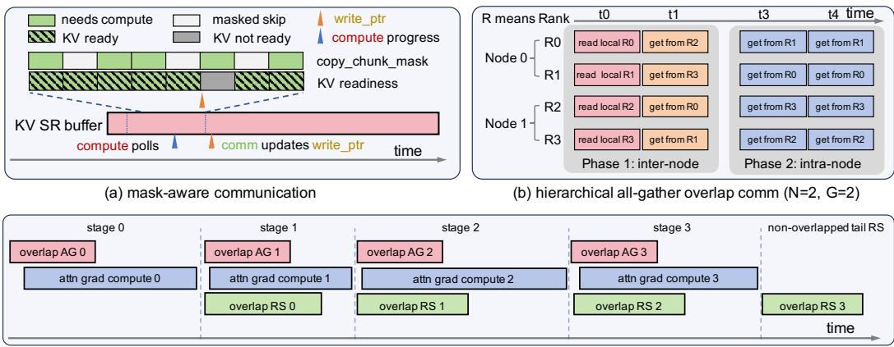  
(c) multi-stage reduce-scatter overlap (N=2, G=8)  
Figure 4: Mask-aware hierarchical compute-communication overlap. (a) AG skips fully-masked chunks; compute polls a write\_ptr updated by the comm kernel. (b) Hierarchical AG (N=2, G=2): inter-node congruence-group fetch (Phase 1), then intra-node NVLink fetch (Phase 2). (c) Multi-stage backward overlap $( N { \bar { = } } 2 , { \bar { G } } { = } 8 )$ : RS of segment t overlaps AG and grad compute of segment t+1; the tail RS runs non-overlapped.

Multi-stage backward overlap. The backward pass reuses the same hierarchical AG for K, V recomputation, adopting KV column parallelism: each CTA processes one KV chunk and iterates over all Q blocks, eliminating sequential dependencies across chunks. The contiguous write-pointer frontier is replaced by per-chunk work\_done flags. The RS is realized as a sparse all-to-all via NVSHMEM one-sided put, synchronized by a bitmask-AMO mechanism for put producers and gradient reduction consumers, with both SM-level and rank-level load balanced. We partition the KV sequence into T segments of ${ \mathcal { C } } = 2 ^ { \lfloor { \frac { 1 } { 2 } } \log _ { 2 } P \rfloor }$ chunks each (e.g., T=C=4 for P=16), so the RS of segment t overlaps with the AG and backward attention of segment t+1. Since forward-saved LSE eliminates cross-segment online-softmax rescaling, this partition incurs virtually no overhead beyond fp32 dQ accumulation across segments.

## 4 Experiments

In this section, we evaluate FlashMask-3 through a comprehensive set of experiments designed to assess single-GPU kernel efficiency (§4.1), distributed scalability (§4.2), and end-to-end training throughput on a production-scale MoE workload (§4.3), followed by component-level ablations (§4.4). All experiments are conducted on machines equipped with NVIDIA H100 80GB SXM5 GPUs interconnected via NVLink within each node and RoCE across nodes, with 8 GPUs per node and Intel Xeon Platinum 8468V CPUs (48 cores). We use CUDA 12.4, CUTLASS (commit afa177) [Thakkar et al., 2023] and NVSHMEM 3.2.5 throughout. Baseline configurations are as follows: MagiAttention (commit d97b72), FlexAttention (PyTorch 2.8.0), and Megatron 2.8.0. Unless otherwise stated, all experiments use a head dimension of $d = 1 2 8$ and the BF16 data type. Detailed experimental configurations are provided in Appendix D.1.1. Speed measurements are repeated; error bars in the figures and ± values in the tables denote ±1 standard deviation.

## 4.1 Single-GPU Kernel Performance

We first isolate the kernel-level performance of FlashMask-3 by benchmarking on a single H100 GPU against FlashMask, FlexAttention, and MagiAttention. We sweep sequence lengths from 4K to 128K across 12 representative sparse mask patterns (see Equation 5 and Figure 5). The data construction method and experiment settings follows that described in Section A.5.2 [Wang et al., 2024]. Across this entire grid, FlashMask-3 improves achieved TFLOPs/s over FlashMask, FlexAttention, and MagiAttention by 45%–141%, 34%–71%, and 2%–44%, respectively, outperforming all three baselines on every mask pattern and sequence length. To summarize these results into one figure per baseline, we report the geometric mean of speedups across all mask patterns and sequence lengths.

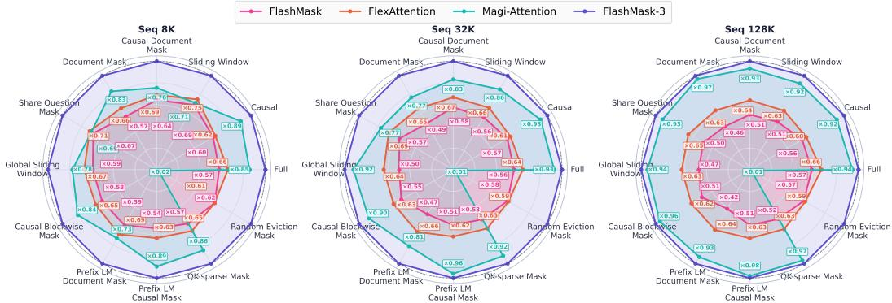

Figure 5: Kernel FWD & BWD throughput (TFLOPs/s) on a single H100 GPU. Error bars are omitted for legibility; the underlying per-mask measurements with standard deviations are reported in Figure 9 (Appendix D.1.3).  
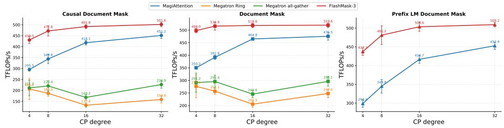  
Figure 6: Distributed scaling. Per-GPU TFLOPs/s versus CP degree P for FlashMask-3, Megatron all-gather, Megatron Ring Attention, and Magi-Attention on three practically relevant mask patterns.

$$
\mathrm { S p e e d u p } = \frac { V _ { \mathrm { T F L O P s / s , F l a s h M a s k - 3 } } - V _ { \mathrm { T F L O P s / s , b a s e l i n e } } } { V _ { \mathrm { T F L O P s / s , b a s e l i n e } } } \times 1 0 0 \%\tag{5}
$$

The 82.6% mean speedup over FlashMask validates the combined effect of our three-role warpspecialized pipeline, asynchronous TMA prefetching, Ping-Pong scheduling, and the PPT scheduler on Hopper. Against FlexAttention, the 55.3% mean gain reflects the overhead of runtime mask evaluation via torch.compile and the absence of a Hopper-native execution pipeline. FlashMask-3 also surpasses MagiAttention by 15.0% in geometric mean (excluding the Random Eviction mask, on which MagiAttention’s block-sparse representation is ill-suited, resulting in over 50× slowdown). Even on patterns favorable to block-sparse encoding, FlashMask-3 remains competitive or superior, demonstrating that the column-wise sparse representation achieves broad expressiveness without sacrificing efficiency. Across all comparisons, the speedup increases monotonically with sequence length (e.g., +66.2% → +97.3% over FlashMask from 8K to 128K), confirming that our architectural optimizations yield compounding benefits as attention becomes increasingly memory-bound. Detailed per-mask TFLOPs/s results are provided in Appendix D.1.3.

## 4.2 Context Parallelism Scalability

To evaluate the scalability of FlashMask-3 under context parallelism (CP), we compare against two representative baselines, namely Megatron-Core CP (both its ring and all-gather variants) and MagiAttention, on three practically relevant mask patterns: Causal Document Mask, Document Mask, and Prefix LM Document Mask. Since neither the ring nor the all-gather variant of Megatron-Core CP supports Prefix LM Document Mask, we exclude them from the corresponding comparison.

We adopt a weak-scaling protocol in which the per-device local sequence length is fixed at $S _ { \mathrm { l o c a l } } { = } 8 \mathrm { K }$ tokens and the CP degree is scaled from 4 to 32, yielding total sequence lengths ranging from 32K to 256K. All experiments use a batch size of $B { = } \dot { 3 } 2 / P , \bar { H } _ { q } { = } 6 4$ query heads, and $H _ { k v } { = } 1$ key-value head; since $S { \stackrel { - } { = } } S _ { \mathrm { l o c a l } } \cdot P$ grows with P while B shrinks as $1 / { \bar { P } } .$ , the dense per-device attention workload $B S ^ { 2 } / P$ is constant across CP degrees. The results are summarized in Figure 6. Additional configurations and complete forward/backward results are provided in Appendix D.1.2 and D.1.4.

Table 1: End-to-end training throughput of a 118B-A14B MoE model (128K context, CP degree $1 6 , S _ { \mathrm { l o c a l } } { = } 8 \mathrm { K }$ tokens per device, $\bar { H _ { q } } { = } 6 4 , H _ { k v } { = } 8 .$ , document mask) on 128 H100 GPUs, for three datasets of differing average mask sparsity. Each run covers 70 steps; we discard the 10 highest and 10 lowest throughput steps and report the mean ± one standard deviation over the remaining 50. $\Delta _ { \mathrm { a t t } 1 }$ is the corresponding attention forward+backward speedup over the baseline.
<table><tr><td></td><td colspan="2">70% sparsity</td><td colspan="2">80% sparsity</td><td colspan="2">86% sparsity</td></tr><tr><td>Configuration</td><td>tokens/s/GPU</td><td> $\Delta _ { \mathrm { a t t n } }$ </td><td>tokens/s/GPU</td><td> $\Delta _ { \mathrm { a t t } }$ </td><td>tokens/s/GPU</td><td> $\Delta _ { \mathrm { a t t } }$ </td></tr><tr><td>Baseline (Dual Chunk + all-gather)</td><td> $7 1 2 . 6 \pm 8 . 7$ </td><td></td><td> $7 5 3 . 3 \pm 3 4 . 7$ </td><td></td><td> $8 1 2 . 4 \pm 5 7 . 1$ </td><td></td></tr><tr><td>+ HCC-IPO balancing</td><td> $7 3 2 . 2 \pm 2 4 . 5$ </td><td> $+ 1 0 . 4 \%$ </td><td> $7 8 6 . 2 \pm 6 5 . 2$ </td><td> $+ 1 9 . 1 \%$ </td><td> $8 5 8 . 5 \pm 6 2 . 1 $ </td><td> $+ 1 0 . 5 \%$ </td></tr><tr><td>+ mask-aware overlap</td><td> $7 5 0 . 8 \pm 6 . 4$ </td><td> $+ 1 5 . 9 \%$ </td><td> $7 8 5 . 0 \pm 3 3 . 6$ </td><td> $+ 1 3 . 9 \%$ </td><td> $8 6 0 . 0 \pm 5 5 . 0$ </td><td> $+ 2 0 . 5 \%$ </td></tr><tr><td>+ both, hierarchical routing off</td><td> $7 0 0 . 6 \pm 2 8 . 8 $ </td><td> $+ 8 . 4 \%$ </td><td> $7 4 2 . 0 \pm 7 2 . 6$ </td><td> $+ 2 1 . 5 \%$ </td><td> $8 2 8 . 0 \pm 6 0 . 6$ </td><td>+23.2%</td></tr><tr><td>+ both, w/o chunk-skip pruning</td><td> $7 5 0 . 0 \pm 2 0 . 6$ </td><td> $+ 2 0 . 5 \%$ </td><td> $7 8 8 . 4 \pm 5 5 . 0$ </td><td> $+ 2 5 . 4 \%$ </td><td> $8 8 8 . 6 \pm 6 9 . 6$ </td><td>+27.9%</td></tr><tr><td>FlashMask-3 (balance + overlap)</td><td> $7 6 4 . 7 \pm 2 8 . 8$ </td><td> $+ 2 4 . 5 \%$ </td><td> $\mathbf { 8 1 1 . 4 \pm 7 5 . 9 }$ </td><td>+42.1%</td><td> $\mathbf { 9 0 2 . 1 \pm 7 2 . 6 }$ </td><td>+44.9%</td></tr></table>

At CP degrees 4 and 8, all communication is confined to intra-node NVLink interconnects, whereas scaling to CP 16 and 32 introduces inter-node traffic. Despite this transition, FlashMask-3 sustains strong scaling efficiency. On the Causal Document Mask, its throughput increases from 430.5 TFLOPs/s at CP = 4 to 471.8, 491.8, and 501.6 TFLOPs/s at $\mathrm { C P } = 8 ,$ , 16, and 32, respectively. Across all supported mask patterns and CP degrees, FlashMask-3 achieves 1.09× to 1.46× higher throughput than MagiAttention, outperforms Megatron-Core CP (all-gather) by $1 . 7 1 \times \mathrm { t o } 2 . 9 2 \times$ , and surpasses Megatron-Core CP (ring) by 1.80× to 3.71×.

## 4.3 End-to-End Training Throughput

The preceding sections measure attention in isolation; we now report throughput for full training steps. We train a 118B-A14B MoE model at a 128K context on 128 H100 GPUs (16 nodes) with CP degree 16, a per-device local sequence length of $S _ { \mathrm { l o c a l } } { = } 8 \mathrm { K }$ tokens, $H _ { q } { = } 6 4$ query heads, $H _ { k v } { = } 8 \mathrm { K V }$ heads, and a document mask. The baseline is FlashMask-3 with Dual Chunk balancing and all-gather communication, i.e. with the balancer of §3.3 and the overlap of §3.4 disabled. Because the share of step time spent in attention depends on mask sparsity, we repeat the comparison on three datasets with average mask sparsity 70%, 80%, and 86%.

Table 1 reports gains of 7.3% / 7.7% / 11.0% in end-to-end throughput with both components enabled, at 70% / 80% / 86% sparsity, against attention forward+backward speedups of 24.5% / 42.1% / 44.9% (at 70% sparsity, 10900.5 ms per step down to 8757.6 ms). The end-to-end gain is smaller because attention accounts for only 43.5% / 25.8% / 24.4% of forward+backward compute time in the full configuration, and the end-to-end measurement also covers gradient synchronization and the optimizer update, which our method does not modify.

Each component helps on its own, contributing 2.8% / 4.4% / 5.7% (balancing) and 5.4% / 4.2% / 5.9% (overlap), and chunk-skip pruning is worth a further 2.0% / 2.9% / 1.5%. Hierarchical routing is required for the two to compose at this cross-node scale: with it disabled, balancing plus overlap falls to −1.7% / −1.5% / +1.9%, below overlap alone, because the balancer spreads chunks across nodes and that traffic is no longer confined to congruence groups (§3.4). The default of 4 backward pipeline stages follows the rule of §3.4 at P=16: halving it to 2 costs up to 3.6%, while raising it to 8 yields no significant further gain.

FlashMask-3 computes exact attention: mask localization matches the global mask (Theorem 1), and the balancer, overlap, and pruning change only how work is placed, not what is computed. Convergence and downstream quality are therefore unaffected; Appendix D.3 compares the loss of an otherwise identical run without context parallelism.

## 4.4 Ablation Study

Complementing the end-to-end breakdown of §4.3, we conduct three groups of ablation experiments that isolate each key component proposed in FlashMask-3 across mask patterns, sequence lengths, and CP degrees: Preemptive Persistent Tile (PPT), load balancing, and computation-communication overlap.

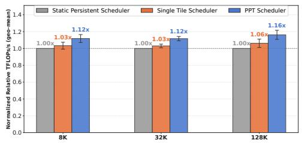  
(a)

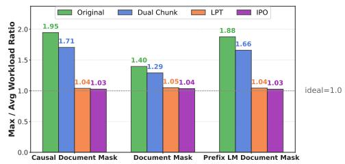  
(b)

Figure 7: (a) Speedup of the Preemptive Persistent Tile (PPT) scheduler over the static scheduler across different mask patterns and sequence lengths on a single H100 GPU. (b) Peak-to-average ratio of per-device computation time under different workload partitioning strategies with Context Parallelism.  
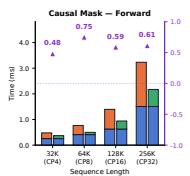

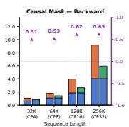

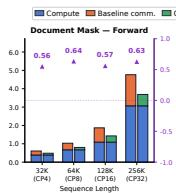

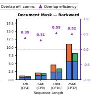

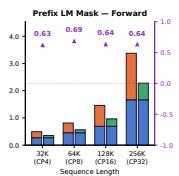

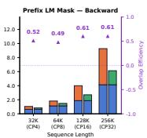  
Figure 8: Computation-communication overlap efficiency for various mask patterns and CP degrees.

Effect of Preemptive Persistent Tile (PPT). We compare three tile-scheduling strategies on a single H100 GPU: (i) a static scheduler that assigns a fixed tile grid, (ii) a single-tile scheduler that dispatches one work tile at a time, and (iii) the proposed PPT scheduler. As shown in Figure 7(a), across 12 mask configurations at sequence lengths of 8K, 32K, and 128K, PPT consistently outperforms the static scheduler by up to 12%, demonstrating that preemptive, persistent tile execution effectively amortizes scheduling overhead and improves streaming multiprocessor (SM) utilization.

Effect of load balancing. We compare four workload partitioning strategies under CP: (i) a naïve baseline that evenly splits the KV sequence, (ii) Dual Chunk, (iii) Longest-Processing-Time first (LPT) [Graham, 1969], and (iv) our proposed Iterative Pairwise Optimization (IPO). We report the peak-to-average ratio of per-device computation time, where a value closer to 1.0 indicates a more balanced distribution. As illustrated in Figure 7(b), IPO achieves the lowest peak-to-average ratio across all three mask patterns, confirming that it further refines the LPT solution toward a more balanced workload assignment. A detailed visualization of per-rank compute load distributions under each strategy is provided in Figure 11 (Appendix).

Effect of computation-communication overlap. Following the methodology of Flux [Chang et al., 2024], we report the overlap efficiency defined as $E _ { \mathrm { o v e r l a p } } \stackrel { - } { = } 1 - T _ { \mathrm { e x p o s e d } } / T _ { \mathrm { c o m m } } ^ { - } ,$ where $T _ { \mathrm { e x p o s e d } }$ denotes the portion of communication time that is not hidden behind computation and $T _ { \mathrm { c o m i n } }$ is the total communication time. A value closer to 1.0 indicates that computation more fully hides communication latency. As shown in Figure 8, FlashMask-3 attains an overlap efficiency ranging from 0.31 to 0.75, validating the effectiveness of our mask-aware hierarchical compute-communication.

## 5 Conclusion

FlashMask-3 establishes that the column-wise sparse mask representation, originally a single-GPU memory optimization, also serves as the right interface for distributing expressive masks at zero communication on Hopper-class hardware. The method preserves one column-wise sparse mask abstraction and one FA3-derived kernel across single-GPU and multi-node settings, with maskawareness propagated through Hopper kernel scheduling, hierarchical load balancing, and computecommunication overlap. Empirical evaluation across 12 structured masks at context lengths up to 128K on a single H100 GPU and context parallelism up to P=32 yields consistent improvements in single-GPU TFLOPs, compute-communication overlap, and distributed throughput over representative single-GPU and distributed mask baselines. On end-to-end training of a 118B-A14B MoE model at a 128K context across 128 H100 GPUs, these mechanisms yield a 7.3%–11.0% throughput gain.

## Acknowledgments

We thank the anonymous reviewers, area chairs, and senior area chairs for their insightful comments and constructive suggestions.

This work was supported by the National Engineering Research Center of Deep Learning Technology and Application.

## References

Iz Beltagy, Matthew E. Peters, and Arman Cohan. Longformer: The long-document transformer. arXiv preprint arXiv:2004.05150, 2020.

William Brandon, Aniruddha Nrusimha, Kevin Qian, Zachary Ankner, Tian Jin, Zhiye Song, and Jonathan Ragan-Kelley. Striped attention: Faster ring attention for causal transformers. arXiv preprint arXiv:2311.09431, 2023.

Li-Wen Chang, Wenlei Bao, Qi Hou, Chengquan Jiang, Ningxin Zheng, Yinmin Zhong, Xuan Zhang, Zuquan Song, Ziheng Jiang, Haibin Lin, Xin Jin, and Xin Liu. Flux: Fast software-based communication overlap on gpus through kernel fusion. arXiv preprint arXiv:2406.06858, 2024.

Sirui Chen, Jingji Chen, Siqi Zhu, Ziheng Jiang, Yanghua Peng, and Xuehai Qian. Mesh-attention: A new communication-efficient distributed attention with improved data locality. arXiv preprint arXiv:2512.20968, 2025.

Rewon Child, Scott Gray, Alec Radford, and Ilya Sutskever. Generating long sequences with sparse transformers. 2019.

Tri Dao. Flashattention-2: Faster attention with better parallelism and work partitioning. arXiv preprint arXiv:2307.08691, 2023.

Tri Dao, Dan Fu, Stefano Ermon, Atri Rudra, and Christopher Ré. Flashattention: Fast and memoryefficient exact attention with io-awareness. Advances in neural information processing systems, 35: 16344–16359, 2022.

Chaorui Deng, Deyao Zhu, Kunchang Li, Chenhui Gou, Feng Li, Zeyu Wang, Shu Zhong, Weihao Yu, Xiaonan Nie, Ziang Song, et al. Emerging properties in unified multimodal pretraining. arXiv preprint arXiv:2505.14683, 2025.

Jiarui Fang and Shangchun Zhao. Usp: A unified sequence parallelism approach for long context generative ai. arXiv preprint arXiv:2405.07719, 2024.

Ronald L. Graham. Bounds on multiprocessing timing anomalies. SIAM Journal on Applied Mathematics, 17(2):416–429, 1969.

Horace He, Driss Guessous, Yanbo Liang, and Joy Dong. Flexattention: The flexibility of pytorch with the performance of flashattention. PyTorch Blog, 8, 2024.

Sam Ade Jacobs, Masahiro Tanaka, Chengming Zhang, Minjia Zhang, Shuaiwen Leon Song, Samyam Rajbhandari, and Yuxiong He. Deepspeed ulysses: System optimizations for enabling training of extreme long sequence transformer models. arXiv preprint arXiv:2309.14509, 2023.

Chenyu Jiang, Zhenkun Cai, Ye Tian, Zhen Jia, Yida Wang, and Chuan Wu. Dcp: Addressing input dynamism in long-context training via dynamic context parallelism. In Proceedings ofthe ACM SIGOPS 31st Symposium on Operating Systems Principles, pages 221–236, 2025.

Dacheng Li, Rulin Shao, Anze Xie, Ying Sheng, Lianmin Zheng, Joseph E. Gonzalez, Ion Stoica, Xuezhe Ma, and Hao Zhang. Distflashattn: Distributed memory-efficient attention for long-context llms training. arXiv preprint arXiv:2310.03294, 2023.

Hao Liu, Matei Zaharia, and Pieter Abbeel. Ring attention with blockwise transformers for nearinfinite context. arXiv preprint arXiv:2310.01889, 2023.

Tianyu Lu et al. Moba: Mixture of block attention for long-context llms. arXiv preprint arXiv:2502.13189, 2025.

Maxim Milakov and Natalia Gimelshein. Online normalizer calculation for softmax. arXiv preprint arXiv:1805.02867, 2018.

Deepak Narayanan, Mohammad Shoeybi, Jared Casper, Patrick LeGresley, Mostofa Patwary, Vijay Korthikanti, Dmitri Vainbrand, Prethvi Kashinkunti, Julie Bernauer, Bryan Catanzaro, Amar Phanishayee, and Matei Zaharia. Efficient large-scale language model training on GPU clusters using megatron-lm. In Bronis R. de Supinski, Mary W. Hall, and Todd Gamblin, editors, International Conference for High Performance Computing, Networking, Storage and Analysis, SC 2021, St. Louis, Missouri, USA, November 14-19, 2021, page 58. ACM, 2021. doi: 10.1145/3458817.3476209. URL https://doi.org/10.1145/3458817.3476209.

NVIDIA. Nvshmem: Nvidia openshmem library for nvidia gpus. Software documentation, 2023. URL https://developer.nvidia.com/nvshmem.

Markus N. Rabe and Charles Staats. Self-attention does not need O(n2) memory. arXiv preprint arXiv:2112.05682, 2021.

Jay Shah, Ganesh Bikshandi, Ying Zhang, Vijay Thakkar, Pradeep Ramani, and Tri Dao. Flashattention-3: Fast and accurate attention with asynchrony and low-precision. Advances in Neural Information Processing Systems, 37:68658–68685, 2024.

Zewei Tao and Yunpeng Huang. Magiattention: A distributed attention towards linear scalability for ultra-long context, heterogeneous mask training. https://github.com/SandAI-org/ MagiAttention, 2025.

Vijay Thakkar, Pradeep Ramani, Cris Cecka, Aniket Shivam, Honghao Lu, Ethan Yan, Jack Kosaian, Mark Hoemmen, Haicheng Wu, Andrew Kerr, Matt Nicely, Duane Merrill, Dustyn Blasig, Aditya Atluri, Fengqi Qiao, Piotr Majcher, Paul Springer, Markus Hohnerbach, Jin Wang, and Manish Gupta. CUTLASS, January 2023. URL https://github.com/NVIDIA/cutlass.

Philippe Tillet, Hsiang-Tsung Kung, and David Cox. Triton: an intermediate language and compiler for tiled neural network computations. In Proceedings ofthe 3rd ACM SIGPLAN International Workshop on Machine Learning and Programming Languages, pages 10–19, 2019.

Guoxia Wang, Jinle Zeng, Xiyuan Xiao, Siming Wu, Jiabin Yang, Lujing Zheng, Zeyu Chen, Jiang Bian, Dianhai Yu, and Haifeng Wang. Flashmask: Efficient and rich mask extension of flashattention. arXiv preprint arXiv:2410.01359, 2024.

Haifeng Wang, Hua Wu, Tian Wu, Yu Sun, Jing Liu, Dianhai Yu, Yanjun Ma, et al. Ernie 5.0 technical report. arXiv preprint arXiv:2602.04705, 2026.

Jingyang Yuan, Huazuo Gao, Damai Dai, Junyu Luo, Liang Zhao, Zhengyan Zhang, Zhenda Xie, Yuxing Wei, Lean Wang, Zhiping Xiao, et al. Native sparse attention: Hardware-aligned and natively trainable sparse attention. In Proceedings ofthe 63rd Annual Meeting ofthe Association for Computational Linguistics (Volume 1: Long Papers), pages 23078–23097, 2025.

Chenggang Zhao, Shangyan Zhou, Liyue Zhang, Chengqi Deng, Zhean Xu, Yuxuan Liu, Kuai Yu, Jiashi Li, and Liang Zhao. Deepep: an efficient expert-parallel communication library. https://github.com/deepseek-ai/DeepEP, 2025.

## A Limitations and Broader Impact

Limitations. The method covers the column-wise sparse mask family of Wang et al. [2024]; masks whose per-column masked rows do not decompose into two intervals require representation extensions. The Hopper kernel exploits TMA/WGMMA and assumes Hopper-class architectures; porting to other architectures requires re-targeting the warp specialization. The hierarchical overlap of §3.4 assumes per-node 8-GPU NVLink islands with same-rank IB topology; clusters with different topologies need a different inter-node mapping. Hierarchical routing is currently applied only to the all-gather operation; extending it to the backward reduce-scatter is left as future work. Empirical claims rely on production-scale long-context settings; smaller contexts may not amortize the scheduler overhead. Finally, our benchmarks cover a representative but not exhaustive set of QKV tensor configurations; a systematic sweep over batch sizes and query/key-value head ratios beyond those reported in §4.2 and §4.3 is left to future work.

Broader impact. By improving the throughput and energy efficiency of long-context training, FlashMask-3 lowers the cost barrier for academic and open-source long-context multimodal research and reduces the carbon footprint of large-scale training. The same efficiency gains can also lower the cost of training capability-amplifying models, which is an externality common to research on large-scale training infrastructure.

## B Extended Related Work

IO-aware exact attention. FlashAttention [Dao et al., 2022] introduced tiling and online softmax [Milakov and Gimelshein, 2018, Rabe and Staats, 2021] to compute exact attention in $O ( N )$ memory without materializing the $N \times N$ score matrix. FlashAttention-2 [Dao, 2023] swapped the loop order and optimized warp-level work partitioning, reaching 50–73% of A100 peak throughput. FlashAttention-3 [Shah et al., 2024] further added Hopper-native TMA/WGMMA pipelining and FP8 support, achieving 740 TFLOPs/s on H100. Block-Sparse FlashAttention [Dao et al., 2022] augments the tiled kernel with an $O ( N ^ { 2 } / B ^ { 2 } )$ binary block mask for tile skipping; FlashMask’s column-wise sparse representation achieves $O ( N )$ storage with token-level granularity.

Compiler-driven attention. FlexAttention [He et al., 2024] JIT-compiles arbitrary mask\_mod functions into Triton [Tillet et al., 2019] kernels, offering maximal flexibility at the cost of per-mask compilation overhead and a code path separate from FA3’s Hopper-native pipeline. Under distributed CP, each rank independently reconstructs the local block mask at $O ( Q \bar { K } / B ^ { 2 } )$ cost. FlashMask-3 avoids both issues through a fixed kernel binary and zero-communication mask localization.

Learnable block-sparse attention. NSA [Yuan et al., 2025] combines compression, top-k block selection, and sliding-window branches in an end-to-end differentiable architecture that is hardwarealigned and natively trainable from pretraining. MoBA [Lu et al., 2025] routes each query to its top-k KV blocks via MoE-style gating, enabling seamless switching with full attention. Both learn which tokens to attend to and require architectural modification. FlashMask-3 solves a complementary problem: efficiently computing a pre-specified structural mask with no model changes required.

Structured mask representations. MagiAttention [Tao and Huang, 2025] represents masks as AttnSlice triples $( Q _ { \mathrm { r a n g e } } , K _ { \mathrm { r a n g e } } .$ , MaskType), cut along Q/K axes for distribution; this requires a dedicated FFA kernel with per-slice atomics. FlashMask [Wang et al., 2024] uses column-wise sparse boundary vectors at ${ \bar { O } } ( N )$ storage, covering 12+ structured mask patterns. FlashMask-3 extends this to distributed settings through an elementwise clip–shift–max transform that preserves the single-GPU kernel interface at zero cross-rank communication.

Context parallelism. Ring Attention [Liu et al., 2023] circulates KV on a device ring with dualstream overlap, achieving ∼50% GPU utilization under causal masks due to inherent load imbalance [Li et al., 2023]. Striped Attention [Brandon et al., 2023] restores causal balance via round-robin token assignment (1.45–1.65× over Ring) but supports only causal masks. DeepSpeed Ulysses [Jacobs et al., 2023] converts to head parallelism via all-to-all, natively supporting arbitrary masks but requiring $N _ { \mathrm { h e a d s } }$ mod $P = 0$ . USP [Fang and Zhao, 2024] unifies Ulysses (intra-node) with Ring (inter-node). Megatron CP [Narayanan et al., 2021] employs dual chunking for causal balance; under irregular masks such as shared-question (RLHF) or multi-document masks, its linear-cost assumption fails and per-rank utilization degrades significantly.

Load balancing under irregular masks. DCP [Jiang et al., 2025] (SOSP 2025) models CP scheduling as hypergraph partitioning over block-level workloads, achieving <5% imbalance at the cost of a heavyweight solver. MagiAttention [Tao and Huang, 2025] uses chunk-level LPT-greedy assignment [Graham, 1969] based on AttnSlice areas. FlashMask-3 derives per-chunk valid-block counts directly from the column-wise boundary vectors and solves the scheduling subproblem with provable optimality guarantees (§3.3), avoiding external solver overhead.

Compute–communication overlap. Ring Attention [Liu et al., 2023] relies on dual CUDA streams, which suffer SM contention when large attention kernels starve communication of resources. FLUX [Chang et al., 2024] demonstrates that kernel-level tile fusion eliminates this contention for GEMMs, but online softmax prevents straightforward extension to attention. MagiAttention uses DeepEP-based [Zhao et al., 2025] GroupCast/GroupReduce with stream-level multi-stage overlap. FlashMask-3 uses NVSHMEM [NVIDIA, 2023] GPU-initiated one-sided communication with zerocopy symmetric buffers shared with the attention kernel, achieving high overlap without perturbing the WGMMA critical path. Mesh-Attention [Chen et al., 2025] reduces communication volume from $O ( N d ) : \mathrm { ~ t ~ o ~ } O ( N d / \sqrt { P } )$ via a 2D assignment matrix, a topological optimization orthogonal and composable with FlashMask-3’s latency-focused NVSHMEM overlap.

## C Proofs and Additional Technical Details

## C.1 Distributed mask transform: definitions, complete proof, and resource profile

We restate the building blocks of §3.2 as formal definitions, prove Theorem 1 in full, and report the operator-level resource profile of the transform.

Definition 1 (Single-chunk local clip). For a query chunk $[ O , O + C )$ in global coordinates and a global boundary vector $\mathbf { x } \in \mathbb { Z } _ { \geq 0 } ^ { N _ { K } }$ , the single-chunk local clip is

$$
\left[ { \mathcal L } _ { O , C } ( { \bf x } ) \right] _ { k } = \mathrm { c l i p } \big ( { \bf x } _ { k } - O , 0 , C \big ) , \qquad k \in [ 0 , N _ { K } ) .
$$

Definition 2 (Multi-chunk shifted clip, merge, and rank-local mask). Suppose rank r owns $n _ { r }$ disjoint query chunks $\{ [ O _ { i } , O _ { i } + C ) \} _ { i = 0 } ^ { n _ { r } - 1 }$ sorted by global offset $O _ { 0 } < O _ { 1 } < \cdot \cdot \cdot < O _ { n _ { r } - 1 }$ , mapped to the rank-local concatenated coordinate system $\begin{array} { r } { \bigsqcup _ { i = 0 } ^ { n _ { r } - 1 } [ i C , ( i { + } 1 ) C ) } \end{array}$ . The multi-chunk localized boundary on rank r is

$$
\left[ \mathcal { M } ^ { ( r ) } ( \mathbf { x } ) \right] _ { k } = \operatorname* { m a x } _ { 0 \leq i < n _ { r } } \Big ( \big [ \mathcal { L } _ { O _ { i } , C } ( \mathbf { x } ) \big ] _ { k } + \mathbf { 1 } \big [ \mathcal { L } _ { O _ { i } , C } ( \mathbf { x } ) _ { k } > 0 \big ] \cdot i C \Big ) , \quad k \in [ 0 , N _ { K } ) ,\tag{6}
$$

which is the operator form of the main-paper transform (1). The rank-local column-wise sparse mask is then $\mathbf { F M } _ { l } ^ { ( r ) } = \left( \mathcal { M } ^ { ( r ) } ( \mathrm { L T S } ) , \mathcal { M } ^ { ( r ) } ( \mathrm { L T E } ) , \mathcal { M } ^ { ( r ) } ( \mathrm { U T S } ) , \mathcal { M } ^ { ( r ) } ( \mathrm { U T E } ) \right)$ , retaining the same shape $4 \times N _ { K } , \mathrm { d i y p e } .$ , and column-wise sparse semantics as $\mathbf { F M } _ { g }$

Lemma 1 (Cross-chunk contribution bounds). Under the notation of Definition 2, fix $k \in [ 0 , N _ { K } )$ $\tilde { q } ~ \in ~ [ 0 , n _ { r } C )$ , and let $i ^ { \star } = \vert \tilde { q } / C \vert , \delta = \tilde { q } - i ^ { \star } C , q ^ { \star } = O _ { i ^ { \star } } + \delta$ . For any boundary vector $\mathrm { X } \in \{ \mathrm { L T S }$ , LTE, UTS, UTE}, define

$$
f ^ { \mathrm { X } } ( i ) ~ = ~ \big [ \mathcal { L } _ { O _ { i } , C } ( \mathrm { X } ) \big ] _ { k } + \mathbf { 1 } \big [ \mathcal { L } _ { O _ { i } , C } ( \mathrm { X } ) _ { k } > 0 \big ] \cdot i C .
$$

Then thefollowing bounds holdfor all chunks i $\neq i ^ { \star } .$

(i) $F o r i < i ^ { \star } \colon f ^ { \mathrm { X } } ( i ) \leq ( i + 1 ) C \leq i ^ { \star } C \leq \tilde { q } .$

(ii) For $i > i ^ { \star }$ with $\begin{array} { r l } { \mathrm { X } _ { k } \leq q ^ { \star } \colon } & { { } f ^ { \mathrm { X } } ( i ) = 0 . } \end{array}$

(iii) For $i > i ^ { \star }$ with $\mathrm { X } _ { k } > q ^ { \star }$ and $\mathrm { X } _ { k } > O _ { i } \mathrm { : } \quad f ^ { \mathrm { X } } ( i ) \geq ( i ^ { \star } { + } 1 ) C + 1 > \tilde { q } .$

(iv) For $i > i ^ { \star }$ with $\begin{array} { r } { \mathrm { X } _ { k } > q ^ { \star } a n d \mathrm { X } _ { k } \leq O _ { i } : f ^ { \mathrm { X } } ( i ) = 0 , f ^ { \mathrm { X } } ( i ^ { \star } ) \geq \tilde { q } + 1 > \tilde { q } . } \end{array}$

Proof. (i) By the clip upper bound, $[ \mathcal { L } _ { O _ { i } , C } ( \mathrm { X } ) ] _ { k } \leq C , \mathrm { s o } f ^ { \mathrm { X } } ( i ) \leq C + i C = ( i + 1 ) C .$ Since $i < i ^ { \star }$ we have $( i + 1 ) C \leq i ^ { \star } C \leq \tilde { q }$

(ii) For $i > i ^ { \star }$ , disjointness gives $O _ { i } \geq O _ { i ^ { \star } } + C > q ^ { \star } \geq \mathrm { X } _ { k }$ . Hence $\mathrm { X } _ { k } - O _ { i } < 0$ , the clip vanishes, and $f ^ { \mathrm { X } } ( i ) = 0$

(iii) For $i > i ^ { \star }$ with $\mathrm { X } _ { k } > q ^ { \star } = O _ { i ^ { \star } } + \delta$ and $\mathrm { X } _ { k } > O _ { i } ,$ we have $\mathrm { X } _ { k } - O _ { i } \geq 1$ , so the clip is positive and $\begin{array} { r } { [ \mathcal { L } _ { O _ { i } , C } ( \mathrm { X } ) ] _ { k } \ge 1 . \mathrm { ~ T h u s } , f ^ { \mathrm { X } } ( i ) = ( \mathrm { X } _ { k } - O _ { i } ) + i C \ge 1 + i C \ge ( i ^ { \star } + 1 ) C + 1 > \tilde { q } } \end{array}$

(iv) For $i > i ^ { \star }$ with $\mathrm { X } _ { k } > q ^ { \star }$ and $\mathrm { X } _ { k } \leq O _ { i }$ , the clip vanishes and $f ^ { \mathrm { X } } ( i ) = 0$ . However, in this case chunk $i ^ { \star }$ itself satisfies $\mathrm { X } _ { k } - O _ { i ^ { \star } } \geq \delta + 1 > 0 , \mathrm { s o } f ^ { \mathrm { X } } ( i ^ { \star } ) \geq ( \delta + 1 ) + i ^ { \star } C = \tilde { q } + 1 > \tilde { q }$ , meaning the maximum across chunks is already dominated by chunk $i ^ { \star }$ □

Theorem 1 (Distributed mask correctness). For every locally-indexed query $\tilde { q } \in [ 0 , n _ { r } C )$ and global key $k \in [ 0 , N _ { K } )$

$$
\begin{array} { r } { \tilde { q } \in \left[ \mathrm { L T S } _ { k } ^ { \left( r \right) } , \mathrm { L T E } _ { k } ^ { \left( r \right) } \right) \cup \left[ \mathrm { U T S } _ { k } ^ { \left( r \right) } , \mathrm { U T E } _ { k } ^ { \left( r \right) } \right) \iff q ^ { \star } \in \left[ \mathrm { L T S } _ { k } , \mathrm { L T E } _ { k } \right) \cup \left[ \mathrm { U T S } _ { k } , \mathrm { U T E } _ { k } \right) , } \end{array}
$$

where $q ^ { \star } = O _ { i ^ { \star } } + \delta , i ^ { \star } = \lfloor \tilde { q } / C \rfloor , \delta = \tilde { q } - i ^ { \star } C .$

Proof. It suffices to prove the equivalence for the lower-triangular pair; the upper-triangular pair follows by substituting (UTS, UTE) for (LTS, LTE) throughout. Recall that LT $\mathrm { S } _ { k } ^ { ( r ) } = \operatorname* { m a x } _ { i } f ^ { \mathrm { L T S } } ( i )$ and $\mathrm { L T E } _ { k } ^ { ( r ) } = \operatorname* { m a x } _ { i } f ^ { \mathrm { L T E } } ( i )$

(⇒) $q ^ { \star } \in [ \mathrm { L T S } _ { k } , \mathrm { L T E } _ { k } )$ implies $\tilde { q } \in [ \mathrm { L T S } _ { k } ^ { ( r ) } , \mathrm { L T E } _ { k } ^ { ( r ) } )$

Assume $\mathrm { L T S } _ { k } \le q ^ { \star } < \mathrm { L T E } _ { k }$

Step 1 (Upper bound is strict: $\mathrm { L T E } _ { k } ^ { ( r ) } > \tilde { q } )$ . Since $\mathrm { L T E } _ { k } > q ^ { \star } = O _ { i ^ { \star } } + \delta$ , we have $\mathrm { L T E } _ { k } - O _ { i ^ { \star } } \geq$ $\delta + 1 > 0 ,$ so the clip satisfies $[ \mathcal { L } _ { O _ { i ^ { \star } } , C } ( \mathrm { L T E } ) ] _ { k } \geq \delta + 1$ and the indicator is active:

$$
f ^ { \mathrm { L T E } } ( i ^ { \star } ) = [ { \mathcal L } _ { O _ { i ^ { \star } } , C } ( \mathrm { L T E } ) ] _ { k } + i ^ { \star } C \ge ( \delta + 1 ) + i ^ { \star } C = \tilde { q } + 1 .
$$

Hence $\mathrm { [ T E } _ { k } ^ { ( r ) } \geq f ^ { \mathrm { L T E } } ( i ^ { \star } ) > \tilde { q } .$

Step 2 (Lower bound is met: $\mathrm { L T S } _ { k } ^ { ( r ) } \le \tilde { q } )$ . Since $\mathrm { L T S } _ { k } \leq q ^ { \star } = O _ { i ^ { \star } } + \delta$ , we have $\mathrm { L T S } _ { k } - O _ { i ^ { \star } } \leq \delta$ giving $[ \mathcal { L } _ { O _ { i ^ { \star } } , C } ( \mathrm { L T S } ) ] _ { k } \ \stackrel {  } { \ } \delta .$ . If the clip is positive, $f ^ { \mathrm { L T S } } ( i ^ { \star } ) \leq \delta + i ^ { \star } C = \tilde { q } ;$ if zero, $f ^ { \mathrm { L T S } } ( i ^ { \star } ) = 0 \leq \tilde { q } .$ . For ${ \mathrm { ; } } \neq i ^ { \star } { \mathrm { ; } }$ Lemma 1(i) bounds chunks $i < i ^ { \star }$ by ${ \tilde { q } } ,$ and part (ii) (with $\mathrm { L T S } _ { k } \le q ^ { \star } )$ zeros chunks $i > i ^ { \star }$ . Thus $\mathrm { L T S } _ { k } ^ { ( r ) } = \operatorname* { m a x } _ { i } f ^ { \mathrm { L T S } } ( i ) \leq \tilde { q }$

Combining: $\mathrm { L T S } _ { k } ^ { ( r ) } \leq \tilde { q } < \mathrm { L T E } _ { k } ^ { ( r ) } , \mathrm { i . e . , } \tilde { q } \in [ \mathrm { L T S } _ { k } ^ { ( r ) } , \mathrm { L T E } _ { k } ^ { ( r ) } )$

$( \Leftarrow ) ~ q ^ { \star } \notin [ \mathrm { L T S } _ { k } , \mathrm { L T E } _ { k } )$ implies $\tilde { q } \notin [ \mathrm { L T S } _ { k } ^ { ( r ) } , \mathrm { L T E } _ { k } ^ { ( r ) } )$

Case 1 $( q ^ { \star } ~ < ~ \mathrm { L T S } _ { k } \colon$ query below the interval start). Then $\mathrm { L T S } _ { k } \ - \ O _ { i ^ { \star } } \ > \ \delta \ \geq \ 0 .$ , so $[ \bar { \mathcal { L } } _ { O _ { i ^ { \star } } , C } ( \mathrm { L T S } ) ] _ { k } \bar { \geq } \delta + 1 > 0$ and

$$
f ^ { \mathrm { L T S } } ( i ^ { \star } ) ~ \geq ~ ( \delta + 1 ) + i ^ { \star } C ~ = ~ \tilde { q } + 1 ~ > ~ \tilde { q } .
$$

Hence $\mathrm { L T S } _ { k } ^ { ( r ) } \geq f ^ { \mathrm { L T S } } ( i ^ { \star } ) > \tilde { q } , \mathrm { g i v i n g } \tilde { q } < \mathrm { L T S } _ { k } ^ { ( r ) }$ and thus $\tilde { q } \notin [ \mathrm { L T S } _ { k } ^ { ( r ) } , \mathrm { L T E } _ { k } ^ { ( r ) } )$

Case $2 \ ( q ^ { \star } \ \geq \ \mathrm { L T E } _ { k } .$ query at or above the interval end). Then $\mathrm { L T E } _ { k } - O _ { i ^ { \star } } \leq \delta .$ , so $[ \bar { \mathcal { L } } _ { O _ { i ^ { \star } } , C } ( \mathrm { L T E } ) ] _ { k } \ \stackrel { \ } { = } \ \stackrel { \delta } { \delta }$ . If the clip is positive, $f ^ { \mathrm { L T E } } ( i ^ { \star } ) ~ \leq ~ \delta + i ^ { \star } C ~ = ~ \tilde { q } ;$ if zero, $\begin{array} { r } { \dot { f } ^ { \mathrm { L T E } } ( i ^ { \star } ) = 0 \le \tilde { q } . } \end{array}$ For $\textit { i } < i ^ { \star }$ , Lemma 1(i) gives $f ^ { \mathrm { L T E } } ( i ) \ \leq \ \tilde { q } .$ For $\textit { i } > i ^ { \star } \colon$ since $\mathrm { L T E } _ { k } \leq q ^ { \star } + 1 \leq  { \mathcal { O } _ { i ^ { \star } } } + C \leq O _ { i }$ (by integrality and disjointness), the clip vanishes and $f ^ { \mathrm { L T E } } ( i ) = 0$ . Thus $\mathrm { L T E } _ { k } ^ { ( r ) } \leq \tilde { q } , \mathrm { s o } \tilde { q } \geq \mathrm { L T E } _ { k } ^ { ( r ) }$ and $\tilde { q } \notin [ \mathrm { L T S } _ { k } ^ { ( r ) } , \mathrm { L T E } _ { k } ^ { ( r ) } )$

Indicator function. The indicator $\mathbf { 1 } [ \cdot > 0 ]$ in (6) is essential: without it, a chunk with vanishing clip would contribute $f ^ { \mathrm { X } } ( i ) = i C$ , potentially dominating the maximum for large i and corrupting the localized boundary.

Upper-triangular pair and conclusion. Replacing (LTS, LTE) with (UTS, UTE) and repeating the above two-case analysis yields $\tilde { q } \in [ \mathrm { U T S } _ { k } ^ { ( r ) } , \mathrm { U T E } _ { k } ^ { ( r ) } ) \Leftrightarrow q ^ { \star } \in [ \mathrm { U T S } _ { k } , \mathrm { U T E } _ { k } )$ . Taking the union over both pairs completes the proof. □

Table 2: Resource profile of the FlashMask-3 distributed mask preprocessing on rank r owning $n _ { r }$ chunks. $N _ { K }$ denotes the global key length. All operations are elementwise and parallelized over the key dimension.
<table><tr><td>Operation</td><td>Time</td><td>Memory</td><td>Cross-rank comm.</td><td>Kernel interface</td></tr><tr><td>Single-chunk clip (Def. 1)</td><td> $O ( N _ { K } )$ </td><td> $O ( N _ { K } )$ </td><td>0</td><td>shared</td></tr><tr><td>Multi-chunk shift+merge (Def. 2)</td><td> $O ( n _ { r } N _ { K } )$ </td><td> $O ( N _ { K } )$ </td><td>0</td><td>shared</td></tr><tr><td>Total mask preprocessing</td><td> $O ( n _ { r } N _ { K } )$ </td><td> $O ( N _ { K } )$ </td><td>0</td><td>shared</td></tr></table>

## C.2 Workload computation for each Q-chunk

The load balancer of §3.3 requires a per-chunk compute load $w _ { i }$ that reflects the mask-induced sparsity. For each pair (Q-block, K-block), the blockwise max/min of the rank-local boundary vectors (§2.2) classifies the tile as fully-masked, partially-masked, or unmasked, with associated costs

$$
\mathrm { c o s t } ( q , k ) \in \{ 0 , \alpha _ { p } , \alpha _ { u } \} ,
$$

where $\alpha _ { p } \geq \alpha _ { u } > 0$ . The cost $\alpha _ { p }$ reflects the additional row-interval mask applied to partiallymasked tiles $( \ S 3 . 1 ) .$ , while fully-masked tiles incur zero cost because they are skipped entirely by the KV Index Generator. Aggregating these tile costs across all key blocks and all batch/head dimensions yields, for each chunk $i ,$ its total compute load:

$$
w _ { i } \ = \ \sum _ { \underset { k \in [ 0 , N _ { K } / B ) } { q \in \mathrm { c h u n k } } } \ \mathrm { c o s t } ( q , k ) .
$$

This computation is performed before HCC-IPO scheduling. Its time complexity is $O ( N _ { K } ^ { 2 } / B )$ per batch/head (one pass over the $N _ { Q } / B \times N _ { K } / B$ tile grid), and the resulting $\{ w _ { i } \}$ are broadcast-free since every rank computes the same values from the same global mask.

## C.3 HCC-IPO: Complete Proofs and Pseudocode

This appendix supplies the deferred material from §3.3: the IPO scheduler in pseudocode, its 2-way and 3-way sub-solvers, and formal proofs of correctness.

Notation. We follow §3.3: N chunks with non-negative integer weights $w _ { i } \in \mathbb { Z } _ { > 0 }$ , P ranks, per-rank cardinality $\kappa = N / P$ , assignment π : $[ N ]  [ P ]$ with rank set $\mathbf { \bar { \it S } } _ { j } ( \pi ) = \pi ^ { - 1 } \overline { { ( } } j )$ and rank load $\begin{array} { r } { L _ { j } ( \pi ) = \sum _ { i \in S _ { i } ( \pi ) } w _ { i } } \end{array}$ . For an arbitrary chunk set S, define $\begin{array} { r } { L ( S ) \triangleq \sum _ { i \in S } w _ { i } } \end{array}$ . The makespan is $\Phi ( \pi ) \triangleq \operatorname* { m a x } _ { j \in [ P ] } L _ { j } ( \pi ) ;$ ; when the assignment is clear from context we write simply Φ. The lower bound is LB ≜ max $\left( \textstyle \lceil { \frac { 1 } { P } } \sum _ { i } w _ { i } \right\rceil$ , maxi wi.

## C.3.1 Algorithm: IPO Scheduler for Stage 1

Algorithm 1 solves (2) by iteratively repartitioning the heaviest rank together with one or two partner ranks via exact combinatorial sub-solvers. Phase 2 performs pairwise repartitioning; Phase 3 performs triplewise repartitioning when Phase 2 alone cannot improve.

## C.3.2 Sub-solvers

EXACT2WAY. Given a pool U of 2κ chunks, returns a bipartition $( A , B )$ with $| A | = | B | = \kappa$ that minimizes max $( L ( A ) , L ( B ) )$ over all $\binom { 2 \kappa } { \kappa }$ candidates. For $\kappa \leq 1 0$ , we use Meet-in-the-Middle: split U into two halves, enumerate all $2 ^ { \kappa }$ subsets of each, bucket by cardinality, sort by partial sum, and binary-search complementary half-sums in $O ( 2 ^ { \kappa } \kappa )$ time. For $\kappa > 1 0 .$ , we binary-search the target value $T$ and solve a cardinality-constrained feasibility problem via Branch-and-Bound (BnB) with symmetry (skip assigning to the second bucket when both buckets have identical load and count), suffix-sum (backtrack when remaining items cannot fill both buckets within T), and equal-weight pruning (avoid redundant branches when consecutive items share the same weight).

Algorithm 1 IPO scheduler for cardinality-constrained min-max partitioning   
Require: Chunk weights $\{ w _ { i } \} _ { i = 1 } ^ { N } ,$ number of ranks P, cardinality $\kappa = N / P$   
Ensure: Assignment $\{ S _ { j } \} _ { j = 1 } ^ { P }$ with $| S _ { j } | = \kappa$   
1: $\{ S _ { j } \}  \bar { \mathrm { L P T } } ( \{ w _ { i } \} , \tilde { P } , \kappa )$ ▷ Assign heaviest chunk to lightest rank   
2: LB ← max $\begin{array} { r } { \big ( \big \Gamma \dot { \sum _ { i } } \dot { w _ { i } } / \dot { P } \big ) , } \end{array}$ maxi wi   
3: repeat   
4: $H \gets$ arg maxj $L ( S _ { j } )$ ▷ Heaviest rank (smallest index on ties)   
5: if $L ( S _ { H } ) \leq L \bar { B }$ then return $\{ S _ { j } \}$ ▷ Certified optimal   
6: end if   
7: ▷ Phase 2 (pairwise): evaluate all partners, commit best   
8: for all $R \in [ P ] \setminus \{ H \}$ do   
9: $( S _ { H } ^ { \prime } , S _ { R } ^ { \prime } ) \stackrel {  } {  } \dot { \mathrm { E x A C T } } 2 \mathrm { W A Y } ( S _ { H } \cup S _ { R } , \kappa ) ;$ ; record R if global makespan improves   
10: end for   
11: if best $R ^ { * }$ yields global makespan $< \Phi$ then update $S _ { H } , S _ { R ^ { * } } ;$ ; continue   
12: end if   
13: ▷ Phase 3 (triplewise, $\kappa \leq 8 ) \colon$ commit first feasible triple   
14: for all $( R _ { 1 } , \bar { R _ { 2 } } ) \in \binom { \bar { [ P ] } \backslash \{ \overline { { H } } \} } { 2 }$ , ascending by load, pruned by bounds do   
15: $( S _ { H } ^ { \prime } , S _ { R _ { 1 } } ^ { \prime } , S _ { R _ { 2 } } ^ { \prime } )  \supset \mathsf { \bar { F } E A S 3 W A Y } ( S _ { H } \cup S _ { R _ { 1 } } \cup S _ { R _ { 2 } } , \kappa , \Phi - 1 )$   
16: if feasible and global makespan $<$ Φ then update; break   
17: end if   
18: end for   
19: until neither phase improves Φ   
20: return $\{ S _ { j } \} _ { j = 1 } ^ { \hat { P } }$

FEAS3WAY. Given a pool U of 3κ chunks and a target T, decides whether U admits a tripartition $( A , B , C )$ with $\left| A \right| = \left| \bar { B } \right| = \left| C \right| = \kappa$ and max $( L ( A ) , \hat { L } ( B ) , L ( C ) ) \leq T$ . Uses depth-first BnB over element-to-bucket assignments in descending weight order, with four pruning rules: (i) cardinality saturation (skip buckets already holding κ items), (ii) load overflow (skip if adding the current item exceeds T), (iii) suffix-sum infeasibility (the same as 2-way solver), and (iv) bucket-state symmetry (skip assignments to buckets with identical load and count, as they yield equivalent subtrees). Active only when $\kappa \leq 8 .$

## C.3.3 Theoretical Guarantees

Theorem 2 (IPO correctness). Let $\pi ^ { * }$ denote the output ofAlgorithm 1.

(a) Monotone convergence. The makespan Φ strictly decreases at each iteration that commits an update, and the algorithm terminates infinitely many iterations.

(b) Optimality. $I f \Phi ( { \bar { \pi ^ { * } } } ) = L B ,$ , then $\pi ^ { * }$ is a global optimum of (2).

(c) Determinism. The output $\pi ^ { * }$ is a deterministicfunction of $( \{ w _ { i } \} , P , \kappa )$ , ensuring all CP ranks derive the same assignment without communication.

Proofof(a). The algorithm commits an update only when the resulting global makespan is strictly less than the current Φ: Phase 2 commits only if the best partner yields a new global maximum $< \Phi$ , and Phase 3 commits only if a tripartition with all three loads $\dot { \leq } \Phi - 1$ exists and the resulting global maximum $< \Phi$ . Hence each committed iteration satisfies $\Phi ^ { ( t + 1 ) } < \Phi ^ { ( t ) }$ . When no phase can improve Φ, the loop terminates. Since $\Phi \in \mathbb { Z } _ { \geq 0 }$ (all $w _ { i }$ are non-negative integers) and $\Phi \ge L B \ge 0$ for any feasible assignment, the algorithm terminates in at most $\Phi ^ { ( 0 ) } - L B$ committed iterations, where $\mathbf { \Phi } _ { \Phi } ( 0 )$ is the LPT makespan. □

Proof of (b). For any feasible π with $\begin{array} { r } { | S _ { j } ( \pi ) | = \kappa \colon \mathrm { ( i ) } \ \Phi ( \pi ) \ge \frac { 1 } { P } \sum _ { i } w _ { i } } \end{array}$ since the maximum is at least the average, and integrality gives $\begin{array} { r } { \Phi ( \pi ) \ge \big \lceil \frac { 1 } { P } \sum _ { i } w _ { i } \big \rceil ; ( \mathrm { i i } ) } \end{array}$ the heaviest chunk resides in some rank, so $\Phi ( \pi ) \geq \operatorname* { m a x } _ { i } w _ { i }$ . Hence $\Phi ( { \boldsymbol \pi } ) \overset { \cdot } { \geq } L B$ for all feasible π. When Algorithm 1 exits via the certificate check with $\Phi ( \pi ^ { * } ) \leq L B$ , we obtain $\Phi ( { \boldsymbol { \pi } } ^ { * } ) = L B \leq \Phi ( { \boldsymbol { \pi } } )$ for every feasible π, certifying global optimality. □

Proofof(c). All algorithmic choices are deterministic functions of the current state $( \{ S _ { j } \} , \{ w _ { i } \} )$ (i) LPT sorts by descending $w _ { i }$ with ascending index as tie-breaker, and fills by ascending load with ascending rank index as tie-breaker; (ii) H is the smallest-index rank among those with maximum load; (iii) Phase 2 evaluates all partners and commits the one yielding the lowest global makespan (ties broken by smallest partner index); (iv) Phase 3 iterates partner pairs in a fixed order (ascending load, ties by index) and commits the first feasible triple; (v) sub-solvers enumerate in descendingweight, ascending-index order, yielding a unique output for each input. Since the initial state is uniquely determined by the input via (i), and each iteration maps to a unique successor via (ii)–(v), the output $\pi ^ { * }$ is uniquely determined. □

The condition $\Phi = L B$ acts as a verifiable optimality certificate, checkable in $O ( N )$ time.

Discussion. The cardinality-constrained min-max P-way partitioning problem (2) is NP-hard in general, and an exact solver would require Branch-and-Bound over the full $\dot { P } ^ { N }$ assignment space. IPO deliberately restricts each iteration to 2- or 3-rank sub-problems whose exact solutions are tractable (via MitM or BnB with tight pruning), trading global exhaustiveness for polynomial per-iteration cost. This local-search structure cannot theoretically guarantee convergence to the global optimum in all cases. In practice, however, the LB certificate (Theorem 2(b)) provides a sufficient condition that is verifiable in $O ( N )$ time: whenever IPO attains $\Phi = L B$ , global optimality is certified without requiring full enumeration.

Table 3 ablates the contribution of each IPO phase. We report the sub-optimality rate (fraction of cases where the method exceeds the proven optimum) and the maximum gap (worst-case relative deviation from optimal). The reference optimum is obtained by an exact P-way BnB solver with a generous node budget; for configurations where this solver times out, we use the LPT+P2+P3 result as reference (denoted †).

Table 3: IPO phase ablation across representative CP configurations. Subopt: fraction of random instances not matching the optimum. Max gap: worst-case relative excess over optimal makespan. P3 wins: cases where Phase 3 improves upon Phase 2. All configurations use 200 random instances (100 for N =128).
<table><tr><td></td><td></td><td colspan="2">LPT</td><td colspan="2">LPT+P2</td><td colspan="2">LPT+P2+P3</td></tr><tr><td>Configuration</td><td> $( N , P , \kappa , w _ { \mathrm { m a x } } )$ </td><td>Subopt</td><td>Gap</td><td>Subopt</td><td>Gap</td><td>Subopt</td><td>P3 wins</td></tr><tr><td>Uniform</td><td> $( 6 4 , 1 6 , 4 , 1 0 ^ { 3 } )$ </td><td>99.0%</td><td>6.54%</td><td>86.0%</td><td>6.29%</td><td>0%</td><td>172</td></tr><tr><td>Uniform (wide)</td><td>(64, 16, 4, 104)</td><td>100%</td><td>8.67%</td><td>93.5%</td><td>3.42%</td><td>0%</td><td>187</td></tr><tr><td>Causal</td><td>(64, 8, 8, 200)</td><td>93.5%</td><td>2.51%</td><td>53.5%</td><td>1.39%</td><td>0%</td><td>107</td></tr><tr><td>Uniform†</td><td>(128, 16, 8, 200)</td><td>85.0%</td><td>1.08%</td><td>48.0%</td><td>0.79%</td><td>0%</td><td>48</td></tr></table>

LPT alone is suboptimal in 85–100% of cases. Phase 2 (exact pairwise repartitioning) substantially reduces the gap but cannot escape local minima requiring simultaneous three-rank adjustments. Phase 3 resolves all remaining cases, achieving a 100% LB-certified optimality rate across all of our tested configurations.

## C.3.4 Non-interference of Stages 2 and 3

Proofthat Stages 2 and 3 do not interfere. We show Stage 3 preserves Stage 2’s communication reduction while improving compute balance.

Step 1. Stage 2 performs one-for-one chunk swaps between nodes $m _ { \mathrm { m a x } }$ and $m _ { \mathrm { m i n } } ,$ , preserving $| S _ { j } | = \kappa$ for every rank.

Step 2. Stage 3 runs IPO restricted to ranks $\mathcal { R } _ { m }$ on chunk pool $\begin{array} { r } { T _ { m } = \bigcup _ { j \in \mathcal { R } _ { m } } S _ { j } } \end{array}$ , independently per node. No chunk leaves its node, so $T _ { m }$ is preserved exactly.

Step 3. By (3), C $\begin{array} { r } { \mathrm { \ m m } ( m , \pi ) = \left| \bigcup _ { i \in T _ { m } } K _ { i } \right. \backslash } \end{array}$ Local(m) depends only on $T _ { m }$ (which determines both the KV-dependency union and the locally available K-blocks). Since $T _ { m }$ is unchanged (Step 2), Comm(m, π) is invariant under Stage 3.

Step 4. By Theorem 2(a) applied per node, the per-node makespan max $\cdot _ { j \in \mathcal { R } _ { m } } L _ { j }$ is non-increasing under Stage 3. Taking the global maximum, Φ is non-increasing across Stage 3. 口

Algorithm 2 Hierarchical AG communication kernel (per CTA)   
Require: SR buffer B (P slots); copy\_chunk\_mask; per-rank semaphores   
1: while work remains do   
2: w ← ATOMICADD(counter, 1) ▷ Dynamic scheduling   
3: Map w → (target\_rank, src\_pe, is\_phase1)   
4: if ¬ is\_phase1 ∧ copy\_chunk\_mask[w] then ▷ Sparse skip (Phase 2 only)   
5: Advance wptr; continue   
6: end if   
7: WAITSEMAPHORE(semaphores[target\_rank]) ▷ Source data ready   
8: if is\_phase1 then ▷ Cross-node (RoCE)   
9: NVSHMEMGET(B[dst] ← target\_rank’s local KV)   
10: CONGRUENCENOTIFY(same-node peers) ▷ Enable Phase 2   
11: else ▷ Intra-node (NVLink)   
12: NVSHMEMGET(B[dst] ← src\_pe’s B[slot])   
13: end if   
14: Advance wptr via reduce-min (§C.4.1)   
15: end while

## C.4 Forward all-gather protocol and pseudocode

This appendix formalizes the forward AG overlap protocol of §3.4.

## C.4.1 Write-pointer synchronization

The AG communication kernel runs $N _ { \mathrm { c t a } }$ CTAs on a high-priority stream, dynamically claiming work units (each covering R KV rows) via an atomic counter. A monotonically increasing write pointer (wptr) signals progress to the attention kernel: all rows at offsets < wptr are guaranteed globally visible.

Producer (AG kernel). Each CTA publishes its latest completed work ID to a per-CTA slot. Warp 0 reads all $N _ { \mathrm { c t a } }$ slots via $- - ^ { 1 }$ reduce\_min\_sync, yielding a conservative contiguous frontier $w _ { \mathrm { m i n } }$ . A \_\_threadfence then ensures KV store visibility before atomicMax(wptr, $w _ { \tt m i n } \times R )$ advances the pointer.

Consumer (attention kernel). The KV Loader iterates blocks right-to-left. For block $n ,$ it computes target $( n ) \ = \ b \left( S _ { \mathrm { t o t a l } } - S _ { \mathrm { l o c a l } } \right) + \left( S _ { \mathrm { t o t a l } } - n B _ { N } - S _ { \mathrm { l o c a l } } \right)$ . Blocks within the local shard $( S _ { \mathrm { t o t a l } } - n B _ { N } - \bar { S } _ { \mathrm { l o c a l } } < 0 )$ skip the wait; remote blocks spin on wptr via ld.volatile.global with a cached last-seen value.

## C.4.2 Deadlock prevention

Two mechanisms prevent the attention grid from starving the AG kernel of SM resources. Since the attention kernel depends on wptr, the AG kernels must be scheduled ahead of the computation kernels to guarantee forward progress: (1) each AG CTA sets a bit in a GPU-memory coordinator word upon physical scheduling; a sentinel kernel on the compute stream spin-waits until all bits are set before the attention grid launches; (2) the attention tile scheduler is capped at num\_sm−sm\_margin tiles, reserving capacity for the AG kernel. Yet in practice, we find that the sentinel stream coordinator kernel alone is sufficient to ensure correct SM scheduling, while enabling sm\_margin may negatively impact computation performance. sm\_margin is therefore set to 0 throughout the experiments.

## C.4.3 Hierarchical two-phase all-gather

Algorithm 2 gives the per-CTA logic for routing communication through congruence groups $\mathcal { C } ( \boldsymbol { r } )$ (Eq. 4).

Phase 1 (RoCE). Each device fetches N−1 chunks from cross-node congruence-group partners. Upon completing all work units for a remote rank, it broadcasts a semaphore signal to $G - 1$ same-node peers, enabling their Phase 2 fetches.

Phase 2 (NVLink). Each device retrieves (G−1) · N chunks from same-node neighbors whose Phase 1 data is already resident, gated by the congruence-notify semaphore.

Sparse skip constraint. Phase 1 fetches are never skipped regardless of the mask, because samenode peers depend on the fetched data for Phase 2.

Fetch budget.

<table><tr><td>Scheme</td><td>RoCE fetches/device</td><td>NVLink fetches/device</td></tr><tr><td>Flat AG</td><td>P-1</td><td>0</td></tr><tr><td>Hierarchical AG</td><td>N-1</td><td>(G−1) · N</td></tr></table>

For P=32, G=8, N=4: cross-node traffic drops from 24 to 3 fetches per device (≈90% reduction).

## C.4.4 Overall timeline

1. Copy local K, V into SR buffer; barrier PEs with per-rank semaphores.

2. Compute copy\_chunk\_mask (sparsity check).

3. Launch AG kernel (comm stream) → sentinel wait (compute stream) → attention kernel.

The attention kernel performs a single uninterrupted pass over the full post-AG K, V , with no cross-step softmax rescaling and no ring-step bookkeeping.

## C.5 Backward multi-stage reduce-scatter overlap

This appendix formalizes the backward RS overlap protocol of §3.4.

## C.5.1 Per-chunk synchronization

The forward AG uses a contiguous write-pointer frontier wptr because the attention kernel scans KV blocks sequentially. The backward kernel is column-parallel: each CTA owns one KV chunk and iterates over all Q blocks independently, requiring no cross-chunk ordering. The communication kernel therefore replaces the write pointer with per-chunk work\_done flags: after fetching chunk c, the CTA issues \_\_threadfence (ensuring data visibility) then sets work\_done[c] = 1. The backward compute CTA polls this flag directly before loading its chunk.

## C.5.2 Bitmask-AMO reduce-scatter protocol

RS is realized as a sparse all-to-all via NVSHMEM one-sided put. Each device simultaneously acts as a producer (sending $\mathrm { d } K / \mathrm { d } V$ to chunk owners) and a consumer (receiving and reducing contributions from other ranks).

## Protocol.

1. Consumer: zeroes its receive buffer, then broadcasts a 64-bit bitmask (one bit per expected producer) to all producers via NVSHMEM AMO, signalling readiness.

2. Producer: waits for the readiness signal, issues nvshmem\_putmem for each tile, then after all tiles for a target rank complete: nvshmem\_fence (orders data before signal) followed by nvshmem\_long\_atomic\_add $( - ( 1 \ll \tt m y _ { - P } e ) )$ ) to clear its bit on the consumer’s bitmask.

3. Consumer: spins until bitmask = 0 (all producers done), then launches a local fp32 reduction kernel to accumulate into $\mathrm { d } K _ { \mathrm { a c c } } , \mathrm { d } V _ { \mathrm { a c c } }$ .

A masked chunk that skips the put still clears its bit, preventing the consumer from blocking indefinitely.

## C.5.3 Dual load balancing

• SM-level: CTAs dynamically claim work via an atomic counter, preventing stalls from uneven mask sparsity.

• Network-level: work IDs are interleaved across target ranks (target = wid mod C + base\_rank), distributing traffic uniformly at any instant.

Algorithm 3 Multi-stage backward overlap   
Require: Q, K, V, dO; SR buffer B; dKV send/recv buffers D , D ; segments T, chunks/seg C   
Ensure: dQ, dK, dV   
1: Compute copy\_chunk\_mask; copy local KV → B; barrier all PEs   
2: for $\hat { t = 0 , 1 , \ldots , T { - 1 } }$ do   
3: ▷ Stage 1: segmented AG (comm stream)   
4: for all CTA (dynamic scheduling) do   
5: Fetch segment-t KV chunk c into B (skip if masked)   
6: \_threadfence(); work\_done[c] ← 1 ▷ Per-chunk ready flag   
7: end for   
8: ▷ Stage 2: backward attention (comp stream)   
9: Each compute CTA polls work\_done[c] before loading its KV chunk   
10: Compute dQ (accumulated in fp32), write $\mathrm { d } K _ { t } , \mathrm { d } V _ { t }  { \mathcal { D } } _ { s }$   
11: ▷ Stage 3: reduce-scatter (producer/consumer streams, overlaps Stage 1–2 of t+1)   
12: Consumer: zero Dr; broadcast readiness bitmask to producers (AMO)   
13: for all CTA (dynamic scheduling) do ▷ Producer   
14: w ← ATOMICADD(counter, 1); target ← (w mod C) + base\_rank   
15: if chunk masked then clear own bit on target’s bitmask; continue   
16: end if   
17: NVSHMEMPUT(Dr[target] ← Ds[tile])   
18: if last tile for target then nvshmem\_fence(); clear bit via AMO   
19: end if   
20: end for   
21: Consumer: wait bitmask = 0; dKacc, dVacc += REDUCE(Dr)   
22: end for

## C.5.4 Multi-stage pipeline

The KV sequence is partitioned into T segments of C chunks each, where $C = 2 ^ { \lfloor { \frac { 1 } { 2 } } \log _ { 2 } P \rfloor } { \mathrm { ( e . g . } }$ $P { = } 1 6 \Rightarrow C { = } 4 , T { = } 4 )$ ). The RS of segment t overlaps with the AG and backward compute of segment t+1. Because the forward-saved LSE eliminates cross-segment softmax rescaling, this partition incurs no overhead beyond fp32 dQ accumulation. Algorithm 3 gives the full multi-stage backward loop.

## D More Results

## D.1 Experimental setup and supplementary results

This appendix details the experimental configuration for the single-device kernel benchmark (§4.1) and the CP-scale distributed benchmark (§4.2), followed by supplementary results.

## D.1.1 Single-device kernel benchmark

Tensor configuration. We fix head dimension D=128 and set the number of attention heads $H { = } 3 2$ (MHA, no GQA). Batch size is chosen to saturate GPU memory:

$$
B = \operatorname* { m a x } \bigl ( \lfloor 1 2 8 \times 1 0 2 4 / S \rfloor , 1 \bigr ) ,\tag{7}
$$

yielding B=16 at S=8K and B=1 at S=128K. Query, key, and value tensors share the same shape $\mathbf { \check { \Gamma } } [ B , S , \mathbf { \check { H } } , D ]$ . The mask boundary tensor has shape $\left[ B , \mathbf { \dot { H } } _ { \mathrm { m a s k } } , S , C _ { \mathrm { m a s k } } \right]$ , where $H _ { \mathrm { m a s k } } \in \{ 1 , \bar { H } \}$ (broadcast across heads when $H _ { \mathrm { m a s k } } { = } 1 )$ and $C _ { \mathrm { m a s k } } \in \{ 1 , 2 , 4 \}$ depending on mask complexity.

TFLOPs/s computation. We account for block-level sparsity following FlashMask’s tile-skipping semantics. Let $\rho$ denote the effective density (fraction of non-skipped tiles). The FLOPs formulas are:

$$
\mathrm { F L O P s } _ { \mathrm { f w d } } = \rho \cdot 4 \eta _ { \mathrm { f w d } } B H S ^ { 2 } D ,\tag{8}
$$

$$
\mathrm { F L O P s } _ { \mathrm { b w d } } = \rho \cdot 4 \eta _ { \mathrm { b w d } } B H S ^ { 2 } D ,\tag{9}
$$

$$
\mathrm { F L O P s } _ { \mathrm { t o t a l } } = \rho \cdot 4 \eta _ { \mathrm { t o t a l } } B H S ^ { 2 } D ,\tag{10}
$$

and TFL $\mathrm { O P s / s = F L O P s \ : / \ : ( t _ { m s } \times 1 0 ^ { 9 } ) }$ . Empirically, ηfwd = 1, ηbwd = 2.5 and $\eta _ { \mathrm { t o t a l } } = \eta _ { \mathrm { f w d } } + \eta _ { \mathrm { b w d } }$

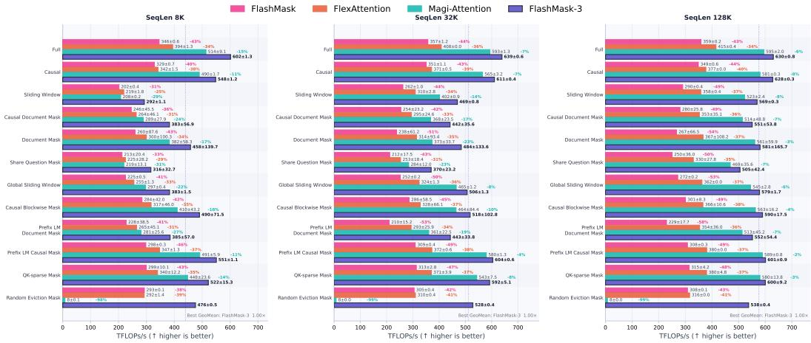  
Figure 9: Single-device throughput across mask types and sequence lengths. FlashMask-3 consistently outperforms all baselines across all 12 mask patterns.

Timing. Each configuration is warmed up for 10 iterations. Measurements are collected over 50 timed iterations using CUDA events (paddle.device.Event), and the mean elapsed time is reported.

Mask types. We evaluate 12 representative mask patterns covering diverse real-world workloads: Full, Causal, Sliding Window, Causal Document, Document, Share-Question, Global Sliding Window, Causal Blockwise, Prefix-LM Document, Prefix-LM Causal, QK-sparse, and Random Eviction.

## D.1.2 CP-scale distributed benchmark

Tensor configuration. We fix $B { = } 3 2 / P , D { = } 1 2 8 , H _ { Q } { = } 6 4 ( \mathrm { Q }$ heads), $H _ { K V } = 1$ (KV heads, i.e., GQA with ratio 64:1). Each rank holds a local KV sequence of $S _ { \mathrm { l o c a l } } { = } 8 1 9 2$ tokens; the total sequence length is $S = S _ { \mathrm { l o c a l } } \times P$ where P is the CP size. QKV tensors per rank: $Q \in \mathbb { R } ^ { B \times S _ { \mathrm { l o c a l } } \times \dot { H } _ { Q } \times D }$ $K , \mathsf { \overline { { V } } } \in \mathbb { R } ^ { B \times S _ { \mathrm { l o c a l } } \times \overleftarrow { H } _ { K V } \times D }$ . The mask tensor has shape $\left[ B , H _ { K V } , \dot { S } , C _ { \mathrm { m a s k } } \right]$ (global mask on the full sequence).

Timing protocol. We use CPU wall-clock timing with explicit synchronization barriers. Before each timed phase (forward or backward), all ranks execute barrier() followed by device.synchronize(), then record time.perf\_counter(). After each phase, the same barrier– synchronize sequence is repeated before reading the clock. This protocol isolates forward and backward timings, preventing load imbalance in one phase from contaminating the other. The rationale is twofold: (1) in real training pipelines, forward and backward are naturally separated by pipeline scheduling; (2) distributed collectives provide implicit inter-rank synchronization, so the barrier–synchronize pair ensures a clean measurement boundary.

TFLOPs/s computation. Same formulas as Eqs. (8)–(10), divided by P (each rank computes 1/P of the total work under ideal balance). The GQA head count $H _ { Q } { = } 6 4$ is used in the FLOPs numerator.

## D.1.3 Single-device results

Figure 9 presents per-mask-type throughput (TFLOPs/s, forward+backward combined) across all tested sequence lengths and mask patterns.

Table 4 summarizes the relative improvements of FlashMask-3 over each baseline, aggregated across all mask types. We additionally present representative long- and short-sequence settings (128K and 8K, respectively) for illustration.

Analysis. FlashMask-3 achieves +55.3% mean improvement over FlexAttention and +15.0% over Magi-Attention across all configurations. The advantage is most pronounced at long sequences (128K), where FlashMask-3 reaches +58.9% over FlexAttention and up to +140.5% over FlashMask. At shorter sequences (8K), the gains remain substantial (+50.6% over FlexAttention on average), demonstrating robustness across operating regimes. The improvement over FlashMask (mean +82.6%, up to 2.4×) reflects the combined benefit of the Hopper-native SM90 kernel architecture and the improved tile scheduler.

Table 4: FlashMask-3 throughput improvement over baselines (forward+backward TFLOPs/s). Reported as $( T _ { \mathrm { o u r s } } / T _ { \mathrm { b a s e l i n e } } - \bar { 1 } ) \stackrel { \cdot } { \times } 1 0 0 \bar { \% }$
<table><tr><td>Baseline</td><td>Scope</td><td>Min</td><td>Max</td><td>Mean</td></tr><tr><td>FlexAttention</td><td>All</td><td>+33.6%</td><td>+70.5%</td><td>+55.3%</td></tr><tr><td></td><td>8K</td><td>+33.6%</td><td>+62.9%</td><td>+50.6%</td></tr><tr><td></td><td>128K</td><td>+51.9%</td><td>+70.0%</td><td>+58.9%</td></tr><tr><td>Magi-Attention</td><td>All</td><td>+2.0%</td><td>+44.1%</td><td>+15.0%</td></tr><tr><td></td><td>8K</td><td>+12.0%</td><td>+44.1%</td><td>+25.0%</td></tr><tr><td></td><td>128K</td><td>+2.0%</td><td>+8.9%</td><td>+5.9%</td></tr><tr><td>FlashMask</td><td>All</td><td>+44.9%</td><td>+140.5%</td><td>+82.6%</td></tr><tr><td></td><td>8K</td><td>+44.9%</td><td>+84.8%</td><td>+66.2%</td></tr><tr><td></td><td>128K</td><td>+74.4%</td><td>+140.5%</td><td>+97.3%</td></tr></table>

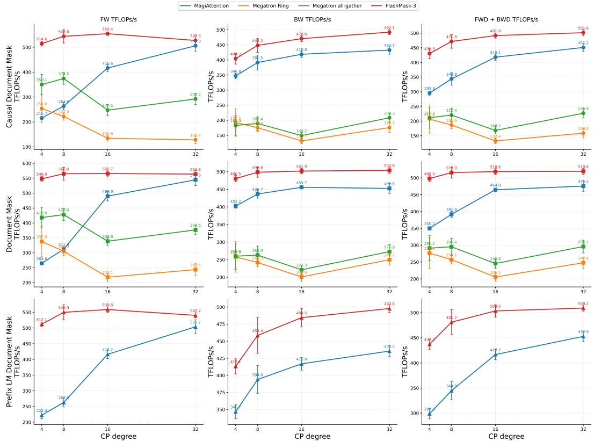  
Figure 10: Q Head = 64, KV Head = 1. CP-scale throughput comparison (TFLOPs/s) across mask types and CP degrees. Columns: forward, backward, and total (forward+backward). Rows: mask types.

## D.1.4 Full comparison results under CP scaling

Figure 10 compares FlashMask-3 (Balance+Overlap) against MagiAttention, Megatron CP (ring), and Megatron CP (all-gather) across all tested mask types and CP sizes.

Table 5 reports FlashMask-3’s speedup over each baseline, aggregated across all masks and CP sizes (geometric mean).

Table 5: FlashMask-3 speedup over distributed baselines (aggregated over all masks × CP sizes).
<table><tr><td>vs. Baseline</td><td>Phase</td><td>Min</td><td>Max</td><td> $\mathrm { G e o . \ M e a n \pm s t d }$ </td></tr><tr><td rowspan="3">MagiAttention</td><td>FWD</td><td>1.04×</td><td>2.39×</td><td> $1 . 5 6 \pm 0 . 5 3 \times$ </td></tr><tr><td>BWD</td><td>1.10×</td><td>1.19×</td><td> $1 . 1 5 \pm 0 . 0 3 \times$ </td></tr><tr><td>Total</td><td>1.09×</td><td>1.46×</td><td> $1 . 2 6 \pm 0 . 1 5 \times$ </td></tr><tr><td rowspan="3">Megatron Ring</td><td>FWD</td><td>1.62×</td><td>4.12×</td><td> $2 . 5 0 \pm 0 . 9 7 \times$ </td></tr><tr><td>BWD</td><td>1.86×</td><td>3.57×</td><td> $2 . 3 8 \pm 0 . 5 6 \times$ </td></tr><tr><td>Total</td><td>1.80×</td><td>3.71×</td><td> $2 . 4 2 \pm 0 . 6 5 \times$ </td></tr><tr><td rowspan="3">Megatron AllGather</td><td>FWD</td><td>1.31×</td><td>2.24×</td><td> $1 . 5 7 \pm 0 . 3 1 \times$ </td></tr><tr><td>BWD</td><td>1.85×</td><td>3.15×</td><td> $2 . 2 1 \pm 0 . 4 3 \times$ </td></tr><tr><td>Total</td><td>1.71×</td><td>2.92×</td><td> $2 . 0 5 \pm 0 . 3 9 \times$ </td></tr></table>

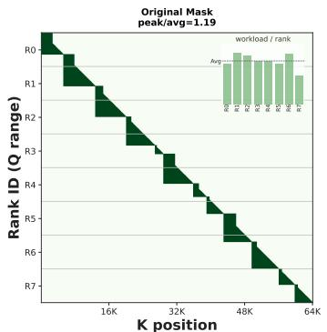

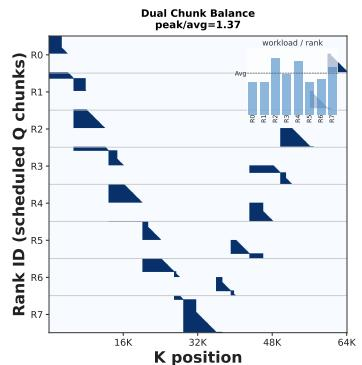

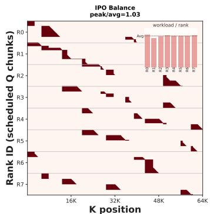  
Figure 11: Comparison of compute load distributions under different scheduling strategies. Dark regions indicate work blocks assigned to each rank. The inset (upper-right of each subplot) shows per-rank compute load, with the dashed line denoting the average. The $\mathrm { \ddot { \ p e a k / a v g } ^ { \mathrm { , } \mathrm { , } } }$ in each title reports the peak-to-average load ratio across all 8 ranks; lower values indicate more balanced distributions.

Analysis. FlashMask-3 achieves 1.26× mean total throughput over MagiAttention, 2.42× over Megatron CP (ring), and 2.05× over Megatron CP (all-gather). The forward pass benefits most from the balanced-overlap protocol (up to 4.12× over Ring), as communication latency is fully hidden behind computation. In the backward pass, FlashMask-3 retains a consistent ${ \sim } 2 . 2 { \mathrm { - } } 2 . 4 \times$ advantage over both Megatron variants.

## D.2 Ablation study on different scheduling strategies

To further illustrate the effect, Figure 11 visualizes the per-rank mask layout under three scheduling strategies on a Causal Document Mask with $P { = } 8 .$ . The original contiguous assignment exhibits moderate imbalance (peak/avg = 1.19). Dual Chunk worsens it to 1.37 because its position-based pairing cannot account for mask-dependent per-chunk costs. IPO reduces peak/avg to 1.03 by reassigning chunks according to their sparsity-aware workload, achieving near-perfect compute balance across all ranks.

## D.3 End-to-end convergence check

§4.3 argues that FlashMask-3 changes only how attention work is placed and scheduled, never what is computed. We verify this end to end rather than assume it. The baseline runs FlashMask without context parallelism and ours runs FlashMask-3 at CP degree 16, with the same data order, the same initialization, and the same hyperparameters in both, so any divergence would have to originate in the attention path.

Figure 12 covers the 1,581 steps the two runs have in common. The loss curves are indistinguishable over the whole run: they leave the initial plateau at the same step, descend at the same rate, and reproduce the same step-to-step fluctuations, which the inset shows at full temporal resolution. The residual difference in panel (b) remains at the $1 0 ^ { - 3 }$ level throughout and narrows as training proceeds, i.e. two orders of magnitude below the fluctuation of the loss itself between consecutive steps. A discrepancy of this magnitude is consistent with a reordered floating-point reduction rather than with a change to the optimization trajectory. Convergence over this horizon is therefore unaffected by context parallelism, as the exactness argument predicts.

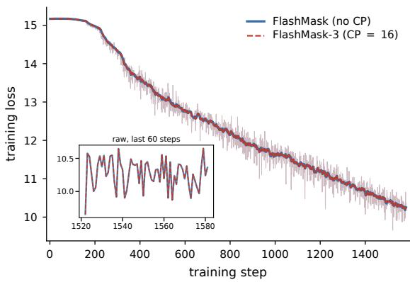  
(a) training loss

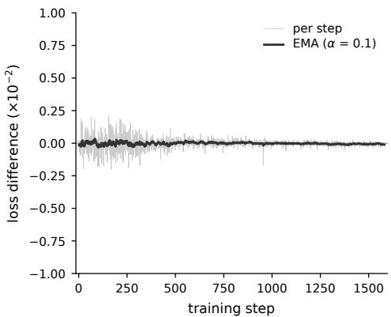  
(b) FlashMask-3 − FlashMask

Figure 12: Convergence under context parallelism. (a) Training loss of the two runs; faint lines are per-step values and bold lines an exponential moving average $( \alpha { = } 0 . 1 )$ , and the inset magnifies the raw curves over the last 60 steps. (b) Per-step loss difference between the two runs and its moving average, on the same step axis.  
Table 6: Single-GPU throughput on five masks supported by FA3 (total forward+backward TFLOPs/s, mean ± std over 50 iterations). Parentheses give the ratio to FA3.
<table><tr><td> $\operatorname { S e q }$ </td><td>Mask</td><td>FA3</td><td>FlashMask-3</td><td>FlexAttention</td><td>MagiAttention</td></tr><tr><td>8K</td><td>Full</td><td> $6 0 4 . 4 3 \pm 1 . 2 7$ </td><td> $5 6 9 . 8 4 \pm 1 . 8 8 ( 0 . 9 4 )$ </td><td> $3 9 4 . 1 5 \pm 1 . 3 4 ( 0 . 6 5 )$ </td><td> $5 1 3 . 6 6 \pm 8 . 9 5 ( 0 . 8 5 )$ </td></tr><tr><td>8K</td><td>Causal</td><td> $5 7 9 . 7 3 \pm 0 . 3 5$ </td><td> $5 2 0 . 8 5 \pm 0 . 5 4 ( 0 . 9 0 )$ </td><td> $3 4 1 . 6 8 \pm 1 . 4 5 ( 0 . 5 9 )$ </td><td> $4 8 2 . 1 7 \pm 1 . 7 1 ( 0 . 8 3 )$ </td></tr><tr><td>8K</td><td>Sliding Window</td><td> $4 0 7 . 2 3 \pm 1 . 5 4$ </td><td> $2 9 0 . 3 0 \pm 1 . 0 4 ( 0 . 7 1 )$ </td><td> $2 1 8 . 9 3 \pm 1 . 7 3 ( 0 . 5 4 )$ </td><td> $1 6 6 . 2 2 \pm 0 . 1 5 ( 0 . 4 1 )$ </td></tr><tr><td>8K</td><td>Causal Document</td><td> $4 7 8 . 9 6 \pm 2 7 . 2 0$ </td><td> $3 7 7 . 8 6 \pm 3 5 . 2 6 ( 0 . 7 9 )$ </td><td> $2 6 4 . 0 6 \pm 1 8 . 3 7 ( 0 . 5 5 )$ </td><td> $2 4 7 . 9 2 \pm 4 7 . 4 3 ( 0 . 5 2 )$ </td></tr><tr><td>8K</td><td>Document</td><td> $5 4 6 . 2 9 \pm 1 7 . 9 3$ </td><td> $4 6 0 . 4 9 \pm 3 1 . 7 7 ( 0 . 8 4 )$ </td><td> $2 9 9 . 4 6 \pm 2 6 . 6 8 ( 0 . 5 5 )$ </td><td> $3 5 2 . 8 2 \pm 4 8 . 3 2$  (0.65)</td></tr><tr><td>32K</td><td>Full</td><td> $6 1 6 . 6 5 \pm 0 . 6 5$ </td><td> $6 0 3 . 6 3 \pm 1 . 4 8 ( 0 . 9 8 )$ </td><td> $4 0 8 . 2 2 \pm 0 . 0 2 ( 0 . 6 6 )$ </td><td> $5 9 3 . 4 0 \pm 1 . 3 0 ( 0 . 9 6 )$ </td></tr><tr><td>32K</td><td>Causal</td><td> $6 1 1 . 6 6 \pm 0 . 5 9$ </td><td> $5 8 7 . 8 7 \pm 0 . 8 8 ( 0 . 9 6 )$ </td><td> $3 7 1 . 4 8 \pm 0 . 4 7 ( 0 . 6 1 )$ </td><td> $5 6 3 . 3 0 \pm 3 . 2 0$  (0.92)</td></tr><tr><td>32K</td><td>Sliding Window</td><td> $5 3 4 . 4 7 \pm 1 . 7 1$ </td><td> $4 6 5 . 0 0 \pm 0 . 6 8 ( 0 . 8 7 )$ </td><td> $3 0 9 . 5 2 \pm 2 . 7 7$  (0.58)</td><td> $3 7 8 . 1 3 \pm 0 . 8 1 ( 0 . 7 1 )$ </td></tr><tr><td>32K</td><td>Causaǐ Document</td><td> $5 3 2 . 6 8 \pm 6 . 3 2$ </td><td> $4 3 5 . 5 4 \pm 1 5 . 2 8 ( 0 . 8 2 )$ </td><td> $2 9 4 . 9 2 \pm 8 . 4 2 ( 0 . 5 5 )$ </td><td> $3 2 8 . 8 1 \pm 2 1 . 4 8 ( 0 . 6 2 )$ </td></tr><tr><td>32K</td><td>Document</td><td> $5 9 2 . 0 3 \pm 5 . 0 4$ </td><td> $5 0 3 . 6 6 \pm 6 . 6 8 ( 0 . 8 5 )$ </td><td> $3 1 2 . 1 0 \pm 1 9 . 6 8 ( 0 . 5 3 )$ </td><td> $4 3 1 . 3 7 \pm 1 7 . 0 5$  (0.73)</td></tr><tr><td>128K</td><td>Full</td><td> $6 0 3 . 1 2 \pm 1 . 1 4$ </td><td> $6 0 2 . 0 6 \pm 0 . 9 2 ( 1 . 0 0 )$ </td><td> $4 1 5 . 1 6 \pm 0 . 4 0 ( 0 . 6 9 )$ </td><td> $5 9 5 . 0 4 \pm 2 . 0 0 ( 0 . 9 9 )$ </td></tr><tr><td>128K</td><td>Causal</td><td> $6 1 8 . 5 2 \pm 0 . 4 8$ </td><td> $5 8 7 . 9 2 \pm 1 . 3 3 ( 0 . 9 5 )$ </td><td> $3 7 7 . 2 1 \pm 0 . 0 1 ( 0 . 6 1 )$ </td><td></td></tr><tr><td>128K</td><td>Sliding Window</td><td> $5 9 2 . 5 1 \pm 0 . 4 6$ </td><td> $5 6 1 . 4 6 \pm 1 . 4 0 ( 0 . 9 5 )$ </td><td> $3 5 8 . 0 7 \pm 0 . 4 0 ( 0 . 6 0 )$ </td><td> $5 8 0 . 0 9 \pm 0 . 3 4 ( 0 . 9 4 )$   $5 1 4 . 8 7 \pm 2 . 3 6 ( 0 . 8 7 )$ </td></tr><tr><td>128K</td><td>Causal Document</td><td> $5 9 1 . 8 7 \pm 3 . 6 4$ </td><td> $5 4 2 . 6 8 \pm 6 . 7 3 ( 0 . 9 2 )$ </td><td> $3 5 2 . 9 2 \pm 3 . 7 0 ( 0 . 6 0 )$ </td><td> $4 9 8 . 6 0 \pm 8 . 7 9 ( 0 . 8 4 )$ </td></tr><tr><td>128K</td><td></td><td> $6 1 5 . 6 2 \pm 1 . 8 5$ </td><td> $5 7 5 . 8 6 \pm 4 . 1 1 ( 0 . 9 4 )$ </td><td> $3 6 7 . 0 7 \pm 7 . 9 0 ( 0 . 6 0 )$ </td><td> $5 4 6 . 1 2 \pm 3 . 8 3 ( 0 . 8 9 )$ </td></tr><tr><td></td><td>Document</td><td></td><td></td><td></td><td></td></tr></table>

## D.4 Comparison with FlashAttention-3

Figure 5 already uses FA3 [Shah et al., 2024] as the kernel for the Full and Causal masks. Table 6 adds a direct head-to-head comparison on five masks that FA3 supports, with FlexAttention and MagiAttention measured against the same reference. Values are total forward+backward TFLOPs/s, mean ± one standard deviation over 50 iterations, and the ratio to FA3 is given in parentheses.

FA3 specializes the masks it supports, so we do not expect FlashMask-3 to overtake it there; the question is what the general mask representation costs. On Full and Causal the ratio is 0.90 to 1.00 and improves with sequence length, reaching parity at 128K on Full. On Sliding Window and the two document masks it is lower at 8K and recovers to 0.92 to 0.95 at 128K, the regime long-context training operates in. Against the methods that accept masks outside the FA3 set the margin is large:

Table 7: Isolating the warp specialization from the Hopper port (forward TFLOPs/s, mean ± std). Parentheses give the ratio to FlashMask-3.
<table><tr><td> $\mathtt { S e q }$ </td><td>Mask</td><td>FlashMask-3</td><td>FlashMask</td><td>FA3-style Hopper port</td></tr><tr><td>8K</td><td>Full</td><td> $5 9 6 . 5 3 \pm 2 . 2 6$ </td><td> $3 8 4 . 8 8 \pm 1 . 8 4 ( 0 . 6 5 )$ </td><td> $2 1 4 . 0 1 \pm 0 . 2 3 ( 0 . 3 6 )$ </td></tr><tr><td>8K</td><td>Causal</td><td> $5 5 3 . 3 1 \pm 1 . 1 3$ </td><td> $3 7 3 . 4 6 \pm 1 . 3 7 ( 0 . 6 7 )$ </td><td> $2 4 1 . 8 6 \pm 0 . 1 3 ( 0 . 4 4 )$ </td></tr><tr><td>8K</td><td>Sliding Window</td><td> $4 3 2 . 1 5 \pm 6 . 6 0$ </td><td> $2 5 6 . 6 3 \pm 0 . 0 7 ( 0 . 5 9 )$ </td><td> $3 5 . 7 7 \pm 0 . 0 7 ( 0 . 0 8 )$ </td></tr><tr><td>8K</td><td>Causai Document</td><td> $4 8 3 . 9 7 \pm 2 9 . 4 0$ </td><td> $3 0 2 . 0 3 \pm 1 5 . 2 7 ( 0 . 6 2 )$ </td><td> $6 4 . 7 7 \pm 1 5 . 8 3 ( 0 . 1 3 )$ </td></tr><tr><td>8K</td><td>Document</td><td> $5 3 2 . 2 6 \pm 2 4 . 9 0$ </td><td> $2 8 7 . 8 9 \pm 3 4 . 5 4 ( 0 . 5 4 )$ </td><td> $5 5 . 0 3 \pm 1 4 . 1 4 ( 0 . 1 0 )$ </td></tr><tr><td>32K</td><td>Full</td><td> $6 1 4 . 1 9 \pm 1 . 1 5$ </td><td> $3 8 8 . 9 2 \pm 1 . 8 4 ( 0 . 6 3 )$ </td><td> $2 1 4 . 2 2 \pm 0 . 0 8 ( 0 . 3 5 )$ </td></tr><tr><td>32K</td><td>Causal</td><td> $5 9 3 . 9 7 \pm 0 . 8 7$ </td><td> $3 7 9 . 4 6 \pm 1 . 6 5 ( 0 . 6 4 )$ </td><td> $2 4 4 . 9 5 \pm 0 . 1 4 ( 0 . 4 1 )$ </td></tr><tr><td>32K</td><td>Sliding Window</td><td> $5 5 3 . 6 6 \pm 2 . 7 8$ </td><td> $2 7 4 . 6 0 \pm 0 . 5 4 ( 0 . 5 0 )$ </td><td> $3 1 . 2 0 \pm 0 . 0 8 ( 0 . 0 6 )$ </td></tr><tr><td>32K</td><td>Causai Document</td><td> $5 1 5 . 4 8 \pm 1 0 . 2 2$ </td><td> $2 5 6 . 3 9 \pm 9 . 5 0 ( 0 . 5 0 )$ </td><td> $2 5 . 2 9 \pm 2 . 8 1 \ : ( 0 . 0 5 )$ </td></tr><tr><td>32K</td><td>Document</td><td> $5 4 4 . 5 6 \pm 5 . 9 3$ </td><td> $1 9 1 . 1 2 \pm 3 6 . 1 5 ( 0 . 3 5 )$ </td><td> $2 1 . 4 2 \pm 2 . 4 8 ( 0 . 0 4 )$ </td></tr><tr><td>128K</td><td>Full</td><td> $6 1 3 . 4 9 \pm 2 . 1 5$ </td><td> $3 9 0 . 6 6 \pm 0 . 1 9 ( 0 . 6 4 )$ </td><td> $2 1 1 . 5 1 \pm 0 . 5 3 ( 0 . 3 4 )$ </td></tr><tr><td>128K</td><td>Causal</td><td> $5 4 4 . 8 3 \pm 0 . 5 5$ </td><td> $3 5 9 . 7 9 \pm 0 . 5 2 \ : ( 0 . 6 6 )$ </td><td> $2 4 5 . 9 9 \pm 0 . 0 2 ( 0 . 4 5 )$ </td></tr><tr><td>128K</td><td>Sliding Window</td><td> $5 7 3 . 6 3 \pm 0 . 9 4$ </td><td> $2 7 4 . 4 4 \pm 0 . 6 7 ( 0 . 4 8 )$ </td><td> $2 9 . 9 6 \pm 0 . 0 1 \ ( 0 . 0 5 )$ </td></tr><tr><td>128K</td><td>Causal Document</td><td> $5 5 4 . 5 0 \pm 9 . 5 7$ </td><td> $2 5 2 . 9 6 \pm 9 . 0 3 ( 0 . 4 6 )$ </td><td> $2 2 . 1 5 \pm 2 . 4 4 ( 0 . 0 4 )$ </td></tr><tr><td>128K</td><td>Document</td><td> $5 7 7 . 5 5 \pm 3 . 3 3$ </td><td> $2 1 7 . 2 7 \pm 4 0 . 1 7 ( 0 . 3 8 )$ </td><td> $1 8 . 9 7 \pm 2 . 0 8 ( 0 . 0 3 )$ </td></tr></table>

FlexAttention stays between 0.53 and 0.69 throughout, and MagiAttention falls further behind on the structured and shorter cases, down to 0.41 on Sliding Window at 8K.

A second question is how much of the single-GPU gain comes from moving to Hopper rather than from the warp specialization of §3.1. Porting the Ampere FlashMask kernel onto the FA3 pipeline is not straightforward on its own: the inline mask-index computation spills registers and fills the pipeline with non-MMA instructions. Table 7 compares the original FlashMask, an FA3-style Hopper port without the KV Index Generator, and the full kernel. We report the forward pass only: the register pressure appeared during the port itself and we did not implement a backward pass for that configuration, so forward is where all three are measured on equal footing.

The port alone does not deliver the gain. On Full and Causal it reaches 0.34 to 0.45 of the full kernel, below even the Ampere kernel it was meant to modernize, and on the structured masks it collapses to 0.03 to 0.13. The KV Index Generator removes this bottleneck by moving mask-index generation onto reclaimed producer threads, off the MMA critical path. The improvement is therefore attributable to the warp specialization rather than to the change of architecture, and a direct port is not a viable route to an expressive mask-aware kernel on Hopper.

## D.5 Scheduling cost and overlap robustness

Both the per-chunk weights $w _ { i }$ (§C.2) and the HCC-IPO assignment operate on the four boundary vectors rather than on a dense mask, so their cost grows linearly with the sequence length and not with the quadratic tile count. Their latency is also not on the critical path. For a fixed set of weights the assignment is deterministic, so we compute it ahead of time and overlap it with the compute and communication of the previous iteration, and reuse it across layers through a cache keyed on the mask pattern.

The cost is not negligible in absolute terms, which is why it is prefetched rather than run inline. Table 8 reports the standalone scheduling latency at $P { = } 3 2$ with chunk size 2048 next to the attention time under the same configuration: 23 to 44 ms of scheduling against 35 to 67 ms of attention, the same order of magnitude. Table 9 measures the same preprocessing inside the 128-GPU configuration of §4.3, in a separate run, where it accounts for 0.60% to 0.75% of the step. Prefetching therefore keeps the scheduling latency out of the end-to-end time.

Computing the assignment offline has two consequences. First, for a model whose layers use different mask types we do not switch the assignment per layer. We score each mask type, take a weighted sum over the proportion of those types in the stack, and solve HCC-IPO once on that aggregate profile. When the mask type changes often from layer to layer, a single static assignment fits each individual layer less well, and re-solving at that frequency would add latency that prefetching cannot hide. Second, HCC-IPO does not replace the default layout unconditionally: we compare the predicted cost of the unified assignment against the Dual Chunk layout and keep HCC-IPO only when it is faster, so balanced workloads such as full or causal masks stay on Dual Chunk and pay no rebalancing cost.

Table 8: Standalone scheduling latency against attention time $( P { = } 3 2 ,$ chunk 2048).
<table><tr><td>Mask</td><td>Attention (ms) Schedule (ms)</td><td></td></tr><tr><td>Causal Document</td><td> $3 5 . 0 8 \pm 4 . 1 9$ </td><td> $4 2 . 7 5 \pm 8 . 9 0$ </td></tr><tr><td>Document</td><td> $6 7 . 4 4 \pm 8 . 7 8$ </td><td> $2 3 . 5 2 \pm 6 . 3 4$ </td></tr><tr><td>Prefix LM Document</td><td> $3 5 . 8 4 \pm 4 . 2 9$ </td><td> $4 3 . 7 1 \pm 6 . 3 3 $ </td></tr></table>

Table 9: Balance preprocessing inside the 128- GPU run of §4.3.
<table><tr><td>Sparsity</td><td>Step (ms)</td><td>Preprocess (ms) Overhead (%)</td><td></td></tr><tr><td>70%</td><td> $2 0 0 1 4 . 2 \pm 1 3 1 7 . 6$ </td><td> $1 1 9 . 9 \pm 1 6 . 0$ </td><td>0.60</td></tr><tr><td>80%</td><td> $1 7 8 8 7 . 3 \pm 2 0 2 0 . 8 $ </td><td> $1 1 0 . 1 \pm 1 0 . 2$ </td><td>0.62</td></tr><tr><td>86%</td><td> $1 6 1 7 4 . 8 \pm 2 1 4 6 . 6$ </td><td> $1 2 0 . 6 \pm 1 0 . 4$ </td><td>0.75</td></tr></table>

The overlap depends on having enough attention compute to hide the all-gather and reduce-scatter, and very short or very sparse contexts leave less to hide behind. This is the amortization caveat of Appendix A. The degradation is graceful rather than abrupt: the stream coordination of Appendix C.4.2 keeps kernel ordering deadlock-free across sparsity levels, so in the worst case the overlap recovers less of the communication instead of failing.