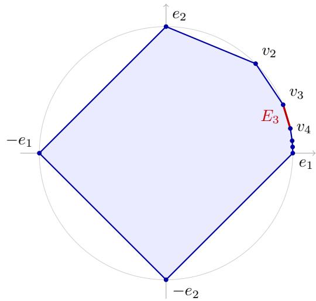

# Follow the Perturbed Leader for Linear Bandits: $\sqrt { T }$ Regret over General Convex Sets

Chen-Yu Wei University of Virginia chenyu.wei@virginia.edu

## Abstract

We give the first adversarial linear bandit algorithm based on Follow-the-Perturbed-Leader (FTPL) that achieves $\sqrt { T }$ regret over general convex action sets. Our algorithm attains $\widetilde { \mathcal { O } } ( d ^ { 5 / 4 } \sqrt { T } )$ regret using only linear optimization oracles, and the near-optimal $\widetilde { \mathcal { O } } ( d \sqrt { T } )$ regret when an optimal-design exploration distribution is further available. This improves on the $T ^ { 2 / 3 }$ regret of the FTPL algorithm of Dani and Hayes (2006) for general convex sets, and generalizes the $\sqrt { T }$ regret of Levy et al. ´ (2026) over two special action sets (hypercube and Euclidean ball). Compared to previous oracle-efficient linear bandit algorithms based on continuous exponential weights, the FTPL approach generally has better computational efficiency, and is much simpler to implement.

The key algorithmic element is a perturbation distribution that adapts to the estimated rewards. Its simplest form, an adaptive Gaussian perturbation, is straightforward to implement and already attains the regret bound above. We further extend it to two general constructions, random-weighting and elliptical perturbations, each covering distributions from light tails (Gaussian) to heavy tails (Student-t2). On the technical side, we develop a systematic way to analyze the stability term in the FTPL regret through the Fisher information of the perturbation distribution. This builds a general framework for FTPL beyond existing ones such as the hazard rate and the FTRL-FTPL duality.

## 1 Introduction

In a d-dimensional linear bandit problem, in each round, the environment chooses a reward vector $\theta _ { t } \in \mathbb { R } ^ { d }$ and the learner chooses an action $a _ { t }$ from a convex set $\mathcal { A } \subset \mathbb { R } ^ { d }$ . Then the learner receives the scalar reward $\left. \boldsymbol { a } _ { t } , \boldsymbol { \theta } _ { t } \right.$ as feedback. Linear bandits model decision-making problems where the number of possible actions could be enormous, but each action is encoded as a low-dimensional feature vector and the reward depends on the action only through the feature.

The adversarial linear bandit problem considers the case where $\theta _ { t }$ could be time-varying, which makes the formulation robust to changing environments. The minimax regret of adversarial linear bandits is of order $d \sqrt { T }$ up to logarithmic factors (Dani et al., 2007), and there are polynomial-time algorithms achieving this rate. However, these algorithms are in general highly computationally demanding or restrictive: the SCRiBLe algorithm (Abernethy et al., 2009) based on Follow-the-Regularized-Leader (FTRL) requires access to a self-concordant barrier for the action set (including the ability to compute its gradient and Hessian); algorithms based on continuous exponential weights (Hazan and Karnin, 2016; Ito et al., 2019) can be run on general convex sets as long as the learner is equipped with a membership or separation oracle for the action set, but the time and oracle complexities of these algorithms usually involve high powers of d and T with large leading constants, making them generally impractical.

On the other hand, Follow-the-Perturbed-Leader (FTPL) methods are known for their computational efficiency, requiring only a linear optimization oracle. They have been the method of choice for combinatorial bandits with semi-bandit feedback, where the reward of each selected component is revealed. Withfull-bandit feedback (Neu and Bartok´ , 2016), where only the total reward is revealed, combinatorial bandits become a special case of linear bandits, and the best known rate with FTPL is $T ^ { 2 / 3 }$ in general (Awerbuch and Kleinberg, 2004; Dani and Hayes, 2006). The recent work by $_ \mathrm { L e v y }$ et al. (2026) develops an FTPL algorithm with $\mathcal { \widetilde { O } } ( d \sqrt { T } )$ regret for the Euclidean ball and hypercube. However, these special cases are simple ones for which optimal FTRL is already efficient, and thus achieving $\sqrt { T }$ regret with FTPL for general action sets, particularly for combinatorial ones, remains unresolved.

Table 1: Comparison of FTPL algorithms for adversarial linear bandits. R is an outer radius of the action set after normalizing the covariance of the exploration basis; see Assumption 1 for its definition. Obtaining the optimal design exploration basis may be computationally hard for general action sets, but it can be efficiently constructed in special cases such as the hypercube, Euclidean ball, $m { \mathrm { - s e t } } .$ , probability simplex, and the space of permutation matrices.
<table><tr><td rowspan=1 colspan=1>Method</td><td rowspan=1 colspan=1>Action set</td><td rowspan=1 colspan=1>Regret in $\widetilde { \mathcal { O } }$ </td><td rowspan=1 colspan=1>Regret notion</td><td rowspan=1 colspan=1>Exploration basis</td></tr><tr><td rowspan=1 colspan=1>Awerbuch and Kleinberg (2004)</td><td rowspan=1 colspan=1>general</td><td rowspan=1 colspan=1> $d ^ { 5 / 3 } T ^ { 2 / 3 }$ </td><td rowspan=1 colspan=1>pseudo regret</td><td rowspan=1 colspan=1>barycentric spanner</td></tr><tr><td rowspan=1 colspan=1>McMahan and Blum (2004)Dani and Hayes (2006)</td><td rowspan=1 colspan=1>general</td><td rowspan=1 colspan=1> $d T ^ { 2 / 3 }$ </td><td rowspan=1 colspan=1>expected regret</td><td rowspan=1 colspan=1>barycentric spanner</td></tr><tr><td rowspan=1 colspan=1>Lévy et al. (2026)</td><td rowspan=1 colspan=1>hypercube orEuclidean ball</td><td rowspan=1 colspan=1> $d \sqrt { T }$ </td><td rowspan=1 colspan=1>pseudo regret</td><td rowspan=1 colspan=1>一</td></tr><tr><td rowspan=1 colspan=1>This paper</td><td rowspan=1 colspan=1>general</td><td rowspan=1 colspan=1> $( d + R d ^ { 3 / 4 } ) \sqrt { T }$ </td><td rowspan=1 colspan=1>pseudo regret</td><td rowspan=1 colspan=1>barycentric spanner $( R \leq 4 \sqrt { d } )$ optimal design $( R = 1 )$ </td></tr></table>

In this work, we develop the first FTPL algorithm for linear bandits achieving $\sqrt { T }$ regret for general convex sets (Theorem 1). Among oracle-efficient algorithms for general convex sets, it arguably offers the best balance between regret and computation, and it is simple to implement. In addition, in many combinatorial problems, the learner can only play vertex solutions. FTPL can directly produce such solutions, while FTRL requires additional oracle calls to perform the decomposition.

The key element underlying our algorithm is a time-varying, data-adaptive perturbation distribution. In its simplest form, the perturbation at round t is drawn from $\begin{array} { r } { \mathcal { N } \big ( 0 , \lambda I + \sum _ { \tau < t } \widehat { \theta } _ { \tau } \widehat { \theta } _ { \tau } ^ { \top } \big ) } \end{array}$ , where $\widehat { \theta } _ { \tau }$ are the reward estimators and $\lambda > 0$ . This instance is easy to implement and already attains our main result:

Theorem 1 (Main result, informal). Let $\mathcal { A } \subset \mathbb { R } ^ { d }$ be a compact convex action set accessed through a linear optimization oracle. FTPL with the adaptive Gaussian perturbation above, combined with geometric resampling and barycentric-spanner exploration, achieves $\mathrm { R e g } _ { T } ( a ) = \widetilde { \mathcal { O } } ( d ^ { 5 / 4 } \sqrt { T } )$ for every $a \in { \mathcal { A } } .$ . With an optimal-design exploration distribution instead, the regret improves to the near-optimal $\mathcal { \widetilde { O } } ( d \sqrt { T } )$ . The same bounds holdfor every perturbation distribution in Section 4. See Theorem 13for theformal statement.

In Section 3, we show that no fixed perturbation distribution can control the stability term through the action covariance, as the analyses of FTRL approaches such as SCRiBLe and continuous exponential weights do. This motivates the use of adaptive perturbations. In a similar spirit, Kim and Tewari (2019) show that no perturbation in multi-armed bandits recovers FTRL with the Tsallis entropy regularizer, and Abernethy et al. (2014) argue that while FTPL can be mapped to an FTRL, there is no bijection between them. These arguments all concern fixed perturbations and do not apply to adaptive ones, so the adaptive perturbation scheme in this work can bypass these restrictions.

Beyond Gaussian, we develop a fairly general theoretical framework for FTPL for linear bandits. First, we propose two adaptive perturbation constructions, random-weighting perturbations and elliptical perturbations, both containing the Gaussian perturbation as a special case. The latter gives a standard perturbation scheme where a single perturbation decides the policy in every round, while the former requires redrawing the weights of all previous rounds, but is conceptually interesting and admits a simpler analysis. Second, under each of these two constructions, we instantiate the algorithm with a wide range of perturbation distributions capturing different tail behaviors: from light-tailed Gaussian and Laplace distributions to heavy-tailed multivariate $\mathrm { S t u d e n t } { - } t _ { 2 }$ distributions. Third, we analyze the stability of the FTPL update through the Fisher information of the perturbation and the stability of the Fisher information matrix under shifting. The analysis bears similarity to the local-Hessian-norm stability in typical SCRiBLe analysis. We hope that the analysis in this work could help develop a systematic framework for analyzing FTPL.

We provide a comparison with prior FTPL algorithms for linear bandits in Table 1. We also compare the oracle and computational complexity of our algorithm with those of previous oracle-efficient algorithms based on FTRL and log-concave sampling in Table 5. The FTPL approach remains more favorable even when prior approaches are implemented with state-of-the-art log-concave sampling techniques. Closest to our approach, adaptive Gaussian perturbations have recently been used for full-information online learning (Buzaglo and Hazan, 2026; Voitovych et al., 2026; Jiang et al., 2026); we study the bandit setting and also cover non-Gaussian perturbations. Further related work on FTPL is discussed in Appendix A.

## 2 Notation and Setting

Notation. For a probability distribution p on $\mathbb { R } ^ { d }$ with finite second moment, define its mean by $\mu ( p ) =$ $\mathbb { E } _ { a \sim p } [ a ]$ and its covariance matrix by $\operatorname { C o v } ( p ) = \mathbb { E } _ { a \sim p } [ ( a - \mu ( p ) ) ( a - \mu ( p ) ) ^ { \top } ]$ . For two functions $f$ and $g ,$ the notation ${ } ^ {  } f ( x ) \lesssim g ( x ) ^ { \prime \prime }$ indicates that there exists a universal constant $c > 0$ such that $f ( x ) \leq c g ( x )$ for all x. This is equivalent to writing $f ( x ) = { \mathcal { O } } ( g ( x ) )$ , and $\widetilde { \mathcal { O } }$ further hides polylogarithmic factors. $\Delta _ { \mathcal { S } }$ denotes the space of distribution over ${ \mathcal { S } } .$

Setting. The learner has a compact convex action set $A \subset \mathbb { R } ^ { d }$ and access to a linear optimization oracle over A. At each round $t ,$ an adversary chooses an affine reward function

$$
r _ { t } ( a ) = \langle a , \theta _ { t } \rangle + b _ { t } , \qquad | r _ { t } ( a ) | \leq 1 \quad \mathrm { f o r e v e r y } a \in \mathcal { A } .
$$

We allow the intercept $b _ { t }$ because the normalization below (Theorem 2) may translate the action set, which turns a linear reward on the original set into an affine one. The adversary may depend on the past, but chooses $\theta _ { t }$ and $b _ { t }$ before the learner’s random draws at round t. The learner then samples and plays $a _ { t } \in \mathcal A$ and observes only $y _ { t } = r _ { t } ( a _ { t } )$ . Let $\mathbb { E } _ { t }$ denote expectation conditional on the history before round t. For every fixed comparator $a \in { \mathcal { A } } .$ we study the regret:

$$
\mathrm { R e g } _ { T } ( a ) = \mathbb { E } \left[ \sum _ { t = 1 } ^ { T } \bigl ( r _ { t } ( a ) - r _ { t } ( a _ { t } ) \bigr ) \right] = \mathbb { E } \left[ \sum _ { t = 1 } ^ { T } \langle a - a _ { t } , \theta _ { t } \rangle \right] .
$$

## 2.1 Action Set Normalization

We work in the affine hull of the action set and let $d \geq 1$ denote its dimension. Throughout the analysis, we impose the following geometric and exploration assumptions.

Assumption 1 (Action set and exploration basis). The action set $A \subset \mathbb { R } ^ { d }$ and afixed exploration distribution $\nu \in \Delta _ { \mathcal { A } }$ satisfy

$$
\begin{array} { r } { r B _ { 2 } ^ { d } \subseteq A \subseteq R B _ { 2 } ^ { d } , \qquad r > 0 , \qquad \mu ( \nu ) = 0 , \qquad \operatorname { C o v } ( \nu ) = I / d . } \end{array}
$$

Here $B _ { 2 } ^ { d }$ is the Euclidean unit ball.

The following theorem gives two ways to obtain coordinates satisfying Assumption 1. Detailed statements and proofs are given in Theorems 14 and 15 in Appendix C.

Theorem 2 (Action set normalization). Let $\kappa \subset \mathbb { R } ^ { d }$ be a compact convex body with nonempty interior, accessed through a linear optimization oracle. There exist an affine transformation A ofK and an exploration distribution ν on A satisfying Assumption 1 with

(i) $r = 1 / d$ and $R = 4 { \sqrt { d } } ,$ computable from the barycentric spanner of Awerbuch and Kleinberg (2004) using $\mathcal { O } ( d ^ { 2 } \log ( d + 1 ) )$ oracle calls and $\mathcal { O } ( d ^ { 4 } \log ( d + 1 ) )$ additional arithmetic operations; or

(ii) $r = 1 / d$ and $R = 1$ , given by an optimal design $q ^ { \star } \in \arg \operatorname* { m a x } _ { q \in \Delta _ { \kappa } }$ det $\operatorname { C o v } ( q )$

The second option attains the optimal outer radius $R = 1$ ; its optimal-design distribution is also called John’s exploration distribution (Bubeck et al., 2012). Computing an optimal design is equivalent to computing the minimum-volume ellipsoid enclosing K (Todd, 2016), which is NP-hard even for polytopes given by linear inequalities (Boyd and Vandenberghe, 2004), and we are not aware of an efficient algorithm that finds a constant-factor approximation using only a linear optimization oracle. However, in some special cases, such a design has a closed form or is easy to construct, e.g., the probability simplex, Euclidean ball, hypercube, m-set, the set of m-by-m permutation matrices, and others.

## 3 Adaptive Perturbation: Motivation and Central Ideas

We first attempt to use a fixed perturbation distribution and identify an obstacle (Section 3.1). Then we show how adaptive perturbation addresses it (Section 3.2).

## 3.1 Fixed Perturbation and Obstacles

Assume for now that we use a fixed perturbation distribution $\rho .$ . Suppose that at round t, the cumulative reward estimator is $\begin{array} { r } { \widehat { \Theta } _ { t } = \sum _ { \tau = 1 } ^ { t - 1 } \widehat { \theta } _ { \tau } } \end{array}$ where $\widehat { \theta } _ { \tau }$ is the standard reward estimator for linear bandits in round $\tau .$ Then FTPL generates action $a _ { t }$ as:

$$
{ \mathrm { S a m p l e ~ } } Z _ { t } \sim \rho { \mathrm { ~ a n d ~ l e t ~ } } a _ { t } = x ( { \widehat { \Theta } } _ { t } + Z _ { t } ) , \qquad { \mathrm { w h e r e ~ } } x ( \Theta ) : = { \underset { a \in A } { \operatorname { a r g m a x } } } \langle a , \Theta \rangle .
$$

Write $h ( \Theta ) = \operatorname* { m a x } _ { a \in \mathcal { A } } \langle a , \Theta \rangle$ and define

$$
\Psi ( \Theta ) = \mathbb { E } _ { Z \sim \rho } [ h ( \Theta + Z ) ] .\tag{1}
$$

For every perturbation density considered in this paper, Ψ is twice continuously differentiable and $\nabla \Psi ( \Theta ) =$ $\mathbb { E } _ { Z \sim \rho } [ x ( \Theta + Z ) ]$ (Lemma 18), so $\mathbb { E } _ { t } [ a _ { t } ] = \nabla \Psi ( \widehat { \Theta } _ { t } )$ . The key step in the regret analysis is bounding the stability term:

$$
\begin{array} { r l } & { \Psi ( \widehat { \Theta } _ { t + 1 } ) - \Psi ( \widehat { \Theta } _ { t } ) - \langle \nabla \Psi ( \widehat { \Theta } _ { t } ) , \widehat { \theta } _ { t } \rangle = \Psi ( \widehat { \Theta } _ { t } + \widehat { \theta } _ { t } ) - \Psi ( \widehat { \Theta } _ { t } ) - \langle \nabla \Psi ( \widehat { \Theta } _ { t } ) , \widehat { \theta } _ { t } \rangle } \\ & { \qquad = \frac { 1 } { 2 } \widehat { \theta } _ { t } ^ { \top } \nabla ^ { 2 } \Psi ( \widehat { \Theta } _ { t } + s \widehat { \theta } _ { t } ) \widehat { \theta } _ { t } } \end{array}\tag{2}
$$

for some $s \in [ 0 , 1 ]$ by Taylor’s theorem. Ignoring the shift $s \widehat { \theta } _ { t }$ , we can approximate the stability term as $\frac { 1 } { 2 } \widehat { \theta _ { t } } ^ { \top } \nabla ^ { 2 } \Psi ( \widehat { \Theta } _ { t } ) \widehat { \theta _ { t } }$ . Motivated by the standard FTRL analysis (SCRiBLe or continuous exponential weights), an ideal property we would hope for is

$$
\nabla ^ { 2 } \Psi ( \widehat { \Theta } _ { t } ) \preceq c M _ { t } : = c \int \big ( x ( \widehat { \Theta } _ { t } + z ) - \mu _ { t } \big ) \big ( x ( \widehat { \Theta } _ { t } + z ) - \mu _ { t } \big ) ^ { \top } \rho ( z ) \mathrm { d } z\tag{3}
$$

for some constant $c > 0$ independent of $\widehat { \Theta } _ { t }$ , where $\mu _ { t } = \mathbb { E } _ { Z \sim \rho } [ x ( \widehat { \Theta } _ { t } + Z ) ]$ is the action mean induced by FTPL, and $M _ { t }$ is the action covariance. If Equation (3) holds, the expectation of the stability term can be bounded by $c \mathbb { E } [ \widetilde { \theta _ { t } } ^ { } M _ { t } \widehat { \theta _ { t } } ] \lesssim c d .$ , as in FTRL.

  
Figure 1: The action set $\mathcal { A }$ in Theorem 3. Its exposed edges $[ v _ { i } , v _ { i + 1 } ]$ accumulate at $e _ { 1 }$ , and their lengths converge to zero.

Can Equation (3) hold? For multi-armed bandits $( \mathcal { A } = \Delta _ { d } .$ , the probability simplex), Abernethy et al. (2015) characterize the stability of FTPL through the hazard rate of the perturbation and give several perturbations whose hazard rate is bounded by a constant. In Theorem 16 (Appendix D), we show that i.i.d. coordinate-wise perturbations with hazard rate bounded by $h _ { q }$ satisfy Equation (3) on the simplex with $c = 2 h _ { q }$ . For general convex sets, however, the answer is negative. The theorem below constructs an action set whose boundary contains exposed edges at arbitrarily small scales. No fixed perturbation can satisfy Equation (3) with a finite constant on this set.

Theorem 3. Define A = conv $( \{ \pm e _ { 1 } , \pm e _ { 2 } \} \cup \{ v _ { i } : i \geq 2 \} ) \subset \mathbb { R } ^ { 2 }$ with $v _ { i } = ( \cos ( 2 ^ { - i } \pi ) , \sin ( 2 ^ { - i } \pi ) )$ , as illustrated in Figure 1. For every regular perturbation density $\rho$ on $\mathbb { R } ^ { 2 }$ (Lemma 18), define $M ( \Theta ) =$ $\operatorname { C o v } _ { Z \sim \rho } \bigl ( x ( \Theta + Z ) \bigr )$ . Thenfor everyfinite $c > 0 _ { i }$ , there exists $\Theta \in \mathbb { R } ^ { 2 }$ such that

$$
\nabla ^ { 2 } \Psi ( \Theta ) \not \subset c M ( \Theta ) .
$$

The proof is given in Appendix D. In Figure 1, when the endpoints $v _ { i }$ and $v _ { i + 1 }$ of the edge $E _ { i } = [ v _ { i } , v _ { i + 1 } ]$ are the two competing actions (i.e., the current near-optimal actions), we show that the stability term scales with $| E _ { i } |$ while the action covariance scales with $| E _ { i } | ^ { 2 }$ , so if there exists a c satisfying Equation (3), it has to scale with $1 / | E _ { i } |$ , which goes to infinity when i increases. On a polytope, the same argument shows that c must scale at least inversely with its shortest edge length.

This provides a contrast between FTPL and FTRL (SCRiBLe and continuous exponential weights). In FTRL, the stability term can be bounded by a constant multiple of $\widetilde { \theta _ { t } ^ { \intercal } } M _ { t } \widehat { \theta _ { t } } = \mathbb { E } _ { a \sim p _ { t } } \widehat { [ } \langle a - \mu _ { t } , \widehat { \theta _ { t } } \rangle ^ { 2 } \ ]$ , where $p _ { t }$ is the action distribution used in round t. This scales quadratically in both the reward estimator $\widehat { \theta } _ { t }$ and the action separation $a - \mu _ { t }$ . In FTPL, the construction in Theorem 3 indicates that the stability term, while scaling quadratically with the reward estimator, only scales linearly with the action separation. Indeed, Lemma 18 gives

$$
\begin{array} { r l } & { \widehat { \theta } _ { t } ^ { \top } \nabla ^ { 2 } \Psi ( \widehat { \Theta } _ { t } ) \widehat { \theta } _ { t } = - \displaystyle \int \langle x ( \widehat { \Theta } _ { t } + z ) - \mu _ { t } , \widehat { \theta } _ { t } \rangle \langle \nabla \rho ( z ) , \widehat { \theta } _ { t } \rangle { \mathrm { d } } z } \\ & { \qquad = - \mathbb { E } _ { Z \sim \rho } \left[ \langle x ( \widehat { \Theta } _ { t } + Z ) - \mu _ { t } , \widehat { \theta } _ { t } \rangle \langle \nabla \log \rho ( Z ) , \widehat { \theta } _ { t } \rangle \right] , } \end{array}\tag{4}
$$

which scales only linearly with the action separation. In fact, Equation (4) would match the FTRL form if $\nabla \log \rho ( Z ) = - x ( \widehat { \Theta } _ { t } + Z ) + \mu _ { t }$ , but this is not possible with a fixed perturbation $\rho .$ FTPL gains this factor back in the other penalty term in the regret, which scales linearly with the action separation, while that of FTRL has no scaling with it. In multi-armed bandits, the balance between penalty and stability can be achieved with a global learning rate tuning (Honda et al., 2023). However, in linear bandits with general action sets such as the one in Theorem 3, the tuning has to be adaptive to the scale of the action separation between competitive actions, which depends on the local structure of the action set. Therefore, a more geometry-aware tuning is needed. This is handled in the next subsection.

## 3.2 Adaptive Perturbation

We continue from Equation (4) with Cauchy–Schwarz:

$$
\begin{array} { r l } & { \widehat { \theta _ { t } ^ { \top } } \nabla ^ { 2 } \Psi ( \widehat { \Theta } _ { t } ) \widehat { \theta } _ { t } \leq \sqrt { \mathbb { E } _ { Z \sim \rho } \left[ \langle x ( \widehat { \Theta } _ { t } + Z ) - \mu _ { t } , \widehat { \theta } _ { t } \rangle ^ { 2 } \right] } \sqrt { \mathbb { E } _ { Z \sim \rho } \left[ \langle \nabla \log \rho ( Z ) , \widehat { \theta } _ { t } \rangle ^ { 2 } \right] } } \\ & { \qquad = \sqrt { \widehat { \theta _ { t } ^ { \top } } M _ { t } \widehat { \theta } _ { t } } \sqrt { \widehat { \theta _ { t } ^ { \top } } Z ( \rho ) \widehat { \theta } _ { t } } } \end{array}
$$

where $\mathcal { I } ( \rho ) : = \mathbb { E } _ { Z \sim \rho } [ \nabla$ log $\rho ( Z ) \nabla$ log $\rho ( Z ) ^ { \top } ]$ is the Fisher information matrix of the perturbation distribution $\rho .$ Since $\mathbb { E } _ { t } [ \widetilde { \theta _ { t } } ^ { \top } M _ { t } \widehat { \theta _ { t } } ] \lesssim d ,$ , applying Cauchy–Schwarz again over rounds shows that it remains to bound $\textstyle \sum _ { t = 1 } ^ { T } \widehat { \theta _ { t } ^ { \intercal } } \mathcal { T } ( \rho ) \widehat { \theta _ { t } }$ of order $\mathrm { p o l y } ( d , \log T )$ . This suggests an adaptive perturbation (drawing $Z _ { t } \sim \rho _ { t } )$ such that

$$
\mathcal { I } ( \rho _ { t } ) \approx \Sigma _ { t } ^ { - 1 } , \qquad \Sigma _ { t } = \lambda I + \sum _ { \tau = 1 } ^ { t - 1 } \widehat { \theta } _ { \tau } \widehat { \theta } _ { \tau } ^ { \top } \mathrm { ~ f o r ~ s o m e ~ } \lambda > 0 ,
$$

since the elliptical potential lemma then gives $\begin{array} { r } { \sum _ { t = 1 } ^ { T } \widetilde { \theta _ { t } } ^ { \top } \mathcal { T } ( \rho _ { t } ) \widehat { \theta } _ { t } \lesssim d } \end{array}$ log T for large enough λ, giving a total stability of order $d { \sqrt { T \log T } }$ . A natural choice is $\rho _ { t } = \mathcal { N } ( 0 , \Sigma _ { t } )$ , whose Fisher information matrix is exactly $\Sigma _ { t } ^ { - 1 }$ . Intuitively, since $\widehat { \theta } _ { \tau }$ scales with the inverse of the action covariance, $\Sigma _ { t }$ grows fastest in directions where competing actions are close together, which is where Theorem 3 calls for a larger perturbation.

We will show that this simple adaptive Gaussian perturbation indeed achieves the bound in Theorem 1 after additionally handling the Hessian shift in Equation (2) and the change of the perturbation across rounds, and combining it with a standard reward estimator (geometric resampling) and exploration (barycentric spanner or optimal design). Besides the Gaussian, whose tail decays as $\bar { e } ^ { - x ^ { 2 } }$ , we extend the results, with the same regret bound, to Laplace perturbations (tail $e ^ { - x } )$ and multivariate Student-t2 elliptical perturbations (tail $x ^ { - \hat { 2 } } )$ , demonstrating the generality of the framework. These heavier-tailed distributions might find applications in settings that also require differential privacy.

## 4 Algorithm Overview

Our algorithm is displayed in Algorithm 1. In each round $t ,$ the learner samples a perturbation $Z _ { t } \in \mathbb { R } ^ { d }$ from the density $\rho _ { t } .$ , and takes action $a _ { t } = \arg \operatorname* { m a x } _ { a \in \mathcal { A } } \langle a , \widehat { \Theta } _ { t } + Z _ { t } \rangle$ with probability $1 - \gamma$ , and action $a _ { t } \sim \nu$ with probability $\gamma .$ , where $\nu \in \Delta _ { \mathcal { A } }$ is the exploration distribution based on spanner or optimal design (Assumption 1). In order to construct the reward estimator $\widehat { \theta } _ { t }$ at time t, the learner follows the same procedure to draw $2 N + 1$ additional actions internally (one as $\bar { a } _ { t }$ and the other 2N as in the Geometric Resampling procedure). With them, the algorithm constructs $H _ { t }$ as an estimator of the inverse action covariance matrix $\widetilde { M } _ { t } ^ { - 1 }$ via matrix geometric resampling (Neu and Olkhovskaya, 2020), where $\widetilde { M } _ { t } : = \mathrm { C o v } ( ( 1 - \gamma ) p _ { t } + \gamma \nu )$ and $p _ { t }$ is the law of $x ( \widehat { \Theta } _ { t } + Z )$ for $Z \sim \rho _ { t }$ , and uses it to construct the reward estimator $\widehat { \theta } _ { t } . ^ { 1 }$ The simplest perturbation construction, which already achieves the bound in Theorem 1, is the following:

$$
Z _ { t } \sim { \mathcal { N } } \left( 0 , \lambda I + \sum _ { \tau = 1 } ^ { t - 1 } { \widehat { \theta } } _ { \tau } { \widehat { \theta } } _ { \tau } ^ { \top } \right) ,\tag{5}
$$

with $\lambda = \widetilde { \Theta } ( d ^ { 1 / 2 } T )$ . We enrich the family of possible perturbations by proposing two general constructions of $\rho _ { t }$ (Figure 2), both including the Gaussian perturbation Equation (5) as a special case and achieving the same regret bound.

Random-Weighting Perturbations. In round $t ,$ independently draw $Z _ { t } ^ { \prime } \sim \rho _ { 1 }$ and weights $\xi _ { t , \tau } \sim \varphi$ for every $\tau < t ,$ , and set $\begin{array} { r } { Z _ { t } = Z _ { t } ^ { \prime } + \sum _ { \tau = 1 } ^ { t - 1 } \xi _ { t , \tau } \widehat { \theta } _ { \tau } } \end{array}$ . Equivalently,

$$
a _ { t } = \mathop { \arg \operatorname* { m a x } } _ { a \in \mathcal { A } } \left. a , \sum _ { \tau = 1 } ^ { t - 1 } ( 1 + \xi _ { t , \tau } ) \widehat { \theta } _ { \tau } + Z _ { t } ^ { \prime } \right. .\tag{6}
$$

The factor $( 1 + \xi _ { t , \tau } )$ may be viewed as a reweighting of the round-τ sample in round t.

In the regret analysis, it is crucial that $Z _ { t } ^ { \prime }$ and $\{ \xi _ { t , \tau } \} _ { \tau < t }$ arefresh samples in every round. Therefore, the random-weighting perturbation is, in general, not as computationally favorable as standard FTPL, as forming the weighted sum requires $\mathcal { O } ( t )$ time. However, when φ is the standard Gaussian, the sampling procedure is equivalent to drawing $Z _ { t } ^ { \prime } \sim \rho _ { 1 }$ and $\Xi _ { t } \sim \mathcal N ( 0 , \sum _ { \tau = 1 } ^ { t - 1 } \widehat \theta _ { \tau } \widehat \theta _ { \tau } ^ { \top } )$ independently, and setting $Z _ { t } = Z _ { t } ^ { \prime } + \Xi _ { t }$ , which admits a sampling cost independent of t.

We provide possible choices of the initializer $\rho _ { 1 }$ and weight distribution $\varphi$ in Tables 2 and 3, respectively. At the optimized scale (Equation (22)), $\lambda = \widetilde { \Theta } ( \sqrt { d } T )$ for every combination. Both can be chosen from a wide range of distributions and can be arbitrarily combined.

This decision rule has intriguing resemblance to perturbed-history exploration (Kveton et al., 2019a), the garbage-in-reward-out (GIRO) strategy (Kveton et al., 2019b), and FTPL with dropout perturbation (Van Erven et al., 2014), where data samples in each of the past rounds are individually reweighted. In Kveton et al. (2019b) and Van Erven et al. (2014), each past data sample is either chosen or unchosen, corresponding to our case when $\xi _ { t , \tau } \in \{ - 1 , 1 \}$ . However, our analysis requires that $\varphi$ be a smooth distribution, ruling out such binary-valued perturbations. The connection between these works is an interesting future direction. We remark that Kveton et al. (2019b,a) study the stochastic bandit setting and Van Erven et al. (2014) study the adversarial full-information setting, while we study the strictly more challenging adversarial bandit setting.

Elliptical Perturbations. We generalize the Gaussian perturbation in another manner. We consider perturbation distributions whose density $\rho _ { t } ( z )$ is proportional to $f ( \left. z \right. _ { \Sigma _ { + } ^ { - 1 } } )$ , where $\begin{array} { r } { \Sigma _ { t } = \lambda I + \sum _ { \tau < t } \widehat { \theta } _ { \tau } \widehat { \theta } _ { \tau } ^ { \top } } \end{array}$ for some radial profile $f : \mathbb { R } _ { \geq 0 }  \mathbb { R } _ { \geq 0 }$ . The adaptive Gaussian perturbation (Equation (5)) is a special case when $f ( s ) \propto e ^ { - s ^ { 2 } / 2 }$ . Sampling $Z _ { t } \sim \rho _ { t }$ can be decomposed into the following steps: first, randomly sample a direction $U$ uniformly on the unit sphere $\mathbb { S } ^ { d - 1 }$ ; second, sample the radius $S$ from a density proportional to $s ^ { d - 1 } f ( s )$ ; finally, let $Z _ { t } = \Sigma _ { t } ^ { 1 / 2 } S U$ . Different choices of f are listed in Table 4.

Besides the Gaussian, our list also includes the radial Laplace and the multivariate Student- $\cdot t _ { 2 }$ distributions. These distributions have appeared in prior work on differential privacy (Hardt and Talwar, 2010; Abernethy et al., 2019; Bun and Steinke, 2019) to achieve pure differential privacy. To our knowledge, these applications either do not concern online learning or only address the full-information setting. How our algorithm connects with differential privacy is left for future work.

Random-weighting and elliptical perturbations do not include each other. Their only intersection is Gaussian. All of perturbations we consider achieve the same regret bound. Their relative merits are left for future investigation.

Algorithm 1: FTPL (with spanner exploration and geometric resampling)   
1 Inputs: Action set $\mathcal { A }$ with a linear optimization oracle, exploration distribution $\nu \in \Delta ( \mathcal { A } )$   
exploration rate $\gamma \in [ 0 , 1 ]$ , resampling step size $\beta > 0$ , truncation $N \geq 0 ,$ , and a construction of the   
perturbation density $\rho _ { t } .$   
2 Initialization: $\widehat { \Theta } _ { 1 } \gets 0 .$   
3 for $t = 1 , 2 , \ldots$ do   
4 Construct $\rho _ { t }$ from $\{ { \widehat { \theta } } _ { \tau } \} _ { \tau < t }$ using one of the perturbation schemes in Figure $2 .$   
5 Set $a _ { t } \gets \mathrm { S a m p 1 e A }$ ction $( \widehat { \Theta } _ { t } , \rho _ { t } )$ , play ${ { a } _ { t } } ,$ and observe $y _ { t } = \langle a _ { t } , \theta _ { t } \rangle + b _ { t }$   
6 $\bar { a } _ { t }  \mathrm S$ ampleAction $( \widehat { \Theta } _ { t } , \rho _ { t } )$   
7 $H _ { t } \gets \mathsf { G e o m e t r i }$ cResampling $( \widehat { \Theta } _ { t } , \rho _ { t } , \beta , N )$   
8 $\widehat { \theta _ { t } } \gets H _ { t } ( a _ { t } - \bar { a } _ { t } ) y _ { t }$   
9 $\widehat { \Theta } _ { t + 1 } \gets \widehat { \Theta } _ { t } + \widehat { \theta } _ { t } .$   
10 Procedure SampleAction $( \Theta , \rho )$   
11 Draw $e \sim$ Bernoulli(γ).   
12 if $e = 1$ then   
13 Draw an action $a \sim \nu$ and return a.   
14 else   
15 Draw a perturbation $Z \sim \rho .$   
16 return an action in arg $\operatorname* { m a x } _ { a \in \mathcal { A } } \langle a , \Theta + Z \rangle$ , using a fixed tie-breaking rule.   
17 Procedure GeometricResampling $( \Theta , \rho , \beta , N )$   
18 for $i = 1 , \ldots , N$ do   
19 ui ← SampleAction $( \Theta , \rho )$ and $v _ { i }  \mathrm S$ ampleAction $( \Theta , \rho )$   
20 $\begin{array} { r } { Q _ { i }  I - \frac { \beta } { 2 } ( u _ { i } - v _ { i } ) ( u _ { i } - v _ { i } ) ^ { \top } } \end{array}$   
21 return $\begin{array} { r } { \beta I + \beta \sum _ { k = 1 } ^ { N } Q _ { 1 } \cdot \cdot \cdot Q _ { k } . } \end{array}$

## Figure 2: Two adaptive perturbation constructions for Algorithm 1.

Option 1: Random-Weighting Perturbations   
Choose distribution $\rho _ { 1 }$ from Table 2, with parameter $\lambda > 0 .$   
Choose distribution $\varphi$ from Table 3.   
Define $Z \sim \rho _ { t }$ to be equivalent to independently drawing $Z ^ { \prime } \sim \rho _ { 1 }$ and $\xi _ { \tau } \sim \varphi$ for all $\tau < t .$ , and setting   
$Z = Z ^ { \prime } + \sum _ { \tau = 1 } ^ { t - 1 } \xi _ { \tau } \widehat { \theta } _ { \tau } .$   
Equivalently, $\begin{array} { r } { \rho _ { t } ( z ) = \mathbb { E } _ { \xi _ { 1 } \sim \varphi , \ \cdots , \xi _ { t - 1 } \sim \varphi } \left[ \rho _ { 1 } \left( z - \sum _ { \tau = 1 } ^ { t - 1 } \xi _ { \tau } \widehat { \theta } _ { \tau } \right) \right] } \end{array}$

$$
t ,
$$

$$
P _ { \Sigma }
$$

$$
\Sigma _ { t } = \lambda I + \sum _ { \tau = 1 } ^ { t - 1 } \widehat { \theta } _ { \tau } \widehat { \theta } _ { \tau } ^ { \top } , \qquad \rho _ { t } = P _ { \Sigma _ { t } } .
$$

In Section 5, we provide a regret decomposition into stability terms and bias terms. In Section 6 and Section 7 we bound the stability terms for random-weighting perturbations and elliptical perturbations, respectively. Note that the time-varying perturbation introduces an additional stability term, beyond the one analyzed in Section 3, due to the change of the perturbation. In Section 8, we bound the bias due to Geometric Resampling, and combine all regret terms.

## 5 Regret Decomposition

As before, we denote $h ( \Theta ) = \operatorname* { m a x } _ { a \in \mathcal { A } } \langle a , \Theta \rangle$ and $x ( \Theta ) = \arg \operatorname* { m a x } _ { a \in \mathcal { A } } \langle a , \Theta \rangle$ , where we break ties in $x ( \Theta )$ in an arbitrary but fixed way. By the definition, h is convex and $\nabla h ( \Theta ) = x ( \Theta )$ almost everywhere. Define the potential function by

$$
\Psi _ { t } ( \Theta ) = \mathbb { E } _ { Z \sim \rho _ { t } } [ h ( \Theta + Z ) ] .
$$

Let $p _ { t }$ be the law of $x ( \widehat { \Theta } _ { t } + Z )$ for $Z \sim \rho _ { t }$ . Define the action mean and action covariance under $p _ { t }$ by

$$
\mu _ { t } = \mu ( p _ { t } ) = \mathbb { E } _ { Z \sim \rho _ { t } } [ x ( \widehat { \Theta } _ { t } + Z ) ] , \qquad M _ { t } = \operatorname { C o v } ( p _ { t } ) = \mathbb { E } _ { a \sim p _ { t } } [ ( a - \mu _ { t } ) ( a - \mu _ { t } ) ^ { \top } ] .
$$

We decompose the regret of the sequence $\mu _ { t }$ into the following:

$$
\sum _ { t = 1 } ^ { T } \langle a - \mu _ { t } , \widehat { \theta } _ { t } \rangle = \langle a , \widehat { \Theta } _ { T + 1 } \rangle + \sum _ { t = 1 } ^ { T } ( A _ { t } + B _ { t } ) + \Psi _ { 1 } ( 0 ) - \Psi _ { T + 1 } ( \widehat { \Theta } _ { T + 1 } ) .
$$

where

$$
A _ { t } = \Psi _ { t } ( \widehat { \Theta } _ { t + 1 } ) - \Psi _ { t } ( \widehat { \Theta } _ { t } ) - \langle \mu _ { t } , \widehat { \theta } _ { t } \rangle ,\tag{7}
$$

$$
B _ { t } = \Psi _ { t + 1 } ( \widehat { \Theta } _ { t + 1 } ) - \Psi _ { t } ( \widehat { \Theta } _ { t + 1 } ) .\tag{8}
$$

$A _ { t }$ is the standard stability term as discussed in Section 3. The additional stability term $B _ { t }$ comes from the changes of the perturbation over time. For any fixed comparator $a \in { \mathcal { A } } .$ , the terminal potential satisfies $\Psi _ { T + 1 } ( \widehat { \Theta } _ { T + 1 } ) \geq \langle a , \widehat { \Theta } _ { T + 1 } \rangle + \langle a , \mathbb { E } _ { Z \sim \rho _ { T + 1 } } [ Z ] \rangle$ by its definition. Substitution proves

$$
\sum _ { t = 1 } ^ { T } \langle a - \mu _ { t } , \widehat { \theta } _ { t } \rangle \leq \Psi _ { 1 } ( 0 ) - \langle a , \mathbb { E } _ { Z \sim \rho _ { T + 1 } } [ Z ] \rangle + \sum _ { t = 1 } ^ { T } ( A _ { t } + B _ { t } ) .\tag{9}
$$

Recall that $\mathbb { E } _ { t }$ conditions on the history before round t, and let $\widetilde { p } _ { t } = ( 1 - \gamma ) p _ { t } + \gamma \nu$ be the distribution from which the learner samples $a _ { t }$ . Under this conditioning, $\rho _ { t } , p _ { t } , \widetilde { p _ { t } }$ are fixed, while $a _ { t }$ and $\widehat { \theta } _ { t }$ are random. To convert Equation (9) into regret, suppose the conditional estimation bias satisfies

$$
\| \mathbb { E } _ { t } [ \widehat { \theta } _ { t } ] - \theta _ { t } \| _ { 2 } \leq \varepsilon _ { t } ,
$$

where $\varepsilon _ { t } \geq 0$ is determined by the past. Then,

$$
\begin{array} { r l } & { \mathbb { E } _ { t } [ \langle a - a _ { t } , \theta _ { t } \rangle ] = \mathbb { E } _ { t } [ \langle a - \mu _ { t } , \widehat \theta _ { t } \rangle ] + \langle a - \mu _ { t } , \theta _ { t } - \mathbb { E } _ { t } [ \widehat \theta _ { t } ] \rangle + \gamma \langle \mu _ { t } - \mu ( \nu ) , \theta _ { t } \rangle } \\ & { \qquad \leq \mathbb { E } _ { t } [ \langle a - \mu _ { t } , \widehat \theta _ { t } \rangle ] + 2 R \varepsilon _ { t } + 2 \gamma . } \end{array}
$$

Summing and applying Equation (9) gives

$$
\mathrm { R e g } _ { T } ( a ) \leq \mathbb { E } \left[ \Psi _ { 1 } ( 0 ) - \langle a , \mathbb { E } _ { Z \sim \rho _ { T + 1 } } [ Z ] \rangle + \sum _ { t = 1 } ^ { T } ( A _ { t } + B _ { t } ) \right] + 2 R \sum _ { t = 1 } ^ { T } \mathbb { E } [ \varepsilon _ { t } ] + 2 \gamma T .\tag{10}
$$

In the following sections, we bound the individual terms above.

## 6 Stability Analysis for Random-Weighting Perturbations

We bound $A _ { t }$ and $B _ { t }$ for the random-weighting perturbation construction in Figure 2.

## 6.1 Bounding $A _ { t }$

Bounding At follows the same idea in Section 3.2, except that we have to handle the shifting in the Hessian (Equation (2)). The Taylor remainder evaluates the Hessian at the shifted point $\widehat { \Theta } _ { t } + s \widehat { \theta } _ { t }$ , while the estimator only controls the action covariance $M _ { t }$ at $\widehat { \Theta } _ { t }$ . Translating the integral moves the shift from the action side to the density side, where it appears as the ratio $\rho ( z ) / \rho ( z + v )$ , which is close to one when v is small relative to the perturbation scale. This leads to the following definition of shifted Fisher-information matrix:

Definition 1 (Shifted Fisher-information matrix). Let ρ be a probability density on $\mathbb { R } ^ { d }$ that is positive almost everywhere. Define the shifted Fisher-information matrix by

$$
\mathcal { Z } ^ { v } ( \rho ) = \int _ { \mathbb { R } ^ { d } } \frac { \nabla \rho ( z ) \nabla \rho ( z ) ^ { \top } } { \rho ( z + v ) } \mathrm { d } z = \int _ { \mathbb { R } ^ { d } } \frac { \rho ( z ) ^ { 2 } } { \rho ( z + v ) } \nabla \log \rho ( z ) \nabla \log \rho ( z ) ^ { \top } \mathrm { d } z , \qquad v \in \mathbb { R } ^ { d } .\tag{11}
$$

For $v = 0 ,$ , write $\mathcal { I } ( \rho ) : = \mathcal { I } ^ { 0 } ( \rho )$ . At round t, write $\mathcal { T } _ { t } ^ { v } : = \mathcal { T } ^ { v } ( \rho _ { t } )$ and $\mathcal { T } _ { t } : = \mathcal { T } ( \rho _ { t } )$

We can upper bound $A _ { t }$ through the shifted Fisher information matrix. The theorem below holds for both random-weighting and elliptical perturbations.

Theorem 4 (Bounding $A _ { t }$ with $ { \mathcal { T } } _ { t } ^ { v } )$ . We have

$$
A _ { t } \leq \frac { 1 } { 2 } \sqrt { \widehat { \theta _ { t } ^ { \top } } M _ { t } \widehat { \theta _ { t } } } \operatorname* { s u p } _ { s \in [ 0 , 1 ] } \sqrt { \widehat { \theta _ { t } ^ { \top } } \mathcal { T } _ { t } ^ { s \widehat { \theta } _ { t } } \widehat { \theta _ { t } } } .\tag{12}
$$

With Equation (12), the key is to bound $\mathcal { T } _ { t } ^ { s \widehat { \theta } _ { t } } \preceq \mathrm { c o n s t a n t } \cdot \Sigma _ { t } ^ { - 1 }$ for all $s \in [ 0 , 1 ]$ , where $\Sigma _ { t } = \lambda I +$ $\textstyle \sum _ { \tau = 1 } ^ { t - 1 } { \widehat { \theta } } _ { \tau } { \widehat { \theta } } _ { \tau } ^ { \top }$ . The following Lemma 5 establishes this bound, with the constant depending on the stability of the initial distribution $\rho _ { 1 }$ under shifting and the Fisher information of the weight distribution $\varphi .$ . The bounds for the distributions we use are summarized in Tables 2 and 3 and proved in Appendices G and H.

Lemma 5. Consider the convolution updates above. Recall that Iv denotes the shifted Fisher-information matrix defined in Equation (11). Fix any $\lambda > 0$ and set $\begin{array} { r } { \Sigma _ { t } = \lambda I + \sum _ { j = 1 } ^ { t - 1 } \widehat { \theta } _ { j } \widehat { \theta } _ { j } ^ { \intercal } } \end{array}$ . Then,for every shift $v \in \mathbb { R } ^ { d }$

$$
\begin{array} { r } { \mathcal { T } _ { t } ^ { v } \preceq \operatorname* { m a x } \left\{ \lambda \| \mathcal { Z } _ { 1 } ^ { v } \| _ { \mathrm { o p } } , \left( 1 + \chi ^ { 2 } ( \rho _ { 1 } ( \cdot - v ) \| \rho _ { 1 } ) \right) I _ { \varphi } \right\} \Sigma _ { t } ^ { - 1 } , } \end{array}\tag{13}
$$

where $\begin{array} { r } { I _ { \varphi } = \int \frac { \varphi ^ { \prime } ( \xi ) ^ { 2 } } { \varphi ( \xi ) } } \end{array}$ dξ is the Fisher information associated with the scalar density $\varphi ,$ and $\rho _ { 1 } ( \cdot - v )$ is the density $o f Z + \dot { v } f \dot { o } r Z \sim \rho _ { 1 }$ 1

At $v = 0 ,$ , Lemma 5 is a matrix analogue of the Fisher information inequality for convolutions (Liu and Viswanath, 2006). The shift v contributes the additional $\chi ^ { 2 }$ factor. Combining Lemma 5 with upper bounds on $\lambda \| \mathcal { T } _ { 1 } ^ { s \widehat { \theta } _ { t } } \| _ { \mathrm { o p } }$ and $1 + \chi ^ { 2 } ( \rho _ { 1 } ( \cdot - s \widehat { \theta } _ { t } ) \| \rho _ { 1 } )$ (Table 2) and $I _ { \varphi }$ (Table 3) for individual distributions, we can derive bounds for $A _ { t } \mathrm { : }$

Corollary 6. Suppose λ is chosen such that $\lVert \widehat { { \boldsymbol { \theta } } _ { t } } \rVert _ { 2 } \leq \sqrt { \lambda } / 8$ almost surely. Then for every combination of ρ1 in Table 2 and $\varphi$ in Table 3, it holds that

$$
A _ { t } \lesssim \sqrt { \widehat { \theta _ { t } ^ { \intercal } } M _ { t } \widehat { \theta _ { t } } } \sqrt { \widehat { \theta _ { t } ^ { \intercal } } \Sigma _ { t } ^ { - 1 } \widehat { \theta _ { t } } } .
$$

## 6.2 Bounding $B _ { t }$

By the nature of random-weighting perturbations, the stability term due to the change of perturbation is similar to the stability due to inclusion of a new sample, so bounding $B _ { t }$ follows a similar proof as bounding $A _ { t } .$ . A difference is that the weight $\xi _ { t , \tau }$ is unbounded (Equation (6)), so in the analysis we perform clipping on its tail. We establish the following theorem $( c f .$ Theorem 4).

Theorem 7 (Bounding $B _ { t }$ with $ { \mathcal { T } } _ { t } ^ { v }$ under random-weighting perturbations). Under the random-weighting setup in Figure 2,for every threshold ${ \mathsf { L } } \geq { \mathsf { 1 } } _ { \mathrm { : } }$ , we have

$$
B _ { t } \leq \frac { 1 } { 2 } \sqrt { \widehat { \theta _ { t } ^ { \top } } M _ { t } \widehat { \theta } _ { t } } \mathbb { E } _ { \xi \sim \varphi } \left[ \xi ^ { 2 } { \mathbf { 1 } } _ { \{ | \xi | \leq \sqcup \} } \operatorname* { s u p } _ { s \in [ 0 , 1 ] } \sqrt { \widehat { \theta } _ { t } ^ { \top } } \mathbb { Z } _ { t } ^ { ( 1 + s \xi ) \widehat { \theta } _ { t } } \widehat { \theta } _ { t } \right] + 2 R \| \widehat { \theta } _ { t } \| _ { 2 } \mathbb { E } _ { \xi \sim \varphi } [ | \xi | { \mathbf { 1 } } _ { \{ | \xi | > \mathtt { L } \} } ] .\tag{14}
$$

The second term in Equation (14) handles the rare event when the magnitude of the perturbation $| \xi |$ exceeds a certain threshold. Bounds for this tail term are listed in Table 3 for each perturbation we consider. The corollary below provides a concrete bound for each perturbation:

Corollary 8. Suppose $\| \widehat { \theta } _ { t } \| _ { 2 } \leq G$ almost surely and $\lambda \geq C G ^ { 2 } \log ^ { 2 } ( R G T )$ for a sufficiently large universal constant C. Thenfor every combination of $\dot { \rho } _ { 1 }$ in Table 2 and $\varphi$ in Table 3, it holds that

$$
B _ { t } \lesssim \sqrt { \widehat { \theta _ { t } ^ { \intercal } } M _ { t } \widehat { \theta _ { t } } } \sqrt { \widehat { \theta _ { t } ^ { \intercal } } \Sigma _ { t } ^ { - 1 } \widehat { \theta _ { t } } } + T ^ { - 1 } .
$$

## 7 Stability Analysis for Elliptical Perturbations

We now bound $A _ { t }$ and $B _ { t }$ for the elliptical perturbation construction in Figure 2.

## 7.1 Bounding $A _ { t }$

Under elliptical perturbations, $A _ { t }$ is again bounded by Theorem 4. The bounds in Table 4 give ${ \cal T } ^ { v } ( P _ { \Sigma } ) \preceq$ $\mathcal { O } ( 1 ) \Sigma ^ { - 1 }$ whenever $\| v \| _ { \Sigma ^ { - 1 } } \leq 1 / 8$ . Applying this to $v = s \widehat { \theta } _ { t }$ for every $s \in [ 0 , 1 ]$ yields the following corollary:

Corollary 9. Suppose λ is chosen such that $\lVert \widehat { { \boldsymbol { \theta } } _ { t } } \rVert _ { 2 } \leq \sqrt { \lambda } / 8$ almost surely. Then for every perturbation in Table 4, it holds that

$$
A _ { t } \lesssim \sqrt { \widehat { \theta _ { t } } ^ { \top } \Sigma _ { t } ^ { - 1 } \widehat { \theta _ { t } } } \sqrt { \widehat { \theta _ { t } } ^ { \top } M _ { t } \widehat { \theta _ { t } } }
$$

## 7.2 Bounding $B _ { t }$

Unlike the random-weighting construction, $\rho _ { t + 1 } = P _ { \Sigma _ { t + 1 } }$ is not obtained from $\rho _ { t }$ by adding independent noise (except in the Gaussian case). To express the bound on $B _ { t }$ , we define a different information matrix, called shifted elliptical information matrix below. Since it involves the second moment of $Z ,$ , which is infinite for Student-t , we also need a clipped version.

Definition 2 (Shifted elliptical information matrix). Fix an elliptical family $P _ { \Sigma } ,$ , a shape matrix $\Sigma \succ 0 ,$ , and $v \in \mathbb { R } ^ { d }$ . Define

$$
\mathcal { I } ^ { v } ( P _ { \Sigma } ) : = \int _ { \mathbb { R } ^ { d } } \frac { P _ { \Sigma + v v ^ { \top } } ( z ) ^ { 2 } } { P _ { \Sigma } ( z + v ) } \Sigma ^ { - 1 } z z ^ { \top } \Sigma ^ { - 1 } \mathrm { d } z .\tag{15}
$$

For a clipping radius $\mathsf { L } > 0 ,$ , define the ellipsoid $\mathcal { E } _ { \Sigma } ( \mathsf { L } ) : = \left\{ z \in \mathbb { R } ^ { d } : \| z \| _ { \Sigma ^ { - 1 } } \leq \mathsf { L } \right\}$ and the clipped version of $\mathcal { T } ^ { v }$ as

$$
\mathcal { I } ^ { v , \mathsf { L } } ( P _ { \Sigma } ) : = \int _ { \mathcal { E } _ { \Sigma } ( \mathsf { L } ) } \frac { P _ { \Sigma + v v ^ { \top } } ( z ) ^ { 2 } } { P _ { \Sigma } ( z + v ) } \Sigma ^ { - 1 } z z ^ { \top } \Sigma ^ { - 1 } \mathrm { d } z .\tag{16}
$$

For $v = 0 ,$ , write $\mathcal { I } ( P _ { \Sigma } ) : = \mathcal { I } ^ { 0 } ( P _ { \Sigma } )$ and $\mathcal I ^ { \mathsf { L } } ( P _ { \Sigma } ) : = \mathcal I ^ { 0 , \mathsf { L } } ( P _ { \Sigma } )$ . For the elliptical law at round $t ,$ write $\mathcal { I } _ { t } ^ { v } : = \mathcal { I } ^ { v } ( P _ { \Sigma _ { t } } )$ and $\mathcal { I } _ { t } : = \mathcal { I } ( P _ { \Sigma _ { t } } )$ , and similarly write $\mathcal { I } _ { t } ^ { v , \mathsf { L } } : = \mathcal { I } ^ { v , \mathsf { L } } ( P _ { \Sigma _ { t } } )$ and $\mathcal { I } _ { t } ^ { \mathsf { L } } : = \mathcal { I } ^ { \mathsf { L } } ( P _ { \Sigma _ { t } } )$

Observe that if $P _ { \Sigma }$ is Gaussian, then $\mathcal { I } ( P _ { \Sigma } ) = \mathcal { I } ( P _ { \Sigma } )$ because $\nabla P _ { \Sigma } ( z ) = - P _ { \Sigma } ( z ) \Sigma ^ { - 1 } z$ . The next theorem bounds $B _ { t }$ through elliptical information matrix.

Theorem 10 (Bounding $B _ { t }$ with $\mathcal { I } _ { t } ^ { v }$ under elliptical perturbation). Under the elliptical perturbation setup in Figure 2, assume the radial profile f is positive and nonincreasing. Then

$$
B _ { t } \leq \frac { 1 } { 2 } \sqrt { \widehat { \theta _ { t } ^ { \intercal } } M _ { t } \widehat { \theta _ { t } } } \sqrt { \widehat { \theta _ { t } ^ { \intercal } } \mathcal { I } _ { t } ^ { \widehat { \theta _ { t } } } \widehat { \theta _ { t } } } .\tag{17}
$$

Write $\kappa _ { t } = \| \widehat { \theta _ { t } } \| _ { \Sigma _ { t } ^ { - 1 } }$ . For every finite clipping radius $\mathsf { L } \geq \sqrt { 1 + \kappa _ { t } ^ { 2 } } ,$

$$
B _ { t } \leq \frac { 1 } { 2 } \sqrt { \hat { \theta } _ { t } ^ { \top } M _ { t } \hat { \theta } _ { t } } \sqrt { \hat { \theta } _ { t } ^ { \top } \mathcal { I } _ { t } ^ { \hat { \theta } _ { t } , 1 } \hat { \theta } _ { t } } + \frac { 2 R \| \hat { \theta } _ { t } \| _ { 2 } \kappa _ { t } } { \sqrt { d } } \mathbb { E } _ { Z \sim P \Sigma _ { t } } \left[ \| Z \| _ { \Sigma _ { t } ^ { - 1 } } { \bf 1 } \left\{ \| Z \| _ { \Sigma _ { t } ^ { - 1 } } > \frac { { \bf 1 } } { \sqrt { 1 + \kappa _ { t } ^ { 2 } } } \right\} \right] .\tag{18}
$$

Corollary 11. Suppose λ is chosen such that $\lVert \widehat { { \boldsymbol { \theta } } _ { t } } \rVert _ { 2 } \leq \sqrt { \lambda } / 8$ almost surely. Then for every perturbation in Table $^ { 4 , }$ it holds that

$$
B _ { t } \lesssim \sqrt { \log ( d R G T ) } \sqrt { { \widehat { \theta } } _ { t } ^ { \top } M _ { t } { \widehat { \theta } } _ { t } } \sqrt { { \widehat { \theta } } _ { t } ^ { \top } } { \Sigma } _ { t } ^ { - 1 } { \widehat { \theta } } _ { t } + T ^ { - 1 } .
$$

## 8 Bias Analysis for Geometric Resampling and Final Regret Bounds

## 8.1 Geometric Resampling

Geometric resampling (Neu and Bartok´ , 2016; Neu and Olkhovskaya, 2020) has been a standard procedure for constructing reward estimators for FTPL in bandits. The next theorem summarizes its guarantee. The bounds in Theorem 12 play the following roles: the bias $\varepsilon _ { t }$ enters Equation (10) directly, the range bound for $\lVert \widehat { { \boldsymbol { \theta } } _ { t } } \rVert _ { 2 }$ determines how large λ must be, which further affects $\Phi _ { 1 } ( 0 )$ , and the bound on $\mathbb { E } _ { t } [ \widetilde { \theta _ { t } } ^ { \top } M _ { t } \widehat { \theta _ { t } } ]$ controls a factor in the stability terms.

Theorem 12 (Geometric-resampling estimator bounds). In the normalized setting, let $\gamma \in ( 0 , 1 ) , N \geq 0$ be an integer, and $0 < \beta \le 1 / ( 2 R ^ { 2 } )$ . For the geometric-resampling estimator $\widehat { \theta _ { t } } = H _ { t } ( a _ { t } - \bar { a } _ { t } ) y _ { t }$ in Algorithm 1, set $\varepsilon _ { t } = \lVert \mathbb { E } _ { t } [ \widehat { \theta _ { t } } ] - \theta _ { t } \rVert _ { 2 }$ . Then

$$
\varepsilon _ { t } \leq \frac { e ^ { - \beta \gamma ( N + 1 ) / d } } { r } , \qquad \| \widehat { \theta } _ { t } \| _ { 2 } \leq 2 R \beta ( N + 1 ) , \qquad \mathbb { E } _ { t } [ \widehat { \theta } _ { t } ^ { \top } M _ { t } \widehat { \theta } _ { t } ] \leq \frac { 4 d } { 1 - \gamma } .\tag{19}
$$

## 8.2 Final Regret Bounds and Parameter Choices

We combine stability terms and bias terms in Equation (10) to establish the final regret bound. Choose the following hyperparameters for Algorithm 1:

$$
L = \log ( 4 R T / r ) , \qquad \beta = \frac { 1 } { 2 R ^ { 2 } } , \qquad \gamma = \frac { 4 R ( L + 1 ) d ^ { 3 / 4 } } { \sqrt { T } } , \qquad N + 1 = \left\lceil \frac { L d } { \beta \gamma } \right\rceil .\tag{20}
$$

Assume $\gamma \le 1 / 2$ without loss of generality. Define $G = 2 R \beta ( N + 1 )$ . Since $R ^ { 2 } \geq 1$ by the exploration covariance, Theorem 12 and Equation (20) give

$$
\operatorname* { m a x } _ { t \leq T } \lVert \widehat { \theta } _ { t } \rVert _ { 2 } \leq G \leq \frac { 2 R d ( L + 1 ) } { \gamma } = \frac { d ^ { 1 / 4 } \sqrt { T } } { 2 } , \qquad \varepsilon _ { t } \leq \frac { 1 } { 4 R T } , \qquad \mathbb { E } _ { t } [ \widehat { \theta } _ { t } ^ { \top } M _ { t } \widehat { \theta } _ { t } ] \leq 8 d .\tag{21}
$$

Choose the initial scale as

$$
\lambda = C G ^ { 2 } \left\{ \begin{array} { l l } { { \log ^ { 2 } ( R G T ) , } } & { { \mathrm { f o r ~ r a n d o m { - } w e i g h t i n g ~ p e r t u r b a t i o n s , } } } \\ { { 1 , } } & { { \mathrm { f o r ~ e l l i p t i c a l ~ p e r t u r b a t i o n s , } } } \end{array} \right.\tag{22}
$$

where C is a sufficiently large universal constant. These choices give $\lambda = \widetilde { \Theta } ( \sqrt { d } T )$ and $N = \Theta ( R d ^ { 1 / 4 } \sqrt { T } )$

The stability terms $\textstyle \sum _ { t } ( A _ { t } + B _ { t } )$ contribute $\widetilde { \mathcal { O } } ( d \sqrt { T } )$ through the corollaries in Sections 6 and 7 and the elliptical potential lemma, both of which require $\sqrt { \lambda } \gtrsim \operatorname* { m a x } _ { t } \lVert \widehat { \theta } _ { t } \rVert _ { 2 }$ (Equation (22)). Since geometric resampling only guarantees max $_ { t } \| \widehat { \theta } _ { t } \| _ { 2 } \lesssim R d / \gamma$ , the penalty $\Psi _ { 1 } ( 0 ) \lesssim R \sqrt { d \lambda }$ (Lemma 37) is of order $R ^ { 2 } d ^ { 3 / 2 } / \gamma$ , while exploration costs $\gamma T .$ . Balancing the two gives the $R d ^ { 3 / 4 } \sqrt { T }$ term in Equation (23). This is formally established in the following theorem.

Theorem 13. Under Assumption 1, use the parameters above. For random-weighting perturbations with any initializerfrom Table 2 and any scalar lawfrom Table 3, orfor elliptical perturbations with any radial law from Table 4, Algorithm 1 achievesfor every $a \in { \mathcal { A } } ,$

$$
\mathrm { R e g } _ { T } ( a ) = \widetilde { \mathcal { O } } \big ( ( d + R d ^ { 3 / 4 } ) \sqrt { T } \big ) .\tag{23}
$$

The proof is given in Appendix J. Since R enters Equation (23) only through $R d ^ { 3 / 4 }$ , the barycentric spanner $( R \leq 4 \sqrt { d } )$ gives $\widetilde { \mathcal { O } } ( d ^ { 5 / 4 } \sqrt { T } )$ and the optimal design $( R = 1 )$ gives the near-optimal $\mathcal { \tilde { O } } ( d \sqrt { T } )$ More generally, any exploration distribution with $\bar { R } = \mathcal { O } ( d ^ { 1 / 4 } )$ already yields $\widetilde { \mathcal { O } } ( d \sqrt { T } )$

## 9 Open Problems

There are several open questions. First, the computational bottleneck of our algorithm lies in the geometric resampling procedure (Appendix K), making the total time complexity scale with TS/ $T ^ { 3 / 2 }$ , which remains superlinear in time. It remains open whether there exists an oracle-efficient linear bandit algorithm for general action sets achieving $\mathrm { p o l y } ( d ) \sqrt { T }$ regret with the computational complexity scaling linearly with T. Second, it remains open whether FTPL can achieve first-order, second-order (Rakhlin and Sridharan, 2013; Bubeck et al., 2019; Ito et al., 2020), or best-of-both-worlds regret (Kong et al., 2023b; Ito and Takemura, 2023; Dann et al., 2023). The immediate challenge towards these results is the explicit spanner exploration we utilize in our algorithm, which leads to $\sqrt { T }$ regret at best. Third, it remains unclear how to achieve high-probability regret or corruption robustness with FTPL. Existing results usually rely on sophisticated biasing techniques specific to SCRiBLe and continuous exponential weights (Lee et al., 2020; Zimmert and Lattimore, 2022; Liu et al., 2024a). Finally, it would be interesting to extend FTPL to linear contextual bandits (Neu and Olkhovskaya, 2020; Liu et al., 2023; van Erven et al., 2026) and linear MDPs (Luo et al., 2021; Sherman et al., 2023; Dai et al., 2023; Kong et al., 2023a; Liu et al., 2024b), where the available actions depend on the context or state. This will allow the techniques to be used in more general and realistic settings.

## AI Disclosure

The author used GPT-6 Astra and Claude Opus 5.5 throughout the research and writing. The idea of using an adaptive Gaussian perturbation was proposed by GPT-6 Astra. The Fisher-information analysis framework, its extension to random-weighting and elliptical perturbations, and the non-Gaussian instances were developed through subsequent exchanges between the author and the AIs.

## References

Abernethy, J., Lee, C., Sinha, A., and Tewari, A. (2014). Online Linear Optimization via Smoothing. In Proceedings of the 27th Conference on Learning Theory, volume 35 of Proceedings of Machine Learning Research, pages 807–823. PMLR.

Abernethy, J. D., Hazan, E., and Rakhlin, A. (2009). Competing in the dark: An efficient algorithm for bandit linear optimization. In Conference on Learning Theory, number 110.

Abernethy, J. D., Jung, Y. H., Lee, C., McMillan, A., and Tewari, A. (2019). Online learning via the differential privacy lens. Advances in Neural Information Processing Systems, 32.

Abernethy, J. D., Lee, C., and Tewari, A. (2015). Fighting bandits with a new kind of smoothness. Advances in Neural Information Processing Systems, 28.

Awerbuch, B. and Kleinberg, R. D. (2004). Adaptive routing with end-to-end feedback: Distributed learning and geometric approaches. In Proceedings of STOC.

Block, A., Dagan, Y., Golowich, N., and Rakhlin, A. (2022). Smoothed online learning is as easy as statistical learning. In Conference on Learning Theory, pages 1716–1786. PMLR.

Boyd, S. and Vandenberghe, L. (2004). Convex Optimization. Cambridge University Press.

Bubeck, S., Cesa-Bianchi, N., and Kakade, S. M. (2012). Towards minimax policies for online linear optimization with bandit feedback. In Conference on Learning Theory.

Bubeck, S., Li, Y., Luo, H., and Wei, C.-Y. (2019). Improved path-length regret bounds for bandits. In Conference On Learning Theory, pages 508–528. PMLR.

Bun, M. and Steinke, T. (2019). Average-case averages: Private algorithms for smooth sensitivity and mean estimation. Advances in Neural Information Processing Systems, 32.

Buzaglo, G. and Hazan, E. (2026). Oracle-efficient online classification with stochastic inputs and adversarial outputs. arXiv preprint arXiv:2609.33760.

Chen, B. and Honda, J. (2025). Note on follow-the-perturbed-leader in combinatorial semi-bandit problems. arXiv preprint arXiv:2506.12490.

Chen, B., Lee, J., and Honda, J. (2025). Geometric resampling in nearly linear time for follow-the-perturbed leader with best-of-both-worlds guarantee in bandit problems. In ICML.

Chen, B., Lee, J., Kim, C., and Honda, J. (2026). A further efficient algorithm with best-of-both-worlds guarantees for m-set semi-bandit problem. arXiv preprint arXiv:2603.11764.

Cohen, A. and Hazan, T. (2015). Following the perturbed leader for online structured learning. In International Conference on Machine Learning, pages 1034–1042. PMLR.

Dai, Y., Luo, H., and Chen, L. (2022). Follow-the-Perturbed-Leader for Adversarial Markov Decision Processes with Bandit Feedback. In Advances in Neural Information Processing Systems, volume 35.

Dai, Y., Luo, H., Wei, C.-Y., and Zimmert, J. (2023). Refined regret for adversarial mdps with linear function approximation. In International Conference on Machine Learning, pages 6726–6759. PMLR.

Dani, V. and Hayes, T. P. (2006). Robbing the bandit: Less regret in online geometric optimization against an adaptive adversary. In Proceedings of SODA, pages 937–943.

Dani, V., Kakade, S. M., and Hayes, T. (2007). The price of bandit information for online optimization. Advances in Neural Information Processing Systems, 20.

Dann, C., Wei, C.-Y., and Zimmert, J. (2023). A blackbox approach to best of both worlds in bandits and beyond. In The Thirty Sixth Annual Conference on Learning Theory, pages 5503–5570. PMLR.

Dud´ık, M., Haghtalab, N., Luo, H., Schapire, R. E., Syrgkanis, V., and Vaughan, J. W. (2020). Oracle-efficient online learning and auction design. Journal ofthe ACM (JACM), 67(5):1–57.

Haghtalab, N., Han, Y., Shetty, A., and Yang, K. (2022). Oracle-efficient online learning for beyond worst-case adversaries. arXiv preprint arXiv:2202.08549.

Hannan, J. (1957). Approximation to bayes risk in repeated play. Contributions to the Theory of Games, 3(2):97–139.

Hardt, M. and Talwar, K. (2010). On the geometry of differential privacy. In Proceedings of the forty-second ACM symposium on Theory of computing, pages 705–714.

Hazan, E. and Karnin, Z. (2016). Volumetric spanners: an efficient exploration basis for learning. Journal of Machine Learning Research.

Honda, J., Ito, S., and Tsuchiya, T. (2023). Follow-the-Perturbed-Leader Achieves Best-of-Both-Worlds for Bandit Problems. In Proceedings of the 34th International Conference on Algorithmic Learning Theory, volume 201 of Proceedings ofMachine Learning Research, pages 726–754. PMLR.

Ito, S., Hatano, D., Sumita, H., Takemura, K., Fukunaga, T., Kakimura, N., and Kawarabayashi, K.-I. (2019). Oracle-efficient algorithms for online linear optimization with bandit feedback. Advances in Neural Information Processing Systems, 32.

Ito, S., Hirahara, S., Soma, T., and Yoshida, Y. (2020). Tight first-and second-order regret bounds for adversarial linear bandits. Advances in Neural Information Processing Systems, 33:2028–2038.

Ito, S. and Takemura, K. (2023). Best-of-three-worlds linear bandit algorithm with variance-adaptive regret bounds. In The thirty sixth annual conference on learning Theory, pages 2653–2677. PMLR.

Jiang, R., Mhammedi, Z., Mohri, M., and Mokhtari, A. (2026). Adaptive Matrix Online Learning through Smoothing with Guarantees for Nonsmooth Nonconvex Optimization. arXiv preprint arXiv:2602.08232.

Kalai, A. and Vempala, S. (2005). Efficient Algorithms for Online Decision Problems. Journal of Computer and System Sciences, 71(3):291–307.

Kim, B. and Tewari, A. (2019). On the optimality of perturbations in stochastic and adversarial multi-armed bandit problems. Advances in Neural Information Processing Systems, 32.

Kong, F., Zhang, X., Wang, B., and Li, S. (2023a). Improved regret bounds for linear adversarial mdps via linear optimization. arXiv preprint arXiv:2302.06834.

Kong, F., Zhao, C., and Li, S. (2023b). Best-of-three-worlds analysis for linear bandits with follow-theregularized-leader algorithm. In The Thirty Sixth Annual Conference on Learning Theory, pages 657–673. PMLR.

Kveton, B., Szepesvari, C., Ghavamzadeh, M., and Boutilier, C. (2019a). Perturbed-history exploration in stochastic linear bandits. arXiv preprint arXiv:1903.09132.

Kveton, B., Szepesvari, C., Vaswani, S., Wen, Z., Lattimore, T., and Ghavamzadeh, M. (2019b). Garbage in, reward out: Bootstrapping exploration in multi-armed bandits. In International Conference on Machine Learning, pages 3601–3610. PMLR.

Lee, C.-W., Luo, H., Wei, C.-Y., and Zhang, M. (2020). Bias no more: high-probability data-dependent regret bounds for adversarial bandits and mdps. Advances in neural information processing systems, 33:15522–15533.

Lee, J., Honda, J., Ito, S., and Kim, C. (2026). Adaptive learning rates with surrogate probability for follow-the-perturbed-leader. arXiv preprint arXiv:2606.06043.

Lee, J., Honda, J., Ito, S., and Oh, M.-h. (2024). Follow-the-perturbed-leader with frechet-type tail distribu-´ tions: Optimality in adversarial bandits and best-of-both-worlds. In The Thirty Seventh Annual Conference on Learning Theory, pages 3375–3430. PMLR.

Levy, L., Valeau, J.-L., Akhavan, A., and Rebeschini, P. (2026). Self-concordant perturbations for linear´ bandits. In Proceedings of COLT, volume 336 of Proceedings of Machine Learning Research, pages 4635–4673.

Liu, H., Tajdini, A., Wagenmaker, A., and Wei, C.-Y. (2024a). Corruption-robust linear bandits: Minimax optimality and gap-dependent misspecification. Advances in Neural Information Processing Systems, 37:24277–24325.

Liu, H., Wei, C.-Y., and Zimmert, J. (2023). Bypassing the simulator: Near-optimal adversarial linear contextual bandits. Advances in Neural Information Processing Systems, 36:52086–52131.

Liu, H., Wei, C.-Y., and Zimmert, J. (2024b). Towards optimal regret in adversarial linear mdps with bandit feedback. In International Conference on Learning Representations, volume 2024, pages 47042–47082.

Liu, T. and Viswanath, P. (2006). Two proofs of the fisher information inequality via data processing arguments. arXiv preprint cs/0604028.

Liu, Y. P., Peng, R., Stepin, A., and Tang, C. (2026). Near-optimal oracle bounds for isotropic rounding. arXiv preprint arXiv:2610.06706.

Luo, H., Wei, C.-Y., and Lee, C.-W. (2021). Policy optimization in adversarial mdps: Improved exploration via dilated bonuses. Advances in Neural Information Processing Systems, 34:22931–22942.

McMahan, H. B. and Blum, A. (2004). Online geometric optimization in the bandit setting against an adaptive adversary. In Proceedings of COLT, pages 109–123.

Mroueh, Y. (2018). Regularized finite dimensional kernel Sobolev discrepancy. arXiv:1805.06441. https: //arxiv.org/abs/1805.06441.

Neu, G. (2015). First-order Regret Bounds for Combinatorial Semi-bandits. In Proceedings of the 28th Conference on Learning Theory, volume 40 of Proceedings of Machine Learning Research, pages 1360– 1375. PMLR.

Neu, G. and Bartok, G. (2016). Importance Weighting Without Importance Weights: An Efficient Algorithm´ for Combinatorial Semi-Bandits. Journal of Machine Learning Research, 17(154):1–21.

Neu, G. and Olkhovskaya, J. (2020). Efficient and robust algorithms for adversarial linear contextual bandits. In Conference on Learning Theory, pages 3049–3068. PMLR.

Neu, G. and Valko, M. (2014). Online combinatorial optimization with stochastic decision sets and adversarial losses. Advances in Neural Information Processing Systems, 27.

Rakhlin, A. and Sridharan, K. (2013). Online learning with predictable sequences. In Conference on Learning Theory, pages 993–1019. PMLR.

Sherman, U., Koren, T., and Mansour, Y. (2023). Improved regret for efficient online reinforcement learning with linear function approximation. In International Conference on Machine Learning, pages 31117–31150. PMLR.

Suggala, A. S. and Netrapalli, P. (2020). Online non-convex learning: Following the perturbed leader is optimal. In Algorithmic Learning Theory, pages 845–861. PMLR.

Syrgkanis, V., Krishnamurthy, A., and Schapire, R. (2016). Efficient algorithms for adversarial contextual learning. In International Conference on Machine Learning, pages 2159–2168. PMLR.

Todd, M. J. (2016). Minimum-Volume Ellipsoids: Theory and Algorithms. MOS-SIAM Series on Optimization. SIAM.

Van Erven, T., Kotłowski, W., and Warmuth, M. K. (2014). Follow the leader with dropout perturbations. In Conference on Learning Theory, pages 949–974. PMLR.

van Erven, T., Mayo, J., Olkhovskaya, J., and Wei, C.-Y. (2026). An improved algorithm for adversarial linear contextual bandits via reduction. Advances in Neural Information Processing Systems, 38:135838–135863.

Voitovych, S., Block, A., Rakhlin, A., and Shetty, A. (2026). Oracle-Efficient and Parameter-Free Agnostic Smoothed Online Learning. arXiv preprint arXiv:2610.10499.

Zhan, J., Xin, Y., Sun, C., and Zhang, Z. (2026). Follow-the-perturbed-leader nearly achieves best-ofboth-worlds for the m-set semi-bandit problems. Advances in Neural Information Processing Systems, 38:110918–110957.

Zimmert, J. and Lattimore, T. (2022). Return of the bias: Almost minimax optimal high probability bounds for adversarial linear bandits. In Conference on Learning Theory, pages 3285–3312. PMLR.

## Appendix Contents

A Other Related Work on FTPL 19   
B Perturbation Distribution Bounds 20   
C Action Set Normalization 21   
C.1 Barycentric-spanner normalization 21   
C.2 Optimal-design normalization 22   
D Proofs for Fixed Perturbations 23   
E Proofs of Theorem 4, Lemma 5, Theorem 7, Theorem 10 25   
E.1 Proof of Theorem 4 26   
E.2 Proof of Lemma 5 . 26   
E.3 Proof of Theorem 7 29   
E.4 Proof of Theorem 10 29   
F Proofs of Corollary 6, Corollary 8, Corollary 9, Corollary 11 32   
G Justifying Table 3 Entries 32   
H Justifying Table 2 and Table 4 Entries 33   
H.1 Common lemmas for radial distributions . 33   
H.2 Gaussian . 37   
H.3 Radial Laplace 38   
H.4 Multivariate Student-t 39   
I Geometric-Resampling Proof 42   
I.1 Covariance and the paired observation . 42   
I.2 The finite random inverse 43   
I.3 Proofs of the estimator guarantees 45   
J Proof of the Final Regret Bound 45   
K Computational Complexity Comparison 46   
K.1 Our algorithm . 47   
K.2 Estimating mean and covariance of a log-concave distribution 47   
K.3 GeometricHedge with volumetric spanner and Liu et al. (2026)’s sampling procedure 48   
K.4 Ito et al. (2019)’s algorithm . 48

## A Other Related Work on FTPL

Full-information FTPL. Hannan (1957) introduces FTPL for repeated games, and Kalai and Vempala (2005) popularize it for online linear optimization. Abernethy et al. (2014) interpret FTPL as stochastic smoothing of the support function, providing a unified framework for FTPL and FTRL. Cohen and Hazan (2015) study online learning with combinatorial action sets, establishing regret upper and lower bounds whose gap remains open. Van Erven et al. (2014) study dropout perturbations that adapt to observed data, obtaining $\sqrt { T }$ regret in the adversarial expert setting and constant regret in the stochastic setting. Syrgkanis et al. (2016) and Dud´ık et al. (2020) use FTPL for oracle-efficient contextual online learning; Haghtalab et al. (2022) and Block et al. (2022) use FTPL for online learning with contexts generated by a smoothed adversary. Suggala and Netrapalli (2020) study FTPL for online learning with non-convex losses.

Three recent works use adaptive Gaussian perturbations and are closely related to ours. Buzaglo and Hazan (2026) study online classification and Voitovych et al. (2026) study online learning with a smoothed adversary, using adaptive Gaussian perturbations of the form $\textstyle \sum _ { \tau < t } \xi _ { \tau } f ( X _ { \tau } )$ , where the $\xi _ { \tau }$ are independent standard Gaussians and $X _ { \tau }$ are the past covariates; this has the same form as our random-weighting construction with Gaussian weights. Jiang et al. (2026) use a similar adaptive Gaussian perturbation for online matrix optimization. These works study the full-information setting, whereas we study the bandit setting; moreover, our constructions also cover non-Gaussian perturbations.

Bandit FTPL. For adversarial multi-armed bandits, Abernethy et al. (2015) relate the stability of FTPL to the hazard rate and obtain near-optimal regret for a broad family of perturbations. Honda et al. (2023), Lee et al. (2024), Chen et al. (2025), and Lee et al. (2026) establish best-of-both-worlds regret bounds for multi-armed bandits. For combinatorial semi-bandits, Neu and Bartok´ (2016) combine FTPL with geometric resampling to obtain $\sqrt { T }$ regret, Neu (2015) further obtains first-order regret bounds, and Neu and Valko (2014) consider the case of stochastic action sets. Chen and Honda (2025), Chen et al. (2026), and Zhan et al. (2026) further improve the regret bounds for combinatorial semi-bandits. Dai et al. (2022) extend FTPL to tabular MDPs. These feedback models reveal the loss of each individual coordinate, while the linear bandits considered in this work reveal only a single aggregate reward, which introduces additional challenges.

## B Perturbation Distribution Bounds

This appendix records the uniform bounds used in Sections 6 and 7. A checkmark means that the displayed bound holds with a universal constant, independent of the dimension, scale, shift, and clipping radius. All shift bounds below assume $\kappa \leq 1 / 8$ , and all clipped bounds assume $\mathsf { L } \geq 1$

Table 2: Radial initializer bounds for random-weighting perturbations, with $\kappa = \| v \| _ { 2 } / \sqrt { \lambda } \leq 1 / 8$ . Proofs appear in Appendix H. The distributions listed here are essentially those in Table 4 with $\Sigma = \lambda I$
<table><tr><td rowspan=1 colspan=1>Distribution</td><td rowspan=1 colspan=1> $\rho _ { 1 } ( z ) \propto$ </td><td rowspan=1 colspan=1> $\lambda \| \mathcal { T } _ { 1 } ^ { v } \| _ { \mathrm { o p } } = \mathcal { O } ( 1 ) ?$ </td><td rowspan=1 colspan=1> $1 + \chi ^ { 2 } ( \rho _ { 1 } ( \cdot - v ) \| \rho _ { 1 } ) = \mathcal { O } ( 1 ) ?$ </td></tr><tr><td rowspan=1 colspan=1>Gaussian</td><td rowspan=1 colspan=1> $e ^ { - \| z \| _ { 2 } ^ { 2 } / ( 2 \lambda ) }$ </td><td rowspan=1 colspan=1>V</td><td rowspan=1 colspan=1>V</td></tr><tr><td rowspan=1 colspan=1>Radial Laplace</td><td rowspan=1 colspan=1> $e ^ { - { \sqrt { d } } \| z \| _ { 2 } / { \sqrt { \lambda } } }$ </td><td rowspan=1 colspan=1>V</td><td rowspan=1 colspan=1>V</td></tr><tr><td rowspan=1 colspan=1>Student-t2</td><td rowspan=1 colspan=1> $( 1 + \Vert z \Vert _ { 2 } ^ { 2 } / \lambda ) ^ { - ( d + 2 ) / 2 }$ </td><td rowspan=1 colspan=1>V</td><td rowspan=1 colspan=1>V</td></tr></table>

Table 3: Mean-zero scalar increment laws. The tail bound is uniform for $\mathsf { L } \geq 1 ;$ no shift parameter is involved. Proofs appear in Appendix G.
<table><tr><td rowspan=1 colspan=1>Distribution</td><td rowspan=1 colspan=1> $\varphi ( \xi ) \propto$ </td><td rowspan=1 colspan=1> $I _ { \varphi } = \mathcal { O } ( 1 )$ </td><td rowspan=1 colspan=1> $\mathbb { E } [ \xi ^ { 2 } ] = \mathcal { O } ( 1 )$ </td><td rowspan=1 colspan=1> $\mathbb { E } [ | \xi | \mathbf { 1 } _ { \{ | \xi | > \lfloor \xi \rfloor \} } ] \le$ </td></tr><tr><td rowspan=1 colspan=1>Gaussian</td><td rowspan=1 colspan=1> $e ^ { - \xi ^ { 2 } / 2 }$ </td><td rowspan=1 colspan=1>V</td><td rowspan=1 colspan=1>V</td><td rowspan=1 colspan=1> $\sqrt { 2 / \pi } e ^ { - { \bf L } ^ { 2 } / 2 }$ </td></tr><tr><td rowspan=1 colspan=1>Laplace</td><td rowspan=1 colspan=1> $e ^ { - | \xi | }$ </td><td rowspan=1 colspan=1>V</td><td rowspan=1 colspan=1>V</td><td rowspan=1 colspan=1> $( \mathsf { L } + 1 ) e ^ { - \mathsf { L } }$ </td></tr></table>

Table 4: Elliptical perturbation bounds for $\kappa = \| v \| _ { \Sigma ^ { - 1 } } \leq 1 / 8$ and $\mathsf { L } \geq 1$ . Here $S = \| Z \| _ { \Sigma ^ { - 1 } }$ for $Z \sim P _ { \Sigma }$ The clipping columns give explicit upper bounds and are only needed for Student-t2. The dash marks the only failed bound: the Student- $- t _ { 2 }$ untruncated update information is infinite, even at zero shift. Proofs appear in Appendix H.
<table><tr><td rowspan=1 colspan=1>Distribution</td><td rowspan=1 colspan=1> $P _ { \Sigma } ( z ) \propto$ </td><td rowspan=1 colspan=1> ${ \mathcal { T } } ^ { v } ( P _ { \Sigma } ) \preceq { \mathcal { O } } ( 1 ) Sigma ^ { - 1 } ?$ </td><td rowspan=1 colspan=1> $\begin{array} { r } { \mathcal { T } ^ { v } ( P _ { \Sigma } ) \preceq \mathcal { O } ( 1 ) \Sigma ^ { - 1 } ? } \end{array}$ </td><td rowspan=1 colspan=1> $\begin{array} { r } { \mathcal { T } ^ { v , \mathtt { l } } ( P _ { \Sigma } ) \preceq \lef</td><td rowspan=1 colspan=1>t| \mathbb { E } [ S ^ { 2 } \mathbf { 1 } _ { \{ S \leq \mathtt { L } \} } ] \leq \right. } \end{array}$ </td><td rowspan=1 colspan=1> $\mathbb { E } [ S \mathbf { 1 } _ { \{ S > L \} } ] \le$ </td></tr><tr><td rowspan=1 colspan=1>Gaussian</td><td rowspan=1 colspan=1> $e ^ { - \| z \| _ { \Sigma ^ { - 1 } } ^ { 2 } / 2 }$ </td><td rowspan=1 colspan=1>√</td><td rowspan=1 colspan=1>√</td><td rowspan=1 colspan=3>(not needed)</td></tr><tr><td rowspan=1 colspan=1>RadialLaplace</td><td rowspan=1 colspan=1> $e ^ { - \sqrt { d } \| z \| _ { \Sigma ^ { - 1 } } }$ </td><td rowspan=1 colspan=1>V</td><td rowspan=1 colspan=1>√</td><td rowspan=1 colspan=3>(not needed)</td></tr><tr><td rowspan=1 colspan=1>Student-t2</td><td rowspan=1 colspan=1> $\left( 1 + \Vert z \Vert _ { \Sigma ^ { - 1 } } ^ { 2 } \right) ^ { - ( d + 2 ) / 2 }$ </td><td rowspan=1 colspan=1>√</td><td rowspan=1 colspan=1>一</td><td rowspan=1 colspan=1> $6 \log ( e \mathsf { L } ) \Sigma ^ { - 1 }$ </td><td rowspan=1 colspan=1> $\textstyle { \frac { d } { 2 } } \log ( 1 + \mathsf { L } ^ { 2 } )$ </td><td rowspan=1 colspan=1> $\frac { d } { \sqrt { 1 + \mathsf { L } ^ { 2 } } }$ </td></tr></table>

## C Action Set Normalization

## C.1 Barycentric-spanner normalization

Theorem 14 (Barycentric-spanner normalization). Let $\mathcal { K } \subset \mathbb { R } ^ { d }$ be a compact convex body with nonempty interior and a linear optimization oracle. Using $\mathcal { O } ( d ^ { 2 } \log ( d + 1 ) )$ ) oracle calls plus $\mathcal { O } ( d ^ { 4 } \log ( d + 1 ) )$ additional computations, one canfind points $v _ { 0 } , \ldots , v _ { d } \in \mathcal { K }$ such that every $a \in \mathcal { K }$ can be written as

$$
a = \sum _ { i = 0 } ^ { d } \lambda _ { i } v _ { i } , \quad \quad \sum _ { i = 0 } ^ { d } \lambda _ { i } = 1 , \quad \quad | \lambda _ { i } | \leq 2 .
$$

Let q be the uniform distribution over $\{ v _ { 0 } , \ldots , v _ { d } \}$ . Then the transformed action set $\mathcal { A } = d ^ { - \frac { 1 } { 2 } } \cos ( q ) ^ { - \frac { 1 } { 2 } } ( \mathcal { K } -$ $\mu ( q ) )$ and the uniform distribution ν over $\{ d ^ { - \frac { 1 } { 2 } } \operatorname { C o v } ( q ) ^ { - \frac { 1 } { 2 } } ( v _ { i } - \mu ( q ) ) : 0 \leq i \leq d \}$ satisfy Assumption 1 with $r = 1 / d$ and $R = 4 { \sqrt { d } } .$

Definition 3 (Barycentric spanner). Let $\mathcal { S } \subset \mathbb { R } ^ { m }$ span $\mathbb { R } ^ { m }$ , and let $C \geq 1$ . A collection of linearly independent vectors $s _ { 1 } , \ldots , s _ { m } \in \mathcal { S }$ is a C-approximate barycentric spanner of S if every $s \in { \mathcal { S } }$ can be written as

$$
s = \sum _ { i = 1 } ^ { m } \lambda _ { i } s _ { i } , \qquad | \lambda _ { i } | \leq C \quad f o r a l l i .
$$

ProofofTheorem 14. Since $\kappa$ has nonempty interior, the compact lifted set $S = \{ ( a , 1 ) : a \in \mathcal { K } \}$ spans $\mathbb { R } ^ { d + 1 }$ . Apply the 2-approximate barycentric-spanner construction of Awerbuch and Kleinberg (2004) to ${ \mathcal { S } } .$ Its linear optimization queries can be implemented using the oracle over $\kappa ,$ because maximizing $\langle ( a , 1 ) , ( v , \alpha ) \rangle = \langle a , v \rangle + \alpha$ requires only maximizing $\langle a , v \rangle$ over $\kappa .$ . Proposition 2.4 of Awerbuch and Kleinberg (2004) bounds the oracle complexity in dimension m by $\mathcal { O } ( m ^ { 2 } \log _ { C } m )$ for approximation factor $C > 1$ . With $m = d + 1$ and $C = 2$ , this is $\mathcal { O } ( d ^ { 2 } \log ( d + 1 ) )$ calls. For the arithmetic bound, the construction initializes a basis with m column replacements and then makes $\mathcal { O } ( m \log m )$ improving replacements. At each stage, recomputing the basis inverse costs $\mathcal { O } ( m ^ { 3 } )$ operations. Its rows specify the linear objectives for the determinant-ratio tests, and checking the oracle outputs for all columns costs $\mathcal { O } ( m ^ { 2 } )$ further operations. This gives the stated conservative bound of $\mathcal { O } ( m ^ { 4 } \log m ) = \mathcal { O } ( d ^ { 4 } \log ( d + 1 ) )$ additional operations. The resulting linearly independent lifts $( v _ { i } , 1 )$ ) give affinely independent points $v _ { 0 } , \ldots , v _ { d }$ . For every $a \in \mathcal { K }$

$$
( a , 1 ) = \sum _ { i = 0 } ^ { d } \lambda _ { i } ( v _ { i } , 1 ) , \qquad | \lambda _ { i } | \leq 2 .
$$

The last coordinate forces $\textstyle \sum _ { i } \lambda _ { i } = 1$ . Write

$$
c = \mu ( q ) = \frac { 1 } { d + 1 } \sum _ { i = 0 } ^ { d } v _ { i } , \qquad G = \mathrm { C o v } ( q ) = \frac { 1 } { d + 1 } \sum _ { i = 0 } ^ { d } ( v _ { i } - c ) ( v _ { i } - c ) ^ { \top } .
$$

Consequently, centering preserves the representation: $\begin{array} { r } { a - c = \sum _ { i } \lambda _ { i } ( v _ { i } - c ) } \end{array}$

Affine independence implies $G \succ 0$ . Set $u _ { i } = d ^ { - 1 / 2 } G ^ { - 1 / 2 } ( v _ { i } - c )$ and let U be the matrix with columns $u _ { 0 } , \ldots , u _ { d } . \mathrm { \bf ~ B y }$ construction,

$$
U { \bf 1 } = 0 , \qquad U U ^ { \top } = { \frac { d + 1 } { d } } I ,
$$

where $\mathbf { 1 } \in \mathbb { R } ^ { d + 1 }$ is the all-ones vector. Thus $\nu ,$ the uniform law on these columns, has mean zero and covariance $I / d .$ Moreover, $d ( d + 1 ) ^ { - 1 } U ^ { \top } U$ is the orthogonal projection onto $\mathbf { 1 ^ { \perp } }$ , so

$$
U ^ { \top } U = \frac { d + 1 } { d } I - \frac { 1 } { d } { \bf 1 1 } ^ { \top } , \qquad \langle u _ { i } , u _ { j } \rangle = \frac { d + 1 } { d } { \bf 1 } _ { i = j } - \frac { 1 } { d } .
$$

The simplex conv $\{ u _ { 0 } , \ldots , u _ { d } \}$ therefore has facets $\langle u _ { i } , u \rangle = - 1 / d$ and satisfies $\| u _ { i } \| _ { 2 } = 1$ . Its defining inequalities are $\langle u _ { i } , u \rangle \geq - 1 / d _ { \mathrm { \Omega } }$ , all of which hold when $\| u \| _ { 2 } \leq 1 / d .$ . By convexity of $\kappa .$ , this proves

$$
{ \frac { 1 } { d } } B _ { 2 } ^ { d } \subseteq \mathrm { c o n v } \{ u _ { 0 } , \ldots , u _ { d } \} \subseteq A .
$$

For the outer inclusion, any $u = d ^ { - 1 / 2 } G ^ { - 1 / 2 } ( a - c ) \in \mathcal { A }$ has the representation $\begin{array} { r } { u = \sum _ { i } \lambda _ { i } u _ { i } } \end{array}$ with $\textstyle \sum _ { i } \lambda _ { i } = 1$ and $| \lambda _ { i } | \le 2$ . The Gram identity gives

$$
\| u \| _ { 2 } ^ { 2 } = \frac { d + 1 } { d } \sum _ { i = 0 } ^ { d } \lambda _ { i } ^ { 2 } - \frac { 1 } { d } \leq \frac { 4 ( d + 1 ) ^ { 2 } - 1 } { d } \leq \frac { 4 ( d + 1 ) ^ { 2 } } { d } \leq 1 6 d .
$$

Hence $\mathcal { A } \subseteq 4 \sqrt { d } B _ { 2 } ^ { d }$ , completing the proof.

## C.2 Optimal-design normalization

Theorem 15 (Optimal-design normalization). Let $\mathcal { K } \subset \mathbb { R } ^ { d }$ be a compact convex body with nonempty interior, and let $\mathcal { P } ( \mathcal { K } )$ denote the set of probability distributions supported on $\kappa .$ . There exists an optimal design $q ^ { \star } \in$ arg $\operatorname* { m a x } _ { q \in { \mathcal { P } } ( K ) }$ det $\operatorname { C o v } ( q )$ such that $\operatorname { C o v } ( q ^ { \star } )$ is positive definite and su $) _ { a \in \mathcal { K } } ( a - \mu ( q ^ { \star } ) ) ^ { \top } \mathrm { C o v } ( q ^ { \star } ) ^ { - 1 } ( a -$ $\mu ( q ^ { \star } ) ) \leq d$ . Therefore, the transformed action set $\mathcal { A } = d ^ { - \frac { 1 } { 2 } } \operatorname { C o v } ( q ^ { \star } ) ^ { - \frac { 1 } { 2 } } ( \mathcal { K } - \mu ( q ^ { \star } ) )$ and the distribution of $d ^ { - \frac { 1 } { 2 } } \operatorname { C o v } ( q ^ { \star } ) ^ { - \frac { 1 } { 2 } } ( X - \mu ( q ^ { \star } ) ) f o r X \sim q ^ { \star }$ satisfy Assumption 1 with $r = 1 / d$ and $R = 1$

ProofofTheorem 15. Since K is compact, $\mathcal { P } ( \mathcal { K } )$ is compact under weak convergence, and $q \mapsto$ det $\operatorname { C o v } ( q )$ is continuous. Hence a maximizer $q ^ { \star }$ exists. The uniform distribution on any $d + 1$ affinely independent points of $\kappa$ has positive definite covariance, so $C : = \mathrm { C o v } ( q ^ { \star } ) \succ 0$ . Write $\mu = \mu ( q ^ { \star } )$

For any $a \in \kappa .$ , consider $q _ { \varepsilon } = ( 1 - \varepsilon ) q ^ { \star } + \varepsilon \delta _ { a }$ . Its covariance is

$$
\operatorname { C o v } ( q _ { \varepsilon } ) = ( 1 - \varepsilon ) C + \varepsilon ( 1 - \varepsilon ) ( a - \mu ) ( a - \mu ) ^ { \top } .
$$

Optimality of $q ^ { \star }$ implies

$$
0 \geq \left. { \frac { \mathrm { d } } { \mathrm { d } \varepsilon } } \log \operatorname* { d e t } \operatorname { C o v } ( q _ { \varepsilon } ) \right| _ { \varepsilon = 0 + } = ( a - \mu ) ^ { \top } C ^ { - 1 } ( a - \mu ) - d .
$$

This proves the claimed leverage bound and $\mathcal { A } \subseteq B _ { 2 } ^ { d }$ . The transformed distribution ν has mean zero and covariance $I / d$ by construction.

For the inner inclusion, fix a unit vector u, let $X \sim \nu .$ , and put $Y = \langle u , X \rangle$ and $H = \operatorname* { m a x } _ { a \in \mathcal { A } } \langle u , a \rangle$ Then $Y \in [ - 1 , H ] , \mathbb { E } [ Y ] = 0$ , and $\mathbb { E } [ Y ^ { 2 } ] = 1 / d .$ . Consequently,

$$
0 \leq \mathbb { E } [ ( Y + 1 ) ( H - Y ) ] = H - { \frac { 1 } { d } } .
$$

Thus the support function of $\mathcal { A }$ is at least $1 / d$ in every unit direction. Since $\mathcal { A }$ is compact and convex, this implies $( 1 / d ) B _ { 2 } ^ { d } \subseteq A$ and completes the proof. □

## D Proofs for Fixed Perturbations

The following theorem shows that, on the probability simplex, a bounded hazard rate (Abernethy et al., 2015) implies Equation (3).

Theorem 16. Let $\mathcal { A } = \Delta _ { d } .$ Suppose that the perturbation ρ is regular and draws i.i.d. noise in each coordi nate, and the distribution in each coordinate has density q with bounded hazard rate $\begin{array} { r } { h _ { q } = \operatorname* { s u p } _ { u \in \mathbb { R } } \frac { q ( u ) } { 1 - Q ( u ) } , } \end{array}$ where $Q$ is the CDF ofq. Define $M ( \Theta ) = \mathrm { C o v } _ { Z \sim \rho } \big ( x ( \Theta + Z ) \big )$ . Then, for every $\Theta \in \mathbb { R } ^ { d }$

$$
\nabla ^ { 2 } \Psi ( \Theta ) \preceq 2 h _ { q } M ( \Theta ) .
$$

Proof of Theorem 16. Fix any $\Theta \in \mathbb { R } ^ { d }$ and write $K = \nabla ^ { 2 } \Psi ( \Theta )$ and $\mu = \mathbb { E } _ { Z \sim \rho } [ x ( \Theta + Z ) ]$ . The FTPL action is $e _ { i }$ with probability

$$
\mu _ { i } = \mathrm { P r } \bigg ( \Theta _ { i } + Z _ { i } > \operatorname* { m a x } _ { j \neq i } ( \Theta _ { j } + Z _ { j } ) \bigg ) , \qquad M ( \Theta ) = \mathrm { d i a g } ( \mu ) - \mu \mu ^ { \top } .
$$

Let $T _ { i } = \mathrm { m a x } _ { j \neq i } ( \Theta _ { j } + Z _ { j } )$ . Independence of $Z _ { i }$ and $T _ { i }$ gives

$$
\mu _ { i } = \operatorname* { P r } ( Z _ { i } > T _ { i } - \Theta _ { i } ) = \mathbb { E } [ 1 - Q ( T _ { i } - \Theta _ { i } ) ] ,
$$

$$
K _ { i i } = \frac { \partial \mu _ { i } } { \partial \Theta _ { i } } = \mathbb { E } [ q ( T _ { i } - \Theta _ { i } ) ] \leq h _ { q } \mathbb { E } [ 1 - Q ( T _ { i } - \Theta _ { i } ) ] = h _ { q } \mu _ { i } .
$$

Conditioning instead on $\Theta _ { i } + Z _ { i }$ gives

$$
\mu _ { i } = \int _ { \mathbb { R } } q ( z - \Theta _ { i } ) \prod _ { \ell \neq i } Q ( z - \Theta _ { \ell } ) { \mathrm { d } } z .
$$

Thus, for $i \neq j$

$$
K _ { i j } = \frac { \partial \mu _ { i } } { \partial \Theta _ { j } } = - \int _ { \mathbb { R } } q ( z - \Theta _ { i } ) q ( z - \Theta _ { j } ) \prod _ { \ell \not \in \{ i , j \} } Q ( z - \Theta _ { \ell } ) { \mathrm { d } } z \leq 0 .
$$

Interchanging i and j leaves this integral the same, so $K _ { i j } = K _ { j i }$ . Moreover, adding the same constant to every coordinate of Θ does not change the maximizing action, and hence does not change $\mu .$ . This implies that $K \mathbf { 1 } = 0$ . Therefore, with $w _ { i j } = - K _ { i j } = w _ { j i } \ge 0$ for $i \neq j$ , we have $\begin{array} { r } { K _ { i i } = \sum _ { j \neq i } w _ { i j } } \end{array}$ . Fix $v \in \mathbb { R } ^ { d }$ , and define $\bar { v } = \langle \mu , v \rangle$ and $\widetilde { v } = v - \bar { v } \mathbf { 1 }$ . Then

$$
\begin{array} { r l } { v ^ { \top } K v = \overline { { v } } ^ { \top } K \widetilde v = \displaystyle { \sum _ { i < j } w _ { i j } ( \widetilde v _ { i } - \widetilde v _ { j } ) ^ { 2 } } } \\ & { \leq 2 \displaystyle { \sum _ { i < j } w _ { i j } ( \widetilde v _ { i } ^ { 2 } + \widetilde v _ { j } ^ { 2 } ) } } \\ & { \qquad \quad = 2 \displaystyle { \sum _ { i = 1 } ^ { d } K _ { i i } \widetilde v _ { i } ^ { 2 } } } \\ & { \leq 2 h _ { \epsilon } { \displaystyle \sum _ { i = 1 } ^ { d } \mu _ { i } ( v _ { i } - \widetilde v ) ^ { 2 } } } \\ & { = 2 h _ { \epsilon } \left( \displaystyle { \sum _ { i = 1 } ^ { d } \mu _ { i } v _ { i } ^ { 2 } - \langle u , v \rangle ^ { 2 } } \right) = 2 h _ { \epsilon } v ^ { \top } M ( \Theta ) v . } \end{array}
$$

Since this holds for every v, it proves $K \preceq 2 h _ { q } M ( \Theta )$

Lemma 17 (Exposed-edge gadget). Let $\mathcal { A } \subset \mathbb { R } ^ { 2 }$ be compact and convex, and suppose that $E = \left[ a _ { - } , a _ { + } \right] i s$ an exposed edge: for some unit vector $n ,$ arg ma $\operatorname { x } _ { a \in { \mathcal { A } } } \langle a , n \rangle = E .$ . Write $\ell = \| a _ { + } - a _ { - } \| _ { 2 }$ and $\begin{array} { r } { t = \frac { a _ { + } - a _ { - } } { \ell } } \end{array}$ Let ρ be a regular perturbation density on $\mathbb { R } ^ { 2 }$ . Let $x ( \Theta ) \in \arg \operatorname* { m a x } _ { a \in \mathcal { A } } \langle a , \Theta \rangle$ and define

$$
\begin{array} { r l } & { \Psi ( \Theta ) = \mathbb { E } _ { Z \sim \rho } \left[ \underset { a \in \mathcal { A } } { \operatorname* { m a x } } \langle a , \Theta + Z \rangle \right] , } \\ & { M ( \Theta ) = \mathrm { C o v } _ { Z \sim \rho } \big ( x ( \Theta + Z ) \big ) . } \end{array}
$$

If

$$
\nabla ^ { 2 } \Psi ( \Theta ) \preceq c M ( \Theta ) \qquad f o r e \nu e r y \Theta \in \mathbb { R } ^ { 2 } ,
$$

then, for every $R > 0$ satisfying $\operatorname* { P r } ( \| Z \| _ { 2 } \leq R ) \geq \frac { 1 } { 2 }$ , one must have $\begin{array} { r } { c \ge \frac { 1 } { R \ell } . } \end{array}$

Proof. For $\alpha > 0$ and $\beta \in \mathbb { R }$ , define

$$
\begin{array} { r l } & { m _ { \alpha } ( \beta ) = \langle \nabla \Psi ( \alpha n + \beta t ) , t \rangle , } \\ & { V _ { \alpha } ( \beta ) = t ^ { \top } M ( \alpha n + \beta t ) t . } \end{array}
$$

Differentiability of Ψ and the assumed matrix inequality give

$$
\begin{array} { r l } & { m _ { \alpha } ( R ) - m _ { \alpha } ( - R ) = \displaystyle \int _ { - R } ^ { R } t ^ { \top } \nabla ^ { 2 } \Psi ( \alpha n + \beta t ) t \mathrm { d } \beta } \\ & { \qquad \leq c \displaystyle \int _ { - R } ^ { R } V _ { \alpha } ( \beta ) \mathrm { d } \beta . } \end{array}\tag{24}
$$

Let $Y = \langle t , Z \rangle$ . For fixed $\beta$ and almost every $Z ,$ , compactness and the exposed-face property imply

$$
x ( \alpha n + \beta t + Z ) \longrightarrow \{ \begin{array} { l } { { a _ { + } , \quad \beta + Y > 0 , } } \\ { { a _ { - } , \quad \beta + Y < 0 , } } \end{array}  \quad \mathrm { a s ~ } \alpha  \infty .
$$

The scalar random variable Y has a density, so the tie event has probability zero. Writing $p _ { \beta } = \operatorname* { P r } ( Y > - \beta )$ bounded convergence yields

$$
\begin{array} { r l } & { m _ { \alpha } ( \beta ) \longrightarrow p _ { \beta } \langle a _ { + } , t \rangle + ( 1 - p _ { \beta } ) \langle a _ { - } , t \rangle , } \\ & { V _ { \alpha } ( \beta ) \longrightarrow \ell ^ { 2 } p _ { \beta } ( 1 - p _ { \beta } ) . } \end{array}
$$

The same boundedness permits dominated convergence in the integral in Equation (24). Therefore,

$$
\begin{array} { l } { { \displaystyle \operatorname* { l i m } _ { \alpha \to \infty } \big ( m _ { \alpha } ( R ) - m _ { \alpha } ( - R ) \big ) = \ell \operatorname* { P r } ( - R < Y \le R ) \ge \frac \ell 2 , \qquad } } \\ { { \displaystyle \operatorname* { l i m } _ { \alpha \to \infty } \int _ { - R } ^ { R } V _ { \alpha } ( \beta ) \mathrm { d } \beta = \ell ^ { 2 } \int _ { - R } ^ { R } p _ { \beta } ( 1 - p _ { \beta } ) \mathrm { d } \beta \le \frac { R \ell ^ { 2 } } 2 . } } \end{array}
$$

Taking $\alpha \to \infty$ in Equation (24) gives $\ell / 2 \leq c R \ell ^ { 2 } / 2$ , which proves the claim.

ProofofTheorem 3. The generating set in the definition of A is compact because $v _ { i }  e _ { 1 }$ , so A is compact. Every generating point lies in $B _ { 2 } ^ { 2 }$ , and hence $\mathcal { A } \subseteq B _ { 2 } ^ { 2 }$ . Moreover,

$$
{ \mathrm { c o n v } } \{ \pm e _ { 1 } , \pm e _ { 2 } \} = \{ a \in \mathbb { R } ^ { 2 } : \| a \| _ { 1 } \leq 1 \} \supseteq { \frac { 1 } { \sqrt { 2 } } } B _ { 2 } ^ { 2 } \supseteq { \frac { 1 } { 2 } } B _ { 2 } ^ { 2 } .
$$

For every $i \geq 2$ , the segment $E _ { i } = [ v _ { i } , v _ { i + 1 } ]$ is an exposed edge of A. Indeed, set $\delta _ { i } = 2 ^ { - i } \pi$ and write

$$
\bar { \delta } _ { i } = \frac { \delta _ { i } + \delta _ { i + 1 } } { 2 } , \qquad n _ { i } = ( \cos \bar { \delta } _ { i } , \sin \bar { \delta } _ { i } ) ,
$$

the two endpoints $v _ { i }$ and $v _ { i + 1 }$ are the only generating points maximizing $\left. a , n _ { i } \right.$ . The edge length is

$$
\ell _ { i } = \| v _ { i } - v _ { i + 1 } \| _ { 2 } = 2 \sin \left( \frac { \delta _ { i } - \delta _ { i + 1 } } { 2 } \right) = 2 \sin \left( \frac { \pi } { 2 ^ { i + 2 } } \right) \longrightarrow 0 .
$$

Fix any regular perturbation density $\rho ,$ and choose $R < \infty$ such that $\operatorname* { P r } ( \| Z \| _ { 2 } \leq R ) \geq { \frac { 1 } { 2 } }$ . If a finite constant c satisfied $\nabla ^ { 2 } \Psi ( \Theta ) \preceq c M ( \Theta )$ for every Θ, then Lemma 17 applied to every $E _ { i }$ would imply

$$
c \geq { \frac { 1 } { R \ell _ { i } } } \qquad { \mathrm { f o r ~ e v e r y ~ } } i \geq 2 .
$$

Since $\ell _ { i } \to 0$ , no finite c can satisfy these inequalities.

## E Proofs of Theorem 4, Lemma 5, Theorem 7, Theorem 10

This appendix proves Theorems 4, 7 and 10 and Lemma 5, using $ { \mathcal { T } } _ { t } ^ { v }$ for random-weighting perturbations and $\mathcal { T } ^ { v } ( P _ { \Sigma } )$ for elliptical perturbations.

Lemma 18 (Hessian of a smoothed support function). Call a perturbation density $\rho$ regular if it is locally Lipschitz, $\mathbb { E } _ { Z \sim \rho } [ \| Z \| _ { 2 } ] < \infty ,$ , and $\textstyle \int \| \nabla \rho ( z ) \| _ { 2 }$ dz $< \infty ;$ all perturbations in this paper are regular. For a regular $\rho ,$ define $\Psi ( \Theta ) = \mathbb { E } _ { Z \sim \rho } [ h ( \Theta + Z ) ]$ . Then

$$
\nabla \Psi ( \Theta ) = \mathbb { E } _ { Z \sim \rho } [ x ( \Theta + Z ) ] , \qquad \nabla ^ { 2 } \Psi ( \Theta ) = - \int _ { \mathbb { R } ^ { d } } x ( z ) \nabla \rho ( z - \Theta ) ^ { \top } \mathrm { d } z .
$$

Proof. Since $h ( \Theta + z ) \leq R \| \Theta + z \| _ { 2 }$ and $\mathbb { E } \Vert Z \Vert _ { 2 } < \infty$ , Ψ is finite.

Gradient. The support function h is convex and R-Lipschitz, and it is differentiable with $\nabla h = x$ almost everywhere. Since Z has a density, for every direction u the difference quotient $\scriptstyle { \frac { 1 } { \varepsilon } } \left( h ( \Theta + \varepsilon u + Z ) - h ( \Theta + Z ) \right)$ is bounded by $R \Vert u \Vert _ { 2 }$ and converges to $\langle x ( \Theta + Z ) , u \rangle$ almost surely. Taking expectations (dominated convergence) and substituting $z  \Theta + z$ gives

$$
\nabla \Psi ( \Theta ) = \int _ { \mathbb { R } ^ { d } } x ( \Theta + z ) \rho ( z ) { \mathrm { d } } z = \int _ { \mathbb { R } ^ { d } } x ( z ) \rho ( z - \Theta ) { \mathrm { d } } z .
$$

Hessian. In the last expression only the density depends on $\Theta ,$ , so we can differentiate without differenti ating x. Since $\rho$ is locally Lipschitz, $\begin{array} { r } { \rho ( y - \varepsilon u ) - \rho ( y ) = - \varepsilon \int _ { 0 } ^ { 1 } \langle \nabla \rho ( y - s \varepsilon u ) , u \rangle } \end{array}$ ds, and hence

$$
\frac { \nabla \Psi ( \Theta + \varepsilon u ) - \nabla \Psi ( \Theta ) } { \varepsilon } = - \int _ { 0 } ^ { 1 } \int _ { \mathbb { R } ^ { d } } x ( z ) \langle \nabla \rho ( z - \Theta - s \varepsilon u ) , u \rangle \mathrm { d } z \mathrm { d } s .
$$

For any integrable $\begin{array} { r } { f , \int \lVert f ( y - w ) - f ( y ) \rVert _ { 2 } \mathrm { d } y \to 0 \mathrm { ~ a s ~ } w \to 0 } \end{array}$ . Applying this to $f = \nabla \rho$ and using $\| x ( z ) \| _ { 2 } \leq R$ , the right-hand side converges $\begin{array} { r } { \mathbf { \ t } \mathbf { 0 } - \int x ( z ) \nabla \rho ( z - \Theta ) ^ { \top } u \mathrm { d } z } \end{array}$ , which is the claimed Hessian applied to u. □

## E.1 Proof of Theorem 4

Proof of Theorem 4. Condition on the history through round t. Lemma 18 gives $\nabla \Psi _ { t } \big ( \widehat { \Theta } _ { t } \big ) \ = \ \mu _ { t }$ . For $s \in [ 0 , 1 ]$ , its Hessian identity, a change of variables, and $\begin{array} { r } { \int \nabla \rho _ { t } ( z - s \widehat { \theta _ { t } } ) \mathrm { d } z = 0 } \end{array}$ give

$$
\begin{array} { r l } & { \widehat { \theta } _ { t } ^ { \top } \nabla ^ { 2 } \Psi _ { t } ( \widehat { \Theta } _ { t } + s \widehat { \theta } _ { t } ) \widehat { \theta } _ { t } } \\ & { = - \displaystyle \int _ { \mathbb R ^ { d } } \langle x ( z ) , \widehat { \theta } _ { t } \rangle \langle \nabla \rho ( z - \widehat { \Theta } _ { t } - s \widehat { \theta } _ { t } ) , \widehat { \theta } _ { t } \rangle \mathrm d z } \\ & { = - \displaystyle \int _ { \mathbb R ^ { d } } \langle x ( \widehat { \Theta } _ { t } + z ) , \widehat { \theta } _ { t } \rangle \langle \nabla \rho _ { t } ( z - s \widehat { \theta } _ { t } ) , \widehat { \theta } _ { t } \rangle \mathrm d z } \\ & { = - \displaystyle \int _ { \mathbb R ^ { d } } \langle x ( \widehat { \Theta } _ { t } + z ) - \mu _ { t } , \widehat { \theta } _ { t } \rangle \langle \nabla \rho _ { t } ( z - s \widehat { \theta } _ { t } ) , \widehat { \theta } _ { t } \rangle \mathrm d z } \\ & { \leq \left( \displaystyle \int _ { \mathbb R ^ { d } } \langle x ( \widehat { \Theta } _ { t } + z ) - \mu _ { t } , \widehat { \theta } _ { t } \rangle ^ { 2 } \rho _ { t } ( z ) \mathrm d z \right) ^ { 1 / 2 } \left( \displaystyle \int _ { \mathbb R ^ { d } } \frac { \langle \nabla \rho _ { t } ( z - s \widehat { \theta } _ { t } ) , \widehat { \theta } _ { t } \rangle ^ { 2 } } { \rho _ { t } ( z ) } \mathrm d z \right) ^ { 1 / 2 } } \\ & { = \sqrt { \widehat { \theta } _ { t } ^ { \top } } M \widehat { \theta } _ { t } \sqrt { \widehat { \theta } _ { t } ^ { \top } } T _ { t } ^ { \widehat { \theta } _ { t } \widehat { \theta } _ { t } } , } \end{array}
$$

The inequality is weighted Cauchy–Schwarz, and the last equality uses Definition 1 after translating the second integral. The bound is vacuous if that integral is infinite. If $\widehat { \theta } _ { t } = 0$ , then $A _ { t } = 0 .$ . Otherwise, by the Taylor remainder theorem,

$$
\begin{array} { r l } & { A _ { t } \leq \displaystyle \frac { 1 } { 2 } \operatorname* { s u p } _ { s \in [ 0 , 1 ] } \widehat { \theta _ { t } } \nabla ^ { 2 } \Psi _ { t } ( \widehat { \Theta } _ { t } + s \widehat { \theta _ { t } } ) \widehat { \theta _ { t } } } \\ & { \quad \leq \displaystyle \frac { 1 } { 2 } \sqrt { \widehat { \theta _ { t } } ^ { \top } M _ { t } \widehat { \theta _ { t } } } \operatorname* { s u p } _ { s \in [ 0 , 1 ] } \sqrt { \widehat { \theta _ { t } } ^ { \top } \mathcal { T } _ { t } ^ { s \widehat { \theta _ { t } } } \widehat { \theta _ { t } } } , } \end{array}
$$

which is Equation (12).

## E.2 Proof of Lemma 5

Condition on the history through round t. Let $\rho _ { t }$ and $\rho _ { t + 1 }$ be the densities of independent-noise updates

$$
Z _ { t + 1 } = Z _ { t } + \xi \widehat { \theta } _ { t } , \qquad Z _ { t } \sim \rho _ { t } , \quad \xi \sim \varphi , \qquad \rho _ { t + 1 } ( z ) = \mathbb { E } _ { \xi } [ \rho _ { t } ( z - \xi \widehat { \theta } _ { t } ) ] .
$$

The vector $\widehat { \theta _ { t } }$ is fixed under this conditioning.

Lemma 19. Suppose $\rho _ { t }$ is positive almost everywhere. For every shift $v ,$

$$
\int _ { \mathbb { R } ^ { d } } \frac { \rho _ { t + 1 } ( z - v ) ^ { 2 } } { \rho _ { t + 1 } ( z ) } \mathrm { d } z \leq \int _ { \mathbb { R } ^ { d } } \frac { \rho _ { t } ( z - v ) ^ { 2 } } { \rho _ { t } ( z ) } \mathrm { d } z .\tag{25}
$$

Thus, for fixed v, this integral is non-increasing in t along any sequence of convolution updates. No differentiability or Fisher-information assumption on the scalar law is needed.

Proof. For any fixed z, we have

$$
\begin{array} { r l } & { \rho _ { t + 1 } ( z - v ) ^ { 2 } = \Big ( \mathbb { E } _ { \xi } \big [ \rho _ { t } \big ( z - v - \xi \widehat { \theta _ { t } } \big ) \big ] \Big ) ^ { 2 } } \\ & { \qquad \leq \underbrace { \mathbb { E } _ { \xi } \big [ \rho _ { t } \big ( z - \xi \widehat { \theta _ { t } } \big ) \big ] } _ { = \rho _ { t + 1 } ( z ) } \mathbb { E } _ { \xi } \left[ \frac { \rho _ { t } \big ( z - v - \xi \widehat { \theta _ { t } } \big ) ^ { 2 } } { \rho _ { t } \big ( z - \xi \widehat { \theta _ { t } } \big ) } \right] . } \end{array}
$$

(Cauchy-Schwarz)

Divide by $\rho _ { t + 1 } ( z )$ and integrate:

$$
\begin{array} { r l } & { \displaystyle \int \frac { \rho _ { t + 1 } ( z - v ) ^ { 2 } } { \rho _ { t + 1 } ( z ) } { \mathrm { d } } z \leq \mathbb { E } _ { \xi } \int \frac { \rho _ { t } ( z - v - \xi \widehat { \theta _ { t } } ) ^ { 2 } } { \rho _ { t } ( z - \xi \widehat { \theta _ { t } } ) } { \mathrm { d } } z } \\ & { \qquad \quad = \mathbb { E } _ { \xi } \displaystyle \int \frac { \rho _ { t } ( x - v ) ^ { 2 } } { \rho _ { t } ( x ) } { \mathrm { d } } x } \\ & { \qquad \quad = \displaystyle \int \frac { \rho _ { t } ( z - v ) ^ { 2 } } { \rho _ { t } ( z ) } { \mathrm { d } } z . } \end{array}
$$

$$
{ \mathrm { ( s u b s t i t u t e ~ } } x = z - \xi { \widehat { \theta } } _ { t } { \mathrm { ) } }
$$

Lemma 20. Let $\rho _ { t }$ satisfy the convolution updates above. Suppose φ is a probability density on R with $\begin{array} { r } { I _ { \varphi } = \int _ { \xi } \frac { ( \varphi ^ { \prime } ( \xi ) ) ^ { 2 } } { \varphi ( \xi ) } \mathrm { d } \xi < \infty } \end{array}$ . For any test direction $\boldsymbol { \theta } \in \mathbb { R } ^ { d }$ , shift v, and scalar α, thefollowing holds whenever the two integrals on the right-hand side arefinite:

$$
\int _ {  { { \mathbb R } } ^ { d } } \frac { ( \langle \theta , \nabla \rho _ { t + 1 } ( z - v ) \rangle ) ^ { 2 } } { \rho _ { t + 1 } ( z ) } \mathrm { d } z \leq \int _ {  { { \mathbb R } } ^ { d } } \frac { ( \langle \theta - \alpha \widehat \theta _ { t } , \nabla \rho _ { t } ( z - v ) \rangle ) ^ { 2 } } { \rho _ { t } ( z ) } \mathrm { d } z + \alpha ^ { 2 } I _ { \varphi } \int _ {  { { \mathbb R } } ^ { d } } \frac { \rho _ { t } ( z - v ) ^ { 2 } } { \rho _ { t } ( z ) } \mathrm { d } z .\tag{26}
$$

This is the directional (quadratic-form) version of the first lemma: the scalar numerator is replaced by a derivative in direction θ. The term involving $I _ { \varphi }$ comes from the scalar score $\varphi ^ { \prime } / \varphi$ in the proof and allows part of that direction, $\alpha \widehat { \theta } _ { t }$ , to be handled by the new scalar noise. Setting $\alpha = 0$ gives ordinary monotonicity of the derivative integral in any fixed direction. Other choices give the stronger bound used in Lemma 5.

Proof. The directional derivative satisfies

$$
\frac { \mathrm { d } } { \mathrm { d } \varepsilon } \rho _ { t + 1 } ( z - v + \varepsilon \theta ) \Big \vert _ { \varepsilon = 0 } = \langle \theta , \nabla \rho _ { t + 1 } ( z - v ) \rangle .
$$

To calculate it, first rewrite the translated density:

$$
\begin{array} { r l } { \displaystyle \rho _ { t + 1 } ( z - v + \varepsilon \theta ) = \int _ { \mathbb R } \rho _ { t } ( z - v + \varepsilon \theta - \xi \widehat { \theta _ { t } } ) \varphi ( \xi ) { \mathrm { d } } \xi } & { } \\ { \displaystyle } & { = \int _ { \mathbb R } \rho _ { t } \Big ( z - v + \varepsilon \theta - ( \xi ^ { \prime } + \varepsilon \alpha ) \widehat { \theta _ { t } } \Big ) \cdot \varphi ( \xi ^ { \prime } + \varepsilon \alpha ) { \mathrm { d } } \xi ^ { \prime } } \\ { \displaystyle } & { = \int _ { \mathbb R } \rho _ { t } \Big ( z - v + \varepsilon ( \theta - \alpha \widehat { \theta _ { t } } ) - \xi \widehat { \theta _ { t } } \Big ) \cdot \varphi ( \xi + \varepsilon \alpha ) { \mathrm { d } } \xi } \end{array}
$$

Take derivative over ε at $\varepsilon = 0$ on both sides:

$$
\begin{array} { r l } { \langle \theta , \nabla \rho _ { t + 1 } ( z - v ) \rangle = \displaystyle \int _ { \mathbb R } \Bigl [ \langle \theta - \alpha \widehat { \theta } _ { t } , \nabla \rho _ { t } ( z - v - \xi \widehat { \theta } _ { t } ) \rangle \varphi ( \xi ) + \rho _ { t } ( z - v - \xi \widehat { \theta } _ { t } ) \alpha \varphi ^ { \prime } ( \xi ) \Bigr ] \mathrm { d } \xi } & { } \\ { = \displaystyle \int _ { \mathbb R } \Biggl [ \langle \theta - \alpha \widehat { \theta } _ { t } , \nabla \rho _ { t } ( z - v - \xi \widehat { \theta } _ { t } ) \rangle + \rho _ { t } ( z - v - \xi \widehat { \theta } _ { t } ) \alpha \frac { \varphi ^ { \prime } ( \xi ) } { \varphi ( \xi ) } \Biggr ] \varphi ( \xi ) \mathrm { d } \xi } & { } \\ { = \mathbb { E } _ { \xi } \Biggl [ \langle \theta - \alpha \widehat { \theta } _ { t } , \nabla \rho _ { t } ( z - v - \xi \widehat { \theta } _ { t } ) \rangle + \rho _ { t } ( z - v - \xi \widehat { \theta } _ { t } ) \alpha \frac { \varphi ^ { \prime } ( \xi ) } { \varphi ( \xi ) } \Biggr ] . } & { } \end{array}
$$

By Cauchy–Schwarz,

$$
\begin{array} { r } { \big ( \langle \theta , \nabla \rho _ { t + 1 } ( z - v ) \rangle \big ) ^ { 2 } \leq \underbrace { \mathbb { E } _ { \xi } \big [ \rho _ { t } ( z - \xi \widehat { \theta } _ { t } ) \big ] } _ { = \rho _ { t + 1 } ( z ) } \mathbb { E } _ { \xi } \left[ \frac { \Big ( \langle \theta - \alpha \widehat { \theta } _ { t } , \nabla \rho _ { t } ( z - v - \xi \widehat { \theta } _ { t } ) \rangle + \rho _ { t } ( z - v - \xi \widehat { \theta } _ { t } ) \alpha \frac { \varphi ^ { \prime } ( \xi ) } { \varphi ( \xi ) } \Big ) ^ { 2 } } { \rho _ { t } ( z - \xi \widehat { \theta } _ { t } ) } \right] . } \end{array}
$$

Therefore,

$$
\begin{array} { r l } & { \int \frac { ( \left. \theta , \nabla \rho _ { t + 1 } ( z - v ) \right. ) ^ { 2 } } { \rho _ { t + 1 } ( z ) } \mathrm { d } z \leq \mathbb { E } _ { \xi } \int \frac { \Big ( \langle \theta - \alpha \widehat { \theta } _ { t } , \nabla \rho _ { t } ( z - v - \xi \widehat { \theta } _ { t } ) \rangle + \rho _ { t } ( z - v - \xi \widehat { \theta } _ { t } ) \alpha \frac { \varphi ^ { \prime } ( \xi ) } { \varphi ( \xi ) } \Big ) ^ { 2 } } { \rho _ { t } ( z - \xi \widehat { \theta } _ { t } ) } \mathrm { d } z } \\ & { \qquad = \mathbb { E } _ { \xi } \int \frac { \Big ( \langle \theta - \alpha \widehat { \theta } _ { t } , \nabla \rho _ { t } ( x - v ) \rangle + \rho _ { t } ( x - v ) \alpha \frac { \varphi ^ { \prime } ( \xi ) } { \varphi ( \xi ) } \Big ) ^ { 2 } } { \rho _ { t } ( x ) } \mathrm { d } x . } \end{array}
$$

After this substitution, only $\varphi ^ { \prime } ( \xi ) / \varphi ( \xi )$ depends on ξ. Thus the cross term in the square is

$$
2 \alpha \left( \int \frac { \langle \theta - \alpha \widehat { \theta } _ { t } , \nabla \rho _ { t } ( x - v ) \rangle \rho _ { t } ( x - v ) } { \rho _ { t } ( x ) } \mathrm { d } x \right) \underbrace { \mathbb { E } _ { \xi } \left[ \frac { \varphi ^ { \prime } ( \xi ) } { \varphi ( \xi ) } \right] } _ { = 0 } = 0 .
$$

The remaining terms give the right-hand side of Equation (26), by noticing that $I _ { \varphi } = \mathbb { E } _ { \xi } [ ( \varphi ^ { \prime } ( \xi ) / \varphi ( \xi ) ) ^ { 2 } ]$ .

ProofofLemma 5. Fix v and let C denote the maximum on the right-hand side of Equation (13). If $C = \infty$ the bound is vacuous; otherwise, it is equivalent to proving, for every direction $\theta ,$

$$
\int _ { \mathbb { R } ^ { d } } \frac { ( \langle \theta , \nabla \rho _ { t } ( z - v ) \rangle ) ^ { 2 } } { \rho _ { t } ( z ) } \mathrm { d } z \leq C \theta ^ { \top } \Sigma _ { t } ^ { - 1 } \theta .
$$

By repeated application of Lemma 19,

$$
\int _ { \mathbb { R } ^ { d } } \frac { \rho _ { t } ( z - v ) ^ { 2 } } { \rho _ { t } ( z ) } \mathrm { d } z \leq \int _ { \mathbb { R } ^ { d } } \frac { \rho _ { 1 } ( z - v ) ^ { 2 } } { \rho _ { 1 } ( z ) } \mathrm { d } z .\tag{27}
$$

We prove this directional bound by induction, simultaneously for every $\theta \in \mathbb { R } ^ { d } . \mathrm { A t } t = 1$ , the definition of C gives

$$
\begin{array} { r l } & { \displaystyle \int _ { \mathbb R ^ { d } } \frac { \big ( \langle \theta , \nabla \rho _ { 1 } ( z - v ) \rangle \big ) ^ { 2 } } { \rho _ { 1 } ( z ) } { \mathrm { d } } z \leq \| \theta \| _ { 2 } ^ { 2 } \displaystyle \operatorname* { s u p } _ { \| u \| _ { 2 } \leq 1 } \int _ { \mathbb R ^ { d } } \frac { \big ( \langle u , \nabla \rho _ { 1 } ( z - v ) \rangle \big ) ^ { 2 } } { \rho _ { 1 } ( z ) } { \mathrm { d } } z } \\ & { \qquad \leq \displaystyle \frac { C } { \lambda } \| \theta \| _ { 2 } ^ { 2 } = C \theta ^ { \top } \Sigma _ { 1 } ^ { - 1 } \theta . } \end{array}
$$

For the induction step, assume the bound holds at round t for every direction. Fix θ and put $u = \Sigma _ { t + 1 } ^ { - 1 } \theta$ . The matrix update implies

$$
\begin{array} { r } { \theta - \langle \widehat { \theta } _ { t } , u \rangle \widehat { \theta } _ { t } = \Sigma _ { t } u . } \end{array}
$$

Apply Lemma 20 with $\alpha = \langle \widehat { \theta } _ { t } , u \rangle$

$$
\begin{array} { r l } & { \int _ { \mathbb { R } ^ { d } } \frac { \big ( \langle \theta , \nabla \rho _ { t + 1 } ( z - v ) \rangle \big ) ^ { 2 } } { \rho _ { t + 1 } ( z ) } \mathrm { d } z } \\ & { \quad \leq \displaystyle \int _ { \mathbb { R } ^ { d } } \frac { \big ( \langle \Sigma _ { t } u , \nabla \rho _ { t } ( z - v ) \rangle \big ) ^ { 2 } } { \rho _ { t } ( z ) } \mathrm { d } z + I _ { \varphi } \langle \widehat { \theta } _ { t } , u \rangle ^ { 2 } \displaystyle \int _ { \mathbb { R } ^ { d } } \frac { \rho _ { t } \big ( z - v \big ) ^ { 2 } } { \rho _ { t } ( z ) } \mathrm { d } z } \\ & { \quad \leq C u ^ { \top } \Sigma _ { t } u + C \langle \widehat { \theta } _ { t } , u \rangle ^ { 2 } \quad \quad \mathrm { ( b y ~ t h e ~ i n d u c t i o n ~ h y p o t h e s i s , E q u a t i o n ~ } ( 2 7 ) , \mathrm { a n d ~ t h e ~ d e f i n i t i o n ~ o f ~ } C ) } \\ & { \quad = C u ^ { \top } \Sigma _ { t + 1 } u = C \theta ^ { \top } \Sigma _ { t + 1 } ^ { - 1 } \theta . } \end{array}
$$

This completes the induction.

## E.3 Proof of Theorem 7

The split is useful, in particular, for a Gaussian initializer from Table 2 with Laplace scalar increments from Table 3. For $\widehat { \theta } _ { t } \neq 0$ and $s > 0$ , substituting the Gaussian initializer bounds into Lemma 5 produces an upper bound whose square root grows as $\exp ( c \xi ^ { 2 } + \mathcal { O } ( | \xi | ) )$ up to polynomial factors, with $c > 0$ . This upper bound is not integrable against the Laplace density, even when the initializer scale is large. The split instead uses Fisher information only on $| \xi | \le \mathsf { L }$ and a Lipschitz estimate on the tail. This is a split in the analysis, not a truncation of the sampled noise; it does not assert that the actual Fisher-information expectation is infinite.

ProofofTheorem 7. The convolution update and $\mathbb { E } [ \xi ] = 0$ imply

$$
B _ { t } = \mathbb { E } _ { \boldsymbol { \xi } } \big [ \Psi _ { t } ( \widehat { \Theta } _ { t + 1 } + \boldsymbol { \xi } \widehat { \theta } _ { t } ) - \Psi _ { t } ( \widehat { \Theta } _ { t + 1 } ) - \boldsymbol { \xi } \langle \nabla \Psi _ { t } ( \widehat { \Theta } _ { t + 1 } ) , \widehat { \theta } _ { t } \rangle \big ] .
$$

For any shift $v ,$ Lemma 18 and $\begin{array} { r } { \int \nabla \rho _ { t } ( z - v ) \mathrm { d } z = 0 } \end{array}$ give, by translating and centering,

$$
\begin{array} { r l } & { \widehat { \theta } _ { t } ^ { \top } \nabla ^ { 2 } \Psi _ { t } ( \widehat { \Theta } _ { t } + v ) \widehat { \theta } _ { t } } \\ & { \quad = - \displaystyle \int _ { \mathbb R ^ { d } } \langle x ( \widehat { \Theta } _ { t } + z ) - \mu _ { t } , \widehat { \theta } _ { t } \rangle \langle \nabla \rho _ { t } ( z - v ) , \widehat { \theta } _ { t } \rangle { \mathrm { d } } z } \\ & { \quad \le \left( \displaystyle \int _ { \mathbb R ^ { d } } \langle x ( \widehat { \Theta } _ { t } + z ) - \mu _ { t } , \widehat { \theta } _ { t } \rangle ^ { 2 } \rho _ { t } ( z ) { \mathrm { d } } z \right) ^ { 1 / 2 } \left( \displaystyle \int _ { \mathbb R ^ { d } } \frac { \langle \nabla \rho _ { t } ( z - v ) , \widehat { \theta } _ { t } \rangle ^ { 2 } } { \rho _ { t } ( z ) } { \mathrm { d } } z \right) ^ { 1 / 2 } } \\ & { \quad = \sqrt { \widehat { \theta } _ { t } ^ { \top } M _ { t } \widehat { \theta } _ { t } } \sqrt { \widehat { \theta } _ { t } ^ { \top } } \frac { T v \widehat { \theta } _ { t } } { L _ { t } ^ { v } } . } \end{array}
$$

Here we used weighted Cauchy–Schwarz and Definition 1; the bound is vacuous if the directional Fisherinformation integral is infinite. For each fixed $\xi ,$ by the Taylor remainder theorem followed by the preceding estimate with $v = ( 1 + s \xi ) \widehat { \theta _ { t } }$ , we obtain

$$
\begin{array} { r l } & { \Psi _ { t } ( \widehat { \Theta } _ { t + 1 } + \xi \widehat { \theta _ { t } } ) - \Psi _ { t } ( \widehat { \Theta } _ { t + 1 } ) - \xi \langle \nabla \Psi _ { t } ( \widehat { \Theta } _ { t + 1 } ) , \widehat { \theta } _ { t } \rangle } \\ & { \quad \leq \displaystyle \frac { \xi ^ { 2 } } { 2 } \operatorname* { s u p } _ { s \in [ 0 , 1 ] } \widehat { \theta } _ { t } ^ { \top } \nabla ^ { 2 } \Psi _ { t } ( \widehat { \Theta } _ { t } + ( 1 + s \xi ) \widehat { \theta } _ { t } ) \widehat { \theta } _ { t } } \\ & { \quad \leq \displaystyle \frac { \xi ^ { 2 } } { 2 } \sqrt { \widehat { \theta _ { t } ^ { \top } } M _ { t } \widehat { \theta } _ { t } } \operatorname* { s u p } _ { s \in [ 0 , 1 ] } \sqrt { \widehat { \theta } _ { t } ^ { \top } \mathcal { T } _ { t } ^ { ( 1 + s \xi ) \widehat { \theta } _ { t } } } \widehat { \theta } _ { t } . } \end{array}
$$

Handling large scalar increments. For a threshold $\mathsf { L } \geq 1$ , split the centered Taylor remainder before using Fisher information. Use the preceding bound on $\{ | \xi | \leq \mathsf { L } \}$ . On the complementary event, $\Psi _ { t }$ is R-Lipschitz and $\| \nabla \Psi _ { t } ( \widehat { \Theta } _ { t + 1 } ) \| _ { 2 } \leq R ,$ so

$$
\begin{array} { r } { 0 \leq \Psi _ { t } ( \widehat { \Theta } _ { t + 1 } + \xi \widehat { \theta } _ { t } ) - \Psi _ { t } ( \widehat { \Theta } _ { t + 1 } ) - \xi \langle \nabla \Psi _ { t } ( \widehat { \Theta } _ { t + 1 } ) , \widehat { \theta } _ { t } \rangle \leq 2 R | \xi | \| \widehat { \theta } _ { t } \| _ { 2 } . } \end{array}
$$

Taking expectations proves Equation (14). The shifted directional Fisher energy is lower semicontinuous in its shift, by continuity of density-gradient translations in $L ^ { 1 }$ and Fatou’s lemma, so this supremum is measurable in $\xi .$ No finite second-moment assumption on $\xi$ is needed, and the untruncated Fisher-information expectation may be infinite. □

## E.4 Proof of Theorem 10

Proof of Theorem 10. If $\widehat { \theta } _ { t } = 0$ , the density does not change and $B _ { t } = 0$ . Otherwise, condition on the history through round t and write $\Sigma = \Sigma _ { t }$ and $\dot { \Sigma _ { s } } = \Sigma + s \widehat { \theta _ { t } } \widehat { \theta _ { t } }$ for $s \in [ 0 , 1 ]$ . We use a change of variables to

express the changing perturbation law in terms of the fixed density $P _ { \Sigma }$ . To this end, choose

$$
L _ { s } = I + \frac { s } { \sqrt { 1 + s \| \widehat { \theta } _ { t } \| _ { \Sigma ^ { - 1 } } ^ { 2 } } + 1 } \widehat { \theta } _ { t } \widehat { \theta } _ { t } ^ { \top } \Sigma ^ { - 1 } .
$$

This map stretches the perturbations to the new elliptical shape:

$$
L _ { 0 } = I , \qquad L _ { s } \Sigma L _ { s } ^ { \top } = \Sigma _ { s } , \qquad \operatorname* { d e t } L _ { s } = \sqrt { 1 + s \| \widehat \theta _ { t } \| _ { \Sigma ^ { - 1 } } ^ { 2 } } > 0 .
$$

In particular, $( L _ { s } w ) ^ { \top } \Sigma _ { s } ^ { - 1 } ( L _ { s } w ) = w ^ { \top } \Sigma ^ { - 1 } w$ . Since the radial profile is fixed, the density and Jacobian satisfy

$$
P _ { \Sigma _ { s } } ( L _ { s } w ) \operatorname* { d e t } L _ { s } = P _ { \Sigma } ( w ) .
$$

Thus the substitution $z = L _ { s }$ w moves the dependence on s from the density to the argument of h. Define

$$
F ( s ) = \int h ( \widehat { \Theta } _ { t + 1 } + z ) P _ { \Sigma _ { s } } ( z ) \mathrm { d } z = \int h ( \widehat { \Theta } _ { t + 1 } + L _ { s } w ) P _ { \Sigma } ( w ) \mathrm { d } w , \qquad B _ { t } = F ( 1 ) - F ( 0 ) .
$$

Since h is R-Lipschitz and $L _ { s }$ is smooth, the difference quotients of the integrand are bounded by a constant times $\| w \| _ { 2 }$ . For each fixed s, invertibility of $L _ { s }$ also ensures that h is differentiable at $\widehat { \Theta } _ { t + 1 } + L _ { s } \dot { w }$ for almost every w. The finite first moment therefore justifies differentiation under the integral. Using

$$
\frac { \mathrm { d } L _ { s } } { \mathrm { d } s } w = \frac { \widehat { \theta } _ { t } ( \widehat { \theta _ { t } } ^ { \top } \Sigma ^ { - 1 } w ) } { 2 \sqrt { 1 + s \| \widehat { \theta _ { t } } \| _ { \Sigma ^ { - 1 } } ^ { 2 } } } = \frac { 1 } { 2 } \widehat { \theta } _ { t } ( \widehat { \theta _ { t } } ^ { \top } \Sigma _ { s } ^ { - 1 } L _ { s } w )
$$

and changing back to $z = L _ { s } w$ , we obtain

$$
\begin{array} { r l } & { F ^ { \prime } ( s ) = \displaystyle \int \left. x ( \widehat { \Theta } _ { t + 1 } + L _ { s } w ) , \frac { \mathrm { d } L _ { s } } { \mathrm { d } s } w \right. P _ { \Sigma } ( w ) \mathrm { d } w } \\ & { \qquad = \displaystyle \frac { 1 } { 2 } \int \langle x ( \widehat { \Theta } _ { t + 1 } + z ) , \widehat { \theta } _ { t } \rangle ( \widehat { \theta } _ { t } ^ { \top } \Sigma _ { s } ^ { - 1 } z ) P _ { \Sigma _ { s } } ( z ) \mathrm { d } z . } \end{array}
$$

By symmetry, $P _ { \Sigma _ { s } }$ has mean zero. Integrating $F ^ { \prime } ( s )$ over s and subtracting $\langle \mu _ { t } , \widehat { \theta } _ { t } \rangle$ therefore gives, with $\kappa = \| \widehat { \theta } _ { t } \| _ { \Sigma ^ { - 1 } } , b _ { s } = 1 + s \kappa ^ { 2 }$ , and $b = 1 + \kappa ^ { 2 }$

$$
B _ { t } = \frac { 1 } { 2 } \int _ { \mathbb { R } ^ { d } } \langle x ( \widehat { \Theta } _ { t + 1 } + z ) - \mu _ { t } , \widehat { \theta } _ { t } \rangle ( \widehat { \theta } _ { t } ^ { \top } \Sigma ^ { - 1 } z ) \left( \int _ { 0 } ^ { 1 } \frac { P _ { \Sigma _ { s } } ( z ) } { b _ { s } } \mathrm { d } s \right) \mathrm { d } z .
$$

Here the Sherman–Morrison identity gives $\widetilde { \theta _ { t } ^ { \intercal } } \Sigma _ { s } ^ { - 1 } z = ( \widetilde { \theta _ { t } ^ { \intercal } } \Sigma ^ { - 1 } z ) / b _ { s }$ . The matrix determinant lemma gives det $( \Sigma _ { s } ) = \operatorname* { d e t } ( \Sigma ) b _ { s }$ , while $\Sigma _ { s } \preceq \Sigma _ { 1 }$ implies $\| z \| _ { \Sigma _ { s } ^ { - 1 } } \geq \| z \| _ { \Sigma _ { 1 } ^ { - 1 } }$ . Since the radial profile is nonincreasing,

$$
P _ { \Sigma _ { s } } ( z ) \leq \sqrt { \frac { b } { b _ { s } } } P _ { \Sigma _ { 1 } } ( z ) .
$$

Consequently,

$$
\begin{array} { c l l } { \displaystyle \int _ { 0 } ^ { 1 } \frac { P _ { \Sigma _ { s } } ( z ) } { b _ { s } } \mathrm { d } s \leq P _ { \Sigma _ { 1 } } ( z ) \sqrt { b } \int _ { 0 } ^ { 1 } ( 1 + s \kappa ^ { 2 } ) ^ { - 3 / 2 } \mathrm { d } s } \\ { \displaystyle \qquad = \frac { 2 } { 1 + \sqrt { b } } P _ { \Sigma _ { 1 } } ( z ) . } \end{array}
$$

It follows that

$$
B _ { t } \leq \frac { 1 } { 1 + \sqrt { b } } \int _ { \mathbb { R } ^ { d } } \Big | \langle x ( \widehat { \Theta } _ { t + 1 } + z ) - \mu _ { t } , \widehat { \theta } _ { t } \rangle \Big | \Big | \widehat { \theta } _ { t } ^ { \top } \Sigma ^ { - 1 } z \Big | P _ { \Sigma _ { 1 } } ( z ) \mathrm { d } z .
$$

Applying Cauchy–Schwarz after multiplying and dividing by $P _ { \Sigma } ( z + \widehat { \theta _ { t } } ) ^ { 1 / 2 }$ gives

$$
\begin{array} { r l } & { B _ { t } \leq \displaystyle \frac { 1 } { 1 + \sqrt { b } } \sqrt { \widehat { \theta _ { t } ^ { \intercal } } M _ { t } \widehat { \theta _ { t } } } \sqrt { \widehat { \theta _ { t } ^ { \intercal } } \mathcal { T } ^ { \widehat { \theta _ { t } } } ( P _ { \Sigma } ) \widehat { \theta _ { t } } } } \\ & { \qquad \leq \displaystyle \frac { 1 } { 2 } \sqrt { \widehat { \theta _ { t } ^ { \intercal } } M _ { t } \widehat { \theta _ { t } } } \sqrt { \widehat { \theta _ { t } ^ { \intercal } } \mathcal { T } ^ { \widehat { \theta _ { t } } } ( P _ { \Sigma } ) \widehat { \theta _ { t } } } , } \end{array}
$$

which proves Equation (17).

For the clipped bound, fix a finite clipping radius $L \geq { \sqrt { b } }$ and split this nonnegative integral over $\mathcal { E } _ { \Sigma } ( \mathsf { L } )$ and its complement. Inside the ellipsoid, apply Cauchy–Schwarz after multiplying and dividing by $P _ { \Sigma } ( z + \widehat { \theta _ { t } } ) ^ { 1 / 2 }$ . The squared action factor is bounded by

$$
\begin{array} { r l r } {  { \int _ {  { \mathcal E } _ { \Sigma } ( \mathbf { L } ) } \langle x ( \widehat { \Theta } _ { t + 1 } + z ) - \mu _ { t } , \widehat { \theta } _ { t } \rangle ^ { 2 } P _ { \Sigma } ( z + \widehat { \theta } _ { t } ) \mathrm d z } } \\ & { } & { \leq \int _ {  { \mathbb R } ^ { d } } \langle x ( \widehat { \Theta } _ { t + 1 } + z ) - \mu _ { t } , \widehat { \theta } _ { t } \rangle ^ { 2 } P _ { \Sigma } ( z + \widehat { \theta } _ { t } ) \mathrm d z = \widehat { \theta } _ { t } ^ { \top } M _ { t } \widehat { \theta } _ { t } , } \end{array}
$$

where we used $w = z + { \widehat { \theta } } _ { t }$ and $\widehat { \Theta } _ { t + 1 } = \widehat { \Theta } _ { t } + \widehat { \theta } _ { t }$ . The squared distribution factor is

$$
\int _ { \mathcal { E } _ { \Sigma } ( \mathsf { L } ) } \frac { P _ { \Sigma _ { 1 } } ( z ) ^ { 2 } ( \widehat { \theta _ { t } } ^ { \top } \Sigma ^ { - 1 } z ) ^ { 2 } } { P _ { \Sigma } ( z + \widehat { \theta } _ { t } ) } \mathrm { d } z = \widehat { \theta } _ { t } ^ { \top } \mathcal { T } ^ { \widehat { \theta } _ { t } , \mathsf { L } } ( P _ { \Sigma } ) \widehat { \theta } _ { t } .
$$

Using $1 + { \sqrt { b } } \geq 2$ , the interior contribution is therefore at most

$$
\frac { 1 } { 2 } \sqrt { \widehat { \theta } _ { t } ^ { \top } M _ { t } \widehat { \theta } _ { t } } \sqrt { \widehat { \theta } _ { t } ^ { \top } \mathcal { T } ^ { \widehat { \theta } _ { t } , \mathsf { L } } ( P _ { \Sigma } ) \widehat { \theta } _ { t } } .
$$

For the complement, every action and $\mu _ { t }$ have Euclidean norm at most $R ,$ so

$$
\left| \langle x ( \widehat { \Theta } _ { t + 1 } + z ) - \mu _ { t } , \widehat { \theta } _ { t } \rangle \right| \leq 2 R \| \widehat { \theta } _ { t } \| _ { 2 } .
$$

Let $Z _ { + } \sim P _ { \Sigma _ { 1 } }$ . By Lemma 22, write $Z _ { + } = \Sigma _ { 1 } ^ { 1 / 2 } S U$ , where U is uniform on the unit sphere and independent of S, and S has the same radial law as under $P _ { \Sigma }$ . Since $\Sigma _ { 1 } \preceq b \Sigma$ , we have $\| Z _ { + } \| _ { \Sigma ^ { - 1 } } \leq \sqrt { b } S$ . Also, $\mathbb { E } [ U U ^ { \top } ] = I / d$ and Cauchy–Schwarz give

$$
\mathbb { E } _ { U } \left[ \Big | \langle \Sigma _ { 1 } ^ { 1 / 2 } \Sigma ^ { - 1 } \widehat { \theta } _ { t } , U \rangle \Big | \right] \leq \sqrt { \frac { \widehat { \theta } _ { t } ^ { \top } \Sigma ^ { - 1 } \Sigma _ { 1 } \Sigma ^ { - 1 } \widehat { \theta } _ { t } } { d } } = \kappa \sqrt { \frac { b } { d } } .
$$

Consequently, independence of S and U gives

$$
\begin{array} { r l } & { \mathbb { E } \left[ \left| \widehat { \theta } _ { t } ^ { \top } \Sigma ^ { - 1 } Z _ { + } \right| \mathbf { 1 } _ { \left\{ Z _ { + } \notin \mathcal { E } _ { \Sigma } ( \mathsf { L } ) \right\} } \right] } \\ & { \qquad \leq \mathbb { E } \left[ S \mathbf { 1 } _ { \left\{ S > \mathsf { L } / \sqrt { b } \right\} } \right] \mathbb { E } _ { U } \left[ \Big | \big \langle \Sigma _ { 1 } ^ { 1 / 2 } \Sigma ^ { - 1 } \widehat { \theta } _ { t } , U \big \rangle \Big | \right] } \\ & { \qquad \leq \kappa \sqrt { \frac { b } { d } } \mathbb { E } \left[ S \mathbf { 1 } _ { \left\{ S > \mathsf { L } / \sqrt { b } \right\} } \right] . } \end{array}
$$

The exterior contribution is therefore at most

$$
\frac { 2 R \| \widehat \theta _ { t } \| _ { 2 } \kappa \sqrt { b } } { ( 1 + \sqrt { b } ) \sqrt { d } } \mathbb E \left[ S \mathbf { 1 } _ { \{ S > \lfloor \sqrt { b } \} } \right] \leq \frac { 2 R \| \widehat \theta _ { t } \| _ { 2 } \kappa } { \sqrt { d } } \mathbb E \left[ S \mathbf { 1 } _ { \{ S > \lfloor \sqrt { b } \} } \right] .
$$

Combining the interior and exterior contributions proves Equation (18).

## F Proofs of Corollary 6, Corollary 8, Corollary 9, Corollary 11

We apply the bounds in Appendix B with $\kappa \leq 1 / 8$ . Throughout, let G be a deterministic bound on $\lVert \widehat { { \boldsymbol { \theta } } _ { t } } \rVert _ { 2 }$ and write $q _ { t } = \sqrt { \widetilde { \theta _ { t } ^ { \intercal } } M _ { t } \widehat { \theta _ { t } } }$ and $\kappa _ { t } = \| \widehat { \theta _ { t } } \| _ { \Sigma _ { t } ^ { - 1 } }$

ProofofCorollary 6. All three initializers have shape matrix $\lambda I .$ . Thus Table 2 gives, whenever $\| v \| _ { 2 } \leq$ $\sqrt { \lambda } / 8$

$$
\lambda \| \mathcal { Z } _ { 1 } ^ { v } \| _ { \mathrm { o p } } = \mathcal { O } ( 1 ) , \qquad 1 + \chi ^ { 2 } ( \rho _ { 1 } ( \cdot - v ) \| \rho _ { 1 } ) = \mathcal { O } ( 1 ) .
$$

Together with $I _ { \varphi } = \mathcal { O } ( 1 )$ from Table 3, Lemma 5 gives $\begin{array} { r } { \mathcal { T } _ { t } ^ { v } \preceq \mathcal { O } ( 1 ) \Sigma _ { t } ^ { - 1 } } \end{array}$ . The assumed scale condition applies to every $v = s \widehat { \theta } _ { t } , s \in [ 0 , 1 ]$ , so Theorem 4 yields $A _ { t } \lesssim q _ { t } \kappa _ { t }$ □

ProofofCorollary 8. Set $\mathsf { L } = C _ { 0 } \log ( R G T )$ with a sufficiently large universal $C _ { 0 }$ . The tail bound in Table 3 gives $2 R G \mathbb { E } [ | \xi | \mathbf { 1 } _ { \{ | \xi | > \mathsf { L } \} } ] \leq T ^ { - 1 }$ . On $| \xi | \leq \mathsf { L } , \| ( 1 + s \xi ) \widehat { \theta } _ { t } \| _ { 2 } \leq ( 1 + \mathsf { L } ) G$ for all $s \in [ 0 , 1 ]$ . The assumed lower bound on λ ensures that this is at most $\sqrt { \lambda } / 8$ . The preceding argument therefore bounds each shifted Fisher matrix by $\mathcal { O } ( 1 ) \Sigma _ { t } ^ { - 1 }$ . Since $\mathbb { E } [ \xi ^ { 2 } ] = \mathcal { O } ( 1 )$ , substitution into Theorem 7 gives $B _ { t } \lesssim q _ { t } \kappa _ { t } + T ^ { - 1 }$ □

Proof of Corollary 9. Since $\Sigma _ { t } \succeq \lambda I$ and $\lVert \widehat { { \boldsymbol { \theta } } _ { t } } \rVert _ { 2 } \leq \sqrt { \lambda } / 8$ , we have $\kappa _ { t } \leq 1 / 8$ . The Fisher column of Table 4 therefore gives $\mathcal { T } _ { t } ^ { s \widehat { \theta } _ { t } } \preceq O ( 1 ) \Sigma _ { t } ^ { - 1 }$ for every $s \in [ 0 , 1 ]$ . Apply Theorem 4 to obtain $A _ { t } \lesssim q _ { t } \kappa _ { t }$ □

Proof of Corollary 11. Again $\kappa _ { t } \leq 1 / 8$ . For Gaussian and radial-Laplace perturbations, the untruncated update column of Table 4 and Equation (17) give $B _ { t } \lesssim q _ { t } \kappa _ { t }$

For Student-t2, take $\mathsf { L } = \operatorname* { m a x } \{ 2 , C _ { 2 } R G T \sqrt { d } \}$ with a sufficiently large universal $C _ { 2 }$ . The clipped update column gives $\widehat { \theta _ { t } ^ { \intercal } } \mathcal { T } _ { t } ^ { \widehat { \theta _ { t } } , \mathsf { L } } \widehat { \theta _ { t } } \lesssim \log ( e \mathsf { L } ) \kappa _ { t } ^ { 2 }$ . Let $S = \| Z \| _ { \Sigma _ { t } ^ { - 1 } }$ for $Z \sim P _ { \Sigma _ { t } }$ . Writing $b = 1 + \kappa _ { t } ^ { 2 } \leq 6 5 / 6 4$ , the radial-tail column gives

$$
\frac { 2 R G \kappa _ { t } } { \sqrt { d } } \mathbb { E } \left[ S \mathbf { 1 } _ { \{ S > \mathsf { L } / \sqrt { b } \} } \right] \lesssim \frac { R G \kappa _ { t } \sqrt { d } } { \mathsf { L } } \leq T ^ { - 1 } .
$$

Now Equation (18) and $\log ( e \mathsf { L } ) \lesssim \log ( d R G T )$ prove the claim.

## G Justifying Table 3 Entries

Both scalar densities are symmetric and have mean zero. We calculate their Fisher information, second moments, and clipped first-tail moments separately.

Gaussian. The normalized density is $\varphi ( x ) = ( 2 \pi ) ^ { - 1 / 2 } e ^ { - x ^ { 2 } / 2 }$ , with $\varphi ^ { \prime } ( x ) = - x \varphi ( x )$ . Integration by parts gives

$$
I _ { \varphi } = \int _ { \mathbb { R } } \frac { \varphi ^ { \prime } ( x ) ^ { 2 } } { \varphi ( x ) } \mathrm { d } x = \int _ { \mathbb { R } } x ^ { 2 } \varphi ( x ) \mathrm { d } x = \mathbb { E } _ { \xi \sim \varphi } [ \xi ^ { 2 } ] = 1 .
$$

For $\mathsf { L } \geq 0$

$$
\begin{array} { r l r } {  { \mathbb { E } [ | \xi | \mathbf { 1 } _ { \{ | \xi | > \lfloor \xi \rfloor \} } ] = 2 \int _ { \lfloor \mathrm { L } } ^ { \infty } x \varphi ( x ) \mathrm { d } x = - 2 \int _ { \mathrm { L } } ^ { \infty } \varphi ^ { \prime } ( x ) \mathrm { d } x } } \\ & { } & { = 2 \varphi ( \mathsf { L } ) = \sqrt { 2 / \pi } e ^ { - \mathsf { L } ^ { 2 } / 2 } . } \end{array}
$$

Laplace. Here $\varphi ( x ) = e ^ { - | x | } / 2$ and $\varphi ^ { \prime } ( x ) = - \mathrm { s i g n } ( x ) \varphi ( x )$ almost everywhere. Therefore,

$$
I _ { \varphi } = \int _ { \mathbb { R } } \mathrm { s i g n } ( x ) ^ { 2 } \varphi ( x ) \mathrm { d } x = 1 ,
$$

$$
\mathbb { E } [ \xi ^ { 2 } ] = \int _ { 0 } ^ { \infty } x ^ { 2 } e ^ { - x } \mathrm { d } x = [ - x ^ { 2 } e ^ { - x } ] _ { 0 } ^ { \infty } + 2 \int _ { 0 } ^ { \infty } x e ^ { - x } \mathrm { d } x = 2 ,
$$

$$
\mathbb { E } [ | \xi | \mathbf { 1 } _ { \{ | \xi | > \lfloor \xi \rfloor \} } ] = \int _ { \lfloor } ^ { \infty } x e ^ { - x } \mathrm { d } x = [ - ( x + 1 ) e ^ { - x } ] _ { \mathsf { L } } ^ { \infty } = ( \mathsf { L } + 1 ) e ^ { - \mathsf { L } } .
$$

## H Justifying Table 2 and Table 4 Entries

Throughout this section, $\Sigma \succ 0 , \kappa = \| v \| _ { \Sigma ^ { - 1 } } \leq 1 / 8$ , and $\mathsf { L } \geq 1$ . The constants hidden by $\mathcal { O } ( 1 )$ are universal constants.

## H.1 Common lemmas for radial distributions

Lemma 21 (Linear transformation of an elliptical density). For a nonnegative integrable radial profile $f ,$ set $\begin{array} { r } { C _ { f } = \int _ { \mathbb { R } ^ { d } } f ( \| y \| _ { 2 } ) \mathrm { d } y \in ( 0 , \infty ) } \end{array}$ and

$$
P _ { \Sigma } ( z ) = \frac { f ( \| z \| _ { \Sigma ^ { - 1 } } ) } { C _ { f } \sqrt { \operatorname* { d e t } { \Sigma } } } .
$$

For every invertible A and positive definite B, $P _ { A B A ^ { \top } } ( A y ) = | \operatorname* { d e t } A | ^ { - 1 } P _ { B } ( y )$ . Consequently, $Y \sim P _ { B }$ implies $A Y \sim P _ { A B A ^ { \top } }$

Proof. The substitution $z = \Sigma ^ { 1 / 2 } y$ gives

$$
\int _ { \mathbb { R } ^ { d } } f ( \| z \| _ { \Sigma ^ { - 1 } } ) \mathrm { d } z = { \sqrt { \operatorname* { d e t } \Sigma } } \int _ { \mathbb { R } ^ { d } } f ( \| y \| _ { 2 } ) \mathrm { d } y = C _ { f } { \sqrt { \operatorname* { d e t } \Sigma } } ,
$$

which verifies the normalization. Also,

$$
\begin{array} { r l } & { \| A y \| _ { ( A B A ^ { \top } ) ^ { - 1 } } ^ { 2 } = y ^ { \top } A ^ { \top } A ^ { - \top } B ^ { - 1 } A ^ { - 1 } A y = y ^ { \top } B ^ { - 1 } y , } \\ & { \sqrt { \operatorname* { d e t } ( A B A ^ { \top } ) } = | \operatorname* { d e t } A | \sqrt { \operatorname* { d e t } B } . } \end{array}
$$

Substitution in the normalized density yields

$$
P _ { A B A ^ { \top } } ( A y ) = \frac { f ( \| y \| _ { B ^ { - 1 } } ) } { C _ { f } | \operatorname* { d e t } A | \sqrt { \operatorname* { d e t } B } } = \frac { P _ { B } ( y ) } { | \operatorname* { d e t } A | } .
$$

Multiplying by the Jacobian $\mathrm { d } z = | \operatorname* { d e t } A |$ dy proves the distributional assertion.

Lemma 22 (Radial representation of an elliptical density). IfU is uniform on the Euclidean unit sphere and independent of $S \geq 0$ with density proportional to $s ^ { d - 1 } f ( s )$ , then $Z = \Sigma ^ { 1 / 2 } S U$ has density $P _ { \Sigma }$

Proof. Consider first the density $P _ { I } ( z ) \propto f ( \| z \| _ { 2 } )$ . Since the surface area of a ball with radius s is proportional to $s ^ { d - 1 }$ , drawing $Z ^ { \prime } \sim P _ { I }$ is equivalent to drawing S from a density proportional to $s ^ { d - 1 } f ( s )$ and drawing U uniformly from the unit sphere, and setting $Z ^ { \prime } = S U$ . Lemma 21 with $\begin{array} { r } { { \hat { \boldsymbol A } } = \Sigma ^ { 1 / 2 } } \end{array}$ implies that $\boldsymbol { Z } = \Sigma ^ { 1 / 2 } \boldsymbol { S } \boldsymbol { U }$ follows $Z \sim P _ { \Sigma }$

Lemma 23 (Radial moment and Fisher formulas). Consider $Z \sim P _ { \Sigma }$ with $S = \| Z \| _ { \Sigma ^ { - 1 } }$ . The following hold:

$$
\begin{array} { r c l } { { } } & { { } } & { { \displaystyle \mathbb { E } [ Z Z ^ { \top } ] = \frac { \mathbb { E } [ S ^ { 2 } ] } { d } \Sigma , } } \\ { { } } & { { } } & { { \displaystyle \mathcal { Z } ( P _ { \Sigma } ) = \frac { 1 } { d } \mathbb { E } \left[ \left( \frac { f ^ { \prime } ( S ) } { f ( S ) } \right) ^ { 2 } \right] \Sigma ^ { - 1 } . } } \end{array}\tag{28}
$$

Proof. By Lemma 22, we have $Z = \Sigma ^ { 1 / 2 } S U$ with U drawn uniformly from the unit sphere. Hence, $\mathbb { E } [ U ] = 0$ and $\mathbb { E } [ U U ^ { \top } ] = I / d .$ . Independence between S and U gives

$$
\mathbb { E } [ Z ] = \Sigma ^ { 1 / 2 } ( \mathbb { E } [ S ] ) ( \mathbb { E } [ U ] ) = 0 ,
$$

$$
\mathbb { E } [ Z Z ^ { \top } ] = \Sigma ^ { 1 / 2 } \mathbb { E } [ S ^ { 2 } ] \mathbb { E } [ U U ^ { \top } ] \Sigma ^ { 1 / 2 } = \frac { \mathbb { E } [ S ^ { 2 } ] } { d } \Sigma .
$$

For $s = \| z \| _ { \Sigma ^ { - 1 } } > 0$ , chain rule with $P _ { \Sigma } ( z ) \propto f ( \| z \| _ { \Sigma ^ { - 1 } } )$ gives

$$
\nabla \log { P _ { \Sigma } ( z ) } = \frac { f ^ { \prime } ( s ) } { f ( s ) } \frac { \Sigma ^ { - 1 } z } { s } .
$$

At $\boldsymbol { Z } = \Sigma ^ { 1 / 2 } \boldsymbol { S } \boldsymbol { U }$ this is $( f ^ { \prime } ( S ) / f ( S ) ) \Sigma ^ { - 1 / 2 } U$ . Therefore

$$
\begin{array} { r l } & { \mathbb { E } [ \nabla \log P _ { \Sigma } ( Z ) \nabla \log P _ { \Sigma } ( Z ) ^ { \top } ] = \mathbb { E } \left[ \left( \frac { f ^ { \prime } ( S ) } { f ( S ) } \right) ^ { 2 } \right] \Sigma ^ { - 1 / 2 } \mathbb { E } [ U U ^ { \top } ] \Sigma ^ { - 1 / 2 } } \\ & { \qquad = \frac { 1 } { d } \mathbb { E } \left[ \left( \frac { f ^ { \prime } ( S ) } { f ( S ) } \right) ^ { 2 } \right] \Sigma ^ { - 1 } . } \end{array}
$$

Lemma 24 (Whitening reduction). Consider an elliptical family PΣ with a positive radial profile and a score defined almost everywhere. For $\Sigma \succ 0$ and $v \in \mathbb { R } ^ { d }$ , set $A = \Sigma ^ { 1 / 2 }$ and $h = A ^ { - 1 } v$ . Then $\| h \| _ { 2 } = \| v \| _ { \Sigma ^ { - 1 } }$ and

$$
\begin{array} { c } { { \mathcal { T } ^ { v } ( P _ { \Sigma } ) = A ^ { - 1 } \mathcal { Z } ^ { h } ( P _ { I } ) A ^ { - 1 } , } } \\ { { { \mathcal { T } ^ { v } } ( P _ { \Sigma } ) = A ^ { - 1 } \mathcal { T } ^ { h } ( P _ { I } ) A ^ { - 1 } , } } \\ { { { \mathcal { T } ^ { v , \mathtt { L } } } ( P _ { \Sigma } ) = A ^ { - 1 } { \mathcal { T } ^ { h , \mathtt { L } } } ( P _ { I } ) A ^ { - 1 } , } } \\ { { { \mathcal { X } ^ { 2 } } ( P _ { \Sigma } ( \cdot - v ) \| P _ { \Sigma } ) = \chi ^ { 2 } ( P _ { I } ( \cdot - h ) \| P _ { I } ) . } } \end{array}
$$

Proof. Put $B = I + h h ^ { \top }$ , so $\Sigma + v v ^ { \top } = A B A$ . By Lemma 21 and the chain rule,

$$
\begin{array} { c } { { P _ { \Sigma } ( A y + v ) = \displaystyle \frac { P _ { I } ( y + h ) } { \operatorname* { d e t } A } , } } \\ { { \nabla P _ { \Sigma } ( A y ) = \displaystyle \frac { A ^ { - 1 } \nabla P _ { I } ( y ) } { \operatorname* { d e t } A } . } } \end{array}
$$

$$
P _ { \Sigma + v v ^ { \top } } ( A y ) = \frac { P _ { B } ( y ) } { \operatorname* { d e t } A } ,
$$

Substitute $z = A y$ in the definitions of the information matrices and chi-square divergence. The Jacobian $\mathrm { d } z = ( \operatorname* { d e t } A )$ dy cancels the determinant factors, and $\Sigma ^ { - 1 } z = A ^ { - 1 } y$ gives the two congruence factors in the update matrices. Finally, $\| A y \| _ { \Sigma ^ { - 1 } } = \| y \| _ { 2 }$ , so clipping becomes $\| y \| _ { 2 } \leq 1$ . These substitutions prove all four identities. □

Lemma 25 (Common radial information bounds). Let $p = P _ { I }$ have a positive radial profile and a score defined almost everywhere, and let $\kappa = \| v \| _ { 2 } \leq 1 / 8$ . Suppose that $C _ { Z } , C _ { s } \in ( 0 , \infty ]$ and $C _ { D } < \infty \ s a t i s f y ,$ for every $u \in \mathbb { R } ^ { d }$

$$
\mathbb { E } _ { p } [ \langle u , Z \rangle ^ { 4 } ] \leq C _ { Z } \| u \| _ { 2 } ^ { 4 } , \qquad \mathbb { E } _ { p } [ \langle u , \nabla \log p ( Z ) \rangle ^ { 4 } ] \leq C _ { s } \| u \| _ { 2 } ^ { 4 } , \qquad \mathbb { E } _ { p } \left[ \left( \frac { p ( Z ) } { p ( Z + v ) } \right) ^ { 2 } \right] \leq C _ { D } .\tag{29}
$$

Then

$$
1 + \chi ^ { 2 } ( p ( \cdot - v ) \| p ) \leq \sqrt { C _ { D } } ,\tag{30}
$$

$$
\begin{array} { r } { \mathcal { T } ^ { v } ( p ) \preceq \sqrt { C _ { s } C _ { D } } I , } \end{array}\tag{31}
$$

$$
\mathcal { I } ^ { v } ( p ) \preceq 2 \sqrt { C _ { Z } C _ { D } } I .\tag{32}
$$

Each bound requires only its displayed constants to be finite. The $\mathcal { T } ^ { v }$ bound additionally assumes $p ( z ) =$ $c e ^ { - \psi ( \| z \| _ { 2 } ^ { 2 } ) }$ with ψ concave on $[ 0 , \infty )$

Proof. Write $s _ { p } = \nabla$ log $p , p ^ { + } = P _ { I + v v ^ { \top } }$ , and

$$
D _ { v } ( z ) = \frac { p ( z ) } { p ( z + v ) } , \qquad R _ { v } ( z ) = \frac { p ^ { + } ( z ) } { p ( z ) } .
$$

Translating the integration variable and applying Cauchy–Schwarz gives

$$
\begin{array} { r l r } {  { 1 + \chi ^ { 2 } ( p ( \cdot - v ) \| p ) = \int \frac { p ( z - v ) ^ { 2 } } { p ( z ) } \mathrm { d } z = \int \frac { p ( z ) ^ { 2 } } { p ( z + v ) } \mathrm { d } z } } \\ & { } & { = \mathbb { E } _ { p } [ D _ { v } ( Z ) ] \le \sqrt { \mathbb { E } _ { p } [ D _ { v } ( Z ) ^ { 2 } ] } \le \sqrt { C _ { D } } . } \end{array}
$$

Similarly, substituting $\nabla p = p s _ { p }$ in the Fisher matrix gives

$$
\begin{array} { r l } & { u ^ { \top } \mathcal { T } ^ { v } ( p ) u = \mathbb { E } _ { p } [ \langle u , s _ { p } ( Z ) \rangle ^ { 2 } D _ { v } ( Z ) ] } \\ & { \qquad \leq \sqrt { \mathbb { E } _ { p } [ \langle u , s _ { p } ( Z ) \rangle ^ { 4 } ] \mathbb { E } _ { p } [ D _ { v } ( Z ) ^ { 2 } ] } \leq \sqrt { C _ { s } C _ { D } } \| u \| _ { 2 } ^ { 2 } . } \end{array}
$$

This proves Equations (30) and (31).

For the update matrix, the same argument gives

$$
\begin{array} { r l r } & { } & { u ^ { \top } \mathcal { T } ^ { v } ( p ) u = \mathbb { E } _ { p } [ \langle u , Z \rangle ^ { 2 } R _ { v } ( Z ) ^ { 2 } D _ { v } ( Z ) ] } \\ & { } & { \qquad \leq \sqrt { C _ { D } \mathbb { E } _ { p } [ \langle u , Z \rangle ^ { 4 } R _ { v } ( Z ) ^ { 4 } ] } . } \end{array}\tag{33}
$$

Set $\boldsymbol { B } = \boldsymbol { I } + v \boldsymbol { v } ^ { \top } , \boldsymbol { b } = 1 + \kappa ^ { 2 }$ , and $Q = 4 B ^ { - 1 } - 3 I$ . The rank-one inverse and determinant formulas give

$$
Q = I - { \frac { 4 v v ^ { \top } } { b } } , \qquad \operatorname* { d e t } Q = { \frac { 1 - 3 \kappa ^ { 2 } } { 1 + \kappa ^ { 2 } } } \geq { \frac { 6 1 } { 6 5 } } , \qquad Q ^ { - 1 } \preceq { \frac { 6 5 } { 6 1 } } I .
$$

In particular, $Q \succ 0$ . Since det $B = b$ , the normalized updated density is $p ^ { + } ( z ) = c b ^ { - 1 / 2 } e ^ { - \psi ( z ^ { \top } B ^ { - 1 } z ) }$ . The identity

$$
z ^ { \top } B ^ { - 1 } z = \frac { 3 } { 4 } \| z \| _ { 2 } ^ { 2 } + \frac { 1 } { 4 } z ^ { \top } Q z
$$

and concavity imply $4 \psi ( z ^ { \top } B ^ { - 1 } z ) - 3 \psi ( \| z \| _ { 2 } ^ { 2 } ) \geq \psi ( z ^ { \top } Q z )$ . Consequently,

$$
p ( z ) R _ { v } ( z ) ^ { 4 } = \frac { c } { b ^ { 2 } } e ^ { - 4 \psi ( z ^ { \top } B ^ { - 1 } z ) + 3 \psi ( \| z \| _ { 2 } ^ { 2 } ) } \leq \frac { 1 } { b ^ { 2 } } p ( Q ^ { 1 / 2 } z ) .\tag{34}
$$

Substituting $y = Q ^ { 1 / 2 } z$ therefore yields

$$
\begin{array} { r l } & { \mathbb { E } _ { p } [ \langle u , Z \rangle ^ { 4 } R _ { v } ( Z ) ^ { 4 } ] \leq \frac { 1 } { b ^ { 2 } \sqrt { \operatorname* { d e t } Q } } \mathbb { E } _ { p } [ \langle Q ^ { - 1 / 2 } u , Z \rangle ^ { 4 } ] } \\ & { \qquad \leq \frac { C _ { Z } } { b ^ { 2 } \sqrt { \operatorname* { d e t } Q } } ( u ^ { \top } Q ^ { - 1 } u ) ^ { 2 } . } \end{array}
$$

Combining this with Equation (33) gives

$$
\mathcal { T } ^ { v } ( p ) \preceq \frac { \sqrt { C _ { Z } C _ { D } } } { b ( \operatorname* { d e t } Q ) ^ { 1 / 4 } } Q ^ { - 1 } \preceq 2 \sqrt { C _ { Z } C _ { D } } I ,\tag{35}
$$

where we used $b \geq 1$ and $( 6 5 / 6 1 ) ^ { 5 / 4 } < 2$

Lemma 26 (Radial integration and fourth moments). Let $Z \sim p ,$ , where $p ( z ) = c f ( \| z \| _ { 2 } )$ has a positive radial profile. Write $Z = S U$ with U uniform on the unit sphere and independent of S. For every nonnegative measurable H, measurable scalarfunction $h ,$ and $u \in \mathbb { R } ^ { d }$

$$
\mathbb { E } [ H ( S ) ] = \frac { \int _ { 0 } ^ { \infty } H ( r ) r ^ { d - 1 } f ( r ) \mathrm { d } r } { \int _ { 0 } ^ { \infty } r ^ { d - 1 } f ( r ) \mathrm { d } r } ,\tag{36}
$$

$$
\mathbb { E } [ \langle u , h ( S ) U \rangle ^ { 4 } ] = \frac { 3 \mathbb { E } [ h ( S ) ^ { 4 } ] } { d ( d + 2 ) } \| u \| _ { 2 } ^ { 4 } .\tag{37}
$$

Taking $h ( r ) = r$ gives the positional fourth moment. $_ { I f f }$ is differentiable almost everywhere, taking $h ( r ) = f ^ { \prime } ( r ) / f ( r )$ gives the scorefourth moment, since ∇ log $p ( S U ) = ( f ^ { \prime } ( S ) / f ( S ) ) U$ almost surely.

Proof. By Lemma 22, the radius S has density proportional to $r ^ { d - 1 } f ( r )$ and is independent of U. This proves Equation (36). For the spherical fourth moment, first suppose $d \geq 2$ and set $a = \mathbb { E } [ U _ { 1 } ^ { 4 } ] , \beta = \mathbb { E } [ U _ { 1 } ^ { 2 } U _ { 2 } ^ { 2 } ]$ Rotational invariance and symmetry under sign changes give

$$
a = \mathbb { E } \left[ \left( \frac { U _ { 1 } + U _ { 2 } } { \sqrt { 2 } } \right) ^ { 4 } \right] = \frac { 2 a + 6 \beta } { 4 } , \qquad 1 = \mathbb { E } \left[ \left( \sum _ { i = 1 } ^ { d } U _ { i } ^ { 2 } \right) ^ { 2 } \right] = d a + d ( d - 1 ) \beta .
$$

Hence $a = 3 \beta = 3 / [ d ( d + 2 ) ]$ . For $d = 1$ , the same formula follows from $U \in \{ - 1 , 1 \}$ . By rotational invariance,

$$
\mathbb { E } [ \langle u , U \rangle ^ { 4 } ] = \frac { 3 } { d ( d + 2 ) } \| u \| _ { 2 } ^ { 4 } .
$$

Independence of S, U proves Equation (37). The positional formula follows from $Z = S U$ , and the score formula follows from the chain rule. □

Lemma 27 (Density of a spherical projection). Let U be uniform on the Euclidean unit sphere $\mathbb { S } ^ { d - 1 }$ . For every nonzero $u \in \mathbb { R } ^ { d }$ , set $X = \langle u , U \rangle / \| u \| _ { 2 } . \ I f d \geq 2 ,$ , then X has density

$$
q _ { d } ( x ) = \frac { ( 1 - x ^ { 2 } ) ^ { ( d - 3 ) / 2 } } { \int _ { - 1 } ^ { 1 } ( 1 - t ^ { 2 } ) ^ { ( d - 3 ) / 2 } \mathrm { d } t } , \qquad - 1 < x < 1 ,
$$

and zero density outside $( - 1 , 1 ) . \ I f d = 1$ , then X is uniform on {−1, 1}.

Proof. Suppose $d \geq 2 .$ , and let $\theta \in ( 0 , \pi )$ be the angle between $U$ and $u / \Vert u \Vert _ { 2 } .$ , so that $X = \cos \theta$ . The latitude at angle θ is a $( d - 2 )$ -dimensional sphere of radius sin θ. Motion in the θ direction has unit speed, whereas each of the $d - 2$ tangential directions is scaled by sin θ. Thus, after integrating over the latitude, the surface-area element is proportional to $( \sin \theta ) ^ { d - 2 } \mathrm { d } \theta$ . Since $\left| \mathrm { d } \boldsymbol { x } \right| = \sin \theta \mathrm { d } \theta$ , the density of X is proportional to

$$
( \sin \theta ) ^ { d - 3 } = ( 1 - x ^ { 2 } ) ^ { ( d - 3 ) / 2 } , \qquad - 1 < x < 1 .
$$

Normalizing gives the stated density. For $d = 1$ , the unit sphere is $\{ - 1 , 1 \}$ , which gives the remaining claim directly. □

## H.2 Gaussian

Lemma 28 (Gaussian information). Consider $P _ { \Sigma } = \mathcal { N } ( 0 , \Sigma )$ . Let v be such that $\kappa = \| v \| _ { \Sigma ^ { - 1 } } \leq 1 / 8 .$ . Then

$$
\begin{array} { r l } & { 1 + \chi ^ { 2 } ( P _ { \Sigma } ( \cdot - v ) \| P _ { \Sigma } ) = \mathcal { O } ( 1 ) , } \\ & { ~ \mathcal { T } ^ { v } ( P _ { \Sigma } ) \preceq \mathcal { O } ( 1 ) \Sigma ^ { - 1 } , } \\ & { ~ \mathcal { T } ^ { v } ( P _ { \Sigma } ) \preceq \mathcal { O } ( 1 ) \Sigma ^ { - 1 } . } \end{array}
$$

Proof. By Lemma 24, it suffices to take $\Sigma = I$ . Write $p = \mathcal { N } ( 0 , I )$ and $\kappa = \| v \| _ { 2 }$ . We calculate the constants in Lemma 25. For a standard normal scalar Y with density φ, integration by parts and $\varphi ^ { \prime } ( y ) = - y \varphi ( y )$ give

$$
\mathbb { E } [ Y ^ { 4 } ] = - \int _ { \mathbb { R } } y ^ { 3 } \varphi ^ { \prime } ( y ) \mathrm { d } y = 3 \int _ { \mathbb { R } } y ^ { 2 } \varphi ( y ) \mathrm { d } y = 3 ,
$$

where the boundary term vanishes. Since $\langle u , Z \rangle$ has the law of $\| u \| _ { 2 } Y$ and $s _ { p } ( Z ) = - Z$ , this gives $C _ { Z } = C _ { s } = 3 $

For the shift ratio, $D _ { v } ( z ) = \exp ( \langle v , z \rangle + \kappa ^ { 2 } / 2 )$ . Completing the square gives

$$
\begin{array} { c } { { p ( z ) D _ { v } ( z ) ^ { 2 } = ( 2 \pi ) ^ { - d / 2 } \exp \left( - \frac 1 2 \| z \| _ { 2 } ^ { 2 } + 2 \langle v , z \rangle + \kappa ^ { 2 } \right) } } \\ { { = e ^ { 3 \kappa ^ { 2 } } p ( z - 2 v ) . } } \end{array}
$$

Integrating establishes the valid choices

$$
C _ { Z } = C _ { s } = 3 , \qquad C _ { D } = e ^ { 3 \kappa ^ { 2 } } \leq e ^ { 3 / 6 4 } .\tag{38}
$$

Also $p ( z ) = c e ^ { - \psi ( \| z \| _ { 2 } ^ { 2 } ) }$ with the concave function $\psi ( t ) = t / 2$ . Applying Equations (30) to (32) therefore gives

$$
\begin{array} { r l } & { 1 + \chi ^ { 2 } ( p ( \cdot - v ) \| p ) \leq e ^ { 3 \kappa ^ { 2 } / 2 } = \mathcal { O } ( 1 ) , } \\ & { ~ \mathcal { T } ^ { v } ( p ) \preceq \sqrt { 3 e ^ { 3 \kappa ^ { 2 } } } I = \mathcal { O } ( 1 ) I , } \\ & { ~ \mathcal { T } ^ { v } ( p ) \preceq 2 \sqrt { 3 e ^ { 3 \kappa ^ { 2 } } } I = \mathcal { O } ( 1 ) I . } \end{array}
$$

## H.3 Radial Laplace

Lemma 29 (Radial Laplace information). Consider $P _ { \Sigma } ( z ) \propto e ^ { - \sqrt { d } \| z \| _ { \Sigma ^ { - 1 } } }$ . Let v be such that $\kappa = \| v \| _ { \Sigma ^ { - 1 } } \leq$ $1 / 8 .$ Then

$$
1 + \chi ^ { 2 } ( P _ { \Sigma } ( \cdot - v ) \| P _ { \Sigma } ) = \mathcal { O } ( 1 ) ,\tag{39}
$$

$$
{ \mathcal { T } } ^ { v } ( P _ { \Sigma } ) \preceq { \mathcal { O } } ( 1 ) Sigma ^ { - 1 } ,\tag{40}
$$

$$
{ \mathcal { I } } ^ { v } ( P _ { \Sigma } ) \preceq { \mathcal { O } } ( 1 ) Sigma ^ { - 1 } .\tag{41}
$$

Moreover, for $Z \sim P _ { \Sigma } , \mathbb { E } [ ( P _ { \Sigma } ( Z ) / P _ { \Sigma } ( Z + v ) ) ^ { 2 } ] = \mathcal { O } ( 1 ) .$

Proof. By Lemma 24, it suffices to take $\Sigma = I$ . Write $p ( z ) = c e ^ { - \sqrt { d } \| z \| _ { 2 } }$ and $\kappa = \| v \| _ { 2 }$ . We calculate $C _ { D }$ $C _ { s } ,$ and $C _ { Z }$ from Lemma 25.

First, let $D _ { v } ( z ) = p ( z ) / p ( z + v )$ . If $\kappa = 0$ , then $\mathbb { E } _ { p } [ D _ { v } ( Z ) ^ { 2 } ] = 1$ . For $\kappa > 0$ , let U be uniform on the unit sphere, and set $X = \langle U , v / \kappa \rangle$ and $\alpha = 3 \sqrt { d } \kappa$ . For $z \neq 0 ,$ , convexity of the Euclidean norm gives $\| z - v \| _ { 2 } \geq \| z \| _ { 2 } - \langle z , v \rangle / \| z \| _ { 2 }$ . Translating the integration variable and substituting the density yields

$$
\begin{array} { l } { \displaystyle \mathbb { E } _ { p } [ D _ { v } ( Z ) ^ { 2 } ] = \int \frac { p ( z ) ^ { 3 } } { p ( z + v ) ^ { 2 } } \mathrm { d } z } \\ { \displaystyle = c \int e ^ { \sqrt { d } ( 2 | z | | _ { 2 } - 3 | | z - v | | _ { 2 } ) } \mathrm { d } z } \\ { \displaystyle \le c \int e ^ { - \sqrt { d } \| z \| _ { 2 } + 3 \sqrt { d } \langle z , v \rangle / \| z \| _ { 2 } } \mathrm { d } z } \\ { \displaystyle = \mathbb { E } [ e ^ { 3 \sqrt { d } \langle U , v \rangle } ] = \mathbb { E } [ e ^ { \alpha X } ] . } \end{array}
$$

For $d \geq 4 .$ , put $n = ( d - 3 ) / 2 > 0$ . By Lemma 27, X has density proportional to $( 1 - x ^ { 2 } ) ^ { n } \mathrm { o n } ( - 1 , 1 )$ , so

$$
\mathbb { E } [ e ^ { \alpha X } ] = \frac { \int _ { - 1 } ^ { 1 } e ^ { \alpha x } ( 1 - x ^ { 2 } ) ^ { n } \mathrm { d } x } { \int _ { - 1 } ^ { 1 } ( 1 - x ^ { 2 } ) ^ { n } \mathrm { d } x } .
$$

Using αx $\leq n x ^ { 2 } / 2 + \alpha ^ { 2 } / ( 2 n )$ , log $( 1 - x ^ { 2 } ) \leq - x ^ { 2 }$ , and $\sqrt { 1 - x ^ { 2 } } \le 1 - x ^ { 2 } / 2$ , we obtain

$$
e ^ { \alpha x } ( 1 - x ^ { 2 } ) ^ { n } \leq e ^ { \alpha ^ { 2 } / ( 2 n ) } ( 1 - x ^ { 2 } ) ^ { n / 2 } \leq e ^ { \alpha ^ { 2 } / ( 2 n ) } ( 1 - x ^ { 2 } / 2 ) ^ { n } ,
$$

$$
\int _ { - 1 } ^ { 1 } ( 1 - x ^ { 2 } / 2 ) ^ { n } \mathrm { d } x = { \sqrt { 2 } } \int _ { - 1 / { \sqrt { 2 } } } ^ { 1 / { \sqrt { 2 } } } ( 1 - y ^ { 2 } ) ^ { n } \mathrm { d } y \leq { \sqrt { 2 } } \int _ { - 1 } ^ { 1 } ( 1 - y ^ { 2 } ) ^ { n } \mathrm { d } y .
$$

Consequently,

$$
\mathbb { E } [ e ^ { \alpha X } ] \le \sqrt { 2 } e ^ { \alpha ^ { 2 } / ( 2 n ) } = \sqrt { 2 } \exp \left( \frac { 9 d \kappa ^ { 2 } } { d - 3 } \right) \le \sqrt { 2 } e ^ { 9 / 1 6 } < 3 .
$$

For $d \leq 3 , | X | \leq 1$ instead gives $\mathbb { E } [ e ^ { \alpha X } ] \le e ^ { \alpha } \le e ^ { 3 / 4 } < 3$ . Thus, including $\kappa = 0$ , a valid choice in every dimension is

$$
\begin{array} { r } { \mathbb { E } _ { p } [ D _ { v } ( Z ) ^ { 2 } ] \le C _ { D } = 3 . } \end{array}\tag{42}
$$

Next, $f ^ { \prime } ( r ) / f ( r ) = - \sqrt { d } .$ . The radial fourth-moment formula Equation (37) gives

$$
\mathbb { E } _ { p } [ \langle u , s _ { p } ( Z ) \rangle ^ { 4 } ] = \frac { 3 d } { d + 2 } \| u \| _ { 2 } ^ { 4 } \leq 3 \| u \| _ { 2 } ^ { 4 } ,
$$

so we may take $C _ { s } = 3$

Finally, we calculate $C _ { Z }$ . For $\begin{array} { r } { m _ { k } = \int _ { 0 } ^ { \infty } r ^ { k } e ^ { - \sqrt { d } r } , } \end{array}$ dr, integration by parts gives $m _ { k } = k m _ { k - 1 } / \sqrt { d }$ for $k \geq 1 { : }$ ; the boundary term vanishes. Therefore Equation (36) gives

$$
\mathbb { E } [ S ] = { \frac { m _ { d } } { m _ { d - 1 } } } = { \sqrt { d } } ,
$$

$$
\mathbb { E } [ S ^ { 2 } ] = \frac { m _ { d + 1 } } { m _ { d - 1 } } = d + 1 ,
$$

$$
\mathbb { E } [ S ^ { 4 } ] = \frac { m _ { d + 3 } } { m _ { d - 1 } } = \frac { d ( d + 1 ) ( d + 2 ) ( d + 3 ) } { d ^ { 2 } } .
$$

In particular, $\mathrm { C o v } ( P _ { \Sigma } ) = ( d + 1 ) \Sigma / d$ by Lemma 23. By Equation (37),

$$
{  { \mathbb E } } _ { p } [ \langle u , Z \rangle ^ { 4 } ] = \frac { 3 {  { \mathbb E } } [ S ^ { 4 } ] } { d ( d + 2 ) } \| u \| _ { 2 } ^ { 4 } = \frac { 3 ( d + 1 ) ( d + 3 ) } { d ^ { 2 } } \| u \| _ { 2 } ^ { 4 } \le 2 4 \| u \| _ { 2 } ^ { 4 } .
$$

Thus $C _ { Z } = 2 4$ is valid. Since $\psi ( t ) = { \sqrt { d } } { \sqrt { t } }$ is concave, applying Equations (30) to (32) gives

$$
\begin{array} { r l } & { 1 + \chi ^ { 2 } ( p ( \cdot - v ) \| p ) \leq \sqrt { 3 } , } \\ & { ~ \mathcal { T } ^ { v } ( p ) \preceq 3 I , } \\ & { ~ \mathcal { T } ^ { v } ( p ) \preceq 1 2 \sqrt { 2 } I . } \end{array}
$$

Together with Equation (42) and whitening, these prove all the stated claims.

## H.4 Multivariate Student-t

Lemma 30 (Studen $- t _ { 2 }$ shifted information). Consider $P _ { \Sigma } ( z ) \propto ( 1 + \Vert z \Vert _ { \Sigma ^ { - 1 } } ^ { 2 } ) ^ { - ( d + 2 ) / 2 }$ . Let v be such that $\kappa = \| v \| _ { \Sigma ^ { - 1 } } \leq 1 / 8$ . Then

$$
1 + \chi ^ { 2 } ( P _ { \Sigma } ( \cdot - v ) \| P _ { \Sigma } ) = \mathcal { O } ( 1 ) ,\tag{43}
$$

$$
{ \mathcal { T } } ^ { v } ( P _ { \Sigma } ) \preceq { \mathcal { O } } ( 1 ) Sigma ^ { - 1 } .\tag{44}
$$

Proof. By Lemma 24, it suffices to take $\Sigma = I$ . Write $p ( z ) = c ( 1 + \| z \| _ { 2 } ^ { 2 } ) ^ { - \nu }$ , where $\nu = ( d + 2 ) / 2$ , and $\kappa = \| v \| _ { 2 }$ . We calculate $C _ { D }$ and $C _ { s }$ from Lemma 25.

First, for $x , y > 0$ with $3 x - 2 y > 0$ , concavity of the logarithm gives 3 log $x \geq 2 \log y + \log ( 3 x - 2 y )$ Taking $x = 1 + \| z \| _ { 2 } ^ { 2 }$ and $y = 1 + \| z + v \| _ { 2 } ^ { 2 }$ , we have

$$
\begin{array} { r l } & { ~ 3 x - 2 y = 1 - 6 \kappa ^ { 2 } + \| z - 2 v \| _ { 2 } ^ { 2 } > 0 , } \\ & { \frac { p ( z ) ^ { 3 } } { p ( z + v ) ^ { 2 } } = c \left( \frac { y ^ { 2 } } { x ^ { 3 } } \right) ^ { \nu } \leq c \bigl ( 1 - 6 \kappa ^ { 2 } + \| z - 2 v \| _ { 2 } ^ { 2 } \bigr ) ^ { - \nu } . } \end{array}
$$

Set $\alpha = 1 - 6 \kappa ^ { 2 } \in [ 2 9 / 3 2 , 1 ]$ . Since $\nu - d / 2 = 1$ , the normalized density satisfies

$$
P _ { \alpha I } ( y ) = { c \alpha } ^ { - d / 2 } ( 1 + \| y \| _ { 2 } ^ { 2 } / \alpha ) ^ { - \nu } = c \alpha ( \alpha + \| y \| _ { 2 } ^ { 2 } ) ^ { - \nu } .
$$

Thus the pointwise comparison above can be written as

$$
\frac { p ( z ) ^ { 3 } } { p ( z + v ) ^ { 2 } } \leq \frac { 1 } { \alpha } P _ { \alpha I } ( z - 2 v ) \leq \frac { 3 2 } { 2 9 } P _ { \alpha I } ( z - 2 v ) .\tag{45}
$$

Integrating gives

$$
\mathbb { E } _ { p } [ D _ { v } ( Z ) ^ { 2 } ] \le \frac { 1 } { \alpha } \int P _ { \alpha I } ( z - 2 v ) { \mathrm { d } } z = \frac { 1 } { 1 - 6 \kappa ^ { 2 } } \le \frac { 3 2 } { 2 9 } .\tag{46}
$$

Thus $C _ { D } = 3 2 / 2 9$ is valid.

To calculate $C _ { s }$ , first note that

$$
\frac { \mathrm { d } } { \mathrm { d } r } \left( \frac { r } { \sqrt { 1 + r ^ { 2 } } } \right) ^ { d } = d r ^ { d - 1 } ( 1 + r ^ { 2 } ) ^ { - \nu } ,
$$

so

$$
\int _ { 0 } ^ { \infty } r ^ { d - 1 } ( 1 + r ^ { 2 } ) ^ { - \nu } \mathrm { d } r = \frac { 1 } { d } .\tag{47}
$$

The radial integration formula Equation (36) and the substitution $x = r ^ { 2 } / ( 1 + r ^ { 2 } )$ therefore give

$$
\mathbb { E } \left[ \frac { S ^ { 4 } } { ( 1 + S ^ { 2 } ) ^ { 4 } } \right] = \frac { d } { 2 } \int _ { 0 } ^ { 1 } x ^ { d / 2 + 1 } ( 1 - x ) ^ { 2 } { \mathrm { d } } x .
$$

Two integrations by parts evaluate the last integral explicitly:

$$
\begin{array} { l } { \displaystyle \int _ { 0 } ^ { 1 } x ^ { d / 2 + 1 } ( 1 - x ) ^ { 2 } \mathrm { d } x = \left[ \frac { x ^ { d / 2 + 2 } ( 1 - x ) ^ { 2 } } { d / 2 + 2 } \right] _ { 0 } ^ { 1 } + \frac { 2 } { d / 2 + 2 } \int _ { 0 } ^ { 1 } x ^ { d / 2 + 2 } ( 1 - x ) \mathrm { d } x , } \\ { \displaystyle \int _ { 0 } ^ { 1 } x ^ { d / 2 + 2 } ( 1 - x ) \mathrm { d } x = \left[ \frac { x ^ { d / 2 + 3 } ( 1 - x ) } { d / 2 + 3 } \right] _ { 0 } ^ { 1 } + \frac { 1 } { d / 2 + 3 } \int _ { 0 } ^ { 1 } x ^ { d / 2 + 3 } \mathrm { d } x } \\ { \displaystyle \qquad \quad = \frac { 1 } { ( d / 2 + 3 ) ( d / 2 + 4 ) } . } \end{array}
$$

Both boundary terms vanish. Multiplying by $d / 2$ yields

$$
\mathbb { E } \left[ \frac { S ^ { 4 } } { ( 1 + S ^ { 2 } ) ^ { 4 } } \right] = \frac { 8 d } { ( d + 4 ) ( d + 6 ) ( d + 8 ) } .
$$

Since $f ^ { \prime } ( r ) / f ( r ) = - ( d + 2 ) r / ( 1 + r ^ { 2 } )$ , Equation (37) now gives

$$
\begin{array} { r l r } {  { \mathbb { E } _ { p } [ \langle u , s _ { p } ( Z ) \rangle ^ { 4 } ] = \frac { 3 ( d + 2 ) ^ { 4 } } { d ( d + 2 ) } \mathbb { E } [ \frac { S ^ { 4 } } { ( 1 + S ^ { 2 } ) ^ { 4 } } ] \| u \| _ { 2 } ^ { 4 } } } \\ & { } & { = \frac { 2 4 ( d + 2 ) ^ { 3 } } { ( d + 4 ) ( d + 6 ) ( d + 8 ) } \| u \| _ { 2 } ^ { 4 } \leq 2 4 \| u \| _ { 2 } ^ { 4 } . } \end{array}
$$

Thus $C _ { s } = 2 4$ is valid. Applying Equations (30) and (31) proves

$$
1 + \chi ^ { 2 } ( p ( \cdot - v ) \| p ) \leq { \sqrt { 3 2 / 2 9 } } , \qquad \textstyle \mathcal { Z } ^ { v } ( p ) \preceq { \sqrt { 2 4 \cdot 3 2 / 2 9 } } I \preceq 6 I .
$$

Lemma 31 (Student- $\left. \vert t _ { 2 } \right.$ clipped update information). Consider $P _ { \Sigma } ( z ) \propto ( 1 + \Vert z \Vert _ { \Sigma ^ { - 1 } } ^ { 2 } ) ^ { - ( d + 2 ) / 2 }$ . Let v be such that $\kappa = \| v \| _ { \Sigma ^ { - 1 } } \leq 1 / 8$ . Then

$$
\begin{array} { r } { \mathcal { I } ^ { v , \mathtt { L } } ( P _ { \Sigma } ) \preceq 6 \log ( e \mathsf { L } ) \Sigma ^ { - 1 } . } \end{array}\tag{48}
$$

Also, for $Z \sim P _ { \Sigma }$ and $S = \| Z \| _ { \Sigma ^ { - 1 } }$

$$
\mathbb { E } \left[ S ^ { 2 } \mathbf { 1 } _ { \{ S \leq \mathsf { L } \} } \right] \leq \frac { d } { 2 } \log ( 1 + \mathsf { L } ^ { 2 } ) .
$$

Proof. By Lemma 24, it suffices to take $\Sigma = I$ . Write $p ( z ) = c ( 1 + \| z \| _ { 2 } ^ { 2 } ) ^ { - \nu }$ , where $\nu = ( d + 2 ) / 2$ , and $p ^ { + } = P _ { I + v v ^ { \top } }$ . Let $Z \sim p$ and $S = \| Z \| _ { 2 }$ . The radial integration formula in Lemma 26 and the normalizer Equation (47) give $\mathbb { E } [ S ^ { 4 } ] = \infty$ , since $r ^ { d + 3 } ( 1 + r ^ { 2 } ) ^ { - \nu } \geq 2 ^ { - \nu } r$ for $r \geq 1$ . Thus $C _ { Z } = \infty$ . We estimate the clipped integral directly.

First, the same radial integration formula gives

$$
\begin{array} { l } { \displaystyle \frac 1 d \mathbb E \left[ S ^ { 2 } \mathbf { 1 } _ { \{ S \leq \mathrm { L } \} } \right] = \int _ { 0 } ^ { \mathrm { L } } r ^ { d + 1 } ( 1 + r ^ { 2 } ) ^ { - ( d + 2 ) / 2 } \mathrm { d } r } \\ { \displaystyle = \int _ { 0 } ^ { \mathrm { L } } \left( \frac { r } { \sqrt { 1 + r ^ { 2 } } } \right) ^ { d } \frac { r } { 1 + r ^ { 2 } } \mathrm { d } r \leq \frac 1 2 \log ( 1 + \mathrm { L } ^ { 2 } ) . } \end{array}
$$

For the density comparison, set $\boldsymbol { B } = \boldsymbol { I } + v \boldsymbol { v } ^ { \top } , \boldsymbol { b } = 1 + \kappa ^ { 2 }$ , and

$$
Q = 2 { B ^ { - 1 } } - I = I - \frac { 2 v v ^ { \top } } { b } , \qquad m = Q ^ { - 1 } v = \frac { b } { 1 - \kappa ^ { 2 } } v , \qquad \alpha = \frac { 1 - 3 \kappa ^ { 2 } } { 1 - \kappa ^ { 2 } } > 0 .
$$

Completing the square yields

$$
\begin{array} { r l } & { 2 ( 1 + z ^ { \top } B ^ { - 1 } z ) - ( 1 + \| z + v \| _ { 2 } ^ { 2 } ) = 1 + z ^ { \top } Q z - 2 \langle v , z \rangle - \kappa ^ { 2 } } \\ & { ~ = \alpha + ( z - m ) ^ { \top } Q ( z - m ) > 0 . } \end{array}
$$

For $x , y > 0$ with $2 x - y > 0$ , concavity of the logarithm gives 2 log $x \geq \log y + \log ( 2 x - y )$ ). Applying this with $x = 1 + z ^ { \top } B ^ { - 1 } z$ and $y = 1 + \| z + v \| _ { 2 } ^ { 2 }$ gives

$$
\begin{array} { r l r } {  { \frac { p ^ { + } ( z ) ^ { 2 } } { p ( z + v ) } = \frac { c } { b } ( \frac { y } { x ^ { 2 } } ) ^ { \nu } \leq \frac { c } { b } \big ( \alpha + ( z - m ) ^ { \top } Q ( z - m ) \big ) ^ { - \nu } } } \\ & { } & { = A P _ { C } ( z - m ) , \qquad C = \alpha Q ^ { - 1 } , \qquad A = \frac { 1 } { \alpha b \sqrt { \operatorname* { d e t } Q } } . } \end{array}
$$

The last equality uses det $C = \alpha ^ { d } /$ det Q and $\nu = ( d + 2 ) / 2$ . The eigenvalues of C are α off the direction v and $\alpha b / ( 1 - \kappa ^ { 2 } ) = 1 - 4 \kappa ^ { 4 } / ( 1 - \kappa ^ { 2 } ) ^ { 2 }$ along v. Since $\kappa \leq 1 / 8$ , we obtain

$$
\frac 1 2 I \preceq C \preceq I , \qquad \| m \| _ { 2 } \leq \frac { 6 5 } { 5 0 4 } \leq \frac 1 4 , \qquad A = \frac { 1 } { \alpha \sqrt { 1 - \kappa ^ { 4 } } } \leq 2 .
$$

Let $Y \sim p .$ By Lemma 21, $m + C ^ { 1 / 2 } Y$ has density $P _ { C } ( \cdot - m ) . \operatorname { I f } \ \| m + C ^ { 1 / 2 } Y \| _ { 2 } \leq \mathsf { L }$ , then

$$
\| Y \| _ { 2 } \leq \| C ^ { - 1 / 2 } \| _ { \mathrm { o p } } ( \mathsf L + \| m \| _ { 2 } ) \leq \sqrt { 2 } ( \mathsf L + 1 / 4 ) \leq 2 \mathsf L \qquad ( \mathsf L \geq 1 ) .
$$

Using the density comparison and enlarging to this centered ball gives

$$
\begin{array} { r l } & { \mathcal { J } ^ { v , \mathtt { L } } ( p ) \preceq A \mathbb { E } [ ( m + C ^ { 1 / 2 } Y ) ( m + C ^ { 1 / 2 } Y ) ^ { \top } \mathbf { 1 } _ { \{ \| Y \| _ { 2 } \leq 2 \mathtt { L } \} } ] } \\ & { \quad \quad = A \left( m m ^ { \top } \operatorname* { P r } ( \| Y \| _ { 2 } \leq 2 \mathtt { L } ) + \frac { 1 } { d } \mathbb { E } \left[ S ^ { 2 } \mathbf { 1 } _ { \{ S \leq 2 \mathtt { L } \} } \right] C \right) } \\ & { \quad \preceq 2 \left( \frac { 1 } { 1 6 } + \frac { 1 } { d } \mathbb { E } \left[ S ^ { 2 } \mathbf { 1 } _ { \{ S \leq 2 \mathtt { L } \} } \right] \right) I } \\ & { \quad \preceq \left( 1 / 8 + \log ( 1 + 4 \mathtt { L } ^ { 2 } ) \right) I \preceq 2 \log ( e \mathsf { L } ) I . } \end{array}
$$

The equality uses symmetry to eliminate the cross terms and the radial identity

$$
\mathbb { E } \left[ Y Y ^ { \top } \mathbf { 1 } _ { \{ \| Y \| _ { 2 } \leq 2 \mathsf { L } \} } \right] = \frac { 1 } { d } \mathbb { E } \left[ S ^ { 2 } \mathbf { 1 } _ { \{ S \leq 2 \mathsf { L } \} } \right] I .
$$

The last step uses $1 + 4 \mathsf { L } ^ { 2 } \leq 5 \mathsf { L } ^ { 2 }$ and $1 / 8 + \log 5 < 2 $ . Since $2 \log ( e \mathsf { L } ) \leq 6 \log ( e \mathsf { L } )$ , this proves Equation (48).

Lemma 32 (Student- $\cdot t _ { 2 }$ radial tail). For the Student- $\boldsymbol { \cdot } t _ { 2 }$ family and ${ \mathsf { L } } \geq { \mathsf { 1 } } _ { \mathrm { : } }$ , let $Z \sim P _ { \Sigma }$ and $S = \| Z \| _ { \Sigma ^ { - 1 } }$ . Then

$$
\mathbb { E } \left[ S \mathbf { 1 } _ { \{ S > L \} } \right] \leq \frac { d } { \sqrt { 1 + \mathsf { L } ^ { 2 } } } .
$$

Proof. By Lemma 24, it suffices to take $\Sigma = I$ . Apply the radial integration formula from Lemma 26 with $H ( s ) = s \mathbf { 1 } _ { \{ s > \mathsf { L } \} }$ . The normalizer in Equation (47) gives

$$
\begin{array} { l } { \displaystyle \mathbb { E } [ S \mathbf { 1 } _ { \{ S > \lfloor \mathcal { S } \} } ] = d \int _ { \mathsf { L } } ^ { \infty } s ^ { d } ( 1 + s ^ { 2 } ) ^ { - ( d + 2 ) / 2 } \mathrm { d } s } \\ { \displaystyle = d \int _ { \mathsf { L } } ^ { \infty } ( \frac { s } { \sqrt { 1 + s ^ { 2 } } } ) ^ { d - 1 } \frac { s } { ( 1 + s ^ { 2 } ) ^ { 3 / 2 } } \mathrm { d } s } \\ { \displaystyle \le d \int _ { \mathsf { L } } ^ { \infty } \frac { s } { ( 1 + s ^ { 2 } ) ^ { 3 / 2 } } \mathrm { d } s = d [ - \frac { 1 } { \sqrt { 1 + s ^ { 2 } } } ] _ { \mathsf { L } } ^ { \infty } = \frac { d } { \sqrt { 1 + { \mathsf { L } } ^ { 2 } } } . } \end{array}
$$

The inequality follows from $0 \leq s / \sqrt { 1 + s ^ { 2 } } \leq 1$ and $d \geq 1$ . This proves the radial-tail entry in Table 4.

## I Geometric-Resampling Proof

The proof of Theorem 12 combines the covariance and paired-observation identities with the finite-randominverse bounds below.

## I.1 Covariance and the paired observation

Throughout this appendix, work in normalized coordinates with $\mu ( \nu ) = 0 , \mathrm { C o v } ( \nu ) = I / d .$ and $r B _ { 2 } ^ { d } \subseteq A \subseteq$ $R B _ { 2 } ^ { d }$ . Recall that $\widetilde { p } _ { t } = ( 1 - \gamma ) p _ { t } + \gamma \nu , \mu _ { t } = \mu ( p _ { t } ) , M _ { t } = \mathrm { C o v } ( p _ { t } )$ , and $\widetilde { M } _ { t } = \mathrm { C o v } ( \widetilde { p } _ { t } )$ . The per-round calculations below condition on the history before round t.

Lemma 33 (Exploration covariance and reward-vector norm). For $\gamma \in ( 0 , 1 )$

$$
\widetilde { M } _ { t } = ( 1 - \gamma ) M _ { t } + \frac { \gamma } { d } I + \gamma ( 1 - \gamma ) \mu _ { t } \mu _ { t } ^ { \top } , \qquad \frac { \gamma } { d } I \preceq \widetilde { M } _ { t } \preceq R ^ { 2 } I , \qquad ( 1 - \gamma ) M _ { t } \preceq \widetilde { M } _ { t } .
$$

Moreover, $\begin{array} { r } { \| \theta _ { t } \| _ { 2 } \leq 1 / r . } \end{array}$

Proof. The mixture covariance formula gives the displayed identity and both lower bounds. For any unit vector u, $u ^ { \top } \widetilde { M } _ { t } u \leq \mathbb { E } _ { a \sim \widetilde { p } _ { t } } [ \langle u , a \rangle ^ { 2 } ] \leq R ^ { 2 }$ , which proves the upper bound. The rewards of ru and −ru differ by $2 r \langle u , \theta _ { t } \rangle$ and both lie in [−1, 1]. Thus $| \langle u , \theta _ { t } \rangle | \leq 1 / r$ for every unit vector u, giving $\| \theta _ { t } \| _ { 2 } \leq 1 / r$ □

Lemma 34 (Paired observation and exact estimator). Let $a _ { t } , { \bar { a } } _ { t }$ be independent samples from $\widetilde { p } _ { t } ,$ , and let $y _ { t } = \langle a _ { t } , \theta _ { t } \rangle + b _ { t }$ . Then

$$
\begin{array} { r } { \mathbb { E } _ { t } [ ( a _ { t } - \bar { a } _ { t } ) y _ { t } ] = \widetilde { M } _ { t } \theta _ { t } , } \\ { \mathbb { E } _ { t } [ ( a _ { t } - \bar { a } _ { t } ) ( a _ { t } - \bar { a } _ { t } ) ^ { \top } y _ { t } ^ { 2 } ] \preceq 2 \widetilde { M } _ { t } . } \end{array}
$$

Consequently, the exact estimator $\widehat { \theta } _ { t } ^ { \mathrm { e x } } = \widetilde { M } _ { t } ^ { - 1 } ( a _ { t } - \bar { a } _ { t } ) y _ { t }$ satisfies

$$
\mathbb { E } _ { t } [ \widehat { \theta } _ { t } ^ { \mathrm { e x } } ] = \theta _ { t } ,
$$

$$
\mathbb { E } _ { t } [ \widehat { \theta } _ { t } ^ { \mathrm { e x } } ( \widehat { \theta } _ { t } ^ { \mathrm { e x } } ) ^ { \top } ] \preceq 2 \widetilde { M } _ { t } ^ { - 1 } ,
$$

$$
\mathbb { E } _ { t } [ ( \widehat { \theta _ { t } ^ { \mathrm { e x } } } ) ^ { \top } M _ { t } \widehat { \theta _ { t } ^ { \mathrm { e x } } } ] \leq \frac { 2 d } { 1 - \gamma } .
$$

Proof. Write $\widetilde { \mu } _ { t } = \mu ( \widetilde { p } _ { t } )$ . Independence gives

$$
\begin{array} { r l } & { \mathbb { E } _ { t } [ ( a _ { t } - \bar { a } _ { t } ) y _ { t } ] = \big ( \mathbb { E } _ { a \sim \widetilde { p } _ { t } } [ a a ^ { \top } ] - \widetilde { \mu } _ { t } \widetilde { \mu } _ { t } ^ { \top } \big ) \theta _ { t } + b _ { t } ( \widetilde { \mu } _ { t } - \widetilde { \mu } _ { t } ) } \\ & { \qquad = \widetilde { M } _ { t } \theta _ { t } . } \end{array}
$$

Thus pairing removes the intercept without requiring the reward of $\bar { a } _ { t }$ . For the second moment, $| y _ { t } | \le 1$ implies

$$
\mathbb { E } _ { t } [ ( a _ { t } - \bar { a } _ { t } ) ( a _ { t } - \bar { a } _ { t } ) ^ { \top } { y } _ { t } ^ { 2 } ] \preceq \mathbb { E } _ { t } [ ( a _ { t } - \bar { a } _ { t } ) ( a _ { t } - \bar { a } _ { t } ) ^ { \top } ] = 2 \widetilde { M } _ { t } .
$$

Multiplying by $\widetilde { M } _ { t } ^ { - 1 }$ proves the exact estimator’s mean and matrix second-moment bounds. Finally, Lemma 33 gives

$$
\begin{array} { r l } & { \mathbb { E } _ { t } [ ( \widehat { \theta } _ { t } ^ { \mathrm { e x } } ) ^ { \top } M _ { t } \widehat { \theta } _ { t } ^ { \mathrm { e x } } ] = \operatorname { t r } \big ( M _ { t } \mathbb { E } _ { t } [ \widehat { \theta } _ { t } ^ { \mathrm { e x } } ( \widehat { \theta } _ { t } ^ { \mathrm { e x } } ) ^ { \top } ] \big ) } \\ & { \qquad \leq 2 \operatorname { t r } ( M _ { t } \widetilde { M } _ { t } ^ { - 1 } ) \leq \frac { 2 d } { 1 - \gamma } . } \end{array}
$$

The last bound explains why we retain $M _ { t }$ in the stability analysis: the action covariance cancels the inverse covariance in the estimator’s second moment.

## I.2 The finite random inverse

Fix $0 < \beta \leq 1 / ( 2 R ^ { 2 } )$ and an integer $N \geq 0$ . Draw N independent pairs $u _ { i } , v _ { i } \sim \widetilde { p } _ { t }$ , independently of $a _ { t } , { \bar { a } } _ { t }$ Define

$$
\begin{array} { l l } { { \displaystyle z _ { i } = ( u _ { i } - v _ { i } ) / \sqrt 2 , \qquad ~ } } & { { ~ Q _ { i } = I - \beta z _ { i } z _ { i } ^ { \top } , } } \\ { { \displaystyle H _ { t } = \beta \sum _ { k = 0 } ^ { N } Q _ { 1 } \cdot \cdot \cdot Q _ { k } , ~ } } & { { ~ \widehat { \theta _ { t } } = H _ { t } ( a _ { t } - \bar { a } _ { t } ) y _ { t } . } } \end{array}\tag{GR}
$$

The empty product is I. The construction is motivated by the matrix geometric series

$$
\widetilde { M } _ { t } ^ { - 1 } = \beta \sum _ { k = 0 } ^ { \infty } ( I - \beta \widetilde { M } _ { t } ) ^ { k } .
$$

An independent pair gives $\mathbb { E } _ { t } [ z _ { i } z _ { i } ^ { \top } ] = \widetilde { M } _ { t }$ , so each random factor has mean $I - \beta \widetilde { M } _ { t }$ . Independence makes the mean of its ordered product the corresponding matrix power. Truncating at N gives a finite number of oracle calls, at the price of a bias.

Fix a round t and set $C = I - \beta \widetilde { M } _ { t }$

Lemma 35 (Mean and range of the random inverse). For the construction in Equation (GR),

$$
\mathbb { E } _ { t } [ H _ { t } ] = \widetilde { M } _ { t } ^ { - 1 } ( I - C ^ { N + 1 } ) ,
$$

$$
\| H _ { t } \| _ { \mathrm { o p } } \leq \beta ( N + 1 ) .
$$

Proof. Since the two actions in each resampling pair are independent,

$$
\mathbb { E } _ { t } [ z _ { i } z _ { i } ^ { \top } ] = \widetilde { M } _ { t } , \qquad \| z _ { i } \| _ { 2 } ^ { 2 } \leq 2 R ^ { 2 } , \qquad \beta \| z _ { i } \| _ { 2 } ^ { 2 } \leq 1 .
$$

Thus each factor $Q _ { i } = I - \beta z _ { i } z _ { i } ^ { \top }$ is a positive semidefinite contraction and has mean C. Independence between factors gives

$$
\mathbb { E } _ { t } [ H _ { t } ] = \beta \sum _ { k = 0 } ^ { N } C ^ { k } = \widetilde { M } _ { t } ^ { - 1 } ( I - C ^ { N + 1 } ) .
$$

Every ordered product of the $Q _ { i }$ has operator norm at most one, even though the product itself need not be symmetric. Summing the $N + 1$ products therefore gives $\| H _ { t } \| _ { \mathrm { o p } } \leq \beta ( N + 1 )$ . □

Lemma 36 (Second moment of the random inverse). For the construction in Equation (GR),

$$
\mathbb { E } _ { t } \big [ \mathrm { t r } ( \widetilde { M _ { t } } H _ { t } \widetilde { M _ { t } } H _ { t } ^ { \top } ) \big ] \leq 2 d .
$$

Proof. Write

$$
V _ { 0 } = I , \qquad V _ { i } = Q _ { 1 } \cdots Q _ { i } , \qquad H _ { t } = \beta \sum _ { i = 0 } ^ { N } V _ { i } , \qquad C = I - \beta \widetilde { M } _ { t } .
$$

For the analysis, extend the sequence by one independent factor $Q _ { N + 1 }$ . First, for $j \geq i$ , conditioning on $Q _ { 1 } , \ldots , Q _ { i } \ \mathbf { g } ^ { \mathrm { i } }$ ives

$$
\mathbb { E } _ { t } \big [ \mathrm { t r } ( \widetilde { M } _ { t } V _ { i } \widetilde { M } _ { t } V _ { j } ^ { \top } ) \big ] = \mathbb { E } _ { t } \big [ \mathrm { t r } ( \widetilde { M } _ { t } V _ { i } C ^ { j - i } \widetilde { M } _ { t } V _ { i } ^ { \top } ) \big ] .
$$

Because

$$
\sum _ { r = 0 } ^ { N - i } C ^ { r } \widetilde { M } _ { t } = \frac { I - C ^ { N - i + 1 } } { \beta } \preceq \frac { I } { \beta } ,
$$

expanding the square and pairing its off-diagonal terms yields

$$
\begin{array} { r l r } {  { \mathbb { E } _ { t } \bigl [ \mathrm { t r } ( \widetilde { M _ { t } } H _ { t } \widetilde { M _ { t } } H _ { t } ^ { \top } ) \bigr ] \leq 2 \beta ^ { 2 } \sum _ { i = 0 } ^ { N } \sum _ { j = i } ^ { N } \mathbb { E } _ { t } \bigl [ \mathrm { t r } ( \widetilde { M _ { t } } V _ { i } \widetilde { M _ { t } } V _ { j } ^ { \top } ) \bigr ] } } \\ & { } & \\ & { } & { \leq 2 \beta \sum _ { i = 0 } ^ { N } \mathbb { E } _ { t } \bigl [ \mathrm { t r } ( \widetilde { M _ { t } } V _ { i } V _ { i } ^ { \top } ) \bigr ] . } \end{array}\tag{49}
$$

The first inequality counts the nonnegative diagonal terms twice.

Next, since $0 \preceq Q _ { i } \preceq I .$

$$
\mathbb { E } _ { t } [ Q _ { i } ^ { 2 } ] \preceq \mathbb { E } _ { t } [ Q _ { i } ] = I - \beta \widetilde { M } _ { t } .
$$

Writing $V _ { i + 1 } = Q _ { 1 } ( Q _ { 2 } \cdot \cdot \cdot Q _ { i + 1 } )$ , the suffix is independent of $Q _ { 1 }$ and has the same distribution as $V _ { i }$ Therefore, with $\left\| \cdot \right\| _ { F }$ denoting the Frobenius norm,

$$
\begin{array} { r l } & { \mathbb { E } _ { t } \| V _ { i + 1 } \| _ { F } ^ { 2 } = \mathrm { t r } \big ( \mathbb { E } _ { t } [ Q _ { 1 } ^ { 2 } ] \mathbb { E } _ { t } [ V _ { i } V _ { i } ^ { \top } ] \big ) } \\ & { \qquad \leq \mathbb { E } _ { t } \| V _ { i } \| _ { F } ^ { 2 } - \beta \mathbb { E } _ { t } \big [ \mathrm { t r } ( \widetilde { M _ { t } } V _ { i } V _ { i } ^ { \top } ) \big ] . } \end{array}\tag{50}
$$

Substituting Equation (50) into Equation (49) telescopes:

$$
\begin{array} { r l } & { \mathbb { E } _ { t } \big [ \mathrm { t r } ( \widetilde { M } _ { t } H _ { t } \widetilde { M } _ { t } H _ { t } ^ { \top } ) \big ] \leq 2 \displaystyle \sum _ { i = 0 } ^ { N } \big ( \mathbb { E } _ { t } \| V _ { i } \| _ { F } ^ { 2 } - \mathbb { E } _ { t } \| V _ { i + 1 } \| _ { F } ^ { 2 } \big ) } \\ & { \qquad = 2 \big ( d - \mathbb { E } _ { t } \| V _ { N + 1 } \| _ { F } ^ { 2 } \big ) \leq 2 d . } \end{array}
$$

## I.3 Proofs of the estimator guarantees

Proof of Theorem 12. Fix a round t. The random inverse $H _ { t }$ is conditionally independent of $( a _ { t } , \bar { a } _ { t } , y _ { t } )$ Thus Lemmas 34 and 35 give

$$
\begin{array} { r l } & { \mathbb { E } _ { t } [ \widehat \theta _ { t } ] = \mathbb { E } _ { t } [ H _ { t } ] \mathbb { E } _ { t } [ ( a _ { t } - \bar { a } _ { t } ) y _ { t } ] } \\ & { \qquad = \widetilde { M } _ { t } ^ { - 1 } ( I - C ^ { N + 1 } ) \widetilde { M } _ { t } \theta _ { t } = ( I - C ^ { N + 1 } ) \theta _ { t } , } \end{array}
$$

where $C$ commutes with $\widetilde { M _ { t } }$ . By Lemma $3 3 , 0 \preceq C \preceq ( 1 - \beta \gamma / d ) I$ and $\| \theta _ { t } \| _ { 2 } \leq 1 / r$ . Therefore

$$
\| \mathbb { E } _ { t } [ \widehat { \theta } _ { t } ] - \theta _ { t } \| _ { 2 } \leq ( 1 - \beta \gamma / d ) ^ { N + 1 } \| \theta _ { t } \| _ { 2 } \leq e ^ { - \beta \gamma ( N + 1 ) / d } / r .
$$

The range bound in Lemma 35, together with $\| a _ { t } - \bar { a } _ { t } \| _ { 2 } \leq 2 R$ and $| y _ { t } | \le 1$ , gives

$$
\| \widehat { \theta } _ { t } \| _ { 2 } \leq \| H _ { t } \| _ { \mathrm { o p } } \| a _ { t } - \bar { a } _ { t } \| _ { 2 } | y _ { t } | \leq 2 R \beta ( N + 1 ) .
$$

For the second moment, independence and Lemma 34 imply

$$
\begin{array} { r l } & { \mathbb { E } _ { t } [ \widehat { \theta } _ { t } \widehat { \theta } _ { t } ^ { \top } ] = \mathbb { E } _ { t } \big [ H _ { t } \mathbb { E } _ { t } [ ( a _ { t } - \bar { a } _ { t } ) ( a _ { t } - \bar { a } _ { t } ) ^ { \top } y _ { t } ^ { 2 } ] H _ { t } ^ { \top } \big ] } \\ & { \qquad \preceq 2 \mathbb { E } _ { t } [ H _ { t } \widetilde { M _ { t } } H _ { t } ^ { \top } ] . } \end{array}
$$

Taking the trace against $\widetilde { M _ { t } }$ and using Lemma 36, we obtain

$$
\mathbb { E } _ { t } [ \widehat { \theta _ { t } } ^ { \top } \widetilde { M } _ { t } \widehat { \theta } _ { t } ] \leq 2 \mathbb { E } _ { t } \left[ \mathrm { t r } ( \widetilde { M } _ { t } H _ { t } \widetilde { M } _ { t } H _ { t } ^ { \top } ) \right] \leq 4 d .
$$

Since $M _ { t } \preceq \widetilde { M } _ { t } / ( 1 - \gamma )$ by Lemma 33, this also gives

$$
\mathbb { E } _ { t } [ \widehat { \theta _ { t } ^ { \intercal } } M _ { t } \widehat { \theta _ { t } } ] \leq \frac { 4 d } { 1 - \gamma } .
$$

## J Proof of the Final Regret Bound

Lemma 37 (Initial potential). Suppose $\mathcal { A } \subseteq R B _ { 2 } ^ { d }$ and $\lambda > 0$ . Let $\rho _ { 1 } = P _ { \lambda I }$ be any of the Gaussian, radial-Laplace, or Student- $\cdot t _ { 2 }$ laws in Tables 2 and 4. Then

$$
\Psi _ { 1 } ( 0 ) \leq 2 R { \sqrt { d \lambda } } .
$$

Proof. Since $\begin{array} { r } { h ( z ) = \operatorname* { m a x } _ { a \in \mathcal { A } } \langle a , z \rangle \leq R \| z \| _ { 2 } } \end{array}$ , it suffices to show

$$
\mathbb { E } _ { Z \sim \rho _ { 1 } } \left[ \Vert Z \Vert _ { 2 } \right] \leq 2 { \sqrt { d \lambda } } .\tag{51}
$$

For Gaussian, $\mathbb { E } [ Z Z ^ { \top } ] = \lambda I _ { \mathrm { : } }$ , so Cauchy–Schwarz gives

$$
\mathbb { E } \left[ \Vert Z \Vert _ { 2 } \right] \leq \sqrt { \mathbb { E } \left[ \Vert Z \Vert _ { 2 } ^ { 2 } \right] } = \sqrt { d \lambda } .
$$

For radial Laplace, let $S = \| Z \| _ { 2 } / \sqrt { \lambda }$ . The radial moment calculation in the proof of Lemma 29 gives $\mathbb { E } [ S ] = { \sqrt { d } } ,$ , so

$$
\mathbb { E } \left[ \Vert Z \Vert _ { 2 } \right] = { \sqrt { \lambda } } \mathbb { E } [ S ] = { \sqrt { d \lambda } } .
$$

For Student- $\cdot t _ { 2 }$ , let $S = \| Z \| _ { 2 } / \sqrt { \lambda }$ . Splitting the expectation at $\sqrt { d }$ and applying Lemma 32 gives

$$
\mathbb { E } [ S ] \leq \sqrt { d } + \mathbb { E } \left[ S \mathbf { 1 } _ { \{ S > \sqrt { d } \} } \right] \leq \sqrt { d } + \frac { d } { \sqrt { 1 + d } } \leq 2 \sqrt { d } .
$$

Multiplying by $\sqrt { \lambda }$ proves Equation (51) for this family as well, and hence proves the initial-potential bound. □

Proof of Theorem 13. If the proposed $\gamma > 1 / 2$ , bounded rewards give

$$
\mathrm { R e g } _ { T } ( a ) \leq 2 T < 1 6 R ( L + 1 ) d ^ { 3 / 4 } \sqrt { T } ,
$$

which satisfies Equation (23). Henceforth assume $\gamma \leq 1 / 2$ . In either construction, write $\Sigma _ { t } ~ = ~ \lambda I +$ $\textstyle \sum _ { \tau < t } { \widehat { \theta } } _ { \tau } { \widehat { \theta } } _ { \tau } ^ { \top }$ . The scale choice ensures $\| \widehat { \theta } _ { t } \| _ { \Sigma _ { t } ^ { - 1 } } ^ { 2 } \leq G ^ { 2 } / \lambda \leq 1 / 6 4$ . The elliptical potential lemma gives

$$
\sum _ { t = 1 } ^ { T } \lVert \widehat { { \boldsymbol { \theta } } } _ { t } \rVert _ { { \Sigma _ { t } ^ { - 1 } } } ^ { 2 } \leq \mathcal { O } \left( \log \frac { \operatorname* { d e t } \Sigma _ { T + 1 } } { \operatorname* { d e t } \Sigma _ { 1 } } \right) \leq \mathcal { O } \left( d \log \left( 1 + \frac { T G ^ { 2 } } { d \lambda } \right) \right) = \widetilde { \mathcal { O } } ( d ) .
$$

The scale in Equation (22) satisfies the hypotheses of Corollaries 6, 8, 9 and 11. Applying those corollaries and summing their $T ^ { - 1 }$ remainders yields

$$
\mathbb { E } \left[ \sum _ { t = 1 } ^ { T } ( A _ { t } + B _ { t } ) \right] \lesssim \sqrt { \log ( d R G T ) } \sqrt { \mathbb { E } \left[ \sum _ { t = 1 } ^ { T } \widehat { \theta } _ { t } ^ { \top } M _ { t } \widehat { \theta } _ { t } \right] } \sqrt { \mathbb { E } \left[ \sum _ { t = 1 } ^ { T } \widehat { \theta } _ { t } ^ { \top } \Sigma _ { t } ^ { - 1 } \widehat { \theta } _ { t } \right] } + 1 
$$

By Lemma 37, $\Psi _ { 1 } ( 0 ) \leq 2 R \sqrt { d \lambda }$ . Combining Equation (10) with the stability and bias bounds gives

$$
\mathrm { R e g } _ { T } ( a ) \leq 2 R \sqrt { d \lambda } + \widetilde { \mathcal { O } } ( d \sqrt { T } ) + \frac { 1 } { 2 } + 2 \gamma T \leq \widetilde { \mathcal { O } } \left( d \sqrt { T } + \frac { R ^ { 2 } d ^ { 3 / 2 } } { \gamma } + \gamma T \right) .
$$

Substituting Equation (20) proves Equation (23).

## K Computational Complexity Comparison

We compare the computational complexity of existing oracle-efficient adversarial linear bandit algorithms. This includes our Algorithm 1, GeometricHedge with volumetric-spanner exploration (Hazan and Karnin, 2016), and the algorithm of Ito et al. (2019).

In the Table 5 below, we present the number of oracle calls of A and arithmetic operations besides these oracle calls. These numbers are the total complexity over $T$ rounds. Both Hazan and Karnin (2016) and Ito et al. (2019) involve sampling from a log-concave distribution, and we equip them with the state-of-the-art log-concave sampling procedure by Liu et al. (2026). Hence, the computational complexity reported below is actually better than reported in their paper. The detailed calculation of the table entries are provided in the following subsections.

<table><tr><td rowspan=2 colspan=1>Method</td><td rowspan=1 colspan=3>Oracle calls to A</td><td rowspan=2 colspan=1>Arithmetic outside oracles</td></tr><tr><td rowspan=1 colspan=1>Linear optimization</td><td rowspan=1 colspan=1>Membership</td><td rowspan=1 colspan=1>Separation</td></tr><tr><td rowspan=1 colspan=1>Our elliptical FTPL</td><td rowspan=1 colspan=1> $d ^ { 2 } + d ^ { 3 / 4 } T ^ { 3 / 2 }$ </td><td rowspan=1 colspan=1>0</td><td rowspan=1 colspan=1>0</td><td rowspan=1 colspan=1> $d ^ { 4 } + d ^ { 1 1 / 4 } T ^ { 3 / 2 }$ </td></tr><tr><td rowspan=1 colspan=1>GeometricHedge withvolumetric spanner(Hazan and Karnin, 2016)+ Liu et al. (2026)&#x27;s sampling</td><td rowspan=1 colspan=1> $d ^ { 2 }$ </td><td rowspan=1 colspan=1> $d ^ { 2 } T ^ { 5 / 2 }$ </td><td rowspan=1 colspan=1>0</td><td rowspan=1 colspan=1> $d ^ { 4 } T ^ { 5 / 2 }$ </td></tr><tr><td rowspan=1 colspan=1>Ito et al. (2019)+ Liu et al. (2026)&#x27;s sampling</td><td rowspan=1 colspan=1>0</td><td rowspan=1 colspan=1>0</td><td rowspan=1 colspan=1> $d T$ </td><td rowspan=1 colspan=1> $d ^ { 5 } T ^ { 3 } + d ^ { 4 } T ^ { 4 }$ </td></tr></table>

Table 5: Comparison on the oracle complexity and the computational complexity beyond oracle calls for three linear bandit algorithms. The complexities of Hazan and Karnin (2016) and Ito et al. (2019) are improved from the original work through the use of the state-of-the-art log-concave sampling procedure (Liu et al., 2026). For example, the membership oracle complexity of Hazan and Karnin (2016) is of order $d ^ { 3 } T ^ { 7 }$ in their work, but improved to $d ^ { 2 } T ^ { 5 / 2 }$ in our table.

## K.1 Our algorithm

Each round of Algorithm 1 calls SampleAction $2 N + 2$ times, each requiring one linear optimization oracle call. Generating an elliptical perturbation and updating its Cholesky factor each cost $\mathcal { O } ( d ^ { 2 } )$ . The resampling calculation also costs $\mathcal { O } ( d ^ { 2 } )$ per sample because it is a rank-one update:

$$
V _ { i } = V _ { i - 1 } - \beta ( V _ { i - 1 } z _ { i } ) z _ { i } ^ { \top } , \qquad H _ { t } = \beta \sum _ { i = 0 } ^ { N } V _ { i } .
$$

Thus the online costs are $\mathcal { O } ( T ( N + 1 ) )$ linear optimization oracle calls and $\mathcal { O } ( d ^ { 2 } T ( N + 1 ) )$ ) arithmetic operations. By Equation (20),

$$
N + 1 = \left\lceil \frac { L } { 2 ( L + 1 ) } R d ^ { 1 / 4 } \sqrt { T } \right\rceil = \mathcal { O } ( d ^ { 3 / 4 } \sqrt { T } ) \qquad \mathrm { w h e n ~ } R = 4 \sqrt { d } .
$$

The barycentric-spanner preprocessing in Theorem 14 adds $\widetilde { \mathcal { O } } ( d ^ { 2 } )$ linear optimization oracle calls and ${ \widetilde { \mathcal { O } } } ( d ^ { 4 } )$ arithmetic operations. These give the first row of the table.

## K.2 Estimating mean and covariance of a log-concave distribution

Both Hazan and Karnin (2016) and Ito et al. (2019) rely on sampling from log-concave distributions. We first specify what must be estimated, then count the samples and the cost of generating them. For a target distribution $p ( a ) \propto \exp ( \theta ^ { \top } a ) \mathbf { 1 } _ { \{ a \in \mathcal { A } \} }$ , we aim to produce approximation of the mean and covariance such that

$$
\| \widehat { \mu } - \mu ( p ) \| _ { \mathrm { C o v } ( p ) ^ { - 1 } } \leq \varepsilon , \qquad ( 1 - \varepsilon ) \mathrm { C o v } ( p ) \preceq \widehat { M } \preceq ( 1 + \varepsilon ) \mathrm { C o v } ( p ) .\tag{52}
$$

By Theorem 4.1 of Liu et al. (2026), a log-concave distribution can be transformed into near-isotropic position using $\widetilde { \mathcal { O } } ( d ^ { 3 } )$ potential evaluations. In these coordinates, Theorem C.25 provides samples at a cost of $\widetilde { \mathcal { O } } ( d ^ { 2 } )$ unnormalized density evaluations $( \mathrm { i . e . }$ , evaluate $\exp ( \theta ^ { \top } a ) \mathbf { 1 } _ { \{ a \in \mathcal { A } \} } )$ per sample, with initialization handled by Proposition $_ { \mathrm { A } . 9 }$ . The concentration argument in Lemma $_ { \mathrm { A . 1 0 } }$ (also used in Lemma 4.3), with accuracy parameter $\varepsilon ,$ shows that $\widetilde { \mathcal { O } } ( d \varepsilon ^ { - 2 } )$ samples suffice to estimate the mean and covariance to the accuracy required in Equation (52). Thus, since each unnormalized density evaluation for $p _ { \theta }$ requires one membership-oracle call to ${ \mathcal { A } } ,$ these results imply a total complexity of $\widetilde { \mathcal { O } } ( d ^ { 3 } \varepsilon ^ { - 2 } )$ membership-oracle calls.

## K.3 GeometricHedge with volumetric spanner and Liu et al. (2026)’s sampling procedure

The algorithm of Hazan and Karnin (2016) samples from $p _ { t } ( a ) \propto \exp ( \eta \widehat { \Theta } _ { t } ^ { \top } a ) \mathbf { 1 } _ { \{ a \in \mathcal { A } \} }$ with probability $1 - \gamma$ and from a volumetric spanner with probability $\gamma$ in every round. By Hazan and Karnin (2016, Theorem 5), $\mathcal { O } ( d + \log ^ { 2 } T )$ independent samples from $p _ { t }$ suffice to construct the volumetric spanner in each round.

Let ε be the error specified in Equation (52). Approximate inversion of the covariance matrix introduces a bias in $\widehat { \theta } _ { t }$ . The calculation below bounds its effect on any action’s expected estimated loss by $\mathcal { O } ( \varepsilon d / \sqrt { \gamma } )$ per round. We choose $\varepsilon \_ { \mathrm { { s 0 } } }$ that this error is at most order $\gamma _ { : }$ , the exploration cost already present in the regret bound. Thus take

$$
\varepsilon = c { \frac { \gamma ^ { 3 / 2 } } { d } } , \qquad \eta \asymp \sqrt { \frac { \log ( 2 T ) } { T } } , \qquad \gamma = d \eta ,\tag{53}
$$

with a sufficiently small universal constant c. Substitution gives

$$
\varepsilon ^ { - 2 } = \mathcal { O } \biggl ( \frac { d ^ { 2 } } { \gamma ^ { 3 } } \biggr ) = \widetilde { \mathcal { O } } ( T ^ { 3 / 2 } / d ) .
$$

Thus, the number of membership oracle calls per round is $\widetilde { \mathcal { O } } ( d ^ { 3 } \varepsilon ^ { - 2 } ) = \widetilde { \mathcal { O } } ( d ^ { 2 } T ^ { 3 / 2 } )$ . Multiplying by $T$ rounds gives $\widetilde { \mathcal { O } } ( d ^ { 2 } T ^ { 5 / 2 } )$ membership queries. Multiplying by the $\mathcal { O } ( d ^ { 2 } )$ arithmetic cost per evaluation gives $\widetilde { \mathcal { O } } ( d ^ { 4 } T ^ { 5 / 2 } )$ arithmetic operations.

Before the first round, an affine barycentric spanner costs $\widetilde { \mathcal { O } } ( d ^ { 2 } )$ linear optimization oracle calls and ${ \widetilde { \mathcal { O } } } ( d ^ { 4 } )$ arithmetic operations. It supplies an interior ball and an enclosing radius with ratio $\mathcal { O } ( d ^ { 2 } )$ in suitable coordinates. Adding up these costs give the second row of the table.

Regret overhead due to estimation error. For $\varepsilon \le 1 / 4$ , the relative error in $\widehat { M _ { t } }$ implies

$$
( 1 - \varepsilon ) \widetilde { M } _ { t } \preceq \widehat { M } _ { t } \preceq ( 1 + \varepsilon ) \widetilde { M } _ { t } , \qquad \| \widetilde { M } _ { t } ^ { 1 / 2 } \widehat { M } _ { t } ^ { - 1 } \widetilde { M } _ { t } ^ { 1 / 2 } - I \| _ { \mathrm { o p } } \leq 2 \varepsilon ,
$$

where $\widetilde { M } _ { t }$ is the covariance matrix under the mixture of $p _ { t }$ and volumetric spanner with weights $1 - \gamma$ and $\gamma _ { : }$ respectively. Conditioning on the history, we have $\mathbb { E } _ { a _ { t } } [ \widehat { \theta } _ { t } ] = \widehat { M } _ { t } ^ { - 1 } \widetilde { M } _ { t } \theta _ { t }$ . The loss bound gives $\| \theta _ { t } \| _ { \widetilde { M } _ { t } } \leq 1$ and the fixed spanner gives ma $\mathrm { x } _ { a \in \mathcal { A } } \| a \| _ { \widetilde { M } _ { t } ^ { - 1 } } = \mathcal { O } ( d / \sqrt { \gamma } )$ . Therefore

$$
\operatorname* { m a x } _ { a \in \mathcal { A } } | a ^ { \top } ( \mathbb { E } _ { a _ { t } } [ \widehat \theta _ { t } ] - \theta _ { t } ) | \leq 2 \varepsilon \operatorname* { m a x } _ { a \in \mathcal { A } } \| a \| _ { \widetilde { M } _ { t } ^ { - 1 } } \| \theta _ { t } \| _ { \widetilde { M } _ { t } } = \mathcal { O } ( \varepsilon d / \sqrt { \gamma } ) .\tag{54}
$$

## K.4 Ito et al. (2019)’s algorithm

The algorithm of Ito et al. (2019) maintains an outer approximation $D _ { t , j } \supseteq \mathcal { A }$ in stage $j$ of round $t ,$ and refine $D _ { t }$ over time by adding cuts. At the stage $j$ of round $t ,$ it estimates the mean and covariance of the log-concave distribution $p _ { t , j } ( a ) \propto \exp ( \eta \widehat { \Theta } _ { t } a ) \mathbf { 1 } _ { \{ a \in D _ { t , j } \} }$ . Using these estimates, it constructs 2d candidates near the estimated mean and tests them with the separation oracle of ${ \mathcal { A } } .$ . If a candidate lies outside ${ \mathcal { A } } ,$ a separating inequality is added to $D _ { t , j }$ and the mean and covariance are recomputed with the updated $D _ { t , j + 1 }$

Let $s _ { t }$ be the number of cuts added in round t and $\textstyle S _ { T } = \sum _ { t = 1 } ^ { T } s _ { t }$ . There are $T + S _ { T }$ moment-estimation stages and at most 2d separation queries per stage, so the number of calls to the separation oracles of $\mathcal { A }$ is bounded by $2 d ( T + S _ { T } )$ . Section 5.2 of Ito et al. (2019) establishes $S _ { T } = \mathcal { O } ( T )$ , so the number of separation oracle calls is of order $\mathcal { O } ( d T )$ .

By Ito et al. (2019, Theorem 5), the required accuracy for Equation (52) is $\varepsilon = 1 / ( 1 2 e T )$ . The moment estimation procedure described above therefore uses $\widetilde { \mathcal { O } } ( d ^ { 3 } T ^ { 2 } )$ unnormalized density evaluations per stage, including rounding under the stated geometric assumptions. Recall that this unnormalized density estimation is to evaluate $\exp ( \eta \widehat { \Theta } _ { t } a ) \mathbf { 1 } _ { \{ a \in D _ { t , j } \} }$ , where the indicator $\mathbf { 1 } _ { \{ a \in D _ { t , j } \} }$ involves the membership query to $D _ { t , j }$ but not the original action set A. Hence, this unnormalized density estimation is counted as arithmetic operation but not oracle calls. At state $j \in [ s _ { t } ]$ in round t, an evaluation of $\mathbf { 1 } _ { \{ a \in D _ { t , j } \} }$ requires testing the $S _ { t - 1 } + j$ stored inequalities, which costs $\mathcal { O } ( d ^ { 2 } + d ( S _ { t - 1 } + j ) )$ ) arithmetic operations. Summing over all rounds and all stages gives

$$
\widetilde { \mathcal { O } } \left( d ^ { 3 } T ^ { 2 } \sum _ { t = 1 } ^ { T } \sum _ { j = 0 } ^ { s _ { t } } [ d ^ { 2 } + d ( S _ { t - 1 } + j ) ] \right) = \widetilde { \mathcal { O } } \big ( d ^ { 4 } ( d + S _ { T } ) ( T + S _ { T } ) T ^ { 2 } \big ) .\tag{55}
$$

Hence, for $S _ { T } = \mathcal { O } ( T )$ , the total number of arithmetic operations is $\widetilde { \mathcal { O } } ( d ^ { 5 } T ^ { 3 } + d ^ { 4 } T ^ { 4 } )$ .