# From Spectral Saliency to Finite Deletion: Evaluating Selective Language Model Edits

Ibne Farabi Shihab\*,† Department of Computer Science Iowa State University, USA

Joyanta Jyoti Mondal\*   
Department of Computer and Information Sciences   
University of Delaware, USA

## Abstract

Deleting singular components offers a precise way to remove a capability from a language model, yet the first-order spectral saliency used to rank components predicts only a local loss change, whereas deletion is a finite intervention. In this paper, we study how prediction error affects selective editing, where selective editing requires degradation of a target task while preserving others. We decompose the error into derivative transfer across item splits and nonlinear response along the deletion path. We establish that outer interval screening retains every feasible candidate when every candidate’s intervals contain its finite validation loss changes on every task. We evaluate these effects using one answer-only negative log-likelihood objective for search, vali dation, and test, with disjoint calibration and evaluation masks. The primary configuration targets arithmetic in Mistral-7B-Instruct-v0.3 while preserving code and question answering; extensions cover Llama-3.1-8B-Instruct and reversed target roles. In the primary study, which deletes 1024 coordinates from a support of 7168, calibrated intervals cover 968 of 1024 evaluation masks. Outer screening reaches the direct-selected edit after 25 verification checks, whereas direct verification abstains at a 32- check cap, but it rejects 4 of 74 feasible masks. All three selected edits pass validation, yet only one meets every test constraint. Interval coverage, feasible-candidate retention, and independent test preservation are therefore distinct properties and require separate assessment.

## 1 Introduction

Selective editing degrades a target task while preserving others, a goal shared with language-model unlearning (Yao et al., 2024; Li et al., 2024; Liu et al., 2025), and first-order spectral saliency ranks candidate edits by predicting how the loss changes near the unedited parameters. Deleting an entire singular component, however, moves the parameters by a finite amount, so predicted and measured loss changes can disagree. The disagreement matters for selection: it can discard a feasible edit or send an infeasible one to verification. We study how prediction error varies with deletion energy and how it changes candidate selection.

We define edits in a frozen singular value decomposition (SVD) basis. Each coordinate is a rank-one component, and each candidate deletes a subset of components. The coordinate count is the number of deleted components; the deletion energy is the squared size of the parameter displacement. Subsets with the same count can remove different amounts of energy, so we evaluate prediction error against energy at a fixed coordinate budget.

We use one end-to-end answer-only negative loglikelihood (NLL) objective for search gradients, validation scoring, calibration, and selected-edit test losses. NLL uses the same token and item normalization at every stage. Two differences remain: search and validation use different examples, and reference likelihood measures a different outcome from generated correctness. Derivative-transfer measurements and separate correctness readouts address them.

Figure 1 summarizes the method. Search derivatives predict the loss change of a fixed deletion, and validation scoring measures the finite change. We relate their difference to deletion energy, fit error radii on separate calibration masks, and measure coverage and pruning on evaluation masks. Test evaluation then scores selected edits on untouched items.

The primary study targets arithmetic in Mistral-7B-Instruct-v0.3. Each mask deletes 1024 coordinates from a support of 7168, and the study uses 1024 evaluation masks and 256 calibration masks. Before these pools are frozen, a separate 64-mask development pilot checks that the support and thresholds produce an informative range of candidates. Pilot outcomes may guide configuration changes; final evaluation outcomes never guide mask selection.

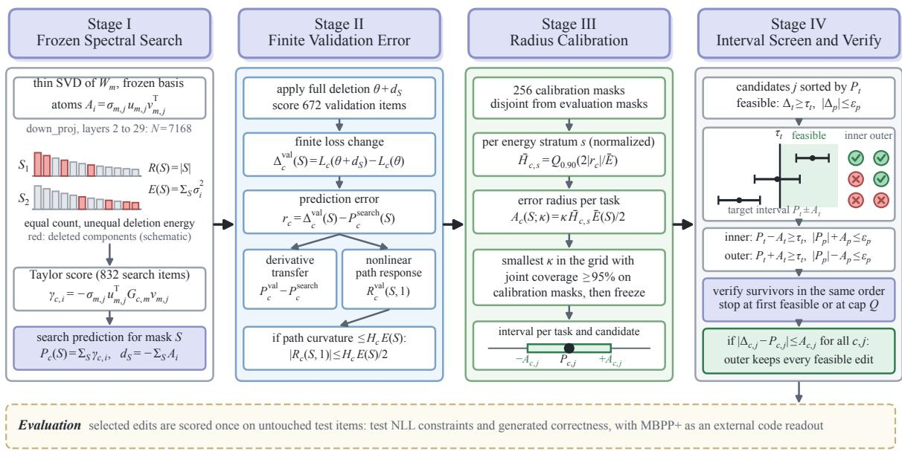  
Figure 1: Finite spectral deletion and interval screening. Stage I forms search predictions in a frozen singular basis. Stage II measures finite validation error and separates derivative transfer from nonlinear response along the deletion path. Stage III calibrates energy-normalized radii on masks disjoint from the evaluation pool. Stage IV screens candidates and verifies survivors in the fixed order under a check cap. The development pilot precedes the final freeze; Proposition 1 states the retention condition.

We compare three candidate-selection policies that share the same predictions. Direct verification checks candidates in target-prediction order. Inner screening keeps a candidate only when its entire predicted error rectangle satisfies the constraints. Outer screening keeps it whenever that rectangle contains a loss vector that satisfies the constraints, then verifies the survivors. Valid intervals guarantee that outer screening retains feasible edits, whereas calibrated intervals require a measured retention audit. Under a common check cap, pruning determines how far each policy progresses through the candidate order.

Our contributions are:

• An error decomposition for finite spectral deletion. The gap between a first-order search prediction and the finite validation loss change decomposes into derivative transfer across item splits and nonlinear response along the deletion path. A pathwise curvature condition bounds the latter term by deletion energy (Section 3).

• A retention condition for interval screening.

When every candidate’s intervals contain its finite validation changes on every task, outer screening retains every feasible candidate, and uncapped verification in the direct order returns the same first feasible output with no more checks (Proposition 1).

• An evaluation of error, retention, budgeted verification, and generated correctness under a fixed protocol. On Mistral-7B-Instructv0.3, calibrated intervals jointly cover 968 of 1024 evaluation masks, and outer screening retains 70 of 74 feasible candidates. It reaches the direct-selected edit in 25 checks, whereas direct verification abstains at a 32- check cap. All three selected edits pass validation, but only one meets the test constraints. The study extends to Llama-3.1-8B-Instruct and reversed target roles (Sections 4.3 and 4.5).

## 2 Related Work

Curvature-based pruning. Optimal Brain Damage uses diagonal second derivatives; Optimal Brain Surgeon uses inverse-Hessian information and compensates deletion by updating retained weights (LeCun et al., 1989; Hassibi and Stork, 1992). SparseGPT scales reconstruction updates to large language models (LLMs) through a quadratic layer-output objective (Frantar and Alistarh, 2023). Wanda scores weight magnitude multiplied by input-activation norms, without weight reconstruction (Sun et al., 2024). Kronecker-factored approximate curvature (K-FAC) approximates Fisher blocks through Kronecker factors (Martens and Grosse, 2015), and LLM Surgeon applies these approximations to target-loss pruning with correlated updates (van der Ouderaa et al., 2024). Our frozen spectral pool does not evaluate these methods’ native compensated interventions or search procedures. Positive-semidefinite Fisher or reconstruction surrogates also differ from the signed endto-end task Hessian analyzed here.

Taylor scores and spectral edits. Taylor saliency estimates local loss effects (Molchanov et al., 2017, 2019), including in structural LLM pruning (Ma et al., 2023); influence functions make similar local predictions and can be fragile in deep networks (Koh and Liang, 2017; Basu et al., 2021). Weighted, activation-aware, and truncationaware SVD methods optimize low-rank compression (Hsu et al., 2022; Yuan et al., 2023; Wang et al., 2025b,a); SVD-Surgeon studies singularvalue saliency and second-order compensation (Safari and Hutter, 2026). LASER selects finite layerwise tail truncations using validation accuracy (Sharma et al., 2024). We use fixed spectral edits to evaluate search-to-validation prediction error and its effect on verification; the contribution is this analysis and comparison, not a new first-order saliency formula or a reproduction of those complete pruning pipelines.

Editing and capability preservation. ROME and MEMIT edit factual associations (Meng et al., 2022, 2023); localization alone need not identify the most effective intervention (Hase et al., 2023). Task arithmetic and its linearized variant (Ilharco et al., 2023; Ortiz-Jimenez et al., 2023), unlearning by gradient ascent, preference objectives, or pruning (Jang et al., 2023; Eldan and Russinovich, 2023; Zhang et al., 2024; Pochinkov and Schoots, 2024; Li et al., 2024), and representation erasure or direction ablation (Ravfogel et al., 2020; Belrose et al., 2023; Arditi et al., 2024) motivate targeted changes with explicit preserved-task readouts, as in unlearning benchmarks (Maini et al., 2024; Shi et al., 2025). Pruning and low-rank weight edits can isolate safety-critical regions (Wei et al., 2024), and relearning or adversarial probes can recover unlearned knowledge (Hu et al., 2025; Łucki et al., 2025); we do not evaluate such recovery. Our reference-NLL constraints measure a narrower form of preservation than an underlying capability, so we report generated correctness and selection abstention separately.

## 3 Method: Interval Screening for Finite Spectral Deletion

This section defines the intervention, constraints, prediction error, and error radii, then states the screening rules. Table 1 collects the notation.

## 3.1 Problem Formulation

Let $f _ { \theta }$ be a decoder-only language model and M a collection of editable matrices. For a linear-layer weight $W _ { m } \in \mathbb { R } ^ { d _ { m } ^ { \mathrm { o u t } } \times d _ { m } ^ { \mathrm { i n } } }$ , the row-vector forward map is $x \mapsto x W _ { m } ^ { \top }$ , and its thin SVD is

$$
\begin{array} { l } { { \displaystyle { W _ { m } = \sum _ { j = 1 } ^ { r _ { m } } \sigma _ { m , j } u _ { m , j } v _ { m , j } ^ { \top } } , } } \\ { { \displaystyle r _ { m } = \operatorname* { m i n } ( d _ { m } ^ { \mathrm { o u t } } , d _ { m } ^ { \mathrm { i n } } ) , } } \end{array}\tag{1}
$$

with nonincreasing nonnegative singular values. We fix the searchable bands $\mathcal { I } _ { m }$ and collect their coordinates in $\mathcal { T } = \{ ( m , j ) : m \in \mathcal { M } , j \in \mathcal { I } _ { m } \}$ with $N = | \mathcal { T } |$ . For $i = ( m , j )$ , the spectral atom $A _ { i } ~ = ~ \sigma _ { m , j } u _ { m , j } v _ { m , j } ^ { \top }$ occupies matrix m and is zero elsewhere. Selecting $S \subseteq \mathbb { Z }$ gives the deletion direction $\begin{array} { r } { d _ { S } = - \sum _ { i \in S } A _ { i } } \end{array}$ . The amplitude $\alpha \in [ 0 , 1 ]$ controls the edit size: parameters become $\theta + \alpha d _ { S }$ , and full deletion corresponds to $\alpha = 1$

The coordinate count $R ( S ) = | S |$ pools selected components across the network, although each matrix update has its own rank. The deletion energy is

$$
E ( S ) = \| d _ { S } \| _ { F } ^ { 2 } = \sum _ { i \in S } e _ { i } , \qquad e _ { i } = \sigma _ { m , j } ^ { 2 } .\tag{2}
$$

Within matrix $m .$ , the update rank is the number of selected positive singular values and its operator norm is the largest selected singular value; both follow from singular-component orthogonality. When singular values repeat, deleting an individual component depends on the chosen basis, whereas deleting the entire repeated-value subspace does not. Appendix C describes the implementation of the basis and edits.

For capability $^ { c , }$ fix an evaluation distribution $\mathcal { D } _ { c }$ and differentiable loss

$$
L _ { c } ( \theta ) = \mathbb { E } _ { ( x , y ) \sim \mathcal { D } _ { c } } [ \ell _ { c } ( f _ { \theta } ( x ) , y ) ] .\tag{3}
$$

We define the loss change as $\Delta _ { c } ( S , \alpha ) = L _ { c } ( \theta +$ $\alpha d _ { S } ) { - } L _ { c } ( \theta )$ , with positive values indicating degradation. For the separate higher-is-better score $\operatorname { A c c } _ { c } ,$ we define the score drop $D _ { c } ( S , \alpha ) = \operatorname { A c c } _ { c } ( \theta ) -$ $\operatorname { A c c } _ { c } ( \theta + \alpha d _ { S } )$ . For the NLL objective used here, loss change measures reference likelihood and accuracy drop measures correctness.

We fix a task-specific target floor $\tau _ { t } > 0$ , preserved tolerances $\epsilon _ { p } \geq 0$ , an integer $B \geq 0$ , and $E _ { \operatorname* { m a x } } \geq 0$ . An edit is selective at these thresholds if

$$
\begin{array} { c c } { { R ( S ) \leq B , } } & { { E ( S ) \leq E _ { \mathrm { m a x } } , } } \\ { { \Delta _ { t } ( S , 1 ) \geq \tau _ { t } , } } & { { | \Delta _ { p } ( S , 1 ) | \leq \epsilon _ { p } \quad ( p \in P ) , } } \end{array}\tag{4}
$$

Here t is the target and $P \subseteq { \mathcal { C } } \setminus \{ t \}$ contains the preserved tasks. Absolute preservation requires stable preserved losses and therefore penalizes both improvement and deterioration beyond tolerance. Harm-only preservation instead requires $\Delta _ { p } ( S , 1 ) \le \epsilon _ { p }$ and permits improvements of any size. Generated correctness is evaluated separately under either criterion. Shared token-normalized units do not make a target floor or tolerance equally meaningful across tasks.

## 3.2 Spectral Saliency Prediction

For $G _ { c , m } = \nabla _ { W _ { m } } L _ { c } ( \theta )$ , the spectral Taylor score is

$$
\gamma _ { c , i } = - \sigma _ { m , j } u _ { m , j } ^ { \top } G _ { c , m } v _ { m , j } .\tag{5}
$$

In the frozen SVD basis, this score is the derivative with respect to a component’s deletion amplitude. Its sign predicts whether a small deletion raises or lowers the task loss, a direction the singular value alone does not determine. The search prediction of a mask sums these scores on the search split, $\begin{array} { r } { P _ { c } ^ { \mathrm { s e a r c h } } ( S ) = \sum _ { i \in S } \gamma _ { c , i } ^ { \mathrm { s e a r c h } } } \end{array}$

## 3.3 Finite Deletion Error

For $g _ { c } ( \alpha ) = L _ { c } ( \theta + \alpha d _ { S } )$ , twice continuous differentiability along the edit path gives the exact identity

$$
\begin{array} { r l } & { \Delta _ { c } ( S , \alpha ) = \alpha \displaystyle \sum _ { i \in S } \gamma _ { c , i } + \mathcal { R } _ { c } ( S , \alpha ) , } \\ & { } \\ & { \mathcal { R } _ { c } ( S , \alpha ) = \displaystyle \int _ { 0 } ^ { \alpha } ( \alpha - u ) h _ { c , S } ( u ) d u , } \\ & { \quad h _ { c , S } ( u ) = d _ { S } ^ { \top } \nabla ^ { 2 } L _ { c } ( \theta + u d _ { S } ) d _ { S } . } \end{array}\tag{6}
$$

I $\lceil h _ { c , S } ( u ) \rceil \leq H _ { c } E ( S )$ along that path, then

$$
\begin{array} { r } { | \mathcal { R } _ { c } ( S , \alpha ) | \leq \frac { 1 } { 2 } \alpha ^ { 2 } H _ { c } E ( S ) . } \end{array}\tag{7}
$$

The bound depends on deletion energy and on a pathwise curvature condition; a coordinate budget alone gives no such guarantee. A large residual shows that the finite response departs from the local linear prediction, but not that the Hessian at $\alpha = 0$ explains the whole discrepancy. Appendix D.3 defines the measured test-split residual.

The observable validation error is

$$
\begin{array} { r l } & { r _ { c } ^ { \mathrm { v a l } } ( S ) = \Delta _ { c } ^ { \mathrm { v a l } } ( S , 1 ) - P _ { c } ^ { \mathrm { s e a r c h } } ( S ) , } \\ & { ~ = \left( P _ { c } ^ { \mathrm { v a l } } - P _ { c } ^ { \mathrm { s e a r c h } } \right) + \mathcal { R } _ { c } ^ { \mathrm { v a l } } ( S , 1 ) . } \end{array}\tag{8}
$$

Equation 8 separates two sources of error: the derivative changes between search and validation items, and the finite deletion produces a nonlinear response on validation. Forward scoring of the full pool measures their sum, which is the error the screening radius must cover; recomputing validation derivatives on selected frozen masks separates the two terms. A Hessian measured only at the unedited model bounds neither their sum nor the response over the full path.

To compare masks within a searchable band, we normalize energy as $\bar { E } = E / E _ { \mathrm { b a n d } }$ and curvature as $\bar { H } = H E _ { \mathrm { b a n d } }$ . Since $\bar { H } \bar { E } = H E$ , this rescales without changing the Taylor allowance. The normalization is specific to the checkpoint and support and does not make coefficients transferable between checkpoints. Appendix B.3 gives the decomposition of base-point and path curvature and the conditions for its bounds.

## 3.4 Calibrated Error Radii

Error radii are fit on calibration masks, disjoint from evaluation masks, analogous to split conformal calibration (Lei et al., 2018); for those in deletion-energy stratum s, we fit

$$
\begin{array} { c } { { \displaystyle \bar { H } _ { c , s } = Q _ { 0 . 9 0 } \left( \frac { 2 | r _ { c } ^ { \mathrm { v a l } } ( S ) | } { \bar { E } ( S ) } \right) , } } \\ { { A _ { c } ( S ; \kappa ) = \frac { 1 } { 2 } \kappa \bar { H } _ { c , s } \bar { E } ( S ) . } } \end{array}\tag{9}
$$

The quantile is the smallest sorted observation reaching the requested level. We choose the smallest multiplier in the declared grid {0,0.25,0.5,0.75,1,1.25,1.5,2,3,4} whose intervals jointly cover all tasks on at least 95% of calibration masks, and freeze the coefficients and multiplier before examining evaluation outcomes. Empty calibration strata, candidates outside calibrated energy ranges, and failure to find a qualifying multiplier all trigger direct verification.

The radius covers search-to-validation prediction error, including both derivative transfer and nonlinear response, so separate masks measure its coverage. After the freeze, complete-pool quantiles and scaling summaries describe the policy’s behavior but cannot alter its screening coefficients.

## 3.5 Screening and Verification Policies

All policies follow the same decreasing searchtarget-prediction order, with support-ID ties resolved before filtering. Each checks finite validation losses until it selects a candidate, exhausts its eligible pool, or reaches its cap $Q \in$ {32, 128, 512}. Because filtering preserves order, the comparison isolates the effect of pruning.

For candidate $j ,$ , let $P _ { c , j }$ be the search prediction and $A _ { c , j } \geq 0$ its proposed error radius. The inner and outer tests are respectively

Inner : $\begin{array} { r } { P _ { t , j } - A _ { t , j } \geq \tau _ { t } , \quad | P _ { p , j } | + A _ { p , j } \leq \epsilon _ { p } , } \end{array}$ Outer : $\begin{array} { r } { P _ { t , j } + A _ { t , j } \geq \tau _ { t } , \quad | P _ { p , j } | - A _ { p , j } \leq \epsilon _ { p } . } \end{array}$ (10)

The conditions apply to every preserved task. Harm-only preservation replaces the inner preserved inequality by $P _ { p , j } + A _ { p , j } \ \leq \ \epsilon _ { p }$ and the outer inequality by $P _ { p , j } - A _ { p , j } \leq \epsilon _ { p } .$

Proposition 1 (retention under valid intervals). For a frozen pool satisfying its support, rank, and energy constraints, suppose $| \Delta _ { c , j } ^ { \mathrm { v a l } } - P _ { c , j } | \le A _ { c , j } f o r$ every task and candidate. Outer screening retains every validation-feasible candidate. Verification in the unchanged direct order, without a binding cap, returns the same first feasible output or the same abstention with no more checks. If the only information is the product of the task intervals, every outer survivor admits afeasible assignment.

The proof follows from interval intersection: if a feasible loss value lies in an interval, that interval intersects the task’s allowed range, and keeping survivors in their original order preserves the first feasible candidate (Appendix B.4 gives the full argument and boundary cases). The guarantee requires simultaneous interval validity for all tasks and candidates, which calibration coverage assesses empirically. With a binding check cap, policies can reach different portions of the order and return different outputs.

## 4 Experiments

After the setup, we report prediction error versus deletion energy, coverage and retention, budgeted verification, and test preservation.

## 4.1 Experimental Setup

The primary checkpoint is mistralai/ Mistral-7B-Instruct-v0.3 (Jiang et al., 2023; Mistral AI, 2024a). The target task is GSM8K arithmetic (Cobbe et al., 2021); the preserved NLL tasks are HumanEval code (Chen et al., 2021) and ARC-C question answering (Clark et al., 2018). MBPP+, the EvalPlus extension of MBPP (Austin et al., 2021; Liu et al., 2023), provides the primary external code-correctness readout, with HumanEval supplementary. Table 3 in Appendix C.1 gives the fixed item allocation. Each validation mask is scored on 672 items: 512 arithmetic, 32 code, and 128 question answering.

The loss averages answer-token NLL within each item, then averages across items in the split. Prompt tokens are masked. Gradients and finite scoring share tokenization, answer boundaries, endof-sequence (EOS) handling, and truncation. Generated correctness uses its own fixed prompt and decoding policy and measures a separate outcome.

We edit mlp.down\_proj weights in zerobased layers 2 through 29 and search the leading 256 singular components of each matrix. Official metadata gives shape 4096 × 14336, yielding 28 matrices and 7168 searchable coordinates (Mistral AI, 2024b,c). This contiguous interior-layer support holds projection type fixed; we make no claim of optimality. A preflight checks the modules against the pinned checkpoint before basis construction (Appendix C), and mask generation uses the frozen manifest, serialized basis, search IDs, and gradient arrays. Item-averaged gradients from 832 search items give the coefficients in Equation 5; Appendix C.1 gives basis and gradient-audit details.

Before the final freeze, a separate 64-mask development pilot checks that the configuration yields an informative range of candidates. Pilot masks are excluded from both final pools and all summaries, and the 256-mask calibration and 1024-mask evaluation manifests are sealed before either pool is scored (Appendix C.4).

Proposals meet the exact coordinate budget and use search predictions only; finite loss changes never enter their scores. Appendix C.5 specifies the proposal families, energy repair, seeds, and exclusions. Calibration follows Section 3.4.

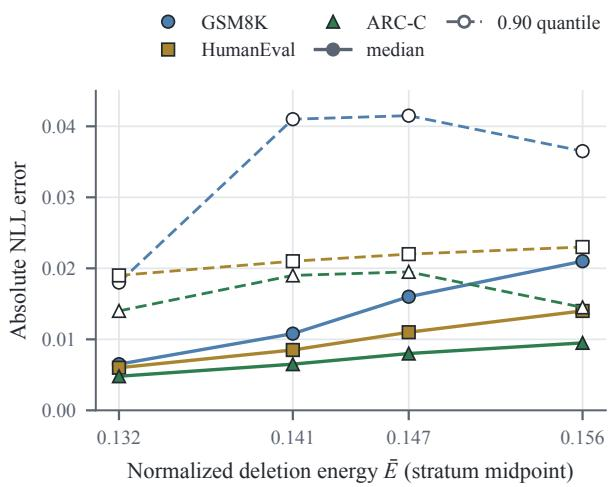  
Figure 2: Absolute NLL prediction error by deletionenergy stratum. Circles, squares, and triangles denote GSM8K, HumanEval, and ARC-C. Solid lines with filled markers show medians; dashed lines with hollow markers show 0.90 quantiles. Points use interval midpoints rather than median mask energies (Table 7). Connecting lines guide comparison and are not fitted curves; Table 9 reports the separate four-point aggregate fit.

## 4.2 Prediction Error versus Deletion Energy

We summarize prediction error by task and deletion-energy stratum over 1280 final masks, keeping calibration and evaluation records separate and excluding development-pilot masks. Each record contains $P _ { c } ^ { \mathrm { s e a r c h } } , \Delta _ { c } ^ { \mathrm { v a l } }$ , signed $r _ { c } ^ { \mathrm { v a l } }$ , absolute error, energy, stratum, and support hash.

Median absolute error increases across the energy strata (Figure 2). Figure 2 plots the four stratum medians and 0.90 quantiles at energy-interval midpoints, and Table 7 (Appendix D.1) adds the 0.95 quantiles and calibration-only coefficients for all three tasks. Absolute and normalized error answer different questions: the median error can rise while the fitted coefficient falls.

The energy trend is descriptive because proposal family and support composition vary with energy. Appendix D.2 gives the aggregate fit and optional component diagnostics; the frozen-pool trend does not establish a universal scaling law.

## 4.3 Coverage and Feasible-Candidate Retention

Coverage measures whether a candidate’s intervals contain its finite validation loss changes on all tasks. Retention measures whether screening keeps a validation-feasible candidate. At the selected multiplier of 1.25, the intervals cover 968 of 1024 evaluation masks, while outer screening retains 70 of 74 feasible masks. Figure 3 reports the multiplier sweep: calibration masks alone determine the multiplier, and the evaluation pool measures its coverage. At the selected multiplier, joint calibration coverage is 247 of 256 masks. Joint coverage is the intersection of the taskwise events; Table 8 gives their marginal counts.

Calibrated outer screening rejects feasible masks even though it returns the direct-verification output. A feasible mask meets the finite validation target floor and both preserved tolerances; of the 74 such masks in the primary evaluation, outer screening retains 70 and rejects 4 (Figure 3c).

Proposition 1 guarantees retention only when all intervals are valid, so fitted intervals require measurements of both coverage and retention. An uncovered error either leaves the first feasible candidate intact or changes the selected output, and marginal error quantiles alone cannot distinguish these outcomes.

## 4.4 Budgeted Verification

Pruning changes how far each policy progresses through the shared candidate order. The first directfeasible candidate, A, occupies position 63 in the shared candidate order. Direct verification therefore requires 63 checks and abstains under a 32- check cap. Calibrated outer screening removes earlier candidates and reaches A in 25 checks. Zeroradius screening rejects A because its code prediction exceeds tolerance and returns B after 17 checks, and calibrated inner verification reaches C after 7 checks. At the fitted multiplier, inner screening keeps 28 candidates and outer screening keeps 508; both zero-radius filters keep 148. The policies thus spend the same budget on different portions of the candidate order. Appendix E.1 gives the check counts across checkpoints, targets, and budgets (Figure 8).

The calibrated outer screen rejects between 1 and 7 feasible masks in each configuration (Figure 3d). $~ \mathrm { A t } ~ Q ~ = ~ 1 2 8$ , it reaches the first direct-feasible output in all eight configurations, whereas direct verification exhausts the cap in Mistral/code/1024, Llama/arithmetic/1024, and Llama/code/1024. At $Q = 5 1 2 .$ , direct and outer verification agree on the selected support in every configuration. Filtering therefore changes access to the shared candidate order under a cap without guaranteeing retention of every feasible mask.

An abstention must be read through its cause:

Radius multiplier κ

(d) retention per configuration

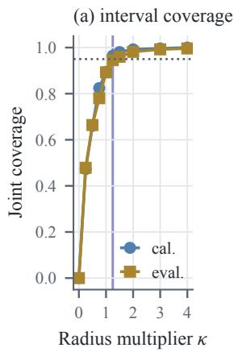

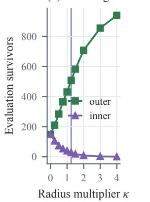

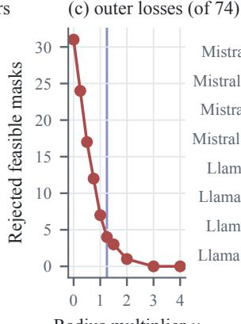

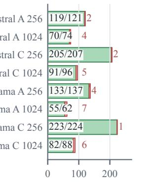  
Validation-feasible masks  
Figure 3: Interval coverage and screening retention. (a) Joint coverage on 256 calibration and 1024 evaluation masks; dotted and vertical lines mark 95% coverage and the selected κ = 1.25. (b) Inner and outer evaluation survivors. (c) Feasible masks rejected by outer screening, out of 74. Panels (a) to (c) show the primary study. (d) Retained (green) and rejected (red, hatched) feasible masks at each configuration’s selected multiplier. In-bar labels give retained/feasible counts; labels to the right give rejected counts. Labels identify checkpoint, target (A: arithmetic; C: code), and coordinate budget B.

budget exhaustion, survivor exhaustion, calibration fallback, or an empty feasible pool; none establishes successful target removal. Every policy and budget selecting the same support reuses one endpoint record, so its reported losses and correctness stay consistent. Appendix C.7 accounts for the scoring workload; replayed consultation counts do not measure runtime.

## 4.5 Test Preservation of Selected Edits

Test evaluation scores each distinct edit in the frozen union of supports selected across policies and check caps, plus the unedited baseline, once for NLL and correctness. GSM8K measures arithmetic answer correctness and ARC-C preserved question answering; MBPP+ is the primary external code readout and HumanEval is supplementary. A code completion is correct only if the fixed harness accepts it under the declared tests and timeout policy.

Reference likelihood and correctness need not move together (Figures 4 and 5). On MBPP+, A and C reduce correctness by 0.8 and 2.9 percentage points (pp), respectively, whereas B increases it by 1.1 pp. Positive NLL changes indicate worse reference likelihood, and positive accuracy drops indicate fewer correct outputs. Correctness drops use unrounded counts and are rounded only for display, so subtracting rounded accuracies can give a different value. An edit can exceed an NLL tolerance with little correctness change, or change correctness without a comparable shift in token-average loss. Quantifying uncertainty requires paired testitem resampling, and policies that select the same edit share one outcome record and are not independent experiments.

Validation feasibility does not ensure test feasibility. All three selected edits pass finite validation, but on test A meets the constraints, B misses the arithmetic floor, and C exceeds the code tolerance (Figure 4). Absolute preservation, which rejects improvements or deterioration beyond tolerance, and harm-only preservation, which rejects excessive positive loss changes, give the same decisions on these frozen outputs. Correctness remains a separate outcome even for edits that satisfy the NLL constraints.

The extension asks whether these behaviors recur across checkpoints and target roles. It crosses Mistral-7B-Instruct-v0.3 (Jiang et al., 2023; Mistral AI, 2024a) and Llama-3.1-8B-Instruct (Dubey et al., 2024; Meta, 2024) with arithmetic and code targets at budgets 256 and 1024, sharing the objective, generator rules, and accounting while fitting each checkpoint’s own singular basis and calibration coefficients. Appendix E reports coverage, retention, verification, and test outcomes for every configuration.

At Q = 512, outer verification uses fewer checks than direct verification in every configuration (Figure 8). Reaching an edit in fewer checks does not ensure better test preservation; Appendix E compares the selected outputs under each configuration’s fixed thresholds.

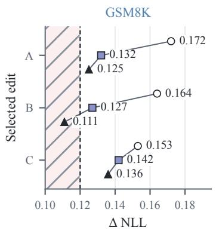

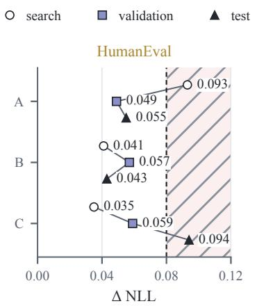

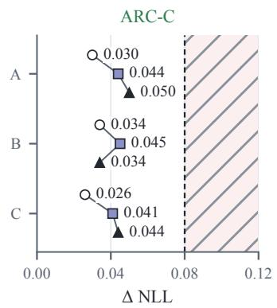  
Figure 4: Search predictions, finite validation changes, and test NLL changes for selected edits A, B, and C. Circles, squares, and triangles denote search, validation, and test. Hatched regions violate the 0.12 GSM8K target floor or the 0.08 HumanEval and ARC-C preservation tolerance. All edits pass validation; on test, B misses the target floor and C exceeds the code tolerance. Rows group each edit’s search, validation, and test values; numeric labels give NLL changes to the reported three-decimal precision. All losses use the same answer-only objective on their respective splits.

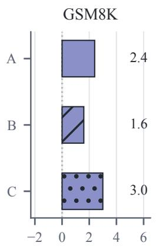  
Drop (pp)

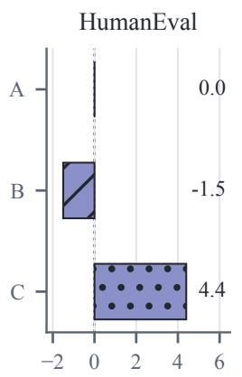  
Drop (pp)

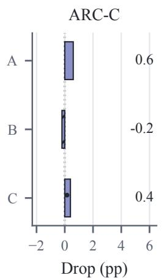

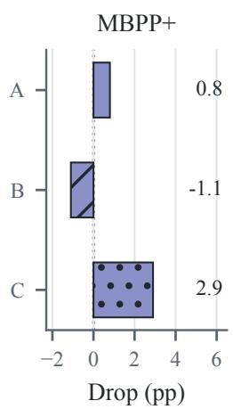  
Figure 5: Test correctness drops for primary selected edits A, B, and C. Positive values denote deterioration; negative values denote improvement. Bars use distinct hatches and report percentage-point drops. Denominators are 1319, 68, 1172, and 378 for GSM8K, HumanEval, ARC-C, and MBPP+, respectively. Figure 4 gives the corresponding calibrated-task NLL changes.

## 5 Discussion and Conclusion

We analyze first-order prediction error for finite spectral deletions, separating derivative transfer across item splits from nonlinear response along the deletion path. When intervals contain every candidate’s finite validation changes on every task, outer screening retains all feasible edits (Proposition 1). Calibrated intervals need not meet this premise: on Mistral-7B-Instruct-v0.3, outer screening reaches the direct-selected edit in 25 checks but rejects 4 of 74 feasible masks, and only one of three validation-feasible edits meets test constraints. Coverage, retention, budgeted selection, and test preservation therefore require separate assessment.

## Limitations

Our study covers two checkpoints, arithmetic and code targets, one proposal mechanism, and fixed task splits. It establishes neither optimality over unrestricted spectral subsets nor transfer of calibration coefficients to other checkpoints or supports; new checkpoints and target roles need their own bases and calibration.

Calibration and evaluation use disjoint masks but share the fixed validation corpus, which also serves the development pilot. Coverage estimates are therefore conditional on that corpus, the proposal mechanism, and the energy strata. Disjoint masks do not provide independent item samples. An empirical calibration quantile does not establish the uniform premise of Proposition 1; the evaluation audit therefore measures joint coverage and rejected feasible masks directly. The policy comparison uses one proposal order, and because deletion energy varies with support composition and proposal scores, the fitted energy relationship is descriptive.

Full-pool scoring adds audit cost, and cached replay counts do not establish runtime savings (Appendix C.7). Reference likelihood and generated correctness measure different behavior; MBPP+ strengthens the external code readout, with HumanEval supplementary. Quantifying uncertainty and end-to-end utility requires paired item records, declared interval families, and measured timings.

## AI Use Statement

Generative AI tools assist with language editing, literature discovery, mathematical exposition, and source-code preparation. The authors verify the proofs, citations, experimental records, and final claims and remain responsible for the manuscript.

## Reproducibility Statement

The appendices give proofs of the theoretical results, the spectral intervention and capped verification procedure, and the controlled experimental settings. The experimental protocol specifies loss normalization, item splits, proposal generation, calibration, random seeds, and numerical comparison rules. The reported diagnostics and selected-edit results retain their stated numerical units across checkpoints, target roles, and spectral budgets.

## References

Andy Arditi, Oscar Obeso, Aaquib Syed, Daniel Paleka, Nina Panickssery, Wes Gurnee, and Neel Nanda. 2024. Refusal in language models is mediated by a single direction. In Advances in Neural Information Processing Systems, volume 37.

Jacob Austin, Augustus Odena, Maxwell Nye, Maarten Bosma, Henryk Michalewski, David Dohan, Ellen Jiang, Carrie Cai, Michael Terry, Quoc Le, and Charles Sutton. 2021. Program synthesis with large language models. arXiv preprint arXiv:2108.07732.

Samyadeep Basu, Philip Pope, and Soheil Feizi. 2021. Influence functions in deep learning are fragile. In International Conference on Learning Representations.

Nora Belrose, David Schneider-Joseph, Shauli Ravfogel, Ryan Cotterell, Edward Raff, and Stella Biderman. 2023. LEACE: Perfect linear concept erasure

in closed form. In Advances in Neural Information Processing Systems, volume 36.

Mark Chen, Jerry Tworek, Heewoo Jun, Qiming Yuan, Henrique Ponde de Oliveira Pinto, Jared Kaplan, Harri Edwards, Yuri Burda, Nicholas Joseph, Greg Brockman, Alex Ray, Raul Puri, Gretchen Krueger, Michael Petrov, Heidy Khlaaf, Girish Sastry, Pamela Mishkin, Brooke Chan, Scott Gray, and 39 others. 2021. Evaluating large language models trained on code. arXiv preprint arXiv:2107.03374.

Peter Clark, Isaac Cowhey, Oren Etzioni, Tushar Khot, Ashish Sabharwal, Carissa Schoenick, and Oyvind Tafjord. 2018. Think you have solved question answering? try ARC, the AI2 reasoning challenge. arXiv preprint arXiv:1803.05457.

Karl Cobbe, Vineet Kosaraju, Mohammad Bavarian, Mark Chen, Heewoo Jun, Lukasz Kaiser, Matthias Plappert, Jerry Tworek, Jacob Hilton, Reiichiro Nakano, Christopher Hesse, and John Schulman. 2021. Training verifiers to solve math word problems. arXiv preprint arXiv:2110.14168.

Abhimanyu Dubey, Abhinav Jauhri, Abhinav Pandey, Abhishek Kadian, Ahmad Al-Dahle, Aiesha Letman, Akhil Mathur, Alan Schelten, Amy Yang, Angela Fan, Anirudh Goyal, Anthony Hartshorn, Aobo Yang, Archi Mitra, Archie Sravankumar, Artem Korenev, Arthur Hinsvark, Arun Rao, Aston Zhang, and 512 others. 2024. The Llama 3 herd of models. arXiv preprint arXiv:2407.21783.

Ronen Eldan and Mark Russinovich. 2023. Who’s Harry Potter? approximate unlearning in LLMs. arXiv preprint arXiv:2310.02238.

Elias Frantar and Dan Alistarh. 2023. SparseGPT: Massive language models can be accurately pruned in one-shot. In Proceedings of the 40th International Conference on Machine Learning, volume 202 of Proceedings of Machine Learning Research, pages 10323–10337. PMLR.

Peter Hase, Mohit Bansal, Been Kim, and Asma Ghandeharioun. 2023. Does localization inform editing? surprising differences in causality-based localization vs. knowledge editing in language models. In Advances in Neural Information Processing Systems, volume 36.

Babak Hassibi and David G. Stork. 1992. Second order derivatives for network pruning: Optimal brain surgeon. In Advances in Neural Information Processing Systems, volume 5, pages 164–171.

Yen-Chang Hsu, Ting Hua, Sungen Chang, Qian Lou, Yilin Shen, and Hongxia Jin. 2022. Language model compression with weighted low-rank factorization. In International Conference on Learning Representations.

Shengyuan Hu, Yiwei Fu, Zhiwei Steven Wu, and Virginia Smith. 2025. Unlearning or obfuscating? jogging the memory of unlearned LLMs via benign relearning. In International Conference on Learning Representations.

Hugging Face. 2026. Transformers: Official Mistral model implementation. Source code. Accessed October 7, 2026.

Gabriel Ilharco, Marco Tulio Ribeiro, Mitchell Wortsman, Suchin Gururangan, Ludwig Schmidt, Hannaneh Hajishirzi, and Ali Farhadi. 2023. Editing models with task arithmetic. In International Conference on Learning Representations.

Joel Jang, Dongkeun Yoon, Sohee Yang, Sungmin Cha, Moontae Lee, Lajanugen Logeswaran, and Minjoon Seo. 2023. Knowledge unlearning for mitigating privacy risks in language models. In Proceedings of the 61st Annual Meeting of the Association for Computational Linguistics (Volume 1: Long Papers), pages 14389–14408. Association for Computational Linguistics.

Albert Q. Jiang, Alexandre Sablayrolles, Arthur Mensch, Chris Bamford, Devendra Singh Chaplot, Diego de las Casas, Florian Bressand, Gianna Lengyel, Guillaume Lample, Lucile Saulnier, Lélio Renard Lavaud, Marie-Anne Lachaux, Pierre Stock, Teven Le Scao, Thibaut Lavril, Thomas Wang, Timothée Lacroix, and William El Sayed. 2023. Mistral 7B. arXiv preprint arXiv:2310.06825.

Pang Wei Koh and Percy Liang. 2017. Understanding black-box predictions via influence functions. In Proceedings of the 34th International Conference on Machine Learning, volume 70 of Proceedings of Machine Learning Research, pages 1885–1894. PMLR.

Yann LeCun, John S. Denker, and Sara A. Solla. 1989. Optimal brain damage. In Advances in Neural Information Processing Systems, volume 2, pages 598– 605.

Jing Lei, Max G’Sell, Alessandro Rinaldo, Ryan J. Tibshirani, and Larry Wasserman. 2018. Distributionfree predictive inference for regression. Journal of the American Statistical Association, 113(523):1094– 1111.

Nathaniel Li, Alexander Pan, Anjali Gopal, Summer Yue, Daniel Berrios, Alice Gatti, Justin D. Li, Ann-Kathrin Dombrowski, Shashwat Goel, Gabriel Mukobi, Nathan Helm-Burger, Rassin Lababidi, Lennart Justen, Andrew Bo Liu, Michael Chen, Isabelle Barrass, Oliver Zhang, Xiaoyuan Zhu, Rishub Tamirisa, and 27 others. 2024. The WMDP benchmark: Measuring and reducing malicious use with unlearning. In Proceedings ofthe 41st International Conference on Machine Learning, volume 235 of Proceedings of Machine Learning Research, pages 28525–28550. PMLR.

Jiawei Liu, Chunqiu Steven Xia, Yuyao Wang, and Lingming Zhang. 2023. Is your code generated by chat-GPT really correct? rigorous evaluation of large language models for code generation. In Advances in Neural Information Processing Systems, volume 36.

Sijia Liu, Yuanshun Yao, Jinghan Jia, Stephen Casper, Nathalie Baracaldo, Peter Hase, Yuguang Yao, Chris Yuhao Liu, Xiaojun Xu, Hang Li, Kush R. Varshney, Mohit Bansal, Sanmi Koyejo, and Yang Liu. 2025. Rethinking machine unlearning for large language models. Nature Machine Intelligence, 7(2):181–194.

Jakub Łucki, Boyi Wei, Yangsibo Huang, Peter Henderson, Florian Tramèr, and Javier Rando. 2025. An adversarial perspective on machine unlearning for AI safety. Transactions on Machine Learning Research.

Xinyin Ma, Gongfan Fang, and Xinchao Wang. 2023. LLM-Pruner: On the structural pruning of large language models. In Advances in Neural Information Processing Systems, volume 36.

Pratyush Maini, Zhili Feng, Avi Schwarzschild, Zachary C. Lipton, and J. Zico Kolter. 2024. TOFU: A task of fictitious unlearning for LLMs. In First Conference on Language Modeling.

James Martens and Roger Grosse. 2015. Optimizing neural networks with kronecker-factored approximate curvature. In Proceedings ofthe 32nd International Conference on Machine Learning, volume 37 of Proceedings of Machine Learning Research, pages 2408–2417. PMLR.

Kevin Meng, David Bau, Alex Andonian, and Yonatan Belinkov. 2022. Locating and editing factual associations in GPT. In Advances in Neural Information Processing Systems, volume 35.

Kevin Meng, Arnab Sen Sharma, Alex Andonian, Yonatan Belinkov, and David Bau. 2023. Massediting memory in a transformer. In International Conference on Learning Representations.

Meta. 2024. Llama-3.1-8B-Instruct. Official model card, Hugging Face. Accessed October 11, 2026.

Mistral AI. 2024a. Mistral-7B-Instruct-v0.3. Official model card, Hugging Face. Accessed October 11, 2026.

Mistral AI. 2024b. Mistral-7B-Instruct-v0.3: Official configuration. Hugging Face model repository. Accessed October 7, 2026; metadata inspection only.

Mistral AI. 2024c. Mistral-7B-Instruct-v0.3: Official safetensors weight index. Hugging Face model repository. Accessed October 7, 2026; parameter inventory only.

Pavlo Molchanov, Arun Mallya, Stephen Tyree, Iuri Frosio, and Jan Kautz. 2019. Importance estimation for neural network pruning. In Proceedings of the IEEE/CVF Conference on Computer Vision and Pattern Recognition.

Pavlo Molchanov, Stephen Tyree, Tero Karras, Timo Aila, and Jan Kautz. 2017. Pruning convolutional neural networks for resource efficient inference. In International Conference on Learning Representations.

Guillermo Ortiz-Jimenez, Alessandro Favero, and Pascal Frossard. 2023. Task arithmetic in the tangent space: Improved editing of pre-trained models. In Advances in Neural Information Processing Systems, volume 36.

Nicholas Pochinkov and Nandi Schoots. 2024. Dissecting language models: Machine unlearning via selective pruning. arXiv preprint arXiv:2403.01267.

Shauli Ravfogel, Yanai Elazar, Hila Gonen, Michael Twiton, and Yoav Goldberg. 2020. Null it out: Guarding protected attributes by iterative nullspace projection. In Proceedings ofthe 58th Annual Meeting of the Associationfor Computational Linguistics, pages 7237–7256. Association for Computational Linguistics.

Mahmoud Safari and Frank Hutter. 2026. SVD-Surgeon: Optimal singular-value surgery for large language model compression. arXiv preprint arXiv:2606.23568.

Pratyusha Sharma, Jordan T. Ash, and Dipendra Misra. 2024. The truth is in there: Improving reasoning in language models with layer-selective rank reduction. In International Conference on Learning Representations.

Weijia Shi, Jaechan Lee, Yangsibo Huang, Sadhika Malladi, Jieyu Zhao, Ari Holtzman, Daogao Liu, Luke Zettlemoyer, Noah A. Smith, and Chiyuan Zhang. 2025. MUSE: Machine unlearning six-way evaluation for language models. In International Conference on Learning Representations.

Mingjie Sun, Zhuang Liu, Anna Bair, and J. Zico Kolter. 2024. A simple and effective pruning approach for large language models. In International Conference on Learning Representations.

Tycho F. A. van der Ouderaa, Markus Nagel, Mart van Baalen, Yuki M. Asano, and Tijmen Blankevoort. 2024. The LLM surgeon. In International Conference on Learning Representations.

Xin Wang, Samiul Alam, Zhongwei Wan, Hui Shen, and Mi Zhang. 2025a. SVD-LLM V2: Optimizing singular value truncation for large language model compression. In Proceedings of the 2025 Conference ofthe Nations ofthe Americas Chapter ofthe Associationfor Computational Linguistics: Human Language Technologies (Volume 1: Long Papers), pages 4287–4296. Association for Computational Linguistics.

Xin Wang, Yu Zheng, Zhongwei Wan, and Mi Zhang. 2025b. SVD-LLM: Truncation-aware singular value decomposition for large language model compression. In International Conference on Learning Representations.

Boyi Wei, Kaixuan Huang, Yangsibo Huang, Tinghao Xie, Xiangyu Qi, Mengzhou Xia, Prateek Mittal, Mengdi Wang, and Peter Henderson. 2024. Assessing the brittleness of safety alignment via pruning and low-rank modifications. In Proceedings of the 41st International Conference on Machine Learning, volume 235 of Proceedings of Machine Learning Research, pages 52588–52610. PMLR.

Yuanshun Yao, Xiaojun Xu, and Yang Liu. 2024. Large language model unlearning. In Advances in Neural Information Processing Systems, volume 37.

Zhihang Yuan, Yuzhang Shang, Yue Song, Dawei Yang, Qiang Wu, Yan Yan, and Guangyu Sun. 2023. ASVD: Activation-aware singular value decomposition for compressing large language models. arXiv preprint arXiv:2312.05821.

Ruiqi Zhang, Licong Lin, Yu Bai, and Song Mei. 2024. Negative preference optimization: From catastrophic collapse to effective unlearning. In First Conference on Language Modeling.

## A Notation

Table 1 summarizes notation used in the main text and appendix. Superscripts search, val, and test identify item splits. Hats denote empirical or numerical estimates. Indices are local to each definition: j indexes a singular component in $( m , j )$ and a candidate in the screening analysis.

Support labels such as A, B, and C identify selected masks in the reported results.

## B Proofs

## B.1 Spectral norms and the frozen-coordinate derivative

For each matrix, distinct SVD components have orthogonal left and right singular vectors. Their Frobenius inner product is zero because

$$
\langle { u } _ { j } { v } _ { j } ^ { \top } , { u } _ { k } { v } _ { k } ^ { \top } \rangle = ( { u } _ { j } ^ { \top } { u } _ { k } ) ( { v } _ { j } ^ { \top } { v } _ { k } ) .\tag{11}
$$

The selected components therefore have squared Frobenius norm $\textstyle { \sum _ { j \in S _ { m } } \sigma _ { m , j } ^ { 2 } }$ , operator norm $\operatorname* { m a x } _ { j \in S _ { m } } \sigma _ { m , j }$ , and rank equal to the number of selected nonzero singular values. Empty selections have norm and rank zero. Distinct parameter matrices occupy disjoint blocks, giving Equation 2. Budget calculations exclude duplicate support entries.

For a fixed singular basis, differentiation along the deletion direction gives

$$
\begin{array} { r l } & { g _ { c } ^ { \prime } ( 0 ) = \displaystyle \sum _ { m } \langle { G _ { c , m } , - \sum _ { j \in S _ { m } } A _ { m , j } } \rangle } \\ & { \quad \quad \quad = \displaystyle \sum _ { ( m , j ) \in S } - \sigma _ { m , j } u _ { m , j } ^ { \top } G _ { c , m } v _ { m , j } . } \end{array}\tag{12}
$$

The analysis computes the basis once from the unedited matrices and holds it fixed during differentiation. Recomputing it along the path defines a different intervention.

## B.2 Taylor identity and finite-amplitude error

The fundamental theorem of calculus yields

$$
g _ { c } ( \alpha ) - g _ { c } ( 0 ) = \int _ { 0 } ^ { \alpha } g _ { c } ^ { \prime } ( u ) d u .\tag{13}
$$

Substituting $\begin{array} { r } { g _ { c } ^ { \prime } ( u ) ~ = ~ g _ { c } ^ { \prime } ( 0 ) + \int _ { 0 } ^ { u } g _ { c } ^ { \prime \prime } ( v ) } \end{array}$ dv and changing the order of integration gives

$$
g _ { c } ( \alpha ) - g _ { c } ( 0 ) = \alpha g _ { c } ^ { \prime } ( 0 ) + \int _ { 0 } ^ { \alpha } ( \alpha - v ) g _ { c } ^ { \prime \prime } ( v ) d v .\tag{14}
$$

Since $g _ { c } ^ { \prime \prime } ( v ) = d _ { S } ^ { \top } \nabla ^ { 2 } L _ { c } ( \theta + v d _ { S } ) d _ { S }$ , this proves Equation 6. A uniform directional bound $| g _ { c } ^ { \prime \prime } ( v ) | \leq$ $H _ { c } E ( S )$ gives Equation 7 after integrating α − v. A global Hessian operator-norm bound over the candidate paths is sufficient, but substantially stronger than a pointwise Hessian estimate at the unedited model.

If a third derivative along the path is uniformly bounded by $K _ { c , S }$ , then

$$
\Big | \Delta _ { c } ( S , \alpha ) - \alpha g _ { c } ^ { \prime } ( 0 ) - \frac { \alpha ^ { 2 } } { 2 } g _ { c } ^ { \prime \prime } ( 0 ) \Big | \le \frac { \alpha ^ { 3 } } { 6 } K _ { c , S } .\tag{15}
$$

Without a bound on higher derivatives or direct path measurements, the linear residual cannot be equated with the base-point quadratic term. This derivation applies to a differentiable loss; binary accuracy has no corresponding Taylor remainder.

## B.3 Base and path curvature

For a frozen direction, $P _ { c } ^ { \mathrm { s e a r c h } }$ and $P _ { c } ^ { \mathrm { t e s t } }$ use the same answer-only NLL on their respective items. At full amplitude, we define $q _ { c } = h _ { c , S } ^ { \mathrm { t e s t } } ( 0 ) / 2$ and $\begin{array} { r } { I _ { c } = \int _ { 0 } ^ { 1 } ( 1 - u ) \widehat { h } _ { c , S } ^ { \mathrm { t e s t } } ( u ) } \end{array}$ du. Then

$$
\begin{array} { c } { \widehat { \Delta } _ { c } ^ { \mathrm { t e s t } } = P _ { c } ^ { \mathrm { s e a r c h } } + ( P _ { c } ^ { \mathrm { t e s t } } - P _ { c } ^ { \mathrm { s e a r c h } } ) + q _ { c } } \\ { + ( I _ { c } - q _ { c } ) + ( \widehat { \mathcal { R } } _ { c } - I _ { c } ) . } \end{array}\tag{16}
$$

The decomposition separates derivative transfer, base-point curvature, and variation along the path. Its final term collects quadrature error, HVP error, and disagreement between objectives or implementations. Refining quadrature addresses only one of these sources.

For general amplitude, $q _ { c , S } ( \alpha ) = \alpha ^ { 2 } h _ { c , S } ( 0 ) / 2$ The exact omitted path term satisfies

$$
\begin{array} { l } { \displaystyle \mathcal { R } _ { c } ( S , \alpha ) - q _ { c , S } ( \alpha ) } \\ { \displaystyle \qquad = \int _ { 0 } ^ { \alpha } ( \alpha - u ) [ h _ { c , S } ( u ) - h _ { c , S } ( 0 ) ] d u . } \end{array}\tag{17}
$$

$$
\mathrm { F o r } \omega _ { c , S } ( \alpha ) = \operatorname* { s u p } _ { u \leq \alpha } | h _ { c , S } ( u ) - h _ { c , S } ( 0 ) | ,
$$

$$
\begin{array} { r } { | \mathcal { R } _ { c } - q _ { c , S } | \leq \frac { 1 } { 2 } \alpha ^ { 2 } \omega _ { c , S } ( \alpha ) . } \end{array}\tag{18}
$$

A $K _ { c ^ { - 1 } }$ Lipschitz Hessian gives the alternative bound $K _ { c } \alpha ^ { 3 } E ( \bar { S } ) ^ { 3 / 2 } / 6$ . A finite HVP grid certifies neither a path supremum nor a Lipschitz constant. The bounds follow from the integral representation.

For a frozen displacement $d _ { S }$ , twice continuous differentiability gives Equation 6. Since $\textstyle \int _ { 0 } ^ { \alpha } ( \alpha - u ) d u = \alpha ^ { 2 } / 2$ , subtracting $\alpha ^ { 2 } h _ { c , S } ( 0 ) / 2$ yields Equation 17. Its absolute value is at most

<table><tr><td>Symbol</td><td>Definition</td></tr><tr><td colspan="2">Model and spectral intervention</td></tr><tr><td> $f _ { \boldsymbol { \theta } } , \boldsymbol { \theta }$ </td><td>Language model and unedited parameters.</td></tr><tr><td> ${ \mathcal { M } } , W _ { m }$ </td><td>Editable matrices and matrix m, of shape  $d _ { m } ^ { \mathrm { o u t } } \times d _ { m } ^ { \mathrm { i n } } .$ </td></tr><tr><td> $\sigma _ { m , j } , u _ { m , j } , v _ { m , j }$ </td><td>Singular value and left/right singular vectors of  $W _ { m } ; r _ { m } = \operatorname* { m i n } ( d _ { m } ^ { \mathrm { o u t } } , d _ { m } ^ { \mathrm { i n } } )$  is the thin-SVD  $\mathrm { s i z e , }$  which can exceed numerical rank.</td></tr><tr><td> $\mathcal { I } _ { m } , \mathcal { I } , N$ </td><td>Searchable indices in matrix m, pooled coordinate set, and size  $N = | { \mathcal { T } } | .$ </td></tr><tr><td> $i , A _ { i }$ </td><td>Coordinate  $i = ( m , j )$  and atom  $A _ { i } = \sigma _ { m , j } u _ { m , j } v _ { m , j } ^ { \top }$  in block  $m .$ </td></tr><tr><td> $S , d _ { S } , \alpha$ </td><td>Selected coordinates, direction  $\begin{array} { r } { d _ { S } = - \sum _ { i \in S } A _ { i } } \end{array}$  , and amplitude  $\alpha \in [ 0 , 1 ] ;$  the edit is  $\theta + \alpha d _ { S } .$  with full deletion at  $\alpha = 1 .$ </td></tr><tr><td> $R ( S ) , B$ </td><td>Coordinate count  $R ( S ) = | S |$  and budget; this count differs from matrix-update rank.</td></tr><tr><td> $e _ { i } , E ( S ) , E _ { \mathrm { m a x } }$ </td><td>Coordinate energy  $e _ { i } = \sigma _ { m , j } ^ { 2 } ,$  deletion energy  $E ( S ) = \| d _ { S } \| _ { F } ^ { 2 } ,$  and cap.</td></tr><tr><td> $E _ { \mathrm { b a n d } } , \bar { E }$ </td><td>Searchable energy  $\begin{array} { r } { E _ { \mathrm { b a n d } } = \mathbf { \tilde { \sum } } _ { i \in \mathcal { T } } e _ { i } } \end{array}$  and normalized energy  $\bar { E } = E / \bar { E } \mathrm { b a n d } .$ </td></tr><tr><td> $\langle X , Y \rangle , \| X \| _ { F }$ </td><td>Frobenius inner product and norm, summed over editable blocks for parameter inner products and squared norms.</td></tr><tr><td colspan="2">Tasks, losses, and local predictions</td></tr><tr><td> $\mathcal { C } , c , t , P , p$ </td><td>Capability set, task index, target task, preserved-task  $\operatorname { s e t } ,$  and task  $p \in P .$ </td></tr><tr><td> $\mathcal { D } _ { c } , \ell _ { c } , L _ { c }$ </td><td>Task distribution, item loss, and expected loss; empirical losses average item losses.</td></tr><tr><td> $\Delta _ { c } ( S , \alpha )$ </td><td>Loss change from the unedited model; positive values indicate degradation.</td></tr><tr><td> $\operatorname { A c c } _ { c } , D _ { c } ( S , \alpha )$ </td><td>Higher-is-better task score and its drop, separate from the differentiable loss and its change.</td></tr><tr><td> $\tau _ { t } , \epsilon _ { p }$ </td><td>Target-loss increase floor and preservation tolerance:  $| \Delta _ { p } | \le \epsilon _ { p }$  for absolute preservation,  $\Delta _ { p } \le \epsilon _ { p }$  for harm-only preservation.</td></tr><tr><td> $G _ { c , m } , \gamma _ { c , i }$ </td><td>Unedited matrix gradient and signed coordinate-deletion derivative in the frozen singular basis (Equation 5).</td></tr><tr><td> $P _ { c } ( S , \alpha ) , P _ { c , j }$ </td><td>First-order prediction (Equation  $^ { 3 2 ) ; }$  superscripts identify derivative splits.  $P _ { c } ( S )$  denotes full deletion, and  $P _ { c , j }$  is candidate  $j ^ { \flat } \mathbf { s }$  search-split full-deletion prediction.</td></tr><tr><td> $\mathcal { R } _ { c } , \widehat { \mathcal { R } } _ { c }$ </td><td>Exact Taylor remainder and measured same-split prediction residual.</td></tr><tr><td> $r _ { c } ^ { \mathrm { v a l } } ( S )$ </td><td>Validation loss change minus search prediction; includes derivative transfer and the validation Taylor remainder (Equation 8).</td></tr><tr><td colspan="2">Curvature, calibration, and screening</td></tr><tr><td> $g _ { c } ( \alpha ) , h _ { c , S } ( u )$   $H _ { c } , \bar { H }$ </td><td>Path loss and second directional derivative at  $u$  (Equation  $6 ) .$ </td></tr><tr><td></td><td>Conditional bound coefficient and normalization  $\bar { H } = H E _ { \mathrm { b a n d } } ;$  requires  $| h _ { c , S } ( u ) | \leq H _ { c } E ( S )$  along the path.</td></tr><tr><td> $s , \bar { H } _ { c , s } , \kappa$ </td><td>Energy stratum, fitted empirical-quantile coefficient, and calibration multiplier; the coefficient is not a certified curvature bound.</td></tr><tr><td> $Q _ { q }$ </td><td>Empirical quantile at level  $q .$ </td></tr><tr><td> $A _ { c , j }$ </td><td>Nonnegative error radius for task c and candidate  $j ;$  calibration uses  $A _ { c } ( S ; \kappa )$  (Equation 9).</td></tr><tr><td> $I _ { c , j } , \mathcal { U } _ { j }$   $Q , j ^ { * }$ </td><td>Interval  $[ P _ { c , j } - A _ { c , j } , P _ { c , j } + A _ { c , j } ]$  and product of task intervals. Verification cap and first feasible candidate in the fixed order;  $Q$  differs from  $Q _ { q } .$ </td></tr><tr><td colspan="2">Appendix diagnostics and local conventions</td></tr><tr><td> $q _ { c } , I _ { c }$ </td><td>Full-amplitude base-point quadratic term and numerically integrated test-path curvature;</td></tr><tr><td> $K _ { c , S } , K _ { c }$ </td><td>differs from  $I _ { c , j } .$  Pathwise third-derivative bound and Hessian Lipschitz constant in operator norm, under the</td></tr><tr><td> $T _ { c } , A _ { c } , M _ { 2 , c }$ </td><td>stated assumptions. Signed, absolute, and squared task-score sums; this  $A _ { c }$  8 differs from  $A _ { c } ( S ; \kappa )$  and  $A _ { i } .$ </td></tr><tr><td> $N _ { \mathrm { e f f , c } } , N _ { \mathrm { e f f , E } }$ </td><td>Effective magnitude counts for task scores and coordinate energies.</td></tr><tr><td> $a _ { c } , b _ { c } , u _ { c , j }$ </td><td>Scaling-fit intercept, slope, and residual; the proposal generator uses  $a _ { c }$  for task-score normalization and  $z _ { i }$  for a Gumbel perturbation.</td></tr></table>

Table 1: Notation used in the main text and appendix.

on this segment, then

$$
\begin{array} { l } { \displaystyle \int _ { 0 } ^ { \alpha } ( \alpha - u ) | h _ { c , S } ( u ) - h _ { c , S } ( 0 ) | d u } \\ { \le \frac { 1 } { 2 } \alpha ^ { 2 } \omega _ { c , S } ( \alpha ) , } \end{array}\tag{19}
$$

$$
\begin{array} { r l } & { | h _ { c , S } ( u ) - h _ { c , S } ( 0 ) | \leq \| d _ { S } \| ^ { 2 } K _ { c } u \| d _ { S } \| } \\ & { \qquad = K _ { c } u E ( S ) ^ { 3 / 2 } . } \end{array}\tag{20}
$$

which proves Equation 18 without a sign assumption.

If the Hessian is $K _ { c ^ { - 1 } }$ ipschitz in operator norm

Integrating $u ( \alpha - u )$ gives $\alpha ^ { 3 } / 6$ and the stated cubic bound. The result remains conditional: a finite measurement grid does not determine the required Lipschitz constant.

Spectral orthogonality simplifies deletion energy, but it does not diagonalize the task Hessian. A Hessian-vector product (HVP) with the full displacement retains cross terms between atoms and matrices. Summing single-coordinate quadratic curvatures omits those terms. The HVP vectors themselves are linear in the displacement and can be summed exactly.

## B.4 Interval pruning and ordered verification

The screening procedure removes candidates that violate known rank, energy, or support constraints. For each remaining candidate $j ,$ we define the task interval $I _ { c , j } = [ P _ { c , j } - A _ { c , j } , P _ { c , j } + A _ { c , j } ]$ , with finite $A _ { c , j } ~ \geq ~ 0 .$ , and the uncertainty rectangle $\begin{array} { r } { \mathcal { U } _ { j } = \prod _ { c } I _ { c , j } } \end{array}$ . The target acceptance set is $[ \tau _ { t } , \infty )$ $\mathbf { A }$ preserved task accepts $[ - \epsilon _ { p } , \epsilon _ { p } ]$ under absolute stability or $( - \infty , \epsilon _ { p } ]$ under harm-only preservation, with $\epsilon _ { p } \geq 0$

The inner test requires each interval to lie entirely inside its acceptance set. Its conditions are $P _ { t , j } ~ - ~ A _ { t , j } ~ \geq ~ \tau _ { t }$ and $| P _ { p , j } | + A _ { p , j } \leq \epsilon _ { p } .$ , or $P _ { p , j } + A _ { p , j } \le \epsilon _ { p }$ for harm-only preservation. Passing this test makes every loss vector in the rectangle feasible. Failing it does not imply that the rectangle contains no feasible vector.

The target interval intersects its acceptance halfline precisely when $P _ { t , j } + A _ { t , j } \ge \tau _ { t } . ~ \mathrm { A }$ preserved absolute-stability interval intersects its acceptance segment precisely when

$$
\begin{array} { l } { { P _ { p , j } - A _ { p , j } \le \epsilon _ { p } , } } \\ { { P _ { p , j } + A _ { p , j } \ge - \epsilon _ { p } . } } \end{array}\tag{21}
$$

These inequalities are equivalent to $| P _ { p , j } | - A _ { p , j } \leq$ $\epsilon _ { p } .$ Under harm-only preservation, intersection requires only $P _ { p , j } - A _ { p , j } \leq \epsilon _ { p } .$ An actually feasible value lies in both the interval and the acceptance set, so it satisfies every outer inequality. Therefore no feasible candidate is pruned under the stated envelopes.

The verification procedure keeps the pool in the fixed direct-check order. Its first feasible candidate $j ^ { * }$ survives outer screening. Each earlier survivor is infeasible and fails the same finite verification, so screening stops at $j ^ { * }$ after at most $j ^ { * }$ checks. If the pool has no feasible candidate, both policies abstain and screening checks at most the full pool. An empty pool requires zero checks.

The verification procedure resolves candidate-ID ties before screening and preserves survivor order. Reranking survivors by a reserved target score invalidates the guarantee that both policies return the same output.

For maximality, the argument assumes that the rectangle is the only available joint information. If each task interval intersects its acceptance set, a choice of one value from each intersection defines a joint vector. This joint vector belongs to $\mathcal { U } _ { j }$ and is feasible. Rejecting that candidate therefore risks removing a feasible vector consistent with the available information. Outer rejection is the strongest universally safe candidate-wise rule that retains every feasible candidate.

This argument requires a Cartesian-product uncertainty set, not probabilistic independence. Additional coupling information potentially supports stronger pruning. A policy that preserves only the first output also permits skipping later candidates once an earlier feasible output is known, but it pursues a different objective.

At $A _ { c , j } ~ = ~ 0 \nonumber$ , the interval is a singleton and inner and outer eligibility coincide for that task. $\mathrm { A t } \ \epsilon _ { p } = 0 .$ , outer absolute preservation requires $| P _ { p , j } | \le A _ { p , j }$ , while inner preservation requires $P _ { p , j } = A _ { p , j } = 0$ . The exact weak inequalities retain equalities. A positive target floor rejects a known unchanged baseline with $P = A = 0$ . If the bounds are probabilistic, the result holds on their joint coverage event over the frozen finite pool; marginal coverage does not supply that event.

The envelope concerns the exact finite validation objective used by the comparator. A search prediction requires a bound on

$$
\Delta _ { c } ^ { \mathrm { v a l } } - P _ { c } ^ { \mathrm { s e a r c h } } = ( P _ { c } ^ { \mathrm { v a l } } - P _ { c } ^ { \mathrm { s e a r c h } } ) + \mathcal { R } _ { c } ^ { \mathrm { v a l } } .\tag{22}
$$

A Taylor bound on the final term alone does not cover the search-to-validation error. Preserving the validation output also says nothing about independent test eligibility.

The output guarantee assumes a nonbinding verification budget. Under a common cap, screening can reach a feasible candidate that direct checking cannot reach, so equal outputs or abstentions are not guaranteed. The check-count comparison excludes envelope construction and calibration.

## C Implementation Details

This section details the method implementation of Section 3 and the experimental setup of Section 4.1: loss and item allocation, spectral and gradient audits, the development pilot, the proposal protocol, execution, and cost accounting.

<table><tr><td>Suffix within model.layers.l</td><td>Weight shape (out, in) Role</td><td></td></tr><tr><td>se  $\mathtt { l f \_ a t t n . q \_ p r o j , s e l f \_ a t t n . o \_ p r o j }$ </td><td> $4 0 9 6 \times 4 0 9 6$ </td><td>Attention</td></tr><tr><td>se  $\mathtt { . f \_ a t t n . k \_ p r o j , s e l f \_ a t t n . v \_ p r o j }$ </td><td> $1 0 2 4 \times 4 0 9 6$ </td><td>Attention</td></tr><tr><td> $\mathtt { m l p . g a t e \_ p r o j , m l p . u p \_ p r o j }$ </td><td> $1 4 3 3 6 \times 4 0 9 6$ </td><td>Feed-forward</td></tr><tr><td>mlp.down_proj</td><td> $4 0 9 6 \times 1 4 3 3 6$ </td><td>Feed-forward</td></tr></table>

Table 2: Mistral-7B-Instruct-v0.3 projection inventory from official configuration, parameter names, and implementation (Mistral $\mathbf { A I } , 2 0 2 4 \mathbf { b } , \mathbf { c } ;$ Hugging Face, 2026). Layers are zero-indexed from 0 to 31. Only the declared interior-layer down projections are editable. Shapes describe architecture metadata, not finite-edit measurements.

## C.1 Loss, Splits, and Item Allocation

Official architecture metadata lists 7 projections in each of 32 decoder layers, giving 224 projection matrices (Mistral AI, 2024b,c). Table 2 records their dimensions; the preflight checks the module inventory against the pinned checkpoint before decomposition.

The editable set is {model.layers.ℓ.mlp.down\_proj $\ell = 2 , \ldots , 2 9 \}$ , with zero-based layer indices. Each weight is $4 0 9 6 \times 1 4 3 3 6$ . The leading 256 singular components per matrix give a support of $2 8 \times 2 5 6 = 7 1 6 8$ coordinates.

Loss normalization. Before scoring, the preflight rejects any missing or mismatched module, basis, coordinate table, or example-ID manifest. The protocol pins dataset versions, prompts, tokenizer, answer masks, precision, and the loss implementation. On a fixed split of $n _ { c }$ items, the objective is

$$
\begin{array} { l } { \displaystyle L _ { c } ( \theta ) = \frac { 1 } { n _ { c } } \sum _ { r = 1 } ^ { n _ { c } } \ell _ { r } ( \theta ) , } \\ { \displaystyle \ell _ { r } ( \theta ) = - \frac { 1 } { | y _ { r } | } \sum _ { k = 1 } ^ { | y _ { r } | } \log p _ { \theta } ( y _ { r , k } \mid x _ { r } , y _ { r , < k } ) . } \end{array}\tag{23}
$$

The loss implementation masks prompt tokens, averages answer-token losses within each item, and then averages items. The protocol fixes EOS inclusion, truncation, empty-answer rejection, and padding masks. Gradient accumulation uses the same item weights: averaging unequal microbatch averages generally changes the objective. A dataset’s task label does not specify these choices.

Basis and edit execution. The protocol computes the SVD once in float32 and stores the backend, precision, basis checksum, reconstruction errors, and singular gaps around editable indices. It serializes the selected basis within repeated-value subspaces.

Before each mask, the execution procedure restores the base weights, applies the physical displacement, verifies the read-back, and then initializes any key/value cache. The intervention includes neither compensation nor retained-weight refitting. The audit reports reconstruction errors before and after conversion to inference precision.

The implementation check precedes full-deletion scoring. It compares automatic gradients with centered finite differences on 20 fixed sampled coordinates at amplitude $1 0 ^ { - 3 } .$ , using the experiment’s item weighting and frozen basis. The check records signed derivatives, finite-difference estimates, and absolute and relative discrepancies. It handles nearzero derivatives without division by zero. This check tests the derivative implementation, not linearity under full deletion.

The primary pool audit uses forward scoring. Optional explanatory measurements recompute split derivatives on frozen supports and evaluate full-displacement HVPs. When these measurements are included, the amplitude grid is $\{ 0 , 0 . 0 1 , 0 . 0 5 , 0 . 1 , 0 . 2 5 , 0 . 5 , 1 \}$ , with quadrature refinements of 16, 32, and 64 subintervals. The optional audit records disagreement between refinements. These measurements do not certify a path supremum, and a fitted error coefficient remains distinct from a Hessian bound.

Correctness readouts. GSM8K uses a frozen answer-extraction policy. HumanEval and MBPP+ use one greedy completion with a pinned execution environment, sanitizer, generation limit, and timeout policy. MBPP+ v0.2.0, derived from MBPP (Austin et al., 2021) with EvalPlus test augmentation (Liu et al., 2023), provides 378 external test tasks; the protocol pins its task-list digest and the EvalPlus harness revision.1 Test scoring evaluates reference-code answer-only NLL for selected edits and the baseline only, outside calibration. ARC-C uses the frozen answer-choice evaluation. The protocol retains item-level baseline and edit outcomes for every benchmark to support paired comparisons.

<table><tr><td>Task</td><td></td><td>Search Validation</td><td>Test</td></tr><tr><td>GSM8K</td><td>512</td><td>512</td><td>1319</td></tr><tr><td>ARC-C</td><td>256</td><td></td><td>1281172</td></tr><tr><td>HumanEval</td><td>64</td><td>32</td><td>68</td></tr><tr><td>MBPP+</td><td>0</td><td>0</td><td>378</td></tr></table>

Table 3: Fixed item allocation for search, validation, and test. Example IDs and dataset revisions are frozen before search-gradient computation. MBPP+ provides an untouched external test readout.

Uncertainty. The test-evaluation protocol uses 10000 paired item resamples for NLL and correctness differences, with marginal 95% intervals and a declared familywise rule across target and preserved tasks. A support selected by multiple policies shares one interval record. The protocol specifies any additional multiplicity control across distinct supports before testing.

Exact frozen-pool survivor counts do not receive item-bootstrap intervals. Direction-level summaries describe the proposal family. Constructing the paired intervals requires item-level records beyond aggregate means or totals.

Numerical comparisons. The execution export retains unrounded losses, energies, and predictions. Verification replay uses decimal arithmetic at 50- digit working precision and rounds comparison quantities to 12 decimal places, ties to even. The same rule applies to direct feasibility, coverage, and inner and outer thresholds, retaining equalities. The replay records decisions that change without rounding. This convention specifies the finite numerical comparator; the analysis uses the exact identities.

The basis procedure computes the thin SVD once in float32 and serializes it with reconstruction errors and singular-value gaps. Projecting itemaveraged gradients from 832 search items onto this basis gives 21504 coefficients (Equation 5). The 3 objectives use accumulated microbatch backward passes. Before finite-deletion scoring, centered finite differences on 20 coordinates at amplitude $1 0 ^ { - 3 }$ check the implementation (Appendix C.3).

## C.2 Basis-Only Spectrum and Energy Audit

The audit separates architecture discovery, spectral measurement, and task evaluation. The spectral audit records matrix spectra and reconstruction diagnostics before the protocol selects energy strata.

Task scoring then reuses the fixed basis. Table 4 summarizes the spectrum and deletion-energy distribution for the declared support.

We define $\begin{array} { r l r } { E _ { \mathrm { f u l l } } } & { { } = } & { \sum _ { m \in \mathcal { M } } \lVert W _ { m } \rVert _ { F } ^ { 2 } } \end{array}$ and $\begin{array} { r c l } { E _ { \mathrm { b a n d } } } & { = } & { \sum _ { i \in \mathcal { T } } e _ { i } } \end{array}$ The band fraction is $E _ { \mathrm { b a n d } } / E _ { \mathrm { f u l l } }$ . Reconstruction with the full thin basis tests numerical accuracy. Retaining only the leading searchable components has relative Frobenius tail error $\sqrt { 1 - E _ { \mathrm { b a n d } } / E _ { \mathrm { f u l l } } } ;$ this tail error differs from the full-SVD residual. The boundary gap is $( \sigma _ { m , 2 5 6 } - \sigma _ { m , 2 5 7 } ) / \sigma _ { m , 2 5 6 }$ . Repeated positive values give zero gap; a zero denominator gives an undefined gap.

For $w _ { i } = e _ { i } / E _ { \mathrm { b a n d } }$ , define $N _ { \mathrm { e f f , E } } = 1 / \sum _ { i } w _ { i } ^ { 2 }$ Sampling exactly B coordinates uniformly without replacement gives

$$
\begin{array} { l } { \displaystyle \mathbb { E } [ \bar { E } ] = B / N , } \\ { \displaystyle \mathrm { V a r } ( \bar { E } ) = \frac { B ( N - B ) } { N ( N - 1 ) } \left( \frac { 1 } { N _ { \mathrm { e f f , E } } } - \frac { 1 } { N } \right) . } \end{array}\tag{24}
$$

Equal inclusion probabilities give the mean. Negative covariance between distinct coordinate indicators gives the variance of the weighted sum. The variance vanishes when all energies are equal. These moments determine neither pilot quantiles nor the validity of a Gaussian approximation; the recorded uniform masks supply the intervals in Appendix C.5.

## C.3 Search Saliency and Finite-Difference Audit

Search uses 512 GSM8K, 64 HumanEval, and 256 ARC-C items. The gradient procedure accumulates each task’s item-averaged objective separately, with the checkpoint in evaluation mode and the singular basis fixed. It projects all 7168 coordinates for each task and retains signed coefficients. A positive coefficient predicts a loss increase under deletion; a negative coefficient predicts an improvement. Neither sign licenses interpreting an absolute sum as the response of uniform shrinkage.

For each task, the signed score sum is $T _ { c } =$ $\textstyle \sum _ { i } \gamma _ { c , i } ,$ the absolute score sum is $A _ { c } = \textstyle \sum _ { i }$ |γc,i|, and the squared score sum is $\begin{array} { r } { M _ { 2 , c } = \sum _ { i } \gamma _ { c , i } ^ { 2 } } \end{array}$ . The effective magnitude count is $N _ { \mathrm { e f f , c } } ~ = ~ A _ { c } ^ { 2 } / M _ { 2 , c }$ when $M _ { 2 , c } > 0$ . Table 5 reports these moments. A magnitude histogram, conditional-sign reference rank, or selected subset’s prediction requires the complete coefficient arrays.

The check samples one fixed set of 20 coordinate IDs before evaluating finite differences and reuses it across the three objectives. For a coordinate direction $d _ { i } = - A _ { i }$ , the check compares $\gamma _ { c , i }$ with

<table><tr><td>Spectrum field</td><td>Value</td></tr><tr><td> $E _ { \mathrm { f u l l } }$ </td><td>486000</td></tr><tr><td> $E _ { \mathrm { b a n d } }$ </td><td>117600</td></tr><tr><td>Band energy fraction</td><td>0.241975</td></tr><tr><td>Matrix  $\sigma _ { 1 }$  一 range</td><td>8.3-25.8</td></tr><tr><td>Matrix σ256 range Gap minimum/median/maximum 0.0002/0.0011/0.0038</td><td>2.6-4.5</td></tr><tr><td> $N _ { \mathrm { e f f , E } }$ </td><td>2000</td></tr><tr><td>Full-SVD relative residual, max</td><td> $4 . 7 \times 1 0 ^ { - 6 }$ </td></tr><tr><td>Orthogonality residual, max</td><td> $3 . 8 \times 1 0 ^ { - 6 }$ </td></tr><tr><td>Leading-band relative tail error</td><td>0.870646</td></tr></table>

<table><tr><td colspan="2">Uniform-mask field</td></tr><tr><td>Requested pilot masks</td><td>16384</td></tr><tr><td>Minimum/maximum energy</td><td>0.126/0.162</td></tr><tr><td> $Q . 2 5 \big ( \bar { E } \big )$ </td><td>0.138</td></tr><tr><td> $Q _ { . 5 0 } ( \bar { E } )$ </td><td>0.144</td></tr><tr><td> $Q _ { \cdot 7 5 } ( \bar { E } )$ </td><td>0.150</td></tr><tr><td>Pilot energy mean</td><td>0.1429</td></tr><tr><td>Pilot energy standard deviation</td><td>0.0067</td></tr><tr><td>Exact uniform expectation</td><td>0.142857</td></tr><tr><td>SD conditional on  $N _ { \mathrm { e f f , E } }$ </td><td>0.006644</td></tr></table>

Table 4: Spectral diagnostics (left) and uniform-mask deletion energy (right) for the primary support. Energy fraction, leading-band tail error, uniform expectation, and theoretical standard deviation are calculated from the reported inputs. Reconstruction residuals use the full thin SVD. The orthogonality residual is the larger of $\lVert U ^ { \top } \bar { U } - I \rVert _ { F } / \sqrt { r _ { m } }$ and $\| V ^ { \top } V - I \| _ { F } / \sqrt { r _ { m } }$ . Uniform-mask quantiles are reported separately from the variance calculation.
<table><tr><td>Task</td><td>Positive</td><td>Negative</td><td>Signed  $T _ { c }$ </td><td> $A _ { c }$ </td><td> $M _ { 2 , c }$ </td><td> $N _ { \mathrm { e f f , c } }$ </td></tr><tr><td>GSM8K</td><td>3742</td><td>3426</td><td>+0.0578</td><td>0.920</td><td>0.000384727273</td><td>2200</td></tr><tr><td>HumanEval</td><td>3526</td><td>3642</td><td>-0.0112</td><td>0.760</td><td>0.000313913043</td><td>1840</td></tr><tr><td>ARC-C</td><td>3806</td><td>3362</td><td>+0.0204</td><td>0.640</td><td>0.000173559322</td><td>2360</td></tr></table>

Table 5: Search-gradient saliency across spectral coordinates. Each task has 7168 nonzero coefficients; positive and negative counts sum to this total. Signed totals and absolute magnitudes are reported separately. Effective counts use the absolute and squared score sums, subject to displayed rounding.

$$
\begin{array} { c } { { \widehat { \gamma } _ { c , i } ^ { \mathrm { F D } } = \displaystyle \frac { L _ { c } ( \theta + \delta d _ { i } ) - L _ { c } ( \theta - \delta d _ { i } ) } { 2 \delta } , } } \\ { { \delta = 1 0 ^ { - 3 } . } } \end{array}\tag{25}
$$

Both endpoints use the same examples, masks, batching, and inference precision. The check accumulates item losses and their subtraction in float64; this does not eliminate forward-rounding error. It stores each signed pair and its absolute discrepancy. Relative disagreement applies only where $| \gamma _ { c , i } |$ exceeds the declared near-zero threshold. The check excludes 2, 2, and 3 near-zero coordinates for GSM8K, HumanEval, and ARC-C, respectively.

If the check fails, the protocol requires implementation correction before pool scoring and keeps task tolerances fixed. Under the shared-coordinate design, the two-sided check adds 33280 searchitem scores; unedited losses can be reused. Figure 6 summarizes the check.

## C.4 Development Pilot

Pool construction begins with the energy-only pilot in Appendix C.5, which identifies energy ranges without evaluating task losses. A separate development pilot then generates 64 diagnostic masks under a provisional configuration and scores their finite validation losses. It records feasibility, error signs, and how often the target prediction exceeds the measured change.

An informative pilot has a feasible fraction between approximately 5% and 60%, errors of both signs, and at least one target loss change above its prediction. These criteria test whether the pool can expose screening behavior. If they fail, the development stage revises target floors, preserved tolerances, or energy allocation and records each change. The study stops if the development stage produces no informative configuration. The configuration log retains pilot outcomes, and final coverage summaries exclude them.

Support hashes exclude pilot masks from both final pools. The pilot reuses the declared validation items, so subsequent coverage is conditional on that corpus; the independent test split remains untouched. After the pilot, the protocol freezes thresholds, support, strata, generator settings, and loss policy. The protocol seals both the 256-mask calibration manifest and the 1024-mask evaluation manifest before scoring either pool.

## C.5 Outcome-Blind Proposal Protocol

Every proposal meets the exact coordinate budget. The first mask selects the largest target derivatives; later proposals cycle through target-focused scores, scores penalizing preserved-task magnitudes, and random scores, with deterministic swaps keeping energies within the declared ranges. Finite loss changes never enter proposal scores. The records retain duplicate supports, retries, pilot fallbacks, and achieved stratum counts; the procedure below gives the seed, hashing, and repair procedure.

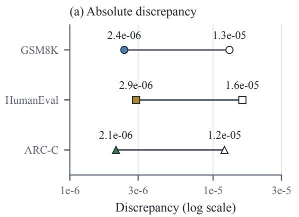

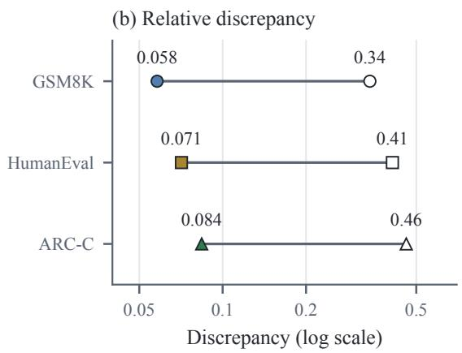  
Figure 6: Finite-difference discrepancies for 20 shared spectral coordinates per task at $\delta = 1 0 ^ { - 3 }$ . Filled and hollow markers show median and maximum discrepancies; segments connect these summary values. Absolute discrepancy is $| \widehat { \gamma } ^ { \mathrm { F D } } - \gamma |$ ; relative discrepancy divides by |γ| only when $| \gamma | > 1 0 ^ { - 5 }$ . Both horizontal axes use log scales.

Inputs and deterministic anchor. This protocol generates coordinate masks independently of finite outcomes. The set I contains the 7168 serialized coordinates in fixed matrix/index order. The protocol computes the search derivatives in Equation 5 and defines

$$
\begin{array} { c } { { U = \{ i \in { \mathcal { Z } } : e _ { i } > 0 \} , } } \\ { { D = E ( { \mathcal { Z } } ) = \displaystyle \sum _ { i \in { \mathcal { Z } } } e _ { i } , } } \\ { { \displaystyle \bar { E } ( S ) = \displaystyle \sum _ { i \in S } e _ { i } / D , } } \\ { { P _ { c } ( S ) = \displaystyle \sum _ { i \in S } \gamma _ { c , i } . } } \end{array}\tag{26}
$$

The protocol requires finite inputs, $D > 0 .$ , and $B \leq | U |$ . Every mask contains exactly B coordinates. Reductions use float64 and sorted coordinate IDs; the protocol fixes the software version. The first mask $S _ { 0 }$ selects the B largest target scores, with smaller-ID ties, and records its nonpositivescore count. Its finite outcomes do not influence inclusion.

Seeds and support identities. The protocol records its version, master seed 20261006, checkpoint digest, basis digest, search-example IDs, loss configuration, gradient-array digest, target, and budget in canonical sorted-key UTF-8 JSON. This complete metadata defines the cell identity.

The seed procedure derives each unsigned 64- bit PCG64 seed from the first 8 SHA-256 bytes of the canonical tuple (cell identity, purpose, slot, attempt), interpreted little-endian. The energy-only pilot uses purpose energy-pilot, slot -1, attempt 0; proposals use purpose proposal and their actual slot/attempt.

A mask hash includes protocol/checkpoint/basis identities, target, B, and sorted coordinate IDs. Family labels and outcomes are excluded, so duplicate supports cannot acquire new identities through relabeling.

Energy-only pilot and strata. The energy-only pilot, which computes no task losses, requests

$$
M _ { * } = \operatorname* { m i n } \{ 1 6 3 8 4 , { \binom { | U | } { B } } \}\tag{27}
$$

uniform masks. The pilot draws B coordinates without replacement, sorts them, and rejects duplicate hashes. It stops at $M _ { * }$ distinct masks or 32M∗ draws and reports the achieved M.

The pilot sorts masks by (E,¯ hash) and splits them into four consecutive groups at positions $\lfloor s M / 4 \rfloor , s = 0 , . . . , 4$ . Group $\mathcal { Q } _ { s }$ supplies an energy interval $[ \mathit { L } _ { s } , U _ { s } ]$ from its extreme energies. The pilot reports touching or coincident intervals; energy ties do not establish distinct regimes. The protocol fixes

$$
\bar { E } _ { \mathrm { c a p } } = \operatorname* { m a x } \{ \bar { E } ( S _ { 0 } ) , \operatorname* { m a x } _ { S \in \mathrm { p i l o t } } \bar { E } ( S ) \} + 1 0 ^ { - 1 2 }\tag{28}
$$

before outcomes. The added term is numerical tolerance, not a loss reserve. If $M <$ 4 or a stratum is empty, generation stops before computing its extrema. Invalid inputs also stop generation.

Proposal scores. For slot $r \geq 1$ , the protocol defines family $f = ( r - 1 )$ mod 3, stratum $s =$ $( r - 1 )$ mod 4, and block $b = \lfloor ( r - 1 ) / 1 2 \rfloor$ . The normalization is

$$
a _ { c } = \operatorname* { m a x } \left\{ 1 0 ^ { - 1 2 } , \sqrt { \frac { 1 } { | U | } \sum _ { i \in U } \gamma _ { c , i } ^ { 2 } } \right\} .\tag{29}
$$

The protocol cycles $\eta _ { b }$ through (0.25, 0.5, 1, 2) and $\beta _ { b }$ through (0.25, 1, 4, 16), indexed by b mod 4. Each attempt draws independent standard Gumbel scores $z _ { i }$ from its proposal seed. The generator clips inverse-transform uniform inputs to representable open-interval endpoints. The three score families are

$$
\begin{array} { r l } & { q _ { i } ^ { ( 0 ) } = \gamma _ { t , i } / a _ { t } + \eta _ { b } z _ { i } , } \\ & { q _ { i } ^ { ( 1 ) } = \gamma _ { t , i } / a _ { t } - \beta _ { b } \displaystyle \sum _ { p \in P } | \gamma _ { p , i } | / a _ { p } + \eta _ { b } z _ { i } , } \\ & { q _ { i } ^ { ( 2 ) } = z _ { i } . } \end{array}\tag{30}
$$

The preserved-magnitude penalty discourages large preserved-task scores but does not certify net preservation. Optimizing random scores also differs from uniform support sampling. Reported predictions always use the unperturbed γ.

Energy-constrained swaps. After drawing scores, the same attempt generator chooses an initial mask uniformly from $\mathcal { Q } _ { s }$ . At each step, the generator forms up to 64 lowest-score included IDs and 64 highest-score excluded IDs, with smaller coordinate ID breaking both score-sort ties.

The generator considers their swaps $i  j$ only when the score gain is positive, the new energy belongs to $[ L _ { s } - \mathrm { 1 0 ^ { - 1 2 } } , \mathsf { \bar { U } } _ { s } + 1 0 ^ { - 1 2 } ]$ , and the cap holds. It chooses the largest $q _ { j } - q _ { i }$ , breaking ties by $( i , j )$

The generator recomputes the proposed mask energy in sorted order and rechecks both interval and cap before applying the swap; it discards a numerically invalid pair. It stops after 64 swaps or when none qualifies. No optimality guarantee is attached to this bounded search.

Retries and fallback. The generator rejects duplicate final hashes and retries for attempts 0 through 127.

If retries are exhausted, the generator ranks unused pilot masks in that stratum by $\textstyle \sum _ { i \in S } q _ { i }$ under the final attempt’s scores and smaller-hash ties. It accepts the best as a recorded pilot fallback. If none remains, generation terminates and reports the failed slot and achieved count.

Each accepted entry stores support, hash, family, interval, seeds, attempts, swaps, fallback status, energy, all search predictions, and cardinality; the rejection log separates pilot and proposal rejections.

Final-pool allocation. The first mask plus 1023 accepted slots requests 1024 evaluation masks, with 341 additions per family and stratum additions (256, 256, 256, 255). The protocol assigns the anchor to the smallest-index stratum containing its actual energy. If none contains it, the protocol flags it as outside the calibrated range and uses direct verification. This also resolves touching or coinciding stratum boundaries.

The calibration pool uses 256 slots without the anchor, giving 64 requests per stratum before retries or failure. Achieved counts, not nominal counts, enter every analysis.

Development and exclusion. The protocol generates the loss-evaluated development masks with purpose development, slots 1 through 64, and the same family and energy-repair rules. It reserves $S _ { 0 }$ before this stage and excludes it from development, so its mandatory evaluation inclusion remains compatible with pilot exclusion. It requires distinct development supports. This stage precedes the final freeze.

Development scoring evaluates finite validation losses on the declared 672 items and records achieved counts, the feasible fraction, taskwise error-sign counts, target-overprediction counts, and every development decision. Revisions to thresholds, energy strata, and proposal settings occur only here and require a configuration-change log.

The support, basis, and search gradients remain fixed during this development stage; changing them requires a new cell and a new anchor preflight.

The protocol excludes every attempted lossevaluated pilot support from calibration and evaluation, even if a later configuration changes its family label. The exclusion rule uses a physical-support exclusion digest of checkpoint, basis, target, budget, and sorted coordinate IDs, independent of the versioned run identity. The protocol discloses reuse of the fixed validation corpus; untouched test items never enter the pilot.

Final freeze. After the development decision, the protocol seals the support, basis, gradients, thresholds, strata, generation settings, and both final manifests. The evaluation purpose is proposal; calibration uses calibration. It maintains a global support-hash exclusion set for the development masks and accepted final masks.

The generator constructs evaluation masks first and then calibration masks, excluding evaluation hashes. The protocol computes no finite loss from either final pool before sealing both manifests. The execution record stores the timestamp and canonical byte digest of the actual seal and records digests and run identifiers only when that execution occurs.

Calibration and verification. Radius coefficients use the separate requested pool of 256 calibration masks, generated with purpose calibration, starting at slot 1, and rejecting evaluation-pool hashes as well as calibration duplicates. The deterministic anchor is excluded from calibration. The calibration record reports the achieved count in each energy stratum. An empty calibration stratum or candidate outside calibrated energy intervals bypasses screening and goes to direct verification, in the retained target order.

For task c and stratum s, calibration fits $\bar { H } _ { c , s }$ as the empirical 0.90 quantile of $2 | \Delta _ { c } ^ { \mathrm { v a l } } - P _ { c } ^ { \mathrm { s e a r c h } } | / \bar { E }$ among its calibration masks, using the smallest order statistic reaching that quantile.

The calibration procedure uses the grid $\{ 0 , 0 . 2 5 , 0 . 5 , 0 . 7 5 , 1 , 1 . 2 5 , 1 . 5 , 2 , 3 , 4 \}$ . It chooses its smallest multiplier whose intervals jointly cover all relevant tasks on at least 95% of calibration masks. If none qualifies, the procedure flags the calibration failure and uses direct verification as the declared fallback. It freezes coefficients and multiplier before consulting evaluation outcomes. This fitted envelope includes observed derivative transfer, but its calibration coverage is not a uniform certificate.

The evaluation reports held-out coverage and rejected feasible masks. Direct checking, innerscreen verification, and outer-screen verification use the same pool, the single decreasing searchtarget order, and common finite-check budgets $Q \in \{ 3 2 , 1 2 8 , 5 1 2 \}$ in the large cell. The comparison reports curves against $Q ,$ , including abstention after exhaustion; a binding budget permits different policy outputs.

Cost accounting separates proposal work, gradients, radius calibration, and finite verification.

One validation mask requires 672 item scores under the declared allocation; batching determines forward-call counts. Actual calls and elapsed costs require synchronized measurement. Test outcomes follow selected-mask freezing. Test derivatives are optional explanatory measurements, not required for policy replay.

Normalized calibration records. The calibration record stores each mask’s actual energy and signed error before normalization. Equation 9 takes a quantile of candidate-level error-to-energy ratios. Dividing an absolute-error quantile by a midpoint generally gives a different result because varying denominators can change the observation order. The operations agree when all energies are equal.

Combined-pool summaries and calibration-only coefficients use different records. A stratum coefficient is unavailable without calibration records.

## C.6 Execution Sequence and Work Ledger

The spectral audit precedes task scoring. The protocol loads the pinned checkpoint weights, verifies the declared modules, and decomposes the 28 matrices sequentially in float32. CPU execution requires sufficient memory for the weights and decomposition workspace; elapsed time depends on the numerical backend and requires direct measurement.

The editable tensors alone occupy 6.125 GiB in float32; separate unedited copies need the same space. The leading U, S, and $V$ arrays occupy 528510976 bytes, excluding full-spectrum records and serialization overhead. These sizes follow from the declared shapes and do not include the rest of the checkpoint or SVD workspace.

The protocol serializes the leading basis and spectrum once and reuses them for gradients and deletion. The architecture inventory alone supplies no singular values.

The execution procedure keeps the unedited projection tensors available during finite scoring. For each mask, it restores them, applies the frozen displacement, verifies the weights, and clears any cache or state left by the preceding model. Batched answer-only scoring uses the fixed item allocation. The timing record separates restoration, scoring, and synchronization. Mask and item counts alone do not determine forward-call counts or elapsed cost.

The ledger covers one development batch and both final pools. Calibration and evaluation require 860160 validation item scores; including development gives 903168. One reusable score record for the unedited validation baseline adds 672 scores. Each repeated pilot batch incurs additional work. The ledger accounts for energy-only proposals, search gradients, finite-difference checks, and optional path measurements separately from validation endpoints.

After the protocol freezes policy outputs, test scoring evaluates each distinct selected support once. The symbol K denotes their number. With the baseline, the workload is $2 9 3 7 ( K + 1 )$ reference-NLL item scores, 1765(K + 1) greedy completions across GSM8K, HumanEval, and MBPP+, and 1172(K + 1) ARC-C answer-choice evaluations. Policies selecting the same support reuse its record; abstention reuses the baseline.

Table 6 gives these calculated workloads for the baseline and three distinct primary-study edits. Elapsed cost requires separate timing records.

## C.7 Evaluation Cost Accounting

The workload includes basis construction, search gradients, energy-only proposals, the lossevaluated development pilot, calibration, the fullpool audit, policy consultations, and selectedoutput testing. Each validation consultation scores 672 items for one mask. Calibration scores 256 masks, requiring 172032 item scores; the audit scores 1024, requiring 688128. These counts describe work rather than measured runtime. A 64- mask development batch adds 43008 item scores, and all repeated or attempted loss-inspected pilot masks incur additional development cost. Table 6 gives the complete accounting.

The complete-pool audit makes it possible to measure prediction errors and identify rejected feasible masks. Replaying policies over those cached outcomes counts logical consultations, but replay time cannot establish end-to-end inference savings. A valid runtime comparison requires proposal and calibration setup as well as survivor verification under common batching and hardware. Its interpretation also depends on batch size, sequence lengths, precision, weight-restoration time, and synchronization.

## D Additional Results

This section extends the results of Section 4 with error quantiles, the measured path residual, primarystudy diagnostics, and selected-edit records.

## D.1 Prediction-Error Quantiles

Table 7 supplements Figure 2 with 0.95 error quantiles and calibration-only coefficients for every task and stratum.

Absolute-error quantiles measure discrepancy in NLL units; Equation 9 measures error relative to each mask’s energy. Normalization can reorder observations, so dividing an absolute-error quantile by a representative energy generally does not recover the calibrated coefficient. The conversion agrees when all energies are equal.

Uniform B-of-N sampling gives $\begin{array} { r l } { \mathbb { E } [ \bar { E } ] } & { { } = } \end{array}$ $B / N = 1 / 7$ regardless of the singular energies, but this mean does not determine the energy strata. Appendix C.2 reports the spectrum, band energy, reconstruction diagnostics, and uniform-mask energy distribution. These describe the geometry of deletion; Section 4 measures its loss-prediction and screening consequences.

The strata compare different deletion energies at the same coordinate budget. Their interpretation also depends on achieved counts, within-stratum energy distributions, and proposal families. Absolute error and normalized error answer different questions: the median error can rise while the fitted coefficient falls. Understanding the observed trend requires both quantities.

Error signs indicate how a discrepancy can affect screening. Consistent target overprediction can make a screen appear safe despite invalid radii; underpredicted preserved-task changes can admit harmful edits. Positive and negative error counts reveal whether either pattern dominates the evaluated family. A negative preserved loss change improves reference likelihood but can still violate an absolute-stability constraint.

## D.2 Energy Scaling and Component Diagnostics

To describe how absolute error varies with normalized energy, we use the log-linear model

$$
\log | r _ { c , j } | = a _ { c } + b _ { c } \log ( \bar { E } _ { j } / \bar { E } _ { 0 } ) + u _ { c , j }\tag{31}
$$

on nonzero errors, recording zero errors separately. Table 9 fits the plotted stratum medians by equalweight log-log least squares. This aggregate fit describes the displayed trend. Assessing zero errors, weighting choices, and energy overlap within proposal families requires additional candidate-level analysis.

The fit is descriptive because the selector does not randomize energy independently of other edit properties. Proposal family, layer allocation, coordinate magnitudes, and target scores can all vary with energy. Clarifying these effects requires comparisons within proposal families and checks of their energy overlap. A trend in the frozen pool does not establish a universal scaling law.

<table><tr><td>Stage</td><td>Units</td><td>Item evaluations</td></tr><tr><td>SVD</td><td>28 matrices</td><td>n/a</td></tr><tr><td>Energy-only proposal pilot</td><td>16384 masks</td><td>n/a</td></tr><tr><td>Search-gradient accumulation</td><td>3 objectives</td><td>832</td></tr><tr><td>Finite-difference endpoints</td><td>40 coordinate edits</td><td>33280</td></tr><tr><td>Unedited validation baseline</td><td>1 support</td><td>672</td></tr><tr><td>One development pilot batch</td><td>64 masks</td><td>43008</td></tr><tr><td>Calibration</td><td>256 masks</td><td>172032</td></tr><tr><td>Full-pool audit</td><td>1024 masks</td><td>688128</td></tr><tr><td>Final-pool subtotal</td><td>1280 masks</td><td>860160</td></tr><tr><td>Development plus final pools</td><td>1344 masks</td><td>903168</td></tr><tr><td>With unedited validation baseline</td><td>1345 supports</td><td>903840</td></tr><tr><td>Selected-test reference NLL</td><td>4 supports</td><td>11748</td></tr><tr><td>Greedy test completions</td><td>4 supports</td><td>7060</td></tr><tr><td>ARC-C answer-choice correctness</td><td>4 supports</td><td>4688</td></tr></table>

Table 6: Item-scoring workload for the primary study and selected edits. Subtotals overlap preceding rows and are not added again. Finite-difference scoring reuses 20 coordinate IDs across three objectives. Each validation mask uses 672 items. The baseline and edits A, B, and C each use 2937 reference-NLL items, 1765 greedy completions, and 1172 answer-choice evaluations. Counts describe item evaluations, not runtime; additional development batches, proposals, optional HVPs, weight restoration, forward calls, and timing require separate accounting.
<table><tr><td>Stratum</td><td>Task</td><td>È interval</td><td> $n$ </td><td> $Q . 9 5$ </td><td> $\bar { H } _ { c , s }$ </td></tr><tr><td>1</td><td>GSM8K</td><td>0.126–0.138 320</td><td></td><td>0.0230</td><td>0.278</td></tr><tr><td></td><td>1 HumanEval</td><td>0.126–0.138 3200.02600.337</td><td></td><td></td><td></td></tr><tr><td></td><td>1 ARC-C</td><td>0.126–0.138 320 0.0190 0.211</td><td></td><td></td><td></td></tr><tr><td></td><td>2 GSM8K</td><td>0.138–0.1443200.05400.613</td><td></td><td></td><td></td></tr><tr><td></td><td>2 HumanEval</td><td>0.138–0.144 320 0.03000.324</td><td></td><td></td><td></td></tr><tr><td></td><td>2 ARC-C</td><td>0.138–0.1443200.02600.247</td><td></td><td></td><td></td></tr><tr><td></td><td>3 GSM8K</td><td>0.144–0.1503200.05700.623</td><td></td><td></td><td></td></tr><tr><td></td><td>3 HumanEval</td><td>0.144–0.1503200.0320 0.321</td><td></td><td></td><td></td></tr><tr><td></td><td>3 ARC-C</td><td>0.144–0.150320 0.02700.276</td><td></td><td></td><td></td></tr><tr><td></td><td>4 GSM8K</td><td>0.150–0.162 320 0.0520 0.517</td><td></td><td></td><td></td></tr><tr><td></td><td>4 HumanEval</td><td>0.150–0.162 320 0.0350 0.302</td><td></td><td></td><td></td></tr><tr><td></td><td>4 ARC-C</td><td>0.150–0.162 3200.02200.194</td><td></td><td></td><td></td></tr></table>

Table 7: Additional prediction-error diagnostics by task and deletion-energy stratum. The 0.95 quantiles summarize absolute search-to-validation NLL errors over 64 calibration and 256 evaluation masks per stratum. The $\bar { H } _ { c , s }$ coefficients use calibration-only per-mask error-to-energy ratios. Medians and 0.90 quantiles appear in Figure 2.

The two error components can be examined on representative masks chosen by an outcomeblind energy rule. This optional analysis recomputes their validation directional derivatives and subtracts them from the finite validation changes to obtain same-split remainders. Optional fulldirection Hessian-vector products (HVPs) compare base-point curvature with the integrated path term. Full-pool forward scoring measures the combined error; these additional measurements explain its components and incur separate costs.

## D.3 Measured Residual along the Edit Path

Let S be a frozen selected set. Its test-loss prediction and measured residual are

$$
\begin{array} { l } { { \displaystyle P _ { c } ( S , \alpha ) = \alpha \sum _ { i \in S } { \widehat \gamma } _ { c , i } ^ { \mathrm { t e s t } } } , } \\ { { \displaystyle { \widehat { \mathcal { R } } _ { c } ( S , \alpha ) = \widehat { \Delta } _ { c } ( S , \alpha ) - P _ { c } ( S , \alpha ) } . } } \end{array}\tag{32}
$$

The measured residual uses the empirical test loss change and the derivative on that same split. Checking the integral representation requires independent Hessian-vector products along the edit path. A uniform certificate requires bounds for every eligible candidate, beyond the measured paths.

## D.4 Primary-Study Diagnostics

These diagnostics connect the development stage to the final screening and test outcomes. The primary study uses an arithmetic floor of 0.12 and preserved tolerances of 0.08. Development masks are separate from the final 1280 calibration and evaluation masks. Figure 7 reports pilot feasibility and error signs; Table 8 gives taskwise coverage; Figure 3a gives joint coverage. Table 9 gives the descriptive energy fit, and Table 6 accounts for the scoring workload.

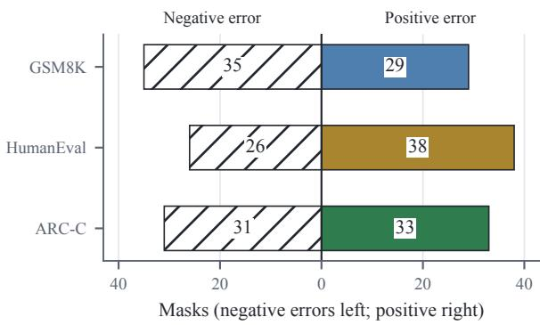  
Figure 7: Negative errors (hatched, left) and positive errors (solid, right) in the 64-mask development pilot. Error is validation change minus search prediction; zeroerror counts are 0 for all tasks. Of the masks, 17 are feasible (26.6%) at target floor 0.12 and preservation tolerance 0.08.

## D.5 Selected-Edit Validation and Test Records

A, B, and C each identify one selected-edit record; the labels are not support hashes. All three edits pass finite validation, but B misses the target floor on test and C exceeds the test code tolerance. These are validation-to-test differences, distinct from validation-envelope coverage.

Figure 4 gives search predictions and finite validation and test NLL changes. Table 10 gives candidate-order positions and deletion energies, and Figure 5 gives correctness drops. The Mistral baseline NLL is (0.514, 0.683, 0.728, 0.756) in GSM8K, HumanEval, ARC-C, MBPP+ order. Adding the changes in Figure 4 and Table 10 to these baselines gives the absolute endpoint NLL.

Baseline correctness counts are 900/1319 for GSM8K, 34/68 for HumanEval, 780/1172 for ARC-C, and 240/378 for MBPP+. Correctness drops use unrounded counts and are rounded only for display.

## E Checkpoint and Target-Role Extension

This section reports the checkpoint and target-role extension summarized in Section 4.5; it varies checkpoint, target role, and coordinate budget. With code as the target, HumanEval supplies differentiable search, calibration, and NLL selection;

MBPP+ remains the primary external correctness readout. Arithmetic and ARC-C become preserved tasks.

Target floors are 0.12 for arithmetic and 0.18 for code. Preserved tolerances are 0.04 at budget 256 and 0.08 at 1024. These task-specific thresholds do not imply equal capability loss across tasks, and their selection remains separate from test evaluation.

Table 11 reports calibration multipliers and joint coverage for the additional configurations; Figure 3d reports retention for all configurations. Mistral denotes Mistral-7B-Instruct-v0.3 (Jiang et al., 2023; Mistral AI, 2024a) and Llama denotes Llama-3.1-8B-Instruct (Dubey et al., 2024; Meta, 2024). In the Target column, A means arithmetic and C means code; these labels have a different role from the primary-study edit IDs.

Each configuration uses 256 calibration masks and 1024 evaluation masks with checkpointspecific support, gradients, calibration, and pilot. Coefficient transfer requires a separately declared audit. Figure 8 compares verification under the common check caps.

## E.1 Capped Verification across Configurations

Section 4.3 reports feasible-candidate retention, and Section 4.4 summarizes the capped selection outcomes. Figure 8 gives the exact verification counts for each policy and configuration.

## E.2 Selected Outputs across Checkpoints and Targets

Figure 9 reports test NLL changes and GSM8K and MBPP+ correctness drops for the additional configurations. Table 12 gives supplementary HumanEval and ARC-C correctness counts. D denotes the first validation-feasible support in the direct order; I denotes the first validation-feasible inner survivor. For these configurations, direct and outer selections reuse D, and inner selections reuse I. The primary D and I outputs correspond to A and C, respectively; their results appear in Figures 4 and 5 and Table 10.

The zero-radius primary output B appears in Figures 4 and 5. No-edit outputs reuse the corresponding baseline and miss the positive target floor.

The Llama baseline NLL is (0.441, 0.612, 0.657, 0.674) in GSM8K, HumanEval, ARC-C, MBPP+ order; the Mistral baseline is in Appendix D.5. Adding each reported change to its baseline gives the absolute endpoint NLL.

<table><tr><td>Task</td><td colspan="2">Calibration Evaluation</td></tr><tr><td>GSM8K</td><td>253</td><td>990</td></tr><tr><td>HumanEval</td><td>251</td><td>980</td></tr><tr><td>ARC-C</td><td>252</td><td>991</td></tr></table>

Table 8: Taskwise interval coverage at the selected multiplier, 1.25. Calibration and evaluation denominators are 256 and 1024, respectively. Figure 3a gives joint coverage.

<table><tr><td>Edit Order position</td><td>È MBPP+ Δ NLL</td></tr><tr><td>A 63 0.156</td><td>0.047</td></tr><tr><td>B 91 0.141</td><td>0.039</td></tr><tr><td>C 1460.132</td><td>0.083</td></tr></table>

Table 10: Selected-edit order positions, normalized deletion energies, and external MBPP+ test NLL changes. Positions refer to the full target-prediction order. MBPP+ NLL is outside radius calibration. Figure 4 gives the three calibrated-task NLL changes, and Figure 5 gives correctness drops.
<table><tr><td>Model</td><td>Target</td><td>B</td><td>κ Cal. joint Eval. joint</td></tr><tr><td>Mistral</td><td>A</td><td>256 1.25</td><td>248 978</td></tr><tr><td>Mistral C</td><td></td><td>256 1.50</td><td>249 982</td></tr><tr><td>Mistral C</td><td></td><td>1024 2.00</td><td>247 958</td></tr><tr><td>Llama</td><td>A</td><td>256 1.25</td><td>246 974</td></tr><tr><td>Llama</td><td>A</td><td>1024 1.50</td><td>248 951</td></tr><tr><td>Llama</td><td>C</td><td>256 1.25</td><td>249 986</td></tr><tr><td>Llama</td><td>C</td><td>1024 2.00</td><td>247 962</td></tr></table>

Table 11: Calibration multipliers and joint interval coverage for the additional configurations. Each uses 256 calibration and 1024 evaluation masks. Primary Mistral/arithmetic/1024 coverage appears in Figure 3a; panel (d) shows feasible-candidate retention for all configurations.

Baseline Llama correctness counts are 1000/1319, 38/68, 858/1172, and 268/378 in the same benchmark order.

Interpretation of task-specific NLL changes includes GSM8K and MBPP+ correctness, abstentions, and both preservation criteria. The selected extension outputs all have nonnegative preservedtask NLL changes, so absolute and harm-only test decisions coincide here. An improvement exceeding the absolute tolerance produces different decisions under the two criteria. Comparisons between arithmetic and code remain conditional on their thresholds and readouts. Verification counts do not establish runtime savings.

<table><tr><td>Task</td><td>Scale exp(ac)</td><td>Slope  $b _ { c }$ </td><td>Log-space  $R ^ { 2 }$ </td></tr><tr><td>GSM8K</td><td>0.010796</td><td>7.182</td><td>0.982</td></tr><tr><td>HumanEval</td><td>0.008528</td><td>5.145</td><td>0.994</td></tr><tr><td>ARC-C</td><td>0.006444</td><td>4.151</td><td>0.987</td></tr></table>

Table 9: Descriptive log-log fits to the 4 stratum medians and energy midpoints in Figure 2. Equal-weight least squares uses reference energy 0.141. The fitted scale is the curve value at this reference, which need not equal the corresponding median. Coefficients describe the aggregate points and do not establish a mask-level scaling law.

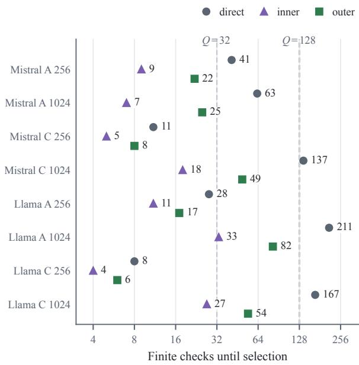  
Figure 8: Verification checks until selection at $Q = 5 1 2 ,$ where all policies select an edit. Circles, triangles, and squares denote direct verification, inner screening, and outer screening; adjacent numbers give check counts. Labels identify checkpoint, target (A: arithmetic; C: code), and coordinate budget B. Dashed lines mark $Q = 3 2$ and $Q = 1 2 8 ;$ counts above a cap imply abstention under that cap. Direct and outer verification select the first direct-feasible support D; inner verification selects I. Verification counts exclude development, calibration, and full-pool auditing.

For every code-target configuration, D produces both a larger HumanEval test NLL increase and a larger MBPP+ correctness drop than I, while both outputs keep the arithmetic and ARC-C NLL changes within the declared preservation tolerances (Figure 9). The arithmetic-target configurations show different preservation outcomes: in the primary Mistral/1024 study, D meets the test code tolerance and I exceeds it; in Llama/arithmetic/1024, D exceeds the same tolerance with a HumanEval NLL change of 0.083, while I remains within it at

(a) Test NLL change
<table><tr><td rowspan=1 colspan=1>Mistral/A/256/D</td><td rowspan=1 colspan=1>0.120</td><td rowspan=1 colspan=1>0.025</td><td rowspan=1 colspan=1>0.019</td><td rowspan=1 colspan=1>0.019</td></tr><tr><td rowspan=1 colspan=1>Mistral/A/256/I</td><td rowspan=1 colspan=1>0.118</td><td rowspan=1 colspan=1>0.029</td><td rowspan=1 colspan=1>0.016</td><td rowspan=1 colspan=1>0.023</td></tr><tr><td rowspan=1 colspan=1>Mistral/C/256/D</td><td rowspan=1 colspan=1>0.015</td><td rowspan=1 colspan=1>0.205</td><td rowspan=1 colspan=1>0.024</td><td rowspan=1 colspan=1>0.191</td></tr><tr><td rowspan=1 colspan=1>Mistral/C/256/I</td><td rowspan=1 colspan=1>0.017</td><td rowspan=1 colspan=1>0.183</td><td rowspan=1 colspan=1>0.019</td><td rowspan=1 colspan=1>0.172</td></tr><tr><td rowspan=1 colspan=1>Mistral/C/1024/D</td><td rowspan=1 colspan=1>0.062</td><td rowspan=1 colspan=1>0.254</td><td rowspan=1 colspan=1>0.045</td><td rowspan=1 colspan=1>0.232</td></tr><tr><td rowspan=1 colspan=1>Mistral/C/1024/I</td><td rowspan=1 colspan=1>0.039</td><td rowspan=1 colspan=1>0.210</td><td rowspan=1 colspan=1>0.031</td><td rowspan=1 colspan=1>0.192</td></tr><tr><td rowspan=1 colspan=1>Llama/A/256/D</td><td rowspan=1 colspan=1>0.128</td><td rowspan=1 colspan=1>0.033</td><td rowspan=1 colspan=1>0.021</td><td rowspan=1 colspan=1>0.029</td></tr><tr><td rowspan=1 colspan=1>Llama/A/256/I</td><td rowspan=1 colspan=1>0.122</td><td rowspan=1 colspan=1>0.045</td><td rowspan=1 colspan=1>0.025</td><td rowspan=1 colspan=1>0.038</td></tr><tr><td rowspan=1 colspan=1>Llama/A/1024/D</td><td rowspan=1 colspan=1>0.139</td><td rowspan=1 colspan=1>0.083</td><td rowspan=1 colspan=1>0.054</td><td rowspan=1 colspan=1>0.079</td></tr><tr><td rowspan=1 colspan=1>Llama/A/1024/I</td><td rowspan=1 colspan=1>0.125</td><td rowspan=1 colspan=1>0.047</td><td rowspan=1 colspan=1>0.036</td><td rowspan=1 colspan=1>0.043</td></tr><tr><td rowspan=1 colspan=1>Llama/C/256/D</td><td rowspan=1 colspan=1>0.035</td><td rowspan=1 colspan=1>0.211</td><td rowspan=1 colspan=1>0.024</td><td rowspan=1 colspan=1>0.204</td></tr><tr><td rowspan=1 colspan=1>Llama/C/256/I</td><td rowspan=1 colspan=1>0.027</td><td rowspan=1 colspan=1>0.195</td><td rowspan=1 colspan=1>0.019</td><td rowspan=1 colspan=1>0.187</td></tr><tr><td rowspan=2 colspan=1>Llama/C/1024/DLlama/C/1024/I</td><td rowspan=1 colspan=1>0.069</td><td rowspan=1 colspan=1>0.285</td><td rowspan=1 colspan=1>0.058</td><td rowspan=1 colspan=1>0.264</td></tr><tr><td rowspan=1 colspan=1>0.051</td><td rowspan=1 colspan=1>0.247</td><td rowspan=1 colspan=1>0.044</td><td rowspan=1 colspan=1>0.224</td></tr><tr><td rowspan=1 colspan=5>GSM8K     HumanEval     ARC-C       MBPP+0.00    0.05    0.10    0.15    0.20    0.25</td></tr></table>

(b) Correctness drop (pp)  
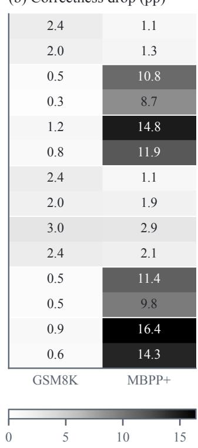

Figure 9: Test NLL changes (a) and correctness drops in percentage points (b) for selected outputs in the additional configurations. Row labels identify checkpoint, target (A: arithmetic; C: code), coordinate budget, and output D or I. Positive values denote deterioration. Darker cells indicate larger changes within each panel; the panels use separate scales. Primary outputs appear in Figures 4 and 5.
<table><tr><td>Cell Output HumanEval ARC-C</td></tr><tr><td>Mistral/A/256 D 33 778</td></tr><tr><td>Mistral/A/256 I 33 779</td></tr><tr><td>Mistral/C/256 D 25 777</td></tr><tr><td>Mistral/C/256 I 27 778</td></tr><tr><td>Mistral/C/1024 D 22 768</td></tr><tr><td>Mistral/C/1024 I 24 775</td></tr><tr><td>Llama/A/256 D 37 854</td></tr><tr><td>Llama/A/256 I 36 851</td></tr><tr><td>Llama/A/1024 D 35 850</td></tr><tr><td>Llama/A/1024 I 36 853</td></tr><tr><td>Llama/C/256 D 29 854</td></tr><tr><td>Llama/C/256 I 31 855</td></tr><tr><td>Llama/C/1024 D 26 847</td></tr><tr><td>Llama/C/1024 I 28 852</td></tr></table>

Table 12: Supplementary test correctness counts for the additional extension outputs. Denominators are 68 for HumanEval and 1172 for ARC-C. Figure 9 gives GSM8K and MBPP+ correctness drops; baseline counts are reported in the text. Aggregate counts alone do not supply paired confidence intervals.

0.047. Both Llama outputs exceed the arithmetic target floor. These fixed-output comparisons show why validation selection and test preservation require separate assessment, even when direct and outer verification return the same support.