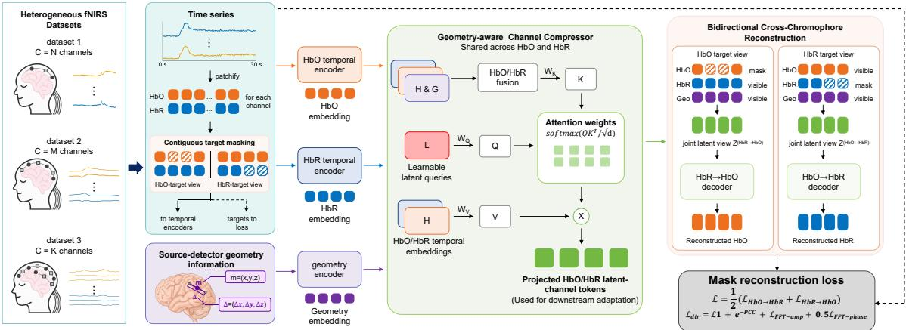
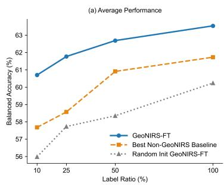
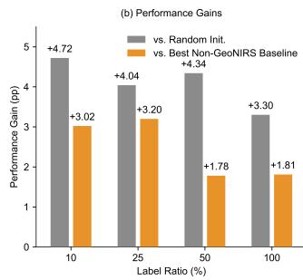
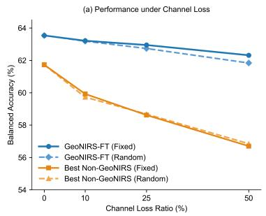
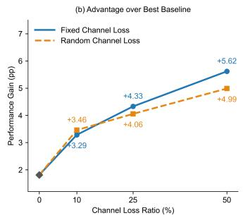
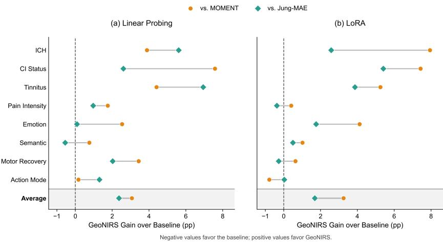
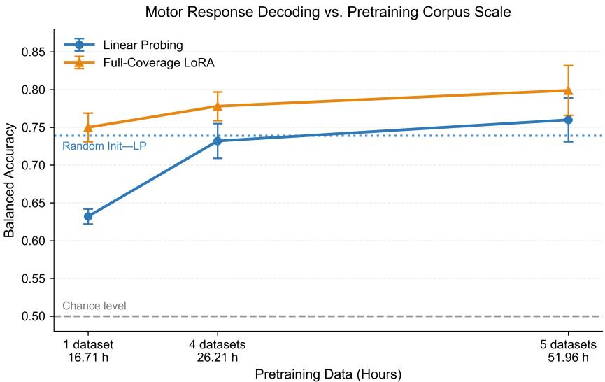

# GEONIRS: GEOMETRY-AWARE PRETRAINING FOR HETEROGENEOUS FNIRS REPRESENTATION LEARNING

Zongsheng Li1,2† Shengyuan Zhu1† Zimo Zhang1 Hanyao Li1 Shengming Wang1 Quanying Liu1,3,4∗

1Southern University of Science and Technology, Shenzhen, China 2The Chinese University of Hong Kong, Shenzhen, China 3Omni-Intelligence, Shenzhen, China 4Shenzhen Loop Area Institute, Shenzhen, China

†Equal contribution ∗Corresponding author: liuqy@sustech.edu.cn

## ABSTRACT

Functional near-infrared spectroscopy (fNIRS) provides portable, low-cost, and spatially localized measurements of cortical hemodynamics, but substantial differences in channel count, probe layout, signal distribution, and task type hinder joint pretraining across datasets. We introduce GeoNIRS, a geometry-aware pretraining framework that uses the physical locations of source–detector pairs as a shared spatial reference across heterogeneous probe layouts. GeoNIRS compresses variable-size channel sets into a fixed-size latent representation and employs bidirectional HbO/HbR cross-reconstruction with contiguous temporal masking to learn transferable representations. GeoNIRS-base is pretrained on eight heterogeneous datasets, while GeoNIRS-large scales pretraining to 22 datasets. Neither the data nor labels of the downstream tasks are used during pretraining, enabling evaluation under a strict cross-task setting. To the best of our knowledge, GeoNIRS is the first fNIRS framework to explicitly model physical channel geometry during joint pretraining across heterogeneous channel configurations, and the first to provide both complete source code and downloadable pretrained checkpoints.

We evaluate GeoNIRS on eight held-out tasks spanning clinical and auditory assessment, pain and affective processing, semantic decoding, and motor function. GeoNIRS achieves the highest task-averaged balanced accuracy among the evaluated conventional machine-learning, fNIRS-specific, general time-series, and fNIRS pretraining baselines. Compared with random initialization, pretraining improves task-averaged balanced accuracy by 4.12 percentage points under linear probing and 3.30 points under full fine-tuning, with larger benefits when downstream labels are scarce. GeoNIRS also remains robust when input channels are missing. Geometry perturbations and pretraining ablations further demonstrate that both channel geometry and cross-chromophore reconstruction contribute to the learned representations. Overall, GeoNIRS provides an open and reproducible framework for transferable representation learning across heterogeneous fNIRS datasets. Our code and pretrained checkpoints are available at https://github.com/GeoNIRS/GeoNIRS

## 1 INTRODUCTION

Functional near-infrared spectroscopy (fNIRS) noninvasively measures changes in cortical oxygenated and deoxygenated hemoglobin (HbO/HbR), providing a hemodynamic proxy for neural activity (Ferrari & Quaresima, 2012; Scholkmann et al., 2014). Compared with functional magnetic resonance imaging, fNIRS is relatively inexpensive, portable, and silent, supporting bedside monitoring, measurements during movement, and experiments in naturalistic settings. Its spatially localized cortical signals also complement the high-temporal-resolution electrophysiological activity recorded by EEG (Pinti et al., 2020; Yucel et al., 2021). These properties have enabled appli-¨ cations across cognitive and affective neuroscience, brain–computer interfaces, motor and neurorehabilitation research, and the assessment of neurological and psychiatric conditions (Obrig, 2014; Ehlis et al., 2014; Naseer & Hong, 2015; Mihara & Miyai, 2016). In the closely related EEG do main, neural foundation models and their benchmarking ecosystems are considerably more mature. OmniEEG-Bench and Meta FAIR’s NeuralBench-EEG systematically evaluate pretrained models across multiple datasets, tasks, and standardized adaptation protocols (Lu et al., 2026; Banville et al., 2026). BENDR provided early evidence for large-scale self-supervised EEG pretraining, while LaBraM, EEGPT, BrainOmni, and REVE further demonstrated that aggregating unlabeled recordings across datasets, tasks, and acquisition systems can produce transferable neural representations (Kostas et al., 2021; Jiang et al., 2024; Wang et al., 2024a; Xiao et al., 2025; El Ouahidi et al., 2025). Such multi-dataset pretraining alleviates the limited scale of individual datasets while exposing models to variations in populations, paradigms, and acquisition systems, thereby facilitating transfer to unseen tasks and label-scarce settings. Extending this paradigm to heterogeneous fNIRS datasets is therefore an important step from dataset-specific decoding toward general-purpose neural representation learning.

Conventional fNIRS decoding remains largely dataset-specific and supervised, ranging from handcrafted HbO/HbR features with LDA or SVM to fNIRS-specific deep networks (Naseer et al., 2016a;b; Wang et al., 2022; 2023; 2026b). These methods are typically trained separately under fixed probe layouts and label spaces, preventing joint learning from heterogeneous unlabeled data. Extending multi-dataset pretraining to fNIRS presents two key challenges. First, channel semantics vary across probe layouts: the same channel index may correspond to different cortical locations, while the same region may be covered by different channels. Variable-channel support alone therefore cannot establish cross-layout spatial correspondence. Second, designing a non-trivial pretraining objective is difficult. Slowly varying hemodynamic signals make within-signal masked reconstruction susceptible to temporal interpolation (Scholkmann et al., 2014; Zhou et al., 2026). Self reconstruction within each chromophore may primarily capture modality-specific signal structure. In contrast, cross-chromophore reconstruction encourages the model to leverage the shared physio logical information between HbO and HbR, promoting more transferable representations (Cui et al., 2010). As shown in Table 13, existing methods address only parts of these challenges. Early approaches use a single dataset or train separately across datasets (Liu et al., 2021; Wang et al., 2021; 2024b). Jung et al. jointly pretrain across varying channel counts but do not model physical channel geometry (Jung et al., 2025); EFRM uses only one fNIRS dataset (Jung & An, 2025); and Subedi et al. assume a shared probe configuration and require supervised adaptation to new layouts (Subedi et al., 2026). ASDGPrompt and DSSER likewise do not perform joint multi-dataset pretraining (Cai et al., 2026; Wang et al., 2026a). Thus, existing work has yet to jointly address cross-layout spatial unification and physiologically grounded pretraining, while reproducibility remains limited by the scarcity of complete source code and downloadable pretrained checkpoints.

The design of our work is inspired by recent advances in EEG foundation models and physiological signal pretraining. First, BrainOmni shows that incorporating the physical properties of sensors into representation learning and compressing a variable number of sensor inputs into a fixed-size latent representation can mitigate structural differences across acquisition systems (Xiao et al., 2025). Second, xMAE performs masked cross-modal reconstruction between synchronously recorded ECG and PPG signals, demonstrating that predicting masked signals from related physiological observations can reduce reliance on local temporal smoothness (Zhou et al., 2026). However, each fNIRS channel is defined by a source–detector pair, while HbO and HbR are coupled but non-equivalent hemodynamic observations within the same modality (Cui et al., 2010). These ideas must therefore be redesigned for fNIRS to unify heterogeneous probe layouts and learn the hemodynamic structure shared between HbO and HbR.

Building on these ideas, we propose GeoNIRS, a geometry-aware pretraining framework for heterogeneous fNIRS data. GeoNIRS explicitly encodes source–detector geometry and compresses variable-size channel sets from heterogeneous probe layouts into a fixed-size latent representation. It is pretrained via bidirectional HbO/HbR cross-reconstruction with contiguous temporal masking, encouraging the model to capture shared hemodynamic structure while reducing reliance on local temporal interpolation. GeoNIRS-base is pretrained on 383.30 hours of recordings across eight datasets, while GeoNIRS-large scales pretraining to 827.04 hours across 22 datasets. To the best of our knowledge, GeoNIRS is the first fNIRS framework to explicitly incorporate physical channel geometry for joint pretraining across heterogeneous probe layouts, and the first to release both complete source code and downloadable pretrained checkpoints. Across eight held-out downstream tasks, GeoNIRS achieves the strongest task-averaged performance among the evaluated methods. Compared with random initialization, pretraining improves average balanced accuracy by 4.12 percentage points under linear probing and 3.30 percentage points under full fine-tuning. Further experiments show larger pretraining gains in low-label regimes, robustness to missing channels, and task-averaged benefits from channel geometry and cross-chromophore reconstruction across all three adaptation protocols.

  
Figure 1: Overview of the GeoNIRS framework. HbO/HbR signals from datasets with varying channel counts and probe layouts are divided into temporal patches and encoded alongside source– detector geometry. The geometry-aware channel compressor uses learnable latent queries and shared geometry-aware channel attention to map variable-size physical channel sets into a fixed number of latent-channel tokens. Pretraining employs bidirectional cross-chromophore reconstruction: contiguous patches of the target chromophore are masked and reconstructed using its visible context together with the complete complementary chromophore. The reconstruction loss is computed only at masked and valid target positions. After pretraining, the encoder and channel compressor are used for downstream adaptation.

## 2 METHOD

## 2.1 OVERVIEW

As shown in Figure 1, GeoNIRS processes paired HbO/HbR signals and source–detector geometry from datasets with varying channel counts and probe layouts. Separate temporal encoders represent the two chromophores, while a geometry-aware channel compressor maps each dataset-specific physical-channel set into a fixed number of latent-channel tokens. Pretraining masks contiguous patches of one chromophore and reconstructs them using its visible context together with the complete complementary chromophore, with the two reconstruction directions optimized jointly. After pretraining, the reconstruction decoders are discarded and the fixed-length representations are adapted through linear probing, LoRA, or full fine-tuning.

## 2.2 TEMPORAL AND GEOMETRIC REPRESENTATIONS

For a recording from dataset d, we denote the paired chromophore signals as $X _ { d } ^ { \mathrm { O } } , X _ { d } ^ { \mathrm { R } } \in \mathbb { R } ^ { C _ { d } \times T }$ where $C _ { d }$ is the dataset-specific number of physical channels and may vary across datasets. Along the temporal dimension, each channel is divided into P non-overlapping patches, each containing S samples. Every patch is projected into a D-dimensional token and augmented with a learnable temporal positional embedding. Separate HbO and HbR temporal encoders then model the token sequence within each physical channel, producing $H ^ { \mathrm { O } } , H ^ { \mathrm { R } } \in \mathbb { R } ^ { C _ { d } \times P \times D }$ . Because each temporal encoder is applied independently to all channels with weights shared across channels, the model does not require a fixed $C _ { d } .$ . Samples and channels rejected during preprocessing quality control, together with patches containing insufficient valid samples, are excluded using validity masks.

## 2.3 GEOMETRY-AWARE CHANNEL COMPRESSION

To transform variable-size physical channel sets into fixed-length representations, we introduce M learnable latent queries, denoted by $\boldsymbol { L } \in \mathbb { R } ^ { M \times D }$ . For the $p \textmd { - }$ th temporal patch, the paired HbO and HbR representations are first fused as

$$
\bar { H } _ { p } = \frac { 1 } { 2 } \left( H _ { : , p } ^ { \mathrm { O } } + H _ { : , p } ^ { \mathrm { R } } \right) .
$$

The latent queries are projected into queries, while the fused temporal representations and channel geometry jointly form the keys:

$$
Q = W _ { Q } \operatorname { L N } ( L ) , \qquad K _ { p } = W _ { K } \operatorname { L N } \left( \bar { H } _ { p } + G \right) ,
$$

where $G \in \mathbb { R } ^ { C _ { d } \times D }$ denotes the channel representations produced by the geometry encoder. The attention weights from the fixed latent channels to the current physical channel set are then computed as

$$
A _ { p } = \mathrm { s o f t m a x } \left( \frac { Q K _ { p } ^ { \top } } { \sqrt { d _ { h } } } \right) \in \mathbb { R } ^ { M \times C _ { d } } ,
$$

where $d _ { h }$ is the attention-head dimension. Invalid channels are masked before the softmax operation.

HbO and HbR share the same attention weights but retain separate value representations:

$$
\begin{array} { r } { V _ { p } ^ { s } = W _ { V } \operatorname { L N } \left( H _ { : , p } ^ { s } \right) , \quad \quad Z _ { p } ^ { s } = A _ { p } V _ { p } ^ { s } , \quad s \in \{ \mathrm { O } , \mathrm { R } \} . } \end{array}
$$

This design gives both chromophores a shared spatial mapping determined jointly by their paired signals and physical geometry, while preserving their chromophore-specific content. After an output projection and a feed-forward block, the representations across all temporal patches form $Z ^ { \mathrm { O } } , Z ^ { \dot { \mathrm { R } } } \in$ $\mathbb { R } ^ { M \times P \times F }$ , where $F$ denotes the output feature dimension.

## 2.4 BIDIRECTIONAL CROSS-CHROMOPHORE RECONSTRUCTION

GeoNIRS employs asymmetric bidirectional cross-chromophore reconstruction. For each recording, a contiguous span of valid temporal patches, denoted by $\Omega ,$ is randomly selected as the reconstruction target. In the HbO→HbR direction, HbO remains fully visible while the HbR patches within Ω are masked. The two streams jointly determine the geometry-aware channel attention, while the complete HbO representation provides the values to be aggregated. The reverse direction uses the same target span, keeps HbR fully visible, and masks the corresponding HbO patches. The compact representations for the two directions are

$$
\begin{array} { r l } & { Z ^ { \mathrm { O \to R } } = \Pi ^ { \mathrm { O } } \left[ A \Big ( H ^ { \mathrm { O } } , \widetilde { H } ^ { \mathrm { R } } , G \Big ) V \big ( H ^ { \mathrm { O } } \big ) \right] , } \\ & { Z ^ { \mathrm { R } \to \mathrm { O } } = \Pi ^ { \mathrm { R } } \left[ A \Big ( \widetilde { H } ^ { \mathrm { O } } , H ^ { \mathrm { R } } , G \Big ) V \big ( H ^ { \mathrm { R } } \big ) \right] , } \end{array}
$$

where $\widetilde { H }$ denotes a temporally masked target representation, $A ( \cdot )$ is the geometry-aware channel attention defined above, and $\Pi _ { s }$ is a chromophore-specific residual projection that maps the feature dimension from $D$ to $F$ without mixing latent channels or temporal patches. The visible context of the target chromophore therefore contributes to channel-attention estimation, while the complete complementary chromophore supplies the reconstruction content. Contiguous masking further reduces reliance on local temporal interpolation.

The cross-chromophore decoders map the fixed latent-channel representations back to the $C _ { d }$ physical channels of each dataset. For physical channel c and temporal patch $p ,$ the decoder query combines the channel geometry, a temporal positional embedding, and a learnable bias:

$$
\begin{array} { r } { q _ { c , p } ^ { \mathrm { d e c } } = G _ { c } + e _ { p } ^ { \mathrm { d e c } } + b ^ { \mathrm { d e c } } . } \end{array}
$$

These queries retrieve reconstruction features from the corresponding latent tokens through crossattention. A channel-wise temporal decoder and reconstruction head then produce the original signal patches:

$$
\widehat { X } ^ { \mathrm { R } } = { \mathcal { D } } _ { \mathrm { O \to R } } \left( Z ^ { \mathrm { O \to R } } , G \right) , \qquad \widehat { X } ^ { \mathrm { O } } = { \mathcal { D } } _ { \mathrm { R \to O } } \left( Z ^ { \mathrm { R \to O } } , G \right) .
$$

Table 1: Cross-task fNIRS decoding performance measured by balanced accuracy (%). Results are averaged over two random seeds, with subject-level five-fold cross-validation performed for each seed. The best and second-best results in each column are highlighted in bold and underline, respectively.
<table><tr><td>Method</td><td>ICH</td><td> $\mathbf { \Pi } _ { \mathbf { S t a t u s } } ^ { \mathbf { C I } }$ </td><td>Tinnitus</td><td> $\begin{array} { c } { { \bf P a i n } } \\ { { \bf I n t e n s i t y } } \end{array}$ </td><td></td><td>Emotion Semantic</td><td>Motor Recovery</td><td>Action Mode</td><td>Average</td></tr><tr><td>RBF-SVM (2016b)</td><td>74.83</td><td>64.14</td><td>55.65</td><td>52.84</td><td>56.01</td><td>50.36</td><td>57.82</td><td>59.65</td><td>58.91</td></tr><tr><td>Stat-LDA (2016a)</td><td>51.55</td><td>53.09</td><td>51.53</td><td>54.66</td><td>59.38</td><td>50.61</td><td>62.40</td><td>65.94</td><td>56.14</td></tr><tr><td>1D-CNN (2018)</td><td></td><td>66.4257.67</td><td>56.88</td><td>50.60</td><td>58.09</td><td>50.63</td><td>55.63</td><td>56.14</td><td>56.51</td></tr><tr><td>EEGNet (2018)</td><td></td><td>56.3549.68</td><td>51.12</td><td>49.92</td><td>52.68</td><td>49.85</td><td>59.74</td><td>65.00</td><td>54.29</td></tr><tr><td>fNIRS-T (2022)</td><td>72.25</td><td>64.19</td><td>52.05</td><td>52.90</td><td>55.63</td><td>50.61</td><td>64.41</td><td>70.87</td><td>60.36</td></tr><tr><td>fNIRSNet (2023)</td><td>52.05</td><td>48.69</td><td>50.00</td><td>50.00</td><td>49.93</td><td>50.00</td><td>55.37</td><td>50.00</td><td>50.75</td></tr><tr><td>fNIRS4D (2026b)</td><td>75.71</td><td>51.40</td><td>49.98</td><td>51.79</td><td>55.33</td><td>50.19</td><td>57.82</td><td>69.11</td><td>57.67</td></tr><tr><td>MOMENT-LP (2024)</td><td>73.93</td><td>60.48</td><td>54.29</td><td>54.43</td><td>55.69</td><td>50.17</td><td>60.83</td><td>70.12</td><td>59.99</td></tr><tr><td>MOMENT-LoRA (2024)</td><td>72.16</td><td>62.10</td><td>53.47</td><td>53.95</td><td>55.03</td><td>50.20</td><td>63.28</td><td>71.12</td><td>60.17</td></tr><tr><td>Jung-MAE-LP (2025)</td><td>72.21</td><td>65.45</td><td>51.76</td><td>55.22</td><td>58.14</td><td>51.48</td><td>62.24</td><td>68.98</td><td>60.68</td></tr><tr><td>Jung-MAE-LoRA (2025)</td><td>77.52</td><td>64.12</td><td>54.85</td><td>54.73</td><td>57.39</td><td>50.72</td><td>64.19</td><td>70.31</td><td>61.73</td></tr><tr><td>GeoNIRS-LP (ours)</td><td>77.82</td><td>68.06</td><td>58.70</td><td>56.19</td><td>58.23</td><td>50.93</td><td>64.27</td><td>70.29</td><td>63.06</td></tr><tr><td>GeoNIRS-LoRA (ours)</td><td>80.10</td><td>69.53</td><td>58.72</td><td>54.36</td><td>59.15</td><td>51.22</td><td>63.92</td><td>70.34</td><td>63.42</td></tr><tr><td>GeoNIRS-FT (ours)</td><td>80.86</td><td>69.19</td><td>57.70</td><td>54.70</td><td>59.13</td><td>51.03</td><td>64.75</td><td>70.99</td><td>63.54</td></tr></table>

Note: ICH denotes intracerebral hemorrhage, and CI denotes cochlear implant. MOMENT-LP and MOMENT-LoRA both use the MOMENT-1-base backbone. Jung-MAE denotes our Jung-inspired MAE implementation. Average performance is computed equally across all eight tasks.

Because the physical-channel queries are constructed from the corresponding geometry, the same decoder can generate channel-specific reconstructions for datasets with different channel counts and probe layouts.

Each reconstruction direction is optimized using complementary time- and frequency-domain objectives:

$$
\mathcal { L } _ { \mathrm { d i r } } = \mathcal { L } _ { 1 } + \mathcal { L } _ { \mathrm { P C C } } + \mathcal { L } _ { \mathrm { a m p } } + \frac { 1 } { 2 } \mathcal { L } _ { \mathrm { p h a s e } } , \qquad \mathcal { L } _ { \mathrm { P C C } } = \exp \Bigl [ - \mathrm { P C C } \left( \widehat { X } , X \right) \Bigr ] .
$$

Here, $\mathcal { L } _ { 1 }$ measures the time-domain absolute error, while $\mathcal { L } _ { \mathrm { a m p } }$ and $\mathcal { L } _ { \mathrm { p h a s e } }$ measure the Fourieramplitude error and circular phase discrepancy, respectively. All terms are computed only over target samples that are both masked and valid after quality control. The final pretraining objective averages the two reconstruction directions:

$$
\mathcal { L } _ { \mathrm { p r e } } = \frac { 1 } { 2 } \left( \mathcal { L } _ { \mathrm { O \to R } } + \mathcal { L } _ { \mathrm { R \to O } } \right) .
$$

## 2.5 DOWNSTREAM ADAPTATION

During downstream adaptation, temporal masking is disabled and the reconstruction decoders are discarded. The complete HbO/HbR signals and their channel geometry are processed by the pretrained temporal encoders, geometry encoder, and channel compressor, producing fixed-length representations $Z ^ { \mathrm { O } } , Z ^ { \mathrm { R } } \in \mathbb { R } ^ { \breve { M } \times P \times F }$ . The two chromophore representations are then concatenated along the feature dimension:

$$
\begin{array} { r } { Z ^ { \mathrm { j o i n t } } = \left[ Z ^ { \mathrm { O } } \parallel Z ^ { \mathrm { R } } \right] \in \mathbb { R } ^ { M \times P \times 2 F } , } \end{array}
$$

and passed to a task-specific prediction head. For linear probing, the pretrained backbone is frozen and only the prediction head is trained. LoRA updates the low-rank adaptation parameters and prediction head, whereas full fine-tuning jointly updates the entire pretrained backbone and downstream head.

## 3 EXPERIMENTS

We conduct experiments to answer six questions: (1) whether GeoNIRS outperforms existing meth ods on downstream fNIRS tasks that are unseen during pretraining; (2) whether its downstream gains arise from pretraining rather than the model architecture alone; (3) whether pretraining improves transfer when downstream labels are scarce; (4) whether geometry-aware representations remain robust when input channels are missing; (5) how channel geometry and cross-chromophore reconstruction contribute to the learned representations; and (6) how performance changes when scaling model capacity and pretraining data. We first describe the experimental setup and then present cross-task benchmarking, random-initialization controls, label-efficient adaptation, channelloss robustness, and component ablations.

## 3.1 EXPERIMENTAL SETUP

Pretraining data. Our dataset inventory comprises 30 fNIRS datasets, of which 22 are used for pretraining and eight are held out exclusively for downstream evaluation. GeoNIRS-base is pretrained on eight datasets spanning cognitive and executive functions, social interaction, naturalistic stimulation, and functional localization. GeoNIRS-large extends this corpus with 14 additional datasets, resulting in a total of 22 pretraining datasets. Dataset-level descriptions, statistics, and references are provided in Supplementary Table 1.

The complete 22-dataset pretraining corpus contains 3,578 recordings totaling 827.04 hours and yields 93,726 30-s windows after preprocessing. All windows are resampled to 5 Hz. The datasets vary substantially in participant population, channel count, probe layout, acquisition system, and experimental paradigm. None of the eight downstream datasets is included in either pretraining corpus. Unless otherwise specified, GeoNIRS refers to GeoNIRS-base; results for GeoNIRS-large are reported in Appendix E.2.

Downstream tasks. We evaluate GeoNIRS on eight held-out binary classification tasks spanning clinical and auditory assessment, pain and affective processing, semantic decoding, and motor function. All experiments follow a cross-subject setting: each participant is assigned exclusively to the training, validation, or test set, and all compared methods use identical subject assignments. Inputwindow duration is configured separately for each task according to its experimental paradigm. Complete task definitions, references, and dataset statistics are provided in Appendix A.

Baselines. We compare GeoNIRS against four groups of baselines. First, conventional machinelearning approaches include an RBF-SVM (Naseer et al., 2016b) and statistical-feature LDA (Naseer et al., 2016a). Second, supervised neural baselines include 1D-CNN (Trakoolwilaiwan et al., 2018), EEGNet (Lawhern et al., 2018), fNIRS-T (Wang et al., 2022), fNIRSNet (Wang et al., 2023), and fNIRS4D (Wang et al., 2026b). Third, MOMENT-1-base (Goswami et al., 2024) serves as a generalpurpose pretrained time-series baseline and is evaluated using linear probing and LoRA. Fourth, we evaluate a paper-guided implementation of the multi-dataset fNIRS pretraining framework of Jung et al. (2025), denoted as Jung-inspired MAE. To accommodate heterogeneous channel counts, Jung-inspired MAE uses channel-independent encoding with shared parameters but does not model physical channel geometry. All methods use the same task-specific input windows and cross-subject splits. Implementation details are provided in Appendix B, while the capabilities and availability of existing fNIRS pretraining methods are summarized in Table 13.

Adaptation protocols. We evaluate GeoNIRS under three downstream adaptation protocols. For linear probing (LP), the pretrained backbone is frozen and only a task-specific classification head is optimized. For low-rank adaptation (LoRA), low-rank trainable matrices are introduced into the encoder, while the remaining pretrained parameters are kept frozen. For full fine-tuning (FT), the entire backbone and classification head are jointly optimized. All three protocols use identical subject splits within each downstream task. The label-efficiency and channel-loss experiments use full fine-tuning. MOMENT-LP and MOMENT-LoRA both use the publicly released MOMENT-1- base backbone.

Evaluation protocol. We perform subject-level five-fold cross-validation, such that subjects in the test fold are never observed during downstream training or model selection. Within each fold, the remaining subjects are randomly divided into training and validation sets. Each experiment is repeated with two random seeds, 810 and 811, and the reported results are averaged across folds and seeds. Balanced accuracy is used as the primary evaluation metric because several datasets exhibit class imbalance. AUROC and macro-F1 are additionally reported in the pretraining-control experiments and in the supplementary results. Task-averaged results assign equal weight to each of the eight downstream tasks, irrespective of their number of participants or windows.

Table 2: Effect of fNIRS pretraining on downstream transfer performance across eight tasks. Results are reported as balanced accuracy (%). ∆ denotes the absolute improvement brought by pretraining, calculated as Pretrained minus Random Init in percentage points.
<table><tr><td></td><td colspan="4">Linear Probing</td><td colspan="4">Full Fine-Tuning</td></tr><tr><td>Downstream Task</td><td>Random Init</td><td>Pretrained</td><td> $\pmb { \Delta } _ { \mathbf { B A c c } }$  (pp)</td><td>ΔAUROC (pp)</td><td>Random Init</td><td>Pretrained</td><td> $\pmb { \Delta } _ { \mathbf { B A } \mathbf { c } \mathbf { c } }$  (pp)</td><td>ΔAUROC (pp)</td></tr><tr><td>ICH</td><td>71.68</td><td>77.82</td><td>+6.14</td><td>+6.72</td><td>75.18</td><td>80.86</td><td>+5.68</td><td>+5.13</td></tr><tr><td>CI Status</td><td>64.32</td><td>68.06</td><td>+3.74</td><td>+5.03</td><td>66.50</td><td>69.19</td><td>+2.69</td><td>+2.46</td></tr><tr><td>Tinnitus</td><td>53.31</td><td>58.70</td><td>+5.39</td><td>+10.17</td><td>51.85</td><td>57.70</td><td>+5.85</td><td>+8.96</td></tr><tr><td>Pain Intensity</td><td>52.33</td><td>56.19</td><td>+3.86</td><td>+3.34</td><td>52.40</td><td>54.70</td><td>+2.30</td><td>+0.07</td></tr><tr><td>Emotion</td><td>54.68</td><td>58.23</td><td>+3.55</td><td>+4.43</td><td>54.66</td><td>59.13</td><td>+4.47</td><td>+6.63</td></tr><tr><td>Semantic</td><td>49.55</td><td>50.93</td><td>+1.38</td><td>+1.43</td><td>51.52</td><td>51.03</td><td>-0.49</td><td>-1.15</td></tr><tr><td>Motor Recovery</td><td>60.33</td><td>64.27</td><td>+3.94</td><td>+5.56</td><td>63.14</td><td>64.75</td><td>+1.61</td><td>+3.52</td></tr><tr><td>Action Mode</td><td>65.30</td><td>70.29</td><td>+4.99</td><td>+7.14</td><td>66.72</td><td>70.99</td><td>+4.27</td><td>+6.09</td></tr><tr><td>Average</td><td>58.94</td><td>63.06</td><td>+4.12</td><td>+5.48</td><td>60.25</td><td>63.54</td><td>+3.30</td><td>+3.96</td></tr></table>

Complete implementation details are provided in Appendix B.

## 3.2 CROSS-TASK DOWNSTREAM PERFORMANCE

Table 1 reports balanced accuracy across the eight held-out downstream tasks. The three GeoNIRS adaptation variants achieve the highest overall averages among all evaluated methods: 63.54 for full fine-tuning, 63.42 for LoRA, and 63.06 for linear probing, compared with 61.73 for the strongest non-GeoNIRS baseline. Notably, linear probing already surpasses all baselines while keeping the pretrained backbone frozen, indicating that GeoNIRS learns representations that transfer directly across datasets and tasks. LoRA performs within 0.12 percentage points of full fine-tuning, showing that competitive transfer can also be achieved through parameter-efficient adaptation. The largest margins over the strongest non-GeoNIRS results occur on CI Status and ICH, where GeoNIRS improves balanced accuracy by 4.08 and 3.34 percentage points, respectively. GeoNIRS also ranks first on Tinnitus, Pain Intensity, and Motor Recovery, and second on Emotion, Semantic, and Action Mode. These results demonstrate broad cross-dataset transfer rather than an improvement driven by a single downstream dataset.

## 3.3 EFFECT OF PRETRAINING

Table 2 isolates the contribution of pretraining by comparing GeoNIRS with an otherwise identical randomly initialized counterpart. Under linear probing, pretraining improves average balanced accuracy by 4.12 percentage points and AUROC by 5.48 points, with positive gains across all eight tasks. Under full fine-tuning, the corresponding average gains are 3.30 and 3.96 points, respectively.

The larger gain under linear probing is expected because the frozen backbone more directly reflects representation quality, whereas full fine-tuning can partially compensate for random initialization using downstream labels. Because the compared models share the same architecture, data splits, and adaptation protocol, the observed gains can be attributed to pretraining rather than model capacity.

## 3.4 LABEL-EFFICIENT ADAPTATION

We next examine whether pretraining improves downstream adaptation when labeled data are scarce. GeoNIRS-FT is trained using class-balanced, nested subsets containing 10%, 25%, 50%, or 100% of the training data, while the validation and test sets remain unchanged. Figure 2 compares pretrained GeoNIRS-FT with its randomly initialized counterpart and the strongest non-GeoNIRS baseline at each label ratio, selected by mean balanced accuracy across the eight tasks.

Figure 2: Label-efficient downstream adaptation averaged equally across eight tasks. (a) Balanced accuracy of pretrained GeoNIRS-FT, its randomly initialized counterpart, and the strongest non-GeoNIRS baseline at each training-label ratio. The baseline is selected separately at each ratio according to its mean balanced accuracy across the eight tasks. (b) Absolute performance gains of GeoNIRS-FT over random initialization and the selected non-GeoNIRS baseline.  

  
Figure 3: Channel-loss robustness averaged equally across eight downstream tasks. (a) Balanced accuracy of GeoNIRS-FT and the strongest non-GeoNIRS baseline under fixed and random channel loss. The baseline is selected separately for each condition by its mean balanced accuracy across the eight tasks. (b) Absolute performance gains of GeoNIRS-FT over the selected baseline. Channel loss is applied only during inference; all models are trained with complete channel inputs.

GeoNIRS-FT achieves the highest task-averaged accuracy at all four label ratios. Its gain over random initialization is 4.72 percentage points with 10% labels and 3.30 points with the complete training set. Its gains over the strongest non-GeoNIRS baseline are 3.02, 3.20, 1.78, and 1.81 points at 10%, 25%, 50%, and 100% labels, respectively. These results indicate that pretraining remains beneficial when downstream supervision is limited.

## 3.5 CHANNEL ROBUSTNESS

We evaluate robustness to missing channels by removing 10%, 25%, or 50% of the inputs only during inference. Under fixed channel loss, the same predefined subset of channels is removed in every run; under random channel loss, a new subset is sampled independently for each seed. All models are trained using complete channel inputs.

As shown in Figure 3, GeoNIRS-FT remains stable under both settings. At 50% channel loss, its balanced accuracy decreases by 1.22 points under fixed loss and 1.70 points under random loss. Its advantage over the strongest non-GeoNIRS baseline in each condition increases from 1.81 points with complete channels to 5.62 and 4.99 points under fixed and random 50% channel loss, respectively. These results are consistent with the geometry-aware design of GeoNIRS, which may help the model use spatially related measurements when some channels are unavailable. Similar trends across full fine-tuning, LoRA, and linear probing are reported in Supplementary Table 17.

Table 3: Effect of perturbing channel geometry during downstream inference, averaged equally across eight tasks. Results are reported as balanced accuracy (%), together with the absolute gains in balanced accuracy over competing baselines under geometry perturbation. Standard deviations are obtained by pooling task-level within-task variances.
<table><tr><td>Adaptation</td><td>Normal</td><td>Zeros</td><td>Shuffle</td><td>Zeros ∆ (pp)</td><td>Shuffle ∆ (pp)</td></tr><tr><td>Full Fine-Tuning</td><td> ${ \bf 6 3 . 5 4 \pm 6 . 2 1 }$ </td><td> $6 1 . 7 8 \pm 6 . 7 2$ </td><td> $6 1 . 2 0 \pm 6 . 0 5$ </td><td>-1.76</td><td>-2.34</td></tr><tr><td>LoRA</td><td> ${ \bf 6 3 . 4 2 \pm 5 . 3 0 }$ </td><td> $6 0 . 3 0 \pm 4 . 9 1$ </td><td> $5 9 . 5 7 \pm 4 . 8 1$ </td><td>-3.12</td><td>-3.85</td></tr><tr><td>Linear Probing</td><td> ${ \bf 6 3 . 0 6 \pm 4 . 9 6 }$ </td><td> $6 0 . 9 3 \pm 4 . 3 2$ </td><td> $5 9 . 5 4 \pm 4 . 3 1$ </td><td>-2.13</td><td>-3.52</td></tr><tr><td>Average</td><td> ${ \bf 6 3 . 3 4 \pm 5 . 5 2 }$ </td><td> $6 1 . 0 0 \pm 5 . 4 1$ </td><td> $6 0 . 1 0 \pm 5 . 1 1$ </td><td>-2.34</td><td>-3.24</td></tr></table>

Table 4: Ablation study of the proposed pretraining components, averaged equally across eight downstream tasks. Results are reported as balanced accuracy (%). ∆ denotes the change relative to GeoNIRS in percentage points.
<table><tr><td></td><td colspan="2">Full Fine-Tuning</td><td colspan="2">LoRA</td><td colspan="2">Linear Probing</td><td colspan="2">Average</td></tr><tr><td>Pretraining Variant</td><td>BA</td><td>Δ</td><td>BA</td><td>Δ</td><td>BA</td><td>Δ</td><td>BA</td><td>Δ</td></tr><tr><td>GeoNIRS</td><td>63.54</td><td>一</td><td>63.42</td><td></td><td>63.06</td><td>一</td><td>63.34</td><td>一</td></tr><tr><td>w/o Geometry</td><td>60.93</td><td>-2.61</td><td>60.19</td><td>-3.23</td><td>59.97</td><td>-3.09</td><td>60.36</td><td>-2.98</td></tr><tr><td>Self-Reconstruction</td><td>62.29</td><td>-1.25</td><td>61.46</td><td>-1.96</td><td>61.53</td><td>-1.53</td><td>61.76</td><td>-1.58</td></tr></table>

## 3.6 ABLATION STUDIES

Geometry perturbation after pretraining. We perturb only the channel coordinates during downstream inference while keeping the pretrained weights and fNIRS signals unchanged. Coordinates are either replaced with zeros or randomly shuffled across channels. These perturbations reduce average balanced accuracy by 2.34 and 3.24 percentage points, respectively, across the three adaptation protocols (Table 3). The larger reduction under shuffling indicates that incorrect channel– location correspondence is more harmful than removing geometry entirely.

Pretraining components. We retrain two variants using the same pretraining data and downstream protocols. The w/o Geometry variant removes channel-coordinate encoding, whereas Self-Reconstruction masks the same temporal segments in HbO and HbR and reconstructs each chromophore from its own visible context. As shown in Table 4, the two variants reduce average balanced accuracy by 2.98 and 1.58 percentage points, respectively, with consistent degradation across full fine-tuning, LoRA, and linear probing.

## 4 CONCLUSION

We introduced GeoNIRS, a geometry-aware framework for joint pretraining across fNIRS datasets with heterogeneous channel counts and probe layouts. GeoNIRS uses source–detector geometry to establish cross-layout spatial correspondence, compresses variable channel sets into fixed latent representations, and learns from paired HbO/HbR signals through bidirectional cross-chromophore reconstruction. Across eight held-out downstream datasets, GeoNIRS achieves the strongest taskaveraged performance among the evaluated methods and maintains its advantages under linear probing, limited-label adaptation, and missing-channel conditions. The perturbation and ablation results further confirm the contributions of channel geometry and cross-chromophore reconstruction. These findings provide a practical and reproducible foundation for representation learning across heterogeneous fNIRS datasets.

## AI USE STATEMENT

In this work, we used generative AI tools to assist with the implementation of parts of the pro posed method and with translation. We have not used generative AI tools for designing the proposed methodology or experiments, formulating hypotheses, interpreting experimental results, data cleaning or reformatting, and task related to synthetic data generation, mathematical proofs or conclusions, theoretical or conceptual framework development, and qualitative or thematic analysis are not applicable to this work. Additionally, we used generative AI tools for general software development assistance, searching for publicly available datasets, and language polishing to improve readability. We have reviewed all AI-assisted work. All AI-assisted code and text were manually reviewed and verified by the authors. AI-assisted code used in the experiments was tested for correctness, and datasets suggested through AI-assisted search were verified against their original sources.

## ETHICS STATEMENT

This work uses publicly available datasets released by previous studies. No new human subjects were recruited, and no additional experiments or data collection were conducted in this work. We only used publicly accessible and anonymized datasets in accordance with their respective data usage policies. This study does not involve the collection or processing of personally identifiable information.

## REPRODUCIBILITY STATEMENT

## REPRODUCIBILITY STATEMENT

We provide detailed descriptions of the datasets, preprocessing procedures, model architecture, training settings, and evaluation protocols in the main paper and appendix. All datasets used in this work are publicly available. The complete source code, experiment configurations, and pretrained checkpoints are publicly available at https://github.com/GeoNIRS/GeoNIRS.

## REFERENCES

Zaineb Ajra, Gregoire Vergotte, St´ ephane Perrey, Lilian Evra, Simon Pla, G´ erard Dray, Jacky Mont-´ main, and Binbin Xu. Multimodal dataset from the CMx7-MM Experiment. OpenNeuro, 2026. URL https://doi.org/10.18112/openneuro.ds007554.v1.0.0. Dataset, version 1.0.0.

Jessica E. Anderson, Laura B. Carlton, Sreekanth Kura, Walker J. O’Brien, De’Ja Rogers, Parisa Rahimi, Parya Y. Farzam, Muhammad H. Zaman, David A. Boas, and Meryem A. Yucel. High-¨ density multidistance fNIRS enhances detection of brain activity during a word-color Stroop task. Neurophotonics, 12(3):035010, 2025. doi: 10.1117/1.NPh.12.3.035010. URL https://doi. org/10.1117/1.NPh.12.3.035010.

Gemma Bale, John O’Brien, and Emilia Butters. Cambridge data. OpenNeuro, 2026. URL https: //doi.org/10.18112/openneuro.ds007714.v1.0.0. Dataset, version 1.0.0.

Andras B´ alint, Wilhelm Wimmer, Christian Rummel, Marco Caversaccio, and Stefan Weder.´ An fNIRS dataset for Multimodal Speech Comprehension in Normal Hearing Individuals and Cochlear Implant Users. Scientific Data, 12(1):1305, 2025. doi: 10.1038/s41597-025-05654-w. URL https://doi.org/10.1038/s41597-025-05654-w.

Hubert Banville, Stephane d’Ascoli, Simon Dahan, J´ er´ emy Rapin, Marl´ ene Careil, Yohann\` Benchetrit, Jarod Levy, Saarang Panchavati, Antoine Ratouchniak, Mingfang (Lucy) Zhang, Elisa´ Cascardi, Katelyn Begany, Teon Brooks, and Jean-Remi King. Neuralbench: A unifying frame-´ work to benchmark neuroai models, 2026. URL https://arxiv.org/abs/2605.08495.

Emilia Butters, Gemma Bale, and John O’Brien. Cambridge data resting. OpenNeuro, 2026. URL https://doi.org/10.18112/openneuro.ds007719.v1.0.0. Dataset, version 1.0.0.

Jingwen Cai, Xi Zeng, and Jun Li. Asdgprompt: Autism spectrum disorder classification with spontaneous fnirs signals based on graph prompt learning. Biomedical Signal Processing and Control, 127:111055, 2026.

Yanan Chen, Huihui Niu, Na Ao, Jingwen Xu, Qiyue Ming, Xiyue Teng, Bo Yang, Ziyi Lian, Xiaowei Jiang, and Yunkai Yang. An fNIRS hyperscanning dataset on the modulation of synchrony by social relationship during social touch. Scientific Data, 12(1):1975, 2025. doi: 10.1038/ s41597-025-06233-9. URL https://doi.org/10.1038/s41597-025-06233-9.

Xu Cui, Signe Bray, and Allan L Reiss. Functional near infrared spectroscopy (nirs) signal improvement based on negative correlation between oxygenated and deoxygenated hemoglobin dynamics. Neuroimage, 49(4):3039–3046, 2010.

Julien Dubois, Ryan M. Field, Sami Jawhar, Erin M. Koch, Zahra M. Aghajan, Naomi Miller, Katherine L. Perdue, and Moriah Taylor. Reliability of brain metrics derived from a Time-Domain Functional Near-Infrared Spectroscopy System. Scientific Reports, 14(1): 17500, 2024. doi: 10.1038/s41598-024-68555-9. URL https://doi.org/10.1038/ s41598-024-68555-9.

Keith Kawabata Duncan, Ippeita Dan, Keiko Tagai, Chiho Sato, and Tatsuya Tokuda. fNIRS dataset recorded during real use of a cosmetic product. figshare, 2018. URL https://doi.org/10. 6084/m9.figshare.7409834. Dataset.

Sudan Duwadi, De’Ja Rogers, Alex D. Boyd, Laura B. Carlton, Yiwen Zhang, Anna Kawai Gaona, Aneesa Diya Pathiyaparambath, Ravin Chaudhury, Bernhard B Zimmermann, Walker J O’Brien, Alexander von Luhmann, David A. Boas, Meryem A. Y¨ ucel, and Kamal Sen. Whole-Head Cock-¨ tail Party fNIRS. OpenNeuro, 2026. URL https://doi.org/10.18112/openneuro. ds007738.v1.0.0. Dataset, version 1.0.0.

Ann-Christine Ehlis, Sabrina Schneider, Thomas Dresler, and Andreas J Fallgatter. Application of functional near-infrared spectroscopy in psychiatry. Neuroimage, 85:478–488, 2014.

Yassine El Ouahidi, Jonathan Lys, Philipp Tholke, Nicolas Farrugia, Bastien Pasde-¨ loup, Vincent Gripon, Karim Jerbi, and Giulia Lioi. Reve: A foundation model for eeg - adapting to any setup with large-scale pretraining on 25,000 subjects. In D. Belgrave, C. Zhang, H. Lin, R. Pascanu, P. Koniusz, M. Ghassemi, and N. Chen (eds.), Advances in Neural Information Processing Systems, volume 38, Main Conference, pp. 22541–22577. Curran Associates, Inc., 2025. doi: 10.52202/ 085713-0760. URL https://proceedings.neurips.cc/paper\_files/paper/ 2025/file/20a917f77773ac0fa8bea2bdd6606b66-Paper-Conference.pdf.

Marco Ferrari and Valentina Quaresima. A brief review on the history of human functional nearinfrared spectroscopy (fnirs) development and fields of application. Neuroimage, 63(2):921–935, 2012.

Morgan Fogarty, Sean M. Rafferty, Zachary E. Markow, Anthony C. O’Sullivan, Calamity F. Svoboda, Tessa George, Kelsey King, Dana Wilhelm, Kalyan Tripathy, Emily M. Mugler, Stephanie Naufel, Allen Yin, Jason W. Trobaugh, Adam T. Eggebrecht, Edward J. Richter, and Joseph P. Culver. Very-High-Density Diffuse Optical Tomography System Validation Dataset. Open-Neuro, 2026a. URL https://doi.org/10.18112/openneuro.ds007463.v1.1.1. Dataset, version 1.1.1.

Morgan Fogarty, Kalyan Tripathy, Alexandra M Svoboda, Mariel L Schroeder, Sean M Rafferty, Edward J Richter, Christopher Tracy, Patricia K Mansfield, Madison Booth, Andrew K Fishell, Arefeh Sherafati, Zachary E Markow, Muriah D Wheelock, Ana Maria Arbelaez, Bradley L Schlaggar, Christopher D Smyser, Adam T Eggebrecht, and Joseph P Culver. High-Density Diffuse Optical Tomography Audiovisual Movie Viewing Dataset. OpenNeuro, 2026b. URL https://doi.org/10.18112/openneuro.ds007473.v1.0.0. Dataset, version 1.0.0.

Michelle Goodrick, Daniel Eduardo Limon Cano, and Edgar Guevara. Multimodal Dataset of a 30-´ Day Yoga Intervention: fNIRS, Biochemical, Postural, and Subjective Outcomes. Zenodo, 2026. URL https://doi.org/10.5281/zenodo.20560768. Dataset, version 1.0.0.

Mononito Goswami, Konrad Szafer, Arjun Choudhry, Yifu Cai, Shuo Li, and Artur Dubrawski. MO-MENT: A family of open time-series foundation models. In Proceedings ofthe 41st International Conference on Machine Learning, volume 235 of Proceedings of Machine Learning Research, pp. 16115–16152. PMLR, 2024.

Edgar Guevara, Francisco Javier Rivas-Ruvalcaba, Eleazar Samuel Kolosovas-Machuca, Miguel Ram´ırez-El´ıas, Ramon D´ ´ıaz de Leon Zapata, Jose Luis Ramirez-GarciaLuna, and Ildefonso´ Rodr´ıguez-Leyva. Parkinson’s disease patients show delayed hemodynamic changes in primary motor cortex in fine motor tasks and decreased resting-state interhemispheric functional connectivity: a functional near-infrared spectroscopy study. Neurophotonics, 11(2):025004, 2024. doi: 10.1117/1.NPh.11.2.025004. URL https://doi.org/10.1117/1.NPh.11. 2.025004.

Yinying Hu, Yuqi Liu, Yuting Hou, Yafeng Pan, and Xiangping Gao. Dataset of natural conversations about appearance using fNIRS. Scientific Data, 12(1):1486, 2025. doi: 10.1038/ s41597-025-05574-9. URL https://doi.org/10.1038/s41597-025-05574-9.

Mikhail R. Isaev, Olesya A. Mokienko, Roman Kh. Lyukmanov, Ekaterina S. Ikonnikova, Anastasiia N. Cherkasova, Natalia A. Suponeva, Michael A. Piradov, and Pavel D. Bobrov. A multiple session dataset of NIRS recordings from stroke patients controlling brain–computer interface. Scientific Data, 11(1):1168, 2024. doi: 10.1038/s41597-024-04012-6. URL https: //doi.org/10.1038/s41597-024-04012-6.

Wei-Bang Jiang, Liming Zhao, and Bao-Liang Lu. Large brain model for learning generic representations with tremendous eeg data in bci. In International Conference on Learning Representations, volume 2024, pp. 16405–16426, 2024.

Euijin Jung and Jinung An. Efrm: A multimodal eeg–fnirs representation-learning model for fewshot brain-signal classification. Computers in Biology and Medicine, 199:111292, 2025.

Euijin Jung, Hyunmin Lee, and Jinung An. fnirs foundation model for few-shot based fnirs classification. In 2025 13th International Conference on Brain-Computer Interface (BCI), pp. 1–4. IEEE, 2025.

Demetres Kostas, Stephane Aroca-Ouellette, and Frank Rudzicz. Bendr: Using transformers and a contrastive self-supervised learning task to learn from massive amounts of eeg data. Frontiers in Human Neuroscience, 15:653659, 2021.

Vernon J Lawhern, Amelia J Solon, Nicholas R Waytowich, Stephen M Gordon, Chou P Hung, and Brent J Lance. Eegnet: a compact convolutional neural network for eeg-based brain–computer interfaces. Journal ofneural engineering, 15(5):056013, 2018.

Seho Lee, Hee Ra Jung, In-Nea Wang, Min-Kyung Jung, Hakseung Kim, and Dong-Joo Kim. Multimodal eeg and fnirs biosignal acquisition during motor imagery tasks in patients with orthopedic impairment, 2026. URL https://doi.org/10.82901/nemar.on004022.

Xinge Li, Manon A. Krol, Sahar Jahani, David A. Boas, Helen Tager-Flusberg, and Meryem A. Yucel. Brain correlates of motor complexity during observed and executed actions. ¨ Scientific Reports, 10(1):10965, 2020. doi: 10.1038/s41598-020-67327-5. URL https://doi.org/ 10.1038/s41598-020-67327-5.

Ruixue Liu, Bryan Reimer, Siyang Song, Bruce Mehler, and Erin Solovey. Unsupervised fnirs feature extraction with cae and esn autoencoder for driver cognitive load classification. Journal ofNeural Engineering, 18(3):036002, 2021.

Ziling Lu, Zongsheng Li, Xinke Shen, Kexin Lou, Yingyue Xin, Xiaoqi Chen, Shinan Wang, Xiang Chen, Jiahao Fan, Chenyu Huang, et al. Omnieeg-bench: A standardized evaluation benchmark for eeg foundation models. arXiv preprint arXiv:2606.00815, 2026.

Alexandra Medvedeva, Nikolay Syrov, Lev Yakovlev, Yana Alieva, Artemiy Berkmush-Antipova, Galina Ivanova, Natalia Shusharina, and Alexander Kaplan. Multisession fNIRS-EEG data of Post-Stroke Motor Recovery. Recordings During Intact and Paretic Hand Movements. Scientific Data, 13(1):448, 2026. doi: 10.1038/s41597-026-06803-5. URL https://doi.org/10. 1038/s41597-026-06803-5.

Masahito Mihara and Ichiro Miyai. Review of functional near-infrared spectroscopy in neurorehabilitation. Neurophotonics, 3(3):031414–031414, 2016.

Ryssa Moffat and Emily S. Cross. InterGenSynch. OpenNeuro, 2026. URL https://doi.org/ 10.18112/openneuro.ds008192.v1.0.5. Dataset, version 1.0.5.

Noman Naseer and Keum-Shik Hong. fnirs-based brain-computer interfaces: a review. Frontiers in human neuroscience, 9:3, 2015.

Noman Naseer, Farzan M Noori, Nauman K Qureshi, and Keum-Shik Hong. Determining optimal feature-combination for lda classification of functional near-infrared spectroscopy signals in brain-computer interface application. Frontiers in human neuroscience, 10:237, 2016a.

Noman Naseer, Nauman Khalid Qureshi, Farzan Majeed Noori, and Keum-Shik Hong. Analysis of different classification techniques for two-class functional near-infrared spectroscopybased brain-computer interface. Computational intelligence and neuroscience, 2016(1):5480760, 2016b.

Hellmuth Obrig. Nirs in clinical neurology—a ‘promising’tool? Neuroimage, 85:535–546, 2014.

Ke Peng, Meryem A. Yucel, Sarah C. Steele, Edward A. Bittner, Christopher M. Aasted, Mark A.¨ Hoeft, Arielle Lee, Edward E. George, David A. Boas, Lino Becerra, and David Borsook. Morphine Attenuates fNIRS Signal Associated With Painful Stimuli in the Medial Frontopolar Cortex (medial BA 10). Frontiers in Human Neuroscience, 12:394, 2018. doi: 10.3389/fnhum.2018. 00394. URL https://doi.org/10.3389/fnhum.2018.00394.

Paola Pinti, Ilias Tachtsidis, Antonia Hamilton, Joy Hirsch, Clarisse Aichelburg, Sam Gilbert, and Paul W Burgess. The present and future use of functional near-infrared spectroscopy (fnirs) for cognitive neuroscience. Annals of the new York Academy of Sciences, 1464(1):5–29, 2020.

Sophie Raible, Joao Pereira, Foivos Kotsogiannis, Bruno Direito, Teresa Sousa, Manuela˜ da Cunha Seiffert, Rik Lavicka, Vendija Skeltona, Danielle Evenblij, Assunta Ciarlo, Armin¨ Heinecke, Jacqueline Gadtke, Zeus Tipado, David M. A. Mehler, Simon H. Kohl, Miguel¨ Castelo-Branco, Rainer Goebel, Michael Luhrs, and Bettina Sorger. The MULtiple PAradigms¨ (MULPA) dataset. Maastricht University, 2026. URL https://doi.org/10.5281/ zenodo.21033499. Dataset, version v1.0.

Milan Ryba´ˇr, Riccardo Poli, and Ian Daly. Simultaneous EEG and fNIRS recordings for semantic decoding of imagined animals and tools. Scientific Data, 12(1):613, 2025. doi: 10.1038/ s41597-025-04967-0. URL https://doi.org/10.1038/s41597-025-04967-0.

Catalina Saini Ferron, Gabriela Vargas Gonz´ alez, and Carlos Valle Araya. Multimodal EEG-fNIRS´ data from patients undergoing general anesthesia. OpenNeuro, 2026. URL https://doi. org/10.18112/openneuro.ds004541.v1.0.0. Dataset, version 1.0.0.

Juan San Juan. Replication Data for: fNIRS RSFC in Tinnitus. Harvard Dataverse, 2017. URL https://doi.org/10.7910/DVN/ZNZZBV. Dataset, version 1.1.

Gopika Satish, Leah M. Taylor, Megan P. Arnold, Julia Gallagher-Shale, Karthikeyan Krishnamurthy, and Gregory J. Basura. Subjective tinnitus severity correlates with objective changes in human auditory cortex as measured by functional near-infrared spectroscopy. OpenNeuro, 2026. URL https://doi.org/10.18112/openneuro.ds007990.v1.0.0. Dataset, version 1.0.0.

Felix Scholkmann, Stefan Kleiser, Andreas Jaakko Metz, Raphael Zimmermann, Juan Mata Pavia, Ursula Wolf, and Martin Wolf. A review on continuous wave functional near-infrared spectroscopy and imaging instrumentation and methodology. Neuroimage, 85:6–27, 2014.

Jian Shi, Danyang Chen, Xingwei Zhao, Zhixian Zhao, Shengjie Li, Yeguang Xu, Tao Ding, Zheng Zhu, Peng Zhang, Qing Ye, Yingxin Tang, Ping Zhang, Bo Tao, and Zhouping Tang. HEFMI-ICH: a hybrid EEG-fNIRS motor imagery dataset for brain-computer interface in intracerebral hemorrhage. Scientific Data, 12(1):1816, 2025. doi: 10.1038/s41597-025-06100-7. URL https://doi.org/10.1038/s41597-025-06100-7.

Jaeyoung Shin, Alexander von Luhmann, Benjamin Blankertz, Do-Won Kim, Jichai Jeong, Han-Jeong Hwang, and Klaus-Robert Muller. Open Access Dataset for EEG+NIRS Single-Trial Classification. IEEE Transactions on Neural Systems and Rehabilitation Engineering, 25(10):1735– 1745, 2016. doi: 10.1109/TNSRE.2016.2628057. URL https://doi.org/10.1109/ TNSRE.2016.2628057.

Michiel Spape, Kalle M ´ akel ¨ a, and Tuukka Ruotsalo. NEMO: A Database for Emotion Analysis¨ Using Functional Near-Infrared Spectroscopy. IEEE Transactions on Affective Computing, 15 (3):1166–1177, 2023. doi: 10.1109/TAFFC.2023.3315971. URL https://doi.org/10. 1109/TAFFC.2023.3315971.

Aseem Subedi, Suvranu De, Lora Cavuoto, Steven Schwaitzberg, Matthew Hackett, and Jack Norfleet. An interpretable transformer-based foundation model for cross-procedural skill assessment using raw fnirs signals. ACM Transactions on Computingfor Healthcare, 7(3):1–24, 2026.

Gerardo Enrique Torres-Cuevas, Mario Aurelio Mart´ınez-Jimenez, and Edgar Guevara. Resident´ physician mental workload assessed with fNIRS. Zenodo, 2025. URL https://doi.org/ 10.5281/zenodo.15186570. Dataset, version 1.0.0.

Thanawin Trakoolwilaiwan, Bahareh Behboodi, Jaeseok Lee, Kyungsoo Kim, and Ji-Woong Choi. Convolutional neural network for high-accuracy functional near-infrared spectroscopy in a brain– computer interface: three-class classification of rest, right-, and left-hand motor execution. Neurophotonics, 5(1):011008–011008, 2018.

Guagnyu Wang, Wenchao Liu, Yuhong He, Cong Xu, Lin Ma, and Haifeng Li. Eegpt: Pretrained transformer for universal and reliable representation of eeg signals. Advances in Neural Information Processing Systems, 37:39249–39280, 2024a.

Liang Wang, Zhe Huang, Ziyu Zhou, Devon McKeon, Giles Blaney, Michael C Hughes, and Robert JK Jacob. Taming fnirs-based bci input for better calibration and broader use. In The 34th Annual ACM Symposium on User Interface Software and Technology, pp. 179–197, 2021.

Liang Wang, Jiayan Zhang, Jinyang Liu, Devon McKeon, David Guy Brizan, Giles Blaney, and Robert JK Jacob. Empower real-world bcis with nirs-x: An adaptive learning framework that harnesses unlabeled brain signals. In Proceedings of the 37th Annual ACM Symposium on User Interface Software and Technology, pp. 1–16, 2024b.

YuGuo Wang, Honglin Wang, Ze Wang, and Yan Wu. Eeg-fnirs self-supervised emotion recognition method based on dual-stream siamese network. Frontiers in Neuroinformatics, 20:1894506, 2026a.

Zenghui Wang, Jun Zhang, Xiaochu Zhang, Peng Chen, and Bing Wang. Transformer model for functional near-infrared spectroscopy classification. IEEE Journal of Biomedical and Health Informatics, 26(6):2559–2569, 2022.

Zenghui Wang, Jihong Fang, and Jun Zhang. Rethinking delayed hemodynamic responses for fnirs classification. IEEE Transactions on Neural Systems and Rehabilitation Engineering, 31:4528– 4538, 2023.

Zenghui Wang, Delv Zhu, Jun Zhang, Guobao Xiao, and Songlin Du. Domain knowledge fused state space model for fnirs-based brain–computer interfaces. IEEE Transactions on Instrumentation and Measurement, 2026b.

Qinfan Xiao, Ziyun Cui, Chi Zhang, SiQi Chen, Wen Wu, Andrew Thwaites, Alexandra Woolgar, Bowen Zhou, and Chao Zhang. Brainomni: A brain foundation model for unified eeg and meg signals. In D. Belgrave, C. Zhang, H. Lin, R. Pascanu, P. Koniusz, M. Ghassemi, and N. Chen (eds.), Advances in Neural Information Processing Systems, volume 38, Main Conference, pp. 41179–41212. Curran Associates, Inc., 2025. doi: 10.52202/ 085713-1375. URL https://proceedings.neurips.cc/paper\_files/paper/ 2025/file/3aef4a18c2646b9d11d9ab4d9bec72c8-Paper-Conference.pdf.

Meryem A Yucel, Alexander v L¨ uhmann, Felix Scholkmann, Judit Gervain, Ippeita Dan, Hasan¨ Ayaz, David Boas, Robert J Cooper, Joseph Culver, Clare E Elwell, et al. Best practices for fnirs publications. Neurophotonics, 8(1):012101–012101, 2021.

Meryem A. Yucel, Jessica E. Anderson, De’Ja Rogers, Parisa Hajirahimi, Parya Farzam, Yuanyuan¨ Gao, Rini I. Kaplan, Emily J. Braun, Nishaat Mukadam, Sudan Duwadi, Laura Carlton, David Beeler, Lindsay K. Butler, Erin Carpenter, Jaimie Girnis, John Wilson, Vaibhav Tripathi, Yiwen Zhang, Bettina Sorger, Alexander von Luhmann, David C. Somers, Alice Cronin-Golomb,¨ Swathi Kiran, Terry D. Ellis, and David A. Boas. Quantifying the impact of hair and skin characteristics on fNIRS signal quality for enhanced inclusivity. Nature Human Behaviour, 9(12): 2651–2668, 2025. doi: 10.1038/s41562-025-02274-7. URL https://doi.org/10.1038/ s41562-025-02274-7.

Hao Zhang, Yiqing Hu, Yang Li, Shuangyu Zhang, XiaoLi Li, and Chenguang Zhao. Simultaneous Dataset of Brain, Eye and Hand during Visuomotor Tasks. Scientific Data, 12 (1):189, 2025. doi: 10.1038/s41597-024-04227-7. URL https://doi.org/10.1038/ s41597-024-04227-7.

Hao Zhou, Simon A Lee, Cyrus Tanade, Keum San Chun, Juhyeon Lee, Migyeong Gwak, Megha Thukral, Justin Sung, Eugene Hwang, Mehrab Bin Morshed, et al. Physiologyaware masked cross-modal reconstruction for biosignal representation learning. arXiv preprint arXiv:2605.00973, 2026.

## A TASKS AND DATASETS

We initially screened nearly 100 publicly available fNIRS datasets and retained 30 that provided the signals and metadata required for standardized preprocessing and geometry-aware modeling. Most excluded datasets lacked source–detector coordinates, raw intensity measurements, or other essential acquisition metadata. Although these datasets may remain suitable for dataset-specific analyses, the missing information prevents their reliable integration into a unified geometry-aware pretraining framework. Among the 30 retained datasets, 22 are used for pretraining and eight are held out exclusively for downstream evaluation. GeoNIRS-base uses the eight pretraining datasets in Type-I(a), whereas GeoNIRS-large additionally uses the 14 datasets in Type-I(b). Type-II lists the eight downstream datasets excluded from both pretraining corpora. The eight-dataset base pretraining corpus contains 42,951 windows.

Supplementary Table 1. Dataset inventoryfor pretraining and downstream evaluation.
<table><tr><td>Task type</td><td></td><td>Datasets #Subject: #Channels Sample</td><td></td><td>length (s)</td><td>Task description</td></tr><tr><td colspan="6">Type-I(a): Base pretraining corpus (8 datasets; also used by Large)</td></tr><tr><td>Cognitive task</td><td>Anderson et al. (2025)</td><td>17</td><td>214</td><td>30</td><td>Word-color Stroop with congruent and in- congruent conditions; high-density and sparse-array fNIRS acquisition.</td></tr><tr><td>Social interaction Moffat</td><td>&amp; Cross (2026)</td><td>122</td><td>26</td><td>30</td><td>Dyadic hyperscanning during collaborative drawing with longitudinal follow-up.</td></tr><tr><td>Naturalistic stim- Fogarty ulation and func- et al. tional localiza- tion</td><td>(2026b)</td><td>5</td><td>3375- 3515</td><td>30</td><td>Audiovisual movie viewing with visual, lan- guage, and motor functional localizers.</td></tr><tr><td></td><td>Fogarty et al. (2026a)</td><td>8</td><td>9543- 10759</td><td>30</td><td>Movie viewing and functional localizers with very-high-density DOT and fMRI compari- son.</td></tr><tr><td>Resting state</td><td>Yücel et al. (2025)</td><td>115</td><td>26</td><td>30</td><td>Resting-state recordings with an additional ball task; hair/skin effects on fNIRS signal quality.</td></tr><tr><td></td><td>Butters et al. (2026)</td><td>64</td><td>1728</td><td>30</td><td>Resting-state fNIRS recordings.</td></tr><tr><td>Sensory stimula- tion and attention et al.</td><td>Bale (2026)</td><td>63</td><td>432</td><td>30</td><td>Visual stimulation under two experimental conditions (A/B).</td></tr><tr><td></td><td>Dubois et al. (2024)</td><td>49</td><td>592-2744</td><td>30</td><td>Auditory story/noise/silence stimulation and time-domain fNIRS test-retest reliability.</td></tr><tr><td colspan="6">Type-I(b): Additional pretraining datasets for Large (14 datasets)</td></tr><tr><td>Cognitive task</td><td>Ajra et al. (2026) Torres-</td><td>30</td><td>16</td><td>30</td><td>Multimodal recording of low, medium, and high mental workload. Resident-physician shift load at 0 h, 12 h,</td></tr><tr><td></td><td>Cuevas et al. (2025)</td><td>29</td><td>24</td><td>30</td><td>and 24 h.</td></tr><tr><td>Social interaction Chen</td><td>et al. (2025)</td><td>85a</td><td>20</td><td>30</td><td>Inter-brain synchrony during social touch in 47 female dyads (24 friend dyads and 23 stranger dyads).</td></tr><tr><td></td><td>Hu et al. (2025)</td><td>31</td><td>40</td><td>30</td><td>Natural conversation about physical appear- ance (NIRx system).</td></tr><tr><td>Sensory stimula- San Juan tion and attention (2017)</td><td></td><td>15</td><td>44</td><td>30</td><td>Resting-state functional connectivity in tinni- tus (Homer . nirs; approximately 17.6 min per recording).</td></tr></table>

Continued on next page

<table><tr><td>Task type</td><td>Datasets</td><td>#Subject: #Channels Sample</td><td></td><td>length (s)</td><td>Task description</td></tr><tr><td></td><td>Duwadi et al. (2026)</td><td>30</td><td>567</td><td>30</td><td>Selective auditory attention: attend left vs. attend right.</td></tr><tr><td>Clinical and disease</td><td>Guevara et al. (2024)</td><td>40</td><td>22</td><td>30</td><td>Healthy control vs. Parkinson&#x27;s disease dur- ing fine motor tasks.</td></tr><tr><td></td><td>Isaev et al. (2024)</td><td>15</td><td>28</td><td>30</td><td>Stroke patients controlling a BCI: rest, imag- ined left hand, and imagined right hand.</td></tr><tr><td></td><td>Shin et al. (2016)</td><td>29</td><td>36</td><td>30</td><td>Left-hand vs. right-hand motor imagery; the source also includes mental arithmetic and baseline recordings.</td></tr><tr><td></td><td>Saini Ferrón et al. (2026)</td><td>8</td><td>15-20</td><td>30</td><td>General anesthesia: verbal commands, motor tasks, tetanic stimulation, and loss of con- sciousness.</td></tr><tr><td>Emotion and affect</td><td>Goodrick et al. (2026)</td><td>37</td><td>24</td><td>30</td><td>A 30-day yoga intervention; positive, nega- tive, and neutral affect.</td></tr><tr><td></td><td>Spapé et al. (2023)</td><td>31</td><td>24</td><td>30</td><td>Emotion perception and affective imagery: positive vs. negative valence.</td></tr><tr><td>Other</td><td>Zhang et al. (2025)</td><td>49</td><td>44</td><td>30</td><td>Visuomotor tasks with simultaneous be- haviour, eye tracking, EEG, fNIRS, and EKG; six resting and six task blocks.</td></tr><tr><td></td><td>Duncan et al. (2018)</td><td>30</td><td>52</td><td>30</td><td>fNIRS during real use of a cosmetic prod- uct (ETG-4000); apply, evaluate, type, and baseline epochs.</td></tr><tr><td colspan="6">Type-II: Downstream evaluation datasets (8 datasets)</td></tr><tr><td>Clinical and disease</td><td>Shi et al. (2025)</td><td>37</td><td>90</td><td>10</td><td>Healthy control vs. intracerebral hemorrhage (ICH), 2 classes.</td></tr><tr><td></td><td>Bálint et al. (2025)</td><td>72</td><td>31-39</td><td>12</td><td>Cochlear-implant users vs. normal-hearing participants, 2 classes.</td></tr><tr><td></td><td>Satish et al. (2026)</td><td>63</td><td>83</td><td>12</td><td>Subjective tinnitus vs. healthy control, 2 classes.</td></tr><tr><td>Pain and sensory processing</td><td>Peng et al. (2018)</td><td>14</td><td>33</td><td>12</td><td>Electrical-stimulation pain intensity: VAS 3 (low) vs. VAS 7 (high), 2 classes.</td></tr><tr><td>Emotion and affect</td><td>Raible et al. (2026)</td><td>54</td><td>134</td><td>12</td><td>Facial emotion perception in MULPA: happy vs. sad, 2 classes.</td></tr><tr><td>Motor and action observation</td><td>Medvedeva et al. (2026)</td><td>16</td><td>70</td><td>10</td><td>Movement vs. no movement for intact/paretic-hand recordings, 2 classes.</td></tr><tr><td></td><td>Li et al. (2020)</td><td>21</td><td>60</td><td>12</td><td>Action observation vs. action execution, 2 classes.</td></tr><tr><td>Semantic decod- ing</td><td>Rybář et al. (2025)</td><td>12</td><td>11-14</td><td>12</td><td>Imagined animal vs. imagined tool, 2 classes.</td></tr></table>

Note: Subject counts refer to participants included in the pretraining or downstream datasets, not necessarily the full recruited cohorts. Channel counts describe native recordings before quality control and channel selection; ranges indicate variation across recordings.  
aChen et al. recruited 94 participants in 47 dyads. The recordings included here cover 85 participants: 38 complete dyads and 9 dyads with recordings available for only one partner.

## B IMPLEMENTATION AND EVALUATION DETAILS

## B.1 SIGNAL PREPROCESSING

All datasets are first parsed using format-specific adapters for SNIRF, NIRx, CSV, BIDS, and other supported formats, and are converted into a unified recording representation. After format harmonization, both pretraining and downstream datasets follow the same signal-processing pipeline and hyperparameters, without dataset-specific preprocessing branches.

## B.1.1 SIGNAL-LEVEL PREPROCESSING

Optical density conversion. For each measurement channel $c ,$ raw light intensity is converted to optical density (OD) as

$$
\mathrm { O D } _ { c } ( t ) = - \log \left( \frac { I _ { c } ( t ) } { \operatorname { m e d i a n } _ { t ^ { \prime } } \left( I _ { c } ( t ^ { \prime } ) \right) } \right) ,\tag{1}
$$

where the reference baseline is defined as the median of the positive, finite intensity values of that channel within the recording.

Quality control. For each measurement channel, robust outlier detection is independently applied to its optical-density (OD) time series using the median absolute deviation (MAD). The channelwise OD median is used as the center, and 1.4826 × MAD is used as the robust scale estimate. Time points with $| z _ { \mathrm { r o b u s t } } | > 8$ are marked as outliers, and non-finite values are likewise marked as invalid. Robust z-scores are computed only when the channel MAD is finite and greater than zero. Channels with zero or non-finite MAD are not subjected to point-wise outlier detection and are subsequently marked as invalid by the channel-level quality-control criteria.

Contiguous outlier segments are then handled according to their duration. Segments lasting no more than 2 s and not touching either boundary of the recording are linearly interpolated using valid observations from the same channel, and the interpolated time points are subsequently treated as valid. Segments lasting longer than 2 s, or extending to either boundary of the recording, are not interpolated. Their corresponding time intervals are marked as invalid for the entire recording, and the resulting temporal-validity mask is shared across all channels.

In addition, a channel is marked as invalid for the entire recording if its MAD is zero or non-finite, if its post-quality-control standard deviation is no greater than $\bar { 1 0 } ^ { - 1 2 }$ , or if its standard deviation is greater than 10 times or less than $1 / 1 0$ of the median standard deviation across channels in that recording.

Modified Beer–Lambert law. Valid dual-wavelength measurements are converted to oxygenated hemoglobin (HbO) and deoxygenated hemoglobin (HbR) concentrations using the modified Beer– Lambert law (MBLL), with the corresponding source–detector distance and a fixed partial pathlength factor of

$$
\mathrm { P P F } = 6 . 0 .\tag{2}
$$

The resulting concentrations are expressed in µmol/L. A consistent physical channel ordering and the corresponding channel-validity mask are established during this step.

Resampling HbO and HbR signals are separately resampled to 5 Hz only over valid time segments. Validity is determined before computing the two chromophore signals: temporal validity is defined by the quality-control procedure, while channel validity is determined by the channel-level criteria. A signal position is considered valid only when both the corresponding time point and channel are valid.

Normalization. HbO and HbR are standardized separately for each recording using

$$
x ^ { \prime } = { \frac { x - \mu } { \sigma } } .\tag{3}
$$

For each signal stream, a single recording-level mean $\mu$ and standard deviation σ are estimated from all valid channels and valid time points. Unlike channel-wise normalization, this preserves relative amplitude differences across channels while reducing recording-level scale variation.

## B.1.2 SAMPLE CONSTRUCTION

For pretraining, all samples are constructed using fixed 30 s windows, corresponding to 150 time points at a sampling rate of 5 Hz. Each window is further divided into 15 consecutive 2 s segments, with 10 time points per segment.

For downstream tasks, we preserve the temporal window length defined by each original task and do not apply additional temporal padding, cropping, or re-segmentation. Specifically, Shi et al. (2025) and Medvedeva et al. (2026) use 10 s windows, while the remaining six downstream tasks use 12 s windows.

During pretraining, a 2 s segment participates in masking and cross-modal reconstruction loss computation only when at least 80% of its time points are valid. This prevents heavily corrupted temporal segments from affecting the self-supervised learning objective.

For downstream evaluation, the channel set is fixed separately for each dataset. We retain the chan nels that are jointly available across all quality-controlled recordings included in that dataset, and reconstruct all samples using exactly the same channel set and channel ordering. This design is both necessary and fair: baselines with fixed input dimensionality cannot accommodate recordingspecific channel counts, while using a common channel set ensures that all subjects, recordings, and compared models receive identical channel inputs. Consequently, recording-level variation in channel availability cannot serve as a potential subject- or class-specific cue. Invalid samples along the temporal dimension are zero-filled and indicated by the corresponding validity mask.

## B.1.3 CHANNEL SAMPLING FOR ULTRA-HIGH-DENSITY PRETRAINING DATA

To preserve heterogeneous spatial structure while keeping the computational cost of ultra-highdensity recordings tractable, we cap the number of physical channels entering the channel-wise attention module at 512 per pretraining window. In our pretraining corpus this cap is reached by five datasets: Fogarty et al. (2026a) (9,543–10,759 channels), Fogarty et al. (2026b) (3,375–3,515), Butters et al. (2026) (1,728), Dubois et al. (2024) (592–2,744), and Duwadi et al. (2026) (567 chan nels).

For these recordings we do not use a fixed subset of 512 channels throughout pretraining. Instead, whenever the number of valid channels in a window exceeds the cap, we sample exactly 512 channels without replacement from that window’s valid channel set; windows at or below the cap keep all of their valid channels. The sampling seed is a deterministic function of the run seed, the recording identifier, the window start, and the training epoch, so the selection is reproducible given the configuration while different channel subsets are observed across epochs. For validation windows the epoch is replaced by a fixed constant, so the same subset is used at every validation pass and validation losses remain comparable across epochs.

## B.2 CHANNEL GEOMETRY REPRESENTATION

Each physical channel c is represented by a six-dimensional geometry vector,

$$
\begin{array} { r } { \mathbf { g } _ { c } = [ \mathrm { m i d } _ { c , x } , \mathrm { m i d } _ { c , y } , \mathrm { m i d } _ { c , z } , \Delta _ { c , x } , \Delta _ { c , y } , \Delta _ { c , z } ] , } \end{array}\tag{4}
$$

where

$$
\mathbf { m i d } _ { c } = \frac { \mathbf { s } _ { c } + \mathbf { d } _ { c } } { 2 } , \qquad \mathbf { \Delta } \mathbf { \Delta } \mathbf { \Delta } \mathbf { { A } } _ { c } = \mathbf { d } _ { c } - \mathbf { s } _ { c } ,\tag{5}
$$

and $\mathbf { s } _ { c }$ and $\mathbf { d } _ { c }$ denote the coordinates of the source and detector associated with channel $c ,$ respectively. The midpoint mid describes the spatial location of the channel, whereas $\Delta _ { c }$ captures the source–detector separation and orientation. The resulting representation therefore jointly encodes channel position and source–detector geometry.

Coordinate harmonization and normalization. Coordinate units vary across datasets. Across the 30 datasets used in this work (22 for pretraining and 8 for downstream evaluation), the original source and detector coordinates are represented in millimeters, centimeters, or meters. We first convert all coordinates to a common physical unit and then normalize them using a fixed reference scale of 25.46 mm. The resulting geometry features are dimensionless while preserving the relative spatial organization and source–detector configuration of the original probe layout.

Table 6: Backbone configurations of GeoNIRS-base and GeoNIRS-large.
<table><tr><td>Component</td><td>GeoNIRS-base</td><td>GeoNIRS-large</td></tr><tr><td>Backbone parameters</td><td>6,511,214</td><td>30,146,414</td></tr><tr><td>Embedding width</td><td>192</td><td>384</td></tr><tr><td>Temporal Transformer layers / heads</td><td>4/8</td><td>6 / 12</td></tr><tr><td>Projection dimensions</td><td>[192, 128, 96, 64]</td><td>[384, 192, 96, 128]</td></tr><tr><td>Output feature dimension  $F$ </td><td>64</td><td>128</td></tr><tr><td>Geometry encoder</td><td>6 → 192 / 8 heads / 1 layer </td><td>6 → 384 / 12 heads / 1 layer</td></tr><tr><td>Base representation shape</td><td>[B, 2, 16, P, 64]</td><td>[B, 2, 16, P, 128]</td></tr></table>

Geometry coordinates are additionally centered to remove global translation differences while preserving relative channel positions and source–detector orientations. During pretraining, centering is performed independently for each recording using its valid source and detector coordinates. For downstream evaluation, a fixed dataset-level geometry representation is constructed after the common physical channel set has been determined and is shared by all samples within that dataset. Consequently, geometry does not vary across samples, subjects, or class labels within the same downstream task and provides only the fixed spatial structure of the corresponding probe layout.

Planar probe layouts. Not all datasets provide fully three-dimensional source and detector coordinates. Among the eight downstream datasets, three use planar probe layouts: Shi et al. (2025), Peng et al. (2018), and Li et al. (2020). Among the 22 pretraining datasets, six use planar layouts: Zhang et al. (2025), San Juan (2017), Spape et al. (2023), Guevara et al. (2024), Goodrick et al.´ (2026), and Torres-Cuevas et al. (2025).

Together, these six planar pretraining datasets account for 161.76 h of data, corresponding to 19.6% of the full 827.04-h pretraining corpus. Depending on the original dataset, planar geometry is either provided directly as two-dimensional coordinates or stored in a three-dimensional representation with all source and detector z coordinates equal to zero, as in Shi et al. (2025).

For planar layouts, mid $\cdot c , z$ and $\Delta _ { c , z }$ are therefore identically zero, while the remaining four dimensions continue to encode the in-plane channel position, source–detector separation, and orientation. We retain the same six-dimensional representation without introducing synthetic depth coordinates, allowing planar and three-dimensional probe layouts to be processed by the same geometry encoder.

## B.3 MODEL CONFIGURATIONS

## B.4 PRETRAINING DETAILS

Both backbone scales use the same optimization framework, with scale-specific differences only in the training budget, global batch size, peak learning rate, and numerical precision. The shared and scale-specific pretraining configurations are summarized in Table 7.

## B.5 DOWNSTREAM ADAPTATION

## B.5.1 UNIFIED TRAINING PROTOCOL

All neural methods use identical downstream samples, fold assignments, channel ordering, labels, and the optimization protocol summarized in Table 8.

## B.5.2 GEONIRS ADAPTATION

The backbone representation $\mathbf { Z } \in \mathbb { R } ^ { B \times 2 \times 1 6 \times P \times F }$ is flattened, standardized using training-set statistics, followed by dropout $( p = 0 . 1 )$ and a single linear classification layer. No hidden layer or LayerNorm is used. Table 9 summarizes the trainable components and learning rates used for the three adaptation protocols.

For LoRA adaptation, we use rank $r = 4$ and LoRA scaling parameter $\alpha = 8 ,$ , corresponding to a scaling factor of $\alpha / r = 2 ,$ with no adapter dropout. LoRA adapters are applied to the linear projections in the downstream encoder path, including the HbO/HbR temporal encoders, geometry encoder, geometry-aware channel compressor, and chromophore feature projections. All original backbone parameters remain frozen, and only the LoRA parameters and task-specific classification head are optimized. Both use a learning rate of $1 \times 1 0 ^ { - 4 }$ . The LoRA down-projection is initialized with Kaiming-uniform initialization and the up-projection with zeros.

Table 7: Pretraining configurations for GeoNIRS-6.5M and GeoNIRS-30M. Shared settings are reported once across both model scales.
<table><tr><td>Hyperparameter</td><td>GeoNIRS-6.5M</td><td>GeoNIRS-30M</td></tr><tr><td>Shared optimization settings</td><td colspan="2">AdamW</td></tr><tr><td>Optimizer Weight decay</td><td colspan="2">0.05</td></tr><tr><td>Adam betas</td><td colspan="2">(0.9, 0.95)</td></tr><tr><td>Adam epsilon Gradient clipping</td><td colspan="2"> $1 \times 1 0 ^ { - 6 }$  1.0</td></tr><tr><td>Learning-rate schedule Minimum learning-rate ratio Distributed training</td><td colspan="2">10% warmup + cosine decay 0.1 4-GPU DDP</td></tr><tr><td>Random seed</td><td>810</td><td></td></tr><tr><td>Scale-specific settings</td><td></td><td></td></tr><tr><td>Peak learning rate</td><td> $1 \times 1 0 ^ { - 4 }$ </td><td> $3 \times 1 0 ^ { - 4 }$ </td></tr><tr><td>Training epochs</td><td>150</td><td>40</td></tr><tr><td>Global batch size</td><td>48  $( 1 2 / \mathrm { G P U } \times 4 )$ </td><td> $9 6 \left( 2 4 / \mathrm { G P U } \times 4 \right)$ </td></tr></table>

Table 8: Unified downstream training protocol.
<table><tr><td>Hyperparameter</td><td>Setting</td></tr><tr><td>Epochs</td><td>30</td></tr><tr><td>Batch size</td><td>16</td></tr><tr><td>Optimizer</td><td>AdamW</td></tr><tr><td>Weight decay</td><td>0.05</td></tr><tr><td>Gradient clipping</td><td>1.0</td></tr><tr><td>Warmup</td><td>3 epochs</td></tr><tr><td>Schedule</td><td>Cosine decay to  $1 \times 1 0 ^ { - 6 }$ </td></tr><tr><td>Loss</td><td>Class-weighted cross-entropy</td></tr><tr><td>Early-stopping patience</td><td>15</td></tr><tr><td>Model selection</td><td>Validation balanced accuracy</td></tr><tr><td>Test evaluation</td><td>Once after model selection</td></tr></table>

The pretrained reconstruction decoders are removed and are not used during downstream adaptation.

## B.5.3 BASELINES AND CONTROLS

Baseline models receive the same frozen downstream inputs as GeoNIRS. Input adapters are restricted to tensor reshaping or permutation and do not perform model-specific normalization, interpolation, channel selection, or sample filtering. Neural baselines follow the unified protocol in Table 8; model-specific adaptation follows the corresponding pretrained or randomly initialized setting.

Parameter counts are summarized in Table 10.

Table 9: GeoNIRS downstream adaptation modes.
<table><tr><td>Mode</td><td>Trainable part</td><td>Learning rate</td></tr><tr><td>GeoNIRS_1p</td><td>Classification head</td><td> $1 \times 1 0 ^ { - 4 }$ </td></tr><tr><td>GeoNIRS_lora</td><td> $_ \mathrm { H e a d + L o R A }$ </td><td> $1 \times 1 0 ^ { - 4 }$ </td></tr><tr><td>GeoNIRS_ft</td><td>Head + backbone</td><td>Head:  $1 0 ^ { - 4 } ;$  backbone:  $1 0 ^ { - 5 }$ </td></tr></table>

Table 10: Parameter counts of the downstream models. All counts are reported at the Medvedeva et al. (2026) geometry (52 fNIRS channels, 50 time points), and include the task-level classifier head.
<table><tr><td>Model</td><td>Parameters</td></tr><tr><td>fNIRS-T</td><td>1.70M</td></tr><tr><td>fNIRS4D</td><td>164.4K</td></tr><tr><td>fNIRSNet</td><td>0.72K</td></tr><tr><td>1D-CNN</td><td>88.4K</td></tr><tr><td>EEGNet</td><td>1.52K</td></tr><tr><td>Jung-MAE</td><td>2.03M</td></tr><tr><td>MOMENT-base</td><td>109.7M</td></tr><tr><td>GeoNIRS-base</td><td>6.51M</td></tr><tr><td>GeoNIRS-large</td><td>30.15M</td></tr><tr><td>Stat-LDA</td><td>Non-neural</td></tr><tr><td>RBF-SVM</td><td>Non-neural</td></tr></table>

Table 11: Protocol-level control experiments.
<table><tr><td>Control</td><td>Modification</td></tr><tr><td>Random initialization</td><td>Replace the pretrained checkpoint with random initialization.</td></tr><tr><td>Label efficiency</td><td>Use nested class-balanced 10%, 25%, and 50% training subsets.</td></tr><tr><td>Channel dropout</td><td>Zero and invalidate 10%, 25%, or 50% of channels at test time.</td></tr><tr><td>Geometry ablation</td><td>Zero or permute channel geometry while keeping signals unchanged.</td></tr></table>

## B.6 EVALUATION AND AGGREGATION

## B.6.1 EVALUATION PROTOCOL

We use five-fold cross-validation with two random seeds (810 and 811) per fold. An evaluation cell is defined by a (dataset, fold, seed) triplet. Within each cell, all methods receive identical sample rows, data splits, labels, and channel ordering. Sample identity, split disjointness, and input consistency are verified before training.

The benchmark consists of the eight downstream tasks listed in Table 12. Channel counts correspond to the frozen common-channel tensors actually used for evaluation, rather than the native channel counts of the original recordings.

Table 12: Downstream benchmark tasks and frozen input channel counts.
<table><tr><td>Dataset</td><td>Task</td><td>#Channels</td></tr><tr><td>DS7</td><td>Intracerebral hemorrhage</td><td>18</td></tr><tr><td>DS47</td><td>Cochlear-implant status</td><td>10</td></tr><tr><td>DS36</td><td>Tinnitus</td><td>28</td></tr><tr><td>DS19</td><td>Pain intensity</td><td>23</td></tr><tr><td>DS70E</td><td>Facial emotion</td><td>66</td></tr><tr><td>DS2</td><td>Semantic category</td><td>6</td></tr><tr><td>DS8</td><td>Motor recovery</td><td>52</td></tr><tr><td>DS42</td><td>Action mode</td><td>41</td></tr></table>

Balanced accuracy is the primary metric, with macro-F1 and AUROC reported as additional metrics. Neural checkpoints are selected by validation balanced accuracy, and the test split is evaluated once using the selected checkpoint.

## B.6.2 AGGREGATION AND STATISTICS

For each method and task, scores are averaged over the ten evaluation cells (5 folds × 2 seeds). The reported Average is the unweighted mean across the eight downstream tasks, so each task contributes equally regardless of its sample size or channel count.

Ablation effects are computed within matched (dataset, fold, seed) cells before aggregation, ensuring paired comparisons under identical data partitions and random seeds.

Unless otherwise stated, “±” denotes the standard deviation across the ten cells for each method– task pair, combining fold and seed variability. For model-scaling summaries, “±” denotes variability across downstream tasks after matched comparisons between model scales.

## C COMPARISON WITH EXISTING FNIRS PRETRAINING FRAMEWORKS

Table 13 compares existing fNIRS pretraining frameworks. Heterogeneous channel configurations refer to differences in channel number or probe layout across pretraining datasets. Explicit heterogeneity handling requires a dedicated mechanism for resolving cross-dataset channel correspon dence, rather than merely accepting different sequence lengths. Public checkpoints refer to downloadable pretrained model weights.

Table 13: Comparison of fNIRS pretraining frameworks.
<table><tr><td>Method</td><td>Multi-dataset pretraining</td><td>Heterogeneous channels</td><td>Explicit heterogeneity handling</td><td>Unseen-task transfer</td><td>Public code</td><td>Public checkpoint</td></tr><tr><td>Liu et al. (2021)</td><td>X</td><td>X</td><td>X</td><td>X</td><td>X</td><td>X</td></tr><tr><td>Wang et al. (2021)a</td><td>X</td><td>X</td><td>X</td><td>X</td><td>√</td><td>X</td></tr><tr><td>NIRS-X (Wang et al., 2024b)b</td><td>×</td><td>X</td><td>×</td><td>×</td><td>√</td><td>X</td></tr><tr><td>Jung et al. (2025)c</td><td>√</td><td>√</td><td>×</td><td>√</td><td>×</td><td>X</td></tr><tr><td>EFRM (Jung &amp; An, 2025)d</td><td>×</td><td>X</td><td>X</td><td>√</td><td>√</td><td>X</td></tr><tr><td>Subedi et al. (2026)e</td><td>√</td><td>X</td><td>△</td><td>√</td><td>√</td><td>X</td></tr><tr><td>ASDGPrompt (Cai et al., 2026)</td><td>X</td><td>X</td><td>X</td><td>X</td><td>X</td><td>X</td></tr><tr><td>DSSER (Wang et al., 2026a)</td><td>X</td><td>X</td><td>X</td><td>X</td><td>X</td><td>X</td></tr><tr><td>GeoNIRS (Ours)</td><td>√</td><td>√</td><td>√</td><td>√</td><td>√</td><td>√</td></tr></table>

Notes. aDatasets are used in separate experiments, not joint pretraining. bThe released implementation selects one dataset at a time. cDifferent channel counts are supported without modeling physical channel coordinates or cross-layout correspondence. dEFRM uses one fNIRS dataset together with EEG data. ePretraining datasets share a probe configuration; transfer to a new configuration requires a supervised adapter. △ denotes partial support.

## D ADDITIONAL EXPERIMENTAL RESULTS

## D.1 CROSS-TASK PERFORMANCE UNDER ADDITIONAL METRICS

To complement the balanced-accuracy results reported in the main text, Tables 14 and 15 present cross-task performance measured by macro F1 and AUROC, respectively. GeoNIRS achieves the strongest task-averaged performance under both additional metrics, supporting the overall conclu sions of the main benchmark.

Table 14: Cross-task fNIRS decoding performance measured by macro F1 (%). Results are averaged over two random seeds, with subject-level five-fold cross-validation performed for each seed. The best and second-best results in each column are highlighted in bold and underline, respectively.
<table><tr><td>Method</td><td>ICH</td><td> $\mathbf { \Pi } _ { \mathbf { S t a t u s } } ^ { \mathbf { C I } }$ </td><td>Tinnitus</td><td> $\begin{array} { c } { { \bf P a i n } } \\ { { \bf I n t e n s i t y } } \end{array}$ </td><td>Emotion Semantic</td><td></td><td>Motor Recovery</td><td>Action Mode</td><td>Average</td></tr><tr><td>RBF-SVM (2016b)</td><td>73.89</td><td>63.86</td><td>52.74</td><td>51.89</td><td>55.52</td><td>48.77</td><td>57.63</td><td>59.37</td><td>57.96</td></tr><tr><td>Stat-LDA (2016a)</td><td>51.25</td><td>51.26</td><td>48.33</td><td>53.89</td><td>59.18</td><td>50.08</td><td>62.32</td><td>65.78</td><td>55.26</td></tr><tr><td>1D-CNN (2018)</td><td>64.87</td><td>56.69</td><td>54.60</td><td>50.05</td><td>57.94</td><td>48.60</td><td>55.50</td><td>55.53</td><td>55.47</td></tr><tr><td>EEGNet (2018)</td><td>55.67</td><td>46.49</td><td>50.00</td><td>49.50</td><td>51.69</td><td>48.02</td><td>59.59</td><td>64.59</td><td>53.19</td></tr><tr><td>fNIRS-T (2022)</td><td></td><td>70.85 63.66</td><td>49.52</td><td>51.05</td><td>54.00</td><td>48.57</td><td>64.22</td><td>70.72</td><td>59.07</td></tr><tr><td>fNIRSNet (2023)</td><td></td><td>47.33 38.10</td><td>32.79</td><td>33.33</td><td>33.93</td><td>33.34</td><td>55.02</td><td>33.33</td><td>38.40</td></tr><tr><td>fNIRS4D (2026b)</td><td>74.62</td><td>51.22</td><td>47.38</td><td>50.79</td><td>54.85</td><td>49.56</td><td>57.67</td><td>68.98</td><td>56.88</td></tr><tr><td>MOMENT-LP (2024)</td><td></td><td>73.3359.29</td><td>52.81</td><td>52.45</td><td>53.68</td><td>45.09</td><td>58.87</td><td>69.74</td><td>58.16</td></tr><tr><td>MOMENT-LoRA (2024)</td><td>71.70</td><td>61.37</td><td>51.75</td><td>52.42</td><td>53.71</td><td>47.10</td><td>62.37</td><td>70.60</td><td>58.88</td></tr><tr><td>Jung-MAE-LP (2025)</td><td></td><td>70.95 63.65</td><td>50.44</td><td>54.23</td><td>57.74</td><td>50.55</td><td>61.34</td><td>68.36</td><td>59.66</td></tr><tr><td>Jung-MAE-LoRA (2025)</td><td>76.96</td><td>63.37</td><td>53.09</td><td>53.62</td><td>56.83</td><td>49.93</td><td>63.38</td><td>70.05</td><td>60.90</td></tr><tr><td>GeoNIRS-LP (ours)</td><td>77.08</td><td>65.19</td><td>57.80</td><td>55.98</td><td>58.15</td><td>50.60</td><td>64.08</td><td>70.18</td><td>62.38</td></tr><tr><td>GeoNIRS-LoRA (ours)</td><td>79.57</td><td>68.22</td><td>57.87</td><td>54.19</td><td>59.04</td><td>51.01</td><td>63.76</td><td>70.13</td><td>62.97</td></tr><tr><td>GeoNIRS-FT (ours)</td><td>80.29</td><td>68.80</td><td>56.74</td><td>54.36</td><td>58.69</td><td>50.50</td><td>64.27</td><td>70.85</td><td>63.06</td></tr></table>

Table 15: Cross-task fNIRS decoding performance measured by AUROC (%). Results are averaged over two random seeds, with subject-level five-fold cross-validation performed for each seed. The best and second-best results in each column are highlighted in bold and underline, respectively.
<table><tr><td>Method</td><td>ICH</td><td> $\mathbf { \Pi } _ { \mathbf { S t a t u s } } ^ { \mathbf { C I } }$ </td><td>Tinnitus</td><td> $\begin{array} { c } { { \mathrm { P a i n } } } \\ { { \mathrm { I n t e n s i t y } } } \end{array}$ </td><td></td><td>Emotion Semantic</td><td>Motor Recovery</td><td>Action Mode</td><td>Average</td></tr><tr><td>RBF-SVM (2016b)</td><td>82.22</td><td>74.42</td><td>56.45</td><td>55.99</td><td>59.09</td><td>50.34</td><td>61.03</td><td>65.06</td><td>63.07</td></tr><tr><td>Stat-LDA (2016a)</td><td>53.77</td><td>50.45</td><td>52.24</td><td>55.82</td><td>61.83</td><td>50.83</td><td>67.02</td><td>72.38</td><td>58.04</td></tr><tr><td>1D-CNN (2018)</td><td></td><td>74.04 62.42</td><td>60.67</td><td>50.76</td><td>59.64</td><td>50.97</td><td>57.74</td><td>59.67</td><td>59.49</td></tr><tr><td>EEGNet (2018)</td><td></td><td>59.31 49.80</td><td>49.92</td><td>50.55</td><td>53.06</td><td>50.16</td><td>63.43</td><td>70.92</td><td>55.89</td></tr><tr><td>fNIRS-T (2022)</td><td></td><td>80.76 70.46</td><td>54.34</td><td>56.34</td><td>58.45</td><td>52.05</td><td>70.33</td><td>77.10</td><td>64.98</td></tr><tr><td>fNIRSNet (2023)</td><td>53.29</td><td>48.43</td><td>48.72</td><td>51.54</td><td>49.04</td><td>50.12</td><td>57.36</td><td>50.71</td><td>51.15</td></tr><tr><td>fNIRS4D (2026b)</td><td>85.42</td><td>51.82</td><td>51.14</td><td>52.07</td><td>56.35</td><td>50.50</td><td>61.03</td><td>75.91</td><td>60.53</td></tr><tr><td>MOMENT-LP (2024)</td><td></td><td>80.56 65.26</td><td>55.12</td><td>57.02</td><td>59.07</td><td>50.09</td><td>71.26</td><td>77.91</td><td>64.53</td></tr><tr><td>MOMENT-LoRA (2024)</td><td>78.19</td><td>68.01</td><td>55.42</td><td>56.37</td><td>57.36</td><td>51.53</td><td>70.08</td><td>80.28</td><td>64.66</td></tr><tr><td>Jung-MAE-LP (2025)</td><td>85.04 72.60</td><td></td><td>52.01</td><td>58.39</td><td>63.13</td><td>50.69</td><td>67.27</td><td>76.78</td><td>65.74</td></tr><tr><td>Jung-MAE-LoRA (2025)</td><td>89.32</td><td>71.13</td><td>54.46</td><td>56.74</td><td>61.86</td><td>50.41</td><td>69.96</td><td>77.32</td><td>66.40</td></tr><tr><td>GeoNIRS-LP (ours)</td><td></td><td>86.9675.73</td><td>62.56</td><td>56.83</td><td>62.37</td><td>51.37</td><td>69.38</td><td>78.40</td><td>67.95</td></tr><tr><td>GeoNIRS-LoRA (ours)</td><td>88.19</td><td>76.20</td><td>62.26</td><td>55.94</td><td>62.08</td><td>51.00</td><td>68.89</td><td>78.82</td><td>67.92</td></tr><tr><td>GeoNIRS-FT (ours)</td><td>89.63</td><td>76.40</td><td>60.86</td><td>55.47</td><td>62.68</td><td>50.79</td><td>71.29</td><td>79.04</td><td>68.27</td></tr></table>

To provide a more direct comparison with existing pretrained models, Figure 4 visualizes the taskwise balanced-accuracy differences between GeoNIRS and the matched MOMENT and Jung-MAE baselines under linear probing and LoRA. GeoNIRS achieves positive average margins over both baselines under both adaptation protocols, with most task-level comparisons also favoring GeoNIRS. In particular, the average gains are 3.07 and 2.38 percentage points over MOMENT and Jung-MAE under linear probing, and 3.25 and 1.69 points under LoRA, respectively.

  
Figure 4: Task-wise comparison with pretrained baselines under (a) linear probing and (b) LoRA. Gains are calculated as the balanced accuracy of GeoNIRS minus that of MOMENT or Jung-MAE in percentage points. Orange circles and teal diamonds denote the two baseline comparisons, respectively, while gray lines connect results for the same downstream task. Positive values favor GeoNIRS.

## D.2 LABEL-EFFICIENT ADAPTATION

Table 16 compares pretrained GeoNIRS-FT with its randomly initialized counterpart and the strongest non-GeoNIRS model at each label ratio, selected according to its mean balanced accuracy across the eight tasks. The 10%, 25%, and 50% training subsets are class-balanced and nested, with the validation and test sets unchanged.

Table 16: Label-efficient downstream adaptation measured by balanced accuracy (%), averaged equally across eight tasks. Results at 100% labels are taken from the main benchmark.
<table><tr><td>Method</td><td>10% 25%</td><td>50%</td><td>100%</td></tr><tr><td>GeoNIRS-FT</td><td>60.70 61.77</td><td>62.69</td><td>63.54</td></tr><tr><td>GeoNIRS-LoRA</td><td>60.50</td><td>61.44 62.06</td><td>63.42</td></tr><tr><td>GeoNIRS-LP</td><td>60.19</td><td>60.91 61.87</td><td>63.06</td></tr><tr><td>GeoNIRS-FT (Random Init)</td><td>55.98</td><td>57.73 58.35</td><td>60.25</td></tr><tr><td>GeoNIRS-LP (Random Init)</td><td>56.12</td><td>57.42 58.07</td><td>58.94</td></tr><tr><td>RBF-SVM</td><td>56.05</td><td>57.21 58.06</td><td>58.91</td></tr><tr><td>Stat-LDA</td><td>54.28</td><td>55.60 56.03</td><td>56.14</td></tr><tr><td>1D-CNN</td><td>52.23</td><td>53.51 55.12</td><td>56.51</td></tr><tr><td>EEGNet</td><td>50.41</td><td>50.94 52.77</td><td>54.29</td></tr><tr><td>fNIRS-T</td><td>55.84</td><td>57.24 59.04</td><td>60.36</td></tr><tr><td>fNIRSNet</td><td>50.00</td><td>50.19 50.45</td><td>50.75</td></tr><tr><td>fNIRS4D</td><td>52.29</td><td>54.22 55.71</td><td>57.67</td></tr><tr><td>MOMENT-LP</td><td>56.99</td><td>58.30 59.25</td><td>59.99</td></tr><tr><td>MOMENT-LoRA</td><td>56.75</td><td>58.57 59.47</td><td>60.17</td></tr><tr><td>Jung-MAE-LP</td><td>57.25</td><td>58.55 60.07</td><td>60.68</td></tr><tr><td>Jung-MAE-LoRA</td><td>57.68</td><td>58.54 60.91</td><td>61.73</td></tr><tr><td>GeoNIRS-FT vs.</td><td></td><td></td><td></td></tr><tr><td>Random Init</td><td>+4.72</td><td>+4.04 +4.34</td><td>+3.30</td></tr><tr><td>GeoNIRS-FT vs. Best Non-GeoNIRS Baseline</td><td>+3.02</td><td>+3.20 +1.78</td><td>+1.81</td></tr></table>

## D.3 CHANNEL-LOSS ROBUSTNESS

Table 17 reports balanced accuracy averaged equally across eight downstream tasks under fixed and random channel loss at rates of 10%, 25%, and 50%. All models are trained with complete channel inputs; channel loss is applied only during inference.

Table 17: Channel-loss robustness (balanced accuracy, %).
<table><tr><td>Method</td><td>Clean</td><td colspan="3">Fixed Channel Loss</td><td colspan="3">Random Channel Loss</td></tr><tr><td></td><td></td><td>10% BA (∆)</td><td>25% BA (∆)</td><td>50% BA(∆)</td><td>10% BA (∆)</td><td>25% BA (∆)</td><td>50% BA (∆)</td></tr><tr><td>GeoNIRS-FT</td><td>63.54</td><td>63.21 (0.33)</td><td>62.95 (0.59)</td><td>62.32 (1.22)</td><td>63.19 (0.35)</td><td>62.74 (0.80)</td><td>61.84 (1.70)</td></tr><tr><td>GeoNIRS-LoRA</td><td>63.42</td><td>63.10 (0.32)</td><td>62.94 (0.48)</td><td>62.07 (1.35)</td><td>63.08 (0.34)</td><td>62.69 (0.73)</td><td>61.65 (1.77)</td></tr><tr><td>GeoNIRS-LP</td><td>63.06</td><td>63.09 (−0.03)</td><td>62.80 (0.26)</td><td>62.06 (1.00)</td><td>62.86 (0.20)</td><td>62.76 (0.30)</td><td>61.62 (1.44)</td></tr><tr><td>RBF-SVM</td><td>58.91</td><td>59.26 (-0.35)</td><td>57.45 (1.46)</td><td>54.35 (4.56)</td><td>58.25 (0.66)</td><td>57.50 (1.41)</td><td>55.24 (3.67)</td></tr><tr><td>Stat-LDA</td><td>56.14</td><td>55.63 (0.51)</td><td>54.90 (1.24)</td><td>53.88 (2.26)</td><td>55.78 (0.36)</td><td>54.63 (1.51)</td><td>54.01 (2.13)</td></tr><tr><td>1D-CNN</td><td>56.51</td><td>56.59 (−0.08)</td><td>55.40 (1.11)</td><td>54.19 (2.32)</td><td>56.29 (0.22)</td><td>55.64 (0.87)</td><td>54.78 (1.73)</td></tr><tr><td>EEGNet</td><td>54.29</td><td>53.94 (0.35)</td><td>53.28 (1.01)</td><td>53.29 (1.00)</td><td>54.04 (0.25)</td><td>53.38 (0.91)</td><td>53.39 (0.90)</td></tr><tr><td>fNIRS-T</td><td>60.36</td><td>59.58 (0.78)</td><td>58.62 (1.74)</td><td>56.70 (3.66)</td><td>59.73 (0.63)</td><td>58.68 (1.68)</td><td>56.85 (3.51)</td></tr><tr><td>fNIRSNet</td><td>50.76</td><td>50.89 (−0.13)</td><td>50.70 (0.06)</td><td>50.78 (−0.02)</td><td>50.75 (0.00)</td><td>50.72 (0.04)</td><td>50.65 (0.11)</td></tr><tr><td>fNIRS4D</td><td>57.67</td><td>57.87 (−0.20)</td><td>56.74 (0.93)</td><td>56.50 (1.17)</td><td>57.73 (−0.06)</td><td>57.09 (0.58)</td><td>55.92 (1.75)</td></tr><tr><td>MOMENT-LoRA</td><td>60.17</td><td>59.32 (0.85)</td><td>58.04 (2.13)</td><td>54.18 (5.99)</td><td>59.14 (1.03)</td><td>58.05 (2.12)</td><td>54.52 (5.65)</td></tr><tr><td>Jung-MAE-LP</td><td>60.68</td><td>58.62 (2.06)</td><td>56.15 (4.53)</td><td>53.66 (7.02)</td><td>58.58 (2.10)</td><td>56.19 (4.49)</td><td></td></tr><tr><td>Jung-MAE-LoRA</td><td>61.73</td><td>59.93 (1.80)</td><td>58.00 (3.73)</td><td>55.23 (6.50)</td><td>59.33 (2.40)</td><td>57.48 (4.25)</td><td>53.89 (6.79) 54.81 (6.92)</td></tr><tr><td>GeoNIRS-FT vs. Best Non-GeoNIRS</td><td>+1.81</td><td>+3.28</td><td>+4.33</td><td>+5.62</td><td>+3.46</td><td>+4.06</td><td>+4.99</td></tr></table>

Note: Parentheses show $\Delta _ { \mathrm { d r o p } } = \mathrm { B A _ { c l e a n } - B A _ { l o s s } }$ in percentage points. The final row subtracts the highest non-GeoNIRS eight-task mean BA in each column from GeoNIRS-FT.

## E SCALING ANALYSIS

## E.1 SCALING THE PRETRAINING CORPUS

We conduct a preliminary analysis of how downstream adaptation changes as the pretraining corpus is progressively expanded. Three nested configurations contain one, four, and five datasets, corresponding to 16.71, 26.21, and 51.96 hours of recordings, respectively. The one-dataset configuration contains Medvedeva et al. (2026); the four-dataset configuration additionally includes Lee et al. (2026), Ryba´ˇr et al. (2025), and Saini Ferron et al. (2026); and the five-dataset configuration´ further adds Ajra et al. (2026). All models are evaluated on the same motor-response decoding task using linear probing and full-coverage LoRA.

As shown in Figure 5, performance improves consistently as the pretraining corpus expands. Linearprobing balanced accuracy increases from 63.2% with one dataset to 73.2% with four datasets and 76.0% with five datasets, eventually exceeding the randomly initialized linear-probing baseline. Full-coverage LoRA similarly improves from 75.0% to 77.8% and 79.9%. These results suggest that increasing the scale and diversity of the pretraining corpus improves the learned representations and their downstream adaptability. Because this pilot analysis evaluates a single downstream task and changes both corpus size and composition, it provides preliminary scaling evidence rather than a controlled scaling-law analysis.

  
Figure 5: Preliminary analysis of downstream performance with increasing pretraining-corpus scale.

## E.2 SCALING TO GEONIRS-LARGE

We further examine whether GeoNIRS benefits from an expanded model and pretraining corpus. GeoNIRS-base contains 6.5M parameters and is pretrained on the eight-dataset core corpus, whereas GeoNIRS-large contains 30.1M parameters and uses the complete 22-dataset corpus. Both variants are evaluated using the same full fine-tuning protocol. As shown in Table 18, GeoNIRS-large improves balanced accuracy on six of the eight downstream tasks, including gains of 2.03 points on Action Mode, 1.20 points on Tinnitus, and 1.04 points on Semantic. Its task-averaged performance increases from 63.54% to 63.84%. The modest average improvement is primarily limited by a 2.79- point decrease on ICH, indicating that the expanded configuration benefits most tasks but does not yield uniform improvements across all downstream settings. Since model capacity and pretrainingcorpus coverage are increased together, this experiment evaluates the overall GeoNIRS-large configuration rather than isolating a parameter-only scaling effect.

Table 18: Full fine-tuning performance of GeoNIRS-base and GeoNIRS-large across eight downstream tasks. Results are balanced accuracy (%), averaged over two random seeds with five-fold cross-validation. $\Delta$ denotes Large minus Base.
<table><tr><td>Downstream Task</td><td>GeoNIRS-base (6.5M)</td><td>GeoNIRS-large (30.1M)</td><td>∆ (pp)</td><td>Improved?</td></tr><tr><td>ICH</td><td> ${ \bf 8 0 . 8 6 \pm 8 . 0 1 }$ </td><td> $7 8 . 0 7 \pm 1 1 . 3 2$ </td><td>-2.79</td><td>No</td></tr><tr><td>CI Status</td><td> $\mathbf { 6 9 . 1 9 \pm 1 0 . 0 6 }$ </td><td> $6 8 . 8 0 \pm 1 1 . 6 6$ </td><td>-0.39</td><td>No</td></tr><tr><td>Tinnitus</td><td> $5 7 . 7 0 \pm 8 . 7 1$ </td><td> ${ \bf 5 8 . 9 0 \pm 3 . 6 8 }$ </td><td>+1.20</td><td>Yes</td></tr><tr><td>Pain Intensity</td><td> $5 4 . 7 0 \pm 2 . 9 5$ </td><td> ${ \bf 5 4 . 7 8 \pm 2 . 7 9 }$ </td><td>+0.08</td><td>Yes</td></tr><tr><td>Emotion</td><td> $5 9 . 1 3 \pm 5 . 7 1$ </td><td> ${ \bf 5 9 . 3 8 \pm 4 . 6 8 }$ </td><td>+0.25</td><td>Yes</td></tr><tr><td>Semantic</td><td> $5 1 . 0 3 \pm 1 . 4 6$ </td><td> ${ \bf 5 2 . 0 7 \pm 2 . 2 8 }$ </td><td>+1.04</td><td>Yes</td></tr><tr><td>Motor Recovery</td><td> $6 4 . 7 5 \pm 2 . 2 7$ </td><td> ${ \bf 6 5 . 6 8 \pm 1 . 8 6 }$ </td><td>+0.93</td><td>Yes</td></tr><tr><td>Action Mode</td><td> $7 0 . 9 9 \pm 4 . 3 6$ </td><td> ${ \bf 7 3 . 0 2 \pm 5 . 9 6 }$ </td><td>+2.03</td><td>Yes</td></tr><tr><td>Average</td><td>63.54</td><td>63.84</td><td>+0.30</td><td>6/8 tasks</td></tr></table>

## F DETAILED ABLATION RESULTS

## F.1 GEOMETRY PERTURBATION AFTER PRETRAINING

We first examine whether the pretrained model relies on channel geometry by perturbing its coordinate inputs after pretraining. Table 19 reports task-level results when channel coordinates are either replaced with zeros or shuffled across channels under full fine-tuning, LoRA, and linear probing. The pretrained checkpoint, fNIRS signals, and downstream protocols remain unchanged. Results are averaged over two random seeds, with five-fold cross-validation performed for each seed.

Table 19: Task-level geometry perturbation during downstream inference, measured by balanced accuracy (%). Zeros replaces channel coordinates with zero vectors, whereas Shuffle permutes them across channels. Parenthesized values denote changes from Normal in percentage points.
<table><tr><td></td><td colspan="4">Full Fine-Tuning</td><td colspan="3">LoRA</td><td colspan="3">Linear Probing</td><td colspan="2">Mean ∆ (pp)</td></tr><tr><td>Task</td><td></td><td>Ch. Normal</td><td>Zeros BA (∆)</td><td>Shuffle BA (∆)</td><td>Normal</td><td>Zeros BA (∆)</td><td>Shuffle BA (∆)</td><td>Normal</td><td>Zeros BA (∆)</td><td>Shuffle BA (∆)</td><td>Zeros</td><td>Shufle</td></tr><tr><td>ICH</td><td>18</td><td>80.86</td><td>73.89 (−6.97) 74.90 (−5.96)</td><td></td><td>80.10</td><td>66.15 (−13.95) 65.62 (−14.48)</td><td></td><td>77.82</td><td>69.11 (-8.71)</td><td>63.91 (−13.91)</td><td>-9.88</td><td>-11.45</td></tr><tr><td>CI Status</td><td>10</td><td>69.19</td><td>73.06 (+3.87) 71.36 (+2.17)</td><td></td><td>69.53</td><td>72.59 (+3.06)</td><td>70.69 (+1.16)</td><td>68.06</td><td>71.18 (+3.12)</td><td>70.70 (+2.64)</td><td>+3.35</td><td>+1.99</td></tr><tr><td>Tinnitus</td><td>28</td><td>57.70</td><td>55.94 (−1.76) 58.82 (+1.12)</td><td></td><td>58.72</td><td>57.61 (−1.11)</td><td>57.35 (−1.37)</td><td>58.70</td><td>58.27 (−0.43)</td><td>59.51 (+0.81)</td><td>-1.10</td><td>+0.19</td></tr><tr><td>Pain Intensity</td><td>23</td><td>54.70</td><td>52.61 (−2.09) 52.32 (−2.38)</td><td></td><td>54.36</td><td>51.60 (−2.76)</td><td>52.28 (−2.08)</td><td>56.19</td><td>52.64 (-3.55)</td><td>51.63 (−4.56)</td><td>-2.80</td><td>-3.01</td></tr><tr><td>Emotion</td><td>66</td><td>59.13</td><td>54.99 (−4.14) 52.18 (−6.95)</td><td></td><td>59.15</td><td>55.37 (-3.78)</td><td>52.41 (−6.74)</td><td>58.23</td><td>55.26 (−2.97)</td><td>53.67 (−4.56)</td><td>-3.63</td><td>-6.08</td></tr><tr><td>Semantic</td><td>6</td><td>51.03</td><td>50.84 (−0.19) 50.77 (−0.26)</td><td></td><td>51.22</td><td>50.87 (−0.35)</td><td>51.11 (−0.11)</td><td>50.93</td><td>51.83 (+0.90)</td><td>50.46 (−0.47)</td><td>+0.12</td><td>-0.28</td></tr><tr><td>Motor Recovery</td><td>52</td><td>64.75</td><td>63.22 (−1.53) 61.53 (−3.22)</td><td></td><td>63.92</td><td>60.20 (−3.72)</td><td>60.40 (−3.52)</td><td>64.27</td><td>61.99 (−2.28)</td><td>60.48 (-3.79)</td><td>-2.51</td><td>-3.51</td></tr><tr><td>Action Mode</td><td>41</td><td>70.99</td><td>69.66 (−1.33) 67.69 (−3.30)</td><td></td><td>70.34</td><td>67.98 (−2.36)</td><td>66.73 (−3.61)</td><td>70.29</td><td>67.14 (−3.15)</td><td>65.97 (−4.32)</td><td>-2.28</td><td>-3.74</td></tr><tr><td>Average</td><td></td><td>63.54</td><td>61.78 (−1.76) 61.20 (−2.34)</td><td></td><td>63.42</td><td>60.30 (−3.12)</td><td>59.57 (-3.85)</td><td>63.06</td><td>60.93 (−2.13)</td><td>59.54 (−3.52)</td><td>-2.34</td><td>-3.24</td></tr></table>

## F.2 PRETRAINING COMPONENT ABLATIONS

Table 20 reports task-level geometry ablation results under full fine-tuning, LoRA, and linear probing. The ablated variant removes channel coordinates from both the channel-compression attention keys and decoder channel queries throughout pretraining, while all other components and downstream adaptation protocols remain unchanged. Results are averaged over two random seeds, with five-fold cross-validation performed for each seed.

Table 20: Task-level ablation of channel geometry during pretraining, measured by balanced accuracy (%). The geometry-ablated variant removes channel coordinates from both the channelcompression attention keys and decoder channel queries. ∆ denotes the change from GeoNIRS in percentage points.
<table><tr><td rowspan="2"></td><td colspan="4">Full Fine-Tuning</td><td colspan="3">LoRA</td><td colspan="3">Linear Probing</td><td rowspan="2">Mean Δ</td></tr><tr><td></td><td>Ch. GeoNIRS</td><td>w/o Geometry</td><td>Δ</td><td>GeoNIRS</td><td>w/o Geometry</td><td>Δ</td><td>GeoNIRS</td><td>w/o Geometry</td><td>Δ (pp)</td></tr><tr><td>ICH</td><td>18</td><td>80.86</td><td>72.44</td><td>-8.42</td><td>80.10</td><td>68.09</td><td>-12.01</td><td>77.82</td><td>69.26</td><td>-8.56 -9.66</td><td></td></tr><tr><td>CI Status</td><td>10</td><td>69.19</td><td>69.31</td><td>+0.12</td><td>69.53</td><td>68.84</td><td>-0.69</td><td>68.06</td><td>68.66</td><td>+0.60 +0.01</td><td></td></tr><tr><td>Tinnitus</td><td>28</td><td>57.70</td><td>57.25</td><td>-0.45</td><td>58.72</td><td>57.21</td><td>-1.51</td><td>58.70</td><td>56.10</td><td>-2.60-1.52</td><td></td></tr><tr><td>Pain Intensity</td><td>23</td><td>54.70</td><td>52.37</td><td>-2.33</td><td>54.36</td><td>53.13</td><td>-1.23</td><td>56.19</td><td>51.94</td><td></td><td>-4.25 -2.60</td></tr><tr><td>Emotion</td><td>66</td><td>59.13</td><td>55.69</td><td>-3.44</td><td>59.15</td><td>54.50</td><td>-4.65</td><td>58.23</td><td>53.92</td><td></td><td>-4.31-4.13</td></tr><tr><td>Semantic</td><td>6</td><td>51.03</td><td>50.94</td><td>-0.09</td><td>51.22</td><td>51.31</td><td>+0.09</td><td>50.93</td><td>51.33</td><td></td><td>+0.40+0.13</td></tr><tr><td>Motor Recovery</td><td>52</td><td>64.75</td><td>62.00</td><td>-2.75</td><td>63.92</td><td>61.22</td><td>-2.70</td><td>64.27</td><td>62.00</td><td></td><td>-2.27-2.57</td></tr><tr><td>Action Mode</td><td>41</td><td>70.99</td><td>67.44</td><td>-3.55</td><td>70.34</td><td>67.24</td><td>-3.10</td><td>70.29</td><td>66.56</td><td></td><td>-3.73-3.46</td></tr><tr><td>Average</td><td>一</td><td>63.54</td><td>60.93</td><td>-2.61</td><td>63.42</td><td>60.19</td><td>-3.23</td><td>63.06</td><td>59.97</td><td></td><td>-3.09-2.98</td></tr></table>

Table 21 reports the task-level changes under each adaptation protocol when cross-chromophore reconstruction is replaced with self-reconstruction. Cross-reconstruction improves task-averaged balanced accuracy under all three protocols, with the largest gains on ICH and Tinnitus. The effects vary across tasks, however, and self-reconstruction performs better on Action Mode. Thus, the average benefit does not imply a uniform improvement on every task.

Table 21: Task-level effect of replacing cross-chromophore reconstruction with self-reconstruction. Values are changes in balanced accuracy (Self-Reconstruction minus GeoNIRS, percentage points); negative values favor cross-chromophore reconstruction. Results are averaged over two seeds and five subject-level folds per seed.
<table><tr><td>Downstream task</td><td>Full Fine-Tuning</td><td>LoRA</td><td>Linear Probing</td></tr><tr><td>ICH</td><td>-8.56</td><td>-8.01</td><td>-7.91</td></tr><tr><td>CI Status</td><td>+1.00</td><td>-1.72</td><td>+0.62</td></tr><tr><td>Tinnitus</td><td>-4.28</td><td>-4.37</td><td>-4.11</td></tr><tr><td>Pain Intensity</td><td>+0.18</td><td>-0.42</td><td>-0.90</td></tr><tr><td>Emotion</td><td>-0.39</td><td>-1.63</td><td>-2.24</td></tr><tr><td>Semantic</td><td>+0.84</td><td>-1.16</td><td>+0.37</td></tr><tr><td>Motor Recovery</td><td>+0.04</td><td>+0.01</td><td>+0.05</td></tr><tr><td>Action Mode</td><td>+1.17</td><td>+1.65</td><td>+1.87</td></tr><tr><td>Average</td><td>-1.25</td><td>-1.96</td><td>-1.53</td></tr></table>

## G DISCUSSION

Why GeoNIRS works. The transferability of GeoNIRS may arise from three complementary factors: multi-dataset pretraining, geometry-aware channel unification, and cross-chromophore recon struction. First, joint pretraining across datasets with different participant populations, acquisition systems, probe layouts, and experimental paradigms exposes the model to substantially broader signal variability than any individual dataset, providing a basis for learning more general fNIRS representations. The overall improvements observed when expanding the pretraining corpus are also consistent with this interpretation. Second, the geometry-aware channel compressor does more than accommodate a variable number of input channels: it uses source–detector geometry as a shared spatial reference and maps heterogeneous probe layouts into a fixed number of latent-channel tokens. Replacing channel coordinates with zeros or shuffled coordinates reduces average balanced accuracy by 2.34 and 3.24 percentage points, respectively, while removing geometry during pretraining causes a 2.98-point reduction. These results indicate that GeoNIRS meaningfully uses the correspondence between channels and their physical locations. Finally, replacing cross-chromophore reconstruction with self-reconstruction reduces average performance by 1.58 points, consistent with the motivation that the complete HbO or HbR signal provides complementary information for reconstructing its masked counterpart. GeoNIRS also outperforms the strongest non-GeoNIRS method selected separately at each label ratio and under each channel-loss condition, suggesting that the learned representations remain transferable under limited supervision and missing-channel settings rather than benefiting from comparison with a single weaker baseline.

Limitations. This study has several limitations. First, although we screened nearly 100 publicly available fNIRS datasets, only 30 provided usable signals, the required metadata, and sufficient information to recover channel geometry. The remaining datasets may still contain physiologically informative signals despite lacking reliable source–detector coordinates. Because GeoNIRS currently relies on channel geometry to establish correspondence across probe layouts, incorporating such datasets without compromising the shared spatial representation remains an important challenge for expanding the pretraining corpus. Second, several existing fNIRS pretraining methods do not provide complete implementations or downloadable pretrained weights, preventing their direct evaluation under a unified setting. Jung-inspired MAE is therefore a paper-guided implementa tion rather than an exact reproduction of the original method. Finally, GeoNIRS-large increases both model capacity and pretraining data, but its average improvement is modest and not consistent across all downstream tasks. The current results therefore demonstrate the potential of scaling the overall configuration but do not isolate the individual effects of model size, data volume, and corpus composition, nor do they establish a reliable scaling law for fNIRS pretraining.

Outlook. An important direction is to enable geometry-aware pretraining to benefit from both coordinate-complete and coordinate-missing fNIRS datasets. Possible approaches include geometry-optional modeling branches, estimating spatial relationships from available probe metadata, or using datasets with reliable geometry to guide representation learning on datasets without coordinates. These approaches could substantially expand the amount of data available for pretraining. Another promising direction is to integrate fNIRS with complementary modalities. EEG captures neural electrical activity at a higher temporal resolution, whereas fNIRS measures comparatively slow hemodynamic responses; joint pretraining on synchronized EEG–fNIRS recordings may therefore help model the relationship between neural activity and its vascular response. Shortseparation channels and peripheral measurements such as heart rate and respiration may further help distinguish cortical hemodynamic responses from systemic physiological interference. In addition, aligning fNIRS representations with experimental stimuli, behavioral records, or textual task descriptions may support transfer across paradigms and enable few-shot or potentially zero-shot downstream applications. Future studies should also vary model capacity, data volume, and corpus composition independently to characterize how heterogeneous fNIRS pretraining scales.