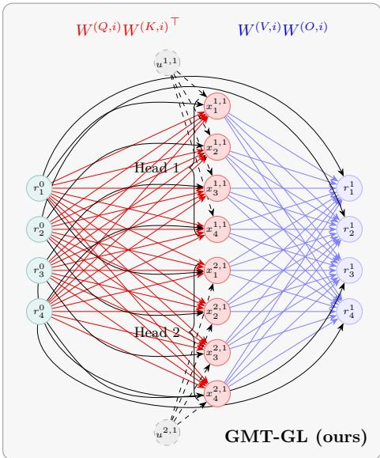
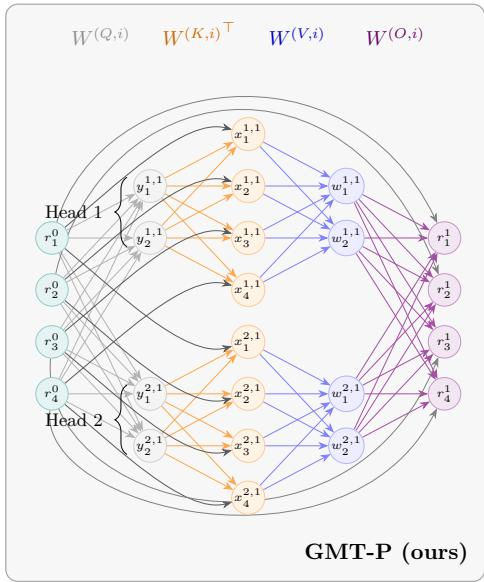
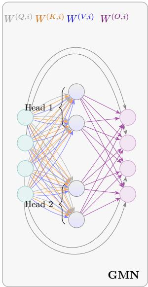
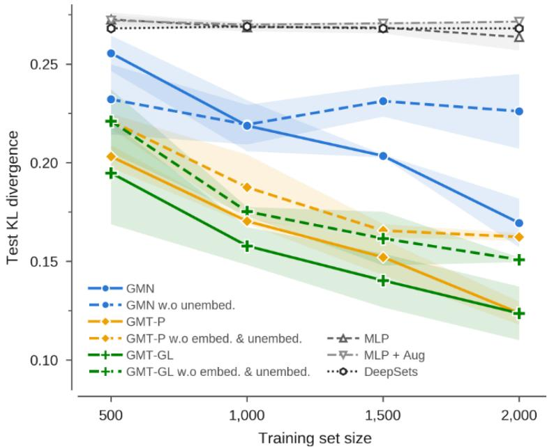
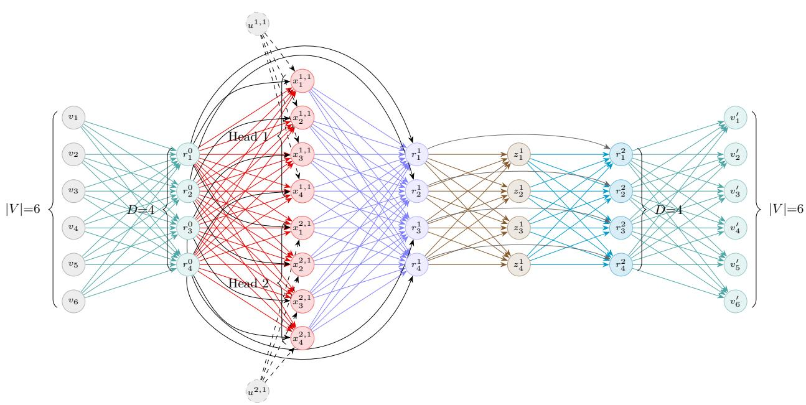
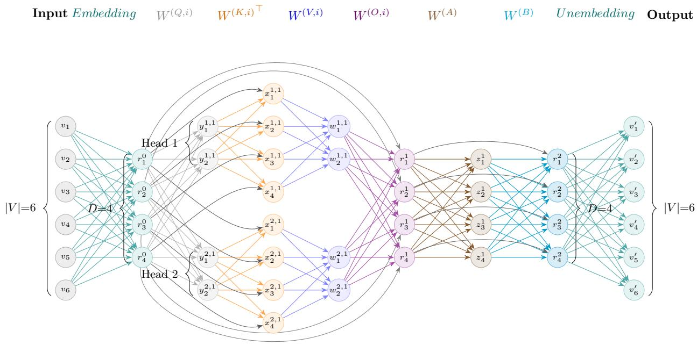

# Graph Metanetworks for Transformer Based Language Models

Yonathan Wolanowsky1 Guy Bar-Shalom1 Fabrizio Frasca1 Haggai Maron1,2

1Technion – Israel Institute of Technology 2NVIDIA Research

## Abstract

Weight-space learning treats the weights of neural networks as data, processed by other models called metanetworks. A key challenge is that diferent weights can realize the same function, related by a group of symmetries the metanetwork should respect. While symmetry-aware metanetworks for simple architectures such as MLPs are well developed, a comprehensive treatment of transformers, and in particular transformer-based language models, is still missing. Importantly, their weight space has a richer symmetry group: beyond neuron permutations, attention introduces continuous general-linear symmetries of the attention matrices and permutations of entire heads. Existing methods for transformer weights either capture only part of these symmetries or are restricted to a single, fixed architecture, and none accounts for languagemodel-specific components such as the token embeddings. Building on graph metanetworks, we propose a graph-based approach that is both symmetry-aware and applicable across depths and widths. We formalize a weight-space symmetry group of complete decoder-only language models and provide a graph construction that is invariant to it. We further introduce two new transformer-population datasets with novel tasks, such as training-corpus prediction and fine-tuning detection, on which our approach notably outperforms existing baselines.

## 1 Introduction

The success of deep learning, together with the large number of publicly available trained models, has created a new data modality: the weights of neural networks themselves. The emerging field of weight-space learning [11, 40] treats these weights as data to train metanetworks that can process other networks’ weights and predict model properties or edited weights with a single forward pass [21, 26, 36].

Two important challenges arise when designing efective metanetworks. First, input architectures may vary widely: an MLP, a CNN, and a transformer share no common parameterization, and even networks of the same family difer in architectural choices such as depth and width. Second, many diferent weight configurations realize the same function, related by a group of symmetries acting on the weight space, most prominently the permutations of hidden neurons [26, 44]. A metanetwork that is not invariant or equivariant to this group would need to use its capacity and data only to learn to treat such configurations as equivalent. These obstacles have motivated recent work on Graph metanetworks [18, 20], which address both challenges by representing a neural network as a graph (with neurons as nodes and parameters as edges) and by processing it with a graph neural network (GNN). Crucially, since GNNs are equivariant to node permutations, they respect the neuron-permutation symmetries of the encoded network.

Despite this progress, transformers [37] and, in particular, the decoder-only language models built from them, remain underexplored as a weight space, especially in terms of the underlying symmetry structure and graph representation. These architectures arguably represent the most important and widely used today, and their weight space is, in fact, also considerably richer in symmetries than that of other architectures. For example, within each attention head, the query and key projections enter the computation only through their product $\mathbf { W } ^ { q } ( \mathbf { W } ^ { k } ) ^ { \top }$ , and the value and output projections only through $\mathbf { W } ^ { v } \mathbf { W } ^ { O }$ , so each pair admits a continuous general-linear symmetry, on top of which entire heads can be permuted. Existing approaches to transformer weights follow two lines, each capturing only part of this picture. The first Graph Metanetworks [18, 20] provide a preliminary, simplified construction for attention, but do not account for the general-linear symmetries and do not encode the head structure faithfully. Conversely, Tran et al. [35] design layers equivariant to the general-linear and head-permutation symmetries, but tie the metanetwork to a single, fixed transformer architecture. Moreover, none of these works treats the components specific to language models, such as the token embedding matrices, and the symmetries they induce. As a result, no existing approach respects the symmetries of a complete transformer language model while remaining agnostic to its depth, width, and number of heads.

Our approach. We begin by formalizing a weight-space symmetry group of a complete decoderonly transformer language model, from the token embedding, through the stack of transformer blocks with their normalization layers and residual connections, up to the unembedding layer. This group combines permutations of the feed-forward hidden neurons, a permutation of the residualstream features shared across all blocks, per-head general-linear symmetries of the query–key and value–output pairs, permutations of the heads within each block, as well as a permutation of the vocabulary that couples the embedding and unembedding matrices together. We prove that these transformations leave the function computed by the model unchanged (up to a relabeling of the vocabulary). Our approach thus unifies a range of previous, independent subcomponent analyses [34],[18],[20] into a single, comprehensive framework, extending the attention symmetries by Tran et al. [35] to a complete language model, including its residual stream, normalization layers, embedding, and unembedding.

We then design tailored graph constructions for transformers whose symmetries match this group, which we call Graph Metanetworks for Transformers (GMT). As in prior graph metanetworks, parameters are placed on edges between layers of nodes, so that a single GNN can process transformers of any depth, width, and number of heads. Unlike prior constructions, though, GMT uses parameterfree coupling edges and auxiliary head nodes which we show tie together exactly those node permutations that correspond to symmetries of the network: the residual-stream permutation is shared across blocks, the dimensions of each head module are bound together within each head, and the embedding is linked to the unembedding. We prove that, under mild rank conditions, two weight configurations yield isomorphic graphs if and only if they are related by an element of the aforementioned group: processing these graphs with a GNN thus guarantees the metanetwork remains invariant (or equivariant), to the transformer weight space group by construction. We propose two variants that trade exactness for eficiency: GMT-GL captures the full group, including the general-linear symmetries, and GMT-P, which as we will show, restricts these symmetries to permutations, yielding a more compact graph.

Finally, as open-weight language models are increasingly released and modified by third parties, questions such as what data was a model trained on? and has it been altered, and where? become pressing, yet lie beyond existing weight-space benchmarks, which focus on implicit neural representations and small vision classifiers. As a first step, we introduce two datasets of transformer language models with tasks that serve as small-scale, controlled proxies for these questions: predicting a model’s training-corpus mixture, detecting fine-tuning, and identifying which weights it modified.

GMT outperforms existing baselines on all three, e.g., reducing the KL divergence of corpus-mixture prediction by 25% and halving the error of weight-level fine-tuning detection relative to prior graph metanetworks.

Contributions. We (i) formalize a weight-space symmetry group of complete decoder-only language models; (ii) introduce GMT, architecture-agnostic graph constructions whose isomorphisms match this group; and (iii) release two transformer-population datasets with auditing-motivated tasks, on which GMT outperforms existing baselines.

## 2 Related work

In weight-space learning, equivariant metanetworks were developed for the neuron permutations of MLPs and CNNs [26, 44] and extended to further symmetries and architectures [16, 46], with graph metanetworks [18, 20] encoding networks as graphs processed by GNNs. For transformers, the general-linear symmetries of attention have been studied for linear mode connectivity [32] and, in analogous form, for processing low-rank adapters [27]. Tran et al. [35] design layers equivariant to the attention symmetries, but for a single, fixed architecture. Existing graph metanetworks encode attention layers without the general-linear symmetries and without a faithful head structure: Kofinas et al. [18] share nodes across the query, key, and value projections of all heads, tying the query–key and value–output permutations and admitting spurious exchanges of dimensions across heads. Lim et al. [20] do the same, and suggest, but do not use, head-index features, which in turn violates the head-permutation symmetry in the constructed graph. None of these works addresses the symmetries of a complete language model, including its embedding and unembedding. We provide an extended discussion in Section A.

## 3 Method

In this section, we formulate our approach. We first characterize the group of weight-space symmetries of a decoder-only transformer language model (Section 3.1). We then design a graph construction whose structure encodes this group, so that a graph metanetwork applied to it is invariant, or equivariant, to it by construction and describe the metanetwork we apply on it (Section 3.2).

## 3.1 Transformer Weight-Space and Symmetry Group

Transformer LM Computation and Weight Space. A transformer language model starts by mapping tokens in a length-N input sequence to vectors $\mathbf { X } ^ { 0 } \in \mathbb { R } ^ { N \times d }$ . This is performed by an embedding matrix $\mathbf { E } \in \mathcal { E } = \mathbb { R } ^ { V \times d }$ , which we define to be the embedding weight space. The initial representation $\mathbf { X } ^ { 0 }$ is then passed through L transformer blocks stacked together, $\mathbf { X } ^ { \ell } = \mathrm { B l o c k } _ { \ell } ( \mathbf { X } ^ { \ell - 1 } )$ for $\ell = \{ 1 , \dots , L \}$ . Each transformer block is composed of two sub-layers, a multi-head attention (MHA) mechanism followed by a feed-forward (FF) network, each wrapped in a normalization layer and a residual connection. A normalization layer is parameterized by a scale and a shift $\gamma , \beta \in \mathbb { R } ^ { d }$ we define the normalization weight space as $\mathcal { N } = \mathbb { R } ^ { d } \times \mathbb { R } ^ { d }$ , so block ℓ holds a pre-attention pair $\gamma ^ { a , \ell } , \beta ^ { a , \ell } \in \mathcal N$ and a pre-MLP pair $\gamma ^ { b , \ell } , \beta ^ { b , \ell } \in \mathcal { N }$ . The MHA module [37] is defined as:

$$
\mathrm { M H A } ( \mathbf { X } ) = \left( \bigoplus _ { h = 1 } ^ { H } \xi \left( \frac { \mathbf { X } \mathbf { W } ^ { q , h } ( \mathbf { W } ^ { k , h } ) ^ { \top } \mathbf { X } ^ { \top } } { \sqrt { d _ { k } } } \right) \mathbf { X } \mathbf { W } ^ { v , h } \right) \mathbf { W } ^ { O } ,
$$

where $\xi \equiv \operatorname { s o f t m a x } , \oplus$ denotes concatenation across the H heads, h denotes head index, and the per-head query, key and value projections ${ \bf W } ^ { q , h } , { \bf W } ^ { k , h } \in \mathbb { R } ^ { d \times d _ { k } } , { \bf W } ^ { v , h } \in \mathbb { R } ^ { d \times d _ { v } }$ together with the output projection $\mathbf { W } ^ { O } \in \mathbb { R } ^ { H d _ { v } \times d } { \mathrm { ~ a r e ~ } }$ its trainable parameters. We define the attention weight space to be $\mathcal { A } = \left( \mathbb { R } ^ { d \times d _ { k } } \right) ^ { H } \times \left( \mathbb { R } ^ { d \times d _ { k } } \right) ^ { H } \times \left( \mathbb { R } ^ { d \times d _ { v } } \right) ^ { H } \times \mathbb { R } ^ { H d _ { v } \times d }$ . The FF sub-layer then processes each token’s representation, typically through a two-layer MLP with a pointwise nonlinearity, $\mathbf { W } ^ { 1 , \ell } \in \mathbb { R } ^ { d \times d _ { \mathrm { f f } } }$ and $\mathbf { W } ^ { 2 , \ell } \in \mathbb { R } ^ { d _ { \mathrm { f f } } \times d }$ ; we define the FF weight space to be $\mathcal { F } = \mathbb { R } ^ { d \times d _ { \mathrm { f f } } } \times \mathbb { R } ^ { d _ { \mathrm { f f } } \times d }$ . Finally, after the L blocks, a final normalization $\gamma ^ { f } , \beta ^ { f } \in \mathcal N$ is applied, and an unembedding linear layer $\mathbf { F } \in \mathbb { R } ^ { d \times V }$ maps $\mathbf { X } ^ { L }$ to a distribution over the vocabulary for the next token; we define the unembedding weight space as ${ \mathcal { U } } = \mathbb { R } ^ { d \times V }$ . Collecting these spaces gives the weight space of all transformers with L blocks and H heads:

$$
{ \mathcal { W } } = \underbrace { \mathcal { E } } _ { \mathrm { E m b e d . } } \sum _ { \ell = 1 } ^ { L } \underbrace { \left( \mathcal { N } \times \mathcal { A } \times \mathcal { N } \times \mathcal { F } \right) } _ { \mathrm { T r a n s f o r m e r ~ B l o c k } } \times \underbrace { \mathcal { N } \times \mathcal { U } } _ { \mathrm { U n e m b . } }\tag{1}
$$

where each point $w \in \mathcal { W }$ determines a function from token sequences to next-token distributions.

Transformer weight space symmetries. Two transformers with diferent weights may compute the same function, i.e., the same function admits many equivalent parameterizations. In most weight-space tasks, the target does not depend on which of these parameterizations is given, so a weight-space model should be invariant or equivariant to the weight transformations relating them. We formalize such transformations as a group acting on W (Equation (1)), examining each component of the network in turn; Table 1 summarizes the result.

(1) The embedding matrix E admits a row permutation $P _ { V } \in S _ { V }$ corresponding to permuting the vocabulary dictionary — and a column permutation $P _ { d } \in S _ { d }$ — corresponding to reindexing the features of the embedded vectors. That is, $\mathbf { E } \mapsto P _ { V } ^ { \top } \mathbf { E } P _ { d }$ . As we will show, all upcoming layers are equivariant under the action of $P _ { d } .$ , allowing us to perform this group action while carrying it through the network.

(2) The pre-attention normalization maps each token representation $\mathbf { x } \in \mathbb { R } ^ { d }$ (a row of $\mathbf { X } ^ { \ell - 1 } )$ to $\begin{array} { r } { \mathrm { N o r m } ( \mathbf { x } ; \gamma ^ { a , \ell } , \beta ^ { a , \ell } ) = \frac { \mathbf { x } - \boldsymbol { \mu } ( \mathbf { x } ) \mathbf { 1 } ^ { \top } } { \sigma ( \mathbf { x } ) } \odot \gamma ^ { a , \ell } + \beta ^ { a , \ell } } \end{array}$ , where 1 is the all-ones vector and ⊙ is the entrywise product. Note that $\mu ( \mathbf { x } ) , \sigma ( \mathbf { x } )$ are permutation invariant. In order for the norm to respect the column permutation $P _ { d }$ , we need to transform the scale and shift parameters accordingly, i.e. $\gamma ^ { a , \ell } \mapsto \gamma ^ { a , \ell } P _ { d } , \beta ^ { a , \ell } \mapsto \beta ^ { a , \ell } P _ { d }$ . This gives Norm $( { \bf x } P _ { d } ; \gamma ^ { a , \ell } P _ { d } , \beta ^ { a , \ell } P _ { d } ) = \mathrm { N o r m } ( { \bf x } ; \gamma ^ { a , \ell } , \beta ^ { a , \ell } ) P _ { d }$

(3) Each attention head’s query and key projections enter the network only through the product $\mathbf { W } ^ { q , h } ( \mathbf { W } ^ { k , h } ) ^ { \top }$ ; substituting any invertible $G _ { q k } ^ { h } \ \in \ { \mathrm { G L } } ( d _ { k } )$ as ${ \bf W } ^ { q , h } \ \mapsto \ { \bf W } ^ { q , h } G _ { a k } ^ { \bar { h } } , \ { \bf W } ^ { \bar { k } , h } \ \mapsto $ $\mathbf { W } ^ { k , h } ( G _ { q k } ^ { h } ) ^ { - \top }$ leaves this product, and hence the attention calculation, unchanged. Note that the output projection $\mathbf { W } ^ { O } \in \mathbb { R } ^ { H d _ { v } \times d }$ is likewise a stack of H blocks $\mathbf { W } _ { h } ^ { O } \in \mathbb { R } ^ { d _ { v } \times d }$ , so concatenating the per-head values and multiplying by $\mathbf { W } ^ { O }$ can be expressed as the following sum:

$$
\sum _ { h = 1 } ^ { H } \xi \left( \frac { \mathbf { X } \mathbf { W } ^ { q , h } ( \mathbf { W } ^ { k , h } ) ^ { \top } \mathbf { X } ^ { \top } } { \sqrt { d _ { k } } } \right) \mathbf { X } \mathbf { W } ^ { v , h } \mathbf { W } _ { h } ^ { O } .\tag{2}
$$

The value/output pair thus enter the network only through their product, imposing a second generallinear symmetry $G _ { v o } ^ { h } \in \mathrm { G L } ( d _ { v } )$ . Equation (2) only ever sums the H heads, so they may in addition be permuted by any $\sigma _ { \ell } \in S _ { H }$ . Together, these give the wreath product [39] $\bigl ( \mathrm { G L } ( d _ { k } ) \times \mathrm { G L } ( d _ { v } ) \bigr ) \colon S _ { H }$ Also the MHA input still carries $P _ { d } ,$ , enforcing the attention weights matrices to also be transformed by $P _ { d }$ on the left.

(4) The pre-MLP normalization applies the same Norm defined above to a seperate scale and shift, so again it is equivariant to $\gamma ^ { b , \ell } , \beta ^ { b , \ell } \mapsto \gamma ^ { b , \ell } P _ { d } , \beta ^ { b , \ell } P _ { d }$

Table 1: The symmetry group action over a weight space $w \in \mathcal { W } .$ . The attention group is $S _ { \wr } : = S _ { d } \times \left[ \left( \mathrm { G L } ( d _ { k } ) \times \mathrm { G L } ( d _ { v } ) \right) \wr S _ { H } \right]$ . The action column omits the layer index $\ell ,$ which is left unchanged.
<table><tr><td>Network Block</td><td>Weight Matrix</td><td>Group Action</td><td>Group Element</td></tr><tr><td>(1) Embed.</td><td>E</td><td> $P _ { V } ^ { \top } \mathbf { E } P _ { d }$ </td><td> $S _ { V } \times S _ { d }$ </td></tr><tr><td>(2) Pre-attn. norm</td><td> $\gamma ^ { a , \ell }$   $\dot { \beta } ^ { a , \ell }$ </td><td> $\gamma ^ { a } P _ { d }$   $\beta ^ { a } P _ { d }$ </td><td> $S _ { d }$ </td></tr><tr><td>(3) Attention</td><td> $\mathbf { W } ^ { q , h , \ell }$   ${ \bf W } ^ { k , h , \ell }$   ${ \bf W } ^ { v , h , \ell }$ </td><td> $P _ { d } ^ { \top } \mathbf { W } ^ { q , \sigma ( h ) } G _ { q k } ^ { \sigma ( h ) }$   $P _ { d } ^ { \top } \mathbf { W } ^ { k , \sigma ( h ) } ( \dot { G } _ { q k } ^ { \sigma ( h ) } ) ^ { - \top }$   $P _ { d } ^ { \top } \mathbf { W } ^ { v , \sigma ( h ) } G _ { v o } ^ { \sigma \{ h \} }$ </td><td> $S _ { \wr }$ </td></tr><tr><td>(4) Pre-MLP</td><td> $\mathbf { W } _ { h } ^ { O , \ell }$   $\gamma ^ { b , \ell }$ </td><td> $( G _ { v o } ^ { \sigma ( h ) } ) ^ { - 1 } \mathbf { W } _ { \sigma ( h ) } ^ { O } P _ { d }$   $\gamma ^ { b } P _ { d }$ </td><td> $S _ { d }$ </td></tr><tr><td>norm (5) MLP</td><td> $\dot { \beta } ^ { b , \ell }$   $\mathbf { W } ^ { 1 , \ell }$ </td><td> $\beta ^ { b } P _ { d }$   $P _ { d } ^ { \top } \mathbf { W } ^ { 1 } \hat { P }$ </td><td> $S _ { d } \times S _ { d _ { \mathrm { f f } } }$ </td></tr><tr><td>(6) Final</td><td> $\mathbf { W } ^ { 2 , \ell }$   $\gamma ^ { f }$ </td><td> $\hat { P } ^ { \top } \mathbf { W } ^ { 2 } P _ { d }$   $\gamma ^ { f } P _ { d }$ </td><td> $S _ { d }$ </td></tr><tr><td>norm (7) Unembed.</td><td> $\beta ^ { f }$  F</td><td> $\beta ^ { f } P _ { d }$   $P _ { d } ^ { \top } \mathbf { F } P _ { V }$ </td><td></td></tr></table>

(5) In the feed-forward sub-layer, the pointwise nonlinearity is applied element-wise, so it commutes with permuting the columns of $\mathbf { W } ^ { 1 , \ell }$ and undoing it with $( \hat { P } ^ { \ell } ) ^ { \top }$ on the rows of $\mathbf { W } ^ { 2 , \ell }$ . Also here the input carries $P _ { d }$ (from the embedding column permutation), enforcing us to apply $P _ { d }$ on each of the $\mathcal { H }$ weight matrices.

(6) The final normalization, applied after the last block, is governed by the Norm computation: the same considerations as in (2) shows the same equivariance.

(7) For the unembedding matrix F, we want to undo the permutation $P _ { d }$ that we carry along the network. Additionally, since the embedding was permuted by $P _ { V }$ , the unembedding must also be permuted by $P _ { V } ^ { \top }$ to match the token relabeling. The transformation to F is hence defined as $\mathbf { F } \mapsto P _ { d } ^ { \top } \mathbf { F } P _ { V }$

Full symmetry group. The per-block transformations are summarized in Table 1. Combining them gives the symmetry group of the full weight space:

$$
\mathcal { G } = \underbrace { S _ { V } \times S _ { d } } _ { \mathrm { E m b e d d i n g } } \times \underbrace { \vphantom { S _ { d } } \ K } _ { \mathrm { \normalfont \mathrm { 1 } } } \left[ \underbrace { \vphantom { \sum _ { i } } \left( \mathrm { G L } ( d _ { k } ) \times \mathrm { G L } ( d _ { v } ) \right) \wr S _ { H } } _ { \mathrm { a t t e n t i o n } } \times \underbrace { S _ { d _ { \mathrm { f f } } } } _ { \mathrm { F F } } \right] .\tag{3}
$$

We summarize the discussed transformer symmetries with the following theorem, proved in Section B.1.

Theorem 1 (the elements of $\mathcal { G }$ are symmetries of the weight space). Let $f _ { w }$ denote the function computed by a decoder-only transformer language model with weights $w \in \mathcal { W }$ . Then $f _ { w }$ is invariant to the group $\mathcal { G }$ with the action defined in Table 1. i.e, for $w \in \mathcal { W } , g \in \mathcal { G }$ , it holds that $f _ { g \cdot w } = f _ { w }$

Additional symmetries. G is not the maximal symmetry group of a transformer language model.

For example, each normalization layer admits a diagonal rescaling $\gamma , \beta , \mathbf { W } \mapsto \gamma D , \beta D , D ^ { - 1 } \mathbf { W }$ where W is a linear map followed by it. In addition, some activation functions induce scaling or sign symmetries of the feed-forward neurons [10, 16, 34]. These symmetries are complementary to the ones we treat and can be handled on top of our constructions, e.g., by canonicalizing the weights; we leave this to future work.

## 3.2 Graph Construction

Having identified the symmetry group $\mathcal { G }$ (Equation (3)), we seek a model that is invariant or equivariant to it. Architectures tailored to G typically tie their input dimension to a single transformer architecture, and thus cannot be applied across depths $L ,$ widths $d ,$ or numbers of heads H. Following Lim et al. [20] and Kofinas et al. [18], we instead represent a transformer as a graph whose edges carry the model’s parameters, augmented with structural “gadgets” that encode its symmetries, and process it with a graph neural network (GNN). Since GNNs apply to graphs of any size and are equivariant to node permutations, invariance or equivariance to $\mathcal { G }$ follows from the graph construction alone. Unlike ours, the earlier constructions of [18, 20] do not match $\mathcal { G } \colon$ they do not model the general-linear symmetries and do not faithfully encode the head structure.

GL-Invariant Graph Construction (GMT-GL). We will now describe the GMT-GL graph construction for each model component, explaining which nodes are instantiated, which edges join them, and which parameter matrix, if any, sits on these edges. Throughout the construction, we use two recurring edge connectivity patterns. The first captures any parameter matrix $\mathbf { M } \in \mathbb { R } ^ { m \times n }$ representing fully-connected layers of neurons $\mathcal { A } = \{ a _ { i } \} _ { i = 1 } ^ { m }$ and $\boldsymbol { B } = \{ b _ { i } \} _ { i = 1 } ^ { n }$ . This is naturally instantiated as a full, bipartite weighted edge set between the set of neuron nodes A and B:

$$
\begin{array} { r } { \mathcal { E } _ { \prec ( \mathcal { A } , \mathcal { B } ; \mathbf { M } ) } : = \{ ( a _ { i } , b _ { j } , \mathbf { M } _ { i , j } ) : 1 \leq i \leq m , 1 \leq j \leq n \} , } \end{array}\tag{4}
$$

Under this setup, A, B can be independently permuted while maintaining the same graph structure, i.e. the permuted graph is isomorphic to the original. Such permutations correspond to row and column permutations of the matrix M, which in turn provides the permutation invariance we seek. The second pattern is a coupling edge set between two node-layers of equal size m, pairing same-index nodes without carrying any of the transformer’s trainable parameters:

$$
\mathcal { E } _ {  } ( A , B ) : = \{ ( a _ { i } , b _ { i } ) : 1 \leq i \leq m \} .\tag{5}
$$

This fixes the two layers to the same permutation. This is what lets us realize the couplings between permutations that Table 1 requires, $P _ { d }$ across a block’s sub-layers, and $P _ { V }$ between the embedding and unembedding. Moving forward, we now describe the graph construction for a single transformer block language model, which we also depict in Figure 3.

Embedding. The graph starts with the node-layer $\mathcal { V } _ { V } = \{ v _ { i } \} _ { i = 1 } ^ { | V | }$ (one node per vocabulary token), and the node-layer $\mathcal { V } _ { d } = \{ x _ { i } \} _ { i = 1 } ^ { d }$ (one node per feature), joined by the fully-connected edge set $\mathcal { E } _ { \times } ( \mathcal { V } _ { V } , \mathcal { V } _ { d } ; { \bf E } )$ carrying the embedding matrix. Note that row and column permutation of E correspond to permuting $\nu _ { V } , \nu _ { d }$ which leaves the graph unchanged.

Multi-head attention. first, to consider the pre-attention normalization, we introduce the node-layer $\mathcal { V } _ { \gamma , \beta } ^ { a , \ell } = \{ g ^ { a , \ell } , s ^ { a , \ell } \}$ , joined to $\nu _ { d }$ by the fully-connected edge set $\mathcal { E } _ { \prec } ( \mathcal { V } _ { \gamma , \beta } ^ { a , \ell } , \mathcal { V } _ { d } ; [ \gamma ^ { a , \ell } ; \beta ^ { a , \ell } ] )$ . Now, to respect the general-linear symmetry relating $\mathbf { W } ^ { q , h } , \mathbf { W } ^ { k , h }$ and $\mathbf { W } ^ { v , h } , \mathbf { W } ^ { O }$ , as anticipated, we work directly with the matrix products $\mathbf { W } ^ { q , h } ( \mathbf { W } ^ { k , h } ) ^ { \top }$ and ${ \mathbf W } ^ { v , h } { \mathbf W } ^ { O , h }$ , where ${ \bf W } ^ { O , h }$ is the h-th row-block of $\mathbf { W } ^ { O }$ . Concretely, for every head $h = 1 , \ldots , H$ we introduce a node-layer $\mathcal { V } _ { d } ^ { h } = \{ x _ { i } ^ { h } \} _ { i = 1 } ^ { d }$ of d nodes, joined to $\nu _ { d }$ by the edge set $\mathcal { E } _ { \prec } ( \mathcal { V } _ { d } , \mathcal { V } _ { d } ^ { h } ; \mathbf { W } ^ { q , h } ( \mathbf { W } ^ { k , h } ) ^ { \top } )$ . To additionally tie the column permutation of the embedding to the row permutation of $\mathbf { W } ^ { q , h }$ $\mathbf { W } ^ { k , h }$ and ${ \bf W } ^ { v , h }$ , we add, for every head, the coupling edge set $\mathcal { E } _ { \exists } ( \mathcal { V } _ { d } , \mathcal { V } _ { d } ^ { h } )$ . However, these edges alone do not bind the d nodes of a head together: the nodes $\{ x _ { i } ^ { h } \} _ { h = 1 } ^ { H }$ of each index i could be permuted across heads independently of the other indices, which introduce larger graph symmetry than the one of the corresponding transformer. To tie all nodes of a head to the same head permutation, we introduce for every head a single head node $u ^ { h }$ , joined to all nodes of that head by the parameter-free edge set $\{ ( u ^ { h } , x _ { i } ^ { h } ) : 1 \leq i \leq d \}$ Next, each of these H node-layers is joined to a shared node-layer $\mathcal { V } _ { d } ^ { \prime } = \{ x _ { i } ^ { \prime } \} _ { i = 1 } ^ { d }$ of d nodes by a fully-connected edge set $\mathscr { E } _ { \prec } ( \mathcal { V } _ { d } ^ { h } , \mathcal { V } _ { d } ^ { \prime } ; \mathbf { W } ^ { v , h } \mathbf { W } ^ { O , h } )$ , merging the heads back into the residual stream. Finally, to account for the residual connection, we add the coupling edge set $\mathcal { E } _ { \exists } ( \mathcal { V } _ { d } , \mathcal { V } _ { d } ^ { \prime } )$ between the sub-layer’s input and output layers. As before, the pre-MLP normalization pair encoded with the node-layer $\mathcal { V } _ { \gamma , \beta } ^ { \bar { b , \ell } } = \{ g ^ { b , \ell } , s ^ { \bar { b , \ell } } \}$ joined to $\mathcal { V } _ { d } ^ { \prime }$ by the edge set $\mathcal { E } _ { \prec } ( \mathcal { V } _ { \gamma , \beta } ^ { b , \ell } , \mathcal { V } _ { d } ^ { \prime } ; [ \gamma ^ { b , \ell } ; \bar { \beta ^ { b , \ell } } ] )$

Feed-forward. We continue with a node-layer $\begin{array} { r c l } { \mathcal { V } _ { f f } } & { = } & { \{ \boldsymbol { z } _ { i } \} _ { i = 1 } ^ { d _ { \mathrm { f f } } } } \end{array}$ of $d _ { \mathrm { f } }$ nodes, joined to $\mathcal { V } _ { d } ^ { \prime }$ by $\mathcal { E } _ { \prec } ( \mathcal { V } _ { d } ^ { \prime } , \mathcal { V } _ { f f } ; \mathbf { W } ^ { 1 } )$ , and a further node-layer $\mathcal { V } _ { d } ^ { \prime \prime } ~ = ~ \{ x _ { i } ^ { \prime \prime } \} _ { i = 1 } ^ { d }$ of d nodes, joined to $\nu _ { f f }$ by $\mathscr { E } _ { \prec } ( \mathcal { V } _ { f f } , \mathcal { V } _ { d } ^ { \prime \prime } ; \mathbf { W } ^ { 2 } )$ ; as above, coupling edge set $\mathcal { E } _ { \exists } ( \mathcal { V } _ { d } ^ { \prime } , \mathcal { V } _ { d } ^ { \prime \prime } )$ accounts for residual connections. The node-layer $\mathcal { V } _ { d } ^ { \prime \prime }$ plays the role of $\nu _ { d }$ for the next block, and this pattern repeats for all blocks.

Unembedding. After the last block, a final node-layer $\mathcal { V } _ { V } ^ { \prime } = \{ v _ { i } ^ { \prime } \} _ { i = 1 } ^ { | V | }$ is joined to the last $\nu _ { d }$ by the fully-connected edge set $\mathcal { E } _ { \times } ( \mathcal { V } _ { d } , \mathcal { V } _ { V } ^ { \prime } ; \mathbf { F } )$ carrying the unembedding matrix. To tie the row permutation of the embedding matrix to the column permutation of the unembedding matrix – both equal to the shared vocabulary permutation $P _ { V } - \mathrm { w e }$ add the coupling edge set $\mathcal { E } _ {  } ( \mathcal { V } _ { V } , \mathcal { V } _ { V } ^ { \prime } )$ between the network’s very first and very last node layers. The final normalization pair $\gamma ^ { f } , \beta ^ { f }$ is attached to this last $\nu _ { d }$ in the same way, via the node-layer $\mathcal { V } _ { \gamma , \beta } ^ { f } = \{ g ^ { f } , s ^ { f } \}$ joined to it by the fully-connected edge set $\mathcal { E } _ { \prec } ( \mathcal { V } _ { \gamma , \beta } ^ { f } , \mathcal { V } _ { d } ; [ \gamma ^ { f } ; \beta ^ { f } ] )$

  
Figure 1: The multi-head attention subgraph under the three graph constructions, for an attention layer with $d { = } 4$ and H=2 heads $( d _ { k } = d _ { v } = 2 )$ ; the rest of GMT-GL and GMT-P is identical. Left: GMT-GL places the products $W ^ { ( Q , i ) } W ^ { ( K , i ) } { } ^ { \top }$ and $W ^ { ( V , i ) } W ^ { ( O , i ) }$ on the edges, and the head nodes $u ^ { h , 1 }$ bind the nodes of each head together. Middle: GMT-P gives each projection matrix its own edge set. Right: [20] and [18] which share the same construction for MHA, noted as GMN.

Limitations of GMT-GL. Our construction $G M T \ – G L ,$ is equivariant to the whole group ${ \mathcal { G } } ,$ particularly including the general-linear symmetry of the attention mechanism. This exact equivariance is of course desirable, but it comes with two disadvantages. First, to respect the general-linear symmetry, $\mathbf { W } ^ { q , h }$ and ${ \bf W } ^ { k , h }$ — each of shape d $\times \ d _ { k }$ — are multiplied together to form a single matrix of shape $d \times d$ placed on the graph’s edges. The size of this product is $d ^ { 2 }$ , and in the typical case where $d _ { k } \ll d ,$ this is much larger than the combined size of the two matrices it replaces, that is, $2 d d _ { k }$ . As a result, the graph has far more edges than the layer has parameters. The same holds for the general-linear symmetry relating ${ \bf W } ^ { v , h }$ and ${ \bf W } ^ { O , h }$ , with product $\mathbf { W } ^ { v , h } \mathbf { W } ^ { O , h }$ .Second, since GMT-GL edges carry entries of matrix products rather than individual weights, model weights no longer correspond to graph edges, which make weight-level tasks, where a property of each weight must be predicted, more challenging.

Permutation-Invariant Graph Construction (GMT-P). To mitigate the aforementioned issues with GMT-GL, we propose a more eficient alternative, GMT-P, which restricts the symmetry group to permutation matrices alone, $\mathcal { P } _ { d _ { k } } \leq \mathrm { G L } _ { d _ { k } } , \mathcal { P } _ { d _ { v } } \leq \mathrm { G L } _ { d _ { v } }$ , and works directly with the weight matrices $\mathbf { W } ^ { q , h }$ ${ \bf W } ^ { k , h }$ ${ \bf W } ^ { v , h }$ ${ \bf W } ^ { O , h }$ themselves, rather than the two products. Concretely, the GMT-P construction considers the subgroup $\tilde { \mathcal { G } } \leq \mathcal { G }$ defined by

$$
\begin{array} { r } { \tilde { \mathcal { G } } \ = \ \underbrace { S _ { V } \times S _ { d } } _ { \mathrm { E m b e d d i n g } } \times \ \Big [ \big ( \mathcal { P } _ { d _ { k } } \times \mathcal { P } _ { d _ { v } } \big ) \wr S _ { H } \ \times \ \underbrace { S _ { d _ { \mathrm { f f } } } } _ { \mathrm { F F } } \Big ] , } \end{array}\tag{6}
$$

The full construction of a single-block transformer language model under this second method is shown in Figure 4 (Section D.2), and we give its formal definition in Section D.1. Each parameter now corresponds directly to a single edge: GMT-P thus avoids both disadvantages of GMT-GL described above: it is more compact, and a weight-level task on the model is equivalent to an edge-level task on the resulting graph.

Node and edge features. For both constructions, each node is attributed with features encoding the index of the node-layer1 it belongs to (for instance, the graph of Figure 3 has 7 node-layers) together with its type, i.e. the network component it originates from: MHA head, MLP hidden unit etc. Each edge has features encoding its type, i.e., weight edge or a coupling edge, and its weight (if any). These encodings are necessary to break unwanted symmetries of the graph like permutation of nodes across diferent node-layers or types, which do not correspond to the symmetry of the original transformer.

Theorem 2 (Symmetries as graph isomorphisms). Let $\Gamma _ { \mathrm { G L } } ( w )$ and $\Gamma _ { \mathrm { P } } ( w )$ denote the graphs that GMT-GL and GMT-P respectively produce from weights w $\mathbf { \xi } _ { 1 } \in \mathcal { W }$ . Then for any w, $w ^ { \prime } \in \mathcal { W }$

$$
\begin{array} { r } { \Gamma _ { \mathrm { G L } } ( w ) \cong \Gamma _ { \mathrm { G L } } ( w ^ { \prime } ) \iff w ^ { \prime } \in \mathcal { G } \cdot w , } \\ { \Gamma _ { \mathrm { P } } ( w ) \cong \Gamma _ { \mathrm { P } } ( w ^ { \prime } ) \iff w ^ { \prime } \in \tilde { \mathcal { G } } \cdot w , } \end{array}
$$

where $\mathcal { G } \cdot w$ and $\tilde { \mathcal { G } }$ ·w denote the orbits of w under G (Equation (3)) and $\tilde { \mathcal { G } }$ (Equation (6)) respectively, and =∼ denotes isomorphism of attributed graphs (i.e. a bijection of nodes preserving node features, edges, and edge features). For $\Gamma _ { \mathrm { G L } }$ , the implication (⇒) assumes that the per-head matrices of w have full column rank.

Theorem 2, which we prove in Section B.2, states that our graphs represent the weights faithfully up to symmetry. The (⇐) direction establishes invariance: weights related by a symmetry yield isomorphic graphs, so any message-passing GNN is automatically invariant to G (respectively G˜). The (⇒) direction establishes separation: weights not related by a symmetry yield non-isomorphic graphs, so the construction discards no information beyond the symmetry itself. Note that the theorem concerns the graph representation, not the GNN: whether a particular GNN separates two non-isomorphic graphs depends on its expressive power [42].

Metanetwork architecture In practice, We take our graphs and feed them to a GNN. As the backbone, we employ GINE layers [15], extension of GIN [42] that incorporates edge features into the message-passing procedure along with updates to the edge features. Details on the architecture are in Section C.2.

## 4 Experiments

We evaluate our approach on three tasks, instantiated over two new datasets of transformer language models. These gather populations difering in architecture, training mixture, and fine-tuned components (see Section C.1). To the best of our knowledge, this is the first systematic application of weight-space learning to models of this type and scale. We will release our dataset to support future research.

Baselines. We compare GMT-GL and GMT-P against three families of baselines: (i) the graph construction of Lim et al. [20] and Kofinas et al. [18], which treat multi-head attention identically and are thus reported as a single baseline, ‘GMN’; (ii) the equivariant metanetwork of Tran et al. [35], denoted ‘NFN-T’, which captures the general-linear symmetries but is tied to a single, fixed transformer architecture, so we compare against it only on a sub-population of models sharing one architecture; and (iii) two baselines that discard the transformer structure and operate on the flattened parameter vector: an MLP, also trained with data augmentations (MLP+Aug), and DeepSets [43], which treats the parameters as a permutation-invariant set. See Section C.2 for more details on architectures and baselines.

## 4.1 Corpus-Mixture Prediction

Setup. Our first task is to predict, from a model’s weights, the proportions of the corpora it was trained on. We use a population of small language models with 90K–150K parameters, each trained on a mixture of three corpora, Shakespeare [17], TinyStories [6], and Wikipedia [25], drawn at model-specific proportions, e.g., (80%, 15%, 5%). This constitutes the prediction target, and is a property of the whole model, invariant to the weight-space symmetry group G (Equation (3)). We pose the task as a regression onto the probability simplex and report the KL divergence and MAE between the predicted and true mixtures.

Results in Table 2 show a wide gap between the flat-weight baselines and the graph-based models: DeepSets and MLP are largely outperformed, even when augmentations are used to compensate for the MLP’s lack of invariance (see Section C.2). Among graph-based models, the two GMT variants perform similarly and clearly outperform GMN; this gap holds across metrics and quantity of available training data (see Figure 2 and paragraph below). On the fixed-architecture sub-population (Table 3), both variants also substantially outperform NFN-T.

Table 2: Performance of all methods on the corpus-mixture prediction task (Section 4.1).
<table><tr><td>Method</td><td>KL</td><td>MAE</td></tr><tr><td>Flat weight vector baselines</td><td></td><td></td></tr><tr><td>DeepSets MLP</td><td> $0 . 2 6 8 1 \pm 0 . 0 0 0 2$   $0 . 2 6 3 7 \pm 0 . 0 0 6 7$ </td><td> $0 . 1 9 7 4 \pm 0 . 0 0 0 2$   $0 . 1 9 5 1 \pm 0 . 0 0 3 1$ </td></tr><tr><td> $\mathrm { M L P + A u g }$ </td><td> $0 . 2 7 1 5 \pm 0 . 0 0 0 9$ </td><td> $0 . 1 9 8 8 \pm 0 . 0 0 0 3$ </td></tr><tr><td>Graph constructions</td><td></td><td></td></tr><tr><td>GMN</td><td> $0 . 1 6 9 5 \pm 0 . 0 1 2 3$ </td><td> $0 . 1 4 3 9 \pm 0 . 0 0 6 4$ </td></tr><tr><td>GMT-P (ours)</td><td> $0 . 1 2 3 8 \pm 0 . 0 0 5 8$ </td><td> $0 . 1 2 1 0 \pm 0 . 0 0 4 4$ </td></tr><tr><td>GMT-GL (ours)</td><td> $\mathbf { 0 . 1 2 3 6 \pm 0 . 0 1 3 6 }$ </td><td> $\mathbf { 0 . 1 1 9 4 } \pm 0 . 0 0 8 2$ </td></tr></table>

Table 3: Performance comparison against NFN-T [35] over a subset of 500 homogeneous architectures from the corpus-mixture dataset (Section 4.1).
<table><tr><td>Method</td><td>KL</td><td>MAE</td></tr><tr><td>NFN-T</td><td> $0 . 2 9 4 2 \pm 0 . 0 0 6 0$ </td><td> $0 . 2 1 0 1 \pm 0 . 0 0 0 8$ </td></tr><tr><td>GMT-P (ours)</td><td> $0 . 2 0 4 0 \pm 0 . 0 1 2 1$ </td><td> $\mathbf { 0 . 1 6 4 4 } \pm 0 . 0 0 8 0$ </td></tr><tr><td>GMT-GL (ours)</td><td> $\mathbf { 0 . 2 0 3 8 \pm 0 . 0 2 5 3 }$ </td><td> $0 . 1 6 5 2 \pm 0 . 0 1 2 6$ </td></tr></table>

  
Figure 2: Test KL divergence on corpus-mixture prediction, evaluated as a function of training set size and across ablations of the (un)embedding components.

Ablating embedding and unembedding. GMN encodes the final transformer classification layer but, unlike GMT, not the token embedding. To test whether this explains the performance gap, and to what extent the embedding and unembedding modules are predictive for the pretraining mix, here, we ablate both this two components from all inputs. We additionally vary the training set size to assess sample eficiency and report resulst in Figure 2. The ablation degrades all models, confirming that (un)embedding components carry a non-negligible part of the predictive signal. GMT still clearly outperforms GMN in both settings and across data regimes; in fact, without the unembedding, GMN no longer benefits from more training data (dashed blue line). This confirms the importance of the additional inductive biases captured by our constructions.

Table 4: Results on fine-tuning detection (Section 4.2).
<table><tr><td>Method</td><td>ROC-AUC</td><td>Macro-F1</td><td>Accuracy</td></tr><tr><td>MLP</td><td>0.6237</td><td>0.3333</td><td>0.5</td></tr><tr><td>MLP+Aug</td><td>0.5891</td><td>0.3333</td><td>0.5</td></tr><tr><td>DeepSets</td><td>0.5777</td><td>0.3333</td><td>0.5</td></tr><tr><td>GMN</td><td>0.9359</td><td>0.8370</td><td>0.8374</td></tr><tr><td>GMT-P (ours)</td><td>0.9495</td><td>0.8473</td><td>0.8475</td></tr><tr><td>GMT-GL (ours)</td><td>0.9557</td><td>0.8611</td><td>0.8613</td></tr></table>

## 4.2 Fine-tuning Detection

Setup. Our task deals with detecting whether a model has been finetuned. We construct a second dataset consisting of 4,000 transformer language models with 3M–5M parameters, all trained on TinyShakespeare [17]; half are subsequently LoRA fine-tuned on Wikipedia [25]. To make the problem harder and the population more diverse, fine-tuning adapts only a random subset of each model’s weight matrices. Here the label is attached to the whole model, so this is again an invariant task. As customary, the embedding and unembedding modules are not fine-tuned, so we omit their parameters and corresponding graph components in these experiments.

Results are reported in Table 4 in terms of accuracy, macro-F1 and ROC-AUC. The MLP and DeepSets baselines still largely underperform. On the contrary, the graph-aware models generally obtain strong performance, with our GMT models outperforming GMN. Best performance is obtained, in particular, by the GMT-GL variant.

## 4.3 Weight-level Fine-tuning Detection

Setup. Our third task asks not only whether a model was fine-tuned, but which of its weights were updated. We reuse the fine-tuned models of Section 4.2: since only a random subset of their weight matrices was adapted, each contains both updated and untouched weights. The target is now attached to each parameter rather than to the whole model, making this an equivariant task. In GMT-P every weight is a single edge, so the task becomes edge-level binary classification, and GMT-GL is excluded, as its edges do not always correspond to individual weights. Flat-weight baselines are adapted to predict one label per parameter. As most weights are untouched, we report macro-F1 as primary metric, alongside accuracy and ROC-AUC.

Results are reported in Table 5, and show that our GMT-P model outperforms all other baselines, marking an absolute gap of 5% in terms of Macro-F1 w.r.t. the GMN runnerup. The flat-weight baselines again trail the graph-based models by a wide margin.

## 5 Conclusions

We proposed GMT, a graph metanetwork for transformer language models. We formalized a symmetry group of a complete decoder-only model, combining residual-stream, feed-forward, head, vocabulary permutations and general-linear symmetries of attention. We proposed a graph construction which, unlike earlier approaches, uses parameter-free coupling edges and head nodes so that its isomorphisms match the aforementioned group: we showed that, under mild rank conditions, two models yield isomorphic graphs if they are related by one such group element. A standard GNN is thus invariant to it by construction, for any depth, width, and number of heads. We proposed two variants: GMT-GL captures the full group, while GMT-P restricts the general-linear symmetries to permutations in exchange for a more compact graph with one edge per parameter, also enabling weight-level tasks. On two new populations of language models, GMT outperforms existing baselines on corpus-mixture prediction and on model- and weight-level fine-tuning detection, and its advantage over prior graph metanetworks persists across training set sizes.

Table 5: Weight-lv fine-tuning detection (Section 4.3).
<table><tr><td>Method</td><td>Macro-F1</td><td>ROC-AUC</td><td>Accuracy</td></tr><tr><td>MLP</td><td>0.4314</td><td>0.5606</td><td>0.7587</td></tr><tr><td>MLP+Aug</td><td>0.5260</td><td>0.7797</td><td>0.7593</td></tr><tr><td>DeepSets</td><td>0.4313</td><td>0.5502</td><td>0.7586</td></tr><tr><td>GMN</td><td>0.9043</td><td>0.9743</td><td>0.9043</td></tr><tr><td>GMT-P (ours)</td><td>0.9520</td><td>0.9926</td><td>0.9520</td></tr></table>

Limitations and future work. G is not maximal: e.g. scaling and sign symmetries of some activations are left untreated and could be handled. Our experiments are limited to models of a few million parameters; scaling to much larger models will likely require tailored graph learning approaches. Finally, our tasks are small-scale proxies for auditing questions; we hope our datasets encourage progress towards provenance and modification analysis of real-world open-weight models, as well as other equivariant applications such as weight editing.

## Acknowledgements

Fabrizio Frasca conducted this work supported by an Aly Kaufman Post-Doctoral Fellowship. Haggai Maron is supported by the Israel Science Foundation through a personal grant (ISF 264/23) and an equipment grant (ISF 532/23), and by the Career Advancement Chairs in Artificial Intelligence - Schmidt Futures.

## References

[1] Samuel K Ainsworth, Jonathan Hayase, and Siddhartha Srinivasa. Git re-basin: Merging models modulo permutation symmetries. arXiv preprint arXiv:2209.04836, 2022.

[2] Michael M Bronstein, Joan Bruna, Taco Cohen, and Petar Veličković. Geometric deep learning: Grids, groups, graphs, geodesics, and gauges. arXiv preprint arXiv:2104.13478, 2021.

[3] Taco Cohen and Max Welling. Group equivariant convolutional networks. In International conference on machine learning, pages 2990–2999. PMLR, 2016.

[4] Taco S Cohen, Mario Geiger, Jonas Köhler, and Max Welling. Spherical cnns. arXiv preprint arXiv:1801.10130, 2018.

[5] Gabriel Eilertsen, Daniel Jönsson, Timo Ropinski, Jonas Unger, and Anders Ynnerman. Classifying the classifier: dissecting the weight space of neural networks. In ECAI 2020: 24th European Conference on Artificial Intelligence, 29 August–8 September 2020, Santiago

de Compostela, Spain–Including 10th Conference on Prestigious Applications of Artificial Intelligence (PAIS 2020), pages 1119–1126. SAGE Publications 1 Oliver’s Yard, 55 City Road, London, EC1Y 1SP, 2020.

[6] Ronen Eldan and Yuanzhi Li. Tinystories: How small can language models be and still speak coherent english? arXiv preprint arXiv:2305.07759, 2023.

[7] Rahim Entezari, Hanie Sedghi, Olga Saukh, and Behnam Neyshabur. The role of permutation invariance in linear mode connectivity of neural networks. arXiv preprint arXiv:2110.06296, 2021.

[8] Carlos Esteves, Christine Allen-Blanchette, Ameesh Makadia, and Kostas Daniilidis. Learning so (3) equivariant representations with spherical cnns. In Proceedings of the european conference on computer vision (ECCV), pages 52–68, 2018.

[9] Marc Finzi, Max Welling, and Andrew Gordon Wilson. A practical method for constructing equivariant multilayer perceptrons for arbitrary matrix groups. In International conference on machine learning, pages 3318–3328. PMLR, 2021.

[10] Charles Godfrey, Davis Brown, Tegan Emerson, and Henry Kvinge. On the symmetries of deep learning models and their internal representations. Advances in Neural Information Processing Systems, 35:11893–11905, 2022.

[11] Xiaolong Han, Zehong Wang, Bo Zhao, Binchi Zhang, Jundong Li, Damian Borth, Rose Yu, Haggai Maron, Yanfang Ye, Lu Yin, et al. A survey of weight space learning: Understanding, representation, and generation. arXiv preprint arXiv:2603.10090, 2026.

[12] Jason Hartford, Devon Graham, Kevin Leyton-Brown, and Siamak Ravanbakhsh. Deep models of interactions across sets. In International Conference on Machine Learning, pages 1909–1918. PMLR, 2018.

[13] Robert Hecht-Nielsen. On the algebraic structure of feedforward network weight spaces. In Advanced Neural Computers, pages 129–135. Elsevier, 1990.

[14] Edward J. Hu, Yelong Shen, Phillip Wallis, Zeyuan Allen-Zhu, Yuanzhi Li, Shean Wang, Lu Wang, and Weizhu Chen. LoRA: Low-rank adaptation of large language models. In International Conference on Learning Representations, 2022. URL https://openreview.net/ forum?id=nZeVKeeFYf9.

[15] Weihua Hu, Bowen Liu, Joseph Gomes, Marinka Zitnik, Percy Liang, Vijay Pande, and Jure Leskovec. Strategies for pre-training graph neural networks. arXiv preprint arXiv:1905.12265, 2019.

[16] Ioannis Kalogeropoulos, Giorgos Bouritsas, and Yannis Panagakis. Scale equivariant graph metanetworks. In A. Globerson, L. Mackey, D. Belgrave, A. Fan, U. Paquet, J. Tomczak, and C. Zhang, editors, Advances in Neural Information Processing Systems, volume 37, pages 106800–106840. Curran Associates, Inc., 2024. doi: 10.52202/ 079017-3391. URL https://proceedings.neurips.cc/paper\_files/paper/2024/file/ c13d5a10028586fdc15ee7da97b7563f-Paper-Conference.pdf.

[17] Andrej Karpathy. char-rnn. https://github.com/karpathy/char-rnn, 2015.

[18] Miltiadis Miltos Kofinas, Boris Knyazev, Yan Zhang, Yunlu Chen, Gertjan J Burghouts, Efstratios Gavves, Cees G Snoek, and David Zhang. Graph neural networks for learning

equivariant representations of neural networks. In International Conference on Learning Representations, volume 2024, pages 45363–45381, 2024.

[19] Risi Kondor and Shubhendu Trivedi. On the generalization of equivariance and convolution in neural networks to the action of compact groups. In International conference on machine learning, pages 2747–2755. PMLR, 2018.

[20] Derek Lim, Haggai Maron, Marc T Law, Jonathan Lorraine, and James Lucas. Graph metanetworks for processing diverse neural architectures. In B. Kim, Y. Yue, S. Chaudhuri, K. Fragkiadaki, M. Khan, and Y. Sun, editors, International Conference on Learning Representations, volume 2024, pages 11430–11458, 2024. URL https://proceedings.iclr.cc/paper\_ files/paper/2024/file/2feafd84b23a52b3fa434bc6d7682256-Paper-Conference.pdf.

[21] Yewei Liu, Xiyuan Wang, and Muhan Zhang. Meta pruning via graph metanetworks: A meta learning framework for network pruning. arXiv preprint arXiv:2506.12041, 2025. URL https://arxiv.org/abs/2506.12041.

[22] Haggai Maron, Heli Ben-Hamu, Hadar Serviansky, and Yaron Lipman. Provably powerful graph networks. Advances in neural information processing systems, 32, 2019.

[23] Haggai Maron, Heli Ben-Hamu, Nadav Shamir, and Yaron Lipman. Invariant and equivariant graph networks. In International Conference on Learning Representations, 2019.

[24] Haggai Maron, Or Litany, Gal Chechik, and Ethan Fetaya. On learning sets of symmetric elements. In International conference on machine learning, pages 6734–6744. PMLR, 2020.

[25] Stephen Merity, Caiming Xiong, James Bradbury, and Richard Socher. Pointer sentinel mixture models. In ICLR, 2017.

[26] Aviv Navon, Aviv Shamsian, Idan Achituve, Ethan Fetaya, Gal Chechik, and Haggai Maron. Equivariant architectures for learning in deep weight spaces. In International Conference on Machine Learning, pages 25790–25816. PMLR, 2023.

[27] Theo Putterman, Derek Lim, Yoav Gelberg, Stefanie Jegelka, and Haggai Maron. Learning on loras: Gl-equivariant processing of low-rank weight spaces for large finetuned models. arXiv preprint arXiv:2410.04207, 2024.

[28] Charles R Qi, Hao Su, Kaichun Mo, and Leonidas J Guibas. Pointnet: Deep learning on point sets for 3d classification and segmentation. In Proceedings of the IEEE conference on computer vision and pattern recognition, pages 652–660, 2017.

[29] Siamak Ravanbakhsh, Jef Schneider, and Barnabas Poczos. Equivariance through parametersharing. In International conference on machine learning, pages 2892–2901. PMLR, 2017.

[30] Konstantin Schürholt, Dimche Kostadinov, and Damian Borth. Self-supervised representation learning on neural network weights for model characteristic prediction. In Advances in Neural Information Processing Systems, volume 34, 2021.

[31] Konstantin Schürholt, Michael W. Mahoney, and Damian Borth. Towards scalable and versatile weight space learning. In Proceedings of the 41st International Conference on Machine Learning, volume 235 of Proceedings of Machine Learning Research, pages 43947–43966, 2024.

[32] Alexander Theus, Alessandro Cabodi, Sotiris Anagnostidis, Antonio Orvieto, Sidak Pal Singh, and Valentina Boeva. Generalized linear mode connectivity for transformers. arXiv preprint arXiv:2506.22712, 2025.

[33] Nathaniel Thomas, Tess Smidt, Steven Kearnes, Lusann Yang, Li Li, Kai Kohlhof, and Patrick Riley. Tensor field networks: Rotation-and translation-equivariant neural networks for 3d point clouds. arXiv preprint arXiv:1802.08219, 2018.

[34] Viet-Hoang Tran, Thieu N. Vo, Tho Tran-Huu, An T. Nguyen, and Tan M. Nguyen. Monomial matrix group equivariant neural functional networks. In Advances in Neural Information Processing Systems, volume 37, 2024.

[35] Viet-Hoang Tran, Thieu N. Vo, An Nguyen, Tho-Huu Tran, Minh-Khoi Nguyen-Nhat, Thanh Tran, Duy-Tung Pham, and Tan Nguyen. Equivariant neural functional networks for transformers. In International Conference on Learning Representations, 2025.

[36] Thomas Unterthiner, Daniel Keysers, Sylvain Gelly, Olivier Bousquet, and Ilya Tolstikhin. Predicting neural network accuracy from weights. arXiv preprint arXiv:2002.11448, 2020.

[37] Ashish Vaswani, Noam Shazeer, Niki Parmar, Jakob Uszkoreit, Llion Jones, Aidan N Gomez, Łukasz Kaiser, and Illia Polosukhin. Attention is all you need. Advances in Neural Information Processing Systems, 30, 2017.

[38] Thieu Vo, Hoang V. Tran, Tho Tran Huu, An Nguyen The, Thanh Tran, Minh-Khoi Nguyen-Nhat, Duy-Tung Pham, and Tan Minh Nguyen. Equivariant polynomial functional networks. In Proceedings of the 42nd International Conference on Machine Learning, volume 267 of Proceedings of Machine Learning Research, pages 61689–61744, 2025.

[39] Renhao Wang, Marjan Albooyeh, and Siamak Ravanbakhsh. Equivariant networks for hierarchical structures. Advances in Neural Information Processing Systems, 33:13806–13817, 2020.

[40] Zhangyang Wang, Peihao Wang, and Kai Wang. Position: Weight space should be a first-class generative ai modality. arXiv preprint arXiv:2605.18632, 2026.

[41] Maurice Weiler, Mario Geiger, Max Welling, Wouter Boomsma, and Taco Cohen. 3d steerable cnns: Learning rotationally equivariant features in volumetric data. Advances in Neural information processing systems, 31, 2018.

[42] Keyulu Xu, Weihua Hu, Jure Leskovec, and Stefanie Jegelka. How powerful are graph neural networks? arXiv preprint arXiv:1810.00826, 2018.

[43] Manzil Zaheer, Satwik Kottur, Siamak Ravanbakhsh, Barnabas Poczos, Ruslan Salakhutdinov, and Alexander Smola. Deep sets. Advances in Neural Information Processing Systems, 30, 2017.

[44] Allan Zhou, Kaien Yang, Kaylee Burns, Adriano Cardace, Yiding Jiang, Samuel Sokota, J. Zico Kolter, and Chelsea Finn. Permutation equivariant neural functionals. In Advances in Neural Information Processing Systems, volume 36, 2023.

[45] Allan Zhou, Kaien Yang, Yiding Jiang, Kaylee Burns, Winnie Xu, Samuel Sokota, J. Zico Kolter, and Chelsea Finn. Neural functional transformers. In Advances in Neural Information Processing Systems, volume 36, 2023.

[46] Allan Zhou, Chelsea Finn, and James Harrison. Universal neural functionals. In Advances in Neural Information Processing Systems, volume 37, 2024.

## A Extended related work

Equivariant neural networks. Designing neural architectures that are invariant or equivariant to input symmetries is a central theme of geometric deep learning [2], with examples ranging from group-equivariant and steerable CNNs [3, 41] and rotation-equivariant models [4, 8, 33] to general constructions [9, 19, 29]. Most relevant to weight spaces are permutation-equivariant models for sets [12, 24, 28, 43] and graphs [22, 23].

Weight-space learning. Neural network weights have long been known to admit symmetries [10, 13], which have been exploited for model alignment and merging [1, 7]. Following early symmetry-agnostic methods [5, 30, 31, 36], equivariant metanetworks were designed for the neuron permutations of MLPs and CNNs [26, 44, 45], and extended to arbitrary permutation-symmetric weight spaces [46] and to scaling and sign symmetries [16, 34, 38]; see Han et al. [11] for a survey. Graph metanetworks [18, 20], which we build on, encode networks as graphs processed by GNNs.

Transformer weight spaces. The general-linear symmetries of attention have been studied for linear mode connectivity [32], and analogous symmetries for processing low-rank adapters [27]. Tran et al. [35] design layers equivariant to the attention symmetries, but for a single, fixed architecture. Previously proposed graph metanetworks encode attention layers without the generallinear symmetries and without a faithful head structure. Lim et al. [20] suggest, but do not use, head-index features, which would, either way, violate the head-permutation symmetry; Kofinas et al. [18] share nodes across the query, key, and value projections of all heads, tying the query–key and value–output permutations and admitting spurious exchanges of dimensions across heads. None of these works addresses the symmetries of a complete language model, including its embedding and unembedding.

## B Theorems proofs

## B.1 Proof of Theorem 1

Throughout this section we fix the architecture of Section 3.1: decoder-only transformer with L blocks, H heads per block, embedding dimension $d ,$ head dimensions $d _ { k } , d _ { v }$ , feed-forward hidden width $d _ { \mathrm { f } }$ and vocabulary size $V$

Notation and conventions. For $n \in \mathbb N$ we write $[ n ] = \{ 1 , \dots , n \}$ , we identify a permutation $\pi \in S _ { n }$ with the permutation matrix $P _ { \pi } \in \{ 0 , 1 \} ^ { n \times n }$ and we write $\Pi _ { n } \subset \mathbb { R } ^ { n \times n }$ for the set of such matrices. We denote $\mathbf { 1 } \in \mathbb { R } ^ { n }$ as the all-ones vector. We write $\odot$ for the entrywise product, $\phi : \mathbb { R } $ R for the pointwise nonlinearity of the feed-forward sub-layer.

The forward pass. Let $\mathbf { t } ~ = ~ ( t _ { 1 } , \ldots , t _ { N } ) ~ \in ~ [ V ] ^ { N }$ be a sequence of N tokens and let ${ \bf T } =$ $\mathbf { T } ( \mathbf { t } ) \in \{ 0 , 1 \} ^ { N \times V }$ be its one-hot matrix, where $\mathbf { T } _ { n v } = \delta _ { v , t _ { n } }$ . Given weights $w \in \mathcal W$ , the network computes the following sequence of activations. Defining the norm applied to each row $\mathbf { x } \in \mathbb { R } ^ { 1 \times d }$ as

Norm $\begin{array} { r } { \mathbf { \rho } _ { \left( \mathbf { x } ; \gamma , \beta \right) } = \frac { \mathbf { x } - \boldsymbol { \mu } ( \mathbf { x } ) \mathbf { 1 } ^ { \intercal } } { \boldsymbol { \sigma } ( \mathbf { x } ) } \odot \boldsymbol { \gamma } + \boldsymbol { \beta } } \end{array}$ , we have

(1) embedding:

$$
\mathbf { X } ^ { 0 } = \mathbf { T } ~ \mathbf { E } ~ \in ~ \mathbb { R } ^ { N \times d } ,\tag{7}
$$

(2) pre-attn. norm:

$$
\tilde { \mathbf { X } } ^ { \ell - 1 } = \operatorname { N o r m } ( \mathbf { X } ^ { \ell - 1 } ; \gamma ^ { a , \ell } , \beta ^ { a , \ell } ) \ \in \ \mathbb { R } ^ { N \times d } ,\tag{8}
$$

(3a) attention scores:

$$
\mathbf { S } ^ { h , \ell } = \frac { \tilde { \mathbf { X } } ^ { \ell - 1 } \mathbf { W } ^ { q , h , \ell } ( \mathbf { W } ^ { k , h , \ell } ) ^ { \top } ( \tilde { \mathbf { X } } ^ { \ell - 1 } ) ^ { \top } } { \sqrt { d _ { k } } } \in \mathbb { R } ^ { N \times N } ,\tag{9}
$$

(3b) attention:

$$
\mathbf { Y } ^ { \ell } = \mathbf { X } ^ { \ell - 1 } + \sum _ { h = 1 } ^ { H } \mathrm { s o f t m a x } \bigl ( \mathbf { S } ^ { h , \ell } \bigr ) \tilde { \mathbf { X } } ^ { \ell - 1 } \mathbf { W } ^ { v , h , \ell } \mathbf { W } _ { h } ^ { O , \ell } ,\tag{10}
$$

(4) pre-FF norm:

$$
\begin{array} { r } { \tilde { \mathbf { Y } } ^ { \ell } = \mathrm { N o r m } ( \mathbf { Y } ^ { \ell } ; \gamma ^ { b , \ell } , \boldsymbol { \beta } ^ { b , \ell } ) \ \in \ \mathbb { R } ^ { N \times d } , } \end{array}\tag{11}
$$

(5) feed-forward:

$$
\mathbf { X } ^ { \ell } = \mathbf { Y } ^ { \ell } + \phi ( \tilde { \mathbf { Y } } ^ { \ell } \mathbf { W } ^ { 1 , \ell } ) \mathbf { W } ^ { 2 , \ell } ,\tag{12}
$$

(6) final norm:

$$
\tilde { \mathbf { X } } ^ { L } = \mathrm { N o r m } \big ( \mathbf { X } ^ { L } ; \gamma ^ { f } , \beta ^ { f } \big ) \ \in \ \mathbb { R } ^ { N \times d } ,\tag{13}
$$

(7) unembedding:

$$
\mathbf { Z } = \tilde { \mathbf { X } } ^ { L } \mathbf { F } \in \mathbb { R } ^ { N \times V } , \qquad f _ { w } ( \mathbf { t } ) = \mathrm { s o f t m a x } ( \mathbf { Z } ) ,\tag{14}
$$

for $\ell = 1 , \ldots , L$ , where Equations (8) to (12) are iterated in this order, softmax is applied to each row separately. Thus $f _ { w } : [ V ] ^ { N } \to \mathbb { R } ^ { N \times V }$ maps a token sequence to the N next-token distributions it induces, one per position; the usual next-token distribution is its last row.

Proof of the theorem.

Let $w \in \mathcal { W } , s \in \mathcal { G }$ , and let $w ^ { \prime } = s \cdot w$ with the group action given by Table 1. Fix a token sequence $\mathbf { t } \in [ V ] ^ { N }$ of arbitrary length N and let $\mathbf { t } ^ { \prime } = \pi _ { V } ( \mathbf { t } ) \in [ V ] ^ { N }$ , be the same sequence read in the relabeled dictionary according to the embedding row permutation of the embedding matrix E. We denote unprimed symbols as the activations Equations (7) to (14) produced by w on t, and primed symbols those produced by $w ^ { \prime }$ on $\mathbf { t } ^ { \prime } .$ We walk through the forward pass produced by $w ^ { \prime }$ and show it outputs the same next-token distributions as $w ,$ up to the permutation of the vocabulary dictionary.

(1) Embedding. Notice the embedded vectors produced by $w ^ { \prime }$ equals the embedded vectors produced by w after applying the column permutation $P _ { d } .$ , which will be used as input to the next sub-layer:

$$
{ \bf X } ^ { 0 ^ { \prime } } = { \bf T } ( { \bf t } ^ { \prime } ) { \bf E } ^ { \prime } = { \bf T } ( { \bf t } ) P _ { V } P _ { V } ^ { \top } { \bf E } P _ { d } = { \bf X } ^ { 0 } P _ { d } .\tag{15}
$$

(2) Pre-attention normalization. Since Norm acts on each row separately, we get:

$$
\tilde { \mathbf { X } } ^ { \ell - 1 ^ { \prime } } = \operatorname { N o r m } ( \mathbf { X } ^ { \ell - 1 } P _ { d } ; \gamma ^ { a , \ell } P _ { d } , \beta ^ { a , \ell } P _ { d } ) = \frac { \mathbf { X } ^ { \ell - 1 } P _ { d } - \mu \mathbf { 1 } ^ { \top } P _ { d } } { \sigma } \odot ( \gamma ^ { a , \ell } P _ { d } ) + \beta ^ { a , \ell } P _ { d } = \tilde { \mathbf { X } } ^ { \ell - 1 } P _ { d } ,\tag{16}
$$

Which is true since $\mu , \sigma$ are permutation invariant, therefore unchanged when computed on $\mathbf { X } ^ { \ell - 1 } P _ { d }$ rather than $\mathbf { X } ^ { \ell - 1 }$

(3a) Attention scores. We write $\bar { h } = \sigma \ell ( h )$ (the head permutation of s) and abbreviate $G _ { q k } = G _ { q k } ^ { \bar { h } , \ell }$ $G _ { v o } = G _ { v o } ^ { \bar { h } , \ell }$ . We get for each head that the attention logits are:

$$
\begin{array} { r l } & { \mathbf { S } ^ { h , \ell ^ { \prime } } = \frac { \tilde { \mathbf { X } } ^ { \ell - 1 ^ { \prime } } \mathbf { W } ^ { q , h , \ell ^ { \prime } } ( \mathbf { W } ^ { k , h , \ell ^ { \prime } } ) ^ { \top } ( \tilde { \mathbf { X } } ^ { \ell - 1 ^ { \prime } } ) ^ { \top } } { \sqrt { d _ { k } } } } \\ & { \quad \quad \quad = \frac { ( \tilde { \mathbf { X } } ^ { \ell - 1 } P _ { d } ) ( P _ { d } ^ { \top } \mathbf { W } ^ { q , \bar { h } , \ell } G _ { q k } ) ( G _ { q k } ^ { - 1 } ( \mathbf { W } ^ { k , \bar { h } , \ell } ) ^ { \top } P _ { d } ) ( P _ { d } ^ { \top } ( \tilde { \mathbf { X } } ^ { \ell - 1 } ) ^ { \top } ) } { \sqrt { d _ { k } } } = \mathbf { S } ^ { \bar { h } , \ell } . } \end{array}\tag{17}
$$

Meaning the attention pattern of slot h in the transformed network is thus, entry for entry, that of head h¯ in the original one.

(3b) Attention. Here we have the exact same cancelation between the $G _ { v o }$ and $G _ { q k }$ matrices, and between the $P _ { d }$ and $P _ { d } ^ { \top }$ matrices, which gives $\mathbf { \tilde { X } } ^ { \ell - 1 ^ { \prime } } \mathbf { W } ^ { v , h , \ell ^ { \prime } } \mathbf { W } _ { h } ^ { O , \ell ^ { \prime } } = \mathbf { \tilde { X } } ^ { \ell - 1 } \mathbf { W } ^ { v , \bar { h } , \ell } \mathbf { W } _ { \bar { h } } ^ { O , \ell } P _ { d } ,$ therefore we get that the output of the attention sub-layer is exactly:

$$
\mathbf { Y } ^ { \ell ^ { \prime } } = \mathbf { X } ^ { \ell - 1 } P _ { d } + \sum _ { h = 1 } ^ { H } \mathrm { s o f t m a x } \left( \mathbf { S } ^ { \bar { h } , \ell } \right) \tilde { \mathbf { X } } ^ { \ell - 1 } \mathbf { W } ^ { v , \bar { h } , \ell } \mathbf { W } _ { \bar { h } } ^ { O , \ell } P _ { d } \ = \ \mathbf { Y } ^ { \ell } P _ { d } .\tag{18}
$$

(4) Pre-feed-forward normalization. Identical to step (2), applied now to the output of Equation (18):

$$
\tilde { \mathbf { Y } } ^ { \ell ^ { \prime } } = \mathrm { N o r m } ( \mathbf { Y } ^ { \ell } P _ { d } ; \gamma ^ { b , \ell } P _ { d } , \boldsymbol { \beta } ^ { b , \ell } P _ { d } ) = \tilde { \mathbf { Y } } ^ { \ell } P _ { d }\tag{19}
$$

(5) Feed-forward. since $\phi$ (the pointwise non-linearity) commutes with $\hat { P } ^ { \ell }$ we can substitute the attention output into Equation (12) to get:

$$
\begin{array} { r l } & { \mathbf { X } ^ { \ell ^ { \prime } } = \mathbf { Y } ^ { \ell ^ { \prime } } + \phi ( \tilde { \mathbf { Y } } ^ { \ell ^ { \prime } } \mathbf { W } ^ { 1 , \ell ^ { \prime } } ) \mathbf { W } ^ { 2 , \ell ^ { \prime } } } \\ & { \quad \quad = \mathbf { Y } ^ { \ell } P _ { d } + \phi ( \tilde { \mathbf { Y } } ^ { \ell } P _ { d } P _ { d } ^ { \top } \mathbf { W } ^ { 1 , \ell } \hat { P } ^ { \ell } ) ( \hat { P } ^ { \ell } ) ^ { \top } \mathbf { W } ^ { 2 , \ell } P _ { d } } \\ & { \quad \quad = \mathbf { Y } ^ { \ell } P _ { d } + \phi ( \tilde { \mathbf { Y } } ^ { \ell } \mathbf { W } ^ { 1 , \ell } ) \hat { P } ^ { \ell } ( \hat { P } ^ { \ell } ) ^ { \top } \mathbf { W } ^ { 2 , \ell } P _ { d } = \mathbf { X } ^ { \ell } P _ { d } , } \end{array}\tag{20}
$$

(6) Final normalization. We have step (2) once more, with $\gamma ^ { f } P _ { d } , \beta ^ { f } P _ { d }$ and $\mathbf { X } ^ { L ^ { \prime } } = \mathbf { X } ^ { L } P _ { d }$ , gives $\tilde { \mathbf { X } } ^ { L ^ { \prime } } = \tilde { \mathbf { X } } ^ { L } P _ { d }$

(7) Unembedding. The unembedding simply gives:

$$
\begin{array} { r } { { \bf Z } ^ { \prime } = ( \tilde { \bf X } ^ { L } P _ { d } ) ( P _ { d } ^ { \top } { \bf F } P _ { V } ) = { \bf Z } P _ { V } , } \end{array}\tag{21}
$$

hence:

$$
f _ { s \cdot w } ( \pi _ { V } ( \mathbf { t } ) ) = \mathrm { s o f t m a x } ( \mathbf { Z } ) P _ { V } = f _ { w } ( \mathbf { t } ) P _ { V } .\tag{22}
$$

## B.2 Proof of Theorem 2

Proof overview. The proof is constructed as follows. We start by formally defining an isomorphism and an automorphism of a directed attributed multigraph, the kind of graph produced by our constructions, and the graph of a transformer without the weights on its edges, which is exactly the same for all transformers. Next, in (Lemma 1) we describe the set of all automorphisms of a transformer’s graph in which the model’s weights are excluded from the edge attributes, i.e. every edge keeps its type but not its weight. Intuitively, these automorphisms describe how elements such as coupling edges, node heads, and node attributes, limit a bijection from being an automorphism of our graph construction. Then, in (Lemma 2) we describe how such an automorphism acts on the weight matrices sitting on the edges of the graph: it is an isomorphism from the graph of one transformer to the graph of another if and only if the weight matrices of the second are those of the first, with their rows and columns permuted according to the automorphism. Once all the above is established, we move on to prove the theorem itself. Starting with two weight configurations of the same orbit, we build from the group element relating them an automorphism of the weightless graph, and show by Lemma 2 that it is an isomorphism between the two graphs they generate, proving these are isomorphic. Then, given two isomorphic transformers’ graphs, we first note that any isomorphism between them must also be an automorphism of the transformer’s graph without the weights on the edges, since two transformers’ graphs are entirely identical except for the weights on their edges. By Lemmas 1 and 2, the weight matrices of the two transformers are then related by the node permutations of this automorphism, from which we build a group element relating the two transformers, i.e. they belong to the same orbit (for GMT-GL, the general-linear components of this element are recovered from the products of the attention matrices, under a full-rank assumption on these matrices). We carry out this plan for GMT-GL (Section B.2.1), and then describe the modifications each step requires for GMT-P (Section B.2.2). Both constructions share the preliminaries below.

Directed attributed multigraphs. The graphs produced by our constructions are directed, carry attributes on both their nodes and their edges, and may join the same pair of nodes by more than one edge (e.g. a weight edge and a coupling edge), though there are no two edges with the same source, target, and attributes. We therefore define isomorphisms and automorphisms for this kind of graph.

Definition 1 (Isomorphism of directed attributed multigraphs). A directed attributed multigraph $G = ( \nu , \mathcal { E } , c )$ consists of a finite set of nodes $\nu ,$ a map c assigning to every node $v \in \mathcal { V } \mathrm { ~ a ~ }$ tuple of node attributes $c ( v )$ , and a set of edges $\mathcal { E } ,$ where every edge is a triple $( u , v , X )$ of its source node $u \in \mathcal V$ , its target node $v \in \mathcal V .$ , and the tuple X of its edge attributes; several edges may join the same ordered pair of nodes, provided they carry diferent attributes. Let $G = ( \nu , \mathcal { E } , c )$ and $G ^ { \prime } = ( \nu ^ { \prime } , \mathcal { E } ^ { \prime } , c ^ { \prime } )$ be directed attributed multigraphs. An isomorphism from $G$ to $G ^ { \prime }$ is a bijection of the nodes $F : \mathcal { V } \to \mathcal { V } ^ { \prime }$ such that

1. for every node $v \in \mathcal V$ , the nodes $F ( v )$ and v have exactly the same node attributes, $c ^ { \prime } ( F ( v ) ) =$ $c ( v )$ ;

2. for all nodes $u , v \in \mathcal { V }$ and every tuple of edge attributes X, the edge $( u , v , X )$ exists in G if and only if the edge $( F ( u ) , F ( v ) , X )$ exists in $G ^ { \prime }$

$G$ and $G ^ { \prime }$ are isomorphic, written $G \cong G ^ { \prime }$ , if there is an isomorphism from G to $G ^ { \prime }$

Definition 2 (Automorphism of a directed attributed multigraph). Let $G = ( \nu , \mathcal { E } , c )$ be a directed attributed multigraph. An automorphism of G is an isomorphism from G to itself (Definition 1), i.e. a permutation of the nodes $F : \mathcal { V } \to \mathcal { V }$ that preserves the node attributes and the edges of $G _ { i }$ together with their directions and attributes.

Conventions. Throughout the proof, the architecture, i.e. $L , H , d , d _ { k } , d _ { v } , d _ { \mathrm { f f } }$ and V, is fixed, as it is in the definition of W (Equation (1)), and we use the notation of Section B.1. Given $w \in \mathcal W$ , we mark the parameters of a second weight configuration $w ^ { \prime } \in \mathcal { W }$ with a prime, e.g. E′ or $( \mathbf { W } ^ { q , h , \ell } ) ^ { \prime }$ and write $\mathcal { G } \cdot w = \{ s \cdot w : s \in \mathcal { G } \}$ for the orbit of w. The permutation matrix of $\pi \in S _ { n }$ is $P _ { \pi }$

Encodings. We write $\Gamma ( w )$ for either $\Gamma _ { \mathrm { G L } } ( w )$ or $\Gamma _ { \mathrm { P } } ( w )$ when a statement holds for both. Their nodes and edges carry the encodings of Section 3.2:

(i) Every node v carries the encoding $c ( v ) =$ (layer index, node type). All nodes of a node layer share their layer index and type, and diferent node layers have diferent layer indices, except that the H per-head copies of a node layer within one block share their layer index and type. The scale node g and the shift node s of a normalization layer have diferent types.

(ii) Every edge carries the encoding $X = ( \mathrm { w e i g h t , t y p e } )$ . The edges of a fully-connected edge set $\mathcal { E } _ { \times } ( A , B ; \mathbf { M } )$ (Equation (4)), which we call weight edges, share a type corresponding to the weight matrix they represent, and their weights are the corresponding entries of M. This type does not depend on the head, so the corresponding edge sets of diferent heads in one block have the same type. The edges of a coupling edge set (Equation (5)) have type coupling, and the edges joining a head node to its head (GMT-GL only) have type head; these parameter-free edges carry a fixed weight.

The graph without the weights.

Definition 3 (Weightless graph). Given $w \in \mathcal { W }$ , the weightless graph of $\Gamma ( w )$ is the graph obtained from Γ(w) by excluding the weights from the edge attributes: it has the same nodes and node encodings as $\Gamma ( w )$ , and an edge $( u , v , \tau )$ for every edge $( u , v , ( x , \tau ) )$ of $\Gamma ( w )$ . By the graph construction (Section 3.2), the nodes of $\Gamma ( w )$ , their encodings, and the endpoints and types of its edges are determined by the architecture alone, and only the weights on its edges depend on w. Hence, the weightless graphs of all $w \in \mathcal W$ are exactly the same graph, an importantly, not up to a permutation of the nodes, i.e. they have exactly the same list of node encodings and exactly the same adjacency matrix for every edge type. From now on, we denote this weightless graph by $\bar { \Gamma } = ( \nu , \bar { \mathcal { E } } , c )$ , and by $\bar { \Gamma } _ { \mathrm { G L } }$ or $\bar { \Gamma } _ { \mathrm { P } }$ when referring to a specific construction. Consequently, every graph $\Gamma ( w )$ is the weightless graph $\bar { \Gamma }$ with a weight attached to each of its edges.

## B.2.1 GMT-GL

The graph $\Gamma _ { \mathrm { G L } } ( w )$ . We first characterize all nodes and edges of this construction compactly in Table 6.

Table 6: Node layers and edge sets of $\Gamma _ { \mathrm { G L } } ( w )$ , for every block $\ell \in [ L ]$ and head $h \in [ H ]$ , grouped by the network component they represent and numbered as in Table 1. The residual layers $\mathcal { R } ^ { 2 \ell - 2 } , \mathcal { R } ^ { 2 \ell - 1 } , \mathcal { R } ^ { 2 \ell }$ are the layers $\nu _ { d } , \nu _ { d } ^ { \prime } , \nu _ { d } ^ { \prime \prime }$ of block ℓ in Section 3.2, which we denote here diferently to conveniently account for the nodes of diferent blocks. The nodes are named $\mathcal { V } _ { V } = \{ v _ { i } \} , \mathcal { V } _ { V } ^ { \prime } = \{ v _ { i } ^ { \prime } \}$ $\mathcal { R } ^ { k } = \{ r _ { i } ^ { k } \} , \ V _ { d } ^ { h , \ell } = \{ x _ { i } ^ { h , \ell } \} , \ V _ { f f } ^ { \ell } = \{ z _ { i } ^ { \ell } \}$ and $\mathcal { V } _ { \gamma , \beta } = \{ g , s \}$ , with $u ^ { h , \ell }$ the head node of head h. The attention products are $\mathbf { M } ^ { h , \ell } = \mathbf { W } ^ { q , h , \ell } ( \mathbf { W } ^ { k , h , \ell } ) ^ { \top }$ and $\mathbf { N } ^ { h , \ell } = \mathbf { W } ^ { v , h , \ell } \mathbf { W } _ { h } ^ { O , \ell }$ , and $\left[ \gamma ; \beta \right]$ is the $2 \times d$ matrix with rows $\gamma$ and $\beta .$ . Fully-connected edge sets $\mathcal { E } _ { \times } ( \cdot , \cdot ; \cdot )$ consist of weight edges, coupling edge sets $\mathcal { E } _ {  } ( \cdot , \cdot )$ have type coupling, and the edges joining $u ^ { h , \ell }$ to its head have type head.

<table><tr><td>Component</td><td>Node layers</td><td>Weight edges</td><td>Parameter-free edges</td></tr><tr><td>(1) Embedding</td><td> $\nu _ { V } , \mathcal { R } ^ { 0 }$ </td><td> $\mathcal { E } _ { \times } ( \mathcal { V } _ { V } , \mathcal { R } ^ { 0 } ; { \bf E } )$ </td><td></td></tr><tr><td>(2) Pre-attn. norm</td><td> $\mathcal { V } _ { \gamma , \beta } ^ { a , \ell }$ </td><td> $\mathcal { E } _ { \times } ( \mathcal { V } _ { \gamma , \beta } ^ { a , \ell } , \mathcal { R } ^ { 2 \ell - 2 } ; [ \gamma ^ { a , \ell } ; \beta ^ { a , \ell } ] )$ </td><td></td></tr><tr><td>(3) Attention</td><td> $\mathcal { V } _ { d } ^ { h , \ell } , u ^ { h , \ell } , \mathcal { R } ^ { 2 \ell - 1 }$ </td><td> $\mathcal { E } _ { \times } ( \mathcal { R } ^ { 2 \ell - 2 } , \mathcal { V } _ { d } ^ { h , \ell } ; \mathbf { M } ^ { h , \ell } )$   $\mathcal { E } _ { \times } ( \mathcal { V } _ { d } ^ { h , \ell } , \mathcal { R } ^ { 2 \ell - 1 } ; \mathbf { N } ^ { h , \ell } )$ </td><td> $\mathscr { E } _ { \preceq } ( \mathcal { R } ^ { 2 \ell - 2 } , \mathcal { V } _ { d } ^ { h , \ell } )$   $\mathcal { E } _ {  } ( \mathcal { R } ^ { 2 \ell - 2 } , \mathcal { R } ^ { \bar { 2 } \ell - 1 } )$ </td></tr><tr><td>(4) Pre-MLP norm</td><td> $\gamma _ { \gamma , \beta } ^ { b , \ell }$ </td><td> $\mathcal { E } _ { \times } ( \mathcal { V } _ { \gamma , \beta } ^ { b , \ell } , \mathcal { R } ^ { 2 \ell - 1 } ; [ \gamma ^ { b , \ell } ; \beta ^ { b , \ell } ] )$ </td><td> $\{ ( u ^ { h , \ell } , x _ { i } ^ { h , \ell } ) : i \in [ d ] \}$ </td></tr><tr><td>(5) Feed-forward</td><td> $\nu _ { f f } ^ { \ell } , \mathcal { R } ^ { 2 \ell }$ </td><td> $\mathcal { E } _ { \times } ( \mathcal { R } ^ { 2 \ell - 1 } , \mathcal { V } _ { f f } ^ { \ell } ; \mathbf { W } ^ { 1 , \ell } )$ </td><td> $\mathcal { E } _ {  } ( \mathcal { R } ^ { 2 \ell - 1 } , \mathcal { R } ^ { 2 \ell } )$ </td></tr><tr><td>(6) Final norm</td><td> $\nu _ { \gamma , \beta } ^ { f }$ </td><td> $\mathscr { E } _ { \times } ( \mathcal { V } _ { f f } ^ { \ell } , \mathcal { R } ^ { 2 \ell } ; \mathbf { \bar { W } } ^ { 2 , \ell } )$   $\mathcal { E } _ { \times } ( \mathcal { V } _ { \gamma , \beta } ^ { f } , \mathcal { R } ^ { 2 L } ; [ \gamma ^ { f } ; \beta ^ { f } ] )$ </td><td></td></tr><tr><td>(7) Unembedding</td><td> $\mathcal { V } _ { V } ^ { \prime }$ </td><td> $\mathcal { E } _ { \times } ( \mathcal { R } ^ { 2 L } , \mathcal { V } _ { V } ^ { \prime } ; \mathbf { F } )$ </td><td> $\mathcal { E } _ {  } ( \mathcal { V } _ { V } , \mathcal { V } _ { V } ^ { \prime } )$ </td></tr></table>

Automorphisms of the graph without the weights. We first describe the set of all automorphisms of the weightless graph $\bar { \Gamma } _ { \mathrm { G L } }$ . By Definitions 1 and 2, these are the bijections $F : \mathcal { V }  \mathcal { V }$ that preserve the node encodings and the typed edges: for every edge type $\tau _ { : }$ there is an edge of type τ from u to v if and only if there is an edge of type τ from $F ( u )$ to $F ( v )$

Lemma 1. A bijection $F : \mathcal { V } \to \mathcal { V }$ is an automorphism of the weightless graph $\bar { \Gamma } _ { \mathrm { G L } }$ if and only if there are permutations $\pi _ { V } \in S _ { V } , \pi _ { d } \in S _ { d }$ and, for every block $\ell \in [ L ] , \rho _ { \ell } \in S _ { H }$ and $\pi _ { \mathrm { f f } } ^ { \ell } \in S _ { d _ { \mathrm { f f } } }$ , such that F fixes every normalization node and, for all blocks $\ell ,$ heads $h , k \in \{ 0 , \ldots , 2 L \}$ and indices $i ,$

$$
F ( v _ { i } ) = v _ { \pi _ { V } ( i ) } , \qquad F ( v _ { i } ^ { \prime } ) = v _ { \pi _ { V } ( i ) } ^ { \prime } , \quad F ( r _ { i } ^ { k } ) = r _ { \pi _ { d } ( i ) } ^ { k } ,
$$

$$
\begin{array} { r } { F ( u ^ { h , \ell } ) = u ^ { \rho _ { \ell } ( h ) , \ell } , F ( x _ { i } ^ { h , \ell } ) = x _ { \pi _ { d } ( i ) } ^ { \rho _ { \ell } ( h ) , \ell } , F ( z _ { i } ^ { \ell } ) = z _ { \pi _ { \mathrm { f } } ^ { \ell } ( i ) } ^ { \ell } . } \end{array}\tag{23}
$$

We denote this map by $F _ { \boldsymbol { \theta } } ^ { \mathrm { G L } }$ , where $\theta = ( \pi _ { V } , \pi _ { d } , ( \rho _ { \ell } , \pi _ { \mathrm { f f } } ^ { \ell } ) _ { \ell \in [ L ] } )$

That is, an automorphism of the weightless graph consists of one vocabulary permutation shared by both embedding and unembedding layers, one feature permutation shared by all residual and per-head layers, and, in every block, a permutation of the heads and a permutation of the hidden neurons.

Proof. We first show that every automorphism of $\Gamma _ { \mathrm { G L } }$ has this form, and then that every map of this form is an automorphism of $\bar { \Gamma } _ { \mathrm { G L } }$ . Let F be an automorphism of $\bar { \Gamma } _ { \mathrm { G L } }$ ; we go over the graph layer by layer, following the components of Table 6.

Before investigation every layer, describe how node types limits the automorphism and how diferent connectivity patterns constrain the action of an automorphism on the nodes.

Encodings. Since $F$ preserves the node encodings, it maps every set of nodes sharing one encoding into itself, and hence onto itself, as $F$ is injective and the set is finite. By (i), these sets are $\nu _ { V } , \nu _ { V } ^ { \prime } ,$ every $\mathcal { R } ^ { k }$ , every $\mathcal { V } _ { f f } ^ { \ell } ,$ every normalization node by itself, and, for every block $\ell ,$ the union $\textstyle \bigcup _ { h } \mathcal { V } _ { d } ^ { h , \ell }$ of its per-head layers and the set $\{ u ^ { 1 , \ell } , \ldots , u ^ { H , \ell } \}$ of its head nodes. When $F$ maps a node layer $A = \{ a _ { i } \}$ onto a node layer $\mathcal { A } ^ { \prime } = \{ a _ { i } ^ { \prime } \}$ , we call the permutation $\alpha$ with $F ( a _ { i } ) = a _ { \alpha ( i ) } ^ { \prime }$ the index permutation of $F$ on A. Fully-connected edge sets join every node of one layer to every node of another, so they impose no constraint beyond the encodings; the constraints come from the coupling and head edges.

Coupled layers share their index permutation. Let $\mathcal { E } _ {  } ( A , B )$ be a coupling edge set, and suppose that $F$ maps $\mathcal { A }$ and $\boldsymbol { B }$ onto node layers $\mathcal { A } ^ { \prime }$ and $B ^ { \prime }$ that are joined by the coupling edge set $\mathcal { E } _ { \exists } ( A ^ { \prime } , B ^ { \prime } )$ with index permutations $\alpha$ and $\beta .$ The coupling edge $( a _ { i } , b _ { i } )$ is mapped to $( a _ { \alpha ( i ) } ^ { \prime } , b _ { \beta ( i ) } ^ { \prime } )$ , which must be a coupling edge as well. Since the only coupling edges from $\mathcal { A } ^ { \prime }$ to $B ^ { \prime }$ are those of $\mathcal { E } _ { \exists } ( A ^ { \prime } , B ^ { \prime } )$ which join nodes of equal index, $\alpha ( i ) = \beta ( i )$ for all $i , \mathrm { i . e . } \ \alpha = \beta$

We now determine F on every component of the graph.

(1) Embedding. By the encodings, F maps $\mathcal { V } _ { V }$ and $\mathcal { R } ^ { 0 }$ onto themselves; let $\pi _ { V }$ and $\pi _ { d }$ be its index permutations on these node layers. Since there is only a fully connected edge set joining $\mathcal { V } _ { V }$ to $\mathcal { R } ^ { 0 }$ there are no constraints on πV and $\pi d$ beyond the encodings. Later on, we show that these two permutations are shared by the unembedding layer and all residual and per-head layers.

(2) Pre-attention normalization. Each of $g ^ { a , \ell }$ and $s ^ { a , \ell }$ is the only node with its encoding, so $F$ fixes both.

We treat the blocks in order, $\ell = 1 , \ldots , L ,$ , assuming that the index permutation of $F$ on the input layer $\mathcal { R } ^ { 2 \ell - 2 }$ of block ℓ is $\pi _ { d }$ and prove it via induction. For $\ell = 1$ , this is the definition of $\pi _ { d } .$ , then for any $\ell \geq 1$ we assume it is true, and later prove it also holds for $\ell + 1$

(3) Attention. By the encodings, $F$ permutes the head nodes of block $\ell , F ( u ^ { h , \ell } ) = u ^ { \rho _ { \ell } ( h ) , \ell }$ for some $\rho _ { \ell } \in S _ { H }$ . The head node $u ^ { h , \ell }$ is connected to the nodes of $\mathcal { V } _ { d } ^ { h , \ell }$ and only to them. Hence, for every i, the head edge $( u ^ { h , \ell } , x _ { i } ^ { h , \ell } )$ is mapped to $( u ^ { \rho _ { \ell } ( h ) , \ell } , F ( x _ { i } ^ { h , \ell } ) )$ , which must be a head edge as well, so $F ( x _ { i } ^ { h , \ell } ) \in \mathcal { V } _ { d } ^ { \rho _ { \ell } ( h ) , \ell }$ . Thus F maps $\mathcal { V } _ { d } ^ { h , \ell }$ onto, $\mathcal { V } _ { d } ^ { \rho _ { \ell } ( h ) , \ell } ;$ ; that is, the head node forces the d nodes of its head to move together to a single head, rather than each of them being moved to a head of its own. Next, $\mathcal { V } _ { d } ^ { h , \ell }$ is coupled to $\mathcal { R } ^ { 2 \ell - 2 }$ , and F maps these two layers onto $\bar { \mathcal { V } } _ { d } ^ { \rho _ { \ell } ( h ) , \ell }$ and $\mathcal { R } ^ { 2 \ell - 2 }$ which are coupled as well. Hence the index permutation of $F$ on $\mathcal { V } _ { d } ^ { h , \ell }$ is that on $\mathcal { R } ^ { 2 \ell - 2 }$ , namely $\pi _ { d } .$ , i.e. $F ( x _ { i } ^ { h , \ell } ) = x _ { \pi _ { d } ( i ) } ^ { \rho _ { \ell } ( h ) , \ell }$ . Finally, the attention output $\mathcal { R } ^ { 2 \ell - 1 }$ is coupled to $\mathcal { R } ^ { 2 \ell - 2 }$ by the residual connection, so its index permutation is $\pi _ { d }$ as well.

(4) Pre-MLP normalization. As in $( 2 ) , g ^ { b , \ell }$ and $s ^ { b , \ell }$ are fixed.

(5) Feed-forward. Let $\pi _ { \mathrm { f f } } ^ { \ell }$ be the index permutation of $F$ on $\gamma _ { f f } ^ { \ell } ;$ only fully-connected edge sets are incident to $\mathcal { V } _ { f f } ^ { \ell } ,$ so it is not constrained further. The layer $\mathcal { R } ^ { \mathrm { 2 } \dot { \ell } }$ is coupled to $\mathcal { R } ^ { 2 \ell - 1 }$ by the residual connection, so its index permutation is $\pi _ { d } .$ . As $\mathcal { R } ^ { 2 \ell }$ is the input layer of block $\ell + 1$ , this completes the induction that states that for each $\ell ,$

(6) Final normalization. As in (2), $g ^ { f }$ and $s ^ { f }$ are fixed.

(7) Unembedding. The layer $\mathcal { V } _ { V } ^ { \prime }$ is coupled to $\nu _ { V } ,$ , so its index permutation is $\pi _ { V }$

We have now determined F on every node of the graph, and it acts as in Equation (23), i.e. $F = F _ { \theta } ^ { \mathrm { G L } }$

Conversely, let $F _ { \boldsymbol { \theta } } ^ { \mathrm { G L } }$ be as in Equation (23). It clearly maps every node to a node with the same encoding (which is constructed of type and layer), which is the first condition of Definition 1. Moving on to the edges, we first note that $F _ { \boldsymbol { \theta } } ^ { \mathrm { G L } }$ maps every node layer to a node layer of the same layer and type, then since a weight edge is part of a fully connected edge set, clearly the mapped edge also exists and of the same type. Next, for coupling edges, we have already shown that the index permutation of $F _ { \boldsymbol { \theta } } ^ { \mathrm { G L } }$ is the same on both layers joined by a coupling edge set, hence the mapped edge also exists and of the same type. Finally, for head edges, the head node of a head is mapped to the head node of another head, together with all nodes associated with that head, so again the mapped edge also exists and of the same type. After considering all nodes and edges, we see that by definition $F _ { \boldsymbol { \theta } } ^ { \mathrm { G L } }$ is indeed an automorphism of $\Gamma _ { \mathrm { G L } }$ □

The action of an automorphism on the weights. Next, we describe how an automorphism $F _ { \boldsymbol { \theta } } ^ { \mathrm { G L } }$ of the weightless graph acts on the weight matrices, and consequently, under what conditions it is an isomorphism between the graphs of two transformers. sitting on the edges of the graph.

From now, we sometimes use the shorthand $\mathbf { M } ^ { h , \ell } = \mathbf { W } ^ { q , h , \ell } ( \mathbf { W } ^ { k , h , \ell } ) ^ { \top }$ and $\mathbf { N } ^ { h , \ell } = \mathbf { W } ^ { v , h , \ell } \mathbf { W } _ { h } ^ { O , \ell }$ for the query–key and value–output products of head h in block ℓ of w.

Lemma 2. Let w, $w ^ { \prime } \in \mathcal { W }$ , and let $F _ { \boldsymbol { \theta } } ^ { \mathrm { G L } }$ be as in Lemma 1. Then $F _ { \boldsymbol { \theta } } ^ { \mathrm { G L } }$ is an isomorphism from $\Gamma _ { \mathrm { G L } } ( w )$ to $\Gamma _ { \mathrm { G L } } ( w ^ { \prime } ) ~ i f$ and only if

$$
\mathbf { E } ^ { \prime } = P _ { V } ^ { \top } \mathbf { E } P _ { d } , \qquad \mathbf { F } ^ { \prime } = P _ { d } ^ { \top } \mathbf { F } P _ { V } , \qquad [ \gamma ^ { \prime } ; \beta ^ { \prime } ] = [ \gamma ; \beta ] P _ { d } f o r e v e r y n o r m a l i z a t i o n l a y e r ,
$$

$$
( \mathbf { W } ^ { 1 , \ell } ) ^ { \prime } = P _ { d } ^ { \top } \mathbf { W } ^ { 1 , \ell } \hat { P } ^ { \ell } , \qquad ( \mathbf { W } ^ { 2 , \ell } ) ^ { \prime } = ( \hat { P } ^ { \ell } ) ^ { \top } \mathbf { W } ^ { 2 , \ell } P _ { d } ,\tag{24}
$$

$$
( \mathbf { M } ^ { h , \ell } ) ^ { \prime } = P _ { d } ^ { \top } \mathbf { M } ^ { \sigma _ { \ell } ( h ) , \ell } P _ { d } , \qquad ( \mathbf { N } ^ { h , \ell } ) ^ { \prime } = P _ { d } ^ { \top } \mathbf { N } ^ { \sigma _ { \ell } ( h ) , \ell } P _ { d } ,
$$

for every block $\ell \in [ L ]$ and head $h \in [ H ]$

Proof. By Lemma 1, $F _ { \boldsymbol { \theta } } ^ { \mathrm { G L } }$ is an automorphism of $\bar { \Gamma } _ { \mathrm { G L } }$ , which by Definition 3 is the weightless graph of both $\Gamma _ { \mathrm { G L } } ( w )$ and $\Gamma _ { \mathrm { G L } } ( w ^ { \prime } )$ . Hence $F _ { \boldsymbol { \theta } } ^ { \mathrm { G L } }$ maps every node to a node with the same encoding, which is the first condition of Definition 1, and it maps the edges of $\Gamma _ { \mathrm { G L } } ( w )$ one-to-one onto the edges of $\Gamma _ { \mathrm { G L } } ( w ^ { \prime } )$ , each to an edge of the same type. The second condition of Definition 1 therefore holds if and only if every edge of $\Gamma _ { \mathrm { G L } } ( w )$ is mapped to an edge of $\Gamma _ { \mathrm { G L } } ( w ^ { \prime } )$ that carries the same weight. The parameter-free edges carry the same fixed weight in both graphs, so it remains to consider the weight edges. Consider a fully-connected edge set $\mathcal { E } _ { \times } ( A , B ; \mathbf { M } )$ of $\Gamma _ { \mathrm { G L } } ( w )$ , let $F _ { \boldsymbol { \theta } } ^ { \mathrm { G L } }$ map $\mathcal { A } = \{ a _ { i } \}$ onto $\mathcal { A } ^ { \prime } = \{ a _ { i } ^ { \prime } \}$ and $B = \{ b _ { j } \}$ onto $B ^ { \prime } = \{ b _ { i } ^ { \prime } \}$ , with index permutations α and $\beta _ { i }$ and let $\mathbf { M } ^ { \prime }$ be the matrix carried by the edge set from $\mathcal { A } ^ { \prime }$ to ${ \bar { B } } ^ { \prime }$ in $\Gamma _ { \mathrm { G L } } ( w ^ { \prime } )$ . The edge $( a _ { i } , b _ { j } )$ , which carries the weight $\mathbf { M } _ { i , j }$ , is mapped to the edge $( a _ { \alpha ( i ) } ^ { \prime } , b _ { \beta ( j ) } ^ { \prime } )$ , which carries the weight $\mathbf { M } _ { \alpha ( i ) , \beta ( j ) } ^ { \prime }$ . Hence the weights on this edge set are preserved if and only if $\mathbf { M } _ { \alpha ( i ) , \beta ( j ) } ^ { \prime } = \mathbf { M } _ { i , j }$ for all $i , j$ , that is:

$$
\mathbf { M } ^ { \prime } = P _ { \alpha } ^ { \top } \mathbf { M } P _ { \beta } .\tag{25}
$$

We apply Equation (25) to every weight edge set of Table 6, reading the index permutations of Equation (23):

(1) Embedding. E sits between $\ D _ { V } \ ( \pi _ { V } )$ and $\mathcal { R } ^ { 0 } \left( \pi _ { d } \right)$ , giving ${ \bf E } ^ { \prime } = P _ { V } ^ { \top } { \bf E } P _ { d }$ . Concretely, the edge $( v _ { i } , r _ { j } ^ { 0 } )$ , which carries $\mathbf { E } _ { i , j } .$ is mapped to the edge $( v _ { \pi _ { V } ( i ) } , r _ { \pi _ { d } ( j ) } ^ { 0 } )$ , which carries ${ \bf E } _ { \pi _ { V } ( i ) , \pi _ { d } ( j ) } ^ { \prime } .$

(2) Pre-attention normalization. $[ \gamma ^ { a , \ell } ; \beta ^ { a , \ell } ]$ sits between $\gamma _ { \gamma , \beta } ^ { a , \ell } :$ , whose two nodes are fixed (permutation matrix $I _ { 2 } )$ , and $\mathcal { R } ^ { 2 \ell - 2 } \left( \pi _ { d } \right)$ , giving $[ ( \gamma ^ { a , \ell } ) ^ { \prime } ; ( \beta ^ { a , \ell } ) ^ { \prime } ] = [ \gamma ^ { a , \ell } ; \beta ^ { a , \ell } ] P _ { d } .$

(3) Attention. $\mathbf { M } ^ { j , \ell }$ sits between $\mathcal { R } ^ { 2 \ell - 2 } \left( \pi _ { d } \right)$ and $\mathcal { V } _ { d } ^ { j , \ell }$ , which $F _ { \boldsymbol { \theta } } ^ { \mathrm { G L } }$ maps onto $\mathcal { V } _ { d } ^ { \rho _ { \ell } ( j ) , \ell }$ with index permutation $\pi _ { d } .$ . In $\Gamma _ { \mathrm { G L } } ( w ^ { \prime } )$ , the edge set from $\mathcal { R } ^ { 2 \ell - 2 }$ to $\mathcal { V } _ { d } ^ { \rho _ { \ell } ( j ) , \ell }$ carries $( \mathbf { M } ^ { \rho _ { \ell } ( j ) , \ell } ) ^ { \prime }$ , giving $( \mathbf { M } ^ { \rho _ { \ell } ( j ) , \ell } ) ^ { \prime } = P _ { d } ^ { \top } \mathbf { M } ^ { j , \ell } P _ { d }$ , i.e. $( \mathbf { M } ^ { h , \ell } ) ^ { \prime } = \bar { P } _ { d } ^ { \top } \mathbf { M } ^ { \sigma _ { \ell } ( h ) , \ell } P _ { d }$ for $h = \rho _ { \ell } ( j )$ . Likewise, $\mathbf { N } ^ { j , \ell }$ sits between $\mathcal { V } _ { d } ^ { j , \ell }$ (mapped onto $\mathcal { V } _ { d } ^ { \rho _ { \ell } ( j ) , \ell } , \pi _ { d } )$ and $\mathcal { R } ^ { 2 \ell - 1 } \left( \pi _ { d } \right)$ , giving $( \mathbf { N } ^ { h , \ell } ) ^ { \prime } = P _ { d } ^ { \top } \mathbf { N } ^ { \sigma _ { \ell } ( h ) , \ell } P _ { d }$

(4) Pre-MLP normalization. As in (2), with $\mathcal { R } ^ { 2 \ell - 1 } \left( \pi _ { d } \right) : [ ( \gamma ^ { b , \ell } ) ^ { \prime } ; ( \beta ^ { b , \ell } ) ^ { \prime } ] = [ \gamma ^ { b , \ell } ; \beta ^ { b , \ell } ] P _ { d } .$

(5) Feed-forward. $\mathbf { W } ^ { 1 , \ell }$ sits between $\mathcal { R } ^ { 2 \ell - 1 } \left( \pi _ { d } \right)$ and $\nu _ { f f } ^ { \ell } \ ( \pi _ { \mathrm { f f } } ^ { \ell } )$ , and $\mathbf { W } ^ { 2 , \ell }$ between $\nu _ { f f } ^ { \ell } \ ( \pi _ { \mathrm { f f } } ^ { \ell } )$ and $\mathcal { R } ^ { 2 \ell } \left( \pi _ { d } \right)$ , giving $( \mathbf { W } ^ { 1 , \ell } ) ^ { \prime } = P _ { d } ^ { \top } \mathbf { W } ^ { 1 , \ell } \hat { P } ^ { \ell }$ and $( \mathbf { W } ^ { 2 , \ell } ) ^ { \prime } = ( \hat { P } ^ { \ell } ) ^ { \top } \mathbf { W } ^ { 2 , \ell } P _ { d } .$

(6) Final normalization. As in (2), with $\mathcal { R } ^ { 2 L } ~ ( \pi _ { d } ) \colon [ ( \gamma ^ { f } ) ^ { \prime } ; ( \beta ^ { f } ) ^ { \prime } ] = [ \gamma ^ { f } ; \beta ^ { f } ] P _ { d }$

(7) Unembedding. F sits between $\mathcal { R } ^ { 2 L } \left( \pi _ { d } \right)$ and $\mathcal { V } _ { V } ^ { \prime } \left( \pi _ { V } \right)$ , giving ${ \bf F } ^ { \prime } = P _ { d } ^ { \top } { \bf F } P _ { V }$

These are exactly the equations of Equation (24), so $F _ { \boldsymbol { \theta } } ^ { \mathrm { G L } }$ is an isomorphism from $\Gamma _ { \mathrm { G L } } ( w )$ to $\Gamma _ { \mathrm { G L } } ( w ^ { \prime } )$ if and only if they hold. □

Proof of Theorem 2 for GMT-GL. We now prove the two directions of the theorem for GMT-GL.

First direction: transformers from the same orbit generate isomorphic graphs. Let $w \in \mathcal W$ and $s \in \mathcal G$ , and write $w ^ { \prime } = s \cdot w ;$ we build an isomorphism from $\Gamma _ { \mathrm { G L } } ( w )$ to $\Gamma _ { \mathrm { G L } } ( w ^ { \prime } )$ . Let $P _ { V } , P _ { d } , \sigma _ { \ell } , \hat { P } ^ { \ell }$ and $G _ { q k } ^ { h , \ell } , G _ { v o } ^ { h , \ell }$ be the components of s (Table 1), and let $\pi _ { V } , \pi _ { d }$ and $\pi _ { \mathrm { f f } } ^ { \ell }$ be permutations such that $P _ { V } = P _ { \pi _ { V } } , P _ { d } = P _ { \pi _ { d } }$ and $\hat { P } ^ { \ell } = P _ { \pi _ { \mathrm { f f } } ^ { \ell } }$ . We define

$$
\theta = ( \pi _ { V } , \pi _ { d } , ( \sigma _ { \ell } ^ { - 1 } , \pi _ { \mathrm { f f } } ^ { \ell } ) _ { \ell \in [ L ] } ) ,
$$

i.e. $\rho _ { \ell } = \sigma _ { \ell } ^ { - 1 }$ in Lemma 1, so that the matrices $P _ { V } , P _ { d } , \hat { P } ^ { \ell }$ and the head permutations $\sigma _ { \ell }$ associated with θ in Lemma 2 are exactly the permutation components of s. By Lemma 1, $F _ { \boldsymbol { \theta } } ^ { \mathrm { G L } }$ is an automorphism of $\bar { \Gamma } _ { \mathrm { G L } }$ , and we now verify that w and $w ^ { \prime } = s \cdot w$ satisfy Equation (24). By rows (1), (2) and $( 4 ) - ( 7 )$ of Table 1, ${ \bf E } ^ { \prime } = P _ { V } ^ { \top } { \bf E } P _ { d } , ~ { \bf F } ^ { \prime } = P _ { d } ^ { \top } { \bf F } P _ { V } , ~ [ { \boldsymbol \gamma } ^ { \prime } ; \beta ^ { \prime } ] = [ { \boldsymbol \gamma } ; \beta ] P _ { d }$ for every normalization layer, $( \mathbf { W } ^ { 1 , \ell } ) ^ { \prime } = P _ { d } ^ { \top } \mathbf { W } ^ { 1 , \ell } \hat { P } ^ { \ell }$ and $( \mathbf { W } ^ { 2 , \ell } ) ^ { \prime } = ( \tilde { P } ^ { \ell } ) ^ { \top } \mathbf { W } ^ { 2 , \ell } P _ { d }$ , which are the first two lines of Equation (24). For the attention, fix ℓ and h, let $j = \sigma _ { \ell } ( h )$ , and abbreviate $G _ { q k } = G _ { q k } ^ { j , \ell }$ and $G _ { v o } = G _ { v o } ^ { j , \ell }$ . By row (3) of Table 1, the products of head h in block ℓ of $w ^ { \prime }$ are

$$
\begin{array} { r } { ( \mathbf { M } ^ { h , \ell } ) ^ { \prime } = ( \mathbf { W } ^ { q , h , \ell } ) ^ { \prime } ( \mathbf { W } ^ { k , h , \ell } ) ^ { \prime \top } = \left( P _ { d } ^ { \top } \mathbf { W } ^ { q , j , \ell } G _ { q k } \right) \left( G _ { q k } ^ { - 1 } ( \mathbf { W } ^ { k , j , \ell } ) ^ { \top } P _ { d } \right) = P _ { d } ^ { \top } \mathbf { M } ^ { j , \ell } P _ { d } , } \end{array}
$$

$$
\begin{array} { r } { ( \mathbf N ^ { h , \ell } ) ^ { \prime } = ( \mathbf W ^ { v , h , \ell } ) ^ { \prime } ( \mathbf W _ { h } ^ { O , \ell } ) ^ { \prime } = \big ( P _ { d } ^ { \top } \mathbf W ^ { v , j , \ell } G _ { v o } \big ) \big ( G _ { v o } ^ { - 1 } \mathbf W _ { j } ^ { O , \ell } P _ { d } \big ) = P _ { d } ^ { \top } \mathbf N ^ { j , \ell } P _ { d } , } \end{array}
$$

since the general-linear factors cancel; this is the last line of Equation (24). Hence, by Lemma $2 , F _ { \theta } ^ { \mathrm { G L } }$ is an isomorphism from $\Gamma _ { \mathrm { G L } } ( w )$ to $\Gamma _ { \mathrm { G L } } ( w ^ { \prime } )$ , and $\Gamma _ { \mathrm { G L } } ( w ) \cong \Gamma _ { \mathrm { G L } } ( s \cdot w )$ . Note that the general-linear components of s play no role in $F _ { \boldsymbol { \theta } } ^ { \mathrm { G L } }$ : they cancel in the products of the attention matrices, which is all that the graph carries.

Recovering the attention matrices from their products. For the second direction, we need to account for the general-linear symmetry, and recover the individual attention matrices from their products, up to this symmetry. This is possible under the following full-rank assumption on $w ,$ which makes the assumption of Theorem 2 precise:

$$
\mathrm { r a n k } \mathbf { W } ^ { q , h , \ell } = \mathrm { r a n k } \mathbf { W } ^ { k , h , \ell } = d _ { k } , \qquad \mathrm { r a n k } \mathbf { W } ^ { v , h , \ell } = \mathrm { r a n k } \mathbf { W } _ { h } ^ { O , \ell } = d _ { v } , \qquad \ell \in [ L ] , \ h \in [ H ] .\tag{26}
$$

i.e. $\mathbf { W } ^ { q , h , \ell } , \mathbf { W } ^ { k , h , \ell } , \mathbf { W } ^ { v , h , \ell }$ have full column rank and $\mathbf { W } _ { h } ^ { O , \ell }$ has full row rank. This requires $d _ { k } , d _ { v } \leq d _ { \ast }$ as in standard architectures.

Lemma 3. Let A, B, $\mathbf { A } ^ { \prime } , \mathbf { B } ^ { \prime } \in \mathbb { R } ^ { d \times r }$ have rank $r ,$ and satisfy $\mathbf { A } ^ { \prime } \mathbf { B } ^ { \prime \top } = \mathbf { A B } ^ { \top }$ . Then there is $G \in \operatorname { G L } ( r )$ such that $\mathbf { A } ^ { \prime } = \mathbf { A } G$ and ${ \bf B } ^ { \prime } = { \bf B } G ^ { - \top }$

Proof. Since $\mathbf { B ^ { \prime } }$ has rank $^ { r , }$ the $r \times r$ matrix $\mathbf { B } ^ { \prime \top } \mathbf { B } ^ { \prime }$ is invertible. Multiplying $\mathbf { A } ^ { \prime } \mathbf { B } ^ { \prime \top } = \mathbf { A B } ^ { \top }$ on the right by ${ \bf B } ^ { \prime } ( { \bf B } ^ { \prime } ^ { \top } { \bf B } ^ { \prime } ) ^ { - 1 }$ gives

$$
\mathbf { A } ^ { \prime } = \mathbf { A } G , \qquad G = \mathbf { B } ^ { \top } \mathbf { B } ^ { \prime } ( \mathbf { B } ^ { \prime \top } \mathbf { B } ^ { \prime } ) ^ { - 1 } \in \mathbb { R } ^ { r \times r } ,
$$

and G is invertible, since r = rank $\mathbf { A } ^ { \prime } = \operatorname { r a n k } ( \mathbf { A } G ) \leq \operatorname { r a n k } G$ . Substituting $\mathbf { A } ^ { \prime } = \mathbf { A } G$ back gives $\mathbf { A } G \mathbf { B } ^ { \prime \top } = \mathbf { A } \mathbf { B } ^ { \top }$ . Since A has rank $r ,$ the matrix $\mathbf { A } ^ { \top } \mathbf { A }$ is invertible, and multiplying on the left by $( \mathbf { A } ^ { \top } \mathbf { A } ) ^ { - 1 } \mathbf { A } ^ { \top }$ gives $G { \bf B } ^ { \prime } { } ^ { \top } = { \bf B } ^ { \top }$ , i.e. ${ \bf B } ^ { \prime } = { \bf B } G ^ { - \top }$ □

Second direction: isomorphic graphs are generated by transformers from the same orbit. Let $w , w ^ { \prime } \in \mathcal { W }$ , where w satisfies Equation (26) and $\Gamma _ { \mathrm { G L } } ( w ) \cong \Gamma _ { \mathrm { G L } } ( w ^ { \prime } )$ ; we prove that $w ^ { \prime } \in \mathcal { G } \cdot w$ . Let F be an isomorphism from $\Gamma _ { \mathrm { G L } } ( w )$ to $\Gamma _ { \mathrm { G L } } ( w ^ { \prime } )$

First, by Definition 3, the weightless graphs of $\Gamma _ { \mathrm { G L } } ( w )$ and $\Gamma _ { \mathrm { G L } } ( w ^ { \prime } )$ are exactly the same graph $\bar { \Gamma } _ { \mathrm { G L } } = ( \gamma , \bar { \mathcal { E } } , c )$ , and not merely up to a permutation of the nodes. Therefore, it must be that $F$ is an automorphism of the weightless graph $\Gamma _ { \mathrm { G L } }$ , since $\Gamma _ { \mathrm { G L } } ( w ) , \Gamma _ { \mathrm { G L } } ( w ^ { \prime } )$ are just the graph $\Gamma _ { \mathrm { G L } }$ with additional weight attribute over the edges.

Now, by Lemma 1, $F = F _ { \theta } ^ { \mathrm { G L } }$ for some $\theta = ( \pi _ { V } , \pi _ { d } , ( \rho _ { \ell } , \pi _ { \mathrm { f f } } ^ { \ell } ) _ { \ell \in [ L ] } )$ , and by Lemma 2, w and $w ^ { \prime }$ satisfy Equation (24), with $P _ { V } = P _ { \pi _ { V } } , P _ { d } = P _ { \pi _ { d } } , \hat { P } ^ { \ell } = P _ { \pi _ { \mathrm { f } } ^ { \ell } }$ and $\sigma _ { \ell } = \rho _ { \ell } ^ { - 1 }$ . It remains to build from $F _ { \boldsymbol { \theta } } ^ { \mathrm { G L } }$ a group element $s \in \mathcal G$ with $w ^ { \prime } = s \cdot w$ . We take the permutation components of s to be $P _ { V } , P _ { d }$ and, for every block, $\sigma _ { \ell }$ and $\hat { P } ^ { \ell }$ . Then the first two lines of Equation (24) are rows (1), (2) and (4)–(7) of Table 1, and it remains to find general-linear components of s for which row (3) holds; these are recovered from the last line of Equation (24) using Lemma 3.

Fix ℓ and $h ,$ and let $j = \sigma _ { \ell } ( h )$ . For the query–key pair, apply Lemma 3 with $r = d _ { k }$ and

$$
\mathbf { A } = P _ { d } ^ { \top } \mathbf { W } ^ { q , j , \ell } , \quad \mathbf { B } = P _ { d } ^ { \top } \mathbf { W } ^ { k , j , \ell } , \quad \mathbf { A } ^ { \prime } = ( \mathbf { W } ^ { q , h , \ell } ) ^ { \prime } , \quad \mathbf { B } ^ { \prime } = ( \mathbf { W } ^ { k , h , \ell } ) ^ { \prime } .
$$

Here A and B have rank $d _ { k }$ by Equation (26), as $P _ { d } ^ { \top }$ is invertible, and

$$
\mathbf { A } ^ { \prime } \mathbf { B } ^ { \prime \top } = ( \mathbf { M } ^ { h , \ell } ) ^ { \prime } = P _ { d } ^ { \top } \mathbf { M } ^ { j , \ell } P _ { d } = \mathbf { A } \mathbf { B } ^ { \top } .
$$

The latter product has rank $d _ { k }$ , and since rank $( \mathbf { A } ^ { \prime } \mathbf { B } ^ { \prime \top } ) \leq \operatorname* { m i n } ( \operatorname { r a n k } \mathbf { A } ^ { \prime }$ , rank $\mathbf { B } ^ { \prime } ) \leq d _ { k }$ , also $\mathbf { A } ^ { \prime }$ and $\mathbf { B ^ { \prime } }$ have rank $d _ { k } ;$ that is, the full-rank assumption on w carries over to $w ^ { \prime }$ . The lemma yields $G _ { q k } ^ { j , \ell } \in \mathrm { G L } ( d _ { k } )$ with

$$
( \mathbf { W } ^ { q , h , \ell } ) ^ { \prime } = P _ { d } ^ { \top } \mathbf { W } ^ { q , j , \ell } G _ { q k } ^ { j , \ell } , \qquad ( \mathbf { W } ^ { k , h , \ell } ) ^ { \prime } = P _ { d } ^ { \top } \mathbf { W } ^ { k , j , \ell } ( G _ { q k } ^ { j , \ell } ) ^ { - \top } .
$$

For the value–output pair, apply Lemma 3 with $r = d _ { v }$ and $\mathbf { A } = P _ { d } ^ { \top } \mathbf { W } ^ { v , j , \ell } , \mathbf { B } = P _ { d } ^ { \top } ( \mathbf { W } _ { i } ^ { O , \ell } ) ^ { \top }$ $\mathbf { A } ^ { \prime } = ( \mathbf { W } ^ { v , h , \ell } ) ^ { \prime }$ and $\mathbf { B } ^ { \prime } = ( \mathbf { W } _ { h } ^ { O , \ell } ) ^ { \prime \top }$ , for which again $\mathbf { A } ^ { \prime } \mathbf { B } ^ { \prime \top } = ( \mathbf { N } ^ { h , \ell } ) ^ { \prime } = P _ { d } ^ { \top } \mathbf { N } ^ { j , \ell } P _ { d } = \mathbf { A } \mathbf { B } ^ { \top }$ , and all four matrices have rank $d _ { v }$ by the same argument. It yields $G _ { v o } ^ { j , \ell } \in \mathrm { G L } ( d _ { v } )$ with

$$
( \mathbf { W } ^ { v , h , \ell } ) ^ { \prime } = P _ { d } ^ { \top } \mathbf { W } ^ { v , j , \ell } G _ { v o } ^ { j , \ell } , \qquad ( \mathbf { W } _ { h } ^ { O , \ell } ) ^ { \prime } = \big ( G _ { v o } ^ { j , \ell } \big ) ^ { - 1 } \mathbf { W } _ { j } ^ { O , \ell } P _ { d } .
$$

As h ranges over $[ H ]$ , so does $j = \sigma _ { \ell } ( h )$ , exactly once; hence every $G _ { q k } ^ { j , \ell }$ and $G _ { v o } ^ { j , \ell }$ is defined exactly once. These equations are row (3) of Table 1. Hence $w ^ { \prime } = s \cdot w$ for the element $s \in \mathcal G$ with components $P _ { V } , P _ { d }$ and, for every block, $\sigma _ { \ell } , ( G _ { q k } ^ { j , \ell } , G _ { v o } ^ { j , \ell } ) _ { j \in [ H ] }$ and $\hat { P } ^ { \ell }$ , i.e. w and $w ^ { \prime }$ belong to the same orbit. This completes the proof of the GMT-GL part of Theorem 2.

## B.2.2 GMT-P

We follow the same plan used with GMT-GL, and describe the modifications each step requires.

The graph $\Gamma _ { \mathrm { P } } ( w )$ . The graph $\Gamma _ { \mathrm { P } } ( w )$ coincides with $\Gamma _ { \mathrm { G L } } ( w )$ in components (1), (2) and $( 4 ) - ( 7 )$ of Table 6, i.e. outside the attention sub-layers. In the attention of block ℓ there are no head nodes and no product matrices. Instead, every head h has three node layers, $\mathcal { V } _ { d _ { k } } ^ { h , \ell } = \{ \boldsymbol { y } _ { i } ^ { h , \ell } \} _ { i = 1 } ^ { d _ { k } } , \mathcal { V } _ { d } ^ { h , \ell } = \{ \boldsymbol { x } _ { i } ^ { h , \ell } \} _ { i = 1 } ^ { d }$ and $\mathcal { V } _ { d _ { v } } ^ { h , \ell } = \{ w _ { i } ^ { h , \ell } \} _ { i = 1 } ^ { d _ { v } }$ , and every attention matrix sits on its own weight edge set:

$$
\begin{array} { r } { \mathcal { R } ^ { 2 \ell - 2 } \xrightarrow { \mathbf { W } ^ { q , h , \ell } } \mathcal { V } _ { d _ { k } } ^ { h , \ell } \xrightarrow { ( \mathbf { W } ^ { k , h , \ell } ) ^ { \top } } \mathcal { V } _ { d } ^ { h , \ell } \xrightarrow { \mathbf { W } ^ { v , h , \ell } } \mathcal { V } _ { d _ { v } } ^ { h , \ell } \xrightarrow { \mathbf { W } _ { h } ^ { O , \ell } } \mathcal { R } ^ { 2 \ell - 1 } , } \end{array}
$$

where an arrow $\mathcal { A } \xrightarrow { \mathbf { M } }$ B denotes the fully-connected edge set $\mathcal { E } _ { \times } ( A , B ; \mathbf { M } )$ . The coupling edge sets $\mathscr { E } _ { \preceq } ( \mathcal { R } ^ { 2 \ell - 2 } , \mathcal { V } _ { d } ^ { h , \ell } )$ and $\mathcal { E } _ {  } ( \mathcal { R } ^ { 2 \ell - 2 } , \mathcal { R } ^ { 2 \ell - 1 } )$ are as in GMT-GL. By (i), the encoding classes inside the attention of block ℓ are $\cup _ { h } \mathcal { V } _ { d _ { k } } ^ { h , \ell } , \cup _ { h } \mathcal { V } _ { d } ^ { h , \ell }$ and $\textstyle \bigcup _ { h } \mathcal { V } _ { d _ { v } } ^ { h , \ell }$ ; all other encoding classes are as in GMT-GL. As in GMT-GL, every ordered pair of nodes is joined by at most one edge of every type, and the preliminaries, including Definition 3, apply; the weightless graph of this construction is $\bar { \Gamma } _ { \mathrm { P } }$

## Automorphisms of the graph without the weights.

Lemma 4. A bijection $F : \mathcal { V }  \mathcal { V }$ is an automorphism of the weightless graph $\bar { \Gamma } _ { \mathrm { P } }$ if and only if there are permutations $\pi _ { V } \in S _ { V } , \pi _ { d } \in S _ { d }$ and, for every block $\ell \in [ L ] , \rho _ { \ell } \in S _ { H } , \pi _ { \mathrm { f f } } ^ { \ell } \in S _ { d _ { \mathrm { f f } } }$ and, for every head $h \in [ H ] , \kappa _ { h , \ell } \in S _ { d _ { k } }$ and $\lambda _ { h , \ell } \in S _ { d _ { v } }$ , such that F fixes every normalization node, acts on the nodes $v _ { i } , v _ { i } ^ { \prime } , r _ { i } ^ { k } , z _ { i } ^ { \ell }$ as in Equation (23), and

$$
F ( y _ { i } ^ { h , \ell } ) = y _ { \kappa _ { h , \ell } ( i ) } ^ { \rho _ { \ell } ( h ) , \ell } , \qquad F ( x _ { i } ^ { h , \ell } ) = x _ { \pi _ { d } ( i ) } ^ { \rho _ { \ell } ( h ) , \ell } , \qquad F ( w _ { i } ^ { h , \ell } ) = w _ { \lambda _ { h , \ell } ( i ) } ^ { \rho _ { \ell } ( h ) , \ell } .\tag{27}
$$

We denote this map by $F _ { \theta } ^ { \mathrm { P } }$ , where $\theta = \left( \pi _ { V } , \pi _ { d } , \left( \rho _ { \ell } , ( \kappa _ { h , \ell } , \lambda _ { h , \ell } ) _ { h \in [ H ] } , \pi _ { \mathrm { f f } } ^ { \ell } \right) _ { \ell \in [ L ] } \right)$

Compared to GMT-GL, the only additional freedom is an independent permutation of the $d _ { k }$ query–key nodes per head, and of the $d _ { v }$ value–output nodes per head.

Proof. We follow the proof of Lemma 1. Steps (1), (2) and $( 4 ) - ( 7 )$ , as well as the part of step (3) concerning $\mathcal { R } ^ { 2 \ell - 1 }$ , only involve the encodings and the coupling edge sets between vocabulary and residual layers, which are unchanged. It remains to redo the per-head layers of step (3), where the head nodes are now absent; their role is played by the weight edges inside each head.

Fix a block ℓ. The three kinds of per-head layers have diferent layer indices, so by the encodings, $F$ maps each of the unions $\begin{array} { r } { \mathcal { Y } = \dot { \bigcup _ { h } } \mathcal { V } _ { d _ { k } } ^ { h , \ell } , \mathcal { X } = \cup _ { h } \mathcal { V } _ { d } ^ { h , \ell } } \end{array}$ and $\begin{array} { r } { \mathcal { Z } = \bigcup _ { h } \mathcal { V } _ { d _ { v } } ^ { h , \ell } } \end{array}$ onto itself, and it remains to show that it does not split heads apart. The edges from Y to X are exactly those of the fully-connected edge sets $\mathcal { \bar { E } } _ { \prec } ( \mathcal { V } _ { d _ { k } } ^ { h , \ell } , \mathcal { V } _ { d } ^ { h , \ell } ; \hat { ( } \mathbf { W } ^ { k , h , \ell } ) ^ { \top } ) , h \in [ H ]$ : a node of $\nu _ { d _ { k } } ^ { h , \ell }$ has an edge to every node of $\mathcal { V } _ { d } ^ { h , \ell }$ , and to no node of $\mathcal { V } _ { d } ^ { h ^ { \prime } , \ell }$ for $h ^ { \prime } \neq h$ . Likewise, the edges from X to $\mathcal { Z }$ are exactly those of the edge sets $\mathcal { E } _ { \times } ( \mathcal { V } _ { d } ^ { h , \ell } , \mathcal { V } _ { d _ { \iota } } ^ { h , \ell } ; \mathbf { W } ^ { v , h , \ell } )$ . Now fix a head h, let $y \in \mathcal { V } _ { d _ { k } } ^ { h , \ell } .$ , and let $h ^ { \prime }$ be the head with $F ( y ) \in \mathcal { V } _ { d _ { k } } ^ { h ^ { \prime } , \ell }$ . For every $x \in \mathcal { V } _ { d } ^ { h , \ell } , ( y , x )$ is an edge, so $( F ( y ) , F ( x ) )$ is an edge from $\mathcal { V } _ { d _ { k } } ^ { h ^ { \prime } , \ell }$ to $\mathcal { X }$ , i.e. $F ( x ) \in \mathcal { V } _ { d } ^ { h ^ { \prime } , \ell }$ ; hence F maps $\mathcal { V } _ { d } ^ { h , \ell }$ into $\mathcal { V } _ { d } ^ { h ^ { \prime } , \ell }$ . Then, for every other $y ^ { \prime } \in \mathcal { V } _ { d _ { k } } ^ { h , \ell }$ and $x \in \mathcal { V } _ { d } ^ { h , \ell }$ , the edge $( F ( y ^ { \prime } ) , F ( x ) )$ ends in $\mathcal { V } _ { d } ^ { h ^ { \prime } , \ell }$ , so $F ( y ^ { \prime } ) \in \mathcal { V } _ { d _ { k } } ^ { h ^ { \prime } , \ell }$ ; and for every $z \in \mathcal { V } _ { d _ { v } } ^ { h , \ell }$ , the edge $( F ( x ) , F ( z ) )$ starts in $\mathcal { V } _ { d } ^ { h ^ { \prime } , \ell }$ , so $F ( z ) \in \mathcal { V } _ { d _ { v } } ^ { h ^ { \prime } , \ell }$ . Thus F maps the three layers of head h into the corresponding layers of a single head, which we denote $\rho _ { \ell } ( h ) = h ^ { \prime }$ . Since F is injective and the corresponding layers of all heads have equal sizes, $\rho _ { \ell }$ is injective, hence $\rho _ { \ell } \in S _ { H }$ , and $F$ maps every layer of head $h$ onto the corresponding layer of head $\rho _ { \ell } ( h )$ . Let $\kappa _ { h , \ell }$ and $\lambda _ { h , \ell }$ be the index permutations of $F$ on $\nu _ { d _ { k } } ^ { h , \ell }$ and $\gamma _ { d _ { v } } ^ { h , \ell } ;$ only fully-connected edge sets are incident to these layers, so they are not constrained further, independently for every head and block. On $\mathcal { V } _ { d } ^ { h , \ell }$ , the coupling edge set $\mathscr { E } _ { \preceq } ( \mathcal { R } ^ { 2 \ell - 2 } , \mathcal { V } _ { d } ^ { h , \ell } )$ forces the index permutation $\pi _ { d }$ , exactly as in GMT-GL. Hence $F$ has the structure of Equation (27), i.e. $F = F _ { \theta } ^ { \mathrm { P } }$

The converse is shown as in Lemma 1. Inside the attention, $F _ { \theta } ^ { \mathrm { P } }$ maps the four fully-connected edge sets of head h onto those of head $\rho _ { \ell } ( h )$ , which have the same types by (ii), and the coupling edge set $\mathscr { E } _ { \preceq } ( \mathcal { R } ^ { 2 \ell - 2 } , \mathcal { V } _ { d } ^ { h , \ell } )$ onto $\mathcal { E } _ {  } ( \mathcal { R } ^ { 2 \ell - 2 } , \mathcal { V } _ { d } ^ { \rho _ { \ell } ( h ) , \ell } )$ , as both coupled layers have index permutation $\pi _ { d } ;$ all other edges are treated as in Lemma 1. □

The action of an automorphism on the weights. Given θ as in Lemma 4, we write $P _ { V } , P _ { d }$ $\hat { P } ^ { \ell }$ and $\sigma _ { \ell } = \rho _ { \ell } ^ { - 1 }$ as for GMT-GL, and $K _ { j , \ell } = P _ { \kappa _ { j , \ell } }$ and $\Lambda _ { j , \ell } = P _ { \lambda _ { j , \ell } }$

Lemma 5. Let $w , w ^ { \prime } \in \mathcal { W }$ , and let $F _ { \theta } ^ { \mathrm { P } }$ be as in Lemma $\it 4 .$ Then $F _ { \theta } ^ { \mathrm { P } }$ is an isomorphism from $\Gamma _ { \mathrm { P } } ( w )$ to $\Gamma _ { \mathrm { P } } ( w ^ { \prime } )$ if and only if the first two lines of Equation (24) hold and, for every block ℓ and head $h _ { ; }$ with $j = \sigma _ { \ell } ( h )$

$$
( \mathbf { W } ^ { q , h , \ell } ) ^ { \prime } = P _ { d } ^ { \top } \mathbf { W } ^ { q , j , \ell } K _ { j , \ell } , \qquad ( \mathbf { W } ^ { k , h , \ell } ) ^ { \prime } = P _ { d } ^ { \top } \mathbf { W } ^ { k , j , \ell } K _ { j , \ell } ,
$$

$$
( \mathbf { W } ^ { v , h , \ell } ) ^ { \prime } = P _ { d } ^ { \top } \mathbf { W } ^ { v , j , \ell } \Lambda _ { j , \ell } , \qquad ( \mathbf { W } _ { h } ^ { O , \ell } ) ^ { \prime } = \Lambda _ { j , \ell } ^ { \top } \mathbf { W } _ { j } ^ { O , \ell } P _ { d } .\tag{28}
$$

Proof. As in the proof of Lemma $2 , F _ { \theta } ^ { \mathrm { P } }$ is an isomorphism from $\Gamma _ { \mathrm { P } } ( w )$ to $\Gamma _ { \mathrm { P } } ( w ^ { \prime } )$ if and only if every weight edge set of $\Gamma _ { \mathrm { P } } ( w )$ , carrying a matrix M between two layers on which $F _ { \theta } ^ { \mathrm { P } }$ has the index permutations α and $\beta _ { i }$ is mapped onto an edge set of $\Gamma _ { \mathrm { P } } ( w ^ { \prime } )$ carrying $\mathbf { M } ^ { \prime } = P _ { \alpha } ^ { \top } \mathbf { M } P _ { \beta }$ (Equation (25)). Outside the attention sub-layers, the weight edge sets and the index permutations on their layers are as in GMT-GL, giving the first two lines of Equation (24). In the attention of block $\ell , F _ { \theta } ^ { \mathrm { P } }$ maps the four weight edge sets of head $j$ onto those of head $h = \rho _ { \ell } ( j )$ , with the following index permutations:

$\mathbf { W } ^ { q , j , \ell }$ , between $\mathcal { R } ^ { 2 \ell - 2 } \left( \pi _ { d } \right)$ and $\mathcal { V } _ { d _ { k } } ^ { j , \ell } \left( \kappa _ { j , \ell } \right) : ( \mathbf { W } ^ { q , h , \ell } ) ^ { \prime } = P _ { d } ^ { \top } \mathbf { W } ^ { q , j , \ell } K _ { j , \ell } ;$

$( \mathbf { W } ^ { k , j , \ell } ) ^ { \top }$ , between $\mathcal { V } _ { d _ { k } } ^ { j , \ell } \ ( \kappa _ { j , \ell } )$ and $\mathcal { V } _ { d } ^ { j , \ell } \left( \boldsymbol { \pi } _ { d } \right) \colon ( \mathbf { W } ^ { k , h , \ell } ) ^ { \prime \top } = K _ { j , \ell } ^ { \top } ( \mathbf { W } ^ { k , j , \ell } ) ^ { \top } P _ { d } .$ , i.e. $( \mathbf { W } ^ { k , h , \ell } ) ^ { \prime } =$ $P _ { d } ^ { \top } \mathbf { W } ^ { k , j , \ell } K _ { j , \ell } ;$

${ \bf W } ^ { v , j , \ell }$ , between $\mathcal { V } _ { d } ^ { j , \ell } \left( \pi _ { d } \right)$ and $\mathcal { V } _ { d _ { v } } ^ { j , \ell } \left( \lambda _ { j , \ell } \right) : ( \mathbf { W } ^ { v , h , \ell } ) ^ { \prime } = P _ { d } ^ { \top } \mathbf { W } ^ { v , j , \ell } \Lambda _ { j , \ell } ;$

$\mathbf { W } _ { j } ^ { O , \ell }$ , between $\mathcal { V } _ { d _ { v } } ^ { j , \ell } \left( \lambda _ { j , \ell } \right)$ and $\mathcal { R } ^ { 2 \ell - 1 } \mathbf { \Pi } ( \pi _ { d } ) \colon ( \mathbf { W } _ { h } ^ { O , \ell } ) ^ { \prime } = \Lambda _ { j , \ell } ^ { \top } \mathbf { W } _ { j } ^ { O , \ell } P _ { d } .$

Since $j = \sigma _ { \ell } ( h )$ , these are the equations of Equation (28).

Proof of Theorem 2 for GMT-P. We now prove the two directions of the theorem for GMT-P, following the proof for GMT-GL.

First direction: transformers from the same orbit generate isomorphic graphs. Let $w \in \mathcal W$ and $s \in \tilde { \mathcal { G } }$ and write $w ^ { \prime } = s \cdot w ;$ we build an isomorphism from $\Gamma _ { \mathrm { P } } ( w )$ to $\Gamma _ { \mathrm { P } } ( w ^ { \prime } )$ . We name the components of s as for GMT-GL. Since $s \in { \tilde { \mathcal { G } } } .$ , its general-linear components are permutation matrices, $G _ { q k } ^ { j , \ell } = P _ { \kappa _ { j , \ell } }$ and $G _ { v o } ^ { j , \ell } = P _ { \lambda _ { j , \ell } }$ for unique $\kappa _ { j , \ell } \in S _ { d _ { k } }$ and $\lambda _ { j , \ell } \in S _ { d _ { v } }$ . We define

$$
\theta = \big ( \pi _ { V } , \pi _ { d } , \big ( \sigma _ { \ell } ^ { - 1 } , ( \kappa _ { j , \ell } , \lambda _ { j , \ell } ) _ { j \in [ H ] } , \pi _ { \mathrm { f f } } ^ { \ell } \big ) _ { \ell \in [ L ] } \big ) ,
$$

so that the matrices associated with θ in Lemma 5 are the components of s, with $K _ { j , \ell } = G _ { q k } ^ { j , \ell }$ and $\Lambda _ { j , \ell } = G _ { v o } ^ { j , \ell }$ . By Lemma 4, $F _ { \theta } ^ { \mathrm { P } }$ is an automorphism of $\bar { \Gamma } _ { \mathrm { P } }$ . By rows (1), (2) and $( 4 ) - ( 7 )$ of Table 1, w and $w ^ { \prime }$ satisfy the first two lines of Equation (24), exactly as for GMT-GL. For the attention, fix ℓ and $h ,$ let $j = \sigma _ { \ell } ( h )$ , and abbreviate $K = K _ { j , \ell }$ and $\Lambda = \Lambda _ { j , \ell }$ . By row (3) of Table 1,

$$
\begin{array} { r l } & { ( \mathbf { W } ^ { q , h , \ell } ) ^ { \prime } = P _ { d } ^ { \top } \mathbf { W } ^ { q , j , \ell } K , \qquad ( \mathbf { W } ^ { k , h , \ell } ) ^ { \prime } = P _ { d } ^ { \top } \mathbf { W } ^ { k , j , \ell } K ^ { - \top } = P _ { d } ^ { \top } \mathbf { W } ^ { k , j , \ell } K , } \\ & { ( \mathbf { W } ^ { v , h , \ell } ) ^ { \prime } = P _ { d } ^ { \top } \mathbf { W } ^ { v , j , \ell } \Lambda , \qquad ( \mathbf { W } _ { h } ^ { O , \ell } ) ^ { \prime } = \Lambda ^ { - 1 } \mathbf { W } _ { j } ^ { O , \ell } P _ { d } = \Lambda ^ { \top } \mathbf { W } _ { j } ^ { O , \ell } P _ { d } , } \end{array}
$$

since permutation matrices are orthogonal, $K ^ { - \top } = K$ and $\Lambda ^ { - 1 } = \Lambda ^ { \top }$ ; this is Equation (28). Hence, by Lemma $5 , F _ { \theta } ^ { \mathrm { P } }$ is an isomorphism from $\Gamma _ { \mathrm { P } } ( w )$ to $\Gamma _ { \mathrm { P } } ( w ^ { \prime } )$ , and $\Gamma _ { \mathrm { P } } ( w ) \cong \Gamma _ { \mathrm { P } } ( s \cdot w )$ . In contrast to GMT-GL, the isomorphism now depends on the general-linear components of s: their restriction to permutation matrices is realized by permuting the nodes of $\mathcal { V } _ { d _ { k } } ^ { j , \ell }$ and $\mathcal { V } _ { d _ { v } } ^ { j , \ell }$

Second direction: isomorphic graphs are generated by transformers from the same orbit. Let $w , w ^ { \prime } \in \mathcal { W }$ with $\Gamma _ { \mathrm { P } } ( w ) \cong \Gamma _ { \mathrm { P } } ( w ^ { \prime } )$ ; we prove that $w ^ { \prime } \in \tilde { \mathcal { G } } \cdot w$ . Let F be an isomorphism from $\Gamma _ { \mathrm { P } } ( w )$ to $\Gamma _ { \mathrm { P } } ( w ^ { \prime } )$ . Since, by Definition $3 , \Gamma _ { \mathrm { P } } ( w )$ and $\Gamma _ { \mathrm { P } } ( w ^ { \prime } )$ have exactly the same weightless graph $\bar { \Gamma } _ { \mathrm { P } }$ , the argument given for GMT-GL shows that $F$ is an automorphism of $\bar { \Gamma } _ { \mathrm { P } }$ . By Lemma 4, $F = F _ { \theta } ^ { \mathrm { P } }$ for some θ, and by Lemma 5, w and $w ^ { \prime }$ satisfy the first two lines of Equation (24) and Equation (28). It remains to build from $F _ { \theta } ^ { \mathrm { P } }$ a group element s with $w ^ { \prime } = s \cdot w$ . Let s be the element with components $P _ { V } , P _ { d }$ and, for every block, $\sigma _ { \ell } = \rho _ { \ell } ^ { - 1 } , G _ { \boldsymbol { q } k } ^ { j , \ell } = K _ { j , \ell } , G _ { v o } ^ { j , \ell } = \Lambda _ { j , \ell }$ and $\hat { P } ^ { \ell }$ ; its general-linear components are permutation matrices, so $s \in \tilde { \mathcal { G } }$ . The first two lines of Equation (24) are rows (1), (2) and $( 4 ) - ( 7 )$ of Table 1, and since $K _ { j , \ell } = K _ { j , \ell } ^ { - \top }$ and $\Lambda _ { j , \ell } ^ { \top } = \Lambda _ { j , \ell } ^ { - 1 }$ , Equation (28) is row (3). Hence $w ^ { \prime } = s \cdot w \in \tilde { \mathcal { G } } \cdot w$ In contrast to GMT-GL, every attention matrix sits on its own edge set, so the general-linear components are read of the node permutations directly, and no rank assumption is needed.

The two directions above prove that $\Gamma _ { \mathrm { P } } ( w ) \cong \Gamma _ { \mathrm { P } } ( w ^ { \prime } ) \iff w ^ { \prime } \in \tilde { \mathcal { G } } \cdot w$ , for all $w , w ^ { \prime } \in \mathcal { W }$ . Together with the GMT-GL part, this completes the proof of Theorem 2. ■

## C Experimental details

This section collects the details of our experiments (Section 4) that are not covered in the main text: the two transformer-population datasets, the architectures of all compared metanetworks, and the training and model-selection protocol.

## C.1 Datasets

Both datasets are populations of small character-level, decoder-only transformer language models. All models are of the architecture of Section 3.1. Table 7 summarizes the two populations; we describe each in turn.

Table 7: Summary of the two transformer-population datasets.
<table><tr><td></td><td>Corpus-mixture dataset</td><td>Fine-tuning dataset</td></tr><tr><td>Number of models</td><td>3,000</td><td>4,000</td></tr><tr><td>Parameters per model</td><td>91K-150K (mean 121K</td><td>3.8M–5.1M (mean 4.4M)</td></tr><tr><td>Vocabulary (characters)</td><td>64</td><td>65</td></tr><tr><td>Embedding dim. d</td><td>64</td><td>320</td></tr><tr><td>Blocks L</td><td>{3,5}</td><td>6</td></tr><tr><td>Heads H</td><td>{1, 2, 4}</td><td>{1, 2, 4}</td></tr><tr><td>FFN width dff</td><td>64</td><td>{320, 640}</td></tr><tr><td>Dropout</td><td>0.05</td><td>{0.05, 0.1, 0.2}</td></tr><tr><td>Training data</td><td>Shakespeare, TinyStories, Wikipedia</td><td>TinyShakespeare, then Wikipedia (LoRA)</td></tr><tr><td>Label(s)</td><td>corpus proportions</td><td>fine-tuned or not; per-weight matrix “moved” mask</td></tr></table>

Corpus-mixture dataset. This dataset contains 3,000 transformers trained from scratch on mixtures of three text corpora: Shakespeare (the TinyShakespeare corpus; 17), TinyStories [6], and Wikipedia (WikiText-103; 25), Before training, we ensure that all corpora have the same size by the entire dataset of the smallest of the 3 (Shakespeare), and match the number of character in the other 2 dataset (wiki + stories). All three corpora are tokenized with a single, shared character-level vocabulary, consisting of the characters that occur in all three corpora. Each corpus is first divided into disjoint train, validation, and test segments (85%/7%/8% of the characters), and models only ever see the train segments of the corpora in their mixture.

Mixtures. For each model we draw a vector of corpus proportions uniformly over the simplex, and assemble the model’s training text by sampling from the three corpora according to distribution vector. Hence models difer in what they were trained on but not in how much data they see. The resulting proportions are close to balanced on average (0.33 per corpus, ranging from below $1 0 ^ { - 3 }$ to above 0.97), and the dominant corpus is nearly uniformly distributed over the population.

Architectures. The population is architecturally diverse. The embedding dimension and the feedforward width are fixed, each model independently draws its number of blocks $L \in \{ 3 , 5 \}$ , its number of attention heads $H \in \{ 1 , 2 , 4 \}$ (so $d _ { k } = d _ { v } = d / H \in \{ 6 4 , 3 2 , 1 6 \} )$ . Models contain between 91,456 and 149,568 parameters (≈ 121K on average).

Training. Every model is trained with next-character prediction (cross-entropy) using Adam with learning rate 10−3, weight decay 10−5, batch size 128, and a cosine learning-rate schedule, for at most 30 epochs with early stopping on the validation loss (patience 12); the random seed of each model is distinct (so models of identical architecture are initialized diferently).

Fine-tuning dataset. This dataset contains 4,000 transformers, built from a population of 4,000 base models that are first trained on the TinyShakespeare corpus. Exactly half of the population (2,000 models, chosen uniformly at random) is then LoRA fine-tuned on Wikipedia; the other half is left as-is, so each base model appears exactly once, either fine-tuned or not.

Base models. All base models have $L = 6$ blocks and $d = 3 2 0 .$ , and each independently draws $H \in \{ 1 , 2 , 4 \} , d _ { \mathrm { f } } \in \{ 3 2 0 , 6 4 0 \}$ , context length in {128, 256}, and dropout in $\{ 0 . 0 5 , 0 . 1 , 0 . 2 \}$ , along with its own optimization hyperparameters: learning rate in $\lbrace 1 0 ^ { - 3 } , 1 0 ^ { - 4 } \rbrace$ , weight decay in $\{ 0 , 1 0 ^ { - 5 } \}$ batch size in {64, 128, 256}, and a training length in {5, 10, 15, 20, 30} epochs. The models have between 3.78M and 5.05M parameters. Training uses Adam with a cosine schedule and early stopping on validation loss (patience 12). Distinct random seeds are used for initialization and training, so models are initialized and trained with diferent random states.

LoRA fine-tuning. Fine-tuned models are adapted with LoRA [14] of rank $r = 4$ and scaling $\alpha = 1 6$ (the update is $\mathbf { \Delta } _ { r } ^ { \alpha } \mathbf { B } \mathbf { A } )$ . The adaptable matrices are the 4 matrices of each block (fused query–key–value projection, attention output projection, and the two feed-forward matrices), the embeddings, and unembedding are never adapted. Each candidate matrix is independently selected for adaptation with probability 0.5 (with at least one selected matrix). Training uses AdamW with learning rate $5 \cdot 1 0 ^ { - 4 } $ , no weight decay, batch size 64, and a cosine schedule, for a number of epochs drawn per model from {3, 5, 7, 9, 11} with early stopping on validation loss (patience 5). After fine-tuning, the low-rank updates are merged into the base matrices, so a fine-tuned model has exactly the same parameterization and architecture as a base one, and no trace of the adapters remains in its weights beyond the change they induced.

Labels. The model-level label is whether the model was fine-tuned (2,000 positives and 2,000 negatives). The weight-level label of the third experiment marks, for every weight of a fine-tuned model, whether its value difers from the value in the base model it was derived from.

## C.2 Architectures

The details of the GNN used by all graph constructions (GMT-P, GMT-GL, and the construction of Kofinas et al. [18], Lim et al. [20]), together with Tran et al. [35] (NFN-T) and three flat-weight baselines (DeepSets, MLP, and $\mathrm { M L P + A u g } )$ , are summarized in Table 8 and described below.

Table 8: Metanetwork architectures. N denotes the number of parameters of the input transformer (padded to the largest model in the population for the flat baselines). All baselines are trained with the same optimizer and protocol as the graph metanetworks (Section C.3).
<table><tr><td>Method</td><td>Input</td><td>Architecture</td></tr><tr><td>GNN (all constructions) graph</td><td></td><td>3 bidirectional GINE layers, hidden size 64, no dropout, trainable Fourier weight encoder, MLP readout</td></tr><tr><td>NFN-T [35]</td><td>weight tensors</td><td>one equivariant layer (1 channel) + invariant pooling + MLP; fixed architecture only</td></tr><tr><td>DeepSets</td><td>set of N scalars</td><td>weight embedding (128), 3 equivariant layers, mean- pool, MLP [128], dropout 0.05</td></tr><tr><td>MLP</td><td>vector in  $\mathbb { R } ^ { N }$ </td><td>hidden layers [512, 256], dropout 0.1 (reduced on the fine-tuning dataset, see text)</td></tr><tr><td>MLP+Aug</td><td>vector in  $\mathbb { R } ^ { N }$ </td><td>same as MLP, with symmetry-group augmentation of the training weights</td></tr></table>

Graph metanetworks (GNN). All graph constructions (GMT-P, GMT-GL, their SVD variants, and the baseline construction of Kofinas et al. [18], Lim et al. [20], each with and without the embedding and unembedding layers) are processed by the same GNN within each experiment, so that the only diference between two graph-based methods is the graph they are given. The network follows the GINE-based design of Section 3.2 and consists of an input encoder, 3 message-passing layers, and a readout, all with hidden size $H _ { \mathrm { d i m } } = 6 4 ;$ depending on the construction and the task, it has 240K–350K parameters.

Input encoder. A graph has node features $\mathbf { x } _ { v }$ and edge features $\mathbf { e } _ { u v }$ . Each raw feature column is embedded to $\mathbb { R } ^ { 6 4 }$ according to its nature: categorical types by a learned embedding table; ordered integer indices by a linear map followed by $\sin ( \cdot ) ;$ and the continuous parameter value w by a Fourier feature encoder followed by a linear map. The embedded parts are concatenated, layer-normalized, and linearly projected to $\mathbb { R } ^ { 6 4 }$ , yielding initial node states $\bar { \mathbf { h } } _ { v } ^ { 0 } \in \mathbb { R } ^ { 6 4 }$ and edge states $\mathbf { h } _ { u v } ^ { 0 } \in \mathbb { R } ^ { 6 4 }$

GINE layer. Since transformer graphs are directed (from inputs of a parameter matrix to its outputs), each layer propagates messages both along and against the edge directions. Writing $\mathcal { N } ^ {  } ( v )$ and $\mathcal { N } ^ {  } ( v )$ for the in- and out-neighbors of v, layer t computes

$$
\begin{array} { r } { \mathbf { m } _ { v } ^ {  } = \mathrm { M L P } _ { t } ^ {  } \Big ( \mathbf { h } _ { v } ^ { t } + \mathrm { m e a n } _ { u \in \mathcal { N } ^ {  } ( v ) } \mathrm { R e L U } \big ( \mathbf { h } _ { u } ^ { t } + \mathbf { h } _ { u v } ^ { t } \big ) \Big ) , } \end{array}
$$

$$
\mathbf { m } _ { v } ^ {  } = \mathrm { M L P } _ { t } ^ {  } \Big ( \mathbf { h } _ { v } ^ { t } + \mathrm { m e a n } _ { u \in \mathcal { N } ^ {  } ( v ) } \mathrm { R e L U } \big ( \mathbf { h } _ { u } ^ { t } + \mathbf { h } _ { v u } ^ { t } \big ) \Big ) ,
$$

$$
\mathbf { h } _ { v } ^ { t + 1 } = \mathbf { h } _ { v } ^ { t } + \operatorname { R e L U } \Bigl ( \operatorname { L N } \bigl ( \mathbf { W } _ { t } ^ { \mathrm { n o d e } } [ \mathbf { h } _ { v } ^ { t } \mid \mid \mathbf { m } _ { v } ^ { \right. } \mid \mid \mathbf { m } _ { v } ^ { \left. } ] \bigr ) \Bigr ) ,
$$

$$
\mathbf { h } _ { u v } ^ { t + 1 } = \mathbf { h } _ { u v } ^ { t } + \operatorname { R e L U } \Bigl ( \operatorname { L N } \bigl ( \mathbf { W } _ { t } ^ { \mathrm { e d g e } } [ \mathbf { h } _ { u } ^ { t } \parallel \mathbf { h } _ { v } ^ { t } \parallel \mathbf { h } _ { u v } ^ { t } ] \bigr ) \Bigr ) ,
$$

Each ${ \mathrm { M L P } } _ { t }$ consists of two Linear → LayerNorm → ReLU blocks of width 64, LN is layer normalization, and [·∥·] denotes concatenation.

Readout. For the two model-level tasks (corpus-mixture prediction and fine-tuning detection), the readout pools the final node states with mean and max, and the final edge states with mean, max, and standard deviation, and concatenates the five pooled vectors. The result is passed to a prediction MLP $\mathbb { R } ^ { 5 \cdot 6 4 }  \mathbb { R } ^ { 2 5 6 }  \mathbb { R } ^ { 1 2 8 }  \mathbb { R } ^ { c }$ (with LayerNorm and ReLU), where $c = 3$ for the corpus-mixture task, and $c = 2$ for fine-tuning detection. For the weight-level task, each edge is scored independently by an MLP $\mathbb { R } ^ { 3 \cdot 6 4 } \to \mathbb { R } ^ { 2 5 6 } \to \mathbb { R } ^ { 1 2 8 } \to \mathbb { R } ^ { 2 }$ applied to the concatenation $[ \mathbf { h } _ { u v } ] \parallel \mathbf { h } _ { u } \parallel \mathbf { h } _ { v } ]$ of the final state of the edge and of its two endpoints, yielding per-edge logits. We use gradient checkpointing across the message-passing layers to fit the multi-million-edge graphs in memory for the finetune related tasks.

NFN-T [35]. We use the architecture proposed by Tran et al. [35], which is equivariant to the attention symmetries directly in weight space, with their oficial implementation. The network consists of three branches, all trained end-to-end: an equivariant branch over the attention and feed-forward weights of the blocks, followed by an invariant pooling layer; an MLP branch over the token embedding together with the LayerNorm parameters; and a classifier branch over the unembedding. We use an equivariant layer with 1 channel, a classifier branch with channels [10, 10], and an output width of 16 for each of the three branches; the branch outputs are concatenated and passed to a final MLP head.

DeepSets. The DeepSets baseline [43] reads the flattened parameter vector of a model as an unordered set of N scalars, discarding all structure. Each scalar is embedded to $\mathbb { R } ^ { 1 2 8 }$ , and processed by 3 permutation-equivariant layers $\mathbf { x } _ { i } \mapsto \mathrm { R e L U } ( \mathbf { W } \mathbf { x } _ { i } - \mathbf { W } ^ { \prime } \mathrm { m e a n } _ { j } ( \mathbf { x } _ { j } ) )$ of width 128, a mean-pooling over the set, and an MLP head with one hidden layer of width 128, ReLU, and dropout 0.05. For the weight-level task, the pooling and head are replaced by a shared per-element head that outputs class logits for every weight.

MLP. The MLP baseline operates on the flattened parameter vector of each model, padded with zeros to the size of the largest model in the population. For the corpus mixture task, each scalar is first encoded to 8 features, and the resulting $N \times 8$ features are flattened and processed by an MLP with hidden layers [512, 256], ReLU activations, and dropout 0.1. For the finetune tasks we need a smaller model since the inup is much larger, making the previous selection unsuitable in memory. Therefore each scalar is encoded to a single feature, and use hidden layers [128, 128].

MLP+Aug. MLP+Aug has the same architecture as the MLP, but during training the input weights are transformed by a random element of the symmetry group $\mathcal { G }$ of Equation (3). In every epoch and for every training model we independently sample a group element and apply it on the weights as in Table 1. Augmentation is applied during training to the training set only.

## C.3 Training schema

Common protocol. All methods and all three experiments share the same optimization protocol. Models are trained with Adam and a cosine learning-rate schedule for at most 400 epochs, and early stopping with patience of 25 epochs: training stops when the monitored validation metric has not improved for 25 consecutive epochs, and the checkpoint with the best validation value is retained. One exception for the number of epochs is the GMT-GL variant experiment over the fine-tune detection task, where the generated graphs are particularlly very large, and so for this experiment and variant we ran for up to 130 epochs. The monitored metric is the validation loss (the KL divergence) for the corpus-mixture experiment, and the validation ROC-AUC for both fine-tuning experiments. For the corpus mixture experiment, we use a batch size of 32 models, and for the fine-tuning experiments we use a batch size of 8 models (with gradient accumulation), and 16 models for the flat baselines.

Hyperparameter search and model selection. For every method and experiment, we perform a grid search over the learning rate in $\lbrace 1 0 ^ { - 3 } , 1 0 ^ { - 4 } \rbrace$ and the weight decay in $\lbrace 1 0 ^ { - 3 } , 1 0 ^ { - 4 } \rbrace$ ; all methods share the same grid. For each grid point, we train a model, and select the configuration(by its mean over seeds, where repeated) with the best value of the monitored validation metric (lowest validation KL for the corpus-mixture experiment, highest validation ROC-AUC for the fine-tuning experiments). The numbers we report in Section 4 are the test-set metrics of this selected configuration which was never used for any selection. For the corpus-mixture experiment, each grid point is repeated with 3 random seeds (which control the initialization and the order of training batches, with the data split fixed), and we report mean ± standard deviation over them.

Experiments were conducted on a compute node with 8 NVIDIA L40 GPUs, each equipped with approximately 48 GB of memory

## D Graph Construction

## D.1 GMT-P Formal graph construction

As previously mentioned, the only part where the construction GMT-P difer from GMT-GL is the MHA construction, therefore we now define exactly which edges represent the MHA weights of the model, how are they are connected, and on which edge sets corresponds to which weight matrix.

Since GMT-P restricts the symmetry to permutation matrices alone, we no longer need to fuse each pair of projections into a single product matrix; instead, every projection matrix corresponds directly to its own edge set. As before, we start from the node-layer $\nu _ { d }$ that concludes the embedding construction (with the pre-attention normalization pair attached exactly as in GMT-GL). For every head $h = 1 , \dots , H$ , we introduce a node-layer $\mathcal { V } _ { d _ { k } } ^ { h } = \{ y _ { i } ^ { h } \} _ { i = 1 } ^ { d _ { k } }$ of $d _ { k }$ nodes, joined to $\nu _ { d }$ by the fully-connected edge set $\mathscr { E } _ { \times } ( \mathcal { V } _ { d } , \mathcal { V } _ { d _ { k } } ^ { h } ; \mathbf { W } ^ { q , h } )$ , and a further node-layer $\mathcal { V } _ { d } ^ { h } = \{ x _ { i } ^ { h } \} _ { i = 1 } ^ { d }$ of d nodes, joined to $\mathcal { V } _ { d _ { k } } ^ { h }$ by the fully-connected edge set $\mathcal { E } _ { \times } ( \gamma _ { d _ { k } } ^ { h } , \gamma _ { d } ^ { h } ; ( \mathbf { W } ^ { k , h } ) ^ { \top } )$ . As with the GMT-GL, and for the same reasons, we tie the permutation of $\mathcal { V } _ { d } ^ { h }$ to that of $\nu _ { d }$ with the coupling edge set $\mathcal { E } _ { \exists } ( \mathcal { V } _ { d } , \mathcal { V } _ { d } ^ { h } )$ . Each per-head layer $\mathcal { V } _ { d } ^ { h }$ is then joined to a node-layer $\mathcal { V } _ { d _ { v } } ^ { h } = \{ w _ { i } ^ { h } \} _ { i = 1 } ^ { d _ { v } }$ of $d _ { v }$ nodes by the fully-connected edge set $\mathscr { E } _ { \times } ( \mathcal { V } _ { d } ^ { h } , \mathcal { V } _ { d _ { v } } ^ { h } ; \mathbf { W } ^ { v , h } )$ , which in turn is joined to a single shared node-layer $\mathcal { V } _ { d } ^ { \prime } = \{ x _ { i } ^ { \prime } \} _ { i = 1 } ^ { d }$ of d nodes by the fully-connected edge set $\mathcal { E } _ { \prec } ( \mathcal { V } _ { d _ { v } } ^ { h } , \mathcal { V } _ { d } ^ { \prime } ; \mathbf { W } ^ { O , h } )$ , writing ${ \bf W } ^ { O , h }$ for the h-th row-block of $\mathbf { W } ^ { O }$ , and merging the heads back into the residual stream. Finally, we add the coupling edge set $\mathcal { E } _ { \exists } ( \mathcal { V } _ { d } , \mathcal { V } _ { d } ^ { \prime } )$ to account for the residual connection wrapped around the MHA sub-layer. The remainder of the construction is identical to that of GMT-GL.

## D.2 Complete 1 block LM graph constructions

To better understand how the full graphs are constructed from a model, let us present also the full construction of a language model with 1 transformer block, for both constructions GMT-GL Figure 3 and GMT-P Figure 4.

  
Figure 3: Full construction of a single-block transformer, containing a 2-head attention mechanism. We omit the coupling between the first and last layers, as well as the normalization nodes and edges, to keep the plot intuitive and readable.

  
Figure 4: Full construction of a single-block transformer, containing a 2-head attention mechanism. Attention construction is invariant to permutations only. We omit the coupling between the first and last layers, as well as the normalization nodes and edges, to keep the plot intuitive and readable.