# Hierarchical Time Series Forecasting with Operator-Valued Kernels

Junjie Yang LPSM, Sorbonne Universite & Califrais´ junjie.yang@sorbonne-universite.fr

Claire Boyer LMO, Universite Paris-Saclay´ claire.boyer@universite-paris-saclay.fr

Adeline Fermanian Califrais adeline.fermanian@califrais.fr

Gerard Biau´ LPSM, Sorbonne Universite´ gerard.biau@sorbonne-universite.fr

## Abstract

Hierarchical time series forecasting requires generating accurate predictions that are coherent across multiple levels of aggregation. Existing methods either rely on two-stage pipelines with post-hoc reconciliation or on end-to-end models that often lack statistical guarantees. We introduce a unified framework that formulates hierarchical forecasting as a multivariate regression problem in a vector-valued reproducing kernel Hilbert space. By designing structured operatorvalued kernels, our approach enforces coherence directly within the hypothesis space, ensuring that all predictions satisfy hierarchical constraints by construction. We further propose tailored kernel constructions for hierarchical data and derive excess risk bounds that characterize generalization performance. Empirical results on synthetic and real-world datasets demonstrate the relevance of the proposed method.

## 1. Introduction

A hierarchical time series (HTS) is a collection of univariate time series organized across multiple levels of aggregation, where higher-level series are obtained by summing lower-level series according to a predefined structure (Hyndman and Athanasopoulos, 2018). A typical example arises in retail: daily demand can be recorded at the individual product level, aggregated into product categories, and further combined to form a total demand series. The problem of hierarchical time series forecasting, first introduced by Athanasopoulos et al. (2009) in the context of Australian domestic tourism, has recently attracted significant attention due to its relevance in a wide range of real-world applications. These include retail sales forecasting (Mancuso et al., 2021; Makridakis et al., 2022), energy consumption forecasting (Nespoli et al., 2020), and road traffic forecasting (Ben Taieb and Koo, 2019), among others.

A key challenge in hierarchical time series forecasting is that one must not only produce accurate forecasts for each individual series, but also ensure that these forecasts are coherent, i.e., they satisfy the aggregation constraints imposed by the hierarchy. Early approaches to this problem predominantly adopt a two-stage framework (e.g., Athanasopoulos et al., 2009; Hyndman et al., 2011; Ben Taieb and Koo, 2019; Wickramasuriya et al., 2019; Zhou et al., 2023). In the first stage, base forecasts are generated independently for each series using standard univariate time series models, such as ETS (Brown, 1959) or ARIMA (Box et al., 2015). In the second stage, these forecasts are adjusted to enforce coherence through a procedure known as reconciliation. More recently, several works (e.g., Rangapuram et al., 2021; Tsiourvas et al., 2024; Cini et al., 2024; Doumeche et al.\` , 2025) have proposed to integrate base forecasting and reconciliation within a single end-toend framework. In these approaches, model parameters are jointly learned across all series, enabling the direct generation of coherent forecasts without requiring a separate post-processing step. However, most of these methods rely on deep neural network architectures, e.g., DeepVAR (Salinas et al., 2019) or Autoformer (Wu et al., 2021), which can be difficult to train effectively in time series settings where data availability is limited. Furthermore, generalization guarantees remain limited for these end-to-end methods.

In this work, we recast the HTS forecasting problem as a (potentially non-linear) multivariate regression problem and introduce a unified kernel framework in which predictors are learned in a vector-valued reproducing kernel Hilbert space (vv-RKHS, Pedrick, 1957; Schwartz, 1964). This approach is motivated by several key advantages. First, by constructing operator-valued kernels (OVKs, Carmeli et al., 2006) whose associated vv-RKHSs consist only of functions taking values in the coherent subspace, we enforce coherence by construction. Second, the regularized least-squares problem has a unique globa minimizer (see, e.g., Micchelli and Pontil, 2005). Finally, the well-established statistical learning theory for RKHSs (see, e.g., Smale and Zhou, 2007; Caponnetto and De Vito, 2007) allows us to derive generalization guarantees for our proposed predictor.

Our paper is organized as follows. In Section 2, we introduce the necessary background on hierarchical time series forecasting and operator-valued kernels. In Section 3, we introduce our predictor RVVKRR, based on vector-valued kernel ridge regression (Micchelli and Pontil, 2005), and provide efficient computational methods for both separable and finite-feature non-separable OVKs. In particular, we characterize the OVKs whose associated vv-RKHS, used as the hypothesis space, contains only functions that produce coherent forecasts. In Section 4, using integral operator theory in vv-RKHSs, we derive an excess risk bound for the proposed predictor under an i.i.d. regression model, explicitly highlighting the roles of both the hierarchical structure and the OVKs. In Section 5, we analyze the behavior of the proposed predictor on a synthetic dataset, and demonstrate its performance on two real-world datasets: TourismLarge and Traffic.

## 2. Preliminaries

## 2.1. Hierarchical Time Series Forecasting

A hierarchical time series is a multivariate time series $( y _ { t } ) _ { t = 1 } ^ { T } \in \mathsf { \Gamma } ( \mathbb { R } ^ { d } ) ^ { T }$ that satisfies linear aggregation constraints, which can be typically encoded into a tree hierarchy (Hyndman et al., 2011). Here, $d \in \mathbb { N } ^ { * }$ represents the number of univariate time series. It can be divided into a bottom-level series $( y _ { t } ^ { b } ) _ { t = 1 } ^ { T }$ with $\boldsymbol { y } _ { t } ^ { b } \in \mathbb { R } ^ { d _ { b } }$ (i.e., the time series at the leaf nodes of the hierarchy), and an aggregated series $( y _ { t } ^ { a } ) _ { t = 1 } ^ { T }$ with $\boldsymbol { y } _ { t } ^ { a } \in \mathbb { R } ^ { d _ { a } } \mathrm { ~ } ( \mathrm { i . e . ~ }$ ., those of the remaining nodes). Here, we have clearly $d = d _ { a } + d _ { b }$ Formally, at each timestamp t, the vector representing the whole time series y can be split into two such that $y _ { t } =$ $\begin{array} { r l } { [ ( y _ { t } ^ { a } ) ^ { \mathsf { T } }  } & { { } ( y _ { t } ^ { b } ) ^ { \mathsf { T } } ] ^ { \mathsf { T } } } \end{array}$ and the whole time series can be obtained by the following transformation of the bottom-level series $y _ { t } ^ { b }$

$$
y _ { t } = S y _ { t } ^ { b } \quad \mathrm { w i t h } S = \left[ { \cal S } _ { \mathrm { s u m } } \right] \in \{ 0 , 1 \} ^ { d \times d _ { b } } ,\tag{1}
$$

where S is called the aggregation matrix and $S _ { \mathrm { s u m } } \in$ $\{ 0 , 1 \} ^ { d _ { a } \times d _ { b } }$ is called the summation matrix. It should be noted that the summation matrix describes exactly the hierarchical structure of the time series. A time series that satisfies those constraints is said to be coherent, i.e., $y _ { t } \in \operatorname { I m } ( S )$ for all $t \in \{ 1 , \ldots , T \}$ . An example of such a hierarchical time series is provided in Section A.1.

Hierarchical Forecasting Methods. In the literature on hierarchical forecasting, to generate the coherent forecast $\hat { y } _ { t } ~ \in \operatorname { I m } ( S )$ , a two-stage approach is typically followed. In the first stage, the multivariate and hierarchical structure of the data is completely ignored. A separate predictor is trained for each of the d univariate time series, with all predictors learned independently. Any classical time series forecasting method can be used at this stage, such as exponential smoothing (ETS, Brown, 1959), or kernel ridge regression (KRR, Saunders et al., 1998), to name a few. The resulting forecast of the multivariate time series at time step $t ,$ referred to as the base forecast, is denoted by $\tilde { y } _ { t } \in \mathbb { R } ^ { d }$ which is not necessarily coherent. The second stage, called reconciliation, transforms the base forecast $\tilde { y } _ { t } \in \mathbb R ^ { d }$ into a coherent forecast $\hat { y } _ { t } \in \operatorname { I m } ( S ) \subset \mathbb { R } ^ { d }$ . Most reconciliation methods in the literature adopt a linear transformation $\hat { y } _ { t } = S G \tilde { y } _ { i }$ t where $G \in \mathbb { R } ^ { d _ { b } \times d }$ is a bottom-extractor matrix or a reconciliation matrix that forms only the bottom-level time series from the full set of forecasts across all hierarchy levels. Different choices of G correspond to different reconciliation strategies, detailed in Section A.2.

End-to-end approaches (e.g., Rangapuram et al., 2021; Tsiourvas et al., 2024; Doumeche et al.\` , 2025) integrate reconciliation directly into the learning procedure. Typically, one chooses a hypothesis space ${ \bar { \mathcal { H } } } \subset ( \mathbb { R } ^ { d } ) ^ { \mathcal { X } }$ where X denotes the feature space, and parameterizes the predictor as $f ( \cdot ) = S G h ( \cdot )$ with $h \in { \mathcal { H } } .$ . Learning is performed by solving an empirical risk minimization problem. For example, Rangapuram et al. (2021); Tsiourvas et al. (2024) parameterize H by neural network architectures, such as DeepVAR (Salinas et al., 2019) or Autoformer (Wu et al., 2021).

## 2.2. Operator-Valued Kernels

Let X be a nonempty set, Y be a real separable Hilbert space with inner space $\langle \cdot , \cdot \rangle _ { \mathscr { y } }$ , and $\mathcal { L } ( \mathcal { y } )$ be the space of bounded linear operators from Y to Y. Operator-valued kernels (OVKs), defined as follows (see, e.g., Carmeli et al., 2006), can be seen as the generalization of scalarvalued kernels.

Definition 2.1 (Operator-Valued Kernels) A function ${ \mathcal { K } } : { \mathcal { X } } \times { \mathcal { X } } \to { \mathcal { L } } ( { \mathcal { Y } } )$ is said to be an operator-valued kernel if it is self-adjoint: for all $( x _ { i } , x _ { j } ) \in \mathrm { ~ \it ~ \mathcal ~ { X } ^ { 2 } ~ }$ ${ \cal K } ( x _ { i } , x _ { j } ) = { \cal K } ( x _ { j } , x _ { i } ) ^ { * }$ where the superscript ∗ denotes the adjoint ofa bounded linear operator; and positive: for

all $N \in \mathbb { N } ^ { * }$ and $y \in \mathcal { V } ,$

$$
\sum _ { i = 1 } ^ { N } \sum _ { j = 1 } ^ { N } a _ { i } a _ { j } \left. \mathcal { K } ( x _ { i } , x _ { j } ) y , y \right. _ { \mathcal { Y } } \geq 0
$$

$$
f o r a l l \left( x _ { 1 } , \ldots , x _ { N } \right) \in \mathcal { X } ^ { N } a n d \left( a _ { 1 } , \ldots , a _ { N } \right) \in \mathbb { R } ^ { N } .
$$

The relevance of operator-valued kernels arises from their connection to function spaces known as vector-valued reproducing kernel Hilbert spaces (vv-RKHS, Pedrick, 1957; Schwartz, 1964), defined as follows.

Definition 2.2 (Vector-valued RKHSs) A Hilbert space of functions $\mathcal { H } \subset \mathcal { V } ^ { x }$ is called a Y-valued reproducing kernel Hilbert space on X if for all $x \in \mathcal { X }$ there exists a positive constant $M _ { x }$ such that $\| f ( x ) \| _ { \mathcal { V } } \leq M _ { x } \| f \| _ { \mathcal { H } } f o r$ all $f \in \mathcal H$

Given an operator-valued kernel K, one can show (see, e.g., Carmeli et al., 2006, Proposition 2.1) that there is a unique Y-valued reproducing kernel Hilbert space $( \mathrm { R K H S } ) \mathcal { H } _ { K } \subset$ $y x$ such that for all $x \in \mathcal { X }$ and for all $f \in \mathcal { H } \kappa$ ,

$$
f ( x ) = K _ { x } ^ { * } f \quad ( r e p r o d u c i n g p r o p e r t y ) ,\tag{2}
$$

where the linear operator $K _ { x } : \mathcal { y } \ :  \ : \mathcal { H } _ { K }$ is defined by ${ \cal K } _ { x } y ( x ^ { \prime } ) = { \cal K } ( x ^ { \prime } , x ) y$ , for all $x ^ { \prime } \in \mathcal { X }$ and for all $y \in \mathcal { V }$ The converse is true by using the Riesz representation theorem (Carmeli et al., 2006).

A special class of OVKs, called the separable OVKs (see $\mathrm { e . g . }$ , Caponnetto et al., 2008, Example 1), are often employed in real-world applications:

$$
{ \cal K } ( x , x ^ { \prime } ) = k ( x , x ^ { \prime } ) A ,\tag{3}
$$

where $k : \mathcal { X } \times \mathcal { X } $ R is a scalar-valued kernel defined on the input space X and the operator $A \in { \mathcal { L } } ( { \mathcal { V } } )$ , referred to in some literature as the task kernel, is self-adjoint and positive, i.e., $A = A ^ { * }$ and $\langle A y , y \rangle _ { y } \geq 0$ for all $y \in \mathcal { V }$ . More details on the properties of separable OVKs are provided in Section A.3.

OVKs and vv-RKHSs have been employed to address a variety of supervised learning problems in which the output space can be modeled as a real separable Hilbert space. See Section A.4 for a detailed discussion. In this paper, the predictor we introduce for hierarchical time series forecasting is a function of a Im(S)-valued RKHS.

## 3. Reconciled Forecasting with VVKRR

In this section, we first propose to construct a reconciled hierarchical time series predictor, ${ \hat { f } } : { \mathcal { X } } \to \operatorname { I m } ( S )$ , using vector-valued kernel ridge regression (VVKRR). This approach, originally introduced by Micchelli and Pontil (2005), leverages OVKs to address regression problems with multidimensional outputs. We then present several strategies for designing appropriate OVKs tailored to the hierarchical time series setting.

## 3.1. Reconciled Vector-Valued Kernel Ridge Regression

Assume that we have observed a hierarchical time series along with its features, denoted as $( ( x _ { 1 } , y _ { 1 } ) , \dotsc , ( x _ { T } , \dotsc ) ) \quad \in \quad ( \mathcal { X } \times \mathrm { I m } ( S ) ) ^ { T }$ For instance, the feature vector $x _ { t } \in \mathbb { R } ^ { d _ { b } p + q }$ with $( p , q ) \in ( \mathbb { N } ^ { * } ) ^ { 2 }$ could include $p$ lagged observations of each of the $d _ { b }$ bottom-level series, along with q additional covariates capturing temporal effects such as seasonality or calendar-based features. Im(S) is a finite-dimensional subspace of $\mathbb { R } ^ { d }$ , thus a real Hilbert space with the inner product inherited from $\mathbb { R } ^ { d }$ . Moreover, one can show that dim $. ( \mathrm { I m } ( S ) ) = d _ { b }$ where $d _ { b }$ is the number of bottom-level series (see Lemma B.1).

As a result, it is natural to design an OVK of the type $\mathcal { K } : \mathcal { X } \times \mathcal { X }  \mathcal { L } ( \mathrm { I m } ( S ) )$ and consider the vv-RKHS $\mathcal { H } _ { K } \subset \mathrm { I m } ( S ) ^ { \mathcal { X } }$ associated to it as the hypothesis space of our predictor. We choose to find such a function $\hat { f }$ by solving the following optimization problem:

$$
\widehat { f } = \underset { f \in \mathcal { H } _ { K } } { \arg \operatorname* { m i n } } \frac { 1 } { T } \sum _ { t = 1 } ^ { T } \| f ( x _ { t } ) - y _ { t } \| _ { \mathbb { R } ^ { d } } ^ { 2 } + \lambda \| f \| _ { \mathcal { H } _ { K } } ^ { 2 } ,\tag{4}
$$

where $\lambda > 0$ is a regularization parameter. In the rest of the paper, we refer to such a predictor as the reconciled vector-valued kernel ridge regression (RVVKRR).

By the representer theorem (Micchelli and Pontil, 2005, Theorem 4.1), we know that $\hat { f }$ takes the form $\begin{array} { r l } { \hat { f } } & { { } = } \end{array}$ $\scriptstyle \sum _ { t = 1 } ^ { T } \ K _ { x _ { t } } c _ { t }$ with $( c _ { t } ) _ { t = 1 } ^ { T } \in ( \mathrm { I m } ( S ) ) ^ { T } \subset ( \mathbb { R } ^ { d } ) ^ { T }$ satisfying the following linear system:

$$
T \lambda c _ { t } + \sum _ { j = 1 } ^ { T } { \mathcal K } ( x _ { t } , x _ { j } ) c _ { j } = y _ { t } .\tag{5}
$$

For separable OVKs, Equation (5) can be reduced to a discrete-time Sylvester equation that can be solved by the Hessenberg-Schur method (Golub et al., 1979; Sima, 1996). When a non-separable OVK admitting an explicit finite-dimensional feature map is employed, we solve the equivalent primal problem using matrix-free preconditioned conjugate gradient method (Hestenes and Stiefel, 1952; Cutajar et al., 2016). More details on the computational methods are provided in Section B.9. It can be shown that $\hat { f }$ can also be written as $\hat { f } ~ = ~ ( \hat { \Sigma } _ { \kappa } +$ $\begin{array} { r } { \lambda I ) ^ { - 1 } \frac { 1 } { T } \sum _ { t = 1 } ^ { T } \mathcal { K } _ { x _ { t } } y _ { t } } \end{array}$ with $\begin{array} { r } { \hat { \Sigma } _ { \mathcal { K } } : = \frac { 1 } { T } \sum _ { t = 1 } ^ { T } { \mathcal { K } _ { x _ { t } } \mathcal { K } _ { x _ { t } } ^ { * } } } \end{array}$ (see $\mathrm { e . g . }$ , Caponnetto and De Vito, 2007, Proposition 1). While the first expression of the predictor is more suitable from a computational point of view, the latter is more commonly used in the statistical analysis of the predictor, as will be discussed further in Section 4.

## 3.2. Coherent Operator-Valued Kernels for Hierarchical Time Series.

In this section, we introduce two complementary constructions of operator-valued kernels tailored to hierarchical time series. First, we characterize separable coherent OVKs and show how to derive their task kernels from similarity matrices that need not be positive semi-definite. Second, we start from an arbitrary, possibly non-separable, $\mathcal { L } ( \mathbb { R } ^ { d } )$ -valued kernel and map it into the coherent output space through a reconciliation operator.

## 3.2.1. INTRINSIC CONSTRUCTION OF SEPARABLE COHERENT OVKS

As we have shown in Section 2.2, the task kernel A of a separable OVK ${ \cal K } ( x , x ^ { \prime } ) = k ( x , x ^ { \prime } ) { \cal A }$ must be a selfadjoint and positive operator in $\mathcal { L } ( \mathrm { I m } ( S ) )$ ). In this section, we propose a method to construct such a task kernel A from a symmetric similarity matrix $M \in \mathbb { S } ^ { d }$ that encodes the pairwise similarities between the time series. First, we will characterize all coherent task kernels A by the following lemma, whose proof can be found in Section B.2.

Lemma 3.1 Let $\left( u _ { 1 } , \ldots , u _ { d _ { b } } \right)$ be an orthonormal basisfor Im(S) with $u _ { i } \in \mathbb { R } ^ { d }$ for all $i \in \{ 1 , \ldots , d _ { b } \}$ (for example, obtained by the singular value decomposition ofthe matrix $S )$ . Let $U _ { S } = \left[ u _ { 1 } \quad u _ { 2 } \quad \ldots \quad u _ { d _ { b } } \right] \in \mathbb { R } ^ { d \times d _ { b } }$ . Then any self-adjoint and positive operator $\bar { A } \in \mathcal { L } ( \mathrm { I m } ( S ) )$ admits a matrix representation $U _ { S } A ^ { \prime } U _ { S } ^ { \mathsf { T } }$ where $A ^ { \prime } \in \mathbb { R } ^ { d _ { b } \times d _ { b } }$ is a symmetric and positive semi-definite matrix.

As a result, designing a coherent separable OVK is equivalent to designing a positive semi-definite task kernel $A ^ { \prime } \in$ $\mathbb { S } _ { + } ^ { d _ { b } }$ in the d -dimensional coherent coordinate system. One can simply choose $A ^ { \prime } ~ = ~ I _ { d _ { b } }$ to obtain a coherent task kernel $A \ = \ U _ { S } U _ { S } ^ { \dagger }$ , which is the identity operator on Im(S). Another simple choice for $A ^ { \prime }$ is a diagonal matrix $A ^ { \prime } = \mathrm { d i a g } ( \lambda _ { 1 } , \ldots , \lambda _ { d _ { b } } )$ where where $\lambda _ { i } ~ > ~ 0$ for all $i \in \{ 1 , \ldots , d _ { b } \}$ However, those choices do not explicitly encode any prior knowledge about the relationships between time series, beyond the aggregation structure. In fact, it can be shown that this choice corresponds to a learning algorithm based on $d _ { b }$ independent kernel ridge regression predictors (KRR, Saunders et al., 1998; Evgeniou et al., 2000). See Section B.3 for more details.

Instead, we propose to construct the task kernel $A \in$ $\mathcal { L } ( \mathrm { I m } ( S ) )$ from a similarity matrix $M \in \mathbb { S } ^ { d }$ , assumed to be available a priori, that encodes the pairwise similarities between the time series. Since such a matrix may not lie in $\mathcal { L } ( \mathrm { I m } ( S ) )$ or may not be positive semi-definite, we seek a valid task kernel A by finding $A ^ { \prime } \in \mathbb { S } _ { + } ^ { d _ { b } }$ that minimizes $\left\| M - U _ { S } A ^ { \prime } U _ { S } ^ { \mathsf { T } } \right\| _ { \mathsf { F } } ^ { 2 }$ . The solution is given by the following lemma, whose proof can be found in Section B.4.

Lemma 3.2 The solution of the optimization problem min $_ { A ^ { \prime } \in \mathbb { S } _ { + } ^ { d _ { b } } } \left\| M - U _ { S } A ^ { \prime } U _ { S } ^ { \mathsf { T } } \right\| _ { F } ^ { 2 }$ is given by $A _ { \mathrm { o p t } } ^ { \prime } \ =$ $Q \mathrm { d i a g } ( \operatorname* { m a x } ( \sigma _ { i } , 0 ) ) Q ^ { \mathsf { T } }$ , where $Q \in \mathbb { R } ^ { d _ { b } \times d _ { b } }$ and $( \sigma _ { i } ) _ { i = 1 } ^ { d _ { b } }$ are from the eigendecomposition of $U _ { S } ^ { \top } M U _ { S } , i . e . $ $U _ { S } ^ { \mathsf { T } } \dot { M } U _ { S } = Q \mathrm { d i a g } \overline { { ( \sigma _ { i } ) } } Q ^ { \mathsf { T } }$

In the case where $M \in \mathbb { S } _ { + } ^ { d }$ , the task kernel obtained via the above construction admits a simpler form. This result is summarized in the following corollary, whose proof is provided in Section B.5.

Corollary 3.3 When $\begin{array} { r l r } { M } & { { } \in } & { \mathbb { S } _ { + } ^ { d } } \end{array}$ , the minimizer of the optimization problem min $_ { A } \parallel M - A \parallel _ { F } ^ { 2 }$ with $A \in$ $\left\{ U _ { S } A ^ { \prime } U _ { S } ^ { \mathsf { T } } \mid A ^ { \prime } \in \mathbb { S } _ { + } ^ { d _ { b } } \right\}$ is written as $A _ { \mathrm { o p t } } = P M P$ where $\dot { P } \in \mathbb { R } ^ { d \times d }$ is the orthogonal projection matrix onto Im(S).

Following Corollary 3.3, we give an example of a coherent separable OVK constructed from the graph relationship between the time series, which will be used in the synthetic experiment of Section 5.1.

Example 1 (Graph-based separable OVK) Let L be the Laplacian matrix ofa graph encoding known relationships between the time series. Since L is positive semi-definite, we may take $M = L ^ { \dagger }$ in Corollary 3.3, where † denotes the Moore–Penrose inverse. This gives the coherent task kernel $A _ { \mathrm { L a p } } = P L ^ { \dagger } P$ and the corresponding separable OVK ${ \mathcal K } _ { \mathrm { L a p } } \dot { ( } x , x ^ { \prime } ) = k ( x , x ^ { \prime } ) P L ^ { \dagger } P .$ For comparison, taking $M = I _ { d }$ gives $K _ { \mathrm { I d } } ( x , x ^ { \prime } ) = k ( x , x ^ { \prime } ) P .$

Remark 3.4 Constructing a task kernel A based on the relationships between tasks modeled by a given structure is common in the multi-task learning literature. In the context where the structure is a general graph, Micchelli and Pontil (2004) propose considering the Moore–Penrose inverse of the graph Laplacian L. A non-singular variant, $A = ( \mu L + \lambda I ) ^ { - 1 }$ , also appeared in Sheldon (2008). When the tasks are organized in a hierarchical fashion, which is closely related to our setting, Widmer et al. (2010) propose defining the similarity matrix between the organisms (leaf nodes) based on their distance in a taxonomic tree.

## 3.2.2. GENERAL COHERENT OVKS BY LINEAR COMPOSITION

We now consider the case where a $\mathcal { L } ( \mathbb { R } ^ { d } )$ -valued kernel is available and propose a method to build a $\mathcal { L } ( \mathrm { I m } ( S ) )$ valued kernel on top of it. In this case, we can leverage the reconciliation matrix G. Specifically, given a $\mathcal { L } ( \mathbb { R } ^ { d } )$ valued kernel ${ \widetilde { \kappa } } ,$ define

$$
\mathcal { K } _ { S G } ( x , x ^ { \prime } ) : = S G \widetilde { \mathcal { K } } ( x , x ^ { \prime } ) G ^ { \top } S ^ { \top }\tag{6}
$$

for all $( x , x ^ { \prime } ) \in \mathcal { X } ^ { 2 }$ , where $S \in \{ 0 , 1 \} ^ { d \times d _ { b } }$ is the aggregation matrix defined in Equation (1) and $G \in \mathbb { R } ^ { d _ { b } \times \smile }$ is a fixed reconciliation matrix (see Section 2.1). One can verify that ${ \kappa } _ { S G }$ is a valid $\mathcal { L } ( \mathrm { I m } ( S ) )$ -valued kernel. The base kernel $\widetilde { \kappa }$ determines how inputs and tasks interact before imposing coherence, whereas SG determines the geometry through which these relationships are transferred into the coherent output space. It should be noted that the base kernel $\tilde { \kappa }$ will not be required to be separable. We give first an example of a non-separable base kernel for multivariate time series.

Example 2 (Non-separable Base OVK) Suppose that the input space can be decomposed as $\begin{array} { r l } { \mathcal { X } } & { { } = } & { ( \mathcal { X } _ { 0 } ) ^ { d } } \end{array}$ Let $x = ( x _ { 1 } , \ldots , x _ { d } ) \in \mathcal { X }$ , where $x _ { r } \in \mathcal { X } _ { 0 }$ contains the covariates of series $r \in \{ 1 , \ldots , d \}$ . Let $B \in \mathbb { R } ^ { d \times q }$ be an arbitrary task embedding with nonzero rows normalized to unit Euclidean norm. For example, $B _ { r , { \mathrm { : } } }$ could be the onehot encoding that represents the hierarchical level of the series r or other non-hierarchical labels on the series (see, $e . g .$ , Section 5.2). Then we define

$$
A _ { \rho } = ( 1 - \rho ) I _ { d } + \rho B B ^ { \mathsf { T } } , \qquad w i t h \rho \in [ 0 , 1 ] .\tag{7}
$$

Let $\lambda _ { 1 } , . . . , \lambda _ { d } > 0$ . Given two inputs $\boldsymbol { x } = ( x _ { 1 } , \dots , x _ { d } )$ and $\boldsymbol { x } ^ { \prime } = ( x _ { 1 } ^ { \prime } , \ldots , x _ { d } ^ { \prime } )$ , we define a non-separable base kernel $\widetilde { \mathcal { K } } _ { \rho } : \mathcal { X } \times \mathcal { X } \to \mathcal { L } ( \mathbb { R } ^ { d } )$ as follows: for any $r , s \in$ $\{ 1 , \ldots , \dot { d } \}$

$$
\left[ \widetilde { K } _ { \rho } ( x , x ^ { \prime } ) \right] _ { r s } = \frac { ( A _ { \rho } ) _ { r s } } { \sqrt { \lambda _ { r } \lambda _ { s } } } k ( x _ { r } , x _ { s } ^ { \prime } ) ,\tag{8}
$$

where $k : \mathcal { X } _ { 0 } \times \mathcal { X } _ { 0 } $ R is a scalar-valued kernel admitting an explicit finite-dimensional feature map $\phi : \mathcal { X } _ { 0 }  \mathbb { R } ^ { p _ { \phi } }$ $i . e . , k ( x _ { r } , x _ { s } ^ { \prime } ) = \langle \phi ( x _ { r } ) , \phi ( x _ { s } ^ { \prime } ) \rangle _ { \mathbb { R } ^ { p _ { \phi } } }$ . Such a kernel allows for task-specific covariates to influence the cross-task relationships. Moreover, ${ \widetilde { \kappa } } _ { \rho }$ is a valid OVK, as it admits afeature operator $\Gamma _ { \rho }$ that can be explicitly characterized. More details can befound in Section B.6.

Now we give one example of such general coherent OVKs with the MinT reconciliation matrices.

Example 3 (MinT) Let $W ~ \in ~ \mathbb { S } _ { + + } ^ { d }$ be an estimate of the covariance matrix of the base-forecast errors used in the MinT reconciliation (Wickramasuriya et al., 2019). The common MinT variants, e.g., OLS, WLS-variance and shrinkage, correspond to

$$
W _ { \mathrm { O L S } } = I _ { d } , \quad W _ { \mathrm { W L S } } = \mathrm { d i a g } ( \widehat { W } ) ,\tag{9}
$$

$$
W _ { \mathrm { s h r } } = ( 1 - \alpha ) { \widehat W } + \alpha \mathrm { d i a g } ( { \widehat W } ) ,\tag{10}
$$

where $\widehat { W }$ is the empirical covariance matrix of the baseforecast residuals and $\alpha ~ \in ~ ( 0 , 1 ]$ is the shrinkage intensity (see Section A.2 for more details). Then the

MinT reconciliation matrix (Wickramasuriya et al., 2019) and the corresponding coherent projection are $\begin{array} { r l } { G _ { W } } & { { } = } \end{array}$ $( S ^ { \mathsf { T } } W ^ { - 1 } S ) ^ { - 1 } { \dot { S } } ^ { \mathsf { T } } W ^ { - 1 }$ and $P _ { W } = S G _ { W }$

For any base OVK ${ \widetilde { \kappa } } ,$ we define the associated MinTcomposed OVK as

$$
K _ { W } ( x , x ^ { \prime } ) = P _ { W } \widetilde { \cal K } ( x , x ^ { \prime } ) P _ { W } ^ { \top } .\tag{11}
$$

For $W ~ = ~ I _ { d } ,$ PW is the orthogonal projector $P =$ $S ( S ^ { \mathsf { T } } S ) ^ { - 1 } S ^ { \mathsf { T } }$ . Thus, $i f \widetilde { \mathcal { K } } ( x , x ^ { \prime } ) = k ( x , x ^ { \prime } ) \widehat { A }$ is separable, Equation (11) reduces to $k ( x , x ^ { \prime } ) P \widetilde { A } P$ and coincides with Corollary 3.3.

Interestingly, the predictor obtained by choosing an OVK of this form coincides with that produced by an alternative learning algorithm previously studied in the kernel literature for other types of outputs (see Section A.4 for further details). Specifically, for any $\lambda > 0$ , if hˆ is the minimizer of the optimization problem:

$$
\operatorname* { m i n } _ { h \in \mathcal { H } _ { { \widetilde { \mathcal { K } } } } } \frac { 1 } { T } \sum _ { t = 1 } ^ { T } \| S G h ( x _ { t } ) - y _ { t } \| _ { \mathbb { R } ^ { d } } ^ { 2 } + \lambda \left\| h \right\| _ { \mathcal { H } _ { { \widetilde { \mathcal { K } } } } } ^ { 2 } ,\tag{12}
$$

where $\mathcal { H } _ { \widetilde { \kappa } }$ is the RKHS associated to ${ \widetilde { \kappa } } ,$ then $\hat { f } = S G \circ \hat { h }$ is the minimizer of the following one:

$$
\operatorname* { m i n } _ { f \in \mathcal { H } _ { \tilde { \kappa } , s G } } \frac { 1 } { T } \sum _ { t = 1 } ^ { T } \| f ( x _ { t } ) - y _ { t } \| _ { \mathbb { R } ^ { d } } ^ { 2 } + \lambda \| f \| _ { \mathcal { H } _ { \tilde { \kappa } , s G } } ^ { 2 } ,\tag{13}
$$

where $\mathcal { H } _ { \widetilde { \kappa } , S G }$ is the RKHS associated to ${ \kappa } _ { S G }$ as defined in Equation (6). The proof of the observation is provided in Section B.7. It also allows us to reinterpret the WeaKL estimators introduced by Doumeche et al.\` (2025) into our framework, by viewing them as instances where the OVKs are special cases of the construction in Equation (6). Additional discussion on this connection is provided in Section B.8.

## 4. Statistical Analysis

## 4.1. Statistical Setting

In this section, from now on, we consider hierarchical time series forecasting as a possibly nonlinear regression problem. Let $( \mathsf { X } , \mathsf { Y } _ { b } , \mathsf { Y } )$ be three random variables, valued in $\mathcal { X } , \mathcal { V } _ { b }$ and $\mathcal { V }$ respectively. In the hierarchical forecasting setting, $\mathsf { Y } _ { b }$ denotes the $d _ { b }$ bottom-level time-series observations, Y denotes the d time-series observations across all levels, and X denotes the associated covariates. We assume that $\mathcal { X }$ is a Polish space, ${ \mathcal { V } } _ { b }$ and $\mathcal { V }$ are two real separable Hilbert spaces. We consider that the following relationships exist between the variables:

$$
{ \sf Y } _ { b } = g ^ { \star } ( { \sf X } ) + \xi , ~ { \sf Y } = S { \sf Y } _ { b } ,\tag{14}
$$

where $g ^ { \star } : \mathcal { X }  \mathcal { V } _ { b }$ is an unknown target function and $S \in \mathcal { L } ( \mathcal { V } _ { b } , \mathcal { V } )$ is a known bounded linear operator. Here, $\xi$ is a Y -valued random variable modeling the noise. We assume that $\operatorname { I m } ( S )$ is closed, so that it is a valid Hilbert space with the inner product inherited from Y.

Let $\mathbb { P }$ be the joint probability distribution of $( \mathsf { X } , \mathsf { Y } )$ , and $\rho$ be its marginal distribution on X. Given T observed data points $( ( x _ { 1 } , y _ { 1 } ) , \dotsc , ( x _ { T } , y _ { T } ) ) \in ( \mathcal { X } \times \mathcal { Y } ) ^ { T }$ independently distributed by P, the goal is to obtain an estimator ${ \hat { f } } : { \mathcal { X } } \to \operatorname { I m } ( S )$ of $S \circ g ^ { \star }$ whose excess risk can be controlled, defined as follows:

$$
\begin{array} { r l } & { \mathcal { R } ( \hat { f } ) - \mathcal { R } ( S \circ g ^ { \star } ) } \\ & { \quad = \mathbb { E } \Big [ \big \| \hat { f } ( \mathsf { X } ) - \mathsf { Y } \big \| _ { \mathcal { V } } ^ { 2 } \Big ] - \mathbb { E } \Big [ \big \| S \circ g ^ { \star } ( \mathsf { X } ) - \mathsf { Y } \big \| _ { \mathcal { V } } ^ { 2 } \Big ] . } \end{array}\tag{15}
$$

It should be noted that the statistical analysis in this section assumes i.i.d. input–output pairs. Extending the excessrisk bound to temporally dependent observations is left for future work.

Let $L ^ { 2 } ( \mathcal { X } , \rho , \mathcal { Y } )$ be the Hilbert space of measurable function $f : \mathcal { X }  \mathcal { Y }$ that are square-integrable with respect to the probability measure $\rho ,$ i.e., $\begin{array} { r } { \int _ { \mathcal { X } } \bar { \| f ( x ) \| _ { \mathcal { V } } ^ { 2 } } d \rho ( x ) \bar { \mathbf { \bar { \Psi } } } < \infty } \end{array}$ Such a space is endowed with the inner product defined by $\begin{array} { r } { \langle f _ { 1 } , f _ { 2 } \rangle _ { \rho } = \int _ { \mathcal { X } } \langle f _ { 1 } ( x ) , f _ { 2 } ( x ) \rangle _ { \mathcal { Y } } d \rho ( x ) } \end{array}$ and the associated norm $\| \cdot \| _ { \rho }$ induced by the inner product.

We make the following assumptions.

Assumption 1 $\left\| g ^ { \star } ( \mathsf { X } ) \right\| _ { \mathcal { V } _ { b } } ^ { 2 } \le C _ { 1 } < \infty$ almost surely and $\| \xi \| _ { \mathcal { V } _ { b } } ^ { 2 } \le C _ { 2 } < \infty$ almost surely.

Assumption 2 $\left\| \mathcal { K } _ { x } \right\| _ { 2 } ^ { 2 } = \mathrm { t r } \left( \mathcal { K } _ { x } ^ { * } \mathcal { K } _ { x } \right) \le \kappa < \infty$ for all $x \in \mathcal { X }$

Assumption 3 The random variables X and ξ are independent and E $[ \xi ] = 0$

Assumption 4 There exists an $h ^ { \star } ~ \in ~ L ^ { 2 } ( \mathcal { X } , \rho , \mathcal { Y } )$ such that, for some $0 < r \le 1 , S \circ g ^ { \star } = L _ { K } ^ { r } h ^ { \star }$ where the integral operator $L _ { { \mathcal { K } } } : L ^ { 2 } ( \mathcal { X } , \rho , \mathcal { Y } ) \to L ^ { 2 } ( \mathcal { X } , \rho , \mathcal { Y } )$ is defined by $\begin{array} { r } { L _ { \mathcal { K } } h : = \int _ { \mathcal { X } } \mathcal { K } _ { x } h ( x ) d \rho ( x ) } \end{array}$ for any $h \in L ^ { 2 } ( \mathcal { X } , \rho , \mathcal { Y } )$

The source condition in the last assumption is standard in the kernel literature and controls the smoothness of the target function $S \circ g ^ { \star }$ relative to the kernel integral operator $L _ { K }$

## 4.2. Main Results

We now present a compact excess-risk bound for the RVVKRR estimator, whose proof is deferred to Section C. The proof is obtained using the technique of integral operators in RKHS, particularly introduced by Smale and Zhou (2007); Caponnetto and De Vito (2007). To state the result, define the covariance operator and its effective dimension by $\begin{array} { r } { \Sigma _ { { \mathcal { K } } } : = \int _ { \mathcal { X } } { \mathcal { K } } _ { x } { \mathcal { K } } _ { x } ^ { \bar { * } } d \rho ( x ) } \end{array}$ and $\mathcal { N } ( \lambda ) : =$ tr $\left( ( \Sigma \kappa + \lambda I ) ^ { - 1 } \Sigma \kappa \right)$

Proposition 4.1 (Excess-risk Bound) Under Assumptions $1 t o 4 ,$ let $\delta \in ( 0 , 1 )$ and suppose that $\begin{array} { r } { \lambda \ge 8 \log \left( \frac { 4 } { \delta } \right) \frac { \kappa } { \sqrt { T } } } \end{array}$ . Then, with probability at least $1 - \delta ,$

$$
\begin{array} { r l } & { \quad \mathcal { R } ( \hat { f } ) - \mathcal { R } ( S \circ g ^ { \star } ) } \\ & { \leq \cfrac { 1 2 8 } { T } \log ^ { 2 } \left( \cfrac { 4 } { \delta } \right) \left( { \mathcal { N } } ( \lambda ) \sigma _ { S } ^ { 2 } + \frac { \kappa } { \lambda } ( 3 B _ { S } ^ { 2 } + M _ { S } ^ { 2 } ) \right) } \\ & { \quad \quad + 2 \lambda ^ { 2 r } R _ { r } ^ { 2 } , } \end{array}
$$

with $\sigma _ { S } ^ { 2 } \ : = \ \mathbb { E } \Big [ \| S \xi \| _ { \mathcal { V } } ^ { 2 } \Big ] , \ B _ { S } ^ { 2 } \ : = \ \| S \| _ { \mathrm { o p } } ^ { 2 } C _ { 1 } , \ M _ { S } ^ { 2 } \ : =$ $\left\| S \right\| _ { \mathrm { o p } } ^ { 2 } C _ { 2 } { \mathit { a n d } } \bar { R _ { r } } : = \left\| L _ { \kappa } ^ { - r } ( S \circ g ^ { \star } ) \right\| _ { \rho } .$

The first term in Proposition 4.1 is the estimation error, controlled by the effective dimension and the transformed noise level. The second term is the approximation error induced by regularization and the source condition.

Remark 4.2 In the HTS setting, we have $\mathcal { V } = \mathrm { I m } ( S ) \subset$ $\mathbb { R } ^ { d } .$ . Denote $\Sigma _ { \xi } = \mathbb { E } \left[ \xi \xi ^ { \top } \right] \in \bar { \mathbb { R } } ^ { d _ { b } \times d _ { b } }$ . Then by the definition $o f \sigma _ { S } ^ { 2 }$ , we have

$$
\sigma _ { S } ^ { 2 } \leq \| S \| _ { \mathrm { o p } } ^ { 2 } \mathbb { E } \left[ \| \xi \| _ { 2 } ^ { 2 } \right] = \| S \| _ { \mathrm { o p } } ^ { 2 } \operatorname { t r } \left( \Sigma _ { \xi } \right) \leq \| S \| _ { \mathrm { F } } ^ { 2 } \operatorname { t r } \left( \Sigma _ { \xi } \right) .
$$

Thus, the estimation error in Proposition 4.1 depends on both the total bottom-level noise level tr $\left( \Sigma _ { \xi } \right)$ and the aggregation structure. For a binary summing matrix, $\left. S \right. _ { \mathrm { F } } ^ { 2 }$ counts the total number of bottom-series memberships across the hierarchy. Indeed, $\begin{array} { r } { \| S \| _ { \mathrm { F } } ^ { 2 } = \sum _ { i = 1 } ^ { d } \sum _ { j = 1 } ^ { d _ { b } } S _ { i j } ^ { 2 } \overset { . } { = } } \end{array}$ $\textstyle \sum _ { i = 1 } ^ { d } \sum _ { j = 1 } ^ { d _ { b } } S _ { i j }$ , and $S _ { i j } ~ = ~ 1$ exactly when the bottomlevel series j contributes to series i. Consequently, a deeper or more densely aggregated hierarchy can increase this upper bound on the propagated noise.

## 5. Numerical Experiments

In this section, we present an empirical study of the proposed predictors on both synthetic and real-world datasets. For the two-stage baseline models, the reconciliation methods are implemented using the HierarchicalForecast library1 (Olivares et al., 2022). For evaluation, we report the mean squared error (MSE) computed at each hierarchical level as well as across all levels.

## 5.1. Synthetic Dataset

Generation Process. We generate a three-level hierarchy with $d = 8$ series: one top-level, two middle-level, and $d _ { b } = 5$ bottom-level series. Each bottom-level series follows an additive trend–seasonality model with correlated Gaussian noise; series sharing a parent have the same trend and seasonal components. The remaining series are obtained by aggregation with S, ensuring coherence by construction. A scalar $\alpha \geq 0$ controls the noise level. Exact parameter values, the covariance construction, and an example realization are provided in Section D.1.

Experimental Setting. We investigate how model performance depends on the training length T, with the covariance scaling parameter fixed at $\alpha = 0 . 6$ . We take $T \in$ {40, 80, 160, 320} and run 32 Monte Carlo simulations for each value. In each simulation, we generate hierarchical time series of length $T + 2 0 0 \colon$ : the first T timestamps are used for training, the next 100 for validation and hyperparameter selection, and the last 100 for testing. For the inpu covariates, we $\mathbf { u s e } ~ x _ { t } = ( t , \sin ( 2 \pi t / \tau ) , \sin ( 2 \pi t / _ { 3 0 } ) ) \in \mathbb { R } ^ { 3 }$ for all series in the hierarchy. We compare KRR followed by reconciliation with our RVVKRR predictor. For KRR, the ridge parameter λ is cross-validated separately for each series, and we consider some reconciliation strategies described in Section A.2. For RVVKRR, we use the two separable OVKs introduced in Example 1: the identity kernel (RVVKRR-I) and the graph-based kernel (RVVKRR-Lap). The graph connects bottom-level series sharing the same parent, and the corresponding edge weights are selected by validation. The node-wise diagonal weights are set to the KRR ridge parameters.

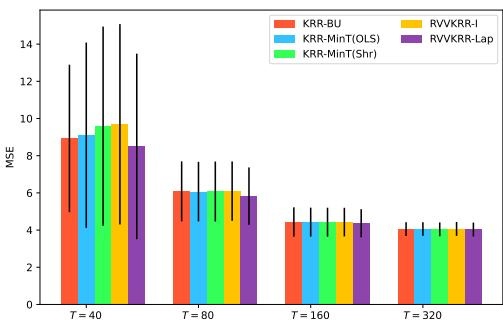  
Figure 1. All-level MSE on the synthetic dataset as a function of the training length T, with $\alpha = 0 . 6$

Experimental Results. Figure 1 illustrates the impact of the training length $T$ on the MSE across all levels. Employing a Laplacian OVK yields better results than using an identity kernel. Moreover, RVVKRR consistently outperforms the two-stage methods, particularly in low-data regimes $( T = 4 0 \mathrm { o r } T = 8 0 )$ . Additional results on the effect of the covariance scaling parameter α are reported in Section D.1.

## 5.2. TourismLarge Dataset

Dataset. We next consider the Australian domestic TourismLarge dataset (Wickramasuriya et al., 2019), which contains 228 monthly observations from January 1998 to December 2016. The hierarchy comprises $d \ : = \ : 4 1 5$ series: one country, 7 states, 27 zones, 76 regions, and 304 bottom-level region–purpose series. The four bottom-level purposes are holiday, visiting friends and relatives (VFR), business, and other.

Experimental Setting. We use the preceding 24 observations of each series as its covariates. After constructing these lags, 204 observations remain; the last 24 form the test set and the first 180 form the training set. Hyperparameters are selected by three-fold expanding-window cross-validation. Independent OLS and KRR each use only the 24 lags of the series being predicted. KRR uses a linear input kernel. For both independent estimators, we report unreconciled forecasts and forecasts reconciled using the reconciliation methods described in Section A.2. RVVKRR receives the concatenation of all series-specific lag blocks, hence $x _ { t } \in \mathbb { R } ^ { 2 4 d }$ . The OVK used by RVVKRR combines the non-separable base kernel of Example 2 with the MinT (shrinkage) projection of Example 3. The scalarvalued kernel in Equation (8) is the linear kernel. We take $B = B _ { \mathrm { p u r } } \in \mathbb { R } ^ { d \times 5 }$ , whose r-th row is the one-hot encoding of the membership of series r in either the aggregate category or one of the four travel-purpose categories. These relationships are not explicitly encoded by the aggregation matrix. The parameters λr are inherited from the independent KRR. Cross-validation selects $\rho = 0 . 1$

Table 1. Test MSE for KRR and RVVKRR at each aggregation level of TourismLarge, reported in millions $( 1 0 ^ { 6 } )$ . All sums the level-wise MSEs. † denotes unreconciled forecasts. Lower is better.
<table><tr><td>Method Ctry. State Zone Reg. Purp. All</td></tr><tr><td>KRR base forecasts Unreconciled † 2.71 1.69 1.30 1.19 1.13 8.02 Bottom-Up</td></tr><tr><td>8.06 2.53 1.53 1.21 1.13 14.46 Top-Down (AHP) 2.71 3.94 2.38 2.05 1.92 13.00</td></tr><tr><td>Top-Down (PHA) 2.71 3.89 2.37 2.04 1.92 12.94 MinT (OLS) 2.72 1.58 1.25 1.12 1.11 7.78</td></tr><tr><td>MinT (shrinkage) 3.05 51.601.21 1.08 1.06 7.99 MinT (WLS-var) 4.56 1.83 1.29 1.11 1.09 9.89</td></tr><tr><td>ERM (closed form) 5.36 2.50 2.61 2.57 2.52 15.57 RVVKRR 2.02 1.52 1.30 1.241.57 7.64</td></tr></table>

Experimental Results. Table 1 reports the test MSE at each aggregation level; the full comparison, including OLS base forecasts and alternative RVVKRR projections, is given in Section D.2. Relative to the matched two-stage KRR with MinT (shrinkage) baseline, the RVVKRR predictor with the CV-selected purpose prior $( \rho = 0 . 1 )$ reduces the all-level MSE from $7 . 9 9 \times 1 0 ^ { 6 }$ to $7 . 6 4 \times 1 0 ^ { 6 }$ . The gains are concentrated at the country and state levels, with larger errors at the lower levels.

## 5.3. Traffic Dataset

Dataset. We finally consider the SF Bay Area daily Traffic dataset, originally preprocessed by Ben Taieb and Koo (2019) and distributed with the HierarchicalForecast benchmark (Olivares et al., 2022). It contains 366 daily observations from January 1 to December 31, 2008, for d = 207 series arranged in four levels: one total series, two Level 2 aggregates, four Level 3 aggregates, and $d _ { b } = 2 0 0$ bottom-level series.

Experimental Setting. For each series $r ,$ the covariate vector $\boldsymbol { x } _ { t , r } ~ \in ~ \mathbb { R } ^ { 2 3 }$ contains 16 raw lag values at lags $1 , \ldots , 1 4 , 2 1$ , and 28, six Fourier features corresponding to harmonics $1 , 2 ,$ and 3 of the weekly period $P = 7 ,$ and a linear trend. As for TourismLarge, independent KRR uses only $x _ { t , i }$ to predict series r, whereas RVVKRR receives the concatenation $\boldsymbol { x } _ { t } = ( x _ { t , 1 } , \ldots , x _ { t , d } ) \in \mathbb { R } ^ { 2 3 d }$ . No feature standardization is applied. Independent KRR uses a linear kernel, with a separate ridge parameter $\lambda _ { r }$ selected for each series by time-series cross-validation. For RVVKRR, we set $\rho = 0$ in the base OVK of Example 2 and compose this kernel with a MinT projection as in Example 3. The parameters $\lambda _ { r }$ are inherited from the fitted independent KRR and set the relative regularization scales. We consider three projections inside the kernel: MinT (OLS), MinT (shrinkage), and MinT (WLS-var). Within each training window, the covariance proxies for the latter two are estimated from in-sample residuals of auxiliary independent KRR predictors. For each RVVKRR variant, the global regularization parameter λ is selected by cross-validation. The corresponding KRR+MinT baselines apply the same OLS, shrinkage, or variance-weighted projection to independently fitted KRR forecasts post hoc. The full comparison with additional models and further experimental details are provided in Section D.3.

Experimental Results. Table 2 shows that post-hoc MinT reconciliation does not necessarily improve independent KRR: OLS and shrinkage yield only marginal changes, while WLS-var degrades performance. In contrast, placing the shrinkage or WLS-var projection inside the joint RVVKRR fit substantially reduces the alllevel MSE. This benefit is not due to coherence alone, since RVVKRR-MinT (OLS) remains close to independent KRR. Unlike post-hoc reconciliation, which only transforms already fitted forecasts, an internal projection changes the RKHS geometry and allows the series-specific feature blocks to be estimated jointly. The resulting gains occur mainly at the aggregate levels, at the cost of some bottom-level accuracy under the stated all-level MSE objective.

Table 2. Test MSE at each aggregation level of Traffic, reported in thousands (103). All sums the level-wise MSEs. † denotes incoherent forecasts. Lower is better.
<table><tr><td rowspan=1 colspan=1>Method           L1  L2 L3Bottom All</td></tr><tr><td rowspan=1 colspan=1>KRR base forecastsUnreconciled †   8.9555.05 2.84 0.63 17.47MinT (OLS)     9.014.95 2.85 0.61 17.42MinT (shrinkage)9.164.83 2.69 0.60 17.28MinT (WLS-var)11.68 6.11 3.34 0.62 21.76</td></tr><tr><td rowspan=1 colspan=1>RVVKRR forecastsMinT (OLS)     8.994.93 2.79 0.61 17.32MinT (shrinkage)3.842.14 2.20 3.39 11.57MinT (WLS-var)0.32 0.24 0.44 3.02  4.03</td></tr></table>

## 6. Conclusion

We introduced RVVKRR, an end-to-end kernel framework for hierarchical time series forecasting that enforces coherence directly in the hypothesis space. Experiments on synthetic and real datasets show that embedding an appropriate hierarchical geometry within joint estimation can outperform post-hoc reconciliation, while coherence alone does not guarantee an improvement. Future work should learn the coherent kernel geometry from data, accommodate level-specific forecasting priorities, scale to larger hierarchies, and extend the analysis to dependent time-series observations.

## References

Athanasopoulos, G., Ahmed, R. A., and Hyndman, R. J. (2009). Hierarchical Forecasts for Australian Domestic Tourism. International Journal of Forecasting, 25(1):146–166.

Ben Taieb, S. and Koo, B. (2019). Regularized Regression for Hierarchical Forecasting Without Unbiasedness Conditions. In Proceedings ofthe 25th ACM SIGKDD International Conference on Knowledge Discovery & Data Mining, KDD ’19, pages 1337–1347, New York, NY, USA. Association for Computing Machinery.

Bonilla, E. V., Chai, K., and Williams, C. (2007). Multitask Gaussian Process Prediction. In Platt, J., Koller, D., Singer, Y., and Roweis, S., editors, Advances in Neural Information Processing Systems, volume 20, pages 153– 160. Curran Associates, Inc.

Bouche, D. (2023). Function-valued regression with kernels : Improving speed, flexibility and robustness. Theses, Institut Polytechnique de Paris.

Bouche, D., Clausel, M., Roueff, F., and d’Alche Buc, F.´ (2021). Nonlinear Functional Output Regression: A Dictionary Approach. In Banerjee, A. and Fukumizu, K., editors, Proceedings of The 24th International Conference on Artificial Intelligence and Statistics, volume 130 of Proceedings of Machine Learning Research, pages 235– 243. PMLR.

Box, G. E., Jenkins, G. M., Reinsel, G. C., and Ljung, G. M. (2015). Time Series Analysis: Forecasting and Control. John Wiley & Sons.

Brouard, C., d’Alche Buc, F., and Szafranski, M. (2011).´ Semi-supervised Penalized Output Kernel Regression for Link Prediction. In Getoor, L. and Scheffer, T., editors, Proceedings of the 28th International Conference on Machine Learning, pages 593–600, Bellevue, Washington, USA. Omnipress.

Brouard, C., Shen, H., Duhrkop, K., d’Alch¨ e Buc, F.,´ Bocker, S., and Rousu, J. (2016). Fast Metabolite Identi-¨ fication with Input Output Kernel Regression. Bioinformatics (Oxford, England), 32(12):i28–i36.

Brown, R. G. (1959). Statistical Forecasting for Inventory Control. McGraw-Hill.

Caponnetto, A. and De Vito, E. (2007). Optimal Rates for the Regularized Least-Squares Algorithm. Foundations ofComputational Mathematics, 7(3):331–368.

Caponnetto, A., Micchelli, C. A., Pontil, M., and Ying, Y. (2008). Universal Multi-Task Kernels. Journal of Machine Learning Research, 9(52):1615–1646.

Carmeli, C., De Vito, E., and Toigo, A. (2006). Vector Valued Reproducing Kernel Hilbert Spaces of Integrable Functions and Mercer Theorem. Analysis and Applications, 4(04):377–408.

Carmeli, C., De Vito, E., Toigo, A., and Umanita, V.´ (2010). Vector Valued Reproducing Kernel Hilbert Spaces and Universality. Analysis and Applications, 8(01):19–61.

Cini, A., Mandic, D., and Alippi, C. (2024). Graphbased Time Series Clustering for End-to-End Hierarchical Forecasting. In Salakhutdinov, R., Kolter, Z., Heller, K., Weller, A., Oliver, N., Scarlett, J., and Berkenkamp, F., editors, Proceedings ofthe 41st International Conference on Machine Learning, pages 8985–8999. PMLR.

Cutajar, K., Osborne, M., Cunningham, J., and Filippone, M. (2016). Preconditioning Kernel Matrices. In Proceedings of the 33rd International Conference on Machine Learning, pages 2529–2538, New York, New York, USA. PMLR.

Doumeche, N., Bach, F. R., Bedek, E., Biau, G., Boyer,\` C., and Goude, Y. (2025). Forecasting Time Series with Constraints. CoRR, abs/2502.10485.

Evgeniou, T., Micchelli, C. A., and Pontil, M. (2005). Learning Multiple Tasks with Kernel Methods. Journal of Machine Learning Research, 6(21):615–637.

Evgeniou, T., Pontil, M., and Poggio, T. (2000). Regularization Networks and Support Vector Machines. Advances in Computational Mathematics, 13(1):1–50.

Golub, G., Nash, S., and Van Loan, C. (1979). A Hessenberg-Schur method for the problem AX + XB= C. IEEE Transactions on Automatic Control, 24(6):909– 913.

Gross, C. W. and Sohl, J. E. (1990). Disaggregation Methods to Expedite Product Line Forecasting. Journal of Forecasting, 9(3):233–254.

Hestenes, M. R. and Stiefel, E. (1952). Methods of Conjugate Gradients for Solving Linear Systems. Journal of Research of the National Bureau of Standards, 49(6):409–436.

Higham, N. J. (1988). Computing a Nearest Symmetric Positive Semidefinite Matrix. Linear Algebra and its Applications, 103:103–118.

Hyndman, R. J., Ahmed, R. A., Athanasopoulos, G., and Shang, H. L. (2011). Optimal Combination Forecasts for Hierarchical Time Series. Computational Statistics & Data Analysis, 55(9):2579–2589.

Hyndman, R. J. and Athanasopoulos, G. (2018). Forecasting: Principles and Practice. OTexts.

Kadri, H., Duflos, E., Preux, P., Canu, S., Rakotomamonjy, A., and Audiffren, J. (2016). Operator-valued Kernels for Learning from Functional Response Data. Journal of Machine Learning Research, 17(20):1–54.

Kadri, H., Ghavamzadeh, M., and Preux, P. (2013). A Generalized Kernel Approach to Structured Output Learning. In Dasgupta, S. and McAllester, D., editors, Proceedings of the 30th International Conference on Machine Learning, volume 28 of Proceedings of Machine Learning Research, pages 471–479, Atlanta, Georgia, USA. PMLR. Issue: 1.

Makridakis, S., Spiliotis, E., and Assimakopoulos, V. (2022). The M5 Competition: Background, Organization, and Implementation. International Journal of Forecasting, 38(4):1325–1336.

Mancuso, P., Piccialli, V., and Sudoso, A. M. (2021). A Machine Learning Approach for Forecasting Hierarchical Time Series. Expert Systems with Applications, 182:115102.

Micchelli, C. and Pontil, M. (2004). Kernels for Multi–task Learning. In Saul, L., Weiss, Y., and Bottou, L., editors, Advances in Neural Information Processing Systems, volume 17. MIT Press.

Micchelli, C. A. and Pontil, M. (2005). On Learning Vector-Valued Functions. Neural Computation, 17(1):177–204.

Minh, H. Q., Bazzani, L., and Murino, V. (2016). A Unifying Framework in Vector-valued Reproducing Kernel Hilbert Spaces for Manifold Regularization and Co-Regularized Multi-view Learning. Journal of Machine Learning Research, 17(25):1–72.

Nespoli, L., Medici, V., Lopatichki, K., and Sossan, F. (2020). Hierarchical Demand Forecasting Benchmark for the Distribution Grid. Electric Power Systems Research, 189:106755.

Olivares, K. G., Garza, F., Luo, D., Challu, C., Mergenthaler, M., and Dubrawski, A. (2022). HierarchicalForecast: A Reference Framework for Hierarchical Forecasting in Python. CoRR, abs/2207.03517.

Pedrick, G. (1957). Theory of Reproducing Kernels for Hilbert Spaces of Vector Valued Functions. PhD Thesis, University of Kansas.

Peypouquet, J. (2015). Convex Optimization in Normed Spaces: Theory, Methods and Examples. Springer Cham.

Pinelis, I. (1994). Optimum Bounds for the Distributions of Martingales in Banach Spaces. The Annals of Probability, 22(4).

Rangapuram, S. S., Werner, L. D., Benidis, K., Mercado, P., Gasthaus, J., and Januschowski, T. (2021). End-to-End Learning of Coherent Probabilistic Forecasts for Hierarchical Time Series. In Meila, M. and Zhang, T., editors, Proceedings of the 38th International Conference on Machine Learning, volume 139 of Proceedings of Machine Learning Research, pages 8832–8843. PMLR.

Rudi, A., Carratino, L., and Rosasco, L. (2017). FALKON: An Optimal Large Scale Kernel Method. In Guyon, I., Luxburg, U. V., Bengio, S., Wallach, H., Fergus, R., Vishwanathan, S., and Garnett, R., editors, Advances in Neural Information Processing Systems, pages 3888– 3898. Curran Associates, Inc.

Salinas, D., Bohlke-Schneider, M., Callot, L., Medico, R., and Gasthaus, J. (2019). High-Dimensional Multivariate Forecasting with Low-Rank Gaussian Copula Processes. In Wallach, H., Larochelle, H., Beygelzimer, A., dAlche Buc, F., Fox, E., and Garnett, R., editors,´ Advances in Neural Information Processing Systems, volume 32, pages 6827–6837. Curran Associates, Inc.

Saunders, C., Gammerman, A., and Vovk, V. (1998). Ridge Regression Learning Algorithm in Dual Variables. In Proceedings of the Fifteenth International Conference on Machine Learning, ICML ’98, pages 515–521, San Francisco, CA, USA. Morgan Kaufmann Publishers Inc.

Schwartz, L. (1964). Sous-espaces hilbertiens d’espaces vectoriels topologiques et noyaux associes (Noyaux´ reproduisants). Journal d’Analyse Mathematique ´ , 13(1):115–256.

Sheldon, D. (2008). Graphical Multi-Task Learning. In NeurIPS Workshop on Structured Input and Structured Output.

Sima, V. (1996). Algorithms for Linear-Quadratic Optimization. CRC Press LLC, Milton.

Simoncini, V. (2016). Computational Methods for Linear Matrix Equations. SIAM Review, 58(3):377–441.

Sindhwani, V., Minh, H. Q., and Lozano, A. C. (2013). Scalable Matrix-Valued Kernel Learning for High-Dimensional Nonlinear Multivariate Regression and Granger Causality. In Proceedings of the 29th Conference on Uncertainty in Artificial Intelligence, pages 586–595, Bellevue, WA. AUAI Press.

Smale, S. and Zhou, D.-X. (2005). Shannon Sampling II: Connections to Learning Theory. Computational Harmonic Analysis - Part 1, 19(3):285–302.

Smale, S. and Zhou, D.-X. (2007). Learning Theory Estimates via Integral Operators and Their Approximations. Constructive Approximation, 26(2):153–172.

Tsiourvas, A., Sun, W., Perakis, G., Chen, P.-Y., and Zhu, Y. (2024). Learning Optimal Projection for Forecast Reconciliation of Hierarchical Time Series. In Salakhutdinov, R., Kolter, Z., Heller, K., Weller, A., Oliver, N., Scarlett, J., and Berkenkamp, F., editors, Proceedings ofthe 41st International Conference on Machine Learning, volume 235 of Proceedings of Machine Learning Research, pages 48713–48727. PMLR.

Wickramasuriya, S. L., Athanasopoulos, G., and Hyndman, R. J. (2019). Optimal Forecast Reconciliation for Hierarchical and Grouped Time Series Through Trace Minimization. Journal of the American Statistical Association, 114(526):804–819.

Widmer, C., Leiva, J., Altun, Y., and Ratsch, G. (2010).¨ Leveraging Sequence Classification by Taxonomy-Based Multitask Learning. In Research in Computational Molecular Biology, pages 522–534, Berlin, Heidelberg.

Wu, H., Xu, J., Wang, J., and Long, M. (2021). Autoformer: Decomposition Transformers with Auto-Correlation for Long-Term Series Forecasting. In Ranzato, M., Beygelzimer, A., Dauphin, Y., Liang, P., and Vaughan, J. W., editors, Advances in Neural Information Processing Systems, volume 34, pages 22419–22430. Curran Associates, Inc.

Zhou, F., Pan, C., Ma, L., Liu, Y., Wang, S., Zhang, J., Zhu, X., Hu, X., Hu, Y., Zheng, Y., Lei, L., and Yun, H. (2023). SLOTH: Structured Learning and Task-Based Optimization for Time Series Forecasting on Hierarchies. In Proceedings of the AAAI Conference on Artificial Intelligence, volume 37, pages 11417–11425.

Alvarez, M. A., Rosasco, L., and Lawrence, N. D. (2012).´ Kernels for Vector-Valued Functions: A Review. Foundations and Trends® in Machine Learning, 4(3):195– 266.

## A. Additional Preliminaries

## A.1. Hierarchical Time Series Example

Example 4 gives an illustration of such a hierarchical time series.

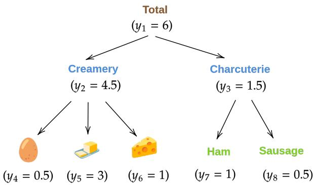  
Figure 2. A three level hierarchical time series example for the daily raw material demand of a creperie.ˆ

Example 4 Imagine that we have 5 univariate time series representing the daily raw material demand of a creperie, forˆ example: eggs, butter, cheese, sausage, and ham. The demand for these products can be aggregated to form two new univariate time series representing, respectively, the charcuterie and creamery categories. These two time series can be further aggregated to obtain the total demand. The hierarchical structure is shown in Figure 2. In this example, the summation matrix is defined asfollows:

$$
S _ { \mathrm { s u m } } = \Bigg [ 1 \begin{array} { c c c c c } { { 1 } } & { { 1 } } & { { 1 } } & { { 1 } } & { { 1 } } \\ { { 1 } } & { { 1 } } & { { 1 } } & { { 0 } } & { { 0 } } \\ { { 0 } } & { { 0 } } & { { 0 } } & { { 1 } } & { { 1 } } \end{array} \Bigg ] .\tag{16}
$$

## A.2. Reconciliation Strategies

As explained in Section 2.1, a linear reconciliation method transforms a base forecast $\tilde { y } _ { t } \in \mathbb { R } ^ { d }$ into the coherent forecast

$$
\hat { y } _ { t } = S G \tilde { y } _ { t } \in \operatorname { I m } ( S ) ,
$$

where $G \in \mathbb { R } ^ { d _ { b } \times d }$ maps forecasts from all levels of the hierarchy to the bottom level. The main classical strategies differ in how they choose $G .$

Bottom-up reconciliation. The bottom-up approach retains the bottom-level base forecasts and discards the forecasts at the aggregate levels. Its reconciliation matrix is

$$
G _ { \mathrm { B U } } = \left[ 0 _ { d _ { b } \times d _ { a } } \quad I _ { d _ { b } } \right] .
$$

Thus, $G _ { \mathrm { B U } } \tilde { y } _ { t }$ selects the bottom-level forecasts, which are then aggregated by $S$ to recover forecasts at every level of the hierarchy.

Top-down reconciliation. The top-down approach starts from the base forecast of the top-level series and disaggregates it across the bottom-level series (Gross and Sohl, 1990). It uses

$$
\begin{array} { r } { G _ { \mathrm { T D } } = \left[ \boldsymbol { p } \quad 0 _ { d _ { b } \times ( d - 1 ) } \right] , \qquad \boldsymbol { p } \in \mathbb { R } ^ { d _ { b } } , } \end{array}
$$

where $p$ contains the disaggregation proportions. Let $y _ { t } ^ { \mathrm { t o p } } \in \mathbb { R }$ denote the observed top-level series and let $y _ { t , i } ^ { b }$ denote the i-th bottom-level series, for $t \in \{ 1 , \ldots , T \}$ and $i \in \{ 1 , \ldots , d _ { b } \}$ . The average historical proportions (AHP) method averages the share of each bottom-level series at every training time:

$$
p _ { i } ^ { \mathrm { A H P } } = \frac { 1 } { T } \sum _ { t = 1 } ^ { T } \frac { y _ { t , i } ^ { b } } { y _ { t } ^ { \mathrm { t o p } } } , \qquad i \in \{ 1 , \dots , d _ { b } \} .
$$

By contrast, the proportions ofthe historical averages (PHA) method computes the share from the historical mean of each series:

$$
p _ { i } ^ { \mathrm { P H A } } = \frac { T ^ { - 1 } \sum _ { t = 1 } ^ { T } y _ { t , i } ^ { b } } { T ^ { - 1 } \sum _ { t = 1 } ^ { T } y _ { t } ^ { \mathrm { t o p } } } = \frac { \sum _ { t = 1 } ^ { T } y _ { t , i } ^ { b } } { \sum _ { t = 1 } ^ { T } y _ { t } ^ { \mathrm { t o p } } } , \qquad i \in \{ 1 , \dots , d _ { b } \} .
$$

For coherent training data, both choices satisfy $\begin{array} { r } { \sum _ { i = 1 } ^ { d _ { b } } p _ { i } = 1 } \end{array}$ . The vector $p = ( p _ { 1 } , \ldots , p _ { d _ { b } } ) ^ { \mathsf { T } }$ obtained with either method is then used in $G _ { \mathrm { T D } }$ above.

MinT reconciliation. Let $W \in \mathbb { S } _ { + + } ^ { d }$ be a positive-definite covariance proxy for the base-forecast errors. The minimum trace (MinT) reconciliation matrix and its associated coherent projection are (Wickramasuriya et al., 2019)

$$
G _ { W } = ( S ^ { \mathsf { T } } W ^ { - 1 } S ) ^ { - 1 } S ^ { \mathsf { T } } W ^ { - 1 } , \qquad P _ { W } = S G _ { W } .
$$

Ideally, W is the covariance matrix $\mathrm { c o v } ( y _ { t } - \tilde { y } _ { t } )$ , but this quantity is unknown and must be estimated. Let

$$
\widehat { W } = \frac { 1 } { T } \sum _ { t = 1 } ^ { T } ( y _ { t } - \tilde { y } _ { t } ) ( y _ { t } - \tilde { y } _ { t } ) ^ { \top }
$$

denote the empirical covariance of the base-forecast errors over the $T$ training observations. The variants used in our experiments correspond to the following choices of the covariance proxy.

OLS. The OLS reconciliation of Hyndman et al. (2011) is the special case of MinT obtained with

$$
{ \cal W } _ { \mathrm { O L S } } = I _ { d } .
$$

Indeed,

$$
G _ { W _ { \mathrm { O L S } } } = ( S ^ { \mathsf { T } } S ) ^ { - 1 } S ^ { \mathsf { T } } , \qquad P _ { W _ { \mathrm { O L S } } } = S ( S ^ { \mathsf { T } } S ) ^ { - 1 } S ^ { \mathsf { T } } ,
$$

so $P _ { W _ { \mathrm { O L S } } }$ is the orthogonal projector onto Im(S).

WLS-variance. The weighted least squares variance variant retains only the marginal base-forecast error variances:

$$
W _ { \mathrm { W L S } } = \mathrm { d i a g } ( \widehat { W } ) = \mathrm { d i a g } ( \widehat { \sigma } _ { 1 } ^ { 2 } , \ldots , \widehat { \sigma } _ { d } ^ { 2 } ) ,
$$

where $\widehat { \sigma } _ { r } ^ { 2 }$ is the empirical error variance of series r. This diagonal proxy ignores cross-series error correlations.

Shrinkage. The shrinkage variant combines the full empirical covariance matrix with its diagonal counterpart:

$$
W _ { \mathrm { s h r } } = ( 1 - \alpha ) \widehat { W } + \alpha \mathrm { d i a g } ( \widehat { W } ) , \qquad \alpha \in ( 0 , 1 ] .
$$

It therefore preserves estimated cross-series error correlations while shrinking them toward zero. For a comprehensive review of classical reconciliation strategies, see Hyndman and Athanasopoulos (2018) and the references therein.

## A.3. Separable Operator-Valued Kernels

Separable OVKs provides a clear decoupling between the contribution of input and output, where k measures input similarity and A encodes the relationships between output components, which makes them highly interpretable compared to general OVKs. Moreover, they simplify massively the computation burden for some kernel-based learning algorithms such as multi-task kernel regression (Micchelli and Pontil, 2004) or multi-task Gaussian processes (Bonilla et al., 2007). See, e.g., Alvarez et al.´ (2012, Section 6) for the discussion on the computation consideration.

## A.4. Operator-Valued Kernels in Supervised Learning

In multi-task learning, for instance, it is natural to take the output space to be $\mathbb { R } ^ { d }$ where d denotes the number of related tasks whose joint learning may yield mutual benefits (Micchelli and Pontil, 2004; Evgeniou et al., 2005). More recently, several works have focused on predicting functional data by setting $\mathscr { V } = L ^ { 2 } ( \Omega )$ , the set of square integrable functions on a given compact set $\Omega \subset \mathbb { R } ^ { d }$ (Kadri et al., 2016; Bouche et al., 2021; Bouche, 2023). In the context of structured prediction, complex output objects can be embedded into an RKHS $\mathcal { H } _ { k }$ using a scalar-valued kernel $k : \mathcal { V } \times \mathcal { V } \to \mathbb { R }$ , so that the

learning problem can be performed by finding a function in an $\mathcal { H } _ { k ^ { - } }$ valued RKHS (Brouard et al., 2011; Kadri et al., 2013;   
Brouard et al., 2016).

Moreover, learning functions of the form $f = P \circ h$ where $P : \mathcal { W }  \mathcal { V }$ is a bounded linear operator and $h : \mathcal { X }  \mathcal { W }$ is a function from a W-valued RKHS, is not totally new in the kernel literature. In vector-valued multi-view learning, Minh et al. (2016) consider P as the combination operator that transforms the output from the m view in $\mathcal { W } = \mathcal { V } ^ { m }$ into a single output in Y. In Bouche et al. (2021), the operator $P$ is a projection operator that transforms the expansion coefficient $u \in \mathcal { W } = \mathbb { R } ^ { d }$ to a function $\textstyle \sum _ { l = 1 } ^ { d } u _ { l } \phi _ { l } \in \mathcal { Y } = L ^ { 2 } ( \Omega )$ where $( \phi _ { l } ) _ { l = 1 } ^ { d } \in L ^ { 2 } ( \Omega ) ^ { d }$ is a dictionary of functions

## B. Additional Details for Section 3

## B.1. Dimension of the Coherent Forecast Space

Lemma B.1 Let S be the aggregation matrix defined in Equation 1. Then $\dim ( \operatorname { I m } ( S ) ) = d _ { b }$ , where $d _ { b }$ is the number of bottom-level series.

Proof Suppose that we have $S v = 0$ for some $v \in \mathbb { R } ^ { d _ { b } }$ . By definition of the matrix S, we have

$$
\left[ \begin{array} { l } { S _ { \mathrm { s u m } } } \\ { I _ { d _ { b } } } \end{array} \right] v = \left[ \begin{array} { c } { S _ { \mathrm { s u m } } v } \\ { v } \end{array} \right] = 0 .
$$

The lower block gives $v \ = \ 0 ,$ . So the only solution of $S v \ = \ 0 { \mathrm { ~ i s ~ } } v \ = \ 0$ . Thus, we have $\mathrm { K e r } ( S ) = \{ 0 \}$ and dim $( \mathrm { K e r } ( S ) ) = 0 .$ By the rank–nullity theorem, we can conclude that dim $\left( \operatorname { I m } ( S ) \right) = \dim ( \mathbb { R } ^ { d _ { b } } ) - \dim ( \operatorname { K e r } ( S ) ) = d _ { b } .$

## B.2. Proof of Lemma 3.1

Proof Let $A \in { \mathcal { L } } ( \operatorname { I m } ( S ) )$ be self-adjoint and positive, and set $P : = U _ { S } U _ { S } ^ { \mathsf { T } }$ , the orthogonal projection onto $\operatorname { I m } ( S )$ . Define

$$
\begin{array} { r } { A ^ { \prime } : = U _ { S } ^ { \mathsf { T } } A U _ { S } \in \mathbb { R } ^ { d _ { b } \times d _ { b } } . } \end{array}
$$

This composition is well-defined since $U _ { S }$ maps $\mathbb { R } ^ { d _ { b } }$ into $\operatorname { I m } ( S )$ . For every $y \in \operatorname { I m } ( S )$ , Ay belongs to $\operatorname { I m } ( S )$ , so $P y = y$ and $P A y = A y$ . Consequently,

$$
U _ { S } A ^ { \prime } U _ { S } ^ { \mathsf { T } } y = P A P y = A y , \qquad \forall y \in \operatorname { I m } ( S ) .
$$

Thus, $U _ { S } A ^ { \prime } U _ { S } ^ { \mathsf { T } }$ is a matrix representation of A.

For any $v , w \in \mathbb { R } ^ { d _ { b } }$ , self-adjointness of A gives

$$
\begin{array} { r } { \langle A ^ { \prime } v , w \rangle _ { \mathbb { R } ^ { d _ { b } } } = \langle A U _ { S } v , U _ { S } w \rangle _ { \mathbb { R } ^ { d } } = \langle U _ { S } v , A U _ { S } w \rangle _ { \mathbb { R } ^ { d } } = \langle v , A ^ { \prime } w \rangle _ { \mathbb { R } ^ { d _ { b } } } . } \end{array}
$$

Hence $A ^ { \prime }$ is symmetric. Positivity of A also yields

$$
\begin{array} { r } { \langle A ^ { \prime } v , v \rangle _ { \mathbb R ^ { d _ { b } } } = \langle A U _ { S } v , U _ { S } v \rangle _ { \mathbb R ^ { d } } \geq 0 , \qquad \forall v \in \mathbb R ^ { d _ { b } } , } \end{array}
$$

so $A ^ { \prime }$ is positive semi-definite.

## B.3. Diagonal-based Separable OVKs

A specific choice of the separable OVK is to consider a diagonal matrix as $A ^ { \prime } .$ , i.e., ${ \cal K } ( x , x ^ { \prime } ) = k ( x , x ^ { \prime } ) U _ { S } A ^ { \prime } U _ { S } ^ { \sf T }$ with

$$
A ^ { \prime } = \operatorname* { d i a g } \left( \lambda _ { 1 } , \ldots , \lambda _ { d _ { b } } \right)\tag{17}
$$

where $\lambda _ { i } > 0$ for all $i \in \{ 1 , \ldots , d _ { b } \}$ . We will show here actually this predictor corresponds to the one of a learning algorithm based on $d _ { b }$ independent predictors of kernel ridge regression (KRR, Saunders et al., 1998; Evgeniou et al., 2000).

When $A ^ { \prime }$ is defined as in Equation (17), solving Equation (52) equals to solving the following linear system

$$
\frac { T \lambda } { \lambda _ { i } } e _ { i } + K e _ { i } = \left( Y ^ { \mathsf { T } } U _ { S } \right) _ { : , i } \quad \mathrm { w i t h } \ e _ { i } \in \mathbb { R } ^ { T }\tag{18}
$$

for all $i \in \{ 1 , \ldots , d _ { b } \}$ , and then defining E such that $\begin{array} { r } { E _ { i , : } = \frac { e _ { i } ^ { \mathsf { T } } } { \lambda _ { i } } } \end{array}$ . We observe that Equation (18) actually corresponds to the linear system arising in KRR (see, e.g., Evgeniou et al., 2000, Equation (4.3)), where the regularization parameter is $\frac { \lambda } { \lambda _ { i } }$ and the training label corresponds to the i-th component of the transformed output $\boldsymbol { y } ^ { \prime } = \boldsymbol { U } _ { S } ^ { \mathsf { T } } \boldsymbol { y } \in \mathbb { R } ^ { d _ { b } }$

For a new input $x \in \mathcal { X }$ , let $k _ { x } = ( k ( x , x _ { 1 } ) , \ldots , k ( x , x _ { T } ) ) ^ { \mathsf { T } }$ and denote the corresponding scalar KRR predictions by $\hat { g } _ { i } ( x ) = e _ { i } ^ { \mathsf { T } } k _ { x }$ . Since the i-th row of $A ^ { \prime } E$ is $e _ { i } ^ { \mathsf { T } }$ , the RVVKRR prediction is

$$
\hat { f } ( x ) = U _ { S } A ^ { \prime } E k _ { x } = U _ { S } \left[ \begin{array} { c } { { \hat { g } _ { 1 } ( x ) } } \\ { { \vdots } } \\ { { \hat { g } _ { d _ { b } } ( x ) } } \end{array} \right] .\tag{19}
$$

Thus, the predictor is obtained by fitting $d _ { b }$ independent KRR predictors to the transformed output coordinates and mapping their predictions back to Im(S) through $U _ { S }$

## B.4. Proof of Lemma 3.2

Proof We denote the objective function by $J ( A ^ { \prime } ) = \left\| M - U _ { S } A ^ { \prime } U _ { S } ^ { \mathsf { T } } \right\| _ { \mathsf { F } } ^ { 2 } .$ . Since the objective function is continuous and coercive, and the PSD cone $\mathbb { S } _ { + } ^ { d _ { b } }$ is closed, there exists a minimizer. Moreover, since J is strictly convex, the minimizer is unique. Actually, the minimization problem is a so-called convex quadratic SDP problem. Due to the fact that

$$
J ( A ^ { \prime } ) = \left\| U _ { S } A ^ { \prime } U _ { S } ^ { \mathsf { T } } \right\| _ { \mathsf { F } } ^ { 2 } - 2 \left. M , U _ { S } A ^ { \prime } U _ { S } ^ { \mathsf { T } } \right. _ { \mathsf { F } } + \left\| M \right\| _ { \mathsf { F } } ^ { 2 }\tag{20}
$$

$$
= \left\| \boldsymbol { A } ^ { \prime } \right\| _ { \mathrm { F } } ^ { 2 } - 2 \left. \boldsymbol { U } _ { S } ^ { \mathsf { T } } \boldsymbol { M } \boldsymbol { U } _ { S } , \boldsymbol { A } ^ { \prime } \right. _ { \mathrm { F } } + \left\| \boldsymbol { M } \right\| _ { \mathrm { F } } ^ { 2 } ,\tag{21}
$$

we have

$$
\arg \operatorname* { m i n } _ { A ^ { \prime } \in \mathbb { S } _ { + } ^ { d _ { b } } } J ( A ^ { \prime } ) = \arg \operatorname* { m i n } _ { A ^ { \prime } \in \mathbb { S } _ { + } ^ { d _ { b } } } { \| A ^ { \prime } \| } _ { \mathrm { F } } ^ { 2 } - 2 \left. U _ { S } ^ { \mathsf { T } } M U _ { S } , A ^ { \prime } \right. _ { \mathrm { F } } + \left\| U _ { S } ^ { \mathsf { T } } M U _ { S } \right\| _ { \mathrm { F } } ^ { 2 }\tag{22}
$$

$$
\begin{array} { r } { = \arg \operatorname* { m i n } _ { \mathbf { \theta } } \left\| \boldsymbol { A } ^ { \prime } - \boldsymbol { U } _ { S } ^ { \mathsf { T } } \boldsymbol { M } \boldsymbol { U } _ { S } \right\| _ { \mathrm { F } } ^ { 2 } } \\ { \quad \left. \boldsymbol { A } ^ { \prime } \boldsymbol { \in } \mathbb { S } _ { + } ^ { d _ { b } } \right. } \end{array}\tag{23}
$$

whose solution is the nearest PSD matrix of $U _ { S } ^ { \mathsf { T } } M U _ { S }$ in Frobenius norm. Higham (1988) shows that the solution is obtained by eigenvalue decomposition of $U _ { S } ^ { \mathsf { T } } M U _ { S }$ and zeroing out negative eigenvalues, thus concluding the proof of the lemma.

## B.5. Proof of Corollary 3.3

Proof By Lemma 3.2, we have arg min $_ { A ^ { \prime } \in \mathbb { S } _ { + } ^ { d _ { b } } } \left\| M - U _ { S } A ^ { \prime } U _ { S } ^ { \top } \right\| _ { \mathrm { F } } ^ { 2 } = \arg \operatorname* { m i n } _ { A ^ { \prime } \in \mathbb { S } _ { + } ^ { d _ { b } } } \left\| A ^ { \prime } - U _ { S } ^ { \top } M U _ { S } \right\| _ { \mathrm { F } } ^ { 2 }$ . Since $\boldsymbol { M } \in \mathbb { S } _ { + } ^ { d }$ , it follows that $U _ { S } ^ { \mathsf { T } } M U _ { S } \in \mathbb { S } _ { + } ^ { d _ { b } }$ . Consequently, $A _ { \mathrm { o p t } } ^ { \prime } = U _ { S } ^ { \mathsf { T } } M U _ { S } \in \mathbb { S } _ { + } ^ { d _ { b } }$ . It then follows that

$$
A _ { \mathrm { o p t } } = U _ { S } A _ { \mathrm { o p t } } ^ { \prime } U _ { S } ^ { \mathsf { T } } = U _ { S } U _ { S } ^ { \mathsf { T } } M U _ { S } U _ { S } ^ { \mathsf { T } } = P M P\tag{24}
$$

where $P : = U _ { S } U _ { S } ^ { \mathsf { T } }$ is actually the orthogonal projection onto Im(S).

## B.6. Existence of Feature Map for the Non-separable OVK Defined in Example 2

Proposition B.2 ${ \widetilde { \kappa } } _ { \rho }$ defined in Example 2 is a valid OVK since it admits afeature operator $\Gamma _ { \rho }$ such thatfor all $x , x ^ { \prime } \in { \mathcal { X } } ,$

$$
\widetilde { \cal K } _ { \rho } ( x , x ^ { \prime } ) = \Gamma _ { \rho } ( x ) \Gamma _ { \rho } ( x ^ { \prime } ) ^ { * } ,\tag{25}
$$

where the feature operator $\Gamma _ { \rho } ( x ) : \mathbb { R } ^ { q _ { \rho } \times p _ { \phi } }  \mathbb { R } ^ { d }$ is defined, for all $r \in \{ 1 , \ldots , d \}$ , by

$$
[ \Gamma _ { \rho } ( x ) \Theta ] _ { r } = \frac { 1 } { \sqrt { \lambda _ { r } } } \left. \phi ( x _ { r } ) , \Theta ^ { \top } ( L _ { \rho } ) _ { r , : } ^ { \top } \right. ,\tag{26}
$$

and its adjoint is

$$
\Gamma _ { \rho } ( x ) ^ { * } \boldsymbol { v } = \sum _ { r = 1 } ^ { d } \frac { v _ { r } } { \sqrt { \lambda _ { r } } } ( L _ { \rho } ) _ { r , : } ^ { \top } \phi ( x _ { r } ) ^ { \top } \in \mathbb { R } ^ { q _ { \rho } \times p _ { \phi } } ,\tag{27}
$$

where $L _ { \rho } \in \mathbb { R } ^ { d \times q _ { \rho } }$ is any factor satisfying $A _ { \rho } = L _ { \rho } L _ { \rho } ^ { \mathsf { T } }$

Proof First, $A _ { \rho }$ is positive semidefinite. Indeed, for every $v \in \mathbb { R } ^ { d }$

$$
v ^ { \mathsf { T } } A _ { \rho } v = ( 1 - \rho ) \left\| v \right\| _ { \mathbb { R } ^ { d } } ^ { 2 } + \rho \left\| B ^ { \mathsf { T } } v \right\| _ { \mathbb { R } ^ { q } } ^ { 2 } \geq 0 .\tag{28}
$$

It therefore admits a factorization $A _ { \rho } = L _ { \rho } L _ { \rho } ^ { \mathsf { T } }$ , where we may take $q _ { \rho } = \mathrm { r a n k } ( A _ { \rho } )$ and $L _ { \rho } \in \mathbb { R } ^ { d \times q _ { \rho } }$

Equip the feature space $\mathcal { F } _ { \rho } = \mathbb { R } ^ { q _ { \rho } \times p _ { \phi } }$ with the Frobenius inner product. For $x \in \mathcal { X }$ , define the linear operator $\Gamma _ { \rho } ( x )$ $\mathcal { F } _ { \rho } \to \mathbb { R } ^ { d }$ as

$$
[ \Gamma _ { \rho } ( x ) \Theta ] _ { r } = \frac { 1 } { \sqrt { \lambda _ { r } } } \left. \phi ( x _ { r } ) , \Theta ^ { \top } ( L _ { \rho } ) _ { r , : } ^ { \top } \right. .\tag{29}
$$

For every $\Theta \in \mathcal { F } _ { \rho }$ and $v \in \mathbb { R } ^ { d }$ , we have

$$
\langle \Gamma _ { \rho } ( x ) \Theta , v \rangle _ { \mathbb { R } ^ { d } } = \sum _ { r = 1 } ^ { d } \frac { v _ { r } } { \sqrt { \lambda _ { r } } } \left. \phi ( x _ { r } ) , \Theta ^ { \mathsf { T } } ( L _ { \rho } ) _ { r , : } ^ { \mathsf { T } } \right. _ { \mathbb { R } ^ { p _ { \phi } } }\tag{30}
$$

$$
= \left. \Theta , \sum _ { r = 1 } ^ { d } \frac { v _ { r } } { \sqrt { \lambda _ { r } } } ( L _ { \rho } ) _ { r , : } ^ { \mathsf { T } } \phi ( x _ { r } ) ^ { \mathsf { T } } \right. _ { \mathcal { F } _ { \rho } } .\tag{31}
$$

Hence its adjoint is precisely the following operator:

$$
\Gamma _ { \rho } ( x ) ^ { * } \boldsymbol { v } = \sum _ { r = 1 } ^ { d } \frac { v _ { r } } { \sqrt { \lambda _ { r } } } ( L _ { \rho } ) _ { r , : } ^ { \top } \phi ( x _ { r } ) ^ { \top } \in \mathbb { R } ^ { q _ { \rho } \times p _ { \phi } } .\tag{32}
$$

It remains to verify the factorization of the kernel. For any $\boldsymbol { \mathrm { { r } } } , \boldsymbol { x } ^ { \prime } \in \mathcal { X } , \boldsymbol { v } \in \mathbb { R } ^ { d }$ , and $r \in \{ 1 , \ldots , d \}$ ,

$$
[ \Gamma _ { \rho } ( \boldsymbol { x } ) \Gamma _ { \rho } ( \boldsymbol { x } ^ { \prime } ) ^ { * } \boldsymbol { v } ] _ { r } = \frac { 1 } { \sqrt { \lambda _ { r } } } \left. \phi ( \boldsymbol { x } _ { r } ) , \left( \sum _ { s = 1 } ^ { d } \frac { v _ { s } } { \sqrt { \lambda _ { s } } } ( \boldsymbol { L } _ { \rho } ) _ { s , : } ^ { \top } \phi ( \boldsymbol { x } _ { s } ^ { \prime } ) ^ { \top } \right) ^ { \top } ( \boldsymbol { L } _ { \rho } ) _ { r , : } ^ { \top } \right. _ { \mathbb { R } ^ { p _ { \phi } } }\tag{33}
$$

$$
= \sum _ { s = 1 } ^ { d } \frac { ( L _ { \rho } ) _ { r , : } ( L _ { \rho } ) _ { s , : } ^ { \mathsf { T } } } { \sqrt { \lambda _ { r } \lambda _ { s } } } \langle \phi ( x _ { r } ) , \phi ( x _ { s } ^ { \prime } ) \rangle _ { \mathbb { R } ^ { p _ { \phi } } } v _ { s }\tag{34}
$$

$$
= \sum _ { s = 1 } ^ { d } \frac { ( A _ { \rho } ) _ { r s } } { \sqrt { \lambda _ { r } \lambda _ { s } } } k ( x _ { r } , x _ { s } ^ { \prime } ) v _ { s } = [ \widetilde { K } _ { \rho } ( x , x ^ { \prime } ) v ] _ { r } .\tag{35}
$$

Since this identity holds for every $v \in \mathbb { R } ^ { d }$ , it follows that

$$
\widetilde { \cal K } _ { \rho } ( x , x ^ { \prime } ) = \Gamma _ { \rho } ( x ) \Gamma _ { \rho } ( x ^ { \prime } ) ^ { * } .\tag{36}
$$

Thus ${ \widetilde { \kappa } } _ { \rho }$ is a valid operator-valued kernel, and $\Gamma _ { \rho }$ is one of its feature operators.

## B.7. Proof of the Equivalence of the Two Learning Formulations

The following lemma summarizes the relationship between the RKHS associated to ${ \kappa } _ { S G }$ and the one associated to ${ \widetilde { \kappa } } .$

Lemma B.3 $L e t ~ \widetilde { \mathcal { K } }$ be a $\mathcal { L } ( \mathbb { R } ^ { d } )$ -valued kernel, and let $\mathcal { H } _ { \widetilde { \mathcal { K } } }$ be its associated RKHS. Let $S G : \mathbb { R } ^ { d }  \mathbb { R } ^ { d }$ be a bounded operator. Define

$$
\mathcal { H } _ { \widetilde { K } , S G } : = \big \{ S G \circ h | h \in \mathcal { H } _ { \widetilde { K } } \big \} \subset ( \mathrm { I m } ( S ) ) ^ { \mathcal { X } } ,\tag{37}
$$

then $\mathcal { H } _ { \widetilde { \kappa } , S G }$ is the RKHS associated to the operator-valued kernel ${ \kappa } _ { S G }$ defined in Equation (6). Moreover,

$$
\| f \| _ { \mathcal { H } _ { \tilde { K } , S G } } = \operatorname* { m i n } \left\{ \| h \| _ { \mathcal { H } _ { \tilde { K } } } \ | \ h \in \mathcal { H } _ { \tilde { K } } , S G \circ h = f \right\} .\tag{38}
$$

Proof Define the operator $W : \mathcal { H } _ { \widetilde { \kappa } } \to \mathcal { H } _ { \widetilde { \kappa } , S G }$ such that $W ( h ) = S G \circ h$ . Let $w = S G$ , then the first part of the lemma can be proved by directly applying Proposition 6 of Carmeli et al. (2010). Moreover, by Proposition 1 of Carmeli et al. (2010), we know that $W$ is a partial isometry from $\mathcal { H } _ { \widetilde { \mathcal { K } } }$ onto $\mathcal { H } _ { \widetilde { \kappa } , S G } ,$ , which proves the second part of the lemma.

The following lemma establishes the existence and uniqueness of the minimizer $\hat { h }$ of Problem (12) and shows that it admits a finite kernel expansion.

Lemma B.4 (Representation Theorem) Problem (12) admits a unique minimizer $\hat { h } ,$ which is of the form $\hat { h } \quad =$ $\textstyle \sum _ { t = 1 } ^ { T } { \widetilde { \mathcal { K } } _ { x _ { t } } c _ { t } }$ where $c _ { t } \in \mathbb { R } ^ { d }$ for all $t \in \{ 1 , \ldots , T \}$

Proof Let $\begin{array} { r } { \mathcal { U } = \left\{ h \mid h = \sum _ { t = 1 } ^ { T } \widetilde { \mathcal { K } } _ { x _ { t } } c _ { t } , ( c _ { t } ) _ { t = 1 } ^ { T } \in ( \mathbb { R } ^ { d } ) ^ { T } \right\} } \end{array}$ be a subspace of $\mathcal { H } _ { \widetilde { \kappa } }$ . Since U is finite-dimensional and hence closed, we can write $\mathcal { H } _ { \widetilde { K } } = \mathcal { U } \oplus \mathcal { U } ^ { \perp } \mathrm { ~ w h e r e ~ } \mathcal { U } ^ { \perp }$ denotes the orthogonal complement of U. Any $\boldsymbol { h } \in \mathcal { H } _ { \widetilde { K } }$ can be decomposed as $h = h _ { { \mathcal { U } } } + h _ { { \mathcal { U } } ^ { \perp } }$ with $h _ { { \cal U } } \in { \cal U }$ and $h _ { { \cal U } ^ { \perp } } \in \mathcal { U } ^ { \perp }$ . Then by the reproducing property, we have for all $t \check { \in } \{ 1 , \ldots , T \}$

$$
\begin{array} { r } { \big \langle h _ { \mathcal { U } ^ { \bot } } ( x _ { t } ) , y \big \rangle _ { \mathbb { R } ^ { d } } = \Big \langle \widetilde { K } _ { x _ { t } } ^ { * } h _ { \mathcal { U } ^ { \bot } } , y \Big \rangle _ { \mathbb { R } ^ { d } } = \Big \langle h _ { \mathcal { U } ^ { \bot } } , \widetilde { K } _ { x _ { t } } y \Big \rangle _ { \mathcal { H } _ { \widetilde { K } } } = 0 , \quad \forall y \in \mathbb { R } ^ { d } . } \end{array}\tag{39}
$$

As a result, $h _ { \mathcal { U } ^ { \bot } } ( x _ { t } ) = 0$ for all $t \in \{ 1 , \ldots , T \}$ . For the first part of the objective function, we have

$$
\begin{array} { r } { \| S G h ( x _ { t } ) - y _ { t } \| _ { \mathbb { R } ^ { d } } ^ { 2 } = \| S G \left( h _ { \mathcal { U } ^ { \bot } } ( x _ { t } ) + h _ { \mathcal { U } } ( x _ { t } ) \right) - y _ { t } \| _ { \mathbb { R } ^ { d } } ^ { 2 } = \| S G h _ { \mathcal { U } } ( x _ { t } ) - y _ { t } \| _ { \mathbb { R } ^ { d } } ^ { 2 } . } \end{array}\tag{40}
$$

For the regularization term, we have

$$
\begin{array} { r } { \| h \| _ { \mathcal H _ { \widetilde K } } ^ { 2 } = \| h _ { \mathcal U } + h _ { \mathcal U ^ { \perp } } \| _ { \mathcal H _ { \widetilde K } } ^ { 2 } = \| h _ { \mathcal U } \| _ { \mathcal H _ { \widetilde K } } ^ { 2 } + \| h _ { \mathcal U ^ { \perp } } \| _ { \mathcal H _ { \widetilde K } } ^ { 2 } \ge \| h _ { \mathcal U } \| _ { \mathcal H _ { \widetilde K } } ^ { 2 } . } \end{array}\tag{41}
$$

Hence, if there exists a minimizer $\hat { h } \in \mathcal { H } _ { \widetilde { K } }$ , we know that $\hat { h } \in \mathcal { U }$

Recall that our objective function is $\begin{array} { r } { L ( \boldsymbol { h } ) = \frac { 1 } { T } \sum _ { t = 1 } ^ { T } \left. S G \widetilde { \mathcal { K } } _ { \boldsymbol { x } _ { t } } ^ { * } \boldsymbol { h } - y _ { t } \right. _ { \mathbb { R } ^ { d } } ^ { 2 } + \lambda \left. \boldsymbol { h } \right. _ { \mathcal { H } _ { \widetilde { \boldsymbol { \kappa } } } } ^ { 2 } } \end{array}$ . Since $\mathcal { H } _ { \widetilde { \kappa } }$ is a reflexive Banach space, and $L : \mathcal H _ { \widetilde K } \to$ R is continuous, coercive, and strictly convex, we conclude that the minimum can be reached, and it admits a unique minimizer (see, e.g., Theorem 2.19 of Peypouquet, 2015).

Proof Denoting $\begin{array} { r } { L ( f ) : = \frac { 1 } { T } \sum _ { t = 1 } ^ { T } \| f ( x _ { t } ) - y _ { t } \| _ { \mathbb { R } ^ { d } } ^ { 2 } + \lambda \left\| f \right\| _ { \mathcal { H } _ { \tilde { K } , S G } } ^ { 2 } } \end{array}$ , we want to prove that for all $f \in \mathcal { H } _ { \widetilde { \mathcal { K } } , S G } , L ( \hat { f } ) \leq L ( f )$ By Lemma B.3 and the fact that $\hat { f } = S G \circ \hat { h } .$ , we have

$$
L ( \hat { f } ) = \frac { 1 } { T } \sum _ { t = 1 } ^ { T } \left\| S G \hat { h } ( x _ { t } ) - y _ { t } \right\| _ { \mathbb { R } ^ { d } } ^ { 2 } + \lambda \operatorname* { m i n } \left\{ \| h \| _ { \mathcal { H } _ { \widetilde { \kappa } } } ^ { 2 } \mid h \in \mathcal { H } _ { \widetilde { \kappa } } , S G \circ h = \hat { f } \right\}
$$

$$
\leq \frac { 1 } { T } \sum _ { t = 1 } ^ { T } \left. S G \hat { h } ( x _ { t } ) - y _ { t } \right. _ { \mathbb { R } ^ { d } } ^ { 2 } + \lambda \left. \hat { h } \right. _ { \mathcal { H } _ { \widetilde { \kappa } } } ^ { 2 } .
$$

Since $\begin{array} { r } { \hat { h } = \arg \operatorname* { m i n } _ { h \in \mathcal { H } _ { \tilde { K } } } \frac { 1 } { T } \sum _ { t = 1 } ^ { T } \left. S G h ( x _ { t } ) - y _ { t } \right. _ { \mathbb { R } ^ { d } } ^ { 2 } + \lambda \left. h \right. _ { \mathcal { H } _ { \tilde { K } } } ^ { 2 } } \end{array}$ , it follows that

$$
L ( \hat { f } ) \leq \frac { 1 } { T } \sum _ { t = 1 } ^ { T } \| S G h ( x _ { t } ) - y _ { t } \| _ { \mathbb { R } ^ { d } } ^ { 2 } + \lambda \left\| h \right\| _ { \mathcal { H } _ { \widetilde { K } } } ^ { 2 } , \quad \forall h \in \mathcal { H } _ { \widetilde { K } } .\tag{42}
$$

Let $f \in \mathcal { H } _ { \widetilde { \kappa } , S G } ,$ , and let

$$
\tilde { h } : = \operatorname * { a r g m i n } _ { h \in \mathcal { H } _ { \tilde { \kappa } } , S G o h = f } \| h \| _ { \mathcal { H } _ { \tilde { \kappa } } } ^ { 2 } .
$$

Since the inequality described by Equation (42) is valid for all $\boldsymbol { h } \in \mathcal { H } _ { \widetilde { \boldsymbol { \kappa } } }$ , we have then

$$
\begin{array} { l } { \displaystyle { L ( \hat { f } ) \leq \frac { 1 } { T } \sum _ { t = 1 } ^ { T } \left\| S G \tilde { h } ( x _ { t } ) - y _ { t } \right\| _ { \mathbb { R } ^ { d } } ^ { 2 } + \lambda \left\| \tilde { h } \right\| _ { \mathcal { H } _ { \tilde { K } } } ^ { 2 } } } \\ { \displaystyle { \ } = \frac { 1 } { T } \sum _ { t = 1 } ^ { T } \| f ( x _ { t } ) - y _ { t } \| _ { \mathbb { R } ^ { d } } ^ { 2 } + \lambda \operatorname* { m i n } \Big \{ \| h \| _ { \mathcal { H } _ { \tilde { K } } } ^ { 2 } \vert h \in \mathcal { H } _ { \tilde { K } } , S G \circ h = f \Big \} }  \\ { \displaystyle { \ } = L ( f ) . } \end{array}
$$

The proof is thus concluded.

## B.8. Link with WeaKL Estimators

The general estimator proposed in Doumeche et al. \` (2025, Section 2) tries to solve the following optimization problem:

$$
\operatorname* { m i n } _ { \theta \in \mathbb { R } ^ { d _ { 1 } } } \frac { 1 } { T } \sum _ { t = 1 } ^ { T } \ell ( \Phi ( x _ { t } ) \theta , y _ { t } ) + \| M \theta \| _ { \mathbb { R } ^ { d _ { 2 } } } ^ { 2 }\tag{43}
$$

where, for each $i \in \{ 1 , \dots , d \} , \phi _ { i } : \mathcal { X } \to \mathbb { R } ^ { p _ { i } }$ is a feature map with $p _ { i } \in \mathbb { N } ^ { * }$ , and $\begin{array} { r } { d _ { 1 } = \sum _ { i = 1 } ^ { d } p _ { i } } \end{array}$ . Since in Doumeche\` et al. (2025, Proposition 2.1), M is assumed to be injective, hence the inverse of $M ^ { \mathsf { T } } M$ is well-defined. For any $x \in \mathcal { X }$ the feature matrix is defined as

$$
\Phi ( x ) : = \left[ { \begin{array} { c c c } { \phi _ { 1 } ( x ) ^ { \mathsf { T } } } & { 0 } & { 0 } \\ { 0 } & { \ddots } & { 0 } \\ { 0 } & { 0 } & { \phi _ { d } ( x ) ^ { \mathsf { T } } } \end{array} } \right] \in \mathbb { R } ^ { d \times d _ { 1 } }\tag{44}
$$

Here, $\boldsymbol { M } ~ \in ~ \mathbb { R } ^ { d _ { 2 } \times d _ { 1 } }$ is a regularization penalty matrix, and $\ell : \mathbb { R } ^ { d } \times \mathbb { R } ^ { d } \to \mathbb { R } _ { + }$ is a loss function defined as $\ell ( y , y ^ { \prime } ) = \| \Lambda ( y - y ^ { \prime } ) \| _ { \mathbb { R } ^ { d _ { 3 } } } ^ { 2 }$ with $\Lambda \ \in \ \mathbb { R } ^ { d _ { 3 } \times d }$ . Since $\begin{array} { r } { \| M \theta \| _ { \mathbb { R } ^ { d _ { 2 } } } ^ { 2 } =   M ^ { \mathsf { T } } M \theta , \theta  _ { \mathbb { R } ^ { d _ { 1 } } } = \| ( M ^ { \mathsf { T } } M ) ^ { 1 / 2 } \theta \| _ { \mathbb { R } ^ { d _ { 1 } } } ^ { 2 } } \end{array}$ , denoting $\boldsymbol { w } : = ( M ^ { \mathsf { T } } M ) ^ { 1 / 2 } \boldsymbol { \theta } \in \mathbb { R } ^ { d _ { 1 } }$ , then the above optimization problem can be rewritten as

$$
\operatorname* { m i n } _ { \boldsymbol { w } \in \mathbb { R } ^ { d _ { 1 } } } \frac { 1 } { T } \sum _ { t = 1 } ^ { T } \ell \left( \Phi ( \boldsymbol { x } _ { t } ) ( \boldsymbol { M } ^ { \mathsf { T } } \boldsymbol { M } ) ^ { - 1 / 2 } \boldsymbol { w } , y _ { t } \right) + \left\| \boldsymbol { w } \right\| _ { \mathbb { R } ^ { d _ { 1 } } } ^ { 2 } .\tag{45}
$$

This problem is equivalent to the following vector-valued regression problem:

$$
\operatorname* { m i n } _ { f \in \mathcal { H } \kappa } \frac { 1 } { T } \sum _ { t = 1 } ^ { T } \ell \left( f ( x _ { t } ) , y _ { t } \right) + \left\| f \right\| _ { \mathcal { H } \kappa } ^ { 2 } .\tag{46}
$$

with the operator-valued kernel defined as, for all $( x , x ^ { \prime } ) \in \mathcal { X } ^ { 2 } ,$

$$
\mathcal { K } ( \boldsymbol { x } , \boldsymbol { x } ^ { \prime } ) = \Phi ( \boldsymbol { x } ) ( \boldsymbol { M } ^ { \mathsf { T } } \boldsymbol { M } ) ^ { - 1 } \Phi ( \boldsymbol { x } ^ { \prime } ) ^ { \mathsf { T } } \in \mathbb { R } ^ { d \times d } .\tag{47}
$$

To justify this equivalence, set $\Psi ( x ) = \Phi ( x ) ( M ^ { \mathsf { T } } M ) ^ { - 1 / 2 }$ , so that ${ \mathcal K } ( x , x ^ { \prime } ) = \Psi ( x ) \Psi ( x ^ { \prime } ) ^ { \top }$ . By Proposition 1 of Carmeli et al. (2010), the associated RKHS consists of the functions $f _ { w } = \Psi ( \cdot ) w$ , with norm

$$
\left\| f \right\| _ { \mathcal { H } _ { \kappa } } ^ { 2 } = \operatorname* { m i n } \left\{ \left\| w \right\| _ { \mathbb { R } ^ { d _ { 1 } } } ^ { 2 } \bigm | w \in \mathbb { R } ^ { d _ { 1 } } , \Psi ( x ) w = f ( x ) \mathrm { ~ f o r ~ a l l ~ } x \in \mathcal { X } \right\} .\tag{48}
$$

Since the empirical loss depends on w only through $f _ { w }$ , minimizing the parameter objective first over all representations of each function yields exactly Equation (46).

The WeaKL-BU estimator proposed in Doumeche et al. \` (2025, Section 4.1) learns parameters only for the bottom-level series. Let $\theta _ { b } ~ \in ~ \mathbb { R } ^ { p _ { b } }$ collect these parameters, let $\Phi _ { b } ( x ) \ \in \ \mathbb { R } ^ { d _ { b } \times p _ { b } }$ be their block-diagonal feature matrix, and let $M _ { b } \in \mathbb { R } ^ { q _ { b } \times p _ { b } }$ be an injective penalty matrix. The predictor for all hierarchy levels is $f _ { \theta _ { b } } ( x ) = S \Phi _ { b } ( x ) \theta _ { b }$ , with penalty $\| M _ { b } \theta _ { b } \| _ { \mathbb { R } ^ { q _ { b } } } ^ { 2 }$ . Applying the preceding construction to this parameterization shows that the resulting predictor is the minimizer of Equation (46) with the OVK

$$
\begin{array} { r } { \mathcal { K } _ { \mathrm { B U } } ( \boldsymbol { x } , \boldsymbol { x } ^ { \prime } ) = S \Phi _ { b } ( \boldsymbol { x } ) ( M _ { b } ^ { \top } M _ { b } ) ^ { - 1 } \Phi _ { b } ( \boldsymbol { x } ^ { \prime } ) ^ { \top } S ^ { \top } \in \mathbb { R } ^ { d \times d } . } \end{array}\tag{49}
$$

Similarly, the WeaKL-T estimator adds transfer learning constraints to the same bottom-level parameterization. We use the notation $J , D , \Pi _ { J }$ , and $P _ { J }$ from Doumeche et al.\` (2025, Section 4.1), to which we refer for their definitions. In particular, $P _ { J }$ is the orthogonal projector onto the parameter-sharing subspace, so $( I _ { D | J | } - P _ { J } ) ^ { \mathsf { T } } ( I _ { D | J | } - P _ { J } ) = I _ { D | J | } - P _ { J }$ . The estimator corresponds to the minimizer with the OVK

$$
\begin{array} { r } { { \cal K } _ { \mathrm { T } } ( x , x ^ { \prime } ) = S \Phi _ { b } ( x ) \left( \mu \Pi _ { J } ^ { \mathsf { T } } ( I _ { D | J | } - P _ { J } ) \Pi _ { J } + M _ { b } ^ { \mathsf { T } } M _ { b } \right) ^ { - 1 } \Phi _ { b } ( x ^ { \prime } ) ^ { \mathsf { T } } S ^ { \mathsf { T } } \in \mathbb { R } ^ { d \times d } , } \end{array}\tag{50}
$$

with $\mu \geq 0$ since µ (ID|J| − PJ )ΠJ θb 2 + ∥Mbθb∥2 = (µΠTJ(ID|J| − PJ )ΠJ + MTb Mb)1/2θb 2Rpb .

To express both kernels in the form of Equation (6), let $G _ { \mathrm { B U } } = [ 0 _ { d _ { b } \times d _ { a } } \ I _ { d _ { b } } ]$ and embed the bottom-level feature matrix into the full output space as $\overline { { \Phi } } ( { \boldsymbol { x } } ) = G _ { \mathrm { B U } } ^ { \mathsf { T } } \Phi _ { b } ( { \boldsymbol { x } } ) \in \mathbb { R } ^ { d \times p _ { b } }$ . For either penalty matrix $Q = M _ { b } ^ { \mathsf { T } } M _ { b }$ or $Q = \mu \Pi _ { J } ^ { \mathsf { T } } ( I _ { D | J | } -$ $P _ { J } ) \Pi _ { J } + M _ { b } ^ { \mathsf { T } } M _ { b }$ , define the base OVK $\widetilde { \cal K } ( x , x ^ { \prime } ) = \overline { { \Phi } } ( x ) Q ^ { - 1 } \overline { { \Phi } } ( x ^ { \prime } ) ^ { \sf T }$ . Since $G _ { \mathrm { B U } } G _ { \mathrm { B U } } ^ { \mathsf { T } } = I _ { d _ { b } }$ , composing this base kernel with $S G _ { \mathrm { B U } }$ yields the corresponding kernel above. Thus, both are special cases of Equation (6).

However, it should be noted that the WeaKL estimators use a weighted loss function and allow complex-valued features, which can be easily extended into our RVVKRR framework.

## B.9. Computation Methods for Solving the Linear System in Equation (5)

Now we describe the computational methods for solving the linear system in Equation (5). We will first consider the case of separable OVKs, which is more common in practice, and then discuss the non-separable case.

## B.9.1. SEPARABLE OVK CASE

In the case of a separable operator-valued kernel, i.e., ${ \mathcal { K } } ( x , x ^ { \prime } ) = k ( x , x ^ { \prime } ) A$ where k $: \mathcal { X } \times \mathcal { X }  \mathbb { R }$ is a scalar-valued kernel defined on the input space and the task kernel $A \in { \mathcal { L } } ( \operatorname { I m } ( S ) ) \subset \mathbb { R } ^ { d \times d }$ is self-adjoint and positive, Equation (5) can be expressed in the following matrix form:

$$
T \lambda C + A C K = Y ,\tag{51}
$$

with $Y = \left[ y _ { 1 } \quad y _ { 2 } \quad \cdots \quad y _ { T } \right] \in \mathbb { R } ^ { d \times T } , C = \left[ c _ { 1 } \quad c _ { 2 } \quad \cdots \quad c _ { T } \right] \in \mathrm { I m } ( S ) ^ { T } { \mathrm { ~ a n d ~ } } K = \left( k ( x _ { i } , x _ { j } ) \right) \in \mathbb { R } ^ { T \times T } .$ . As a result of Lemma 3.1, Equation (51) becomes

$$
\begin{array} { r } { T \lambda E + A ^ { \prime } E K = U _ { S } ^ { \mathsf { T } } Y . } \end{array}\tag{52}
$$

with $E = U _ { \mathrm { { } } S } ^ { \mathsf { T } } C \in \mathbb { R } ^ { d _ { b } \times T }$ , which is a discrete-time Sylvester equation and can therefore be solved with the Hessenberg-Schur method (Golub et al., 1979; Sima, 1996), with a time complexity $\mathcal { O } ( T ^ { 3 } + d _ { b } ^ { 3 } )$ and a space complexity $\mathcal { O } ( T ^ { 2 } + d _ { b } ^ { 2 } ) ^ { 2 }$ For a discrete-time Sylvester equation, the solution is unique if and only if $\sigma _ { i } \mu _ { j } \neq - 1$ for all the eigenvalues $\sigma _ { i }$ $A ^ { \prime }$ and all the eigenvalues $\mu _ { j }$ of $K$ (Simoncini, 2016, Section $6 ) .$ , which is satisfied here since $A ^ { \prime }$ and $K$ are both positive semi-definite. Then, the prediction for a given input $x \in \mathcal { X }$ is given by: $\begin{array} { r } { \hat { f } ( x ) = \sum _ { t = 1 } ^ { T } U _ { S } A ^ { \prime } U _ { S } ^ { \top } k ( x , x _ { t } ) c _ { t } = U _ { S } A ^ { \prime } E k _ { x } } \end{array}$ with $k _ { x } = \left[ k ( x , x _ { 1 } ) \quad \cdots \quad k ( x , x _ { T } ) \right] ^ { \mathsf { T } } \in \mathbb { R } ^ { T }$

Remark B.5 Equation (52) provides another interpretation of our method. We first represent the training outputs as $y ^ { \prime } = U _ { S } y \in \mathbb { R } ^ { d _ { b } }$ in the new orthonormal basis $( \boldsymbol { u } _ { 1 } , \ldots , \boldsymbol { u } _ { d _ { b } } )$ of $\operatorname { I m } ( S )$ .Using this transformed dataset, we then perform the VVKRR with a separable OVK, where $A \in \mathbb { S } _ { + } ^ { d _ { b } }$

## B.9.2. NON-SEPARABLE OVK CASE

In the case of a non-separable OVK, the Sylvester formulation in Equation (5) is no longer applicable. A different computational route is available whenever the OVK admits an explicit finite-dimensional feature factorization. Suppose that, for some $m \in \mathbb { N } ^ { * }$ , there exists a feature operator $\Gamma ( x ) : \mathbb { R } ^ { m } \longrightarrow \operatorname { I m } ( S )$ such that $K ( x , x ^ { \prime } ) = \Gamma ( x ) \Gamma ( x ^ { \prime } ) ^ { \ast }$ . By Proposition 2.2 of Carmeli et al. (2006), the RKHS $\mathcal { H } _ { \mathcal { K } }$ is then the set of all functions $f _ { \theta } ( x ) = \Gamma ( x ) \theta$ with $\theta \in \mathbb { R } ^ { m }$ , and the RKHS norm is defined as $\| f _ { \theta } \| _ { \mathcal { H } _ { \kappa } } = \operatorname* { m i n } \left\{ \| \theta ^ { \prime } \| _ { \mathbb { R } ^ { m } } \ | \ f _ { \theta ^ { \prime } } = f _ { \theta } \right\}$ . It follows that the RVVKRR defined in Equation (4) can be obtained by solving the following finite-dimensional optimization problem:

$$
\widehat { \theta } = \mathop { \arg \operatorname* { m i n } } _ { \theta \in \mathbb { R } ^ { m } } \frac { 1 } { T } \sum _ { t = 1 } ^ { T } \Vert \Gamma ( x _ { t } ) \theta - y _ { t } \Vert _ { \mathbb { R } ^ { d } } ^ { 2 } + \lambda \left. \theta \right. _ { \mathbb { R } ^ { m } } ^ { 2 } .\tag{53}
$$

The first-order optimality condition gives the symmetric positive-definite linear system

$$
\left( \sum _ { t = 1 } ^ { T } \Gamma ( x _ { t } ) ^ { \ast } \Gamma ( x _ { t } ) + T \lambda I _ { m } \right) \widehat { \theta } = \sum _ { t = 1 } ^ { T } \Gamma ( x _ { t } ) ^ { \ast } y _ { t } .\tag{54}
$$

Although this system could be solved by explicitly forming and factorizing its $m \times m$ coefficient matrix, doing so can be prohibitive. We instead apply the preconditioned conjugate gradient method (Hestenes and Stiefel, 1952; Cutajar et al., 2016) in matrix-free form. Each iteration only requires evaluations of $\Gamma ( x _ { t } )$ and its adjoint; the matrix $\scriptstyle \sum _ { t = 1 } ^ { T } \Gamma ( x _ { t } ) ^ { * } \Gamma ( x _ { t } )$ + $T \lambda I _ { m }$ need not be materialized. In the OVK literature, this strategy has previously been used to solve large-scale discretetime Sylvester equations induced by the separable matrix-valued kernel regression (Sindhwani et al., 2013). For example, consider the coherent OVK in Section 3.2.2 with the base kernel of Example 2. For a generic input $\boldsymbol { x } = ( x _ { 1 } , \dots , x _ { d } )$ write $\phi _ { r } = \phi ( x _ { r } ) \in \mathbb { R } ^ { p _ { \phi } } , \ell _ { r } = ( L _ { \rho } ) _ { r , : } ^ { \mathsf { T } } \in \mathbb { R } ^ { q _ { \rho } } , \theta = \operatorname { v e c } _ { \mathrm { r } } ( \Theta ) = \operatorname { v e c } ( \Theta ^ { \mathsf { T } } )$ with $\Theta \in \mathbb { R } ^ { q _ { \rho } \times p _ { \phi } }$ , and $R = S G$ . Since $\Gamma ( x ) = R \Gamma _ { \rho } ( x )$ , its forward evaluation is

$$
\Gamma ( \boldsymbol { x } ) \boldsymbol { \theta } = R \left[ \lambda _ { 1 } ^ { - 1 / 2 } \ell _ { 1 } ^ { \mathsf { T } } \Theta \phi _ { 1 } \right] \in \mathbb { R } ^ { d } .\tag{55}
$$

and ∀v $\in \mathbb { R } ^ { d }$ , its adjoint evaluation is

$$
\Gamma ( x ) ^ { * } v = \mathrm { v e c } _ { \mathrm { r } } \left( \sum _ { r = 1 } ^ { d } \frac { ( R ^ { \mathsf { T } } v ) _ { r } } { \sqrt { \lambda _ { r } } } \ell _ { r } \phi _ { r } ^ { \mathsf { T } } \right) \in \mathbb { R } ^ { q _ { \rho } p _ { \phi } } .\tag{56}
$$

We describe now the implementation in reduced coherent coordinates. Let $U _ { S } ~ \in ~ \mathbb { R } ^ { d \times d _ { b } }$ have orthonormal columns spanning Im(S), let $R = S G$ , we have

$$
\begin{array} { r } { \left\| { R \Gamma _ { \rho } ( x _ { t } ) } \Theta - y _ { t } \right\| _ { \mathbb { R } ^ { d } } ^ { 2 } = \left\| { U _ { S } ^ { \top } R \Gamma _ { \rho } ( x _ { t } ) } \Theta - { U _ { S } ^ { \top } y _ { t } } \right\| _ { \mathbb { R } ^ { d _ { b } } } ^ { 2 } + \left\| { ( I _ { d } - U _ { S } U _ { S } ^ { \top } ) y _ { t } } \right\| _ { \mathbb { R } ^ { d } } ^ { 2 } . } \end{array}\tag{57}
$$

Since the second term on the right-hand side is independent of Θ, we can equivalently minimize the reduced loss described by the first term.

For $\boldsymbol { x } = ( x _ { 1 } , \dots , x _ { d } )$ , write $\phi _ { r } = \phi ( x _ { r } )$ and $\ell _ { r } = ( L _ { \rho } ) _ { r , : } ^ { \mathsf { T } }$ . Now we define the reduced forward and adjoint operators ${ \overline { { \Gamma } } } _ { R , \rho } ( x )$ and $\overline { { \Gamma } } _ { R , \rho } ^ { * } ( x )$ by

$$
\overline { { \Gamma } } _ { R , \rho } ( \boldsymbol { x } ) \Theta = U _ { S } ^ { \mathsf { T } } R \Gamma _ { \rho } ( \boldsymbol { x } ) \Theta = U _ { S } ^ { \mathsf { T } } R \left[ \begin{array} { l } { \lambda _ { 1 } ^ { - 1 / 2 } \ell _ { 1 } ^ { \mathsf { T } } \Theta \phi _ { 1 } } \\ { \vdots } \\ { \lambda _ { d } ^ { - 1 / 2 } \ell _ { d } ^ { \mathsf { T } } \Theta \phi _ { d } } \end{array} \right] \in \mathbb { R } ^ { d _ { b } } , \qquad \forall \Theta \in \mathbb { R } ^ { q _ { \rho } \times p _ { \phi } } ,\tag{58}
$$

$$
\overline { { \Gamma } } _ { R , \rho } ( x ) ^ { * } c = \Gamma _ { \rho } ( x ) ^ { * } R ^ { \intercal } \boldsymbol { U } _ { S } c = \sum _ { r = 1 } ^ { d } \frac { ( R ^ { \intercal } \boldsymbol { U } _ { S } c ) _ { r } } { \sqrt { \lambda _ { r } } } \boldsymbol { \ell } _ { r } \phi _ { r } ^ { \intercal } \in \mathbb { R } ^ { q _ { \rho } \times p _ { \phi } } , \qquad \forall c \in \mathbb { R } ^ { d _ { b } } .\tag{59}
$$

With this notation, the linear system to solve can be rewritten as

$$
\left( \sum _ { t = 1 } ^ { T } \overline { { \Gamma } } _ { R , \rho } ( x _ { t } ) ^ { * } \overline { { \Gamma } } _ { R , \rho } ( x _ { t } ) + T \lambda I _ { \mathbb { R } ^ { q _ { \rho } \times p _ { \phi } } } \right) \Theta = \sum _ { t = 1 } ^ { T } \overline { { \Gamma } } _ { R , \rho } ( x _ { t } ) ^ { * } U _ { S } ^ { \top } y _ { t } .\tag{60}
$$

Let $p = p _ { \phi } , q = q _ { \rho }$ . In the real implementation, it is more practical to define the batched forward operator $\mathcal { F } : \mathbb { R } ^ { q \times p } $ $\mathbb { R } ^ { d _ { b } \times T }$ and its adjoint $\mathcal { F } ^ { * } : \mathbb { R } ^ { d _ { b } \times T } \stackrel { - } { \to } \mathbb { R } ^ { q \times p }$ as follows:

$$
\mathcal { F } ( \boldsymbol { \Theta } ) = \left[ \overline { { \Gamma } } _ { R , \rho } ( x _ { 1 } ) \boldsymbol { \Theta } \quad \ldots \quad \overline { { \Gamma } } _ { R , \rho } ( x _ { T } ) \boldsymbol { \Theta } \right] \in \mathbb { R } ^ { d _ { b } \times T } ,\tag{61}
$$

and

$$
\mathcal { F } ^ { * } ( C ) = \sum _ { t = 1 } ^ { T } \overline { { \Gamma } } _ { R , \rho } ( x _ { t } ) ^ { * } c _ { t } , \quad \forall C = \big [ c _ { 1 } \quad \cdots \quad c _ { T } \big ] \in \mathbb { R } ^ { d _ { b } \times T } .\tag{62}
$$

One can check that ${ \mathcal { F } } ^ { * }$ is indeed the adjoint of $\mathcal { F }$ with respect to the Frobenius inner product, i.e., for all $\Theta \in \mathbb { R } ^ { q \times p }$ and $C \in \mathbb { R } ^ { d _ { b } \times T }$ , we have $\langle \mathcal { F } ( \Theta ) , C \rangle _ { \mathbb { R } ^ { d _ { b } \times T } } = \langle \Theta , \mathcal { F } ^ { * } ( C ) \rangle _ { \mathbb { R } ^ { q \times p } }$ . As a result, Equation (60) can be rewritten as

$$
\begin{array} { r } { ( \mathcal { F } ^ { * } \mathcal { F } + T \lambda I _ { \mathbb { R } ^ { q \times p } } ) \Theta = \mathcal { F } ^ { * } ( \overline { { Y } } ) , } \end{array}\tag{63}
$$

where $Y = \left[ y _ { 1 } \quad \cdot \cdot \cdot \quad y _ { T } \right] \in \mathbb { R } ^ { d \times T }$ and $\overline { { Y } } = { U _ { S } ^ { \mathsf { T } } Y } \in \mathbb { R } ^ { d _ { b } \times T }$

We propose solving Equation (63) using the matrix-free preconditioned conjugate gradient method (Hestenes and Stiefel, 1952; Cutajar et al., 2016), with the preconditioner and custom initialization3, where only the forward operator $\mathcal { F }$ and its adjoint $\mathcal { F } ^ { * }$ are needed. The following paragraphs describe how to compute $\mathcal { F }$ and ${ \mathcal { F } } ^ { * }$ efficiently using tensor contractions.

Tensor Computation of $\mathcal { F }$ and ${ \mathcal { F } } ^ { * }$ Let ${ \sf X } \in \mathbb { R } ^ { T \times d \times p }$ be the feature tensor defined by ${ \sf X } _ { t , r , : } = \phi ( x _ { t , r } ) ^ { \sf T }$ . Define the intermediate matrix $A _ { \Theta } \in \mathbb { R } ^ { d \times T }$ by

$$
A _ { \Theta } = \left[ \Gamma _ { \rho } ( x _ { 1 } ) \Theta \quad \cdots \quad \Gamma _ { \rho } ( x _ { T } ) \Theta \right] \in \mathbb { R } ^ { d \times T } .\tag{64}
$$

Then

$$
\mathcal { F } ( \boldsymbol { \Theta } ) = { U } _ { S } ^ { \top } R A _ { \boldsymbol { \Theta } } \in \mathbb { R } ^ { d _ { b } \times T } .\tag{65}
$$

The entries of $A _ { \Theta }$ can be computed by the tensor contraction

$$
( A _ { \Theta } ) _ { r t } = \lambda _ { r } ^ { - 1 / 2 } \ell _ { r } ^ { \mathsf { T } } \Theta \phi ( x _ { t , r } ) = \frac { 1 } { \sqrt { \lambda _ { r } } } \sum _ { j = 1 } ^ { p } \mathsf { X } _ { t , r , j } ( L _ { \rho } \Theta ) _ { r j } .\tag{66}
$$

For $C \in \mathbb { R } ^ { d _ { b } \times T }$ , define the intermediate matrix $G _ { C } \in \mathbb { R } ^ { d \times p }$ by

$$
( G _ { C } ) _ { r j } = \sum _ { t = 1 } ^ { T } \frac { ( R ^ { \mathsf { T } } U _ { S } C ) _ { r t } } { \sqrt { \lambda _ { r } } } \phi ( x _ { t , r } ) _ { j } = \frac { 1 } { \sqrt { \lambda _ { r } } } \sum _ { t = 1 } ^ { T } \mathsf { X } _ { t , r , j } ( R ^ { \mathsf { T } } U _ { S } C ) _ { r t } .\tag{67}
$$

Then ${ \mathcal { F } } ^ { * } ( C ) = L _ { \rho } ^ { \mathsf { T } } G _ { C }$ . Moreover, to apply conjugate gradients, we identify $\Theta \in \mathbb { R } ^ { q \times p }$ with $\theta \in \mathbb { R } ^ { q p }$ using row-wise vectorization.

Preconditioner We denote by $\operatorname { v e c } _ { \mathrm { r } }$ the row-wise vectorization of a matrix, i.e., for $\Theta \in \mathbb { R } ^ { q \times p }$ , we have

$$
\begin{array} { r } { \boldsymbol { \vartheta } _ { k } = \boldsymbol { \Theta } _ { k , : } ^ { \mathsf { T } } \in \mathbb { R } ^ { p } , \qquad \boldsymbol { \theta } = \operatorname { v e c } _ { \mathrm { r } } ( \boldsymbol { \Theta } ) = \left[ \vartheta _ { 1 } ^ { \mathsf { T } } \quad \cdot \cdot \cdot \quad \vartheta _ { q } ^ { \mathsf { T } } \right] ^ { \mathsf { T } } . } \end{array}\tag{68}
$$

Let $\mathrm { m a t _ { r } }$ denote the inverse of the row-wise vectorization introduced above. We denote by $H \in \mathbb { R } ^ { q p \times q p }$ the matrix representation of the operator $\mathcal { F } ^ { * } \mathcal { F } + T \lambda I _ { \mathbb { R } ^ { q \times p } }$ and set

$$
H \theta = \mathrm { v e c } _ { \mathrm { r } } ( \mathcal { F } ^ { * } \mathcal { F } ( \mathrm { m a t } _ { \mathrm { r } } ( \theta ) ) + T \lambda \mathrm { m a t } _ { \mathrm { r } } ( \theta ) ) ,\tag{69}
$$

$$
b = \operatorname { v e c } _ { \mathrm { r } } \left( { \mathcal { F } } ^ { * } ( { \overline { { Y } } } ) \right) .\tag{70}
$$

Thus, Equation (63) is equivalent to $H \theta = b$ . Let $H _ { k \ell } \in \mathbb { R } ^ { p \times p }$ denote block $( k , \ell )$ of H, then it can be shown that

$$
H _ { k \ell } = \sum _ { r = 1 } ^ { d } \sum _ { s = 1 } ^ { d } \Omega _ { r s } J _ { r k } J _ { s \ell } \Phi _ { r } ^ { \top } \Phi _ { s } + T \lambda \mathbf { 1 } _ { \{ k = \ell \} } I _ { p } .\tag{71}
$$

where

$$
D _ { \lambda } = \operatorname { d i a g } ( \lambda _ { 1 } , \ldots , \lambda _ { d } ) , \qquad J = D _ { \lambda } ^ { - 1 / 2 } L _ { \rho } , \qquad \Omega = R ^ { \mathsf { T } } U _ { S } U _ { S } ^ { \mathsf { T } } R = R ^ { \mathsf { T } } R ,\tag{72}
$$

and $\Phi _ { r } \in \mathbb { R } ^ { T \times p }$ the feature matrix of series r, whose t-th row is $\phi ( x _ { t , r } ) ^ { \top }$

To increase the convergence speed of conjugate gradients, we use a preconditioner $M _ { \rho } \approx H ^ { - 1 }$ , which maps the residual $r _ { j }$ to $z _ { j } = M _ { \rho } r _ { j }$ . Following the general principle of approximate-inverse preconditioning for kernel systems (Cutajar et al., 2016; Rudi et al., 2017), we use one of two approximations depending on whether the kernel contains task coupling. When $\rho > 0$ , we use the following Kronecker approximation of H:

$$
\widetilde { H } _ { \mathrm { t a s k } } : = A _ { \mathrm { t a s k } } \otimes I _ { p } \approx H , \qquad A _ { \mathrm { t a s k } } \in \mathbb { R } ^ { q \times q } .\tag{73}
$$

where

$$
( A _ { \mathrm { t a s k } } ) _ { k \ell } = \frac { 1 } { p } \mathrm { t r } \left( H _ { k \ell } \right) = \sum _ { r = 1 } ^ { d } \sum _ { s = 1 } ^ { d } \Omega _ { r s } J _ { r k } J _ { s \ell } \frac { 1 } { p } \mathrm { t r } \left( \Phi _ { r } ^ { \mathsf { T } } \Phi _ { s } \right) + T \lambda \mathbf { 1 } _ { \left\{ k = \ell \right\} } .\tag{74}
$$

It follows that

$$
A _ { \mathrm { t a s k } } = J ^ { \mathsf { T } } ( \Omega \odot C _ { X } ) J + T \lambda I _ { q } .\tag{75}
$$

where $\begin{array} { r } { ( C _ { X } ) _ { r s } = \frac { 1 } { p } \mathrm { t r } \left( \Phi _ { r } ^ { \mathsf { T } } \Phi _ { s } \right) } \end{array}$ . Thus the task-only preconditioner is

$$
M _ { \mathrm { t a s k } } = \widetilde { H } _ { \mathrm { t a s k } } ^ { - 1 } = A _ { \mathrm { t a s k } } ^ { - 1 } \otimes I _ { p } .\tag{76}
$$

It retains all interactions between the q task factors and treats the feature directions as isotropic. When $\rho = 0$ , there is no task-factor mixing: $q = d , L _ { 0 } = I _ { d } .$ , and $J = D _ { \lambda } ^ { - 1 / 2 }$ . We instead use a feature-only block-Jacobi approximation that discards the off-diagonal blocks of H, i.e.,

$$
\widetilde { H } _ { \mathrm { f e a t u r e } } : = \mathrm { b l o c k d i a g } ( H _ { 1 1 } , \dots , H _ { q q } ) \approx H .\tag{77}
$$

In this case, Equation (71) shows that its diagonal blocks are exactly

$$
A _ { k } : = H _ { k k } = \frac { \Omega _ { k k } } { \lambda _ { k } } \Phi _ { k } ^ { \mathsf { T } } \Phi _ { k } + T \lambda I _ { p } .\tag{78}
$$

The feature-only preconditioner is therefore

$$
M _ { \mathrm { f e a t u r e } } = \mathrm { b l o c k d i a g } ( A _ { 1 } ^ { - 1 } , \ldots , A _ { q } ^ { - 1 } ) .\tag{79}
$$

Indeed, $\Omega \succeq 0$ and $C _ { X } \succeq 0 .$ so the Schur product theorem and $T \lambda > 0$ imply $A _ { \mathrm { t a s k } } \succ 0$ and $A _ { k } \ \succ \ 0$ for every k;   
consequently, both $M _ { \mathrm { t a s k } }$ and $M _ { \mathrm { f e a t u r e } }$ are symmetric positive-definite and are valid PCG preconditioners.

Initialization Instead of starting the conjugate gradient method from the zero vector, we propose to use a warm start based on the independently fitted KRR coefficients, which are denoted by

$$
\beta _ { r } = \left( \Phi _ { r } ^ { \mathsf { T } } \Phi _ { r } + T \lambda \lambda _ { r } I _ { p } \right) ^ { - 1 } \Phi _ { r } ^ { \mathsf { T } } y _ { r } .\tag{80}
$$

where $y _ { r } = ( y _ { 1 , r } , \ldots , y _ { T , r } ) ^ { \mathsf { T } } \in \mathbb { R } ^ { T }$ and $\Phi _ { r } \in \mathbb { R } ^ { T \times p }$ has rows $\phi ( x _ { t , r } ) ^ { \top }$ as we defined before. Specifically, we begin from $\theta _ { 0 } = \mathrm { v e c } _ { \mathrm { r } } ( \Theta _ { 0 } )$ where $\Theta _ { 0 }$ is constructed as follows:

$$
\Theta _ { 0 } : = L _ { \rho } ^ { \dagger } \left[ \begin{array} { c } { { \sqrt { \lambda _ { 1 } } \beta _ { 1 } ^ { \mathsf { T } } } } \\ { { \vdots } } \\ { { \sqrt { \lambda _ { d } } \beta _ { d } ^ { \mathsf { T } } } } \end{array} \right] ,\tag{81}
$$

where $L _ { \rho } ^ { \dagger }$ is the Moore–Penrose inverse. As a result, for $\rho = 0 , L _ { 0 } = I _ { d }$ , it can be shown that $\Theta _ { 0 }$ reproduces the d independent-KRR predictors before the coherent transformation $U _ { S } ^ { \mathsf { T } } R$ is applied since

$$
( \Gamma _ { \rho } ( x ) \Theta _ { 0 } ) _ { r } = \lambda _ { r } ^ { - 1 / 2 } ( \Theta _ { 0 } ) _ { r , : } \phi ( x _ { r } ) = \beta _ { r } ^ { \top } \phi ( x _ { r } ) .\tag{82}
$$

For $\rho > 0 , \Theta _ { 0 }$ minimizes $\| L _ { \rho } \Theta - W \| _ { \mathbb { R } ^ { d \times \tau } } ^ { 2 }$ where $W = \left[ \sqrt { \lambda _ { 1 } } \beta _ { 1 } \mathrm { ~  ~ \cdots ~ } \mathrm { ~  ~ \sqrt { \lambda _ { d } } \beta _ { d } \right] ^ { T } }$

Once PCG returns ${ \widehat { \theta } } ,$ we reshape it as $\widehat { \Theta } = \mathrm { m a t } _ { \mathrm { r } } ( \widehat { \theta } ) \in \mathbb { R } ^ { q _ { \rho } \times p _ { \phi } }$ and predict, for any $x \in \mathcal { X }$

$$
\widehat { f } ( x ) = R \Gamma _ { \rho } ( x ) \widehat { \Theta } = U _ { S } \overline { { { \Gamma } } } _ { R , \rho } ( x ) \widehat { \Theta } \in \mathrm { I m } ( S ) ,\tag{83}
$$

so coherence holds by construction.

## C. Excess-Risk Bounds and Proofs

Notation for linear operators. Let H and $\mathcal { H } ^ { \prime }$ be two Hilbert spaces. Let $( e _ { k } ) _ { k \in I }$ be any orthonormal basis of $\mathcal { H } .$

Let $B ( \mathcal { H } , \mathcal { H } ^ { \prime } )$ be the space of bounded linear operators from H to $\mathcal { H } ^ { \prime }$ . It’s a normed space endowed with the operator norm $\left\| \cdot \right\| _ { \mathrm { o p } }$ defined by $\begin{array} { r } { \| A \| _ { \mathrm { o p } } : = \operatorname* { s u p } _ { h \in \mathcal { H } , \| h \| _ { \mathcal { H } } \leq 1 } \| A h \| _ { \mathcal { H } ^ { \prime } } } \end{array}$ . Moreover, for any bounded operators A, B, when the output space of $\boldsymbol { B }$ is the input space of A, we have

$$
\begin{array} { r } { \| A B \| _ { \mathrm { o p } } \leq \| A \| _ { \mathrm { o p } } \| B \| _ { \mathrm { o p } } . } \end{array}\tag{84}
$$

We define also $| A | : = ( A ^ { * } A ) ^ { \frac { 1 } { 2 } }$

Let $B _ { 0 } ( \mathcal { H } , \mathcal { H } ^ { \prime } )$ be the space of compact bounded linear operators from H to $\mathcal { H } ^ { \prime }$

Let $B _ { 1 } ( \mathcal { H } , \mathcal { H } ^ { \prime } )$ be the space of Schatten 1-class or trace class operators from H to $\mathcal { H ^ { \prime } } .$ , i.e.,

$$
\mathcal { B } _ { 1 } ( \mathcal { H } , \mathcal { H } ^ { \prime } ) = \left\{ A \in \mathcal { B } _ { 0 } ( \mathcal { H } , \mathcal { H } ^ { \prime } ) \vert \sum _ { k \in I } \langle \vert A \vert e _ { k } , e _ { k } \rangle _ { \mathcal { H } } < \infty \right\} .\tag{85}
$$

It is a Banach space endowed with the so-called trace class norm $\lVert \cdot \rVert _ { 1 }$ defined by $\begin{array} { r } { \| A \| _ { 1 } : = \sum _ { k \in I } \langle | A | e _ { k } , e _ { k } \rangle _ { \mathcal { H } } = } \end{array}$ $\textstyle \sum _ { k \in I } \sigma _ { k } ( A )$ , where $( \sigma _ { k } ( A ) ) _ { k \in { I } }$ are the singular values of $A .$ . For a trace class operator $A \in B _ { 1 } ( \mathcal { H } )$ , its trace is welldefined: tr $\begin{array} { r } { ( A ) : = \sum _ { l \in I } \left. A e _ { l } , \tilde { e _ { l } } \right. _ { \mathcal { H } } \leq \| A \| _ { 1 } < \infty } \end{array}$

Let $B _ { 2 } ( \mathcal { H } , \mathcal { H } ^ { \prime } )$ be the space of Schatten 2-class or Hilbert-Schmidt operators from H to $\mathcal { H } ^ { \prime }$ , i.e.,

$$
\mathcal { B } _ { 2 } ( \mathcal { H } , \mathcal { H } ^ { \prime } ) = \left\{ A \in \mathcal { B } _ { 0 } ( \mathcal { H } , \mathcal { H } ^ { \prime } ) \vert \sum _ { k \in I } \big \langle \vert A \vert ^ { 2 } e _ { k } , e _ { k } \big \rangle _ { \mathcal { H } } < \infty \right\}\tag{86}
$$

Then we can define a so-called Hilbert-Schmidt norm on $B _ { 2 } ( \mathcal { H } , \mathcal { H } ^ { \prime } )$ as follows: $\begin{array} { r } { \| A \| _ { \mathrm { H S } } : = \left( \sum _ { k \in I } \left. | A | ^ { 2 } e _ { k } , e _ { k } \right. _ { \mathcal { H } } \right) ^ { 1 / 2 } = } \end{array}$ $\begin{array} { r } { \left( \sum _ { k \in I } \| A e _ { k } \| _ { \mathcal H ^ { \prime } } ^ { 2 } \right) ^ { 1 / 2 } = \left( \sum _ { k \in I } \sigma _ { k } ^ { 2 } ( A ) \right) ^ { 1 / 2 } } \end{array}$ . For any $( A , B ) \in \mathcal { B } _ { 2 } ( \mathcal { H } , \mathcal { H } ^ { \prime } ) , A ^ { * } B$ is in $B _ { 1 } ( \mathcal { H } )$ . As a result, $\mathrm { t r } \left( A ^ { * } B \right)$ is well-defined. We can therefore endow $B _ { 2 } ( \mathcal { H } , \mathcal { H } ^ { \prime } )$ with an inner product defined by $\langle A , B \rangle _ { 2 } : = \operatorname { t r } \left( A ^ { * } B \right)$ , and show that it is a Hilbert space. The corresponding Hilbert-Schmidt norm is denoted by $\lVert \cdot \rVert _ { 2 }$ and we have $\| A \| _ { 2 } = { \sqrt { \operatorname { t r } \left( A ^ { * } A \right) } } = \| A \| _ { \operatorname { H S } } .$ One can show that a trace-class operator is automatically Hilbert-Schmidt, so we have

$$
\begin{array} { r } { B _ { 1 } ( \mathcal { H } , \mathcal { H } ^ { \prime } ) \subset B _ { 2 } ( \mathcal { H } , \mathcal { H } ^ { \prime } ) \subset B _ { 0 } ( \mathcal { H } , \mathcal { H } ^ { \prime } ) . } \end{array}\tag{87}
$$

Moreover, for all $A \in B _ { 1 } ( \mathcal { H } , \mathcal { H } ^ { \prime } )$ , one has

$$
\left\| A \right\| _ { \mathrm { o p } } \leq \left\| A \right\| _ { 2 } \leq \left\| A \right\| _ { 1 } .\tag{88}
$$

And for all $A \in B ( \mathcal { H } ) , B \in B _ { p } ( \mathcal { H } )$ with $p \in \{ 1 , 2 \}$ , we have

$$
\left\| A B \right\| _ { p } \leq \left\| A \right\| _ { \mathrm { o p } } \left\| B \right\| _ { p } .\tag{89}
$$

Before presenting the main results of this section, we recall that it can be shown that the estimator of the RVVKRR can also be written in the following form:

$$
\hat { f } = ( \hat { \Sigma } _ { \mathcal { K } } + \lambda I ) ^ { - 1 } \frac { 1 } { T } \sum _ { t = 1 } ^ { T } \mathcal { K } _ { x _ { t } } y _ { t }\tag{90}
$$

with

$$
\hat { \Sigma } _ { \mathcal { K } } : = \frac { 1 } { T } \sum _ { t = 1 } ^ { T } { \mathcal { K } _ { x _ { t } } \mathcal { K } _ { x _ { t } } ^ { * } } .\tag{91}
$$

We introduce $f _ { \lambda }$ which is a solution of the following optimization problem:

$$
f _ { \lambda } \in \underset { f \in \mathcal { H } _ { \kappa } } { \arg \operatorname* { m i n } } \left. \left\| f - S \circ g ^ { \star } \right\| _ { \rho } ^ { 2 } + \lambda \left\| f \right\| _ { \mathcal { H } _ { \kappa } } ^ { 2 } \right. .\tag{92}
$$

Since $\lambda > 0 .$ , a unique minimizer $f _ { \lambda }$ exists, and is given by (see Proposition 1 of Caponnetto and De Vito (2007) for example):

$$
f _ { \lambda } = ( \Sigma _ { \mathcal { K } } + \lambda I ) ^ { - 1 } \int _ { \mathcal { X } } { K _ { x } } S \circ g ^ { \star } ( x ) d \rho ( x )\tag{93}
$$

where

$$
\Sigma _ { { \mathcal K } } : = \int _ { \mathcal K } { \mathcal K } _ { x } { \mathcal K } _ { x } ^ { * } d \rho ( x ) .\tag{94}
$$

To ensure that the Bochner integral in Equation (93) is well-defined, we assume additionally that $\mathcal { H } _ { \mathcal { K } }$ is separable, and $( x , x ^ { \prime } ) \mapsto \langle \mathcal { K } _ { x } y , \mathcal { K } _ { x ^ { \prime } } y ^ { \prime } \rangle _ { \mathcal { H } _ { \mathcal { K } } }$ is measurable for all $y , y ^ { \prime } \in \mathcal { V }$ (see, e.g., Caponnetto and De Vito, 2007, Hypothesis 1).

## C.1. Auxiliary Results

First, we show some useful lemmas that are the direct consequences of the assumptions we made in Section 4.1.

Lemma C.1 Under Assumption $^ { l , }$ we have

$$
\| S \circ g ^ { \star } \| _ { \rho } \leq \| S \| _ { \mathrm { o p } } \sqrt { C _ { 1 } }\tag{95}
$$

$$
\left\| f _ { \lambda } - S \circ g ^ { \star } \right\| _ { \rho } \leq \left\| S \right\| _ { \mathrm { o p } } \sqrt { C _ { 1 } }\tag{96}
$$

$$
\| f _ { \lambda } \| _ { \mathcal { H } _ { \kappa } } \leq \| S \| _ { \mathrm { o p } } \sqrt { \frac { C _ { 1 } } { \lambda } } .\tag{97}
$$

Proof By definition of $f _ { \lambda }$ (Equation (92)), we have

$$
\begin{array} { r } { \| f _ { \lambda } - S \circ g ^ { \star } \| _ { \rho } ^ { 2 } + \lambda \left\| f _ { \lambda } \right\| _ { \mathcal { H } _ { \kappa } } ^ { 2 } \leq \left\| S \circ g ^ { \star } \right\| _ { \rho } ^ { 2 } . } \end{array}\tag{98}
$$

The fact that

$$
\| S \circ g ^ { \star } \| _ { \rho } ^ { 2 } = \int _ { \mathcal X } \| S \circ g ^ { \star } ( x ) \| _ { \mathcal V } ^ { 2 } d \rho ( x ) \leq \| S \| _ { \mathrm { o p } } ^ { 2 } C _ { 1 }\tag{99}
$$

concludes the proof.

Lemma C.2 Under Assumption 2, $\kappa _ { x } ^ { * } \kappa _ { x }$ is a trace-class operator, and we have

$$
\| \ b { \mathcal { K } } _ { x } ^ { * } \ b { \mathcal { K } } _ { x } \| _ { \mathrm { o p } } \leq \| \ b { \mathcal { K } } _ { x } ^ { * } \ b { \mathcal { K } } _ { x } \| _ { 2 } \leq \| \ b { \mathcal { K } } _ { x } ^ { * } \ b { \mathcal { K } } _ { x } \| _ { 1 } \leq \kappa\tag{100}
$$

Proof Since $\kappa _ { { } _ { x } } ^ { * } \kappa _ { x }$ is a self-adjoint, positive operator, we have $| { \cal K } _ { x } ^ { * } { \cal K } _ { x } | = { \cal K } _ { x } ^ { * } { \cal K } _ { x }$ . Then by definition of the trace norm and the trace, $\left\| \mathcal { K } _ { x } ^ { * } \mathcal { K } _ { x } \right\| _ { 1 } = \operatorname { t r } \left( \mathcal { K } _ { x } ^ { * } \mathcal { K } _ { x } \right) \leq \kappa$ . The other inequalities are due to the properties of the trace-class operator.

Lemma C.3 Under Assumption 3, it can be shown that

$$
\begin{array} { r } { \mathcal { R } ( \widehat { f } ) - \mathcal { R } ( S \circ g ^ { \star } ) = \mathbb { E } \left[ \left. \widehat { f } ( \mathsf { X } ) - S \circ g ^ { \star } ( \mathsf { X } ) \right. _ { \mathcal { V } } ^ { 2 } \right] = \left. \widehat { f } - S \circ g ^ { \star } \right. _ { \rho } ^ { 2 } . } \end{array}\tag{101}
$$

The source condition in Assumption 4 is standard in the kernel literature and controls the smoothness of the target function. It is convenient for bounding the approximation error through the following lemma, which is similar to Proposition 3 in Caponnetto and De Vito (2007). The scalar-valued kernel version and its proof can be found in Theorem 4 of Smale and Zhou (2005); we omit the proof here.

Lemma C.4 Under Assumption $^ { 4 , }$ we have

$$
\left\| f _ { \lambda } - S \circ g ^ { \star } \right\| _ { \rho } \leq \lambda ^ { r } \left\| L _ { \kappa } ^ { - r } ( S \circ g ^ { \star } ) \right\| _ { \rho } .\tag{102}
$$

Before giving the explicit excess-risk bound and its proof, we present several useful auxiliary results. We first restate Bennett’s inequality for Hilbert-space-valued random variables. This is a restatement of Lemma 2 in Smale and Zhou (2007), derived from Theorem 3.4 of Pinelis (1994).

Proposition C.5 (Bennett Inequality in Hilbert Space) Let H be a separable Hilbert space and let Z be a random variable on a probability space $( \Omega , { \mathcal { F } } , \rho )$ with values in H. Assume that $\| Z \| _ { \mathcal { H } } \le M < \infty$ almost surely. Denote $\sigma ^ { 2 } = \mathbb { E } \left\lceil \| Z \| _ { \mathcal { H } } ^ { 2 } \right\rceil$ . Let $\left\{ \omega _ { i } \right\} _ { i = 1 } ^ { n }$ be independent drawsfrom $\rho .$ For any $0 < \delta < 1$ , with a probability greater than $1 - \delta ,$

$$
\left\| \frac { 1 } { n } \sum _ { i = 1 } ^ { n } ( \mathsf { Z } ( \omega _ { i } ) - \mathbb { E } \left[ \mathsf { Z } \right] ) \right\| _ { \mathcal { H } } \leq \frac { 2 M \log ( 2 / \delta ) } { n } + \sqrt { \frac { 2 \sigma ^ { 2 } \log ( 2 / \delta ) } { n } } \leq 2 \log \left( \frac { 2 } { \delta } \right) \left( \frac { M } { n } + \sqrt { \frac { \sigma ^ { 2 } } { n } } \right)\tag{103}
$$

The second inequality is due to the fact that $\sqrt { 2 \log ( 2 / \delta ) } < 2 \log ( 2 / \delta )$

Using Proposition C.5, the following two lemmas give some concentration results that are useful to prove the main proposition.

Lemma C.6 Let $0 < \delta < 1$ . Under Assumption 2, with a probability greater than $1 - \delta ,$ we have

$$
\left. \hat { \Sigma } \kappa - \Sigma \kappa \right. _ { 2 } \leq 4 \log \left( \frac { 2 } { \delta } \right) \frac { \kappa } { \sqrt { T } } .\tag{104}
$$

Moreover, we have

$$
\left\| \left( \Sigma \kappa + \lambda I \right) ^ { - 1 } \left( \widehat { \Sigma } \kappa - \Sigma \kappa \right) \right\| _ { 2 } \leq \frac 1 2\tag{105}
$$

when $\begin{array} { r } { \lambda \ge 8 \log \left( \frac { 2 } { \delta } \right) \frac { \kappa } { \sqrt { T } } . } \end{array}$

Remark C.7 The above lemma can be seen as the generalization of Lemma 4 in Smale and Zhou (2007) in the case of OVK, and we give here a more concise proof.

Proof We consider the random variable $z : = \kappa _ { \times } \kappa _ { \times } ^ { * }$ valued in $B _ { 2 } ( \mathcal { H } \kappa )$ . Then by Lemma C.2, $\| Z \| _ { 2 } = \| \mathcal { K } \times \mathcal { K } _ { \times } ^ { * } \| _ { 2 } =$ $\| \mathcal { K } _ { \times } ^ { * } \mathcal { K } _ { \times } \| _ { 2 } \leq$ κ and $\mathbb { E } \left[ \left. Z \right. _ { 2 } ^ { 2 } \right] \leq \kappa ^ { 2 }$ . Since $B _ { 2 } ( \mathcal { H } _ { K } )$ is a Hilbert space, applying Proposition C.5 to Z, we obtain:

$$
\left\| \hat { \Sigma } _ { \mathcal { K } } - \Sigma _ { \mathcal { K } } \right\| _ { 2 } \leq 2 \log \left( \frac { 2 } { \delta } \right) \left( \frac { \kappa } { T } + \frac { \kappa } { \sqrt { T } } \right) \leq 4 \log \left( \frac { 2 } { \delta } \right) \frac { \kappa } { \sqrt { T } } .
$$

For the second bound, by Equation (89),

$$
\begin{array} { r l } & { \left\| { \left( { \Sigma _ { \mathcal { K } } + \lambda I } \right) ^ { - 1 } \left( { \hat { \Sigma } _ { \mathcal { K } } - \Sigma _ { \mathcal { K } } } \right) } \right\| _ { 2 } \leq \left\| { \left( { \Sigma _ { \mathcal { K } } + \lambda I } \right) ^ { - 1 } } \right\| _ { \mathrm { o p } } \left\| { \hat { \Sigma } _ { \mathcal { K } } - \Sigma _ { \mathcal { K } } } \right\| _ { 2 } } \\ & { \qquad \leq 4 \log \left( \frac { 2 } { \delta } \right) \frac { \kappa } { \lambda \sqrt { T } } } \end{array}
$$

since $\begin{array} { r } { \left\| \left( \Sigma _ { \mathcal { K } } + \lambda I \right) ^ { - 1 } \right\| _ { \mathrm { o p } } \leq \frac { 1 } { \lambda } } \end{array}$ . And the proof is concluded by setting 4 log $\begin{array} { r } { \left( \frac { 2 } { \delta } \right) \frac { \kappa } { \lambda \sqrt { T } } \leq \frac { 1 } { 2 } } \end{array}$

Lemma C.8 Let $0 < \delta < 1$ and let $\lambda > 0$ . Under Assumptions 1 to 3, with a probability greater than $1 - \delta ,$ , we have

$$
\begin{array} { r l } & { \left\| ( \Sigma _ { K } + \lambda I ) ^ { - \frac { 1 } { 2 } } \left( \frac { 1 } { T } \displaystyle \sum _ { t = 1 } ^ { T } { \cal K } _ { x _ { t } } { \cal S } ( g ^ { \star } ( x _ { t } ) + \xi _ { t } ) - \hat { \Sigma } _ { K } f _ { \lambda } - \left( \displaystyle \int _ { \chi } { \cal K } _ { x } { \cal S } \circ g ^ { \star } ( x ) d \rho ( x ) - \Sigma _ { K } f _ { \lambda } \right) \right) \right\| _ { \mathcal { H } _ { K } } } \\ & { \leq 2 \log \left( \frac { 2 } { \delta } \right) \left( \frac { 1 } { T } \sqrt { \displaystyle \frac { \kappa } { \lambda } } \| { \cal S } \| _ { \mathrm { o p } } \left( \left( 1 + \sqrt { \frac { \kappa } { \lambda } } \right) \sqrt { { \cal C } _ { 1 } } + \sqrt { { \cal C } _ { 2 } } \right) + \sqrt { \displaystyle \frac { 2 \left( N ( \lambda ) \mathbb { E } \left[ \| { \cal S } \xi \| _ { y } ^ { 2 } \right] + \frac { \kappa } { \lambda } \| { \cal S } \| _ { \mathrm { o p } } ^ { 2 } { \cal C } _ { 1 } \right) } { T } } \right) } \end{array}
$$

with $\mathcal { N } ( \lambda ) : = \mathrm { t r } \left( ( \Sigma _ { \mathcal { K } } + \lambda I ) ^ { - 1 } \Sigma _ { \mathcal { K } } \right)$ . N (λ) is often referred to as the effective dimension in the literature. Here, we write $y _ { t } = S ( g ^ { \star } ( x _ { t } ) + \dot { \xi } _ { t } )$ where $( x _ { t } , \xi _ { t } )$ are i.i.d. samples of $( \mathsf { X } , \xi )$

Proof To apply Proposition C.5, we define $\mathsf Z : = ( \Sigma _ { \mathsf K } + \lambda I ) ^ { - \frac { 1 } { 2 } } \mathcal K _ { \mathsf X } ( S \xi + S \circ g ^ { \star } ( \mathsf X ) - \mathcal K _ { \mathsf X } ^ { \ast } f _ { \lambda } )$ valued in $\mathcal { H } _ { \mathcal { K } }$ . First, we try to bound the $\mathcal { H } _ { K } \mathrm { - n o r m }$ of the random variable Z:

$$
\begin{array} { r l r l } & { \| Z \| _ { \mathcal H _ { \epsilon } } = \| ( \Omega _ { K } + \lambda I ) ^ { - \frac 1 2 } \hat { \alpha } _ { K _ { \epsilon } } ( S \mathcal { S } + S \circ g ^ { * } ( \mathbb X ) - K _ { \mathbb X } ^ { * } f _ { \mathbb X } ) \| _ { \mathcal H _ { \epsilon } } } \\ & { \leq \| ( \Omega _ { K } + \lambda I ) ^ { - \frac 1 2 } \| _ { \mathcal H _ { \epsilon } } \| \mathcal K \Lambda _ { \epsilon } \| _ { \mathcal D } | S \mathcal S + S \circ g ^ { * } ( \mathbb X ) - K _ { \mathbb X } ^ { * } f _ { \mathbb H } \| _ { \mathcal H } } \\ & { \leq \| ( \Omega _ { K } ^ { * } + \lambda I ) ^ { - \frac 1 2 } \| _ { \mathcal D } \sqrt { K } \| S \mathcal S + S \circ g ^ { * } ( \mathbb S ) - K _ { \mathbb X } ^ { * } f _ { \mathbb H } \| _ { \mathcal D } } & & { \langle \mathrm { s i n c e ~  { \| \mathcal K _ { \mathbb X } \| _ { \mathcal D } \leq \| \mathcal K _ { \mathbb X } \| _ { 2 } } } ) } \\ & { \leq \sqrt { \frac { \epsilon } { \lambda } } \| S \mathcal S + S \circ g ^ { * } ( \mathbb X ) - K _ { \mathbb X } ^ { * } f _ { \mathbb A } \| _ { \mathcal D } } \\ &  \leq \sqrt { \frac { \epsilon } { \lambda } } \| ( | S \mathcal S | ) _ { \mathcal D } + \| S \circ g ^ { * } ( \mathbb X ) \| _ { \mathcal D } + \| \mathcal K _ { \mathbb X } ^ { * } f _ { \mathbb H } \| _ { \mathcal D } \} \\ &  \leq \sqrt { \frac { \epsilon } { \lambda } } ( \| \mathfrak D \ S \| _ { \mathcal D } \| \mathcal S \| _ { \mathcal D _ { \epsilon } } + \| \mathfrak D \ S \| _ { \mathcal D _ { \epsilon } } ) \| \mathcal K _ { \mathbb X } ^ { * } f _ { \mathbb H } \| _ { \mathcal D } \} \\ &  \leq \sqrt  \frac { \epsilon }   \end{array}
$$

Lemma C.1 and Assumption 2 give $\begin{array} { r } { \| \mathcal { K } _ { \mathsf { X } } ^ { * } f _ { \lambda } \| _ { \mathcal { V } } \leq \| \mathcal { K } _ { \mathsf { X } } ^ { * } \| _ { \mathrm { o p } } \| f _ { \lambda } \| _ { \mathcal { H } \kappa } \leq \| S \| _ { \mathrm { o p } } \sqrt { \frac { \kappa C _ { 1 } } { \lambda } } } \end{array}$ . As a result, we have

$$
\left\| \mathbf Z \right\| _ { \mathcal H _ { \kappa } } \leq \sqrt { \frac { \kappa } { \lambda } } \left\| S \right\| _ { \mathrm { o p } } \left( \left( 1 + \sqrt { \frac { \kappa } { \lambda } } \right) \sqrt { C _ { 1 } } + \sqrt { C _ { 2 } } \right) .
$$

Then we focus on obtaining an upper bound of E $\left[ \left. Z \right. _ { \mathcal { H } \kappa } ^ { 2 } \right]$ . Denoting $\mathsf { U } : = S \xi + S \circ g ^ { \star } ( \mathsf { X } ) - K _ { \mathsf { X } } ^ { * } f _ { \lambda }$ valued in $\mathcal { V } ,$ we can rewrite $\mathbb { E } \left[ \| Z \| _ { \mathcal { H } _ { \kappa } } ^ { 2 } \right]$ as follows:

$$
\mathbb { E } \left[ \Vert \boldsymbol { Z } \Vert _ { \mathcal { H } _ { \kappa } } ^ { 2 } \right] = \mathbb { E } \left[ \left. \mathcal { K } _ { \mathsf { X } } ^ { * } ( \Sigma _ { \mathcal { K } } + \lambda I ) ^ { - 1 } \mathcal { K } _ { \mathsf { X } } \mathsf { U } , \mathsf { U } \right. _ { \mathcal { V } } \right] .
$$

It can be shown that $\mathcal { K } _ { \mathsf { X } } ^ { * } ( \Sigma \kappa + \lambda I ) ^ { - 1 } \mathcal { K } _ { \mathsf { X } }$ is self-adjoint, which yields:

$$
\begin{array} { r } { \mathbb { E } \left[ \left. Z \right. _ { \mathcal { H } _ { \kappa } } ^ { 2 } \right] \leq \mathbb { E } \left[ \left. K _ { \mathsf { X } } ^ { * } ( \Sigma _ { \mathcal { K } } + \lambda I ) ^ { - 1 } \mathcal { K } _ { \mathsf { X } } \right. _ { \mathrm { o p } } \left. \mathsf { U } \right. _ { \mathcal { Y } } ^ { 2 } \right] . } \end{array}
$$

The fact that $\left\| \mathsf { U } \right\| _ { \mathcal { V } } ^ { 2 } \leq 2 \left\| S \xi \right\| _ { \mathcal { V } } ^ { 2 } + 2 \left\| S \circ g ^ { \star } ( \mathsf { X } ) - K _ { \mathsf { X } } ^ { \ast } f _ { \lambda } \right\| _ { \mathcal { V } } ^ { 2 }$ results in

$$
\begin{array} { r } { \mathbb { E } \left[ \Vert \mathbb { Z } \Vert _ { \mathcal { H } _ { \times } } ^ { 2 } \right] \leq 2 \left( \mathbb { E } \left[ \Vert K _ { \mathbb { X } } ^ { \ast } ( \Sigma _ { K } + \lambda I ) ^ { - 1 } K _ { \mathbb { X } } \Vert _ { \mathrm { o p } } \Vert S \xi \Vert _ { y } ^ { 2 } \right] + \mathbb { E } \left[ \Vert K _ { \mathbb { X } } ^ { \ast } ( \Sigma _ { K } + \lambda I ) ^ { - 1 } K _ { \mathbb { X } } \Vert _ { \mathrm { o p } } \left. S \circ g ^ { \ast } ( \mathbb { X } ) - K _ { \mathbb { X } } ^ { \ast } f _ { \lambda } \right. _ { y } ^ { 2 } \right] \right) . } \end{array}
$$

It follows that

$$
\begin{array} { r l r l } & { \mathbb { E } \left[ \left\| K _ { \mathbb { X } } ^ { * } ( \Sigma _ { K } + \lambda I ) ^ { - 1 } K _ { \mathbb { X } } \right\| _ { \mathrm { o p } } \left\| S \xi \right\| _ { \mathcal { Y } } ^ { 2 } \right] } \\ & { = \mathbb { E } \left[ \left\| K _ { \mathbb { X } } ^ { * } ( \Sigma _ { K } + \lambda I ) ^ { - 1 } K _ { \mathbb { X } } \right\| _ { \mathrm { o p } } \right] \mathbb { E } \left[ \left\| S \xi \right\| _ { \mathcal { Y } } ^ { 2 } \right] } & & { \quad { \mathrm { ~ ( b y ~ A s s u m p t i o n ~ 3 ) ~ } } } \\ & { \le \mathbb { E } \left[ \operatorname { t r } \left( K _ { \mathbb { X } } ^ { * } ( \Sigma _ { K } + \lambda I ) ^ { - 1 } K _ { \mathbb { X } } \right) \right] \mathbb { E } \left[ \left\| S \xi \right\| _ { \mathcal { Y } } ^ { 2 } \right] } & & { \quad { \mathrm { ~ ( s i n c e ~ } } K _ { \mathbb { X } } ^ { * } ( \Sigma _ { K } + \lambda I ) ^ { - 1 } K _ { \mathbb { X } } { \mathrm { ~ i s ~ p o s i t i v e ) } } } \\ & { = \mathbb { E } \left[ \operatorname { t r } \left( ( \Sigma _ { K } + \lambda I ) ^ { - 1 } K _ { \mathbb { X } } K _ { \mathbb { X } } ^ { * } \right) \right] \mathbb { E } \left[ \left\| S \xi \right\| _ { \mathcal { Y } } ^ { 2 } \right] } & & { } \\ & { = { \mathcal N } ( \lambda ) \mathbb { E } \left[ \left\| S \xi \right\| _ { \mathcal { Y } } ^ { 2 } \right] } & & { \quad { \mathrm { ~ ( b y ~ d e f i n i t i o n ~ o f ~ } } { \mathcal N } ( \lambda ) ) } \end{array}
$$

and

$$
\begin{array} { r l } & { \quad \mathbb { E } \left[ \left\| K _ { \mathbb { X } } ^ { * } ( \Sigma \kappa + \lambda I ) ^ { - 1 } K _ { \mathbb { X } } \right\| _ { \mathrm { o p } } \left\| S \circ g ^ { \star } ( \mathsf { X } ) - K _ { \mathbb { X } } ^ { * } f _ { \lambda } \right\| _ { y } ^ { 2 } \right] } \\ & { \le \mathbb { E } \left[ \left\| K _ { \mathbb { X } } ^ { * } \right\| _ { \mathrm { o p } } \left\| ( \Sigma _ { K } + \lambda I ) ^ { - 1 } \right\| _ { \mathrm { o p } } \left\| K _ { \mathbb { X } } \right\| _ { \mathrm { o p } } \left\| S \circ g ^ { \star } ( \mathsf { X } ) - K _ { \mathbb { X } } ^ { * } f _ { \lambda } \right\| _ { y } ^ { 2 } \right] } \\ & { \le \mathbb { E } \left[ \frac { \kappa } { \lambda } \left\| S \circ g ^ { \star } ( \mathsf { X } ) - K _ { \mathbb { X } } ^ { * } f _ { \lambda } \right\| _ { y } ^ { 2 } \right] } \\ & { = \frac { \kappa } { \lambda } \left\| S \circ g ^ { \star } - f _ { \lambda } \right\| _ { \rho } ^ { 2 } } \\ & { \le \frac { \kappa } { \lambda } \left\| S \right\| _ { \infty } ^ { 2 } C _ { 1 } } \end{array}\tag{Equation (84)}
$$

(Lemma C.1)

As a result, we obtain

$$
\mathbb { E } \left[ \left. Z \right. _ { \mathcal { H } _ { \kappa } } ^ { 2 } \right] \leq 2 \left( \mathcal { N } ( \lambda ) \mathbb { E } \left[ \left. S \xi \right. _ { \mathcal { V } } ^ { 2 } \right] + \frac { \kappa \left. S \right. _ { \mathrm { o p } } ^ { 2 } C _ { 1 } } { \lambda } \right) .
$$

We conclude by applying Proposition C.5 to the random variable Z, using the following expression for $\mathbb { E } \left[ \mathbb { Z } \right]$

$$
\begin{array} { r l } & { \mathbb { E } \left[ \mathsf { Z } \right] = ( \Sigma _ { K } + \lambda I ) ^ { - \frac { 1 } { 2 } } \left( \mathbb { E } \left[ K _ { \mathsf { X } } S \xi \right] + \mathbb { E } \left[ { \mathsf { K } } _ { \mathsf { X } } S \circ g ^ { \star } ( \mathsf { X } ) \right] - \mathbb { E } \left[ { \mathsf { K } } _ { \mathsf { X } } K _ { \mathsf { X } } ^ { \star } f _ { \lambda } \right] \right) } \\ & { \quad \quad = ( \Sigma _ { K } + \lambda I ) ^ { - \frac { 1 } { 2 } } \left( \mathbb { E } \left[ K _ { \mathsf { X } } S \circ g ^ { \star } ( \mathsf { X } ) \right] - \mathbb { E } \left[ K _ { \mathsf { X } } K _ { \mathsf { X } } ^ { \ast } f _ { \lambda } \right] \right) } \\ & { \quad \quad = ( \Sigma _ { K } + \lambda I ) ^ { - \frac { 1 } { 2 } } \left( \int _ { \mathcal { X } } K _ { x } S \circ g ^ { \star } ( x ) d \rho ( x ) - \Sigma _ { K } f _ { \lambda } \right) } \end{array}\tag{Assumption 3}
$$

We also need the following lemma which links the norms $\left\| \cdot \right\| _ { \rho }$ and $\| \cdot \| _ { \mathcal { H } _ { \kappa } }$

Lemma C.9 For any $( f , g ) \in \mathcal { H } _ { K } ^ { 2 }$ , we have

$$
\langle f , g \rangle _ { \rho } = \langle f , \Sigma \kappa g \rangle _ { \mathcal { H } _ { \kappa } }\tag{106}
$$

with $\begin{array} { r } { \Sigma _ { \mathcal { K } } : = \int _ { \mathcal { X } } \mathcal { K } _ { x } \mathcal { K } _ { x } ^ { * } d \rho ( x ) \in \mathcal { L } ( \mathcal { H } _ { \mathcal { K } } ) } \end{array}$ . As a result, $\left\| f \right\| _ { \rho } = \left\| \Sigma _ { \kappa } ^ { 1 / 2 } f \right\| _ { \mathcal { H } _ { \kappa } }$

Proof By the definition of the $L ^ { 2 } ( \mathcal { X } , \rho , \mathcal { Y } )$ -inner product, we have, for any $( f , g ) \in \mathcal { H } _ { K } ^ { 2 }$

$$
\begin{array} { l } { \displaystyle \langle f , g \rangle _ { \rho } = \int _ { \mathcal { X } } \langle f ( x ) , g ( x ) \rangle _ { \mathcal { Y } } d \rho ( x ) } \\ { \displaystyle \quad = \int _ { \mathcal { X } } \langle K _ { x } ^ { * } f , K _ { x } ^ { * } g \rangle _ { \mathcal { Y } } d \rho ( x ) } \\ { \displaystyle \quad = \int _ { \mathcal { X } } \langle f , K _ { x } K _ { x } ^ { * } g \rangle _ { \mathcal { H } _ { K } } d \rho ( x ) } \\ { \displaystyle \quad = \left. f , \left( \int _ { \mathcal { X } } K _ { x } K _ { x } ^ { * } d \rho ( x ) \right) g \right. _ { \mathcal { H } _ { K } } } \end{array}
$$

The proof is concluded with the definition of $\Sigma _ { \mathcal { K } }$

## C.2. Explicit Excess-Risk Bound

Proposition C.10 (Explicit excess-risk bound) Under Assumptions 1 to 4, let $0 < \delta < 1$ , then with a probability greater than $1 - \delta ,$

$$
\begin{array} { r l } & { { \mathcal R } ( \hat { f } ) - { \mathcal R } ( S \circ g ^ { \star } ) \leq 1 2 8 \log ^ { 2 } \left( \frac { 4 } { \delta } \right) \left[ \frac { \kappa \| S \| _ { \infty } ^ { 2 } } { \lambda T ^ { 2 } } \left( \left( 1 + \sqrt { \frac { \kappa } { \lambda } } \right) ^ { 2 } C _ { 1 } + C _ { 2 } \right) + \frac { 1 } { T } \left( { \mathcal N } ( \lambda ) \mathbb { E } \left[ \| S \xi \| _ { \mathcal { Y } } ^ { 2 } \right] + \frac { \kappa } { \lambda } \| S \| _ { \infty } ^ { 2 } C _ { 1 } \right) \right] } \\ & { \qquad + 2 \lambda ^ { 2 r } \left\| { \cal L } _ { \kappa } ^ { - r } ( S \circ g ^ { \star } ) \right\| _ { \rho } ^ { 2 } , } \end{array}
$$

provided that

$$
\lambda \geq 8 \log \left( \frac { 4 } { \delta } \right) \frac { \kappa } { \sqrt { T } } .\tag{107}
$$

Proof First we decompose $\hat { f } - S \circ g ^ { \star }$ by

$$
\hat { f } - S \circ g ^ { \star } = \hat { f } - f _ { \lambda } + f _ { \lambda } - S \circ g ^ { \star } .
$$

From Equation (101) and due to the inequality $\left\| f _ { 1 } + f _ { 2 } \right\| _ { \rho } ^ { 2 } \leq 2 ( \left\| f _ { 1 } \right\| _ { \rho } ^ { 2 } + \left\| f _ { 2 } \right\| _ { \rho } ^ { 2 } )$ for any $( f _ { 1 } , f _ { 2 } ) \in L ^ { 2 } ( \mathcal { X } , \rho , \mathcal { Y } ) ^ { 2 }$ , the excess risk can be upper bounded by

$$
\mathcal { R } ( \hat { f } ) - \mathcal { R } ( S \circ g ^ { \star } ) \leq 2 \left( \left\| \hat { f } - f _ { \lambda } \right\| _ { \rho } ^ { 2 } + \left\| f _ { \lambda } - S \circ g ^ { \star } \right\| _ { \rho } ^ { 2 } \right)
$$

The first step of the proof is dedicated to obtain the probabilistic bound on $\left\| \hat { f } - f _ { \lambda } \right\| _ { \ell }$ . By the definition of ${ \hat { f } } ,$ we have

$$
\begin{array} { l } { \displaystyle \hat { f } - f _ { \lambda } = ( \hat { \Sigma } _ { \mathcal { K } } + \lambda I ) ^ { - 1 } \frac { 1 } { T } \sum _ { t = 1 } ^ { T } K _ { x _ { t } } S ( g ^ { \star } ( x _ { t } ) + \xi _ { t } ) - f _ { \lambda } } \\ { = ( \hat { \Sigma } _ { \mathcal { K } } + \lambda I ) ^ { - 1 } \left( \frac { 1 } { T } \sum _ { t = 1 } ^ { T } K _ { x _ { t } } S ( g ^ { \star } ( x _ { t } ) + \xi _ { t } ) - ( \hat { \Sigma } _ { \mathcal { K } } + \lambda I ) f _ { \lambda } \right) } \\ { = ( \hat { \Sigma } _ { \mathcal { K } } + \lambda I ) ^ { - 1 } \left( \frac { 1 } { T } \sum _ { t = 1 } ^ { T } K _ { x _ { t } } S ( g ^ { \star } ( x _ { t } ) + \xi _ { t } ) - ( \hat { \Sigma } _ { \mathcal { K } } - \Sigma _ { \mathcal { K } } ) f _ { \lambda } - ( \Sigma _ { \mathcal { K } } + \lambda I ) f _ { \lambda } \right) } \end{array}
$$

It follows that

$$
\begin{array} { l } { { \displaystyle \hat { f } - f _ { \lambda } } } \\ { { \displaystyle = ( \hat { \Sigma } _ { K } + \lambda I ) ^ { - 1 } \left( \frac { 1 } { T } \sum _ { t = 1 } ^ { T } K _ { x _ { t } } S ( g ^ { \star } ( x _ { t } ) + \xi _ { t } ) - ( \hat { \Sigma } _ { K } - \Sigma _ { K } ) f _ { \lambda } - \int _ { \chi } K _ { x } S \circ g ^ { \star } ( x ) d \rho ( x ) \right) } } \\ { { \displaystyle = ( \hat { \Sigma } _ { K } + \lambda I ) ^ { - 1 } \left( \frac { 1 } { T } \sum _ { t = 1 } ^ { T } K _ { x _ { t } } S ( g ^ { \star } ( x _ { t } ) + \xi _ { t } ) - \hat { \Sigma } _ { K } f _ { \lambda } - \left( \int _ { \chi } K _ { x } S \circ g ^ { \star } ( x ) d \rho ( x ) - \Sigma _ { K } f _ { \lambda } \right) \right) } } \end{array}
$$

since $\begin{array} { r } { ( \Sigma _ { \mathcal { K } } + \lambda I ) f _ { \lambda } = \int _ { \mathcal { X } } \mathcal { K } _ { x } S \circ g ^ { \star } ( x ) d \rho ( x ) } \end{array}$ from Equation (93). Denoting $\begin{array} { r } { u = \frac { 1 } { T } \sum _ { t = 1 } ^ { T } \mathcal { K } _ { x _ { t } } S ( g ^ { \star } ( x _ { t } ) + \xi _ { t } ) - \hat { \Sigma } _ { K } f _ { \lambda } - } \end{array}$ $\begin{array} { r l } { \big ( \int _ { \mathcal { X } } \mathcal { K } _ { x } S \circ g ^ { \star } ( x ) d \rho ( x ) - \Sigma _ { K } f _ { \lambda } \big ) , \left\| \hat { f } - f _ { \lambda } \right\| _ { \rho } } & { { } } \end{array}$ can be bounded as follows

$$
\begin{array} { r l } & { \left\| \hat { f } - f _ { \lambda } \right\| _ { \rho } = \left\| ( \hat { \Sigma } _ { \mathcal { K } } + \lambda I ) ^ { - 1 } { \boldsymbol u } \right\| _ { \rho } } \\ & { \qquad = \left\| \Sigma _ { \mathcal { K } } ^ { 1 / 2 } ( \hat { \Sigma } _ { \mathcal { K } } + \lambda I ) ^ { - 1 } { \boldsymbol u } \right\| _ { \mathcal { H } _ { \mathcal { K } } } } \\ & { \qquad \le \left\| \Sigma _ { \mathcal { K } } ^ { \frac { 1 } { 2 } } ( \hat { \Sigma } _ { \mathcal { K } } + \lambda I ) ^ { - 1 } ( \Sigma _ { \mathcal { K } } + \lambda I ) ^ { \frac { 1 } { 2 } } \right\| _ { \mathrm { o p } } \left\| ( \Sigma _ { \mathcal { K } } + \lambda I ) ^ { - \frac { 1 } { 2 } } { \boldsymbol u } \right\| _ { \mathcal { H } _ { \kappa } } . } \end{array}\tag{Lemma C.9}
$$

To bound $\left\| \Sigma _ { \mathcal { K } } ^ { \frac { 1 } { 2 } } ( \hat { \Sigma } _ { \mathcal { K } } + \lambda I ) ^ { - 1 } ( \Sigma _ { \mathcal { K } } + \lambda I ) ^ { \frac { 1 } { 2 } } \right\| _ { \mathrm { o p } }$ , Step 3.1 in the proof of Theorem 4 of Caponnetto and De Vito (2007) shows

$$
\begin{array} { r } { \left\| \Sigma _ { \mathcal { K } } ^ { \frac { 1 } { 2 } } ( \hat { \Sigma } _ { \mathcal { K } } + \lambda I ) ^ { - 1 } ( \Sigma _ { \mathcal { K } } + \lambda I ) ^ { \frac { 1 } { 2 } } \right\| _ { \mathrm { o p } } \leq 2 } \end{array}
$$

provided that $\begin{array} { r } { \left\| \left( \Sigma _ { \mathcal { K } } + \lambda I \right) ^ { - 1 } \left( \widehat { \Sigma } _ { \mathcal { K } } - \Sigma _ { \mathcal { K } } \right) \right\| _ { 2 } \leq \frac { 1 } { 2 } } \end{array}$ . Lemma C.6 implies that it holds, with a probability greater than $1 - \delta / 2$ when $\begin{array} { r } { \lambda \ge 8 \log \left( \frac { 4 } { \delta } \right) \frac { \kappa } { \sqrt { T } } } \end{array}$ . To bound $\left\| ( \Sigma _ { { \mathcal { K } } } + \lambda I ) ^ { - \frac { 1 } { 2 } } u \right\| _ { { \mathcal { H } } _ { \kappa } }$ , we apply Lemma C.8, which indicates, with a probability greater than $1 - \delta / 2$

$$
\begin{array} { r l } & { \left\| ( \Sigma _ { K } + \lambda I ) ^ { - \frac { 1 } { 2 } } u \right\| _ { \mathcal { H } _ { K } } } \\ & { \leq 2 \log \left( \frac { 4 } { \delta } \right) \left( \frac { 1 } { T } \sqrt { \frac { \kappa } { \lambda } } \| S \| _ { \mathrm { o p } } \left( \left( 1 + \sqrt { \frac { \kappa } { \lambda } } \right) \sqrt { C _ { 1 } } + \sqrt { C _ { 2 } } \right) + \sqrt { \frac { 2 \left( N ( \lambda ) \mathbb { E } \left[ \| S \xi \| _ { \mathcal { Y } } ^ { 2 } \right] + \frac { \kappa } { \lambda } \| S \| _ { \mathrm { o p } } ^ { 2 } C _ { 1 } \right) } { T } } \right) . } \end{array}
$$

It follows that with a probability greater than $1 - \delta .$ , when $\begin{array} { r } { \lambda \ge 8 \log \left( \frac { 4 } { \delta } \right) \frac { \kappa } { \sqrt { T } } } \end{array}$

$$
\left\| \hat { f } - f _ { \lambda } \right\| _ { \rho } ^ { 2 } \leq 6 4 \log ^ { 2 } \left( \frac { 4 } { \delta } \right) \left( \frac { \kappa } { \lambda T ^ { 2 } } \| S \| _ { \mathrm { o p } } ^ { 2 } \left( ( 1 + \sqrt { \frac { \kappa } { \lambda } } ) ^ { 2 } C _ { 1 } + C _ { 2 } \right) + \frac { 1 } { T } \left( N ( \lambda ) \mathbb { E } \left[ \left\| S \xi \right\| _ { \mathcal { Y } } ^ { 2 } \right] + \frac { \kappa } { \lambda } \left\| S \right\| _ { \mathrm { o p } } ^ { 2 } C _ { 1 } \right) \right)
$$

$$
\begin{array} { r } { ( \frac { 1 } { T } \sqrt { \frac { \kappa } { \lambda } } \left\| S \right\| _ { \mathrm { o p } } \big ( \big ( 1 + \sqrt { \frac { \kappa } { \lambda } } \big ) \sqrt { C _ { 1 } } + \sqrt { C _ { 2 } } \big ) ) ^ { 2 } \leq \frac { 2 \kappa \| S \| _ { \mathrm { o p } } ^ { 2 } } { \lambda T ^ { 2 } } \Big ( \big ( 1 + \sqrt { \frac { \kappa } { \lambda } } \big ) ^ { 2 } C _ { 1 } + C _ { 2 } \Big ) . } \end{array}
$$

The second step to upper bound on the approximation error $\left\| f _ { \lambda } - S \circ g ^ { \star } \right\| _ { \rho } ,$ , which can be achieved by applying directly Lemma C.4.

The proof is concluded by combining the two bounds.

## C.3. Derivation of the Compact Bound

We now derive the compact bound stated in the main paper from Proposition C.10.

Proof [Proof of Proposition 4.1] Let $\ell _ { \delta } : = \log ( 4 / \delta )$ . The condition on λ in Proposition 4.1 implies

$$
\frac { \kappa } { \lambda } \leq \frac { \sqrt { T } } { 8 \ell _ { \delta } } \leq \frac { \sqrt { T } } { 8 } ,
$$

where the second inequality follows from $\ell _ { \delta } > \log ( 4 ) > 1$ . Since $T \geq 1$ , we therefore have

$$
{ \frac { 1 } { T } } \left( 1 + { \sqrt { \frac { \kappa } { \lambda } } } \right) ^ { 2 } \leq { \frac { 1 } { T } } \left( 1 + { \frac { T ^ { 1 / 4 } } { \sqrt { 8 } } } \right) ^ { 2 } \leq { \frac { 1 } { \sqrt { T } } } \left( 1 + { \frac { 1 } { \sqrt { 8 } } } \right) ^ { 2 } \leq 2 .
$$

Using the notation introduced in Proposition 4.1, this yields

$$
\frac { \kappa \left\| S \right\| _ { \mathrm { o p } } ^ { 2 } } { \lambda T ^ { 2 } } \left[ \left( 1 + \sqrt { \frac { \kappa } { \lambda } } \right) ^ { 2 } C _ { 1 } + C _ { 2 } \right] = \frac { \kappa } { \lambda T } \left[ \frac { 1 } { T } \left( 1 + \sqrt { \frac { \kappa } { \lambda } } \right) ^ { 2 } B _ { S } ^ { 2 } + \frac { M _ { S } ^ { 2 } } { T } \right] \leq \frac { \kappa } { \lambda T } ( 2 B _ { S } ^ { 2 } + M _ { S } ^ { 2 } ) .
$$

Furthermore,

$$
\frac { 1 } { T } \left[ \mathcal { N } ( \lambda ) \mathbb { E } \left[ \left\| S \xi \right\| _ { \mathcal { V } } ^ { 2 } \right] + \frac { \kappa } { \lambda } \left\| S \right\| _ { \mathrm { o p } } ^ { 2 } C _ { 1 } \right] = \frac { 1 } { T } \left[ \mathcal { N } ( \lambda ) \sigma _ { S } ^ { 2 } + \frac { \kappa } { \lambda } B _ { S } ^ { 2 } \right] .
$$

It follows that the bound in Proposition C.10 can be simplified to, with probability at least $1 - \delta .$

$$
\mathcal { R } ( \hat { f } ) - \mathcal { R } ( S \circ g ^ { \star } ) \leq \frac { 1 2 8 } { T } \log ^ { 2 } \left( \frac { 4 } { \delta } \right) \left[ N ( \lambda ) \sigma _ { S } ^ { 2 } + \frac { \kappa } { \lambda } ( 3 B _ { S } ^ { 2 } + M _ { S } ^ { 2 } ) \right] + 2 \lambda ^ { 2 r } R _ { r } ^ { 2 } ,
$$

which is precisely the claim of Proposition 4.1.

## D. Additional Details on Numerical Experiments

All experiments were conducted on a Linux-based personal computer equipped with an Intel Core Ultra 7 165U processor (12 cores, 14 threads, up to 4.9 GHz). No GPU was used.

Evaluation Metrics. To evaluate methods in the numerical experiments, we report the mean squared error (MSE) computed at each hierarchical level as well as across all levels. Specifically, given an observed time series $( y _ { t } ) _ { t = 1 } ^ { T }$ with $y _ { t } \in \mathbb { R } ^ { r }$ where r denotes either the number of series at a given hierarchical level or the total number of series across all levels, and corresponding predictions $( \hat { y } _ { t } ) _ { t = 1 } ^ { T }$ , the MSE is defined as $\begin{array} { r } { \frac { 1 } { T } \sum _ { t = 1 } ^ { T } \left. y _ { t } - \hat { y } _ { t } \right. _ { \mathbb { R } ^ { r } } ^ { 2 } } \end{array}$

## D.1. Synthetic dataset

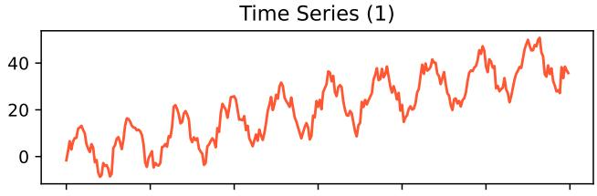  
Time Series (3)

Time Series (2)  
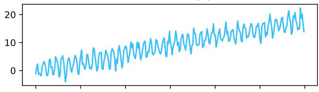  
Time Series (4)

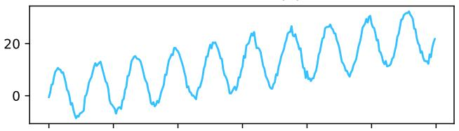  
Time Series (5)

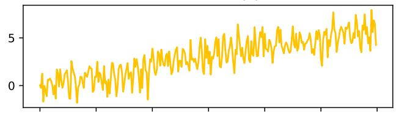  
Time Series (6)

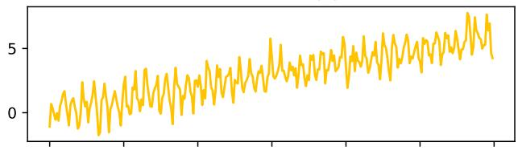  
Time Series (7)

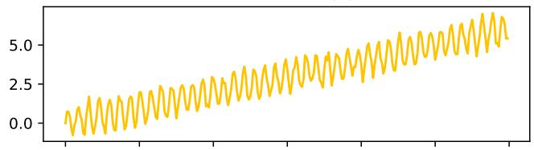

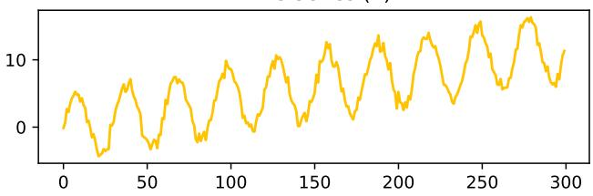

Time Series (8)  
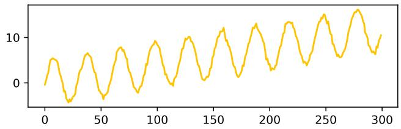  
Figure 3. A simulation of the synthetic hierarchical time series with $\alpha = 1$ and a length of 300. Time series belonging to the same hierarchical level are represented using the same color.

Generation Process. The hierarchy contains $d = 8$ series distributed over three levels: one top-level series, two middlelevel series, and $d _ { b } = 5$ bottom-level series, with the structure shown in Figure 2. Each bottom-level series i is generated using the additive decomposition model (Hyndman and Athanasopoulos, 2018)

$$
y _ { t } ^ { ( i ) } = a ^ { ( i ) } t + b ^ { ( i ) } \sin \biggl ( \frac { 2 \pi t } { p ^ { ( i ) } } \biggr ) + \epsilon _ { t } ^ { ( i ) } .
$$

Series sharing a parent have identical trend and seasonal parameters. Specifically, $( a ^ { ( i ) } , b ^ { ( i ) } , p ^ { ( i ) } ) = ( 0 . 0 2 , 1 , 7 )$ for $i \in$ {4, 5, 6} and $( a ^ { ( i ) } , b ^ { ( i ) } , p ^ { ( i ) } ) = ( 0 . 0 4 , 5 , 3 0 )$ for $i \in \{ 7 , 8 \}$ . Let $\xi _ { t } = [ \epsilon _ { t } ^ { ( 4 ) } , \ldots , \epsilon _ { t } ^ { ( 8 ) } ] ^ { \mathsf { T } } \in \mathbb { R } ^ { 5 }$ . We draw

$$
\xi _ { t } \sim \mathcal { N } ( 0 , \Sigma _ { \xi } ) , \qquad \Sigma _ { \xi } = Q ( \alpha \Lambda ) Q ^ { \top } , \qquad \Lambda = \mathrm { d i a g } ( 1 , 0 . 5 , 0 . 1 , 0 . 0 5 , 0 . 0 1 ) ,
$$

where $Q$ is orthogonal and $\alpha \geq 0$ controls the noise scale. In particular,

$$
\mathbb { E } \left[ \left. S \xi _ { t } \right. _ { \mathcal { V } } ^ { 2 } \right] = \alpha \mathrm { t r } \left( S Q \Lambda Q ^ { \mathsf { T } } S ^ { \mathsf { T } } \right) .
$$

Writing $y _ { t } ^ { b } = [ y _ { t } ^ { ( 4 ) } , \ldots , y _ { t } ^ { ( 8 ) } ] ^ { \intercal }$ , the aggregate series are generated as $y _ { t } ^ { ( i ) } = S _ { i , : } y _ { t } ^ { b }$ for $i \in \{ 1 , 2 , 3 \}$

Figure 3 shows one realization of the synthetic dataset.

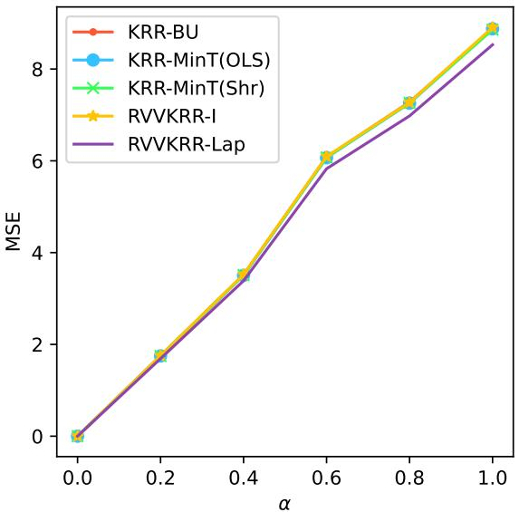  
(a) $T = 8 0 .$

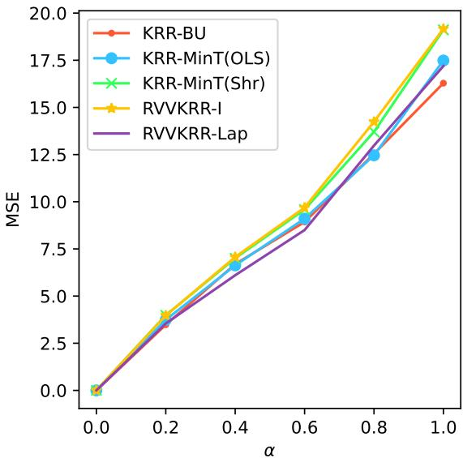  
(b) $T = 4 0 .$  
Figure 4. All-level MSE on the synthetic dataset as a function of the covariance scaling parameter α.

Sensitivity to the covariance scale. We additionally study the effect of the covariance scaling parameter α, varying it over [0, 1] for training lengths $T = 8 0$ and $T = 4 0$ . We run 32 Monte Carlo simulations for each configuration, using the same validation and test lengths as in the main experiment.

Figure 4 shows a quasi-linear relationship between α and the MSE. RVVKRR-Lap consistently outperforms the other methods for all values of α when $T = 8 0$ ; when $T = 4 0$ , this holds only for $\alpha < 0 . 8$

## D.2. TourismLarge dataset

Experimental Setting. Hyperparameters are selected using three-fold expanding-window cross-validation, with training/validation window lengths of 108/24, 132/24, and $1 5 6 / 2 4$ . Independent KRR selects a separate ridge parameter $\lambda _ { r }$ for each series from 64 logarithmically spaced values between $1 0 ^ { - 5 }$ and $1 0 ^ { 8 }$ . For each RVVKRR projection, $\rho$ is selected from $\{ 1 0 ^ { - 3 } , 3 \times 1 0 ^ { - 3 } , 1 0 ^ { - 2 } , 3 \times 1 0 ^ { - 2 } , 1 \bar { 0 } ^ { - 1 } \}$ by minimizing the mean Overall MSE across the three validation folds. This selects $\rho = 0 . 0 3$ for MinT (OLS) and $\rho = 0 . 1$ for both MinT (shrinkage) and MinT (WLS-var). The covariance proxies for the latter two are estimated from in-sample residuals of auxiliary independent KRR predictors within each training window. No feature standardization is applied.

## D.3. Traffic Dataset

Experimental Setting. The largest lag used as the feature is 28, leaving 338 observations from the original 366-day sample. We reserve the last 28 observations for testing and use the preceding 310 for model selection and fitting. Hyperparameters are selected using three-fold expanding-window cross-validation by minimizing the MSE. Each validation window contains 28 observations, giving training/validation window lengths of $2 2 6 / 2 8 , 2 5 4 / 2 8$ , and 282/28. After selection, every model is refitted on all 310 pre-test observations.

Independent KRR selects a separate ridge parameter $\lambda _ { r }$ for each series r from 64 logarithmically spaced values between

Table 3. Full comparison of test MSE at each aggregation level of TourismLarge, reported in millions $( 1 0 ^ { 6 } )$ . All sums the level-wise MSEs. † denotes unreconciled forecasts. Lower is better; column-wise minima are bold.
<table><tr><td>Method</td><td>Ctry.</td><td>State</td><td>Zone</td><td>Reg.</td><td>Purp.</td><td>All</td></tr><tr><td>OLS base forecasts</td><td></td><td></td><td></td><td></td><td></td><td></td></tr><tr><td>Unreconciled †</td><td>3.33</td><td>1.98</td><td>1.55</td><td>1.48</td><td>1.32</td><td>9.66</td></tr><tr><td>Bottom-Up</td><td>8.97</td><td>2.79</td><td>1.88</td><td>1.52</td><td>1.32</td><td>16.48</td></tr><tr><td>Top-Down (AHP)</td><td>3.33</td><td>4.00</td><td>2.39</td><td>2.06</td><td>1.91</td><td>13.69</td></tr><tr><td>Top-Down (PHA)</td><td>3.33</td><td>3.95</td><td>2.38</td><td>2.05</td><td>1.91</td><td>13.61</td></tr><tr><td>MinT (OLS)</td><td>3.48</td><td>1.77</td><td>1.47</td><td>1.32</td><td>1.28</td><td>9.32</td></tr><tr><td>MinT (shrinkage)</td><td>5.33</td><td>1.97</td><td>1.49</td><td>1.30</td><td>1.24</td><td>11.33</td></tr><tr><td>MinT (WLS-var)</td><td>6.59</td><td>2.19</td><td>1.56</td><td>1.33</td><td>1.25</td><td>12.92</td></tr><tr><td>ERM (closed form)</td><td>4.03</td><td>2.16</td><td>2.10</td><td>1.98</td><td>2.04</td><td>12.32</td></tr><tr><td>KRR base forecasts</td><td></td><td></td><td></td><td></td><td></td><td></td></tr><tr><td>Unreconciled †</td><td>2.71</td><td>1.69</td><td>1.30</td><td>1.19</td><td>1.13</td><td>8.02</td></tr><tr><td>Bottom-Up</td><td>8.06</td><td>2.53</td><td>1.53</td><td>1.21</td><td>1.13</td><td>14.46</td></tr><tr><td>Top-Down (AHP)</td><td>2.71</td><td>3.94</td><td>2.38</td><td>2.05</td><td>1.92</td><td>13.00</td></tr><tr><td>Top-Down (PHA)</td><td>2.71</td><td>3.89</td><td>2.37</td><td>2.04</td><td>1.92</td><td>12.94</td></tr><tr><td>MinT (OLS)</td><td>2.72</td><td>1.58</td><td>1.25</td><td>1.12</td><td>1.11</td><td>7.78</td></tr><tr><td>MinT (shrinkage)</td><td>3.05</td><td>1.60</td><td>1.21</td><td>1.08</td><td>1.06</td><td>7.99</td></tr><tr><td>MinT (WLS-var)</td><td>4.56</td><td>1.83</td><td>1.29</td><td>1.11</td><td>1.09</td><td>9.89</td></tr><tr><td>ERM (closed form)</td><td>5.36</td><td>2.50</td><td>2.61</td><td>2.57</td><td>2.52</td><td>15.57</td></tr><tr><td>RVVKRR forecasts</td><td></td><td></td><td></td><td></td><td></td><td></td></tr><tr><td>MinT  $( \mathrm { O L S } ) , \rho = 0$ </td><td>2.75</td><td>1.55</td><td>1.23</td><td>1.10</td><td>1.10</td><td>7.73</td></tr><tr><td>MinT  $( \mathrm { O L S } ) , \rho = 0 . 0 3$ </td><td>2.74</td><td>1.54</td><td>1.24</td><td>1.11</td><td>1.10</td><td>7.72</td></tr><tr><td>MinT (shrinkage),  $\rho = 0$ </td><td>2.01</td><td>1.51</td><td>1.28</td><td>1.23</td><td>1.58</td><td>7.61</td></tr><tr><td>MinT (shrinkage),  $\rho = 0 . 1$ </td><td>2.02</td><td>1.52</td><td>1.30</td><td>1.24</td><td>1.57</td><td>7.64</td></tr><tr><td>MinT  $( \mathrm { W L S - v a r } ) , \rho = 0$ </td><td>2.52</td><td>1.81</td><td>1.45</td><td>1.40</td><td>1.75</td><td>8.93</td></tr><tr><td>MinT</td><td>2.39</td><td>1.83</td><td>1.49</td><td>1.44</td><td>1.71</td><td>8.85</td></tr><tr><td> $( \mathrm { W L S - v a r } ) , \rho = 0 . 1$ </td><td></td><td></td><td></td><td></td><td></td><td></td></tr></table>

$1 0 ^ { - 5 }$ and $1 0 ^ { 8 }$ . The same selected parameters are used by the auxiliary independent KRR fits that estimate the residualbased MinT projections. Independent OLS uses the same features and has no hyperparameter; the cross-validation results are used only for diagnostic purposes.

For each RVVKRR variant, the global regularization parameter λ is selected by the cross-validation over $\left\{ 1 0 ^ { - 4 } , 1 0 ^ { - 3 } , 1 0 ^ { - 2 } , 1 0 ^ { - 1 } , 1 , 1 0 , 1 0 ^ { 2 } , \bar { 1 0 } ^ { 3 } \right\}$ . All three variants select $\lambda = 1$ . Covariance-based projections are estimated from in-sample residuals using only the current fold’s training window. They are re-estimated using all 310 pre-test observations for the final fit.

Table 4. Full comparison of test MSE at each aggregation level of Traffic dataset, reported in thousands $( 1 0 ^ { 3 } )$ . All sums the level-wise MSEs. † denotes unreconciled forecasts. Lower is better; column-wise minima are bold.
<table><tr><td>Method</td><td>L1</td><td>L2</td><td>L3</td><td>Bottom</td><td>All</td></tr><tr><td>OLS base forecasts</td><td></td><td></td><td></td><td></td><td></td></tr><tr><td>Unreconciled †</td><td>8.43</td><td>4.87</td><td>3.03</td><td>0.60</td><td>16.93</td></tr><tr><td>Bottom-Up</td><td>12.33</td><td>6.46</td><td>3.49</td><td>0.60</td><td>22.88</td></tr><tr><td>Top-Down (AHP)</td><td>8.43</td><td>4.56</td><td>3.04</td><td>1.33</td><td>17.36</td></tr><tr><td>Top-Down (PHA)</td><td>8.43</td><td>4.57</td><td>3.06</td><td>1.32</td><td>17.39</td></tr><tr><td>MinT (OLS)</td><td>8.41</td><td>4.90</td><td>2.85</td><td>0.58</td><td>16.74</td></tr><tr><td>MinT (shrinkage)</td><td>8.62</td><td>4.62</td><td>2.55</td><td>0.57</td><td>16.36</td></tr><tr><td>MinT (WLS-var)</td><td>10.73</td><td>5.70</td><td>3.12</td><td>0.60</td><td>20.15</td></tr><tr><td>ERM (closed form)</td><td>33.78</td><td>17.33</td><td>8.96</td><td>1.38</td><td>61.45</td></tr><tr><td>KRR base forecasts</td><td></td><td></td><td></td><td></td><td></td></tr><tr><td>Unreconciled †</td><td>8.95</td><td>5.05</td><td>2.84</td><td>0.63</td><td>17.47</td></tr><tr><td>Bottom-Up</td><td>13.30</td><td>6.91</td><td>3.74</td><td>0.63</td><td>24.58</td></tr><tr><td>Top-Down (AHP)</td><td>8.95</td><td>4.81</td><td>3.17</td><td>1.33</td><td>18.27</td></tr><tr><td>Top-Down (PHA)</td><td>8.95</td><td>4.83</td><td>3.19</td><td>1.33</td><td>18.29</td></tr><tr><td>MinT (OLS)</td><td>9.01</td><td>4.95</td><td>2.85</td><td>0.61</td><td>17.42</td></tr><tr><td>MinT (shrinkage)</td><td>9.16</td><td>4.83</td><td>2.69</td><td>0.60</td><td>17.28</td></tr><tr><td>MinT (WLS-var)</td><td>11.68</td><td>6.11</td><td>3.34</td><td>0.62</td><td>21.76</td></tr><tr><td>ERM (closed form)</td><td>72.00</td><td>36.45</td><td>18.62</td><td>1.34</td><td>128.41</td></tr><tr><td>RVVKRR forecasts</td><td></td><td></td><td></td><td></td><td></td></tr><tr><td>MinT (OLS)</td><td>8.99</td><td>4.93</td><td>2.79</td><td>0.61</td><td>17.32</td></tr><tr><td>MinT (shrinkage)</td><td>3.84</td><td>2.14</td><td>2.20</td><td>3.39</td><td>11.57</td></tr><tr><td>MinT (WLS-var)</td><td>0.32</td><td>0.24</td><td>0.44</td><td></td><td></td></tr><tr><td></td><td></td><td></td><td></td><td>3.02</td><td>4.03</td></tr></table>