# IMPROVING NEURAL SYMBOLIC REGRESSION WITH A DIVERSE PRIOR AND POST-TRAINING ALIGNMENT

David Otte1,2 ∗ Jörg K.H. Franke3,4 Frank Hutter3,5,6

1LMU Munich 2Munich Center for Machine Learning (MCML) 3University of Freiburg 4LAION 5ELLIS Institute Tübingen 6Prior Labs

## ABSTRACT

Symbolic regression is the problem of finding an expression that fits a dataset. Solving it requires searching a combinatorial space of candidate expressions. Neural symbolic regression can amortize that search by training a model once on synthetic data and then predicting expressions for a new dataset. But existing models still underperform genetic programming on real, noisy data. We argue that the deficit lies in the training rather than in the paradigm, and present RASR (Reinforced Amortized Symbolic Regression), a method with two key changes to the training recipe. First, we design a synthetic prior that narrows the gap with real-world data: inputs come from the prior of a tabular foundation model; constants are sampled bottom-up, conditioned on the data; targets carry heteroscedastic and structured noise; and everything is standardized. Second, we split training into two stages. Supervised pre-training maximizes the token-level likelihood of a reference expression. This is followed by reinforcement-learning post-training that aligns the model with its inference-time use by rewarding held-out fit and penalizing expression size. On the black-box track of SRBench 2.0, RASR achieves the best mean test R2 rank of all evaluated methods. Three RASR variants, trained with different size penalties, make up most of the accuracy-complexity Pareto front. On Strogatz, our method recovers more ground-truth expressions than any baseline, and on Feynman it is competitive with the best-performing methods.

## 1 INTRODUCTION

Symbolic regression is the task of finding a closed-form mathematical expression that fits a regression dataset. The classical use case is scientific discovery, where the expression itself is the object of interest (Schmidt & Lipson, 2009). Another is general tabular prediction, where the data need not follow an exact law and symbolic regression can still yield models that are interpretable yet expressive. Searching over expressions is difficult, since the space is discrete and grows combinatorially with expression size, and the problem is NP-hard in general (Virgolin & Pissis, 2022). For decades this search has been driven predominantly by genetic programming (Koza, 1994), which is still widely regarded as the state of the art, with PySR (Cranmer, 2023) and Operon (Burlacu et al., 2020) among its strongest modern representatives.

A more recent line of work is neural symbolic regression, where a transformer is trained over many synthetic examples and then predicts expressions for a new dataset directly (Biggio et al., 2021; Kamienny et al., 2022), amortizing a search that classical methods must rerun for every problem. We use the term in this narrow sense of amortized methods, excluding neural methods that train anew on each dataset (Section 2). A similar recipe has reshaped the neighboring field of tabular prediction, where tabular foundation models such as TabPFN (Hollmann et al., 2023; 2025), pre-trained once on a synthetic prior, now match or surpass classical approaches (Erickson et al., 2025). Neural symbolic regression, by contrast, still trails the best search-based systems, particularly on black-box problems (Cava et al., 2021; Aldeia et al., 2025). We argue that this gap is not inherent to the paradigm but stems from how these models are trained.

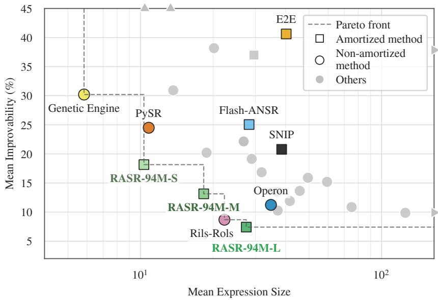  
Figure 1: Accuracy-complexity trade-off on the black-box track of SRBench 2.0. Mean expression size (log scale) against mean improvability, the relative RMSE gap to the best method on each dataset (%, lower is better). The dashed line marks the Pareto front, and triangles on the border mark methods outside the plotted range. Three of the five methods on the front are our RASR variants, differing only in the expression-size penalty used during post-training, and the default RASR-94M-L attains the best fit of any evaluated method. Figure J.1 shows every method.

Two aspects of that training are at fault. The first is the synthetic prior, the distribution of training samples. Prior work samples inputs from uniform or Gaussian distributions and computes targets without noise, as in NeSymReS and E2E (Biggio et al., 2021; Kamienny et al., 2022), so the tables a model learns from look little like the ones it is applied to. The second is the training objective. Existing methods train almost exclusively with supervised objectives against a reference expression, most commonly token-level cross-entropy. At test time, however, we care more about fit quality and expression size than about the exact token sequence.

We address both in RASR, short for Reinforced Amortized Symbolic Regression.1 At its core is an encoder-decoder transformer that reads a dataset and generates expressions for it. At inference RASR samples many candidates, refines their constants numerically, and returns the Pareto front of fit quality against expression size, so a user can choose the trade-off. Our main contributions are:

• A diverse, data-realistic synthetic prior whose inputs come from the prior of a tabular foundation model (Qu et al., 2026), whose constants are sampled bottom-up conditioned on the data so that every operator stays in a sensible regime, and whose targets carry heteroscedastic and structured noise, with full standardization throughout (Section 3.1).

• A two-stage training procedure that keeps supervised pre-training as the scalable stage and adds a reinforcement-learning post-training stage, rewarding held-out fit and penalizing expression size directly with group-relative policy optimization (Shao et al., 2024) under a risk-sensitive variant (Jiang et al., 2025) (Section 3.3).

• State-of-the-art results on SRBench 2.0, with the best mean test $R ^ { 2 }$ rank of all evaluated methods on the black-box track, at modest expression size. Three variants, post-trained with different size penalties, span the accuracy-complexity trade-off and all lie on the Pareto front, which holds only two other methods (Figure 1). On the ground-truth tracks of the original SRBench, RASR attains the highest solution rate of all methods on Strogatz and is close behind the leaders on Feynman (Section 4).

## 2 RELATED WORK

Symbolic regression is classically approached with genetic programming, which evolves a population of candidate expression trees through fitness-based selection and tree-level mutation and crossover operators (Koza, 1994), with PySR (Cranmer, 2023) and Operon (Burlacu et al., 2020) as widely used implementations. Our method belongs to neural symbolic regression, which trains a sequence model once on large amounts of synthetic dataset-expression pairs (Biggio et al., 2021; Kamienny et al., 2022; Saegert & Köthe, 2026). Other neural approaches train anew on each dataset, such as EQL (Sahoo et al., 2018), which fits a network with symbolic activation functions, and deep symbolic regression (DSR) (Petersen et al., 2021), which learns a generative policy over expressions from a fit-based reward.

Four design choices. Nearly all neural symbolic regression methods follow one recipe, that is, train once on synthetic dataset-expression pairs, then encode a given dataset and decode expressions for it. They differ on four recurring choices. The first is the synthetic prior. Expressions are sampled with the tree-counting strategy of Lample & Charton (2020), while the accompanying datasets are built from simple input distributions without target noise. The second is the training objective, usually a single stage of token-level cross-entropy, for which richer multimodal alternatives have been proposed (Meidani et al., 2024; Li et al., 2023), including Sym-Q (Tian et al., 2025). The third is the treatment of numerical constants, which are either left as placeholders for a downstream optimizer or predicted in high precision. The fourth is how test-time compute buys candidates, through sampling (Kamienny et al., 2022), beam search (Biggio et al., 2021), a latent-space search (Meidani et al., 2024) or TPSR’s Monte-Carlo tree search around a frozen decoder (Shojaee et al., 2023).

Positioning of RASR. RASR departs from the usual answer on each of the four choices. The first two carry our main contributions, the prior of Section 3.1 and the post-training stage of Section 3.3. Reinforcement learning has been applied to symbolic regression before, but per dataset (DSR), as a test-time search around a frozen decoder (TPSR), or as an offline objective folded into pre-training itself (Sym-Q), so post-training a general pre-trained model against a task reward is new to the field. On the remaining two choices our departures are smaller. We emit rounded constants that act as an initialization region for a downstream optimizer, and we sample candidates independently at test time instead of running a guided search, since post-training has already shifted the policy toward strong candidates. Appendix A treats each choice in full.

## 3 METHOD

In symbolic regression we are given a dataset $\mathbf { \mathcal { D } } = \{ ( \mathbf { { x } } _ { i } , y _ { i } ) \} _ { i = 1 } ^ { n }$ with inputs $\pmb { x } _ { i } \in \mathbb { R } ^ { d }$ and targets $y _ { i } \in \mathbb { R }$ , and seek a closed-form expression f that both fits the data and stays compact. At the core of RASR is a transformer mapping D to a distribution over such expressions. We describe its four ingredients in turn: the synthetic prior the model is trained on (Section 3.1), the architecture (Section 3.2), the two-stage training procedure (Section 3.3), and the inference pipeline that refines and selects among the proposed expressions (Section 3.4).

## 3.1 SYNTHETIC PRIOR

Each pre-training example is a pair $( \mathcal { D } , e )$ , where e is a ground-truth expression used during the dataset’s generation, and the task is to recover e from D. The quality of the prior these pairs are drawn from largely determines how well the model transfers to real data, and is therefore a central design component of this work. Sampling proceeds in the stages of Figure 2, and full details and hyperparameters are given in Appendix B.

Skeleton sampling. Expressions are built from three binary and fifteen unary operators over variables $x _ { 1 } , \ldots , x _ { 1 1 }$ , all listed in Appendix B.1. We sample the number of distinct variables $n _ { v }$ uniformly from $\{ \dot { 1 } , \dots , 1 1 \}$ , then draw a binary tree from the unbiased tree-counting distribution of Lample & Charton (2020) and fill its leaves with variables. Following E2E (Kamienny et al., 2022), the unary operators are inserted afterwards at uniformly drawn positions, which keeps the number of binary and unary operators under independent control. We then insert constant placeholders wherever a constant would meaningfully change the function, omitting those a later standardization or a parent constant would make redundant, and simplify the result with SimpliPy (Saegert & Köthe, 2026). The principle is to make every operator argument freely scalable and shiftable, so the sampler can place each sub-function in a sensible regime: the argument of every unary operator g is wrapped affinely, $g ( t )  g ( c _ { 0 } t + c _ { 1 } )$ , binary operators receive an additive bias, and variable leaves and the atomic terms of a sum a multiplicative scale. Inserting many placeholders is deliberate: since the model only sees standardized inputs on a bounded domain, these constants are the primary lever by which one skeleton realizes qualitatively different functions.

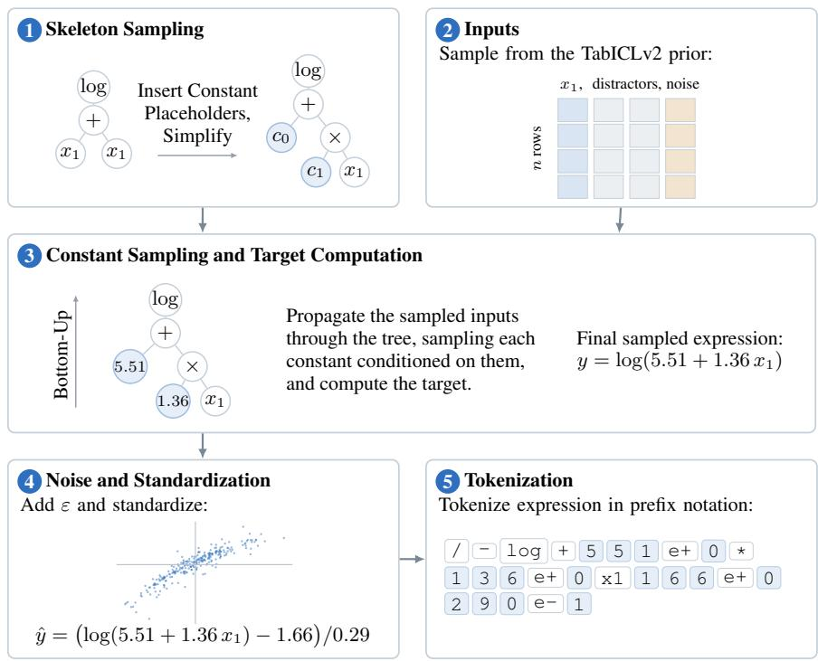  
Figure 2: Overview of the synthetic training data generation. Each training pair is produced by sampling an expression skeleton, drawing the inputs together with an auxiliary noise node from the TabICLv2 regression prior, filling the constant placeholders bottom-up conditioned on those inputs, and optionally injecting noise before standardizing and tokenizing. One skeleton is followed throughout: its constants, the target panel of stage 4 and the token row all come from a single draw through the pipeline.

Input sampling. Previous work samples the input matrix X from simple fixed distributions. We instead draw it from a tabular foundation model prior, so that the features and their relationships resemble those of real tabular data. Such priors sample a random structural causal model, a directed acyclic graph over variables with a random function at each node, and read a subset of the resulting variables off as columns (Hollmann et al., 2023). Because all columns arise from the same coupled mechanism, they can be nonlinearly related, correlated and redundant, as they are in real data. We use the prior of TabICLv2 (Qu et al., 2026), drawing a pool of twelve standardized numerical columns: the first $n _ { v }$ become the expression’s variables, one is held out as a noise node shaping input-correlated noise, and a random number of the rest are appended to D as correlated distractor features absent from f, so the model must learn to ignore irrelevant inputs. The number of observations n is sampled uniformly from 8 to 1024. We use the prior essentially as published, with targeted modifications that make its samples better suited as continuous inputs (Appendix B.2).

Bottom-up constant sampling. Filling the placeholders independently from a fixed distribution has two problems. It produces degenerate functions, for example arguments that saturate exp or fall outside the domain of log, and it does not ensure the expression is one a user would consider a reasonable solution given the dataset, as characteristic shapes may be missed entirely or one term may dominate another by orders of magnitude. We therefore sample constants conditioned on the data in a single bottom-up pass over the tree: each subtree is evaluated on X, and when the evaluation reaches an affine wrapper $c _ { 0 } t + c _ { 1 }$ , the constants are drawn conditioned on the empirical distribution of the child values t, so that the operator receives inputs in a sensible regime by construction. Positivedomain operators keep their argument’s minimum above zero, and the terms of a sum are scaled jointly so that none vanishes or dominates (Appendix B.3).

Noise and standardization. Real data is rarely clean, and a model trained only on clean targets may fail to generalize. We inject noise into most datasets while leaving 40% untouched, at a strength drawn per dataset from an exponential distribution in units of the clean target’s standard deviation, so most datasets are only mildly disturbed with a long tail of stronger corruption. Two forms are used equally often. The first is Gaussian, with a per-row standard deviation that blends a constant with a profile derived from the auxiliary noise node. Since that node’s relation to the observed features is inherited from the SCM prior, the noise spans homoscedastic through input-correlated heteroscedastic while staying zero-mean at each row, so the ground truth remains the conditional mean $\mathbb { E } [ y \mid x ]$ and hence the optimal predictor. The second form instead mimics unobserved confounders: the noise node is passed through a random activation and centered over the dataset, which adds structured deviations rather than white noise. Since it is zero-mean only marginally, and not conditionally on x, the ground-truth expression is here an expressible fit rather than the exact conditional mean (Appendix B.4). Finally, since real targets arrive at arbitrary scales, we standardize the target as $\hat { y } = ( y - \mu _ { y } ) / \sigma _ { y }$ and rewrite the expression to describe $\hat { y }$ rather than y.

Tokenization and constant strategy. Expressions are serialized in prefix notation, where operators and variables map to single tokens, while numeric constants are emitted as digit tokens, a mantissa rounded to three significant figures with a single-digit exponent. We treat these values only as an initialization for the refinement of Section 3.4, so the model learns an approximate region of constant space rather than an exact value.

## 3.2 ARCHITECTURE

The model is an encoder-decoder transformer that maps an input table to symbolic expressions. The encoder turns the table, whose first column holds the target, into one latent per row, and the decoder generates an expression as a prefix token sequence while cross-attending to those latents, so sampling it repeatedly yields a set of candidates. We deliberately keep the backbone close to a standard encoder-decoder transformer (Vaswani et al., 2017) and apply only targeted changes.

Every scalar cell is embedded through the raw IEEE-754 bits of its float32 value (Biggio et al., 2021), giving the model direct access to magnitude and sign, and the encoder alternates attention over the two axes of the table, following TabPFNv2 (Hollmann et al., 2025). Since sample-axis attention treats the rows as an unordered set, the encoder is permutation-equivariant over samples and accepts a variable number of rows, and each row’s target-column representation becomes its latent. The number of rows varies by two orders of magnitude across datasets, so along that axis we replace the usual fixed attention scale with the length-robust QASSMax (Qu et al., 2026). Further changes are gated attention (Qiu et al., 2025), and QK-norm (Henry et al., 2020) and pre-normalization with RMSNorm (Zhang & Sennrich, 2019) for training stability. Our main model has 94M parameters, alongside a 24M variant for ablations. Appendix C gives the full description and a diagram.

## 3.3 TRAINING

The model is trained in the two stages of Figure 3, which serve distinct purposes. Pre-training is where scale happens: a cheap, massively parallel supervised objective over the synthetic pairs of Section 3.1, whose role is to train on as much data as the budget allows and leave a strong initialization. Posttraining then aligns that initialization with how the model is actually used, replacing the surrogate objective with the quantities we measure at inference, and teacher forcing with the model’s own autoregressive samples.

Pre-training. Given the encoded dataset, the decoder is trained to predict the ground-truth prefix expression one token at a time under a token-level cross-entropy objective, with each step conditioned on the true prefix rather than on the model’s own output (teacher forcing). Pairs are generated offline and streamed, so each is seen at most once. The 94M model sees roughly 62M datasets over 242k steps (Appendix D).

Post-training. A subsequent reinforcement-learning stage addresses several mismatches between pre-training and test time. Pre-training targets token-level agreement with one reference expression while at test time fit is what matters the most, and since many expressions describe the same function, token-level matching is a loose surrogate at best. Teacher forcing conditions the model on groundtruth prefixes rather than its own, a mismatch known as exposure bias, where early errors compound once it decodes alone. Finally, inference draws many candidates and returns the best, so post-training can absorb part of that search into the model itself.

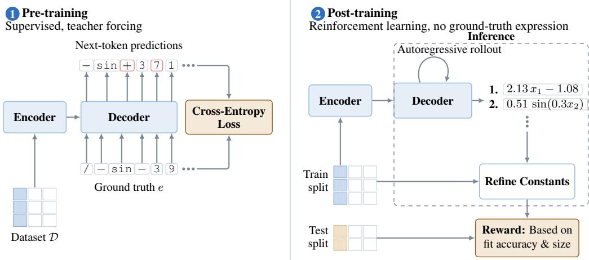  
Figure 3: The two-stage training process of RASR. Pre-training maximizes the likelihood of the ground-truth prefix sequence of each synthetic pair under teacher forcing. Post-training discards the ground-truth expression entirely: the policy samples a group of candidates per dataset, each candidate’s constants are refined on a training split and scored on a held-out split, and the resulting fit and size form a reward turned into a risk-sensitive group-relative advantage.

Policy optimization. Fit can only be measured on sampled autoregressive rollouts, which are not differentiable, so we treat the model as a policy over expressions and update it with group-relative policy optimization (GRPO) (Shao et al., 2024). GRPO estimates its baseline from a group of G samples drawn per input rather than from a learned value network, so a sample’s advantage is its reward $r _ { i }$ standardized within the group, $\hat { A } _ { i } = ( r _ { i } - \mathrm { m e a n } ( r ) ) / \mathrm { s t d } ( r )$ . Because we care about the best of many samples rather than the average one, we take the advantage of RS-GRPO (Jiang et al., 2025) unchanged in its place, $\begin{array} { r } { \hat { A } _ { i } ^ { \mathrm { R S } } = \beta ^ { - 1 } \bar { ( } e ^ { \beta r _ { i } } / \frac { 1 } { G } \sum _ { j } e ^ { \beta r _ { j } } - 1 ) } \end{array}$ , which arises from replacing the risk-neutral expected reward with an exponential utility and leaves the rest of the GRPO machinery intact. It weights the update exponentially towards the highest-reward samples in each group and, across a batch, shifts learning towards the harder inputs. A positive $\beta$ thus tilts the objective towards the best-of-n target that sampling-based inference actually measures, while $\beta  0$ recovers ordinary GRPO. We use $\bar { \boldsymbol { \beta } } = 4 .$ . Appendix E states both objectives in full.

Reward. We design the reward $R ( e )$ of a completed expression e along two axes: fit, for which we adopt the normalized RMSE reward of DSR (Petersen et al., 2021), and expression size, a penalty on the number of nodes $\mathcal { C } ( e )$ in the expression tree. Treating the two as separate objectives and standardizing each within the group, written $\hat { R } _ { \mathrm { f i t } }$ and ${ \hat { \mathcal { C } } } ,$ gives

$$
R ( e ) ~ = ~ \hat { R } _ { \mathrm { { f i t } } } ( e ) ~ - ~ \lambda \hat { \mathcal { C } } ( e ) , ~ R _ { \mathrm { { f i t } } } ( e ) ~ = ~ \frac { 1 } { 1 + { \bf N R M S E } ( e ) } ~ \in ~ ( 0 , 1 ] ,\tag{1}
$$

with a trade-off weight $\lambda \ \geq \ 0 .$ . The normalized error NRMSE $= \sigma _ { y } ^ { - 1 } { \sqrt { n ^ { - 1 } \sum _ { i } ( y _ { i } - { \hat { y } } _ { i } ) ^ { 2 } } }$ is scale-free and therefore comparable across datasets. Crucially, it is evaluated on a held-out split: the constants are refined on the training split and the fit computed on a split the optimizer never saw, which rewards genuine generalization rather than memorization of the fitted points. Invalid expressions and failed fits receive a fit reward of zero.

Data and variants. Post-training needs no ground-truth expression, since the reward depends only on the dataset and the predictions. We target both the black-box setting, where the data is not guaranteed to come from a closed-form expression, and the classical setting, where it is. Post-training therefore uses an equal mixture of freshly sampled datasets from our pre-training prior and datasets drawn directly from the modified TabICLv2 prior, whose underlying function need not be expressible in our primitive set. We sample 128 generations per dataset at temperature 1.0 and disable the KL penalty entirely. The weight λ has no single correct setting, since how much fit a user will give up for a smaller expression depends on the application, so we treat it as a property of the trained model and post-train three variants of the 94M model from the same checkpoint, at $\lambda \in \{ 0 . 0 5 , 0 . 1 5 , 0 . 5 \}$ with $\lambda = 0 . 0 5$ as the default. Applying the penalty during post-training rather than at selection time shapes the sampling distribution itself, so a strongly penalized variant searches within a compact region of expression space instead of filtering a pool of large candidates later.

## 3.4 INFERENCE

At test time we encode D once and autoregressively sample K candidates, discarding those that are invalid, too long, or reference more variables than the dataset provides. Each remaining unique candi date’s constants are refined by nonlinear least squares, using the Levenberg–Marquardt (Levenberg, 1944; Marquardt, 1963) solver in scipy (Virtanen et al., 2019) seeded from the emitted values with several Gaussian-perturbed restarts. Candidates are scored on fit, measured by $R ^ { 2 }$ , and size $\mathcal { C } ( e )$ and exposed in two ways: whenever a user can make the trade-off themselves we return the Pareto front, the candidates not beaten on both axes at once, and when a single expression must be returned without a human in the loop, as in a benchmark evaluation, we select the candidate maximizing

$$
S ( e ) = R ^ { 2 } ( e ) - \gamma \mathcal { C } ( e ) ,\tag{2}
$$

where the parsimony weight $\gamma \geq 0$ states how much additional fit a candidate must deliver to justify one further node. Appendix F gives more details.

## 4 EXPERIMENTS

We evaluate RASR on SRBench 2.0 (Aldeia et al., 2025), the recent successor to the widely used SRBench suite (Cava et al., 2021), and on the Feynman and Strogatz tracks of the original SRBench. This section gives an overview of the main results. Additional results and the ablations are in the appendix, summarized in Section 4.4.

## 4.1 SETUP

Benchmarks and protocol. The black-box track of SRBench 2.0 is our primary point of evaluation. Its twelve regression datasets come from the PMLB collection (Olson et al., 2017), mostly real-world problems without a known closed-form target, curated to be harder and more representative than in the original SRBench suite. The other tracks instead pair every problem with a known expression. We follow the respective evaluation protocols. RASR samples $\dot { K } = 1 0 2 4$ candidates per run, from a single configuration left unchanged across all datasets and tracks. The only quantity we tune is the scalar parsimony weight $\gamma \in \{ 0 , 0 . 0 1 , 0 . 1 \}$ of Equation $( 2 ) .$ , selected by cross-validation on the training split, which acts at selection time on an already generated candidate pool rather than steering the search. Since RASR was trained on at most 1024 rows and 11 features, we cap its input at 2048 rows, twice the training maximum, and at 11 features, which reduces four of the twelve black-box datasets and subsamples the Feynman problems. Appendix G describes the datasets of all four tracks and Appendix H the remaining protocol details.

Metrics, baselines and variants. We record each run’s test $R ^ { 2 }$ and expression size, counted as the number of nodes after conversion to SymPy (Meurer et al., 2017), and aggregate a method’s runs on a dataset by the median. On the black-box track we summarize the per-dataset medians by two complementary track averages, the mean test $R ^ { 2 }$ rank, which only depends on the ordering of methods, and the mean improvability (Erickson et al., 2025), $( \mathrm { e r r } _ { i } - \mathrm { e r r } _ { i } ^ { \star } ) / \mathrm { e r r } _ { i }$ with err a method’s test RMSE on dataset i and $\mathrm { e r r } _ { i } ^ { \star }$ the lowest of a fixed pool, which retains the magnitude of the gaps (Appendix H). As baselines we take the full set of methods evaluated by the benchmark that defines each track, covering genetic-programming systems, non-evolutionary search and neural methods. To all four tracks we add two pre-trained models that neither benchmark includes, Flash-ANSR (Saegert & Köthe, 2026) and SNIP (Meidani et al., 2024), run under the same protocol. Our variants are named by parameter count and by the typical size of the expressions they return, which the posttraining penalty sets: RASR-94M-L $( \lambda = 0 . 0 5 )$ is the main model, RASR-94M-M $( \lambda = 0 . 1 5 )$ and RASR-94M-S $( \lambda = 0 . 5 )$ the smaller-expression variants.

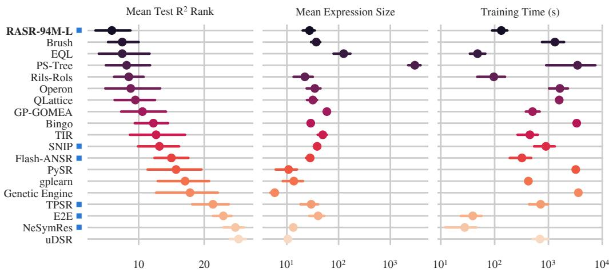  
Figure 4: Black-box track overview. Methods are ordered by mean test $R ^ { 2 }$ rank across the twelve datasets (left, lower is better), while the middle and right panels show mean expression size and fitting time on log scales. Markers are means across datasets, bars bootstrapped 95% confidence intervals. Amortized methods are flagged with a blue square next to their name. For readability only selected baselines are shown, with ranks computed against all baselines. Figure J.2 shows every method.

## 4.2 BLACK-BOX TRACK

Figure 4 orders the evaluated methods by mean test $R ^ { 2 }$ rank, with mean expression size and fitting time alongside, so that accuracy is read together with the size and cost at which it is bought. RASR 94M-L attains the best mean rank, ahead of Brush, EQL, PS-Tree and Rils-Rols, at a mean expression size of 27 nodes and with less fitting time than the genetic-programming systems next to it. The methods ranking close behind pay for their accuracy in size, EQL with roughly five times as many nodes and PS-Tree with two orders of magnitude more. The other amortized methods sit far lower, the best of them, SNIP and Flash-ANSR, at ranks 18 and 19 of all 28 methods (Figure J.2). RASR is the first amortized method to close that gap.

Figure 1 shows the results as a trade-off, in the plane of mean expression size against mean improvability. All three RASR variants lie on the Pareto front, RASR-94M-L anchoring the best-fit end at 7.4% improvability and the other two giving up fit for expressions of 18 and 10 nodes. Only Rils-Rols and Genetic Engine reach the front at all, so three of its five methods are ours. The size penalty applied during post-training thus moves the model along the trade-off without pushing it off the front, letting one recipe serve both ends of it. The same plot with every baseline identified individually, rather than only the handful named here, is shown in Appendix J. When we evaluate only on the eight datasets within our bounds, RASR-94M-L improves to roughly 4% improvability against just under 10% for the next baseline (Appendix J).

## 4.3 FEYNMAN AND STROGATZ

Feynman and Strogatz generate their problems from known laws. Figure 5 scores both by the accuracy solution rate, the fraction of runs reaching test $R ^ { 2 } > 0 . 9 9 9$ , at four different target-noise levels. Without noise, RASR-94M-L solves 99.3% of the Strogatz problems, ahead of every other method and of Operon’s 86.4% at a third of its expression size. On Feynman it reaches 78.9% against 89.5% for Flash-ANSR and 85.2% for Operon, a gap about half of which comes from the fourteen problems with six or more variables, where it often falls slightly below the 0.999 threshold (Appendix K). At 10% target noise RASR still solves 65.0% on Strogatz while Flash-ANSR drops to 41.4% and Operon to 5.0%, and on Feynman it overtakes Flash-ANSR, at 72.5% against 70.5%. Flash-ANSR was pre-trained on a prior close to Feynman’s independently and uniformly drawn inputs, but on Strogatz it is less robust. Appendix K gives the test $\dot { R } ^ { 2 }$ view of the same runs.

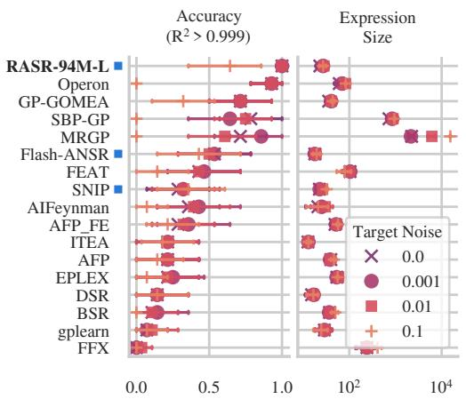

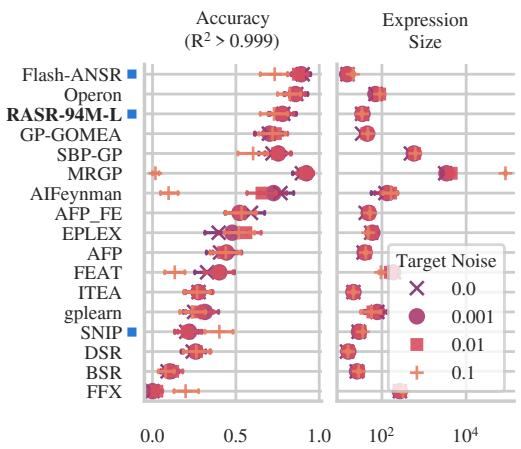  
Figure 5: Ground-truth recovery on the Strogatz (left) and Feynman (right) tracks. Panels give the accuracy solution rate, the fraction of runs reaching test $R ^ { 2 } > 0 . 9 9 9$ (higher is better), and the mean expression size on a log scale (lower is better). Markers show target-noise levels with 95% confidence intervals over problems. Methods are ordered by solution rate averaged over noise levels. Amortized methods are flagged with a blue square next to their name.

## 4.4 ADDITIONAL RESULTS AND ABLATIONS

On the first-principles track of SRBench 2.0, whose twelve small problems pair real or noisy data with an accepted law, at least one RASR variant lies on the accuracy-size Pareto front for ten of the twelve problems (Appendix L). Appendix M analyzes post-training and Appendix N ablates our changes on the black-box track, both in mean improvability against a fixed pool of all baselines and RASR variants. At the 24M scale the ablations use, a model trained on a prior in the style of earlier neural symbolic-regression work reaches 18.31 after post-training, against 9.51 for ours. Post-training improves all three axes at the 94M scale: it lowers improvability from 10.03 to 7.44, shortens the returned expressions from 37.4 to 27.5 nodes and cuts the fitting time from 762 to 133 seconds. Improvability falls steadily as more candidate expressions are sampled, and post-training reduces the number of samples needed. Predicting constants as an initialization matters as well, with a skeleton-only variant at 12.09 against the same 9.51. The remaining appendices cover failed runs, additional RASR variants and further views of the ground-truth and black-box tracks.

## 5 CONCLUSION

Limitations. Several limitations remain in evaluation scope, method and measurement. Twelve black-box datasets leave track averages uncertain. The protocol fixes one expression per run while RASR returns a front, and the reported costs place GPU inference next to single-core CPU search. Constants at nearly every operator argument overparameterize refinement, and the bound of 2048 rows and 11 features costs accuracy on four black-box datasets. Finally, expression size, our only interpretability measure, cannot judge what an expression means to a domain expert.

Discussion. We see three implications. First, the prior is a primary design axis: at 24M parameters, a model trained on an earlier-style prior ends at about twice our improvability (Appendix N). We release ours as a modular basis for further work. Second, post-training specializes a base model. Needing no ground-truth expression, it could equally adapt to real data of a target domain or to other expression preferences. Third, our results are unlikely to mark the limit of the approach: gains from 24M to 94M parameters (Appendix M) are in line with early evidence of scaling laws (Otte et al., 2025), and larger training datasets may lift our bound on rows and features.

Our results suggest that neural symbolic regression’s deficit against search-based methods on real, noisy data stems from training rather than from the paradigm. With a synthetic prior built to resemble real data and reinforcement-learning post-training, RASR attains the best mean test $R ^ { 2 }$ rank on the black-box track of SRBench 2.0, with all three variants on the accuracy-complexity Pareto front, and the highest solution rate on Strogatz.

## AI USE STATEMENT

We used LLM-based assistants to help implement the method and the training pipeline, and we reviewed and tested all AI-assisted code. We also used them to polish the wording of text we wrote, to format LATEX tables, and to help create figures. Some of the related work cited here was first suggested by an AI assistant. We checked every cited work against the original publication. We did not use generative AI to generate datasets, since our synthetic training data is sampled from the prior described in Section 3.1. Nor did we use it to develop research ideas, hypotheses, or theoretical frameworks, to design or give feedback on the methodology or experiments, to choose experimental parameters, to formulate or prove mathematical claims, or to interpret results. Translation, dataset cleaning, and qualitative data analysis do not apply to this work. We take full responsibility for the content of this paper.

## REPRODUCIBILITY STATEMENT

We aim for every result in this paper to be reproducible from the released artifacts and the paper alone. Our source code is publicly available at https://github.com/automl/rasr. The weights of our models are hosted on Hugging Face at https://hf.co/collections/davidotte/ rasr. In the paper itself, the synthetic prior is described in Section 3.1, and Appendix B lists all of its sampling hyperparameters, including our modifications to the TabICLv2 regression prior. The architecture is given in Section 3.2 and Appendix C. Appendix D lists the optimizer settings, schedules and compute budgets of both training stages, and Appendix E the post-training objective and its hyperparameters. Appendix F specifies the sampling and constant-refinement settings, which are the same in every experiment we report. We evaluate under the published protocols of SRBench 2.0 and the original SRBench, with their seeds and train/test splits (Section 4.1). Appendix H states every choice that departs from these protocols or that they leave open: the input-size caps and feature selection applied to RASR, median aggregation over seeds, the improvability pools, and the configurations of Flash-ANSR and SNIP, the two baselines we ran ourselves. Appendix I describes how failed runs are imputed. All other baseline results are taken from the runs released with the respective benchmark.

## ACKNOWLEDGEMENTS

The authors acknowledge support by the state of Baden-Württemberg through bwHPC and the German Research Foundation (DFG) through grant INST 35/1597-1 FUGG and for funding under project number 455622343 (bwForCluster NEMO 2). We further gratefully acknowledge the computing time made available on the high-performance computer at the NHR Center of TU Dresden. This center is jointly supported by the Federal Ministry of Research, Technology and Space of Germany and the state governments participating in the NHR (www.nhr-verein.de/unsere-partner). This research was funded by the Deutsche Forschungsgemeinschaft (DFG, German Research Foundation) under grant number 417962828. We acknowledge funding by the European Union (via ERC Consolidator Grant DeepLearning 2.0, grant no. 101045765). Views and opinions expressed are, however, those of the author(s) only and do not necessarily reflect those of the European Union or the European Research Council. Neither the European Union nor the granting authority can be held responsible for them.

the European Union

## REFERENCES

Guilherme Seidyo Imai Aldeia, Hengzhe Zhang, Geoffrey F. Bomarito, Miles D. Cranmer, Alcides Fonseca, Bogdan Burlacu, William G. La Cava, and Fabrício Olivetti de França. Call for action: towards the next generation of symbolic regression benchmark. In Bogdan Filipic (ed.), Proceedings of the Genetic and Evolutionary Computation Conference Companion, GECCO 2025, NH Malaga Hotel, Malaga, Spain, July 14-18, 2025, pp. 2529–2538. ACM, 2025. doi: 10.1145/3712255.3734309. URL https://doi.org/10.1145/3712255.3734309.

Luca Biggio, Tommaso Bendinelli, Alexander Neitz, Aurélien Lucchi, and Giambattista Parascandolo. Neural symbolic regression that scales. In Marina Meila and Tong Zhang (eds.), Proceedings of the 38th International Conference on Machine Learning, ICML 2021, 18-24 July 2021, Virtual Event, volume 139 of Proceedings ofMachine Learning Research, pp. 936–945. PMLR, 2021. URL http://proceedings.mlr.press/v139/biggio21a.html.

Charles Bonnet. Contemplation de la nature, volume 4. De l’imprimerie de Samuel Fauche, libraire du roi, 1781.

Bogdan Burlacu, Gabriel Kronberger, and Michael Kommenda. Operon C++: an efficient genetic programming framework for symbolic regression. In Carlos Artemio Coello Coello (ed.), GECCO ’20: Genetic and Evolutionary Computation Conference, Companion Volume, Cancún, Mexico, July 8-12, 2020, pp. 1562–1570. ACM, 2020. doi: 10.1145/3377929.3398099. URL https: //doi.org/10.1145/3377929.3398099.

William G. La Cava, Patryk Orzechowski, Bogdan Burlacu, Fabrício Olivetti de França, Marco Virgolin, Ying Jin, Michael Kommenda, and Jason H. Moore. Contemporary symbolic regression methods and their relative performance. In Joaquin Vanschoren and Sai-Kit Yeung (eds.), Proceedings of the Neural Information Processing Systems Track on Datasets and Benchmarks 1, NeurIPS Datasets and Benchmarks 2021, December 2021, virtual, 2021. URL https://datasets-benchmarks-proceedings.neurips.cc/paper/2021/ hash/c0c7c76d30bd3dcaefc96f40275bdc0a-Abstract-round1.html.

Miles D. Cranmer. Interpretable machine learning for science with pysr and symbolicregression.jl. CoRR, abs/2305.01582, 2023. doi: 10.48550/ARXIV.2305.01582. URL https://doi.org/ 10.48550/arXiv.2305.01582.

Stefan Elfwing, Eiji Uchibe, and Kenji Doya. Sigmoid-weighted linear units for neural network function approximation in reinforcement learning. Neural Networks, 107:3–11, 2018. doi: 10.1016/J.NEUNET.2017.12.012. URL https://doi.org/10.1016/j.neunet.2017. 12.012.

Nick Erickson, Lennart Purucker, Andrej Tschalzev, David Holzmüller, Prateek Desai, David Salinas, and Frank Hutter. Tabarena: A living benchmark for machine learning on tabular data. Advances in Neural Information Processing Systems, 38, 2025. doi: 10.48550/ARXIV.2506.16791. URL https://doi.org/10.48550/arXiv.2506.16791.

Alex Henry, Prudhvi Raj Dachapally, Shubham Shantaram Pawar, and Yuxuan Chen. Query-key normalization for transformers. In Trevor Cohn, Yulan He, and Yang Liu (eds.), Findings of the Association for Computational Linguistics: EMNLP 2020, Online Event, 16-20 November 2020, volume EMNLP 2020 of Findings of ACL, pp. 4246–4253. Association for Computational Linguistics, 2020. doi: 10.18653/V1/2020.FINDINGS-EMNLP.379. URL https://doi.org/ 10.18653/v1/2020.findings-emnlp.379.

Noah Hollmann, Samuel Müller, Katharina Eggensperger, and Frank Hutter. Tabpfn: A transformer that solves small tabular classification problems in a second. In The Eleventh International Confer ence on Learning Representations, ICLR 2023, Kigali, Rwanda, May 1-5, 2023. OpenReview.net, 2023. URL https://openreview.net/forum?id=cp5PvcI6w8\_.

Noah Hollmann, Samuel Müller, Lennart Purucker, Arjun Krishnakumar, Max Körfer, Shi Bin Hoo, Robin Tibor Schirrmeister, and Frank Hutter. Accurate predictions on small data with a tabular foundation model. Nat., 637(8044):319–326, 2025. doi: 10.1038/S41586-024-08328-6. URL https://doi.org/10.1038/s41586-024-08328-6.

Edwin Hubble. A relation between distance and radial velocity among extra-galactic nebulae. Proceedings ofthe national academy ofsciences, 15(3):168–173, 1929.

Yuhua Jiang, Jiawei Huang, Yufeng Yuan, Xin Mao, Yu Yue, Qianchuan Zhao, and Lin Yan. Risksensitive RL for alleviating exploration dilemmas in large language models. CoRR, abs/2509.24261, 2025. doi: 10.48550/ARXIV.2509.24261. URL https://doi.org/10.48550/arXiv. 2509.24261.

Pierre-Alexandre Kamienny, Stéphane d’Ascoli, Guillaume Lample, and François Charton. End-to-end symbolic regression with transformers. In Sanmi Koyejo, S. Mohamed, A. Agarwal, Danielle Belgrave, K. Cho, and A. Oh (eds.), Advances in Neural Information Processing Systems 35: Annual Conference on Neural Information Processing Systems 2022, NeurIPS 2022, New Orleans, LA, USA, November 28 - December 9, 2022, 2022. URL http://papers.nips.cc/paper\_files/paper/2022/hash/ 42eb37cdbefd7abae0835f4b67548c39-Abstract-Conference.html.

Johannes Kepler. Harmonices Mundi. Linz, Austria, 1619.

John R Koza. Genetic programming as a means for programming computers by natural selection. Statistics and computing, 4(2):87–112, 1994.

Guillaume Lample and François Charton. Deep learning for symbolic mathematics. In 8th International Conference on Learning Representations, ICLR 2020, Addis Ababa, Ethiopia, April 26-30, 2020. OpenReview.net, 2020. URL https://openreview.net/forum?id= S1eZYeHFDS.

Henrietta S Leavitt and Edward C Pickering. Periods of 25 variable stars in the small magellanic cloud. Harvard College Observatory Circular, vol. 173, pp. 1-3, 173:1–3, 1912.

Kenneth Levenberg. A method for the solution of certain non-linear problems in least squares. Quarterly ofapplied mathematics, 2(2):164–168, 1944.

Wenqiang Li, Weijun Li, Linjun Sun, Min Wu, Lina Yu, Jingyi Liu, Yanjie Li, and Songsong Tian. Transformer-based model for symbolic regression via joint supervised learning. In The Eleventh International Conference on Learning Representations, ICLR 2023, Kigali, Rwanda, May 1-5, 2023. OpenReview.net, 2023. URL https://openreview.net/forum?id=ULzyv9M1j5.

Ilya Loshchilov and Frank Hutter. SGDR: stochastic gradient descent with warm restarts. In 5th International Conference on Learning Representations, ICLR 2017, Toulon, France, April 24-26, 2017, Conference Track Proceedings. OpenReview.net, 2017. URL https://openreview. net/forum?id=Skq89Scxx.

Ilya Loshchilov and Frank Hutter. Decoupled weight decay regularization. In 7th International Conference on Learning Representations, ICLR 2019, New Orleans, LA, USA, May 6-9, 2019. OpenReview.net, 2019. URL https://openreview.net/forum?id=Bkg6RiCqY7.

Donald W Marquardt. An algorithm for least-squares estimation of nonlinear parameters. Journal of the society for Industrial and Applied Mathematics, 11(2):431–441, 1963.

Kazem Meidani, Parshin Shojaee, Chandan K. Reddy, and Amir Barati Farimani. SNIP: bridging mathematical symbolic and numeric realms with unified pre-training. In The Twelfth International Conference on Learning Representations, ICLR 2024, Vienna, Austria, May 7-11, 2024. OpenReview.net, 2024. URL https://openreview.net/forum?id=KZSEgJGPxu.

Aaron Meurer, Christopher P. Smith, Mateusz Paprocki, Ondˇrej Certík, Sergey B. Kirpichev, Matthewˇ Rocklin, AMiT Kumar, Sergiu Ivanov, Jason K. Moore, Sartaj Singh, Thilina Rathnayake, Sean Vig, Brian E. Granger, Richard P. Muller, Francesco Bonazzi, Harsh Gupta, Shivam Vats, Fredrik Johansson, Fabian Pedregosa, Matthew J. Curry, Andy R. Terrel, Štepán Rou ˇ cka, Ashutosh ˇ Saboo, Isuru Fernando, Sumith Kulal, Robert Cimrman, and Anthony Scopatz. Sympy: symbolic computing in python. PeerJ Computer Science, 3:e103, January 2017. ISSN 2376-5992. doi: 10.7717/peerj-cs.103. URL https://doi.org/10.7717/peerj-cs.103.

Ken M. Nakanishi. Scalable-softmax is superior for attention. CoRR, abs/2501.19399, 2025. doi: 10. 48550/ARXIV.2501.19399. URL https://doi.org/10.48550/arXiv.2501.19399.

Randal S. Olson, William G. La Cava, Patryk Orzechowski, Ryan J. Urbanowicz, and Jason H. Moore. PMLB: a large benchmark suite for machine learning evaluation and comparison. BioData Min., 10(1):36:1–36:13, 2017. doi: 10.1186/S13040-017-0154-4. URL https://doi.org/10. 1186/s13040-017-0154-4.

David Otte, Jörg KH Franke, Arbër Zela, Fábio Ferreira, and Frank Hutter. Towards scaling laws for symbolic regression. arXiv preprint arXiv:2510.26064, 2025.

Brenden K. Petersen, Mikel Landajuela, T. Nathan Mundhenk, Cláudio Prata Santiago, Sookyung Kim, and Joanne Taery Kim. Deep symbolic regression: Recovering mathematical expressions from data via risk-seeking policy gradients. In 9th International Conference on Learning Representations, ICLR 2021, Virtual Event, Austria, May 3-7, 2021. OpenReview.net, 2021. URL https:// openreview.net/forum?id=m5Qsh0kBQG.

Ofir Press and Lior Wolf. Using the output embedding to improve language models. In Mirella Lapata, Phil Blunsom, and Alexander Koller (eds.), Proceedings of the 15th Conference of the European Chapter of the Association for Computational Linguistics, EACL 2017, Valencia, Spain, April 3-7, 2017, Volume 2: Short Papers, pp. 157–163. Association for Computational Linguistics, 2017. doi: 10.18653/V1/E17-2025. URL https://doi.org/10.18653/v1/e17-2025.

Zihan Qiu, Zekun Wang, Bo Zheng, Zeyu Huang, Kaiyue Wen, Songlin Yang, Rui Men, Le Yu, Fei Huang, Suozhi Huang, Dayiheng Liu, Jingren Zhou, and Junyang Lin. Gated attention for large lan guage models: Non-linearity, sparsity, and attention-sink-free. In Danielle Belgrave, Cheng Zhang, Laura N. Montoya, Hsuan-Tien Lin, Razvan Pascanu, Piotr Koniusz, Marzyeh Ghassemi, Nancy Chen, Iván Vladimir Meza Ruíz, and Arturo Loaiza-Bonilla (eds.), Advances in Neural Information Processing Systems 38: Annual Conference on Neural Information Processing Systems 2025, NeurIPS 2025, San Diego, CA, USA, December 2-7, 2025 /Mexico City, Mexico, November 30 - December 5, 2025, 2025. URL http://papers.nips.cc/paper\_files/paper/2025/ hash/904e89bb4e632e75fb47f093b620b257-Abstract-Conference.html.

Jingang Qu, David Holzmüller, Gaël Varoquaux, and Marine Le Morvan. Tabiclv2: A better, faster, scalable, and open tabular foundation model. CoRR, abs/2602.11139, 2026. doi: 10.48550/ARXIV. 2602.11139. URL https://doi.org/10.48550/arXiv.2602.11139.

Etienne Russeil, Fabricio Olivetti de Franca, Konstantin Malanchev, Bogdan Burlacu, Emille Ishida, Marion Leroux, Clément Michelin, Guillaume Moinard, and Emmanuel Gangler. Multiview symbolic regression. In Proceedings ofthe Genetic and Evolutionary Computation Conference, pp. 961–970, 2024.

Paul Saegert and Ullrich Köthe. Breaking the simplification bottleneck in amortized neural symbolic regression. CoRR, abs/2602.08885, 2026. doi: 10.48550/ARXIV.2602.08885. URL https: //doi.org/10.48550/arXiv.2602.08885.

Subham S. Sahoo, Christoph H. Lampert, and Georg Martius. Learning equations for extrapolation and control. In Jennifer G. Dy and Andreas Krause (eds.), Proceedings ofthe 35th International Conference on Machine Learning, ICML 2018, Stockholmsmässan, Stockholm, Sweden, July 10-15, 2018, volume 80 of Proceedings ofMachine Learning Research, pp. 4439–4447. PMLR, 2018. URL http://proceedings.mlr.press/v80/sahoo18a.html.

Michael Schmidt and Hod Lipson. Distilling free-form natural laws from experimental data. science, 324(5923):81–85, 2009.

Zhihong Shao, Peiyi Wang, Qihao Zhu, Runxin Xu, Junxiao Song, Mingchuan Zhang, Y. K. Li, Y. Wu, and Daya Guo. Deepseekmath: Pushing the limits of mathematical reasoning in open language models. CoRR, abs/2402.03300, 2024. doi: 10.48550/ARXIV.2402.03300. URL https://doi.org/10.48550/arXiv.2402.03300.

Parshin Shojaee, Kazem Meidani, Amir Barati Farimani, and Chandan K. Reddy. Transformerbased planning for symbolic regression. In Alice Oh, Tristan Naumann, Amir Globerson, Kate Saenko, Moritz Hardt, and Sergey Levine (eds.), Advances in Neural Information Processing Systems 36: Annual Conference on Neural Information Processing Systems 2023, NeurIPS 2023, New Orleans, LA, USA, December 10 - 16, 2023, 2023. URL http://papers.nips.cc/paper\_files/paper/2023/hash/ 8ffb4e3118280a66b192b6f06e0e2596-Abstract-Conference.html.

Jianlin Su, Yu Lu, Shengfeng Pan, Bo Wen, and Yunfeng Liu. Roformer: Enhanced transformer with rotary position embedding. CoRR, abs/2104.09864, 2021. URL https://arxiv.org/abs/ 2104.09864.

Yuan Tian, Wenqi Zhou, Michele Viscione, Hao Dong, David S Kammer, and Olga Fink. Interactive symbolic regression with co-design mechanism through offline reinforcement learning. Nature Communications, 16(1):3930, 2025.

R Brent Tully and J Richard Fisher. A new method of determining distances to galaxies. Astronomy and Astrophysics, vol. 54, no. 3, Feb. 1977, p. 661-673., 54:661–673, 1977.

Martin Vastl, Jonas Kulhanek, Jirí Kubalík, Erik Derner, and Robert Babuska. Symformer: End-toend symbolic regression using transformer-based architecture. IEEE Access, 12:37840–37849, 2024. doi: 10.1109/ACCESS.2024.3374649. URL https://doi.org/10.1109/ACCESS. 2024.3374649.

Ashish Vaswani, Noam Shazeer, Niki Parmar, Jakob Uszkoreit, Llion Jones, Aidan N. Gomez, Lukasz Kaiser, and Illia Polosukhin. Attention is all you need. In Isabelle Guyon, Ulrike von Luxburg, Samy Bengio, Hanna M. Wallach, Rob Fergus, S. V. N. Vishwanathan, and Roman Garnett (eds.), Advances in Neural Information Processing Systems 30: Annual Conference on Neural Information Processing Systems 2017, December 4-9, 2017, Long Beach, CA, USA, pp. 5998–6008, 2017. URL https://proceedings.neurips.cc/paper/2017/hash/ 3f5ee243547dee91fbd053c1c4a845aa-Abstract.html.

Marco Virgolin and Solon P. Pissis. Symbolic regression is np-hard. Trans. Mach. Learn. Res., 2022, 2022. URL https://openreview.net/forum?id=LTiaPxqe2e.

Pauli Virtanen, Ralf Gommers, Travis E. Oliphant, Matt Haberland, Tyler Reddy, David Cournapeau, Evgeni Burovski, Pearu Peterson, Warren Weckesser, Jonathan Bright, Stéfan van der Walt, Matthew Brett, Joshua Wilson, K. Jarrod Millman, Nikolay Mayorov, Andrew R. J. Nelson, Eric Jones, Robert Kern, Eric Larson, CJ Carey, Ilhan Polat, Yu Feng, Eric W. Moore, Jake VanderPlas, Denis Laxalde, Josef Perktold, Robert Cimrman, Ian Henriksen, E. A. Quintero, Charles R. Harris, Anne M. Archibald, Antônio H. Ribeiro, Fabian Pedregosa, Paul van Mulbregt, and SciPy. Scipy 1.0-fundamental algorithms for scientific computing in python. CoRR, abs/1907.10121, 2019. URL http://arxiv.org/abs/1907.10121.

Biao Zhang and Rico Sennrich. Root mean square layer normalization. In Hanna M. Wallach, Hugo Larochelle, Alina Beygelzimer, Florence d’Alché-Buc, Emily B. Fox, and Roman Garnett (eds.), Advances in Neural Information Processing Systems 32: Annual Conference on Neural Information Processing Systems 2019, NeurIPS 2019, December 8-14, 2019, Vancouver, BC, Canada, pp. 12360–12371, 2019. URL https://proceedings.neurips.cc/paper/2019/hash/ 1e8a19426224ca89e83cef47f1e7f53b-Abstract.html.

## APPENDIX

## A EXTENDED RELATED WORK

This section expands Section 2 on neural symbolic regression, the family our method belongs to, and closes with the reinforcement-learning line our post-training stage borrows from. It is organized around the same recurring design choices, and states our own position on each in place.

Synthetic training data. Every pre-trained method stands on a synthetic data generator. For sampling the expressions, methods rely on the sampling strategy of Lample & Charton (2020), which draws expression trees uniformly given their operator counts. NeSymReS (Biggio et al., 2021) and Flash-ANSR (Saegert & Köthe, 2026) additionally simplify the sampled expressions before training on them. The generation of the accompanying datasets has received far less attention. Inputs are typically sampled i.i.d. from simple fixed distributions, a uniform one in NeSymReS and a mixture of Gaussians in E2E (Kamienny et al., 2022). Constants are sampled from fixed intervals chosen independently of the data, with rejection sampling cleaning up the frequent degenerate outcomes such as saturated exponentials and out-of-domain logarithms. The resulting tables bear little resemblance to real data, which is often noisy and contains correlated and redundant features. Since a pretrained model can only be as good as its training data, we regard this as a large untapped source of improvement in the recipe.

We therefore treat the data prior as a central design component rather than a fixed preliminary, and construct inputs, constants, and targets accordingly (Section 3.1).

Pre-training objectives. The standard recipe minimizes plain token-level cross-entropy against a single reference expression, but a recent line of work argues for richer, multimodal objectives. SNIP (Meidani et al., 2024) uses a contrastive loss that aligns numeric-data embeddings with embeddings of the corresponding expression, and the model of Li et al. (2023) combines such a term with the usual cross-entropy objective. Sym-Q (Tian et al., 2025) frames decoding as sequential decision making, training with a contrastive loss plus an offline reinforcement-learning objective.

We deliberately stay with plain cross-entropy, since these objectives mainly buy searchability, a role filled in our pipeline by the post-training stage of Section 3.3.

Numerical constants. Existing methods split into two camps. Skeleton-based methods, among them NeSymReS, Flash-ANSR, SNIP, Sym-Q, and the model of Li et al. (2023), predict only placeholder tokens and delegate all numeric values to a downstream optimizer. This keeps the task purely symbolic, but it leaves the model no way to express a prior over plausible constants, which could help avoid poor local minima and overfitting on noisy data. End-to-end methods, namely E2E and SymFormer (Vastl et al., 2024), instead aim to predict constants directly in high precision, with an optional refinement step taking the predicted values as initialization. This places the full burden of numeric precision on a discrete autoregressive decoder, a task at which transformers are notoriously weak. A single mispredicted digit can leave the refinement stage starting far from any good solution.

We take a middle position, emitting rounded constants (Section 3.1) that serve only as an initialization region for the refinement of Section 3.4, so the model steers the constant search without being trusted for precision.

Test-time compute and selection. Although not always framed as such, the methods above all spend test-time compute on the same three ingredients: generating multiple candidate expressions, fitting or refining each candidate’s constants, and selecting a final one by training fit and complexity. Some run these once in sequence, others interleave generation and scoring. They differ in how many candidates they generate and in how they generate them. Flash-ANSR reports that recovery keeps improving as more expressions are sampled, whereas NeSymReS and E2E settle for a small fixed number. On the generation mechanism, NeSymReS, E2E, SymFormer, and Flash-ANSR use beam search or temperature sampling, SNIP searches the latent space its pre-training constructed, and TPSR (Shojaee et al., 2023) wraps a Monte-Carlo tree search around a pre-trained decoder, using fit-based rollout rewards to steer decoding.

We sample plainly with a small candidate budget (Section 3.4), because post-training has already shifted the policy toward strong candidates, and because an extensive search against a criterion computed on the observed data invites overfitting when that data is small or noisy.

Deep symbolic regression. Reinforcement learning first entered symbolic regression as a perdataset search. Deep symbolic regression (DSR) (Petersen et al., 2021) trains a policy network from scratch on each problem, optimizing a risk-seeking policy gradient that rewards the best sample in a batch rather than the average one, which reflects that only the single best expression is ultimately returned. We build on the same idea, but apply it a single time, as a post-training stage on our general pre-trained model, so that the search cost is amortized across all future datasets instead of being repaid on each one. Our objective keeps the risk-seeking motivation of DSR and realizes it within a group-relative policy optimization scheme (Appendix E), which matches the best-of-n metric that our sampling-based inference actually targets.

## B SYNTHETIC PRIOR DETAILS

This section specifies the pre-training prior of Section 3.1 in full, following the order of the pipeline in Figure 2. All values correspond to the configuration used during training.

## B.1 SKELETON SAMPLING

Table B.1 lists the structural ranges of the skeleton sampler and the categorical operator weights, which are normalized separately within the binary and unary sets. Given the sampled number of binary operators, the binary tree is drawn uniformly over all trees of that size with the counting procedure of Lample & Charton (2020). Its leaves receive the $n _ { v }$ distinct variables (or as many as the tree has leaves), and the remaining leaves are filled with variables drawn with replacement from these, before all leaves are shuffled. The unary operators are then inserted at positions drawn uniformly with replacement from the prefix sequence, each wrapping the subtree rooted at its position.

Constant placeholders. Placeholders are inserted in a single recursive pass over the tree with the following rules. The argument of every unary operator is wrapped affinely, $g ( t )  g ( c _ { 0 } t + c _ { 1 } )$ . Every summand of a sum that is not itself a sum receives a multiplicative scale, and only the outermost sum of a chain receives an additive bias. $\mathbf { A }$ product chain receives a single scale and bias at its outermost node, $c _ { 0 } ( a \cdot b ) + c _ { 1 } .$ . A quotient scales its numerator and shifts its denominator, $c _ { 0 } a / ( b + c _ { 1 } ) + c _ { 2 }$ Variable leaves receive a scale $c x _ { i }$ unless their parent already supplies one. These rules skip exactly the constants that would be redundant: a scale on each factor of a product collapses under the product’s own scale, as in $c _ { 0 } ( c _ { 1 } x _ { 1 } ) ( c _ { 2 } x _ { 2 } ) \equiv c x _ { 1 } x _ { 2 }$ , and a scale inside a sum that is itself scaled would likewise collapse. The global scale and offset of the expression are not emitted, as they are absorbed by the target standardization (Appendix B.4).

Table B.1: Skeleton-sampling hyperparameters. The upper bound on the binary-operator count grows with the number of distinct variables $n _ { v } ,$ , so that expressions over more variables may be structurally larger.
<table><tr><td>Parameter Distinct variables  $n _ { v }$  Binary ops  $n _ { b }$  uniform  $\{ 0 , \ldots , 8 + n _ { v } \}$ </td><td>Value uniform  $\{ 1 , \ldots , 1 1 \}$ </td></tr><tr><td>Unary ops  $n _ { u }$  Max expression length Constant mantissa Constant magnitude bound</td><td>uniform  $\{ 0 , \ldots , 5 \}$  512 tokens 3 significant figures  $[ 1 0 ^ { - 4 } , 1 0 ^ { 4 } ]$ </td></tr><tr><td colspan="2">Binary-operator weights</td></tr><tr><td> $\overline { { \mathbf { \varepsilon } + \mathbf { \varepsilon } \cdot \mathbf { \varepsilon } 1 0 } }$   $\mathbf { \overline { { \times : 5 } } } \quad \quad \div : 5$ </td><td></td></tr><tr><td colspan="2">Unary-operator weights</td></tr><tr><td> $\overline { { { x ^ { 2 } } , { x ^ { 3 } } } }$   $x ^ { 4 } , x ^ { 5 }$   $x ^ { 1 / 2 } , x ^ { 1 / 3 }$   $x ^ { 1 / 4 } , x ^ { 1 / 5 }$ </td><td>1 0.5 1</td></tr><tr><td>abs, inv, sin, cos, tanh, exp log</td><td>0.5 1 0.5</td></tr></table>

Table B.2: Changes to the published TabICLv2 regression prior. Arrows denote a changed default value.
<table><tr><td>Component</td><td>Setting</td></tr><tr><td>Function-type mixture Removed activations</td><td>4× {mlp, lin, quad, gp, prod}, 1 × {tree, disc}</td></tr><tr><td>Min. random-tree depth</td><td>sign, Heaviside, unit-interval, argmax indicators  $1  3$ </td></tr><tr><td>Min. discretization centers</td><td> $2  5$ </td></tr><tr><td>Per-column diversity filter</td><td>added (≥ 8 clusters; no cluster  $> 1 / 3$  of rows)</td></tr></table>

Simplification and filtering. The skeleton with placeholders is then simplified with SimpliPy (Saegert & Köthe, 2026), which collapses remaining redundant terms, including constant placeholders that merge. The result is rejected if it contains non-finite tokens, contains no variable, or exceeds the maximum length. Finally, the variables that survive simplification are re-indexed to a contiguous prefix $x _ { 1 } , \ldots , x _ { n _ { v } }$ , which fixes their correspondence to the first $n _ { v }$ input columns (Appendix B.2).

## B.2 INPUT SAMPLING AND TABICLV2 MODIFICATIONS

Prior neural symbolic regression methods draw X from simple fixed distributions, such as a uniform distribution (Biggio et al., 2021) or a mixture of Gaussians (Kamienny et al., 2022). We instead use the TabICLv2 regression prior with numerical features only, from which we draw a pool of twelve columns, each standardized to zero mean and unit variance. The first $n _ { v }$ columns become the variables and the last one the noise node (Appendix B.4). The number of distractor columns is drawn from a half-normal with scale 1.5, rounded, and capped by the number of remaining columns. After the target has been computed, all observed feature columns, variables and distractors alike, are randomly permuted and the variables of the expression renamed accordingly, so that a column’s position carries no information about whether the expression uses it.

We use the TabICLv2 prior essentially as published, with the targeted changes summarized in Table B.2, all of which serve to make its columns suitable as the continuous support of a symbolic target. First, we bias the mixture of feature-generating function types towards smooth ones, giving equal weight to multilayer-perceptron, linear, quadratic, Gaussian-process, and product functions while down-weighting the piecewise-constant tree and discretization functions to a single component each. Second, for the same reason, we remove the discontinuous, step-like activations from the prior’s activation pool. Third, where discrete functions do occur, we raise their minimum granularity, so that the resulting columns still have enough distinct levels to act as continuous regressors. Finally, we add a per-column diversity filter that rejects a sampled dataset if any feature column has fewer than eight distinct value clusters or a single value cluster covering more than a third of the rows. Together these changes steer the prior away from degenerate, low-cardinality inputs while leaving the bulk of it untouched.

## B.3 BOTTOM-UP CONSTANT SAMPLING

Constants are filled in a single bottom-up pass in which every subtree is evaluated on X before the constants of its parent are drawn. For the affine wrapper $g ( c _ { 0 } t + c _ { 1 } )$ of a unary operator, the scale is drawn log-normally, log $c _ { 0 } \sim \mathcal { N } ( \mu , \sigma ^ { 2 } )$ , divided by the empirical standard deviation of the child values t, and given a random sign except for the positive-domain operators. The shift $c _ { 1 }$ is sampled in an operator-specific, domain-aware way, with four shift types listed in Table B.3:

• Generic: $c _ { 1 } = - c _ { 0 } \bar { t } + \delta$ with $\delta \sim \mathcal { N } ( m , \sigma _ { 1 } ^ { 2 } )$ , so that the mean of the argument is centered at m with spread $\sigma _ { 1 }$

• Positive (log, even roots): a distance d with log $d \sim \mathcal { N } ( \log m , \sigma _ { 1 } ^ { 2 } )$ is drawn and $c _ { 1 } =$ $d - \operatorname* { m i n } ( c _ { 0 } \bar { t } )$ ), so the minimum of the argument equals $d > 0$ by construction.

Table B.3: Per-operator affine-constant distributions. $c _ { 0 }$ is log-normal with the listed $( \mu , \sigma )$ on the log scale (then normalized by the child’s standard deviation); $c _ { 1 }$ follows the listed shift type with parameters $( m , \sigma _ { 1 } )$ . Powers, roots, and the two trigonometric functions share parameters and are grouped. The signed shift of inv is parameterized in the text.
<table><tr><td>Operator(s)</td><td> ${ \overline { { c _ { 0 } \ ( \mu , \sigma ) } } }$  C1 params</td><td>Shift type</td></tr><tr><td>sin, cos</td><td>(0.45, 1.0) (0,2.0)</td><td>generic</td></tr><tr><td>exp tanh</td><td>(−0.69, 0.8) (0, 1.0) (0.0,0.7)</td><td>generic</td></tr><tr><td> $x ^ { 2 } , x ^ { 3 } , x ^ { 4 } , x ^ { 5 } , x ^ { 1 / 3 } , x ^ { 1 / 5 }$  (0.45, 1.0)</td><td>(0, 1.5)</td><td>generic</td></tr><tr><td>log</td><td>(0,4.0) (0.4,0.8)</td><td>generic</td></tr><tr><td> $x ^ { 1 / 2 } , x ^ { 1 / 4 }$ </td><td>(1.5, 1.0)</td><td>positive</td></tr><tr><td></td><td>(1.0,0.8) (1.5, 1.0)</td><td>positive</td></tr><tr><td>inv abs</td><td>(−0.69, 0.5) see text (0.0,0.5) (0,1.5)</td><td>signed straddling</td></tr></table>

• Signed (inv and the denominator of ÷): with probability 0.4 each the argument is placed entirely on the positive or the negative side, at a distance d from zero with log $d \sim \mathcal { N } ( - 0 . 6 9 , 0 . 5 ^ { 2 } )$ , and with probability 0.2 it is centered, $c _ { 1 } = - \overline { { c _ { 0 } t } } + \mathcal { N } ( 0 , 0 . 5 ^ { 2 } )$ , so that it may cross zero. A denominator that simplified to a bare constant only uses the two one-sided branches.

• Straddling (abs): $c _ { 1 }$ is drawn from $\mathcal { N } ( - \overline { { c _ { 0 } t } } , \sigma _ { 1 } ^ { 2 } )$ truncated such that the argument takes both signs and each of its extremes lies at least 5% of its range away from zero, which ensures that abs actually bends.

Sums. The scales of a sum are set jointly rather than per term. All scaled terms of an additive chain are evaluated first, and each scale is set to $\bar { c } _ { i } = \pm \sigma _ { \mathrm { b a s e } } \bar { / } \sigma _ { i } \cdot e ^ { \xi _ { i } }$ with a random sign, $\xi _ { i } \sim \mathcal { N } ( 0 , 0 . 2 5 ^ { 2 } )$ $\sigma _ { i }$ the empirical standard deviation of term i, and $\sigma _ { \mathrm { b a s e } }$ the geometric mean of all $\sigma _ { i } .$ . If the chain has only one scaled term, $\sigma _ { \mathrm { b a s e } }$ is the spread of the remaining unscaled part instead. Every term thus contributes a comparable spread, so that none vanishes or dominates. When the argument of a unary operator is itself a two-term sum, its overall spread is drawn from that operator’s $c _ { 0 }$ distribution and split between the two terms with a log-ratio $\hat { \mathcal { N } } ( 0 , 0 . 7 ^ { 2 } )$ . All remaining constants, such as the biases of binary operators and scales outside of sums, are drawn from $\mathcal { N } ( 0 , \bar { 5 } ^ { 2 } )$

Validation and filtering. Inputs are drawn with 25% more rows than the target number of observations $n ,$ so that filtering can remove rows without shrinking the dataset. A pair is rejected if any raw constant violates $1 \bar { 0 } ^ { - 4 } < | c | < 1 0 ^ { 4 }$ . After noise has been added (Appendix B.4), rows with a non-finite value are removed, and if more than the surplus are affected, the pair is rejected. Gross target outliers are then removed with an interquartile-range filter, discarding points outside $[ Q _ { 1 } - 5 \bar { \mathrm { I Q R } } , Q _ { 3 } + 5 \mathrm { I Q R } ]$ , and the dataset is truncated to n rows, being rejected if fewer remain. The resulting target must then be well-behaved: its variance must exceed $1 \bar { 0 } ^ { - 6 }$ , its maximum absolute value must stay below $1 0 ^ { 6 }$ , and the largest 1% of its squared deviations from the mean must contribute less than 90% of the sum of all squared deviations (a heavy-tail guard). Finally, the dataset is discarded if its empirical target standard deviation falls outside $[ 1 \dot { 0 } ^ { - 6 } , \dot { 1 } 0 ^ { 3 } ]$

## B.4 NOISE AND STANDARDIZATION

Table B.4 lists the dataset- and noise-level settings. With probability 0.4 a dataset stays clean. Otherwise, a strength s is drawn from an exponential distribution with mean 0.08, and each target is perturbed as

$$
\tilde { y } _ { i } = y _ { i } + s \sigma _ { y } \sigma _ { i } z _ { i } ,\tag{3}
$$

where $\sigma _ { y }$ is the standard deviation of the clean target, z a noise shape with zero mean and unit variance over the dataset, and $\sigma _ { i }$ a per-row scale with mean one. Let ν denote the noise node. The two noise forms, drawn with equal probability, differ in z and $\sigma _ { i }$

Gaussian form. Here $z _ { i } \sim \mathcal { N } ( 0 , 1 )$ ), empirically standardized, and the per-row scale is a blend between a constant and a softplus profile of the noise node,

$$
\sigma _ { i } \propto \mathrm { m i n } \Bigl ( \bigl ( 1 - w \bigr ) + w \frac { \mathrm { s o f t p l u s } ( \nu _ { i } ) } { \mathrm { s o f t p l u s } ( \nu ) } , 3 \Bigr ) , \qquad w \sim \mathcal { U } [ 0 , 1 ] ,\tag{4}
$$

Table B.4: Dataset- and noise-level hyperparameters.
<table><tr><td>Parameter</td><td>Value</td></tr><tr><td>Observations n</td><td>uniform integer [8, 1024]</td></tr><tr><td>Distractor columns Clean-dataset fraction</td><td>half-normal, scale 1.5, capped by pool size 0.4</td></tr><tr><td>Noise strength s</td><td>Exponential(mean 0.08)</td></tr><tr><td>Gaussian / structured form</td><td>0.5 / 0.5</td></tr><tr><td>Blend weight w (Gaussian form)</td><td>U[0, 1]</td></tr><tr><td>Max. per-row scale  $\sigma _ { i }$  (Gaussian form)</td><td>3</td></tr></table>

normalized to mean one and clipped again at 3. The blend weight w interpolates between homoscedastic $( w = 0 )$ and fully input-correlated heteroscedastic noise $( w = 1 )$ , and the clipping bounds the per-row scale at three times its mean. Since softplus is positive and monotone, the noise level is correlated with whatever the noise node is correlated with in the sampled SCM.

Structured form. Here $\sigma _ { i } = 1$ and z is the noise node passed through a random activation and then standardized to zero mean and unit variance. The activation is sampled as the composition: standardize to unit variance, apply a random positive rescaling, an optional sign flip of the input, one activation drawn uniformly from {identity, LeakyReLU, ELU, SELU, SiLU, ReLU, ReLU6, softplus, sigmoid, exp, square, $| \cdot | , \sqrt { | \cdot | } \}$ , and an optional sign flip of the output.

Standardization. The target is standardized with the empirical mean $\mu _ { y }$ and standard deviation $\sigma _ { y }$ of the final, possibly noisy target, so that the label is defined with respect to the data the model actually observes. The expression is rewritten as $( f - \mu _ { y } ) / \sigma _ { y }$ , where $\mu _ { y }$ is folded into the top-level additive constant of f whenever one exists, which avoids a redundant subtraction.

## B.5 TOKENIZATION

Constants are rounded to three significant figures only after the standardization rewrite, so the rounding applies to the values the model is trained to predict. Each constant is then written in scientific notation and emitted digit by digit. For example, $- 0 . 0 4 2 1 = - 4 . 2 1 \times 1 0 ^ { - 2 }$ becomes $ \ n \in { \mathbb { g } } { \begin{array} { r l l l l } { { \mathbb { 1 } } } & { { \mathbb { 2 } } } & { 2 } & { 1 } & { \ e - } & { 2 \colon } \end{array} }$ a negative constant is prefixed with the ordinary unary negation operator neg, followed by the mantissa digits without the decimal point and with trailing zeros dropped, the exponent sign e+ or e-, and a single exponent digit. Numeric values of any magnitude thus share a fixed alphabet of twelve tokens, the ten digits and the two exponent signs, rather than requiring one token per value.

## B.6 PRIOR STATISTICS

To characterize what the pipeline actually produces, Figure B.1 shows the marginal distributions of its main quantities over a large batch of sampled pairs. The number of distinct variables is close to uniform by construction, while the number of distractor features is concentrated at small values with a long tail. Most datasets carry little or no noise, consistent with the 40% clean fraction and the exponential’s mean of 0.08, but the distribution has a long tail toward heavily corrupted targets. Expressions typically carry several constants, and the bottom-up sampler keeps their magnitude concentrated within a few orders of magnitude of one rather than filling the full range the sampler permits, consistent with the intent of conditioning on the data. Expression size is spread over a wide range, giving the model exposure to both small and considerably larger expressions.

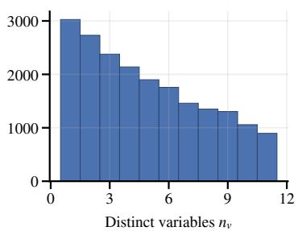

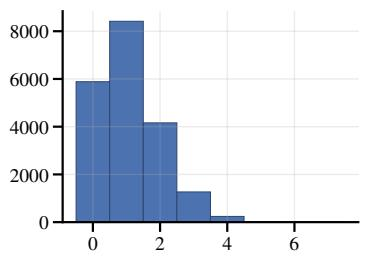

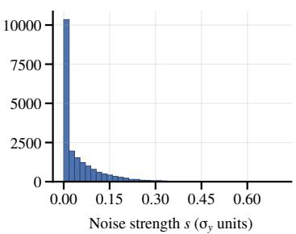

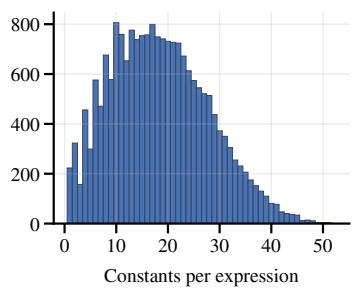

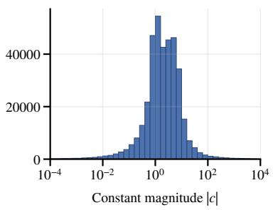

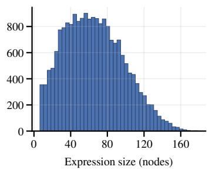  
Figure B.1: Statistics of the pre-training prior over 20,000 sampled pairs. Top row, left to right: the number of distinct variables $n _ { v }$ in the expression, the number of distractor features appended to the dataset, and the noise strength s (in units of the clean target’s standard deviation $\sigma _ { y } )$ . Bottom row, left to right: the number of constants per expression, the magnitude of the sampled constants (log scale, bounded by the sampler’s own rejection threshold), and the expression size in nodes.

## C ARCHITECTURE

This section expands Section 3.2 and specifies every component of the model. Figure C.1 gives an overview, and Table C.1 the two configurations we train.

Table input and cell encoding. The input is a table of shape $( n , d { + } 1 )$ whose first column holds the target and whose remaining columns hold the d features. Within a batch, tables are padded to a common shape and a boolean mask records the valid entries. Every scalar cell is encoded through its raw IEEE-754 representation: the 32 bits of the float32 value are mapped to a $\{ - 1 , + 1 \} ^ { \breve { 3 } 2 }$ vector, which a linear layer projects to the model dimension (Biggio et al., 2021). This gives the model direct access to the magnitude and sign of every value. A standard sinusoidal positional embedding (Vaswani et al., 2017) over the column index is added so that the encoder can distinguish the target column from the features and the features from one another.

Alternating axial-attention encoder. Following the encoder design of TabPFNv2 (Hollmann et al., 2025), each block applies attention along the feature axis, letting every cell attend to the other columns in its row, and along the sample axis, letting every cell attend to the same column in other rows, followed by a single position-wise feed-forward network. This factorization avoids full attention over all $n ( d { + } 1 )$ cells while keeping the model expressive. Sample-axis attention treats the rows as an unordered set, so the encoder is permutation-equivariant over samples and accepts a variable number of rows n. The column positional embedding breaks this symmetry along the feature axis. After the final block, the representation at the target column of each row is taken as that row’s summary, yielding the n per-sample latents the decoder attends to.

Decoder. The decoder is a stack of standard transformer decoder blocks. Each block first crossattends to the n per-sample latents emitted by the encoder, then applies causal self-attention with rotary position embeddings (RoPE) (Su et al., 2021) and finally a position-wise feed-forward network. Token embeddings use a learned table with additive sinusoidal absolute positions, and the embedding matrix is tied to the output projection (Press & Wolf, 2017).

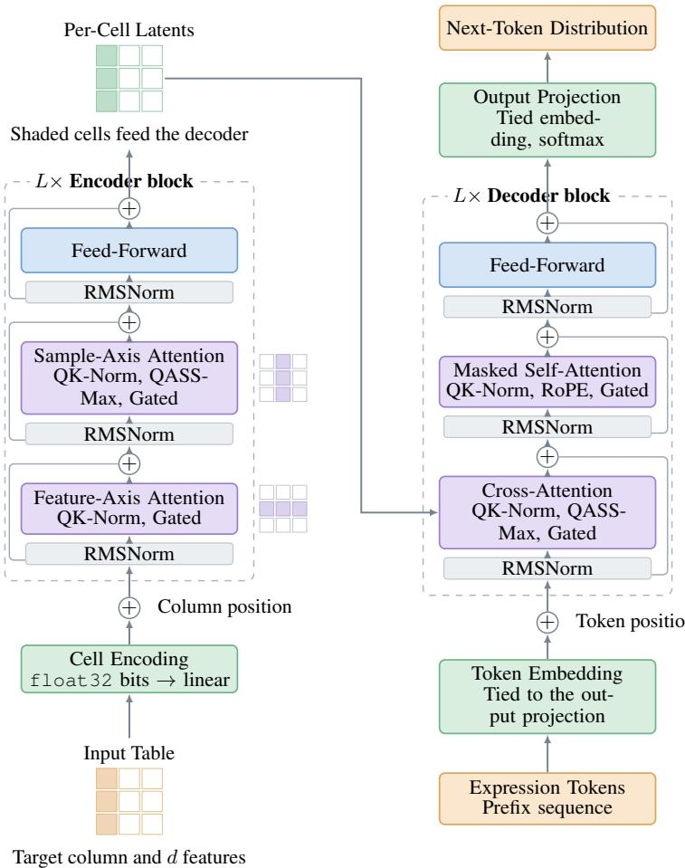  
Figure C.1: Overview of the model architecture. The table, whose shaded first column holds the target, is encoded cell by cell and refined by a stack of encoder blocks that alternate attention over its two axes. The grids beside them mark the cells attended together, along a row for feature-axis attention and down a column for sample-axis attention. The encoder returns one latent per cell, and the decoder cross-attends to those of the target column alone, shaded in the grid, while generating the expression as a prefix token sequence. Every sublayer is pre-normalized and wrapped in a residual connection.

Length-robust attention (QASSMax). Standard attention scales the query-key dot product by a fixed factor $1 / \sqrt { d _ { h } }$ , which is independent of the number of keys. In our encoder the relevant context is the set of samples, whose size n varies by two orders of magnitude across datasets, and with a fixed scale the softmax over n logits flattens as n grows. Scalable-softmax (SSMax) (Nakanishi, 2025) counteracts this by scaling the logits with the context length. We use the query-adaptive generalization from TabICLv2 (Qu et al., 2026), QASSMax, which rescales each query vector q by a factor depending on both n and q itself,

$$
\tilde { q } \ = \ q \odot \ \big [ s ( \log n ) \odot \big ( 1 + \operatorname { t a n h } ( m ( q ) ) \big ) \big ] ,\tag{5}
$$

where $\odot$ is elementwise multiplication, $s ( \cdot )$ is a small MLP mapping log n to a per-head, perdimension base scale, and $m ( \cdot )$ is a second small MLP producing a per-query modulation mapped into (0, 2). We apply QASSMax only along the sample axis. As the feature count d stays small, the feature axis keeps the ordinary scale.

Normalization and gating. All blocks use pre-normalization with RMSNorm (Zhang & Sennrich, 2019), and we additionally normalize the queries and keys before their dot product (QK-norm), which bounds the attention logits and has been reported to stabilize training, particularly in low precision (Henry et al., 2020). Feed-forward networks use a SiLU activation (Elfwing et al., 2018), and residual additions are accumulated in $\pm 1 0 \mathsf { a t } 3 2$ . Following recent work on gated attention (Qiu et al., 2025), each attention head is further modulated by an input-dependent scalar gate: from the same pre-normalized input x that feeds the query, key and value projections, a linear map followed by a sigmoid produces one gate per head, $\dot { g } = \sigma ( \dot { W } _ { g } x ) \in ( 0 , \dot { 1 } ) ^ { \tilde { H } }$ , and the output of head h is multiplied by $g _ { h }$ before the heads are concatenated and projected. The gating lets the model suppress uninformative heads.

Table C.1: Configuration of the two model sizes.
<table><tr><td>Model</td><td>Params</td><td>Model dim.</td><td>Enc. layers</td><td>Dec. layers</td><td>Heads</td></tr><tr><td>24M</td><td> $\mathrm { \overline { { { \sim } 2 4 . 3 7 M } } }$ </td><td>384</td><td>5</td><td>5</td><td>6</td></tr><tr><td>94M</td><td> ${ \sim } 9 4 . 1 3  { \mathrm { M } }$ </td><td>512</td><td>11</td><td>11</td><td>8</td></tr></table>

## D TRAINING DETAILS

Pre-training uses AdamW (Loshchilov & Hutter, 2019) $( \beta _ { 1 } = 0 . 9 , \beta _ { 2 } = 0 . 9 8 .$ , weight decay 0.1) with a schedule that warms the learning rate up linearly over the first 5% of steps and then decays it with a cosine profile (Loshchilov & Hutter, 2017) to 10% of its peak. Gradients are clipped to a global norm of 1.0, and training runs in $\mathtt { b f l o a t 1 6 }$ mixed precision with $\pm 1 0 \mathsf { a t } 3 2$ reductions. The peak learning rate is set per model size and was selected with a coarse logarithmic grid search; the batch size and remaining optimization hyperparameters follow standard practice and a small number of manual trials. Table D.1 lists the per-size budgets.

Table D.1: Pre-training budget per model size.
<table><tr><td>Model</td><td>Batch Size</td><td>Steps</td><td>Datasets</td><td>Peak LR</td><td>GPUs</td><td>Duration</td></tr><tr><td>24M</td><td>64</td><td>250k</td><td>≈16M</td><td> $\overline { { 4 . 6 \times 1 0 ^ { - 4 } } }$ </td><td>4× L40S</td><td>≈31 h</td></tr><tr><td>94M</td><td>256</td><td>242k</td><td>≈62M</td><td> $2 . 2 \times 1 0 ^ { - 4 }$ </td><td> $8 \times \mathrm { H } 2 0 0$ </td><td> ${ \approx } 7 1 \mathrm { h }$ </td></tr></table>

Post-training reuses the AdamW settings of pre-training under a cosine schedule with a 5% warmup and the peak learning rate set to 10% of the pre-training learning rate, corresponding to the annealed rate at the end of pre-training. We post-train for 2,000 steps with a global batch of 32 datasets, ≈64k datasets in total, which takes roughly 14 hours on 4 L40S GPUs, with the exact wall-clock varying with $\lambda ,$ model size and across runs.

## E GROUP-RELATIVE POLICY OPTIMIZATION

For each input x, GRPO (Shao et al., 2024) samples a group of G candidate outputs $\{ o _ { 1 } , \ldots , o _ { G } \}$ from the current policy $\pi _ { \theta _ { \mathrm { o l d } } }$ and scores each, giving rewards $\{ r _ { 1 } , \hdots , r _ { G } \}$ . Writing $\rho _ { i , t } ( \theta ) =$ $\pi _ { \boldsymbol { \theta } } ( o _ { i , t } \mid x , o _ { i , < t } ) / \pi _ { \boldsymbol { \theta } _ { \mathrm { o l d } } } ( o _ { i , t } \mid x , o _ { i , < t } )$ for the per-token importance ratio, it maximizes the clipped surrogate objective

$$
\begin{array} { r l } & { J ( \theta ) = \mathbb { E } _ { x , \{ o _ { i } \} \sim \pi _ { \theta _ { \mathrm { o d } } } } \Bigg [ \displaystyle \frac { 1 } { G } \sum _ { i = 1 } ^ { G } \displaystyle \frac { 1 } { | o _ { i } | } \sum _ { t = 1 } ^ { | o _ { i } | } \left\{ \operatorname* { m i n } \left( \rho _ { i , t } ( \theta ) \hat { A } _ { i } , \mathrm { c l i p } \big ( \rho _ { i , t } ( \theta ) , 1 - \epsilon , 1 + \epsilon \big ) \hat { A } _ { i } \right) \right. } \\ & { \qquad \left. - \kappa D _ { \mathrm { K L } } ( \pi _ { \theta } \| \pi _ { \mathrm { r e f } } ) \right\} \Bigg ] , } \end{array}\tag{6}
$$

where the clipping range ϵ bounds the size of each update and an optional KL penalty of weight κ keeps the policy close to a reference model $\pi _ { \mathrm { r e f } }$ . The reward scores a completed sequence, so the advantage is shared by all tokens of a sample and carries no token index. RS-GRPO (Jiang et al., 2025) replaces the risk-neutral expected reward with an exponential utility, $J _ { \mathrm { R S } } ( \theta ) = \bar { \mathbb { E } _ { \mathcal { D } } } [ \beta ^ { - 1 } \log \mathbb { E } _ { o \sim \pi _ { \theta } } [ \dot { e } ^ { \beta R ( o ) } ] ]$ , where $\beta  0$ recovers the ordinary expected reward, $\beta > 0$ is risk-seeking and interpolates towards ma $\mathrm { x } _ { o } R ( o )$ as $\beta \to \infty$ , and $\beta \dot { < } 0$ would be risk-averse.

This changes only the advantage, which becomes

$$
\hat { A } _ { i } ^ { \mathrm { R S } } ~ = ~ \frac { 1 } { \beta } \left( \frac { e ^ { \beta r _ { i } } } { \frac { 1 } { G } \sum _ { j = 1 } ^ { G } e ^ { \beta r _ { j } } } - 1 \right) ,\tag{7}
$$

and leaves Equation (6) otherwise unchanged. We use $\beta = 4$ and disable the KL penalty entirely $( \kappa = 0 )$ , which we found to work best. Appendix M shows how the sampled candidates evolve over post-training.

## F INFERENCE DETAILS

This section adds the details of the inference pipeline of Section 3.4. When a candidate has more free constants than data points, which can happen for very small datasets, the least-squares fit is underdetermined and lm (MINPACK’s lmdif) errors, so we fall back to the trust-region solver trf rather than discard the candidate. Refinement runs independently per candidate and in parallel, and the post-training reward reuses it, fitting on a training split before scoring on held-out rows. Restarts perturb the seed by additive zero-mean Gaussian noise with a standard deviation of 0.5. Candidates are sampled at temperature 1.0 with top-p 0.95, unchanged in every experiment we report. In general, and especially in our heavily parameterized setting, constant refinement can be prone to overfitting. Starting in a predicted constant region reduces that risk without removing it.

## G BENCHMARK DATASETS

The twelve black-box datasets of SRBench 2.0 span 47 to 31,104 rows and 3 to 51 columns. They were curated so as to be neither trivially solvable nor dominated by the Friedman datasets that were over-represented in the black-box suite of the original SRBench, which makes the track both harder and more representative of real regression problems. The first-principles track pairs twelve real or generated problems with an accepted expression. Table G.1 lists the datasets of both tracks.

The Feynman and Strogatz tracks are taken unchanged from the original SRBench (Cava et al., 2021), which we refer to for the individual problems. They comprise 116 problems from the Feynman symbolic regression database and 14 from the ordinary differential equations of the Strogatz repository, each generated from a known law and evaluated at four target-noise levels, 0, 0.001, 0.01 and 0.1. The Feynman problems have 100,000 rows and up to 9 features, the Strogatz problems 400 rows and 2 features.

Table G.1: The two tracks of SRBench 2.0. Adapted from the benchmark (Aldeia et al., 2025). Datasets are listed under the short names used throughout the paper, with the corresponding PMLB identifier given for the black-box track and the data source, with the additive noise level for the generated datasets, for the first-principles track. The column count includes the target, so a dataset with c columns has c − 1 features. The first-principles identifiers are the short names prefixed with first\_principles\_.
<table><tr><td>Black-box</td><td>Rows</td><td>Cols</td><td>PMLB identifier</td></tr><tr><td>SWD</td><td>1000</td><td>11</td><td>1028_SWD</td></tr><tr><td>USCrime</td><td>47</td><td>14</td><td>1089_USCrime</td></tr><tr><td>lowbwt</td><td>31104</td><td>10</td><td>1193_BNG_lowbwt</td></tr><tr><td>echoMonths</td><td>17496</td><td>10</td><td>1199_BNG_echoMonths</td></tr><tr><td>vineyard</td><td>52</td><td>3</td><td>192_vineyard</td></tr><tr><td>cloud</td><td>108</td><td>6</td><td>210_cloud</td></tr><tr><td>pm10</td><td>500</td><td>8</td><td>522_pm10</td></tr><tr><td>apnea1</td><td>475</td><td>4</td><td>557_analcatdata_apnea1</td></tr><tr><td>fri_c0_250_5</td><td>250</td><td>6</td><td>579_fri_c0_250_5</td></tr><tr><td>fri_c2_1000_10</td><td>1000</td><td>11</td><td>606_fri_c2_1000_10</td></tr><tr><td>fri_c0_500_50</td><td>500</td><td>51</td><td>650_fri_c0_500_50</td></tr><tr><td>environmental</td><td>111</td><td>4</td><td>678_visualizing_environmental</td></tr><tr><td>First-principles</td><td>Rows</td><td>Cols</td><td>Source / noise</td></tr><tr><td>absorption</td><td>14</td><td>2</td><td>Russeil et al. (Russeil et al., 2024)</td></tr><tr><td>bode</td><td>8</td><td>2</td><td>Bonnet (Bonnet, 1781)</td></tr><tr><td>hubble</td><td>32</td><td>2</td><td>Hubble (Hubble, 1929)</td></tr><tr><td>ideal_gas</td><td>30</td><td>4</td><td>generated, 10% noise</td></tr><tr><td>kepler</td><td>6</td><td>2</td><td>Kepler (Kepler, 1619)</td></tr><tr><td>leavitt</td><td>26</td><td>2</td><td>Leavitt &amp; Pickering (Leavitt &amp; Pickering, 1912)</td></tr><tr><td>newton</td><td>30</td><td>4</td><td>generated, 10% noise</td></tr><tr><td>planck</td><td>100</td><td>3</td><td>generated, 10% noise</td></tr><tr><td>rydberg</td><td>50</td><td>3</td><td>generated, 1% noise</td></tr><tr><td>schechter</td><td>27</td><td>2</td><td>generated, 20% noise</td></tr><tr><td>supernovae_zr</td><td>236</td><td>2</td><td>Russeil et al. (Russeil et al., 2024)</td></tr><tr><td>tully_fisher</td><td>18</td><td>2</td><td>Tully &amp; Fisher (Tully &amp; Fisher, 1977)</td></tr></table>

## H EVALUATION PROTOCOL DETAILS

Runs, tuning and compute. We follow the evaluation protocol of the respective benchmark. Every experiment is repeated over a fixed set of distinct seeds, where each seed determines both the 75/25 train/test split and any stochasticity in the method. These are the 30 seeds of SRBench 2.0 on its black-box and first-principles tracks and the 10 seeds of the original SRBench on Feynman and Strogatz. Within a run, hyperparameters are selected by 3-fold cross-validation on the training split. The selected configuration is then refit on the full training split and evaluated once on the held-out test split. For RASR the only tuned hyperparameter is the parsimony weight γ of Equation (2). We also follow the benchmark’s compute constraint of a single CPU core, here one core of an Intel Xeon Platinum 8562Y+, with the neural methods additionally using one L40S GPU for inference.

Metrics. The mean test $R ^ { 2 }$ rank depends only on the ordering of methods, so every dataset contributes equally regardless of how large the gaps on it are. Mean improvability (Erickson et al., 2025) is the complementary view, computed from the RMSE as $( \mathrm { e r r } _ { i } - \mathrm { e r r } _ { i } ^ { \star } )$ /erri per dataset, with err⋆ the lowest error over a fixed pool, so 0% marks the pool-best method and the magnitude of the gaps is retained. On the first-principles track we score methods by their per-problem accuracycomplexity Pareto front rather than by a track-level aggregate, and clip test $R ^ { 2 }$ at 0 as the benchmark does. The clipping matters for Hubble and Tully-Fisher, where the accepted expression’s own raw test $R ^ { 2 }$ is negative.

Input size handling. Before fitting we bring each dataset into a range the model can handle. Rows are capped at 2048, double the maximum of 1024 the model was trained on, subsampling for fitting while still evaluating on the full test split. When subsampling is necessary, the rows left over form a validation split on which the selection criterion of Equation (2) is computed, replacing training $R ^ { 2 }$ . Features are capped at 11, the maximum the model accepts: we first drop near-constant features with a variance threshold and, if more than 11 remain, keep those most correlated with the target in absolute Pearson correlation. The row cap applies to two black-box datasets and the feature cap to two further ones, so four of the twelve are reduced in total. On Feynman, whose problems all come with 100,000 rows, the row cap applies throughout, while Strogatz and the first-principles track stay within both bounds. Flash-ANSR is subject to the same handling, with the feature cap raised to the 17 features it supports; SNIP reduces oversized datasets internally.

Aggregation. We deliberately avoid the max-over-seeds aggregation the benchmark uses for some of its plots, which reports an optimistic best case and rewards high-variance methods and easier splits rather than typical behavior. We likewise avoid summarizing results through the area under the performance profile curve that the benchmark reports over both seeds and datasets: a performance profile is informative precisely because it shows the whole distribution of outcomes across thresholds, and collapsing it to a single scalar discards what the plot was meant to convey. Appendix O nonetheless reports the black-box track under the benchmark’s own post-processing, so that our runs can be read next to its published numbers. Improvability is defined relative to a pool of compared methods, and we use two. The Pareto plots against the baselines use all baselines together with the three RASR variants they show. The ablations and the remaining studies of our model share a single pool of all baselines together with every RASR variant appearing in any of them, fixed once rather than recomputed per study, so that their values are directly comparable.

Baseline configurations. For the two pre-trained models not part of SRBench 2.0 we stay as close to the published default configuration as a comparable compute budget allows. For Flash-ANSR we use the 120M-parameter model and sample $\bar { K } = 1 6 { , } 3 8 4$ candidates, which places it in the upper region of the low test-time-compute regime its authors propose, and tune the parsimony weight over $\gamma \in \{ 0 , 0 . 0 5 , 0 . 1 \}$ , which includes their default of 0.05. For SNIP we keep the default configuration but limit its latent-space search to a population of 15 over at most 10 iterations, again for a comparable budget, and run no hyperparameter search, following the authors’ own SRBench submission.

## I HANDLING FAILED AND INVALID RUNS

Not every run returns a usable expression. A run can terminate with an error, exhaust its time budget without converging, or return an expression that evaluates to NaN on the test set. In the extreme, every seed of a method can fail on a dataset, as happens for PySR on USCrime. The benchmark prescribes no consistent handling for these cases. We impute a failed run conservatively, setting its test $R ^ { 2 }$ to 0 and its expression size to the median size over the method’s successful runs on that dataset. Where a method fails on every seed, no such median exists, so the dataset enters the $R ^ { 2 }$ aggregation with a value of 0 and is left out of the expression-size aggregation. This is imperfect, but the most neutral rule we found, and it keeps a method that silently fails from being scored as if it had been absent. Table I.1 reports how many runs are imputed this way for each method and dataset on the black-box track. The expression sizes in the released results also contain a small number of invalid entries recorded as a size of −1, which we recompute uniformly with SymPy, matching a later fix in the SRBench codebase; two individual runs remain unrecoverable and are masked out of the median aggregation rather than imputed.

Table I.1: Failed runs per black-box dataset. Number of failed runs out of the 30 runs of each method. These are the runs imputed as described above. Zeros are shown in gray, and the color of the other counts shifts from orange to dark red with the number of failures.
<table><tr><td>Method</td><td>SMD</td><td>UsSrime</td><td>1lobwt</td><td>echooommths</td><td>Vnərd</td><td>poud</td><td>10 [</td><td>apna</td><td>2505 0 m</td><td>1000 2 m</td><td>500 0 fi</td><td>enyvonntal</td></tr><tr><td>RASR-94M-L</td><td>0</td><td>0</td><td>0</td><td>0</td><td>0</td><td>0</td><td>0</td><td>0</td><td>0</td><td>0</td><td>0</td><td>0</td></tr><tr><td>RASR-94M-M</td><td>0</td><td>0</td><td>0</td><td>0</td><td>0</td><td>0</td><td>0</td><td>0 </td><td>0 </td><td>0 </td><td>0</td><td>0</td></tr><tr><td>RASR-94M-S</td><td>0</td><td>0</td><td>0</td><td>0</td><td>0</td><td>0</td><td>0</td><td>0</td><td>0 </td><td>0 </td><td>0 </td><td>0</td></tr><tr><td>AFP</td><td>0 </td><td>0 </td><td>0 </td><td>0</td><td>0 </td><td>0 </td><td>0 </td><td>0 </td><td>0 </td><td>0 </td><td>0</td><td>0</td></tr><tr><td>AFP_EHC</td><td>0 </td><td>0 7</td><td>0 </td><td>0</td><td>0 </td><td>0 </td><td>0 </td><td>0 </td><td>0 </td><td>0 </td><td>0 0</td><td></td></tr><tr><td>AFP_FE</td><td>0 </td><td>0 </td><td>0 </td><td>0</td><td>0 </td><td>0 </td><td>0</td><td>0 </td><td>0 </td><td>0 </td><td>0</td><td>0</td></tr><tr><td>Bingo</td><td>0</td><td>0 </td><td>0 </td><td>0 </td><td>0 </td><td>0 </td><td>0 </td><td>0 </td><td>0 </td><td>0 </td><td>0 0</td><td></td></tr><tr><td>Brush</td><td>0 </td><td>0 </td><td>0 </td><td>0 </td><td>0 0</td><td></td><td>0 </td><td>0 </td><td>0 </td><td>0</td><td>0 0</td><td></td></tr><tr><td>BSR</td><td>0 </td><td>0 </td><td>0 </td><td>0 </td><td>0 </td><td>0 </td><td>0 </td><td>0 </td><td>0 </td><td>0 </td><td>0 0</td><td></td></tr><tr><td>E2E</td><td>6 </td><td>6</td><td>3</td><td>1</td><td>0 </td><td>0</td><td>1</td><td>2 </td><td>0</td><td>4</td><td>1</td><td>1</td></tr><tr><td>EPLEX</td><td>0</td><td>0 </td><td>0 </td><td>0 </td><td>0 0</td><td></td><td>0 </td><td>0 </td><td>0 </td><td>0 </td><td>0 0</td><td></td></tr><tr><td>EQL</td><td>0</td><td>0 </td><td>0 </td><td>0</td><td>0 2</td><td>0 </td><td>0</td><td>0 </td><td>0 </td><td>0 </td><td>0 0</td><td></td></tr><tr><td>FEAT</td><td>0 </td><td>0 </td><td>1 </td><td>0 </td><td>0 </td><td>0 </td><td>0</td><td>0 </td><td>0 </td><td>0 </td><td>0</td><td>0</td></tr><tr><td>FFX</td><td>0 </td><td>0 </td><td>0 </td><td>0 </td><td>0 </td><td>0 </td><td>0 </td><td>0 </td><td>0 </td><td>0 </td><td>0 0</td><td></td></tr><tr><td>Flash-ANSR</td><td>0</td><td>0 1</td><td>0</td><td>1</td><td>0</td><td>1</td><td>0</td><td>0</td><td>0 </td><td>0 </td><td>0</td><td>0</td></tr><tr><td>Genetic Engine</td><td>0 </td><td>0 </td><td>0 </td><td>0 </td><td>0 </td><td>0 </td><td>0 </td><td>0 </td><td>0 </td><td>0 </td><td>0</td><td>0</td></tr><tr><td>GP-GOMEA</td><td>0</td><td>0 </td><td>0 </td><td>0 </td><td>0 </td><td>0 </td><td>0 </td><td>0 </td><td>0 </td><td>0 </td><td>0</td><td>0</td></tr><tr><td>gplearn</td><td>0</td><td>0 7</td><td>0</td><td>0</td><td>0 </td><td>0 </td><td>0 </td><td>0 </td><td>0 1</td><td>0 </td><td>0</td><td>0</td></tr><tr><td>GPZGD</td><td>0 </td><td>0</td><td>0 </td><td>0 </td><td>0 </td><td>0 </td><td>0</td><td>0 </td><td>0 </td><td>0 </td><td>0 0</td><td></td></tr><tr><td>ITEA</td><td>0 </td><td>0</td><td>0 </td><td>0</td><td>0 </td><td>0 </td><td>0 </td><td>0 </td><td>0 </td><td>0 </td><td>0</td><td>0</td></tr><tr><td>NeSymReS</td><td>0 </td><td>0</td><td>11</td><td>11</td><td>0</td><td>0 </td><td>0</td><td>1 </td><td>0 </td><td>0 </td><td>0</td><td>0</td></tr><tr><td>Operon</td><td>0</td><td>26</td><td>0 </td><td>0</td><td>0 </td><td>0 </td><td>0</td><td>0 </td><td>0 </td><td>0 </td><td>0 </td><td>0</td></tr><tr><td>PS-Tree</td><td>0</td><td>0</td><td>0 </td><td>0</td><td>0 </td><td>0 </td><td>0</td><td>0 </td><td>0 </td><td>0 </td><td>0 </td><td>0</td></tr><tr><td>PySR</td><td>0</td><td>30</td><td>0 </td><td>0</td><td>0 </td><td>0 </td><td>0</td><td>0 </td><td>0 1</td><td>0 </td><td>0 0</td><td></td></tr><tr><td>QLattice</td><td>0</td><td>0</td><td>0 </td><td>0 </td><td>0 </td><td>0 </td><td>0 </td><td>0 </td><td>0 </td><td>0 </td><td>0</td><td>0</td></tr><tr><td>Rils-Rols</td><td>0 </td><td>0</td><td>0 </td><td>0</td><td>0 </td><td>0 </td><td>0 </td><td>0 </td><td>0 </td><td>0 </td><td>0 0</td><td></td></tr><tr><td>SNIP</td><td>0</td><td>1 </td><td>0 </td><td>0 </td><td>0 </td><td>0 2</td><td>0 </td><td>0 </td><td>0 </td><td>0 </td><td>0 0</td><td></td></tr><tr><td>TIR</td><td>0 </td><td>0 </td><td>0 </td><td>0 </td><td>0 </td><td>0 </td><td>0 </td><td>0 </td><td>0 </td><td>0 </td><td>0</td><td>0</td></tr><tr><td>TPSR</td><td>0</td><td>0</td><td>11</td><td>11</td><td>0 </td><td>0 </td><td>0 </td><td>0 </td><td>0 </td><td>0 </td><td>0 0</td><td></td></tr><tr><td>uDSR</td><td>0</td><td>0</td><td>0</td><td>0 </td><td>0 </td><td>0 </td><td>0 </td><td>0</td><td>0</td><td>0</td><td></td><td>0 0</td></tr></table>

## J ADDITIONAL BLACK-BOX RESULTS

Full per-method Pareto front. Figure J.1 gives the same accuracy-complexity trade-off as Figure 1, but with every evaluated baseline identified individually rather than only the handful named directly on the main figure.

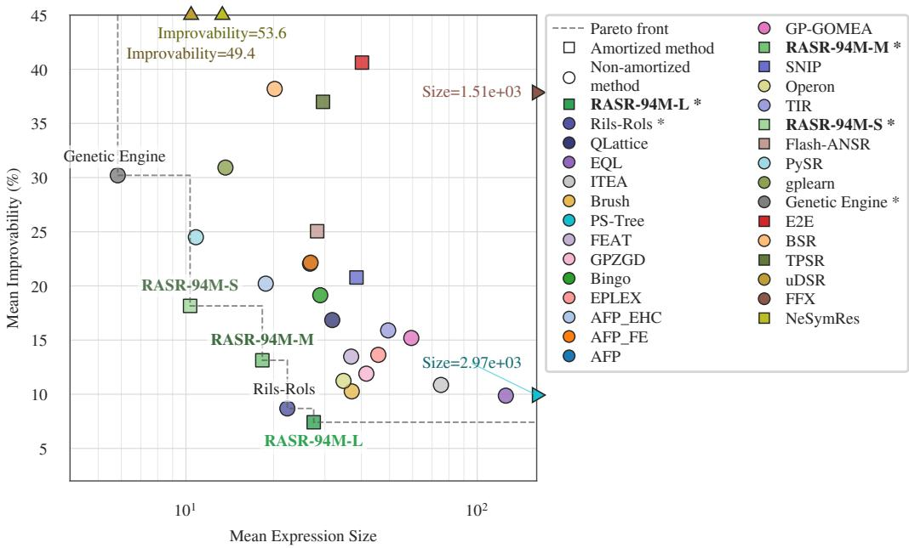  
Figure J.1: Accuracy-complexity trade-off with all baselines. As Figure 1, with every evaluated baseline shown individually instead of only the methods named on the plot.

Additional variants. The figures below complement Section 4.2, adding RASR-24M-L, RASR-94M-base, RASR-94M-M, and RASR-94M-S and, in two of the three, restricting the track to the eight datasets within our input bounds (Section 4.1). Throughout, each RASR variant is ranked against the baselines alone, independently of the other variants, so that the variants do not displace one another. RASR-24M-L is second over all twelve datasets, which is the result the ablations at that scale rest on.

Datasets within our input bounds. On the eight datasets RASR neither subsamples nor featurereduces, both aggregate views put it further ahead. RASR-94M-L and RASR-24M-L take the first two mean-rank positions with a visible gap to EQL behind them (Figure J.3), and on the Pareto plot RASR-94M-L drops to roughly 4% mean improvability, against 7.4% over all twelve, while the next baseline, Rils-Rols, stays just under 10% (Figure J.4). The size-penalized variants move with it, to roughly 12% at 19 nodes and 19% at 11. This is the regime the model was trained for, so the four reduced datasets cost accuracy.

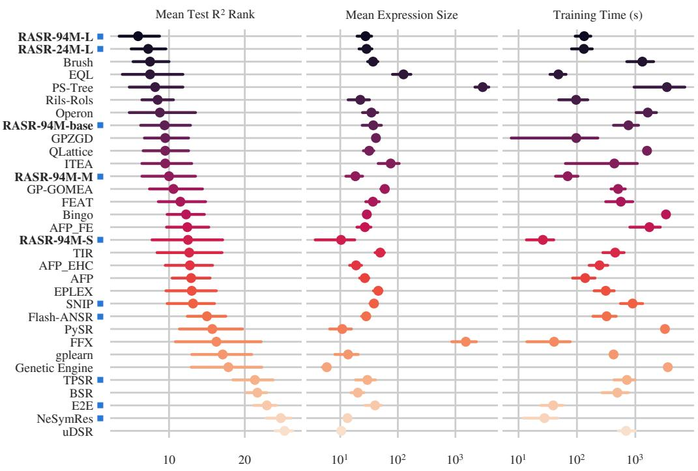  
Figure J.2: Black-box track overview with all baselines and RASR variants. As Figure 4 over all twelve datasets, but with every baseline shown and with RASR-24M-L, RASR-94M-base, RASR-94M-M, and RASR-94M-S alongside RASR-94M-L. Each RASR variant is ranked against the baselines alone, so the baseline ranks match Figure 4.

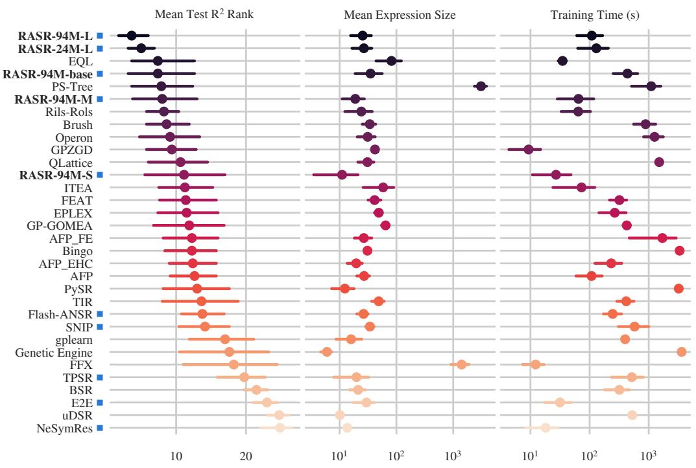  
Figure J.3: Black-box track overview on unreduced datasets. As Figure J.2, restricted to the eight datasets RASR neither subsamples nor feature-reduces.

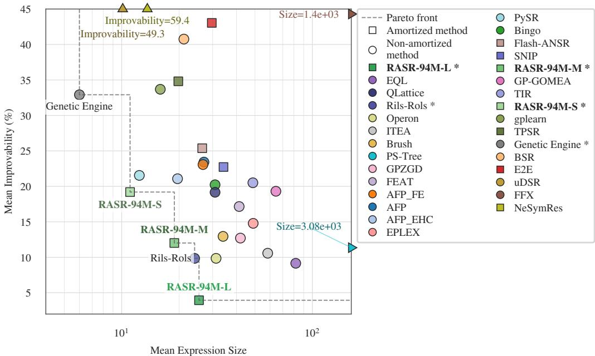  
Figure J.4: Accuracy-complexity trade-off on unreduced datasets. As Figure 1, restricted to the eight datasets RASR neither subsamples nor feature-reduces.

## K ADDITIONAL GROUND-TRUTH RESULTS

Behavior under noise. Section 4.3 reports that noise is what separates the methods on these tracks. The full per-noise numbers behind that statement are as follows. On Strogatz, RASR-94M-L solves 99.3% of the fourteen problems without noise and still 65.0% at 10% target noise, against 41.4% for Flash-ANSR and 32.1% for GP-GOMEA at that level, while Operon falls from 86.4% to 5.0% and SBP-GP and MRGP to zero. On Feynman, RASR degrades from 78.9% to 72.5% over the same range, where Flash-ANSR drops from 89.5% to 70.5% and AIFeynman from 73.2% to 9.9%. Expression size shows the same pattern. RASR returns 34 nodes on Feynman at every noise level, whereas Operon grows from 70 to 89 nodes and MRGP from 3.2k to 86k as they fit the added noise.

Feynman problems by number of variables. Of the 116 Feynman problems, 102 have at most five variables in the ground-truth law and 14 have six or more. Without noise RASR-94M-L solves 86.7% of the problems with at most five variables, against 92.2% for Flash-ANSR and 90.4% for Operon, but only 22.1% of those with six or more, against 70.0% and 47.1%. Averaged over the four noise levels, RASR-94M-L comes close to both on the problems with at most five variables, at 85.1% against 87.8% for each, while on those with six or more the gap remains, at 19.3% against 54.1% and 46.8%. Of the Feynman runs RASR-94M-L does not solve, 70% still reach $R ^ { 2 } > 0 . 9 9$

Test $R ^ { 2 }$ view. Figure K.1 shows the same runs under median test $R ^ { 2 }$ instead of the accuracy solution rate, which also credits the problems a method gets close on without solving outright. The two views agree at the top but compress the gaps. On Strogatz RASR-94M-L is again first, at a mean test $R ^ { 2 }$ of 0.999 against 0.996 for Operon and 0.994 for GP-GOMEA, and on Feynman it is level with SBP-GP at 0.995, behind GP-GOMEA’s 0.997 and ahead of Flash-ANSR. The methods that collapse under 10% target noise in the solution-rate view collapse here as well, AIFeynman and MRGP to negative mean $R ^ { 2 }$ on both tracks.

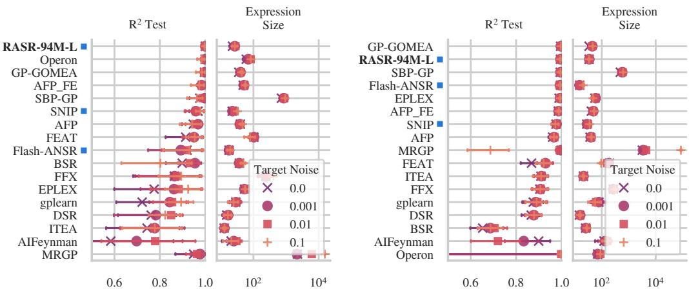  
Figure K.1: Test $R ^ { 2 }$ on the ground-truth tracks. As Figure 5 for the Strogatz (left) and Feynman (right) tracks, but scoring mean test $R ^ { 2 }$ (higher is better) rather than the accuracy solution rate. The $\scriptstyle { \dot { R } } ^ { 2 }$ axis is clipped at 0.5, so a method with a lower mean at some noise level falls outside it. Amortized methods are flagged with a blue square next to their name.

## L FIRST-PRINCIPLES RESULTS

The first-principles track of SRBench 2.0 pairs each of its twelve problems with an accepted expression, as the ground-truth tracks do, but its data are real historical measurements or generated with up to 20% noise, and the problems are tiny, from six to 236 rows. The accepted expression is therefore not always the best predictor, which lets us ask how a method’s expressions relate to it rather than only how well they fit. Figure L.1 gives the per-problem Pareto fronts of median expression size against median test $R ^ { 2 }$ , with the accepted expression marked.

Front coverage. At least one RASR variant is on the front for ten of the twelve problems, the exceptions being Absorption and Ideal Gas. Counted per variant, RASR-94M-S appears on seven fronts, with RASR-94M-M, Flash-ANSR, QLattice and Genetic Engine next at six and RASR-94M-L at five.

Fit at the law’s size. On the generated problems the data follows the law up to additive noise, so the law is close to the best attainable $R ^ { 2 }$ and what separates methods is the size at which they reach it. The three variants cover different parts of that range. On Rydberg, RASR-94M-S reaches $\dot { R ^ { 2 } } = 0 . 9 7$ with three nodes against the law’s fifteen, while the default RASR-94M-L sits at the other end of the same front at $R ^ { 2 } \stackrel { } { = } 0$ .9999 and 35 nodes. On Planck, RASR-94M-M reaches $R ^ { 2 } = 0 . 9 9 6$ at exactly the accepted expression’s size of 20 nodes, where QLattice and GP-GOMEA need 26 and 33.

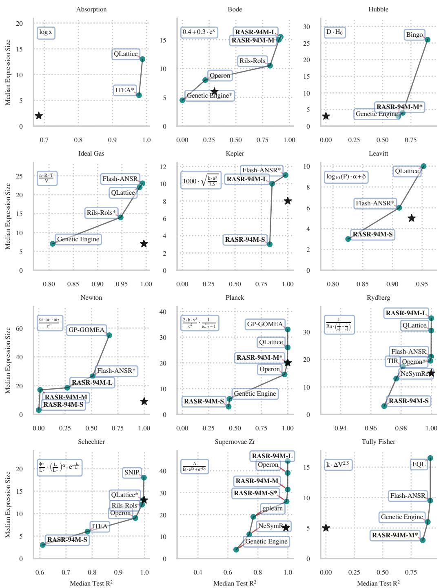  
Figure L.1: First-principles track. Per-problem accuracy-complexity Pareto fronts of median expression size against median test $R ^ { 2 }$ . Only non-dominated methods appear. The black star is the accepted expression.

## M POST-TRAINING ANALYSIS

All improvability numbers in this and the next section are on the black-box track (%, lower is better), computed against the shared pool of all baselines and every RASR variant (Appendix H).

Training dynamics. Figure M.1 tracks the sampled candidates of RASR-94M-L over post-training on a held-out validation set drawn from the post-training prior, evaluated every 500 steps. Most of the change happens before the first evaluation. The mean ${ \bar { R } } ^ { 2 }$ of individual candidates rises from slightly below zero to about 0.55, and the mean expression size halves from about 67 to about 32 nodes, after which both stay flat. The best-of-256 $R ^ { 2 }$ moves far less, from 0.75 to 0.77, and keeps rising slightly until step 1000.

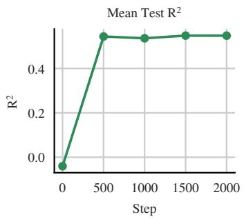

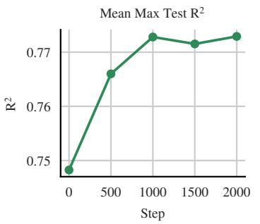

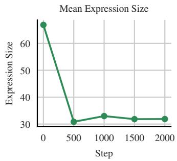  
Figure M.1: Post-training dynamics of RASR-94M-L. Mean $R ^ { 2 }$ of the sampled candidates, mean best-of-256 $R ^ { 2 }$ and mean expression size over post-training steps, on a held-out validation set drawn from the post-training prior.

Accuracy, expression size and fitting time. Post-training changes all three quantities of Figure 4. Table M.1 gives expression size and fitting time, aggregated in the same way, as the median over seeds and the mean over datasets. At the 94M scale post-training lowers improvability from 10.03 to 7.44, shortens the returned expressions from 37.4 to 27.5 nodes, by 27%, and cuts the fitting time from 762 to 133 seconds, by 83%. The larger size penalties of RASR-94M-M and RASR-94M-S push size and time further, to 18 and 10 nodes and 69 and 26 seconds, at the cost of accuracy. At 24M the size and time reductions are nearly the same, from 39.3 to 28.5 nodes and from 646 to 131 seconds, while improvability stays level at 9.36 against 9.51. The time saving follows the shorter expressions, which are cheaper to refine, and presumably also the sharper policy proposing fewer distinct candidates, since duplicates are refined only once (Section 3.4).

Table M.1: Effect of post-training on expression size and fitting time on the black-box track. Mean expression size (nodes) and fitting time (seconds), both lower is better, for the pre-trained-only base model and the post-trained model at $K = 1 0 2 4$ sampled candidates.
<table><tr><td rowspan="2">Variant</td><td colspan="2">Expression size</td><td colspan="2">Fitting time (s)</td></tr><tr><td>Base</td><td>Post-trained</td><td>Base</td><td>Post-trained</td></tr><tr><td>RASR-94M-L</td><td>37.4</td><td>27.5</td><td>762</td><td>133</td></tr><tr><td>RASR-94M-M</td><td>37.4</td><td>18.3</td><td>762</td><td>69</td></tr><tr><td>RASR-94M-S</td><td>37.4</td><td>10.3</td><td>762</td><td>26</td></tr><tr><td>RASR-24M-L</td><td>39.3</td><td>28.5</td><td>646</td><td>131</td></tr></table>

Test-time compute. Figure M.2 plots mean improvability against the number of sampled candidates K for the pre-trained-only base model, a model post-trained with standard GRPO, and the main model post-trained with RS-GRPO. We vary K while keeping the other hyperparameters fixed, so that the plot isolates the effect of the sample budget. All three models improve with more samples. Apart from RS-GRPO at $K = 6 4$ , post-training improves on the base model at every budget. The two post-training objectives end up close. RS-GRPO is ahead of GRPO on most individual datasets at the full budget of 1024 candidates, but a small number of datasets carry the aggregate the other way, USCrime in particular, a small and noisy dataset that is also one of the four we have to reduce to fit our input bounds. We therefore do not claim a separation between the two objectives at large budgets from these runs.

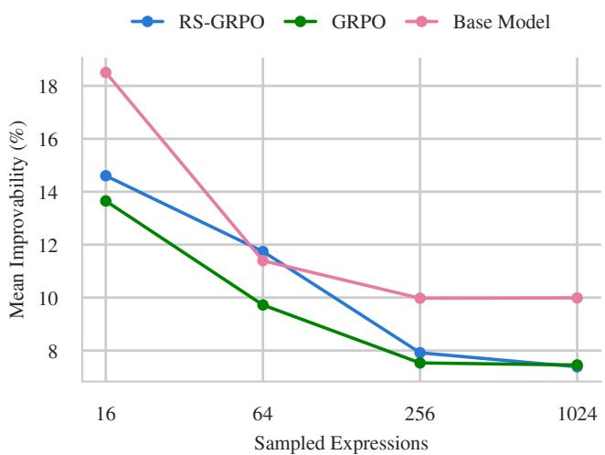  
Figure M.2: Accuracy versus test-time compute on the black-box track. Mean improvability (%, lower is better) against the number of sampled candidates K for the base model, a model post-trained with GRPO, and the main model post-trained with RS-GRPO, all at the 94M scale.

## N ABLATIONS

The ablations require pre-training variants of the model, so they run at the 24M scale, where the lower cost makes them affordable. Improvability is computed as in Appendix M.

Synthetic prior. This ablation isolates the contribution of our synthetic prior. We compare it against a simple prior in the style of earlier neural symbolic-regression work, with inputs drawn from independent uniform distributions, constants sampled from fixed ranges, and no standardization, and hold the rest of the pipeline fixed. Table N.1 gives the 2 × 2 grid over the prior and post-training discussed in Section 4.4. Post-training data for the simple-prior variant is drawn from the simple prior as well, so that it is a fair, fully self-contained baseline. Standardization is bundled into our prior here rather than ablated on its own axis, since it is a defining part of the recipe and only makes sense alongside the standardized inputs. Our prior takes the base model from 26.56 to 9.36. Post-training helps the simple prior more, lowering it to 18.31, but leaves it at about twice the improvability of our prior, which already beats it without any post-training.

Table N.1: Prior ablation on the black-box track (24M scale). The simple prior draws inputs from independent uniform distributions and constants from fixed ranges, and applies no standardization. Mean improvability (%, lower is better).
<table><tr><td>Prior</td><td>Base</td><td>Post-trained</td></tr><tr><td>Simple prior</td><td>26.56</td><td>18.31</td></tr><tr><td>Our prior</td><td>9.36</td><td>9.51</td></tr></table>

Constant strategy. This ablation validates the constants-as-initialization strategy of Section 3.1, which places RASR between skeleton-only prediction and full end-to-end constant prediction. We compare against three alternatives: predicting constants but trusting them directly, without the leastsquares refinement; refining them without initialization noise; and a skeleton-only variant, trained with our pipeline but predicting placeholder constants. Refinement is by far the most important component: removing it raises improvability from 9.51 to 28.33, undoing most of the model’s advantage. Dropping the initialization noise raises it to 10.57. The skeleton-only variant reaches 12.09, behind both, so predicting constants as an initialization is worth a real gain over refining placeholder constants from scratch.

Table N.2: Constant-strategy ablation on the black-box track (24M scale). Mean improvability (%, lower is better) for our constants-as-initialization approach against a skeleton-only variant, refinement without initialization noise, and no least-squares refinement. The last two rows are RASR-24M-L with the respective inference step disabled. The skeleton-only variant is pre-trained separately and post-trained with the same size penalty.
<table><tr><td>Variant</td><td>Improvability</td></tr><tr><td>RASR-24M-L</td><td>9.51</td></tr><tr><td>Skeleton-only</td><td>12.09</td></tr><tr><td>No init noise</td><td>10.57</td></tr><tr><td>No refinement</td><td>28.33</td></tr></table>

## O SRBENCH 2.0 PERFORMANCE PROFILES

The benchmark reports the black-box track through performance profiles, curves giving the fraction of problems on which a method reaches at least a given test $R ^ { 2 }$ , summarized by the area under them. We use mean rank and mean improvability instead, for the reasons given in Appendix H. This section adds the benchmark’s own view of our runs, produced with its post-processing code and its metric, so that the numbers here can be read next to the published SRBench 2.0 results without any translation.

Figure O.1 computes one profile per seed over the twelve datasets and takes, at every $R ^ { 2 }$ threshold, the median of these curves over the 30 seeds. RASR-94M-L has the highest area of all evaluated methods at 0.68, ahead of Rils-Rols at 0.66 and a group of four at 0.65, and its curve is at or above every other one across most of the $R ^ { 2 }$ range. Figure O.2 instead takes the maximum of the per-seed curves and splits the field into four bands by area so the curves stay readable. RASR-94M-L again has the highest area, 0.75 against 0.74 for GP-GOMEA, EQL, QLattice, Brush, ITEA and EPLEX. The lead is narrower under this aggregation, which is the expected effect of scoring every method by its best seed at every threshold.

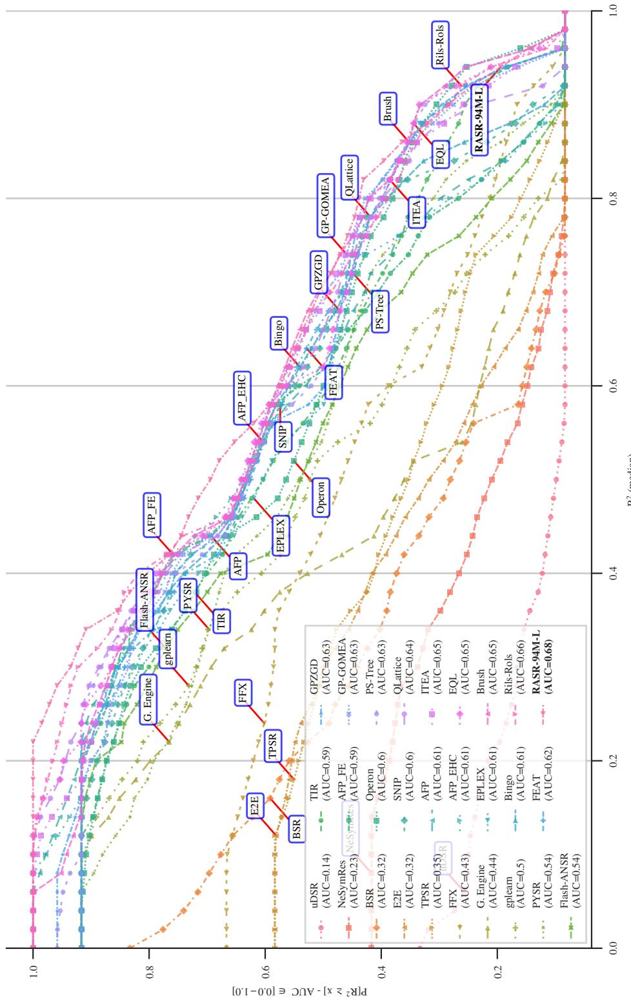  
Figure O.1: Performance profile on the black-box track. The fraction of problems on which a method reaches at least a given test $R ^ { 2 }$ , computed per seed and aggregated by the median of the 30 per-seed curves at every threshold, using the SRBench 2.0 post-processing. The legend gives the area under each curve. Higher is better throughout.

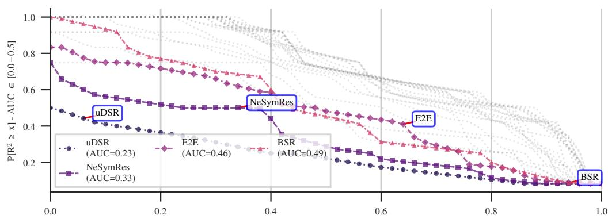

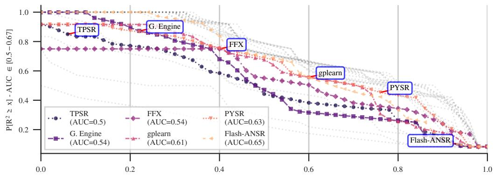

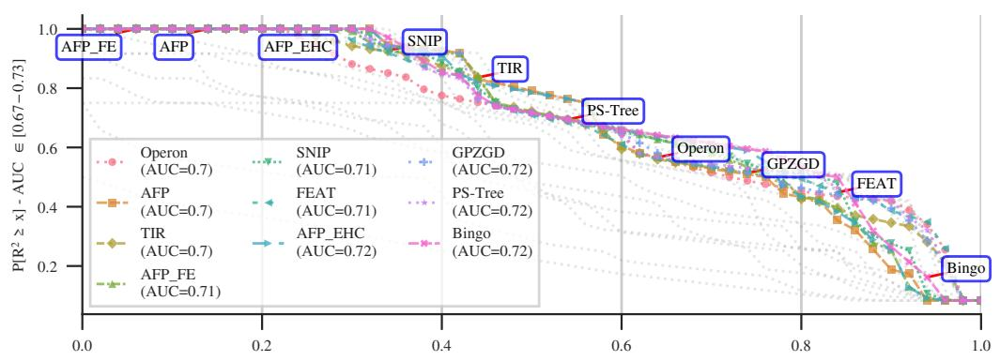

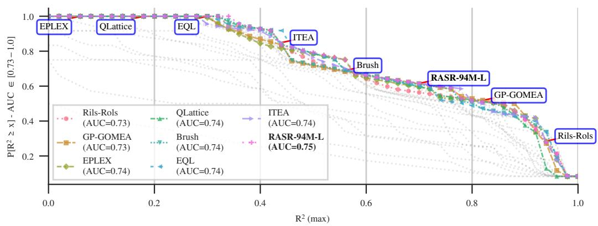  
Figure O.2: Performance profile with the maximum over seeds. As Figure O.1, but taking the maximum instead of the median of the per-seed curves, the aggregation the benchmark uses. Methods are split into four panels by their area under the curve so that the curves stay legible, with the methods outside a panel’s band drawn in gray for reference.