# A Graph-Based Analysis of Comparability, Scale, and Attribution in Private Transformer Inference

Souvik Das

Texas A&M University

College Station, TX, USA

souvik.das@tamu.edu

Ariful Azad   
Texas A&M University   
College Station, TX, USA   
ariful@tamu.edu   
Nitesh Saxena   
Texas A&M University   
College Station, TX, USA   
nsaxena@tamu.edu

Abstract—Rising privacy concerns around large language models have accelerated research in private Transformer inference (PTI). Synthesizing the empirical claims in this line of research, however, is hindered by multi-dimensional cryptographic progress and inconsistent evaluation contracts. In this work, we systematize the field by constructing an empirical graph of 62 PTI systems, mapping system attributes to node features and evaluation compatibility to edges. A threetiered analysis of this graph illuminates the state of private inference. Node-level attribution shows that cryptographic progress drives performance gains across most systems, yet always co-occurs with other factors (model fidelity, hardware, cost accounting). Edge-level auditing shows that only 1 of 1891 candidate system pairs is directly comparable under shared assumptions. Finally, graph-level analysis shows that the scaling frontier of private inference has plateaued at 13B parameters and projects the cost of deploying current PTI techniques on production-scale Transformers. Overall, this graph-based framework equips the community to evaluate PTI claims transparently and channel technical speedups into deployment-scale private inference.

Index Terms—private transformer inference, private inference, privacy-preserving machine learning, secure inference, transformers, secure multi-party computation, homomorphic encryption, systematization

## 1. Introduction

Large language models (LLMs) increasingly process sensitive user data, ranging from medical records and legal filings to proprietary code [1]. In standard cloud deployment, user inputs and intermediate activations are fully exposed to the model provider. Private Transformer Inference (PTI) [2], [3] aims to eliminate this exposure by cryptographically protecting client inputs, model weights, or both.

Modern PTI relies on three main cryptographic paradigms: Secure Multi-Party Computation (MPC) [4]– [6], Homomorphic Encryption (HE) [7]–[9], and hybrid MPC–HE constructions [10]–[12]. These paradigms enforce different trade-offs. MPC distributes computations interactively across multiple parties, incurring high network round-trips and massive communication volumes. Conversely, HE permits non-interactive evaluation over ciphertexts but shifts the burden to local compute and ciphertext expansion. To mitigate these costs, recent work emphasizes algorithmic-cryptographic co-designs that leverage polynomial approximations for non-linear layers (e.g., Softmax, GELU) [6], [11], SIMD-friendly tensor packing [7], [10], dynamic bootstrapping [13], and protocol-level round reduction [12], [14]. Consequently, reported private inference latencies and communication costs have dropped by orders of magnitude from BERTscale models [6], [15] to 13B-parameter decoders [5].

Despite these impressive local gains, collective progress in PTI is remarkably difficult to evaluate. A severe disconnect persists between the cryptographic frontier (≈13B parameters) and production models (e.g., LLaMA-3, Kimi K2, GPT-5) operating at hundreds of billions to trillions of parameters [16]. More fundamentally, published PTI performance metrics are often incommensurable. For example, reported latency may exclude preprocessing, assume high-bandwidth LANs for WAN-motivated use cases, rely on aggressive weight pruning, or protect only input privacy while competing baselines enforce dual privacy. Because these unstated variables dictate performance, a result is uninterpretable without its underlying bundle of assumptions, which we term the system’s evaluation contract. Without auditing these contracts side by side, individual improvements cannot be synthesized into a true picture of the state of the field.

Objectives of systematization. While PTI research has produced numerous systems, the field lacks a unified empirical framework to determine if reported gains translate to deployment-scale readiness. An SoK is essential to systematize how evidence is reported and interpreted across conflicting assumptions. Existing surveys and SoKs do not address this need since they focus primarily on taxonomizing cryptographic primitives [2], [3], [19], rebenchmarking select systems in isolated environments [23], or proposing reporting standards for future work without auditing the record already published [24]. While valuable, primitive taxonomies cannot explain whether published numbers are methodologically sound to compare, and rebenchmarking misses the broader systemic breakdown in evaluation contracts across the literature.

This SoK directly addresses this gap by auditing the published evidence across 62 PTI papers (2022–2026). We reconstruct the evaluation contracts across these papers to determine how many published claims can be directly compared, where comparability breaks down, and what factors truly drive reported speedups. Table 1 summarizes how our evidence-auditing approach complements and extends prior surveys and SoKs.

TABLE 1. COMPARISON BETWEEN THIS SOK AND PRIOR PTI SURVEYS AND SYSTEMATIZATIONS. WHEREAS EXISTING WORK TAXONOMIZESMECHANISMS, THIS WORK AUDITS WHETHER PUBLISHED EVIDENCE IS MUTUALLY COMPARABLE AND DEMONSTRATES PROGRESS TOWARDPRODUCTION-SCALE PRIVATE INFERENCE.
<table><tr><td>Work type</td><td></td><td>PTI scope Mechanism taxonomy</td><td></td><td>Repro. re-bench. Scaling frontier</td><td>Contract comparability</td><td>Progress attribution</td></tr><tr><td>Private-ML/HE surveys [17], [18]</td><td>0</td><td>√</td><td>X</td><td>x</td><td>X</td><td>x</td></tr><tr><td>Cryptographic NN SoK [19]</td><td>0</td><td>V</td><td>X</td><td>X</td><td>0</td><td>x</td></tr><tr><td>Private Transformer surveys [2], [3]</td><td>V</td><td></td><td>X</td><td>0</td><td>0</td><td>0</td></tr><tr><td>HE/FHE feasibility SoKs [20]–[22]</td><td>0</td><td>e</td><td>O</td><td>0</td><td>x</td><td>X</td></tr><tr><td>Private Transformer SoK [23]</td><td></td><td></td><td></td><td>x</td><td>x</td><td>x</td></tr><tr><td>Approximate-HE SoK, incl. PLCS [24]</td><td>0</td><td></td><td>0</td><td>0</td><td>e</td><td>x</td></tr><tr><td>This work</td><td></td><td>e</td><td>X</td><td></td><td></td><td></td></tr></table>

Legend: ✓ full support partial or mechanism-specific ✗ not addressed.

We center this SoK around four key research questions:

• Comparability (RQ1): What metadata must a result declare to be interpretable, and how much of the existing literature is directly comparable?

• Innovation attribution (RQ2): What factors drive headline performance gains?

• Scalability and coverage (RQ3): How far has private inference actually scaled and what cryptographic protection does it cover?

• Deployment practicality (RQ4): What is the cost of deployment-scale private inference today, and what would it cost to scale PTI to production-scale (405B) models?

A novel graph-based approach. To address these questions, we construct a graph-based framework modeling 62 published PTI systems as nodes and their pairwise evaluation compatibility as edges. System specifications, including privacy scope, Transformer architecture, deployment setting, and reporting practices, are encoded as node features.

To answer RQ1, we evaluate every candidate edge (system pair) through eight compatibility gates. Out of 395 system pairs that share a workload, only a single pair remains directly comparable once fidelity, privacy scope, threat model, cost scope, and reporting standards must also align, and this lone pair represents a deliberate reimplementation on the same benchmark.

To address RQ2, we analyze the graph edges connecting each system to its baselines. These edges reveal the drivers behind performance gains by isolating protocol advances from lighter architectures, nonlinear approximations, batching strategies, hardware differences, and accounting choices. While protocol optimizations contribute to reported gains in 49 of 62 papers and confirm genuine cryptographic progress, no headline speedup stems from protocol progress alone. Every claim depends on concomitant changes in workload, fidelity, amortization, hardware, or baseline selection.

We answer RQ3 by examining the entire graph to record the largest model evaluated under each paper’s privacy assumptions, threat model, and workload. Demonstrated coverage concentrates heavily in semi-honest twoparty settings on BERT scale encoders. Furthermore, the cryptographic frontier, defined as the largest model evaluated under conventional protection, has plateaued at 13B parameters while production models exceed one trillion, creating a scaling gap of nearly two orders of magnitude.

Finally, to answer RQ4, we fit a cost model within each paper’s original contract and project it to larger scale. Our projections show that a single private forward pass of a 70B-class model requires minutes to hours of compute time per token, gigabytes of runtime data movement, and terabytes of communication for one-time setup.

Overall, the paper makes the following contributions:

1) A graph-based framework: A graph-based framework modeling PTI systems as nodes and their pairwise compatibility as edges. This framework enables a comprehensive analysis of the state of PTI.

2) The Private Inference Contract Card: A standardized reporting scheme defining the essential fields required to make PTI benchmarks interpretable and reproducible. This card is used as node features in the graph.

3) A Comparability Gate Suite: A set of eight compatibility gates that decide whether two published claims can be compared. These gates are used to label edges in the graph.

4) A source-of-progress ledger. We attribute the gain of each system to cryptographic advances and noncryptographic artifacts (workload, fidelity, hardware, accounting).

5) A scaling frontier for PTI. A year-by-year scaling comparison revealing a two-order-of-magnitude gap between PTI models and frontier LLMs. An empirical cost model then projects deployment overheads to fill this gap.

## 2. Background and Preliminaries

## 2.1. Transformer Inference

A Transformer [25], the basic building block of modern LLMs, stacks tens of identical layers consisting of multihead attention with feed-forward networks. Computationally, these layers split into linear matrix multiplications (GEMMs) and fine-grained non-linear operators: Softmax in attention, GELU or ReLU in feed-forward sublayers, and LayerNorm across feature dimensions. It is well documented that GEMMs incur the heavy computational burden in plaintext inference [26], but cryptography radically inverts the cost profile [6]. Figure 1 illustrates this by mapping the cryptographic overhead on a Transformer layer. GEMMs (blue) and residual connections cost little multiplicative depth under HE and a single round under MPC, though GEMM communication still grows with model size. In contrast, non-linear operators (red) dominate overhead by consuming multiplicative depth or requiring multi-round interaction. Driven by this cryptographic cost

HE rail (bars grow up): cost = multiplicative depth, deeper ⇒ bootstrapping

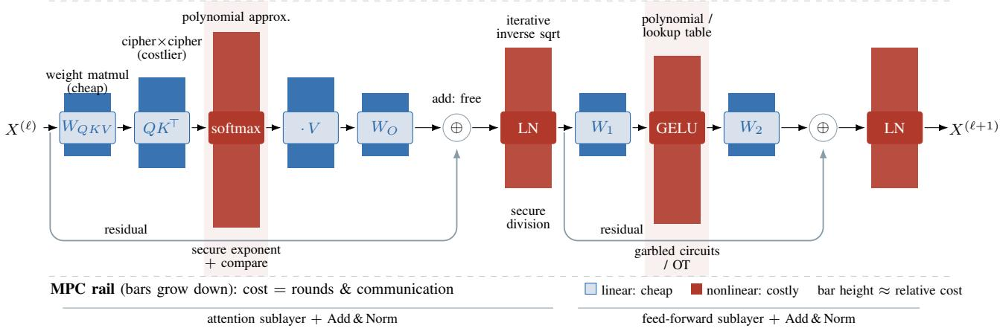  
Figure 1. Cryptographic cost breakdown of one Transformer encoder layer, drawn as in the BERT-family encoders most PTI systems evaluate. Data flows left to right with the residual bypasses drawn below. The bars above and below each operation sketch its relative cost on the HE rail (multiplicative depth, up) and the MPC rail (rounds and communication, down). Weight multiplications (blue) are comparatively cheap in depth and rounds, less so when the weights are themselves secret shared, the activation products $\mathsf { \bar { Q } } K ^ { \mathsf { T } }$ and ·V cost more, and the nonlinear steps (red: softmax, GELU, LayerNorm) dominate. The two rails need not agree: GELU bites hardest in MPC communication but is a shallow polynomial under HE, while LayerNorm’s inverse square root cuts deepest under HE. This op-level skew is why many reported speedups reshape the nonlinearities rather than the protocol (RQ2)

inversion, the PTI literature overwhelmingly targets nonlinearity approximations over core protocol redesigns.

Transformer models come in various flavors: (1) Encoder-only models (e.g., BERT) process fixedlength inputs in a single pass [6], [15], (2) decoderonly architectures (e.g., LLaMA) generate tokens autoregressively [4], [5], [7], (3) encoder–decoder models condition generation on input sequences [27], [28], and (4) multimodal Transformers introduce distinct spatial and textual tensor shapes [29]–[31]. Cryptographic execution costs vary fundamentally across model families, rendering performance metrics directly incomparable across them.

## 2.2. Cryptographic Backbones

PTI frameworks rely on three cryptographic paradigms. Secure Multi-Party Computation (MPC) distributes secret shares across two or more parties [4]–[6], where linear GEMMs use preprocessed randomness (e.g., Beaver triples) and cost a single online round, while non-linear operators (Softmax, GELU) require multi-round sub-protocols whose communication dominates runtime. Homomorphic Encryption (HE) schemes (e.g., BFV, BGV, CKKS) evaluate functions non-interactively over ciphertexts [7]–[9], eliminating round complexity at the expense of massive ciphertext expansion, bounded multiplicative depth, and costly bootstrapping. Hybrid HE/MPC systems integrate both paradigms by executing linear GEMMs under HE and non-linearities under MPC [10]–[12]. Ultimately, each paradigm pays for privacy along distinct axes: MPC in round trips and network bandwidth, HE in computational density, and hybrids across a combination of both.

## 2.3. Protected Assets

PTI systems protect one of three assets. Input privacy hides the client’s input (prompt, document, image) from the model server [4], [6]. Model privacy hides the server’s weights and architecture from the client, motivated by providers who treat their parameters as commercial assets. Mutual privacy guarantees joint protection for both inputs and model weights. As the most stringent threat model, it incurs the highest cryptographic overhead and serves as the standard paradigm when deploying proprietary models to untrusted clients [10], [11]. Even with encrypted inputs and weights, a system can still leak metadata such as sequence length, batch size, token count, or communication volume. Prior work treats such side-channel leakage inconsistently, ranging from formal security modeling to explicit scope exclusions or omissions.

## 2.4. Adversary Models

A privacy guarantee is meaningful only relative to a threat model. Most PTI systems assume a semi-honest (passive) adversary that adheres to protocol execution while attempting to infer private state [4], [11], [12]. By contrast, a malicious (active) adversary may arbitrarily deviate from the protocol, incurring substantial cryptographic overhead to mitigate. Equally critical is the party model. Twoparty (2PC) protocols compute directly between client and server [10], [11], whereas three-party (3PC) or helperassisted schemes rely on non-colluding entities [4], [5], [32]. Non-colluding helpers reduce non-linear protocol overhead, meaning identical reported execution costs across different party models mask distinct security promises.

## 2.5. Deployment Options and Evaluation

Deployment conditions govern the practical performance of PTI systems, spanning heterogeneous hardware platforms, network topologies, and evaluation regimes. For instance, interactive protocols execute efficiently over highbandwidth LANs but degrade severely across high-latency WANs, whereas HE comfortably absorbs network round trips [7], [11]. Similarly, reported overhead varies sharply depending on query granularity (single versus batched query) [7], offline setup reuse (one-time preprocessing versus per-query maintenance) [5], and hardware ranging from single CPUs to multi-GPU clusters [5], [7]. Finally, empirical reporting across the PTI literature is diverse and often fragmented. For example, latency alternates between online, offline, and end-to-end execution, communication fluctuates across total, per-party, or online-only volume, and interaction rounds are selectively disclosed. Consequently, the same protocol can substantiate different performance claims depending on its deployment context and evaluation protocols.

## 3. Related Work

Surveys and mechanism systematizations.. Earlier surveys of privacy-preserving machine learning and secure neural-network computation [17]–[19] lay out the cryptographic building blocks and warn that secureinference numbers are hard to compare without watching the assumptions, the network, and the implementation. Surveys aimed at private Transformer inference [2], [3], a broader review across protocol, model, and system levels [33], and feasibility SoKs on FHE libraries and benchmarks [20]–[22] clarify the design space, but they mostly categorize systems by cryptographic primitives and compiling isolated performance metrics. Closest to our aims, Al Badawi et al. [24] systematize private LLM inference under approximate homomorphic encryption across twenty CKKS frameworks. They observe, as we do, that differences in packing, model fidelity, software stacks, and reported metrics hinder direct comparison, and they propose a Private LLM Card System to standardize how future results are reported; they also place the runtime gap to plaintext at roughly four orders of magnitude. Our PIC card shares that instinct but runs in the opposite direction: instead of specifying what future papers should report, we reconstruct contracts retrospectively from the published record of 62 systems spanning MPC, HE, and hybrid protocols, and use them to measure how much of that record is comparable today. Their systematization sits alongside non-interactive CKKS frameworks such as THOR [34], MOAI [35], and Powerformer [36]. We have already compared and contrasted this SoK with prior work in Table 1.

The closest prior systematization. The nearest work to ours is a recent SoK on private Transformer inference by Chen et al. [23], which curates 61 frameworks, categorizes them by cryptographic primitive, and re-benchmarks representative systems under standardized configurations (including WAN environments). Our work and theirs are complementary yet orthogonal. While Chen et al. map and re-measure system mechanisms by generating fresh benchmark data, we audit the published record itself by evaluating whether reported metrics are mutually comparable and tracking their combined scale. Consequently, rather than introducing another benchmark suite, our contributions establish a field-wide scaling frontier, a standardized Evaluation Contract Card, a pairwise comparability analysis. The two studies are complementary, as their benchmarking addresses existing experimental fragmentation, whereas our contract framework keeps future results comparable without requiring continuous re-runs.

Recent 2026 developments. To preserve systematic consistency, our core corpus snapshot was frozen in July

2026, with subsequent literature evaluated as contextual evidence. We observed three emerging trends in 2026. First, private generation has surfaced as an explicit target, managing encrypted KV-caches during decoding via hybrid HE–secret sharing [37] or pure FHE with cache-aware bootstrapping [13], exposing per-token latency costs that discriminative benchmarks obscure. Second, architectural scale is expanding through secure Mixture-of-Experts inference [38], multi-GPU long-sequence execution [39], hybrid kernel designs [40], and FHE scaled toward 8B parameters [41]. Third, non-cryptographic split and permutation schemes have suffered severe attacks, including weight recovery against shuffling defenses [42] and input reconstruction from split activations [43]. Other contemporaneous systems, such as truncation-only 2PC [44] and speculative-decoding GPTs [45], reinforce these same reporting patterns. These latest systems sharpen our core thesis that generation length, expert routing, and sequence length introduce new dimensions that no single metric can represent.

## 4. Corpus Construction and Data Collection

Scope.. This SoK covers systems that perform inference on Transformer-based models while keeping the user’s input, the model’s parameters, or both hidden behind cryptographic or protocol-level mechanisms. We include a paper when it (i) targets privacy at inference time, (ii) evaluates Transformer-based or closely related models such as BERT-style encoders, GPT-style decoders, encoder– decoder models, ViTs, and multimodal Transformers, (iii) enforces privacy with MPC, HE, hybrid MPC–HE, secret sharing, or an adjacent protocol-level mechanism, (iv) presents a complete system or protocol rather than an isolated primitive, and (v) reports enough evidence to extract at least one model-scale point, contract field, or progress claim. We exclude training-time methods such as differential privacy and federated learning, TEE-only systems that rely on hardware isolation rather than cryptographic protocols, watermarking and ownership schemes, and cryptographic kernels never integrated into an inference pipeline.

Paper selection.. We assembled peer-reviewed papers and public preprints published between 2022 and 2026. We began with keyword searches for “private Transformer inference,” “secure Transformer inference,” “MPC Transformer,” “homomorphic encryption Transformer,” and “private LLM inference,” then followed citations backward and cross-checked against recent surveys and systematizations [2], [3], [19], [22]. We retain a preprint when it introduces a system-level design that has shaped the literature or served as a baseline for later work. The final corpus contains 62 papers. Table 2 shows its composition by cryptographic backbone and inference regime. This collection was carried out through July 2026 and deliberately folds in the 2025–26 wave of systems (for example CryptoMoE, FLUTE, SMASH, Euston, and THOR), so that the audit tracks the current frontier rather than a stale snapshot; work appearing after our collection window is discussed in Section 3 as context.

Units of analysis.. Our audit operates on two distinct units of analysis. To map the scaling frontier, the unit is the paper, recorded by the largest named model empirically evaluated under a private inference configuration. Models cited solely in motivation or related work are excluded. For comparability and innovation attribution, the unit is a progress claim paired with its evaluation contract, defined as a reported gain in latency, communication, interaction rounds, scale, or utility against a baseline. When a paper reports multiple candidate claims, we select the primary result highlighted in the abstract or main comparison table.

TABLE 2. COMPOSITION OF THE AUDITED CORPUS BY CRYPTOGRAPHIC BACKBONE AND EVALUATED INFERENCE REGIME. SYSTEMS MARKED [MM] EVALUATE MULTIPLE REGIMES AND APPEAR IN BOTH COLUMNS. WE ALSO AUDITED THREE ENCODER-DECODER SYSTEMS: PPTIF [46], PRIVFORMER [28], MERGE [27]. RHOMBUS [47] IS AUDITED AT THE PROTOCOL LEVEL: IT CONTRIBUTES A MATRIX-VECTOR MULTIPLICATION KERNEL RATHER THAN AN EVALUATION IN A SPECIFIC INFERENCE REGIME, SO IT IS NOT PLACED IN EITHER COLUMN.
<table><tr><td>Backbone</td><td>Encoder</td><td>Decoder</td></tr><tr><td>MPC-based</td><td>MPCFormer [6], MPCViT [29], RNAViT [48], SALViT [30], SecBERT [15], SecFormer [49], PrivTF [50], Curl [51] [MM], Ditto [52] [MM], PUMA [4] [MM], PrivM- MERGE [27] [MM], PUMA [4] [MM], PrivM- LLM [31] [MM], SHAFT [32] [MM], SIGMA [5] [MM], LLM [31] [MM], SHAFT [32] [MM], SIGMA [5] [MM], FuseFSS [53] [MM], Mosformer [54] [MM]</td><td>Comet [55], MARILL [56], SecureGPT [57], SecureTLM [58], Curl [51] [MM], Ditto [52] [MM], FLUTE [59], MPCache [60], FuseFSS [53] [MM], Mosformer [54] [MM]</td></tr><tr><td>HE-based</td><td>PowerSoftmax [61][MM], AEGIS [39], LAS [62] [MM], ELLMo [63], Euston [64] [MM], max [61] [MM], ATLAS [62] [MM], Cachemir [13], Eu- Powerformer [36], PriTran [65], THOR [34]</td><td>EncryptionFriendlyLLM [9], THEX [8], NEXUS [7] [MM], ENSI [66], EncryptedLLM [67], HEDecoding [68], AT- PracticalLLM [69], NEXUS [7] [MM], PowerSoft- ston [64] [MM], ScalingPPML [41]</td></tr><tr><td>Hybrid MPC-HE</td><td>BOLT [11], CipherFormer [70], East [71], Primer [73], BLB [74] [MM], BumbleBee [12] [MM], Prune [75][MM], CryptoGen [37], CryptoMoE [80], CipherPrune [75][MM], EncFormer SMASH [76] [MM], SecMoE [38] [MM]</td><td>AERO [77], CipherGPT [78], PermLLM [79], Iron [10], LLMEncryptedPrompt [72], Nimbus [14], BLB [74] [MM], BumbleBee [12] [MM], Cipher- [40] [MM], EncFormer [40] [MM], SMASH [76] [MM], SecMoE [38] [MM]</td></tr><tr><td>Other / adjacent</td><td>STIP [81] [MM], CASCADE [82] [MM]</td><td>STIP [81][MM], CASCADE [82][MM]</td></tr></table>

Extraction rules.. We extract data from each paper based on the following principles. (1) We rely exclusively on published materials, including main text, tables, figures, appendices, and released code artifacts. (2) Every extracted attribute is strictly bound to the specific claim under audit, and claims spanning several configurations are designated as multi-setting rather than artificially reduced to a single baseline. (3) We resolve ambiguity conservatively by marking missing fields as unknown, classifying ambiguous evaluations as descriptive, and not attributing mixed performance gains to protocol progress. (4) We decouple technical merit from comparison validity, recognizing that a technically sound system may still lack an evaluation contract that supports direct comparison.

Data validation.. Because the values of record are extracted by hand, we stress-test them with an independent blind re-extraction: for each paper a separate largelanguage-model reader (GPT-5.6-Luna) re-derives every contract-card field from the source text alone, blind to the recorded value, and we compare the two readings field by field. The model is only a second independent reader of published text and never produces a value of record, so what we measure is whether the recorded values reproduce from the source, not whether a model could replace the human auditor. Agreement is strong on exactly the fields the gates lean on most (87–98% on cryptographic backbone, privacy scope, adversary model, and end-to-end status), with 70.0% raw agreement pooled across all factual fields. We adjudicated every flagged disagreement against the source papers: most trace to conversion losses or to values the blind reader declines to infer, and, across the two adjudication passes, 40 of 992 fields (4.0%) were corrected in the corpus. The full per-field breakdown is in Appendix A.3 (Table 8).

## 5. Systematization Methodology

This section establishes an analytical framework to synthesize the cryptographic and evaluation contexts across all 62 papers in our corpus. As illustrated in Figure 2, each paper is first reduced to a structured record, termed a PIC card, that captures its performance claims and underlying operating assumptions. From these cards, we construct a pairwise comparability graph where system pairs are connected across a suite of evaluation gates. Together, these cards and gates enable analysis at three distinct levels: (1) evaluating cross-system comparability to answer RQ1; (2) isolating the precise drivers of reported speedups to answer RQ2; and (3) tracing the field’s true scaling trajectory longitudinally over time. The remainder of this section details each stage of this pipeline.

## 5.1. The Private Inference Contract (PIC) Card

If we treat the corpus of PTI papers as a database of reported results, its entities cannot be meaningfully compared or aggregated without a schema defining what each field means and under what conditions it holds. For example, two papers reporting “latency” may differ in threat models, preprocessing costs, or approximations, and none of this is visible from the number itself. We formalize the Private Inference Contract (PIC) card as a unified schema defining the essential fields required to interpret an individual PTI result and evaluate it side by side with another.

Structure of the PIC card. To reflect the multidimensional nature of PTI systems, the card is organized into five categories, each containing several related fields. Table 3 details these five categories and their constituent fields. The scale and workload group defines the exact computation performed, recognizing that an autoregressive 7B decoder generating individual tokens evaluates a fundamentally different workload than a 110M encoder classifying fixedlength sequences. The privacy and threat model group establishes the security guarantees provided, distinguishing a two-party semi-honest protocol from a three-party topology with a non-colluding helper that may yield identical latencies under fundamentally different trust assumptions. Model privacy here means the weights: architecture, tensor dimensions, and sequence length usually remain visible. The mechanism and fidelity group separates cryptographic advances from structural modifications to the underlying model, ensuring that speedups from polynomial approximations or weight pruning are not misattributed to protocol optimizations. The cost and deployment group specifies the operational measurement conditions, differentiating endto-end latencies from online only execution, LAN from WAN network topologies, and single-query measurements from amortized batch figures. Finally, the baseline and reporting group documents comparison baselines and field completeness, establishing whether published evidence is sufficient to enable a rigorous comparison.

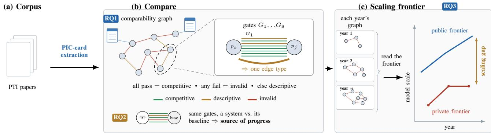  
Figure 2. An overview of the graph-based framework. (a) Every paper in the corpus enters the audit as a Private Inference Contract (PIC) card. (b) Each pair of cards is evaluated through the comparability gates $\bar { G } _ { 1 } \bar { - } \bar { G } _ { 8 } .$ which aggregate into a single edge type in the comparability graph (RQ1); the same gates, read against a paper’s own baseline, identify its source of progress (RQ2). (c) Reading the per-year graphs together traces the private scaling frontier against the public one (RQ3).

Construction of a PIC card for a paper. We fill one card per paper by manual extraction under the rules of Section 4. A human auditor records a field only when the manuscript states it explicitly, following the codebook in Appendix C, and an independent LLM re-extraction verifies the recorded values (Section 4). When a field is absent or ambiguously stated in a paper, we record it as unknown. This classification is not a penalty, but a preserved signal that the published evidence cannot support direct comparison along that dimension.

Example of a PIC card. Figure 3 demonstrates the card instantiated for BumbleBee [12], a state-of-the-art PTI system. The card explicitly captures the privacy contract, Transformer architecture, and experimental context used to evaluate BumbleBee. Hence, the card provides the necessary operational context to interpret performance, contextualizing performance numbers in ways an isolated execution time cannot. Side-by-side card comparisons expose where system assumptions align or diverge across the literature, forming the foundation for the comparability gates formalized in the next subsection.

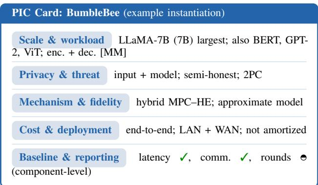  
Figure 3. The PIC card instantiated for BumbleBee [12], filled from the source paper through the card in Table 3. A check marks a fully reported field and a half-circle a partially reported one (here, rounds only at the component level).

## 5.2. Comparability Graph and Gates

We model the audited corpus as a heterogeneous multigraph $\mathcal { G } = ( V , E )$ , where each vertex $v \in V$ represents a paper defined by its PIC card. Because published systems evaluate disparate architectures, threat models, and accounting regimes, no single predicate can determine overall comparability. Instead, two papers a and b are connected by multiple typed edges, each representing a specific dimension of evaluation compatibility. A typed edge exists if and only if both papers satisfy compatibility criteria along that dimension.

Refining PIC categories into comparability gates. To provide diagnostic resolution, we refine the five PIC card categories into eight comparability gates $G _ { 1 } , \ldots , G _ { 8 }$ corresponding to distinct edge types in G. The map is one to many: a category with several independently comparable fields contributes several gates (privacy and threat into $G _ { 1 } { - } G _ { 2 }$ , cost and deployment into $\dot { G } _ { 5 }  – \dot { G } _ { 7 } )$ , while the rest contribute one each. A gate $G _ { i } ( a , b )$ evaluates a predicate over the corresponding fields, returning pass when they match, fail when values explicitly conflict, and unknown when required metadata is omitted from either paper. Table 4 lists the eight gates and their evaluation predicates.

Aggregating into a single comparability label. We determine aggregate pair comparability by evaluating the conjunction $\bar { L } ( \bar { a , } b ) \stackrel { - } { = } \bigwedge _ { i = 1 } ^ { 8 } \bar { G } _ { i } ( a , b )$ under three valued logic $( \mathrm { f a i l } < \mathrm { u n k n o w n } < \mathrm { p a s s } )$ . A single failing gate forces the aggregate label to fail, while missing fields yield unknown in the absence of explicit failure. Collapsing the multigraph via $L ( a , b )$ partitions paper pairs into three operational relations: competitive $( L = \mathrm { p a s s } ,$ indicating complete contract alignment for direct headline comparison), descriptive $( L = \mathrm { u n k n o w n } .$ , where incomplete reporting prevents verification), and invalid $( L = \mathrm { f a i l }$ , where explicit contract incompatibility renders direct comparison misleading). These labels evaluate comparison validity strictly and do not reflect technical merit.

TABLE 3. EVALUATION CONTRACT CARD USED TO INTERPRET PTI PROGRESS CLAIMS. A HEADLINE NUMBER IS DIRECTLY COMPARABLE ONLY WHEN THE RELEVANT CONTRACT FIELDS ARE ALIGNED AND SUFFICIENTLY REPORTED.
<table><tr><td>Contract category</td><td>Fields audited</td></tr><tr><td>Scale and workload</td><td>Largest evaluated model, parameter count, inference mode (encoder / decoder / encoder-decoder)</td></tr><tr><td>Privacy and threat model</td><td>Protected asset, leakage scope, adversary model, party model</td></tr><tr><td>Mechanism and fidelity</td><td>Mechanism (MPC / HE / hybrid), fidelity class (exact, approximate, architecture-modified, task-limited)</td></tr><tr><td>Cost and deployment</td><td>Latency, communication, rounds, cost scope (online / offline / end-to-end), amortization, network regime</td></tr><tr><td>Baseline and reporting</td><td>Named baseline, in-corpus or external baseline, missing or limiting fields, sufficiency for cross-paper comparison</td></tr></table>

TABLE 4. REFINEMENT OF THE FIVE PIC CARD CATEGORIES INTO EIGHT COMPARABILITY GATE TYPES.
<table><tr><td>Gate</td><td>PIC category</td><td>Evaluation predicate</td></tr><tr><td>G1: Privacy</td><td>Privacy and threat model</td><td>Protected assets and leakage scope match</td></tr><tr><td>G2: Threat</td><td>Privacy and threat model</td><td>Adversary model and party topology match</td></tr><tr><td>G3: Workload</td><td>Scale and workload</td><td>Evaluated model architecture and workload match  $( \mathrm { e . g . }$  , encoder vs decoders)</td></tr><tr><td>G4: Fidelity</td><td>Mechanism and fidelity</td><td>Model preservation or approximation degree matches</td></tr><tr><td>G5: Cost</td><td>Cost and deployment</td><td>Cost accounting boundaries and execution phases match (e.g., end-to-end vs online- only)</td></tr><tr><td>G6: Amortization</td><td>Cost and deployment</td><td>Batch and sequence amortization assumptions match</td></tr><tr><td>G7: Network</td><td>Cost and deployment</td><td>Network bandwidth and latency environments match (e.g., LAN vs WAN)</td></tr><tr><td>G8: Reporting</td><td>Baseline and reporting</td><td>Report sufficient context for comparison  $( \mathrm { e . g . } ,$  latency, communication, and rounds)</td></tr></table>

A worked example. To illustrate the operational mechanics of the comparability gates, consider BOLT [11] and BumbleBee [12], two systems frequently compared in the literature when evaluating BERT-base under two-party hybrid HE and MPC. Although superficially comparable, walking the gate hierarchy reveals subtle contract divergences. Six gates pass: privacy scope $( G _ { 1 } )$ , threat model $\left( G _ { 2 } \right)$ , workload $( G _ { 3 } ,$ since both evaluate BERT-base), model fidelity $( G _ { 4 } ,$ , both approximate), cost scope $( G _ { 5 } ) .$ and network regime $( G _ { 7 } )$ . The pair still does not reach a competitive relation, but for lack of reporting rather than outright conflict: amortization $\left( G _ { 6 } \right)$ is unknown because BOLT does not state whether its cost is amortized, and reporting sufficiency $\left( G _ { 8 } \right)$ is unknown because BumbleBee reports rounds only at the component level. With no explicit contract incompatibility but two fields left unresolved, the gate conjunction places these systems in a descriptive relationship rather than a direct competitive ranking, a comparison that can be described but not certified.

## 5.3. Progress Attribution

A reported performance gain reflects a relational comparison between a progress claim c and a baseline configuration $c _ { 0 } .$ Because both c and $c _ { 0 }$ are fully instantiated as PIC cards, progress attribution reduces to identifying contract field discrepancies across the pair. We formalize this process through the operational outcomes of the eight comparability gates evaluated on $( c , c _ { 0 } )$ , isolating genuine cryptographic progress from compound gains driven by non-cryptographic factors.

1) Protocol progress: No non-cryptographic gate is in explicit conflict, and the dominant discrepancy between c and $c _ { 0 }$ is the cryptographic primitive or subprotocol mechanism; any residual non-protocol difference is recorded as a secondary caveat.

2) Assumption tradeoff: Triggered when privacy scope $( G _ { 1 } )$ or threat model $\left( G _ { 2 } \right)$ fails, indicating a relaxed adversary model, altered party topology, or expanded trust setup.

3) Workload or fidelity shift: Triggered when scale and workload $( G _ { 3 } )$ or mechanism and fidelity $\left( G _ { 4 } \right)$ fails, indicating altered model architectures, sequence lengths, pruning, quantization, or non linear approximations.

4) Hardware or deployment shift: Triggered when network regime $( G _ { 7 } )$ fails or underlying hardware specifications differ between c and $c _ { 0 }$

5) Component progress: Represents a structural scope mismatch where workload $\left( G _ { 3 } \right)$ and cost scope $\left( G _ { 5 } \right)$ evaluate an isolated subprotocol or operator rather than an end to end inference system.

6) Reporting artifact: Triggered when reporting sufficiency $( G _ { 8 } { = } \mathrm { u n k n o w n } )$ prevents verification of baseline metadata.

When evaluating $( c , c _ { 0 } )$ yields fail or unknown outcomes across multiple gates, the claim receives a mixed attribution label, recording all contributing gate discrepancies as secondary caveats. This formulation enforces a strict invariant: a claim receives a pure protocol progress label if and only if every non cryptographic gate evaluates to pass. Any co-occurring gate discrepancy disqualifies the claim from pure protocol progress: it is recorded as a secondary caveat and, when no single driver dominates, the claim is labeled mixed attribution. As detailed in Section 6.3, while 49 of 62 audited papers demonstrate genuine cryptographic progress, not a single headline speedup stems from protocol advances alone.

## 5.4. Scaling Frontier Audit

The preceding sections establish three lenses on the corpus where the PIC card describes what a single paper claims, the gates describe whether two claims can be placed side by side, and attribution describes what kind of change produced a given gain. Taken together, over all 62 nodes of G, they support a claim none of the three supports alone, namely where the field’s demonstrated capability actually stands.

To evaluate the scaling gap separating PTI from unprotected LLMs, we benchmark the private inference parameter envelope against unencrypted production models. Let $P ( v )$ denote the maximum parameter count reported in the PIC card for paper v. We define the PTI scaling frontier $P _ { \mathrm { P T I } } ( y )$ as the largest protected model published by year y:

$$
P _ { \mathrm { P T I } } ( y ) = \operatorname* { m a x } \left\{ P ( v ) \ \middle | \ v \in V _ { \mathrm { c o n v } } , \ \mathrm { Y e a r } ( v ) \leq y \right\}\tag{1}
$$

where $V _ { \mathrm { c o n v } } \subseteq V$ represents the subset of articles that evaluate conventional cryptographic implementations, filtered through gates $G _ { 4 }$ (model fidelity) and $G _ { 5 }$ (cost scope). We benchmark this against $P _ { \mathrm { L L M } } ( y )$ , the parameter envelope of unencrypted production transformer models published by year y.

## 6. Audit Findings

This section presents our audit findings addressing RQ1 through RQ3, leaving RQ4 for Section 7. By synthesizing comparability graphs alongside each node’s PIC card, we demonstrate the SoK’s central thesis: direct cross-system comparability remains severely constrained, and there is a widening scaling gap between PTI frameworks and stateof-the-art plaintext models.

## 6.1. Overview of PIC Cards

Before addressing our research questions, we synthesize the overall landscape of the corpus using its extracted PIC cards and comparability gates. Figure 9 in Appendix A.1 details how the 62 audited papers distribute across key system fields. While the corpus exhibits strong consensus around threat models (55 semi-honest, 4 malicious, 3 unclear) and privacy scopes (49 protecting both input and model), it spans broad structural diversity across remaining axes: cryptographic mechanism (24 MPC, 17 HE, 19 hybrid), model fidelity (40 approximate, 14 modified, 7 exact), party topology (27 2PC, 16 clientserver, 6 multi-server, 6 helper, 7 other), workload regime (21 encoder-only, 21 both, 17 decoder-only), and reported cost scope (42 end-to-end, 11 online-only, 9 offline/narrower). This structural divergence makes the comparability graph sparse, constraining direct cross-paper evaluations as detailed in the following sections.

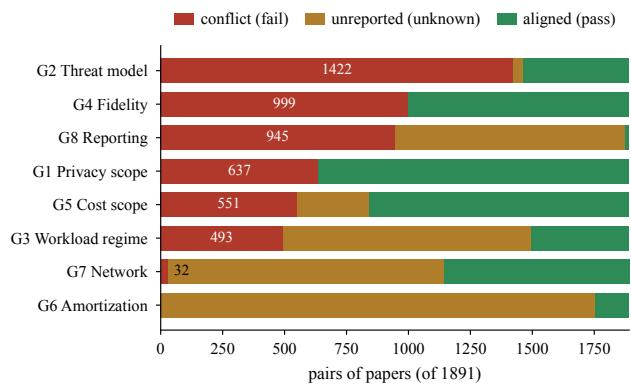  
Figure 4. Per-gate outcome across all system pairs. The threat and party model (G2) and model fidelity (G4) drive most of the hard incompatibility, while amortization (G6) and reporting sufficiency (G8) are dominated by unreported fields.

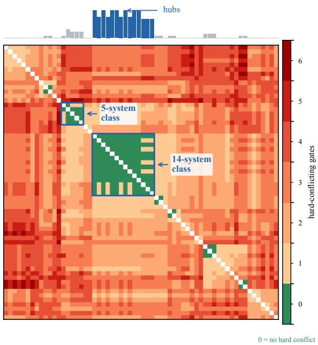  
Figure 5. Pairwise comparability matrix across the 62 audited papers. Cell color indicates the number of hard-conflicting gates (green: no conflict; darker red: higher conflict). Rows and columns are ordered via agglomerative clustering, with boxed blocks marking the two comparable cohorts and the top bar tracking each paper’s count of conflict-free partners. See Figure 10 in Appendix A.2 for the fully labeled matrix.

## 6.2. RQ1: Comparability Between Systems

Pairwise comparability. Figure 4 summarizes pairwise agreement and conflict across all eight comparability gates. Hard conflicts dominate threat and party models (G2: 1422 of 1891 pairs) and model fidelity (G4: 999 pairs), meaning a random pair typically disagrees on trust assumptions or model integrity. Conversely, amortization (G6) and reporting sufficiency (G8) are bottlenecked by unreported parameters rather than explicit conflicts.

Figure 5 illustrates pairwise conflict density across all 1891 pairs, with comparable systems clustered along the diagonal. We observe only two distinct, relatively comparable cohorts: (1) a 14-system cluster (BLB, BOLT,

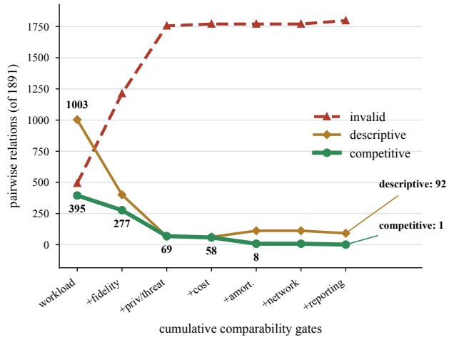  
Figure 6. The comparability collapse under cumulative gates (RQ1). Competitive pairs fall from 395 under a compatible workload alone to a single pair under the full contract, with most of the drop at the early substantive gates rather than at reporting; invalid pairs rise to match, and descriptive pairs are the residual.

BumbleBee, CipherGPT, CryptoMoE, East, EncFormer, Euston, FLUTE, MPCFormer, NEXUS, Nimbus, SHAFT, SecMoE) and (2) a 5-system cluster (AERO, CipherFormer, CipherPrune, LLMs-Can-Understand-Encrypted-Prompt, MPCViT). The remaining corpus is heavily fragmented, with 32 papers sharing zero conflict-free pairings. As highlighted by the top bar of Figure 5, the most connected systems (BLB, BumbleBee, EncFormer, Euston, NEXUS, SHAFT, and SecMoE) share no hard conflict with about 20% of published works, explaining why they appear most frequently as baselines in prior literature.

Cumulative comparability. Comparability across PTI systems degrades rapidly under cumulative gate enforcement (Figure 6). Isolated regime matching yields 395 compatible pairs (20.9%), but layering successive contract constraints rapidly erodes this pool. Model fidelity drops valid pairs to 277 (14.6%), threat model, privacy, and cost narrow the count to 58 (3.1%). Factoring in other gates isolates a single fully compliant pair. In total, cumulative gate filtering invalidates 1798 of 1891 candidate pairings (95.1%), leaving just 92 descriptive and 1 competitive pair. The sole pair surviving all gates succeeds only because one system explicitly reimplemented the other.

Two checks prove this collapse reflects true contract incompatibility rather than missing data. First, hard fails eliminate 339 of 395 workload-compatible pairs (fidelity removing 118 and threat models removing 208) compared to just 55 unknown failures. Second, gate order and singlegate relaxations do not change the outcome because threat models (1422/1891) and fidelity (999/1891) independently fail most pairs (Figure 4). We emphasize that we can still benchmark systems under shared contracts, but current published evidence cannot support a global leaderboard.

Finding 1: Comparability in PTI is not just rare (1 competitive pair out of 1891) but structurally concentrated in a small hub of systems, leaving most of the corpus unable to be compared to anything at all.

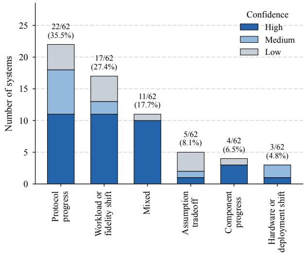  
Figure 7. Primary progress-attribution labels over the 62-paper corpus. These labels attribute the main source of each paper’s reported progress claim; a primary protocol label marks the dominant driver, and every such paper still carries at least one secondary non-protocol caveat (Section 6.3). Each bar is split by our confidence in the assigned label: high when the paper names its baseline and states the changed component explicitly, medium when the label is clear but carries a stated secondary caveat, and low when the label requires inference from indirect evidence or sits near a category boundary. Dropping the low-confidence labels leaves the same findings (Appendix A.5).

## 6.3. RQ2: What Drives Reported Progress?

As outlined in Section 5.3, we attribute progress by identifying contract field discrepancies between a system and its baselines. Figure 7 categorizes the primary drivers of reported improvements: protocol progress (22/62), workload or fidelity shifts (17/62), mixed progress (11/62), assumption tradeoffs (5/62), component progress (4/62), and hardware or deployment shifts (3/62). A primary protocol-progress label marks the protocol change as the dominant driver, not the only one: all 22 such papers carry at least one secondary non-protocol caveat. While protocol progress contributes as a primary or secondary factor in 49 of 62 papers, zero papers achieve pure protocol progress, a protocol-primary label with no nonprotocol caveat. This is because every reported gain co-occurs with non-protocol factors such as workload choices, fidelity modifications, amortization, or reporting scope. This reflects pervasive entanglement rather than a lack of technical merit, demonstrating that performance claims (e.g., “System A outperforms System B”) remain incomplete without specifying the underlying contract and source of gain.

Finding 2: Cryptographic progress in PTI is documented (49 of 62 papers show it as a factor) but never isolated (0 of 62 show it alone), so every reported speedup is entangled with a change in model, workload, or accounting.

## 6.4. RQ3: The PTI Scaling Frontier

Section 5.4 defines the annual PTI scaling frontier using the maximum model parameter count reported in

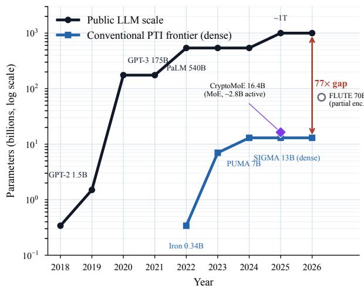  
Figure 8. Public LLM inference scale versus the audited conventional cryptographic PTI frontier, on a logarithmic parameter axis. The dense frontier enters at 0.34B (Iron, 2022), reaches 13B (SIGMA, 2024), and does not move through 2026, while public models pass a trillion parameters, a gap of nearly two orders of magnitude. CryptoMoE’s 16.4B mixture-of-experts (about 2.8B active per token) sits off the dense line, and FLUTE’s 70B partial-encryption result is kept off the frontier as a weaker contract. Each point carries its own contract (Table 10), so the frontier is a scale-context upper bound, not a like-for-like capability comparison.

PIC cards per year. As shown in Figure 8, the conventional cryptographic frontier progressed from 0.34B parameters in 2022 to 7B in 2023 and 13B in 2024. However, the PTI frontier has since plateaued. Audited 2025–26 dense systems (7–8B) remain below SIGMA’s 13B, while larger audited points require structural trade-offs, such as Crypto-MoE’s 16.4B mixture-of-experts or FLUTE’s 70B model under partial encryption. Meanwhile, the unencrypted public baseline surged from GPT-3 (175B in 2020) and PaLM (540B in 2022) to ∼1T parameters by 2025. Thus, despite internal progress, PTI lags far behind public model deployment.

This private frontier represents an optimistic envelope compiled across heterogeneous evaluation contracts (Table 10 in Appendix A.4). Specifically, 2022’s Iron relies on a hybrid 2PC setup, 2023’s PUMA uses endto-end 3PC, and 2024’s SIGMA assumes an online-only protocol. Therefore, this frontier merely tracks the largest scale demonstrated under any conventional cryptographic contract in a given year. Enforcing a single fixed contract (e.g., end-to-end 2PC) would lower the private frontier further, making the observed public–private scaling gap a conservative lower bound.

Finding 3: The PTI frontier has plateaued at 13B since 2024 while the plaintext frontier has passed 1T parameters. Because the private curve generously aggregates non-comparable contracts, this gap is much wider in practice.

## 7. RQ4: The Cost of Deployment-Scale PTI

As discussed in Section 6.4, the empirical PTI frontier remains bounded at 13B, while production LLMs have passed a trillion parameters. Given this gap, what would it actually cost, in engineering terms, to run private inference at the scale of models now in production? To quantify the operational cost of deployment-scale private inference, we extrapolate audited empirical metrics to 70Band 405B-class model backbones, projecting per-token latency, communication volume, and offline preprocessing requirements.

Fitting a cost model to the corpus. We construct a calibration dataset of 256 empirical performance tuples (latency, communication volume, rounds, and preprocessing overhead alongside network, hardware, and accounting contexts) spanning 20 systems from the audited corpus. Measurements for each system are fitted to a power-law curve strictly within its isolated paper environment under a single evaluation contract.

When a paper reports cost at several model sizes $( \mathrm { e . g . }$ SIGMA spanning 0.124B to 13B parameters), we fit the power law cost ∝ $P ^ { \beta }$ to those points, where cost is the reported latency or communication, P is parameter count, and $\beta$ is the fitted scaling exponent. Leave-one-out error stays below 12% in every curve-fitting case. When a paper reports cost at only one large model size, we scale that point using analytical computation exponents (e.g., linear layer compute scaling as $P$ and activation communication scaling as $\sqrt { P }$ at fixed sequence length). To evaluate sensitivity to this analytical exponent, we sweep $\beta$ across sub-linear to super-linear regimes $( \beta \in [ 0 . 8 , 1 . 2 ] )$ at 70B and 405B. The projected cost shifts by only a multiplicative factor across this range, so the order of magnitude of the projection matches the model scales.

The projected cost at production scale. Table 5 translates our fitted projections into per-token deployment costs. While plaintext inference for a 70B model on a single GPU node executes in tens of milliseconds per token, every private baseline exhibits a 3-to-5 order-of-magnitude overhead. This gap widens with scale as communication and preprocessing costs outpace compute. Evaluating the four protocol families, each under its own published contract (Table 5), reveals a sharp divergence, ranging from roughly two minutes per token for the fastest online family to several hours for the slowest. Appendix B stresstests these projections against held-out model sizes and alternative scaling exponents; the order of magnitude holds in both cases.

Three structural walls. To identify the underlying drivers behind the stalled PTI scaling frontier, we examine the massive projected costs reported in Table 5. We observe that PTI performance hits three structural walls, representing fundamental physical and system limits that protocol adjustments alone cannot overcome. First, a preprocessing wall constrains FSS-based systems. While FSS offers low online latency, key sizes scale at $\beta { = } 0 . 7 2$ requiring ∼1.4 TB of offline dealer keys per 70B inference setup. Transporting this state requires ∼20 minutes over a 9.4 Gbps LAN, dwarfing the 115-second online inference phase itself. Second, a bandwidth floor is set by raw communication volume (18–58 GB per token at 70B), imposing an absolute physical throughput limit (24–77 minutes per token on 100 Mbps links) regardless of compute speed or round counts. Third, an amortization dependence divides interactive and batched service contracts, as noninteractive HE reaches minute-scale 70B projections (about 7.6 minutes per token) only by batching 32 queries, while

TABLE 5. WHAT ONE PRIVATE FORWARD PASS (ONE GENERATED TOKEN) WOULD COST AT DEPLOYMENT SCALE, EXTRAPOLATED PER FAMILY FROM PUBLISHED EVIDENCE UNDER THAT FAMILY’S OWN CONTRACT. THE 3PC PER-TOKEN ANCHORS ARE THE MARGINAL SECOND TOKEN FROM THE SOURCE’S OWN TABLE, SO PREFILL IS NOT CONSIDERED.
<table><tr><td>Family (env.)</td><td>Contract caveat</td><td>Metric</td><td>7–13B (published)</td><td>70B (proj.)</td><td>405B (proj.)</td></tr><tr><td>FSS, 2PC+dealer (SIGMA)</td><td>online-only, GPU</td><td>time/pass</td><td>23-38 s</td><td>~115 s</td><td>~384 s</td></tr><tr><td></td><td></td><td>comm/pass</td><td>12-19 GB</td><td>~58 GB</td><td>~188 GB</td></tr><tr><td></td><td></td><td>FSS key/query</td><td>255–419 GB</td><td>~1.4 TB</td><td>~4.9 TB</td></tr><tr><td>3PC secret sharing (PUMA)</td><td>end-to-end, 20 Gbps LAN</td><td>time/token</td><td>164 s</td><td>~27 min</td><td>~2.6 h</td></tr><tr><td></td><td></td><td>comm/token</td><td>2.1 GB</td><td>~21 GB</td><td>~119 GB</td></tr><tr><td>Hybrid HE+MPC, 2PC (BumbleBee) end-to-end, CPU</td><td></td><td>time/token</td><td>832 s</td><td>~2.3 h</td><td>~13 h</td></tr><tr><td></td><td></td><td>comm/token</td><td>5.6 GB</td><td>~18 GB</td><td>~43 GB</td></tr><tr><td>HE non-interactive (NEXUS)</td><td>batch-32 amortized, 4×A100 time/token</td><td></td><td>52 s</td><td>~7.6 min</td><td>~44 min</td></tr><tr><td></td><td>single-query (de-amortized)</td><td>time/token</td><td>~28 min</td><td>~4 h</td><td>~23 h</td></tr></table>

its single-query cost is roughly 30× worse.

Finding 4: Private inference at 70B costs three to five orders of magnitude more than plaintext, and that gap decomposes into three physical bottlenecks.

## 8. Discussion

## 8.1. What This SoK Adds to PTI Progress

Over just a few years, PTI has driven remarkable cryptographic momentum, scaling protocols from small encoders to billion-parameter decoders, slashing communication volumes by orders of magnitude, and establishing theoretical primitives (non-interactive HE at scale, FSS for non-linear activations, and dynamic MPC–HE hybrid routing) as practical. Sixty-two systems since 2022 reflect a rapidly evolving field producing novel algorithms and systems. This SoK provides a progress lens to this rapidly evolving field. Because every paper reports under an isolated evaluation contract, the field has lacked the visibility to distinguish cumulative, composable advances from disconnected empirical wins. Our diagnostics on pairwise comparability (Section 6.2), progress attribution (Section 6.3), and the PTI scaling frontier (Section 6.4) contextualize each gain in the literature and translate these diagnostics into concrete practice.

## 8.2. Report the Contract, Not Just the Number

Most articles already collect the core parameters required for their evaluation, including model parameters, workload regimes, privacy bounds, and cost metrics. What is missing is consolidating this data into a single, checkable reference. We recommend attaching a standardized PIC Card (Table 3), covering scale, threat model, fidelity, deployment costs, and baselines. As Section 6.2 demonstrates, assembling these fields at corpus scale establishes the precise specification required for future cross-paper comparisons. A similar principle governs performance attribution. The contribution of a system is sharpened when we dissect speedups across explicit sources (protocol design, workload, relaxed security assumptions, hardware accounting, or component kernels as shown in Section 5.3).

Transparent attribution enables future work to iterate on verified modular advances rather than inheriting unisolated performance numbers.

## 8.3. Measure Scaling Against a Moving Frontier

Section 6.4 illustrates both the advance of the PTI frontier and the substantial distance remaining to plaintext models. While frontier model evaluation is not required for every system, authors should unambiguously scope their contribution across four progress settings: (1) model-scale progress reporting increasingly larger models under comparable privacy and cost bounds, (2) cost-scaling progress characterizing latency, communication, or rounds as workload dimensions grow, (3) component-scaling progress optimizing an isolated bottleneck operator without endto-end claims, and (4) deployment-scenario progress justifying model scale and workload within a concrete application context. This suggested guideline provides a clear four-dimensional lens for evaluating system scaling.

## 8.4. Benchmark with Deployment Scenarios

Section 6.2 illustrates the challenges of unstandardized evaluation. MPC, HE, and hybrid systems, each engineered for distinct trade-offs, are flattened onto a single comparison. Hence, benchmarking should instead organize around explicit deployment scenarios so that systems compete on their intended settings: (a) Interactive WAN prioritizes round complexity and tail latency under realistic network bounds; (b) Batch analytics evaluates throughput and amortization, provided accounting is fully transparent; (c) Collaborative inference spotlights party topology and explicit leakage boundaries; (d) Model-confidential inference enforces equal protection for proprietary model weights and user inputs; and (e) Component stresstesting isolates bottleneck operators without conflating microbenchmarks with full-system feasibility.

## 8.5. Matching Backbones to Deployments

A practical question follows: when facing a real-world deployment, which cryptographic backbone should a practitioner choose? Because each cryptographic family exhibits a distinct cost profile, optimal selection requires mapping these cost structures to a deployment’s primary bottleneck (Table 9, Appendix A). We categorize the deployment options as follows: Interactive WAN: Low-round HE or few-round hybrids (minimizing round-trip latency overhead); Batch throughput: SIMD-packed HE or amortizedoffline hybrids (maximizing parallel efficiency); Lowlatency LAN: MPC or hybrid schemes (leveraging cheap, highly interactive rounds); Bandwidth-constrained links: HE or communication-optimized protocols (minimizing data transfer); Model confidentiality: Dual input-andmodel 2PC (ensuring weight privacy); and Helper-assisted settings: 3PC or server-aided MPC (when a non-colluding party is available).

These mappings reflect architectural trade-offs rather than absolute rules. For instance, NEXUS leverages a single-round design to minimize WAN latency, but pays for it in heavy homomorphic computation. Conversely, round-intensive MPC frameworks achieve exceptional LAN throughput that degrades severely over a WAN. Hence, selecting a cryptographic backbone requires first formalizing the deployment settings, not the other way around.

## 9. Limitations

This SoK audits published evidence rather than reproducing performance on unified hardware. Hence, all findings in the paper evaluate what the published record actually supports. We summarize some limitations of our approach.

Corpus scope. We strictly evaluate conventional cryptographic PTI, excluding split-inference and statistical approaches. Scaling findings apply explicitly to cryptographic setups rather than all private inference frameworks.

Contract labeling. Labeling relies on conservative defaults (e.g., preferring unknown over inferred), backed by blind re-extraction and sensitivity analysis (Appendix A.5). The corpus maps empirical evidence rather than ranking systems.

Gate granularity. Gate compliance certifies that a pair is not provably incomparable rather than identical. Coarse categorical fields (e.g., fidelity approximations, network classes, and cost accounting bounds) can obscure subtle reporting discrepancies. For instance, while Euston and NEXUS clear every gate as a deliberate reimplementation, the two papers dispute whether user-side preprocessing belongs in end-to-end latency.

Scale as a capability proxy. We measure the PTI frontier using parameter count. Although parameter count omits architectural quality and context length, it directly dictates cryptographic compute costs, making it highly relevant for our scaling analysis.

## 10. Conclusions

This SoK asks whether PTI’s reported progress accumulates toward deployment-scale private inference or merely produces isolated points that cannot be assembled into a trajectory. Our four analyses point to the same answer from distinct perspectives. First, the scaling frontier shows that demonstrated capability has plateaued well below production scale, and that even this frontier is an optimistic upper bound stitched from mutually incompatible contracts. Second, the comparability audit explains why: virtually no two published claims share enough evaluation context to be directly compared, with aligning pairs clustering around a few hub systems rather than spanning the corpus. Third, the attribution analysis reveals what this fragmentation obscures: while cryptographic progress is widespread, it is never the sole driver of reported gains, meaning a headline speedup does not inherently signify protocol advancement. Finally, the cost projection shows how to close this gap: it is not a single metric, but overcoming three distinct structural walls, each demanding a dedicated resolution.

Taken together, these results reframe what constitutes valid evidence of progress in this field. A faster system is uninformative in isolation unless it explicitly specifies its scale, governing contract, and exact source of performance gain. Individual PTI studies have delivered remarkable technical advances over the years. What the field needs next is the reporting discipline to show that the speedups are converging on deployment.

## Ethical Considerations

This paper systematizes already-published research and raises no ethical concerns of its own. It studies only the public record: peer-reviewed papers, their publicly released artifacts, and public model-scale references. It involves no human subjects, no personal or sensitive data, and introduces no attacks, exploits, or deanonymization techniques. We name systems solely to analyze the evaluation contracts behind their published results; our comparability and attribution labels concern what the published evidence can support, not the merit or conduct of any author. The only automated processing in our pipeline is an LLM verifier that re-reads the same published text as a second, blind check on the human extraction; it processes no data beyond the papers themselves, and its outputs are released with the artifacts. We therefore see no risk of harm arising from this work.

## Open Science

In keeping with the open science policy, we release the artifacts behind this systematization: the frozen 62- paper corpus metadata, the structured extraction protocol and codebook (reproduced in Appendix C), the per-paper evaluation-contract fields, the comparability-gate implementation and the pairwise graph it produces, the progressattribution labels, the blind re-extraction records, the costmodel calibration data, and the scripts that regenerate every table and figure from these inputs. Together they let a reader reproduce each reported number directly from the released data. We do not redistribute the audited papers or their full text, which remain under their publishers’ copyright; the corpus references each work by citation and releases only derived metadata and the short evidence quotes needed to audit each field.

The artifacts are archived at https://doi.org/10.5281/ zenodo.22105363. The record is currently deposited anonymously so that it remains usable alongside double-blind submissions of this work; we will publish a de-anonymized version of the same record, under the same concept DOI, once the paper is accepted.

## References

[1] B. Yan, K. Li, M. Xu, Y. Dong, Y. Zhang, Z. Ren, and X. Cheng, “On protecting the data privacy of large language models (llms): A survey,” in 2024 International Conference on Meta Computing (ICMC). IEEE, 2024, pp. 1–12.

[2] Y. Li, X. Zhou, Y. Wang, L. Qian, and J. Zhao, “A survey on private transformer inference,” arXiv preprint arXiv:2412.08145, 2024.

[3] ——, “Private transformer inference in MLaaS: A survey,” arXiv preprint arXiv:2505.10315, 2025.

[4] Y. Dong, W.-j. Lu, Y. Zheng, H. Wu, D. Zhao, J. Tan, Z. Huang, C. Hong, T. Wei, and W. Chen, “Puma: Secure inference of llama-7b in five minutes,” arXiv preprint arXiv:2307.12533, 2023.

[5] K. Gupta, N. Jawalkar, A. Mukherjee, N. Chandran, D. Gupta, A. Panwar, and R. Sharma, “Sigma: Secure gpt inference with function secret sharing,” Proceedings on Privacy Enhancing Technologies, vol. 2024, no. 4, pp. 61–79, 2024.

[6] D. Li, R. Shao, H. Wang, H. Guo, E. P. Xing, and H. Zhang, “Mpcformer: fast, performant and private transformer inference with mpc,” in The Eleventh International Conference on Learning Representations (ICLR), 2023.

[7] J. Zhang, X. Yang, L. He, K. Chen, W.-j. Lu, Y. Wang, X. Hou, J. Liu, K. Ren, and X. Yang, “Secure transformer inference made non-interactive,” in Network and Distributed System Security Symposium, NDSS, vol. 2025, 2025.

[8] T. Chen, H. Bao, S. Huang, L. Dong, B. Jiao, D. Jiang, H. Zhou, J. Li, and F. Wei, “The-x: Privacy-preserving transformer inference with homomorphic encryption,” in Findings of the Association for Computational Linguistics: ACL 2022, 2022, pp. 3510–3520.

[9] D. Rho, T. Kim, M. Park, J. W. Kim, H. Chae, E. K. Ryu, and J. H. Cheon, “Encryption-friendly llm architecture,” in The Thirteenth International Conference on Learning Representations (ICLR), 2025.

[10] M. Hao, H. Li, H. Chen, P. Xing, G. Xu, and T. Zhang, “Iron: Private inference on transformers,” Advances in neural information processing systems, vol. 35, pp. 15 718–15 731, 2022.

[11] Q. Pang, J. Zhu, H. Mollering, W. Zheng, and T. Schneider, “Bolt:¨ Privacy-preserving, accurate and efficient inference for transformers,” in 2024 IEEE Symposium on Security and Privacy (SP). IEEE, 2024, pp. 4753–4771.

[12] W.-j. Lu, Z. Huang, Z. Gu, J. Li, J. Liu, C. Hong, K. Ren, T. Wei, and W. Chen, “Bumblebee: Secure two-party inference framework for large transformers,” in Network and Distributed System Security Symposium, NDSS, vol. 2025, 2025.

[13] Y. Yu, Y. Zhou, Y. Chen, P. Soto, W. Xiong, and M. Li, “Cachemir: Fully homomorphic encrypted inference of generative large language model with kv cache,” arXiv preprint arXiv:2602.11470, 2026.

[14] Z. Li, K. Yang, J. Tan, W.-j. Lu, H. Wu, X. Wang, Y. Yu, D. Zhao, Y. Zheng, M. Guo et al., “Nimbus: Secure and efficient twoparty inference for transformers,” Advances in Neural Information Processing Systems, vol. 37, pp. 21 572–21 600, 2024.

[15] H. Huang and Y. Wang, “Secbert: Privacy-preserving pre-training based neural network inference system,” Neural Networks, vol. 172, p. 106135, 2024.

[16] Epoch AI, “Data on notable AI models,” https://epoch.ai/data/ ai-models, 2026, accessed August 2026.

[17] A. Falcetta and M. Roveri, “Privacy-preserving deep learning with homomorphic encryption: An introduction,” IEEE Computational Intelligence Magazine, vol. 17, no. 3, pp. 14–25, 2022.

[18] R. Podschwadt, D. Takabi, and P. Hu, “Sok: Privacy-preserving deep learning with homomorphic encryption,” arXiv preprint arXiv:2112.12855, 2021.

[19] L. K. Ng and S. S. Chow, “Sok: Cryptographic neural-network computation,” in 2023 IEEE Symposium on Security and Privacy (SP). IEEE, 2023, pp. 497–514.

[20] C. Gouert, D. Mouris, and N. Tsoutsos, “Sok: New insights into fully homomorphic encryption libraries via standardized benchmarks,” Proceedings on Privacy Enhancing Technologies, vol. 2023, no. 3, pp. 154–172, 2023.

[21] J. Xue, X. Xin, W. Zhang, M. Zheng, Q. Song, M. Zhou, Y. Dong, D. Wang, X. Chen, J. Xie, L. Wang, D. Mohaisen, H. Wu, and Q. Lou, “Sok: Can fully homomorphic encryption support general ai computation? a functional and cost analysis,” 2025. [Online]. Available: https://arxiv.org/abs/2504.11604

[22] Z. Pindado, T. Spendlhofer, M. Allam, P. Mehta, L. Martens, and A. J. Pena, “Sok of private deep neural network inference with˜ approximate fully homomorphic encryption,” Cryptology ePrint Archive, 2026.

[23] Y. Chen, T. Lu, Z. Tang, B. Zhang, Z. Shi, Y. Luan, and Z. Wang, “Sok: Private transformer-based model inference,” in 35th USENIX Security Symposium (USENIX Security 26), 2026.

[24] A. Al Badawi, A. Alexandru, Y. Polyakov, and V. Vaikuntanathan, “Sok: Private llm inference using approximate homomorphic encryption,” Cryptology ePrint Archive, 2026.

[25] A. Vaswani, N. Shazeer, N. Parmar, J. Uszkoreit, L. Jones, A. N. Gomez, Ł. Kaiser, and I. Polosukhin, “Attention is all you need,” Advances in neural information processing systems, vol. 30, 2017.

[26] R. Pope, S. Douglas, A. Chowdhery, J. Devlin, J. Bradbury, J. Heek, K. Xiao, S. Agrawal, and J. Dean, “Efficiently scaling transformer inference,” Proceedings of machine learning and systems, vol. 5, pp. 606–624, 2023.

[27] Z. Liang, P. Wang, R. Zhang, N. Xu, S. Zhang, L. Xing, H. Bai, and Z. Zhou, “Merge: Fast private text generation,” in Proceedings of the AAAI Conference on Artificial Intelligence, vol. 38, no. 18, 2024, pp. 19 884–19 892.

[28] Y. Akimoto, K. Fukuchi, Y. Akimoto, and J. Sakuma, “Privformer: Privacy-preserving transformer with mpc,” in 2023 IEEE 8th European Symposium on Security and Privacy (EuroS&P). IEEE, 2023, pp. 392–410.

[29] W. Zeng, M. Li, W. Xiong, T. Tong, W.-j. Lu, J. Tan, R. Wang, and R. Huang, “Mpcvit: Searching for accurate and efficient mpc-friendly vision transformer with heterogeneous attention,” in Proceedings of the IEEE/CVF International Conference on Computer Vision, 2023, pp. 5052–5063.

[30] Y. Zhang, D. Chen, S. Kundu, C. Li, and P. A. Beerel, “Sal-vit: Towards latency efficient private inference on vit using selective attention search with a learnable softmax approximation,” in Proceedings of the IEEE/CVF International Conference on Computer Vision, 2023, pp. 5116–5125.

[31] Y. Xue, L. Liu, Y. Luo, B. Sun, and S. Fu, “Privmllm: Efficient threeparty multimodal large language model secure inference supported prompt privacy,” in 2025 IEEE 33rd International Conference on Network Protocols (ICNP). IEEE, 2025, pp. 1–24.

[32] A. Y. Kei and S. S. Chow, “Shaft: Secure, handy, accurate, and fast transformer inference,” in Network and Distributed System Security Symposium, NDSS, vol. 2025, 2025.

[33] W. Zeng, T. Xu, Y. Chen, Y. Zhou, M. Zhang, J. Tan, C. Hong, and M. Li, “Towards efficient privacy-preserving machine learning: A systematic review from protocol, model, and system perspectives,” arXiv preprint arXiv:2507.14519, 2025.

[34] J. Moon, D. Yoo, X. Jiang, and M. Kim, “Thor: Secure transformer inference with homomorphic encryption,” in Proceedings of the 2025 ACM SIGSAC Conference on Computer and Communications Security, 2025, pp. 3765–3779.

[35] L. Zhang, X. Wang, J. J. Sim, Z. Huang, J. Zhong, H. Wang, P. Duan, and K.-Y. Lam, “Moai: Module-optimizing architecture for non-interactive secure transformer inference,” in The Fourteenth International Conference on Learning Representations, 2026.

[36] D. Park, E. Lee, and J.-W. Lee, “Powerformer: Efficient and highaccuracy privacy-preserving language model with homomorphic encryption,” in Annual Meeting ofthe Associationfor Computational Linguistics (ACL), 2025.

[37] H. Zhang, N. Javidnia, S. Pardeshi, Q. Lou, and F. Koushanfar, “Cryptogen: Secure transformer generation with encrypted kv-cache reuse,” arXiv preprint arXiv:2602.08798, 2026.

[38] B. Shen, Y. Chen, P. Yang, B. Zhang, X. Zhang, and Z. L. Jiang, “Secmoe: Communication-efficient secure moe inference via selectthen-compute,” in Proceedings of the AAAI Conference on Artificial Intelligence, 2026.

[39] Z. Gong, R. Ran, F. Yao, and W. Wen, “Aegis: Scaling longsequence homomorphic encrypted transformer inference via hybrid parallelism on multi-gpu systems,” arXiv preprint arXiv:2604.03425, 2026.

[40] Y. Zhu, C. Jin, K. M. M. Aung, and X. Xiao, “Encformer: Secure and efficient transformer inference over encrypted data,” arXiv preprint arXiv:2604.09975, 2026.

[41] J. Park, S. Park, J. H. Park, J. H. Ahn, J. H. Cheon, G. Hanrot, J. W. Kim, M. Park, and D. Stehle, “Scaling up FHE-based privacy-´ preserving machine learning: Higher throughput, longer inputs for LLaMA-3-8B,” arXiv preprint arXiv:2601.18511, 2026.

[42] Z. Li, Y. Wang, K. Yang, Y. Yu, J. Gui, Y. Feng, N. Liu, M. Guo, and J. Leng, “On the (in-)security of the shuffling defense in the transformer secure inference,” in Annual Meeting of the Association for Computational Linguistics (ACL), 2026.

[43] M. Fan, Y. Liu, F. Wang, and C. Chen, “What does the server see? understanding privacy leakage from large language models in split inference,” in Proceedings of the 2026 ACM SIGSAC Conference on Computer and Communications Security (CCS), 2026.

[44] P. Yubeaton, J. C. Mo, K. Garimella, N. K. Jha, B. Reagen, C. Hegde, and S. Garg, “Truncformer: Private llm inference using only truncations,” arXiv preprint arXiv:2412.01042, 2024.

[45] Z. Li, Y. Guan, K. Yang, Y. Feng, N. Liu, Y. Yu, J. Leng, and M. Guo, “An efficient private GPT never autoregressively decodes,” in International Conference on Machine Learning (ICML), 2025.

[46] Y. Liu and Q. Su, “Pptif: Privacy-preserving transformer inference framework for language translation,” IEEE Access, vol. 12, pp. 48 881–48 897, 2024.

[47] J. He, K. Yang, G. Tang, Z. Huang, L. Lin, C. Wei, Y. Yan, and W. Wang, “Rhombus: Fast homomorphic matrix-vector multiplication for secure two-party inference,” in Proceedings of the 2024 on ACM SIGSAC Conference on Computer and Communications Security, 2024, pp. 2490–2504.

[48] D. Chen, Y. Zhang, S. Kundu, C. Li, and P. A. Beerel, “Rna-vit: reduced-dimension approximate normalized attention vision transformers for latency efficient private inference,” in 2023 IEEE/ACM International Conference on Computer Aided Design (ICCAD). IEEE, 2023, pp. 1–9.

[49] J. Luo, Y. Zhang, Z. Zhang, J. Zhang, X. Mu, H. Wang, Y. Yu, and Z. Xu, “Secformer: fast and accurate privacy-preserving inference for transformer models via smpc,” in Findings of the Association for Computational Linguistics ACL 2024, 2024, pp. 13 333–13 348.

[50] Z. Peng, K. Xue, B. Zhu, Y. Huang, J. Li, M. Hao, and T. Zhang, “Privtf: Efficient and privacy-preserving transformer inference with optimized protocols for secure nlp,” IEEE Transactions on Network Science and Engineering, 2025.

[51] M. B. Santos, D. Mouris, M. Ugurbil, S. Jarecki, J. Reis, S. Sengupta, and M. de Vega, “Curl: Private llms through wavelet-encoded look-up tables,” in Conference on Applied Machine Learning in Information Security (CAMLIS), 2024.

[52] H. Wu, W. Fang, Y. Zheng, J. Ma, J. Tan, and L. Wang, “Ditto: Quantization-aware secure inference of transformers upon mpc,” in International Conference on Machine Learning (ICML), 2024, pp. 53 346–53 365.

[53] Y. Ma, Y. Li, and S. Schmid, “FuseFSS: Efficient secure LLM inference with function secret sharing,” arXiv preprint arXiv:2606.09551, 2026.

[54] K. Cheng, Y. Xia, A. Song, J. Fu, W. Qu, Y. Shen, and J. Zhang, “Mosformer: Maliciously secure three-party inference framework for large transformers,” in Proceedings of the 2025 ACM SIGSAC Conference on Computer and Communications Security (CCS), 2025.

[55] G. Yan, Y. Zhang, Z. Guo, L. Zhao, X. Chen, C. Wang, W. Wang, D. Meng, and R. Hou, “Comet: Accelerating private inference for large language model by predicting activation sparsity,” in 2025 IEEE Symposium on Security and Privacy (SP). IEEE, 2025, pp. 2827–2845.

[56] D. Rathee, D. Li, I. Stoica, H. Zhang, and R. Popa, “Mpc-minimized secure llm inference,” arXiv preprint arXiv:2408.03561, 2024.

[57] C. Zeng, D. He, Q. Feng, X. Yang, and Q. Luo, “Securegpt: A framework for multi-party privacy-preserving transformer inference in gpt,” IEEE Transactions on Information Forensics and Security, 2024.

[58] Y. Chen, X. Meng, Z. Shi, Z. Ning, and J. Lin, “Securetlm: Private inference for transformer-based large model with mpc,” Information Sciences, vol. 667, p. 120429, 2024.

[59] Y. Xue, L. Liu, Y. Luo, B. Sun, and S. Fu, “FLUTE: FSS-based secure two-party LLM inference using partial transformer encryption,” IEEE Transactions on Dependable and Secure Computing, vol. 23, no. 1, 2026.

[60] W. Zeng, Y. Dong, J. Zhou, J. Tan, L. Wang, T. Wei, R. Wang, and M. Li, “MPCache: MPC-friendly KV cache eviction for efficient private LLM inference,” in Advances in Neural Information Processing Systems (NeurIPS), 2025.

[61] I. Zimerman, A. Adir, E. Aharoni, M. Avitan, M. Baruch, N. Drucker, J. Lerner, R. Masalha, R. Meiri, and O. Soceanu, “Power-softmax: Towards secure llm inference over encrypted data,” arXiv preprint arXiv:2410.09457, 2024.

[62] J. Xie, S. Tan, V. N. Boddeti, and Z. Lu, “ATLAS: Automated approximation of transformers for efficient homomorphic inference in one hour,” arXiv preprint arXiv:2607.23478, 2026.

[63] S. N. Guzelhan, L. Daksha, C. Agullo Domingo, G. Jonatan, J. Kim,´ J. L. Abellan, D. Kaeli, and A. Joshi, “ELLMo: Packing- and depth-´ aware encrypted transformer inference,” Cryptology ePrint Archive, Paper 2026/198, 2026.

[64] X. Gao, S. Fu, L. Liu, Z. Liu, Y. Luo, and Y. Wang, “Euston: Efficient and user-friendly secure transformer inference with noninteractivity,” in 2026 IEEE Symposium on Security and Privacy (SP), 2026.

[65] Y. Mu, G. Li, S. Chen et al., “PriTran: Privacy-preserving inference for transformer-based language models under fully homomorphic encryption,” in 2026 IEEE/ACM International Symposium on Code Generation and Optimization (CGO), 2026.

[66] Z. He, M. Wang, X. Gao, Y. Luo, L. Liu, and S. Fu, “Ensi: Efficient non-interactive secure inference for large language models,” arXiv preprint arXiv:2509.09424, 2025.

[67] L. De Castro, D. Escudero, A. Agrawal, A. Polychroniadou, and M. Veloso, “Encryptedllm: Privacy-preserving large language model inference via gpu-accelerated fully homomorphic encryption,” in Forty-second International Conference on Machine Learning, 2025.

[68] M. Avitan, M. Baruch, N. Drucker, I. Zimerman, and Y. Goldberg, “Efficient decoding methods for language models on encrypted data,” in Findings of the Association for Computational Linguistics: IJCNLP-AACL 2025, 2025.

[69] R. Zhang, Z. Zheng, and W. Bao, “Practical secure inference algorithm for fine-tuned large language model based on fully homomorphic encryption,” arXiv preprint arXiv:2501.01672, 2025.

[70] W. Wang and Y. Kuang, “Cipherformer: Efficient transformer private inference with low round complexity,” in 2024 27th International Conference on Computer Supported Cooperative Work in Design (CSCWD). IEEE, 2024, pp. 3054–3059.

[71] Y. Ding, H. Guo, Y. Guan, W. Liu, J. Huo, Z. Guan, and X. Zhang, “East: Efficient and accurate secure inference framework for transformer,” IEEE Transactions on Services Computing, 2025.

[72] X. Liu and Z. Liu, “Llms can understand encrypted prompt: Towards privacy-computing friendly transformers,” arXiv preprint arXiv:2305.18396, 2023.

[73] M. Zheng, Q. Lou, and L. Jiang, “Primer: Fast private transformer inference on encrypted data,” in 2023 60th ACM/IEEE Design Automation Conference (DAC). IEEE, 2023, pp. 1–6.

[74] T. Xu, W.-j. Lu, J. Yu, Y. Chen, C. Lin, R. Wang, and M. Li, “Breaking the layer barrier: Remodeling private transformer inference with hybrid {CKKS} and {MPC},” in 34th USENIX Security Symposium (USENIX Security 25), 2025, pp. 2653–2672.

[75] Y. Zhang, J. Xue, M. Zheng, M. Xie, M. Zhang, L. Jiang, and Q. Lou, “Cipherprune: Efficient and scalable private transformer inference,” in The Thirteenth International Conference on Learning Representations (ICLR), 2025.

[76] Y. Lv, R. Zhang, Z. Zhang, Z. Wan, L. Zhang, M. Xue, J. Li, and Y. Cao, “SMASH: Scalable maliciously secure hybrid multiparty computation framework for privacy-preserving large language models,” in 35th USENIX Security Symposium (USENIX Security 26), 2026.

[77] N. K. Jha and B. Reagen, “Entropy-guided attention for private llms,” arXiv preprint arXiv:2501.03489, 2025.

[78] X. Hou, J. Liu, J. Li, Y. Li, W.-j. Lu, C. Hong, and K. Ren, “Ciphergpt: Secure two-party gpt inference,” Cryptology ePrint Archive, 2023.

[79] F. Zheng, C. Chen, Z. Han, and X. Zheng, “Permllm: Private inference of large language models within 3 seconds under wan,” arXiv preprint arXiv:2405.18744, 2024.

[80] Y. Zhou, T. Xu, J. Hong, Y. Wu, and M. Li, “CryptoMoE: Privacypreserving and scalable mixture of experts inference via balanced expert routing,” in Advances in Neural Information Processing Systems (NeurIPS), 2025.

[81] M. Yuan, L. Zhang, and X.-Y. Li, “Secure transformer inference protocol,” arXiv preprint arXiv:2312.00025, 2023.

[82] R. Thomas, L. Zahran, E. Choi, A. Potti, M. Goldblum, and A. Pal, “Cascade: token-sharded private llm inference,” arXiv preprint arXiv:2507.05228, 2025.

## Appendix A. Additional Result Tables

This appendix collects the supporting result tables: the reporting-sufficiency distribution over the 62-paper corpus and the full sensitivity analysis behind the robustness checks.

## A.1. PIC-Card Field Distributions

Figure 9 shows how the 62 audited papers distribute over the categorical PIC-card fields, complementing the field statistics discussed in Section 6.1.

TABLE 6. REPORTING SUFFICIENCY FOR CLEAN CROSS-PAPERLATENCY COMPARISON. THE RULE REQUIRES A HEADLINE CLAIM,BASELINE, LATENCY, COMMUNICATION, END-TO-END ROUNDS,NETWORK CONTEXT, COST SCOPE, AND AMORTIZATION CONTEXT.THIS TABLE MEASURES SUFFICIENCY FOR COMPARISON, NOT PAPERQUALITY.
<table><tr><td>Status</td><td>Papers</td><td>Share</td></tr><tr><td>Sufficient</td><td>1/62</td><td>1.6%</td></tr><tr><td>Partial</td><td>43/62</td><td>69.4%</td></tr><tr><td>Insufficient</td><td>18/62</td><td>29.0%</td></tr></table>

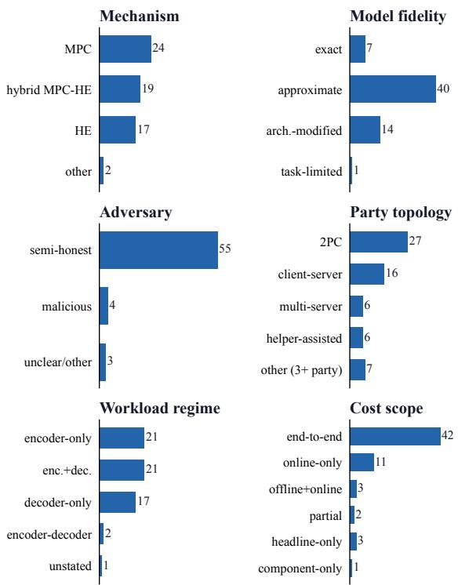  
count across the 62 audited papers (each panel sums to 62)  
Figure 9. Distribution of the 62 audited papers over the categorical PIC-card fields. The corpus is near-constant on the threat axes that rarely block comparison (55/62 semi-honest; 49/62 protect both input and model) but spreads across mechanism, model fidelity, party topology, and workload regime, the fields that carry the comparability gates. Long tails are consolidated: “other” under party topology aggregates five settings with three or more parties.

## A.2. Full Comparability Matrix

Figure 10 is the fully labeled version of the comparability graph summarized in Figure 5, with all 62 papers named on both axes so individual pairings can be traced.

## A.3. Blind Re-Extraction Agreement

Table 8 reports the per-field agreement between the recorded values and the independent blind re-extraction described in Section 4.

## A.4. PTI frontiers over the year

Table 10 summarizes the largest PTI systems (by parameter count) from 2022 through 2024. As shown, these milestone models differ substantially across their underlying cryptographic protocols, party topologies, model fidelity, and cost scopes.

## A.5. Robustness of the Findings

The three findings above rest on labels we assigned by hand, so we close by recomputing the central numbers under different labeling assumptions (Table 7, Appendix A). The locked setting gives 1/1891 competitive relations and 0/62 baseline-compatible primary claims, and the strict setting matches it. The optimistic setting waves every unknown gate through, and even then only 93/1891 relations turn competitive and only 2/62 claims become baseline-compatible. The reviewer-favorable upper bound, which stacks optimistic attribution, comparability, and baseline compatibility together, lands on the same 93/1891 and 2/62, with non-protocol primary factors still present in 40/62 papers. Drop the moderate- and boundary-confidence rows and 49 papers remain, telling the same story: 1/1891 competitive, 45/49 protocol-or-mixed, 31/49 non-protocolprimary. The conclusions do not ride on a single pessimistic call.

Put the three findings together and they say one thing: PTI progress is real, but the published evidence does not yet show cumulative progress toward deployment-scale private LLM inference. The frontier sits far below public LLM scale, comparability breaks at specific contract fields, the gains come from many sources at once, and none of it hinges on fragile labels. The next section steps past the published record: Section 7 puts the scaling gap in engineering units.

## Appendix B. Reliability of the Cost Projections

The production-scale figures in Section 7 are projections rather than measurements, so two checks tell us how far to trust them. First, the power-law form holds within the measured range: refit the SIGMA size series on its three smaller models (0.124–7B), predict the held-out 13B point, and you land within 7.7% on time, 2.5% on communication, and 5.3% on key size, with leave-oneout error never above 12%. Second, the qualitative gap survives whatever exponent we pick for the single-anchor rows. Sweep the structural exponent from sub-linear (0.8)

TABLE 7. SENSITIVITY ANALYSIS FOR THE TWO CENTRAL CONCLUSIONS: DIRECT GLOBAL LEADERBOARD-STYLE COMPARISON IS UNSUPPORTED UNDER PUBLISHED EVIDENCE, AND PROGRESS CLAIMS ARE MULTI-CAUSAL. Protocol/mixed COUNTS PAPERS WHOSE ATTRIBUTIONS INCLUDE PROTOCOL PROGRESS (AS PRIMARY OR SECONDARY FACTOR) OR WHOSE PRIMARY LABEL IS MIXED; non-protocol primary COUNTS PAPERS WHOSE PRIMARY LABEL IS ANY NON-PROTOCOL CATEGORY. THE REVIEWER-FAVORABLE ROW IS AN OPTIMISTIC UPPER BOUND, NOT THE LOCKED RESULT.
<table><tr><td>Scenario</td><td>Competitive relations</td><td>Baseline-compatible claims</td><td>Protocol/mixed</td><td>Non-protocol primary</td></tr><tr><td>Locked labels</td><td>1/1891</td><td>0/62</td><td>52/62</td><td>40/62</td></tr><tr><td>Optimistic progress attribution</td><td>1/1891</td><td>0/62</td><td>52/62</td><td>40/62</td></tr><tr><td>Strict progress attribution</td><td>1/1891</td><td>0/62</td><td>52/62</td><td>40/62</td></tr><tr><td>Optimistic comparability</td><td>93/1891</td><td>2/62</td><td>52/62</td><td>40/62</td></tr><tr><td>Strict comparability</td><td>1/1891</td><td>0/62</td><td>52/62</td><td>40/62</td></tr><tr><td>Drop moderate/boundary confidence</td><td>1/1891</td><td>0/62</td><td>45/49</td><td>31/49</td></tr><tr><td>Reviewer-favorable upper bound</td><td>93/1891</td><td>2/62</td><td>52/62</td><td>40/62</td></tr></table>

TABLE 8. PER-FIELD AGREEMENT OF THE INDEPENDENT BLIND RE-EXTRACTION WITH THE RECORDED HUMAN VALUES, OVER THE 62-PAPER CORPUS. Agree/Disagree ARE VALUE-VS-VALUE; V. silent IS WHERE THE BLIND READER DECLINED TO EXTRACT A VALUE THE HUMAN TOOK FROM CONTEXT (E.G., A PARAMETER COUNT IMPLIED BY A MODEL NAME); Both silent IS CONCORDANT AGREEMENT THAT THE PAPER STATES NOTHING; H. silent IS WHERE NO HUMAN VALUE WAS RECORDED (BOTH EXCLUDED FROM THE RATE). THE RATE IS

AGREE/(AGREE + DISAGREE + V. SILENT). THE FIELDS THE COMPARABILITY GATES LEAN ON MOST (CRYPTOGRAPHIC BACKBONE, PRIVACY SCOPE, ADVERSARY MODEL, END-TO-END STATUS) AGREE IN 87–98% OF PAPERS, WITH 70.0% RAW AGREEMENT POOLED ACROSS ALL FACTUAL FIELDS; LOWER RATES ARE DOMINATED BY VALUES THE BLIND READER DECLINES TO INFER AND BY CONCORDANT SILENCE. EVERY FLAGGED CELL WAS ADJUDICATED AGAINST THE SOURCE PAPERS; ACROSS THE TWO ADJUDICATION PASSES, 40 OF 992 FIELDS WERE CORRECTED CORPUS-WIDE. THE FINAL ROW IS THE JUDGMENT-LABEL INTER-RATER AGREEMENT, NOT A FACTUAL FIELD.
<table><tr><td>Contract field</td><td>Agree</td><td>Disagree</td><td>V. silent</td><td>Both silent</td><td>H. silent</td><td>Rate</td></tr><tr><td>Cryptographic backbone</td><td>61</td><td>1</td><td>0</td><td>0</td><td>0</td><td>98.4%</td></tr><tr><td>Inference regime</td><td>37</td><td>1</td><td>23</td><td>1</td><td>0</td><td>60.7%</td></tr><tr><td>Privacy scope</td><td>58</td><td>4</td><td>0</td><td>0</td><td>0</td><td>93.5%</td></tr><tr><td>Adversary model</td><td>54</td><td>2</td><td>6</td><td>0</td><td>0</td><td>87.1%</td></tr><tr><td>Party model</td><td>39</td><td>19</td><td>4</td><td>0</td><td>0</td><td>62.9%</td></tr><tr><td>Model fidelity</td><td>46</td><td>16</td><td>0</td><td>0</td><td>0</td><td>74.2%</td></tr><tr><td>Cost scope</td><td>38</td><td>20</td><td>4</td><td>0</td><td>0</td><td>61.3%</td></tr><tr><td>Amortization</td><td>12</td><td>7</td><td>0</td><td>43</td><td>0</td><td>63.2%</td></tr><tr><td>Network regime</td><td>26</td><td>9</td><td>7</td><td>20</td><td>0</td><td>61.9%</td></tr><tr><td>Largest private model</td><td>45</td><td>14</td><td>3</td><td>0</td><td>0</td><td>72.6%</td></tr><tr><td>Largest model, params (B)</td><td>22</td><td>8</td><td>32</td><td>0</td><td>0</td><td>35.5%</td></tr><tr><td>End-to-end status</td><td>54</td><td>8</td><td>0</td><td>0</td><td>0</td><td>87.1%</td></tr><tr><td>Latency reported</td><td>62</td><td>0</td><td>0</td><td>0</td><td>0</td><td>100.0%</td></tr><tr><td>Communication reported</td><td>42</td><td>20</td><td>0</td><td>0</td><td>0</td><td>67.7%</td></tr><tr><td>Rounds reported</td><td>10</td><td>52</td><td>0</td><td>0</td><td>0</td><td>16.1%</td></tr><tr><td>Progress attribution (label)</td><td>37</td><td>25</td><td>0</td><td>0</td><td>0</td><td>59.7%</td></tr></table>

to super-linear (1.2) and a projected 70B forward pass only moves between tens of minutes (3PC) and a few hours (hybrid 2PC), and a 405B pass between about an hour and a day. The multiplier shifts; the order of magnitude does not. They are still extrapolations, of course: 70B and 405B sit 5× and 31× past the largest model we measured, and no power law can see a regime change coming, a bootstrapping threshold crossed, a packing or ring-parameter switch, a memory ceiling. So we read the result as a statement about scale, three to five orders of magnitude away from plaintext, rather than as a specific predicted runtime.

## Appendix C.

## Field Extraction Protocol and Codebook

This appendix documents the structured field-extraction protocol behind the audit, included verbatim for reproducibility. The codebook below is the instrument the extractor works from: it lists the fields we attempt for each paper, organized into priority tiers, and the prompt spells out how each field is read off the source text. Extraction is evidence-first throughout: every recorded value is tied to an explicit statement in the source paper, and anything missing is recorded as missing rather than guessed at. Coverage therefore varies by field. The Tier-0 contract fields are recorded for every paper and carry the comparability, attribution, and scaling analyses; the quantitative performance tuples feed the cost model on its calibration subset (Section 7). Many Tier-1 and Tier-2 fields are only sporadically reported in the source papers, so they are frequently marked NOT REPORTED and are not used in this paper’s results.

## C.1. Quantitative Extraction Prompt

You are extracting quantitative performance metrics for a   
privacy-preserving Transformer inference paper.   
You will be provided:   
(1) The paper text   
(2) the Codebook -- Quantitative Performance Extraction (Raw Metrics)   
CRITICAL INSTRUCTIONS -- READ CAREFULLY:

5) Evidence requirements:   
a) For every non-missing RAW numeric or boolean field, you MUST   
include an entry in the "evidence" array.   
b) Each evidence entry MUST contain:   
- field\_path (must match the JSON hierarchy EXACTLY)   
- evidence\_quote (<=25 words)   
- evidence\_location (Table X / Fig Y / Sec Z / p.N)   
c) If a RAW numeric/boolean field lacks evidence, mark that field as   
NOT\_REPORTED (or the correct missing token).   
5.1) FIELD\_PATH STRICTNESS (MANDATORY):   
- The "field\_path" value in each evidence entry MUST exactly match the   
schema path.   
- Use dot notation that mirrors the JSON structure, for example:   
"Q0.1.model\_name"   
"Q0.3.e2e\_latency\_value"   
"Q1.5.num\_rounds"   
"Q2.3.code\_available"   
- Do NOT prefix with an extra level (e.g., NOT "Q0.Q0.1.model\_name").   
- Do NOT invent new paths.

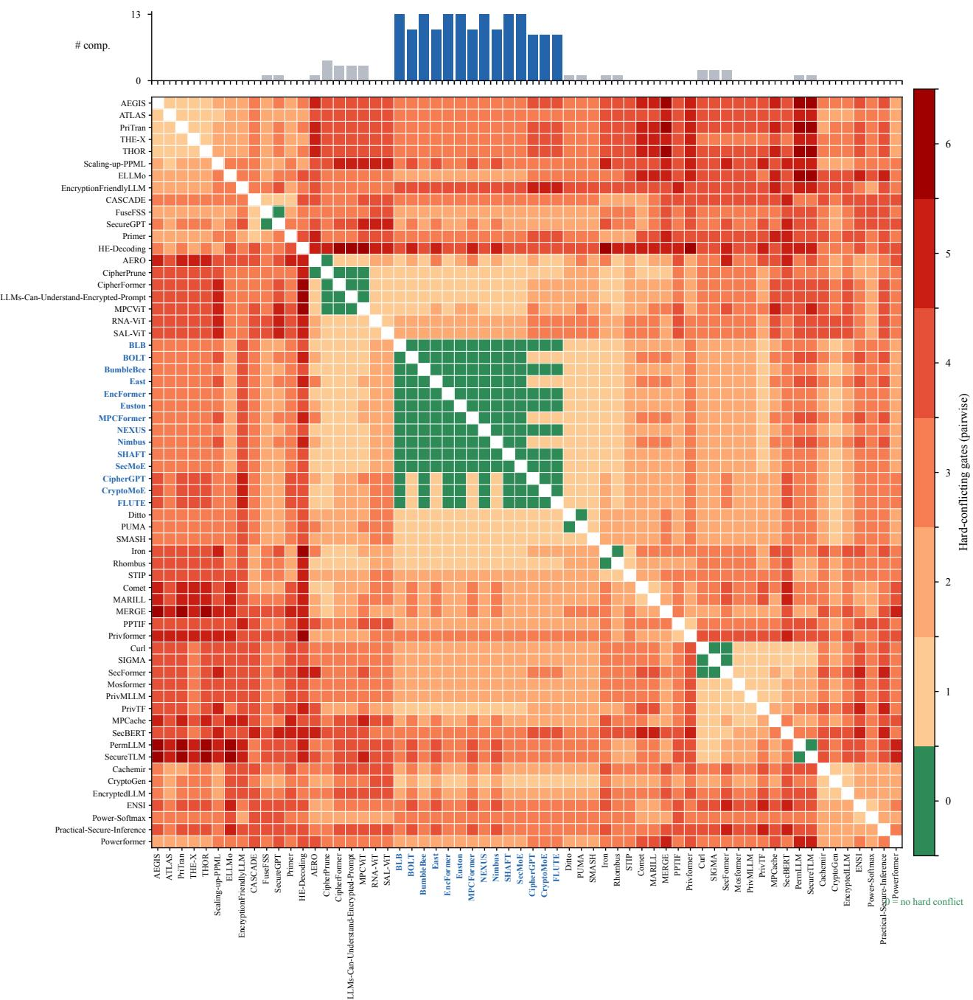

Figure 10. Full comparability graph with all 62 papers labeled. As in Figure 5, each cell shades a pair by the number of comparability gates that hard-conflict (green marks no hard conflict), with rows and columns ordered by agglomerative clustering and the top bar counting each paper’s hard-conflict-free partners (hub systems in blue).  
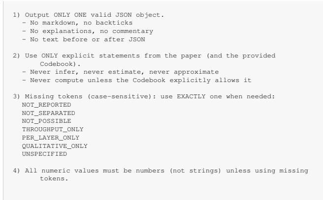

TABLE 9. PRESCRIPTIVE BACKBONE GUIDANCE UNDER THE CONTRACT VIEW (SECTION 8.5). THESE ARE COST-STRUCTURE TENDENCIESCONDITIONED ON THE DEPLOYMENT CONTRACT, NOT A UNIVERSAL RANKING: THE PREFERABLE BACKBONE IS THE ONE WHOSE COSTSTRUCTURE MATCHES THE DOMINANT CONSTRAINT, WHICH IS ALSO WHY A SINGLE SPEED LEADERBOARD MISLEADS.
<table><tr><td>Dominant deployment con- straint</td><td>Tends to favor</td><td>Why</td></tr><tr><td>Interactive, WAN / high round-trip time</td><td>Low-round HE or few-round hybrid</td><td>Each interaction round pays the round-trip, so round-heavy MPC inflates wall-clock latency even when its LAN numbers look strong.</td></tr><tr><td>Batch / high throughput, amortizable</td><td>HE with SIMD packing; amortized-offline hybrid</td><td>Ciphertext batching and reusable preprocessing amortize across many queries, where per-query latency is secondary. Cheap rounds make interactive protocols competitive or fastest;</td></tr><tr><td>LAN / high bandwidth, low round-trip time Bandwidth-constrained link</td><td>MPC or hybrid HE or low-communication</td><td>HE ciphertext and compute overhead rarely pays off here. MPC communication volume can dominate cost; HE trades bytes</td></tr><tr><td>Model weights must stay pri-</td><td>designs Input-and-model 2PC (HE</td><td>for local computation. Protecting weights is a hard constraint largely orthogonal to speed;</td></tr><tr><td>vate</td><td>or hybrid); avoid weight- revealing split or statistical schemes</td><td>some fast schemes assume public weights.</td></tr><tr><td>A non-colluding helper or third party is acceptable</td><td>3PC or helper-assisted MPC</td><td>A helper trusted for non-collusion unlocks cheaper nonlinear and truncation protocols.</td></tr></table>

TABLE 10. THE CONVENTIONAL CRYPTOGRAPHIC PTI FRONTIER OF FIGURE 8, ANNOTATED WITH EACH FRONTIER POINT’S EVALUATION CONTRACT. THE POINTS SPAN DIFFERENT PARTY MODELS (2PC, 3PC, HELPER-ASSISTED) AND COST SCOPES (END-TO-END, ONLINE-ONLY), SO THE CUMULATIVE ENVELOPE IS A GENEROUS UPPER BOUND OVER HETEROGENEOUS CONTRACTS, NOT A SINGLE COMPARABLE TRAJECTORY. TIGHTENING TO ONE FIXED CONTRACT COULD ONLY LOWER THE PRIVATE-INFERENCE FRONTIER.
<table><tr><td>Year</td><td>System</td><td>Params</td><td>Mechanism</td><td>Party model</td><td>Model fidelity</td><td>Cost scope</td></tr><tr><td>2022</td><td>Iron</td><td>0.34B</td><td>Hybrid MPC-HE</td><td>2PC</td><td>exact</td><td>end-to-end</td></tr><tr><td>2023</td><td>PUMA</td><td>7B</td><td>MPC</td><td>3PC</td><td>approximate</td><td>end-to-end</td></tr><tr><td>2024</td><td>SIGMA</td><td>13B</td><td>MPC</td><td>helper-assisted</td><td>approximate</td><td>online-only</td></tr></table>

- The field\_path must correspond exactly to an existing leaf field in   
the provided schema.   
- If you cannot match a field\_path exactly, mark the field as   
NOT\_REPORTED.   
6) Normalized fields policy:   
- normalized\_ fields may be filled ONLY if unit conversion is   
unambiguous.   
- Evidence is required for the RAW reported value.   
- A separate evidence entry for the normalized field is NOT required   
if the raw field is properly evidenced.   
7) Choose EXACTLY ONE primary evaluation setting using the Codebook’s   
selection rule.   
Provide:   
- setting\_label (short identifier, no spaces)   
- chosen\_setting\_rationale (1-2 lines referencing the selection rule)   
8) Strict completeness rule:   
- ALL fields in the schema MUST be present.   
- Do NOT remove or add fields.   
- Do NOT reorder structure.   
- Use null only where explicitly allowed in the schema.   
- Never leave a field empty.   
9) If you cannot produce valid JSON, output EXACTLY:   
{"error":"INVALID\_JSON"}   
Now extract according to the schema below.   
Return ALL fields exactly as structured.   
{   
"paper\_id": "<FILL>",   
"setting\_label": "<SHORT\_LABEL\_FOR\_SELECTED\_SETTING>",   
"chosen\_setting\_rationale": "<1-2 lines>",   
"Q0": {   
"Q0.1": {   
"model\_name": "UNSPECIFIED",   
"num\_parameters": "NOT\_REPORTED",   
"model\_type": "UNSPECIFIED"   
},   
"Q0.2": {   
"task\_type": "UNSPECIFIED",   
"sequence\_length": "NOT\_REPORTED",   
"batch\_size": "NOT\_REPORTED",   
"num\_generated\_tokens": "NOT\_REPORTED",   
"notes\_on\_setting": null   
},   
"Q0.3": {   
"e2e\_latency\_value": "NOT\_REPORTED",   
"e2e\_latency\_unit": "NOT\_REPORTED",   
"e2e\_latency\_granularity": "UNSPECIFIED",   
"includes\_offline": "NOT\_REPORTED",   
"normalized\_e2e\_latency\_ms": "NOT\_POSSIBLE"

```m4
},
"Q0.4": {
"total_comm_value": "NOT_REPORTED",
"total_comm_unit": "NOT_REPORTED",
"comm_direction": "NOT_REPORTED",
"normalized_total_comm_MB": "NOT_POSSIBLE"
},
"Q0.5": {
"network_type": "NotSpecified",
"bandwidth_value": "NOT_REPORTED",
"bandwidth_unit": "NOT_REPORTED",
"rtt_latency_ms": "NOT_REPORTED"
},
"Q0.6": {
"server_hardware": "NOT_REPORTED",
"client_hardware": "NOT_REPORTED",
"accelerator": "NotSpecified",
"deployment": "NotSpecified"
},
"Q0.x": {
"model_dependency": "NOT_REPORTED",
"phase_scope": "NOT_REPORTED",
"multi_client_scaling_evaluated": "NOT_REPORTED",
"comparability_limits_noted": "NOT_REPORTED",
"client_privacy_explicit": "NOT_REPORTED",
"server_privacy_explicit": "NOT_REPORTED"
}
},
"Q1": {
"Q1.1": {
"online_latency_value": "NOT_SEPARATED",
"online_latency_unit": "NOT_REPORTED",
"online_latency_granularity": "UNSPECIFIED"
},
"Q1.2": {
"offline_latency_value": "NOT_REPORTED",
"offline_latency_unit": "NOT_REPORTED",
"offline_amortized": "NOT_REPORTED"
},
"Q1.3": {
"server_compute_time_value": "NOT_SEPARATED",
"server_compute_time_unit": "NOT_REPORTED"
},
"Q1.4": {
"client_compute_time_value": "NOT_SEPARATED",
"client_compute_time_unit": "NOT_REPORTED"
},
"Q1.5": {
"num_rounds": "NOT_REPORTED",
"num_messages": "NOT_REPORTED"
},
"Q1.6": {
"peak_server_memory_value": "NOT_REPORTED",
"peak_server_memory_unit": "NOT_REPORTED",
```

Tier-1 (high-value diagnostics; attempt if available)   
Q1.1 -- Online Latency   
- online\_latency\_value, online\_latency\_unit, online\_latency\_granularity

"peak\_client\_memory\_value": "NOT\_REPORTED",   
" eak\_client\_memor \_unit": "NOT\_REPORTED"   
},   
"Q1.7": {   
"throughput\_value": "NOT\_REPORTED",   
"throughput\_unit": "NOT\_REPORTED",   
"throughput\_setting": null   
},   
"Q1.8": {   
"utility\_metric\_name": "NOT\_REPORTED",   
"utility\_value": "NOT\_REPORTED",   
"utility\_unit": "NOT\_REPORTED",   
"utility\_task\_or\_dataset": "NOT\_REPORTED",   
"delta\_vs\_plaintext\_value": "NOT\_REPORTED",   
"delta\_unit": "NOT\_REPORTED"   
}   
},   
"Q2": {   
"Q2.1": {   
"num\_bootstraps": "NOT\_REPORTED",   
"multiplicative\_depth": "NOT\_REPORTED",   
"num\_ci hertext\_mults": "NOT\_REPORTED",   
"ciphertext\_size\_bytes": "NOT\_REPORTED"   
},   
"Q2.2": {   
"runtime\_cost\_usd": "NOT\_REPORTED",   
"pricing\_context": "NOT\_REPORTED"   
},   
"Q2.3": {   
"code\_available": "unknown",   
"artifact\_link": "NOT\_REPORTED",   
"runnable\_claim": "unknown"   
}   
},   
"extraction\_warnings": [],   
"evidence": []

## C.2. Quantitative Performance Extraction Codebook

the Codebook -- Quantitative Performance Extraction (Raw Metrics)   
Scope: Transformer private inference systems (end-to-end or near   
end-to-end).   
Strict rule: Use only explicitly stated numbers/claims. Never infer. If   
missing -> NOT\_REPORTED.   
Global extraction rules   
1. Primary setting selection rule (when multiple settings exist):   
o Prefer end-to-end over microbenchmarks.   
o Prefer largest model evaluated.   
o Prefer WAN setting over LAN if both are given.   
o Prefer main headline benchmark used in the paper’s abstract/intro/eval   
summary.   
2. Units: Store as reported in raw fields + also store a normalized\_   
field when conversion is unambiguous (e.g., s->ms, GB->MB).   
3. Evidence required: every non-missing (i.e., not   
NOT\_REPORTED/NOT\_SEPARATED/etc.) numeric/boolean field must   
include evidence\_quote and evidence\_location.   
4. If model name implies standard parameter count (e.g., ‘‘BERT-base’’,   
‘‘LLaMA-7B’’), you may fill num\_parameters using the canonical   
model size only if the paper explicitly uses that model name, and   
include evidence pointing to the model name.

Tier-0 (must attempt)   
Q0.1 -- Model Architecture   
Extract fields   
model\_name (string | UNSPECIFIED)   
num\_parameters (integer | NOT\_REPORTED)   
model\_type in {Encoder, Decoder, Encoder-Decoder, VisionTransformer,   
Other, UNSPECIFIED}   
Q0.2 -- Workload / Input Configuration   
task\_type in {NLP\_classification, LLM\_generation, Vision, Other,   
UNSPECIFIED}   
sequence\_length (int | NOT\_REPORTED)   
batch\_size (int | NOT\_REPORTED)   
num\_generated\_tokens (int | NOT\_REPORTED) only if generation   
notes\_on\_setting (short string | null)   
Q0.3 -- End-to-End Latency (primary)   
Definition: total time per inference query/batch including crypto   
operations.   
e2e\_latency\_value (number | THROUGHPUT\_ONLY | NOT\_REPORTED)   
e2e\_latency\_unit in {ms, s, us, min, NOT\_REPORTED}   
e2e\_latency\_granularity in {per\_query, per\_batch, per\_token,   
UNSPECIFIED}   
includes\_offline in {yes, no, unclear, NOT\_REPORTED}   
normalized\_e2e\_latency\_ms (number | NOT\_POSSIBLE)   
Q0.4 -- Total Communication (end-to-end)   
total\_comm\_value (number | PER\_LAYER\_ONLY | NOT\_REPORTED)   
total\_comm\_unit in {B, KB, MB, GB, NOT\_REPORTED}   
comm\_direction in {bidirectional\_total, client\_to\_server\_only,   
server\_to\_client\_only, unknown, NOT\_REPORTED}   
normalized\_total\_comm\_MB (number | NOT\_POSSIBLE)   
Q0.5 -- Network Setting   
network\_type in {LAN, WAN, Simulated, NotSpecified}   
bandwidth\_value (number | NOT\_REPORTED)   
- bandwidth\_unit in {Mbps, Gbps, NOT\_REPORTED}   
rtt\_latency\_ms (number | NOT\_REPORTED)   
Q0.6 -- Hardware Configuration   
server\_hardware (string | NOT\_REPORTED)   
client\_hardware (string | NOT\_REPORTED)   
accelerator in {CPU, GPU, TPU, Mixed, NotSpecified}   
deployment in {Cloud, Local, NotSpecified}

- If not separated -> NOT\_SEPARATED   
Q1.2 -- Offline / Preprocessing Latency   
- offline\_latency\_value, offline\_latency\_unit   
- offline\_amortized in {yes, no, unclear, NOT\_REPORTED}   
Q1.3 -- Server Compute Time   
- server\_compute\_time\_value, unit   
- If not separated -> NOT\_SEPARATED   
Q1.4 -- Client Compute Time   
client\_compute\_time\_value, unit   
- If not separated -> NOT\_SEPARATED   
Q1.5 -- Interaction Depth   
- num\_rounds (int | NOT\_REPORTED)   
- num\_messages (int | NOT\_REPORTED)   
Q1.6 -- Peak Memory Usage   
- peak\_server\_memory\_value, unit in {MB, GB, NOT\_REPORTED}   
- peak\_client\_memory\_value, unit in {MB, GB, NOT\_REPORTED}   
Q1.7 -- Throughput (if reported)   
- throu h ut\_value (number | NOT\_REPORTED)   
throughput\_unit in {queries\_per\_s, tokens\_per\_s, seq\_per\_s, img\_per\_s,   
NOT\_REPORTED}   
- throughput\_setting (string | null)   
Q1.8 -- Utility / Accuracy (if evaluated)   
utility\_metric\_name (string | NOT\_REPORTED)   
utility\_value (number | NOT\_REPORTED)   
utility\_unit (string | NOT\_REPORTED) (e.g., %, ppl)   
utility\_task\_or\_dataset (string | NOT\_REPORTED)   
delta\_vs\_plaintext\_value (number | NOT\_REPORTED)   
delta\_unit in {pp, absolute, relative\_percent, NOT\_REPORTED}   
Tier-2 (optional / sparse / crypto-primitive-level)   
Q2.1 -- Crypto primitive counts / depths (only if explicitly numeric)   
- num\_bootstraps, multiplicative\_depth, num\_ciphertext\_mults,   
- If described qualitatively only -> QUALITATIVE\_ONLY   
Q2.2 -- Monetary cost (only if explicit)   
- runtime\_cost\_usd (number | NOT\_REPORTED)   
- pricing\_context (string | NOT\_REPORTED)   
Q2.3 -- Reproducibility metadata (quantifiable)   
- code\_available in {yes, no, partial, unknown}   
artifact\_link (string | NOT\_REPORTED)   
runnable\_claim in {docker, scripts, not\_specified, unknown}   
Standard output JSON skeleton (one paper)   
"paper\_id": "STRING",   
"chosen\_setting\_rationale": "1-2 lines citing the selection rule used",   
"Q0": { / includes Q0.1-Q0.6 and Q0.x / },   
"Q1": { },   
"Q2": { },   
"extraction\_warnings": ["..."],   
"evidence": [   
"field\_path": "Q0.3.e2e\_latency\_value",   
"evidence\_quote": "<=25 words",   
"evidence\_location": "Table X / Fig Y / Sec Z / p.N"   
Q0.x -- Technical synthesis tags (Pass A)   
These fields are added to support technical (not just clarity) findings   
and cross-paper synthesis. They are intentionally simple and   
evidence-first: if not explicitly stated, mark NOT\_REPORTED.   
New categorical fields (Pass A)   
- model\_dependency: {MODEL\_SPECIFIC, ARCHITECTURE\_SPECIFIC,   
MODEL\_AGNOSTIC, NOT\_REPORTED}   
phase\_scope: {INFERENCE\_ONLY, TRAINING\_ONLY, BOTH, NOT\_REPORTED}   
multi\_client\_scaling\_evaluated: {yes, no, NOT\_REPORTED}   
comparability\_limits\_noted: short free-text (1 sentence) or   
NOT\_REPORTED   
client\_privacy\_explicit: {yes, no, unclear, NOT\_REPORTED}   
server\_privacy\_explicit: {yes, no, unclear, NOT\_REPORTED}   
Notes: (i) MODEL\_AGNOSTIC means the protocol is described as applicable   
to multiple model families without retraining or per-architecture   
retooling; (ii) ARCHITECTURE\_SPECIFIC means it targets a class   
(e.g., Transformers, CNNs) but not a single named model; (iii)   
MODEL\_SPECIFIC means the technique/evaluation is tied to a   
specific model instance (e.g., BERT-base) or requires   
model-specific engineering.

## Appendix D. Audit Case Studies

This section walks through four comparison patterns that turn up again and again in the corpus, and shows how the gates change the reading of each. The patterns are schematic on purpose; they are not meant to call out individual papers. Each one starts from a comparison that looks perfectly natural at the headline level, and then shows what the restored contract has to say about it. Table 11 gathers all four.

Two of these patterns carry a wider lesson. The encoderversus-decoder pattern is why the taxonomy in Table 2 cannot settle comparability on its own: the taxonomy tells you two systems live in the same design space, while the gates tell you whether their claims answer the same question. The fidelity pattern is the bridge from comparability to attribution. Modifying a model may well be the right way to make private inference practical, but the paper has to name that gain as fidelity-shift progress. Otherwise a reader chalks the whole speedup up to cryptographic protocol progress, and the literature ends up recording a protocol advance the evidence never showed.

TABLE 11. FOUR RECURRING COMPARISON PATTERNS AND THEIR CONTRACT READING. EACH LOOKS LIKE A DIRECT COMPARISON AT THE HEADLINE LEVEL; THE GATES IDENTIFY THE MISMATCHED OR MISSING FIELD THAT MAKES IT DESCRIPTIVE OR INVALID.
<table><tr><td>Pattern</td><td></td><td>Why it looks comparable</td><td>Contract issue</td><td>Gate</td><td>Sound reading</td></tr><tr><td>end-to-end cost</td><td></td><td>Online latency vs. Both report private-inference latency.</td><td>One number is online-only or amortized; the other counts more of the end-to-end cost or assumes different reuse.</td><td>G5, G6</td><td>Not directly comparable un- less cost scope and reuse as- sumptions are aligned.</td></tr><tr><td>LAN WAN claim</td><td>result</td><td>vs. Both report latency for the same broad model family.</td><td>The measurement is LAN, sim- G7, G8 ulated, or unspecified while the motivating deployment is WAN-like; rounds convert round-trip time into wall-clock cost.</td><td></td><td>Supports a LAN or local- deployment claim, not an un- restricted WAN claim.</td></tr><tr><td>eration</td><td></td><td>Encoder classifica- Both are Transformer systems tion vs. decoder gen- built on secure-computation and in sequence/generation se- G4) primitives.</td><td>The workloads differ in regime G3 mantics (per-token vs. per- sequence vs. per-batch).</td><td>(often</td><td>Different comparison neigh- borhoods unless workload and fidelity are normalized.</td></tr><tr><td>Model-preserving vs. model-modifying family or benchmark.</td><td></td><td>Both target the same model</td><td>The faster result depends G4 on approximation, retraining, pruning, distillation, quantiza- tion, or architecture change.</td><td></td><td>Possibly workload/fidelity- shift progress; not pure protocol progress.</td></tr></table>

In every one of these patterns, the failure is not that a paper measured the wrong thing. It happens at comparison time, the moment a reader folds two numbers measured under different contracts into a single ranking. What the gates do is make that step visible, and auditable.