# A Large-Dimensional Analysis of Least-Squares Federated Learning via Generalized Total Variation Minimization

Ekkehard Schnoor Aalto University Espoo, Finland

Malik Tiomoko Huawei Noah’s Ark Lab Paris, France

Alexander Jung Aalto University Espoo, Finland

## Abstract

Federated learning over decentralized networks inherently trades of the suppression of local finite-sample noise through collaboration against the bias that collaboration introduces between heterogeneous nodes. We study this tension by performing a largedimensional analysis of Generalized Total Variation Minimization with least-squares models. Using tools from random matrix theory, we show that Lipschitz observations of the global GTVMin solution concentrate in large dimensions, universally for any underlying network structure. We provide exact analytic expressions for the asymptotically precise performance under both i.i.d. and non-i.i.d. Gaussian mixture distributions on a fixed network. For the latter, these expressions quantify how regularization balances local adaptation against collaboration. Our theoretical results are confirmed by experi ments on synthetic and real-world data.

## 1 Introduction

Federated learning (FL) trains models across many nodes that keep their data locally and only exchange model parameters over a communication network (McMahan et al., 2017; Kairouz et al., 2021). If the nodes are statistically homogeneous (i.i.d.), the natural goal is to recover the model that would be obtained by pooling all data. In practice, however, nodes are usually heterogeneous (non-i.i.d.). A single global model may then be misspecified for individual nodes, and one has to balance local adaptation against collaboration (Cheng et al., 2023).

Generalized Total Variation Minimization (GTVMin) formulates this trade-of on a graph (Jung, 2025). At

each node, a local model is trained, and a graph-Laplacian strength penalty with a regularization parameter $\alpha \geq 0$ encourages connected nodes to learn similar models. For $\alpha \ = \ 0$ , every local model is trained separately. As $\alpha \  \ \infty .$ , the models on a connected graph reach consensus, $i . e .$ , they share the same model. Intermediate values of α give personalized models. However, it is not well understood how the generalization error depends on $\alpha ,$ on the graph, and on the diferences between the local data distributions. We answer this question for least-squares models in the high-dimensional regime, where the feature dimension p and the local sample sizes $n _ { i }$ grow proportionally while the number of nodes $N$ is fixed. Our analysis relies on the concentration of measures and deterministic equivalents from random matrix theory (RMT) (Couillet and Liao, 2022). Our main contributions are as follows.

• We show that the GTVMin solution concentrates, independently of the collaboration strength and the graph, including growing networks (Section 3.1).

• We derive each node’s asymptotically precise test error for both homogeneous and heterogeneous Gaussian data (Sections 3.3 and 3.4).

• We validate the predictions on synthetic data and 55 real-data settings, and use the theory to tune α from training data (Section 4).

Related work. A common approach regularizes local models toward a global anchor, as in the global/local mixture of Hanzely and Richt´arik (2020), pFedMe (Dinh et al., 2020) and Ditto (Li et al., 2021). Optimal optimization rates for such objectives are given by Hanzely et al. (2020). Other approaches use meta-learning (Fallah et al., 2020), shared representations (Collins et al., 2021), clustering (Sattler et al., 2021; Ghosh et al., 2020), mixtures of distributions (Marfoq et al., 2021), or model interpolation (Mansour et al., 2020); see Tan et al. (2022) for a survey.

Coupling task-specific models through a similarity penalty goes back to regularized multi-task learning (Evgeniou and Pontil, 2004) and its federated version (Smith et al., 2017). Graph-Laplacian and total-variation penalties appear in the network Lasso (Hallac et al., 2015) and in decentralized collaborative learning of personalized models (Vanhaesebrouck et al., 2017; Zantedeschi et al., 2020). GTVMin (Jung, 2025) includes these formulations. Decentralized optimization for a single shared model is studied, e.g., by Lian et al. (2017) and Koloskova et al. (2020). These works focus on algorithms and convergence. We instead characterize the statistical performance along the entire regularization path.

Deterministic equivalents and concentration of measure are standard tools for the exact analysis of ridge regression and classification (Dobriban and Wager, 2018; Hastie et al., 2022) and of Gaussian-mixture classifiers (Mai and Liao, 2019; Liao and Couillet, 2019; Loureiro et al., 2021). Tiomoko et al. (2021) use them to analyze multi-task least-squares classifiers. Closest to our setting are analyses of distributed least squares by one-shot and iterative parameter averaging (Zhang et al., 2013; Rosenblatt and Nadler, 2016; Dobriban and Sheng, 2021, 2020), and of federated estimators (Cheng et al., 2023). Compared with these works, we analyze an arbitrary communication graph and a continuum of collaboration strengths. The graph enters through node-resolved resolvent blocks and, under suitable symmetry, through the Laplacian spectrum.

## 2 Setup and Assumptions

We introduce GTVMin in Section 2.1, distinguish homogeneous and heterogeneous data in Section 2.2, and specify the data model and asymptotic assumptions in Section 2.3.

## 2.1 Generalized Total Variation

Consider an FL network modeled as an undirected weighted graph $\mathcal { G } ~ = ~ ( \nu , \mathcal { E } )$ with the node set $\nu =$ $\{ 1 , \ldots , N \}$ and the edge set E of unordered pairs of distinct nodes. Each node $i \in \mathcal V$ represents a device (or client) with a local dataset $( \mathbf { X } ^ { ( i ) } , \mathbf { y } ^ { ( i ) } )$ of size $n _ { i }$ with a feature matrix $\mathbf { X } ^ { ( i ) } \in \mathbb { R } ^ { p \times n _ { i } }$ and a label vector $\mathbf { y } ^ { ( i ) } \in \mathbb { R } ^ { n _ { i } }$ (with shared dimension $p )$ , a local linear hypothesis $\dot { h ^ { ( i ) } } ( \mathbf { x } ) = \mathbf { x } ^ { \top } \mathbf { w } ^ { ( i ) }$ with the local parameters $\mathbf { w } ^ { ( i ) } \in \mathbb { R } ^ { p }$ and a local loss

$$
L ^ { ( i ) } \left( { \bf w } ^ { ( i ) } \right) = \frac { 1 } { 2 n _ { i } } \left\| { \bf X } ^ { ( i ) \top } { \bf w } ^ { ( i ) } - { \bf y } ^ { ( i ) } \right\| _ { 2 } ^ { 2 }\tag{1}
$$

An edge $\{ i , i ^ { \prime } \} \ \in \mathcal { E } , \ i \ \ne \ i ^ { \prime }$ , has a weight $A _ { i , i ^ { \prime } } =$ $A _ { i ^ { \prime } , i } > 0$ , encoding (assumed) statistical similarity between the nodes i and $i ^ { \prime } ,$ and motivating the preference $\mathbf { w } ^ { ( i ) } \approx \mathbf { w } ^ { ( i ^ { \prime } ) }$ . We set $A _ { i , i } = 0$ and $A _ { i , i ^ { \prime } } = 0$ for $\{ i , i ^ { \prime } \} \not \in { \mathcal { E } }$ . All N local parameter vectors $\mathbf { w } ^ { ( i ) } \in \mathbb { R } ^ { p }$ are “stacked” into one global weight vector $\mathbf { w } \in \mathbb { R } ^ { N p }$ 2

$$
\mathbf { w } = \mathrm { s t a c k } \left\{ \mathbf { w } ^ { ( i ) } \right\} _ { i = 1 } ^ { N } : = \left[ \mathbf { w } ^ { ( 1 ) \top } , \ldots , \mathbf { w } ^ { ( N ) \top } \right] ^ { \top } .\tag{2}
$$

Similarly we stack targets $\mathbf { y } = \mathrm { s t a c k } \{ \mathbf { y } ^ { ( i ) } \} _ { i = 1 } ^ { N } \in \mathbb { R } ^ { n _ { \mathrm { t o t } } }$ and $\mathbf { X } : = \left\lceil \mathbf { X } ^ { ( 1 ) } , \ldots , \mathbf { \check { X } } ^ { ( N ) } \right\rceil \in \mathbb { R } ^ { p \times n _ { \mathrm { t o t } } }$ (where $n _ { \mathrm { t o t } } : =$ $\textstyle \sum _ { i = 1 } ^ { N } n _ { i } )$ is the global data matrix obtained by horizontally concatenating all the local feature matrices. The weighted graph Laplacian $\mathbf { L } ^ { \left( \mathcal { G } \right) } \in \mathbb { R } ^ { N \times N }$ of $\mathcal { G }$ is

$$
\mathbf { L } _ { i , i ^ { \prime } } ^ { ( \mathcal { G } ) } = \left\{ \begin{array} { l l } { - A _ { i , i ^ { \prime } } , } & { \{ i , i ^ { \prime } \} \in \mathcal { E } , } \\ { \sum _ { i ^ { \prime \prime } = 1 } ^ { N } A _ { i , i ^ { \prime \prime } } , } & { i ^ { \prime } = i , } \\ { \phantom { - } _ { i ^ { \prime \prime } \neq i } \qquad } \\ { 0 , } & { \mathrm { o t h e r w i s e } . } \end{array} \right.\tag{3}
$$

Note $\mathbf { L } ^ { \left( \mathcal { G } \right) }$ is a symmetric positive-semidefinite matrix with eigenvalues $0 = \lambda _ { 1 } \leq \lambda _ { 2 } \leq \cdot \cdot \cdot \leq \lambda _ { N }$ . The stacked vector stack $\{ \mathbf { c } \} _ { i = 1 } ^ { N } = \mathbf { 1 } _ { N } \otimes \mathbf { c } \ ( \mathrm { a n y } \ \mathbf { c } \in \mathbb { R } ^ { p } \setminus \{ \mathbf { 0 } \} )$ is an eigenvector of $\mathbf { L } ^ { \left( \mathcal { G } \right) } \otimes \mathbf { I } _ { p }$ with eigenvalue 0, where ⊗ is the Kronecker product. The Laplacian relates to the pairwise discrepancy as follows (Jung, 2025, eq. (41)),

$$
\mathbf { w } ^ { \top } \left( \mathbf { L } ^ { ( \mathcal { G } ) } \otimes \mathbf { I } _ { p } \right) \mathbf { w } = \sum _ { \left\{ i , i ^ { \prime } \right\} \in \mathcal { E } } A _ { i , i ^ { \prime } } \left. \mathbf { w } ^ { ( i ) } - \mathbf { w } ^ { ( i ^ { \prime } ) } \right. _ { 2 } ^ { 2 }\tag{4}
$$

$$
= \mathrm { G T V } \left( \mathrm { s t a c k } \left\{ \mathbf { w } ^ { ( i ) } \right\} _ { i = 1 } ^ { N } \right) .\tag{5}
$$

This is the generalized total variation (GTV) of the local parameters across the network ${ \mathcal { G } } .$ Combining local losses (1) and the penalty (5) leads to the objective

$$
\sum _ { i \in \mathcal { V } } L ^ { ( i ) } \left( \mathbf { w } ^ { ( i ) } \right) + \alpha \mathbf { w } ^ { \top } \left( \mathbf { L } ^ { ( \mathcal { G } ) } \otimes \mathbf { I } _ { p } \right) \mathbf { w }\tag{6}
$$

Ignoring terms that do not depend on w and thus are irrelevant for optimization, define the (training) loss

$$
\begin{array} { r } { L ( \mathbf { w } ) = \frac { 1 } { 2 } \mathbf { w } ^ { \top } \mathbf { B } \mathbf { w } - \mathbf { b } ^ { \top } \mathbf { w } + \alpha \mathbf { w } ^ { \top } \left( \mathbf { L } ^ { ( \mathcal { G } ) } \otimes \mathbf { I } _ { p } \right) \mathbf { w } , } \end{array}\tag{7}
$$

where $\alpha \geq 0$ . The block-diagonal matrix $\mathbf { B } \in \mathbb { R } ^ { N p \times N p }$ and the stacked vector $\mathbf { b } \in \mathbb { R } ^ { N p }$ are given by

$$
\begin{array} { r } { \mathbf { B } = \mathrm { b l o c k d i a g } \left( \frac { 1 } { n _ { i } } \mathbf { X } ^ { ( i ) } \mathbf { X } ^ { ( i ) \top } \right) _ { i = 1 } ^ { N } \in \mathbb { R } ^ { N p \times N p } , } \end{array}\tag{8}
$$

$$
\begin{array} { r } { \mathbf { b } = \operatorname { s t a c k } \left\{ \frac { 1 } { n _ { i } } \mathbf { X } ^ { ( i ) } \mathbf { y } ^ { ( i ) } \right\} _ { i = 1 } ^ { N } \in \mathbb { R } ^ { N p } . } \end{array}\tag{9}
$$

We denote the ith diagonal block of B by $\mathbf { B } ^ { ( i ) }$ and the ith block of b by $\mathbf { b } ^ { ( i ) } , i . e .$

$$
\begin{array} { r } { \mathbf { B } ^ { ( i ) } = \frac { 1 } { n _ { i } } \mathbf { X } ^ { ( i ) } \mathbf { X } ^ { ( i ) \top } \mathbf { \Phi } \in \mathbb { R } ^ { p \times p } , } \end{array}\tag{10}
$$

$$
\begin{array} { r } { \mathbf b ^ { ( i ) } = \frac { 1 } { n _ { i } } \mathbf { X } ^ { ( i ) } \mathbf { y } ^ { ( i ) } \in \mathbb { R } ^ { p } . } \end{array}\tag{11}
$$

Our goal is to solve the quadratic objective in $( 7 ) , i . e .$

$$
\widehat { \mathbf { w } } \in \underset { \mathbf { w } \in \mathbb { R } ^ { N p } } { \arg \operatorname* { m i n } } L ( \mathbf { w } ) .\tag{12}
$$

It is straightforward to compute the gradient of the global loss L from (7), which is obtained as follows by

$$
\nabla L ( \mathbf { w } ) = \mathbf { H } \mathbf { w } - \mathbf { b } ,\tag{13}
$$

where the global positive-semi-definite Hessian H is

$$
\mathbf { H } = \mathbf { B } + 2 \alpha \left( \mathbf { L } ^ { \left( \mathcal { G } \right) } \otimes \mathbf { I } _ { p } \right) \mathbf { \Psi } \in \mathbb { R } ^ { N p \times N p } .\tag{14}
$$

Stationary points are given by zero-gradient condition

$$
\nabla L ( \widehat { \mathbf { w } } ) = \mathbf { 0 } \quad \Longleftrightarrow \quad \mathbf { H } \widehat { \mathbf { w } } = \mathbf { b } ,\tag{15}
$$

and, if H is invertible, we obtain the unique solution $\widehat { \mathbf { w } } = \mathbf { H } ^ { - 1 } \mathbf { b }$ . The block-diagonal matrix B collects the empirical second-moment matrices appearing in the local linear regression, and $2 \alpha ( \mathbf { L } ^ { \left( \mathcal { G } \right) } \otimes \bar { \mathbf { I } } _ { p } )$ couples them across the edges of $\mathcal { G }$ . When $\alpha = 0$ , then H decouples and (15) reduces to N independent local regressions $\begin{array} { r } { \frac { 1 } { n _ { i } } \dot { \bf X } ^ { ( i ) } { \bf X } ^ { ( i ) \top } { \bf w } ^ { ( i ) } = \frac { 1 } { n _ { i } } { \bf X } ^ { ( i ) } { \bf y } ^ { ( i ) } } \end{array}$ . As computing the inverse ${ \bf H } ^ { - 1 }$ is computationally expensive, we may employ gradient-based optimization. For a step size $\tau > 0$ , define the fixed-point operator $\Psi : \mathbb { R } ^ { N p }  \overline { { \mathbb { R } ^ { N p } } }$

$$
\begin{array} { r } { \Psi ( \mathbf { X } , \mathbf { y } ) ( \mathbf { w } ) = \mathbf { w } - \tau \nabla L ( \mathbf { w } ) \quad \quad } \\ { = \left( \mathbf { I } _ { N p } - \tau \mathbf { H } \right) \mathbf { w } + \tau \mathbf { b } . } \end{array}\tag{16}
$$

By the fixed-point formulation (Jung, 2017), any solu tion $\widehat { \mathbf { w } }$ of (15) is a fixed point, $i . e . , \Psi ( \mathbf { X } , \mathbf { y } ) ( \widehat { \mathbf { w } } ) = \widehat { \mathbf { w } }$ Our notation emphasizes the dependency on the random data $( \mathbf { X } , \mathbf { y } )$ (making $\Psi ( \bar { \mathbf { X } , \mathbf { y } } ) : \mathbb { R } ^ { \bar { N } p }  \mathbb { R } ^ { N p }$ a random function), and below we investigate when the fixed-point iteration

$$
\mathbf { w } _ { t + 1 } = \boldsymbol { \Psi } ( \mathbf { X } , \mathbf { y } ) ( \mathbf { w } _ { t } ) = \mathbf { w } _ { t } - \tau \left( \mathbf { H } \mathbf { w } _ { t } - \mathbf { b } \right)\tag{17}
$$

converges to the solution $\widehat { \textbf { w } } = \mathbf { H } ^ { - 1 } \mathbf { b }$ . If $\textbf { H } \succ \textbf { 0 }$ and $0 \ < \ \tau \ < \ 2 / \lambda _ { \mathrm { m a x } } ( \mathbf { H } )$ , its contraction factor is $\| { \mathbf { I } _ { N p } } - \tau { \mathbf { H } } \| _ { 2  2 } < 1$ , and convergence holds from every initialization. Unrolling block by block, (17) reads as

$$
\begin{array} { r } { \mathbf { w } _ { t + 1 } ^ { ( i ) } = \mathbf { w } _ { t } ^ { ( i ) } - \tau \Big [ \frac { 1 } { n _ { i } } \mathbf { X } ^ { ( i ) } \left( \mathbf { X } ^ { ( i ) \top } \mathbf { w } _ { t } ^ { ( i ) } - \mathbf { y } ^ { ( i ) } \right) } \end{array}\tag{18}
$$

$$
+ 2 \alpha \sum _ { i ^ { \prime } = 1 } ^ { N } A _ { i , i ^ { \prime } } \left( \mathbf { w } _ { t } ^ { ( i ) } - \mathbf { w } _ { t } ^ { ( i ^ { \prime } ) } \right) \bigg ] .\tag{19}
$$

Each node thus performs the same gradient step as in the local linear regression case (the first summand in the update), plus a weighted pull towards its graph neighbors (the second term in the update).

## 2.2 The i.i.d. and non-i.i.d. regimes

The GTVMin penalty $\alpha \geq 0$ in (7) controls the degree of collaboration between the nodes, and the optimal choice of α depends on the similarity of their datagenerating processes. We distinguish between the following scenarios, the i.i.d. and the non-i.i.d. regimes.

Homogeneous data (i.i.d.). All nodes share one distribution, so their population minimizers coincide: collaboration adds no population-model mismatch and suppresses finite-sample noise. Under our model with equal sample sizes and a connected graph, the asymptotic optimum is thus $\alpha \to \infty$ , recovering pooled least squares over all $n _ { \mathrm { t o t } }$ samples.

Heterogeneous data (non-i.i.d.). The local distributions difer, so a single consensus model need not be optimal: collaboration can suppress noise but drag each model toward an incorrect shared solution. The optimal α balances collaboration against personalization; Section 3.4 quantifies this tradeof without assuming an interior or unique optimum.

Consensus. On a connected graph $\mathcal { G }$ with positivedefinite local second-moment matrices $\mathbf { B } ^ { ( i ) }$ from (10), the consensus limit as $\alpha \to \infty$ is given by

$$
\left( \sum _ { i = 1 } ^ { N } \mathbf { B } ^ { ( i ) } \right) ^ { - 1 } \sum _ { i = 1 } ^ { N } \mathbf { b } ^ { ( i ) } .\tag{20}
$$

For unequal sample sizes this minimizes the equally weighted sum of node losses, as specified in (7); for equal sample sizes it is pooled least squares.

## 2.3 Data Model and Assumptions

We make the following assumption on the data distribution. At node i, labels $y \in \{ - 1 , + 1 \}$ and features follow the Gaussian mixture model

$$
\begin{array} { r } { \mathbf { x } \mid y \sim \mathcal { N } \left( y \pmb { \mu } ^ { ( i ) } , \pmb { \Sigma } ^ { ( i ) } \right) , \quad \quad i = 1 , \ldots , N , } \end{array}\tag{21}
$$

with local means $\pmb { \mu } ^ { ( i ) } \in \mathbb { R } ^ { p }$ and covariances $\pmb { \Sigma } ^ { ( i ) } \in$ Rp×p. The class sizes are arbitrary and may difer across nodes. Training data are independent within and across nodes, and the test data is independent of the training data. Since $y ^ { 2 } = 1$ , the squared residual $( \mathbf { x } ^ { \top } \mathbf { w } - y ) ^ { 2 }$ equals $( \mathbf { z } ^ { \top } \mathbf { w } - 1 ) ^ { 2 }$ with the signed observation $\mathbf { z } = y \mathbf { x } , \ \mathrm { s . t }$ . the labels disappear from the problem. We evaluate the classifier $\mathbf { x } \mapsto \mathrm { s i g n } ( \mathbf { x } ^ { \top } \widehat { \mathbf { w } } ^ { ( i ) } )$ on a fresh observation from node i. It makes an error when $\mathbf { z } ^ { \top } \widehat { \mathbf { w } } ^ { ( i ) } < 0$ . Given the training data, $\mathbf { z } ^ { \top } \widehat { \mathbf { w } } ^ { ( i ) }$ is Gaussian, so for a deterministic $\widehat { \mathbf { w } } ^ { ( i ) } \neq \mathbf { 0 }$ the error is exactly

$$
\mathcal { E } _ { i } ( \alpha ) = \Phi \left( - \frac { \pmb { \mu } ^ { ( i ) \top } \widehat { \mathbf { w } } ^ { ( i ) } } { \sqrt { \widehat { \mathbf { w } } ^ { ( i ) \top } \pmb { \Sigma } ^ { ( i ) } \widehat { \mathbf { w } } ^ { ( i ) } } } \right) ,\tag{22}
$$

where Φ is the standard normal distribution function. Assumption 1 (Proportional dimensions). The num ber of nodes N and the Laplacian $\mathbf { L } ^ { \left( \mathcal { G } \right) }$ are fixed, $p  \infty .$ , and $c _ { i } : = p / n _ { i } \to \bar { c } _ { i } \in ( 0 , 1 )$ for $i = 1 , \ldots , N$ The deterministic parameters may depend on p, with uniformly bounded $\lVert \pmb { \mu } ^ { ( i ) } \rVert _ { 2 }$ and $s _ { 1 } \mathbf { I } _ { p } \preceq \mathbf { \Sigma } \mathbf { Z } ^ { ( i ) } \preceq s _ { 2 } \mathbf { I } _ { p }$ for some $0 < s _ { 1 } \le s _ { 2 }$

Since $n _ { i } > p _ { : }$ , each $\mathbf { B } ^ { ( i ) }$ is invertible with high probability (Appendix A), so $\mathbf H \succ 0$ and the minimizer w is unique for every α and every graph. Homogeneous nodes share $\pmb { \mu } ^ { ( i ) } = \pmb { \mu } , \pmb { \Sigma } ^ { ( i ) } = \bar { \pmb { \Sigma } }$ and $n _ { i } = n ;$ in the heterogeneous case, all three may difer. The error $\mathcal { E } _ { i } ( \alpha )$ is random because wb depends on the training set. In high dimension it becomes essentially deterministic, and two independent training sets give al most the same test error. The signal $\mu ^ { ( i ) \top } \widehat { \mathbf { w } } ^ { ( i ) }$ and the noise $\widehat { \mathbf { w } } ^ { ( i ) \top } \Sigma ^ { ( i ) } \widehat { \mathbf { w } } ^ { ( i ) }$ in (22) aggregate many independent samples, each with a small influence, and their fluctuations vanish at rate $1 / { \sqrt { p } }$ (Theorem 1). Sections 3.3 and 3.4 compute their deterministic limits.

## 3 Theoretical Main Results

We first establish the concentration of the GTVMin solution in Section 3.1. We then derive the test-error formulas for homogeneous and heterogeneous data in Sections 3.3 and 3.4, respectively.

## 3.1 Concentration of the GTVMin Solution

We first show that Lipschitz observables of the GTVMin solution concentrate around their conditional means, uniformly over the collaboration strength α and the graph. Write $n _ { \operatorname* { m i n } } : = \operatorname* { m i n } _ { 1 \le i \le N } n _ { i } ,$ and let $\mathbf { Z } ^ { ( i ) }$ and $\mathbf { S } ^ { ( i ) }$ denote the signed data matrix and centered sample covariance at node i. For the constants $h , K > 0$ of Appendix A, let us define

$$
\mathcal { A } : = \bigcap _ { i = 1 } ^ { N } \{ \lambda _ { \operatorname* { m i n } } ( \mathbf { S } ^ { ( i ) } ) \geq h ,  \mathbf { Z } ^ { ( i ) }  _ { 2  2 } \leq K \sqrt { n _ { i } } \} .\tag{23}
$$

The bound (24) below implies that $\mathbb { P } ( \mathcal { A } ) \  \ 1$ as $n _ { \mathrm { m i n } } \to \infty ,$ provided log $N / n _ { \mathrm { m i n } } \to 0$ . Thus the smallest local sample size must grow faster than the logarithm of the number of nodes; the network itself may also grow.

Theorem 1 (Observable concentration). Assume (21) with $\| \pmb { \mu } ^ { ( i ) } \| _ { 2 } \le K _ { \mu } , s _ { 1 } \mathbf { I } _ { p } \preceq \pmb { \Sigma } ^ { ( i ) } \preceq s _ { 2 } \mathbf { I } _ { p }$ and $p / n _ { i } \le 1 - \varepsilon$ for all i. There are constants $C , c > 0$ depending only on $K _ { \mu } , s _ { 1 } , s _ { 2 } , \varepsilon$ and not on $\alpha ,$ the graph or N, such that

$$
\begin{array} { r } { \mathbb { P } \left( \mathcal { A } ^ { \complement } \right) \leq C N \exp \left( - c n _ { \operatorname* { m i n } } \right) . } \end{array}\tag{24}
$$

$I f \mathbb { P } \left( { \mathcal { A } } \right) \geq 1 / 2$ , then for every $\alpha \geq 0$ , every weighted graph and every $f : \mathbb { R } ^ { N p }  \mathbb { R }$ that is 1-Lipschitz with respect to $\| \cdot \| _ { 2 }$

$$
\begin{array} { r l } & { \mathbb { P } \left( \left| f ( \widehat { \mathbf { w } } ) - \mathbb { E } \left[ f ( \widehat { \mathbf { w } } ) \mid \mathcal { A } \right] \right| > t \mid \mathcal { A } \right) } \\ & { \qquad \leq C \exp \left( - c n _ { \operatorname* { m i n } } t ^ { 2 } \right) , \qquad \forall t > 0 . } \end{array}\tag{25}
$$

In words, the theorem controls fluctuations of every 1-Lipschitz observable around its conditional mean at scale $1 / \sqrt { n _ { \mathrm { m i n } } }$ , hence $1 / { \sqrt { p } }$ in the proportional regime. Since the constants do not depend on N, the theorem also covers growing networks. It holds for arbitrary edge weights, without bounds on node degrees or on the largest Laplacian eigenvalue.

For fixed N, the theorem also controls fluctuations in the test-error formula (22). The signal $\mu ^ { ( i ) \top } \widehat { \mathbf { w } } ^ { ( i ) }$ is Lipschitz, and the quadratic noise $\widehat { \mathbf { w } } ^ { ( i ) \top } \dot { \Sigma } ^ { ( i ) } \widehat { \mathbf { w } } ^ { ( i ) }$ is Lipschitz on the bounded set of fitted coeficients, as explained in the proof idea below. Their Lipschitz constants do not depend on $p ,$ so both fluctuate at scale $1 / { \sqrt { p } } .$ Together with the noise being bounded away from zero with high probability (Appendix C.1), this gives the same fluctuation scale for their ratio and the test error. Sections 3.3 and 3.4 derive the corresponding deterministic approximations. Figure 1 (right) illustrates the $p ^ { - 1 / 2 }$ scale.

## 3.2 Preparations

Let us begin by introducing some necessary notation required to compute the test error in both the homogeneous and heterogeneous cases. With the short-hand

$$
\begin{array} { r } { \mathbf { M } : = 2 \alpha ( \mathbf { L } ^ { \mathcal { G } } \otimes \mathbf { I } _ { p } ) \in \mathbb { R } ^ { N p \times N p } , } \end{array}\tag{26}
$$

define $\pmb { \delta } = ( \delta _ { 1 } , \ldots , \delta _ { N } ) ^ { \top } \in ( 0 , \infty ) ^ { N }$ and $\mathbf { T } \in \mathbb { R } ^ { N p \times N p }$ implicitly through the following fixed-point system,

$$
\mathbf { T } = \left( \mathbf { M } + \mathrm { b l o c k d i a g } \left( \frac { \mathbf { \partial } \Sigma ^ { ( i ) } } { 1 + \delta _ { i } } \right) \right) ^ { - 1 } ,\tag{27}
$$

$$
\delta _ { i } = \frac { 1 } { n _ { i } } \operatorname { t r } \left( \pmb { \Sigma } ^ { ( i ) } \mathbf { T } _ { i i } \right) , \qquad i = 1 , \dots , N .\tag{28}
$$

Here, the symmetric positive definite matrix ${ \bf T } =$ $( \mathbf { T } _ { i j } ) _ { i , j = 1 } ^ { N }$ in (27) is partitioned into blocks of size $p \times p .$ Furthermore, we define the matrix $ { \mathbf { J } } \in \mathbb { R } ^ { N \times N }$ given by

$$
J _ { i j } = \frac { \mathrm { t r } \left( \pmb { \Sigma } ^ { ( i ) } \mathbf { T } _ { i j } \pmb { \Sigma } ^ { ( j ) } \mathbf { T } _ { j i } \right) } { n _ { j } ( 1 + \delta _ { j } ) ^ { 2 } } , \quad i , j = 1 , \ldots , N .\tag{29}
$$

This matrix is needed to express the test error. We need the following technical result as a preparation.

Proposition 2 (Existence and stability). $I f c _ { i } < 1$ for every node, (28) has a unique positive solution, with $\delta _ { i } \leq c _ { i } / ( 1 - c _ { i } )$ . Iteration of its right-hand side from $\delta = 0$ converges to this solution. Moreover, we obtain

$$
\rho ( \mathbf { J } ) \leq \operatorname* { m a x } _ { 1 \leq i \leq N } c _ { i } < 1 ,\tag{30}
$$

$$
( \mathbf { I } _ { N } - \mathbf { J } ) ^ { - 1 } = \sum _ { k = 0 } ^ { \infty } \mathbf { J } ^ { k } \geq 0 .\tag{31}
$$

where ρ denotes spectral radius in (30), and using the Neumann series and an entrywise comparison in (31).

## 3.3 Test Error: Homogeneous Case

The previous result makes the test-error formulas well defined, as the fixed point uniquely determines T and J, and (31) allows solving for v in (33) and (39). Entrywise nonnegativity also ensures $\mathbf { v } _ { \mathrm { h e t } } \geq 0$ in (45). The proof in Appendix B applies to any bounded deterministic positive-semidefinite coupling matrix M, not just a graph Laplacian. It also gives the stability needed when diferentiating the fixed point. We denote the deterministic approximation to the conditional test error $\mathcal { E } _ { i }$ by $\overline { { \mathcal { E } } } _ { i }$

Corollary 3 (Homogeneous test error). Under Assumption 1 with class-wise means $\pm \mu \ \in \ \mathbb { R } ^ { p }$ , common covariance $\mathbf { \boldsymbol { \Sigma } } \in \mathbb { R } ^ { p \times p } ;$ , local sample size n and $\gamma = \pmb { \mu } ^ { \top } \pmb { \Sigma } ^ { - 1 } \pmb { \mu } .$ , the homogeneous test error is given by

$$
\overline { { \mathscr { E } } } _ { i } ( \alpha ) = \Phi \left( - \frac { \gamma } { \sqrt { \gamma + ( 1 + \gamma ) ^ { 2 } v _ { i } } } \right) ,\tag{32}
$$

where the vector $\mathbf { v } = [ v _ { 1 } , \ldots , v _ { N } ] ^ { \top } \in \mathbb { R } ^ { N }$ is given $b y$

$$
\mathbf { v } = \frac { 1 } { 1 + \gamma } ( \mathbf { I } _ { N } - \mathbf { J } ) ^ { - 1 } \mathbf { J 1 } .\tag{33}
$$

Then $\mathcal { E } _ { i } ( \alpha ) - \overline { { \mathcal { E } } } _ { i } ( \alpha )  0$ in probability and in mean.

The parameter γ measures class separation and is independent of α. In the homogeneous case, collabora tion afects the asymptotic test error only through the variance correction $v _ { i }$ in (32).

Special Case. The formula simplifies further when the orthogonal projector onto each eigenspace of $\mathbf { L } ^ { \left( \mathcal { G } \right) }$ has constant diagonal; this condition holds, for ex ample, for cycles and complete graphs with uniform edge weights. Then all $\delta _ { i }$ equal a common δ, and every row of J has the same sum θ. Consequently, all nodes have the same predicted test error. Writing $0 = \lambda _ { 1 } \leq \cdots \leq \lambda _ { N }$ for the Laplacian eigenvalues, listed with multiplicity, we obtain

$$
\begin{array} { l } { { \displaystyle { \bf Q } _ { k } = \left( \frac { 1 } { 1 + \delta } { \bf \Sigma } \right) ^ { \bf T } { \bf \Sigma } \mathrm {  ~ \psi ~ } _ { k } ^ { \mathrm { o r } } } \left( { \bf P } ^ { \bf x \times p } , \mathrm {  ~ \psi ~ } \right) } \\ { { \displaystyle ~ \delta = \frac { 1 } { n N } \sum _ { k = 1 } ^ { N } \mathrm { t r } \left( { \bf { \Sigma } } { \bf Q } _ { k } \right) } , } \\ { { \displaystyle ~ \theta = \frac { 1 } { n N \left( 1 + \delta \right) ^ { 2 } } \sum _ { k = 1 } ^ { N } \mathrm { t r } \left( { \bf { \Sigma } } { \bf { \Sigma } } ^ { 2 } { \bf Q } _ { k } ^ { 2 } \right) } , } \\ { { \displaystyle v _ { i } = \frac { \theta } { \left( 1 + \gamma \right) \left( 1 - \theta \right) } } , } \\ { { \displaystyle \bar { E } _ { i } = \Phi \left( \frac { \gamma \sqrt { 1 - \theta } } { \sqrt { \gamma + \theta } } \right) . } } \end{array}\tag{34}
$$

(35)

Here $0 < \theta \leq c = p / n < 1$ . The scalar θ plays the role of an efective aspect ratio in the error formula. In this special case, the graph enters only through its Laplacian eigenvalues. The local and pooled endpoints admit simple expressions even without this graph symmetry. For every connected graph,

$$
\begin{array} { c } { \overline { { \mathscr { E } } } _ { i } ( 0 ) = \Phi ( - \frac { \gamma \sqrt { 1 - c } } { \sqrt { \gamma + c } } ) , } \\ { \displaystyle \underset { \alpha  \infty } { \operatorname* { l i m } } \overline { { \mathscr { E } } } _ { i } ( \alpha ) = \Phi ( - \frac { \gamma \sqrt { 1 - c / N } } { \sqrt { \gamma + c / N } } ) . } \end{array}\tag{36}
$$

These terms correspond to least-squares classification with n local observations and Nn pooled observations, respectively. In the spectral formula above, these endpoints correspond to $\theta = c$ and $\theta  c / N$ . For disconnected graphs, the pooled expression uses the size of the node’s connected component in place of N.

## 3.4 Test Error: Heterogeneous Case

We now allow means, covariances, and sample sizes to difer across nodes. We keep using the the fixed-point solution δ and the matrix J from (27)–(29). Recall that $\mathbf { C } ^ { ( i ) } = \Sigma ^ { ( i ) } + \pmb { \mu } ^ { ( i ) } \pmb { \mu } ^ { ( i ) \top }$ is the second-moment matrix at node i. Define $\mathbf { Q } \in \mathbb { R } ^ { N p \times N p }$ and m $\mathbf { \Lambda } \in \mathbb { R } ^ { N p }$ by

$$
\mathbf { Q } = \left( \mathbf { M } + \mathrm { b l o c k d i a g } \left( \frac { \mathbf { C } ^ { ( i ) } } { 1 + \delta _ { i } } \right) \right) ^ { - 1 } ,\tag{37}
$$

$$
{ \bf m } = { \bf Q } \mathrm { s t a c k } \left\{ \frac { \pmb { \mu } ^ { ( i ) } } { 1 + \delta _ { i } } \right\} _ { i = 1 } ^ { N } .\tag{38}
$$

The vector m determines the approximations to linear functions of the fitted coeficients, as stated in Theorem 4 below. Its block $\mathbf { m } ^ { ( i ) } \in \mathbb { R } ^ { p }$ depends on the distributions across the graph and can difer from the local least-squares coeficient $\mathbf { w } _ { * } ^ { ( i ) }$ . To compute the remaining quadratic contribution to test error, define

$$
\begin{array} { r l } & { r _ { i } = \left( 1 - \boldsymbol { \mu } ^ { ( i ) \top } \mathbf { m } ^ { ( i ) } \right) ^ { 2 } + \mathbf { m } ^ { ( i ) \top } \Sigma ^ { ( i ) } \mathbf { m } ^ { ( i ) } , } \\ & { ~ \mathbf { v } = \left( \mathbf { I } _ { N } - \mathbf { J } \right) ^ { - 1 } \mathbf { J } \mathbf { r } , } \end{array}\tag{39}
$$

where $\mathbf { r } = \left[ r _ { 1 } , \ldots , r _ { N } \right] ^ { \top }$ and $\mathbf { v } = \left[ v _ { 1 } , \ldots , v _ { N } \right] ^ { \top }$ . Here

$$
r _ { i } = \mathbb { E } \left[ \left( y - \mathbf { x } ^ { \top } \mathbf { m } ^ { ( i ) } \right) ^ { 2 } \right]
$$

is the expected squared prediction error of $\mathbf { m } ^ { ( i ) }$ on a fresh observation from node i. The nonnegative correction $v _ { i }$ accounts for training-sample fluctuations in the quadratic term $\widehat { \mathbf { w } } ^ { ( i ) \top } \Sigma ^ { ( i ) } \widehat { \mathbf { w } } ^ { ( i ) }$

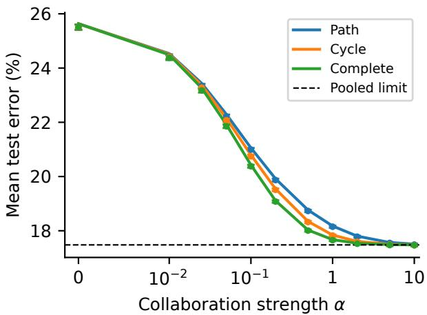

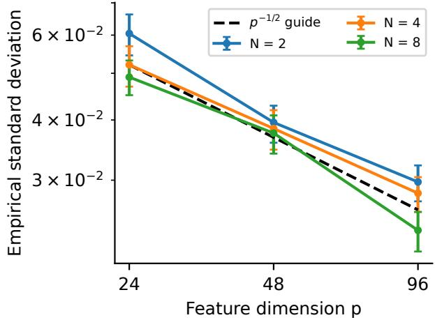  
Figure 1: Homogeneous data and concentration, with common $\boldsymbol { \Sigma } = \mathbf { I } _ { p }$ and $\pmb { \mu } = \mathbf { e } _ { 1 }$ . Left: node-average test error with $N = 6 , p = 6 0$ and $n _ { i } = 1 5 0$ . Path, cycle and complete graphs each have total edge weight 6. Lines: theoretical predictions; points: Monte Carlo means. Right: standard deviation of the unit-norm observable $f ( \widehat \mathbf { w } ) = N ^ { - \bar { 1 } / 2 } \sum _ { i = 1 } ^ { N } \mathbf { e } _ { 1 } ^ { \bar { \top } } \hat { \hat { \mathbf { w } } } ^ { ( i ) }$ on an unweighted cycle, with $N \in \{ 2 , 4 , 8 \}$ $p \in \{ 2 4 , 4 8 , 9 6 \}$ $n _ { i } = 2 . 5 p$ and $\alpha = 0 . 3$ The $\boldsymbol { p } ^ { - 1 / 2 }$ guide is anchored at $N = 4 , p = 2 4$ . Points use 240 independent training draws; error bars are 95% intervals, with bootstrap intervals for the standard deviations.

Theorem 4 (Heterogeneous test error). Under Assumption 1, for every node $i ,$ it holds that

$$
\pmb { \mu } ^ { ( i ) \top } \widehat { \mathbf { w } } ^ { ( i ) } - \pmb { \mu } ^ { ( i ) \top } \mathbf { m } ^ { ( i ) } \stackrel { \mathbb { P } } {  } 0 ,\tag{40}
$$

$$
\widehat { \mathbf { w } } ^ { ( i ) \top } \pmb { \Sigma } ^ { ( i ) } \widehat { \mathbf { w } } ^ { ( i ) } - \mathbf { m } ^ { ( i ) \top } \pmb { \Sigma } ^ { ( i ) } \mathbf { m } ^ { ( i ) } - v _ { i } \overset { \mathbb { P } } {  } 0 .\tag{41}
$$

Consequently, the heterogeneous test error is given by

$$
\overline { { \mathscr { E } } } _ { i } ( \alpha ) = \Phi \left( - \frac { \pmb { \mu } ^ { ( i ) \top } \mathbf { m } ^ { ( i ) } } { \sqrt { \mathbf { m } ^ { ( i ) \top } \pmb { \Sigma } ^ { ( i ) } \mathbf { m } ^ { ( i ) } + v _ { i } } } \right) ,\tag{42}
$$

and we have $\mathcal { E } _ { i } - \overline { { \mathcal { E } } } _ { i }  0$ in probability and in mean. The denominator in (42) is asymptotically bounded $b e \mathrm { - }$ low by a positive constant for any values of α.

To interpret the efect of collaboration in Theorem 4, we compare the deterministic coeficient $\mathbf { m } ^ { ( i ) }$ with the optimal local least-squares coeficient,

$$
\begin{array} { r l } & { \mathbf { w } _ { * } ^ { ( i ) } = \underset { \mathbf { w } \in \mathbb { R } ^ { p } } { \arg \operatorname* { m i n } } \mathbb { E } \left[ \left( y - \mathbf { x } ^ { \top } \mathbf { w } \right) ^ { 2 } \right] } \\ & { \quad \quad = \frac { \left( \mathbf { \boldsymbol { \Sigma } } ^ { ( i ) } \right) ^ { - 1 } \pmb { \mu } ^ { ( i ) } } { 1 + \gamma _ { i } } . } \end{array}\tag{43}
$$

The residual $r _ { i }$ in (39) then separates into the minimum local squared prediction error and the additional error caused by $\mathbf { m } ^ { ( i ) }$ difering from $\mathbf { w } _ { * } ^ { ( i ) }$ ，

$$
\begin{array} { l } { r _ { i } = \displaystyle \frac { 1 } { 1 + \gamma _ { i } } + d _ { i } , } \\ { d _ { i } = \left( \mathbf { m } ^ { ( i ) } - \mathbf { w } _ { * } ^ { ( i ) } \right) ^ { \top } \mathbf { C } ^ { ( i ) } \left( \mathbf { m } ^ { ( i ) } - \mathbf { w } _ { * } ^ { ( i ) } \right) \geq 0 . } \end{array}\tag{44}
$$

Writing $\mathbf { d } = \left[ d _ { 1 } , \ldots , d _ { N } \right] ^ { \top }$ , we can decompose (39) as

$$
\mathbf { v } = \mathbf { v } _ { \mathrm { b a s e } } + \mathbf { v } _ { \mathrm { h e t } } \ \in \mathbb { R } ^ { N } ,\tag{45}
$$

where the two vectors $\mathbf { v } _ { \mathrm { b a s e } }$ and $\mathbf { v } _ { \mathrm { h e t } }$ are given by

$$
\mathbf { v } _ { \mathrm { b a s e } } = \left( \mathbf { I } _ { N } - \mathbf { J } \right) ^ { - 1 } \mathbf { J } \operatorname { s t a c k } \left\{ \frac { 1 } { 1 + \gamma _ { i } } \right\} _ { i = 1 } ^ { N } ,\tag{46}
$$

$$
\mathbf { v } _ { \mathrm { h e t } } = \left( \mathbf { I } _ { N } - \mathbf { J } \right) ^ { - 1 } \mathbf { J } \mathbf { d } .\tag{47}
$$

By Proposition 2, $\mathbf { v } _ { \mathrm { h e t } }$ is entrywise nonnegative: mismatch adds to the quadratic correction. For $\begin{array} { r l } { \mathbf { w } _ { * } } & { { } = } \end{array}$ stack $\left\{ \mathbf { w } _ { * } ^ { ( i ) } \right\} _ { i = 1 } ^ { N } , ( 3 8 )$ also gives

$$
\mathbf { m } - \mathbf { w } _ { * } = - 2 \alpha \mathbf { Q } \left( \mathbf { L } ^ { \left( \mathcal { G } \right) } \otimes \mathbf { I } _ { p } \right) \mathbf { w } _ { * } .\tag{48}
$$

For $\alpha > 0$ 2 $\mathbf { m } = \mathbf { w } _ { : }$ ∗ (equivalently, $d _ { i } = 0$ for every node) holds exactly when the local least-squares coefficients $\mathbf { w } _ { * } ^ { ( i ) }$ agree within each connected component. The data distributions themselves may still difer.

## 4 Experiments

We first confirm our theoretical predictions on Gaussian data (Section 4.1), then assess their accuracy and use for choosing α on real data (Section 4.2).

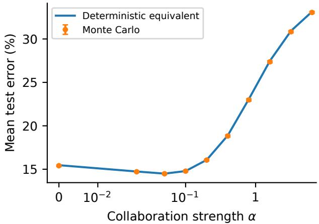

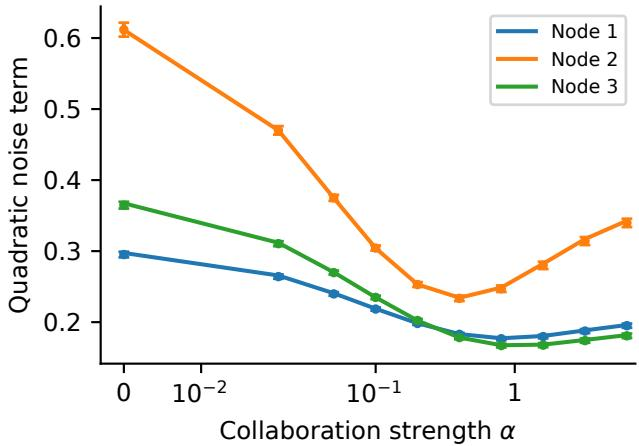  
Figure 2: Heterogeneous three-node path with p = 80, $n _ { i } ~ = ~ 2 0 0$ $\mu ^ { ( 1 ) } = 1 . 4 \mathbf { e } _ { 1 }$ $\mu ^ { ( 2 ) } = - 0 . 4 { \bf e } _ { 1 } + { \bf e } _ { 2 }$ and $\pmb { \mu } ^ { ( 3 ) } = - 0 . 7 \mathbf { e } _ { 2 } + 0 . 8 \mathbf { e } _ { 3 }$ . Covariances are diagonal: entries of $\pmb { \Sigma } ^ { ( 1 ) }$ and $\pmb { \Sigma } ^ { ( 2 ) }$ are evenly spaced from 0.5 to 1.5 and from 1.4 to 0.6, respectively; $\pmb { \Sigma } ^ { ( 3 ) }$ has half its diagonal entries equal to 0.4 and half equal to 2. Left: predicted and measured node-average test error. Right: node-specific quadratic noise terms. Lines: Theorem 4; points and 95% intervals: 240 independent training draws, shared across values of α.

## 4.1 Gaussian Data

Figure 1 (left) shows close agreement between the predicted and measured test errors on three graph structures. Collaboration reduces the homogeneous test error towards the pooled error, with the graph determining how quickly it is approached. The right panel shows fluctuations of a Lipschitz-continuous observable, confirming the $p ^ { - 1 / 2 }$ scale of Theorem 1.

The heterogeneous example in Figure 2 has an intermediate best collaboration strength. Beyond this point, the error initially rises while the quadratic noise still decreases: the loss of local signal outweighs the noise reduction. Stronger collaboration eventually also increases the quadratic noise.

Figure 3 isolates the importance of connecting similar tasks. The two graphs have identical Laplacian spectra but diferent test errors. Grouping similar tasks makes stronger collaboration useful, and the theory captures both error curves and their preferred collaboration strengths.

## 4.2 Real-World Data

We evaluate 55 settings on MNIST (LeCun et al., 1998), Fashion-MNIST (Xiao et al., 2017), CIFAR-10 (Krizhevsky, 2009), HAR (Anguita et al., 2013) and Adult (Kohavi, 1996). These include random splits, controlled feature and label shifts, and natural user or silo partitions. Figure 4 and Table 1 show that the predictions remain useful approximations beyond the Gaussian setting.

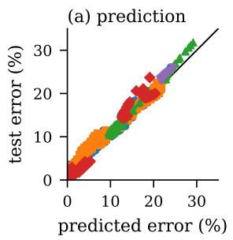

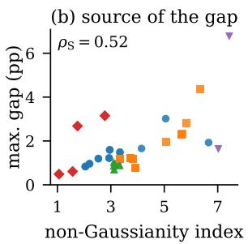  
MNIST F-MNIST CIFAR-10 HAR Adult  
Figure 4: Real-data predictions. Each node’s data are split into a pool (70%) and a held-out test set (30%). Predictions use the signed-observation moments of the pool; measured errors average 100 independent training draws from it, shared across the α grid. (a) Predicted versus held-out test error for all 55 settings and grid values. (b) Largest gap to (22) versus the spread of whitened squared norms relative to its Gaussian value (index 1). Feature, partition and graph details are given in Appendix E and the code.

The prediction gaps tend to increase with departures from Gaussian data (Figure 4b). Gaussian simulations with matching means and covariances agree more closely with the theory, suggesting that these departures explain much of the discrepancy. Held-out error can also difer from (22) because real-data classification scores need not be Gaussian.

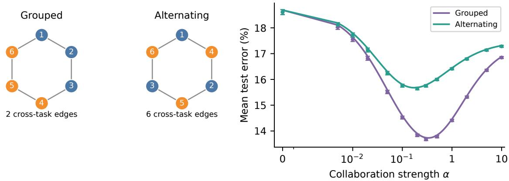

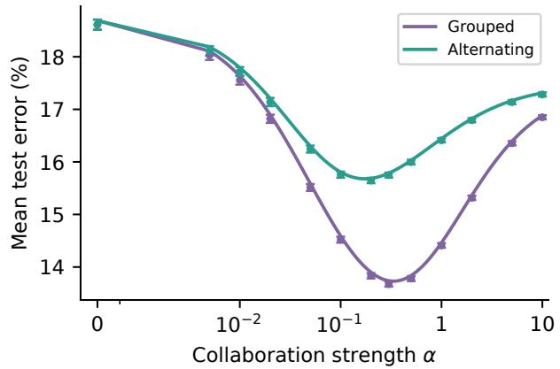  
Figure 3: Six nodes with $p = 6 0 , n _ { i } = 1 5 0$ and $\begin{array} { r } { \pmb { \Sigma } ^ { ( i ) } = \mathbf { I } _ { p } , } \end{array}$ . Nodes 1, 2, 3 have mean $\mathbf { e } _ { 1 } + 0 . 8 \mathbf { e } _ { 2 }$ (blue), and nodes 4, 5, 6 have mean ${ \bf e } _ { 1 } - 0 . 8 { \bf e } _ { 2 } \ \mathrm { ( o r a n g e ) }$ . Unit-weight cycles follow the orders (1, 2, 3, 4, 5, 6) and (1, 4, 2, 5, 3, 6), giving identical Laplacian spectra but two and six edges between diferent tasks, respectively. Lines: Theorem 4. Points: means over 240 independent training draws, shared across graphs and values of α, with 95% intervals.

Table 1: Prediction gaps and tuning regrets on 55 realdata settings, in percentage points (pp). Gap: median across settings of the largest absolute prediction error over the α grid. “Gauss” evaluates (22) on the fitted coeficients with pool moments; “test” uses held-out classification error. Regret: extra held-out error at the theory-selected α relative to the lowest mean error on the grid, summarized by its median and maximum. Predictions use pool moments.
<table><tr><td></td><td></td><td colspan="2">Gap (pp)</td><td colspan="2">Regret (pp)</td></tr><tr><td>Group</td><td>#</td><td>Gauss</td><td>test</td><td>med.</td><td>max</td></tr><tr><td>i.i.d. splits</td><td>9</td><td>0.8</td><td>1.8</td><td>0.07</td><td>0.17</td></tr><tr><td>Dirichlet,  $a = 1 0 0$ </td><td>6</td><td>1.0</td><td>2.0</td><td>0.12</td><td>0.18</td></tr><tr><td>Dirichlet,  $a \leq 0 . 5$ </td><td>12</td><td>1.1</td><td>2.5</td><td>0.06</td><td>0.25</td></tr><tr><td>Rotations</td><td>12</td><td>2.1</td><td>2.3</td><td>0.05</td><td>0.24</td></tr><tr><td>Task alignment</td><td>4</td><td>1.1</td><td>2.2</td><td>0.02</td><td>0.18</td></tr><tr><td>HAR users</td><td>8</td><td>1.6</td><td>3.2</td><td>0.14</td><td>1.29</td></tr><tr><td>Adult silos</td><td>4</td><td>4.2</td><td>1.6</td><td>0.15</td><td>0.19</td></tr><tr><td>All</td><td>55</td><td>1.2</td><td>2.3</td><td>0.09</td><td>1.29</td></tr></table>

Choosing α by minimizing the predicted error usually gives a test error close to the best grid value (Table 1). With moments estimated only from the training data, the resulting rule also performs similarly to cross-validation (Table 2). Comparisons with local training, consensus, fine-tuning and global/local mixtures show that the useful strength and form of collaboration depend on the diferences between nodes: graphs following the task structure perform well on the heterogeneous benchmarks, whereas consensus is best on nearly homogeneous Adult.

Table 2: Test error (%) on six real-data settings, averaged over 20 training draws. Plug-in theory uses training-sample means and Ledoit–Wolf covariance estimates; oracle theory uses pool moments. Fine-tuning starts from consensus; mixture is the global/local method of Hanzely and Richt´arik (2020). The 95% intervals are at most ±0.4, except ±0.7 for local HAR. Bold: lowest reported error excluding hindsight, which gives the lowest measured GTVMin error on the tested grid. Fore the setup details, see Appendix E.
<table><tr><td>Method</td><td>MNIST rot.</td><td>rot.</td><td>subp.</td><td>FMN. CIFAR CIFAR Dir.</td><td>HAR users</td><td>Adult silos</td></tr><tr><td>Local</td><td>10.97</td><td>22.32</td><td>17.35</td><td>15.41</td><td>20.77</td><td>25.77</td></tr><tr><td>Consensus</td><td>18.43</td><td>21.88</td><td>12.19</td><td>11.43</td><td>14.85</td><td>23.15</td></tr><tr><td>Fine-tuning</td><td>9.44</td><td>17.58</td><td>11.88</td><td>10.65</td><td>14.49</td><td>23.44</td></tr><tr><td>Mixture</td><td>9.08</td><td>17.35</td><td>11.84</td><td>10.58</td><td>14.74</td><td>23.56</td></tr><tr><td colspan="7">GTVMin, α chosen by</td></tr><tr><td>CV (5-fold)</td><td>8.47</td><td>17.90</td><td>11.64</td><td>10.52</td><td>14.37</td><td>23.51</td></tr><tr><td>Plug-in theory</td><td>8.37</td><td>17.86</td><td>11.81</td><td>10.44</td><td>14.39</td><td>23.78</td></tr><tr><td>Oracle theory</td><td>8.37</td><td>17.83</td><td>11.53</td><td>10.37</td><td>14.22</td><td>23.29</td></tr><tr><td>Best (hindsight)</td><td>8.29</td><td>17.73</td><td>11.45</td><td>10.25</td><td>13.91</td><td>22.95</td></tr></table>

## References

Davide Anguita, Alessandro Ghio, Luca Oneto, Xavier Parra, and Jorge Luis Reyes-Ortiz. A public domain dataset for human activity recognition using smartphones. In European Symposium on Artificial Neural Networks (ESANN), pages 437–442, 2013.

Gary Cheng, Karan Chadha, and John Duchi. Federated asymptotics: a model to compare federated learning algorithms. In International Conference on Artificial Intelligence and Statistics, pages 10650– 10689. PMLR, 2023.

Adam Coates, Andrew Ng, and Honglak Lee. An analysis of single-layer networks in unsupervised feature learning. In International Conference on Artificial Intelligence and Statistics (AISTATS), pages 215– 223, 2011.

Liam Collins, Hamed Hassani, Aryan Mokhtari, and Sanjay Shakkottai. Exploiting shared representations for personalized federated learning. In International Conference on Machine Learning (ICML), 2021.

Romain Couillet and Zhenyu Liao. Random Matrix Methods for Machine Learning. Cambridge University Press, 2022.

Canh T. Dinh, Nguyen H. Tran, and Tuan Dung Nguyen. Personalized federated learning with Moreau envelopes. In Advances in Neural Information Processing Systems (NeurIPS), volume 33, pages 21394–21405, 2020.

Edgar Dobriban and Yue Sheng. WONDER: Weighted one-shot distributed ridge regression in high dimensions. Journal of Machine Learning Research, 21 (66):1–52, 2020.

Edgar Dobriban and Yue Sheng. Distributed linear

regression by averaging. The Annals of Statistics, 49(2):918–943, 2021.

Edgar Dobriban and Stefan Wager. High-dimensional asymptotics of prediction: Ridge regression and classification. The Annals of Statistics, 46(1):247– 279, 2018.

Theodoros Evgeniou and Massimiliano Pontil. Regularized multi-task learning. In Proceedings of the ACM SIGKDD International Conference on Knowledge Discovery and Data Mining, pages 109–117, 2004.

Alireza Fallah, Aryan Mokhtari, and Asuman Ozdaglar. Personalized federated learning with theoretical guarantees: A model-agnostic metalearning approach. In Advances in Neural Information Processing Systems (NeurIPS), 2020.

Avishek Ghosh, Jichan Chung, Dong Yin, and Kannan Ramchandran. An eficient framework for clustered federated learning. In Advances in Neural Information Processing Systems (NeurIPS), 2020.

David Hallac, Jure Leskovec, and Stephen Boyd. Network Lasso: Clustering and optimization in large graphs. In Proceedings of the ACM SIGKDD International Conference on Knowledge Discovery and Data Mining, pages 387–396, 2015.

Filip Hanzely and Peter Richt´arik. Federated learning of a mixture of global and local models. arXiv preprint arXiv:2002.05516, 2020.

Filip Hanzely, Slavom´ır Hanzely, Samuel Horv´ath, and Peter Richt´arik. Lower bounds and optimal algorithms for personalized federated learning. In Advances in Neural Information Processing Systems (NeurIPS), 2020.

Trevor Hastie, Andrea Montanari, Saharon Rosset, and Ryan J. Tibshirani. Surprises in highdimensional ridgeless least squares interpolation. The Annals of Statistics, 50(2):949–986, 2022.

Alexander Jung. A fixed-point of view on gradient methods for big data. Frontiers in Applied Mathematics and Statistics, 3:18, 2017.

Alexander Jung. Federated learning: From theory to practice. arXiv preprint arXiv:2505.19183, 2025.

Peter Kairouz, H. Brendan McMahan, et al. Advances and open problems in federated learning. Foundations and Trends in Machine Learning, 14(1–2):1– 210, 2021.

Ron Kohavi. Scaling up the accuracy of naive-Bayes classifiers: A decision-tree hybrid. In Proceedings of the International Conference on Knowledge Discovery and Data Mining (KDD), pages 202–207, 1996.

Anastasia Koloskova, Nicolas Loizou, Sadra Boreiri, Martin Jaggi, and Sebastian Stich. A unified theory of decentralized SGD with changing topology

and local updates. In International Conference on Machine Learning (ICML), 2020.

Alex Krizhevsky. Learning multiple layers of features from tiny images. Technical report, University of Toronto, 2009.

Yann LeCun, L´eon Bottou, Yoshua Bengio, and Patrick Hafner. Gradient-based learning applied to document recognition. Proceedings of the IEEE, 86 (11):2278–2324, 1998.

Tian Li, Shengyuan Hu, Ahmad Beirami, and Virginia Smith. Ditto: Fair and robust federated learning through personalization. In International Conference on Machine Learning (ICML), 2021.

Xiangru Lian, Ce Zhang, Huan Zhang, Cho-Jui Hsieh, Wei Zhang, and Ji Liu. Can decentralized algorithms outperform centralized algorithms? a case study for decentralized parallel stochastic gradient descent. In Advances in Neural Information Processing Systems (NeurIPS), 2017.

Zhenyu Liao and Romain Couillet. A large dimensional analysis of least squares support vector machines. IEEE Transactions on Signal Processing, 67 (4):1065–1074, 2019.

Cosme Louart and Romain Couillet. Concentration of measure and large random matrices with an application to sample covariance matrices. arXiv preprint arXiv:1805.08295, 2018.

Bruno Loureiro, Gabriele Sicuro, C´edric Gerbelot, Alessandro Pacco, Florent Krzakala, and Lenka Zde borov´a. Learning gaussian mixtures with generalized linear models: Precise asymptotics in highdimensions. In Advances in Neural Information Processing Systems (NeurIPS), 2021.

Xiaoyi Mai and Zhenyu Liao. High dimensional classification via empirical risk minimization: Improvements and optimality. arXiv preprint arXiv:1905.13742, 2019.

Yishay Mansour, Mehryar Mohri, Jae Ro, and Ananda Theertha Suresh. Three approaches for personalization with applications to federated learning. arXiv preprint arXiv:2002.10619, 2020.

Othmane Marfoq, Giovanni Neglia, Aur´elien Bellet, Laetitia Kameni, and Richard Vidal. Federated multi-task learning under a mixture of distributions. In Advances in Neural Information Processing Systems (NeurIPS), 2021.

Brendan McMahan, Eider Moore, Daniel Ramage, Seth Hampson, and Blaise Aguera y Arcas. Communication-eficient learning of deep networks from decentralized data. In Artificial intelligence and statistics, pages 1273–1282. Pmlr, 2017.

Jonathan D. Rosenblatt and Boaz Nadler. On the op timality of averaging in distributed statistical learning. Information and Inference, 5(4):379–404, 2016.

Felix Sattler, Klaus-Robert M¨uller, and Wojciech Samek. Clustered federated learning: Modelagnostic distributed multitask optimization under privacy constraints. IEEE Transactions on Neural Networks and Learning Systems, 32(8):3710–3722, 2021.

Virginia Smith, Chao-Kai Chiang, Maziar Sanjabi, and Ameet Talwalkar. Federated multi-task learning. In Advances in Neural Information Processing Systems (NeurIPS), 2017.

Alysa Ziying Tan, Han Yu, Lizhen Cui, and Qiang Yang. Towards personalized federated learning. IEEE Transactions on Neural Networks and Learning Systems, 2022.

Malik Tiomoko, Hafiz Tiomoko Ali, and Romain Couillet. Deciphering and optimizing multi-task learning: a random matrix approach. In International Conference on Learning Representations (ICLR), 2021.

Paul Vanhaesebrouck, Aur´elien Bellet, and Marc Tommasi. Decentralized collaborative learning of personalized models over networks. In International Conference on Artificial Intelligence and Statistics (AISTATS), 2017.

Roman Vershynin. High-Dimensional Probability: An Introduction with Applications in Data Science. Cambridge Series in Statistical and Probabilistic Mathematics. Cambridge University Press, Cambridge, 2 edition, 2026.

Han Xiao, Kashif Rasul, and Roland Vollgraf. Fashion-MNIST: a novel image dataset for benchmarking machine learning algorithms. arXiv preprint arXiv:1708.07747, 2017.

Valentina Zantedeschi, Aur´elien Bellet, and Marc Tommasi. Fully decentralized joint learning of personalized models and collaboration graphs. In International Conference on Artificial Intelligence and Statistics (AISTATS), 2020.

Yuchen Zhang, John C. Duchi, and Martin J. Wain wright. Communication-eficient algorithms for statistical optimization. Journal of Machine Learning Research, 14:3321–3363, 2013.

## A Gaussian Decomposition and Spectral Bounds

The test-error proof uses independent Gaussian sample means and centered covariances, together with a bound on the inverses. Unless stated otherwise, Assumption 1 holds, N is fixed, and limits are taken as $p , n _ { i } \to \infty$ Deterministic parameters, including $\alpha ,$ may depend on $p .$ . We use $\| \cdot \| _ { 2 \to 2 }$ for the operator norm, and $\| \cdot \| _ { F }$ denotes the Frobenius norm.

Write $\mathbf { z } _ { r } ^ { ( i ) } = y _ { r } ^ { ( i ) } \mathbf { x } _ { r } ^ { ( i ) }$ and $\mathbf { Z } ^ { ( i ) } = [ \mathbf { z } _ { 1 } ^ { ( i ) } , \ldots , \mathbf { z } _ { n _ { i } } ^ { ( i ) } ] \in \mathbb { R } ^ { p \times n _ { i } }$ . The sample mean and centered covariance are

$$
\mathbf { b } ^ { ( i ) } = \frac { 1 } { n _ { i } } \mathbf { Z } ^ { ( i ) } \mathbf { 1 } , \qquad \mathbf { S } ^ { ( i ) } = \frac { 1 } { n _ { i } } \mathbf { Z } ^ { ( i ) } \mathbf { Z } ^ { ( i ) \top } - \mathbf { b } ^ { ( i ) } \mathbf { b } ^ { ( i ) \top } .\tag{49}
$$

Lemma 5 (Gaussian decomposition). The sample-mean fluctuations $\pmb { \eta } ^ { ( i ) } : = \mathbf { b } ^ { ( i ) } - \pmb { \mu } ^ { ( i ) }$ are independent of all centered covariances, and diferent nodes are independent. Moreover,

$$
\eta ^ { ( i ) } \sim \mathcal { N } \left( \mathbf { 0 } , \frac { \mathbf { \Sigma } \mathbf { \Sigma } ^ { ( i ) } } { n _ { i } } \right) , \qquad \mathbf { S } ^ { ( i ) } \triangleq \frac { 1 } { n _ { i } } \left( \mathbf { \Sigma } \mathbf { \Sigma } ^ { ( i ) } \right) ^ { 1 / 2 } \mathbf { G } ^ { ( i ) } \mathbf { G } ^ { ( i ) \top } \left( \mathbf { \Sigma } \mathbf { \Sigma } ^ { ( i ) } \right) ^ { 1 / 2 } , \qquad \mathbf { B } ^ { ( i ) } = \mathbf { S } ^ { ( i ) } + \mathbf { b } ^ { ( i ) } \mathbf { b } ^ { ( i ) \top } ,\tag{50}
$$

where $\mathbf { G } ^ { ( i ) } \in \mathbb { R } ^ { p \times ( n _ { i } - 1 ) }$ has independent standard Gaussian entries. Here $\circeq$ means equality in distribution.

Proof of Lemma 5. Under (21), the signed observations are independent $\mathcal { N } \left( \boldsymbol { \mu } ^ { ( i ) } , \boldsymbol { \Sigma } ^ { ( i ) } \right)$ vectors, irrespective of the class proportions. An orthogonal transformation of the sample indices, with first coordinate $n _ { i } ^ { - 1 / 2 } \mathbf { 1 }$ , separates the sample mean from $n _ { i } - 1$ independent centered Gaussian columns. This proves the distributional and independence statements; the identity for $\mathbf { B } ^ { ( i ) }$ follows from (49). □

Remark 6. Standard Gaussian singular-value bounds (Vershynin, 2026) and the aspect-ratio gap give constants $h , K > 0$ such that, with probability tending to one,

$$
\lambda _ { \operatorname* { m i n } } \left( \mathbf { S } ^ { ( i ) } \right) \geq h , \qquad \left\| \mathbf { Z } ^ { ( i ) } \right\| _ { 2 \to 2 } \leq K \sqrt { n _ { i } } , \qquad i = 1 , \dots , N .\tag{51}
$$

The constants depend only on the distributional bounds and the aspect-ratio gap. On the event (in the limit $p  \infty )$

$$
{ \mathcal { B } } = \left\{ \underset { 1 \leq i \leq N } { \operatorname* { m i n } } \lambda _ { \operatorname* { m i n } } \left( \mathbf { S } ^ { ( i ) } \right) \geq h \right\} , \qquad { \mathbb { P } } \left( { \mathcal { B } } \right) \longrightarrow 1 ,\tag{52}
$$

both blockdiag $( \mathbf { S } ^ { ( i ) } ) + \mathbf { M } ) ^ { - 1 }$ and ${ \bf H } ^ { - 1 }$ , recalling (14), have operator norm at most $h ^ { - 1 }$ for every $\mathbf { M } \succeq 0$ . This sufices for the test-error proof. The upper data bound and the exponential probability bound behind (51) are used only for observable concentration.

## B The Fixed Point and Deterministic Equivalents

The fixed point approximates an inverse; its derivative supplies the correction needed for quadratic forms. We prove stability before giving these approximations. Here $\mathbf { \bar { M } } \in \mathbb { R } ^ { N p \times N p }$ may be any deterministic positive semidefinite matrix; the test-error proofs use (26).

## B.1 Existence and stability

Proof of Proposition 2. For $\mathbf { x } \in [ 0 , \infty ) ^ { N }$ , let $F _ { i } \left( \mathbf { x } \right)$ denote the right-hand side of (28), with $\delta _ { j }$ replaced by $x _ { j }$ Matrix inverse monotonicity shows that F is coordinatewise nondecreasing and

$$
0 < F _ { i } \left( \mathbf { x } \right) \leq c _ { i } \left( 1 + x _ { i } \right) .\tag{53}
$$

Iteration therefore increases within the interval $0 \leq x _ { i } \leq c _ { i } / ( 1 - c _ { i } )$ , and continuity gives a positive fixed point. For $t > 1$

$$
\mathbf { M } + \mathrm { b l o c k d i a g } \left( \frac { \mathbf { \Sigma } \mathbf { \Sigma } ^ { ( i ) } } { 1 + t x _ { i } } \right) \succ \frac { 1 } { t } \left( \mathbf { M } + \mathrm { b l o c k d i a g } \left( \frac { \mathbf { \Sigma } \mathbf { \Sigma } ^ { ( i ) } } { 1 + x _ { i } } \right) \right) ,
$$

so $F \left( t \mathbf { x } \right) < t F \left( \mathbf { x } \right)$ coordinatewise. If two positive fixed points x, y difered, interchange them if necessary so that $t = \mathrm { m a x } _ { 1 \leq i \leq N } x _ { i } / y _ { i } > 1$ . At a maximizing coordinate, monotonicity would give $x _ { i } \le F _ { i } \left( t \mathbf { y } \right) < t y _ { i } = x _ { i }$ , a contradiction. To relate J to this fixed point, define ${ \bf K } , { \bf J } _ { \delta } \in \mathbb { R } ^ { N \times N }$ by

$$
K _ { i j } = \mathrm { t r } \left( \pmb { \Sigma } ^ { ( i ) } \mathbf { T } _ { i j } \pmb { \Sigma } ^ { ( j ) } \mathbf { T } _ { j i } \right) , \qquad \left( \mathbf { J } _ { \delta } \right) _ { i j } = \frac { K _ { i j } } { n _ { i } \left( 1 + \delta _ { j } \right) ^ { 2 } } .\tag{54}
$$

The matrix $\mathbf { J } _ { \delta }$ is the Jacobian of F at δ. Also, K is symmetric and entrywise nonnegative because

$$
K _ { i j } = \left\| \left( \boldsymbol { \Sigma } ^ { ( i ) } \right) ^ { 1 / 2 } \mathbf { T } _ { i j } \left( \boldsymbol { \Sigma } ^ { ( j ) } \right) ^ { 1 / 2 } \right\| _ { F } ^ { 2 } .\tag{55}
$$

For $\omega = { ( 1 + \delta _ { 1 } , \dots , 1 + \delta _ { N } ) } ^ { \top }$ , the identity

$$
\mathbf { T b l o c k d i a g } \left( { \frac { \mathbf { \mathbf { \mathbf { \mathbf { \mathbf { \mathbf { \mathbf { \mathbf { \mathbf } } } } } } } } ^ { ( i ) } } { 1 + \delta _ { i } } } \right) \mathbf { T } = \mathbf { T } - \mathbf { T M T } \preceq \mathbf { T }
$$

gives

$$
\begin{array} { r } { ( \mathbf { J } _ { \delta } \omega ) _ { i } \leq \delta _ { i } \leq c _ { i } \omega _ { i } . } \end{array}\tag{56}
$$

Thus $\rho \left( \mathbf { J } _ { \delta } \right) \leq c _ { \operatorname* { m a x } } : = \operatorname* { m a x } _ { 1 \leq i \leq N } c _ { i } < 1$ . Since

$$
{ \bf J } _ { \delta } = { \bf D } _ { n } ^ { - 1 } { \bf J } { \bf D } _ { n } , \qquad { \bf D } _ { n } = \mathrm { d i a g } \left( n _ { 1 } , \dots , n _ { N } \right) ,\tag{57}
$$

the same bound holds for J, proving (30). Its entries are nonnegative, so the convergent Neumann series gives (31). Under Assumption 1, the weights $\omega _ { i }$ and ratios $n _ { i } / n _ { j }$ are bounded, and $c _ { \mathrm { m a x } }$ stays below one. Thus (56) uniformly bounds both $( { \bf { I } } _ { N } - { \bf { J } } _ { \delta } ) ^ { - 1 }$ and $( \mathbf { I } _ { N } - \mathbf { J } ) ^ { - 1 }$ . Together with $\left\| \mathbf { T } \right\| _ { 2 \to 2 } \leq \left[ s _ { 1 } \left( 1 - c _ { \operatorname* { m a x } } \right) \right] ^ { - 1 }$ , implicit diferentiation bounds the first two derivatives under bounded smooth variations of the covariance contributions or of M. □

## B.2 Deterministic equivalents

The following result is a block-wise version of (Louart and Couillet, 2018, Theorem 3.14).

Lemma 7 (Deterministic equivalent of the inverse). The matrix T in (27)–(28) is a deterministic equivalent of

$$
\mathbf { R } = \left( \mathrm { b l o c k d i a g } \left( \mathbf { S } ^ { ( i ) } \right) + \mathbf { M } \right) ^ { - 1 } \in \mathbb { R } ^ { N p \times N p }
$$

for bilinear forms with bounded deterministic vectors and traces normalized by p with bounded deterministic test matrices: the corresponding scalar diferences tend to zero in probability.

Similarly, the following result is obtained. Let $\mathbf { E } _ { i } = \mathbf { e } _ { i } \otimes \mathbf { I } _ { p } \in \mathbb { R } ^ { N p \times p }$ insert a vector into block i, where $\mathbf { e } _ { i } \in \mathbb { R } ^ { N }$ is the ith coordinate vector. Set ${ \bf P } _ { \ell } = { \bf E } _ { \ell } \pmb { \Sigma } ^ { ( \ell ) } { \bf E } _ { \ell } ^ { \top } \in \mathbb { R } ^ { N p \times N p }$ , so that $\mathbf { w } ^ { \top } \mathbf { P } _ { \ell } \mathbf { w } = \mathbf { w } ^ { ( \ell ) \top } \pmb { \Sigma } ^ { ( \ell ) } \mathbf { w } ^ { ( \ell ) }$

Lemma 8 (Deterministic equivalent for the quadratic term). For $\ell = 1 , \ldots , N$ , define

$$
\mathbf { u } ^ { ( \ell ) } = \left( \mathbf { I } _ { N } - \mathbf { J } _ { \delta } \right) ^ { - 1 } \mathrm { s t a c k } \left\{ \frac { K _ { i \ell } } { n _ { i } } \right\} _ { i = 1 } ^ { N } \in \mathbb { R } ^ { N } ,\tag{58}
$$

$$
\mathbf D _ { \ell } = \mathbf T \left( \mathbf P _ { \ell } + \mathrm { b l o c k d i a g } \left( \frac { u _ { j } ^ { ( \ell ) } \pmb { \Sigma } ^ { ( j ) } } { \left( 1 + \delta _ { j } \right) ^ { 2 } } \right) \right) \mathbf T \in \mathbb { R } ^ { N p \times N p } .\tag{59}
$$

Then $\mathbf { D } _ { \ell }$ is a deterministic equivalent of $\mathbf { R P } _ { \ell } \mathbf { R }$ . Moreover, tr $\left( \Sigma ^ { ( j ) } \mathbf { D } _ { \ell , j j } \right) / n _ { j } = u _ { j } ^ { ( \ell ) }$ , where $\mathbf { D } _ { \boldsymbol { \ell } , j j }$ denotes its jth diagonal block.

## C Test Error: Heterogeneous and Homogeneous Cases

We first derive the general test-error formula and the identities describing mismatch between nodes. The homogeneous corollary then follows directly.

## C.1 Heterogeneous case

Proof of Theorem 4. Using the Gaussian decomposition in (50), define

$$
{ \bf U } = \left[ { \bf E } _ { 1 } \mu ^ { ( 1 ) } , \dots , { \bf E } _ { N } \mu ^ { ( N ) } \right] , \qquad { \bf V } = \left[ { \bf E } _ { 1 } \eta ^ { ( 1 ) } , \dots , { \bf E } _ { N } \eta ^ { ( N ) } \right] , \qquad { \bf F } = { \bf U } + { \bf V } \in \mathbb { R } ^ { N p \times N } .\tag{60}
$$

Then B = blockdiag $\left( \mathbf { S } ^ { ( i ) } \right) + \mathbf { F } \mathbf { F } ^ { \top }$ and $\mathbf b = \mathbf F \mathbf 1$ . The Woodbury identity gives the exact representation

$$
\widehat { \mathbf { w } } = \mathbf { R } \mathbf { F } \left( \mathbf { I } _ { N } + \mathbf { F } ^ { \top } \mathbf { R } \mathbf { F } \right) ^ { - 1 } \mathbf { 1 } .\tag{61}
$$

Condition on the centered covariances. The sample-mean fluctuations remain independent Gaussian vectors. Gaussian second moments show that U⊤RV vanishes and $\mathbf { V } ^ { \top } \mathbf { R } \mathbf { V }$ difers negligibly from diag $\left( \operatorname { t r } \left( \Sigma ^ { \left( i \right) } \mathbf { R } _ { i i } \right) / n _ { i } \right)$ each centered entry has conditional variance at most $C / p$ on B. Since N is fixed, Lemma 7 gives convergence in operator norm,

$$
\mathbf { F } ^ { \top } \mathbf { R } \mathbf { F } - \Gamma - \operatorname { d i a g } \left( { \boldsymbol { \delta } } \right) \xrightarrow { \mathbb { P } } 0 , \qquad \mathbf { \Gamma } \mathbf { \Gamma } \mathbf { T } = \mathbf { U } ^ { \top } \mathbf { T } \mathbf { U } \in \mathbb { R } ^ { N \times N } .\tag{62}
$$

Consequently, for the deterministic vector

$$
\mathbf { q } = \left( \operatorname { d i a g } \left( 1 + \delta _ { 1 } , \ldots , 1 + \delta _ { N } \right) + \mathbf { { T } } \right) ^ { - 1 } \mathbf { 1 } \in \mathbb { R } ^ { N } ,\tag{63}
$$

we have

$$
\| \widehat { \mathbf { w } } - \mathbf { R F q } \| _ { 2 } \overset { \mathbb { P } } {  } 0 .\tag{64}
$$

Indeed, both matrices inverted in (61) and (63) are bounded below by ${ \mathbf { I } } _ { N }$ , and $\Vert \mathbf { F } \Vert _ { 2  2 }$ is bounded in probability because $\mathbb { E } \left\| \pmb { \eta } ^ { ( i ) } \right\| _ { 2 } ^ { 2 } = \mathrm { t r } \left( \pmb { \Sigma } ^ { ( i ) } \right) / n _ { i }$ is bounded. The random part V must still be retained: it vanishes in bounded linear forms but contributes to quadratic forms. For any bounded deterministic $\mathbf { a } \in \mathbb { R } ^ { N p }$ , the conditional variance of $\mathbf { a } ^ { \top } \mathbf { R V } \mathbf { q }$ is at most $C / n _ { \mathrm { m i n } }$ on B. Lemma 7 and (64) therefore give $\mathbf { a } ^ { \top } \widehat { \mathbf { w } } - \mathbf { a } ^ { \top } \mathbf { T U q } \ \overset { \mathbb { P } } {  } \ 0 .$ . Set $\mathbf { m } = \mathbf { T U } \mathbf { q } .$ Equation (63) implies

$$
q _ { i } = \frac { 1 - \pmb { \mu } ^ { ( i ) \top } \mathbf { m } ^ { ( i ) } } { 1 + \delta _ { i } } .\tag{65}
$$

Substituting this into $\mathbf { T } ^ { - 1 } \mathbf { m } = \mathbf { U } \mathbf { q }$ identifies m with (38). Taking $\mathbf { a } = \mathbf { E } _ { i } \mu ^ { ( i ) }$ proves (40). For the quadratic term, use the same conditional Gaussian calculation with $\mathbf { A } = \mathbf { R P } _ { \ell } \mathbf { R }$ . Equation (64) also holds in bounded quadratic forms, since the vectors involved are bounded in probability. Lemma 8 gives

$$
\widehat { \mathbf { w } } ^ { \top } \mathbf { P } _ { \ell } \widehat { \mathbf { w } } - \left( \mathbf { q } ^ { \top } \mathbf { U } ^ { \top } \mathbf { D } _ { \ell } \mathbf { U } \mathbf { q } + \sum _ { j = 1 } ^ { N } q _ { j } ^ { 2 } u _ { j } ^ { ( \ell ) } \right) \ \xrightarrow { \mathbb { P } } \ 0 .
$$

By (59), (65), and $\mathbf { m } = \mathbf { T U } \mathbf { q }$ , the expression in parentheses is

$$
\mathbf { m } ^ { ( \ell ) \top } \pmb { \Sigma } ^ { ( \ell ) } \mathbf { m } ^ { ( \ell ) } + \sum _ { j = 1 } ^ { N } \frac { u _ { j } ^ { ( \ell ) } } { \left( 1 + \delta _ { j } \right) ^ { 2 } } \left[ \left( 1 - \mu ^ { ( j ) \top } \mathbf { m } ^ { ( j ) } \right) ^ { 2 } + \mathbf { m } ^ { ( j ) \top } \pmb { \Sigma } ^ { ( j ) } \mathbf { m } ^ { ( j ) } \right] .\tag{66}
$$

The bracket is precisely $r _ { j }$ in (39). To identify its coeficient, let $\mathbf { W } \in \mathbb { R } ^ { N \times N }$ have entries $W _ { \ell j } = u _ { j } ^ { ( \ell ) } / \left( 1 + \delta _ { j } \right) ^ { 2 }$ Equation (58) and symmetry of K give $\mathbf { W } = \mathbf { J } + \mathbf { W } \mathbf { J }$ , and hence

$$
\mathbf { W } = \mathbf { J } \left( \mathbf { I } _ { N } - \mathbf { J } \right) ^ { - 1 } = \left( \mathbf { I } _ { N } - \mathbf { J } \right) ^ { - 1 } \mathbf { J } , \qquad \mathbf { W } \mathbf { r } = \mathbf { v } .\tag{67}
$$

This proves (41), also for unequal sample sizes. Finally, the error denominator stays positive. Write $\gamma _ { i } =$ $\pmb { \mu } ^ { ( i ) \top } \left( \pmb { \Sigma } ^ { ( i ) } \right) ^ { - 1 } \pmb { \mu } ^ { ( i ) }$ and let $K _ { \mu }$ bound the mean norms. Completing the square using (43) gives

$$
r _ { i } = \frac { 1 } { 1 + \gamma _ { i } } + \left( \mathbf { m } ^ { ( i ) } - \mathbf { w } _ { * } ^ { ( i ) } \right) ^ { \top } \mathbf { C } ^ { ( i ) } \left( \mathbf { m } ^ { ( i ) } - \mathbf { w } _ { * } ^ { ( i ) } \right) \geq \frac { 1 } { 1 + K _ { \mu } ^ { 2 } / s _ { 1 } } .\tag{68}
$$

$$
\mathbf { T } _ { i i } \succeq \left( \sum _ { j = 1 } ^ { N } \frac { \pmb { \Sigma } ^ { ( j ) } } { 1 + \delta _ { j } } \right) ^ { - 1 } \succeq \frac { 1 } { N s _ { 2 } } \mathbf { I } _ { p } .
$$

Restricting the variational formula for $\mathbf { x } ^ { \top } \mathbf { T } _ { i i } \mathbf { x }$ to vectors constant across nodes, which are annihilated by M, gives

It follows that

$$
J _ { i i } \ge \frac { c _ { i } \left( 1 - c _ { i } \right) ^ { 2 } s _ { 1 } ^ { 2 } } { N ^ { 2 } s _ { 2 } ^ { 2 } } , \qquad v _ { i } \ge J _ { i i } r _ { i } > 0 .\tag{69}
$$

Under Assumption 1, these lower bounds stay positive, independently of $\alpha .$ . The deterministic signal and quadratic terms are bounded, so continuity of $( a , b ) \mapsto \Phi \left( - a / { \sqrt { b } } \right)$ for b bounded away from zero turns (40)– (41) into (42). The errors are bounded, so convergence in probability also gives convergence of their absolute diference in mean. □

Proof of (44)–(48). The residual identity is (68). Applying $\left( \mathbf { I } _ { N } - \mathbf { J } \right) ^ { - 1 } \mathbf { J }$ gives the variance decomposition (45)– (47), with both terms in $\mathbb { R } ^ { N }$ ; entrywise nonnegativity gives $\mathbf { v } _ { \mathrm { h e t } } \geq 0$ . To prove (48), subtract $\mathbf { C } ^ { ( i ) } \mathbf { w } _ { * } ^ { ( i ) } = \pmb { \mu } ^ { ( i ) }$ from (38) to obtain

$$
\bigg ( \mathbf { M } + \mathrm { b l o c k d i a g } \left( \frac { \mathbf { C } ^ { ( i ) } } { 1 + \delta _ { i } } \right) \bigg ) ( \mathbf { m } - \mathbf { w } _ { * } ) = - \mathbf { M } \mathbf { w } _ { * } .
$$

Left-multiplying the preceding equation by $\mathbf { Q } ,$ the inverse matrix defined in (37), gives $\mathbf { m } - \mathbf { w } _ { * } = - \mathbf { Q } \mathbf { M } \mathbf { w } _ { * }$ Substituting $\mathbf { M } = 2 \alpha \left( \mathbf { L } ^ { \left( \mathcal { G } \right) } \otimes \mathbf { I } _ { p } \right)$ yields (48). For $\alpha > 0 , { \bf m } = { \bf w } _ { * }$ is therefore equivalent to $\left( \mathbf { L } ^ { \left( \mathcal { G } \right) } \otimes \mathbf { I } _ { p } \right) \mathbf { w } _ { \ast } = \mathbf { 0 }$ Now, (5) with $\mathbf { w } = \mathbf { w } ,$ shows that this occurs exactly when the local coeficients agree within every connected component. Otherwise some $d _ { i } > 0$ , and $( { \bf v } _ { \mathrm { h e t } } ) _ { i } \geq J _ { i i } d _ { i } > 0$ by (69). □

## C.2 Homogeneous case

Proof of Corollary 3. Suppose $\pmb { \mu } ^ { ( i ) } = \pmb { \mu } , \pmb { \Sigma } ^ { ( i ) } = \pmb { \Sigma }$ , and $n _ { i } ~ = ~ n$ . The vector $\mathbf { 1 } \otimes \mathbf { w } _ { * } \in \mathbb { R } ^ { N p } .$ , with $\begin{array} { r l } { \mathbf { w } _ { \ast } } & { { } = } \end{array}$ $\Sigma ^ { - 1 } \mu / ( 1 + \gamma )$ , solves (38), since the Laplacian annihilates constant node vectors and $\left( \Sigma + \mu \pmb { \mu } ^ { \top } \right) { \bf w } _ { \ast } = \pmb { \mu } ,$ Uniqueness gives $\mathbf { m } ^ { ( i ) } = \mathbf { w } _ { * } ^ { ( i ) }$ and

$$
\mu ^ { \mathsf { T } } \mathbf { m } ^ { ( i ) } = \frac { \gamma } { 1 + \gamma } , \qquad \mathbf { m } ^ { ( i ) \top } \pmb { \Sigma } \mathbf { m } ^ { ( i ) } = \frac { \gamma } { \left( 1 + \gamma \right) ^ { 2 } } , \qquad r _ { i } = \frac { 1 } { 1 + \gamma } .
$$

Substitution into (39) and (42) proves (33) and (32), with the convergence asserted in Theorem 4. □

## D Observable Concentration

This separate result additionally uses the upper data bound in (51) and allows growing N under the uniform assumptions of Theorem 1. It is not needed for the test-error derivation.

Proof of Theorem 1. The Gaussian singular-value bounds used in Remark 6 give

$$
\mathbb { P } \{ \lambda _ { \operatorname* { m i n } } ( \mathbf { S } ^ { ( i ) } ) < h \mathrm { ~ o r ~ } \| \mathbf { Z } ^ { ( i ) } \| _ { 2  2 } > K \sqrt { n _ { i } } \} \le C e ^ { - a n _ { i } } .
$$

A union bound proves (24) for the event A defined in the main text. On this event, choose a node i attaining $r = \mathrm { m a x } _ { 1 \leq j \leq N } \left\| \widehat { \mathbf { w } } ^ { ( j ) } \right\| _ { 2 } > 0$ and set $\mathbf { u } = \widehat { \mathbf { w } } ^ { ( i ) } / r$ . Taking the inner product of its normal equation with u gives

$$
r \mathbf { u } ^ { \top } \mathbf { B } ^ { ( i ) } \mathbf { u } + 2 \alpha \sum _ { j = 1 } ^ { N } A _ { i j } \left( r - \mathbf { u } ^ { \top } \widehat { \mathbf { w } } ^ { ( j ) } \right) = \mathbf { u } ^ { \top } \mathbf { b } ^ { ( i ) } \leq K .
$$

Every graph term is nonnegative. Since $\mathbf { B } ^ { ( i ) } \succeq h \mathbf { I } _ { p }$ , this proves

$$
\operatorname* { m a x } _ { 1 \le i \le N } \left\| \widehat { \mathbf { w } } ^ { ( i ) } \right\| _ { 2 } \le K / h ,\tag{70}
$$

also when $r = 0 ,$ with no dependence on the graph or N. Equip the full signed dataset $\mathbf { Z } = \left( \mathbf { Z } ^ { ( i ) } \right) _ { i = 1 } ^ { N }$ with the product Frobenius norm, whose square is $\begin{array} { r } { \sum _ { i = 1 } ^ { N } \left. \mathbf { Z } ^ { ( i ) } \right. _ { F } ^ { 2 } } \end{array}$ . Consider two realizations ${ \bf Z } _ { 1 } = \left( { \bf Z } _ { 1 } ^ { ( i ) } \right) _ { i = 1 } ^ { N }$ and

$\mathbf { Z } _ { 2 } = \left( \mathbf { Z } _ { 2 } ^ { ( i ) } \right) _ { i = 1 } ^ { N }$ in ${ \mathcal { A } } ,$ and denote their fitted coeficients and sample quantities by corresponding subscripts. Subtracting their normal equations gives

$$
\mathbf { H } _ { 1 } \left( \widehat { \mathbf { w } } _ { 1 } - \widehat { \mathbf { w } } _ { 2 } \right) = \mathbf { b } _ { 1 } - \mathbf { b } _ { 2 } - \left( \mathbf { B } _ { 1 } - \mathbf { B } _ { 2 } \right) \widehat { \mathbf { w } } _ { 2 } .
$$

The data bound and (70) imply

$$
\begin{array} { r } { \left\| \mathbf { b } _ { 1 } ^ { ( i ) } - \mathbf { b } _ { 2 } ^ { ( i ) } \right\| _ { 2 } \leq \frac { \left\| \mathbf { Z } _ { 1 } ^ { ( i ) } - \mathbf { Z } _ { 2 } ^ { ( i ) } \right\| _ { F } } { \sqrt { n _ { i } } } , \ ~ } \\ { \left\| \left( \mathbf { B } _ { 1 } ^ { ( i ) } - \mathbf { B } _ { 2 } ^ { ( i ) } \right) \widehat { \mathbf { w } } _ { 2 } ^ { ( i ) } \right\| _ { 2 } \leq \frac { 2 K ^ { 2 } } { h \sqrt { n _ { i } } } \left\| \mathbf { Z } _ { 1 } ^ { ( i ) } - \mathbf { Z } _ { 2 } ^ { ( i ) } \right\| _ { F } . } \end{array}
$$

Using $\| \mathbf H _ { 1 } ^ { - 1 } \| _ { 2 \to 2 } \le h ^ { - 1 }$ and summing the squared block bounds yields

$$
\mathopen { } \mathclose \bgroup \left\| \widehat { \mathbf { w } } _ { 1 } - \widehat { \mathbf { w } } _ { 2 } \aftergroup \egroup \right\| _ { 2 } \leq \ell \left\| \mathbf { Z } _ { 1 } - \mathbf { Z } _ { 2 } \right\| _ { F } , \qquad \ell = \frac { 1 + 2 K ^ { 2 } / h } { h \sqrt { n _ { \operatorname* { m i n } } } } .\tag{71}
$$

Thus, for a 1-Lipschitz $f ,$ the function $f \left( \widehat { \textbf { w } } ( \mathbf { Z } ) \right)$ is ℓ-Lipschitz on A. Extend it to a real-valued function $\widetilde { f }$ on the full data space with the same Lipschitz constant; such an extension always exists. The signed data are jointly Gaussian with covariance operator norm at most $s _ { 2 } ,$ so Gaussian concentration gives

$$
\begin{array} { r } { \mathbb { P } \left\{ \left| \widetilde { f } - \mathbb { E } \widetilde { f } \right| > t \right\} \le 2 \exp \left( { - t ^ { 2 } / \left( 2 s _ { 2 } \ell ^ { 2 } \right) } \right) . } \end{array}\tag{72}
$$

Since $\mathbb { P } \left( \mathcal { A } \right) \ge 1 / 2$ , conditioning costs at most a factor two. Integrating the tail bounds the change of mean by $C _ { 0 } \ell ;$ absorbing this shift into the tail constants gives the same Gaussian bound about the conditional mean. Since $\widetilde f = f \left( \widehat { \mathbf { w } } \right)$ on A, substitution of (71) proves (25), with constants independent of $\alpha ,$ , the graph, and N.

## E Real-World Experiments

This section gives the details of the experimental section Section 4.2 of the main paper. The code, including the download of the five datasets, is provided as supplementary material.

## E.1 Protocol

At each node, the data are split at random into a pool (70%) and a held-out test set (30%). Features are centred and standardized with the mean and standard deviation of the union of all pools. We then form the signed observations $\mathbf { z } = y \mathbf { x }$ and compute their mean $\mu ^ { ( i ) }$ and covariance $\pmb { \Sigma } ^ { ( i ) }$ on the pool of each node. These moments, the sample sizes $n _ { i }$ and the Laplacian $\mathbf { L } ^ { \left( \mathcal { G } \right) }$ give the prediction of Theorem 4.

Each training set consists of $n _ { i }$ samples drawn with replacement from the pool of node i. The pool is then exactly the population of the theory. For every draw, we compute two errors: the Gaussian formula (22) with the pool moments, which is the quantity predicted by the theory, and the $0 / 1$ error on the held-out test set. Each setting uses 100 independent draws, shared across the grid of values of α.

## E.2 Datasets, partitions and graphs

Table 3 lists the 55 settings. MNIST and Fashion-MNIST use the PCA of the pixels. For rotations, the PCA is fitted on the rotated images of all nodes. CIFAR-10 uses a single layer of random convolutional features (Coates et al., 2011): 64 whitened random patches of size $6 \times 6 \times 3$ , stride 2, a shifted ReLU and sum pooling over the four quadrants, followed by PCA. No pretrained network is used. For Adult, numeric features (log-transformed when skewed) and one-hot categorical features are reduced by PCA. The attribute that defines the silos is removed, and the classes are balanced within each silo.

We build the nodes in four ways. In random splits, the samples of one task are distributed at random, so all nodes have the same distribution. In rotation settings, node k receives images rotated by $3 0 ( k - 1 )$ degrees, $k = 1 , \ldots , 6 .$ . The task is the same at every node, but the features difer. In Dirichlet settings, each class of the binary task is a group of original classes, for example vehicles vs. animals in CIFAR-10. Each node draws its proportions of the original classes within each group from a symmetric Dirichlet distribution with parameter a. For $a = 1 0 0$ , all nodes have nearly the same proportions. For $a = 0 . 1$ , most samples of a node come from one or two original classes. The nodes receive disjoint samples. In alignment settings, nodes 1–3 solve one task and nodes 4–6 another: upright and 90◦-rotated digits for MNIST, and two diferent pairs of vehicle and animal classes for CIFAR-10.

Besides paths, cycles and complete graphs, we use k-nearest-neighbour graphs built from simple statistics of each node. For node i, we form the vector containing the mean of z and the mean of its squared coordinates over the pool. Two nodes are connected by an edge of unit weight if one of them is among the k nodes closest to the other in Euclidean distance between these vectors.

Table 3: The 55 real-data settings. Unless stated otherwise, $N = 6 , p = 1 0 0$ and $n _ { i } = 2 5 0$ . Tasks are written as positive vs. negative class. Dirichlet partitions use $a \in \{ 0 . 1 , 0 . 5 , 1 0 0 \}$ . Complete graphs have total edge weight 6 for random splits, 5 for rotations and N otherwise; all other graphs have unit weights. #: number of settings.
<table><tr><td>Dataset</td><td>Partition</td><td>Tasks</td><td>Graphs</td><td>#</td></tr><tr><td rowspan="3">MNIST</td><td>random split</td><td>3 vs. 5</td><td>path, cycle, complete</td><td>3 6</td></tr><tr><td>rotations  $( 0 ^ { \circ } - 1 5 0 ^ { \circ } )$ </td><td> $3 / 5 , 4 / 9 , 7 / 9 , 2 / 7 , 1 / 7$ </td><td>path; complete for 3/5</td><td></td></tr><tr><td>Dirichlet</td><td>digits &lt; 5 vs. ≥ 5</td><td>complete, 2-NN</td><td>6</td></tr><tr><td rowspan="3">F-MNIST</td><td>alignment (0° and 90°)</td><td>3 vs. 5</td><td>two cycles</td><td>2</td></tr><tr><td>random split rotations (0°–150°)</td><td>pullover vs. coat pullover/coat, T-shirt/shirt,</td><td>path, cycle, complete path; complete for</td><td>3 6</td></tr><tr><td></td><td>sneaker/boot, sandal/sneaker, coat/shirt</td><td>pullover/coat</td><td></td></tr><tr><td rowspan="2">CIFAR-10</td><td>Dirichlet</td><td>T-shirt, pullover, coat, shirt vs. other complete, 2-NN items</td><td></td><td>6</td></tr><tr><td>random split Dirichlet</td><td>automobile vs. truck</td><td>path, cycle, complete</td><td>3</td></tr><tr><td rowspan="2"></td><td>alignment</td><td>vehicles vs. animals airplane, ship vs. bird, frog;</td><td>complete, 2-NN two cycles</td><td>6 2</td></tr><tr><td></td><td>automobile, truck vs. cat, dog</td><td></td><td></td></tr><tr><td rowspan="2">HAR</td><td>10 groups of 3 users  $( N = 1 0 , p = 3 0 $   $n _ { i } = 7 5 )$ </td><td>sitting vs. standing; upstairs vs. downstairs</td><td>complete, 3-NN</td><td></td></tr><tr><td>30 single users (N = 30,  $p = 1 2 , n _ { i } = 3 0 )$  6 employment sectors</td><td>same</td><td>complete, 3-NN</td><td>4</td></tr><tr><td rowspan="2">Adult</td><td> $( p = 4 0 , n _ { i }$  from 140 to 400)</td><td>income above $50,000</td><td>complete, 2-NN</td><td>2</td></tr><tr><td>5 age groups (N = 5, p = 40, ni from 284 to 400)</td><td>same</td><td>complete, 2-NN</td><td>2</td></tr><tr><td colspan="5"></td></tr></table>

## E.3 Choice of α and baselines

Table 2 uses 20 training draws per setting. All rules choose α on the grid above.

• CV: 5-fold cross-validation of the node-averaged 0/1 error on the training data.

• Plug-in theory: minimizes the prediction of Theorem 4, computed with the training-sample mean and the Ledoit–Wolf covariance estimate of each node.

• Oracle theory: the same, with the pool moments.

• Consensus: GTVMin with $\alpha = 1 0 ^ { 4 }$

• Fine-tuning: $\begin{array} { r } { { \bf w } ^ { ( i ) } = \arg \operatorname* { m i n } _ { \bf w } L ^ { ( i ) } ( { \bf w } ) + \lambda \left\| { \bf w } - { \bf w } _ { \mathrm { c o n } } \right\| _ { 2 } ^ { 2 } } \end{array}$ , where $\mathbf { w } _ { \mathrm { c o n } }$ is the consensus model and λ is chosen by 5-fold cross-validation.

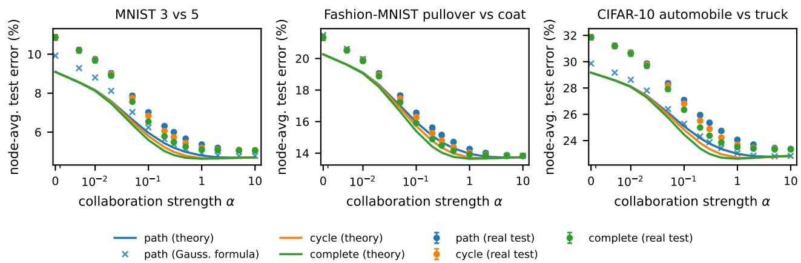  
Figure 5: Random splits into $N = 6$ nodes with $p = 1 0 0$ and $n _ { i } = 2 5 0 .$ , on a path, a cycle and a complete graph with total edge weight 6. Lines: Theorem 4. Dots: held-out test error with 95% intervals over 100 draws. Crosses: Gaussian formula (22) for the path. As in Corollary 3, the error decreases towards that of the pooled model.

• Mixture: GTVMin on the complete graph, with α chosen by 5-fold cross-validation.

• Best (hindsight): for each draw, the lowest test error over the grid.

Table 4 reports the same results with their confidence intervals.

Table 4: Test error (%) of Table 2 with 95% confidence intervals over 20 training draws.
<table><tr><td>Method</td><td>MNIST rot.</td><td>FMN. rot.</td><td>CIFAR subp.</td><td>CIFAR Dir.</td><td>HAR users</td><td>Adult silos</td></tr><tr><td>Local</td><td>10.97±0.23</td><td>22.32±0.42</td><td>17.35±0.31</td><td>15.41±0.36</td><td>20.77±0.72</td><td>25.77±0.34</td></tr><tr><td>Consensus</td><td>18.43±0.24</td><td>21.88±0.24</td><td>12.19±0.13</td><td>11.43±0.17</td><td>14.85±0.22</td><td>23.15±0.18</td></tr><tr><td>Fine-tuning</td><td>9.44±0.20</td><td>17.58±0.27</td><td>11.88±0.20</td><td>10.65±0.20</td><td>14.49±0.34</td><td>23.44±0.26</td></tr><tr><td>Mixture</td><td>9.08±0.18</td><td>17.35±0.22</td><td>11.84±0.20</td><td>10.58±0.21</td><td>14.74±0.37</td><td>23.56±0.22</td></tr><tr><td colspan="7">GTVMin, α chosen by</td></tr><tr><td>CV (5-fold)</td><td>8.47±0.21</td><td>17.90±0.29</td><td>11.64±0.14</td><td>10.52±0.19</td><td>14.37±0.27</td><td>23.51±0.30</td></tr><tr><td>Plug-in theory</td><td>8.37±0.18</td><td>17.86±0.24</td><td>11.81±0.19</td><td>10.44±0.18</td><td>14.39±0.29</td><td>23.78±0.28</td></tr><tr><td>Oracle theory</td><td>8.37±0.18</td><td>17.83±0.23</td><td>11.53±0.17</td><td>10.37±0.19</td><td>14.22±0.26</td><td>23.29±0.20</td></tr><tr><td>Best (hindsight)</td><td>8.29±0.17</td><td>17.73±0.22</td><td>11.45±0.17</td><td>10.25±0.18</td><td>13.91±0.23</td><td>22.95±0.17</td></tr></table>

## E.4 Where the gap comes from

We take the i.i.d. split of Fashion-MNIST (pullover vs. coat) on the path graph. At $\alpha = 0$ , the Gaussian formula gives an error of 23.2% on the real data, against a prediction of 20.7%. We then replace the data of each node by Gaussian samples with the same mean and covariance. The error becomes 20.4%, against a prediction of 20.5%, and at $\alpha = 0 . 0 5$ it is 16.50% against 16.54%. The gap therefore comes from the shape of the real data and not from the finite dimension.

The quantity that difers is the spread of the whitened squared norm $\| \Sigma ^ { - 1 / 2 } ( \mathbf { z } - { \pmb { \mu } } ) \| _ { 2 } ^ { 2 } / p \colon$ its standard deviation is 0.80 on the real data and 0.14 on the Gaussian samples. Normalizing each sample to a fixed $\ell _ { 2 }$ norm does not reduce the gap, because it does not change this spread in whitened coordinates. Replacing the noise term $r _ { i } \pmb { \Sigma } ^ { ( i ) }$ in the derivation by its heteroscedastic version E $[ ( 1 - \mathbf { z } ^ { \top } \mathbf { m } ^ { ( i ) } ) ^ { 2 } ( \mathbf { z } - { \pmb { \mu } } ^ { ( i ) } ) ( \mathbf { z } - { \pmb { \mu } } ^ { ( i ) } ) ^ { \top } ]$ reduces the gap only slightly. The gap is largest at $\alpha = 0$ , where each node has the largest efective aspect ratio, and it is small near consensus.

## E.5 Additional figures

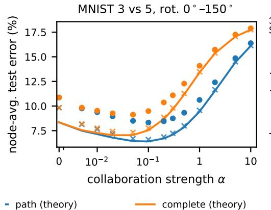

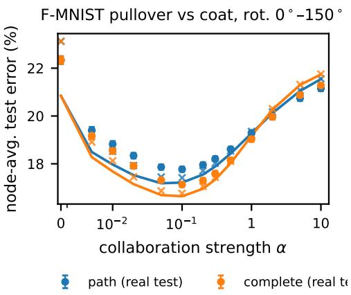  
Figure 6: Rotation shift: node k sees the images rotated by $3 0 ( k - 1 )$ degrees, $N = 6 , p = 1 0 0 , n _ { i } = 2 5 0$ , on a unit-weight path and a complete graph with total weight 5. Lines, dots and crosses as in Figure 5. The best α is intermediate, and on MNIST full collaboration is worse than local training.

## E.6 All settings

Table 6 gives the results of every setting. The columns are:

$| \Delta | _ { \mathrm { G } }$ and $| \Delta | _ { \mathrm { T } } \colon$ the largest diference over the grid between the prediction and, respectively, the Gaussian formula (22) and the held-out test error, in pp;

• $\alpha ^ { \mathrm { d e } }$ and $\alpha _ { \mathrm { t e s t } } ^ { \star }$ the value of α selected by the theory, and the one with the lowest mean test error;  
• regret: the extra test error at $\alpha ^ { \mathrm { d e } }$ , in pp;  
• local, cons. and best: the test errors (%) at $\alpha = 0 ,$ at $\alpha = 1 0 $ , and at $\alpha _ { \mathrm { t e s t } } ^ { \star } ;$  
• NC: the non-Gaussianity index, which equals 1 for Gaussian data.
<table><tr><td>Setting [graph]</td><td>N</td><td>p</td><td>|∆|G</td><td> $| \Delta | _ { \mathrm { T } }$ </td><td> $\alpha ^ { \mathrm { d e } }$ </td><td> $\alpha _ { \mathrm { t e s t } } ^ { \star }$ </td><td>regret</td><td>local</td><td>cons.</td><td>best</td><td>NC</td></tr><tr><td>iid; CIFAR auto/truck [complete]</td><td>6</td><td>100</td><td>0.70</td><td>2.69</td><td>1</td><td>5</td><td>0.17</td><td>31.9</td><td>23.3</td><td>23.3</td><td>3.1</td></tr><tr><td>iid; CIFAR auto/truck [cycle]</td><td>6</td><td>100</td><td>0.70</td><td>2.69</td><td>2</td><td>10</td><td>0.11</td><td>31.9</td><td>23.3</td><td>23.3</td><td>3.1</td></tr><tr><td>iid; CIFAR auto/truck [path]</td><td>6</td><td>100</td><td>0.70</td><td>2.69</td><td>5</td><td>10</td><td>0.07</td><td>31.9</td><td>23.4</td><td>23.4</td><td>3.1</td></tr><tr><td>iid; F-MNIST pullover/ /coat [complete]</td><td></td><td>6 100</td><td>1.23</td><td>1.07</td><td>1</td><td>10</td><td>0.10</td><td>21.3</td><td>13.8</td><td>13.8</td><td>3.7</td></tr><tr><td>iid; F-MNIST pullover/coat [cycle]</td><td></td><td>6 100</td><td>1.23</td><td>1.07</td><td>2</td><td>10</td><td>0.08</td><td>21.3</td><td>13.8</td><td>13.8</td><td>3.7</td></tr><tr><td>iid; F-MNIST pullover/coat [path]</td><td></td><td>6 100</td><td>1.23</td><td>1.07</td><td>5</td><td>10</td><td>0.03</td><td>21.3</td><td>13.8</td><td>13.8</td><td>3.7</td></tr><tr><td>iid; MNIST 3/5 [complete]</td><td></td><td>6 100</td><td>0.84</td><td>1.77</td><td>1</td><td>5</td><td>0.04</td><td>10.9</td><td>5.1</td><td>5.1</td><td>2.0</td></tr><tr><td>iid; MNIST 3/5 [cycle]</td><td></td><td>6 100</td><td>0.84</td><td>1.77</td><td>2</td><td>5</td><td>0.03</td><td>10.9</td><td>5.1</td><td>5.1</td><td>2.0</td></tr><tr><td>iid; MNIST 3/5 [path]</td><td></td><td>6 100</td><td>0.84</td><td>1.77</td><td>5</td><td>10</td><td>0.02</td><td>10.9</td><td>5.1</td><td>5.1</td><td>2.0</td></tr><tr><td>Dirichlet; CIFAR vehicle/animal, β=100.0 [complete]</td><td></td><td>6 100</td><td>0.87</td><td>1.78</td><td>1</td><td>5</td><td>0.11</td><td>20.7</td><td>12.5</td><td>12.5</td><td></td></tr><tr><td></td><td></td><td>6 100</td><td>0.87</td><td>1.78</td><td>1</td><td>5</td><td>0.18</td><td>20.7</td><td>12.5</td><td>12.5</td><td>3.1</td></tr><tr><td>Dirichlet; CIFAR vehicle/animal, β=100.0 [knn] Dirichlet; F-MNIST upper/rest, β=100.0 [complete]</td><td></td><td>6 100</td><td>1.19</td><td>3.70</td><td>1</td><td>10</td><td>0.08</td><td>10.7</td><td>6.3</td><td>6.3</td><td>3.1</td></tr><tr><td>Dirichlet; F-MNIST upper/rest, β=100.0 [knn]</td><td></td><td>6 100</td><td>1.19</td><td>3.70</td><td>1</td><td>10</td><td>0.09</td><td>10.7</td><td>6.3</td><td>6.3</td><td>3.3</td></tr><tr><td>Dirichlet; MNIST &lt; 5/≥ 5, β=100.0 [complete]</td><td></td><td>6 100</td><td>0.96</td><td>2.02</td><td>1</td><td>5</td><td>0.13</td><td>26.0</td><td>17.2</td><td>17.2</td><td>3.3 2.2</td></tr><tr><td>Dirichlet; MNIST &lt; 5/≥ 5, β=100.0 [knn]</td><td>6</td><td>100</td><td>0.96</td><td>2.02</td><td>1</td><td>10</td><td>0.17</td><td>26.0</td><td>17.2</td><td>17.2</td><td>2.2</td></tr><tr><td>Dirichlet; CIFAR vehicle/animal, β=0.1 [complete]</td><td></td><td>6 100</td><td>0.92</td><td>2.12</td><td>0.2</td><td>0.3</td><td>0.08</td><td>15.5</td><td>11.4</td><td>10.5</td><td>3.1</td></tr><tr><td>Dirichlet; CIFAR vehicle/animal, β=0.1 [knn]</td><td></td><td>6 100</td><td>0.92</td><td>2.12</td><td>0.2</td><td>0.3</td><td>0.05</td><td>15.5</td><td>11.4</td><td>10.4</td><td>3.1</td></tr><tr><td>Dirichlet; CIFAR vehicle/animal, β=0.5 [complete]</td><td></td><td>6 100</td><td>1.03</td><td>2.41</td><td>0.3</td><td>0.5</td><td>0.10</td><td>16.5</td><td>11.3</td><td>11.0</td><td>3.1</td></tr><tr><td>Dirichlet; CIFAR vehicle/animal, β=0.5 [knn]</td><td></td><td>6 100</td><td>1.03</td><td>2.41</td><td>0.5</td><td>0.5</td><td>0.00</td><td>16.5</td><td>11.3</td><td>10.9</td><td>3.1</td></tr><tr><td>Dirichlet; F-MNIST upper/rest, β=0.1 [complete]</td><td>6</td><td>100</td><td>0.79</td><td>2.29</td><td>0.1</td><td>0.1</td><td>0.00</td><td>4.6</td><td>4.1</td><td>3.1</td><td>3.9</td></tr><tr><td>Dirichlet; F-MNIST upper/rest, β=0.1 [knn]</td><td></td><td>6 100</td><td>0.79</td><td>2.29</td><td>0.1</td><td>0.1</td><td>0.00</td><td>4.6</td><td>4.1</td><td>3.1</td><td>3.9</td></tr><tr><td>Dirichlet; F-MNIST upper/rest, β=0.5 [complete]</td><td></td><td>6 100</td><td>1.19</td><td>3.06</td><td>0.3</td><td>0.3</td><td>0.00</td><td>8.2</td><td>5.9</td><td>5.5</td><td>3.8</td></tr><tr><td>Dirichlet; F-MNIST upper/rest, β=0.5 [knn]</td><td></td><td>6 100</td><td>1.19</td><td>3.06</td><td>0.3</td><td>0.5</td><td>0.01</td><td>8.2</td><td>5.8</td><td>5.6</td><td>3.8</td></tr><tr><td>Dirichlet; MNIST &lt; 5/≥ 5, β=0.1 [complete]</td><td></td><td>6 100</td><td>1.20</td><td>3.07</td><td>0.05</td><td>0.1</td><td>0.13</td><td>11.5</td><td>15.0</td><td>9.2</td><td>2.5</td></tr><tr><td>Dirichlet; MNIST &lt; 5/≥ 5, β=0.1 [knn]</td><td></td><td>6 100</td><td>1.20</td><td>3.07</td><td>0.05</td><td>0.1</td><td>0.12</td><td>11.5</td><td>14.7</td><td>9.3</td><td>2.5</td></tr><tr><td>Dirichlet; MNIST &lt; 5/≥ 5, β=0.5 [complete]</td><td></td><td>6 100</td><td>1.59</td><td>2.68</td><td>0.1</td><td>0.3</td><td>0.25</td><td>18.4</td><td>16.6</td><td>15.0</td><td>3.0</td></tr><tr><td>Setting [graph]</td><td></td><td>N</td><td>p |∆|G</td><td></td><td> $| \Delta | _ { \mathrm { T } }$ </td><td> $\alpha ^ { \mathrm { d e } }$ </td><td> $\alpha _ { \mathrm { t e s t } } ^ { \star }$ </td><td>regret</td><td>local</td><td>cons.</td><td>best NC</td></tr><tr><td>Dirichlet; MNIST &lt; 5/≥ 5, β=0.5 [knn]</td><td></td><td>6 100</td><td>1.59</td><td>2.68</td><td>0.1</td><td>0.2</td><td>0.11</td><td>18.4</td><td>16.6</td><td>14.8</td><td>3.0</td></tr><tr><td>rotation; F-MNIST pullover/coat [complete]</td><td></td><td>6 100</td><td>2.28</td><td>1.49</td><td>0.1</td><td>0.1</td><td>0.00</td><td>22.3</td><td>21.3</td><td>17.1</td><td>5.6</td></tr><tr><td>rotation; F-MNIST pullover/coat [path]</td><td></td><td>6 100</td><td>2.28</td><td>1.49</td><td>0.05</td><td>0.1</td><td>0.09</td><td>22.3</td><td>21.2</td><td>17.8</td><td>5.6</td></tr><tr><td>rotation; MNIST 3/5 [complete]</td><td></td><td>6 100</td><td>1.48</td><td>2.52</td><td>0.02</td><td>0.05</td><td>0.13</td><td>10.9</td><td>17.9</td><td>9.1</td><td>3.3</td></tr><tr><td>rotation; MNIST 3/5 [path]</td><td></td><td>6 100</td><td>1.48</td><td>2.52</td><td>0.1</td><td>0.1</td><td>0.00</td><td>10.9</td><td>16.4</td><td>8.3</td><td>3.3</td></tr><tr><td>rotation; F-MNIST 0v6 [path]</td><td></td><td>6 100</td><td>2.81</td><td>0.97</td><td>0.2</td><td>0.3</td><td>0.05</td><td>23.0</td><td>19.6</td><td>18.7</td><td>5.8</td></tr><tr><td>rotation; F-MNIST 4v6 [path]</td><td></td><td>6 100</td><td>2.33</td><td>1.21</td><td>0.1</td><td>0.2</td><td>0.06</td><td>23.0</td><td>20.2</td><td>17.9</td><td>5.7</td></tr><tr><td>rotation; F-MNIST 5v7 [path]</td><td></td><td>6 100</td><td>4.38</td><td>2.40</td><td>0.05</td><td>0.05</td><td>0.00</td><td>11.3</td><td>14.8</td><td>8.1</td><td>6.3</td></tr><tr><td>rotation; F-MNIST 7v9 [path]</td><td></td><td>6 100</td><td>1.95</td><td>2.64</td><td>0.05</td><td>0.1</td><td>0.02</td><td>8.2</td><td>7.3</td><td>6.1</td><td>5.1</td></tr><tr><td>rotation; MNIST 1v7 [path]</td><td></td><td>6 100</td><td>1.93</td><td>3.16</td><td>0.1</td><td>0.1</td><td>0.00</td><td>3.5</td><td>2.6</td><td>1.9</td><td>6.7</td></tr><tr><td>rotation; MNIST 2v7 [path]</td><td></td><td>6 100</td><td>0.98</td><td>2.73</td><td>0.05</td><td>0.1</td><td>0.13</td><td>5.5</td><td>6.8</td><td>3.6</td><td>3.3</td></tr><tr><td>rotation; MNIST 4v9 [path</td><td></td><td>6 100</td><td>1.66</td><td>2.26</td><td>0.05</td><td>0.2</td><td>0.24</td><td>9.6</td><td>14.5</td><td>6.8</td><td>4.1</td></tr><tr><td>rotation; MNIST 7v9 [path]</td><td></td><td>6 100</td><td>3.02</td><td>2.14</td><td>0.05</td><td>0.1</td><td>0.09</td><td>9.6</td><td>12.5</td><td>7.7</td><td>5.1</td></tr><tr><td>alignment; CIFAR subpop. [alternating]</td><td></td><td>6 100</td><td>0.89</td><td>1.99</td><td>0.5</td><td>5</td><td>0.18</td><td>17.3</td><td>12.1</td><td>12.1</td><td>3.3</td></tr><tr><td>alignment; CIFAR subpop. [grouped]</td><td></td><td>6 100</td><td>0.89</td><td>1.99</td><td>0.5</td><td>0.5</td><td>0.00</td><td>17.3</td><td>12.0</td><td>11.5</td><td>3.3</td></tr><tr><td>alignment; MNIST 0/90° [alternating]</td><td></td><td>6 100</td><td>1.22</td><td>2.41</td><td>0.01</td><td>0.01</td><td>0.00</td><td>11.0</td><td>12.8</td><td>10.3</td><td>2.9</td></tr><tr><td>alignment; MNIST 0/90° [grouped]</td><td></td><td>6 100</td><td>1.22</td><td>2.41</td><td>0.05</td><td>0.1</td><td>0.03</td><td>11.0</td><td>12.5</td><td>8.9</td><td>2.9</td></tr><tr><td>HAR; sit/stand, 10 groups [complete]</td><td></td><td>10 30</td><td>3.15</td><td>4.61</td><td>0.3</td><td>0.5</td><td></td><td>0.08 20.6</td><td>14.8</td><td>14.3</td><td>2.8</td></tr><tr><td>HAR; sit/stand, 10 groups [knn]</td><td></td><td>10 30</td><td>3.15</td><td>4.61</td><td>0.2</td><td>0.5</td><td></td><td>0.14 20.6</td><td>14.8</td><td>14.3</td><td>2.8</td></tr><tr><td>HAR; sit/stand, 30 users [complete]</td><td></td><td>30 12</td><td>2.68</td><td>4.59</td><td>0.02</td><td>0.5</td><td></td><td>1.29 23.7</td><td>20.0</td><td>19.0</td><td>1.8</td></tr><tr><td>HAR; sit/stand, 30 users [knn]</td><td></td><td>30 12</td><td>2.68</td><td>4.59</td><td>0.01</td><td>0.2</td><td></td><td>1.28 23.7</td><td>20.0</td><td>19.0</td><td>1.8</td></tr><tr><td>HAR; up/down, 10 groups [complete]</td><td></td><td>10 30</td><td>0.61</td><td>1.86</td><td>0.02</td><td>0.05</td><td></td><td>0.18 2.9</td><td>4.1</td><td>1.5</td><td>1.6</td></tr><tr><td>HAR; up/down, 10 groups [knn]</td><td></td><td>10 30</td><td>0.61</td><td>1.86</td><td>0.01</td><td>0.02</td><td></td><td>0.13 2.9</td><td>4.3</td><td>1.5</td><td>1.6</td></tr><tr><td>HAR; up/down, 30 users [complete]</td><td></td><td>30 12</td><td>0.49</td><td>1.50</td><td>0.01</td><td>0.05</td><td>0.15</td><td>2.2</td><td>4.3</td><td>0.9</td><td>1.1</td></tr><tr><td>HAR; up/down, 30 users [knn]</td><td></td><td>30 12</td><td>0.49</td><td>1.50</td><td>0.005</td><td>0.02</td><td>0.11</td><td>2.2</td><td>4.3</td><td>0.9</td><td>1.1</td></tr><tr><td>Adult; age [complete]</td><td></td><td>5 40</td><td>1.63</td><td>1.68</td><td>0.3</td><td></td><td>2 0.14</td><td>24.6</td><td>23.0</td><td>23.0</td><td>7.0</td></tr><tr><td>Adult; age [knn]</td><td></td><td>5 40</td><td>1.63</td><td>1.73</td><td>0.3</td><td></td><td>2 0.19</td><td>24.6</td><td>23.0</td><td>23.0</td><td>7.0</td></tr><tr><td>Adult; workclass [complete]</td><td></td><td>6</td><td>40 6.77</td><td>1.47</td><td></td><td>0.5</td><td>2</td><td>0.12 25.9</td><td>23.1</td><td>23.0</td><td>7.4</td></tr><tr><td>Adult; workclass [knn]</td><td></td><td>6</td><td>40 6.77</td><td>1.50</td><td></td><td>0.5</td><td>5</td><td>0.15 25.9</td><td>23.0</td><td>23.0</td><td>7.4</td></tr></table>

Table 6: Results for all 55 real-data settings.

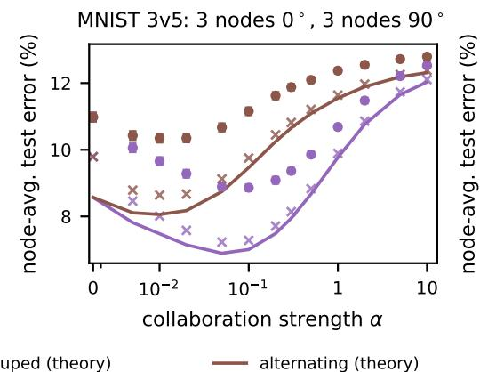

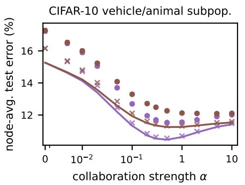  
Figure 7: Graph–task alignment on real data, with the two cycles of Figure 3. Left: MNIST 3 vs. 5, with nodes 1–3 upright and nodes 4–6 rotated by $9 0 °$ . Right: CIFAR-10, nodes 1–3 separate airplanes and ships from birds and frogs, nodes 4–6 automobiles and trucks from cats and dogs. Both cycles have the same Laplacian spectrum and use the same training draws. The grouped cycle, with two edges between diferent tasks instead of six, has the lower error, as predicted.

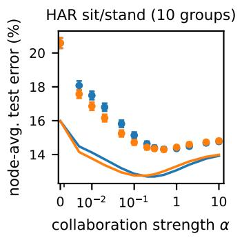

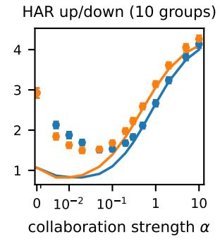

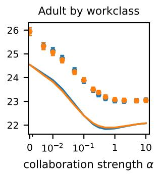

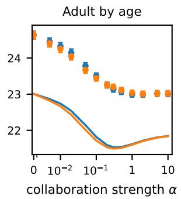  
Figure 8: Natural partitions. HAR: 10 nodes of 3 users each, $p = 3 0 , n _ { i } = 7 5 .$ . Adult: 6 employment sectors or 5 age groups, $p = 4 0 ,$ , unequal $n _ { i }$ . Complete graphs with total weight $N ,$ and k-NN graphs built from pool statistics $( k = 3$ for HAR, $k = 2$ for Adult). Lines and dots as in Figure 5.

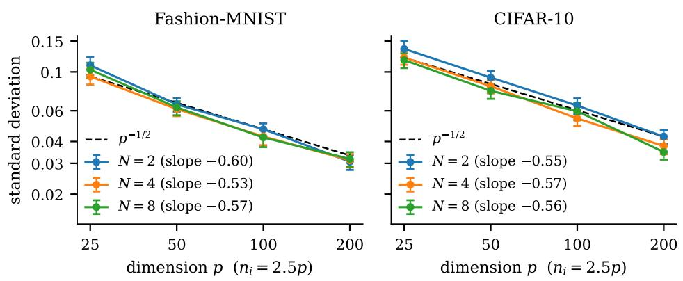  
Figure 9: Theorem 1 on real data: standard deviation over 200 training draws of the unit-norm observable $\begin{array} { r } { N ^ { - 1 / 2 } \sum _ { i } \mathbf { e } _ { 1 } ^ { \top } \widehat { \mathbf { w } } ^ { ( i ) } } \end{array}$ , for random splits of Fashion-MNIST (pullover vs. coat) and CIFAR-10 (automobile vs. truck). Unweighted cycle, $\alpha = 0 . 3 , n _ { i } = 2 . 5 p .$ , bootstrap 95% intervals. The fitted slopes, given in the legend, are close $\mathrm { t o \ t i { \Omega } ^ { \mathrm { { t o } } } - 1 / 2 }$ for every N.