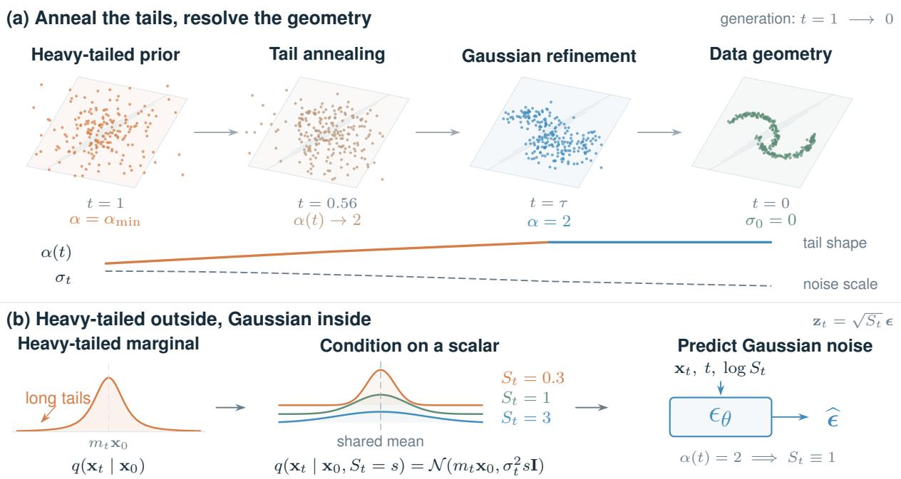
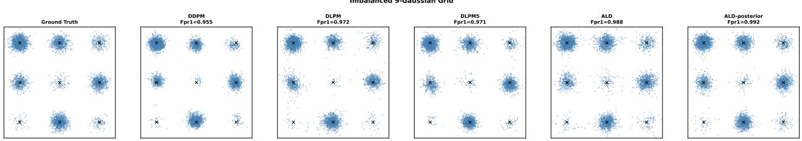
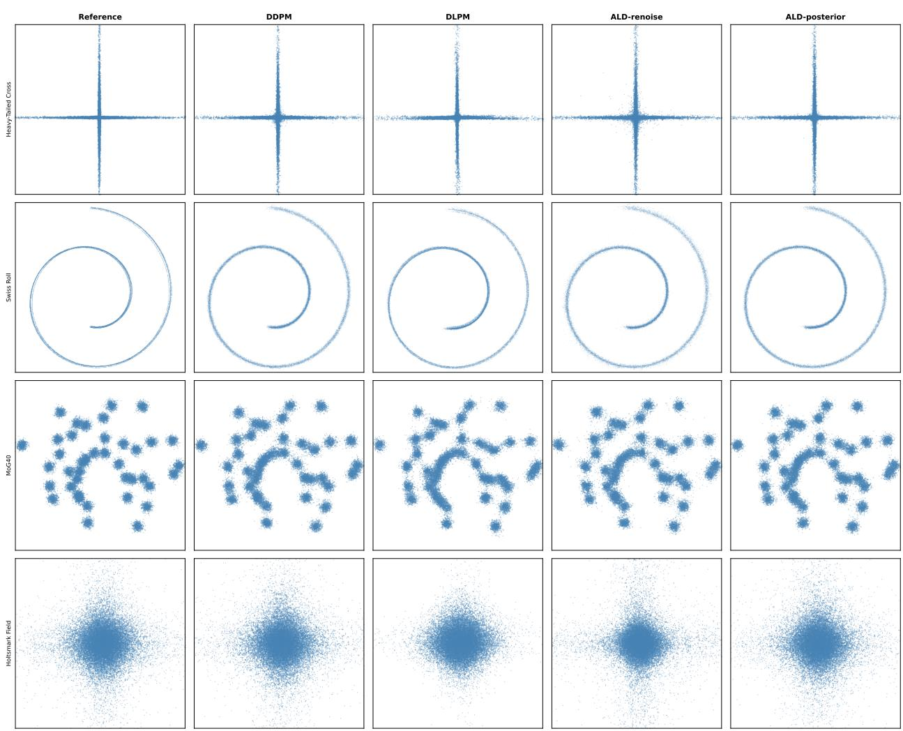
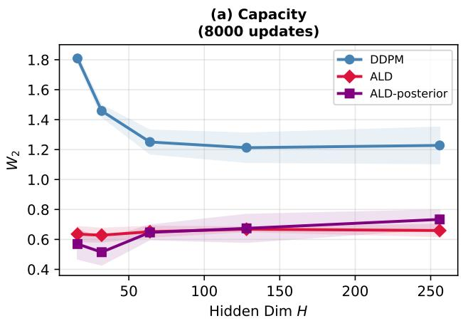
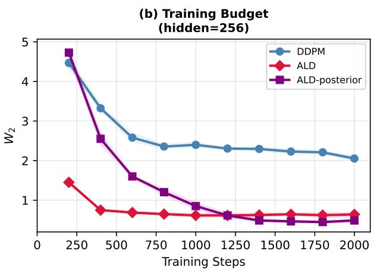
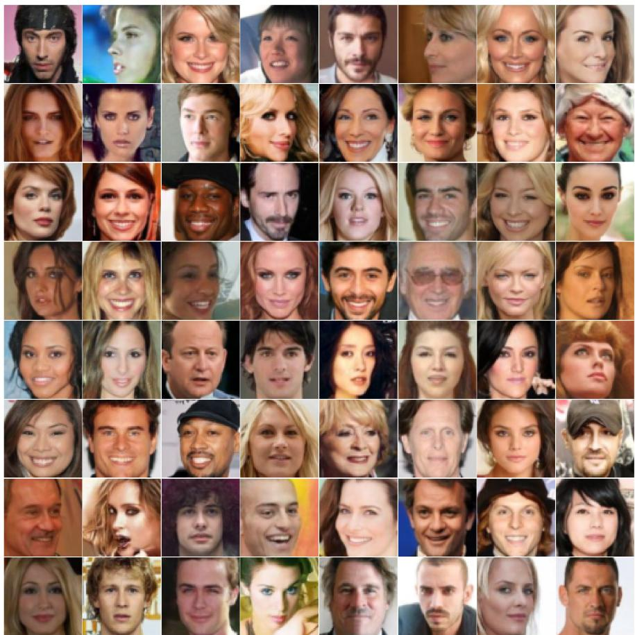
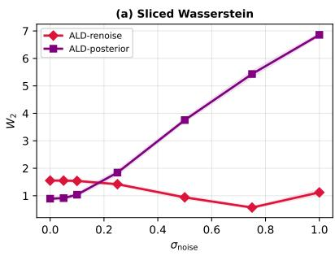
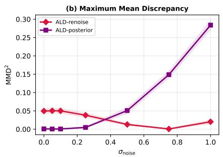
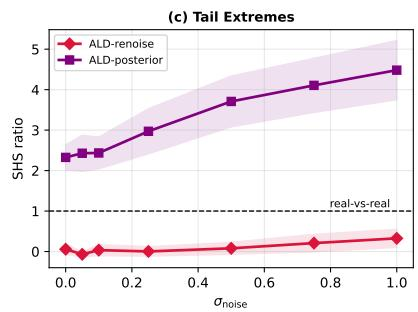

# ANNEALED LÉVY DIFFUSION VIA GAUSSIAN SURROGATE REVERSE DYNAMICS

## ARXIV PREPRINT

Yuling Jiao1, Lican Kang2, Jerry Zhijian Yang3, Cheng Yuan1, and Ruizhe Zhang3

1School of Artificial Intelligence, Wuhan University, Wuhan, Hubei 430072, China. {yulingjiaomath,yuancheng}@whu.edu.cn

2Institute for Math and AI, Hubei Key Laboratory of Computational Science, and School of Artificial Intelligence, Wuhan University, Wuhan, 430072, China. kanglican@whu.edu.cn

3School of Mathematics and Statistics, Wuhan University, Wuhan, Hubei 430072, China. {zjyang.math,ruizhezhang}@whu.edu.cn

October 14, 2026

## ABSTRACT

Gaussian diffusion models [Ho et al., 2020] offer a practical framework for generative modeling. Denoising Lévy Probabilistic Models (DLPM) [Shariatian et al., 2025] introduce heavy-tailed perturbations with a fixed tail index throughout denoising. We introduce Annealed Lévy Diffusion (ALD). ALD varies the stability index α(t) to combine heavy-tailed exploration with Gaussian refinement. Our marginal-first formulation represents stable noise as a scalar Gaussian scale mixture. This formulation enables standard Gaussian noise-prediction training with one additional scale input. We study two sampling processes. ALD-renoise estimates the clean sample and injects fresh marginal noise. ALD-posterior preserves dependence between successive states through an accumulated conditional variance and a Gaussian bridge update. Both samplers reuse the same trained predictor with different scalar inputs. We evaluate ALD on four 2D benchmarks and an imbalanced nine-mode mixture. We also examine training efficiency and the effects of prediction perturbations on clipped Holtsmark data. Additional experiments evaluate MNIST and CelebA64 generation and CIFAR-10LT augmentation. ALD preserves local geometry on the evaluated light-tailed and manifold-structured targets.

## 1 Introduction

Diffusion models [Sohl-Dickstein et al., 2015, Song and Ermon, 2020, Ho et al., 2020] have established themselves as the dominant paradigm for high-fidelity generative modeling, with applications spanning image synthesis [Dhariwal and Nichol, 2021, Rombach et al., 2022] and scientific problems [Pandey et al., 2025, Watson et al., 2023, Zeni et al., 2025]. Their core mechanism is to corrupt data $\mathbf { x } _ { 0 } \sim p _ { \mathrm { d a t a } }$ via a fixed stochastic process and learn to reverse it: the forward process produces ${ \bf x } _ { t } = m _ { t } { \bf x } _ { 0 } + \sigma _ { t } { \bf n }$ with $\mathbf { n } \sim \mathcal { N } ( \mathbf { 0 } , \mathbf { I } )$ , and generation proceeds via the estimated reverse kernel $p _ { \theta } ( \mathbf { x } _ { t - 1 } \mid \mathbf { x } _ { t } )$ . The common choice of Gaussian noise is motivated by analytical tractability: it admits closedform forward kernels, a stable ϵ-prediction objective, and a reverse-time SDE representation under suitable regularity conditions via Anderson’s time-reversal formula [Anderson, 1982]. However, for target distributions with polynomial tails, the Gaussian terminal prior and light-tailed perturbation kernels provide exponentially weaker relative coverage of extreme regions than the data law. With finite samples and training budgets, the network therefore struggles to estimate the score accurately in the tail regions due to the scarcity of training samples there.

This score estimation difficulty is consequential for a broad and scientifically important class of problems. The Holtsmark distribution describes Coulomb force statistics from random point charges and is a 3/2-stable distribution $( \alpha = 3 / 2$ , with PDF decaying as $| x | ^ { - 5 / 2 } )$ [Holtsmark, 1919, Samorodnitsky and Taqqu, 1994, Nolan, 2020]; financial return distributions can exhibit power-law tails, motivating heavy-tailed alternatives to Gaussian models [Gopikrish nan et al., 1999, Nolan, 2020, Larralde and Mota Navarro, 2025]; heavy-tailed statistics also arise in fluid dynamics and related transport phenomena, as illustrated by studies of anomalous transport and turbulence spreading [Solomon et al., 1993, Buonocore et al., 2020, Milovanov et al., 2025]. For such distributions, Gaussian diffusion can suffer from tail blindness: the terminal prior is light-tailed and the training distribution gives sparse effective coverage to rare extremes, so learned scores in tail regions are poorly constrained and may collapse toward bulk-dominated behavior. This bias is not merely a representational limitation: increasing capacity alone does not repair the sparse far-tail coverage induced by Gaussian corruption [Song and Ermon, 2019, Yu and Yu, 2026]; see also Experiment 5.3.

The natural remedy is to replace Gaussian noise with α-stable Lévy noise [Applebaum, 2009], whose tail probability decays polynomially as $\operatorname { P r } ( | z | > x ) \sim C _ { \alpha } x ^ { - \alpha }$ for $\alpha \in ( 0 , 2 ) ;$ ; at the boundary $\alpha = 2$ the distribution reduces to the Gaussian, whose tails decay exponentially and the polynomial formula no longer applies. This provides a parametric family that can be matched to infinite-variance polynomial-tail targets with tail exponent in $( 0 , 2 )$ by choosing α appropriately. However, prior attempts encounter one of two fundamental obstructions. Continuous $L e \nu y { - } I t \hat { o } ~ S D E$ approaches such as LIM [Yoon et al., 2023] require a reverse-time formulation adapted to jump-driven dynamics. Although $\operatorname { L e v y }$ processes are semimartingales and admit Itô calculus, the Brownian reverse-SDE formula based on the ordinary score $\bar { \nabla } _ { \mathbf { x } } \log p _ { t } ( \mathbf { x } )$ cannot be applied directly. For isotropic α-stable noise with $\alpha < 2 .$ , the generator is nonlocal and involves the fractional Laplacian $- ( - \Delta ) ^ { \alpha / 2 }$ . LIM derives the corresponding reverse-time formulation using a nonlocal fractional score and learns it through fractional denoising score matching, introducing additional analytical complexity relative to Gaussian diffusion. Discrete Markov chain models such as DLPM [Shariatian et al., 2025] avoid this fractional-score formulation by representing stable noise as a scalar Gaussian scale mixture and deriving approximate reverse updates through conditional Gaussian posterior calculations. Their explicit stable marginal laws rely on convolution closure among independent $\alpha \cdot$ -stable increments with a common stability index. DLPM therefore keeps α fixed throughout the chain; varying the index would generally take the accumulated noise outside the stable family used in its derivation. Although the noise amplitude can decrease during denoising, this fixed-index construction does not support independently annealing the tail index toward the Gaussian boundary $\alpha = 2$ during final refinement. This leaves no tail-index schedule for assigning different tail behavior to exploration and geometry refinement. Recent theoretical and empirical work also identifies a trade-off between improved initialization and the statistical difficulty of reverse estimation under heavy-tailed noising [Cherkaoui et al., 2026]. These paradigms expose complementary modeling constraints: jump-driven formulations require nonlocal reverse operators, while standard fixed-index stable chains do not provide a tail-index schedule. This motivates constructions that keep conditional Gaussian calculations tractable without requiring stable closure across time. We introduce Annealed $\mathbf { L } \acute { \mathbf { e } } \mathbf { y }$ Diffusion (ALD) to address the fixed-index restriction through a marginal-first construction that specifies $\alpha ( t )$ -stable perturbation kernels directly at each time. By retaining a scalar Gaussian scale-mixture representation, ALD allows $\alpha ( t )$ to vary while preserving tractable conditional Gaussian calculations and standard Gaussian noise-prediction training with one additional scale input. The resulting schedule combines heavy-tailed exploration with Gaussian refinement.

We adopt a marginal-first formulation related to diffusion models with location-scale noise [Jolicoeur-Martineau et al., 2023]. Instead of deriving the forward process from discrete convolution or a Lévy SDE, we define the perturbed state directly via the sub-Gaussian representation of an $\alpha ( t )$ -stable vector:

$$
\begin{array} { r } { \mathbf { x } _ { t } = m _ { t } \mathbf { x } _ { 0 } + \sigma _ { t } \sqrt { S _ { t } } \mathbf { n } , \quad S _ { t } \sim \mathcal { A } _ { \alpha ( t ) / 2 } , \quad \mathbf { n } \sim \mathcal { N } ( \mathbf { 0 } , \mathbf { I } ) , } \end{array}
$$

where $\mathcal { A } _ { \alpha ( t ) / 2 }$ is a positive $( \alpha ( t ) / 2 )$ -stable variance multiplier [Samorodnitsky and Taqqu, 1994, Sec. 2.5, Prop. 2.5.2]. Because xt is not derived from convolution of historical increments, $\alpha ( t )$ can be any prescribed function of t, enabling a two-phase annealing schedule that transitions from heavy-tailed exploration $\left( t \geq \tau \right)$ to pure Gaussian refinement $( t < \tau , S _ { t } \equiv 1 )$ . The reverse process is a discrete ancestral sampler: conditioned on $S _ { t }$ , the forward likelihood and denoising score target are Gaussian, so training reduces to standard Gaussian score matching with a single additional scalar input log $S _ { t }$ . The practical samplers reconstruct a clean-data estimate with a Gaussian noise predictor. We study direct marginal re-noising (ALD-renoise) and a variance-controlled adjacent transition (ALD-posterior) that retains the current-state contribution and tracks the accumulated conditional noise variance.

Contributions. Our central contribution is a marginal-first construction that uses time-dependent $\alpha ( t )$ -stable perturbation kernels and conditional Gaussian noise prediction. This construction permits a two-phase schedule from heavytailed exploration to Gaussian refinement and can reuse standard diffusion backbones with a scalar scale-conditioning input. We provide two practical reverse updates, ALD-renoise and ALD-posterior, which share a trained predictor but differ in adjacent-state coupling. Through experiments on synthetic and image datasets, we analyze tail recovery, geometric fidelity, and sensitivity to prediction errors, and evaluate the effectiveness of ALD for downstream data augmentation.

## 2 Related Work

Score-based generative models Song and Ermon [2020], Ho et al. [2020] learn to reverse diffusion via score estimation; the score SDE framework Song et al. [2021a] unifies discrete and continuous approaches, identifying the probability flow ODE as a deterministic counterpart to the reverse SDE. Flow Matching Lipman et al. [2023], Liu et al. [2023] regresses directly on conditional velocity fields, while Stochastic Interpolants Albergo et al. [2025], Ma et al. [2024] subsume both perspectives by deriving smooth marginal velocity fields from algebraic interpolation. Among heavytailed generative models, DLPM Shariatian et al. [2025] replaces Gaussian noise with fixed-α stable noise in a discrete Markov chain via convolution closure; LIM Yoon et al. [2023] embeds α-stable Lévy processes into a continuous SDE and derives a reverse process via fractional denoising score matching; t-EDM and t-Flow Pandey et al. [2025] use Student-t distributions with a fixed Student-t tail parameter under the EDM framework. DLPM and LIM use a fixed stable index, while t-EDM and t-Flow use a fixed Student-t tail parameter. ALD prescribes a time-dependent stable index through a conditional Gaussian scale-mixture formulation. Cold Diffusion Bansal et al. [2023] studies more general image degradations, including deterministic transforms such as blur and masking, rather than requiring

stable-noise perturbations. The sub-Gaussian representation $\mathbf { z } \overset { d } { = } \sqrt { S }$ n is classical Samorodnitsky and Taqqu [1994], Feller [1971] and has been exploited in robust statistics and neural network weight analysis Hodgkinson and Mahoney [2021]; we use it as the structural foundation of our marginal-first forward process. ALD’s two-phase annealing draws philosophical inspiration from Annealed Importance Sampling Neal [2001] and parallel tempering Swendsen and Wang [1986], but performs annealing within a single continuous-time reverse trajectory via the dynamic $\alpha ( t )$ parameter.

## 3 Preliminaries

## 3.1 Ancestral Sampling in the Gaussian Setting

Denoising diffusion probabilistic models (DDPMs) Ho et al. [2020] specify a discrete Markov forward chain

$$
q ( \mathbf { x } _ { 1 : K } \mid \mathbf { x } _ { 0 } ) = \prod _ { k = 1 } ^ { K } q ( \mathbf { x } _ { k } \mid \mathbf { x } _ { k - 1 } ) , \qquad q ( \mathbf { x } _ { k } \mid \mathbf { x } _ { k - 1 } ) = { \mathcal { N } } ( { \sqrt { \alpha _ { k } } } \mathbf { x } _ { k - 1 } , \beta _ { k } \mathbf { I } ) , \quad \alpha _ { k } = 1 - \beta _ { k } .\tag{1}
$$

Writing $\begin{array} { r } { \bar { \alpha } _ { k } = \prod _ { j = 1 } ^ { k } \alpha _ { j } } \end{array}$ , its one-time marginal is

$$
\begin{array} { r } { { \bf x } _ { k } = \sqrt { \bar { \alpha } _ { k } } { \bf x } _ { 0 } + \sqrt { 1 - \bar { \alpha } _ { k } } { \bf n } , \qquad { \bf n } \sim \mathcal { N } ( { \bf 0 } , { \bf I } ) . } \end{array}\tag{2}
$$

The clean-data-conditioned adjacent-time posterior is

$$
q ( \mathbf { x } _ { k - 1 } \mid \mathbf { x } _ { k } , \mathbf { x } _ { 0 } ) = \mathcal { N } \Big ( A _ { k } \mathbf { x } _ { k } + B _ { k } \mathbf { x } _ { 0 } , \tilde { \beta } _ { k } \mathbf { I } \Big ) ,\tag{3}
$$

where

$$
A _ { k } = \frac { \sqrt { \alpha _ { k } } ( 1 - \bar { \alpha } _ { k - 1 } ) } { 1 - \bar { \alpha } _ { k } } , \qquad B _ { k } = \frac { \sqrt { \bar { \alpha } _ { k - 1 } } \beta _ { k } } { 1 - \bar { \alpha } _ { k } } , \qquad \tilde { \beta } _ { k } = \frac { 1 - \bar { \alpha } _ { k - 1 } } { 1 - \bar { \alpha } _ { k } } \beta _ { k } .
$$

Standard ancestral DDPM sampling parameterizes this adjacent-time Gaussian reverse kernel and substitutes a network estimate $\hat { \mathbf { x } } _ { 0 } ( \mathbf { x } _ { k } , k )$ for $\mathbf { x } _ { \mathrm { 0 } }$ in its mean. Thus the update retains an explicit $\mathbf { x } _ { k }$ term and uses the adjacent-posterior variance $\tilde { \beta } _ { k } ;$ it is not an independent draw from the next marginal $\mathcal { N } ( \sqrt { \bar { \alpha } _ { k - 1 } } \hat { \mathbf { x } } _ { 0 } , ( 1 - \bar { \alpha } _ { k - 1 } ) \mathbf { I } )$ . The usual ϵ-prediction parameterization trains the network by minimizing $\mathbb { E } \| \boldsymbol { \epsilon } _ { \pmb { \theta } } ( \mathbf { x } _ { k } , k ) - \mathbf { n } \| _ { 2 } ^ { 2 }$

## 3.2 Heavy-Tailed Diffusion: DLPM

DLPM Shariatian et al. [2025] extends the above by replacing the Gaussian noise n with α-stable noise. A nondegenerate random variable X is $\scriptstyle - s t a b l e$ , with stability index $\alpha \in ( 0 , 2 ]$ , if, for every integer $n \geq 2 ,$ independent random variables $X _ { 1 } , \ldots , X _ { n }$ having the same distribution as $X$ satisfy $X _ { 1 } + \cdot \cdot \cdot + X _ { n } \ { \stackrel { d } { = } } \ n ^ { 1 / \alpha } X + d _ { n }$ for some constant $d _ { n } \in \mathbb { R }$ . For $\alpha \in ( 0 , 2 )$ , the distribution is heavy-tailed with polynomial tail $\operatorname* { P r } ( | X | > x ) \sim C _ { \alpha } x ^ { - \alpha }$ , where the stability index α directly controls the polynomial decay rate. The boundary case $\alpha = 2$ is Gaussian, whose tails decay exponentially—it does not satisfy the polynomial formula above.

DLPM defines the forward process as a discrete Markov chain with transition

$$
\mathbf { x } ^ { ( k ) } \mid \mathbf { x } ^ { ( k - 1 ) } , S _ { k } \sim { \mathcal { N } } { \Big ( } \gamma _ { k } \mathbf { x } ^ { ( k - 1 ) } , \sigma _ { k } ^ { 2 } S _ { k } \mathbf { I } { \Big ) } , \qquad S _ { k } \sim { \mathcal { A } } _ { \alpha / 2 } .\tag{4}
$$

Here, $S _ { k }$ is an independently sampled positive $( \alpha / 2 )$ )-stable random variable at each step; specifically, for $0 < \alpha < 2 ,$ it is supported on $( 0 , \infty )$ and characterized by the Laplace transform $\mathbb { E } \big [ e ^ { - \lambda S _ { k } } \big ] = \exp \big ( - \bar { \lambda ^ { \alpha / 2 } } \big )$ for $\lambda \geq 0 ,$ exhibiting increasingly heavy-tailed behavior as α decreases. By convolution closure (the sum of two independent α-stable variables with the same α is again α-stable), the marginals admit the closed-form Gaussian scale-mixture representation

$$
{ \bf x } ^ { ( k ) } \mid { \bf x } _ { 0 } \stackrel { d } { = } \bar { m } _ { k } { \bf x } _ { 0 } + \bar { \sigma } _ { k } \sqrt { \bar { S } _ { k } } { \bf n } , \qquad \bar { S } _ { k } \sim \mathcal { A } _ { \alpha / 2 } , \qquad { \bf n } \sim \mathcal { N } ( { \bf 0 } , { \bf I } ) , \qquad \bar { S } _ { k } \perp { \bf n } .
$$

Here $\gamma _ { k }$ and $\sigma _ { k }$ are one-step coefficients, whereas $\bar { m } _ { k }$ and $\bar { \sigma } _ { k }$ are the marginal signal and noise scales.

This yields a training objective analogous to ϵ-prediction at comparable cost to DDPM. Fixed-index heavy-tailed perturbations can introduce spurious extremes near geometric structures, as illustrated by our evaluated 2D benchmarks (Section 5.2). If independent stable increments have different indices, their sum is generally not stable, so the fixed-index marginal representation above does not directly extend to a time-varying index. A different construction is therefore needed to prescribe stable perturbations with a varying index. This modeling constraint motivates our marginal-first formulation.

## 3.3 Notation

Table 1 summarizes the mathematical notation used throughout.

Table 1: Summary of Notation  
Symbol Description   
$\mathbf { x } _ { t }$ State vector at diffusion time $t \in [ 0 , 1 ]$   
$\mathbf { x } _ { \mathrm { 0 } }$ Data sample from $p _ { \mathrm { d a t a } } ( \mathbf { x } )$   
$\alpha ( t )$ Time-dependent stability index, $\alpha ( t ) \in ( 1 , 2 ]$   
$S _ { t }$ Positive stable variance multiplier, $\dot { S } _ { t } \sim \dot { \mathcal { A } _ { \alpha ( t ) / 2 } } ; S _ { t } \equiv 1 \mathrm { i f } \alpha ( t ) = 2$   
${ \tilde { S } } _ { t }$ Clamped impulse, $\tilde { S } _ { t } = \operatorname* { m i n } ( S _ { t } , S _ { \operatorname* { m a x } } )$   
n Standard Gaussian random vector, $\mathbf { n } \sim \mathcal { N } ( \mathbf { 0 } , \mathbf { I } )$   
$\pmb \theta$ Learnable parameters of the neural network   
$m _ { t } , \sigma _ { t }$ Signal scale and noise scale coefficients   
$\tau$ Phase-transition threshold (refinement phase: $t < \tau )$   
$W _ { 2 } ( p , q )$ Wasserstein-2 distance; experimental columns use the sliced version (Section 5.1)

## 4 Methodology

## 4.1 ALD Forward Process and Annealing Schedule

Instead of relying on discrete Markov chains or Brownian-driven SDEs, we define the forward process directly through time-dependent marginal perturbation kernels. We employ the sub-Gaussian representation of α-stable vectors [Samorodnitsky and Taqqu, 1994]: the noise vector can be written as $\mathbf { z } _ { t } ~ = ~ \sqrt { S _ { t } } \mathbf { n }$ , where $\mathbf { x } _ { 0 } , S _ { t } .$ , and n are mutually independent. $\mathbf { A } \mathbf { t } \alpha ( \bar { t } ) = 2$ , this representation degenerates to $S _ { t } \equiv 1$

With stability index $\alpha ( t ) \in ( 0 , 2 ]$ , the characteristic function of $\mathbf { z } _ { t }$

$$
\mathbb { E } \Big [ e ^ { i \langle \pmb { \xi } , \mathbf { z } _ { t } \rangle } \Big ] = \exp \left[ - \left( \frac { \| \pmb { \xi } \| _ { 2 } ^ { 2 } } { 2 } \right) ^ { \alpha ( t ) / 2 } \right] .\tag{5}
$$

At the boundary $\alpha ( t ) = 2$ , this distribution recovers the standard Gaussian $\mathcal { N } ( \mathbf { 0 } , \mathbf { I } )$ . Using the representation mentioned in Section 1, we define the ALD forward process as follows.

Definition 4.1 (ALD Forward Process). At any diffusion time $t \in [ 0 , 1 ]$ , the perturbed state $\mathbf { x } _ { t }$ is defined via the sub-Gaussian representation ofan isotropic α(t)-stable vector:

$$
\mathbf { x } _ { t } = m _ { t } \mathbf { x } _ { 0 } + \sigma _ { t } \sqrt { S _ { t } } \mathbf { n } , \qquad \mathbf { n } \sim \mathcal { N } ( \mathbf { 0 } , \mathbf { I } ) , \qquad S _ { t } \sim \mathcal { A } _ { \alpha ( t ) / 2 } ,\tag{6}
$$

where $\mathbf { x } _ { 0 } \sim p _ { \mathrm { d a t a } } , m _ { t } , \sigma _ { t }$ are defined by Eq. (7), and $S _ { t }$ is sampled independently of n. For $\alpha ( t ) = 2$ , we set $S _ { t } \equiv 1$

  
Figure 1: ALD combines tail annealing with a Gaussian scale-mixture representation. (a) Illustrative perturbation marginals along generation: the stability index $\alpha ( t )$ reaches 2 at $t = \tau$ , while $\sigma _ { t }$ separately controls noise magnitude. (b) Random $S _ { t }$ yields heavy-tailed marginal noise, while conditioning on $\mathbf { x } _ { \mathrm { 0 } }$ and $S _ { t }$ gives a Gaussian kernel and enables conditional ϵ-prediction. $\mathrm { A t } \alpha ( t ) \dot { = } 2 , S _ { t } \equiv 1$ . The slices show one-time marginals, not a cross-time sampling coupling; the kernel curves depict the ideal unclamped construction.

For the interpolation coefficients $m _ { t }$ and $\sigma _ { t } ,$ we choose the trigonometric schedule [Chen, 2023]: letting $\begin{array} { r } { \vartheta _ { t } = \frac { \pi } { 2 } t , } \end{array}$ , we set

$$
m _ { t } = \cos ( \vartheta _ { t } ) , \qquad \sigma _ { t } = \sin ( \vartheta _ { t } ) .\tag{7}
$$

The forward perturbation can be interpreted as a direct perturbation of $\mathbf { x } _ { \mathrm { 0 } }$ at time $t \colon { \boldsymbol { m } } _ { t }$ attenuates the data signal, $\sigma _ { t }$ scales the noise level, and $\alpha ( t )$ governs the tail behavior. When $\alpha ( t ) < 2 ,$ , the noise exhibits a heavy polynomial tail, $\mathrm { P r } ( \| \mathbf { z } _ { t } \| _ { 2 } > r ) \asymp r ^ { - \alpha ( t ) }$ as $r  \infty$ , where the stability index dictates the polynomial decay rate. $\mathrm { A t } \alpha ( t ) = 2 .$ it transitions to a Gaussian distribution with exponential tail decay. Thus, the construction generalizes the one-time DDPM perturbation marginals (Section 3.1) to heavy-tailed noise. Setting $\alpha ( t ) \equiv 2$ recovers the DDPM Gaussian marginal kernel $q ( \mathbf { x } _ { t } \mid \mathbf { x } _ { 0 } )$ .

Crucially, because the construction directly defines the marginal at each t rather than accumulating convolution steps, $\alpha ( t )$ can be prescribed independently across arbitrary time steps. This flexibility enables a time-varying schedule for α(t) in practice.

Remark 4.1 (Comparison with SDE). Classical score-SDE constructions rely on a continuous-timeforward dynamics whose terminal law is chosen or approximated by an easy-to-sample prior, and whose reverse-time dynamics are justified by Anderson’s time-reversalformula. ALD does not make this SDE commitment. Instead, (6) defines afamily of marginal perturbation kernels directly. The terminal marginal is exactly sampleable because $m _ { 1 } = 0 a n d \sigma _ { 1 } = 1$ giving $\mathbf { x } _ { 1 } = \sqrt { S _ { 1 } } \mathbf { n } ,$ , independent $o f { \bf x } _ { 0 }$

Schedule for time-varying $\alpha ( t )$ . Intuitively, we use $\alpha ( t )$ to establish a two-phase denoising dynamic. In the early exploration phase $\left( t > \tau \right)$ , heavy-tailed perturbations are intended to facilitate exploration across low-density intermode regions. In the subsequent refinement phase $( t \leq \tau )$ , the perturbation becomes Gaussian $( S _ { t } \equiv 1 )$ , reducing large noise impulses near the data manifold. To realize this mechanism, we adopt a piecewise linear schedule (Figure 1):

$$
\alpha ( t ) = \left\{ \begin{array} { l l } { \displaystyle 2 - \frac { \big ( 2 - \alpha _ { \mathrm { m i n } } \big ) \big ( t - \tau \big ) } { 1 - \tau } , } & { t \geq \tau , } \\ { \displaystyle 2 , } & { t < \tau , } \end{array} \right.\tag{8}
$$

where $\tau \in [ 0 , 1 )$ denotes the phase-transition threshold and $\alpha _ { \operatorname* { m i n } } \in ( 1 , 2 )$ bounds the tail heaviness. As demonstrated in Section $5 ,$ , this schedule yields clear empirical benefits:

• On light-tailed and manifold heavy-tailed benchmarks, ALD matches the performance of DDPM, while the DLPM may exhibit a heavy-tail hallucination (Section 5.2).

• On globally heavy-tailed distributions, ALD strictly outperforms DDPM while incurring substantially lower training costs (Sections 5.2, 5.3).

• Across all evaluated settings, ALD consistently achieves higher sample fidelity than DLPM (Section 5.2).

Conditional Gaussianity. Conditioned on $S _ { t } ,$ , the forward kernel is Gaussian: $\mathbf { x } _ { t } \mid \mathbf { x } _ { 0 } , S _ { t } \sim { \mathcal { N } } ( m _ { t } \mathbf { x } _ { 0 } , \sigma _ { t } ^ { 2 } S _ { t } \mathbf { I } )$ . This is the key computational property: all heavy-tailed behavior is encoded in the scalar $S _ { t }$ , while the conditional structure remains analytically tractable and identical to standard score matching.

## 4.2 Sampling Process and Training Objective

The forward construction specifies the perturbation distribution at each time, but does not determine transitions between times. We therefore introduce two sampling rules below. We first define the following two transitions using their ideal conditional means. The network approximation is introduced only in the training paragraph below.

Direct marginal re-noising. For the marginal state $\left( \mathbf { x } _ { t } , S _ { t } \right)$ , define the ALD-renoise denoiser

$$
\hat { \mathbf { x } } _ { 0 } ^ { \mathrm { R } } : = \mathbb { E } [ \mathbf { x } _ { 0 } \mid \mathbf { x } _ { t } , S _ { t } ] = \frac { \mathbf { x } _ { t } - \sigma _ { t } \sqrt { S _ { t } } \mathbb { E } [ \mathbf { n } \mid \mathbf { x } _ { t } , S _ { t } ] } { m _ { t } } , \qquad 0 < t < 1 .\tag{9}
$$

The sampler independently draws $S _ { t - \Delta t }$ from the prescribed next-time scale law and $\mathbf { n } ^ { \prime } \sim \mathcal { N } ( \mathbf { 0 } , \mathbf { I } )$ , then updates

$$
\mathbf { x } _ { t - \Delta t } = m _ { t - \Delta t } \hat { \mathbf { x } } _ { 0 } ^ { \mathrm { R } } + \sigma _ { t - \Delta t } \sqrt { S _ { t - \Delta t } } \mathbf { n } ^ { \prime } .\tag{10}
$$

We call Eq. (10) $A L D$ -renoise; its complete implementation is given in Algorithm 2. The update uses the current state only through $\hat { \mathbf { x } } _ { 0 } ^ { \mathrm { R } }$ and injects fresh noise at the full next-time marginal scale. It therefore does not preserve the local dependence between adjacent states. Repeating full marginal re-noising can over-inject randomness, producing oscillatory or unstable finite-step trajectories and amplifying reconstruction errors.

$\mathrm { A t } \ i = 1 , m _ { 1 } = 0$ , so Eq. (9) is not evaluated. Independence gives $\mathbb { E } [ { \mathbf { x } } _ { 0 } \mid { \mathbf { x } } _ { 1 } , S _ { 1 } ] = \mathbb { E } [ { \mathbf { x } } _ { 0 } ]$ , for which we use the empirical estimate $\begin{array} { r } { \bar { \mathbf { x } } _ { \mathrm { d a t a } } : = M ^ { - 1 } \sum _ { j = 1 } ^ { M } \mathbf { x } _ { 0 } ^ { ( j ) } } \end{array}$

Variance-controlled adjacent transition. In our high-dimensional image experiments , we observed unstable generation with ALD-renoise. Its update injects fresh noise at the full next-time marginal scale after each denoising step. This motivates controlling the variance injected at each reverse step to improve sampling stability.

Following the Gaussian forward transition in DDPM [Ho et al., 2020], we construct an adjacent transition using our coefficients $m _ { t }$ and $\sigma _ { t }$ . Scaling $\mathbf { x } _ { t - \Delta t }$ by $m _ { t } / m _ { t - \Delta i }$ t leaves a noise variance of $( m _ { t } ^ { 2 } / \bar { m } _ { t - \Delta t } ^ { 2 } ) \sigma _ { t - \Delta t } ^ { 2 }$ . To obtain $\operatorname { C o v } ( \mathbf { x } _ { t } \mid \mathbf { x } _ { 0 } ) = \sigma _ { t } ^ { 2 } \mathbf { I }$ , we add independent Gaussian noise with variance $\sigma _ { t } ^ { 2 } - ( m _ { t } ^ { 2 } / m _ { t - \Delta t } ^ { 2 } ) \sigma _ { t - \Delta t } ^ { 2 }$ . We multiply this variance by the current scale $S _ { t } .$ , giving

$$
\mathbf { x } _ { t } = \frac { m _ { t } } { m _ { t - \Delta t } } \mathbf { x } _ { t - \Delta t } + \sqrt { \left( \sigma _ { t } ^ { 2 } - \frac { m _ { t } ^ { 2 } } { m _ { t - \Delta t } ^ { 2 } } \sigma _ { t - \Delta t } ^ { 2 } \right) S _ { t } } \mathbf { n } _ { t } , \qquad \mathbf { n } _ { t } \sim \mathcal { N } ( \mathbf { 0 } , \mathbf { I } ) .\tag{11}
$$

At each step, independently draw $S _ { t } \sim \mathcal { A } _ { \alpha ( t ) / 2 }$ . For $\alpha ( t ) = 2 ,$ set $S _ { t } = 1$

Let $V _ { t }$ denote the accumulated conditional noise variance. Independence of the added noise gives

$$
V _ { t } = \frac { m _ { t } ^ { 2 } } { m _ { t - \Delta t } ^ { 2 } } V _ { t - \Delta t } + \left( \sigma _ { t } ^ { 2 } - \frac { m _ { t } ^ { 2 } } { m _ { t - \Delta t } ^ { 2 } } \sigma _ { t - \Delta t } ^ { 2 } \right) S _ { t } , \qquad V _ { 0 } = 0 .\tag{12}
$$

Thus, $S _ { t }$ controls the newly added noise, whereas $V _ { t }$ accounts for the noise accumulated across preceding steps. Conditioned on $\mathbf { x } _ { \mathrm { 0 } }$ and $V _ { t } .$ , the current state satisfies $\mathbf { x } _ { t } \mid \mathbf { x } _ { 0 } , V _ { t } \sim { \mathcal { N } } ( m _ { t } \mathbf { x } _ { 0 } , V _ { t } \mathbf { I } )$ .Similarly to [Ho et al., 2020], we construct the adjacent posterior for the forward coupling in Eq. (11). Gaussian conditioning yields

$$
\mathbb { E } [ \mathbf { x } _ { t - \Delta t } \mid \mathbf { x } _ { t } , \mathbf { x } _ { 0 } , V _ { t - \Delta t } , V _ { t } ] = \frac { m _ { t } V _ { t - \Delta t } } { m _ { t - \Delta t } V _ { t } } \mathbf { x } _ { t } + m _ { t - \Delta t } \left( 1 - \frac { m _ { t } ^ { 2 } V _ { t - \Delta t } } { m _ { t - \Delta t } ^ { 2 } V _ { t } } \right) \mathbf { x } _ { 0 } ,\tag{13}
$$

$$
\operatorname { C o v } ( \mathbf { x } _ { t - \Delta t } \mid \mathbf { x } _ { t } , \mathbf { x } _ { 0 } , V _ { t - \Delta t } , V _ { t } ) = V _ { t - \Delta t } \left( 1 - \frac { m _ { t } ^ { 2 } V _ { t - \Delta t } } { m _ { t - \Delta t } ^ { 2 } V _ { t } } \right) \mathbf { I } .\tag{14}
$$

For $0 < t < 1$ , the corresponding denoiser is

$$
\hat { \mathbf { x } } _ { 0 } ^ { \mathrm { P } } : = \mathbb { E } [ \mathbf { x } _ { 0 } \mid \mathbf { x } _ { t } , V _ { t } ] = \frac { \mathbf { x } _ { t } - \sqrt { V _ { t } } \mathbb { E } [ \mathbf { n } \mid \mathbf { x } _ { t } , V _ { t } ] } { m _ { t } } .\tag{15}
$$

Replacing $\mathbf { x } _ { \mathrm { 0 } }$ in Eq. (13) by the denoiser $\hat { \mathbf { x } } _ { 0 } ^ { \mathrm { P } }$ and using the covariance in Eq. (14) defines ALD-posterior, a Gaussian approximation to the reverse conditional. This update injects only the adjacent conditional variance, which is no greater than $V _ { t - \Delta t }$ , rather than fresh noise at the full next-time marginal scale. Algorithm 3 gives the sampling procedure.

However, this construction changes the forward marginal distributions. The accumulated variance $V _ { t }$ depends on the scales sampled across steps, whereas the original perturbation uses $\sigma _ { t } ^ { 2 } S _ { t }$ at each individual time. Consequently, this construction generally changes the forward marginal distribution of x relative to Eq. (6). Nevertheless, the alternative forward process still starts from $p _ { \mathrm { d a t a } } ,$ , since $m _ { 0 } = 1$ and $V _ { 0 } = 0$ . Our objective remains generation from this data distribution, using the modified perturbation family to obtain a more stable sampling procedure

Remark 4.2 (Preserving the Original Marginals). To preserve the original conditional noise variance $\sigma _ { t } ^ { 2 } S _ { t }$ under an adjacent linear Gaussian transition, the variance ofthe added noise must be

$$
\sigma _ { t } ^ { 2 } S _ { t } - \frac { m _ { t } ^ { 2 } } { m _ { t - \Delta t } ^ { 2 } } \sigma _ { t - \Delta t } ^ { 2 } S _ { t - \Delta t } .
$$

A valid Gaussian transition therefore requires

$$
\sigma _ { t } ^ { 2 } S _ { t } \geq \frac { m _ { t } ^ { 2 } } { m _ { t - \Delta t } ^ { 2 } } \sigma _ { t - \Delta t } ^ { 2 } S _ { t - \Delta t } .
$$

This condition need not holdfor independently sampled scales. Ifitfails, both the addedforward noise variance and the corresponding reverse conditional variance become negative. The accumulated-variance construction in Eq. (12) avoids this issue, but generally changes the originalforward marginal distributions.

Remark 4.3 (Implementation). Although ALD-posterior changes the forward marginal distributions, the perturbation remains Gaussian conditioned on its noise scale. ALD-posterior can therefore use the same form of ϵ-prediction objective as ALD-renoise, with $V _ { t } / \sigma _ { t } ^ { 2 }$ as the scale-conditioning input. The training objective is described below.

Training objective. To implement the denoiser in Eqs. (9) and (15), we use the same noise predictor at different scale inputs. For ALD-renoise, $\mathbb { E } [ { \bf n } \mid { \bf x } _ { t } , \tilde { S } _ { t } ]$ is approximated by $\epsilon _ { \theta } ( \mathbf { x } _ { t } , t , \log ( \tilde { S } _ { t } + 1 0 ^ { - 6 } ) )$ ; for ALD-posterior, $\mathbb { E } [ { \bf n } \mid { \bf x } _ { t } , V _ { t } ]$ is approximated by $\epsilon _ { \theta } ( \mathbf { x } _ { t } , t , \mathbf { \dot { l } } \mathbf { o } \dot { \mathbf { g } } ( V _ { t } / \sigma _ { t } ^ { 2 } + \dot { 1 0 } ^ { - 6 } ) )$ . Consequently, we present the training formulation for ALD-renoise only. For numerical stability, we use the truncated scale $\tilde { S } _ { t } : = \operatorname* { m i n } ( S _ { t } , S _ { \operatorname* { m a x } } )$ in both training and sampling. We train $\epsilon _ { \theta } ( \mathbf { x } _ { t } , t , \log ( \tilde { S } _ { t } + 1 0 ^ { - 6 } ) )$ to estimate $\mathbb { E } [ { \bf n } | { \bf x } _ { t } , \tilde { S } _ { t } ]$ by Gaussian noise prediction:

$$
\mathcal { L } _ { \mathrm { D S M } } ( \theta ) = \mathbb { E } _ { t , \mathbf { x } _ { 0 } , S _ { t } , \mathbf { n } } \Big [ \frac { 1 } { \sigma _ { t } ^ { 2 } \tilde { S } _ { t } } \Big \lVert \epsilon _ { \theta } \left( m _ { t } \mathbf { x } _ { 0 } + \sigma _ { t } \sqrt { \tilde { S } _ { t } } \mathbf { n } , ~ t , ~ \log ( \tilde { S } _ { t } + 1 0 ^ { - 6 } ) \right) - \mathbf { n } \Big \rVert _ { 2 } ^ { 2 } \Big ] .\tag{16}
$$

To avoid unstable overweighting of small-noise states, an unweighted ϵ-prediction objective is used:

$$
\mathcal { L } ( \pmb { \theta } ) = \mathbb { E } _ { t , \mathbf { x } _ { 0 } , S _ { t } , \mathbf { n } } \Big [ \Big | \Big | \epsilon _ { \pmb { \theta } } \big ( m _ { t } \mathbf { x } _ { 0 } + \sigma _ { t } \sqrt { \tilde { S } _ { t } } \mathbf { n } , t , \log ( \tilde { S } _ { t } + 1 0 ^ { - 6 } ) \big ) - \mathbf { n } \Big | \Big | _ { 2 } ^ { 2 } \Big ] .\tag{17}
$$

The $1 0 ^ { - 6 }$ is added to avoid numerical overflow when $\tilde { S } _ { t } ~  ~ 0$ . Since the factor $( \sigma _ { t } ^ { 2 } \tilde { S } _ { t } ) ^ { - 1 }$ is strictly positive and conditionally decoupled from the network output, this unweighted objective is theoretically consistent with (16).

For the Gaussian case $\alpha ( t ) = 2$ we set $S _ { t } \equiv 1$ exactly. For $\alpha ( t ) < 2$ , sampling $S \sim A _ { \beta }$ with $\beta = \alpha ( t ) / 2 \in ( 1 / 2 , 1 )$ uses the Kanter–Chambers–Mallows–Stuck representation (KCMS) [Kanter, 1975, Chambers et al., 1976, Devroye, 2009]. Algorithms 1, 2, and 3 give the training, ALD-renoise, and ALD-posterior procedures, respectively.

## 5 Numerical Experiments

We study distributional fidelity on synthetic targets, training efficiency on heavy-tailed data, image generation on MNIST and CelebA64, and downstream data augmentation on CIFAR-10LT. Each experiment states its objective, dataset, protocol, and findings.

Algorithm 1 ALD Training   
Require: Dataset $p _ { \mathrm { d a t a } } ,$ schedule α(·), threshold τ , clamp $S _ { \mathrm { m a x } } ,$ learning rate $\gamma$   
1: repeat   
2: Sample $\mathbf { x } _ { \mathrm { 0 } } \sim p _ { \mathrm { d a t a } } ,$ t ∼ Uniform(0, 1), n $\sim \mathcal { N } ( \mathbf { 0 } , \mathbf { I } )$   
3: αt $\gets \alpha ( t )$ via Eq. (8)   
4: if $\alpha _ { t } = 2$ then   
5: $\tilde { S } _ { t } \gets 1$ ▷ Gaussian refinement phase; no heavy-tail draw needed   
6: else   
7: Sample $S _ { t }$ via KCMS with $\beta = \alpha _ { t } / 2$   
8: $\tilde { S } _ { t } \gets \operatorname* { m i n } ( S _ { t } , S _ { \operatorname* { m a x } } )$   
9: end if   
10: $\mathbf { x } _ { t } \gets m _ { t } \mathbf { x } _ { 0 } + \sigma _ { t } \sqrt { \tilde { S } _ { t } } \mathbf { n }$ (forward kernel, Eq. (6))   
11: $\mathcal { L } \gets \left\| \epsilon _ { \theta } \Big ( \mathbf { x } _ { t } , ~ t , ~ \mathrm { l o g } \big ( \tilde { S } _ { t } + 1 0 ^ { - 6 } \big ) \Big ) - \mathbf { n } \right\| _ { 2 } ^ { 2 }$ (Eq. (17))   
12: $\pmb { \theta }  \pmb { \theta } - \dot { \gamma } \nabla _ { \theta } \mathcal { L }$   
13: until converged   
14: return θ

## 5.1 Experimental Setup

Models and metrics. We compare ALD with DDPM Ho et al. [2020] and DLPM Shariatian et al. [2025]. DDPM uses Gaussian corruption, DLPM a fixed stability index, and ALD the schedule $\alpha ( t )$ with clamped scale ${ \tilde { S } } _ { t }$ . We report sliced $W _ { 2 }$ and Gaussian-kernel $\mathrm { M M D ^ { 2 } }$ as standard distributional metrics; lower is better. Their estimators, bandwidth rule, sampling parameters, and reporting conventions are given in Appendix A. For CelebA64 image generation, we additionally report Fréchet Inception Distance (FID), Kernel Inception Distance (KID), and feature-space precision, recall, density, and coverage. Lower FID and KID and higher precision, recall, density, and coverage are preferred. The evaluation protocol is specified in Section 5.6.

Sliced Hallucination Score (SHS). SHS is our diagnostic for spurious directional extremes among generated tail samples. Let $\mathcal { R } = \{ \mathbf { x } _ { i } \} _ { i = 1 } ^ { n }$ and G be the real and generated samples. Standardize each coordinate using R, retain the h = max(1, ⌊d/2⌋) coordinates H with largest empirical excess kurtosis, and let $\mathcal { G } _ { \xi }$ be the generated samples above the real-data radial quantile $\xi = 0 . 9 5$ in this standardized subspace. For M = 200 random unit directions $\mathbf { v } _ { \ell } ,$ set

Algorithm 2 ALD-Renoise Sampling   
Require: Steps N, schedule α(·), Smax, τ, trained network $\epsilon _ { \theta } ,$ data mean $\bar { \bf x } _ { \mathrm { d a t a } }$   
1: Draw $\tilde { S } _ { 1 }$ via KCMS with $\beta = \alpha ( 1 ) / 2 < 1 $ , clamp to $S _ { \mathrm { m a x } }$   
2: Sample $\mathbf { x } _ { 1 } \gets \sqrt { \tilde { S } _ { 1 } } \mathbf { n } , \mathbf { n } \sim \mathcal { N } ( \mathbf { 0 } , \mathbf { I } )$ ▷ exact draw from $p _ { 1 } ^ { \mathrm { c l a m p } }$ (since $m _ { 1 } = 0 , \sigma _ { 1 } = 1 )$   
3: for ${ \bar { i } } = N$ downto 1 do   
4: $t \gets i / N , \Delta t \gets 1 / N$   
5: if $\alpha ( t ) = 2$ then   
6: $\tilde { S } _ { t } \gets 1$ ▷ Gaussian refinement: force $S _ { t } \equiv 1$   
7: end if   
8: if $t = 1$ then   
9: $\hat { \mathbf { x } } _ { 0 } ^ { \mathrm { R } } \gets \bar { \mathbf { x } } _ { \mathrm { d a t a } }$ (empirical estimate of $\mathbb { E } [ { \bf x } _ { 0 } ] )$   
10: else   
$\mathbf { x } _ { t } - \sigma _ { t } \sqrt { \tilde { S } _ { t } } \epsilon _ { \theta } \Big ( \mathbf { x } _ { t } , t , \log ( \tilde { S } _ { t } + 1 0 ^ { - 6 } ) \Big )$   
11: xˆR0 ← (Eq. (9))   
mt   
12: end if   
13: if $\alpha ( t - \Delta t ) = 2$ then   
14: $\tilde { S } _ { t - \Delta t } \gets 1$   
15: else   
16: Sample S via KCMS representation with $\beta = \alpha ( t - \Delta t ) / 2$   
17: $\tilde { S } _ { t - \Delta t } \gets \operatorname* { m i n } ( S , S _ { \mathrm { m a x } } )$   
18: end if   
19: Sample n $\sim \mathcal { N } ( \mathbf { 0 } , \mathbf { I } )$ independently of the past and $\tilde { S } _ { t - \Delta t }$   
20: $\mathbf { x } _ { t - \Delta t } \gets m _ { t - \Delta t } \hat { \mathbf { x } } _ { 0 } ^ { \mathrm { R } } + \sigma _ { t - \Delta t } \sqrt { \tilde { S } _ { t - \Delta t } } \mathbf { n }$   
21: end for   
22: return x0

$q _ { \ell } = Q _ { 0 . 9 9 } ( \{ | \mathbf { v } _ { \ell } ^ { \top } \mathbf { x } _ { i } | \} _ { i = 1 } ^ { n } )$ and

$$
A ( \mathcal { R } , \mathcal { G } ) = \frac { 1 } { M | \mathcal { G } _ { \xi } | } \sum _ { \mathbf { y } \in \mathcal { G } _ { \xi } } \sum _ { \ell = 1 } ^ { M } \mathbf { 1 } [ | \mathbf { v } _ { \ell } ^ { \top } \mathbf { y } | > q _ { \ell } ] - 0 . 0 1 .
$$

We report $\mathrm { S H S } = A ( \mathcal { R } , \mathcal { G } ) / A ( \mathcal { R } , \mathcal { R } ^ { \prime } )$ using an independent real set $\mathcal { R } ^ { \prime } ;$ values closer to one indicate better agreement with this real-versus-real baseline. The exact quantile, standardization, and validity conventions are in Appendix A.

## 5.2 Experiment 1: Generation Accuracy on 2D Synthetic Benchmarks

Datasets and protocol. We use a heavy-tailed cross (HTC), a Swiss Roll manifold, a forty-component Gaussian mixture (MoG40), and a Holtsmark distribution as the four main 2D benchmarks, together with an imbalanced ninemode Gaussian mixture for mode-mass recovery. For the four main benchmarks, each comparison uses five seeds and matched reference samples. ALD-renoise uses dataset-specific sampling configurations. Sampling configurations are selected on validation streams and frozen before final evaluation. Dataset constructions, architectures, training budgets, clipping bounds, and ALD-posterior selection details are reported in Appendix A.

Results and discussion. The 2D results show that ALD achieves competitive generation quality on light-tailed and manifold-structured data, with ALD-posterior providing stronger performance on heavy-tailed data. On the light-tailed MoG40 benchmark and the manifold-structured HTC and Swiss Roll benchmarks, ALD-renoise and ALD-posterior achieve generation quality comparable to DDPM and better than DLPM (Figure 2). This behavior is consistent with ALD’s Gaussian refinement phase, which helps recover local geometry after heavy-tailed exploration. On the heavy tailed Holtsmark benchmark, ALD-posterior performs best among all compared methods (Table 2). This result sup ports combining Lévy exploration with the variance-controlled posterior transition to capture global tail structure.

Additional dataset: imbalanced nine-mode Gaussian mixture. Class imbalance can produce long-tailed classfrequency distributions [Cui et al., 2019]. We therefore examine an imbalanced nine-mode Gaussian mixture with a 30:1 largest-to-smallest mass ratio. Following the DLPM implementation [Shariatian et al., 2025], we report PRD precision, recall, and their harmonic mean $F _ { 1 } ^ { \mathrm { p r } }$ to summarize distributional fidelity and coverage. The mixture weights, model settings, and exact PRD computation are given in Appendix A.

Algorithm 3 ALD-Posterior Sampling   
Require: Steps N, schedule $\alpha ( \cdot )$ , clamp $S _ { \mathrm { m a x } } ,$ trained network $\epsilon _ { \theta } ,$ data mean $\bar { \bf x } _ { \mathrm { d a t a } }$   
1: ∆t ← 1/N, V0 ← 0   
2: for i = 1 to N − 1 do   
3: t ← i/N   
4: if α(t) = 2 then   
5: $\tilde { S } _ { t } \gets 1$   
6: else   
7: Sample $S _ { t }$ via KCMS with $\beta = \alpha ( t ) / 2 ; \tilde { S } _ { t } \gets \operatorname* { m i n } ( S _ { t } , S _ { \operatorname* { m a x } } )$   
8: end if   
9: $V _ { t } \gets \frac { m _ { t } ^ { 2 } } { m _ { t - \Delta t } ^ { 2 } } V _ { t - \Delta t } + \left( \sigma _ { t } ^ { 2 } - \frac { m _ { t } ^ { 2 } } { m _ { t - \Delta t } ^ { 2 } } \sigma _ { t - \Delta t } ^ { 2 } \right) \tilde { S } _ { t }$ (Eq. (12))   
10: end for   
11: t ← 1 − ∆t; sample $\mathbf { x } _ { t } \gets m _ { t } \bar { \mathbf { x } } _ { \mathrm { d a t a } } + \sqrt { V _ { t } } \mathbf { n } , \mathbf { n } \sim \mathcal { N } ( \mathbf { 0 } , \mathbf { I } )$   
12: for i = N − 1 downto 1 do   
13: t ← i/N   
14: $\hat { \mathbf { x } } _ { 0 } ^ { \mathrm { P } } \gets \frac { \mathbf { x } _ { t } - \sqrt { V _ { t } } \epsilon _ { \theta } ( \mathbf { x } _ { t } , t , \log ( V _ { t } / \sigma _ { t } ^ { 2 } + 1 0 ^ { - 6 } ) ) } { { } ^ { \mathrm { R } } 0 }$   
mt   
15: In Eqs. (13)– (14), replace x0 by $\hat { \mathbf { x } } _ { 0 } ^ { \mathrm { P } }$   
16: Sample xt−∆t using the resulting Gaussian mean and covariance   
17: end for   
18: return $\mathbf { x } _ { \mathrm { 0 } }$

Table 2: 2D benchmarks (mean ± sample standard deviation over five seeds). Lower is better for $W _ { 2 }$ and $\mathrm { M M D ^ { 2 } } ;$ SHS is ranked by distance to one. Swiss Roll SHS uses the two valid seeds shared by all methods. Bold marks the best mean. Full protocol details are in Appendix A.
<table><tr><td>Dataset</td><td>Model</td><td> $W _ { 2 } \left( \downarrow \right)$ </td><td> $\mathrm { M M D } ^ { 2 } \left( \downarrow \right)$ </td><td> $\mathrm { S H S } \left( \approx 1 \right)$ </td></tr><tr><td rowspan="4">Heavy-Tailed Cross</td><td>DDPM</td><td> $0 . 0 8 3 3 \pm 0 . 0 1 9 5$ </td><td> $0 . 0 0 0 8 5 2 \pm 0 . 0 0 1 1 7 7$ </td><td> $0 . 8 8 5 7 \pm 0 . 2 4 1 1$ </td></tr><tr><td>DLPM</td><td> $0 . 1 7 7 2 \pm 0 . 0 5 2 9$ </td><td> $0 . 0 0 5 8 6 1 \pm 0 . 0 0 8 0 7 1$ </td><td> $0 . 5 8 1 7 \pm 0 . 2 2 2 3$ </td></tr><tr><td>ALD-renoise</td><td> $\mathbf { 0 . 0 8 3 0 \pm 0 . 0 3 7 4 }$ </td><td> $\mathbf { 0 . 0 0 0 3 8 4 } \pm \mathbf { 0 . 0 0 0 3 6 1 }$ </td><td> $1 . 1 1 3 1 \pm 0 . 3 7 5 7$ </td></tr><tr><td>ALD-posterior</td><td> $0 . 0 8 8 4 \pm 0 . 0 1 1 3$ </td><td> $0 . 0 0 0 4 3 5 \pm 0 . 0 0 0 7 6 3$ </td><td> $\mathbf { 0 . 9 3 9 8 \pm 0 . 2 3 4 4 }$ </td></tr><tr><td rowspan="4">Swiss Roll</td><td>DDPM</td><td> $0 . 0 2 6 8 \pm 0 . 0 0 8 1$ </td><td> $0 . 0 0 0 2 6 7 \pm 0 . 0 0 0 4 8 9$ </td><td> $\mathbf { 1 . 2 4 7 3 \pm 0 . 3 6 5 6 }$ </td></tr><tr><td>DLPM</td><td> $0 . 0 9 7 1 \pm 0 . 0 2 0 7$ </td><td> $0 . 0 0 3 3 5 6 \pm 0 . 0 0 2 3 0 2$ </td><td> $0 . 6 5 1 6 \pm 0 . 3 7 8 5$ </td></tr><tr><td>ALD-renoise</td><td> $0 . 0 2 8 0 \pm 0 . 0 0 3 0$ </td><td> $\mathbf { 0 . 0 0 0 0 0 0 0 } \pm \mathbf { 0 . 0 0 0 0 0 0 }$ </td><td> $1 . 3 9 5 1 \pm 0 . 5 1 8 6$ </td></tr><tr><td>ALD-posterior</td><td> $\mathbf { 0 . 0 2 6 6 \pm 0 . 0 0 5 5 }$ </td><td> $0 . 0 0 0 2 3 5 \pm 0 . 0 0 0 3 9 7$ </td><td> $1 . 3 2 7 7 \pm 0 . 5 0 2 6$ </td></tr><tr><td rowspan="4">MoG40</td><td>DDPM</td><td> $\mathbf { 0 . 0 9 2 3 \pm 0 . 0 1 4 0 }$ </td><td> $0 . 0 0 0 7 5 0 \pm 0 . 0 0 1 3 6 7$ </td><td> $1 . 1 7 3 2 \pm 0 . 2 6 1 7$ </td></tr><tr><td>DLPM</td><td> $0 . 2 3 4 2 \pm 0 . 0 5 1 4$ </td><td> $0 . 0 0 1 2 9 1 \pm 0 . 0 0 1 7 0 2$ </td><td> $\mathbf { 0 . 9 5 1 9 \pm 0 . 5 4 0 7 }$ </td></tr><tr><td>ALD-renoise</td><td> $0 . 1 1 9 4 \pm 0 . 0 1 0 1$ </td><td> $\mathbf { 0 . 0 0 0 4 7 3 \pm 0 . 0 0 0 5 4 2 }$ </td><td> $1 . 2 6 5 1 \pm 0 . 5 4 0 7$ </td></tr><tr><td>ALD-posterior</td><td> $0 . 0 9 6 0 \pm 0 . 0 2 7 0$ </td><td> $0 . 0 0 0 4 7 8 \pm 0 . 0 0 0 8 4 0$ </td><td> $1 . 1 3 1 8 \pm 0 . 2 2 1 4$ </td></tr><tr><td rowspan="4">Holtsmark Field</td><td>DDPM</td><td> $0 . 4 9 1 9 \pm 0 . 0 8 3 6$ </td><td> $0 . 0 0 0 6 1 7 \pm 0 . 0 0 0 8 2 6$ </td><td> $0 . 6 1 3 2 \pm 0 . 3 8 9 4$ </td></tr><tr><td>DLPM</td><td> $1 . 4 9 2 4 \pm 0 . 1 3 7 8$ </td><td> $0 . 0 3 0 3 6 1 \pm 0 . 0 0 5 5 7 5$ </td><td> $- 0 . 0 3 9 7 \pm 0 . 0 7 9 5$ </td></tr><tr><td>ALD-renoise</td><td> $0 . 6 1 9 5 \pm 0 . 0 4 4 3$ </td><td> $0 . 0 0 9 2 4 4 \pm 0 . 0 0 0 7 3 8$ </td><td> $0 . 3 7 0 7 \pm 0 . 3 5 2 4$ </td></tr><tr><td>ALD-posterior</td><td> $\mathbf { 0 . 4 7 0 1 \pm 0 . 0 4 6 1 }$ </td><td> $\mathbf { 0 . 0 0 0 4 9 4 } \pm \mathbf { 0 . 0 0 0 4 8 9 }$ </td><td> $\mathbf { 1 . 0 0 5 8 \pm 0 . 4 7 5 8 }$ </td></tr></table>

<table><tr><td>Model</td><td> $P _ { \mathrm { P R D } } \left( \uparrow \right)$ </td><td> $R _ { \mathrm { P R D } } \left( \uparrow \right)$ </td><td> $F _ { 1 } ^ { \mathrm { p r } } \left( \uparrow \right)$ </td></tr><tr><td>DDPM</td><td> $0 . 9 3 0 7 \pm 0 . 0 1 7 7$ </td><td> $0 . 9 8 0 5 \pm 0 . 0 0 3 9$ </td><td> $0 . 9 5 4 9 \pm 0 . 0 1 0 4$ </td></tr><tr><td>DLPM</td><td> $0 . 9 6 0 0 \pm 0 . 0 0 6 4$ </td><td> $0 . 9 8 3 5 \pm 0 . 0 0 1 4$ </td><td> $0 . 9 7 1 6 \pm 0 . 0 0 3 9$ </td></tr><tr><td>DLPM5</td><td> $0 . 9 6 0 5 \pm 0 . 0 0 3 1$ </td><td> $0 . 9 8 2 0 \pm 0 . 0 0 3 1$ </td><td> $0 . 9 7 1 1 \pm 0 . 0 0 1 1$ </td></tr><tr><td>ALD-renoise</td><td> $0 . 9 8 9 7 \pm 0 . 0 0 0 6$ </td><td> $0 . 9 8 6 3 \pm 0 . 0 0 2 6$ </td><td> $0 . 9 8 8 0 \pm 0 . 0 0 1 6$ </td></tr><tr><td>ALD-posterior</td><td> $\mathbf { 0 . 9 9 0 9 \pm 0 . 0 0 1 2 }$ </td><td> $\mathbf { 0 . 9 9 3 5 \pm 0 . 0 0 0 4 }$ </td><td> $\mathbf { 0 . 9 9 2 2 \pm 0 . 0 0 0 4 }$ </td></tr></table>

Table 3: Additional imbalanced nine-mode benchmark (mean ± std over three seeds; higher is better).

  
Figure 3: Additional nine-mode benchmark under unequal mixture weights.

Additional result: recovery under mode imbalance. Both ALD-renoise and ALD-posterior retain rare modes and local cluster structure under a 30:1 mass imbalance. ALD-renoise performs better than DDPM and both DLPM variants, and is surpassed only by ALD-posterior (Table 3).

  
Figure 2: Representative samples on the four main 2D benchmarks. Rows correspond to HTC, Swiss Roll, MoG40, and Holtsmark; columns show the reference data, DDPM, DLPM, ALD-renoise, and ALD-posterior. The quantitative metrics are reported separately in Table 2.

## 5.3 Experiment 2: Training Efficiency on Heavy-Tailed Data

Dataset and protocol. We use the Holtsmark distribution and vary network width and optimizer budget. The complete sweep grids, data sizes, and optimization and sampling settings are given in Appendix A.

Results and discussion. ALD-renoise performs better than ALD-posterior at smaller training budgets. With more training updates, ALD-posterior becomes more effective and achieves better generation quality. Across the tested network widths, both ALD-renoise and ALD-posterior outperform DDPM, indicating that their advantage does not rely on using a larger network. The observed training-efficiency advantage of the ALD training formulation is consistent with the benefit of heavy-tailed exploration.

## Holtsmark: training-eficiency diagnostics

  
Figure 4: Training-efficiency diagnostics on clipped Holtsmark (mean ± std over three seeds): $W _ { 2 }$ versus (a) hidden width and (b) optimizer updates. ALD-renoise and ALD-posterior share checkpoints and sampling parameters; lower is better. Full settings are in Appendix A.

## 5.4 Experiment 3: Extension to MNIST

Dataset and protocol. We use 28 × 28 MNIST images normalized to [−1, 1] and report classwise kNN coverage. Configurations are selected on validation data and fixed before evaluation. Each method uses one training seed and two sampling seeds. Generated images are grouped by two frozen MNIST classifiers, and the resulting diagnostics are averaged. Higher coverage is better; all training, sampling, classifier, and metric settings are given in Appendix A.

Table 4: Classwise MNIST kNN coverage (%). Bold marks the highest coverage in each digit column, including ties. Values average two classifier diagnostics and two sampling seeds from one generator training seed; full settings are in Appendix A.
<table><tr><td>Method / Digit</td><td>0</td><td>1</td><td>2</td><td>3</td><td>4</td><td>5</td><td>6</td><td>7</td><td>8</td><td>9</td></tr><tr><td>DDPM</td><td>72.12</td><td>85.93</td><td>72.55</td><td>67.21</td><td>67.78</td><td>67.17</td><td>75.20</td><td>73.48</td><td>62.15</td><td>74.89</td></tr><tr><td>DLPM</td><td>86.83</td><td>91.48</td><td>88.42</td><td>85.76</td><td>88.51</td><td>86.48</td><td>86.25</td><td>87.79</td><td>81.40</td><td>89.37</td></tr><tr><td>ALD-renoise</td><td>74.23</td><td>85.56</td><td>66.95</td><td>60.13</td><td>62.43</td><td>64.06</td><td>70.96</td><td>70.77</td><td>61.35</td><td>74.02</td></tr><tr><td>ALD-posterior</td><td>89.20</td><td>93.43</td><td>91.53</td><td>87.76</td><td>88.51</td><td>88.79</td><td>89.67</td><td>90.40</td><td>84.38</td><td>89.26</td></tr></table>

Results and discussion. ALD-posterior achieves higher coverage than ALD-renoise on all ten digits. It obtains the best or tied coverage on nine of ten digits, while DLPM is best on digit 9.

## 5.5 Experiment 4: Application to CIFAR-10LT

Dataset and protocol. We use the 100:1 CIFAR-10LT split to train class-conditional generators under matched architectures, training budgets, and sampling budgets. Each model produces a synthetic set that is pseudo-labeled by a common ResNet-18 teacher and combined with balanced real CIFAR-10 data to train a new classifier. We evaluate accuracy and one-vs-rest classwise $\mathrm { F _ { 1 } }$ on the balanced test set. Exact class counts, data sizes, and generator, sampler, teacher, and classifier hyperparameters are given in Appendix A; each augmentation arm has one classifier run.

Results. The ALD-posterior samples provide the strongest augmentation arm overall. This suggests that their broader support remains useful downstream.

Table 5: CIFAR-10 test accuracy (%). Bold marks the best result among the three synthetic-augmentation arms; the teacher model is shown as a real-data-only reference.
<table><tr><td>Training data</td><td>Accuracy</td></tr><tr><td>Teacher model</td><td>93.43</td></tr><tr><td> $\mathrm { \Delta D D P M + R e a l }$ </td><td>91.61</td></tr><tr><td> $\mathrm { D L P M + R e a l }$ </td><td>91.42</td></tr><tr><td> $\mathrm { A L D \mathrm { - p o s t e r i o r + R e a l } }$ </td><td>91.72</td></tr></table>

Table 6: Classwise CIFAR-10 $\mathrm { F _ { 1 } }$ (%). Bold marks the best result in each column among the three syntheticaugmentation arms; the teacher model is excluded from this comparison.
<table><tr><td>Method / Class</td><td>Airplane</td><td>Auto.</td><td>Bird</td><td>Cat</td><td>Deer</td><td>Dog</td><td>Frog</td><td>Horse</td><td>Ship</td><td>Truck</td><td>Macro</td></tr><tr><td>Teacher model</td><td>94.11</td><td>96.59</td><td>91.32</td><td>85.97</td><td>93.78</td><td>90.14</td><td>95.24</td><td>95.65</td><td>95.96</td><td>95.63</td><td>93.44</td></tr><tr><td>DDPM + Real</td><td>91.37</td><td>96.11</td><td>88.53</td><td>82.28</td><td>92.37</td><td>86.59</td><td>94.67</td><td>94.71</td><td>94.68</td><td>94.77</td><td>91.61</td></tr><tr><td>DLPM + Real</td><td>92.55</td><td>96.17</td><td>88.07</td><td>81.80</td><td>91.55</td><td>86.15</td><td>93.97</td><td>93.49</td><td>95.39</td><td>94.98</td><td>91.41</td></tr><tr><td>ALD-posterior + Real</td><td>92.14</td><td>96.57</td><td>88.69</td><td>82.50</td><td>91.83</td><td>87.03</td><td>93.96</td><td>94.35</td><td>94.85</td><td>95.18</td><td>91.71</td></tr></table>

## 5.6 Experiment 5: Performance on CelebA64

Dataset and protocol. We compare unconditional DDPM, DLPM, and ALD-posterior generation on CelebA64 under matched network architectures, training and sampling budgets, and evaluation protocols. Detailed experimental settings and validation-only sampler selection are given in Appendix A.6.

Results and discussion. At the frozen settings, ALD-posterior obtains the lowest FID (2.1090) and KID (1.1419 × $1 0 ^ { - 3 } )$ and the highest recall (0.5940). DLPM instead has the highest precision (0.7681), density (1.3417), and coverage (0.9697), while its FID and KID are higher and its recall is lower. These results extend the evaluation of ALD-posterior to natural-image generation, with improved FID, KID, and recall over both baselines in this run. The representative ALD-posterior samples are shown in Figure 5.

Runtime. On four V100 GPUs, training elapsed 5d 06h 22m for DDPM, 5d 08h 04m for DLPM, and 4d 13h 31m for ALD-posterior. Total generation time was 7h 23m for DDPM, 8h 22m 40s for DLPM, and 8h 18m for ALD-posterior.

## 6 Discussion & Conclusion

Training budget and prediction accuracy. ALD-renoise and ALD-posterior share the same noise-prediction training formulation. In the Holtsmark experiments, ALD-renoise performs better at smaller training budgets, whereas ALD-posterior becomes more effective after more training updates. These results suggest that the preferred sampler depends on prediction accuracy. The controlled prediction-output perturbation experiment further supports this tradeoff: ALD-renoise is less sensitive to perturbation added to the network’s predictions, while ALD-posterior achieves better generation quality without this added noise, as observed in the Holtsmark experiment (Appendix A.3).

Mathematical interpretation of ALD-posterior. The forward perturbation in Eq. (6) specifies the distribution at each time but leaves the dependence between times unspecified. Whether the process is Markovian cannot be determined from these marginal distributions alone. ALD-posterior introduces an explicit Markov forward process through Eq. (11), with accumulated conditional variance Vt given by Eq. (12). This construction replaces the original conditional noise variance $\sigma _ { t } ^ { 2 } S _ { t }$ by Vt and generally changes the intermediate marginal distributions. It nevertheless retains the same initial data distribution, since $m _ { 0 } = 1$ and $\bar { V } _ { 0 } = 0$

For this new forward process, Gaussian conditioning gives an exact adjacent posterior when the clean sample $\mathbf { x } _ { \mathrm { 0 } }$ and the relevant variance variables are known. During generation, x0 is replaced by the denoiser $\hat { \mathbf { x } } _ { 0 } ^ { \mathrm { P } }$ . The resulting Gaussian approximation omits the contribution of clean-data posterior uncertainty to the reverse covariance. ALDposterior is thus a variance-controlled reverse sampler for an alternative forward process, whose intermediate marginals differ from those used by ALD-renoise.

Table 7: Formal CelebA64 generation results (single training and sampling seed; 50,000 generated images and 1,000 NFE per method). Lower is better for FID and KID, higher for the four PRDC metrics. KID values and their subset standard deviations are multiplied by $1 0 ^ { 3 }$ . Bold marks the best reported value in each column, not statistical significance.
<table><tr><td>Model</td><td>FID↓</td><td> ${ \mathrm { K I D } } \times 1 0 ^ { 3 } \downarrow$ </td><td>Precision↑</td><td>Recall↑</td><td>Density↑</td><td>Coverage↑</td></tr><tr><td>DDPM</td><td> $2 . 5 7 6 3 \pm 0 . 0 1 9 7$ </td><td> $1 . 7 9 2 6 \pm 0 . 4 2 7 6$ </td><td>0.7607</td><td>0.5819</td><td>1.2721</td><td>0.9680</td></tr><tr><td>DLPM</td><td> $2 . 9 6 6 0 \pm 0 . 0 2 2 1$ </td><td> $1 . 9 8 2 8 \pm 0 . 3 8 7 2$ </td><td>0.7681</td><td>0.5687</td><td>1.3417</td><td>0.9697</td></tr><tr><td>ALD-posterior</td><td> $\mathbf { 2 . 1 0 9 0 \pm 0 . 0 1 5 5 }$ </td><td> $\mathbf { 1 . 1 4 1 9 \pm 0 . 2 8 9 2 }$ </td><td>0.7536</td><td>0.5940</td><td>1.2417</td><td>0.9683</td></tr></table>

  
Figure 5: Uncurated ALD-posterior CelebA64 cases.

Conclusion. We proposed Annealed Lévy Diffusion (ALD), which combines heavy-tailed exploration with Gaussian refinement while retaining conditionally Gaussian noise-prediction training. Experiments on synthetic and image benchmarks show competitive generation quality, rare-mode coverage, and training efficiency.

## A Experimental Metrics and Protocol Details

## A.1 Metrics and Reporting Conventions

Let $\mathcal { R } = \{ \mathbf { x } _ { i } \} _ { i = 1 } ^ { n } \subset \mathbb { R } ^ { d }$ and $\mathcal { G } = \{ \mathbf { y } _ { j } \} _ { i = 1 } ^ { m } \subset \mathbb { R } ^ { d }$ denote real and generated samples. For $A = \left\{ a _ { 1 } , \ldots , a _ { N } \right\} \subset \mathbb { R }$ write $a _ { ( 1 ) } \leq \dots \leq a _ { ( N ) }$ and use the nearest-rank empirical quantile $Q _ { q } ( A ) = a _ { ( \lceil q N \rceil ) } ,$ . The indicator $\mathbf { 1 } [ E ]$ is one when E holds and zero otherwise. Unless stated otherwise, mean ± std uses the population standard deviation across random seeds; Table 2 uses the sample standard deviation.

Sliced 2-Wasserstein distance. The reported $W _ { 2 }$ is a sliced distance rather than the full d-dimensional optimaltransport distance. For equal-sized sample sets, we draw $M = 2 0 0$ unit directions $\mathbf { v } _ { \ell }$ uniformly on $\mathbb { S } ^ { d - 1 }$ and compute

$$
\widehat { W } _ { 2 , \mathrm { s l i c e } } ( \mathcal { R } , \mathcal { G } ) = \left[ \frac { 1 } { M n } \sum _ { \ell = 1 } ^ { M } \sum _ { i = 1 } ^ { n } \left( a _ { \ell , ( i ) } - b _ { \ell , ( i ) } \right) ^ { 2 } \right] ^ { 1 / 2 } ,
$$

where $a _ { \ell , ( i ) }$ and $b _ { \ell , ( i ) }$ are the ith order statistics of $\{ \mathbf { v } _ { \ell } ^ { \top } \mathbf { x } _ { i } \} _ { i = 1 } ^ { n }$ and $\{ \mathbf { v } _ { \ell } ^ { \top } \mathbf { y } _ { i } \} _ { i = 1 } ^ { n }$

Maximum mean discrepancy. We use at most 1,000 points from each set and the Gaussian kernel $k _ { \ell } ( \mathbf { x } , \mathbf { y } ) =$ $\exp [ - \| \mathbf { x } - \mathbf { y } \| _ { 2 } ^ { 2 } / ( 2 \ell ^ { 2 } ) ]$ . Its bandwidth obeys $\ell ^ { 2 } = { \textstyle { \frac { 1 } { 2 } } } Q _ { 0 . 5 } ( \mathbf { \dot { D } } _ { + } ) + 1 0 ^ { - 8 }$ , where $D _ { + } = \{ \| \mathbf { x } - \mathbf { y } \| _ { 2 } ^ { 2 } : \mathbf { x } , \mathbf { y } \in \mathcal { R } \cup \mathcal { G } , \mathbf { x } \neq $ $\mathbf { y } \}$ . The displayed value is

$$
\mathrm { m a x } \Bigg \{ 0 , \frac { \sum _ { i \neq i ^ { \prime } } k _ { \ell } ( { \bf x } _ { i } , { \bf x } _ { i ^ { \prime } } ) } { n ( n - 1 ) } + \frac { \sum _ { j \neq j ^ { \prime } } k _ { \ell } ( { \bf y } _ { j } , { \bf y } _ { j ^ { \prime } } ) } { m ( m - 1 ) } - \frac { 2 \sum _ { i , j } k _ { \ell } ( { \bf x } _ { i } , { \bf y } _ { j } ) } { n m } \Bigg \} .
$$

It is the unbiased MMD-squared estimate before truncation, clipped below at zero for reporting.

SHS implementation details. Write $\left( \mathbf { x } _ { i } \right) _ { j }$ for coordinate $j$ of real sample $\mathbf { x } _ { i }$ , and set

$$
\mu _ { j } = \frac { 1 } { n } \sum _ { i } ( { \bf x } _ { i } ) _ { j } , \qquad s _ { j } ^ { 2 } = \frac { 1 } { n } \sum _ { i } ( ( { \bf x } _ { i } ) _ { j } - \mu _ { j } ) ^ { 2 } , \qquad z _ { j } ( { \bf x } ) = \frac { ( { \bf x } ) _ { j } - \mu _ { j } } { s _ { j } + 1 0 ^ { - 8 } } .
$$

The selected coordinate set $\mathcal { H }$ contains the $h = \operatorname* { m a x } ( 1 , \lfloor d / 2 \rfloor )$ largest empirical Fisher excess kurtoses

$$
\kappa _ { j } = \frac { n ^ { - 1 } \sum _ { i } ( ( \mathbf { x } _ { i } ) _ { j } - \mu _ { j } ) ^ { 4 } } { ( n ^ { - 1 } \sum _ { i } ( ( \mathbf { x } _ { i } ) _ { j } - \mu _ { j } ) ^ { 2 } ) ^ { 2 } } - 3 .
$$

All evaluated 2D coordinates have positive empirical variance. With $\xi = 0 . 9 5$

$$
r _ { \xi } = Q _ { \xi } ( \{ \| z _ { \mathcal { H } } ( { \bf x } _ { i } ) \| _ { 2 } \} _ { i = 1 } ^ { n } ) , \qquad \mathcal { G } _ { \xi } = \{ { \bf y } \in \mathcal { G } : \| z _ { \mathcal { H } } ( { \bf y } ) \| _ { 2 } > r _ { \xi } \} .
$$

The directional projections in $A ( { \mathcal { R } } , { \mathcal { G } } )$ use the original coordinates, while only the tail selector uses standardized coordinates. Each method uses the same reference pair and projection seed. SHS is undefined when $\mathcal { G } _ { \xi }$ is empty or the real-versus-real denominator is at most $1 0 ^ { - 1 0 }$ . It is conditional on the selected tail and does not estimate total tail mass or a power-law exponent.

PRD summaries. For the imbalanced mixture, we retain the DLPM implementation’s precision–recall distribution summary. For each of ten joint clusterings into 100 bins, let $r _ { k }$ and $g _ { k }$ be reference and generated frequencies. For 201 slopes $a = \tan \phi ,$ , with ϕ evenly spaced between $1 0 ^ { - 1 0 }$ and $\pi / 2 - 1 0 ^ { - 1 0 }$ , define

$$
P ( a ) = \sum _ { k } \operatorname* { m i n } \{ a r _ { k } , g _ { k } \} , \qquad R ( a ) = P ( a ) / a ,
$$

and average the curves across clusterings. With $F _ { \beta } ( P , R ) = ( 1 + \beta ^ { 2 } ) P R / ( \beta ^ { 2 } P + R )$ , we report

$$
P _ { \mathrm { P R D } } = \operatorname* { m a x } _ { a } F _ { 8 } ( P ( a ) , R ( a ) ) , \qquad R _ { \mathrm { P R D } } = \operatorname* { m a x } _ { a } F _ { 1 / 8 } ( P ( a ) , R ( a ) ) ,
$$

and $F _ { 1 } ^ { \mathrm { p r } } = 2 P _ { \mathrm { P R D } } R _ { \mathrm { P R D } } / ( P _ { \mathrm { P R D } } + R _ { \mathrm { P R D } } )$ . Zero-over-zero ratios are set to zero, with $1 0 ^ { - 1 0 }$ denominator regularization.

MNIST coverage. Each generated image defines a ball in the frozen classifier’s 128-dimensional feature space, with radius equal to its distance to its third nearest generated neighbor. Classwise coverage is the fraction of real images of a digit contained in the union of these balls. It is not the generated class frequency.

## A.2 Two-Dimensional Benchmarks

Dataset construction. HTC is an equal mixture of $( U , Z )$ and $( Z , U )$ , where $U \sim t _ { 1 . 5 }$ and $Z \sim \mathcal { N } ( 0 , 0 . 0 5 ^ { 2 } )$ are independent. Each coordinate is clipped to $[ - 2 0 , 2 0 ]$ and divided by four, giving samples in $[ - 5 , 5 ] ^ { 2 }$ . Swiss Roll uses (r cos r, r sin r) with $r \sim \mathrm { U n i f } \bar { [ 3 \pi / 2 , 9 \pi / 2 ] }$ and no added noise. Each sampled set is centered and divided by its largest coordinate standard deviation, then multiplied by 0.9. MoG40 is an equally weighted mixture of forty isotropic Gaussians with covariance $0 . 2 ^ { 2 } \mathbf { I } _ { 2 } ;$ centers are drawn from $\mathcal { N } ( \mathbf { 0 } , \mathbf { 9 I } _ { 2 } )$ using seed 2024. Holtsmark Field uses two independent symmetric $3 / 2$ -stable coordinates with characteristic function $\mathbb { E } [ e ^ { i u X } ] = e ^ { - | u | ^ { 3 / 2 } }$ , each clipped to [−20, 20]. It is an independent-coordinate surrogate, not an isotropic physical field projection.

Common protocol. Each main dataset uses 32,000 training points per seed and seeds $0 { \ - } 4 ;$ evaluation compares 5,000 generated with 5,000 reference points shared across methods. ALD and DDPM use residual MLPs with Mish activations; ALD also embeds log $( \tilde { S } _ { t } + 1 0 ^ { - 6 } )$ . DLPM uses time conditioning, LayerNorm, and SiLU. All runs use batch size 512. Table 8 gives the remaining training settings.

Table 8: Training settings for the main 2D benchmarks.
<table><tr><td>Dataset</td><td>Hidden dimension</td><td>Training steps</td><td>Learning rate</td></tr><tr><td>Heavy-Tailed Cross</td><td>128</td><td>15,000</td><td> $5 \times 1 0 ^ { - 4 }$ </td></tr><tr><td>Swiss Roll</td><td>128</td><td>15,000</td><td> $1 0 ^ { - 3 }$ </td></tr><tr><td>MoG40</td><td>256</td><td>20,000</td><td> $5 \times 1 0 ^ { - 4 }$ </td></tr><tr><td>Holtsmark Field</td><td>256</td><td>1,000</td><td> $5 \times 1 0 ^ { - 4 }$ </td></tr></table>

DDPM uses fixed-small ancestral posterior variance on a discretized trigonometric schedule. Coordinate-wise reconstruction bounds are 5, 3, 10, and 14 in dataset order. DDPM and the matched DLPM rerun apply the bound to the clean reconstruction at every reverse step; ALD-posterior applies its bound to the final output. For DLPM we fix $\alpha = ( \alpha _ { \mathrm { m i n } } ^ { \mathrm { A L D } } + 2 ) / 2$ , giving 1.95, 1.85, 1.95, and 1.55. Its positive-stable variable A uses the convention $A = 2 S$ relative to ALD’s Gaussian-normalized scale, so the training and sampling caps are ${ A _ { \mathrm { m a x } } = 3 , 6 , 3 } .$ , 150, corresponding to ALD caps $S _ { \mathrm { m a x } } = 1 . 5 , 3 , 1 . 5 , 7 5$ . DLPM uses 199 network evaluations on the first three datasets and 74 on Holtsmark, compared with reverse grids of 200, 200, 200, and 75 points. No DLPM hyperparameter search is performed.

ALD-posterior selection. For each dataset, we jointly search $\alpha _ { \mathrm { m i n } } , \tau , S _ { \mathrm { m a x } }$ , and the sampling grid without retraining. Candidates use separate validation streams for checkpoint seeds $_ { 0 - 2 }$ and are ranked by mean validation $W _ { 2 }$ . The frozen $( \alpha _ { \mathrm { m i n } } , \tau , S _ { \mathrm { m a x } } )$ values are (1.95, 0.925, 10) for HTC, (1.7, 0, 3) for Swiss Roll, (1.6, 0.875, 1) for MoG40, and (1.87, 0, 56.25) for Holtsmark. The corresponding sampling budgets are 400, 200, 400, and 50 NFE. Baselines and the original ALD receive no corresponding extra search budget. The final reference sets and checkpoints were examined in earlier comparisons, so this is not an untouched confirmatory study.

Imbalanced nine-mode mixture. The centers form a $3 \times 3$ grid on $\{ 0 , 1 , 2 \} ^ { 2 }$ , with covariance $0 . 1 ^ { 2 } \mathbf { I } _ { 2 }$ and weights

$$
( 0 . 0 1 , 0 . 1 0 , 0 . 3 0 , 0 . 2 0 , 0 . 0 2 , 0 . 1 5 , 0 . 0 2 , 0 . 1 5 , 0 . 0 5 ) .
$$

The benchmark uses 32,000 training points; 15,000 real and generated evaluation points; three seeds; MLP width 64; batch size 1,024; 10,000 updates; learning rate $5 \times 1 0 ^ { - 3 }$ ; and 100 reverse steps. DLPM5 uses five Monte Carlo samples. ALD-posterior reuses the three ALD checkpoints, annealing parameters, reconstruction clamp, and 100 network evaluations.

Holtsmark efficiency sweeps. The training set has 32,000 points; each evaluation uses 5,000 generated and reference points and three seeds. Batch size is 512, learning rate is $5 \times 1 0 ^ { - 4 }$ , EMA decay is 0.99, and sampling uses $^ { 7 5 }$ reverse steps with reconstruction clipping at 14. ALD uses $( \alpha _ { \mathrm { m i n } } , \tau , S _ { \mathrm { m a x } } ) \ = \ ( 1 . 1 , 0 , 7 5 )$ , and ALDposterior shares these settings. We vary hidden width H ∈ {16, 32, 64, 128, 256} at 8,000 updates, optimizer budget $\mathbf { \dot { \delta K } } \in \{ 2 0 0 , 4 0 0 , \dots , 2 0 0 0 \}$ at $H = 2 5 { \dot { 6 } }$

## A.3 Prediction-Output Perturbation

We reuse the three ALD checkpoints with $H = 2 5 6$ and $K = 1 { , } 0 0 0$ from the Holtsmark efficiency study and perturb every network output as $\epsilon _ { \theta } + \sigma _ { \mathrm { n o i s e } } \mathbf { z } .$ , where $\mathbf { z } \ \sim \ \mathcal { N } ( \mathbf { 0 } , \mathbf { I } _ { 2 } )$ and $\sigma _ { \mathrm { n o i s e } } ~ \in ~ \{ 0 , 0 . 0 5 , 0 . 1 , 0 . 2 5 , 0 . 5 , 0 . 7 5 , 1 \}$ Each checkpoint is sampled three times, giving nine runs per condition; every run compares 5,000 generated and 5,000 reference samples. All other settings are shared. ALD-renoise makes 74 network calls because the endpoint $t = 1$ uses the empirical data mean, whereas ALD-posterior makes 75.

Without perturbation, ALD-posterior has the lower $W _ { 2 }$ and MMD2. Small perturbations leave ALD-renoise nearly unchanged but already increase the posterior $W _ { 2 } ;$ by $\sigma _ { \mathrm { n o i s e } } = 0 . 2 5 .$ , ALD-renoise has the lower $W _ { 2 } ,$ and the gap widens thereafter. The improvement of ALD-renoise at intermediate noise levels should not be interpreted as monotone robustness: the added prediction noise expands its initially concentrated samples, while its $W _ { 2 }$ and $\mathrm { M M D ^ { 2 } }$ worsen again at $\sigma _ { \mathrm { n o i s e } } ~ = ~ 1$ . SHS further shows different tail biases—ALD-renoise underproduces directional extremes, whereas ALD-posterior increasingly overproduces them. The experiment therefore supports an accuracy–sensitivity trade-off between the two reverse rules, not uniform superiority of either rule.

## Holtsmark Field: prediction-output perturbation

  
Figure 6: Prediction-output perturbation on Holtsmark (mean ± sample standard deviation over nine runs). Lower is better for $W _ { 2 }$ and $\mathrm { M M D ^ { 2 } } ;$ ; SHS is ranked by distance to one. Both samplers reuse the same ALD checkpoints and differ only in the reverse transition.

## A.4 MNIST Protocol

MNIST has 60,000 $2 8 \times 2 8$ grayscale training images normalized to [−1, 1]. We train for 6,000 updates with U-Net base width 32, batch size 128, learning rate $\overline { { 2 } } \times 1 \overline { { 0 } } ^ { - 4 }$ , and training seed 42. Two sets of 5,000 samples use seeds 161803 and 271828 and share 5,000 held-out test images. Both ALD variants use $( \alpha _ { \mathrm { m i n } } , \tau , S _ { \mathrm { m a x } } ) = ( 1 . 5 , 0 . 1 5 , 8 )$ DLPM uses fixed $\alpha = 1 . 8$ and scale cap 20. DDPM, DLPM, ALD-renoise, and ALD-posterior use 10, 99, 9, and 49 network evaluations, respectively.

For classwise coverage, real images use true labels and generated images are grouped independently by frozen classifiers with seeds 17 and 29, without confidence filtering. Coverage uses the classifiers’ 128-dimensional features and the kNN rule above. Weighting classwise coverage by real class counts recovers overall recall.

ALD-posterior starts at $t = 1 - 1 / N$ with $\mathbf { x } _ { 1 - 1 / N } = m _ { 1 - 1 / N } \bar { \mathbf { x } } _ { \mathrm { d a t a } } + \sqrt { V _ { 1 - 1 / N } } \mathbf { n }$ , avoiding division by $m _ { 1 } = 0$ This mean-based initialization omits $m _ { 1 - 1 / N } ^ { 2 }$ Cov $\mathbf { \sigma } \cdot ( \mathbf { x } _ { 0 } )$ even at the population mean. Replacing the clean image in the adjacent Gaussian conditional by $\hat { \mathbf { x } } _ { 0 } ^ { \mathrm { P } }$ also omits

$$
m _ { t - \Delta t } ^ { 2 } \left( 1 - \frac { m _ { t } ^ { 2 } V _ { t - \Delta t } } { m _ { t - \Delta t } ^ { 2 } V _ { t } } \right) ^ { 2 } \mathrm { C o v } ( \mathbf { x } _ { 0 } \mid \mathbf { x } _ { t } ) \succeq 0 .\tag{18}
$$

The sampler makes $N - 1$ network evaluations, uses the covariance in Eq. (14), and clips only the final image to [−1, 1]. Numerical variance and scale floors are finite-precision safeguards.

## A.5 CIFAR-10LT Augmentation Protocol

The 100:1 CIFAR-10LT class counts are (5000, 2997, 1796, 1077, 645, 387, 232, 139, 83, 50). All class-conditional generators use the same CIFAR U-Net, batch size 100, learning rate $2 \times 1 0 ^ { - 4 }$ , and 400,000 updates. DDPM and DLPM use 100 diffusion steps, and ALD-posterior uses 100 network evaluations. Each generator produces $5 0 { , } 0 0 0$ images.

A ResNet-18 teacher trained on the 50,000 balanced CIFAR-10 training images assigns hard pseudo-labels without confidence filtering. Each augmentation arm trains a new ResNet-18 from 50,000 real and 50,000 synthetic images. Every batch has 64 real and 64 synthetic images. Training uses 10,000 SGD updates, initial learning rate 0.1, momentum 0.9, weight decay $5 \times 1 0 ^ { - 4 }$ , and cosine learning-rate decay. Evaluation uses the balanced 10,000-image test set. Classwise $\mathrm { F _ { 1 } }$ is one-vs-rest from the multiclass confusion matrix.

## A.6 CelebA64 Sampling Details

Sampling configurations. Each method retains its own training objective and reverse sampler: Gaussian ancestral DDPM, fixed-α DLPM $( \alpha = 1 . 7 5$ , scale cap 40) with its native posterior, and ALD-posterior $( \alpha _ { \mathrm { m i n } } = 1 . 5 , \tau = 0 . 1$ $S _ { \mathrm { m a x } } = 2 0 )$ with the generalized posterior update below. DDPM and ALD-posterior use the cosine VP schedule

[Nichol and Dhariwal, 2021], with

$$
m _ { t } = \frac { \cos \bigl ( \frac { t + 0 . 0 0 8 } { 1 . 0 0 8 } \frac { \pi } { 2 } \bigr ) } { \cos \bigl ( \frac { 0 . 0 0 8 } { 1 . 0 0 8 } \frac { \pi } { 2 } \bigr ) } , \qquad \sigma _ { t } ^ { 2 } = 1 - m _ { t } ^ { 2 } , \qquad 0 \le t \le t _ { \mathrm { m a x } } = 0 . 9 9 4 6 .
$$

Generalized ALD-posterior update. For a budget of N network evaluations, define the descending grid

$$
t _ { j } = t _ { \operatorname* { m a x } } \left( 1 - { \frac { j } { N + 1 } } \right) ^ { p } , \qquad j = 0 , \ldots , N + 1 .
$$

Write $m _ { j } = m _ { t _ { j } }$ and $\sigma _ { j } = \sigma _ { t _ { j } }$ . Starting with $V _ { N + 1 } = 0$ , independently draw the truncated scales $\tilde { S } _ { t _ { j } }$ using $\alpha ( t _ { j } )$ and accumulate

$$
\gamma _ { j } = \frac { m _ { j } } { m _ { j + 1 } } , \qquad V _ { j } = \gamma _ { j } ^ { 2 } V _ { j + 1 } + ( \sigma _ { j } ^ { 2 } - \gamma _ { j } ^ { 2 } \sigma _ { j + 1 } ^ { 2 } ) \tilde { S } _ { t _ { j } } , \qquad j = N , \dots , 1 .
$$

Sampling starts at $t _ { 1 }$ from $\mathbf { x } _ { t _ { 1 } } = m _ { 1 } \bar { \mathbf { x } } _ { \mathrm { d a t a } } + \sqrt { V _ { 1 } } \mathbf { \varepsilon } _ { 1 }$ n, where $\bar { \mathbf { x } } _ { \mathrm { d a t a } }$ is the empirical training-data mean and $\mathbf { n } \sim \mathcal { N } ( \mathbf { 0 } , \mathbf { I } )$ At each $j = 1 , \ldots , N$ , set

$$
s _ { j } = \mathrm { c l i p } _ { [ 1 0 ^ { - 6 } , S _ { \mathrm { m a x } } ] } ( V _ { j } / \sigma _ { j } ^ { 2 } ) , \qquad \hat { \epsilon } _ { j } = \epsilon _ { \theta } ( \mathbf { x } _ { t _ { j } } , t _ { j } , \log { s _ { j } } ) , \qquad \hat { \mathbf { x } } _ { 0 , j } = \frac { \mathbf { x } _ { t _ { j } } - \sqrt { V _ { j } } \hat { \epsilon } _ { j } } { m _ { j } } .
$$

Following the variance parameterization used in DDIM [Song et al., 2021b], define

$$
\lambda _ { j } = 1 - \frac { \gamma _ { j } ^ { 2 } V _ { j + 1 } } { V _ { j } } , \qquad r _ { j } ^ { 2 } = \eta ^ { 2 } \lambda _ { j } V _ { j + 1 } , \qquad 0 \le \eta \le 1 ,
$$

and update

$$
\begin{array} { r } { \mathbf { x } _ { t _ { j + 1 } } = m _ { j + 1 } \hat { \mathbf { x } } _ { 0 , j } + \sqrt { V _ { j + 1 } - r _ { j } ^ { 2 } } \hat { \mathbf { e } } _ { j } + r _ { j } \mathbf { n } _ { j } , \qquad \mathbf { n } _ { j } \overset { \mathrm { i . i . d . } } { \sim } \mathcal { N } ( \mathbf { 0 } , \mathbf { I } ) . } \end{array}
$$

At $\eta = 1$ , this reduces to the adjacent Gaussian posterior update; at $\eta = 0 ;$ , it adds no fresh Gaussian noise. The sampler makes exactly N network evaluations and clips only the final image to [−1, 1].

Validation-only ALD sampler selection. Before formal evaluation, we registered nine ALD settings from $\eta \in$ {0, 0.5, 1} and time-grid power $p \in \{ 1 , 1 . 5 , 2 \}$ . Each setting generated 5,000 images at 1,000 NFE and was evaluated against the independent validation split using all six metrics. We formed the Pareto frontier by minimizing FID and KID and maximizing precision, recall, density, and coverage; from its six nondominated settings, we froze the one with lowest validation FID: $( \eta , p ) = ( 0 . 5 , 1 . 5 )$ (validation FID 4.5266). The other validation results and tradeoffs are retained in Table 9. No formal train-reference result was used to change this configuration.

Training and evaluation settings. We use the CelebA64 split with 162,770 training and 19,867 validation images. Following the released LIM preprocessing [Yoon et al., 2023], the aligned images are cropped to $1 2 8 \times 1 2 8$ at top 57 and left 25, resized to 64 × 64 by bilinear interpolation, and normalized to [−1, 1]; random horizontal flipping is used during training. All three models follow the released LIM CelebA U-Net configuration [Yoon et al., 2023]: base width 128, channel multipliers (1, 2, 2, 2, 4), two residual blocks per downsampling level, attention at resolution 16 × 16 and in the bottleneck, and dropout 0.1. ALD additionally receives the noise-scale input. Training uses one seed, 600,000 optimizer updates, global batch size 256 (153.6 million image presentations), and an EMA decay of 0.9999. The optimizer is AdamW with zero weight decay, initial learning rate $1 0 ^ { - 4 }$ , linear learning-rate decay without warm-up, and gradient-norm clipping at one. We sample from each final EMA checkpoint with sampling seed 0, generating 50,000 images at 1,000 network evaluations (NFE) per image. The architecture, image count, training budget, EMA, generated count, NFE, and real-image reference protocol are matched, while each method retains its own training objective and reverse sampler.

Evaluation protocol. We extract the same 2,048-dimensional InceptionV3 features for generated and real images using pytorch-fid. FID [Heusel et al., 2017] is the mean and sample standard deviation across five fixed 50,000-image draws from the 162,770-image training pool, compared with the same 50,000 generated images. KID [Binkowski´ et al., 2018] uses the unbiased MMD-squared estimator with the degree-three polynomial kernel and is reported as the mean and sample standard deviation across 100 fixed 1,000/1,000 subsets. Precision and recall [Kynkäänniemi et al., 2019] use $k = 3 ;$ density and coverage [Naeem et al., 2020] use $k = 5 ,$ , all computed by our implementation on the same fixed 10,000/10,000 real and generated feature subsets. These are distributional kNN diagnostics, not attribute-classification precision and recall.

Table 9: Validation-only ALD sampler sweep. Every candidate uses 5,000 generated images and 1,000 NFE; FID compares against all 19,867 validation images, KID uses 100 subsets of 1,000, and PRDC uses fixed 5,000/5,000 subsets. KID entries are multiplied by $1 0 ^ { 3 }$ . Bold identifies the frozen choice, not a winner on every metric. These values are not directly comparable with the formal train-reference scores in Table 7.
<table><tr><td>Candidate</td><td>η</td><td>p</td><td>FID↓</td><td> $\mathrm { K I D \times 1 0 ^ { 3 } \downarrow }$ </td><td>Prec.↑</td><td>Rec.↑</td><td>Dens.↑</td><td>Cov.↑</td></tr><tr><td>p100_e000</td><td>0</td><td>1.0</td><td>4.6452</td><td>1.2289</td><td>0.7302</td><td>0.6216</td><td>1.1331</td><td>0.9566</td></tr><tr><td>p100_e050</td><td>0.5</td><td>1.0</td><td>4.6430</td><td>1.3127</td><td>0.7384</td><td>0.6172</td><td>1.1388</td><td>0.9554</td></tr><tr><td>p100_e100</td><td>1</td><td>1.0</td><td>5.0132</td><td>1.6877</td><td>0.7418</td><td>0.6090</td><td>1.1601</td><td>0.9608</td></tr><tr><td>p150_e000</td><td>0</td><td>1.5</td><td>4.5631</td><td>1.0842</td><td>0.7338</td><td>0.6324</td><td>1.1390</td><td>0.9606</td></tr><tr><td>p150_e050</td><td>0.5</td><td>1.5</td><td>4.5266</td><td>1.1273</td><td>0.7452</td><td>0.6224</td><td>1.1823</td><td>0.9618</td></tr><tr><td>p150_e100</td><td>1</td><td>1.5</td><td>4.7560</td><td>1.2562</td><td>0.7612</td><td>0.6074</td><td>1.2142</td><td>0.9626</td></tr><tr><td>p200_e000</td><td>0</td><td>2.0</td><td>4.6157</td><td>1.1234</td><td>0.7314</td><td>0.6268</td><td>1.1451</td><td>0.9570</td></tr><tr><td>p200_e050</td><td>0.5</td><td>2.0</td><td>4.6724</td><td>1.2014</td><td>0.7446</td><td>0.6238</td><td>1.1931</td><td>0.9590</td></tr><tr><td>p200_e100</td><td>1</td><td>2.0</td><td>4.9394</td><td>1.3779</td><td>0.7728</td><td>0.6012</td><td>1.2501</td><td>0.9676</td></tr></table>

## References

Jonathan Ho, Ajay Jain, and Pieter Abbeel. Denoising diffusion probabilistic models. In NeurIPS, volume 33, pages 6840–6851, 2020.

Dario Shariatian, Umut Simsekli, and Alain Oliviero Durmus. Heavy-tailed diffusion with denoising Levy probabilistic models. In ICLR, 2025. URL https://openreview.net/forum?id=SYmUS6qRub.

Jascha Sohl-Dickstein, Eric Weiss, Niru Maheswaranathan, and Surya Ganguli. Deep unsupervised learning using nonequilibrium thermodynamics. In ICML, volume 37, pages 2256–2265, 2015. URL https://proceedings. mlr.press/v37/sohl-dickstein15.html.

Yang Song and Stefano Ermon. Improved techniques for training score-based generative models. In NeurIPS, 2020.

Prafulla Dhariwal and Alexander Nichol. Diffusion models beat GANs on image synthesis. In NeurIPS, 2021.

Robin Rombach et al. High-resolution image synthesis with latent diffusion models. In CVPR, 2022.

K. Pandey, J. Pathak, Y. Xu, S. Mandt, M. Pritchard, A. Vahdat, and M. Mardani. Heavy-tailed diffusion models. In ICLR, 2025. arXiv preprint arXiv:2410.14171.

Joseph L. Watson et al. De novo design of protein structure and function with RFdiffusion. Nature, 620:1089–1100, 2023. doi: 10.1038/s41586-023-06415-8.

Claudio Zeni et al. A generative model for inorganic materials design. Nature, 639:624–632, 2025. doi: 10.1038/ s41586-025-08628-5.

Brian D. O. Anderson. Reverse-time diffusion equation models. Stochastic Processes and their Applications, 12(3): 313–326, 1982.

J. Holtsmark. Über die verbreiterung von spektrallinien. Annalen der Physik, 363(7):577–630, 1919.

Gennady Samorodnitsky and Murad S. Taqqu. Stable Non-Gaussian Random Processes. Chapman & Hall, 1994.

John P. Nolan. Univariate Stable Distributions: Modelsfor Heavy Tailed Data. Springer, 2020.

Parameswaran Gopikrishnan, Vasiliki Plerou, Luís A. Nunes Amaral, Martin Meyer, and H. Eugene Stanley. Scaling of the distribution of fluctuations of financial market indices. Physical Review E, 60(5):5305–5316, 1999. doi: 10.1103/PhysRevE.60.5305.

Hernán Larralde and Roberto Mota Navarro. Scaling and shape of financial returns distributions modeled as condi tionally independent random variables, 2025. URL https://arxiv.org/abs/2504.20488.

T. H. Solomon, Eric R. Weeks, and Harry L. Swinney. Observation of anomalous diffusion and Lévy flights in a twodimensional rotating flow. Physical Review Letters, 71(24):3975–3978, 1993. doi: 10.1103/PhysRevLett.71.3975.

Salvatore Buonocore, Mihir Sen, and Fabio Semperlotti. Stochastic scattering model of anomalous diffusion in arrays of steady vortices. Proceedings of the Royal Society A: Mathematical, Physical and Engineering Sciences, 476 (2238):20200183, 2020. doi: 10.1098/rspa.2020.0183.

Alexander V. Milovanov, Alexander Iomin, and Jens Juul Rasmussen. Turbulence spreading and anomalous diffusion on combs. Physical Review E, 111(6):064217, 2025. doi: 10.1103/cmf5-sf8x.

Yang Song and Stefano Ermon. Generative modeling by estimating gradients of the data distribution. In Advances in Neural Information Processing Systems, volume 32, pages 11895–11907, 2019.

Yifeng Yu and Lu Yu. Diffusion models with heavy-tailed targets: Score estimation and sampling guarantees. arXiv preprint arXiv:2601.06715v1, 2026.

David Applebaum. Lévy Processes and Stochastic Calculus. Cambridge University Press, 2 edition, 2009.

E. B. Yoon, K. Park, S. Kim, and S. Lim. Score-based generative models with lévy processes. In Advances in Neural Information Processing Systems (NeurIPS), volume 36, 2023.

Hamza Cherkaoui, Hélène Halconruy, and Antonio Ocello. Do heavy tails help diffusion? on the subtle trade-off between initialization and training. arXiv preprint arXiv:2605.13175, 2026. URL https://arxiv.org/abs/ 2605.13175.

Alexia Jolicoeur-Martineau, Kilian Fatras, Ke Li, and Tal Kachman. Diffusion models with location-scale noise. arXiv preprint arXiv:2304.05907, 2023. URL https://arxiv.org/abs/2304.05907.

Yang Song et al. Score-based generative modeling through stochastic differential equations. In ICLR, 2021a.

Yaron Lipman et al. Flow matching for generative modeling. In ICLR, 2023. arXiv preprint arXiv:2210.02747.

Xingchao Liu, Chengyue Gong, and Qiang Liu. Flow straight and fast: Learning to generate and transfer data with rectified flow. In ICLR, 2023. arXiv preprint arXiv:2209.03003.

Michael S. Albergo, Nicholas M. Boffi, and Eric Vanden-Eijnden. Stochastic interpolants: A unifying framework for flows and diffusions. Journal ofMachine Learning Research, 26(209):1–80, 2025.

Nanye Ma, Mark Goldstein, Michael S. Albergo, Nicholas M. Boffi, Eric Vanden-Eijnden, and Saining Xie. SiT: Exploring flow and diffusion-based generative models with scalable interpolant transformers. In European Conference on Computer Vision (ECCV), 2024. arXiv preprint arXiv:2401.08740.

Arpit Bansal, Eitan Borgnia, Hong-Min Chu, Jie S. Li, Hamid Kazemi, Furong Huang, Micah Goldblum, Jonas Geiping, and Tom Goldstein. Cold diffusion: Inverting arbitrary image transforms without noise. In NeurIPS, 2023. arXiv preprint arXiv:2208.09392.

William Feller. An Introduction to Probability Theory and Its Applications, volume 2. Wiley, 2 edition, 1971.

Liam Hodgkinson and Michael Mahoney. Multiplicative noise and heavy tails in stochastic optimization. In ICML, 2021.

Radford M. Neal. Annealed importance sampling. Statistics and Computing, 11:125–139, 2001.

Robert H. Swendsen and Jian-Sheng Wang. Replica monte carlo simulation of spin-glasses. Physical Review Letters, 57(21):2607, 1986.

Ting Chen. On the importance of noise scheduling for diffusion models. arXiv preprint arXiv:2301.10972, 2023.

Marek Kanter. Stable densities under change of scale and total variation inequalities. The Annals ofProbability, 3(4): 697–707, 1975.

John M. Chambers, Colin L. Mallows, and B. W. Stuck. A method for simulating stable random variables. Journal of the American Statistical Association, 71(354):340–344, 1976.

Luc Devroye. Random variate generation for exponentially and polynomially tilted stable distributions. ACM Transactions on Modeling and Computer Simulation, 19(4):1–20, 2009.

Yin Cui, Menglin Jia, Tsung-Yi Lin, Yang Song, and Serge Belongie. Class-balanced loss based on effective number of samples. In CVPR, pages 9268–9277, 2019. URL https://arxiv.org/abs/1901.05555

Alexander Quinn Nichol and Prafulla Dhariwal. Improved denoising diffusion probabilistic models. In ICML, volume 139, pages 8162–8171, 2021. URL https://proceedings.mlr.press/v139/nichol21a.html.

Jiaming Song, Chenlin Meng, and Stefano Ermon. Denoising diffusion implicit models. In ICLR, 2021b.

Martin Heusel, Hubert Ramsauer, Thomas Unterthiner, Bernhard Nessler, and Sepp Hochreiter. GANs trained by a two time-scale update rule converge to a local nash equilibrium. In Advances in Neural Information Processing Systems, volume 30, 2017.

Mikołaj Binkowski, Danica J. Sutherland, Michael Arbel, and Arthur Gretton. Demystifying MMD GANs. In´ International Conference on Learning Representations, 2018.

Tuomas Kynkäänniemi, Tero Karras, Samuli Laine, Jaakko Lehtinen, and Timo Aila. Improved precision and recall metric for assessing generative models. In NeurIPS, volume 32, 2019. URL https://papers.nips.cc/paper/ 8648-improved-precision-and-recall-metric-for-assessing-generative-models.

Muhammad Ferjad Naeem, Seong Joon Oh, Youngjung Uh, Yunjey Choi, and Jaejun Yoo. Reliable fidelity and diversity metrics for generative models. In Hal Daumé, III and Aarti Singh, editors, ICML, volume 119 of Proceedings of Machine Learning Research, pages 7176–7185. PMLR, 2020. URL https://proceedings.mlr.press/v119/ naeem20a.html.