# ARE WE OVERTHINKING ONE-STEP GENERATION?

Woobin Park1,⋆ Jaeyeon Kim2,⋆ Yilun Du2 Sitan Chen2 Bohyung Han1

1Seoul National University 2Harvard University ⋆Equal contribution

## ABSTRACT

Diffusion and flow matching are now dominant frameworks for generative modeling in continuous domains, but they typically require multiple network evaluations at inference. This has motivated extensive research on one-step generative modeling primarily built on diffusion and flow, though existing approaches often rely on complex training machinery. In this work, we introduce Priming Models, a simple two-stage framework for training one-step generators. Motivated by the difficulty of distributional training from scratch, Priming Models are first trained on a reconstruction objective, e.g., pixel-space denoising at afixed noise level, before undergoing feature-space distributional post-training. Our central scientific finding is that this simple reconstruction stage is already enough to entirely alleviate the difficulty of distributional training. Empirically, across class-conditional image generation, text-to-image generation, and world modeling, Priming Models significantly advance the Pareto frontier of training compute vs. generation quality. On ImageNet at 256 × 256 resolution, we achieve a state-of-the-art FID of 1.19 among one-step generators using approximately one-tenth the training compute of prior methods with comparable FID. We open-source our codebase at https://github.com/JaeyeonKim01/priming.

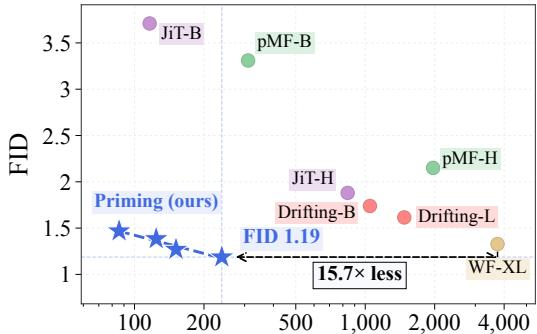  
Training compute (EFLOPs, log scale)

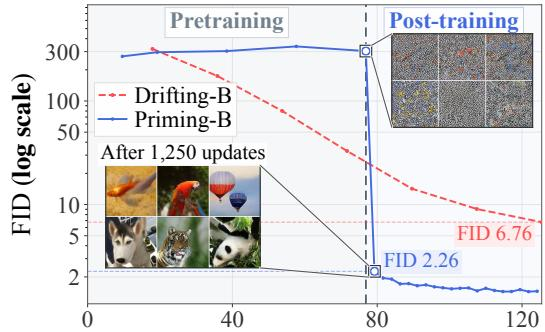  
Training compute (EFLOPs)  
Figure 1: Priming Models dramatically improve the training compute vs. FID trade-off on ImageNet (left). Simple reconstruction pretraining provides an effective initialization that makes subsequent distributional post-training substantially more efficient (right).

## 1 INTRODUCTION

A central goal of generative modeling is to achieve high sample quality with efficient training and inference. Diffusion and flow-based models (Song et al., 2020; Ho et al., 2020; Lipman et al., 2022; Albergo et al., 2025) have demonstrated remarkable generative capabilities and now serve as backbones for several domains (Ho et al., 2020; Abramson et al., 2024; Chi et al., 2025), but they rely on iterative sampling with multiple network evaluations.

This has motivated considerable effort toward one- and few-step generation (Salimans & Ho, 2022). Much of this progress builds on diffusion and flow formulations, including consistency-based modeling (Song et al., 2023; Lu & Song, 2025), flow-map learning (Boffi et al., 2024; Geng et al., 2026a;b), and distributional distillation (Luo et al., 2023; Yin et al., 2024a;b). While promising, these approaches require a considerable amount of extra machinery to work, like specialized stabilization strategies, Jacobian–vector products, classifier-free guidance, a teacher to distill from, etc.

A complementary approach is to train a generator by directly matching its output distribution to the data distribution. This naturally supports generation in a single network evaluation and has a long history in GANs (Goodfellow et al., 2014) and maximum mean discrepancy-based generators (Li et al., 2015; 2017). Translating these objectives into effective training, however, requires significant engineering effort (Gulrajani et al., 2017; Mescheder et al., 2018).

This latter approach has seen a recent resurgence of interest, with Drifting Models (Deng et al., 2026) and W-Flow (Han et al., 2026) demonstrating that direct distributional learning can produce high-quality one-step generators at scale. Their training recipes nevertheless rely on longer trainingtime schedules and subtle tricks like style-conditioning (Karras et al., 2019). Thus, the simplicity of one-step inference still comes at the cost of substantial complexity in getting these models to train.

In this work, we therefore ask: Does training a one-step generator need to be this complicated? We introduce Priming Models, a drastically more straightforward framework for one-step generative modeling with just two basic components:

[Stage 1] Reconstruction pretraining: We pretrain the network with a simple reconstruction objective – in fact, even denoising at a fixed corruption level suffices.

[Stage 2] Distributional post-training: We use the pretrained network directly as a one-step generator that maps Gaussian noise to samples, then refine it by matching generated and real distributions in feature space, e.g., using an optimal transport loss.

Empirically, Priming Models achieve strong performance with substantially reduced training compute across three visual domains:

• ImageNet: Priming Models achieve state-of-the-art FID (1.19)1and Frechet distances across´ other feature spaces among one-step generators, outperforming Pixel MeanFlow (Lu et al., 2026b), Drifting (Deng et al., 2026), and even multistep diffusion baseline JiT (Li & He, 2026), with approximately 10× less compute than Drifting (Figure 1, left).

• Text-to-Image: Priming Models substantially outperform one-step MeanFlow on GenEval and DPG, while reducing training compute by a factor of 1.9.

• World models: Priming Models outperform the Drifting baseline (Lu et al., 2026a) with approximately half the training compute, while also achieving performance comparable to the (multi-step) flow matching baseline.

A key factor behind our strong empirical results is that reconstruction pretraining substantially accelerates distributional post-training (Figure 1, right). Without the former, even when the distributional objective provides useful correction directions, the network’s Jacobian may hinder how effectively the parameters update to realize these improvements. Through controlled experiments, we demonstrate that reconstruction pretraining ameliorates this by aligning the Jacobian and shaping how readily the model’s outputs can be refined.

Together, our findings suggest a surprisingly minimal design principle for generative modeling: use reconstruction pretraining to prepare a generator for distributional post-training. Priming Models realize this principle, enabling high-quality one-step generators to be efficiently trained from scratch.

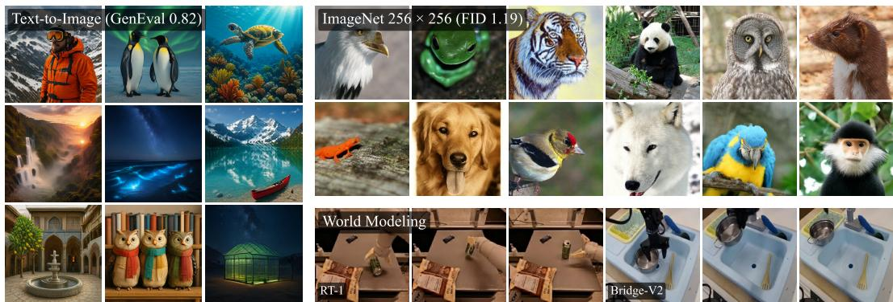  
Figure 2: One-step samples from Priming Models across three visual domains.  
1FD-loss (Yang et al., 2026) reports FID 0.72 for pixel MeanFlow by directly optimizing Frechet Distance. ´ We exclude this configuration from comparison and revisit this in Section 4.2.

## 2 PRIMING MODELS

We first present our motivation behind Priming Models. Distributional objectives, such as Sinkhorn divergence or Wasserstein distance, offer a natural approach to one-step generative modeling by directly matching generated and real distributions. The central challenge, however, lies in translating these objectives into effective training procedures, a difficulty that helped motivate interest in alternatives such as diffusion models (Dhariwal & Nichol, 2021). Indeed, early maximum mean discrepancy (MMD)-based generators were demonstrated on relatively small datasets (Li et al., 2015; 2017; Genevay et al., 2018), while GANs have achieved high-quality generation at scale (Goodfellow et al., 2014; Arjovsky et al., 2017; Brock et al., 2018; Karras et al., 2019; Sauer et al., 2022) but remain sensitive to optimization (Gulrajani et al., 2017; Mescheder et al., 2018).

More recently, Drifting Models (Deng et al., 2026) and W-Flow (Han et al., 2026) have achieved high-quality one-step generation on ImageNet using velocity fields trained based on kernel- and entropic OT-based distributional distances, respectively. Their reported training compute, however, remains costly; both L-size models are trained for 1,280 epochs, taking approximately three days on 64 NVIDIA H100 GPUs. Both also augment Gaussian inputs with learned style embeddings inspired by StyleGAN (Karras et al., 2019).

(a) Drifting-L  
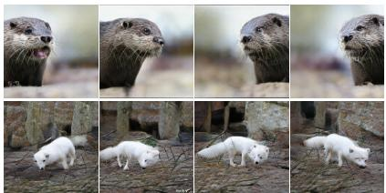

We find that fixing these style embeddings yields only marginal differences between images across different Gaussian noises (Figure 3), although varying the style embeddings still produces diverse samples. This suggests that style conditioning is an important source of sample diversity in this setting. Taken together, these observations suggest that optimizing distributional objectives from scratch, especially without these tweaks, remains challenging. This leads us to ask:

(b) W-Flow XL/2  
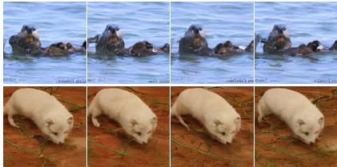  
Figure 3: Fixing style embedding limits diversity (ImageNet ‘otter’, ‘arctic fox’); more samples in Appendix F.4.

## Question: Can a suitable initialization make distributional post-training more effective?

Our intuition is that distributional training is challenging from scratch because at the start, the network has no information about the structure of natural images. To that end, we seek to first learn a related capability: recovering clean-image structure from corrupted inputs. Denoising reconstruction provides a natural way to learn this capability. Corrupted inputs retain information about the underlying images to guide recovery, while their clean counterparts provide direct supervision.

Our hypothesis is that learning to reconstruct provides a useful initialization for subsequent distributional optimization. This motivates reconstruction pretraining as a first stage toward learning the full noise-to-image mapping.

## 2.1 PRIMING MODELS: TRAINING RECIPE

Building on this intuition, Priming Models train a one-step generator in two stages: reconstruction pretraining and distributional post-training. Both stages optimize the same network $f _ { \theta } ,$ , conditioned on an input c, such as a class label or text prompt. We denote the empirical training distribution by $p _ { \mathrm { d a t a } } ;$ here our notation suppresses the implicit dependence on c.

[Stage 1] Reconstruction pretraining. We first pretrain the network to reconstruct clean samples from corrupted inputs. Our main instantiation uses a conventional denoising objective (Vincent et al., 2008; Vincent, 2011), with the noise level s sampled from a prescribed distribution $p ( \cdot )$ . In particular, we minimize

$$
\mathcal { L } _ { \theta } = \mathbb { E } _ { \mathbf { x } _ { 0 } , \epsilon } \Vert f _ { \theta } ( \mathbf { x } _ { s } , c ) - \mathbf { x } _ { 0 } \Vert ^ { 2 } , \quad \mathbf { x } _ { s } = ( 1 - s ) \mathbf { x } _ { 0 } + s \epsilon ,\tag{1}
$$

where $\mathbf { x } _ { 0 } \sim p _ { \mathrm { d a t a } } , \epsilon \sim \mathcal { N } ( 0 , \mathbf { I } ) , s \sim p$ are sampled independently. Surprisingly, we find that even taking $p$ to be a point mass at a single noise level suffices; our simplest instantiation sets $p = \delta _ { 0 . 8 }$ , fixing the noise level at $s = 0 . 8$ throughout. This choice follows the intuition above: a high noise level brings the pretraining inputs closer to the pure Gaussian inputs used for one-step generation $( s \ : = \ : 1 )$ , while preserving information about the clean targets to guide reconstruction. We systematically examine this choice in Section 4.1.

This stage is quite flexible: Our pretraining stage also accommodates other forms, for instance, masking each patch, as well as reconstruction in the representation space of a pretrained RAE (Singh et al., 2026). We revisit these alternatives in Section 4.1.

[Stage 2] Distributional post-training. After pretraining, we use $f _ { \theta }$ directly as a one-step generator: Given Gaussian noise $\epsilon \sim \mathcal { N } ( 0 , \bar { \bf { I } } )$ , the network yields $\hat { \mathbf { x } } _ { 0 } = f _ { \theta } ( \epsilon , c )$ . We denote the resulting pushforward distribution by qθ, i.e., $f _ { \theta } ( \epsilon , c ) \sim q _ { \theta }$ , with dependence on c suppressed as above. We then post-train this generator by matching generated and real distributions in feature space. Given a frozen feature encoder $\phi$ and a differentiable distributional loss ${ \mathcal { F } } _ { : }$ , we optimize

$$
\mathcal { L } _ { \theta } = \mathcal { F } ( \phi _ { \# } q _ { \theta } , \phi _ { \# } p _ { \mathrm { d a t a } } ) ,\tag{2}
$$

where $\phi _ { \# } ( \cdot )$ denotes the pushforward distribution via ϕ. The choice of $\mathcal { F }$ is simple but also flexible, accommodating several established objectives: Sinkhorn divergence (Sinkhorn, 1964; Cuturi, 2013) and maximum mean discrepancy (MMD) (Glaunes et al., 2004; Gretton et al., 2012). We implement these objectives through the following surrogate

$$
\mathcal { F } ( a , b ) = \mathcal { D } ( a , b ) - \mathcal { D } ( a , \mathrm { s g } [ a ] ) ,
$$

where $\mathcal { D }$ is a functional on pairs of feature distributions and sg denotes the stop-gradient. The first term encourages alignment between generated and real samples, while the second provides a repulsive self-interaction among generated samples.

Our main choice of $\mathcal { D }$ is an optimal transport (OT) cost, yielding a surrogate for the Sinkhorn divergence. Alternatively, a Laplacian kernel $\mathcal { D } ( a , b ) ~ = ~ \bar { \mathbb { E } } _ { x \sim a , y \sim b } [ - \exp ( - \| x - y \| ) ]$ gives us a surrogate for squared MMD. We find that even the simpler mean pairwise distance, ${ \dot { \mathcal { D } } } ( a , b ) =$ $\mathbb { E } _ { x \sim a , y \sim b } [ \| x - y \| ]$ , is effective. During training, we estimate these objectives using minibatches of samples and backpropagate through $\phi \circ f _ { \theta }$ to update θ. Appendix B provides the justification for these surrogates and implementation details. Below we briefly review optimal transport.

Optimal transport. Given a function measuring the cost of moving between samples, OT seeks the least costly way to redistribute mass from one distribution to another. For the minibatch of generated and real samples $( \{ a _ { i } \} _ { i = 1 } ^ { m } , \{ b _ { j } \} _ { j = 1 } ^ { n } )$ , respectively, we use the squared distance in a frozen feature space and compute an entropy-regularized transport plan:

$$
C ( x , y ) = \frac { 1 } { 2 } \left\| x - y \right\| _ { 2 } ^ { 2 } , \quad \pi _ { \epsilon } ^ { \star } = \mathrm { a r g m i n } _ { \pi } \left[ \sum _ { i , j } \pi _ { i , j } C ( a _ { i } , b _ { j } ) + \epsilon \sum _ { i , j } \pi _ { i j } \log \pi _ { i j } \right] ,
$$

where $\pi$ is minimized over all feasible transports, parametrized by a nonnegative $m \times n$ matrix with row sums $1 / m$ and column sums $1 / n . \mathrm { ~ A ~ }$ transport specifies a coupling between endpoint measures, in this case uniform over m generated samples and n real samples respectively, and $\pi _ { i j }$ specifies how much mass is transported from $a _ { i }$ to $b _ { j }$ . Thus, the marginal constraints ensure that the two distributions’ mass is preserved.

For $\epsilon > 0$ , the entropically regularized problem has a unique minimizer $\pi _ { \epsilon } ^ { \star }$ , which we approximate as πˆ using the Sinkhorn algorithm (Cuturi, 2013). This proxy $\hat { \pi } _ { \epsilon }$ yields the transport cost

$$
\begin{array} { r } { \mathrm { O T } _ { \epsilon } ( a , b ) : = \sum _ { i , j } \mathrm { s g } [ \hat { \pi } _ { \epsilon } ] _ { i , j } C ( a _ { i } , b _ { j } ) . } \end{array}\tag{3}
$$

Comparison with other prior work. Mainstream approaches to one-step generation build on diffusion or flow-matching trajectories (Liu et al., 2023a; Song et al., 2023; Boffi et al., 2024; Geng et al., 2026a; Salimans & Ho, 2022; Yin et al., 2024b). In contrast, Priming Models require neither prescribed trajectories nor a pretrained diffusion or flow model.

Recent work (Feng et al., 2026; Yang et al., 2026) uses distributional losses to improve already strong one-step generators. In Priming Models, reconstruction pretraining produces poor initial one-step samples (Figure 1, right), and distributional post-training enables high-quality generation.

As noted at the beginning of Section 2, Drifting (Deng et al., 2026) and W-Flow (Han et al., 2026) train models from scratch using distributional losses. Priming is more efficient than these methods and does not rely on additional modeling components such as classifier-free guidance or style embeddings; refer to Section 3.

Most closely related to our work, D2O (Zheng & Yang, 2025) and Yang et al. (2026, Section 4.3) demonstrate the conversion of multi-step diffusion models into one-step generators. Priming Models build on this perspective, but our results show that starting from a multi-step model is unnecessary: even denoising at a single fixed noise level without time conditioning, as well as alternative pretraining objectives (Section 4.1), can provide an effective initialization for distributional post-training. Appendix A provides further discussion.

## 2.2 PRIMING MODELS: UNDERSTANDING

In this section, we systematically examine our intuition behind the two-stage training design of Priming Models. Figure 4 shows the online FID trajectories during post-training for models pretrained on ImageNet for 20, 80, and 160 epochs of reconstruction pretraining. It also includes a model pretrained for 160 epochs with a perceptual loss (Section 3.1), which achieves a lower FID. At a matched number of post-training updates, longer pretraining is associated with lower FID.

Intuition. We posit that reconstruction pretraining captures useful structure of the data manifold, making generated samples readily correctable through parameter updates.

Jacobian alignment. To probe this intuition, we examine how parameter updates move generated samples in feature space. Let $h _ { \theta }$ denote the feature representations of samples, and let v be the gradient of the distributional loss in (2) with respect to $h _ { \theta }$ . A small gradient-descent step with learning rate $\eta$ induces the feature update

$$
\Delta h _ { \theta } \approx - \eta J _ { \theta } J _ { \theta } ^ { \top } v , \qquad J _ { \theta } : = \frac { \partial h _ { \theta } } { \partial \theta } ,
$$

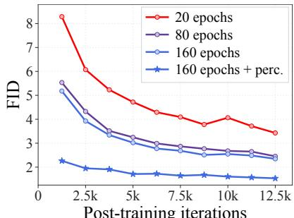

where $J _ { \theta }$ is the Jacobian of the generated features with respect to the network parameters. Thus, $J _ { \theta } J _ { \theta } ^ { \top }$ determines how the loss gradient translates into a feature update. When the gradient aligns with directions to which $J _ { \theta } \overset { \cdot } { J } _ { \theta } ^ { \top }$ responds strongly, the resulting feature update is larger. We examine this relationship through controlled experiments below.

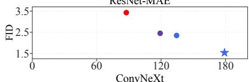

Setup. We evaluate the four models in Figure 4, all before post-training. For each ImageNet class and in each of the ResNet-MAE and ConvNeXt feature spaces used for distributional post-training, we collect gradients of the OT loss with respect to generated features. We then apply PCA and retain the top $r ~ = ~ 6 4$ directions. Writing U for an orthonormal basis of this subspace, we measure its normalized squared Jacobian response as $d \| J _ { \theta } ^ { \top } U \| _ { F } ^ { 2 } / r \| J _ { \theta } \| _ { F } ^ { 2 } .$

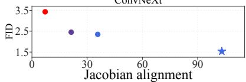  
Figure 4: Pretraining strengthens the Jacobian alignment, improving posttraining efficiency.

where d is the total dimension of the feature vector being differentiated. Normalizing by the total squared Frobenius norm controls for differences in overall Jacobian scale across models.

Result. Figure 4 reports the average over eight classes. Across the four models, higher normalized response before post-training (x-axis) is associated with a lower online FID after post-training, consistent with our hypothesis. We discuss the detailed setup in Appendix C.4.

## 3 EXPERIMENTS

We now demonstrate that Priming Models significantly advance the Pareto frontier of training efficiency vs. generation quality across three visual domains: class-conditional generation on ImageNet (Section 3.1), text-to-image generation (Section 3.2), and world modeling (Section 3.3).

## 3.1 IMAGENET: CLASS-CONDITIONAL GENERATION

Setup. We study class-conditional generation on ImageNet-1K (Deng et al., 2009) at $2 5 6 \times 2 5 6$ resolution. We train Priming Models directly in pixel space at two scales: Priming-B (16 blocks, width 768, and 115.1M parameters) and Priming-L (32 blocks, width 1024, and 405.1M parameters), both using $1 6 \times 1 6$ patches. For each size, we use checkpoints after 80 and 160 epochs of pretraining, yielding four configurations in total. All four follow the same fixed-noise reconstruction pretraining and then receive 25,000 updates of the same OT post-training procedure.

Pretraining. As described in Section 2.1, we pretrain the network on the reconstruction loss, at the fixed noise level $s = 0 . 8$ . Motivated by Lu et al. (2026b), we add an auxiliary perceptual loss, where we minimize the mean squared error between the output and the real image in the feature space (green term), i.e.,

$$
\begin{array} { r } { \mathcal { L } _ { \theta } = \mathbb { E } _ { \mathbf { x } _ { 0 } , \epsilon } \left[ \| f _ { \theta } ( \mathbf { x } _ { s } , c ) - \mathbf { x } _ { 0 } \| ^ { 2 } + \lambda \| \phi \big ( f _ { \theta } ( \mathbf { x } _ { s } , c ) \big ) - \phi ( \mathbf { x } _ { 0 } ) \| ^ { 2 } \right] , \quad \lambda > 0 . } \end{array}
$$

In particular, we use the LPIPS (Zhang et al., 2018) and ConvNeXt (Woo et al., 2023) with weights $\lambda = 0 . 4$ and $\lambda = 0 . 1$ , respectively. We use a global batch size of 1,024 throughout.

Post-training. We now explain how we instantiate the OT setup from (3) in our post-training. The regularization strength ϵ controls transport sharpness: smaller values concentrate mass on low-cost pairs, while larger values spread it more broadly. We combine both complementary signals in a weighted sum

$$
{ \mathcal { D } } ( a , b ) = 0 . 7 5 \operatorname { O T } _ { 0 . 0 0 1 } ( a , b ) + 0 . 2 5 \operatorname { O T } _ { 0 . 0 1 } ( a , b ) ,
$$

In practice, for each sampled ImageNet class at each training step, we generate 128 samples online, use 64 of them for the stop-gradient term, and draw 128 training samples.

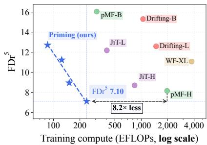  
Figure 5: Priming Models on $\mathrm { F D r ^ { 5 } }$

We apply the OT objective in the feature spaces of the ResNet-MAE and ConvNeXt encoders from Drifting Models (Deng et al., 2026). For each feature space, we normalize the features using a fixed, space-specific scale, then compute a separate transport plan and OT loss as described above. Post-training runs for 25,000 iterations with an EMA decay of 0.999. Further training details are provided in Appendix C.1.

Baselines. We compare against two strong recent one-step generators in pixel space: pixel Mean Flow (pMF) (Lu et al., 2026b) and Drifting Models (Deng et al., 2026). We also include JiT (Li & He, 2026), a diffusion model trained in pixel space, as our multi-step baseline. For completeness, we include recent one-step generators trained in the SD-VAE latent space (Rombach et al., 2022), including W-Flow (Han et al., 2026), and improved MeanFlow (iMF) (Geng et al., 2026b). We omit other methods, such as (improved) Consistency Models (Song & Dhariwal, 2024), vanilla MeanFlow (Geng et al., 2026a), Transition Matching (Wang et al., 2026b), as prior work has reported stronger performance with the baselines included above.

Quantitative results. We report FID (Heusel et al., 2017) as our primary metric. We evaluate our final EMA checkpoints using 50,000 generated images, balanced across the 1,000 ImageNet classes, with each image produced in a single network pass. The evaluation is conducted using three different random seeds. To assess the distributional agreement across other representation spaces, we additionally report $\mathrm { F D r ^ { 5 } }$ , defined as the mean normalized Frechet´ distance across five feature spaces: Inception-V3 (Szegedy et al., 2016), DINOv2 (Oquab et al., 2023), ViT-MAE (He et al., 2022), SigLIP (Zhai et al., 2023), and CLIP (Radford et al., 2021).2. These five evaluation encoders are not used in the training of either Priming

<table><tr><td>Method</td><td>FID↓ FDr⁵</td><td>EFLOPs</td></tr><tr><td>pMF-L</td><td>2.55 10.85</td><td>821.75</td></tr><tr><td>pMF-H</td><td>2.15 8.14</td><td>1968.54</td></tr><tr><td>JiT-H</td><td>1.88 8.69</td><td>839.00</td></tr><tr><td>iMF-XL/2</td><td>1.74 9.75</td><td>3201.12</td></tr><tr><td>Drifting-B</td><td>1.74 15.30</td><td>1048.23</td></tr><tr><td>Priming-B (80 ep.)</td><td>1.47 12.71</td><td>85.75</td></tr><tr><td>Drifting-L</td><td>1.61 12.59</td><td>1476.39</td></tr><tr><td>Priming-B (160 ep.)</td><td>1.38 11.23</td><td>124.18</td></tr><tr><td>WF-XL/2</td><td>1.33 11.07</td><td>3744.43</td></tr><tr><td>Priming-L (80 ep.) Priming-L (160 ep.)</td><td>1.27 8.94 1.19 7.10</td><td>151.29 238.95</td></tr></table>

Table 1: ImageNet. Priming Models improve the quality–compute trade-off. All methods are onestep except JiT-H (CFG scale 2.2 and 200 NFEs).

Models or the compared baselines. We recompute FID for all methods in Table 1 under a common $\mathtt { t o r c h - f i d e l i t y }$ evaluation implementation.

Alongside FID and $\mathrm { F D r ^ { 5 } }$ , we report training compute in $\mathrm { E F L O P s , i . e . , 1 0 ^ { 1 8 } }$ floating-point operations. For Priming Models, this accounts for both pretraining and distributional post-training, including feature-encoder computations. Priming-L pretrained for 160 epochs achieves the lowest FID (1.19) and FDr5 (7.10) in Table 1, at a total training cost of 238.95 EFLOPs. Moreover, all four Priming Model configurations substantially improve the Pareto frontier for training compute versus both quality metrics compared to the evaluated baselines, as shown in Figure 1(left) and Figure 5.

Additional results. Figure 1(right) shows that FID falls sharply early in post-training and continues to improve through 25,000 updates. Although the pretrained model initially produces noisy outputs, it generates clean images within 1,250 post-training updates. Figure 2 presents samples from Priming-L pretrained for 160 epochs, with more examples in Appendix F.1, which exhibit clear visual quality. Appendix D reports precision and recall comparable to those of the baselines. It also includes nearest-neighbor comparisons with the ImageNet training set, which show no obvious signs of memorization.

## 3.2 TEXT-TO-IMAGE GENERATION

We now evaluate Priming Models on text-to-image generation at $5 1 2 \times 5 1 2$ resolution to assess their effectiveness beyond ImageNet-scale.

Setup. We build on MiniT2I (Wang et al., 2026a), an open-sourced codebase for pixel-space textto-image generation with publicly available training data. Our primary baseline is the MiniT2I MeanFlow checkpoint. For our model, we adopt the same 258M-parameter MM-JiT-B/16 generator backbone. Text captions are encoded by the 341M-parameter encoder of FLAN-T5-Large (Chung et al., 2024), which remains frozen throughout training. Following MiniT2I, we scale the Gaussian noise by a factor of 2, i.e., $\epsilon \sim \mathcal { N } ( 0 , 2 ^ { 2 } \mathbf { I } )$ , throughout training and inference.

Pretraining. We first train with the reconstruction objective on CC12M (Changpinyo et al., 2021), then continue reconstruction training on a curated mixture of 120k images from the codebase. Both phases use a global batch size of 1024. We use two pretraining noise configurations: a fixed corruption level $s = 0 . 8$ and corruption levels sampled from a reweighted logit-normal distribution $\bar { p ( s ) } \propto s ^ { - 2 } \mathrm { L o g N o r m } ( s ; 0 . 8 , 0 . 8 ^ { \bar { 2 } } )$

Post-training. We then post-train the model using the OT objective in (3) with $\epsilon = 0 . 0 5$ . At each update, we sample 64 distinct text captions. For each caption, we generate 32 samples online, applying stop-gradient to 16 of them. We compute the objective independently for each caption group using globally pooled features from SigLIP, ViT-MAE, and Inception-V3. For each feature branch, we normalize features by their within-batch pairwise RMS distance. Since each caption is paired with a single real image, the generated–real OT term reduces to the average squared feature distance to that image. Post-training runs for 4,000 updates without EMA.

Multi-Step Extension. Inspired by Consistency Models (Song et al., 2023), we extend Priming Model to support multi-step generation. Specifically, during post-training, we define a finite set of noise levels $s \subset ( 0 , 1 ]$ that includes $s = 1$ and train the network to predict a clean image $f _ { \theta } ( \mathbf { x } _ { s } , c )$ from inputs at each noise level $s \in S$ . We apply the same OT objective with $\mathbf { x } _ { s }$ as the input, enabling the model to generate clean samples from both pure noise and partially noisy inputs. The multi-step post-training schedule is detailed in Appendix C.2.

At inference time, we repeatedly apply the same network along a decreasing noise schedule $1 =$ $s _ { 0 } > \cdot \cdot \cdot > s _ { K - 1 } > s _ { K } = 0$ , with $s _ { k } \in \mathcal S$ . We draw independent noise $\epsilon _ { 0 } , \ldots , \epsilon _ { K - 1 } \sim \mathcal { N } ( 0 , 2 ^ { 2 } \mathbf { I } )$ initialize $\mathbf { x } _ { s _ { 0 } } ~ = ~ \epsilon _ { 0 }$ , and set ${ \epsilon _ { K } \mathrm { ~ \bf ~ = ~ } } { \bf 0 }$ for notational simplicity. Then we alternate clean-image prediction with re-noising at the next, lower noise level:

$$
\hat { \mathbf { x } } _ { 0 } ^ { ( k ) } = f _ { \theta } ( \mathbf { x } _ { s _ { k } } , c ) , \quad \mathbf { x } _ { s _ { k + 1 } } = ( 1 - s _ { k + 1 } ) \hat { \mathbf { x } } _ { 0 } ^ { ( k ) } + s _ { k + 1 } \epsilon _ { k + 1 } , \quad k = 0 , \ldots , K - 1 .
$$

The final step returns a clean-image prediction without re-noising. Thus, we return ${ \bf x } _ { s _ { K } } = { \bf x } _ { 0 }$ after K network evaluations.

Evaluation. We evaluate text–image alignment using GenEval (Ghosh et al., 2023) and DPG-Bench (Hu et al., 2024). We report the MiniT2I MeanFlow baseline’s performance with both oneand four-step sampling, using its default guidance scale of 12.0 and guidance interval of [0.2, 0.8]. We also include a multistep pixel-space flow-matching baseline. Additional training and evaluation details are provided in Appendix C.2.

Results. As shown in Table 2, Priming pretrained for 290k updates with a logit-normal noise schedule achieves the best results among one-step generators: 0.818 on GenEval and 82.16 on DPG-Bench, outperforming one-step Mean-Flow on both metrics. Despite requiring only one network evaluation per image, its scores approach those of fourstep MeanFlow and the 100-step flowmatching baseline. With a fixed corruption level of s = 0.8 and 200k pretraining updates, Priming-B reaches 0.740 on GenEval and 81.30 on DPG-Bench at a

<table><tr><td>Method</td><td>GenEval ↑ DPG-Bench ↑</td><td></td><td>EFLOPs</td></tr><tr><td>Flow matching (100 steps)†</td><td>0.873</td><td>84.20</td><td>408.04</td></tr><tr><td>MeanFlow (4 steps)†</td><td>0.842</td><td>83.23</td><td>546.64</td></tr><tr><td>Priming (2 steps)</td><td>0.844</td><td>82.81</td><td>455.02</td></tr><tr><td>MeanFlow (1 step)</td><td>0.548</td><td>76.49</td><td>546.64</td></tr><tr><td>Priming (s = 0.8, 200k)</td><td>0.740</td><td>81.30</td><td>293.53</td></tr><tr><td>Priming (logit-normal, 290k)</td><td>0.818</td><td>82.16</td><td>420.16</td></tr></table>

Table 2: Text-to-Image. Priming Models outperform one-step MeanFlow; the logit-normal variant approaches four-step MeanFlow with less training compute. Priming extended to two-step is competitive with four-step MeanFlow. The scores of † are from Wang et al. (2026a).

lower total training cost of 293.530 EFLOPs, 1.86× reduction relative to the MeanFlow baseline. With multi-step extension, the 2-step Priming achieves 0.844 on GenEval and 82.81 on DPG-Bench, achieving a competitive result to four-step MeanFlow. We show several generated samples in Figure 2, with further examples in Appendix F.2.

## 3.3 WORLD MODELING

Table 3: World modeling. Priming Model outperforms both the one-step DriftWorld baseline and a 32-step flow-matching baseline across all quality metrics while using less compute than DriftWorld.
<table><tr><td></td><td></td><td></td><td colspan="5">Generation quality</td><td colspan="2">Efficiency</td></tr><tr><td>Dataset</td><td>Method</td><td>NFE</td><td>SSIM ↑</td><td>PSNR ↑</td><td>LPIPS ↓</td><td>FID ↓</td><td>FVD↓</td><td>Time/frame (ms) ↓</td><td>Train (EFLOPs) ↓</td></tr><tr><td rowspan="3">RT-1</td><td>Flow Matching</td><td>32</td><td>0.85</td><td>25.428</td><td>0.076</td><td>7.8</td><td>27.24</td><td>322</td><td>12.37</td></tr><tr><td>DriftWorld (Lu et al., 2026a)</td><td>1</td><td>0.841</td><td>24.203</td><td>0.097</td><td>8.99</td><td>62.84</td><td>26</td><td>30.71</td></tr><tr><td>Priming</td><td>1</td><td>0.878</td><td>26.765</td><td>0.063</td><td>3.16</td><td>30.96</td><td>19</td><td>12.37</td></tr><tr><td rowspan="3">Bridge-V2</td><td>Flow Matching</td><td>32</td><td>0.841</td><td>23.37</td><td>0.079</td><td>11.02</td><td>39.87</td><td>445</td><td>9.55</td></tr><tr><td>DriftWorld (Lu et al., 2026a)</td><td>1</td><td>0.835</td><td>22.691</td><td>0.091</td><td>4.86</td><td>46.05</td><td>30</td><td>37.05</td></tr><tr><td>Priming</td><td>1</td><td>0.857</td><td>24.549</td><td>0.067</td><td>2.82</td><td>32.58</td><td>23</td><td>9.50</td></tr></table>

Finally, we apply Priming Models to action-conditioned world models on two robot-manipulation domains: RT-1 (Brohan et al., 2023) and Bridge-V2 (Walke et al., 2023). In particular, we train a Priming Model to predict the next frame conditioned on recent observation and action histories.

Setup. We follow the data processing pipeline and the architecture choice of U-Net with action conditioning from DriftWorld (Lu et al., 2026a). For both datasets, frames are resized to 256 × 256 and then encoded into the SD3-VAE (Esser et al., 2024) latent space, in which our Priming Model operates. Our primary baseline is DriftWorld and 32-step Flow Matching, trained with approximately the same EFLOPs as Priming.

Training. We first perform reconstruction pretraining for 64 epochs using the reweighted logitnormal distribution from Section 3.2, with a global batch size of 64 and an EMA decay of 0.9999. The distributional post-training begins from these weights. At each update, we process 32 conditions with 16 live and 16 stop-gradient generated samples, together with one real next frame per condition. We use the OT objective (3) with ϵ = 0.05, and pairwise-RMS feature scaling. Post-training runs for 4,000 updates.

Evaluation. We evaluate EMA checkpoints on the held-out validation sets, with a single network evaluation per predicted frame. SSIM, PSNR, and LPIPS metrics are used to compare generated frames to the corresponding ground-truth frames; FID and FVD (Unterthiner et al., 2018) measure distributional agreement. Both datasets are evaluated in 8-frame autoregressive chunks, re-anchoring on the real trajectory between chunks. FVD uses the first 16 predicted frames of each trajectory. We additionally report the time required to generate a frame and EFLOPs, including both pretraining and post-training. Complete conditioning, training, and rollout details are provided in Appendix C.3.

Results. Table 3 reports generation quality and training compute on RT-1 and Bridge-V2. Despite generating each sample in a single step, Priming Models outperform both the 32-step flow-matching baseline and DriftWorld on every reported quality metric, except FVD on RT-1. Compared with DriftWorld, they use 59.7% less training compute on RT-1 (12.37 versus 30.71 EFLOPs) and 74.4% less on Bridge-V2 (9.50 versus 37.05 EFLOPs). Notably, we do not rely on additional techniques used by DriftWorld, such as motion weighting or self-forcing. We provide generated samples in Figure 2 and Appendix F.3.

## 4 ADDITIONAL EXPERIMENTS

In this section, we further investigate the training design of Priming Models using the ImageNet setup described in Section 3.1. We first examine pretraining design choices, including alternatives to denoising, in Section 4.1, then compare post-training objectives beyond OT in Section 4.2.

## 4.1 EXAMINING PRETRAINING DESIGN CHOICES

Table 4: Ablation study. w/o perc. removes perceptual loss; Masking/RAE change pretraining. Energy/Laplacian replace OT; SigLIP/MAE/Inception changes the post-training feature space.
<table><tr><td></td><td>Reference</td><td colspan="3">Pretraining</td><td colspan="2">Post-training (loss)</td><td>Post-training (feature)</td></tr><tr><td></td><td>Priming-B (160 ep.)</td><td>w/o perc.</td><td>Masking</td><td>RAE</td><td>Energy</td><td>Laplacian</td><td>SigLIP/MAE/Inception</td></tr><tr><td> $\mathrm { F I D \downarrow }$ </td><td>1.38</td><td>2.07</td><td>1.87</td><td>2.34</td><td>1.95</td><td>1.85</td><td>1.65</td></tr><tr><td> $\mathrm { F D r ^ { 5 } \downarrow }$ </td><td>11.23</td><td>16.13</td><td>16.14</td><td>14.27</td><td>11.55</td><td>11.22</td><td>6.13</td></tr></table>

Pretraining with masking. We substitute the denoising corruption with patch-wise masking: randomly selecting 80% of the image patches and replacing them with independently sampled Gaussian noise, leaving the remaining patches uncorrupted. We train Priming-B to reconstruct $\mathbf { x } _ { \mathrm { 0 } }$ using the same reconstruction and perceptual losses as in the default pretraining. After 160 epochs of pretraining followed by 12,500 steps of distributional post-training, the model achieves an FID of 1.87 with an EMA decay of 0.999 (Table 4; Masking).

Pretraining as distillation from RAE. We next demonstrate that representation distillation provides an alternative initialization for distributional post-training. Using the frozen encoder of a pretrained RAEv2 (Singh et al., 2026) as a teacher, we train a class-conditioned student encoder with 300M parameters to recover clean-image representations from corrupted inputs. Specifically, we minimize $\dot { { \mathbb E } } | f _ { \theta } ( { \mathbf x } _ { s } , c ) - \mathrm { s g } [ E _ { \mathrm { t e a c h e r } } ( { \mathbf x } _ { 0 } ) ] | _ { 2 } ^ { 2 }$ , matching the student’s output to the teacher’s representation of the corresponding clean image. We then compose the trained student encoder with the pretrained, frozen RAEv2 decoder to produce images in pixel space. After 12,500 steps of distributional post-training, the model achieves an FID of 2.34 with an EMA decay of 0.999 (Table 4; RAE).

Ablation study: Perceptual loss. We compare Priming-B-160 (Section 3.1) with the same 160- epoch pretraining without perceptual loss. After 25,000 matched OT updates, removing perceptual loss worsens terminal EMA FID from 1.38 to 2.07 and $\mathrm { F D r ^ { 5 } }$ from 11.23 to 16.13 (Table 4; w/o perc.). We hypothesize that supervision in external feature spaces helps the model capture use ful structure of the data manifold.

Ablation study: Noise level. We next examine the effect of the noise level used during pretraining. Using the same Priming-B pipeline, we pretrain each model for 80 epochs at a fixed noise level, comparing our default $s = 0 . 8$ with $s \in \{ 1 . 0 , 0 . 9 , 0 . 7 , 0 . 5 \}$ . After 12,500 OT post-training updates, $s = 0 . 8$ yields the lowest terminal EMA FID (1.65), followed by $s = 0 . 7 ( 1 . 7 6 ) , s = 0 . 9 ( 1 . 9 7 ) .$ $s = 0 . 5 ( 2 . 4 6 )$ , and $s = 1 . 0 ( 6 5 . 0 8 )$ . These results support our intuition that the effective noise level should balance retaining the clean image’s information with keeping the noise level close to pure Gaussian noise.

## 4.2 EXAMINING POST-TRAINING DESIGN CHOICES

Other choices of D. We recall our post-training objective ${ \mathcal F } ( a , b ) = { \mathcal D } ( a , b ) - { \mathcal D } ( a , \mathrm { s g } [ a ] )$ Starting from the same Priming-B checkpoint after 160 epochs of pretraining, we evaluate two alternatives to OT in the full ResNet-MAE and ConvNeXt feature spaces: the pairwise distance $\begin{array} { r } { \mathcal { D } ( a , b ) ~ = ~ \mathbb { E } _ { \boldsymbol { x } \sim a , \boldsymbol { y } \sim b } [ \| \boldsymbol { x } - \boldsymbol { y } \| _ { 2 } ] } \end{array}$ and negative Laplacian-kernel similarity $\begin{array} { r l } { \mathcal { D } ( \bar { a } , b ) } & { { } = } \end{array}$ $\mathbb { E } _ { x \sim a , y \sim b } [ - \exp ( - \left\| x - y \right\| _ { 2 } ^ { \cdot } ) ]$ . At 25,000 updates, their terminal EMA FIDs are 1.95 and 1.85, respectively, compared with 1.38 for OT (Table 1). The $\mathrm { F D r ^ { 5 } }$ are 11.55 and 11.22, compared with 11.23 for OT (Table 4; Energy/Laplacian). These results show that Priming Models work with multiple distributional losses, with OT yielding the best FID among the choices tested.

Other choices of feature space. We also replace the full ResNet-MAE and ConvNeXt feature spaces with simpler, lightweight spaces, SigLIP, Inception-V3, and ViT-MAE, keeping the same perceptual Priming-B-160 initialization and 25,000 OT post-training setup. The terminal EMA checkpoint reaches FID 1.65 and FDr5 6.13, versus 1.38 and 11.23 for the full-feature OT reference (Table 1, and Table 4; SigLIP/MAE/Inception). Inception, SigLIP, and ViT-MAE are components of FDr5, so the improvement in FDr5 is not an independent held-out-feature result.

FD-loss. Frechet distance (Dowson & Landau, 1982) is widely used to evaluate generative models,´ but directly optimizing it was believed to be challenging, as reliable estimation typically requires tens of thousands of samples. FD-loss (Yang et al., 2026) addresses this challenge by accumulating feature statistics across training steps through a feature queue or exponential moving averages, while backpropagating only through the current batch, and has demonstrated consistent improvements in pretrained one-step generators. We show that FD-loss also fits within the Priming Model framework as an alternative distributional post-training objective. Applied to the pretrained Priming-B checkpoint, it yields efficient post-training; we provide the setup and results in Appendix E.

## 5 CONCLUSION

In this work, we introduce Priming Models, a simple two-stage framework for training one-step generative models end-to-end. Reconstruction pretraining prepares the generator for efficient distributional post-training, enabling strong empirical performance across multiple visual domains.

That said, our work leaves several open questions. Priming Models rely on pretrained feature encoders. Although we demonstrate our method with multiple sets of feature encoders, this dependence raises the question of whether it can be eliminated. The relationship between reconstruction pretraining and Jacobian alignment also warrants deeper investigation. Finally, closing the remaining performance gap with multi-step diffusion and flow models remains an important challenge.

Outlook. More broadly, our results suggest that we may be overthinking the problem: the specialized formulations and elaborate training machinery used in prior work are not the only path to train one-step generators. We hope our work opens the door to simpler and more scalable approaches to one-step generative modeling.

## ACKNOWLEDGMENTS.

The authors acknowledge support from the Kempner Institute. JK acknowledges support from the Jump Trading Fellowship and Kempner Graduate Fellowship. SC acknowledges support from NSF CAREER award CCF-2441635 and the Harvard Dean’s Competitive Fund for Promising Scholarship.

## REFERENCES

Josh Abramson, Jonas Adler, Jack Dunger, Richard Evans, Tim Green, Alexander Pritzel, Olaf Ronneberger, Lindsay Willmore, Andrew J Ballard, Joshua Bambrick, et al. Accurate structure prediction of biomolecular interactions with alphafold 3. Nature, 630(8016):493–500, 2024.

Emanuele Aiello, Diego Valsesia, and Enrico Magli. Fast inference in denoising diffusion models via MMD finetuning. arXiv preprint arXiv:2301.07969, 2023.

Michael Albergo, Nicholas M Boffi, and Eric Vanden-Eijnden. Stochastic interpolants: A unifying framework for flows and diffusions. Journal ofMachine Learning Research, 26(209):1–80, 2025.

Martin Arjovsky, Soumith Chintala, and Leon Bottou. Wasserstein generative adversarial networks.´ In International conference on machine learning, pp. 214–223. Pmlr, 2017.

Nicholas M Boffi, Michael S Albergo, and Eric Vanden-Eijnden. Flow map matching with stochastic interpolants: A mathematical framework for consistency models. arXiv preprint arXiv:2406.07507, 2024.

Andrew Brock, Jeff Donahue, and Karen Simonyan. Large scale gan training for high fidelity natural image synthesis. arXiv preprint arXiv:1809.11096, 2018.

Anthony Brohan, Noah Brown, Justice Carbajal, Yevgen Chebotar, Joseph Dabis, Chelsea Finn, Keerthana Gopalakrishnan, Karol Hausman, Alexander Herzog, Jasmine Hsu, Julian Ibarz, Brian Ichter, Alex Irpan, Tomas Jackson, Sally Jesmonth, Nikhil Joshi, Ryan Julian, Dmitry Kalashnikov, Yuheng Kuang, Isabel Leal, Kuang-Huei Lee, Sergey Levine, Yao Lu, Utsav Malla, Deeksha Manjunath, Igor Mordatch, Ofir Nachum, Carolina Parada, Jodilyn Peralta, Emily Perez, Karl Pertsch, Jornell Quiambao, Kanishka Rao, Michael S. Ryoo, Grecia Salazar, Pannag R. Sanketi, Kevin Sayed, Jaspiar Singh, Sumedh Sontakke, Austin Stone, Clayton Tan, Huong Tran, Vincent Vanhoucke, Steve Vega, Quan H. Vuong, Fei Xia, Ted Xiao, Peng Xu, Sichun Xu, Tianhe Yu, and Brianna Zitkovich. RT-1: Robotics transformer for real-world control at scale. In Proceedings of Robotics: Science and Systems, Daegu, Republic of Korea, July 2023. doi: 10.15607/RSS.2023.XIX.025.

Soravit Changpinyo, Piyush Sharma, Nan Ding, and Radu Soricut. Conceptual 12m: Pushing web scale image-text pre-training to recognize long-tail visual concepts. In 2021 IEEE/CVF Conference on Computer Vision and Pattern Recognition (CVPR), pp. 3557–3567. IEEE, 2021.

Wenlin Chen, Mingtian Zhang, Jiajun He, Zijing Ou, Jose Miguel Hern´ andez-Lobato, Bernhard´ Scholkopf, and David Barber. Diffratio: Training one-step diffusion models without teacher¨ supervision. arXiv preprint arXiv:2502.08005, 2025.

Cheng Chi, Zhenjia Xu, Siyuan Feng, Eric Cousineau, Yilun Du, Benjamin Burchfiel, Russ Tedrake, and Shuran Song. Diffusion policy: Visuomotor policy learning via action diffusion. The International Journal ofRobotics Research, 44(10-11):1684–1704, 2025.

Hyung Won Chung, Le Hou, Shayne Longpre, Barret Zoph, Yi Tay, William Fedus, Yunxuan Li, Xuezhi Wang, Mostafa Dehghani, Siddhartha Brahma, et al. Scaling instruction-finetuned lan guage models. Journal ofmachine learning research, 25(70):1–53, 2024.

Marco Cuturi. Sinkhorn distances: Lightspeed computation of optimal transport. Advances in neural information processing systems, 26, 2013.

Jia Deng, Wei Dong, Richard Socher, Li-Jia Li, Kai Li, and Li Fei-Fei. Imagenet: A large-scale hierarchical image database. In 2009 IEEE conference on computer vision and pattern recognition, pp. 248–255. Ieee, 2009.

Mingyang Deng, He Li, Tianhong Li, Yilun Du, and Kaiming He. Generative modeling via drifting. arXiv preprint arXiv:2602.04770, 2026.

Prafulla Dhariwal and Alexander Nichol. Diffusion models beat gans on image synthesis. Advances in neural information processing systems, 34:8780–8794, 2021.

David C Dowson and B.V. Landau. The frechet distance between multivariate normal distributions.´ Journal ofmultivariate analysis, 12(3):450–455, 1982.

Patrick Esser, Sumith Kulal, Andreas Blattmann, Rahim Entezari, Jonas Muller, Harry Saini, Yam¨ Levi, Dominik Lorenz, Axel Sauer, Frederic Boesel, Dustin Podell, Tim Dockhorn, Zion English, and Robin Rombach. Scaling rectified flow transformers for high-resolution image synthesis. In Proceedings ofthe 41st International Conference on Machine Learning, volume 235 of Proceedings ofMachine Learning Research, pp. 12606–12633. PMLR, 2024.

Lan Feng, Wuyang Li, Eloi Zablocki, Matthieu Cord, and Alexandre Alahi. Representation distribution matching for one-step visual generation. arXiv preprint arXiv:2607.02375, 2026.

Kevin Frans, Danijar Hafner, Sergey Levine, and Pieter Abbeel. One step diffusion via shortcut models. In International Conference on Learning Representations, 2025.

Aude Genevay, Gabriel Peyre, and Marco Cuturi. Learning generative models with sinkhorn di- ´ vergences. In International conference on artificial intelligence and statistics, pp. 1608–1617. PMLR, 2018.

Zhengyang Geng, Ashwini Pokle, Weijian Luo, Justin Lin, and Zico Kolter. Consistency models made easy. In International Conference on Learning Representations, volume 2025, pp. 75158– 75185, 2025.

Zhengyang Geng, Mingyang Deng, Xingjian Bai, Zico Kolter, and Kaiming He. Mean flows for one-step generative modeling. Advances in Neural Information Processing Systems, 38:75460– 75482, 2026a.

Zhengyang Geng, Yiyang Lu, Zongze Wu, Eli Shechtman, J Zico Kolter, and Kaiming He. Improved mean flows: On the challenges of fastforward generative models. In Proceedings ofthe IEEE/CVF Conference on Computer Vision and Pattern Recognition, pp. 30467–30476, 2026b.

Dhruba Ghosh, Hannaneh Hajishirzi, and Ludwig Schmidt. Geneval: An object-focused framework for evaluating text-to-image alignment. Advances in Neural Information Processing Systems, 36: 52132–52152, 2023.

Joan Glaunes, Alain Trouve, and Laurent Younes. Diffeomorphic matching of distributions: A new´ approach for unlabelled point-sets and sub-manifolds matching. In Proceedings ofthe 2004 IEEE Computer Society Conference on Computer Vision and Pattern Recognition, 2004. CVPR 2004., volume 2, pp. II–II. Ieee, 2004.

Ian J. Goodfellow, Jean Pouget-Abadie, Mehdi Mirza, Bing Xu, David Warde-Farley, Sherjil Ozair, Aaron Courville, and Yoshua Bengio. Generative adversarial nets. In Z. Ghahramani, M. Welling, C. Cortes, N. Lawrence, and K. Weinberger (eds.), Advances in Neural Information Processing Systems, volume 27. Curran Associates, Inc., 2014. URL https://proceedings.neurips.cc/paper\_files/paper/2014/ file/f033ed80deb0234979a61f95710dbe25-Paper.pdf.

Arthur Gretton, Karsten M Borgwardt, Malte J Rasch, Bernhard Scholkopf, and Alexander Smola.¨ A kernel two-sample test. The journal of machine learning research, 13:723–773, 2012.

Ishaan Gulrajani, Faruk Ahmed, Martin Arjovsky, Vincent Dumoulin, and Aaron Courville. Improved training of wasserstein gans. Advances in neural information processing systems, 30, 2017.

Jiaqi Han, Puheng Li, Qiushan Guo, Renyuan Xu, Stefano Ermon, and Emmanuel J Candes. One- \` step generative modeling via wasserstein gradient flows. arXiv preprint arXiv:2605.11755, 2026.

Kaiming He, Xinlei Chen, Saining Xie, Yanghao Li, Piotr Dollar, and Ross Girshick. Masked´ autoencoders are scalable vision learners. In 2022 IEEE/CVF conference on computer vision and pattern recognition (CVPR), pp. 15979–15988. IEEE, 2022.

Martin Heusel, Hubert Ramsauer, Thomas Unterthiner, Bernhard Nessler, and Sepp Hochreiter. Gans trained by a two time-scale update rule converge to a local nash equilibrium. Advances in neural information processing systems, 30, 2017.

Jonathan Ho, Ajay Jain, and Pieter Abbeel. Denoising diffusion probabilistic models. Advances in neural information processing systems, 33:6840–6851, 2020.

Xiwei Hu, Rui Wang, Yixiao Fang, Bin Fu, Pei Cheng, and Gang Yu. Ella: Equip diffusion models with llm for enhanced semantic alignment. arXiv preprint arXiv:2403.05135, 2024.

Tero Karras, Samuli Laine, and Timo Aila. A style-based generator architecture for generative adversarial networks. In 2019 IEEE/CVF conference on computer vision and pattern recognition (CVPR), pp. 4396–4405. IEEE, 2019.

Dongjun Kim, Chieh-Hsin Lai, WeiHsiang Liao, Naoki Murata, Yuhta Takida, Toshimitsu Uesaka, Yutong He, Yuki Mitsufuji, and Stefano Ermon. Consistency trajectory models: Learning probability flow ode trajectory of diffusion. In International Conference on Learning Representations, volume 2024, pp. 44493–44525, 2024.

Chun-Liang Li, Wei-Cheng Chang, Yu Cheng, Yiming Yang, and Barnabas P´ oczos. Mmd gan:´ Towards deeper understanding of moment matching network. Advances in neural information processing systems, 30, 2017.

Tianhong Li and Kaiming He. Back to basics: Let denoising generative models denoise. In Proceedings of the IEEE/CVF Conference on Computer Vision and Pattern Recognition, pp. 36115– 36125, 2026.

Yujia Li, Kevin Swersky, and Rich Zemel. Generative moment matching networks. In International conference on machine learning, pp. 1718–1727. PMLR, 2015.

Shanchuan Lin, Ceyuan Yang, Zhijie Lin, Hao Chen, and Haoqi Fan. Adversarial flow models. arXiv preprint arXiv:2511.22475, 2025.

Yaron Lipman, Ricky TQ Chen, Heli Ben-Hamu, Maximilian Nickel, and Matt Le. Flow matching for generative modeling. arXiv preprint arXiv:2210.02747, 2022.

Xingchao Liu, Chengyue Gong, and Qiang Liu. Flow straight and fast: Learning to generate and transfer data with rectified flow. In International Conference on Learning Representations, 2023a.

Xingchao Liu, Xiwen Zhang, Jianzhu Ma, Jian Peng, and Qiang Liu. Instaflow: One step is enough for high-quality diffusion-based text-to-image generation. arXiv preprint arXiv:2309.06380, 2023b.

Cheng Lu and Yang Song. Simplifying, stabilizing and scaling continuous-time consistency models. In International Conference on Learning Representations, volume 2025, pp. 50611–50649, 2025.

Susie Lu, Haonan Chen, Weirui Ye, and Yilun Du. Driftworld: Fast world modeling through drifting. arXiv preprint arXiv:2607.15065, 2026a.

Yiyang Lu, Susie Lu, Qiao Sun, Hanhong Zhao, Zhicheng Jiang, Xianbang Wang, Tianhong Li, Zhengyang Geng, and Kaiming He. One-step latent-free image generation with pixel mean flows. arXiv preprint arXiv:2601.22158, 2026b.

Weijian Luo, Tianyang Hu, Shifeng Zhang, Jiacheng Sun, Zhenguo Li, and Zhihua Zhang. Diffinstruct: A universal approach for transferring knowledge from pre-trained diffusion models. Advances in Neural Information Processing Systems, 36:76525–76546, 2023.

Yihong Luo, Xiaolong Chen, Xinghua Qu, Tianyang Hu, and Jing Tang. You only sample once: Taming one-step text-to-image synthesis by self-cooperative diffusion GANs. arXiv preprint arXiv:2403.12931, 2024.

Lars Mescheder, Andreas Geiger, and Sebastian Nowozin. Which training methods for gans do actually converge? In International conference on machine learning, pp. 3481–3490. PMLR, 2018.

Maxime Oquab, Timothee Darcet, Th´ eo Moutakanni, Huy Vo, Marc Szafraniec, Vasil Khalidov,´ Pierre Fernandez, Daniel Haziza, Francisco Massa, Alaaeldin El-Nouby, et al. Dinov2: Learning robust visual features without supervision. arXiv preprint arXiv:2304.07193, 2023.

Alec Radford, Jong Wook Kim, Chris Hallacy, Aditya Ramesh, Gabriel Goh, Sandhini Agarwal, Girish Sastry, Amanda Askell, Pamela Mishkin, Jack Clark, et al. Learning transferable visual models from natural language supervision. In International conference on machine learning, pp. 8748–8763. PmLR, 2021.

Robin Rombach, Andreas Blattmann, Dominik Lorenz, Patrick Esser, and Bjorn Ommer. High-¨ resolution image synthesis with latent diffusion models. In 2022 IEEE/CVF conference on computer vision and pattern recognition (CVPR), pp. 10674–10685. ieee, 2022.

Tim Salimans and Jonathan Ho. Progressive distillation for fast sampling of diffusion models. arXiv preprint arXiv:2202.00512, 2022.

Axel Sauer, Katja Schwarz, and Andreas Geiger. Stylegan-xl: Scaling stylegan to large diverse datasets. In ACM SIGGRAPH 2022 conference proceedings, pp. 1–10, 2022.

Axel Sauer, Dominik Lorenz, Andreas Blattmann, and Robin Rombach. Adversarial diffusion distillation. In European Conference on Computer Vision, 2024.

Jaskirat Singh, Boyang Zheng, Zongze Wu, Richard Zhang, Eli Shechtman, and Saining Xie. Improved baselines with representation autoencoders. arXiv preprint arXiv:2605.18324, 2026.

Richard Sinkhorn. A relationship between arbitrary positive matrices and doubly stochastic matrices. The annals ofmathematical statistics, 35(2):876–879, 1964.

Yang Song and Prafulla Dhariwal. Improved techniques for training consistency models. In International Conference on Learning Representations, volume 2024, pp. 15078–15097, 2024.

Yang Song, Jascha Sohl-Dickstein, Diederik P Kingma, Abhishek Kumar, Stefano Ermon, and Ben Poole. Score-based generative modeling through stochastic differential equations. arXiv preprint arXiv:2011.13456, 2020.

Yang Song, Prafulla Dhariwal, Mark Chen, and Ilya Sutskever. Consistency models. arXiv preprint arXiv:2303.01469, 2023.

Christian Szegedy, Vincent Vanhoucke, Sergey Ioffe, Jon Shlens, and Zbigniew Wojna. Rethinking the inception architecture for computer vision. In Proceedings of the IEEE conference on computer vision and pattern recognition, pp. 2818–2826, 2016.

Thomas Unterthiner, Sjoerd van Steenkiste, Karol Kurach, Raphael Marinier, Marcin Michalski, and¨ Sylvain Gelly. Towards accurate generative models of video: A new metric & challenges. arXiv preprint arXiv:1812.01717, 2018.

Hugues Van Assel, Edward De Brouwer, Saeed Saremi, Gabriele Scalia, and Aviv Regev. Generate in reconstruction space, match in semantic space: Transport geometry for one-step generation. arXiv preprint arXiv:2606.00514, 2026.

Pascal Vincent. A connection between score matching and denoising autoencoders. Neural computation, 23(7):1661–1674, 2011.

Pascal Vincent, Hugo Larochelle, Yoshua Bengio, and Pierre-Antoine Manzagol. Extracting and composing robust features with denoising autoencoders. In Proceedings ofthe 25th international conference on Machine learning, pp. 1096–1103, 2008.

Homer Rich Walke, Kevin Black, Tony Z. Zhao, Quan Vuong, Chongyi Zheng, Philippe Hansen-Estruch, Andre Wang He, Vivek Myers, Moo Jin Kim, Max Du, Abraham Lee, Kuan Fang, Chelsea Finn, and Sergey Levine. BridgeData V2: A dataset for robot learning at scale. In Proceedings of the 7th Conference on Robot Learning, volume 229 of Proceedings of Machine Learning Research, pp. 1723–1736. PMLR, 2023.

Xianbang Wang, Hanhong Zhao, Yiyang Lu, Kangyang Zhou, Linrui Ma, and Kaiming He. Minit2i: A minimalist baseline for text-to-image generation, 2026a. URL https://peppaking8. github.io/#/post/minit2i.

Zidong Wang, Yiyuan Zhang, Xiaoyu Yue, Xiangyu Yue, Yangguang Li, Wanli Ouyang, and Lei Bai. Transition models: Rethinking the generative learning objective. In Proceedings of the IEEE/CVF Conference on Computer Vision and Pattern Recognition, pp. 29178–29189, 2026b.

Sanghyun Woo, Shoubhik Debnath, Ronghang Hu, Xinlei Chen, Zhuang Liu, In So Kweon, and Saining Xie. Convnext v2: Co-designing and scaling convnets with masked autoencoders. In 2023 IEEE/CVF Conference on Computer Vision and Pattern Recognition (CVPR), pp. 16133– 16142. Ieee, 2023.

Jiawei Yang, Zhengyang Geng, Xuan Ju, Yonglong Tian, and Yue Wang. Representation Frechet´ loss for visual generation. arXiv preprint arXiv:2604.28190, 2026.

Tianwei Yin, Michael Gharbi, Taesung Park, Richard Zhang, Eli Shechtman, Fredo Durand, and¨ William T Freeman. Improved distribution matching distillation for fast image synthesis. Advances in neural information processing systems, 37:47455–47487, 2024a.

Tianwei Yin, Michael Gharbi, Richard Zhang, Eli Shechtman, Fredo Durand, William T Freeman,¨ and Taesung Park. One-step diffusion with distribution matching distillation. In 2024 IEEE/CVF Conference on Computer Vision and Pattern Recognition (CVPR), pp. 6613–6623. IEEE, 2024b.

Xiaohua Zhai, Basil Mustafa, Alexander Kolesnikov, and Lucas Beyer. Sigmoid loss for language image pre-training. In 2023 IEEE/CVF International Conference on Computer Vision (ICCV), pp. 11941–11952. IEEE, 2023.

Richard Zhang, Phillip Isola, Alexei A Efros, Eli Shechtman, and Oliver Wang. The unreasonable effectiveness of deep features as a perceptual metric. In 2018 IEEE/CVF conference on computer vision and pattern recognition, pp. 586–595. IEEE, 2018.

Bowen Zheng and Tianming Yang. Revisiting diffusion models: From generative pre-training to one-step generation. In International Conference on Machine Learning, 2025.

Linqi Zhou, Stefano Ermon, and Jiaming Song. Inductive moment matching. arXiv preprint arXiv:2503.07565, 2025.

Mingyuan Zhou, Huangjie Zheng, Zhendong Wang, Mingzhang Yin, and Hai Huang. Score identity distillation: Exponentially fast distillation of pretrained diffusion models for one-step generation. In International Conference on Machine Learning, 2024.

## A RELATED WORK

In this section, we review prior work on one- and few-step generative modeling, organized by their methodological category.

Category 1: Trajectory straightening and flow-map learning. These lines of work obtain fewstep generative models by learning from a diffusion or probability-flow trajectory. Progressive distillation repeatedly compresses a teacher sampler into fewer steps (Salimans & Ho, 2022). Consistency Models instead enforce agreement among predictions made at different points along the same trajectory (Song et al., 2023), while subsequent work improves their stability and scaling or extends consistency to trajectory segments (Geng et al., 2025; Song & Dhariwal, 2024; Lu & Song, 2025; Kim et al., 2024). Rectified Flow and reflow (Liu et al., 2023a;b) seek straighter transport paths that are easier to integrate in few steps. These straightening methods modify the coupling and resulting trajectory so that coarse numerical integration can accurately reach its endpoint.

A related but distinct family learns the finite-time transition across an interval of a flow-matching trajectory, such as a flow map or average velocity. This includes Flow Map Matching, Shortcut Models, MeanFlow, Improved MeanFlow, and Inductive Moment Matching (Boffi et al., 2024; Frans et al., 2025; Geng et al., 2026a;b; Zhou et al., 2025). These methods differ in their targets and training estimators, but generally supervise a particular time-dependent transport or consistency relation.

Priming: Priming Models do not attempt to recover a prescribed trajectory or flow map: reconstruction pretraining provides an initialization for the network, which we then directly use as a one-step generator.

Category 2: Teacher-guided distillation. Another line of work distills a pretrained diffusion teacher into a one-step student, with much of the focus on designing effective distillation objectives. Diff-Instruct (Luo et al., 2023) uses score-based distributional objectives derived from a diffusion teacher, while DMD and DMD2 (Yin et al., 2024b;a) optimize the student using the difference between teacher and student score estimates. Score Identity Distillation (Zhou et al., 2024) provides a related score-based formulation. Adversarial Diffusion Distillation combines score distillation with an adversarial objective to improve fidelity in the low-step regime (Sauer et al., 2024).

Priming: These approaches inherit the cost and machinery required to obtain and query that teacher. In contrast, Priming Models are trained from scratch and therefore do not require a pretrained teacher.

Category 3:Distributional loss (from scratch). Directly matching a generator distribution to the data distribution has a long history. Generative Adversarial Networks (GANs) learn a one-pass generator through an adversarially trained discriminator (Goodfellow et al., 2014), with Wasserstein objectives and regularization improving the geometry and stability of training (Arjovsky et al., 2017; Gulrajani et al., 2017; Mescheder et al., 2018). Generative Moment Matching Networks use maximum mean discrepancy (MMD) in place of adversarial discrimination, while MMD-GANs further learn the MMD kernel adversarially (Li et al., 2015; 2017). Genevay et al. (2018) trains implicit generative models directly using a Sinkhorn divergence. These works, however, are limited in empirical scope and, more importantly, differ from Priming Models in that we apply the distributional objective after a reconstruction pretraining stage.

Recent works revisit direct one-step learning at a more practical scale. YOSO (Luo et al., 2024) stabilizes adversarial one-step training through a self-cooperative diffusion GAN, while Adversarial Flow (Lin et al., 2025) trains with an adversarial objective but constrains the generator to learn the deterministic transport map associated with flow matching.

Priming: Priming Models share the goal of direct distribution matching, but do not optimize it from random initialization: reconstruction pretraining first teaches the generator to correct corrupted inputs toward clean images, after which a distributional objective refines it into a one-step generator.

Category 3-1: Drifting Models. Drifting Models (Deng et al., 2026) construct an attractionrepulsion field using a normalized Laplacian kernel and train the generator to match stop-gradient targets obtained by displacing its generated features along this field. W-Flow (Han et al., 2026) derives a training-time velocity field from the Wasserstein gradient flow of the Sinkhorn divergence, using barycentric projections computed from entropic optimal transport plans. Van Assel et al.

(2026) additionally examine how the choice of frozen feature space affects transport stability in distribution matching.

Priming: Priming Models introduce reconstruction pretraining before distributional optimization, and this stage is key to our strong compute vs. quality trade-off. Our implementation also seeks to dispense with the additional engineering machinery used in these works. Both reported ImageNet architectures include learned random style embeddings, and both frameworks support classifierfree guidance; Drifting additionally normalizes its constructed drift field. Priming does not use these additional mechanisms and instead optimizes an OT-based distributional surrogate. All four models reported in Section 3 share exactly the same post-training configuration, further illustrating the simplicity of our approach.

This suggests that reconstruction pretraining can make distributional optimization more efficient while supporting a simpler training recipe. We hypothesize that this initialization reduces the need for additional training mechanisms, although our experiments do not isolate their individual contributions.

Category 4: Distributional loss (fine-tuning). Distributional objectives have also been used to adapt pretrained generative models. MMD-DDM (Aiello et al., 2023) fine-tunes pretrained diffusion models with MMD to improve quality under a restricted sampling-step budget. DiffRatio (Chen et al., 2025) estimates the density ratio between noisy real and generated distributions to train a one-step model without a teacher score. FD-loss (Yang et al., 2026) makes feature-space Frechet´ distance practical as a training objective by maintaining population-level feature statistics, and applies it to pretrained one- and multi-step generators. More recently, iRDM (Feng et al., 2026) scales MMD-based post-training across multiple pretrained representation spaces.

Most closely related to our work, D2O (Zheng & Yang, 2025) shows that adversarial fine-tuning alone can convert a pretrained diffusion model into a one-step generator, while Yang et al. (2026, Section 4.3) show that FD-loss can convert JiT, a multi-step diffusion model, into a competitive one-step generator.

Priming: Priming Models build on the perspective that pretraining can prepare a network for subsequent distributional optimization. We investigate how simple this pretraining task can be, showing that reconstruction—even denoising at a single fixed noise level without noise-level conditioning—can provide an effective initialization for our distributional training, despite poor initial onestep samples (Figure 1, right). We further examine alternative pretraining tasks (Section 4.1) within the same framework.

Finally, viewing reconstruction pretraining and distributional post-training as a complete training procedure also enables comparisons with prior methods based on total training compute across both stages, measured in EFLOPs.

## B DISTRIBUTIONAL POST-TRAINING DETAILS

This section specifies the objective and implementation used for distributional post-training. It first establishes why the stop-gradient loss in Section 2.1 minimizes a standard distributional discrepancy, then gives its finite-batch form, conditional feature construction, normalization, and optimization algorithm. Dataset- and model-specific choices are provided in Appendix C.

## B.1 WHY THE STOP-GRADIENT OBJECTIVE MINIMIZES A DIVERGENCE

Let $q _ { \theta }$ and p denote the generated and real feature distributions, respectively, and let D be a symmetric, differentiable functional of two distributions. Consistent with the main text, write the practical stop-gradient objective as

$$
\mathcal { F } ( q _ { \theta } , p ) : = \mathcal { D } ( q _ { \theta } , p ) - \mathcal { D } ( q _ { \theta } , \mathrm { s g } [ q _ { \theta } ] ) .
$$

The real self-interaction is constant with respect to $\theta ,$ while symmetry makes the derivatives through the two arguments of $\mathcal { D } ( q _ { \theta } , q _ { \theta } )$ equal. The chain rule therefore gives

$$
\begin{array} { r } { \nabla _ { \theta } \mathcal { F } ( q _ { \theta } , p ) = \nabla _ { \theta } \left[ \mathcal { D } ( q _ { \theta } , p ) - \frac { 1 } { 2 } \mathcal { D } ( q _ { \theta } , q _ { \theta } ) - \frac { 1 } { 2 } \mathcal { D } ( p , p ) \right] . } \end{array}\tag{4}
$$

Thus, $\mathcal { F }$ need not equal the expression inside the brackets in forward value, but it has the same parameter gradient. This is the mathematical justification for the objective in the main text: the

stop-gradient form removes a constant term and avoids evaluating two identical derivatives of the generated self-interaction.

For $\mathcal { D } = \mathrm { O T } _ { \epsilon } ( \cdot , \cdot )$ , we first distinguish the full entropy-regularized OT objective from the costonly quantity. Define the regularized optimal plan, the full OT objective value, and its cost-only counterpart by

$$
\begin{array} { r l } & { \pi _ { \epsilon } ^ { \star } ( r , s ) = \underset { \pi \in \Pi ( r , s ) } { \mathrm { a r g m i n } } \left\{ \langle \pi , C \rangle + \epsilon \mathrm { K L } ( \pi \parallel r \otimes s ) \right\} , } \\ & { \mathcal { T } _ { \epsilon } ( r , s ) = \langle \pi _ { \epsilon } ^ { \star } ( r , s ) , C \rangle + \epsilon \mathrm { K L } ( \pi _ { \epsilon } ^ { \star } ( r , s ) \parallel r \otimes s ) , } \\ & { \mathrm { O T } _ { \epsilon } ( r , s ) = \langle \mathrm { s g } [ \pi _ { \epsilon } ^ { \star } ( r , s ) ] , C \rangle . } \end{array}\tag{5}
$$

The corresponding Sinkhorn divergence is

$$
\begin{array} { r } { S _ { \epsilon } ( q _ { \theta } , p ) = \mathcal { T } _ { \epsilon } ( q _ { \theta } , p ) - \frac { 1 } { 2 } \mathcal { T } _ { \epsilon } ( q _ { \theta } , q _ { \theta } ) - \frac { 1 } { 2 } \mathcal { T } _ { \epsilon } ( p , p ) . } \end{array}\tag{6}
$$

The cost-only quantity $\mathrm { O T } _ { \epsilon }$ does not equal $\mathcal { T } _ { \epsilon }$ in forward value. For fixed empirical marginal weights and an exact optimal coupling $\pi _ { \epsilon } ^ { \star }$ , however, calculating the gradient gives

$$
\nabla _ { \boldsymbol { \theta } } \mathcal { T } _ { \epsilon } ( \boldsymbol { q } _ { \boldsymbol { \theta } } , \boldsymbol { p } ) = \nabla _ { \boldsymbol { \theta } } \langle \mathrm { s g } [ \pi _ { \epsilon } ^ { \star } ( \boldsymbol { q } _ { \boldsymbol { \theta } } , \boldsymbol { p } ) ] , C \rangle = \nabla _ { \boldsymbol { \theta } } \mathrm { O T } _ { \epsilon } ( \boldsymbol { q } _ { \boldsymbol { \theta } } , \boldsymbol { p } ) .\tag{7}
$$

and therefore $\nabla _ { \theta } \mathcal { F } ( q _ { \theta } , p ) = \nabla _ { \theta } S _ { \epsilon } ( q _ { \theta } , p )$ . Likewise, for a symmetric kernel $k ,$ define $\mathcal { D } _ { k } ( r , s ) =$ $- \mathbb { E } _ { X \sim r , Y \sim s } [ k ( X , Y ) ]$ ]. Substitution into Equation (4) yields

$$
\frac { 1 } { 2 } \mathrm { M M D } _ { k } ^ { 2 } ( q _ { \theta } , p ) = \frac { 1 } { 2 } \mathbb { E } [ k ( X , X ^ { \prime } ) ] + \frac { 1 } { 2 } \mathbb { E } [ k ( Y , Y ^ { \prime } ) ] - \mathbb { E } [ k ( X , Y ) ] .
$$

where $X , X ^ { \prime } \stackrel { \mathrm { i i d } } { \sim } q _ { \theta }$ and $Y , Y ^ { \prime } \stackrel { \mathrm { i i d } } { \sim } p$ . Hence $\begin{array} { r } { \nabla _ { \theta } \mathcal { F } ( q _ { \theta } , p ) = \nabla _ { \theta } \frac { 1 } { 2 } \mathrm { M M D } _ { k } ^ { 2 } ( q _ { \theta } , p ) } \end{array}$ . For both choices, $\mathcal { F }$ therefore performs gradient descent on the corresponding distributional discrepancy.

## B.2 FINITE-BATCH GRADIENT SURROGATES

We implement the detached occurrence of $q _ { \theta }$ using an independently generated reference batch. For one matching group, let $G = \{ g _ { i } \} _ { i = 1 } ^ { B } , G ^ { \mathrm { r e f } } = \{ g _ { i } ^ { \mathrm { r e f } } \} _ { i = 1 } ^ { B }$ , and $R = \hat { \{ { r _ { j } } \} } _ { i = 1 } ^ { N }$ denote the active generated, reference generated, and real feature sets after a suitable normalization (see Appendix B.4 for details). The two generated sets use independent latent samples, gradients propagate only through $G ,$ and both $G ^ { \mathrm { r e f } }$ and R are detached.

Sinkhorn surrogate. For the finite sets G and $R ,$ the exact optimizer $\pi _ { \epsilon } ^ { \star } ( G , R )$ from Equation (5) is represented by a nonnegative $B \times N$ matrix with row sums $\bar { 1 } / B$ and column sums $1 / \dot { N }$ . Following the notation in Section 2.1, we denote its Sinkhorn approximation by $\widehat { \pi } _ { \epsilon } ( G , R ) \approx \pi _ { \epsilon } ^ { \star } ( G , R )$ Substituting this approximation into the cost-only definition gives

$$
\mathrm { O T } _ { \epsilon } ( G , R ) = \sum _ { i , j } \mathrm { s g } [ \widehat { \pi } _ { \epsilon } ( G , R ) ] _ { i j } \frac { \| g _ { i } - r _ { j } \| _ { 2 } ^ { 2 } } { 2 } .
$$

Cross and generated-reference plans are solved independently, giving

$$
\hat { \mathcal { F } } ^ { \mathrm { O T } } ( G , G ^ { \mathrm { r e f } } , R ) = \mathrm { O T } _ { \epsilon } ( G , R ) - \mathrm { O T } _ { \epsilon } ( G , \mathrm { s g } [ G ^ { \mathrm { r e f } } ] ) .\tag{8}
$$

MMD surrogate. For a symmetric kernel k, the corresponding finite-batch loss is

$$
{ \widehat { \mathcal { F } } } ^ { \mathrm { M M D } } ( G , G ^ { \mathrm { r e f } } , R ) = { \frac { 1 } { B ^ { 2 } } } \sum _ { i = 1 } ^ { B } \sum _ { i ^ { \prime } = 1 } ^ { B } k ( g _ { i } , { \mathrm { s g } } [ g _ { i ^ { \prime } } ^ { \mathrm { r e f } } ] ) - { \frac { 1 } { B N } } \sum _ { i = 1 } ^ { B } \sum _ { j = 1 } ^ { N } k ( g _ { i } , r _ { j } ) .\tag{9}
$$

The Laplacian and energy-distance variants reported in the paper use $k ( a , b ) = \exp ( - \| a - b \| _ { 2 } )$ and $k ( a , b ) { \overset { \cdot } { = } } - \| a - b \| _ { 2 }$ , respectively.

Equations (8) and (9) are the finite-batch objectives used in our implementation.

## B.3 CONDITIONAL AND MULTI-FEATURE CONSTRUCTION

Let $\{ c _ { k } \} _ { k = 1 } ^ { C }$ denote the conditions selected for one update. Depending on the experiment, a condition is an ImageNet class, a text caption, or an observation–action history. For every condition, we draw N real targets and two independent batches of B latent variables:

$$
\begin{array} { r l } & { y _ { k j } \sim p _ { \mathrm { d a t a } } ( \cdot \mid c _ { k } ) , ~ j = 1 , \ldots , N , } \\ & { x _ { k i } = f _ { \theta } ( z _ { k i } , c _ { k } ) , ~ x _ { k i } ^ { \prime } = f _ { \theta } ( z _ { k i } ^ { \prime } , c _ { k } ) , ~ i = 1 , \ldots , B , } \end{array}
$$

where $z _ { k i }$ and $z _ { k i } ^ { \prime }$ are mutually independent. Gradients propagate through the active samples $x _ { k i }$ only; the reference samples $\boldsymbol { x } _ { k i } ^ { \prime }$ and real samples $y _ { k j }$ are detached.

For feature branch r, the frozen encoder $\phi _ { r }$ returns $P _ { r }$ vectors of dimension $d _ { r }$ per image. For condition $c _ { k }$ and feature position $p ,$ define the three matching sets directly:

$$
\begin{array} { r l } & { G _ { k , p } ^ { r } : = \{ \phi _ { r } ( x _ { k i } ) _ { p } \} _ { i = 1 } ^ { B } , } \\ & { G _ { k , p } ^ { r , \mathrm { r e f } } : = \mathrm { s g } [ \{ \phi _ { r } ( x _ { k i } ^ { \prime } ) _ { p } \} _ { i = 1 } ^ { B } ] , } \\ & { ~ R _ { k , p } ^ { r } : = \mathrm { s g } [ \{ \phi _ { r } ( y _ { k j } ) _ { p } \} _ { j = 1 } ^ { N } ] . } \end{array}\tag{10}
$$

Pooled representations have $P _ { r } = 1$ , whereas spatial or token-valued representations have $P _ { r } >$ 1. Each pair $( k , p )$ is matched separately, so conditions and feature positions are never pooled. The three sets above have shapes $[ { \bar { B } } , d _ { r } ] , [ B , d _ { r } ]$ , and $[ N , d _ { r } ]$ , respectively. Feature encoders are evaluated online; no feature bank or precomputed real-feature cache is used.

Let $s _ { r }$ be the branch scale defined below. We evaluate either Equation (8) or Equation (9); denoting the selected finite-batch objective by ${ \widehat { \mathcal { F } } } _ { : }$ , define

$$
\widehat { \mathcal { F } } _ { r , k , p } : = \widehat { \mathcal { F } } \Big ( G _ { k , p } ^ { r } / s _ { r } , G _ { k , p } ^ { r , \mathrm { r e f } } / s _ { r } , R _ { k , p } ^ { r } / s _ { r } \Big ) .\tag{11}
$$

The complete post-training loss is

$$
\mathcal { L } _ { \theta } = \sum _ { r \in \mathcal { R } } \alpha _ { r } \frac { 1 } { C P _ { r } } \sum _ { k = 1 } ^ { C } \sum _ { p = 1 } ^ { P _ { r } } \widehat { \mathcal { F } } _ { r , k , p } .\tag{12}
$$

Each branch is treated independently. Branch weights $\alpha _ { r }$ are applied as written and are not subsequently renormalized. For the ImageNet ResNet-MAE/ConvNeXt combination, weights are uniform within each backbone and sum to $1 / 2$ over the ResNet-MAE branches and $1 / 2$ over the ConvNeXt branches and multiply the overall loss by 5.

## B.4 FEATURE SCALING

Feature branches can have substantially different scales, so every set in branch $r$ is divided by a common branch scale $s _ { r }$ as in Equation (11). We use two scaling strategies.

Fixed calibration for ImageNet. For ImageNet, we set $s _ { r } = \sigma _ { r }$ , where $\sigma _ { r }$ is calibrated once as the median pairwise Euclidean distance among the branch features of 2,000 training images sampled with fixed seed 0. This scale remains fixed throughout post-training; see Appendix C.1.

Pair-RMS scaling for text-to-image and world modeling. For text-to-image and world-model post-training, we compute one detached scale for each branch from the current minibatch. For two feature sets S and T, define

$$
d ^ { 2 } ( S , T ) : = { \frac { 1 } { | S | | T | } } \sum _ { s \in S } \sum _ { t \in T } \lVert s - t \rVert _ { 2 } ^ { 2 } .
$$

Branch r uses

$$
s _ { r } = \mathrm { s g } \left[ \sqrt { \operatorname* { m a x } \left\{ \frac { 1 } { 2 C P _ { r } } \sum _ { k = 1 } ^ { C } \sum _ { p = 1 } ^ { P _ { r } } d ^ { 2 } ( G _ { k , p } ^ { r } , R _ { k , p } ^ { r } ) + \frac { 1 } { 2 C P _ { r } } \sum _ { k = 1 } ^ { C } \sum _ { p = 1 } ^ { P _ { r } } d ^ { 2 } ( G _ { k , p } ^ { r } , G _ { k , p } ^ { r , r e f } ) , \delta ^ { 2 } \right\} } \right] ,\tag{13}
$$

where $\delta > 0$ is a small numerical floor. Every active, reference, and real set in branch r is divided by this same minibatch-dependent $s _ { r }$

## B.5 ALGORITHM AND DISTRIBUTED EXECUTION

Algorithm 1 summarizes one optimization step.

Algorithm 1: One distributional post-training update   
Input: Generator $f _ { \boldsymbol { \theta } } ;$ frozen branches $\{ \phi _ { r } \}$ ; branch weights $\{ \alpha _ { r } \}$ ; selected finite-batch objective   
${ \widehat F } .$   
1. Sample conditions $c _ { 1 : C } ,$ real targets $y _ { k , 1 : N } ,$ and independent active and reference noises   
$z _ { k , 1 : B } , z _ { k , 1 : B } ^ { \prime } .$   
2. Generate $x = f _ { \theta } ( z , c )$ and $x ^ { \prime } = \arg [ f _ { \theta } ( z ^ { \prime } , c ) ]$ ; initialize $\mathcal { L } _ { \theta } = 0 .$   
3. For each feature branch r:   
(a) Construct $G _ { k , p } ^ { r } , G _ { k , p } ^ { r , \mathrm { r e f } }$ , and $R _ { k , p } ^ { r }$ for every $( k , p )$ using Equation (10).   
(b) Compute the detached $s _ { r }$ following Section B.4, then divide every set by $s _ { r }$   
(c) Evaluate $\widehat { \mathcal { F } } _ { r , k , p }$ using Equation (8) or Equation (9), then set   
$\begin{array} { r } { \mathcal { L } _ { \theta } \gets \mathcal { L } _ { \theta } + \alpha _ { r } ( C P _ { r } ) ^ { - 1 } \sum _ { k , p } \widehat { \mathcal { F } } _ { r , k , p } . } \end{array}$   
4. Update θ using $\nabla _ { \boldsymbol { \theta } } \mathcal { L } _ { \boldsymbol { \theta } }$

## C EXPERIMENTAL DETAILS

## C.1 CLASS-CONDITIONAL GENERATION ON IMAGENET

Training configurations. For each model described in Section 3.1, Priming-B and Priming-L, we initialize the 80- and 160-epoch variants from two checkpoints of the same reconstruction run and post-train them separately. All four configurations share the settings in Table 5. Class conditioning uses eight learned class tokens without label dropout, as Priming Models do not deploy classifierfree guidance. We use 8 NVIDIA H200 GPUs for both stages of the training.

<table><tr><td>Stage</td><td>Optimizer</td><td>Duration</td><td>Batch</td><td>Learning rate</td><td>EMA decay</td></tr><tr><td>Stage 1 (Reconstruction loss)</td><td>Muon</td><td>80 / 160 epochs</td><td>1,024</td><td> $1 0 ^ { - 3 }$ </td><td>0.9999</td></tr><tr><td>Stage 2 (Distributional loss)</td><td>AdamW</td><td>25k updates</td><td>16 classes</td><td> $1 0 ^ { - 5 }$ </td><td>0.999</td></tr></table>

Table 5: ImageNet training hyperparameters. Settings apply to all four Priming-B/L configurations.

Reconstruction pretraining. We use the fixed corruption level and perceptual-loss weights described in Section 3.1. Muon uses momentum 0.95, while auxiliary AdamW updates use $( \beta _ { 1 } ^ { - } , \beta _ { 2 } ) =$ (0.9, 0.95). The learning rate remains constant, with no warmup or weight decay.

Distributional post-training. We initialize the generator from the online reconstruction weights and retain the pretrained EMA shadow, changing its decay to 0.999. We initialize a fresh AdamW optimizer with $( \beta _ { 1 } , \beta _ { 2 } ) = ( 0 . 9 , 0 . 9 5 )$ , zero weight decay, and gradient-norm clipping at 1.0. We use a linear learning-rate warmup schedule, increasing the learning rate linearly to $\mathrm { \dot { 1 } 0 ^ { - 5 } }$ over the first 125 updates and keeping it constant thereafter.

Each update samples 16 distinct ImageNet classes, with two classes assigned to each GPU. We compute the per-class distributional losses locally within each GPU. In total, each update uses 1,024 differentiable generated images, 1,024 independently generated stop-gradient references from the current generator, and 2,048 real images.

Feature spaces and transport computation. We follow the feature choice setup of (Deng et al., 2026), using the 84 feature outputs from the frozen ResNet-MAE encoder and 13 from ConvNeXt. This includes spatial activations and pooled mean and standard-deviation features. Each encoder family receives total weight 1/2, distributed equally among its outputs.

Before post-training, for each feature space, we calibrate a fixed scale σ using the median pairwise Euclidean distance among 2,000 training images sampled once with a fixed seed and divide each feature value by this σ.

For every class and feature output, we solve separate generated–real and generated–generated transport problems at each regularization strength specified in Section 3.1. We use log-domain Sinkhorn iterations with a maximum of 1,000 iterations and marginal-error tolerance $1 0 ^ { - 6 }$ , checked every 10 iterations. We average the resulting objective over classes and apply an overall loss multiplier of 5.

Evaluation. We evaluate the final post-training EMA checkpoint for Priming Model instances. Each evaluation generates 50 images per class, totaling 50,000 images. We report the mean over sampling seeds 1, 2, and 3. These are repeated sampling evaluations of one trained checkpoint per configuration.

## C.2 TEXT-TO-IMAGE GENERATION

Architecture and data. We conduct the text-to-image experiments at $5 1 2 \times 5 1 2$ resolution in pixel space using the MiniT2I MM-JiT-B/16 architecture (Wang et al., 2026a). The generator has 258M parameters. We encode captions with the 341M-parameter FLAN-T5-Large encoder (Chung et al., 2024), which remains frozen in every training stage. Reconstruction pretraining uses CC12M (Changpinyo et al., 2021), followed by reconstruction fine-tuning on the curated 120kimage mixture released with MiniT2I. We sample $\dot { \epsilon } \sim \mathcal { N } ( 0 , 2 ^ { 2 } \mathbf { I } )$ for reconstruction pretraining and as the generator input during distributional post-training and inference. Reconstruction pretraining on CC12M and subsequent reconstruction fine-tuning on the curated mixture both use 16 NVIDIA H200 GPUs. Distributional post-training uses 8 NVIDIA H200 GPUs.

<table><tr><td>Stage</td><td>Corruption or objective Duration</td><td></td><td>Batch</td><td>Learning rate</td></tr><tr><td></td><td>Reconstruction reweighted logit-normal</td><td> $2 5 0 \mathbf { k } + 4 0 \mathbf { k }$ </td><td>1,024</td><td> $4 \times 1 0 ^ { - 4 } \to 4 \times 1 0 ^ { - 5 }$ </td></tr><tr><td>Reconstruction</td><td> $s = 0 . 8$ </td><td> $1 6 0 \mathbf { k } + 4 0 \mathbf { k }$ </td><td>1,024</td><td> $4 \times 1 0 ^ { - 4 } \to 4 \times 1 0 ^ { - 5 }$ </td></tr><tr><td>Distributional</td><td> $\mathrm { O T } , \epsilon = 0 . 0 5$ </td><td>4k</td><td>64 captions</td><td> $1 0 ^ { - 5 }$ </td></tr></table>

Table 6: T2I training hyperparameters. Durations are in updates. Reconstruction entries list CC12M and curated-mixture values; the distributional row describes one-step post-training, with batch size measured in captions.

Reconstruction pretraining. We evaluate the two corruption schedules summarized in Table 6. For the reweighted logit-normal configuration, we use the normalized effective density p(s) ∝ $s ^ { - 2 } \operatorname { L o g N o r m } ( s ; 0 . 8 , \breve { 0 . } 8 ^ { 2 } )$ for $s \in ( 0 , \overline { { 1 } } )$ , where $_ \mathrm { L o g N o r m } ( \cdot ; \mu , \sigma ^ { 2 } )$ denotes the logit-normal density defined by logit $( s ) \sim \mathcal { N } ( \mu , \sigma ^ { 2 } )$ . The logit-normal model uses the sampled corruption schedule throughout CC12M pretraining and curated-mixture fine-tuning, whereas the fixed-noise model reported in Table 2 uses $s = 0 . 8$ in both stages. We use AdamW for all reconstruction training.

Distributional post-training. For the one-step models, starting from each reconstruction checkpoint, we optimize the OT objective in (3) with the settings in Table 6. Each update contains 64 distinct captions. For every caption, we generate 32 samples: gradients are propagated through 16 samples, and the other 16 form the stop-gradient generated reference set. Each caption is associated with one real image. Consequently, the generated–real transport term for a caption reduces to the average squared feature distance between its generated samples and that image.

We compute a separate objective using globally pooled SigLIP, ViT-MAE, and Inception-V3 features, using 10 Sinkhorn iterations for each OT computation. Before computing OT, each feature branch is normalized by its within-batch pairwise RMS distance so that the branches have comparable scales. We combine the three feature-space objectives with equal weights and optimize them with a freshly initialized AdamW optimizer and no warmup. All reported Priming Model scores use the final online checkpoint.

Multi-step distributional post-training. We use the ordered noise levels (1.0, 0.75, 0.5, 0.25) and train in two consecutive phases. For the first 4,000 updates, the sample counts per caption at these levels are (16, 8, 4, 2), respectively. These counts apply separately to the live generated samples, through which gradients are propagated, and the stop-gradient generated reference samples. Starting from the resulting 4,000-update checkpoint, we continue for another 4,000 updates with counts (8, 8, 8, 8) for each generated set. Thus, both phases use matching live and stop-gradient sample counts at every noise level, and multi-step post-training lasts 8,000 updates in total. We use the same feature-space OT objective as above.

Evaluation. GenEval (Ghosh et al., 2023) uses all 553 prompts and four images per prompt (2,212 images in total), while DPG-Bench (Hu et al., 2024) uses all 1,065 prompts. We use random seed 0. The one-step MeanFlow baseline uses the CFG scale 12.0 and guidance interval [0.2, 0.8]; the corresponding four-step result uses the same released model and guidance configuration. The trainingcompute totals in Table 2 include reconstruction training and the subsequent method-specific stage.

## C.3 WORLD MODELING

Data representation and conditioning. We follow the preprocessing and action-conditioned U-Net architecture of DriftWorld (Lu et al., 2026a) for both RT-1 (Brohan et al., 2023) and Bridge-V2 (Walke et al., 2023). Frames are resized to 256×256 and encoded with the SD3-VAE (Esser et al., 2024); the Priming Model operates in this latent space. Both datasets use the same prediction task. To predict $o _ { t + 1 }$ , the model receives four consecutive observations and their four aligned actions,

$$
\big ( o _ { t - 3 } , o _ { t - 2 } , o _ { t - 1 } , o _ { t } \big ) , \qquad \big ( a _ { t - 3 } , a _ { t - 2 } , a _ { t - 1 } , a _ { t } \big ) .
$$

Here, $a _ { t }$ is directly associated with the transition $o _ { t } ~  ~ o _ { t + 1 }$ , while the preceding three actions provide action history.

<table><tr><td>Stage</td><td>Corruption or objective</td><td>Duration</td><td>Batch</td><td>Learning rate EMA decay</td><td></td></tr><tr><td></td><td>Reconstruction reweighted logit-normal</td><td>64 epochs</td><td>64</td><td> $1 0 ^ { - 4 }$ </td><td>0.9999</td></tr><tr><td>Distributional</td><td> $\mathrm { O T } , \epsilon = 0 . 0 5$ </td><td></td><td>4k updates 32 conditions</td><td> $1 0 ^ { - 5 }$ </td><td>0.999</td></tr></table>

Table 7: World-model training hyperparameters. Settings are shared by RT-1 and Bridge-V2; the post-training batch counts conditioning sequences.

Reconstruction pretraining. We pretrain each model with the settings in Table 7, using AdamW.

Distributional post-training. Post-training starts from the EMA checkpoint of the reconstructionpretrained model and uses the settings in Table 7. Each update contains 32 distinct conditioning sequences. For every condition, we draw 16 generated samples through which gradients are propagated, 16 stop-gradient generated samples, and one real next-frame target. We use 10 Sinkhorn iterations. The feature branches comprise unpooled patch tokens from blocks 2, 5, and 8 of a frozen DINOv3-B/16 encoder together with the spatial SD3-VAE latent representation. We normalize each branch by its within-batch pairwise RMS distance before computing its OT objective. Post-training uses AdamW. Both reconstruction pretraining and distributional post-training use 8 NVIDIA H200 GPUs.

Autoregressive evaluation. We evaluate the EMA checkpoints on the held-out validation sets without CFG. Priming Models and DriftWorld use one network evaluation per predicted frame, whereas the flow-matching baseline uses 32. During autoregressive evaluation, a predicted frame is inserted into the subsequent four-frame visual history, while the provided action sequence remains the conditioning sequence. We generate in 8-frame autoregressive chunks and re-anchor the visual context on the real trajectory between chunks. All image-quality metrics compare decoded predictions against the corresponding SD3-VAE reconstructions of the target frames rather than the original input pixels. SSIM, PSNR, and LPIPS compare paired frames, and FID measures distributional agreement using all predicted frames. FVD is computed on 2,048 validation trajectories that contain at least 16 predicted frames, using the first 16 predictions from each trajectory. Runtime is reported per generated frame, and the Priming Model training-compute totals include both reconstruction pretraining and distributional post-training.

## C.4 EXPERIMENTAL DETAILS FOR SECTION 2.2

Models and correction subspaces. We study four Priming-B initializations before distributional post-training: reconstruction pretraining for 20, 80, or 160 epochs without perceptual loss, and 160 epochs with perceptual loss. For each model, we generate 512 images in each of eight fixed ImageNet classes using matched Gaussian noise inputs across models.

We then collect feature-space OT gradients in batches of 64 queries, using three reference draws per batch, each with 128 real images and 64 independently generated stop-gradient references. The analysis covers 13 frozen feature outputs: 11 from ResNet-MAE and two from ConvNeXt. For each checkpoint, class, and feature output pair, we normalize each gradient to a unit vector and fit an uncentered PCA basis with $r = 6 4$

Jacobian response and comparison with post-training. For a generated sample $i ,$ let $J _ { i } \ =$ $\partial h _ { \theta } ( \epsilon _ { i } , c ) / \partial \theta$ and let $U _ { i }$ contain the orthonormal PCA directions fitted on the opposite fold. Within each class, we estimate the normalized response $\begin{array} { r } { A = \frac { d } { r } \frac { \mathbb { E } _ { i } \lVert J _ { i } ^ { \top } U _ { i } \rVert _ { F } ^ { 2 } } { \mathbb { E } _ { i } \lVert J _ { i } \rVert _ { F } ^ { 2 } } } \end{array}$ , where d is the flattened feature dimension.

We compute vector–Jacobian products using two random unit directions with signed coefficients in the PCA subspace and four normalized Gaussian directions in the full feature space per image, to approximate the Frobenius norm. We average the squared response within each group before taking their ratio, then average the resulting classwise scores equally over the eight classes.

Thus, a large A indicates stronger Jacobian response along the estimated OT correction subspace relative to the model’s overall Jacobian scale. As mentioned in Section 2.2, we compare these alignments with online-weight FID after a common 12,500 post-training updates.

Additional feature-space results. Figure 6 reports the alignment results for 11 ResNet-MAE and ConvNeXt feature space, complementing Figure 4. Across all ten additional ResNet-MAE outputs, alignment increases from 20 to 80 to 160 epochs without perceptual loss, alongside lower posttraining FID. ConvNeXt global-mean alignment varies little and does not follow the FID ordering. Thus, the association extends across multiple feature outputs, but is not uniform across representations.

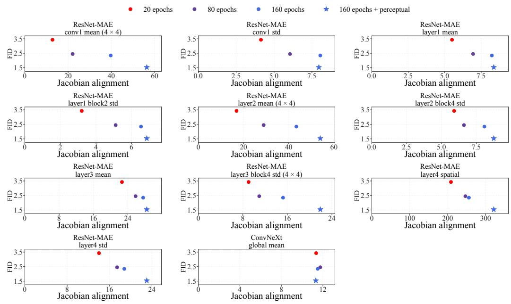  
Figure 6: Jacobian alignment in additional feature spaces. The 11 outputs complement the two shown in Figure 4, covering all 13 analyzed ResNet-MAE and ConvNeXt outputs. Colors and markers match the main-text figure; horizontal axes are linear with feature-specific ranges; all panels share the same FID range.

## D ADDITIONAL RESULTS ON IMAGENET

For completeness, we report precision and recall for the Priming Model variants as well as those of the baselines in Table 1 and assess potential memorization through nearest-neighbor retrieval against the training set.

Precision and recall. As shown in Table 8, Priming Model instances exhibit comparable precision and recall to the baselines.
<table><tr><td>Method</td><td>Precision ↑</td><td>Recall ↑</td></tr><tr><td>JiT-H†</td><td>0.78</td><td>0.62</td></tr><tr><td>Drifting-B</td><td>0.806</td><td>0.601</td></tr><tr><td>Priming-B (80 ep.)</td><td>0.786</td><td>0.617</td></tr><tr><td>Drifting-L</td><td>0.815</td><td>0.602</td></tr><tr><td>Priming-B (160 ep.)</td><td>0.783</td><td>0.624</td></tr><tr><td>WF-XL/2</td><td>0.762</td><td>0.674</td></tr><tr><td>Priming-L (80 ep.)</td><td>0.781</td><td>0.634</td></tr><tr><td>Priming-L (160 ep.)</td><td>0.781</td><td>0.649</td></tr></table>

Table 8: Precision and recall on ImageNet. All methods use one-step generation except JiT-H. †JiT-H values are taken from Table 13 of Li & He (2026).

Memorization test. Each group shows one generated image (blue border) followed by its four nearest ImageNet training images, ordered from nearest to farthest. Retrieval uses CLIP ViT-L/14 cosine similarity within the same class, searching all 1,300 training images per class. We show 20 visually selected queries per model, fixed before retrieval. We do not observe the signs of memorization in either Priming-B or Priming-L-160.

Priming-B (160 ep.)  
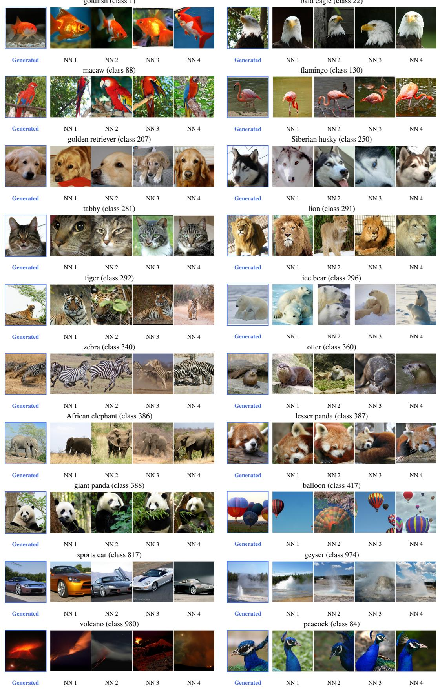

Priming-L (160 ep.)  
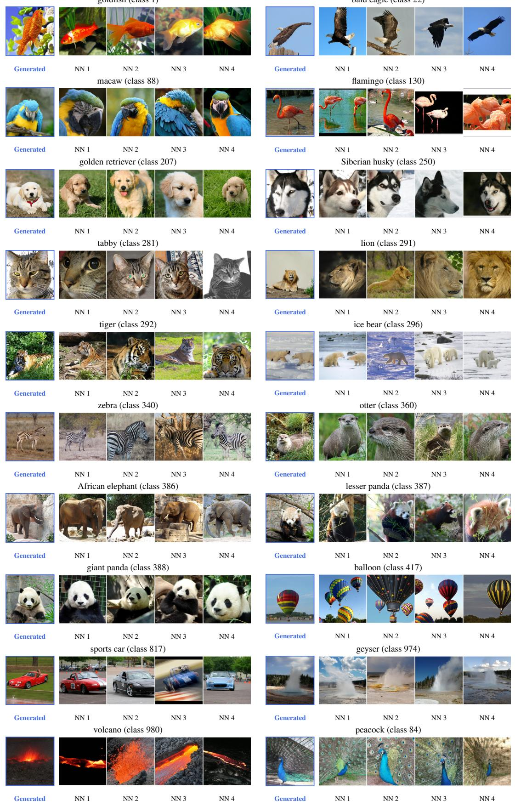

## E FD-LOSS

## E.1 FD-LOSS OBJECTIVE

FD-loss (Yang et al., 2026) directly compares the generated and real feature distributions through their first two moments. Let $\phi$ be a frozen feature encoder, and let $q _ { \theta } ^ { \phi } : = \phi _ { \# } q _ { \theta }$ and $p ^ { \phi } : = \phi _ { \# } p$ denote the generated and real feature distributions, respectively. Denoting their means and covariances as $( \mu _ { q } , \Sigma _ { q } )$ and $( \mu _ { p } , \Sigma _ { p } )$ , the objective is the squared Frechet distance between the corresponding´ moment-matched Gaussian distributions (Dowson & Landau, 1982):

$$
\begin{array} { r } { \mathcal { F } _ { \mathrm { F D } } ( q _ { \theta } ^ { \phi } , p ^ { \phi } ) : = \| \mu _ { q } - \mu _ { p } \| _ { 2 } ^ { 2 } + \mathrm { T r } \Big ( \Sigma _ { q } + \Sigma _ { p } - 2 \big ( \Sigma _ { p } ^ { 1 / 2 } \Sigma _ { q } \Sigma _ { p } ^ { 1 / 2 } \big ) ^ { 1 / 2 } \Big ) . } \end{array}\tag{14}
$$

Equivalently, Equation (14) is the squared 2-Wasserstein distance between $\textstyle { \mathcal { N } } ( \mu _ { q } , \Sigma _ { q } )$ and $\bar { \mathcal { N } } ( \mu _ { p } , \Sigma _ { p } )$

Unlike the objectives for Sinkhorn divergence or MMD, $\mathcal { F } _ { \mathrm { F D } }$ is minimized directly: there is no generated self-interaction term or independent generated reference batch. Gradients propagate through the generated moments $\left( \mu _ { q } , \Sigma _ { q } \right) \mathrm { t o } q _ { \theta }$ , whereas the real moments $( \mu _ { p } , \Sigma _ { p } )$ are fixed.

In practice, FD-loss replaces the population moments with accumulated estimates so that the objective can be optimized without placing the full feature population in a single minibatch (Yang et al., 2026). FD-loss performs marginal matching instead of conditional distribution matching.

## E.2 FD-LOSS IMAGENET EXPERIMENTS

Setup. We evaluate FD-loss as an alternative distributional post-training objective for the pixelspace Priming Models from Section 3.1. Priming-B has 115.1M parameters and is used for the pretraining ablations, while Priming-L has 405.1M parameters and is used for the pretraining-duration study. Both models use $1 6 \times$ 16 patches and generate ImageNet-1K images at $2 5 6 \times 2 5 6$ resolution in one network evaluation. These experiments are separate from the OT-post-trained results in the main text.

Reconstruction pretraining uses Muon with learning rate $1 0 ^ { - 3 }$ and global batch size 1,024. Unless stated otherwise, we use the fixed corruption level $s = 0 . 8$ and the pixel, LPIPS, and ConvNeXt reconstruction objective described in Section 3.1. FD post-training lasts 20 epochs and uses AdamW with learning rate $1 0 ^ { - 5 }$ , cosine decay, five epochs of linear warmup, and global batch size 256. We follow the multi-representation FD-SIM configuration of Yang et al. (2026): the training objective combines equally weighted FD terms from frozen SigLIP, Inception-V3, and MAE encoders. Real feature moments are precomputed, while generated moments are accumulated across updates with decay 0.999.

We evaluate the final online weights; the accumulated feature statistics are used only during FD posttraining. Each result uses 50,000 generated images with uniformly sampled labels. We report FID, precision, recall, and $\mathrm { F D r ^ { 6 } }$ following the FD-loss evaluation protocol. Here, $\mathrm { F D r ^ { 6 } }$ is the validationnormalized Frechet distance averaged across six representations and differs from´ $\mathrm { F D r ^ { 5 } }$ used in the main experiments.

Priming-B pretraining ablations. We first pretrain Priming-B for 80 epochs and apply the same 20-epoch FD-loss stage to every configuration. Table 9 compares pixel reconstruction alone with the addition of LPIPS and ConvNeXt perceptual supervision under fixed and logit-normal corruption schedules. Perceptual supervision lowers $\bar { \mathrm { F D r } } ^ { 6 }$ from 7.49 to 4.95 for fixed $s = 0 . 8$ and from 8.30 to 5.57 for the reweighted logit-normal distribution. Fixing $s = 0 . 8$ also outperforms the tested logit-normal schedule under either reconstruction objective.

Keeping perceptual reconstruction fixed, we then sweep $s \in \{ 0 . 6 , 0 . 7 , 0 . 8 , 0 . 9 , 1 . 0 \}$ . Among these values, $s = 0 . 8$ gives the lowest $\mathrm { F D r } ^ { 6 } . \ \mathrm { A t } \ s = 1$ , the corrupted input is independent of its paired clean image, and performance deteriorates sharply. Thus, simply matching the eventual Gaussian generator input is insufficient; retaining some clean-image information during reconstruction provides a substantially better initialization.

(a) Reconstruction objective and schedule
<table><tr><td>Schedule</td><td>Pixel</td><td>+ Perceptual</td></tr><tr><td>Fixed  $s = 0 . 8$ </td><td>7.49</td><td>4.95</td></tr><tr><td>Logit-normal</td><td>8.30</td><td>5.57</td></tr></table>

(b) Fixed-corruption sweep with perceptual reconstruction
<table><tr><td>Fixed s</td><td> $\mathrm { F D r ^ { 6 } \downarrow }$ </td></tr><tr><td>0.6</td><td>6.13</td></tr><tr><td>0.7</td><td>5.86</td></tr><tr><td>0.8</td><td>4.95</td></tr><tr><td>0.9</td><td>5.95</td></tr><tr><td>1.0</td><td>50.06</td></tr></table>

Table 9: Priming-B FD-loss ablations. All configurations use 80 epochs of reconstruction pretraining followed by 20 epochs of FD post-training. Values are $\mathrm { \dot { F } D r ^ { 6 } }$ ; lower is better.

Scaling Priming-L pretraining. Finally, we vary fixed- $s = 0 . 8$ perceptual pretraining from 20 to 160 epochs while holding FD post-training at 20 epochs. Table 10 shows that longer reconstruction pretraining consistently improves the principal distributional metrics: FID decreases from 1.07 to 0.94, $\mathrm { F D r } ^ { \bar { 6 } }$ decreases from 5.46 to 3.29, and recall increases from 0.53 to 0.60. Precision remains approximately constant. This result further supports reconstruction pretraining as an effective initialization for a direct Frechet-distance objective, rather than only for the OT objective used in the´ main experiments.

<table><tr><td>Model</td><td>Pretrain ep.</td><td>FD ep.</td><td> $\mathrm { F I D \downarrow }$ </td><td> $\mathrm { F D r ^ { 6 } \downarrow }$ </td><td>Prec.↑</td><td>Recall↑</td></tr><tr><td>Priming-L</td><td>20</td><td>20</td><td>1.07</td><td>5.46</td><td>0.77</td><td>0.53</td></tr><tr><td>Priming-L</td><td>40</td><td>20</td><td>1.01</td><td>4.40</td><td>0.77</td><td>0.58</td></tr><tr><td>Priming-L</td><td>80</td><td>20</td><td>0.96</td><td>3.64</td><td>0.77</td><td>0.59</td></tr><tr><td>Priming-L</td><td>160</td><td>20</td><td>0.94</td><td>3.29</td><td>0.77</td><td>0.60</td></tr></table>

Table 10: Scaling reconstruction pretraining before FD-loss. Priming-L uses fixed $s = 0 . 8$ with perceptual reconstruction, followed by a fixed 20-epoch FD post-training stage. Each row is one training run evaluated using the final online weights.

## F QUALITATIVE EXAMPLES

## F.1 IMAGENET

In this section, we provide qualitative examples on ImageNet for Priming-B and Priming-L, both pretrained for 160 epochs. For each ImageNet class, we use the same fixed set of 10 randomly sampled Gaussian noise vectors.

class 12: house finch  
Priming-B (160 ep.)  
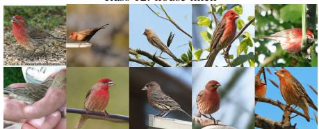  
class 14: indigo bunting

class 17: jay  

  
class 21: kite

class 22: bald eagle  
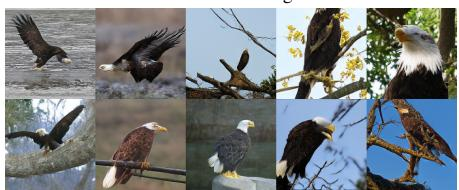

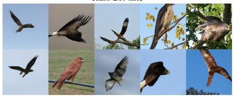

class 24: great grey owl  
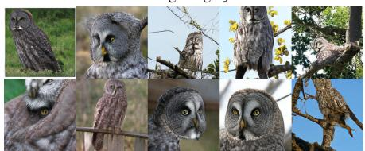

class 88: macaw  
class 84: peacock  
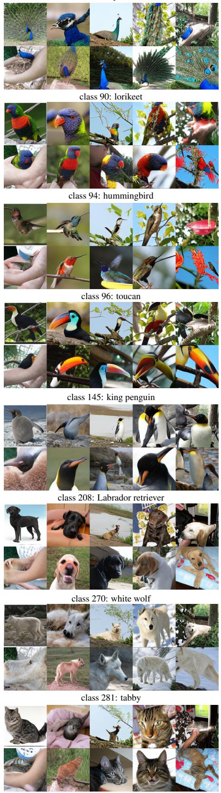

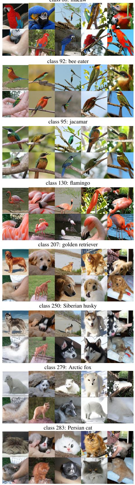

class 285: Egyptian cat  
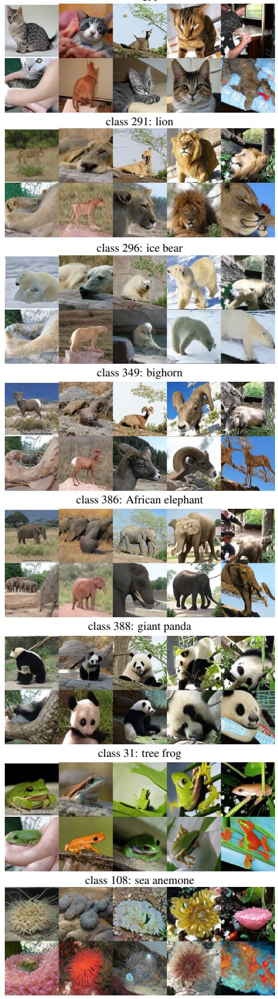

class 288: leopard  
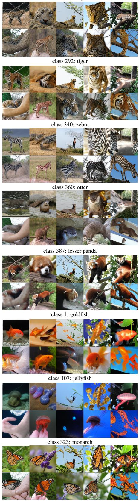

class 973: coral reef  
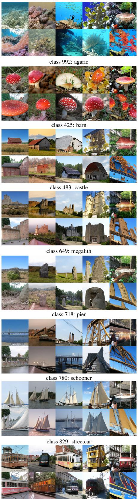

class 985: daisy  
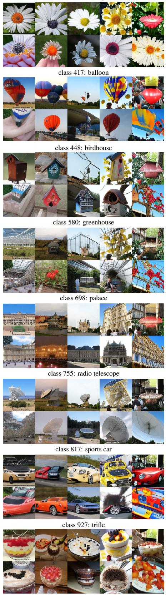

class 958: hay  
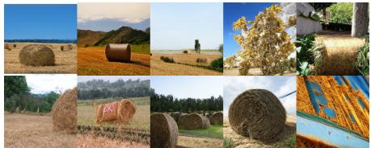

class 974: geyser  
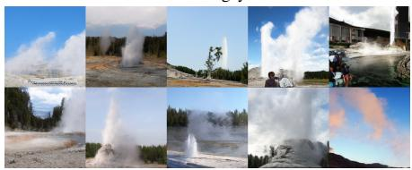

class 979: valley  
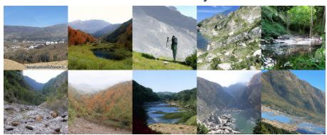

class 970: alp  
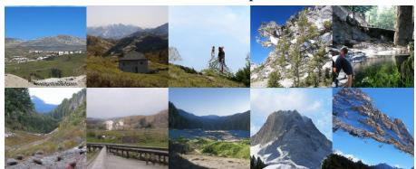

class 975: lakeside  
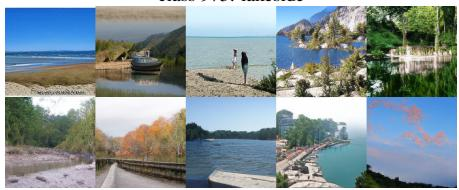

class 980: volcano  
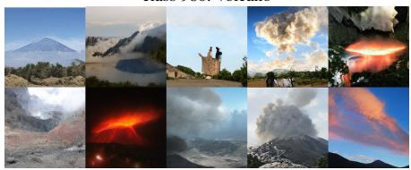

Priming-L (160 ep.)  
class 12: house finch  

class 17: jay  
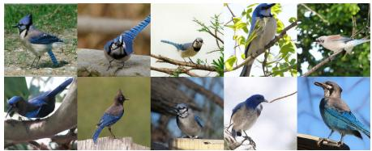

class 22: bald eagle  

class 84: peacock  
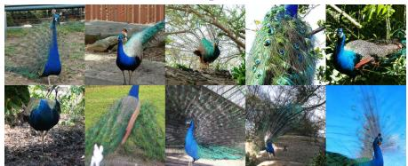

class 90: lorikeet  

class 14: indigo bunting  
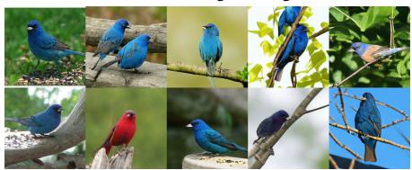

class 21: kite  

class 24: great grey owl  
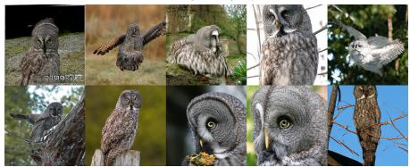

class 88: macaw  

class 92: bee eater  
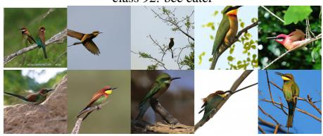

class 94: hummingbird  
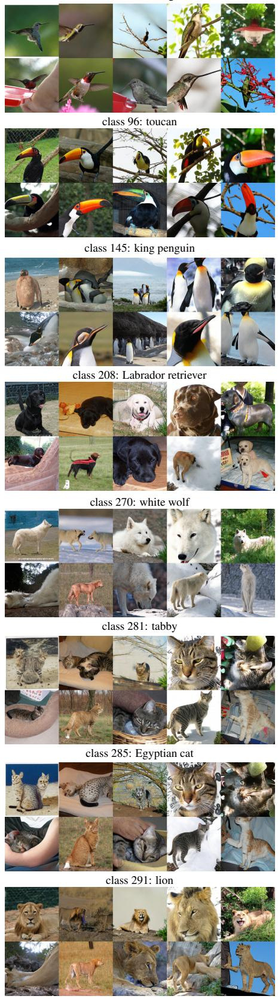

class 95: jacamar  
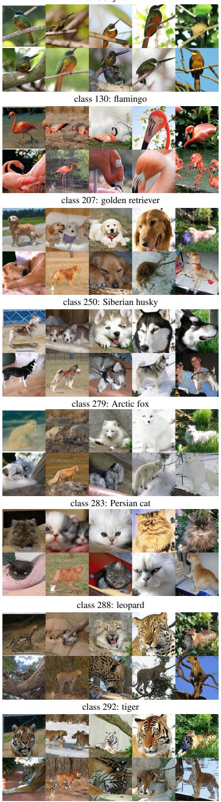

class 296: ice bear  
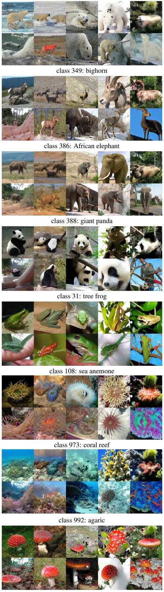

class 340: zebra  
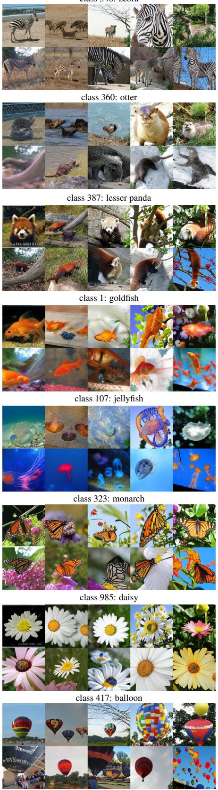

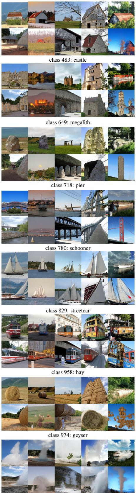

class 425: barn  
class 448: birdhouse  
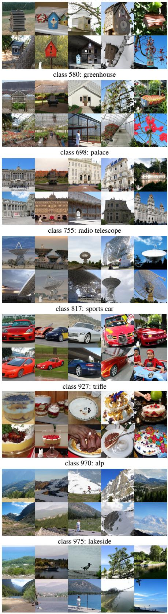

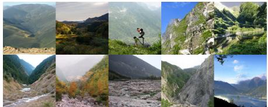  
class 979: valley

  
class 980: volcano

## F.2 TEXT-TO-IMAGE GENERATION

We compare one-step samples from Priming with logit-normal pretraining against the released MiniT2I MeanFlow baseline sampled in one step with classifier-free guidance scale 12.0 and guidance interval [0.2, 0.8]. For each selected caption, the two models are shown at the corresponding sample index within their four-sample groups.

MeanFlow  
Priming (ours)  

MeanFlow  
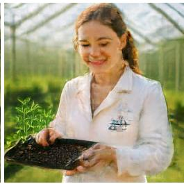  
A young botanist in a sunlit greenhouse, holding a tray of tin seedlings, natural editorial photograph.

Priming (ours)  
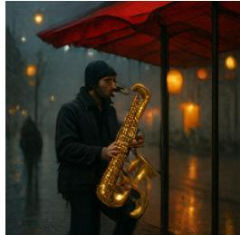

MeanFlow  
  
A street musician playing a golden saxophone beneath a red awning on a rainy evening.

Priming (ours)  
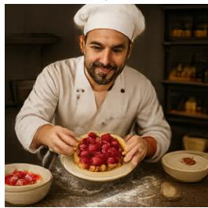

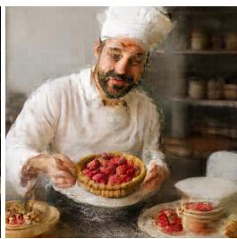

Priming (ours)  
  
A pastry chefdusted withflour presenting a perfect raspberry tart in a quiet bakery kitchen.

MeanFlow  
  
A joyful ceramic artist holding afreshly glazed turquoise vase in a bright workshop.

Priming (ours)  
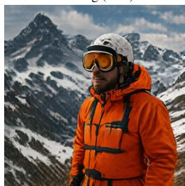  
A mountain guide wearing an orange jacket and round snow goggles, dramatic snowy peaks in the background.

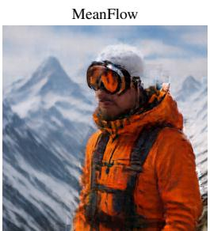

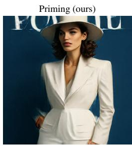

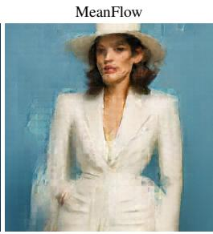  
Afashionable woman in a white suit and wide-brimmed hat standing against a cobalt blue wall, magazine portrait.

Figure 7: Text-to-image qualitative comparison (1/6). One-step samples from Priming with logitnormal pretraining and one-step MeanFlow with CFG scale 12.0.

MeanFlow  
MeanFlow  
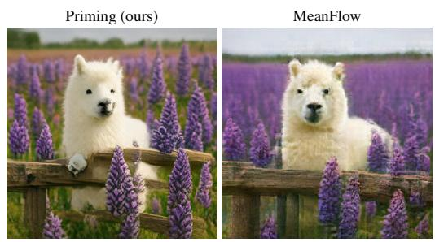

  
A red panda wearing a bright blue baseball cap, sitting on a moss-covered log.

Priming (ours)  

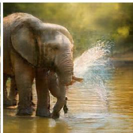  
A curious baby elephant spraying water beside its mother at a sunlit watering hole.

  
Two emperor penguins standing together beneath a green aurora on an Antarctic icefield.

  
A tiny treefrog resting on a glossy leafcovered with morning raindrops, macro photograph

  
A barn owl gliding silently through an old libraryfilled with floating dust motes.  
A fluffy white alpaca peeking over a wooden fence in a field of purple lupines.

  
A sea turtle swimming above a colorful coral reefwith shafts of sunlight in clear water.

  
A fox curled asleep inside a hollow tree while gentle snow falls outside.

Figure 8: Text-to-image qualitative comparison (2/6). One-step samples from Priming with logitnormal pretraining and one-step MeanFlow with CFG scale 12.0.

Priming (ours)  

MeanFlow  
  
Three playful ottersfloating on their backs in calm blue water, each holding a small seashell.

Priming (ours)  

MeanFlow  
  
A plate ofblueberry pancakes topped with strawberries and maple syrup, invitingfood photography.

Priming (ours)  

MeanFlow  
  
A bowl oframen with a soft-boiled egg, mushrooms, scallions, and rising steam on a dark wooden counter.

Priming (ours)  
MeanFlow  
  
A polished glass teapotfilled with yellow wildflowers on a rustic wooden table, soft morning light.

  
Priming (ours)  
A transparent perfume bottle on black stone surrounded by jasmine petals and silver reflections, luxury product photo.

MeanFlow  

Priming (ours)  

  
MeanFlow

  
An antique silver pocket watch resting on an open handwritten letter with a sprig of lavender.  
Priming (ours)  
MeanFlow  
A delicate matcha parfait layered with cream and red beans in a tall glass, Japanese cafe photography.

Priming (ours)  

MeanFlow  
  
A pair of red running shoes splashing through a shallow puddle, crisp commercial product photograph.

Figure 9: Text-to-image qualitative comparison (3/6). One-step samples from Priming with logitnormal pretraining and one-step MeanFlow with CFG scale 12.0.

Priming (ours)

  
A misty waterfall descending through a lush Icelandic canyon at sunrise, ultra-wide landscape photograph.

  
A winding river reflecting golden autumn trees in a quiet mountain valley, aerial view.

  
A lone acacia tree silhouetted against afiery orange sunset on the African savanna.

  
A crystal-clear alpine lake reflecting snowcapped mountains and a single red canoe.

  
A premium toy-like 3D render ofa tiny orange camper van beside a teal lake and rounded mountains.

  
A cozy low-poly campsite with a green tent, pine trees, and a glowing fire beneath a purple night sky.

  
An isometric miniature city powered by wind turbines and rooftop gardens, clean 3D render.

  
A vintage travel-poster illustration of a red cable car climbing through the Swiss Alps.

Figure 10: Text-to-image qualitative comparison (4/6). One-step samples from Priming with logit-normal pretraining and one-step MeanFlow with CFG scale 12.0.

Priming (ours)  
MeanFlow  
Priming (ours)  

MeanFlow  
  
A charcoal drawing oftwo jazz musicians performing in a smoky basement club.  
Priming (ours)  
MeanFlow

  
A richly textured pastel drawing ofpeaches and wildflowers on checkered tablecloth  
A stained-glass window depicting a peacock beneathflowering vines, jewel-toned light.

  
A watercolor illustration ofa lighthouse standing against enormous storm waves.

  
A mechanical hummingbird with brass wings hovering beside a luminous orchid

Priming (ours)  

  
MeanFlow  
Three ceramic owls lined up on a bookshelf, each wearing a different colored scarf.

  
A small red cube to the left of a large blue sphere on a clean white studio floor.

  
Two sailboats on a calm lake, the orange boat closer to the viewer and the blue boat near the mountains.

Figure 11: Text-to-image qualitative comparison (5/6). One-step samples from Priming with logit-normal pretraining and one-step MeanFlow with CFG scale 12.0.

Priming (ours)  

MeanFlow  

Priming (ours)  

MeanFlow  
  
A surfer carving through a translucent turquoise wave at golden hour, water dropletsfrozen in motion.

Afirefighter rescuing a small dogfrom aflooded street during heavy rain, documentary photograph.  
Priming (ours)  

  
A tiny cabin with warm windows nestled among snow-covered pine trees at blue hour.

  
MeanFlow  
A narrow street in Kyoto after rain, glowing paper lanterns reflected on wet pavement, cinematic photograph.  
Figure 12: Text-to-image qualitative comparison (6/6). One-step samples from Priming with logit-normal pretraining and one-step MeanFlow with CFG scale 12.0.

  
RT-1  
Figure 13: Autoregressive world-model rollouts. Qualitative examples on RT-1 and Bridge-V2. For each rollout, the top row shows ground-truth frames and the bottom row shows predictions from our model at the same time points. The leftmost column is the final observed context frame; the remaining columns are uniformly spaced over the predicted rollout. Predictions are generated autoregressively while conditioning on the provided action sequence.

## F.3 WORLD MODELS

Example 1: final context frame −→ autoregressive rollout

## F.4 STYLE EMBEDDING

  
Figure 14: Fixing the style embedding limits sample diversity. For each row, we fix the ImageNet class and learned style embedding while varying only the Gaussian input across ten independent samples. For both Drifting Pixel-L and W-Flow latent XL/2, the samples retain highly similar appearance and composition across columns, indicating that the learned style embedding accounts for much of the variation that would otherwise be attributed to the Gaussian input.