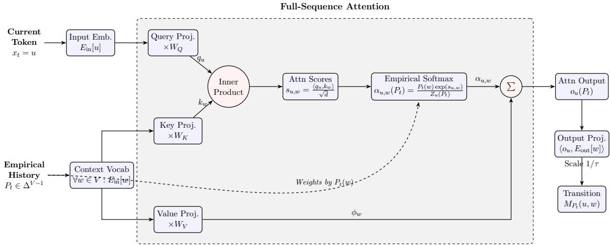
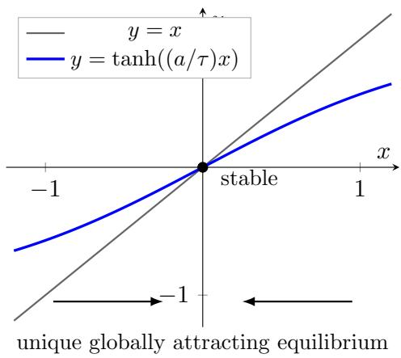
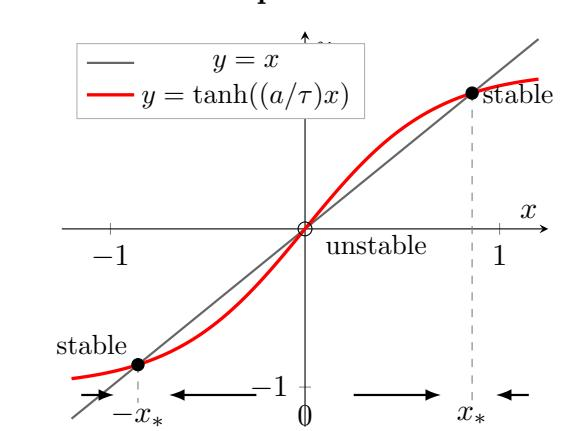
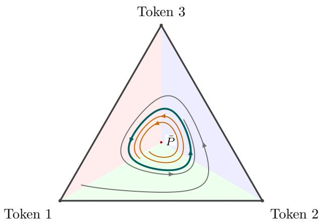

# Asymptotic Behavior of Transformers

Katy Blumer∗ Da-Cheng Juan† Jon Kleinberg‡ Ravi Kumar§ Cyrus Rashtchian† Andrew Tomkins¶

Google Research

## Abstract

In this paper we study the behavior of transformer networks generating text over long periods of time. We show that even a three-token, single-layer attention-only transformer can fail to converge. We then study a rich class of transformers with arbitrary finite depth, layer normalization, MLPs, RoPE encodings, and an arbitrary mix of local and global layers. Every transformer in this class has a softmax temperature threshold above which its empirical cache distribution converges to a unique limit, independent of initial conditions. We show further that, while each transformer has a temperature threshold, the supremum of this set is infinite, so there is no global minimal temperature that forces all transformers to converge.

## 1 Introduction

In this paper we study what happens if an autoregressive transformer is allowed to generate for a very long time. Most theoretical analyses of transformers fix the sequence length, or ask how performance changes when the context window is extended (Kazemnejad et al., 2023; Huang et al., 2025; Sun et al., 2023). Here we ask a diferent question: we fix the model and study the generation process itself as the number of generated tokens tends to infinity.

As a side note, while we think this question is mathematically natural, we are also motivated by the observation that modern models sometimes seem to “lock in” to a particular state (Sharma et al., 2024; Huang et al., 2024). Sometimes this state is annoyingly bad, such that even with great eforts the model cannot be convinced to let a particular approach or argument go. Other times the state is pleasingly good, perhaps encoding an efective understanding of a problem that represents a useful starting point for many further explorations—in this case we might wish to checkpoint the model in this good state, to use it as a resource. These observations led us to wonder, even without a human in the loop, whether a model might enter a state that continues to influence its behavior forever. This paper provides a partial answer.

Single-Layer Transformers. Our first goal is to understand this question in a simple setting: a single-layer attention-only transformer without positional encodings, MLPs, or normalization (Vaswani et al., 2017; Kazemnejad et al., 2023; Wang et al., 2024). In this model, diferent occurrences of the same token are indistinguishable to attention, so the entire history is summarized by the empirical token distribution $P _ { t } .$ . As t grows large, the change to the historical distribution in a single step goes to zero; hence, for fixed-size finite windows and suficiently large $t ,$ we may view the historical state of the model as frozen.

The next token logits depend only on the current token and the history, so freezing the historical distribution at some $P$ causes the simplified transformer to behave like a finite-state Markov chain with transition matrix $M _ { P }$ . The historical distribution will slowly drift towards the steady state of this Markov chain, $\pi ^ { * } ( P )$ , but as it does so, the Markov chain itself will evolve, resulting in a new drift direction. We show that the empirical distribution $P _ { t }$ tracks the ODE almost surely (Bena¨ım, 1999)

$$
\frac { d P } { d t } = \pi ^ { * } ( P ) - P .
$$

Thus the long-run behavior of this model is described by a deterministic dynamical system, even though the underlying token sequence remains random.

The softmax temperature τ enters this ODE in a particularly simple way. Diferentiating the output softmax contributes a factor $1 / \tau$ , and we use this to show that, for this model, there is a finite temperature above which the map $P \mapsto \pi ^ { * } ( P )$ is a contraction. In this regime the ODE has a unique globally attracting fixed point and $P _ { t }$ converges to it almost surely, independently of the initial prompt; as $\tau  \infty$ , this fixed point approaches the uniform distribution. At lower temperatures the ODE description remains valid, but uniqueness of the limiting set is no longer guaranteed; in fact, even this simplified model need not converge.

Multi-Layer Transformers. We next consider fixed-depth transformers, allowing arbitrary mixtures of global and fixed-window local attention layers (Beltagy et al., 2020; Zaheer et al., 2020), RoPE positional encodings (Su et al., 2024), MLPs, residual connections, and normalization. Here the empirical token distribution is no longer suficient to describe the history. The key/value vectors stored at a position depend on the context in which that position was generated, so two occurrences of the same token can contribute diferent entries to the global KV cache.

Nevertheless, each historical position contributes only a fixed-dimensional vector to this cache. We therefore represent the unbounded global cache by the empirical distribution $\eta _ { t }$ of these vectors. The dimension of an individual cache vector depends on the fixed architecture but not on the generation time. In this sense the entire historical state remains fixed-dimensional at each historical position even though the number of stored positions grows without bound.

RoPE position encodings introduce an additional state variable: the current rotation phase. With the global cache frozen at $\eta ,$ the finite local-attention windows imply that only a fixed number W of recent tokens is needed in addition to the current RoPE phase ω. The resulting process over W-grams is governed by a sequence of phase-dependent transition matrices $Q _ { \eta , \omega }$

Again with frozen history $\eta ,$ at any fixed positive temperature, every output token has a probability bounded away from zero. Every W-gram can be reached from every other in W steps, and the efect of the initial W-gram decays geometrically. This gives a unique phase-dependent family $\pi _ { \eta } ( \omega )$ describing the asymptotic distribution of the recent tokens. We show that this frozen-cache description remains accurate over suficiently long blocks that the local state at the start of the block is forgotten as the system moves towards the frozen-cache limiting behavior.

The RoPE phase itself does not converge, but the averages along its orbit do. Averaging the phase-dependent local behavior therefore defines a map $\Gamma ( \eta )$ : the average distribution over all RoPE phases of the next cache vector when the current cache is frozen at η. Since the empirical cache changes by only $1 / ( t + 1 )$ at each step, a natural time scale for state evolution is

$$
s _ { t } = \sum _ { j = 1 } ^ { t } { \frac { 1 } { j } } = \log t + O ( 1 ) .
$$

On this scale we obtain the measure-valued ODE

$$
\frac { d \eta } { d s } = \Gamma ( \eta ) - \eta .
$$

We prove that the actual empirical cache process almost surely tracks this ODE over every fixed interval of the s-time scale. Thus the long-run behavior of the full multi-layer transformer is again reduced to a deterministic dynamical system, now over probability distributions on a fixeddimensional cache space.

This description by itself does not imply convergence: the ODE may (and in fact does) have more complicated non-convergent trajectories. We therefore return to the role of temperature. The feed-forward ordering of transformer layers gives a useful triangular structure: the cache vector written by a global layer can depend only on the caches of earlier global layers. Using a weighted distance across layers, this triangular dependence can be made arbitrarily small. The remaining feedback through token sampling is suppressed by the $1 / \tau$ derivative of the output softmax. We use these two facts to show that every fixed transformer in our model has a finite temperature threshold above which Γ is a contraction. Above this threshold the cache ODE has a unique globally attracting fixed point, and the empirical cache converges to it almost surely.

The threshold, however, cannot be chosen uniformly over all transformers. We give an explicit three-token example showing that even a single-layer, NoPE, attention-only transformer with no MLP can fail to converge almost surely. Moreover, for every finite temperature $\tau ,$ , scaling its output embeddings by $\tau$ leaves the next token probabilities unchanged. Thus for every finite temperature there is such a simplified transformer that fails to converge, even though every fixed transformer converges once its temperature is suficiently large.

The order of quantifiers is important. For every fixed transformer, suficiently high temperature forces convergence; but for every fixed finite temperature there is some transformer that fails to converge. Hence there is no universal finite temperature that guarantees convergence over the entire class.

Our results therefore give two complementary descriptions of long-generation behavior. First, slowly changing empirical state turns the stochastic generation process into a deterministic ODE on an appropriate time scale. Second, suficiently high temperature controls the feedback in this ODE and forces convergence for each fixed model, while no single temperature can do so uniformly for all models.

## 1.1 Background

Throughout the paper, Σ denotes a finite vocabulary with $| \Sigma | \ = \ V$ , and $x _ { t } \in \Sigma$ is the token generated at time t. Let $\mathcal { F } _ { t }$ denote the information contained in the generated history $( x _ { 1 } , \ldots , x _ { t } )$ and let $\tau > 0$ denote the sampling temperature. We write $\Delta ^ { V - 1 }$ for the probability simplex.

For vectors, ⟨·, ·⟩ and ∥ · ∥ denote the Euclidean inner product and norm; for matrices, $\| \cdot \|$ denotes the induced operator norm. For distributions $\mu , \nu , \| \mu - \nu \| _ { \operatorname { t v } } : = \operatorname* { s u p } _ { A } | \mu ( A ) - \nu ( A ) |$ denotes the total variation distance, and $\begin{array} { r } { d _ { 1 } ( \mu , \nu ) : = \operatorname* { s u p } _ { \mathrm { L i p } ( \varphi ) \leq 1 } \left| \int \varphi d \mu - \int \varphi d \nu \right| } \end{array}$ denotes the 1-Wasserstein distance. Two distances on distributions are equivalent if they difer by at most constant factors. We use $\delta _ { \cdot , \cdot }$ · for the Kronecker delta and $\delta _ { z }$ for the unit point mass at z.

Stochastic Approximation. We repeatedly use the dynamical systems approach to stochastic approximation of Bena¨ım (1999). Informally speaking, for an update of the form

$$
X _ { t + 1 } = X _ { t } + \gamma _ { t } { \big ( } F ( X _ { t } ) + { \mathrm { n o i s e } } { \big ) } ,
$$

where the step sizes $\gamma _ { t }$ are decreasing and satisfy $\textstyle \sum _ { t } \gamma _ { t } = \infty$ and $\textstyle \sum _ { t } \gamma _ { t } ^ { 2 } < \infty$ , the process, viewed on the accumulated time scale $\begin{array} { r } { s _ { t } = \sum _ { j < t } \gamma _ { j } } \end{array}$ , tracks the ODE $d X / d s = F ( X )$ over every fixed interval of s-time. Under the usual boundedness and noise conditions, its limiting set is an internally chain transitive $\mathrm { ( I C T ) ^ { * } }$ set of this ODE. We use this framework in Section 2 to obtain the ODE for the empirical token distribution, and in Section 3 to obtain the analogous ODE for the empirical cache distribution. Once the corresponding ODE has a unique globally attracting fixed point, this tracking gives convergence of the stochastic process. We also use Bena¨ım’s result that stochastic approximation does not converge to a linearly unstable equilibrium under nondegenerate noise in Section 4.

## 2 Single-Layer Transformer

In this section we study a simple transformer model. The model has a single layer with one attention head, and lacks positional embeddings (NoPE), layer normalization, and MLPs. Let d be the hidden dimension. The model is parameterized by fixed input and output embedding matrices $E _ { \mathrm { i n } } , E _ { \mathrm { o u t } } \in \mathbb { R } ^ { V \times d }$ , and standard attention projection matrices $W _ { Q } , W _ { K } , W _ { V } \in \mathbb { R } ^ { d \times d }$

At step $t ,$ the state is given by the current token $x _ { t }$ and the historical context. With NoPE, attention to each token of the history is independent of the token’s location and so, the history is captured by the empirical distribution $P _ { t } \in \Delta ^ { V - 1 }$ , where $P _ { t } ( v )$ is the frequency of token v up to time t.

For a query token u and key/value token w, the unnormalized attention score is $s _ { u , w } =$ $\scriptstyle { \frac { 1 } { \sqrt { d } } } \langle ( E _ { \mathrm { i n } } [ u ] W _ { Q } ) , ( E _ { \mathrm { i n } } [ w ] W _ { K } ) \rangle$ . The attention weight that u pays to w over history $P _ { t }$ is:

$$
\alpha _ { u , w } ( P _ { t } ) ~ = ~ { \frac { P _ { t } ( w ) \exp ( s _ { u , w } ) } { Z _ { u } ( P _ { t } ) } } , ~ \mathrm { w h e r e }
$$

$$
Z _ { u } ( P _ { t } ) = \sum _ { w = 1 } ^ { V } P _ { t } ( w ) \exp ( s _ { u , w } ) .\tag{1}
$$

Let $\phi _ { w } = E _ { \mathrm { i n } } [ w ] W _ { V }$ denote the value vector for token w. The self-attention output is $o _ { u } ( P _ { t } ) =$ $\begin{array} { r } { \sum _ { w = 1 } ^ { V } \alpha _ { u , w } ( P _ { t } ) \phi _ { w } } \end{array}$ . The probability of generating the next token w given query u and history $P _ { t } ,$ sampled at temperature $\tau > 0$ , defines the transition matrix $M _ { P _ { t } } \in \mathbb { R } ^ { V \times V }$ (see Figure 1):

$$
M _ { P _ { t } } ( u , w ) = \frac { \exp \left( \langle o _ { u } ( P _ { t } ) , E _ { \mathrm { o u t } } [ w ] \rangle / \tau \right) } { \sum _ { w ^ { \prime } = 1 } ^ { V } \exp \left( \langle o _ { u } ( P _ { t } ) , E _ { \mathrm { o u t } } [ w ^ { \prime } ] \rangle / \tau \right) } .
$$

## 2.1 Limiting Dynamics

We first describe the asymptotic evolution of the empirical distribution $P _ { t }$ by an ordinary diferential equation (ODE). Observe that $P _ { t }$ updates iteratively as:

$$
P _ { t + 1 } ( v ) = P _ { t } ( v ) + \frac { 1 } { t + 1 } \left( \mathbb { I } ( x _ { t + 1 } = v ) - P _ { t } ( v ) \right) .
$$

  
Figure 1: A stripped-down model of a transformer with NoPE, no MLPs, and an unbounded context window parameterized by historical distribution $P _ { t }$

To analyze the long-run behavior of $P _ { t } ,$ we appeal to the theory of stochastic approximation. To show that the discrete stochastic process tracks a deterministic limiting ODE, we verify the standard conditions for stochastic approximation (Bena¨ım, 1999):

(i) Step-size sequence: The update step size $\textstyle \gamma _ { t } : = { \frac { 1 } { t + 1 } }$ satisfies the conditions: $\textstyle \sum _ { t } \gamma _ { t } = \infty$ and $\textstyle \sum _ { t } \gamma _ { t } ^ { 2 } < \infty$

(ii) Compact state space: $P _ { t }$ lies in the simplex $\Delta ^ { V - 1 }$ , which is compact.

(iii) Smoothness: The ODE has drift $\pi ^ { * } ( P ) - P$ , where $\pi ^ { * } ( P )$ is the stationary distribution of $M _ { P }$ . Since $\tau > 0$ and the logits are bounded on the simplex, each entry in $M _ { P }$ is bounded away from zero; thus, $M _ { P }$ is uniformly ergodic. Since $M _ { P }$ also depends smoothly on $P , \pi ^ { * } ( P )$ is continuously diferentiable (and hence Lipschitz) on the simplex.

(iv) Markovian state noise and martingale diference: Since the next token $x _ { t + 1 }$ is sampled from row $x _ { t }$ of $M _ { P _ { t } }$ , its conditional expectation given $\mathcal { F } _ { t }$ is $M _ { P _ { t } } ( x _ { t } , \cdot )$ rather than $\pi ^ { * } ( P _ { t } )$ . We therefore decompose the update increment as:

$$
\begin{array} { r l } & { \mathbb { I } ( x _ { t + 1 } = v ) - P _ { t } ( v ) = \underbrace { \left( \pi ^ { * } ( P _ { t } ) ( v ) - P _ { t } ( v ) \right) } _ { \mathrm { m e a n - f i e l d ~ d r i f t } } } \\ & { + \underbrace { \left( M _ { P _ { t } } ( x _ { t } , v ) - \pi ^ { * } ( P _ { t } ) ( v ) \right) } _ { \mathrm { M a r k o v i a n ~ s t a t e ~ n o i s e } } + \underbrace { \left( \mathbb { I } ( x _ { t + 1 } = v ) - M _ { P _ { t } } ( x _ { t } , v ) \right) } _ { \mathrm { m a r t i n g a l e ~ d i f f e r e n c e } } . } \end{array}
$$

Lemma 1. For every fixed $\tau > 0$ , the empirical distribution $P _ { t }$ tracks the ODE a.s.

$$
\frac { d P } { d t } = \pi ^ { * } ( P ) - P .
$$

Hence, the limiting set of $P _ { t }$ is an ICT of this ODE a.s.

Proof. Using (iv), the update is given by

$$
P _ { t + 1 } - P _ { t } = \gamma _ { t } \bigl ( \pi ^ { * } ( P _ { t } ) - P _ { t } + \xi _ { t + 1 } + \eta _ { t + 1 } \bigr ) ,
$$

where

$$
\xi _ { t + 1 } = M _ { P _ { t } } ( x _ { t } , \cdot ) - \pi ^ { * } ( P _ { t } ) , \eta _ { t + 1 } = I ( x _ { t + 1 } = \cdot ) - M _ { P _ { t } } ( x _ { t } , \cdot ) .
$$

Note that $\eta _ { t + 1 }$ is a bounded martingale diference, and so $\textstyle \sum _ { t } \gamma _ { t } \eta _ { t + 1 }$ converges (a.s.) as $\textstyle \sum _ { t } \gamma _ { t } ^ { 2 } < \infty$ from (i).

For the Markovian term $\xi _ { t + 1 }$ , uniform ergodicity from (iii) implies that there is a uniformly bounded function $g _ { P }$ , Lipschitz-continuous in P, satisfying

$$
g _ { P } ( x ) - \sum _ { y } M _ { P } ( x , y ) g _ { P } ( y ) = M _ { P } ( x , \cdot ) - \pi ^ { * } ( P ) .
$$

Thus

$$
\xi _ { t + 1 } = g _ { P _ { t } } ( x _ { t } ) - g _ { P _ { t } } ( x _ { t + 1 } ) + \zeta _ { t + 1 } ,
$$

where

$$
\zeta _ { t + 1 } = g _ { P _ { t } } ( x _ { t + 1 } ) - \sum _ { y } M _ { P _ { t } } ( x _ { t } , y ) g _ { P _ { t } } ( y ) ,
$$

is a bounded martingale diference. After multiplication by $\gamma _ { t }$ , the first two terms telescope up to a boundary term, which vanishes, and errors of order $| \gamma _ { t } - \gamma _ { t - 1 } |$ and $\gamma _ { t } \| P _ { t } - P _ { t - 1 } \| = O ( \gamma _ { t } ^ { 2 } )$ which are summable. Also, $\textstyle \sum _ { t } \gamma _ { t } \zeta _ { t + 1 }$ converges (a.s.). Hence the accumulated Markovian noise has vanishing tails.

Since $P \mapsto \pi ^ { * } ( P ) - P$ is Lipschitz, the proof follows from stochastic approximation (Bena¨ım, 1999). □

## 2.2 Jacobian

In this section, we study the limiting behavior of our simple transformer. In particular, we show that there is a temperature threshold above which the limit of the empirical distribution $P _ { t }$ is a unique fixed point.

From Lemma 1, the transformer tracks the ODE in the limit, so we study now whether all solutions converge to the same limit, or whether diferent limiting sets are possible. To do this, we analyze the Jacobian $J \in \mathbb { R } ^ { V \times V }$ of the map $\pi ^ { * } ( P )$ . This Jacobian characterizes how the steady state of the Markov chain moves in response to a local change in the history. Its entries are $J _ { w , v } = \partial \pi ^ { * } ( w ) / \partial P ( v )$

Note that taking a partial derivative with respect to a single component $P ( v )$ while holding all other components $P ( j \neq v )$ constant points in a direction that leaves the probability simplex (since the sum of the components will no longer equal 1). Since the formulas above extend smoothly to a neighborhood of the simplex, we can use these derivatives to assemble the full Jacobian in $\mathbb { R } ^ { V \times V }$ Since $\begin{array} { r } { \sum _ { w } \pi ^ { * } ( w ) = 1 } \end{array}$ , only perturbations whose coordinates sum to zero correspond to valid changes of the probability distribution. Restricting the Jacobian to these perturbations gives the correct local behavior on the simplex.

Lemma 2. It holds that

$$
\frac { \partial \pi ^ { * } } { \partial P ( v ) } = \frac { \partial \pi ^ { * } } { \partial P ( v ) } M _ { P } + \pi ^ { * } \frac { \partial M _ { P } } { \partial P ( v ) } .
$$

Proof. We trace the chain of derivatives with respect to $P ( v )$

(i) We diferentiate the normalization term $Z _ { u }$ in (1):

$$
\frac { \partial Z _ { u } } { \partial P ( v ) } = \exp ( s _ { u , v } ) .
$$

Applying the quotient rule to $\alpha _ { u , k }$ in (1):

$$
\begin{array} { c l c r } { { \displaystyle \frac { \partial \alpha _ { u , k } } { \partial P ( v ) } = \frac { \delta _ { k , v } \exp ( s _ { u , k } ) Z _ { u } - P ( k ) \exp ( s _ { u , k } ) \exp ( s _ { u , v } ) } { Z _ { u } ^ { 2 } } } } \\ { { = \displaystyle \frac { \exp ( s _ { u , v } ) } { Z _ { u } } ( \delta _ { k , v } - \alpha _ { u , k } ) . } } \end{array}
$$

Summing over all k to find the shift in the attention output $o _ { u } \colon$

$$
\frac { \partial o _ { u } } { \partial P ( v ) } = \sum _ { k = 1 } ^ { V } \frac { \partial \alpha _ { u , k } } { \partial P ( v ) } \phi _ { k } = \frac { \exp ( s _ { u , v } ) } { Z _ { u } } ( \phi _ { v } - o _ { u } ) .\tag{2}
$$

(ii) Let $z _ { u , w } ~ = ~ \langle o _ { u } , E _ { \mathrm { o u t } } [ w ] \rangle$ be the logit for token w. Its derivative is linear: $\begin{array} { r } { \frac { \partial z _ { u , w } } { \partial P ( v ) } ~ = } \end{array}$ $\begin{array} { r } { \left. \frac { \partial o _ { u } } { \partial P ( v ) } , E _ { \mathrm { o u t } } [ w ] \right. } \end{array}$ . The transition probability $M _ { P } ( u , w )$ is a softmax over these logits scaled by τ . Applying the standard softmax derivative, the chain rule, and using (2),

$$
\begin{array} { l } { \displaystyle \frac { \partial M _ { P } ( u , w ) } { \partial P ( v ) } = \sum _ { y \in V } \displaystyle \frac { \partial M _ { P } ( u , w ) } { \partial z _ { u , y } } \displaystyle \frac { \partial z _ { u , y } } { \partial P ( v ) } } \\ { = \sum _ { y \in V } \frac { 1 } { \tau } M _ { P } ( u , w ) ( \delta _ { w , y } - M _ { P } ( u , y ) ) \left. \displaystyle \frac { \partial o _ { u } } { \partial P ( v ) } , E _ { \mathrm { o u t } } [ y ] \right. } \\ { = \displaystyle \frac { 1 } { \tau } M _ { P } ( u , w ) \left. \displaystyle \frac { \partial o _ { u } } { \partial P ( v ) } , E _ { \mathrm { o u t } } [ w ] \right. } \\ { \displaystyle ~ - \sum _ { y \in V } M _ { P } ( u , y ) \left. \displaystyle \frac { \partial o _ { u } } { \partial P ( v ) } , E _ { \mathrm { o u t } } [ y ] \right. . } \end{array}
$$

Let $\begin{array} { r } { \bar { e } _ { u } = \sum _ { u \in V } M _ { P } ( u , y ) E _ { \mathrm { o u t } } [ y ] } \end{array}$ be the expected output embedding over the entire vocabulary for query u. Rewriting, we obtain

$$
\frac { \partial M _ { P } ( u , w ) } { \partial P ( v ) } = \frac { 1 } { \tau } M _ { P } ( u , w ) \frac { \exp ( s _ { u , v } ) } { Z _ { u } } \left. \phi _ { v } - o _ { u } , E _ { \mathrm { o u t } } [ w ] - \bar { e } _ { u } \right. .\tag{3}
$$

(iii) Finally, we derive the Jacobian of the stationary distribution $\begin{array} { r } { J _ { w , v } = \frac { \partial \pi ^ { * } ( w ) } { \partial P ( v ) } } \end{array}$ . Since $\pi ^ { * }$ is the stationary distribution of $M _ { P }$ , it satisfies the equilibrium condition $\pi ^ { * } = \pi ^ { * } M _ { P }$ . Diferentiating,

$$
\frac { \partial \pi ^ { * } } { \partial P ( v ) } = \frac { \partial \pi ^ { * } } { \partial P ( v ) } M _ { P } + \pi ^ { * } \frac { \partial M _ { P } } { \partial P ( v ) } .
$$

Let $\begin{array} { r } { c _ { v } ^ { T } = \frac { \partial \pi ^ { * } } { \partial P ( v ) } } \end{array}$ denote the row vector corresponding to the vth column of the Jacobian J, and let $\begin{array} { r } { r _ { v } ^ { T } = \pi ^ { * } \frac { \partial M _ { P } } { \partial P ( v ) } } \end{array}$ represent the direct perturbation vector. Rearranging the terms gives:

$$
c _ { v } ^ { T } ( I - M _ { P } ) = r _ { v } ^ { T }\tag{4}
$$

To isolate $c _ { v } ^ { T }$ , we define $F = ( I - M _ { P } + { \bf 1 } \pi ^ { * } ) ^ { - 1 }$ , which satisfies $( I - M _ { P } ) F = I - { \bf 1 } \pi ^ { * }$ . Multiplying both sides of (4) by F on the right yields:

$$
\begin{array} { r } { c _ { v } ^ { T } ( I - M _ { P } ) F = r _ { v } ^ { T } F . } \end{array}
$$

Furthermore, since $c _ { v } ^ { T }$ is the derivative of a probability distribution, its elements sum to zero, i.e., $c _ { v } ^ { T } \mathbf { 1 } = 0$ . This cancels the rank-one term $\mathbf { 1 } \pi ^ { * }$ , yielding a closed-form solution for the Jacobian column:

$$
c _ { v } ^ { T } = r _ { v } ^ { T } F .
$$

We next show a bound on the norm of the Jacobian, in terms of the temperature.

Lemma 3. There exist constants $C , \tau _ { 0 } < \infty$ such that, for all $\tau \geq \tau _ { 0 }$ ，

$$
\operatorname* { s u p } _ { P \in \Delta ^ { V - 1 } } \| J ( P ) \| \leq \frac { C } { \tau } .
$$

Proof. By (2), $\partial o _ { u } / \partial P ( \boldsymbol { v } )$ is uniformly bounded over $P \in \Delta ^ { V - 1 }$ . Since all remaining factors in (3) except $1 / \tau$ are bounded on the simplex, we obtain

$$
\left. \frac { \partial M _ { P } } { \partial P ( v ) } \right. = O \left( \frac { 1 } { \tau } \right) .
$$

As $\tau  \infty$ , every row of $M _ { P }$ converges uniformly in $P$ to the uniform distribution u. Since $\pi ^ { * } ( P ) = \pi ^ { * } ( P ) M _ { P }$

$$
\| \pi ^ { * } ( P ) - u \| \leq \operatorname* { m a x } _ { x } \| M _ { P } ( x , \cdot ) - u \| ,
$$

so $\pi ^ { * } ( P ) \to u$ uniformly as well. Hence $I - M _ { P } { + }  1 \pi ^ { * } \longrightarrow I$ uniformly in $P ,$ so $F = ( I - M _ { P } + { \bf 1 } \pi ^ { * } ) ^ { - 1 }$ remains uniformly bounded for all suficiently large τ . Using $c _ { v } ^ { T } = \pi ^ { * } ( \partial { M _ { P } } / \partial { P ( v ) } ) F$ , and since $\lVert \pi ^ { * } \rVert$ and $\| F \|$ are bounded, we obtain $\| c _ { v } \| = O ( 1 / \tau )$ for every column $c _ { v }$ of J. Since there are only V columns, sup $_ P \| J ( P ) \| = O ( 1 / \tau )$ □

Using these, we show that a temperature threshold exists, which is the main result in this section.

Theorem 4. There is a temperature $\tau _ { c }$ such that $P \mapsto \pi ^ { * } ( P )$ is a contraction for all $\tau > \tau _ { c }$ . Hence, it has a unique fixed point $P ^ { * }$ , which is globally attracting under the $O D E$

Proof. Choose $\tau _ { c } > \operatorname* { m a x } \{ C , \tau _ { 0 } \}$ , where $C , \tau _ { 0 }$ are the constants in Lemma 3. Since the simplex is convex, $P \mapsto \pi ^ { * } ( P )$ is a contraction and has a unique fixed point $P ^ { * }$ . Writing the ODE as $\begin{array} { r } { \frac { d P } { d t } = \pi ^ { * } ( P ) - P } \end{array}$ , let $e ( t ) = P ( t ) - P ^ { * }$ . Since $\pi ^ { * } ( P ^ { * } ) = P ^ { * }$ and using

$$
\| \pi ^ { * } ( P ) - \pi ^ { * } ( P ^ { * } ) \| \leq q \| P - P ^ { * } \| , \ q = \operatorname* { s u p } _ { P } \| J ( P ) \| < 1 ,
$$

we have

$$
\frac { 1 } { 2 } \frac { d } { d t } \| e ( t ) \| ^ { 2 } = \langle e ( t ) , \pi ^ { * } ( P ( t ) ) - \pi ^ { * } ( P ^ { * } ) - e ( t ) \rangle \leq - ( 1 - q ) \| e ( t ) \| ^ { 2 } .
$$

Integrating this inequality,

$$
\| P ( t ) - P ^ { * } \| \leq e ^ { - ( 1 - q ) t } \| P ( 0 ) - P ^ { * } \| ,
$$

so $P ^ { * }$ is globally attracting. Since $\| P ( t ) - P ^ { * } \|$ decreases strictly away from $P ^ { * } , \{ P ^ { * } \}$ is the only ICT set of the ODE. □

Combining Lemma 1 and Theorem 4, for every $\tau > \tau _ { c } .$ , we have lim ${ \mathsf { i } } _ { t  \infty } P _ { t } = P ^ { * } ( { \mathrm { a . s . } } )$ . Moreover, as $\tau  \infty , P ^ { * }$ converges to the uniform distribution, since $M _ { P }$ converges uniformly in $P$ to the transition matrix with every row uniform. For $\tau \leq \tau _ { c }$ , however, the above argument no longer guarantees uniqueness of the limiting set. Multiple limiting ICT sets are not ruled out and the behavior in this below-threshold temperature regime may depend on the specific model parameters.

## 2.3 A Simple Example

Let us consider a trivial example that shows three surprising facts about this simple transformer:

1. It may non-determinstically approach one of multiple limits.

2. The likelihood of each limit may depend on the starting conditions.

3. As the temperature increases, the same transformer will transition into approaching a single limit, independent of starting conditions.

Our example has only two tokens, and the hidden dimension is one, so embeddings and weight matrices are simply scalars. For $a \in \mathcal { R } ^ { + }$ , the model is fully specified by these values:

$$
E _ { \mathrm { i n } } [ 1 ] = 1 , E _ { \mathrm { i n } } [ 2 ] = - 1 , W _ { Q } = W _ { K } = 0 , W _ { V } = 1 , E _ { \mathrm { o u t } } [ 1 ] = a , E _ { \mathrm { o u t } } [ 2 ] = - a .
$$

Let $p = P ( 1 )$ be the fraction of token 1 in the history. Uniform attention gives $o ( P ) = 2 p - 1$ , and every row of $M _ { P }$ assigns probability

$$
q ( p ) = { \frac { 1 } { 2 } } \left( 1 + \operatorname { t a n h } \left( { \frac { a } { \tau } } ( 2 p - 1 ) \right) \right)
$$

to token 1. Hence $\pi ^ { * } ( P ) = ( q ( p ) , 1 - q ( p ) )$ and, with $x = 2 p - 1$ , the limiting ODE becomes

$$
{ \frac { d x } { d t } } = \operatorname { t a n h } \left( { \frac { a } { \tau } } x \right) - x .
$$

For $\tau > a ,$ the right-hand map is a contraction and $x = 0$ is the unique globally attracting fixed point. For $\tau < a , x = 0$ is unstable and two symmetric attracting fixed points $\pm x _ { * }$ appear. Thus even this two-token example exhibits the temperature-dependent transition underlying Theorem 4. Note that Mori and Hisakado (2015); Hisakado and Mori (2012) present a similar analysis exhibiting the same variation in steady state.

Despite the interesting dynamics of the steady state, the historical token distribution for these models does approach a limit for every positive temperature, even if this limit might be a random variable. In Section 4, we show that even this is not guaranteed by giving an explicit three-token construction with a proof of non-convergence of the token distribution.

## 3 Multi-Layer Transformer

The analysis for a single-layer transformer uses the fact that, without position encodings, the history is summarized by the empirical token distribution. This does not hold for a multi-layer transformer, where the key and value vectors stored at a historical position depend on the context in which that position was generated. Nevertheless, for a fixed-width, fixed-depth transformer, each historical position contributes only a fixed-dimensional vector to the global KV cache. We therefore represent the unbounded history by an empirical distribution over these vectors.

Throughout this section, the number of layers and heads is fixed, and every local attention layer is causal with a fixed window of width at most w. Besides the global KV cache, the mode has no recurrent state other than the finite KV caches used to power the local layers. As in a standard transformer block, the keys and values stored by an attention layer are computed from the input to that layer, before its attention output is produced. All projections, MLPs, residual maps, and normalization maps are assumed to be uniformly Lipschitz on the reachable set and all reachable hidden states, queries, keys, values, local cache states, and pre-temperature output logits are uniformly bounded. All constants below may depend on the architecture and its weights, but not on the generation time. For local RoPE layers, attention depends only on relative ofsets within the fixed local window, so no absolute phase state is needed.

High temperature: $\tau > a$  

Low temperature: $\tau < a$  
  
two stable equilibria and one unstable equilibrium  
Figure 2: A two-token example illustrating the temperature transition: $x = 2 p - 1$ and $d x / d t =$ tanh $( ( a / \tau ) x ) - x$ . For $\tau > a$ , the uniform state is the unique globally attracting equilibrium. For $\tau < a$ , it becomes unstable and two symmetric stable equilibria appear.

We consider a transformer with both global attention layers, whose attention window has the full history, and local attention layers with a fixed window. Let $L _ { \mathrm { g l o b } }$ and $L _ { \mathrm { l o c } }$ be the numbers of global and local attention layers respectively, each with h heads of dimension d.

Let $\pmb { \theta } _ { \ell , a } = ( \pmb { \theta } _ { \ell , a , 1 } , \dots , \pmb { \theta } _ { \ell , a , d / 2 } )$ be the RoPE frequencies of head $( \ell , a )$ , and define the RoPE rotation as:

$$
R ( p \pmb { \theta } _ { \ell , a } ) : = \mathrm { d i a g } \big ( R ( p \pmb { \theta } _ { \ell , a , 1 } ) , \dots , R ( p \pmb { \theta } _ { \ell , a , d / 2 } ) \big ) ,
$$

where

$$
R ( \alpha ) = { \binom { \cos \alpha } { \sin \alpha } } \quad { \stackrel { - \sin \alpha } { \cos \alpha } } { \bigg ) } .
$$

For each historical position $p ,$ let $k _ { \ell , a , p } ^ { \mathrm { r a w } }$ be the unrotated key, and let

$$
k _ { \ell , a , p } ^ { \mathrm { r o t } } = R ( p \pmb { \theta } _ { \ell , a } ) \cdot k _ { \ell , a , p } ^ { \mathrm { r a w } } ,
$$

be the rotated key. The collection of global cache quantities generated at position $p$ is

$$
z _ { p } = \left( k _ { \ell , a , p } ^ { \mathrm { r o t } } , v _ { \ell , a , p } \right) _ { \ell \in [ L _ { \mathrm { g l o b } } ] , a \in [ h ] } \in \mathbb { R } ^ { 2 d h L _ { \mathrm { g l o b } } } .
$$

Let $\mathcal { Z }$ be the closure of the set of all reachable $z _ { p } ;$ by the boundedness assumption, $\mathcal { Z }$ is compact.

Let θ denote the collection of RoPE frequencies across all global heads, and let $\omega _ { t } = t \pmb \theta$ (mod 2π) denote the vector of current RoPE phases. Let

$$
\eta _ { t } = \frac { 1 } { t } \sum _ { p = 1 } ^ { t } \delta _ { z _ { p } }
$$

be the empirical distribution of global cache vectors, where $\delta _ { z }$ denotes a unit point mass at z. Thus, the global cache changes slowly: each new token changes its empirical distribution by only $O ( 1 / t )$

For each $z \in { \mathcal { Z } }$ , let $k _ { \ell , a } ^ { \mathrm { r o t } } ( z )$ and $v _ { \ell , a } ( z )$ denote its key and value coordinates for global layer ℓ and head a. For a query $q _ { \ell , a , t } ^ { \mathrm { r o t } } = R ( t \pmb { \theta } _ { \ell , a } ) \cdot q _ { \ell , a , t } ^ { \mathrm { r a w } }$ , the corresponding global attention output is

$$
o _ { \ell , a } ( t ) = \frac { \displaystyle \int _ { \mathcal { Z } } { \boldsymbol { v } _ { \ell , a } ( \boldsymbol { z } ) \cdot \exp \left( \frac { \left. q _ { \ell , a , t } ^ { \mathrm { r o t } } , k _ { \ell , a } ^ { \mathrm { r o t } } ( \boldsymbol { z } ) \right. } { \sqrt { d } } \right) d \eta _ { t } ( \boldsymbol { z } ) } } { \displaystyle \int _ { \mathcal { Z } } \exp \left( \frac { \left. q _ { \ell , a , t } ^ { \mathrm { r o t } } , k _ { \ell , a } ^ { \mathrm { r o t } } ( \boldsymbol { z } ) \right. } { \sqrt { d } } \right) d \eta _ { t } ( \boldsymbol { z } ) } .\tag{5}
$$

Since the reachable queries and keys are bounded, the denominator in (5) is bounded away from zero uniformly in t.

Thus, once the RoPE rotation is incorporated into the stored key, its historical location is no longer needed. To characterize long-run RoPE phases, let

$$
H _ { \pmb \theta } : = { \overline { { \{ n \pmb \theta } } }  { \pmod { 2 \pi } } : n \in \mathbb { Z } \} ,
$$

be the closure of phases visited in the limit. Let $\mu _ { \pmb { \theta } }$ denote the uniform probability distribution on $H _ { \theta }$ . We now show that averages along the RoPE phases converge to the average under $\mu _ { \pmb { \theta } }$

Lemma 5. For any continuous function $f : H _ { \pmb { \theta } }  \mathbb { C } ,$

$$
\operatorname* { s u p } _ { \alpha \in H _ { \pmb { \theta } } } \left| \frac { 1 } { T } \sum _ { n = 1 } ^ { T } f ( \alpha + n \pmb { \theta } ) - \int _ { H _ { \pmb { \theta } } } f ( \omega ) d \mu _ { \pmb { \theta } } ( \omega ) \right| \longrightarrow 0 .
$$

Proof. Consider $\alpha = 0$ . For an integer vector m of the same dimension as $\theta ,$ let $\chi _ { m } ( \omega ) = e ^ { i \langle m , \omega \rangle }$ Then,

$$
{ \frac { 1 } { T } } \sum _ { n = 1 } ^ { T } \chi _ { m } ( n \pmb { \theta } ) \longrightarrow \left\{ { 1 , \quad \langle m , \pmb { \theta } \rangle \in 2 \pi \mathbb { Z } , } \right.
$$

The average of the same function under the uniform distribution on $H _ { \theta }$ has the same value. Since finite linear combinations of $\chi _ { m }$ uniformly approximate every continuous function on $H _ { \pmb { \theta } }$ , the result follows. The same calculation with $\alpha + n \pmb { \theta }$ instead of $n \pmb { \theta }$ difers only by the factor $e ^ { i \langle m , \alpha \rangle }$ , whose absolute value is one, so the convergence is uniform in α. □

To understand the impact of the local layers, note that each such layer has width at most $w ,$ and so its output can introduce dependence on at most $w - 1$ additional earlier token positions. Thus, once the global attention outputs are fixed, the remaining computation depends only on the most recent $W = 1 + L _ { \mathrm { l o c } } ( w - 1 )$ tokens. Let $\boldsymbol { u } _ { t } = ( x _ { t - W + 1 } , \ldots , x _ { t } ) \in \Sigma ^ { W }$ be this $W \cdot$ -gram (with fixed padding when $t < W )$ . Any fixed transformer in our model may be viewed as a function mapping from $u _ { t }$ and the global cache state to a new $u _ { t + 1 }$ and global KV cache column output.

## 3.1 Frozen Cache Dynamics

In this section, we first hold the global cache fixed and study the evolution of $u _ { t }$ over a block of k steps. The motivation for this approach is as follows. Each new output modifies the global cache by only $O ( 1 / t )$ , so for $k = o ( t ) , \operatorname* { s u p } _ { 0 < j < k } d _ { 1 } ( \eta _ { t + j } , \eta _ { t } ) = O ( k / t ) = o ( 1 )$ ; thus the cache does indeed behave as if frozen. Once we understand the frozen cache behavior, we study how the drift during the frozen regime will eventually result in a new global cache state (possible, as $\textstyle \sum _ { t ^ { \prime } > t } 1 / t ^ { \prime }$ diverges), and what the trajectory over these evolving global cache states will look like.

Let η be a probability distribution on $\mathcal { Z }$ representing the (frozen) global cache state. With the global cache fixed, the recent W tokens and the current RoPE phase determine the next step. For $u \in \Sigma ^ { W }$ and phase $\omega \in H _ { \theta }$ , let $q _ { \eta , \omega } ( a \mid u ) = \mathrm { P r } [ x _ { t + 1 } = a \mid u _ { t } = u , \omega _ { t } = \omega , \eta ]$ be the next token distribution produced by the transformer. For $u , u ^ { \prime } \in \Sigma ^ { W }$ , define the transition matrix:

$$
Q _ { \eta , \omega } ( u , u ^ { \prime } ) = \mathrm { P r } [ u _ { t + 1 } = u ^ { \prime } \mid u _ { t } = u , \omega _ { t } = \omega , \eta ] .
$$

Thus $Q _ { \eta , \omega } ( u , u ^ { \prime } ) > 0$ only if $u ^ { \prime }$ is obtained from u by dropping its first symbol and appending one new token. We first establish a uniform lower bound on next token probabilities. This will imply that every W-gram can be reached from every other in W steps and hence the product of the transition matrices contract.

We assume that $\tau \geq \tau _ { \operatorname* { m i n } } > 0$ . By the boundedness assumption, there is a constant $B < \infty$ such that every pre-temperature output logit satisfies $| \ell _ { a } ^ { \mathrm { o u t } } ( \eta , u , \omega ) | \le B$ for all $u \in \Sigma ^ { W } , \omega \in H _ { \theta }$ and $a \in \Sigma$ . Therefore,

$$
q _ { \eta , \omega } ( a \mid u ) \ge \epsilon : = \frac { \exp ( - 2 B / \tau _ { \mathrm { m i n } } ) } { V } > 0 .\tag{6}
$$

Since the phase changes by θ after each step, the m-step transition matrix starting at phase ω is

$$
\begin{array} { r } { Q _ { \eta , \omega } ^ { [ m ] } : = Q _ { \eta , \omega } \cdot Q _ { \eta , \omega + \theta } \cdot \cdot \cdot \cdot \cdot Q _ { \eta , \omega + ( m - 1 ) \theta } . } \end{array}
$$

Starting from any W-gram, any particular W-gram $u ^ { \prime } = ( y _ { 1 } , \dots , y _ { W } )$ can be reached in W steps by generating $y _ { 1 } , \dotsc , y _ { W } . { \mathrm { ~ B y ~ } } ( 6 )$ , each of these tokens has conditional probability at least ϵ. Hence

$$
Q _ { \eta , \omega } ^ { [ W ] } ( u , u ^ { \prime } ) \ge \epsilon ^ { W } ,
$$

for every $u , u ^ { \prime } \in \Sigma ^ { W }$ , uniformly in η and ω.

Let $\beta = V ^ { W } \epsilon ^ { W } \in ( 0 , 1 ]$ . Since every entry of the W-step transition matrix is at least $\epsilon ^ { W }$ , for any two probability distributions $\lambda , \lambda ^ { \prime }$ on $\Sigma ^ { W }$ , we have

$$
\begin{array} { r } { \left\| \lambda \cdot Q _ { \eta , \omega } ^ { [ m ] } - \lambda ^ { \prime } \cdot Q _ { \eta , \omega } ^ { [ m ] } \right\| _ { \mathrm { t v } } \leq ( 1 - \beta ) ^ { \lfloor \frac { m } { W } \rfloor } \| \lambda - \lambda ^ { \prime } \| _ { \mathrm { t v } } . } \end{array}\tag{7}
$$

Thus, with the cache fixed, the efect of the initial W-gram decays geometrically. Since the RoPE phase changes at each step, the process is governed by a sequence of transition matrices rather than by one fixed matrix; we study its limiting behavior.

Lemma 6. For every fixed η, (i) there is a unique family $\{ \pi _ { \eta } ( \omega ) \} _ { \omega \in H _ { \theta } }$ of probability distributions such that $\pi _ { \eta } ( \omega + \pmb { \theta } ) = \pi _ { \eta } ( \omega ) \cdot Q _ { \eta , \omega }$ and (ii) for every initial distribution λ,

$$
\begin{array} { r } { \left\| \boldsymbol { \lambda } \cdot \boldsymbol { Q } _ { \eta , \omega } ^ { [ m ] } - \pi _ { \eta } ( \omega + m \pmb { \theta } ) \right\| _ { \mathrm { t v } } \leq ( 1 - \beta ) ^ { \lfloor m / W \rfloor } . } \end{array}
$$

Proof. Fix ω and any distribution λ on $\Sigma ^ { W }$ . Consider

$$
\lambda \cdot Q _ { \eta , \omega - m \theta } \cdot Q _ { \eta , \omega - ( m - 1 ) \theta } \cdot \cdot \cdot \cdot Q _ { \eta , \omega - \theta } .\tag{8}
$$

If a longer product is used, its last m transition matrices are the same as those in (8), but with a possibly diferent distribution at their starting point. By (7), changing that starting distribution changes the result by at most $( 1 - \beta ) ^ { \lfloor m / W \rfloor }$ . Hence (8) converges as $m \to \infty$ , and its limit does not depend on λ. Define this limit to be $\pi _ { \eta } ( \omega )$

Shifting ω by θ in (8) gives (i). Finally, apply (7) to λ and $\pi _ { \eta } ( \omega ) ; \mathrm { ( i i ) }$ now follows from (i). Uniqueness also follows from the same bound. □

Since only a fixed number of recent positions enter the local computation and all computations are Lipschitz, replacing the cache states used at those positions by the current cache $\eta _ { t }$ changes the next step distribution by $O ( 1 / t )$ . Recalling $\mathcal { F } _ { t }$ is the history up to time $t ,$

$$
\Vert \mathrm { P r } [ u _ { t + 1 } \in \cdot \mid \mathcal { F } _ { t } ] - Q _ { \eta _ { t } , \omega _ { t } } ( u _ { t } , \cdot ) \Vert _ { \mathrm { t v } } = O ( 1 / t ) .
$$

We next show that this frozen cache description remains accurate over time intervals on which the empirical cache changes only slightly.

Lemma 7. (i) There is a constant $L _ { \pi }$ such that

$$
\operatorname* { s u p } _ { \omega \in H _ { \theta } } \Vert \pi _ { \eta } ( \omega ) - \pi _ { \eta ^ { \prime } } ( \omega ) \Vert _ { \mathrm { t v } } \leq L _ { \pi } \cdot d _ { 1 } ( \eta , \eta ^ { \prime } ) .
$$

(ii) Moreover, let $k = k ( p )$ satisfy k → ∞ and $k ^ { 2 } / p \to 0$ . Then $\begin{array} { r } { \Vert \operatorname* { P r } [ u _ { p + k } \in \cdot \mid \mathcal { F } _ { p } ] - \pi _ { \eta _ { p } } ( \omega _ { p + k } ) \Vert _ { \mathrm { t v } } \longrightarrow } \end{array}$ 0.

Proof. We first prove (i). Under our assumptions, there is a constant $L _ { Q }$ such that

$$
\operatorname* { s u p } _ { u , \omega } \big \| Q _ { \eta , \omega } ( u , \cdot ) - Q _ { \eta ^ { \prime } , \omega } ( u , \cdot ) \big \| _ { \mathrm { t v } } \leq L _ { Q } \cdot d _ { 1 } ( \eta , \eta ^ { \prime } ) .\tag{9}
$$

Indeed, for the first global layer this follows directly from (5): its terms are uniformly bounded and Lipschitz in $z ,$ and the denominator is uniformly bounded away from zero. The resulting attention output therefore changes by $O ( d _ { 1 } ( \eta , \eta ^ { \prime } ) )$ . Repeating this argument through the fixed number of layers, using the Lipschitz assumptions, proves (9).

Combining (9) with (7) gives (i): comparing the products defining $\pi _ { \eta } ( \omega )$ and $\pi _ { \eta ^ { \prime } } ( \omega )$ term by term, a change r steps in the past is reduced geometrically in $r ,$ and summing these changes gives the stated bound. Similarly, continuity of $Q _ { \eta , \omega }$ in ω implies continuity of $\pi _ { \eta } ( \omega )$ in $\omega .$

We now return to the actual cache, which changes after every step t. From the definition of $\eta _ { t }$

$$
\eta _ { t + 1 } = \eta _ { t } + \frac { 1 } { t + 1 } \big ( \delta _ { z _ { t + 1 } } - \eta _ { t } \big ) .
$$

Since each cache update has size $O ( 1 / t )$ ，

$$
\operatorname* { s u p } _ { 0 \leq j \leq k } d _ { 1 } ( \eta _ { p + j } , \eta _ { p } ) = O \biggl ( \frac { k } { p } \biggr ) .
$$

Therefore, by (9),

$$
\operatorname* { s u p } _ { 0 \leq j < k } \operatorname* { s u p } _ { u } \| Q _ { \eta _ { p + j } , \omega _ { p + j } } ( u , \cdot ) - Q _ { \eta _ { p } , \omega _ { p + j } } ( u , \cdot ) \| _ { \mathrm { t v } } = O \left( \frac k p \right) .
$$

Comparing the two k-step products one step at a time, the errors from replacing $\eta _ { p + j }$ by $\eta _ { p }$ add up to $O ( k ^ { 2 } / p )$ . The $O ( 1 / t )$ error in the actual one-step transition accumulates to $O ( k / p )$ , which is smaller. Hence, conditioned on $\mathcal { F } _ { p } .$ , the distribution of $u _ { p + k }$ difers by $O ( k ^ { 2 } / p )$ from the distribution obtained by holding the cache fixed at $\eta _ { p }$ . Lemma 6 thus gives

$$
\left\| \operatorname* { P r } [ u _ { p + k } \in \cdot \mid \mathcal { F } _ { p } ] - \pi _ { \eta _ { p } } ( \omega _ { p + k } ) \right\| _ { \mathrm { t v } } \leq ( 1 - \beta ) ^ { \lfloor \frac { k } { W } \rfloor } + O \left( \frac { k ^ { 2 } } { p } \right) .
$$

Both terms vanish under $k \to \infty$ and $k ^ { 2 } / p \to 0$ , proving (ii).

Thus, over a block that is long enough for the recent tokens to forget their initial state but short enough that the global cache changes little, their distribution is determined asymptotically by the cache state at the start of the block and the current RoPE phase. Although the instantaneous distribution may depend on the RoPE phase, Lemma 5 allows this phase dependence to be averaged over a long block.

## 3.2 Slow Cache Dynamics

Lemma 7 describes the recent token distribution while the global cache changes only slightly. We now use this to study the average evolution of the cache itself.

For a fixed η, $u \in \Sigma ^ { W } , \omega \in H _ { \theta }$ , and a generated token $a \in \Sigma$ , let $G ( \eta , u , \omega , a ) \in \mathcal { Z }$ denote the new global cache vector inserted at the next position, whose RoPE phase is $\omega + \theta$ . The Lipschitz assumptions above mean that $G$ is Lipschitz in η with respect to $d _ { 1 }$ and in $\omega .$ . Define

$$
\Gamma ( \eta ) : = \int _ { H _ { \theta } \atop \stackrel { u \in \Sigma W } { a \in \Sigma } } \pi _ { \eta } ( \omega ) ( u ) \cdot q _ { \eta , \omega } ( a \mid u ) \cdot \delta _ { G ( \eta , u , \omega , a ) } d \mu _ { \theta } ( \omega ) .
$$

Thus $\Gamma ( \eta )$ is the average distribution of the next cache vector when the recent tokens have adjusted to the frozen cache η and the RoPE phase is averaged.

Since the empirical cache updates with step size $1 / ( t + 1 )$ , its natural continuous time scale is $\begin{array} { r } { s _ { t } : = \sum _ { j = 1 } ^ { t } \frac { 1 } { j } = \log t + O ( 1 ) } \end{array}$ ; we use s for this slow time variable. The corresponding equation for the empirical cache is

$$
\frac { d \eta } { d s } = \Gamma ( \eta ) - \eta .\tag{10}
$$

Since $\eta _ { s }$ is a probability distribution rather than a finite-dimensional vector, we interpret (10) by testing it against Lipschitz functions: for every $\varphi : \mathcal { Z }  \mathbb { R }$ 2

$$
\frac { d } { d s } \int _ { \mathcal { Z } } \varphi ( z ) d \eta _ { s } ( z ) = \int _ { \mathcal { Z } } \varphi ( z ) d \Gamma ( \eta _ { s } ) ( z ) - \int _ { \mathcal { Z } } \varphi ( z ) d \eta _ { s } ( z ) .
$$

For a Lipschitz $\varphi : \mathcal { Z }  \mathbb { R }$ , let

$$
\begin{array} { c } { \displaystyle \eta ( \varphi ) : = \int _ { \mathcal { Z } } \varphi ( z ) d \eta ( z ) , } \\ { \displaystyle G _ { \varphi } ( \eta , u , \omega ) : = \sum _ { a \in \Sigma } q _ { \eta , \omega } ( a \mid u ) \cdot \varphi ( G ( \eta , u , \omega , a ) ) . } \end{array}
$$

Thus, $\eta ( \varphi )$ is the average value of $\varphi$ under the current cache distribution and $G _ { \varphi } ( \eta , u , \omega )$ is the expected value of $\varphi$ on the next cache entry, given frozen cache, current local state, and current phase. The next theorem shows that, over a long block on which the cache changes only slightly, the average change of $\eta ( \varphi )$ is asymptotically $\Gamma ( \eta ) ( \varphi ) - \eta ( \varphi )$

Theorem 8. Let $k = k ( p )$ satisfy $k \to \infty$ and $k ^ { 2 } / p \to 0$ . Then, for every Lipschitz $\varphi : \mathcal { Z }  \mathbb { R }$

$$
\frac { 1 } { k } \sum _ { j = 0 } ^ { k - 1 } \mathbb { E } [ \varphi ( z _ { p + j + 1 } ) - \eta _ { p + j } ( \varphi ) \mid \mathcal { F } _ { p } ] = \Gamma ( \eta _ { p } ) ( \varphi ) - \eta _ { p } ( \varphi ) + o ( 1 ) ,
$$

where

$$
\Gamma ( \eta ) ( \varphi ) : = \int _ { \mathcal { Z } } \varphi ( z ) d \Gamma ( \eta ) ( z ) .
$$

Proof. As noted before Lemma $^ { 7 , }$

$$
\begin{array} { r } { \mathbb { E } [ \varphi ( z _ { t + 1 } ) \mid \mathcal { F } _ { t } ] = G _ { \varphi } ( \eta _ { t } , u _ { t } , \omega _ { t } ) + O ( 1 / t ) . } \end{array}
$$

Over a block of k steps beginning at time $p _ { \mathrm { : } }$

$$
d _ { 1 } ( \eta _ { p + j } , \eta _ { p } ) = O ( k / p ) , \qquad 0 \leq j \leq k .
$$

By the Lipschitz bounds above, we may therefore replace $\eta _ { p + j }$ by $\eta _ { p }$ at a total averaged cost $O ( k / p )$ The same comparison used in the proof of Lemma 7 gives, uniformly for $0 \le j \le k$

$$
\left\| \operatorname* { P r } [ u _ { p + j } \in \cdot \mid \mathcal { F } _ { p } ] - \pi _ { \eta _ { p } } ( \omega _ { p + j } ) \right\| _ { \mathrm { t v } } \leq C \left( ( 1 - \beta ) ^ { \lfloor j / W \rfloor } + \frac { j ^ { 2 } } { p } \right) ,
$$

for a constant C. Averaging over j therefore gives

$$
\begin{array} { r l } & { \frac { 1 } { k } \displaystyle \sum _ { j = 0 } ^ { k - 1 } \mathbb { E } [ G _ { \varphi } ( \eta _ { p } , u _ { p + j } , \omega _ { p + j } ) \mid \mathcal { F } _ { p } ] } \\ & { \ = \frac { 1 } { k } \displaystyle \sum _ { j = 0 } ^ { k - 1 } \sum _ { u \in \Sigma ^ { W } } \pi _ { \eta _ { p } } ( \omega _ { p + j } ) ( u ) G _ { \varphi } ( \eta _ { p } , u , \omega _ { p + j } ) + o ( 1 ) . } \end{array}\tag{11}
$$

The function

$$
\omega \mapsto \sum _ { u \in \Sigma ^ { W } } \pi _ { \eta _ { p } } ( \omega ) ( u ) G _ { \varphi } ( \eta _ { p } , u , \omega )
$$

is continuous. These functions depend continuously on $\eta$ and $\omega .$ . Since the possible cache distributions form a compact set, this family can be uniformly approximated by finitely many such functions. Lemma 5 therefore applies uniformly over this family and the RHS of (11) converges to

$$
\int _ { H _ { \theta } } \sum _ { u \in \Sigma ^ { W } } \pi _ { \eta _ { p } } ( \omega ) ( u ) G _ { \varphi } ( \eta _ { p } , u , \omega ) d \mu _ { \theta } ( \omega ) = \Gamma ( \eta _ { p } ) ( \varphi ) .
$$

Also, since $d _ { 1 } ( \eta _ { p + j } , \eta _ { p } ) = O ( k / p )$ for $0 \leq j \leq k ,$

$$
\frac { 1 } { k } \sum _ { j = 0 } ^ { k - 1 } \mathbb { E } [ \eta _ { p + j } ( \varphi ) \mid \mathcal { F } _ { p } ] = \eta _ { p } ( \varphi ) + o ( 1 ) .
$$

Combining these estimates completes the proof.

Thus $\Gamma ( \eta ) - \eta$ gives the average change of the empirical cache on the s-time scale; but nothing here requires solutions of (10) to converge. Note that the bounds above also imply that Γ is Lipschitz with respect to $d _ { 1 }$ : for some $L _ { \Gamma } < \infty , d _ { 1 } ( \Gamma ( \eta ) , \Gamma ( \eta ^ { \prime } ) ) \leq L _ { \Gamma } \cdot d _ { 1 } ( \eta , \eta ^ { \prime } )$ . Indeed, this follows by comparing the corresponding factors $\pi _ { \eta } , q _ { \eta , \omega } , G$ in the definition of Γ. Thus (10) has a unique solution for any initial cache distribution.

Let $\widehat { \eta } ( s )$ interpolate the values $\widehat { \eta } ( s _ { t } ) = \eta _ { t }$ linearly between consecutive $s _ { t } \mathrm { ' s }$ . Theorem 8 identifies the average change of the cache over short blocks. The next result shows that these local approximations combine to describe the full cache trajectory on the s-time scale.

Corollary 9. Let $\eta ^ { ( t ) } ( s )$ be the solution of (10) with $\eta ^ { ( t ) } ( 0 ) = \eta _ { t }$ . Then, for every fixed $T < \infty$

$$
\operatorname* { s u p } _ { 0 \leq s \leq T } d _ { 1 } \Big ( \widehat { \eta } ( s _ { t } + s ) , \eta ^ { ( t ) } ( s ) \Big ) \longrightarrow 0 \qquad a . s .
$$

Thus $\eta _ { t }$ tracks (10) a.s.

Proof. For a Lipschitz function $\varphi : \mathcal { Z }  \mathbb { R }$ , the empirical cache update gives

$$
\eta _ { t + 1 } ( \varphi ) - \eta _ { t } ( \varphi ) = \frac { 1 } { t + 1 } \big ( \varphi ( z _ { t + 1 } ) - \eta _ { t } ( \varphi ) \big ) .
$$

By Theorem $^ { 8 , }$ over blocks that grow to infinity but remain short relative to the current time, the average conditional change is $\Gamma ( \eta ) ( \varphi ) - \eta ( \varphi ) + o ( 1 )$ , where η is the cache state at the start of the block. Since the cache changes by $o ( 1 )$ across such a block and Γ is Lipschitz, we can use the current cache state within the block. Partitioning any fixed interval of the s-time scale into such blocks, Theorem 8 therefore shows that the accumulated diference between the conditional change and $\Gamma ( \eta ) - \eta$ tends to zero.

The remaining random term is bounded and has conditional mean zero. After multiplying by $1 / ( t + 1 )$ , its weighted sum converges (a.s.) because $\begin{array} { r } { \sum _ { t } \frac { 1 } { ( t + 1 ) ^ { 2 } } < \infty } \end{array}$ . The $O ( 1 / t )$ approximation error used in Section 3.1 contributes only $O ( 1 / t ^ { 2 } )$ after multiplication by the step size, and is therefore summable as well.

Since $\mathcal { Z }$ is compact, controlling finitely many 1-Lipschitz test functions up to an arbitrarily small error is enough to control $d _ { 1 } \mathbf { ; }$ hence the same bounds hold uniformly in the definition of $d _ { 1 }$ . Consequently, over every fixed interval of the s-time scale, $\widehat { \eta }$ satisfies

$$
\widehat { \eta } ( s _ { t } + s ) = \eta _ { t } + \int _ { 0 } ^ { s } \left( \Gamma ( \widehat { \eta } ( s _ { t } + r ) ) - \widehat { \eta } ( s _ { t } + r ) \right) d r + o ( 1 ) ,
$$

where the error tends to zero uniformly for $0 \leq s \leq T$ in the distance $d _ { 1 }$

The exact solution $\eta ^ { ( t ) }$ satisfies the same equation without the $o ( 1 )$ term. Since Γ is Lipschitz, their distance is at most

$$
o ( 1 ) + ( L _ { \Gamma } + 1 ) \int _ { 0 } ^ { s } d _ { 1 } \Big ( \widehat { \eta } ( s _ { t } + r ) , \eta ^ { ( t ) } ( r ) \Big ) \ d r .
$$

Repeated substitution in this inequality shows that, uniformly for $0 \leq s \leq T$

$$
\begin{array} { r } { d _ { 1 } \Big ( \widehat { \eta } ( s _ { t } + s ) , \eta ^ { ( t ) } ( s ) \Big ) \le o ( 1 ) e ^ { ( L _ { \Gamma } + 1 ) T } ; } \end{array}
$$

the RHS vanishes $\left( \mathrm { a . s } \right)$

## 3.3 High-Temperature Convergence

Corollary 9 shows that the empirical cache tracks (10), but does not imply that solutions of (10) converge. We now show that convergence does hold at suficiently high temperature for every fixed transformer.

In this section we make the dependence on the temperature $\tau$ explicit, writing $q _ { \eta , \omega } ^ { ( \tau ) } , Q _ { \eta , \omega } ^ { ( \tau ) } , \pi _ { \eta } ^ { ( \tau ) }$ and $\Gamma _ { \tau }$ . Let $z = ( z ^ { ( 1 ) } , \dots , z ^ { ( L _ { \mathrm { g l o b } } ) } )$ be the cache vector where $z ^ { ( j ) }$ contains the keys and values stored by the jth global layer, and let $\eta ^ { ( j ) }$ be the corresponding marginal of $\eta .$ Likewise, let $G ( \eta , u , \omega , a ) = \bigl ( G ^ { ( 1 ) } ( \eta , u , \omega , a ) , \dots , G ^ { ( L _ { \mathrm { g l o b } } ) } ( \eta , u , \omega , a ) \bigr )$

For $0 < \delta < 1$ , define

$$
\| z - z ^ { \prime } \| _ { \delta } : = \sum _ { j = 1 } ^ { L _ { \mathrm { g l o b } } } \delta ^ { j - 1 } \| z ^ { ( j ) } - z ^ { \prime ( j ) } \| ,
$$

and let $d _ { 1 , \delta }$ denote the 1-Wasserstein distance induced by this norm. Since the number of layers is finite, $d _ { 1 , \delta }$ and $d _ { 1 }$ are equivalent. We can now show the following contraction result on the expected next cache state for two diferent histories:

Lemma 10. For every small $\delta > 0$ , there are $A ( \delta )$ and $C _ { \delta }$ with $A ( \delta )  0$ as $\delta \to 0$ such that

$$
d _ { 1 , \delta } \bigl ( \Gamma _ { \tau } ( \eta ) , \Gamma _ { \tau } ( \eta ^ { \prime } ) \bigr ) \leq \biggl ( A ( \delta ) + \frac { C _ { \delta } } { \tau } \biggr ) d _ { 1 , \delta } ( \eta , \eta ^ { \prime } ) .\tag{12}
$$

Proof. By the ordering of the layers, $G ^ { ( j ) }$ can depend on the global cache only through global layers $1 , \ldots , j - 1$ . Hence there are constants $C _ { j i } < \infty$ such that

$$
\left\| G ^ { ( j ) } ( \eta , u , \omega , a ) - G ^ { ( j ) } ( \eta ^ { \prime } , u , \omega , a ) \right\| \le \sum _ { i < j } C _ { j i } d _ { 1 } ^ { ( i ) } ( \eta ^ { ( i ) } , \eta ^ { \prime ( i ) } ) ,
$$

uniformly in $u , \omega , a ,$ , where $d _ { 1 } ^ { ( i ) }$ denotes the distance $d _ { 1 }$ on the cache coordinates of layer i. This follows from (5) and the Lipschitz assumptions, applied through the layers; in particular, $G ^ { ( 1 ) }$ does not depend on $\eta .$

A function of $\mathbf { \varepsilon } _ { z } ( i )$ that is 1-Lipschitz in that coordinate is $\delta ^ { - ( i - 1 ) }$ -Lipschitz under $\lVert \cdot \rVert _ { \delta }$ . Therefore,

$$
d _ { 1 } ^ { ( i ) } ( \eta ^ { ( i ) } , \eta ^ { \prime ( i ) } ) \leq \delta ^ { - ( i - 1 ) } \cdot d _ { 1 , \delta } ( \eta , \eta ^ { \prime } ) .
$$

It follows that

$$
\begin{array} { r } { \left\| { G ( \eta , u , \omega , a ) - G ( \eta ^ { \prime } , u , \omega , a ) } \right\| _ { \delta } \le A ( \delta ) \cdot d _ { 1 , \delta } ( \eta , \eta ^ { \prime } ) , } \end{array}
$$

where

$$
A ( \delta ) : = \sum _ { j = 2 } ^ { L _ { \mathrm { g l o b } } } \sum _ { i < j } C _ { j i } \cdot \delta ^ { j - i } .
$$

Thus $A ( \delta )  0$ as $\delta \to 0$

We next consider the next token distribution. The argument used for (9), stopped just before the final softmax, shows that the pre-temperature output logits are Lipschitz in η. Since the derivative of softmax $( x / \tau )$ is $O ( 1 / \tau )$ , for every fixed δ there is a constant $C _ { \delta } < \infty$ such that, for all suficiently large τ ,

$$
\operatorname* { s u p } _ { u , \omega } \left\| q _ { \eta , \omega } ^ { ( \tau ) } ( \cdot \mid u ) - q _ { \eta ^ { \prime } , \omega } ^ { ( \tau ) } ( \cdot \mid u ) \right\| _ { \mathrm { t v } } \leq \frac { C _ { \delta } } { \tau } \cdot d _ { 1 , \delta } ( \eta , \eta ^ { \prime } ) .
$$

The same bound therefore holds for the corresponding transition matrices $Q _ { \eta , \omega } ^ { ( \tau ) }$

For suficiently large τ, the lower bound in (6), and hence the contraction in (7), can be chosen uniformly in $\tau .$ . Repeating the proof of Lemma 6 therefore gives

$$
\operatorname* { s u p } _ { \omega \in H _ { \theta } } \left. \pi _ { \eta } ^ { ( \tau ) } ( \omega ) - \pi _ { \eta ^ { \prime } } ^ { ( \tau ) } ( \omega ) \right. _ { \mathrm { t v } } \leq \frac { C _ { \delta } } { \tau } \cdot d _ { 1 , \delta } ( \eta , \eta ^ { \prime } ) ,
$$

after increasing $C _ { \delta }$ if necessary.

We can now compare $\Gamma _ { \tau } ( \eta )$ and $\Gamma _ { \tau } ( \eta ^ { \prime } )$

(i) If the weights $\pi _ { \eta } ^ { ( \tau ) } ( \omega ) ( u ) q _ { \eta , \omega } ^ { ( \tau ) } ( a \mid u )$ are kept fixed and only the point $G ( \eta , u , \omega , a )$ is replaced by $G ( \eta ^ { \prime } , u , \omega , a )$ , the change is at most $A ( \delta ) \cdot d _ { 1 , \delta } ( \eta , \eta ^ { \prime } )$

(ii) If the points are kept fixed and the weights are changed, the bounds above give a change of at most $\frac { C _ { \delta } } { \tau } \cdot \bar { d } _ { 1 , \delta } ( \eta , \eta ^ { \prime } )$ . Hence

$$
d _ { 1 , \delta } \big ( \Gamma _ { \tau } ( \eta ) , \Gamma _ { \tau } ( \eta ^ { \prime } ) \big ) \leq \left( A ( \delta ) + \frac { C _ { \delta } } { \tau } \right) d _ { 1 , \delta } ( \eta , \eta ^ { \prime } ) . \big \sqsupset
$$

We have the ingredients to prove high-temperature convergence.

Theorem 11. For every transformer satisfying the assumptions of this section, there is a finite $\tau _ { c }$ such that, for every $\tau > \tau _ { c } , \Gamma _ { \tau }$ has a unique fixed point $\eta _ { \tau } ^ { * }$ . Every solution of $\begin{array} { r } { \frac { d \eta } { d s } = \Gamma _ { \tau } ( \eta ) - \eta } \end{array}$ converges exponentially to $\eta _ { \tau } ^ { * }$ , and $d _ { 1 } ( \eta _ { t } , \eta _ { \tau } ^ { * } ) \longrightarrow 0 \ a . s$

Proof. Choose $\delta > 0$ small enough that $A ( \delta ) < 1 / 4$ , and choose $\tau _ { c }$ large such that all the preceding large temperature bounds hold and $\tau _ { c } > 4 C _ { \delta }$ . By (12), for every $\tau > \tau _ { c } , \Gamma _ { \tau }$ is a contraction under $d _ { 1 , \delta } ;$ let $\kappa < 1$ be its contraction constant. Since Z is compact, iterating $\Gamma _ { \tau }$ gives a unique fixed point $\eta _ { \tau } ^ { * }$

Let $\eta _ { s }$ be any solution of the ODE. Its integral form is

$$
\eta _ { s } = e ^ { - s } \eta _ { 0 } + \int _ { 0 } ^ { s } e ^ { - ( s - r ) } \Gamma _ { \tau } ( \eta _ { r } ) d r .
$$

Using $\Gamma _ { \tau } ( \eta _ { \tau } ^ { * } ) = \eta _ { \tau } ^ { * }$ and the contraction bound,

$$
d _ { 1 , \delta } ( \eta _ { s } , \eta _ { \tau } ^ { * } ) \leq e ^ { - s } d _ { 1 , \delta } ( \eta _ { 0 } , \eta _ { \tau } ^ { * } ) + \kappa \int _ { 0 } ^ { s } e ^ { - ( s - r ) } d _ { 1 , \delta } ( \eta _ { r } , \eta _ { \tau } ^ { * } ) d r ,
$$

and repeated substitution gives

$$
d _ { 1 , \delta } ( \eta _ { s } , \eta _ { \tau } ^ { * } ) \leq e ^ { - ( 1 - \kappa ) s } d _ { 1 , \delta } ( \eta _ { 0 } , \eta _ { \tau } ^ { * } ) .\tag{13}
$$

It remains to return to the stochastic cache process. Since $d _ { 1 , \delta }$ and $d _ { 1 }$ are equivalent, Corollary 9 also gives uniform tracking in $d _ { 1 , \delta }$ over every fixed interval of the s-time scale. Choose $T > 0$ and let $\rho : = e ^ { - ( 1 - \kappa ) T } < 1$ ; choose times $t _ { 0 } < t _ { 1 } < \cdots$ so that $s _ { t _ { m + 1 } } - s _ { t _ { m } } \to T$ . Applying Corollary 9 on each interval and using (13),

$$
d _ { 1 , \delta } ( \eta _ { t _ { m + 1 } } , \eta _ { \tau } ^ { * } ) \leq \rho d _ { 1 , \delta } ( \eta _ { t _ { m } } , \eta _ { \tau } ^ { * } ) + o ( 1 ) \qquad \mathrm { a . s . }
$$

Hence $d _ { 1 , \delta } ( \eta _ { t _ { m } } , \eta _ { \tau } ^ { * } ) \  \ 0 \ \mathrm { ( a . s . ) }$ The same bound on the intervals between consecutive $t _ { m }$ yields $d _ { 1 , \delta } ( \eta _ { t } , \eta _ { \tau } ^ { * } ) \longrightarrow 0 \ \mathrm { ( a . s . ) }$ Now, the equivalence of $d _ { 1 , \delta }$ and $d _ { 1 }$ completes the proof. □

Thus every fixed transformer has a suficiently high-temperature regime in which the empirical cache converges. The threshold $\tau _ { c }$ may depend on the architecture and its weights.

## 4 Non-Convergence

We now give an example showing that even the simplified single-layer transformer of Section 2 need not converge. Let $\Sigma = \{ 1 , 2 , 3 \} , d = 2$ , and temperature $\tau = 1$ . Define

$$
v _ { 1 } = ( 1 , 0 ) , \qquad v _ { 2 } = \left( - { \frac { 1 } { 2 } } , { \frac { \sqrt { 3 } } { 2 } } \right) , \qquad v _ { 3 } = \left( - { \frac { 1 } { 2 } } , - { \frac { \sqrt { 3 } } { 2 } } \right) ,
$$

and let $E _ { \mathrm { i n } } [ i ] = v _ { i }$ . Set

$$
W _ { Q } = W _ { K } = 0 , \qquad W _ { V } = I .
$$

All attention scores are then zero, so for every query token the attention output is

$$
o ( P ) = \sum _ { i = 1 } ^ { 3 } P ( i ) v _ { i } .
$$

Fix a constant $c > 6$ and choose the output embeddings cyclically as

$$
E _ { \mathrm { o u t } } [ 1 ] = - { \frac { 2 c } { 3 } } v _ { 2 } , \qquad E _ { \mathrm { o u t } } [ 2 ] = - { \frac { 2 c } { 3 } } v _ { 3 } , \qquad E _ { \mathrm { o u t } } [ 3 ] = - { \frac { 2 c } { 3 } } v _ { 1 } .
$$

Since

$$
\langle o ( P ) , v _ { i } \rangle = \frac { 3 } { 2 } P ( i ) - \frac { 1 } { 2 } ,
$$

the output logits, up to a common additive constant, are

$$
- c P ( 2 ) , ~ - c P ( 3 ) , ~ - c P ( 1 ) .
$$

Thus every row of $M _ { P }$ is the same distribution $q ( P )$ , where, with indices interpreted cyclically,

$$
q _ { i } ( P ) \propto \exp ( - c P ( i + 1 ) ) , \qquad i = 1 , 2 , 3 .
$$

Consequently $\pi ^ { * } ( P ) = q ( P )$ and the limiting ODE is

$$
\frac { d P } { d t } = q ( P ) - P .
$$

This ODE has a unique fixed point

$$
\bar { P } = \left( \frac { 1 } { 3 } , \frac { 1 } { 3 } , \frac { 1 } { 3 } \right) .
$$

Indeed, at any fixed point,

$$
P ( i ) > P ( j ) \quad \Longleftrightarrow \quad P ( i + 1 ) < P ( j + 1 ) .
$$

If, for example, $P ( 1 ) > P ( 2 )$ , then $P ( 3 ) > P ( 2 )$ , which implies $P ( 3 ) > P ( 1 )$ , which in turn implies $P ( 2 ) > P ( 1 )$ , a contradiction. Hence all three coordinates must be equal.

The fixed point is unstable when $c > 6 .$ . The Jacobian of $q$ at ${ \bar { P } } ,$ restricted to the tangent plane $\{ x : \mathbf { 1 } ^ { \top } x = 0 \}$ , is

$$
J _ { q } ( \bar { P } ) = - { \frac { c } { 3 } } S , \qquad S ( x _ { 1 } , x _ { 2 } , x _ { 3 } ) = ( x _ { 2 } , x _ { 3 } , x _ { 1 } ) .
$$

The two eigenvalues of the Jacobian of $q ( P ) - P$ on this plane are

$$
{ \frac { c } { 6 } } - 1 \pm i { \frac { \sqrt { 3 } c } { 6 } } .
$$

Their real parts are positive for $c > 6 .$ , so $\bar { P }$ is a linearly unstable equilibrium.

Finally, the stochastic process itself cannot converge. Since $q _ { i } ( P )$ is uniformly bounded away from zero on the simplex, the sampling noise is nondegenerate in every direction tangent to the simplex. The standard non-convergence result for linearly unstable equilibria in stochastic approximation (Bena¨ım, 1999, Section 9) therefore gives

$$
\mathrm { P r } [ P _ { t } \to \bar { P } ] = 0 .
$$

By Lemma 1, if $P _ { t }$ converged, its limit would have to be a fixed point of the ODE. Since $\bar { P }$ is the only fixed point, $P _ { t }$ does not converge almost surely.

Note that the limiting ODE in this construction is a cyclic three-strategy logit best-response dynamic, closely related to the rock–paper–scissors models studied by Hommes and Ochea (2012). Our contribution is to realize this dynamic within an explicit single-layer, attention-only transformer and establish the non-convergence of its empirical token frequencies.

Thus, we have a single-layer, NoPE, attention-only transformer that fails to converge almost surely at temperature 1. To extend this to any given temperature $\tau _ { 0 } > 0 .$ , we multiply all of its output embeddings by $\tau _ { 0 } .$ . Since output logits are divided by $\tau _ { 0 }$ before the softmax, the next token distribution $q ( P )$ is unchanged by this operation. Thus the same ODE and the same nonconvergence argument apply at temperature $\tau _ { 0 }$ . We obtain the following stronger statement.

  
Figure 3: Phase portrait of the three-token example in Section 4, with $c = 7 .$ . The unique equilibrium $\bar { P } = ( 1 / 3 , 1 / 3 , 1 / 3 )$ is a repelling focus. The teal curve is a numerically computed attracting periodic orbit of the limiting ODE. Trajectories starting inside (orange) and outside (gray) the orbit spiral toward it in a counterclockwise direction. The shaded sectors indicate the most probable next token: red for token 1, green for token 2, and blue for token 3. The trajectories represent the limiting deterministic dynamics, not individual stochastic sample paths.

Theorem 12. For every temperature $\tau _ { 0 } > 0$ , there is a single-layer, NoPE, attention-only transformer with no MLP whose empirical token distribution fails to converge almost surely when sampled at temperature $\tau _ { 0 }$

Recall Theorem 11, which fixes the transformer and then takes the temperature suficiently large. In contrast, in Theorem 12, the temperature $\tau _ { 0 }$ is fixed and the transformer is allowed to depend on $\tau _ { 0 }$ . Thus every fixed transformer has a high temperature convergence regime, but there is no finite temperature that guarantees convergence uniformly over all transformers.

## 5 Related Work

Dynamical and mean-field analyses of attention. Several recent works study self-attention as a dynamical or mean-field system. This includes work on clustering in self-attention (Geshkovski et al., 2023), mean-field models with layer normalization (Burger et al., 2025), meta-stable clustering (Bruno et al., 2025), synchronization phenomena (Polyanskiy et al., 2025), and broader mean-field formulations of transformer dynamics (Rigollet, 2026; Tembine et al., 2024). Other work gives exact mean-field analyses in simplified attention models (Dohmatob, 2025) and studies mean-field descriptions of in-context feature learning (Kim and Suzuki, 2024). These papers primarily analyze the evolution of representations across layers, training, or an idealized population. Our setting instead follows a fixed autoregressive model forward in generation time, where the empirical history itself changes after every generated token.

There are also other mathematical views of attention. Katharopoulos et al. (2020) show that linearized autoregressive attention admits a recurrent formulation, Ramsauer et al. (2021) relate softmax attention to modern Hopfield networks and associative memory, and Dong et al. (2021) study rank collapse under repeated pure self-attention. Our use of stochastic approximation follows Bena¨ım (1999) to compare a slowly changing stochastic process with an ODE.

Related dynamical analyses. Other works include symmetry breaking in attention (Silverstein et al., 2026), synchronization-inspired transformer architectures (Liu et al., 2026), and residualaware cumulative attention dynamics (Herasimchyk et al., 2026). These works study related dynamical phenomena, but not the infinite-generation limit we consider.

Transformers and positional information. Vaswani et al. (2017) use absolute sinusoidal position encodings while later work use relative position representations, e.g., directly into selfattention (Shaw et al., 2018), combining a recurrent memory across segments (Dai et al., 2019), or adding a distance-dependent linear bias to the attention scores (Press et al., 2022). RoPE rotates query and key vectors as a function of position so that their inner product depends on relative position (Su et al., 2024).

The choice of positional representation is closely related to length generalization. Kazemnejad et al. (2023) compare several positional schemes, including RoPE, ALiBi, and NoPE, and observe good length generalization for NoPE on many tasks.

This phenomenon has also been studied theoretically for NoPE (Wang et al., 2024), and more broadly for length generalization in causal transformers (Huang et al., 2025). Randomized positional encodings have also been used in this context (Ruoss et al., 2023).

Length extrapolation and RoPE. A diferent line of research asks how a model trained at one context length can be used at a larger one. Sun et al. (2023) study architectural choices for length extrapolation. Position interpolation rescales position indices for pretrained RoPE models (Chen et al., 2023), YaRN modifies RoPE scaling to extend context windows eficiently (Peng et al., 2024), and LongRoPE uses non-uniform interpolation and progressive extension to reach longer contexts (Ding et al., 2024). Other work studies limitations and variants of RoPE itself, including the relation between the RoPE base and usable context length (Xu et al., 2024), the distribution of information across RoPE frequencies (Oka et al., 2026), and wavelet-based rotary encodings (Reid et al., 2026). These works are concerned with extrapolating a trained model to longer inputs. We, on the other hand, study the limiting behavior of a fixed model.

Long-context attention and memory. Another line of work changes the attention or memory mechanism itself. Transformer-XL reuses hidden states from previous segments (Dai et al., 2019), and the Compressive Transformer stores older states in compressed form (Rae et al., 2020). Longformer combines local windowed attention with selected global attention (Beltagy et al., 2020), while BigBird uses a sparse mixture of local, random, and global connections (Zaheer et al., 2020). Memorizing Transformers augment the model with retrieval from a memory of past key–value representations (Wu et al., 2022). StreamingLLM retains a small set of initial “attention sink” tokens together with a recent window (Xiao et al., 2024), while Infini-attention combines local attention with a bounded compressive memory (Munkhdalai et al., 2024). In contrast, we keep ordinary global attention and study the statistics of its growing KV cache.

## 6 Conclusion

We studied the long-run behavior of transformers through the slowly changing empirical state generated by their own outputs. In both the single-layer and multi-layer settings, the stochastic process tracks an ODE on an appropriate time scale. For every fixed transformer in our model, suficiently high temperature makes this ODE contractive and forces convergence to a unique limiting state. This threshold is model-dependent: at every fixed finite temperature, some transformer can have a limiting ODE that does not converge. Thus temperature controls long-run stability, but there is no universal finite temperature that guarantees convergence for all transformers.

## AI use statement

In this work, we used generative AI tools only to formulate mathematical claims; provide critical ingredients for proving mathematical claims; assist in the writing of proofs. We have not used generative AI tools to help develop theoretical models or conceptual frameworks; propose or refine hypotheses; interpret results; generate synthetic data sets; design or provide feedback on research methodology or experiments; implement methods; assist with translation; clean and reformat datasets; support qualitative and thematic data analysis are not applicable to this work. Additionally, we used generative AI tools to draft parts of a research paper; identify relevant literature. All LLM-assisted proofs were checked and fully rewritten by the authors. We take responsibility for the final content of this work, including text, claims, or artifacts produced with the aid of generative AI.

## References

Iz Beltagy, Matthew E. Peters, and Arman Cohan. Longformer: The long-document transformer. arXiv, 2004.05150, 2020.

Michel Bena¨ım. Dynamics of stochastic approximation algorithms. In S´eminaire de Probabilit´es XXXIII, volume 1709, pages 1–68. Springer, 1999.

Giuseppe Bruno, Federico Pasqualotto, and Andrea Agazzi. Emergence of meta-stable clustering in mean-field transformer models. In ICLR, 2025.

Martin Burger, Samira Kabri, Yury Korolev, Tim Roith, and Lukas Weigand. Analysis of mean-field models arising from self-attention dynamics in transformer architectures with layer normalization. Phil. Trans. Royal Soc. A: Math., Phys., Engg. Sci., 383(2298), 2025.

Shouyuan Chen, Sherman Wong, Liangjian Chen, and Yuandong Tian. Extending context window of large language models via positional interpolation. arXiv, 2306.15595, 2023.

Zihang Dai, Zhilin Yang, Yiming Yang, Jaime Carbonell, Quoc Le, and Ruslan Salakhutdinov. Transformer-XL: Attentive language models beyond a fixed-length context. In ACL, pages 2978– 2988, 2019.

Yiran Ding, Li Lyna Zhang, Chengruidong Zhang, Yuanyuan Xu, Ning Shang, Jiahang Xu, Fan Yang, and Mao Yang. LongRoPE: Extending LLM context window beyond 2 million tokens. In ICML, pages 11091–11104, 2024.

Elvis Dohmatob. Understanding softmax attention layers: Exact mean-field analysis on a toy problem. In NeurIPS, 2025.

Yihe Dong, Jean-Baptiste Cordonnier, and Andreas Loukas. Attention is not all you need: Pure attention loses rank doubly exponentially with depth. In ICML, pages 2793–2803, 2021.

Borjan Geshkovski, Cyril Letrouit, Yury Polyanskiy, and Philippe Rigollet. The emergence of clusters in self-attention dynamics. In NeurIPS, 2023.

Hanna Herasimchyk, Robin Labryga, Tomislav Prusina, and S¨oren Laue. A structural theory of position bias in transformers. arXiv, 2602.16837, 2026.

Masato Hisakado and Shintaro Mori. Two kinds of phase transitions in a voting model. J. Phys. A: Math. Theor., 45(34):345002, 2012.

Cars H. Hommes and Marius I. Ochea. Multiple equilibria and limit cycles in evolutionary games with Logit Dynamics. Games Econ. Behav., 74(1):434–441, 2012.

Jie Huang, Xinyun Chen, Swaroop Mishra, Huaixiu Steven Zheng, Adams Wei Yu, Xinying Song, and Denny Zhou. Large language models cannot self-correct reasoning yet. In ICLR, 2024.

Xinting Huang, Andy Yang, Satwik Bhattamishra, Yash Sarrof, Andreas Krebs, Hattie Zhou, Preetum Nakkiran, and Michael Hahn. A formal framework for understanding length generalization in transformers. In ICLR, 2025.

Angelos Katharopoulos, Apoorv Vyas, Nikolaos Pappas, and Fran¸cois Fleuret. Transformers are RNNs: Fast autoregressive transformers with linear attention. In ICML, pages 5156–5165, 2020.

Amirhossein Kazemnejad, Inkit Padhi, Karthikeyan Natesan Ramamurthy, Payel Das, and Siva Reddy. The impact of positional encoding on length generalization in transformers. In NeurIPS, 2023.

Juno Kim and Taiji Suzuki. Transformers learn nonlinear features in-context: nonconvex mean-field dynamics on the attention landscape. In ICML, 2024.

Jingkun Liu, Yisong Yue, Max Welling, and Yue Song. Krause synchronization transformers. In ICML, 2026.

Shintaro Mori and Masato Hisakado. Correlation function for generalized P´olya urns: Finite-size scaling analysis. Phy. Rev. E, 92(5):052112, 2015.

Tsendsuren Munkhdalai, Manaal Faruqui, and Siddharth Gopal. Leave no context behind: Eficient infinite context transformers with infini-attention. arXiv, 2404.07143, 2024.

Yui Oka, Kentaro Hanafusa, Taku Hasegawa, Kyosuke Nishida, and Kuniko Saito. Probing rotary position embeddings through frequency entropy. In ICLR, 2026.

Bowen Peng, Jefrey Quesnelle, Honglu Fan, and Enrico Shippole. YaRN: Eficient context window extension of large language models. In ICLR, 2024.

Yury Polyanskiy, Philippe Rigollet, and Andrew Yao. Synchronization of mean-field models on the circle. arXiv, 2507.22857, 2025.

Ofir Press, Noah A. Smith, and Mike Lewis. Train short, test long: Attention with linear biases enables input length extrapolation. In ICLR, 2022.

Jack W. Rae, Anna Potapenko, Siddhant M. Jayakumar, Chloe Hillier, and Timothy P. Lillicrap. Compressive transformers for long-range sequence modelling. In ICLR, 2020.

Hubert Ramsauer et al. Hopfield networks is all you need. In ICLR, 2021.

Isaac Reid, Arijit Sehanobish, Cederik H¨ofs, Bruno Kacper Mlodozeniec, Leonhard Vulpius, Federico Barbero, Adrian Weller, Krzysztof Marcin Choromanski, Richard E. Turner, and Petar Veliˇckovi´c. Rotary position encodings for graphs. In ICML, 2026.

Philippe Rigollet. The mean-field dynamics of transformers. In ICM, pages 389–404, 2026.

Anian Ruoss, Gr´egoire Del´etang, Tim Genewein, Jordi Grau-Moya, R´obert Csord´as, Mehdi Bennani, Shane Legg, and Joel Veness. Randomized positional encodings boost length generalization of transformers. In ACL, 2023.

Mrinank Sharma, Meg Tong, Tomasz Korbak, David Duvenaud, Amanda Askell, Samuel R. Bowman, Esin Durmus, Zac Hatfield-Dodds, Scott R. Johnston, Shauna Kravec, Timothy Maxwell, Sam McCandlish, Kamal Ndousse, Oliver Rausch, Nicholas Schiefer, Da Yan, Miranda Zhang, and Ethan Perez. Towards understanding sycophancy in language models. In ICLR, 2024.

Peter Shaw, Jakob Uszkoreit, and Ashish Vaswani. Self-attention with relative position representations. In NAACL, pages 464–468, 2018.

Eva Silverstein, Daniel Kunin, and V. Shyam. Symmetry breaking in transformers for eficient and interpretable training. arXiv, 2601.22257, 2026.

Jianlin Su, Murtadha H. M. Ahmed, Yu Lu, Shengfeng Pan, Wen Bo, and Yunfeng Liu. Roformer: Enhanced transformer with rotary position embedding. Neurocomputing, 568:127063, 2024.

Yutao Sun, Li Dong, Barun Patra, Shuming Ma, Shaohan Huang, Alon Benhaim, Vishrav Chaudhary, Xia Song, and Furu Wei. A length-extrapolatable transformer. In ACL, pages 14590–14604, 2023.

Hamidou Tembine, Manzoor Ahmed Khan, and Issa Bamia. Mean-field-type transformers. Mathematics, 12(22):3506, 2024.

Ashish Vaswani, Noam Shazeer, Niki Parmar, Jakob Uszkoreit, Llion Jones, Aidan N Gomez, Lukasz Kaiser, and Illia Polosukhin. Attention is all you need. In NIPS, 2017.

Jie Wang, Tao Ji, Yuanbin Wu, Hang Yan, Tao Gui, Qi Zhang, Xuanjing Huang, and Xiaoling Wang. Length generalization of causal transformers without position encoding. In ACL (Findings), 2024.

Yuhuai Wu, Markus N. Rabe, DeLesley Hutchins, and Christian Szegedy. Memorizing transformers. In ICLR, 2022.

Guangxuan Xiao, Yuandong Tian, Beidi Chen, Song Han, and Mike Lewis. Eficient streaming language models with attention sinks. In ICLR, 2024.

Mingyu Xu, Xin Men, Bingning Wang, Qingyu Zhang, Hongyu Lin, Yaojie Lu, Xianpei Han, and Weipeng Chen. Base of rope bounds context length. In NeurIPS, pages 87386–87410, 2024.

Manzil Zaheer, Guru Guruganesh, Kumar Avinava Dubey, Joshua Ainslie, Chris Alberti, Santiago Ontanon, Philip Pham, Anirudh Ravula, Qifan Wang, Li Yang, and Amr Ahmed. Big bird: Transformers for longer sequences. In NeurIPS, 2020.