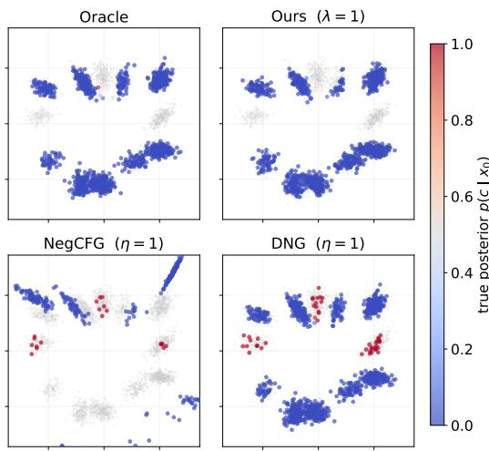
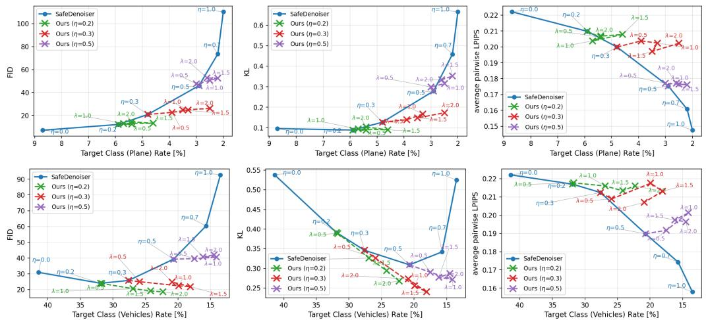
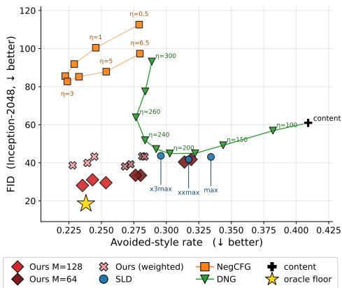
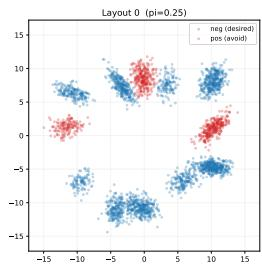
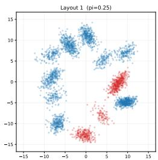
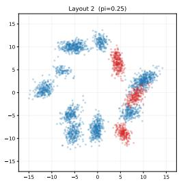
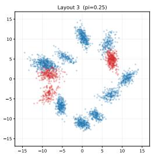
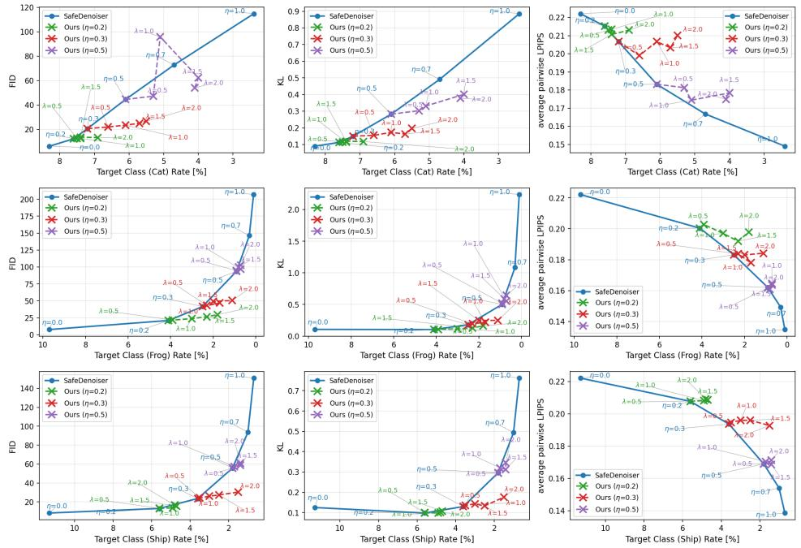
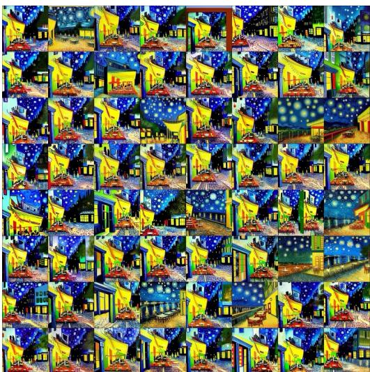
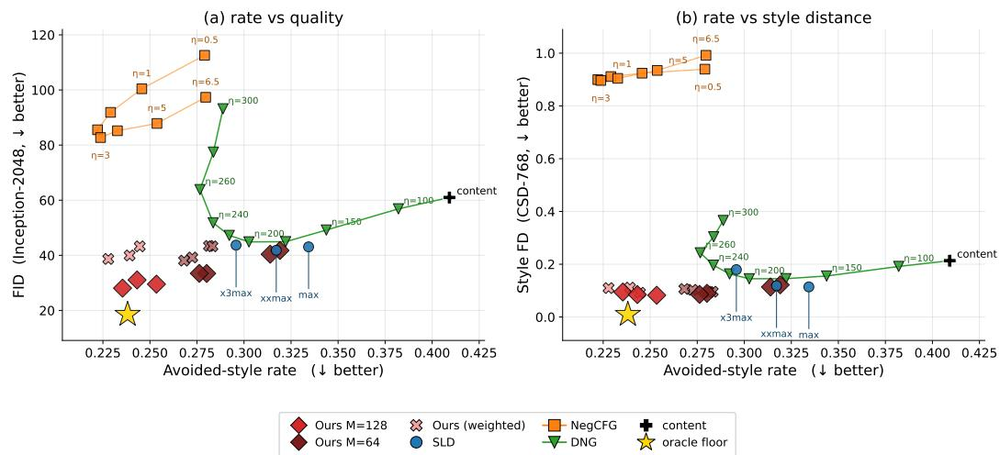

# Asymptotically Exact Negative Guidance of Diffusion Models via Positive–Unlabeled Learning

Hirohane Takagi1

Masashi Sugiyama2,1

1 The University of Tokyo, Tokyo, Japan

2 RIKEN AIP, Tokyo, Japan

htakagi@is.s.u-tokyo.ac.jp sugi@k.u-tokyo.ac.jp

## Abstract

Negative guidance of diffusion models generates samples that avoid an undesired condition, specified either by reference samples or by a conditional score alongside an unconditional model. Existing methods inject repulsive terms derived from local information at each sample, so the resulting sampler does not target an explicit density, and its bias cannot be systematically reduced by increasing computation. We instead present a negative-guidance method that samples from an explicit target density, which uniformly handles both reference-sample and score-based specifications and suppresses probability mass near the undesired condition with an avoidance strength that parametrizes the target density itself. Realizing this target requires estimating, at each diffusion timestep, how likely each sample is to belong to the undesired condition. We cast this estimation as a Positive–Unlabeled learning problem that admits lightweight online training along the diffusion trajectory, using condition samples as positives and diffusion particles as unlabeled data. Because the guided particles drift from the unconditional marginal, we further correct the residual mismatch via Sequential Monte Carlo, yielding a sampler that is asymptotically exact in the particle limit and that turns any existing negativeguidance method into its proposal kernel. Empirically, our method approaches the ground-truth target on Gaussian mixtures and Pareto-dominates existing methods on trade-offs between avoidance and generation quality, distributional bias, and diversity, including in an image-generation setting with a pretrained score network.

## 1 Introduction

Diffusion models have become a dominant framework for sampling from a data density p(x) over objects x. Their conditional generation mechanisms, including classifier guidance (CG; 15) and classifier-free guidance (CFG; 25), are now standard across modalities, including images [41], molecules [27], audio [38], decision-making and robotic control [28, 1]. CFG amplifies a desired condition by extrapolating between conditional and unconditional scores, and recent work has characterized the induced density and the resulting fidelity–diversity trade-off [53, 10, 7, 37, 55].

In contrast, negative guidance aims to steer generation away from an undesired condition. This capability is important for AI safety, where harmful outputs should be suppressed [42, 20, 21], and where memorized or copyrighted training data should not be reproduced [8, 45]. It is also important for controllable generation, where constraints are often more naturally expressed by negation than by positive prompts [2, 3]. Throughout this paper, c denotes the undesired condition and ¬c its complement. The conditional probability $p ( \neg c \mid x )$ satisfies $p ( \neg c \mid x ) = 1 - p ( c \mid x )$ . Thus c plays the opposite role to the conditioning variable in CFG: the goal is to reduce $p ( c \mid x )$ for generated samples while preserving the structure of p(x).

Existing negative guidance methods add a CFG-like repulsive term to the sampling dynamics of a fixed pretrained diffusion model, either without retraining the score network [20, 50] or by editing internal representations [21, 5]. The repulsion is constructed from either a pretrained conditional score for $p ( x \mid c )$ [33], or a finite set of reference samples from $p ( x \mid c ) [ 2 9 ]$ . These methods share two structural limitations: the repulsive update uses only information local to each sample, so the resulting sampler does not target an explicit density, and the induced bias cannot be reduced by allocating more computation. We formalize these limitations in Section 2.

We instead formulate negative guidance as sampling from the explicit avoidance target

$$
p _ { \mathrm { t a r g e t } } ( x ) \propto p ( x ) ( 1 - p ( c \mid x ) ) ^ { \lambda } , \qquad \lambda \ge 0 ,\tag{1}
$$

where λ is a user-controlled avoidance strength that parametrizes the target density itself: $\lambda = 0$ recovers the unconditional density, and $\lambda \to \infty$ concentrates mass on the support $\mathrm { o f } \ \lnot c$ . When the condition c is a semantic concept rather than a deterministic rule, $p ( c \mid x )$ varies smoothly with x, and intermediate $\lambda$ continuously interpolates between fidelity to $p ( x )$ and avoidance of c. The remaining challenge is to sample from (1) using only the information available in negative guidance: an unconditional score for $p ( x )$ together with either a conditional score for $p ( x \mid c )$ or reference samples from $p ( x \mid c )$

Our approach rests on the observation that estimating $p ( c \mid x )$ in this setting can be cast as a Positive– Unlabeled (PU) learning problem [14, 18], with samples associated with class c as positives and unconditional diffusion particles as unlabeled data. We pair an online PU estimator of $p ( c \mid x )$ with Sequential Monte Carlo (SMC; 13, 11) targeting (1), which corrects the residual mismatch between guided particles and the target marginal. The resulting sampler is asymptotically exact in the particle limit, in the same spirit as test-time diffusion alignment via SMC [51, 44, 30], while keeping per-step PU updates lightweight.

## Our contributions.

• We formulate negative guidance as sampling from the explicit avoidance density (1), realized through the finite-step reverse process of a trained diffusion model, for both reference-sample and conditional-score specifications.

• We design an SMC sampler driven by an online PU estimator of $\dot { p } ( c \vert x ) .$ , prove its asymptotic exactness, and show that any existing negative-guidance method can serve as its proposal kernel.

• Empirically, our sampler matches an oracle diffusion sampler with access to the true score for $p ( x \mid \neg c )$ on Gaussian mixtures and Pareto-dominates representative baselines on avoidance–quality trade-offs under both specifications, including image generation with a pretrained score network.

## 2 Existing Negative Guidance Methods

This section reviews representative negative guidance methods, namely sign-flipped CFG $\begin{array} { r } { ( \mathrm { N e g C F G } ; } \end{array}$ also analyzed as standard negative prompting by $^ { 3 ) , }$ , Dynamic Negative Guidance (DNG; 33), and the Safe Denoiser [29]. We then identify structural limitations that motivate our formulation.

Diffusion models. We use a variance-preserving diffusion process [47, 26] with forward kernel

$$
q _ { t } ( x _ { t } \mid x _ { 0 } ) = \mathcal { N } ( x _ { t } ; \sqrt { \bar { \alpha } _ { t } } x _ { 0 } , ( 1 - \bar { \alpha } _ { t } ) I ) , \qquad t = 1 , \ldots , T ,\tag{2}
$$

where $\mathcal { N } ( x ; \mu , \Sigma )$ denotes the Gaussian density in $x$ with mean $\mu$ and covariance Σ and I is the identity matrix. This kernel induces noisy marginals $p _ { t } ( x _ { t } )$ with $p _ { T } ( x _ { T } )$ close to $\mathcal { N } ( 0 , I )$ . A pretrained noise predictor $\hat { \boldsymbol { \epsilon } } _ { \boldsymbol { \theta } } ( x _ { t } , t )$ parameterizes the unconditional score via

$$
\begin{array} { r } { \hat { \epsilon } _ { \theta } ( x _ { t } , t ) \approx - \sqrt { 1 - \bar { \alpha } _ { t } } \nabla _ { x _ { t } } \log { p _ { t } ( x _ { t } ) } , } \end{array}
$$

and, when available, a conditional predictor $\hat { \boldsymbol { \epsilon } } _ { \theta } ( \boldsymbol { x } _ { t } , t \mid c )$ analogously parameterizes $\nabla _ { x _ { t } } \log { p _ { t } ( x _ { t } \mid c ) }$ Tweedie’s formula [17] gives the standard denoised estimate

$$
\hat { x } _ { 0 } ( x _ { t } ) = \frac { x _ { t } - \sqrt { 1 - \bar { \alpha } _ { t } } \hat { \epsilon } _ { \theta } ( x _ { t } , t ) } { \sqrt { \bar { \alpha } _ { t } } } \approx \mathbb { E } [ x _ { 0 } \mid x _ { t } ] .
$$

DDPM (Denoising Diffusion Probabilistic Models) sampling [26] starts from $x _ { T } \sim \mathcal { N } ( 0 , I )$ and applies the reverse kernels $p _ { \theta } ( x _ { t - 1 } \mid x _ { t } ) = \mathcal { N } ( x _ { t - 1 } ; \mu _ { \theta } ( x _ { t } , \bar { t } ) , \sigma _ { t } ^ { 2 } I )$ for $t = T , T - 1 , \dots , 1$ . All guidance methods reviewed here modify only the mean $\mu _ { \theta }$ , leaving the variance $\sigma _ { t } ^ { 2 } I$ unchanged; this is exploited in Section 3. Full closed-form expressions are deferred to Appendix A.1.

Sign-flipped CFG (NegCFG). NegCFG combines unconditional and conditional noise predictors:

$$
\hat { \epsilon } _ { \mathrm { C F G } } ( x _ { t } , t ) \gets \hat { \epsilon } _ { \boldsymbol { \theta } } ( x _ { t } , t ) - \eta \left( \hat { \epsilon } _ { \boldsymbol { \theta } } ( x _ { t } , t \mid c ) - \hat { \epsilon } _ { \boldsymbol { \theta } } ( x _ { t } , t ) \right) ,
$$

and throughout this paper $\eta > 0$ consistently denotes repulsion from condition $c ,$ while $\eta \ <$ 0 corresponds to standard CFG that amplifies c. Several variants build on this basic rule with stabilization mechanisms that suppress artifacts arising from score extrapolation, though these mechanisms are tailored to specific applications or architectures [42, 9].

Dynamic Negative Guidance (DNG). DNG [33] starts from the exact score decomposition

$$
\nabla _ { \boldsymbol { x } _ { t } } \log { p _ { t } ( \boldsymbol { x } _ { t } \mid \lnot c ) }  \nabla _ { \boldsymbol { x } _ { t } } \log { p _ { t } ( \boldsymbol { x } _ { t } ) } + \eta \nabla _ { \boldsymbol { x } _ { t } } \log \bigl ( 1 - p _ { t } ( \boldsymbol { c } \mid \boldsymbol { x } _ { t } ) \bigr ) ,\tag{3}
$$

which requires the global posterior $p _ { t } ( c \mid x _ { t } )$ . Applying Bayes’ rule yields a CFG-style repulsion scaled by the posterior odds:

$$
\begin{array} { r } { \nabla _ { x _ { t } } \log ( 1 - p _ { t } ( c \mid x _ { t } ) ) = - \frac { p _ { t } ( c \mid x _ { t } ) } { 1 - p _ { t } ( c \mid x _ { t } ) } \big ( \nabla _ { x _ { t } } \log p _ { t } ( x _ { t } \mid c ) - \nabla _ { x _ { t } } \log p _ { t } ( x _ { t } ) \big ) . } \end{array}
$$

Since $p _ { t } ( c \mid x _ { t } )$ is unavailable during sampling, DNG estimates it recursively via a local Gaussian approximation to the reverse transition [36]:

$$
\begin{array} { r } { \log p _ { t - 1 } ( c \mid x _ { t - 1 } )  \log p _ { t } ( c \mid x _ { t } ) - \frac { 1 } { 2 \sigma _ { * } ^ { 2 } } ( \| x _ { t - 1 } - \mu _ { \theta } ( x _ { t } , t \mid c ) \| ^ { 2 } - \| x _ { t - 1 } - \mu _ { \theta } ( x _ { t } , t ) \| ^ { 2 } ) } \end{array}\tag{4}
$$

introducing an approximation bias whose magnitude has no known bound. Appendix A.4 supplements this point with the conditions under which DNG becomes exact and how they differ from our setting.

Reference-particle negative guidance. NegCFG and DNG both require a pretrained conditional score $\hat { \boldsymbol { \epsilon } } _ { \theta } ( \boldsymbol { x } _ { t } , t \mid c )$ , which does not exist for user-specified conditions such as copyrighted or memorized content [29]; in such cases, the condition is instead provided as a finite reference set $\{ x _ { c } ^ { i } \} _ { i = 1 } ^ { N }$ The Safe Denoiser [29] addresses this regime by modifying the denoised estimate itself:

$$
\hat { x } _ { \mathrm { s a f e } } ( x _ { t } ) = \hat { x } _ { 0 } ( x _ { t } ) + \frac { \eta } { N } \sum _ { i = 1 } ^ { N } q _ { t } ( x _ { t } \mid x _ { c } ^ { i } ) \left( \hat { x } _ { 0 } ( x _ { t } ) - \frac { \sum _ { k = 1 } ^ { N } x _ { c } ^ { k } q _ { t } ( x _ { t } \mid x _ { c } ^ { k } ) } { \sum _ { j = 1 } ^ { N } q _ { t } ( x _ { t } \mid x _ { c } ^ { j } ) } \right) ,
$$

where $q _ { t } \left( x _ { t } \mid x _ { c } ^ { i } \right)$ is the forward kernel (2) evaluated as a likelihood (not a sampling density) and $\eta > 0$ controls the repulsion strength. Geometrically, the bracketed term pushes $\hat { x } _ { 0 } ( x _ { t } )$ away from the kernel-weighted mean of the references, and the prefactor amplifies the repulsion when $x _ { t }$ lies near the reference region. In practice, η and the time window over which guidance is applied must be tuned per condition, navigating an implicit avoidance–quality trade-off. [31] takes a similar reference-particle approach but sparsifies the repulsion, activating it only when $\hat { x } _ { 0 } ( x _ { t } )$ falls within a fixed radius of the reference region.

Structural limitations. These methods are lightweight and effective in practice, but share a structural limitation: each replaces the global posterior $p _ { t } ( c \mid x _ { t } )$ in (3) with a single-particle surrogate, namely a conditional score, a Gaussian-transition ratio, or nearby reference particles. The repulsion-strength hyperparameter exposed by each method thus carries no density-level meaning, and the induced bias cannot be bounded or reduced by additional computation. Section 3 instead estimates $p _ { t } ( c \mid x _ { t } )$ from multiple particles via online PU learning and corrects residual bias with SMC, targeting (1) with λ as the sole density-level knob.

## 3 Proposed Method: PU Steering

The limitations above have a common root: without a global estimate of $p _ { t } ( c \mid x _ { t } )$ , no per-particle update can target (1) as an explicit density. PU Steering closes this gap by combining (i) a tempered SMC path toward (1), (ii) an online PU classifier $f _ { t } \approx p _ { t } ( c \mid x _ { t } )$ fit from the running particles, and (iii) a particle-density correction that makes those particles unbiased unlabeled data for the PU step. Any existing negative-guidance method plugs in as the proposal kernel, and an analysis-friendly form of the sampler is asymptotically exact for (1) (Section 4). Section 3.1 presents the meta-algorithm; Section 3.2 and Section 3.3 specialize it to the reference-sample and score-based regimes.

## 3.1 Common Framework

PU Steering combines three components, described in turn below: an SMC backbone, a PU posterior estimator that yields $f _ { t }$ online, and an importance-weight correction that bridges them.

SMC backbone. SMC targets a sequence $\gamma _ { T } , \gamma _ { T - 1 } , . . . , \gamma _ { 0 }$ in turn via a weighted particle system, alternating at each step a proposal that moves each particle, and a weight update that retargets it to the next $\gamma _ { t }$ . Following test-time alignment of diffusion models via SMC [51, 30] (recalled in Appendix A.3), we deploy SMC along the reverse diffusion with the tempered path

$$
\gamma _ { t } ( x _ { t } ) \propto p _ { \theta , t } ( x _ { t } ) ( 1 - f _ { t } ( x _ { t } ) ) ^ { \lambda _ { t } } , \qquad 0 = \lambda _ { T } \leq \ldots \leq \lambda _ { 0 } = \lambda ,\tag{5}
$$

realizing our target (1) at $t = 0$ whenever $f _ { 0 } = p _ { \theta , 0 } ( c | \cdot )$ . Here $p _ { \theta , t }$ denotes the marginal of the pretrained reverse process in Section $^ { 2 , }$ , so $p _ { \theta , t } ( x _ { t } ) \approx p _ { t } ( x _ { t } )$ and $\gamma _ { T } ( x _ { T } ) = \mathcal { N } ( x _ { T } ; 0 , I )$ . All operations of PU Steering below are defined on this path of the pretrained sampler: posteriors and class-conditional densities are those of $_ { p _ { \theta , t } }$ , and $p _ { \mathrm { t a r g e t } }$ denotes (1) with p replaced by $p _ { \theta , 0 }$ . Unlike [51, 30], where the potential defining $\gamma _ { t }$ is pre-specified, we estimate $\bar { f } _ { t }$ online from the running particles. Section 4 shows that the marginal of $\gamma _ { 0 }$ depends only on the terminal $f _ { 0 }$ , so neither accurate $\nabla _ { x _ { t } } f _ { t }$ for all t nor accurate $f _ { t }$ at $t > 0$ is required.

Concretely, M particles are initialized at $t = T$ as $\{ x _ { T } ^ { j } \} _ { j = 1 } ^ { M } \stackrel { \mathrm { i . i . d . } } { \sim } { \mathcal { N } } ( 0 , I )$ with $w _ { q , T } ^ { j } = 1$ for all $j .$ At each subsequent step, a Gaussian proposal kernel $m _ { t - 1 } ( \cdot \mid x _ { t } ) = \mathcal { N } ( \mu _ { t } ^ { \mathrm { p r o p } } , \sigma _ { t } ^ { \bar { 2 } } I )$ whose mean $\mu _ { t } ^ { \mathrm { p r o p } }$ is specified per setting in Section 3.2 and Section 3.3, draws $x _ { t - 1 } ^ { j } ;$ the weight update from $\gamma _ { t }$ to $\gamma _ { t - 1 }$ then admits the closed-form recursion

$$
w _ { q , t - 1 } ~ = ~ w _ { q , t } ~ r _ { t } { \frac { ( 1 - f _ { t - 1 } ( x _ { t - 1 } ) ) ^ { \lambda _ { t - 1 } } } { ( 1 - f _ { t } ( x _ { t } ) ) ^ { \lambda _ { t } } } } , ~ \mathrm { w h e r e }
$$

$$
r _ { t } : = \frac { \exp \bigl ( - \| x _ { t - 1 } - \mu _ { \theta } ( x _ { t } , t ) \| ^ { 2 } / 2 \sigma _ { t } ^ { 2 } \bigr ) } { \exp \bigl ( - \| x _ { t - 1 } - \mu _ { t } ^ { \mathrm { p r o p } } \| ^ { 2 } / 2 \sigma _ { t } ^ { 2 } \bigr ) } = \frac { p _ { \theta } ( x _ { t - 1 } \mid x _ { t } ) } { m _ { t - 1 } ( x _ { t - 1 } \mid x _ { t } ) } ,\tag{6}
$$

$. \mathrm { e } . , r _ { t }$ is the density ratio between the pretrained reverse kernel and the proposal; the trailing classifier ratio in (6) accounts for the change of tilting from $\gamma _ { t } \mathrm { ~ t o ~ } \gamma _ { t - 1 }$ (derivation in Appendix A.3).

PU posterior estimator. Estimating $p _ { \theta , t } ( c \mid x _ { t } )$ is a binary classification problem with positive class c and negative class $\neg c ,$ but no samples from $p _ { \theta , t } ( \cdot \mid \lnot c )$ are directly available in either of our settings. What both settings provide is (i) positive samples from $p _ { \theta , t } ( \cdot \mid c )$ and (ii) the pretrained unconditional marginal $p _ { \theta , t }$ , which mixes the two class-conditional distributions at the prior rate $\pi = p ( c )$

$$
p _ { \theta , t } ( x _ { t } ) = \pi p _ { \theta , t } ( x _ { t } \mid c ) + ( 1 - \pi ) p _ { \theta , t } ( x _ { t } \mid \neg c ) .
$$

This identity recasts the binary classification risk using only samples from $p ( \cdot \mid c )$ and unconditional samples alone, giving the unbiased PU (uPU) risk [16, 40]

$$
\begin{array} { r } { \mathcal { L } _ { \mathrm { u P U } } ( f ) = \pi \mathbb { E } _ { p ( x | c ) } [ \ell ( f ( x ) , + 1 ) ] + \mathbb { E } _ { p ( x ) } [ \ell ( f ( x ) , - 1 ) ] - \pi \mathbb { E } _ { p ( x | c ) } [ \ell ( f ( x ) , - 1 ) ] , } \end{array}\tag{7}
$$

where E denotes the expectation. This risk equals the standard binary classification risk (derivation in Appendix A.2). Minimizing it with a proper loss yields $f _ { t } \approx p _ { \theta , t } ( c \mid x _ { t } )$ , provided π is known or estimable from domain knowledge. The SMC particles, however, do not follow $p _ { \theta , \ i }$ and thus cannot directly serve as unlabeled samples in (7).

Particle density correction. We correct this mismatch by importance reweighting [48]. The density $\hat { \gamma } _ { t }$ induced by the M particles under the proposal kernel and resampling rule has no closed form. Our key observation concerns the importance weight retargeting it to ${ p } _ { \theta , t }$ , conceptually defined as

$$
w _ { \emptyset , t } ( x _ { t } ) : = \frac { p _ { \theta , t } ( x _ { t } ) } { \hat { \gamma } _ { t } ( x _ { t } ) } \qquad ( \emptyset \mathrm { ~ m a r k s ~ t h e ~ u n c o n d i t i o n a l ~ t a r g e t } ) .\tag{8}
$$

Setting $\lambda _ { t } \equiv 0$ in (6) collapses $\gamma _ { t }$ to ${ p } _ { \theta , t }$ and the classifier ratio to one, giving its closed form

$$
w _ { \emptyset , t - 1 } \ = \ w _ { \emptyset , t } r _ { t } , \qquad w _ { \emptyset , T } = 1 ;\tag{9}
$$

i.e., $w _ { \emptyset , t }$ is itself the SMC weight that would target $_ { p _ { \theta , t } }$ along the same particle trajectory as $w _ { q , t }$ The two recursions share $r _ { t }$ and differ only in the tilting factor $ ( 1 - f _ { t } ) ^ { \lambda _ { t } }$ , so $w _ { \emptyset , : }$ t is tracked alongside $w _ { q , t }$ at no additional cost. Empirically approximating $\mathbb { E } _ { p ( x ) }$ in (7) with $\{ ( x _ { t } ^ { j } , w _ { \varnothing , t } ^ { j } ) \} _ { j = 1 } ^ { M }$ 1 restores unbiasedness of the uPU risk used to fit $f _ { t }$ . This bridges the SMC sampler and the PU estimator: (6) drives particles toward $\gamma _ { t }$ for sampling, while (9) pulls them back to $_ { p _ { \theta , t } }$ inside the uPU loss for $f _ { t } .$

Algorithm 1 PU Steering: one reverse-diffusion step $( t  t - 1 )$   
Require: particles $\{ ( \boldsymbol { x } _ { t } ^ { j } , \boldsymbol { w } _ { q , t } ^ { j } , \boldsymbol { w } _ { \emptyset , t } ^ { j } ) \} _ { j = 1 } ^ { M }$ , classifier $f _ { t } ,$ schedule entry $\lambda _ { t - 1 }$ , class prior π.   
# Propose particles via any negative-guidance kernel   
1: $\boldsymbol { x } _ { t - 1 } ^ { j } \sim m _ { t - 1 } ( \cdot \mid \boldsymbol { x } _ { t } ^ { j } ) , j = 1 , \ldots , M$ ▷ e.g., (10)   
# Advance w via the closed-form recursion   
2: update $w _ { \varnothing , t - 1 } ^ { j }$ toward $_ { p _ { \theta , t - 1 } }$ ▷ (9)   
# $\cdot \ R e \ f i t$ the PU classifier on new particles   
3: Sample positives $\mathcal { P } _ { t - 1 }$ from $p _ { \theta , t - 1 } ( \cdot | \ c )$ ▷ setting-specific: Section 3.2/Section 3.3   
4: $f _ { t - 1 } \gets \mathrm { a r g }$ minf $\mathcal { L } _ { \mathrm { u P U } } ( f )$ on $\mathcal { P } _ { t - 1 }$ and $\{ ( x _ { t - 1 } ^ { j } , w _ { \emptyset , t - 1 } ^ { j } ) \} _ { j = 1 } ^ { M }$ ▷ (7)   
# Reweight $w _ { q }$ via the shared closed-form recursion   
5: update $w _ { q , t - 1 } ^ { j }$ toward $\gamma _ { t - 1 }$ ▷ (6)   
# Resample only when particles degenerate   
6: if $\mathrm { E S S } ( \{ w _ { q , t - 1 } ^ { j } \} ) < \mathrm { E S S } _ { \operatorname* { m i n } }$ then resample ∝ $w _ { q , t - 1 } ^ { j }$ and reweight $w _ { \varnothing , t - 1 } ^ { j }$ accordingly

Meta-algorithm. Algorithm 1 summarizes one timestep of PU Steering, which propagates particles through a negative-guidance proposal, refits the PU classifier on the reweighted particles, and updates the target weights before resampling. The full procedure initializes $\{ x _ { T } ^ { j } \} _ { j = 1 } ^ { M } \stackrel { \mathrm { i . i . d . } } { \sim } { \mathcal { N } } ( 0 , I )$ $w _ { q , T } ^ { j } = w _ { \emptyset , T } ^ { j } = 1$ , and any $f _ { T }$ , and then applies Algorithm 1 for $t = T , T - 1 , \dots , 1$ . The two settings in Section 3.2 and Section 3.3 differ only in the proposal kernel $m _ { t - 1 }$ and in how positives $\mathcal { P } _ { t - 1 }$ are obtained; all other steps are shared.

Negative guidance ultimately requires a particle set in which the undesired condition c is suppressed, not a weighted empirical distribution dominated by a few high-weight particles. Resampling enforces this: ancestors $a ( j ) \propto w _ { q , t - 1 } ^ { j }$ are drawn, each particle is replaced by $x _ { t - 1 } ^ { a ( j ) } , w _ { q , t - 1 } ^ { j }$ is reset to 1, and $w _ { \varnothing , t - 1 } ^ { j }$ is rescaled to $w _ { \emptyset , t - 1 } ^ { a ( j ) } / w _ { q , t - 1 } ^ { a ( j ) }$ to preserve the ratio interpretation (8). Following [11], we trigger resampling only when the effective sample size ESS $\textstyle ( \{ w _ { q , t - 1 } ^ { j } \} ) : = \big ( \sum _ { j } w _ { q , t - 1 } ^ { j } \big ) ^ { 2 } / \sum _ { j } ( w _ { q , t - 1 } ^ { j } ) ^ { 2 }$ falls below $\mathrm { E S S } _ { \mathrm { m i n } } .$ , since unnecessary resampling adds Monte Carlo noise and computational cost without benefit.

## 3.2 Reference-Based Setting

We instantiate Algorithm 1 when the undesired condition c is specified by a finite reference set $\{ x _ { c } ^ { i } \} _ { i = 1 } ^ { N }$ of clean samples. The setting-specific slots are the positive set $\mathcal { P } _ { t - 1 }$ in Step 3 and the proposal mean $\mu _ { t } ^ { \mathrm { p r o p } }$ in Step 1. Detailed pseudocode is given as Algorithm 2 in Appendix B.

PU classifier. Only the terminal $f _ { 0 }$ controls the marginal of $\gamma _ { 0 }$ (Section 3.1), so $f _ { t }$ for $t > 0$ need not be highly accurate. Classification of c is also intrinsically easier on clean samples than on noised ones, since the forward kernel of (2) destroys class-discriminative structure as t grows. Both observations motivate the parameterization

$$
f _ { t } ( x _ { t } ) : = g _ { 0 } \big ( \hat { x } _ { 0 } ( x _ { t } ) \big ) , \qquad g _ { 0 } ( x _ { 0 } ) \approx p _ { \theta , 0 } ( c \mid x _ { 0 } ) .
$$

At t = 0, xˆ0(x0) = x0 gives $f _ { 0 } \equiv g _ { 0 }$ and $\gamma _ { 0 } ( x _ { 0 } ) \propto p _ { \theta , 0 } ( x _ { 0 } ) { \left( 1 - g _ { 0 } ( x _ { 0 } ) \right) } ^ { \lambda }$ , recovering $p _ { \mathrm { t a r g e t } }$

Because $g _ { 0 }$ acts on inputs in the denoised space, the uPU loss must be estimated with both positives and unlabeled samples projected through ${ \hat { x } } _ { 0 } .$ . We accordingly set

$$
\begin{array} { r l r } { \mathcal { P } _ { t - 1 } = \left\{ \hat { x } _ { 0 } \big ( \tilde { x } _ { t - 1 } ^ { i } \big ) \right\} _ { i = 1 } ^ { N } , } & { { } } & { \mathcal { U } _ { t - 1 } = \left\{ \left( \hat { x } _ { 0 } \big ( x _ { t - 1 } ^ { j } \big ) , w _ { \varnothing , t - 1 } ^ { j } \right) \right\} _ { j = 1 } ^ { M } , } \end{array}
$$

where $\tilde { x } _ { t - 1 } ^ { i } \sim q _ { t - 1 } ( \cdot \mid x _ { c } ^ { i } )$ is a forward-noised reference, so that positives and unlabeled samples are aligned on the same xˆ0-pushforward at each level t and reduce to the original references at $t = 0$ Since $g _ { 0 }$ is the only trainable object, the per-step refit reduces to a few warm-started gradient steps on its parameters, with $f _ { t - 1 } = g _ { 0 } \circ \hat { x } _ { 0 }$ updated implicitly.

SMC proposal. (i) CG-style proposal driven by $f _ { t } .$

$$
\mu _ { t } ^ { \mathrm { p r o p } } : = \mu _ { \theta } ( x _ { t } , t ) + \sigma _ { t } ^ { 2 } \lambda _ { t - 1 } \nabla _ { x _ { t } } \log \bigl ( 1 - f _ { t } ( x _ { t } ) \bigr ) .\tag{10}
$$

Under $f _ { t } = g _ { 0 } \circ \hat { x } _ { 0 }$ the gradient routes through Tweedie’s formula, making (10) a CG variant that lifts a clean-domain predictor through $\hat { x } _ { 0 } [ 1 2 , \top 4 , 5 4 ]$ . The difference is that no accurate predictor is available at the start of sampling in our setting, so g0 is fit online via PU learning.

(ii) Existing reference-based guidance as proposal. Methods such as the Safe Denoiser [29] provide efficient guidance but target no explicit density. Using their guidance as $\mu _ { t } ^ { \mathrm { p r o p } }$ leaves the per-step update intact while the SMC layer ensures asymptotic exactness for $p _ { \mathrm { t a r g e t } }$

## 3.3 Score-Based Setting

We instantiate Algorithm 1 when c is specified by a conditional noise predictor ${ \hat { \epsilon } } _ { \theta } ( \cdot , \cdot \mid c )$ but no reference set is given. The parameterization $f _ { t } = g _ { 0 } \circ \hat { x } _ { 0 }$ and the two proposal options of Section 3.2 carry over unchanged. The non-trivial step is constructing $\mathcal { P } _ { t - 1 }$ in Step 3 of Algorithm 1 without samples from $p _ { 0 } ( \cdot \mid c )$ . Our key observation is that the particle-density correction of Section 3.1 extends directly to the conditional marginal once its score is available, supplying positives from the same particle trajectory. Detailed pseudocode is given as Algorithm 3 in Appendix B.

Positives via importance reweighting. Applying the construction of $w _ { \emptyset , t }$ in Section 3.1 to the conditional target gives an analogous weight that retargets the particles to $p _ { \theta , t } ( \cdot \mid c )$

$$
w _ { c , t } ( x _ { t } ) : = \frac { p _ { \theta , t } ( x _ { t } \mid c ) } { \hat { \gamma } _ { t } ( x _ { t } ) } .
$$

The same particles serve as positives and unlabeled data under different weights:

$$
\begin{array} { r } { \mathcal { P } _ { t - 1 } = \big \{ \left( \hat { x } _ { 0 } ( x _ { t - 1 } ^ { j } ) , w _ { c , t - 1 } ^ { j } \right) \big \} _ { j = 1 } ^ { M } , \quad \mathcal { U } _ { t - 1 } = \big \{ \left( \hat { x } _ { 0 } ( x _ { t - 1 } ^ { j } ) , w _ { \varnothing , t - 1 } ^ { j } \right) \big \} _ { j = 1 } ^ { M } . } \end{array}
$$

Sharing the particle set across the two terms of ${ \mathcal { L } } _ { \mathrm { u P U } }$ preserves unbiasedness in the particle limit (Section 4). Step 2 of Algorithm 1 then carries a recursion for $w _ { c , t }$ t alongside the existing $w _ { \emptyset , \cdot }$ update; both share the same closed-form recursion as in Section 3.1, with $\mu _ { \theta } ( x _ { t } , t )$ replaced by $\mu _ { \theta } ( x _ { t } , t \mid c )$

SMC proposal. Both options of Section 3.2 extend directly: (i) the CG-style mean (10) driven by the $f _ { t } , \mathrm { o r } ( i i )$ an existing score-based negative-guidance method, such as DNG [33], plugged in as $\mu _ { t } ^ { \mathrm { p r o p } }$ , with our SMC layer correcting its density-level bias against $p _ { \mathrm { t a r g e t } }$ . When the proposal already evaluates the conditional score, the $w _ { c , t }$ recursion reuses that evaluation at no extra cost.

## 4 Theoretical Analysis

We summarize the convergence result for the reference-based instantiation of Algorithm 1 (Section 3.2) and extend the result to the score-based setting (Section 3.3). Formal statements and proofs are in Appendix C.

For implementation efficiency, Algorithm 1 uses a single particle system to both train $f _ { t }$ and form the final SMC estimator. For analytical clarity, we instead train $f _ { t }$ on an independent auxiliary system $\{ x _ { t } ^ { k } \} _ { k = 1 } ^ { M ^ { \prime } }$ driven by the same kernels, which removes the dependence between the classifier and the main SMC particles $\{ ( x _ { t } ^ { j } , w _ { q , t } ^ { j } ) \} _ { j = 1 } ^ { M }$ , whose weighted empirical measure we denote by $\widehat { \nu } _ { t } ^ { M | M ^ { \prime } , N }$ We establish asymptotic exactness in the resulting infinite-particle limit lim $M ^ { \prime } , N {  } { \infty } \operatorname* { l i m } _ { M  \infty } .$ , in which the inner $M \to \infty$ controls the main-system SMC error at frozen classifiers and the outer $M ^ { \prime } , N \to \infty$ drives the classifier estimation error to zero.

Assumptions. Let $\mathcal { G } _ { t }$ denote the function class over which $f _ { t }$ is fit. We require four conditions on $\mathcal { G } _ { t }$ and on the posterior $p _ { \theta , t } ( c \mid x )$ . (i) Uniform convergence on empirical positive samples: $\begin{array} { r } { \operatorname* { s u p } _ { g \in { \mathcal { G } } _ { t } } \big | { \frac { 1 } { N } } \sum _ { i = 1 } ^ { N } g ( X _ { i } ^ { + } ) - \mathbb { E } _ { p _ { \theta , t } ( \cdot | c ) } [ g ] \big | \to 0 } \end{array}$ almost surely as $N  \infty$ , with $X _ { i } ^ { + } \overset { \mathrm { i . i . d . } } { \sim } p _ { \theta , t } ( \cdot | \ c )$ (ii) Realizability of the Bayes logit: log $\ \{ p _ { \theta , t } ( c \mid x ) / ( 1 - p _ { \theta , t } ( c \mid x ) ) \} \in \mathcal { G } _ { t } . \ ( i i i )$ Two-sided nondegeneracy: $\delta \le p _ { \theta , t } ( c \vert x ) \le 1 - \delta$ for some $\delta \in ( 0 , 1 )$ . (iv) Total boundedness of $\mathcal { G } _ { t }$ in the supremum norm.

Reference-based setting. The N i.i.d. references $\{ x _ { c } ^ { i } \} _ { i = 1 } ^ { N }$ supply the positive term of the uPU risk (7), and the M′ auxiliary particles supply the unlabeled term. We argue in three steps. Step 1, fix timestep t and assume that the unlabeled empirical average converges uniformly to $\mathbb { E } _ { p _ { \theta , t } }$ over $\mathcal { G } _ { t } .$ Then uPU risk minimization [40], combined with (i) and (ii), yields $L ^ { 1 }$ -convergence $f _ { t } \to p _ { \theta , t } ( c \mid \cdot )$ as $M ^ { \prime } , N \to \infty$ . We will invoke this at t = 0. Step 2, this convergence does hold: under (iii) and (iv), and with a mild proposal regularization (Appendix C.2.1) that keeps the importance weights bounded, the weighted empirical measure of the auxiliary particles $\{ ( x _ { t } ^ { k } , \bar { w _ { \emptyset , t } ^ { k } } ) \} _ { k = 1 } ^ { M ^ { \prime } }$ converges uniformly over $\mathcal { G } _ { t }$ to $p _ { \theta , \ast }$ t by the SMC law of large numbers (LLN) in [11]. Step 3, the tempering factors $( 1 - f _ { t } ) ^ { \lambda _ { t } }$ enter the recursion (6) as ratios between consecutive times, so the cumulative product telescopes and only the terminal $f _ { 0 }$ enters $\gamma _ { 0 }$ , similar to [30]. Combining these three steps yields Theorem 1.

<table><tr><td>Method</td><td>Posterior leak ↓</td><td> $W _ { 2 } \downarrow$ </td></tr><tr><td>Oracle Uncond  $( \eta { = } 0 )$ </td><td> $0 . 0 1 2 { \scriptstyle \pm 0 . 0 1 0 }$   $0 . 2 5 3 { \pm } 0 . 0 1 6$ </td><td>1.5±0.3 3.6±0.6</td></tr><tr><td>NegCFG (η=0.5)</td><td> $0 . 0 6 8 { \pm } 0 . 0 0 8$ </td><td>9.7±2.4</td></tr><tr><td>NegCFG (η=1)</td><td> $0 . 0 1 8 { \pm } 0 . 0 0 5$ </td><td>20.5±6.3</td></tr><tr><td>DNG (η=1)</td><td> $0 . 0 5 2 { \pm } 0 . 0 1 0$ </td><td>1.6±0.3</td></tr><tr><td>DNG (η=2)</td><td> $0 . 0 1 5 { \pm } 0 . 0 0 5$ </td><td>3.5±0.7</td></tr><tr><td>Ours</td><td> $\mathbf { 0 . 0 1 2 { \overset { . } { \bot } } 0 . 0 1 3 }$ </td><td>1.8±0.6</td></tr></table>

Table 1: Comparison with baselines across repulsion strengths η, mean±std over 50 trials. Uncond corresponds to NegCFG/DNG at $\eta { = } 0$ which reduces to unconditional DDPM from $p ( x )$ Posterior leak $\mathbb { E } [ p ( c | x _ { 0 } ) ]$ and $W _ { 2 }$ measure 2- Wasserstein distance to ground-truth. Baselines show a trade-off between leak and $W _ { 2 }$ , while ours matches the Oracle in leak without inflating $W _ { 2 }$  
Figure 1: Generated samples on one trial. Each point is a sample in its first two coordinates, colored by the true posterior $p ( c \mid x ) \in [ 0 , 1 ]$ (red: $p ( c | { \bar { x } } ) { = } 1$ , blue: 0). Oracle and Ours avoid the condition c and cover all remaining modes. NegCFG suppresses leak by collapsing onto a few remaining modes, and DNG keeps coverage but retains residual samples on the avoided modes.

Theorem 1 (Asymptotic exactness, informal version of Theorem 11 in Appendix C.3). Consider Algorithm 1 with the auxiliary $M ^ { \prime }$ system introduced above. For every bounded measurable $\varphi$ : $\mathcal { X } _ { 0 }  \mathbb { R } ,$

$$
\operatorname * { l i m } _ { M ^ { \prime } , N  \infty } \operatorname * { l i m } _ { M  \infty } \widehat { \nu } _ { 0 } ^ { M | M ^ { \prime } , N } ( \varphi ) = p _ { \mathrm { t a r g e t } } ( \varphi ) a l m o s t s u r e l y ,
$$

under (i)–(iv) for the reference-based setting.

Extension to score-based setting. Without external references, the positive term of the uPU risk (7) is supplied by the same $M ^ { \prime }$ auxiliary particles, re-weighted by $w _ { c , t }$ and $w _ { \emptyset , t }$ . The argument mirrors the reference-based one, with only Step 2 changed. By an analogous SMC LLN [11], the weighted empirical measure of $\{ ( x _ { t } ^ { k } , w _ { c , t } ^ { k } ) \} _ { k = 1 } ^ { M ^ { \prime } }$ converges uniformly over $\mathcal { G } _ { t }$ to $p _ { \theta , t } ( \cdot \ | \ c )$ as $M ^ { \prime }  \infty$ Combined with the unlabeled-term convergence from Step 2 of the reference-based setting, this gives uniform convergence of both terms of the uPU risk and hence $f _ { t } \to p _ { \theta , t } ( c | \cdot )$ as $M ^ { \prime } $ ∞ at each timestep t. Step 1 and Step 3 then carry over unchanged, yielding $\widehat { \nu } _ { 0 } ^ { M | M ^ { \prime } } ( \varphi ) \to p _ { \mathrm { t a r g e t } } ( \varphi )$ under (ii)–(iv), for every bounded measurable $\varphi$ (Theorem 16 in Appendix C.4).

## 5 Experiments

This section summarizes our experimental results in three settings of increasing scale. Section 5.1 uses the score-based setting (Section 3.3) on a 3-dimensional Gaussian mixture model (GMM), where closed-form densities enable rigorous metric evaluation and direct visualization of the full distribution. Section 5.2 uses the reference-based setting (Section 3.2) on CIFAR-10 image generation with a pretrained score network, under different specifications of the avoidance condition c (a class or set of classes to avoid). Section 5.3 applies the score-based setting to text-to-image generation with Stable Diffusion. All three compare against the baselines from Section $^ { 2 , }$ with full experimental details deferred to Appendix D. To align the evaluation protocol with these baselines, we treat the final SMC output after intermediate resampling as particles with unit weight rather than as weighted particles.1

  
Figure 2: Avoidance rate vs. generation quality on CIFAR-10. Top: plane. Bottom: four-class vehicles. Columns plot target-class rate against FID, KL, and average pairwise LPIPS (left to right); lower is better except for LPIPS. The Safe Denoiser sweeps $\eta .$ Ours uses the Safe Denoiser as its proposal kernel, fixes $\eta \in \{ 0 . 2 , 0 . 3 , 0 . 5 \}$ , and sweeps $\lambda ,$ tracing the Pareto frontier in all panels.

## 5.1 GMM with Score-Based Setting

Setup. The unconditional density is a 3-dimensional GMM of 12 modes, with the avoided condition c assigned to 3 modes and ¬c to the other 9. The layout of the GMM is randomly drawn. We define the ground-truth target by setting λ=1 in (1), giving $p _ { \mathrm { t a r g e t } } { = } p ( \cdot | \neg c )$ . All methods use a common $T { = } 1 0 0$ DDPM discretization with M=1024 samples. The Oracle alone has access to the true score for the target ∇ log $p _ { t } ( x _ { t } \mid \neg c )$ , serving as the achievable upper bound. We compare against NegCFG and DNG from Section 2, and our method uses a kernel-based PU classifier [40]. We report posterior leak $\mathbb { E } [ p ( c \vert x _ { 0 } ) ]$ (average posterior of c at generated samples, lower is stronger avoidance) in closed form, and the 2-Wasserstein distance $( W _ { 2 } ,$ calculated by [19]) to 3000 i.i.d. draws from $p ( \cdot \mid \lnot c )$ Results are averaged over 50 trials with the GMM layout and DDPM sampling seed both randomized.

Results. Figure 1 shows the generated samples from each method on one trial. NegCFG collapses onto a few ¬c-modes, and DNG retains samples on the avoided c-modes, both consistent with the limitations of local repulsion away from c discussed in Section 2. In contrast, our method preserves all nine ¬c-modes and matches the Oracle, leveraging global information across particles, consistent with Theorem 1. Table 1 reports the same trend quantitatively over 50 trials. Ours matches the Oracle in posterior leak (both 0.012) and stays within one Oracle standard deviation in $W _ { 2 }$ (1.8±0.6 vs. $1 . 5 { \pm } 0 . 3 ) $ , while NegCFG and DNG exhibit a trade-off between leak and $W _ { 2 }$ . Full hyperparameter sweeps are in Appendix D.1.

## 5.2 CIFAR-10 with Reference-Based Setting

Setup. We use a pretrained UNet for the unconditional CIFAR-10 diffusion model from [39], and run DDPM sampling with a batch size of $M { = } 1 2 8$ over T=250 timesteps. The avoided condition c is one or more CIFAR-10 classes. We evaluate plane (single class) and the four vehicle classes (plane, car, ship, truck). For each class in $c ,$ we draw N=200 references from the training set. The PU discriminator $f _ { t }$ is a linear probe on pooled UNet bottleneck features. Because N and $M$ are both small here, we replace the uPU loss of Section 3 with binary cross-entropy (BCE), treating the references as positives and the SMC particles as soft negatives. After resampling, with so few SMC particles in pixel space, those satisfying c are quickly depleted, so the particle set increasingly behaves as a true negative set as t decreases, making BCE an effective proxy in this regime.

  
(a) Avoided stylece

  
(b) PU Steering (ours)

  
Figure 3: Results of Van Gogh style avoidance on Stable Diffusion v1.4. Left: generated examples of (a) the avoided style and (b) ours at $M = 1 2 8 , \lambda { = } 1 6$ , each showing 16 randomly selected images. These are the top two rows of the random $8 \times 8$ grids in Figure 6 of Appendix D.3, which also shows the other methods. Right: avoided-style rate against FID; lower left is better. The baselines sweep their strengths, and ours uses SLD as its proposal kernel, reaching the oracle-floor rate with the lowest FID while keeping the prompted scene. Full results are in Appendix D.3.

Evaluation metrics. We aggregate 80 seeds × 128 samples per configuration. Fréchet Inception Distance (FID, 24) is computed against the CIFAR-10 training set from non-avoided classes, using the implementation of [43]. Each generated image is then classified by an independently trained ResNet-18 [23] with ∼95% test accuracy into the class histogram $\hat { p } ,$ from which we report the target-class rate on avoided classes (lower is stronger avoidance) and the KL divergence of $\hat { p }$ from a uniform over non-avoided classes (lower is more uniform). As an auxiliary check, we also report average pairwise Learned Perceptual Image Patch Similarity (LPIPS; 57) via AlexNet [34] on 256 random samples (higher is more diverse).

Results. We first run the Safe Denoiser [29] sweeping its repulsion strength η. We then run our method (Section 3.2), which uses the Safe Denoiser as its proposal $\mu _ { t } ^ { \mathrm { p r o p } }$ , at three fixed values $\eta \in \{ 0 . 2 , 0 . 3 , 0 . 5 \}$ while sweeping the terminal tempering strength $\lambda ,$ so that both methods are compared on a shared η axis. Figure 2 plots target-class rate against each quality metric for plane and four-class vehicles avoidance. At each fixed $\eta ,$ , our λ-sweep Pareto-dominates the Safe Denoiser at the same η on FID and KL across the full operating range, and is no worse on LPIPS over the bulk of it. A weak negative guidance leaves residual mass on the avoided classes that the classifier and resampling then correct, raising the avoidance rate without the quality degradation incurred by stronger negative guidance. The added machinery beyond the Safe Denoiser is one linear probe on UNet features and ESS-based adaptive resampling on the classifier-driven weights. Per-class results for cat, frog, and ship and regularization ablations are in Appendix D.2.

## 5.3 Stable Diffusion with Score-Based Setting

Setup. We use Stable Diffusion v1.4 [41], a pretrained text-to-image latent diffusion model, with classifier-free guidance at scale 7.5 as the sampler of the base density p , running a batch size of M=128 over T=50 timesteps. The prompt "a painting of a cafe terrace at night under a starry sky" often yields Van Gogh’s style, which we specify as the avoided condition c to suppress. Appending "in the style of Van Gogh" to the prompt supplies the conditional score, which generates images such as Figure 3(a), and we use it to run the score-based setting of Section 3.3. The PU classifier $f _ { t }$ is a kernel logistic model on $\hat { x } _ { 0 } ( x _ { t } )$ . Its positives and unlabeled data are ${ \hat { x } } _ { 0 }$ of the same particles under the style-appended and original prompts, respectively, so they share the prompted content and differ mainly in the style. This contrast keeps the fit stable, so we use the uPU loss (7) as written, unlike the BCE in Section 5.2.

Evaluation metrics. We aggregate 2048 images per configuration, generated with distinct seeds. An independently trained detector, a logistic head on a style embedding [46], assigns each image a probability of the avoided style, and we report its mean as the avoided-style rate (lower is stronger avoidance). As no samples of the target are available, we approximate them by filtering: from 8192 images of the prompt without avoidance, the 2048 least like the style under the detector form the reference set, against which FID and KID [6] are computed (lower is better). Applying the same filter to an independent pool generated with disjoint seeds gives the oraclefloor, a reference point for an ideal avoidance rather than a lower bound.

Results. We first run SLD [42], a negative-guidance method specialized to Stable Diffusion, and DNG, each sweeping its strength. We then run our method (Section 3.3), which uses SLD as its proposal $\mu _ { t } ^ { \mathrm { p r o p } }$ , while sweeping λ. Figure 3 (right) plots the avoided-style rate against FID. DNG traces an avoidance–quality trade-off: at its best strengths it is comparable to SLD, and stronger guidance only degrades FID. NegCFG lowers the rate only at FIDs above 80. Our method at $M { = } 1 \bar { 2 } 8$ λ=16 reaches a rate of 0.235, at the oracle floor of 0.238, with the lowest FID of 28.10, improving both avoidance and quality beyond SLD and DNG. Halving the particle count to M=64 gives a rate of 0.276 and an FID of 33.46, so additional particles improve both. Qualitatively, Figure 3 (left) shows that our samples keep the prompted scene while suppressing the avoided style and spreading over a variety of painting styles. The Stable Diffusion results are thus consistent with the CIFAR-10 results in Section 5.2. The full setup and results are in Appendix D.3.

## 6 Limitations and Future Work

Scope of the experiments. Our experiments cover several settings up to image-generation scale (Section 5). Extending the framework to the broader range of applications that motivate negative guidance (Section 1) is left open. Our setting also differs from SMC-based diffusion alignment [51, 44, 30], which sharpens particles toward a desired condition. PU Steering instead targets everything other than the avoided condition $c ,$ which is harder to evaluate because no single reference distribution is available beyond a labeled validation set. A parallel line of recent work develops SMC and other samplers that route interacting particles to a target along the diffusion path [52, 49], training-free and with convergence guarantees on multi-modal targets. These samplers are demonstrated on lowto moderate-dimensional settings $( d < 1 0 0 )$ , and scaling them to image-scale dimensions is left open. PU Steering reaches CIFAR-10 and Stable Diffusion by combining a pretrained UNet with an existing negative-guidance kernel [29, 42] as the SMC proposal, and the same recipe applies to any pretrained diffusion model with such a kernel. This connects principled probabilistic samplers to alignment of modern generative models. We discuss future directions for improving and specializing our framework below, which would also let us examine the effect of scaling the particle count.

Variance of the importance weights. A known challenge in SMC is weight degeneracy, in which the variance of the importance weights grows and the ESS decreases [11]. This can lead to frequent resampling, and may eventually result in a few common ancestors dominating the particle set. For a fixed target path, [30] derives a proposal kernel that minimizes the one-step weight variance. In our case, the target path itself depends on the online classifier $f _ { t } ,$ , and inaccuracies in $\bar { \boldsymbol { f } } _ { t }$ further affect the weight variance. Extending such an analysis is left for future work. Task-specific regularization and other practical stabilization techniques are natural directions in this line.

Stabilizing the online PU classifier. Our method trains the classifier $f _ { t }$ in an online manner. Recent PU learning literature offers stabilization techniques for limited positive samples, small-batch variability, and high-capacity models such as neural networks that are prone to overfitting [32, 22]. Online and importance-weighted PU learning further address streaming data and weighted unlabeled samples [56, 35]. Incorporating these techniques may further stabilize our method.

## 7 Conclusion

In this paper, we addressed negative guidance of diffusion models, the task of steering generation away from an undesired condition. We recast the problem as sampling from an explicit avoidance density and realized it via tempered SMC driven by an online PU classifier, where particles exploit global information across samples rather than local repulsion. Our asymptotic exactness analysis implies that additional computation reduces distributional bias and improves generation quality. On the practical side, we showed that augmenting existing guidance methods with a lightweight classifier and resampling improves the avoidance–quality trade-off.

# Acknowledgments and Disclosure of Funding

MS was supported by JST ASPIRE Grant Number JPMJAP25B1.

## References

[1] Anurag Ajay, Yilun Du, Abhi Gupta, Joshua B. Tenenbaum, Tommi S. Jaakkola, and Pulkit Agrawal. Is Conditional Generative Modeling all you need for Decision Making? In The Eleventh International Conference on Learning Representations, 2023. URL https: //openreview.net/forum?id=sP1fo2K9DFG.

[2] Mohammadreza Armandpour, Ali Sadeghian, Huangjie Zheng, Amir Sadeghian, and Mingyuan Zhou. Re-imagine the Negative Prompt Algorithm: Transform 2D Diffusion into 3D, alleviate Janus problem and Beyond, 2023. URL https://arxiv.org/abs/2304.04968.

[3] Yuanhao Ban, Ruochen Wang, Tianyi Zhou, Minhao Cheng, Boqing Gong, and Cho-Jui Hsieh. Understanding the Impact of Negative Prompts: When and How Do They Take Effect? In Aleš Leonardis, Elisa Ricci, Stefan Roth, Olga Russakovsky, Torsten Sattler, and Gül Varol, editors, Computer Vision – ECCV 2024, pages 190–206, Cham, 2025. Springer Nature Switzerland. ISBN 978-3-031-73024-5.

[4] Arpit Bansal, Hong-Min Chu, Avi Schwarzschild, Roni Sengupta, Micah Goldblum, Jonas Geiping, and Tom Goldstein. Universal Guidance for Diffusion Models. In The Twelfth International Conference on Learning Representations, 2024. URL https://openreview. net/forum?id=pzpWBbnwiJ.

[5] Shristi Das Biswas, Arani Roy, and Kaushik Roy. CURE: Concept Unlearning via Orthogonal Representation Editing in Diffusion Models. In D. Belgrave, C. Zhang, H. Lin, R. Pascanu, P. Koniusz, M. Ghassemi, and N. Chen, editors, Advances in Neural Information Processing Systems, volume 38, pages 82539–82563. Curran Associates, Inc., 2025. URL https://proceedings.neurips.cc/paper\_files/paper/2025/file/ 769736dfbf6a1f64b4d2ab5c82c3d5e2-Paper-Conference.pdf.

[6] Mikołaj Binkowski, Dougal J. Sutherland, Michael Arbel, and Arthur Gretton. Demystifying´ MMD GANs. In International Conference on Learning Representations, 2018. URL https: //openreview.net/forum?id=r1lUOzWCW.

[7] Arwen Bradley and Preetum Nakkiran. Classifier-Free Guidance is a Predictor-Corrector. Transactions on Machine Learning Research, 2025. ISSN 2835-8856. URL https://openreview. net/forum?id=zrWNtzSZsf.

[8] Nicolas Carlini, Jamie Hayes, Milad Nasr, Matthew Jagielski, Vikash Sehwag, Florian Tramèr, Borja Balle, Daphne Ippolito, and Eric Wallace. Extracting Training Data from Diffusion Models. In 32nd USENIX Security Symposium (USENIX Security 23), pages 5253–5270, Anaheim, CA, August 2023. USENIX Association. ISBN 978-1-939133-37-3. URL https: //www.usenix.org/conference/usenixsecurity23/presentation/carlini.

[9] Dar-Yen Chen, Hmrishav Bandyopadhyay, Kai Zou, and Yi-Zhe Song. Normalized Attention Guidance: Universal Negative Guidance for Diffusion Models. In D. Belgrave, C. Zhang, H. Lin, R. Pascanu, P. Koniusz, M. Ghassemi, and N. Chen, editors, Advances in Neural Information Processing Systems, volume 38, pages 137412–137446. Curran Associates, Inc., 2025. URL https://proceedings.neurips.cc/paper\_files/paper/2025/file/ c8aefe45deba3639af7120b141b87b50-Paper-Conference.pdf.

[10] Muthu Chidambaram, Khashayar Gatmiry, Sitan Chen, Holden Lee, and Jianfeng Lu. What does guidance do? A fine-grained analysis in a simple setting. In A. Globerson, L. Mackey, D. Belgrave, A. Fan, U. Paquet, J. Tomczak, and C. Zhang, editors, Advances in Neural Information Processing Systems, volume 37, pages 84968–85005. Curran Associates, Inc., 2024. doi: 10.52202/079017-2698. URL https://proceedings.neurips.cc/paper\_files/ paper/2024/file/9a3942c235daa9c5f62a8598ae81a946-Paper-Conference.pdf.

[11] Nicolas Chopin and Omiros Papaspiliopoulos. An Introduction to Sequential Monte Carlo. Springer International Publishing, 2020. ISBN 9783030478452. doi: 10.1007/ 978-3-030-47845-2. URL http://dx.doi.org/10.1007/978-3-030-47845-2.

[12] Hyungjin Chung, Jeongsol Kim, Michael Thompson Mccann, Marc Louis Klasky, and Jong Chul Ye. Diffusion Posterior Sampling for General Noisy Inverse Problems. In The Eleventh International Conference on Learning Representations, 2023. URL https://openreview. net/forum?id=OnD9zGAGT0k.

[13] Pierre Del Moral, Arnaud Doucet, and Ajay Jasra. Sequential Monte Carlo Samplers. Journal of the Royal Statistical Society Series B: Statistical Methodology, 68(3):411–436, 06 2006. ISSN 1369-7412. doi: 10.1111/j.1467-9868.2006.00553.x. URL https://doi.org/10.1111/j. 1467-9868.2006.00553.x.

[14] François Denis, Rémi Gilleron, and Fabien Letouzey. Learning from positive and unlabeled examples. Theoretical Computer Science, 348(1):70–83, 2005. ISSN 0304-3975. doi: https: //doi.org/10.1016/j.tcs.2005.09.007. URL https://www.sciencedirect.com/science/ article/pii/S0304397505005256. Algorithmic Learning Theory (ALT 2000).

[15] Prafulla Dhariwal and Alexander Nichol. Diffusion Models Beat GANs on Image Synthesis. In M. Ranzato, A. Beygelzimer, Y. Dauphin, P.S. Liang, and J. Wortman Vaughan, editors, Advances in Neural Information Processing Systems, volume 34, pages 8780–8794. Curran Associates, Inc., 2021. URL https://proceedings.neurips.cc/paper\_files/paper/ 2021/file/49ad23d1ec9fa4bd8d77d02681df5cfa-Paper.pdf.

[16] Marthinus C. du Plessis, Gang Niu, and Masashi Sugiyama. Analysis of Learning from Positive and Unlabeled Data. In Z. Ghahramani, M. Welling, C. Cortes, N. Lawrence, and K. Weinberger, editors, Advances in Neural Information Processing Systems, volume 27. Curran Associates, Inc., 2014. URL https://proceedings.neurips.cc/paper\_files/paper/2014/file/ f032bc3f1eb547f716df87edb523b8f0-Paper.pdf.

[17] Bradley Efron. Tweedie’s Formula and Selection Bias. Journal of the American Statistical Association, 106(496):1602–1614, 2011. ISSN 01621459. URL http://www.jstor.org/ stable/23239562.

[18] Charles Elkan and Keith Noto. Learning classifiers from only positive and unlabeled data. In Proceedings of the 14th ACM SIGKDD International Conference on Knowledge Discovery and Data Mining, KDD ’08, page 213–220, New York, NY, USA, 2008. Association for Computing Machinery. ISBN 9781605581934. doi: 10.1145/1401890.1401920. URL https: //doi.org/10.1145/1401890.1401920.

[19] Rémi Flamary, Nicolas Courty, Alexandre Gramfort, Mokhtar Z. Alaya, Aurélie Boisbunon, Stanislas Chambon, Laetitia Chapel, Adrien Corenflos, Kilian Fatras, Nemo Fournier, Léo Gautheron, Nathalie T.H. Gayraud, Hicham Janati, Alain Rakotomamonjy, Ievgen Redko, Antoine Rolet, Antony Schutz, Vivien Seguy, Danica J. Sutherland, Romain Tavenard, Alexander Tong, and Titouan Vayer. POT: Python Optimal Transport. Journal of Machine Learning Research, 22(78):1–8, 2021. URL http://jmlr.org/papers/v22/20-451.html.

[20] Rohit Gandikota, Joanna Materzynska, Jaden Fiotto-Kaufman, and David Bau. Erasing Concepts from Diffusion Models. In Proceedings of the IEEE/CVF International Conference on Computer Vision (ICCV), pages 2426–2436, October 2023.

[21] Rohit Gandikota, Hadas Orgad, Yonatan Belinkov, Joanna Materzynska, and David Bau. Unified´ Concept Editing in Diffusion Models. In Proceedings ofthe IEEE/CVF Winter Conference on Applications of Computer Vision (WACV), pages 5111–5120, January 2024.

[22] Saurabh Garg, Yifan Wu, Alexander Smola, Sivaraman Balakrishnan, and Zachary Lipton. Mixture Proportion Estimation and PU Learning: A Modern Approach. In M. Ranzato, A. Beygelzimer, Y. Dauphin, P.S. Liang, and J. Wortman Vaughan, editors, Advances in Neural Information Processing Systems, volume 34, pages 8532–8544. Curran Associates, Inc., 2021. URL https://proceedings.neurips.cc/paper\_files/paper/2021/file/ 47b4f1bfdf6d298682e610ad74b37dca-Paper.pdf.

[23] Kaiming He, Xiangyu Zhang, Shaoqing Ren, and Jian Sun. Deep Residual Learning for Image Recognition. In Proceedings of the IEEE Conference on Computer Vision and Pattern Recognition (CVPR), June 2016.

[24] Martin Heusel, Hubert Ramsauer, Thomas Unterthiner, Bernhard Nessler, and Sepp Hochreiter. GANs Trained by a Two Time-Scale Update Rule Converge to a Local Nash Equilibrium. In I. Guyon, U. Von Luxburg, S. Bengio, H. Wallach, R. Fergus, S. Vishwanathan, and R. Garnett, editors, Advances in Neural Information Processing Systems, volume 30. Curran Associates, Inc., 2017. URL https://proceedings.neurips.cc/paper\_files/paper/2017/file/ 8a1d694707eb0fefe65871369074926d-Paper.pdf.

[25] Jonathan Ho and Tim Salimans. Classifier-Free Diffusion Guidance. In NeurIPS 2021 Workshop on Deep Generative Models and Downstream Applications, 2021. URL https://openreview. net/forum?id=qw8AKxfYbI.

[26] Jonathan Ho, Ajay Jain, and Pieter Abbeel. Denoising Diffusion Probabilistic Models. In H. Larochelle, M. Ranzato, R. Hadsell, M.F. Balcan, and H. Lin, editors, Advances in Neural Information Processing Systems, volume 33, pages 6840–6851. Curran Associates, Inc., 2020. URL https://proceedings.neurips.cc/paper\_files/paper/2020/file/ 4c5bcfec8584af0d967f1ab10179ca4b-Paper.pdf.

[27] Emiel Hoogeboom, Víctor Garcia Satorras, Clément Vignac, and Max Welling. Equivariant Diffusion for Molecule Generation in 3D. In Kamalika Chaudhuri, Stefanie Jegelka, Le Song, Csaba Szepesvari, Gang Niu, and Sivan Sabato, editors, Proceedings ofthe 39th International Conference on Machine Learning, volume 162 of Proceedings of Machine Learning Research, pages 8867–8887. PMLR, 17–23 Jul 2022. URL https://proceedings.mlr.press/v162/ hoogeboom22a.html.

[28] Michael Janner, Yilun Du, Joshua Tenenbaum, and Sergey Levine. Planning with Diffusion for Flexible Behavior Synthesis. In Kamalika Chaudhuri, Stefanie Jegelka, Le Song, Csaba Szepesvari, Gang Niu, and Sivan Sabato, editors, Proceedings ofthe 39th International Conference on Machine Learning, volume 162 of Proceedings of Machine Learning Research, pages 9902–9915. PMLR, 17–23 Jul 2022. URL https://proceedings.mlr.press/v162/ janner22a.html.

[29] Mingyu Kim, Dongjun Kim, Amman Yusuf, Stefano Ermon, and Mi Jung Park. Training-Free Safe Denoisers for Safe Use of Diffusion Models. In D. Belgrave, C. Zhang, H. Lin, R. Pascanu, P. Koniusz, M. Ghassemi, and N. Chen, editors, Advances in Neural Information Processing Systems, volume 38, pages 136004–136035. Curran Associates, Inc., 2025. URL https://proceedings.neurips.cc/paper\_files/paper/2025/file/ c66e1fcc9691aae706250638f36f681b-Paper-Conference.pdf.

[30] Sunwoo Kim, Minkyu Kim, and Dongmin Park. Test-time Alignment of Diffusion Models without Reward Over-optimization. In The Thirteenth International Conference on Learning Representations, 2025. URL https://openreview.net/forum?id=vi3DjUhFVm.

[31] Michael Kirchhof, James Thornton, Louis Béthune, Pierre Ablin, Eugene Ndiaye, and Marco Cuturi. Shielded Diffusion: Generating Novel and Diverse Images using Sparse Repellency. In Aarti Singh, Maryam Fazel, Daniel Hsu, Simon Lacoste-Julien, Felix Berkenkamp, Tegan Maharaj, Kiri Wagstaff, and Jerry Zhu, editors, Proceedings ofthe 42nd International Conference on Machine Learning, volume 267 of Proceedings ofMachine Learning Research, pages 30911–30942. PMLR, 13–19 Jul 2025. URL https://proceedings.mlr.press/v267/ kirchhof25a.html.

[32] Ryuichi Kiryo, Gang Niu, Marthinus C du Plessis, and Masashi Sugiyama. Positive-Unlabeled Learning with Non-Negative Risk Estimator. In I. Guyon, U. Von Luxburg, S. Bengio, H. Wallach, R. Fergus, S. Vishwanathan, and R. Garnett, editors, Advances in Neural Information Processing Systems, volume 30. Curran Associates, Inc., 2017. URL https://proceedings.neurips.cc/paper\_files/paper/2017/file/ 7cce53cf90577442771720a370c3c723-Paper.pdf.

[33] Felix Koulischer, Johannes Deleu, Gabriel Raya, Thomas Demeester, and Luca Ambrogioni. Dynamic Negative Guidance of Diffusion Models. In The Thirteenth International Conference on Learning Representations, 2025. URL https://openreview.net/forum?id=6p74UyAdLa.

[34] Alex Krizhevsky, Ilya Sutskever, and Geoffrey E Hinton. ImageNet Classification with Deep Convolutional Neural Networks. In F. Pereira, C.J. Burges, L. Bottou, and K. Weinberger, editors, Advances in Neural Information Processing Systems, volume 25. Curran Associates, Inc., 2012. URL https://proceedings.neurips.cc/paper\_files/paper/2012/file/ c399862d3b9d6b76c8436e924a68c45b-Paper.pdf.

[35] Atsutoshi Kumagai, Tomoharu Iwata, Hiroshi Takahashi, Taishi Nishiyama, and Yasuhiro Fujiwara. Importance-weighted Positive-unlabeled Learning for Distribution Shift Adaptation. In Yingzhen Li, Stephan Mandt, Shipra Agrawal, and Emtiyaz Khan, editors, Proceedings ofThe 28th International Conference on Artificial Intelligence and Statistics, volume 258 of Proceedings ofMachine Learning Research, pages 1576–1584. PMLR, 03–05 May 2025. URL https://proceedings.mlr.press/v258/kumagai25a.html.

[36] Alexander C. Li, Mihir Prabhudesai, Shivam Duggal, Ellis Brown, and Deepak Pathak. Your Diffusion Model is Secretly a Zero-Shot Classifier. In Proceedings ofthe IEEE/CVF International Conference on Computer Vision (ICCV), pages 2206–2217, October 2023.

[37] Gen Li and Yuchen Jiao. Provable Efficiency of Guidance in Diffusion Models for General Data Distribution. In Aarti Singh, Maryam Fazel, Daniel Hsu, Simon Lacoste-Julien, Felix Berkenkamp, Tegan Maharaj, Kiri Wagstaff, and Jerry Zhu, editors, Proceedings of the 42nd International Conference on Machine Learning, volume 267 of Proceedings of Machine Learning Research, pages 35034–35046. PMLR, 13–19 Jul 2025. URL https: //proceedings.mlr.press/v267/li25as.html.

[38] Haohe Liu, Zehua Chen, Yi Yuan, Xinhao Mei, Xubo Liu, Danilo Mandic, Wenwu Wang, and Mark D Plumbley. AudioLDM: Text-to-Audio Generation with Latent Diffusion Models. In Andreas Krause, Emma Brunskill, Kyunghyun Cho, Barbara Engelhardt, Sivan Sabato, and Jonathan Scarlett, editors, Proceedings ofthe 40th International Conference on Machine Learning, volume 202 of Proceedings of Machine Learning Research, pages 21450–21474. PMLR, 23–29 Jul 2023. URL https://proceedings.mlr.press/v202/liu23f.html.

[39] Alexander Quinn Nichol and Prafulla Dhariwal. Improved Denoising Diffusion Probabilistic Models. In Marina Meila and Tong Zhang, editors, Proceedings of the 38th International Conference on Machine Learning, volume 139 of Proceedings of Machine Learning Research, pages 8162–8171. PMLR, 18–24 Jul 2021. URL https://proceedings.mlr.press/v139/ nichol21a.html.

[40] Marthinus Du Plessis, Gang Niu, and Masashi Sugiyama. Convex Formulation for Learning from Positive and Unlabeled Data. In Francis Bach and David Blei, editors, Proceedings of the 32nd International Conference on Machine Learning, volume 37 of Proceedings of Machine Learning Research, pages 1386–1394, Lille, France, 07–09 Jul 2015. PMLR. URL https://proceedings.mlr.press/v37/plessis15.html.

[41] Robin Rombach, Andreas Blattmann, Dominik Lorenz, Patrick Esser, and Björn Ommer. High-Resolution Image Synthesis With Latent Diffusion Models. In Proceedings ofthe IEEE/CVF Conference on Computer Vision and Pattern Recognition (CVPR), pages 10684–10695, June 2022.

[42] Patrick Schramowski, Manuel Brack, Björn Deiseroth, and Kristian Kersting. Safe Latent Diffusion: Mitigating Inappropriate Degeneration in Diffusion Models. In Proceedings of the IEEE/CVF Conference on Computer Vision and Pattern Recognition (CVPR), pages 22522– 22531, June 2023.

[43] Maximilian Seitzer. pytorch-fid: FID Score for PyTorch. https://github.com/mseitzer/ pytorch-fid, August 2020. Version 0.3.0.

[44] Raghav Singhal, Zachary Horvitz, Ryan Teehan, Mengye Ren, Zhou Yu, Kathleen Mckeown, and Rajesh Ranganath. A General Framework for Inference-time Scaling and Steering of Diffusion Models. In Aarti Singh, Maryam Fazel, Daniel Hsu, Simon Lacoste-Julien, Felix Berkenkamp, Tegan Maharaj, Kiri Wagstaff, and Jerry Zhu, editors, Proceedings of the 42nd International Conference on Machine Learning, volume 267 of Proceedings of Machine Learning Research, pages 55810–55827. PMLR, 13–19 Jul 2025. URL https://proceedings.mlr.press/v267/singhal25b.html.

[45] Gowthami Somepalli, Vasu Singla, Micah Goldblum, Jonas Geiping, and Tom Goldstein. Diffusion Art or Digital Forgery? Investigating Data Replication in Diffusion Models. In Proceedings ofthe IEEE/CVF Conference on Computer Vision and Pattern Recognition (CVPR), pages 6048–6058, June 2023.

[46] Gowthami Somepalli, Anubhav Gupta, Kamal Gupta, Shramay Palta, Micah Goldblum, Jonas Geiping, Abhinav Shrivastava, and Tom Goldstein. Measuring style similarity in diffusion models. arXiv preprint arXiv:2404.01292, 2024.

[47] Yang Song, Jascha Sohl-Dickstein, Diederik P Kingma, Abhishek Kumar, Stefano Ermon, and Ben Poole. Score-Based Generative Modeling through Stochastic Differential Equations. In International Conference on Learning Representations, 2021. URL https://openreview. net/forum?id=PxTIG12RRHS.

[48] Masashi Sugiyama and Motoaki Kawanabe. Machine Learning in Non-Stationary Environments: Introduction to Covariate Shift Adaptation. The MIT Press, 03 2012. ISBN 9780262017091. doi: 10.7551/mitpress/9780262017091.001.0001. URL https://doi.org/10.7551/mitpress/ 9780262017091.001.0001.

[49] Hirohane Takagi and Atsushi Nitanda. Alternating Diffusion for Proximal Sampling with Zeroth Order Queries. In The Fourteenth International Conference on Learning Representations, 2026. URL https://openreview.net/forum?id=NjjRuJuMTd.

[50] Hiroshi Takahashi, Tomoharu Iwata, Atsutoshi Kumagai, Yuuki Yamanaka, and Tomoya Yamashita. Positive-Unlabeled Diffusion Models for Preventing Sensitive Data Generation. In The Thirteenth International Conference on Learning Representations, 2025. URL https://openreview.net/forum?id=jKcZ4hF4s5.

[51] Luhuan Wu, Brian Trippe, Christian Naesseth, David Blei, and John Cunningham. Practical and Asymptotically Exact Conditional Sampling in Diffusion Models. In A. Oh, T. Naumann, A. Globerson, K. Saenko, M. Hardt, and S. Levine, editors, Advances in Neural Information Processing Systems, volume 36, pages 31372–31403. Curran Associates, Inc., 2023. URL https://proceedings.neurips.cc/paper\_files/paper/2023/file/ 63e8bc7bbf1cfea36d1d1b6538aecce5-Paper-Conference.pdf.

[52] Luhuan Wu, Yi Han, Christian Andersson Naesseth, and John Cunningham. Reverse Diffusion Sequential Monte Carlo Samplers. In D. Belgrave, C. Zhang, H. Lin, R. Pascanu, P. Koniusz, M. Ghassemi, and N. Chen, editors, Advances in Neural Information Processing Systems, volume 38, pages 69445–69459. Curran Associates, Inc., 2025. URL https://proceedings.neurips.cc/paper\_files/paper/2025/file/ 6490ab6ef8eb7116c6c1889795d21748-Paper-Conference.pdf.

[53] Yuchen Wu, Minshuo Chen, Zihao Li, Mengdi Wang, and Yuting Wei. Theoretical insights for diffusion guidance: A case study for Gaussian mixture models. In Ruslan Salakhutdinov, Zico Kolter, Katherine Heller, Adrian Weller, Nuria Oliver, Jonathan Scarlett, and Felix Berkenkamp, editors, Proceedings of the 41st International Conference on Machine Learning, volume 235 of Proceedings ofMachine Learning Research, pages 53291–53327. PMLR, 21–27 Jul 2024. URL https://proceedings.mlr.press/v235/wu24b.html.

[54] Jiwen Yu, Yinhuai Wang, Chen Zhao, Bernard Ghanem, and Jian Zhang. FreeDoM: Training-Free Energy-Guided Conditional Diffusion Model. In Proceedings of the IEEE/CVF International Conference on Computer Vision (ICCV), pages 23174–23184, October 2023.

[55] Zhiyuan Zhan, Liuzhuozheng Li, and Masashi Sugiyama. Understanding Guidance Scale in Diffusion Models from a Geometric Perspective. Transactions on Machine Learning Research, 2026. ISSN 2835-8856. URL https://openreview.net/forum?id=nfHimL6g8G.

[56] Chuang Zhang, Chen Gong, Tengfei Liu, Xun Lu, Weiqiang Wang, and Jian Yang. Online Positive and Unlabeled Learning. In Christian Bessiere, editor, Proceedings of the Twenty-Ninth International Joint Conference on Artificial Intelligence, IJCAI-20, pages 2248–2254. International Joint Conferences on Artificial Intelligence Organization, 7 2020. doi: 10.24963/ ijcai.2020/311. URL https://doi.org/10.24963/ijcai.2020/311. Main track.

[57] Richard Zhang, Phillip Isola, Alexei A. Efros, Eli Shechtman, and Oliver Wang. The Unreasonable Effectiveness of Deep Features as a Perceptual Metric. In Proceedings of the IEEE Conference on Computer Vision and Pattern Recognition (CVPR), June 2018.

## NeurIPS Paper Checklist

## 1. Claims

Question: Do the main claims made in the abstract and introduction accurately reflect the paper’s contributions and scope?

Answer: [Yes]

Justification: Our claims match the theoretical and experimental results.

Guidelines:

• The answer [N/A] means that the abstract and introduction do not include the claims made in the paper.

• The abstract and/or introduction should clearly state the claims made, including the contributions made in the paper and important assumptions and limitations. A [No] or [N/A] answer to this question will not be perceived well by the reviewers.

• The claims made should match theoretical and experimental results, and reflect how much the results can be expected to generalize to other settings.

• It is fine to include aspirational goals as motivation as long as it is clear that these goals are not attained by the paper.

## 2. Limitations

Question: Does the paper discuss the limitations of the work performed by the authors?

Answer: [Yes]

Justification: Limitations are discussed in Section 6

Guidelines:

• The answer [N/A] means that the paper has no limitation while the answer [No] means that the paper has limitations, but those are not discussed in the paper.

• The authors are encouraged to create a separate “Limitations” section in their paper.

• The paper should point out any strong assumptions and how robust the results are to violations of these assumptions (e.g., independence assumptions, noiseless settings, model well-specification, asymptotic approximations only holding locally). The authors should reflect on how these assumptions might be violated in practice and what the implications would be.

• The authors should reflect on the scope of the claims made, e.g., if the approach was only tested on a few datasets or with a few runs. In general, empirical results often depend on implicit assumptions, which should be articulated.

• The authors should reflect on the factors that influence the performance of the approach. For example, a facial recognition algorithm may perform poorly when image resolution is low or images are taken in low lighting. Or a speech-to-text system might not be used reliably to provide closed captions for online lectures because it fails to handle technical jargon.

• The authors should discuss the computational efficiency of the proposed algorithms and how they scale with dataset size.

• If applicable, the authors should discuss possible limitations of their approach to address problems of privacy and fairness.

• While the authors might fear that complete honesty about limitations might be used by reviewers as grounds for rejection, a worse outcome might be that reviewers discover limitations that aren’t acknowledged in the paper. The authors should use their best judgment and recognize that individual actions in favor of transparency play an important role in developing norms that preserve the integrity of the community. Reviewers will be specifically instructed to not penalize honesty concerning limitations.

## 3. Theory assumptions and proofs

Question: For each theoretical result, does the paper provide the full set of assumptions and a complete (and correct) proof?

Answer: [Yes]

Justification: We provide full assumptions and complete proofs in the Appendix C. Guidelines:

• The answer [N/A] means that the paper does not include theoretical results.

• All the theorems, formulas, and proofs in the paper should be numbered and crossreferenced.

• All assumptions should be clearly stated or referenced in the statement of any theorems.

• The proofs can either appear in the main paper or the supplemental material, but if they appear in the supplemental material, the authors are encouraged to provide a short proof sketch to provide intuition.

• Inversely, any informal proof provided in the core of the paper should be complemented by formal proofs provided in appendix or supplemental material.

• Theorems and Lemmas that the proof relies upon should be properly referenced.

## 4. Experimental result reproducibility

Question: Does the paper fully disclose all the information needed to reproduce the main experimental results of the paper to the extent that it affects the main claims and/or conclusions of the paper (regardless of whether the code and data are provided or not)?

Answer: [Yes]

Justification: All settings of the experiments are documented in Section 5 and Appendix D. Guidelines:

• The answer [N/A] means that the paper does not include experiments.

• If the paper includes experiments, a [No] answer to this question will not be perceived well by the reviewers: Making the paper reproducible is important, regardless of whether the code and data are provided or not.

• If the contribution is a dataset and/or model, the authors should describe the steps taken to make their results reproducible or verifiable.

• Depending on the contribution, reproducibility can be accomplished in various ways. For example, if the contribution is a novel architecture, describing the architecture fully might suffice, or if the contribution is a specific model and empirical evaluation, it may be necessary to either make it possible for others to replicate the model with the same dataset, or provide access to the model. In general. releasing code and data is often one good way to accomplish this, but reproducibility can also be provided via detailed instructions for how to replicate the results, access to a hosted model (e.g., in the case of a large language model), releasing of a model checkpoint, or other means that are appropriate to the research performed.

• While NeurIPS does not require releasing code, the conference does require all submissions to provide some reasonable avenue for reproducibility, which may depend on the nature of the contribution. For example

(a) If the contribution is primarily a new algorithm, the paper should make it clear how to reproduce that algorithm.

(b) If the contribution is primarily a new model architecture, the paper should describe the architecture clearly and fully.

(c) If the contribution is a new model (e.g., a large language model), then there should either be a way to access this model for reproducing the results or a way to reproduce the model (e.g., with an open-source dataset or instructions for how to construct the dataset).

(d) We recognize that reproducibility may be tricky in some cases, in which case authors are welcome to describe the particular way they provide for reproducibility. In the case of closed-source models, it may be that access to the model is limited in some way (e.g., to registered users), but it should be possible for other researchers to have some path to reproducing or verifying the results.

## 5. Open access to data and code

Question: Does the paper provide open access to the data and code, with sufficient instructions to faithfully reproduce the main experimental results, as described in supplemental material?

## Answer: [Yes]

Justification: Code and per-experiment documentation are provided in the supplementary material. A cleaned-up version is available at https://github.com/htkg/pu-steering.

## Guidelines:

• The answer [N/A] means that paper does not include experiments requiring code.

• Please see the NeurIPS code and data submission guidelines (https://neurips.cc/ public/guides/CodeSubmissionPolicy) for more details.

• While we encourage the release of code and data, we understand that this might not be possible, so [No] is an acceptable answer. Papers cannot be rejected simply for not including code, unless this is central to the contribution (e.g., for a new open-source benchmark).

• The instructions should contain the exact command and environment needed to run to reproduce the results. See the NeurIPS code and data submission guidelines (https: //neurips.cc/public/guides/CodeSubmissionPolicy) for more details.

• The authors should provide instructions on data access and preparation, including how to access the raw data, preprocessed data, intermediate data, and generated data, etc.

• The authors should provide scripts to reproduce all experimental results for the new proposed method and baselines. If only a subset of experiments are reproducible, they should state which ones are omitted from the script and why.

• At submission time, to preserve anonymity, the authors should release anonymized versions (if applicable).

• Providing as much information as possible in supplemental material (appended to the paper) is recommended, but including URLs to data and code is permitted.

## 6. Experimental setting/details

Question: Does the paper specify all the training and test details (e.g., data splits, hyperparameters, how they were chosen, type of optimizer) necessary to understand the results?

Answer: [Yes]

Justification: The details of the implementation are presented in Section 5 and Appendix D. Guidelines:

• The answer [N/A] means that the paper does not include experiments.

• The experimental setting should be presented in the core of the paper to a level of detail that is necessary to appreciate the results and make sense of them.

• The full details can be provided either with the code, in appendix, or as supplemental material.

## 7. Experiment statistical significance

Question: Does the paper report error bars suitably and correctly defined or other appropriate information about the statistical significance of the experiments?

Answer: [Yes]

Justification: For experiments on CPUs in Section 5.1, results are reported as mean ± standard deviation (1-sigma) over a sufficient number of trials. For experiments on GPUs in Section 5.2, only the mean over a large sample size is reported, and error bars are not included mainly due to the lack of computational resources.

Guidelines:

• The answer [N/A] means that the paper does not include experiments.

• The authors should answer [Yes] if the results are accompanied by error bars, confidence intervals, or statistical significance tests, at least for the experiments that support the main claims of the paper.

• The factors of variability that the error bars are capturing should be clearly stated (for example, train/test split, initialization, random drawing of some parameter, or overall run with given experimental conditions).

• The method for calculating the error bars should be explained (closed form formula, call to a library function, bootstrap, etc.)

• The assumptions made should be given (e.g., Normally distributed errors).

• It should be clear whether the error bar is the standard deviation or the standard error of the mean.

• It is OK to report 1-sigma error bars, but one should state it. The authors should preferably report a 2-sigma error bar than state that they have a 96% CI, if the hypothesis of Normality of errors is not verified.

• For asymmetric distributions, the authors should be careful not to show in tables or figures symmetric error bars that would yield results that are out of range (e.g., negative error rates).

• If error bars are reported in tables or plots, the authors should explain in the text how they were calculated and reference the corresponding figures or tables in the text.

## 8. Experiments compute resources

Question: For each experiment, does the paper provide sufficient information on the computer resources (type of compute workers, memory, time of execution) needed to reproduce the experiments?

Answer: [Yes]

Justification: We explain the compute resources we used for experiments in Appendix D. Guidelines:

• The answer [N/A] means that the paper does not include experiments.

• The paper should indicate the type of compute workers CPU or GPU, internal cluster, or cloud provider, including relevant memory and storage.

• The paper should provide the amount of compute required for each of the individual experimental runs as well as estimate the total compute.

• The paper should disclose whether the full research project required more compute than the experiments reported in the paper (e.g., preliminary or failed experiments that didn’t make it into the paper).

## 9. Code of ethics

Question: Does the research conducted in the paper conform, in every respect, with the NeurIPS Code of Ethics https://neurips.cc/public/EthicsGuidelines?

Answer: [Yes]

Justification: The research conforms with the NeurIPS Code of Ethics.

Guidelines:

• The answer [N/A] means that the authors have not reviewed the NeurIPS Code of Ethics.

• If the authors answer [No], they should explain the special circumstances that require a deviation from the Code of Ethics.

• The authors should make sure to preserve anonymity (e.g., if there is a special consideration due to laws or regulations in their jurisdiction).

## 10. Broader impacts

Question: Does the paper discuss both potential positive societal impacts and negative societal impacts of the work performed?

Answer: [Yes]

Justification: Broader impacts are discussed in Appendix E.

Guidelines:

• The answer [N/A] means that there is no societal impact of the work performed.

• If the authors answer [N/A] or [No], they should explain why their work has no societal impact or why the paper does not address societal impact.

• Examples of negative societal impacts include potential malicious or unintended uses (e.g., disinformation, generating fake profiles, surveillance), fairness considerations (e.g., deployment of technologies that could make decisions that unfairly impact specific groups), privacy considerations, and security considerations.

• The conference expects that many papers will be foundational research and not tied to particular applications, let alone deployments. However, if there is a direct path to any negative applications, the authors should point it out. For example, it is legitimate to point out that an improvement in the quality of generative models could be used to generate Deepfakes for disinformation. On the other hand, it is not needed to point out that a generic algorithm for optimizing neural networks could enable people to train models that generate Deepfakes faster.

• The authors should consider possible harms that could arise when the technology is being used as intended and functioning correctly, harms that could arise when the technology is being used as intended but gives incorrect results, and harms following from (intentional or unintentional) misuse of the technology.

• If there are negative societal impacts, the authors could also discuss possible mitigation strategies (e.g., gated release of models, providing defenses in addition to attacks, mechanisms for monitoring misuse, mechanisms to monitor how a system learns from feedback over time, improving the efficiency and accessibility of ML).

## 11. Safeguards

Question: Does the paper describe safeguards that have been put in place for responsible release of data or models that have a high risk for misuse (e.g., pre-trained language models, image generators, or scraped datasets)?

Answer: [N/A]

Justification: We release no new pretrained model or dataset.

Guidelines:

• The answer [N/A] means that the paper poses no such risks.

• Released models that have a high risk for misuse or dual-use should be released with necessary safeguards to allow for controlled use of the model, for example by requiring that users adhere to usage guidelines or restrictions to access the model or implementing safety filters.

• Datasets that have been scraped from the Internet could pose safety risks. The authors should describe how they avoided releasing unsafe images.

• We recognize that providing effective safeguards is challenging, and many papers do not require this, but we encourage authors to take this into account and make a best faith effort.

## 12. Licenses for existing assets

Question: Are the creators or original owners of assets (e.g., code, data, models), used in the paper, properly credited and are the license and terms of use explicitly mentioned and properly respected?

Answer: [Yes]

Justification: We cite the original references of the assets used in the paper, and document the assets actually used in Appendix D and the files of the supplementary material.

Guidelines:

• The answer [N/A] means that the paper does not use existing assets.

• The authors should cite the original paper that produced the code package or dataset.

• The authors should state which version of the asset is used and, if possible, include a URL.

• The name of the license (e.g., CC-BY 4.0) should be included for each asset.

• For scraped data from a particular source (e.g., website), the copyright and terms of service of that source should be provided.

• If assets are released, the license, copyright information, and terms of use in the package should be provided. For popular datasets, paperswithcode.com/datasets has curated licenses for some datasets. Their licensing guide can help determine the license of a dataset.

• For existing datasets that are re-packaged, both the original license and the license of the derived asset (if it has changed) should be provided.

• If this information is not available online, the authors are encouraged to reach out to the asset’s creators.

## 13. New assets

Question: Are new assets introduced in the paper well documented and is the documentation provided alongside the assets?

Answer: [N/A]

Justification: We do not release new pretrained models or datasets.

Guidelines:

• The answer [N/A] means that the paper does not release new assets.

• Researchers should communicate the details of the dataset/code/model as part of their submissions via structured templates. This includes details about training, license, limitations, etc.

• The paper should discuss whether and how consent was obtained from people whose asset is used.

• At submission time, remember to anonymize your assets (if applicable). You can either create an anonymized URL or include an anonymized zip file.

## 14. Crowdsourcing and research with human subjects

Question: For crowdsourcing experiments and research with human subjects, does the paper include the full text of instructions given to participants and screenshots, if applicable, as well as details about compensation (if any)?

Answer: [N/A]

Justification: The paper does not involve crowdsourcing or research with human subjects. Guidelines:

• The answer [N/A] means that the paper does not involve crowdsourcing nor research with human subjects.

• Including this information in the supplemental material is fine, but if the main contribution of the paper involves human subjects, then as much detail as possible should be included in the main paper.

• According to the NeurIPS Code of Ethics, workers involved in data collection, curation, or other labor should be paid at least the minimum wage in the country of the data collector.

## 15. Institutional review board (IRB) approvals or equivalent for research with human subjects

Question: Does the paper describe potential risks incurred by study participants, whether such risks were disclosed to the subjects, and whether Institutional Review Board (IRB) approvals (or an equivalent approval/review based on the requirements of your country or institution) were obtained?

Answer: [N/A]

Justification: The paper does not involve crowdsourcing or research with human subjects. Guidelines:

• The answer [N/A] means that the paper does not involve crowdsourcing nor research with human subjects.

• Depending on the country in which research is conducted, IRB approval (or equivalent) may be required for any human subjects research. If you obtained IRB approval, you should clearly state this in the paper.

• We recognize that the procedures for this may vary significantly between institutions and locations, and we expect authors to adhere to the NeurIPS Code of Ethics and the guidelines for their institution.

• For initial submissions, do not include any information that would break anonymity (if applicable), such as the institution conducting the review.

## 16. Declaration of LLM usage

Question: Does the paper describe the usage of LLMs if it is an important, original, or non-standard component of the core methods in this research? Note that if the LLM is used only for writing, editing, or formatting purposes and does not impact the core methodology, scientific rigor, or originality of the research, declaration is not required.

## Answer: [N/A]

Justification: LLMs are not a component of the core methodology. We use LLMs only for writing polish and coding assistance.

## Guidelines:

• The answer [N/A] means that the core method development in this research does not involve LLMs as any important, original, or non-standard components.

• Please refer to our LLM policy in the NeurIPS handbook for what should or should not be described.

## A Extended Preliminaries

This appendix provides standard background and derivations on three prerequisite topics—diffusion models [47, 26], Positive–Unlabeled (PU) learning [16, 40], and Diffusion Alignment as Sampling (DAS; 30)—that the main text (Section 2 and Section 3) treats briefly.

## A.1 Background on Diffusion Models

Diffusion models [26, 47] are a class of generative models that learn to generate data by reversing a gradual noising process applied to training samples.

(i) Forward process. Let $\{ \alpha _ { t } \} _ { t = 1 } ^ { T }$ be a noise schedule with $\alpha _ { t } = 1 - \beta _ { t } \in ( 0 , 1 )$ and cumulative product $\begin{array} { r } { \bar { \alpha } _ { t } = \prod _ { s = 1 } ^ { t } \alpha _ { s } } \end{array}$ . Theforward Markov chain is

$$
q ( x _ { t } \mid x _ { t - 1 } ) = { \cal N } \big ( x _ { t } ; \sqrt { \alpha _ { t } } x _ { t - 1 } , \beta _ { t } I \big ) , \qquad t = 1 , \ldots , T ,
$$

which by Gaussian convolution admits the closed-form conditional marginal

$$
q _ { t } ( x _ { t } \mid x _ { 0 } ) = \mathcal { N } \big ( x _ { t } ; \sqrt { \bar { \alpha } _ { t } } x _ { 0 } , ( 1 - \bar { \alpha } _ { t } ) I \big ) .
$$

The schedule is chosen so that $\bar { \alpha } _ { T } \approx 0 .$ , ensuring $p _ { T } ( x _ { T } ) \approx \mathcal { N } ( x _ { T } ; 0 , I )$

(ii) Denoising score matching and the noise-predictor identity. The score of the time-t marginal is $\nabla _ { x _ { t } } \log { p _ { t } ( x _ { t } ) }$ . Diffusion models are trained with the denoising score matching objective $[ 4 7$ , 26]

$$
\operatorname* { m i n } _ { \theta } \mathbb { E } _ { x _ { 0 } \sim p , \ \epsilon \sim \mathcal { N } ( 0 , I ) , \ t \sim \mathrm { U n i f } \{ 1 , \dots , T \} } \Big [ \big \| \hat { \epsilon } _ { \theta } ( x _ { t } , t ) - \epsilon \big \| ^ { 2 } \Big ] , \qquad x _ { t } = \sqrt { \bar { \alpha } _ { t } } x _ { 0 } + \sqrt { 1 - \bar { \alpha } _ { t } } \epsilon .
$$

The optimum $\hat { \epsilon } _ { \theta } ^ { \star }$ predicts the noise ϵ that was added to $x _ { 0 }$ to produce $x _ { t } ,$ and differentiating the log of the Gaussian density $q _ { t } \big ( x _ { t } \ | \ x _ { 0 } \big )$ gives $\nabla _ { x _ { t } } \log { q _ { t } ( x _ { t } \mid x _ { 0 } ) } = - \epsilon / \sqrt { 1 - \bar { \alpha } _ { t } }$ . Taking the conditional expectation over $x _ { 0 } \mid x _ { t }$ and using $\nabla _ { x _ { t } } \log { p _ { t } ( x _ { t } ) } = \dot { \mathbb { E } } _ { x _ { 0 } | x _ { t } } \big [ \nabla _ { x _ { t } } \log { q _ { t } ( x _ { t } \mid x _ { 0 } ) } \big ]$ yields the identity

$$
\hat { \epsilon } _ { \theta } ^ { \star } ( x _ { t } , t ) ~ = ~ - \sqrt { 1 - \bar { \alpha } _ { t } } \nabla _ { x _ { t } } \log p _ { t } ( x _ { t } ) .
$$

(iii) Tweedie’s formula. For $Y = \sqrt { \bar { \alpha } _ { t } } X + \sqrt { 1 - \bar { \alpha } _ { t } } Z$ with $Z \sim \mathcal { N } ( 0 , I )$ , Tweedie’s formula [17] gives the posterior mean

$$
\mathbb { E } [ X \mid Y ] ~ = ~ \frac { Y + ( 1 - \bar { \alpha } _ { t } ) \nabla _ { Y } \log p _ { Y } ( Y ) } { \sqrt { \bar { \alpha } _ { t } } } .
$$

Substituting $Y = x _ { t } , X = x _ { 0 }$ and the score identity from (ii) yields

$$
\hat { x } _ { 0 } ( x _ { t } ) = \frac { x _ { t } - \sqrt { 1 - \bar { \alpha } _ { t } } \hat { \epsilon } _ { \theta } ( x _ { t } , t ) } { \sqrt { \bar { \alpha } _ { t } } } \approx \mathbb { E } [ x _ { 0 } \mid x _ { t } ] .
$$

Many downstream tasks require evaluating a function $g _ { 0 }$ that is defined on clean samples $x _ { 0 } .$ , but one only has access to noisy samples $x _ { t }$ during the reverse process. Using $\hat { x } _ { 0 } ( x _ { t } )$ as a proxy for $x _ { 0 } ,$ one can lift $g _ { 0 }$ to noisy-sample space by defining $f _ { t } ( x _ { t } ) : = g _ { 0 } ( \hat { x } _ { 0 } ( x _ { t } ) )$ . This lifting technique is used in, $\mathrm { { e . g . } g . }$ ., Diffusion Posterior Sampling [12] and the Twisted Diffusion Sampler [51].

(iv) Reverse process and DDPM parameterization. By Bayes’ rule the ground-truth reverse transition conditioned on the clean sample is Gaussian,

$$
q ( x _ { t - 1 } \mid x _ { t } , x _ { 0 } ) \ = \ { \cal N } \big ( x _ { t - 1 } ; \tilde { \mu } _ { t } ( x _ { t } , x _ { 0 } ) , \tilde { \sigma } _ { t } ^ { 2 } I \big ) , \quad \tilde { \sigma } _ { t } ^ { 2 } \ = \ \frac { 1 - \bar { \alpha } _ { t - 1 } } { 1 - \bar { \alpha } _ { t } } \beta _ { t } .
$$

The DDPM parameterization [26] approximates this by plugging in the Tweedie estimate for $x _ { 0 }$ yielding the learned reverse kernel

$$
p _ { \theta } ( x _ { t - 1 } \mid x _ { t } ) \mid = \mathcal { N } \big ( x _ { t - 1 } ; \mu _ { \theta } ( x _ { t } , t ) , \sigma _ { t } ^ { 2 } I \big ) ,
$$

where

$$
\mu _ { \theta } ( x _ { t } , t ) = \frac { 1 } { \sqrt { \alpha _ { t } } } \Bigl ( x _ { t } - \frac { \beta _ { t } } { \sqrt { 1 - \bar { \alpha } _ { t } } } \hat { \epsilon } _ { \theta } ( x _ { t } , t ) \Bigr ) , \qquad \sigma _ { t } ^ { 2 } = \tilde { \sigma } _ { t } ^ { 2 } .
$$

Unconditional generation (“ancestral sampling” [47]) then initializes $x _ { T } \sim \mathcal { N } ( 0 , I )$ and iteratively draws $x _ { t - 1 } \sim p _ { \theta } ( \cdot \mid x _ { t } )$ for $t = T , T - 1 , \dots , 1$

## A.2 PU Learning

PU binary classification considers a setting where positive samples are drawn from $p ( x \mid c )$ and unlabeled samples from the marginal $p ( x )$ , which mixes c and $\lnot c$ in proportion $\pi = p ( c )$ , but no labeled ¬c samples are available. The goal is to train a binary classifier with label $y = + 1$ for class c and $y = - 1 \mathrm { f o r } \lnot c$

We now derive the unbiased $P U \left( u P U \right)$ risk. Given the data decomposition $p ( x ) = \pi p ( x \mid c ) + ( 1 -$ $\pi ) p ( x \mid \neg c )$ with class prior $\pi \in ( 0 , 1 )$ ) and a per-sample loss $\ell ( \cdot , y )$ , the standard fully supervised (Positive–Negative, PN) risk is

$$
{ \mathcal { L } } _ { \mathrm { P N } } ( f ) = \pi \mathbb { E } _ { p ( x \mid c ) } [ \ell ( f ( x ) , + 1 ) ] + ( 1 - \pi ) \mathbb { E } _ { p ( x \mid \neg c ) } [ \ell ( f ( x ) , - 1 ) ] .
$$

Rearranging the data decomposition $p ( x ) = \pi p ( x \mid c ) + ( 1 - \pi ) p ( x \mid \neg c )$ expresses the unobservable negative-class term as $( 1 - \pi ) p ( x \mid \neg c ) = p ( x ) - \pi p ( x \mid c )$ , replacing it with the marginal $p ( x )$ and the positive class $p ( x \mid c )$ . [16, 40] apply this substitution at the level of expectations to obtain the exact identity

$$
( 1 - \pi ) \mathbb { E } _ { p ( x | \neg c ) } [ \ell ( f ( x ) , - 1 ) ] = \mathbb { E } _ { p ( x ) } [ \ell ( f ( x ) , - 1 ) ] - \pi \mathbb { E } _ { p ( x | c ) } [ \ell ( f ( x ) , - 1 ) ] .
$$

Substituting yields the unbiased $P U \left( u P U \right)$ risk (7),

$$
\begin{array} { r } { \mathcal { L } _ { \mathrm { u P U } } ( f ) = \pi \mathbb { E } _ { p ( x | c ) } [ \ell ( f ( x ) , + 1 ) ] + \mathbb { E } _ { p ( x ) } [ \ell ( f ( x ) , - 1 ) ] - \pi \mathbb { E } _ { p ( x | c ) } [ \ell ( f ( x ) , - 1 ) ] , } \end{array}
$$

which can be estimated from $P \mathrm { . }$ - and U-samples alone. When ℓ is a proper loss (e.g. logistic) and the hypothesis class is sufficiently expressive, ${ \mathcal { L } } _ { \mathrm { u P U } }$ shares its population minimizer with $\mathcal { L } _ { \mathrm { P N } } ;$ the minimizer $f ^ { \star }$ is calibrated to $p ( c \mid x )$ and therefore serves as a drop-in replacement for a supervised classifier.

## A.3 Diffusion Alignment as Sampling (DAS)

A reward $R : \mathcal { X } _ { 0 }  \mathbb { R }$ assigns a scalar score to each clean sample $x _ { 0 }$ according to how well it satisfies a desired property. DAS [30] draws samples from a reward-tilted target [30, Eq. (3)] $p _ { \mathrm { D A S } } ( x _ { 0 } ) \propto p _ { \theta , 0 } ( x _ { 0 } ) \exp ( \lambda R ( x _ { 0 } ) )$ for guidance strength $\lambda > 0$ . Because exact reward-conditioned marginals along the reverse process are intractable, DAS defines tractable intermediate targets [30, Eq. (11)]

$$
\gamma _ { t } ( x _ { t } ) \propto p _ { \theta , t } ( x _ { t } ) \exp \bigl ( \lambda _ { t } R ( \hat { x } _ { 0 } ( x _ { t } ) ) \bigr ) , \qquad 0 = \lambda _ { T } \leq \dots \leq \lambda _ { 0 } = \lambda ,
$$

which lift the data-space reward to noisy-sample space via the Tweedie estimate $\hat { x } _ { 0 } ( x _ { t } )$ . Sampling from this path uses SMC with a weighted particle system $\{ ( x _ { t } ^ { i } , w _ { t } ^ { i } ) \} _ { i = 1 } ^ { M }$ , initialized with $w _ { T } ^ { i } = 1$ (since $\lambda _ { T } = 0$ makes $\gamma _ { T } \propto p _ { \theta , T } .$ , so particles drawn from $\mathcal { N } ( \dot { 0 } , \dot { I } ) = \mathbf { \dot { \it p } } _ { \theta , T }$ already follow γ exactly). Remark on notation. [30] parameterize the guidance strength as $1 / \alpha$ with a schedule $\lambda _ { t } \in [ 0 ,$ , 1]; we use the equivalent form $\lambda _ { t } \in [ 0 , \lambda ]$ with $\bar { \lambda } : = 1 / \alpha$ , matching the main text. (Here α is the DAS hyperparameter, distinct from the diffusion noise schedule $\alpha _ { t }$ of Appendix A.1.)

Proposal kernel. The locally optimal proposal $m _ { t - 1 } ^ { * }$ is the kernel that minimizes the conditional variance $\mathrm { V a r } ( w _ { t - 1 } \mid x _ { t } )$ of the importance weight [30, Proposition 1]. Because sampling from $m _ { t - 1 } ^ { * }$ exactly is non-trivial, DAS approximates it [30, Eq. (13)] with a Gaussian,

$$
m _ { t - 1 } ( x _ { t - 1 } \mid x _ { t } ) : = \mathcal { N } \Big ( x _ { t - 1 } ; \underbrace { \mu _ { \theta } ( x _ { t } , t ) + \sigma _ { t } ^ { 2 } \lambda _ { t - 1 } \nabla _ { x _ { t } } R ( \hat { x } _ { 0 } ( x _ { t } ) ) } _ { \mu _ { t } ^ { \mathrm { p r o p } } } , \sigma _ { t } ^ { 2 } I \Big ) ,
$$

which shifts the DDPM mean by the gradient of the lifted reward.

Weight update derivation. The general SMC importance weight is

$$
w _ { t - 1 } ( x _ { t - 1 } ) \propto w _ { t } ( x _ { t } ) \frac { \gamma _ { t - 1 } ( x _ { t - 1 } ) L _ { t } ( x _ { t } \mid x _ { t - 1 } ) } { \gamma _ { t } ( x _ { t } ) m _ { t - 1 } ( x _ { t - 1 } \mid x _ { t } ) } ,
$$

where $L _ { t } ( x _ { t } \mid x _ { t - 1 } )$ is a backward kernel that reverses the forward step. DAS chooses [30, Eq. (9)]

$$
L _ { t } ( x _ { t } \mid x _ { t - 1 } ) ~ = ~ { \frac { p _ { \theta } ( x _ { t - 1 } \mid x _ { t } ) p _ { \theta , t } ( x _ { t } ) } { p _ { \theta , t - 1 } ( x _ { t - 1 } ) } } .
$$

Substituting $\gamma _ { t } ( x _ { t } ) = p _ { \theta , t } ( x _ { t } ) \exp ( \lambda _ { t } R ( \hat { x } _ { 0 } ( x _ { t } ) ) )$ (dropping the common normalizing constants, which cancel in ratios) and the backward kernel:

$$
\begin{array} { r l } & { \frac { \gamma _ { t - 1 } \left( x _ { t - 1 } \right) L _ { t } \left( x _ { t } \mid x _ { t - 1 } \right) } { \gamma _ { t } \left( x _ { t } \right) } = \frac { p _ { \theta , t - 1 } \left( x _ { t - 1 } \right) \exp \left( \lambda _ { t - 1 } R \left( \hat { x } _ { 0 } \left( x _ { t - 1 } \right) \right) \right) \cdot \frac { p _ { \theta } \left( x _ { t - 1 } \mid x _ { t } \right) p _ { \theta , t } \left( x _ { t } \right) } { p _ { \theta , t - 1 } \left( x _ { t - 1 } \right) } } { p _ { \theta , t } \left( x _ { t } \right) \exp \left( \lambda _ { t } R \left( \hat { x } _ { 0 } \left( x _ { t } \right) \right) \right) } } \\ & { \qquad = \frac { \exp \left( \lambda _ { t - 1 } R \left( \hat { x } _ { 0 } \left( x _ { t - 1 } \right) \right) \right) p _ { \theta } \left( x _ { t - 1 } \mid x _ { t } \right) } { \exp \left( \lambda _ { t } R \left( \hat { x } _ { 0 } \left( x _ { t } \right) \right) \right) } . } \end{array}
$$

Since $p _ { \theta } ( \cdot \mid x _ { t } )$ and $m _ { t - 1 } ( \cdot \mid x _ { t } )$ share covariance $\sigma _ { t } ^ { 2 } I ,$ , their ratio reduces to

$$
r _ { t } : = \frac { p _ { \theta } ( x _ { t - 1 } \mid x _ { t } ) } { m _ { t - 1 } ( x _ { t - 1 } \mid x _ { t } ) } = \exp \Bigl ( \frac { 1 } { 2 \sigma _ { t } ^ { 2 } } \bigl ( \| x _ { t - 1 } - \mu _ { t } ^ { \mathrm { p r o p } } \| ^ { 2 } - \| x _ { t - 1 } - \mu _ { \theta } \| ^ { 2 } \bigr ) \Bigr ) ,
$$

giving the weight recursion [30, Eq. (14)]

$$
w _ { t - 1 } ( x _ { t - 1 } ) \ = \ w _ { t } ( x _ { t } ) \ { \frac { \exp ( \lambda _ { t - 1 } R ( \hat { x } _ { 0 } ( x _ { t - 1 } ) ) ) } { \exp ( \lambda _ { t } R ( \hat { x } _ { 0 } ( x _ { t } ) ) ) } } \ r _ { t } .
$$

Asymptotic exactness. Under standard regularity assumptions [30, Appendix C.2.2], the weighted particle system is asymptotically exact [30, Proposition 8, Appendix C.2]: for any $\varphi \in \mathcal { C } _ { b } ( \mathcal { X } _ { 0 } )$ ),

$$
\sum _ { i = 1 } ^ { M } \frac { w _ { 0 } ^ { i } } { \sum _ { k = 1 } ^ { M } w _ { 0 } ^ { k } } \varphi ( x _ { 0 } ^ { i } ) \xrightarrow { \mathrm { a . s . } } p _ { \mathrm { D A S } } ( \varphi ) \quad \quad \mathrm { a s ~ } M \to \infty .
$$

Extension to our density path. Our method instead uses the density path (5) in Section 3.1, $\gamma _ { t } ( x _ { t } ) \propto p _ { \theta , t } ( x _ { t } ) ( 1 - f _ { t } ( \bar { x _ { t } } ) ) ^ { \lambda _ { t } }$ , with the optional parameterization $f _ { t } ( x _ { t } ) : = g _ { 0 } ( \hat { x } _ { 0 } ( x _ { t } ) )$ of Section 3.2, where $g _ { 0 }$ is a PU classifier estimating $p _ { \theta , 0 } ( c \mid x _ { 0 } )$ . This corresponds to instantiating the DAS framework with $R ( x _ { 0 } ) \gets \log ( 1 - g _ { 0 } ( x _ { 0 } ) )$ , since

$$
\exp \bigl ( \lambda _ { t } R ( \hat { x } _ { 0 } ( x _ { t } ) ) \bigr ) = \exp \bigl ( \lambda _ { t } \log ( 1 - g _ { 0 } ( \hat { x } _ { 0 } ( x _ { t } ) ) ) \bigr ) = ( 1 - f _ { t } ( x _ { t } ) ) ^ { \lambda _ { t } } .
$$

Substituting into the weight recursion above yields

$$
w _ { t - 1 } ( x _ { t - 1 } ) = w _ { t } ( x _ { t } ) r _ { t } \frac { ( 1 - f _ { t - 1 } ( x _ { t - 1 } ) ) ^ { \lambda _ { t - 1 } } } { ( 1 - f _ { t } ( x _ { t } ) ) ^ { \lambda _ { t } } } ,
$$

which is the recursion (6).

## A.4 On the Exactness of Dynamic Negative Guidance

DNG [33] is exact under three conditions: exact scores, the limit $T \to \infty ,$ and repulsion strength $\eta = 1$ . This subsection examines the last two.

The posterior recursion is exact only as $T \to \infty$ . The guided score (3) needs the marginal posterior $p _ { t } ( c \mid x _ { t } )$ , whereas the recursion (4) is built from the trajectory $x _ { T } , \ldots , x _ { t }$ generated so far. For two reverse chains started at the same $x _ { T } \sim \mathcal { N } ( 0 , I )$ , one unconditional and one conditioned on c, Bayes’ rule gives

$$
p ( c \mid x _ { T } , \ldots , x _ { t } ) ~ = ~ p ( c ) \prod _ { s = t + 1 } ^ { T } { \frac { p ( x _ { s - 1 } \mid x _ { s } , c ) } { p ( x _ { s - 1 } \mid x _ { s } ) } } ~ = ~ p _ { t } ( c \mid x _ { t } ) { \underbrace { { \frac { p ( x _ { T } , \ldots , x _ { t + 1 } \mid x _ { t } , c ) } { p ( x _ { T } , \ldots , x _ { t + 1 } \mid x _ { t } ) } } } } .\tag{11}
$$

The logarithm of the middle expression is exactly (4), so the recursion tracks the trajectory posterior, which equals the marginal one only when $( \star ) = 1$ . Koulischer et al. [33] prove $( \star ) = 1$ in their Appendix C as a consequence of the Markov assumption, the forward chain carrying no condition. The argument presumes exact time reversal, which holds only as $T \to \infty$ , the reverse kernel being Gaussian only for small steps. Table 4 measures the residual bias on the Gaussian mixture, where the scores are exact.

The tempered density is not guaranteed as a data-level target. $\mathbf { A } \mathbf { t } \eta = 1$ the guided score is that of $p _ { t } ( \cdot \mid \neg c )$ ), the forward marginal of the data density $p _ { 0 } ( \cdot \mid \lnot c )$ , so the sampler reverses a genuine forward diffusion. $\mathrm { A t } \eta > 1$ the guidance instead follows $\nabla _ { x _ { t } } \log \left[ p _ { t } ( x _ { t } ) \big ( 1 - p _ { t } ( c | x _ { t } ) \big ) ^ { \eta } \right]$ , aiming at the tempered densities in score form, and Footnote 2 of Koulischer et al. [33] states that this implies sampling from them. The implication does not hold in general: raising the second factor to a power does not commute with the integral defining the forward marginal, so the tempered densities need not be the forward marginals of any single data density. Theorem 3.2 of Bradley and Nakkiran [7] turns the same gap into a counterexample for CFG, where the sampler provably does not produce the powered density at a given guidance strength.

The analysis of Section 4 is stated under the complementary conditions: it is relative to the pretrained model’s own reverse process, so it assumes no exact score, it is carried out on the discrete chain at finite T, and it holds for every avoidance strength $\lambda \geq 0$ , with the remaining error controlled by the particle counts.

## B Algorithms

Algorithm 2 gives detailed pseudocode for the reference-based setting (Section 3.2); Algorithm 3 for the score-based setting (Section 3.3). The following notation supplements Section 2.

• Conditional Tweedie denoiser. $\hat { x } _ { 0 } ( x _ { t } \mid c ) : = \big ( x _ { t } - \sqrt { 1 - \bar { \alpha } _ { t } } \hat { \epsilon } _ { \theta } ( x _ { t } , t \mid c ) \big ) / \sqrt { \bar { \alpha } _ { t } }$ is the conditional analog of $\hat { x } _ { 0 } ( x _ { t } )$ . Algorithm 3 uses it for the positive set because conditioning on c yields a sharper denoised view at intermediate t, easing discrimination. Both $\hat { x } _ { 0 } ( x _ { t } )$ and $\hat { x } _ { 0 } ( x _ { t } \mid c )$ reduce to the identity at $t { = } 0$

• uPU oracle. $\mathcal { O } _ { \mathrm { u P U } } ( \pi , \mathcal { P } , \mathcal { U } , f )$ denotes a few gradient steps minimizing the uPU risk (7) with positives $\mathcal { P }$ , weighted unlabeled set U, class prior π, warm-started from classifier $f . \ \mathrm { A t }$ $t { = } T$ the oracle is called without f (cold start).

• Time-varying class prior. Both algorithms accept a schedule $\{ \pi _ { t } \} _ { t = 0 } ^ { T }$ . Setting $\pi _ { t } \equiv \pi$ recovers the main-text formulation. A varying $\pi _ { t }$ is straightforward in practice since the theory requires only $f _ { 0 }$ to be accurate at $t { = } 0$ (Section 4).

Algorithm 2 Negative Alignment via SMC with Tweedie–uPU: Reference-Based Setting   
Require: Pretrained DDPM reverse mean $\mu _ { \theta }$ and Tweedie denoiser $\scriptstyle { \hat { x } } _ { 0 }$ (see Section $2 ) ,$ , noise schedule   
$\langle \beta _ { t } \} _ { t = 1 } ^ { T }$ , particle count $M ,$ resampling threshold $\mathrm { E S S } _ { \mathrm { m i n } } .$ , class priors $\{ \pi _ { t } \} _ { t = 0 } ^ { T } ,$ uPU oracle   
$\mathcal { O } _ { \mathrm { u P U } }$ , reference sampler producing $\{ x _ { c , t } ^ { ( i ) } \} _ { i = 1 } ^ { N }$ at all $t ,$ proposal mean $\mu ^ { \mathrm { p r o p } } ( x _ { t } , t , \lambda , f )$ (default:   
$( 1 0 ) )$ , tempering: precomputed $\{ \lambda _ { t } \} _ { t = 0 } ^ { T } \left( 0 = \lambda _ { T } \leq \cdot \cdot \cdot \leq \lambda _ { 0 } \right)$ or ESS target $\mathrm { E S S _ { t a r } }$ for adaptive   
tempering.   
1: Initialize $\{ x _ { T } ^ { ( j ) } \} _ { j = 1 } ^ { M } \sim { \mathcal N } ( 0 , I ) , ~ w _ { q , T } ^ { ( j ) }  1 , ~ w _ { \emptyset , T } ^ { ( j ) }  1 , ~ \lambda _ { T }  0$   
2: $\mathcal { P } _ { T } = \{ \hat { x } _ { 0 } ( x _ { c , T } ^ { ( i ) } ) \} _ { i = 1 } ^ { N } , \quad \mathcal { U } _ { T } = \{ ( \hat { x } _ { 0 } ( x _ { T } ^ { ( j ) } ) , w _ { \varnothing , T } ^ { ( j ) } ) \} _ { j = 1 } ^ { M }$ ▷ Initialize classifier   
3: $f _ { T } \gets \mathcal { O } _ { \mathrm { u P U } } ( \pi _ { T } , \mathcal { P } _ { T } , \mathcal { U } _ { T } )$   
4: for $t = T , T - 1 , \dots , 1$ do   
5: if adaptive tempering then   
6: Find $\delta _ { t } \geq 0 \mathrm { s . t . } \mathrm { E S S } ( \{ w _ { q , t } ^ { ( j ) } ( 1 - f _ { t } ( \hat { x } _ { 0 } ( x _ { t } ^ { ( j ) } ) ) ) ^ { \delta _ { t } } \} ) \approx \mathrm { E S S } _ { \mathrm { t a r } } ; \quad \lambda _ { t - 1 } \gets \operatorname* { m i n } ( \lambda _ { t } + \delta _ { t } , \lambda _ { 0 } )$   
7: else   
8: $\lambda _ { t - 1 } $ precomputed value   
9: end if   
10: for $j = 1 , \dots , M$ do ▷ Proposal   
11: $\mu _ { t } ^ { ( j ) } = \mu ^ { \mathrm { p r o p } } ( x _ { t } ^ { ( j ) } , t , \lambda _ { t - 1 } , f _ { t } )$   
$/ / \operatorname* { d e f a u l t } ; \mu _ { \boldsymbol { \theta } } ( x _ { t } ^ { ( j ) } , t ) + \sigma _ { t } ^ { 2 } \lambda _ { t - 1 } \nabla _ { x _ { t } } \log ( 1 - f _ { t } ( \hat { x } _ { 0 } ( x _ { t } ^ { ( j ) } ) ) )$   
12: $x _ { t - 1 } ^ { ( j ) } \sim \mathcal { N } ( \mu _ { t } ^ { ( j ) } , \sigma _ { t } ^ { 2 } I )$   
13: $\begin{array} { r } { r _ { t } ^ { ( j ) } \gets \exp \Big ( \frac { 1 } { 2 \sigma _ { t } ^ { 2 } } \big ( \| x _ { t - 1 } ^ { ( j ) } - \mu _ { t } ^ { ( j ) } \| ^ { 2 } - \| x _ { t - 1 } ^ { ( j ) } - \mu _ { \theta } ( x _ { t } ^ { ( j ) } , t ) \| ^ { 2 } \big ) \Big ) } \end{array}$   
14: $w _ { \varnothing , t - 1 } ^ { ( j ) }  w _ { \varnothing , t } ^ { ( j ) } r _ { t } ^ { ( j ) }$ ▷ Update w∅   
15: end for   
16: $\mathcal { P } _ { t - 1 } = \{ \hat { x } _ { 0 } ( x _ { c , t - 1 } ^ { ( i ) } ) \} _ { i = 1 } ^ { N } , \quad \mathcal { U } _ { t - 1 } = \{ ( \hat { x } _ { 0 } ( x _ { t - 1 } ^ { ( j ) } ) , w _ { 0 , t - 1 } ^ { ( j ) } ) \} _ { j = 1 } ^ { M }$ ▷ Refit classifier   
17: $f _ { t - 1 } \gets \mathcal { O } _ { \mathrm { u P U } } ( \pi _ { t - 1 } , \mathcal { P } _ { t - 1 } , \mathcal { U } _ { t - 1 } , f _ { t } )$   
18: for $j = 1 , \dots , M$ do ▷ Update $w _ { q } \left( 6 \right)$   
19: $w _ { q , t - 1 } ^ { ( j ) }  w _ { q , t } ^ { ( j ) } r _ { t } ^ { ( j ) } \frac { ( 1 - f _ { t - 1 } ( \hat { x } _ { 0 } ( x _ { t - 1 } ^ { ( j ) } ) ) ) ^ { \lambda _ { t - 1 } } } { ( 1 - f _ { t } ( \hat { x } _ { 0 } ( x _ { t } ^ { ( j ) } ) ) ) ^ { \lambda _ { t } } }$   
20: end for   
21: if ESS $\{ w _ { q , t - 1 } ^ { ( j ) } \} ) < \mathrm { E S S } _ { \operatorname* { m i n } }$ then ▷ Resampling   
22: Sample ancestors $a ( 1 { : } M )$ using $\{ w _ { q , t - 1 } ^ { ( j ) } \}$   
23: for $\bar { j } = 1 , \dots , M$ do   
24: $x _ { t - 1 } ^ { ( j ) }  x _ { t - 1 } ^ { ( a ( j ) ) } , ~ w _ { \emptyset , t - 1 } ^ { ( j ) }  \frac { w _ { \emptyset , t - 1 } ^ { ( a ( j ) ) } } { w _ { q , t - 1 } ^ { ( a ( j ) ) } } , ~ w _ { q , t - 1 } ^ { ( j ) }  1$   
25: end for   
26: end if   
27: end for   
28: return $\{ x _ { 0 } ^ { ( j ) } , w _ { q , 0 } ^ { ( j ) } \} _ { j = 1 } ^ { M }$

Algorithm 3 Negative Alignment via SMC with Tweedie–uPU: Score-Based Setting   
Require: Pretrained DDPM reverse means $\mu _ { \theta } ( x _ { t } , t )$ and $\mu _ { \theta } ( x _ { t } , t \mid c )$ , Tweedie denoisers $\hat { x } _ { 0 } ( x _ { t } )$   
and $\hat { x } _ { 0 } ( x _ { t } \mid c )$ (see Section 2 and above), noise schedule $\{ \dot { \beta } _ { t } \} _ { t = 1 } ^ { T }$ , particle count $M$ , resampling   
threshold $\mathrm { E S S } _ { \mathrm { m i n } } ,$ class priors $\{ \pi _ { t } \} _ { t = 0 } ^ { T } .$ uPU oracle $\mathcal { O } _ { \mathrm { u P U } } ,$ , proposal mean $\mu ^ { \mathrm { p r o p } } ( x _ { t } , t , { \bf \bar { \Omega } } )$   
(default: (10)), tempering: precomputed $\left\{ \lambda _ { t } \right\} _ { t = 0 } ^ { T } \left( 0 = \lambda _ { T } \leq \cdot \cdot \cdot \leq \lambda _ { 0 } \right)$ or ESS target $\mathrm { E S S _ { t a r } }$   
for adaptive tempering; initialize $\bar { \lambda } _ { T }  \bar { 0 } .$   
1: Initialize $\{ x _ { T } ^ { ( j ) } \} _ { j = 1 } ^ { M } \sim { \mathcal { N } } ( 0 , I ) , ~ w _ { q , T } ^ { ( j ) }  1 , ~ w _ { \emptyset , T } ^ { ( j ) }  1 , ~ w _ { c , T } ^ { ( j ) }  1 ~ \forall j$   
2: $\mathcal { P } _ { T } = \{ ( \hat { x } _ { 0 } ( x _ { T } ^ { ( j ) } \mid c ) , w _ { c , T } ^ { ( j ) } ) \} _ { j = 1 } ^ { M } , ~ \mathcal { U } _ { T } = \{ ( \hat { x } _ { 0 } ( x _ { T } ^ { ( j ) } ) , w _ { \emptyset , T } ^ { ( j ) } ) \} _ { j = 1 } ^ { M }$   
3: $f _ { T } \gets \mathcal { O } _ { \mathrm { u P U } } ( \pi _ { T } , \mathcal { P } _ { T } , \mathcal { U } _ { T } )$ ▷ Initialize classifier   
4: for $t = T , T - 1 , \dots , 1$ do   
5: if adaptive tempering then   
6: Find $\delta _ { t } \geq 0 \mathrm { s . t . } \mathrm { E S S } ( \{ w _ { q , t } ^ { ( j ) } ( 1 - f _ { t } ( \hat { x } _ { 0 } ( x _ { t } ^ { ( j ) } ) ) ) ^ { \delta _ { t } } \} ) \approx \mathrm { E S S } _ { \mathrm { t a r } } ; \quad \lambda _ { t - 1 } \gets \operatorname* { m i n } ( \lambda _ { t } + \delta _ { t } , \lambda _ { 0 } )$   
7: else   
8: λt−1 ← precomputed value   
9: end if   
10: for $j = 1 , \dots , M$ do ▷ Proposal   
11: $\mu _ { t } ^ { ( j ) } = \mu ^ { \mathrm { p r o p } } ( x _ { t } ^ { ( j ) } , t , \lambda _ { t - 1 } , f _ { t } )$   
$\begin{array} { r } { \small / / \mathrm { d e f a u l t : } \ \mu _ { \boldsymbol { \theta } } ( x _ { t } ^ { ( j ) } , t ) + \sigma _ { t } ^ { 2 } \lambda _ { t - 1 } \nabla _ { \boldsymbol { x } _ { t } } \log ( 1 - f _ { t } ( \hat { \boldsymbol { x } } _ { 0 } ( x _ { t } ^ { ( j ) } ) ) ) } \end{array}$   
12: $x _ { t - 1 } ^ { ( j ) } \sim \mathcal { N } ( \mu _ { t } ^ { ( j ) } , \sigma _ { t } ^ { 2 } I )$   
13: $\begin{array} { r } { r _ { t } ^ { ( j ) } \gets \exp \Big ( \frac { 1 } { 2 \sigma _ { t } ^ { 2 } } \big ( \| x _ { t - 1 } ^ { ( j ) } - \mu _ { t } ^ { ( j ) } \| ^ { 2 } - \| x _ { t - 1 } ^ { ( j ) } - \mu _ { \theta } ( x _ { t } ^ { ( j ) } , t ) \| ^ { 2 } \big ) \Big ) } \end{array}$   
14: $w _ { \varnothing , t - 1 } ^ { ( j ) }  w _ { \varnothing , t } ^ { \stackrel { . } { ( j ) } } r _ { t } ^ { ( j ) }$ ▷ Update w∅   
15: $\begin{array} { r } { w _ { c , t - 1 } ^ { ( j ) }  w _ { c , t } ^ { ( j ) } \exp \Big ( \frac { 1 } { 2 \sigma _ { t } ^ { 2 } } \big ( \| x _ { t - 1 } ^ { ( j ) } - \mu _ { t } ^ { ( j ) } \| ^ { 2 } - \| x _ { t - 1 } ^ { ( j ) } - \mu _ { \theta } ( x _ { t } ^ { ( j ) } , t \mid c ) \| ^ { 2 } \big ) \Big ) } \end{array}$ ▷ Update $w _ { c }$   
16: end for   
17: $\mathcal { P } _ { t - 1 } = \{ \left( \hat { x } _ { 0 } ( x _ { t - 1 } ^ { ( j ) } \mid c ) , w _ { c , t - 1 } ^ { ( j ) } \right) \} _ { j = 1 } ^ { M } , ~ \mathcal { U } _ { t - 1 } = \{ \left( \hat { x } _ { 0 } ( x _ { t - 1 } ^ { ( j ) } ) , w _ { \varnothing , t - 1 } ^ { ( j ) } \right) \} _ { j = 1 } ^ { M }$   
18: $f _ { t - 1 } \gets \mathcal { O } _ { \mathrm { u P U } } ( \pi _ { t - 1 } , \mathcal { P } _ { t - 1 } , \mathcal { U } _ { t - 1 } , \bar { f } _ { t } )$ ▷ Refit classifier   
19: for $j = 1 , \dots , M$ do ▷ Update $w _ { q } \left( 6 \right)$   
20: $w _ { q , t - 1 } ^ { ( j ) }  w _ { q , t } ^ { ( j ) } r _ { t } ^ { ( j ) } \frac { ( 1 - f _ { t - 1 } ( \hat { x } _ { 0 } ( x _ { t - 1 } ^ { ( j ) } ) ) ) ^ { \lambda _ { t - 1 } } } { \textit { \iota } _ { 1 } \textit { \textrm { \tiny f } } \cdot \hat { \textbf { \textit { r } } } ^ { ( j ) } \cdot ( \hat { \textit { j } } ) \setminus \setminus 1 . }$   
$( 1 - f _ { t } ( \hat { x } _ { 0 } ( x _ { t } ^ { ( j ) } ) ) ) ^ { \lambda _ { t } }$   
21: end for   
22: if ESS $( \{ w _ { q , t - 1 } ^ { ( j ) } \} ) < \mathrm { E S S } _ { \operatorname* { m i n } }$ then ▷ Resampling   
23: Sample ancestors $a ( 1 { : } M )$ using $\{ w _ { q , t - 1 } ^ { ( j ) } \}$   
24: for $\bar { j } = 1 , \dots , M$ do   
25: $x _ { t - 1 } ^ { ( j ) }  x _ { t - 1 } ^ { ( a ( j ) ) } , w _ { \emptyset , t - 1 } ^ { ( j ) }  \frac { w _ { \emptyset , t - 1 } ^ { ( a ( j ) ) } } { w _ { q , t - 1 } ^ { ( a ( j ) ) } } , w _ { c , t - 1 } ^ { ( j ) }  \frac { w _ { c , t - 1 } ^ { ( a ( j ) ) } } { w _ { q , t - 1 } ^ { ( a ( j ) ) } } , w _ { q , t - 1 } ^ { ( j ) }  1$   
26: end for   
27: end if   
28: end for   
29: return $\{ x _ { 0 } ^ { ( j ) } , w _ { q , 0 } ^ { ( j ) } \} _ { j = 1 } ^ { M }$

## C Proof and Technical Detail

This appendix provides formal statements and proofs supporting Section 4. The object of analysis is the meta-algorithm Algorithm 1, in its reference-based instantiation (Section 3.2) and scorebased instantiation (Section 3.3). We identify the avoidance target $( 1 ) \ p _ { \mathrm { t a r g e t } }$ with the terminal Feynman–Kac measure

$$
\nu _ { 0 } ( x ) \propto ( 1 - \eta _ { 0 } ( x ) ) ^ { \lambda _ { 0 } } p _ { \theta , 0 } ( x ) , \qquad \eta _ { 0 } ( x ) : = p _ { \theta , 0 } ( c \mid x ) ,
$$

and show that the weighted empirical measure $\widehat { \nu } _ { 0 } ^ { M | M ^ { \prime } , N }$ produced by Algorithm 1 converges to $\nu _ { 0 }$ almost surely in the iterated limit lim $\cdot M ^ { \prime } , N { \to } \infty$ lim ${ \cdot } M { \to } \infty$

For analytical clarity we adopt a proof-oriented variant in which classifier estimation is decoupled from the final SMC step. The classifier $f _ { t }$ is fit on an auxiliary particle system of size $M ^ { \prime }$ that shares the kernels of, but is independent of, the main system of size M. Positive samples for the PU risk are the N external references in the reference-based setting, and are supplied by the auxiliary system itself in the score-based setting. The proposal kernel is left arbitrary in the algorithm and regularized within the proof so that the importance weights remain uniformly bounded.

The argument has three steps. (i) Appendix C.1 establishes consistency of the weighted PU classifier at each fixed diffusion time, taking the positive and unlabeled samples as exogenous inputs satisfying suitable uniform laws of large numbers. (ii) The SMC construction underlying Algorithm 1 is shown to satisfy these uniform laws for both $p _ { \theta , t }$ and $p _ { \theta , t } ( \cdot \mid c )$ . (iii) A plug-in argument, combined with the telescoping of the tilting factors $( 1 - f _ { t } ) ^ { \lambda _ { t } }$ in the recursion (6), yields convergence of the main particle system to $\nu _ { 0 }$ . The reference-based instantiation serves as the master argument. The score-based instantiation follows by the same scheme, with the external positive samples replaced by the auxiliary particles reweighted by $w _ { c , t }$ , which retargets them to $p _ { \theta , t } ( \cdot \mid c )$ as in Section 3.3.

## C.1 Consistency of Weighted PU Logistic Regression at a Fixed Diffusion Time

Fix a diffusion time t and write

$$
\begin{array} { r } { \eta _ { t } ( x ) : = p _ { \theta , t } ( c \mid x ) , \qquad x \in \mathcal { X } _ { t } , } \end{array}
$$

for the conditional class posterior at time t. Let $P _ { t }$ denote the marginal law of $x _ { t }$ , let

$$
\pi _ { t } : = P _ { t } ( c ) \in ( 0 , 1 ) ,
$$

and let $P _ { t } ^ { + }$ denote the conditional law of $x _ { t }$ given c.

We observe:

• positive samples $X _ { 1 } ^ { + } , \ldots , X _ { N } ^ { + } \overset { \mathrm { i . i . d . } } { \sim } P _ { t } ^ { + }$

• unlabeled samples $U _ { 1 } , \dots , U _ { M }$ together with nonnegative importance weights $w _ { t } ( U _ { j } )$

Define the normalized weights

$$
\bar { w } _ { t , j } : = \frac { w _ { t } ( U _ { j } ) } { \sum _ { k = 1 } ^ { M } w _ { t } ( U _ { k } ) } .
$$

Let $\mathcal { G } _ { t }$ be a class of measurable functions $g : \mathcal { X } _ { t }  \mathbb { R } .$ , and define

$$
\ell _ { 1 } ( z ) : = \log ( 1 + e ^ { - z } ) , \qquad \ell _ { 0 } ( z ) : = \log ( 1 + e ^ { z } ) , \qquad \sigma ( z ) : = \frac { 1 } { 1 + e ^ { - z } } .
$$

For $g \in { \mathcal { G } } _ { t }$ , define the weighted empirical PU risk

$$
\begin{array} { r l } & { \widehat { L } _ { t , M , N } ( g ) : = \displaystyle \pi _ { t } \frac { 1 } { N } \sum _ { i = 1 } ^ { N } \ell _ { 1 } \big ( g ( X _ { i } ^ { + } ) \big ) + \displaystyle \sum _ { j = 1 } ^ { M } \bar { w } _ { t , j } \ell _ { 0 } \big ( g ( U _ { j } ) \big ) - \pi _ { t } \frac { 1 } { N } \sum _ { i = 1 } ^ { N } \ell _ { 0 } \big ( g ( X _ { i } ^ { + } ) \big ) } \\ { = } & { - \displaystyle \pi _ { t } \frac { 1 } { N } \sum _ { i = 1 } ^ { N } g ( X _ { i } ^ { + } ) + \displaystyle \sum _ { j = 1 } ^ { M } \bar { w } _ { t , j } \ell _ { 0 } \big ( g ( U _ { j } ) \big ) . } \end{array}\tag{12}
$$

This is the logistic objective of the standard PU learning [40], with the unlabeled empirical average replaced by an importance-weighted one. Correspondingly, define the population PU risk

$$
\begin{array} { r l } & { L _ { t } ^ { \mathrm { P U } } ( g ) : = \pi _ { t } \mathbb { E } _ { P _ { t } ^ { + } } [ \ell _ { 1 } ( g ( X ) ) ] + \mathbb { E } _ { P _ { t } } [ \ell _ { 0 } ( g ( X ) ) ] - \pi _ { t } \mathbb { E } _ { P _ { t } ^ { + } } [ \ell _ { 0 } ( g ( X ) ) ] } \\ & { \quad \quad \quad = \ - \pi _ { t } \mathbb { E } _ { P _ { t } ^ { + } } [ g ( X ) ] + \mathbb { E } _ { P _ { t } } [ \ell _ { 0 } ( g ( X ) ) ] . } \end{array}\tag{13}
$$

We impose the following assumptions.

(A1) Positive-sample uniform law of large numbers. There exists a function class $\mathcal { H } _ { t }$ containing $\{ g : g \in \mathcal { G } _ { t } \} \stackrel { \cdot } { \cup } \{ \ell _ { 1 } \circ g : g \in \mathcal { G } _ { t } \} \cup \stackrel { \cdot } { \{ \ell _ { 0 } \circ g : g \in \mathcal { G } _ { t } \} }$ such that, as $N \to \infty$

$$
\operatorname* { s u p } _ { h \in { \mathcal { H } } _ { t } } \left| \frac { 1 } { N } \sum _ { i = 1 } ^ { N } h ( X _ { i } ^ { + } ) - \mathbb { E } _ { P _ { t } ^ { + } } [ h ( X ) ] \right| \to 0 \qquad \mathrm { a . s . }
$$

(A2) Weighted unlabeled uniform convergence. For the same class $\mathcal { H } _ { t } ,$ as $M \to \infty$

$$
\operatorname* { s u p } _ { h \in { \mathcal H } _ { t } } \left| \sum _ { j = 1 } ^ { M } \bar { w } _ { t , j } h ( U _ { j } ) - \mathbb E _ { P _ { t } } [ h ( X ) ] \right| \to 0 \qquad \mathrm { a . s . }
$$

(A3) Realizability of the Bayes logit. The posterior satisfies $\eta _ { t } ( x ) \in ( 0 , 1 )$ for $\textstyle P _ { t } { \mathrm { - a . e . ~ } } x$ , and the Bayes logit $\begin{array} { r } { g _ { t } ^ { \star } ( x ) : = \log \frac { \eta _ { t } ( x ) } { 1 - \eta _ { t } ( x ) } } \end{array}$ belongs to $\mathcal { G } _ { t }$

Finally, assume that for every $( M , N )$ under consideration, a measurable empirical minimizer exists:

$$
\widehat { g } _ { t , M , N } \in \arg \operatorname* { m i n } _ { g \in \mathcal { G } _ { t } } \widehat { L } _ { t , M , N } ( g ) .
$$

Define the induced probabilistic discriminator by $\widehat { f } _ { t , M , N } ( x ) : = \sigma ( \widehat { g } _ { t , M , N } ( x ) )$

Theorem 2 (Consistency of weighted PU logistic discrimination at a fixed diffusion time). Suppose (A1)–(A3) hold. Then, along any sequence $\bar { ( } M , N )$ such that $M  \infty a n d N  \infty$

$$
\| \widehat { f } _ { t , M , N } - \eta _ { t } \| _ { L ^ { 1 } ( P _ { t } ) } \to 0 \qquad a . s .
$$

Proof. Let

$$
\begin{array} { r l } & { \Delta _ { M , N } : = \underset { g \in \mathcal { G } _ { t } } { \operatorname* { s u p } } \left| \widehat { L } _ { t , M , N } ( g ) - L _ { t } ^ { \mathrm { P U } } ( g ) \right| } \\ & { \qquad \leq \pi _ { t } \underset { g \in \mathcal { G } _ { t } } { \operatorname* { s u p } } \left| \frac { 1 } { N } \sum _ { i = 1 } ^ { N } g ( X _ { i } ^ { + } ) - \mathbb { E } _ { P _ { t } ^ { + } } [ g ( X ) ] \right| + \underset { g \in \mathcal { G } _ { t } } { \operatorname* { s u p } } \left| \sum _ { j = 1 } ^ { M } \bar { w } _ { t , j } \ell _ { 0 } ( g ( U _ { j } ) ) - \mathbb { E } _ { P _ { t } } [ \ell _ { 0 } ( g ( X ) ) ] \right| . } \end{array}
$$

By Assumptions (A1) and $( \mathsf { A } 2 ) , \Delta _ { M , N } \to 0$ a.s.

We first rewrite the population PU risk. Let $P _ { t } ^ { - }$ denote the conditional law of $x _ { t }$ given $\neg c .$ Since $P _ { t } = \pi _ { t } P _ { t } ^ { + } + ( 1 - \pi _ { t } ) P _ { t } ^ { - }$ and $\pi _ { t } d P _ { t } ^ { + } = \eta _ { t } d P _ { t }$ , we have

$$
L _ { t } ^ { \mathrm { P U } } ( g ) = \mathbb { E } _ { P _ { t } } [ \eta _ { t } \ell _ { 1 } ( g ) + ( 1 - \eta _ { t } ) \ell _ { 0 } ( g ) ] .
$$

Writing $q _ { g } = \sigma ( g )$ and using $\ell _ { 1 } ( g ) = - \log q _ { g } , \ell _ { 0 } ( g ) = - \log ( 1 - q _ { g } )$ , this becomes

$$
L _ { t } ^ { \mathrm { P U } } ( g ) = \mathbb { E } _ { P _ { t } } [ - \eta _ { t } \log q _ { g } - ( 1 - \eta _ { t } ) \log ( 1 - q _ { g } ) ] .
$$

Hence

$$
L _ { t } ^ { \mathrm { P U } } ( g ) - L _ { t } ^ { \mathrm { P U } } ( g _ { t } ^ { \star } ) = \mathbb { E } _ { P _ { t } } [ \mathrm { K L } ( \mathrm { B e r n } ( \eta _ { t } ) \| \mathrm { B e r n } ( q _ { g } ) ) ] ,
$$

and by Pinsker’s inequality and Jensen’s inequality,

$$
L _ { t } ^ { \mathrm { P U } } ( g ) - L _ { t } ^ { \mathrm { P U } } ( g _ { t } ^ { \star } ) \geq 2 \mathbb { E } _ { P _ { t } } \big [ | \eta _ { t } - q _ { g } | ^ { 2 } \big ] \geq 2 \| q _ { g } - \eta _ { t } \| _ { L ^ { 1 } ( P _ { t } ) } ^ { 2 } .
$$

Next, since $\widehat { g } _ { t , M , N }$ minimizes $\widehat { L } _ { t , M , N }$ over $\mathcal { G } _ { t }$

$$
\widehat { L } _ { t , M , N } ( \widehat { g } _ { t , M , N } ) \leq \widehat { L } _ { t , M , N } ( g _ { t } ^ { \star } ) .
$$

Hence

$$
\begin{array} { r l } & { L _ { t } ^ { \mathrm { \tiny { F U } } } ( \widehat { g } _ { t , M , N } ) - L _ { t } ^ { \mathrm { \tiny { F U } } } ( g _ { t } ^ { \star } ) = \Big ( L _ { t } ^ { \mathrm { \tiny { F U } } } ( \widehat { g } _ { t , M , N } ) - \widehat { L } _ { t , M , N } ( \widehat { g } _ { t , M , N } ) \Big ) } \\ & { \qquad + \Big ( \widehat { L } _ { t , M , N } ( \widehat { g } _ { t , M , N } ) - \widehat { L } _ { t , M , N } ( g _ { t } ^ { \star } ) \Big ) } \\ & { \qquad + \Big ( \widehat { L } _ { t , M , N } ( g _ { t } ^ { \star } ) - L _ { t } ^ { \mathrm { \tiny { F U } } } ( g _ { t } ^ { \star } ) \Big ) } \\ & { \qquad \leq \Big | L _ { t } ^ { \mathrm { \tiny { F U } } } ( \widehat { g } _ { t , M , N } ) - \widehat { L } _ { t , M , N } ( \widehat { g } _ { t , M , N } ) \Big | + \Big | \widehat { L } _ { t , M , N } ( g _ { t } ^ { \star } ) - L _ { t } ^ { \mathrm { \tiny { F U } } } ( g _ { t } ^ { \star } ) } \\ & { \qquad \leq 2 \underset { g \in \mathcal { G } _ { t } } { \operatorname* { s u p } } | \widehat { L } _ { t , M , N } ( g ) - L _ { t } ^ { \mathrm { \tiny { F U } } } ( g ) | = 2 \Delta _ { M , N } . } \end{array}
$$

Since $\Delta _ { M , N }  0 \mathrm { a . s }$ ., it follows that

$$
L _ { t } ^ { \mathrm { P U } } ( \widehat { g } _ { t , M , N } ) - L _ { t } ^ { \mathrm { P U } } ( g _ { t } ^ { \star } ) \to 0 \qquad \mathrm { a . s . }
$$

On the other hand, from the lower bound established above, applied with $g = \widehat { g } _ { t , M , N }$ , we have

$$
L _ { t } ^ { \mathrm { P U } } ( \widehat { g } _ { t , M , N } ) - L _ { t } ^ { \mathrm { P U } } ( g _ { t } ^ { \star } ) \geq 2 \Vert q _ { \widehat { g } _ { t , M , N } } - \eta _ { t } \Vert _ { L ^ { 1 } ( P _ { t } ) } ^ { 2 } = 2 \Vert \widehat { f } _ { t , M , N } - \eta _ { t } \Vert _ { L ^ { 1 } ( P _ { t } ) } ^ { 2 } .
$$

Therefore,

$$
0 \leq 2 \| \widehat { f } _ { t , M , N } - \eta _ { t } \| _ { L ^ { 1 } ( P _ { t } ) } ^ { 2 } \leq L _ { t } ^ { \mathrm { P U } } ( \widehat { g } _ { t , M , N } ) - L _ { t } ^ { \mathrm { P U } } ( g _ { t } ^ { \star } ) \to 0 \qquad \mathrm { a . s . }
$$

and hence

$$
\| \widehat { f } _ { t , M , N } - \eta _ { t } \| _ { L ^ { 1 } ( P _ { t } ) } \to 0 \qquad \mathrm { a . s . }
$$

## C.2 Verification of Dual-Weight SMC Construction

This subsection establishes the theoretical validity of the dual-weight SMC construction. We show that, under a regularized common proposal, the resulting particle system simultaneously provides: (i) a consistent approximation of the unconditional marginal $\begin{array} { r } { p _ { \theta , t } , } \end{array}$ , and (ii) a particle approximation of the tilted targets $\nu _ { t }$ associated with the negative-alignment tempering.

The key ingredients are: a common proposal yielding uniformly bounded incremental weights, a telescoping structure of the associated Feynman–Kac models, and a ratio transform linking the tilted and unconditional marginals.

These results together imply that the particle system supplies the weighted empirical measure required in Assumption (A2).

We introduce the following assumption, used throughout the remainder of the appendix.

(A4) Non-degeneracy of the conditional class posterior. There exists $\delta \in ( 0 , 1 )$ such that for all $t \in \{ 0 , \ldots , \bar { T } \}$

$$
\delta \leq \eta _ { t } ( x ) \leq 1 - \delta \qquad \mathrm { f o r } \ p _ { \theta , t } \mathrm { - a . e . } \ x .
$$

## C.2.1 Regularized Common Proposal

Reverse kernels and tilted targets. Fix a diffusion horizon $T \in \mathbb { N }$ . For each $t \in \{ 0 , 1 , \ldots , T \}$ , let ${ p } _ { \theta , t }$ denote the unconditional marginal law at time $t ,$ and define the unconditional reverse diffusion kernel by

$$
K _ { t - 1 } ( x _ { t } , d x _ { t - 1 } ) : = p _ { \theta } ( d x _ { t - 1 } \mid x _ { t } ) , \qquad t = 1 , \ldots , T .
$$

Let $\{ \lambda _ { t } \} _ { t = 0 } ^ { T }$ be a deterministic tempering schedule satisfying $0 = \lambda _ { T } \le \lambda _ { T - 1 } \le \dots \le \lambda _ { 0 } < \infty .$ Fix a measurable version $\eta _ { t } ^ { \sharp }$ of $\eta _ { t }$ , and define the clipped posterior

$$
\begin{array} { r l } { \bar { \eta } _ { t } ( x ) : = \operatorname* { m i n } \{ 1 - \delta , \operatorname* { m a x } \{ \eta _ { t } ^ { \sharp } ( x ) , \delta \} \} } & { { } \in [ \delta , 1 - \delta ] \quad \mathrm { f o r ~ a l l ~ } x . } \end{array}
$$

Define

$$
\omega _ { t } ( x ) : = \big ( 1 - \bar { \eta } _ { t } ( x ) \big ) ^ { \lambda _ { t } } , \qquad \nu _ { t } ( d x ) : = \frac { \omega _ { t } ( x ) p _ { \theta , t } ( d x ) } { \int \omega _ { t } ( x ) p _ { \theta , t } ( d x ) } .
$$

By Assumption (A4), we have $\bar { \eta } _ { t } ( x ) = \eta _ { t } ( x )$ for $p _ { \theta , t ^ { - } } \mathbf { a } . \mathbf { e } . \ x$ , so the definition of $\nu _ { t }$ is unchanged. Since $\lambda _ { T } = 0$ , we have $\omega _ { T } \equiv 1$ and $\nu _ { T } = p _ { \theta , T }$ . Under Assumption (A4),

$$
\delta ^ { \lambda _ { 0 } } \leq \omega _ { t } ( x ) \leq 1 \qquad \mathrm { f o r ~ a l l } ~ x .\tag{14}
$$

Regularized proposal. Let $\widetilde { M } _ { t - 1 } ( \boldsymbol { x } _ { t } , d \boldsymbol { x } _ { t - 1 } )$ be any measurable Markov kernel (the nominal guided proposal). Fix $\rho \in ( 0 , 1 )$ and define the regularized common proposal

$$
M _ { t - 1 } ^ { \mathrm { r e g } } ( x _ { t } , d x _ { t - 1 } ) : = ( 1 - \rho ) \widetilde M _ { t - 1 } ( x _ { t } , d x _ { t - 1 } ) + \rho K _ { t - 1 } ( x _ { t } , d x _ { t - 1 } ) .\tag{15}
$$

Lemma 3 (Regularized common proposal). For any nominal proposal $\widetilde { M } _ { t - 1 }$ and any $\rho \in ( 0 , 1 )$ , the mixture kernel $M _ { t - 1 } ^ { \mathrm { r e g } }$ satisfies

$$
K _ { t - 1 } ( x _ { t } , \cdot ) \ll M _ { t - 1 } ^ { \mathrm { r e g } } ( x _ { t } , \cdot ) , \qquad \frac { d K _ { t - 1 } ( x _ { t } , \cdot ) } { d M _ { t - 1 } ^ { \mathrm { r e g } } ( x _ { t } , \cdot ) } ( x _ { t - 1 } ) \le \rho ^ { - 1 }
$$

for $M _ { t - 1 } ^ { \mathrm { r e g } } ( x _ { t } , \cdot ) – a . e . ~ x _ { t - 1 }$ and every $x _ { t }$

Proof. By construction, $M _ { t - 1 } ^ { \mathrm { r e g } } ( x _ { t } , A ) \ \geq \ \rho K _ { t - 1 } ( x _ { t } , A )$ for every measurable set A. Absolute continuity is immediate, and the Radon–Nikodym bound follows. □

## C.2.2 Feynman–Kac Models and Path Measures

Define the unconditional and tilted incremental weights on the common proposal. For $t = 1 , \ldots , T _ { \mathrm { { \scriptsize ~ 2 } } }$ let

$$
G _ { t - 1 } ^ { \varnothing } ( x _ { t } , x _ { t - 1 } ) : = { \frac { d K _ { t - 1 } ( x _ { t } , \cdot ) } { d M _ { t - 1 } ^ { \mathrm { r e g } } ( x _ { t } , \cdot ) } } ( x _ { t - 1 } ) ,\tag{16}
$$

and

$$
G _ { t - 1 } ^ { q } ( x _ { t } , x _ { t - 1 } ) : = G _ { t - 1 } ^ { \emptyset } ( x _ { t } , x _ { t - 1 } ) { \frac { \omega _ { t - 1 } ( x _ { t - 1 } ) } { \omega _ { t } ( x _ { t } ) } } .\tag{17}
$$

Lemma 4 (Uniform boundedness of both potentials). Under Assumption (A4),

$$
0 \leq G _ { t - 1 } ^ { \varnothing } ( x _ { t } , x _ { t - 1 } ) \leq \rho ^ { - 1 } , \qquad 0 \leq G _ { t - 1 } ^ { q } ( x _ { t } , x _ { t - 1 } ) \leq \rho ^ { - 1 } \delta ^ { - \lambda _ { 0 } } ,
$$

for all $t = 1 , \ldots , T ,$ , for all $x _ { t } ,$ , and for $M _ { t - 1 } ^ { \mathrm { r e g } } ( x _ { t } , \cdot ) – a . e . ~ x _ { t - 1 }$

Proof. The bound on $G ^ { \emptyset }$ is Lemma 3. By Eq. (14), $\omega _ { t - 1 } ( x _ { t - 1 } ) \leq 1$ and $\omega _ { t } ( x _ { t } ) ^ { - 1 } \leq \delta ^ { - \lambda _ { 0 } }$ , giving $G _ { t - 1 } ^ { q } \leq \rho ^ { - 1 } \delta ^ { - \lambda _ { 0 } }$ □

Path measures. Define the common proposal path measure

$$
{ \bf M } ( d x _ { 0 : T } ) : = p _ { \theta , T } ( d x _ { T } ) \prod _ { s = 1 } ^ { T } M _ { s - 1 } ^ { \mathrm { r e g } } ( x _ { s } , d x _ { s - 1 } ) ,
$$

and the unnormalized path weights

$$
W _ { t } ^ { a } ( x _ { t : T } ) : = \prod _ { s = t + 1 } ^ { T } G _ { s - 1 } ^ { a } ( x _ { s } , x _ { s - 1 } ) , \qquad a \in \{ \varnothing , q \} ,
$$

for $t = 0 , \ldots , T$ (empty products equal 1). Define the associated unnormalized path measures $\begin{array} { r } { \Gamma _ { t } ^ { a } ( d x _ { t : T } ) : = W _ { t } ^ { a } ( x _ { t : T } ) p _ { \theta , T } ( d x _ { T } ) \prod _ { s = t + 1 } ^ { T } M _ { s - 1 } ^ { \mathrm { r e g } } ( x _ { s } , d x _ { s - 1 } ) } \end{array}$

Proposition 5 (Identification of the path models). For every $t \in \{ 0 , \ldots , T \}$

(i) the $x _ { t }$ -marginal of $\Gamma _ { t } ^ { 0 } { \mathrm { \Omega } } _ { i s p _ { \theta , t } ; }$

(ii) the xt-marginal of $\Gamma _ { t } ^ { q }$ is $\omega _ { t } ( x ) p _ { \theta , t } ( d x )$ , so the normalized marginal is $\nu _ { t }$

Proof. Part (i). Cancellation of proposal densities gives

$$
\mathbf { \Gamma } \mathbf { T } _ { t } ^ { \varnothing } ( d x _ { t : T } ) = p _ { \theta , T } ( d x _ { T } ) \prod _ { s = t + 1 } ^ { T } K _ { s - 1 } ( x _ { s } , d x _ { s - 1 } ) ,
$$

the unconditional reverse diffusion path law. Its xt-marginal is ${ { p } } _ { \theta , t }$

Part (ii). Using the definition (17), the product of tilted-to-unconditional ratios telescopes:

$$
\prod _ { s = t + 1 } ^ { T } \frac { \omega _ { s - 1 } ( x _ { s - 1 } ) } { \omega _ { s } ( x _ { s } ) } = \frac { \omega _ { t } ( x _ { t } ) } { \omega _ { T } ( x _ { T } ) } = \omega _ { t } ( x _ { t } ) ,
$$

since $\omega _ { T } ~ \equiv ~ 1$ . Therefore $W _ { t } ^ { q } ( x _ { t : T } ) ~ = ~ W _ { t } ^ { \emptyset } ( x _ { t : T } ) \omega _ { t } ( x _ { t } )$ , and taking the $x _ { t }$ -marginal yields $\omega _ { t } ( x _ { t } ) p _ { \theta , t } ( d x _ { t } )$ □

Ratio recovery. Define $R _ { t } ( x ) : = \omega _ { t } ( x ) ^ { - 1 } . \mathrm { B y } \mathrm { E q } . ( 1 4 ) , 1 \le R _ { t } ( x ) \le \delta ^ { - \lambda _ { 0 } }$ Lemma 6 (Ratio identity). For every bounded measurable $\varphi ,$

$$
p _ { \theta , t } ( \varphi ) = { \frac { \nu _ { t } ( R _ { t } \varphi ) } { \nu _ { t } ( R _ { t } ) } } .\tag{18}
$$

Proof. By definition of $\begin{array} { r } { \nu _ { t } , \nu _ { t } ( R _ { t } \varphi ) = \frac { \int R _ { t } ( x ) \varphi ( x ) \omega _ { t } ( x ) p _ { \theta , t } ( d x ) } { \int \omega _ { t } ( x ) p _ { \theta , t } ( d x ) } = \frac { \int \varphi ( x ) p _ { \theta , t } ( d x ) } { \int \omega _ { t } ( x ) p _ { \theta , t } ( d x ) } } \end{array}$ since $R _ { t } \omega _ { t } \equiv 1$ Similarly, $\nu _ { t } ( R _ { t } ) = 1 / \int \omega _ { t } d p _ { \theta , t }$ . Taking the ratio gives the identity (18). □

## C.2.3 Particle Approximation and Uniform Convergence

We introduce one further regularity assumption:

(A5) Total boundedness of the class in (A1)–(A2). For the same class $\mathcal { H } _ { t }$ as in Assumptions (A1)–(A2), $\mathcal { H } _ { t }$ is uniformly bounded and totally bounded under the supremum norm $\| \cdot \| _ { \infty } .$

Remark. Assumption (A4) implies that the true posterior satisfies $\eta _ { t } ( x ) \in [ \delta , 1 - \delta ]$ , so the Bayes logit $\begin{array} { r } { g _ { t } ^ { \star } ( x ) = \log \frac { \eta _ { t } ( x ) } { 1 - \eta _ { t } ( x ) } } \end{array}$ is uniformly bounded. Hence, without excluding the target minimizer, one may work with a uniformly bounded hypothesis class $\mathcal { G } _ { t }$ containing $g _ { t } ^ { \star }$ . For such a class, the logistic loss transforms $\ell _ { 1 } \circ g$ and $\ell _ { 0 } \circ g$ are also uniformly bounded, and it is therefore natural to impose total boundedness on the enlarged class $\mathcal { H } _ { t }$ used in Assumptions (A1)–(A2).

SMC convergence for the tilted model. Consider an SMC sampler with multinomial resampling targeting the Feynman–Kac model with proposal $\{ M _ { t - 1 } ^ { \mathrm { r e g } } \}$ and potentials $\{ G _ { t - 1 } ^ { q } \}$ . Let $\nu _ { t } ^ { \dot { M } } : \doteq$ $\textstyle \sum _ { j = 1 } ^ { M } { \bar { w } } _ { q , t } ^ { j } \delta _ { X _ { t } ^ { j } }$ denote the normalized particle approximation of $\nu _ { t }$ . Since the potentials are uniformly bounded (Lemma 4), the standard strong law of large numbers (LLN) for particle filters with multinomial resampling [11, Prop. 11.4] gives, for each fixed t and each bounded measurable $\varphi ,$

$$
\nu _ { t } ^ { M } ( \varphi ) \xrightarrow { \mathrm { a . s . } } \nu _ { t } ( \varphi ) .
$$

To verify Assumption (A2), we require convergence that is uniform over a class of test functions. We therefore strengthen the above pointwise convergence to a uniform one over $\mathcal { H } _ { t }$

Lemma 7 (Uniform SMC convergence over a totally bounded class). Under Assumption (A5),

$$
\operatorname* { s u p } _ { h \in \mathcal { H } _ { t } } \vert \nu _ { t } ^ { M } ( h ) - \nu _ { t } ( h ) \vert \xrightarrow { \mathrm { a . s . } } 0 .
$$

Proof. Let $\varepsilon > 0$ and take a finite ε-net $\{ h _ { 1 } , \ldots , h _ { K } \} \subset { \mathcal { H } } _ { t } \mathrm { i n } \parallel \cdot \parallel _ { \infty }$ . For each $h \in \mathcal { H } _ { t }$ , choose $h _ { i }$ with $\| h - h _ { i } \| _ { \infty } \leq \varepsilon$ . Then

$$
\operatorname* { s u p } _ { h \in \mathcal { H } _ { t } } | \nu _ { t } ^ { M } ( h ) - \nu _ { t } ( h ) | \leq \operatorname* { m a x } _ { 1 \leq i \leq K } | \nu _ { t } ^ { M } ( h _ { i } ) - \nu _ { t } ( h _ { i } ) | + 2 \varepsilon .
$$

Each term converges to zero almost surely by the SMC LLN. Since the maximum is over finitely many i, it also converges to zero almost surely. Letting M → ∞ and then $\varepsilon \downarrow 0$ yields the claim.

Recovering $p _ { \theta , t }$ via ratio transform. Define the particle-based estimator

$$
\widehat { P } _ { t } ^ { M } ( \varphi ) : = \frac { \nu _ { t } ^ { M } ( R _ { t } \varphi ) } { \nu _ { t } ^ { M } ( R _ { t } ) } .
$$

Theorem 8 (SMC verification of weighted uniform convergence). Assume (A4) and (A5). Then for eachfixed t,

$$
\operatorname* { s u p } _ { h \in \mathcal { H } _ { t } } \left| \widehat { P } _ { t } ^ { M } ( h ) - p _ { \theta , t } ( h ) \right| \ \xrightarrow { \mathrm { a . s . } } \ 0 .
$$

In particular, defining

$$
\widetilde { w } _ { t , j } ^ { M } : = \frac { \bar { w } _ { q , t } ^ { j } R _ { t } ( X _ { t } ^ { j } ) } { \sum _ { k = 1 } ^ { M } \bar { w } _ { q , t } ^ { k } R _ { t } ( X _ { t } ^ { k } ) } ,
$$

we have

$$
\widehat { P } _ { t } ^ { M } ( h ) = \sum _ { j = 1 } ^ { M } \widetilde { w } _ { t , j } ^ { M } h ( X _ { t } ^ { j } ) ,
$$

and hence Assumption (A2) holdsfor the weighted sample $\{ ( X _ { t } ^ { j } , \widetilde { w } _ { t , j } ^ { M } ) \} _ { j = 1 } ^ { M }$ and the class $\mathcal { H } _ { t } .$

Proof. Fix t. By the SMC LLN, for every bounded measurable $\varphi ,$

$$
\nu _ { t } ^ { M } ( \varphi ) \xrightarrow { \mathrm { a . s . } } \nu _ { t } ( \varphi ) .
$$

In particular,

$$
\nu _ { t } ^ { M } ( R _ { t } ) \xrightarrow { \mathrm { a . s . } } \nu _ { t } ( R _ { t } ) .
$$

Since $R _ { t } ~ \geq ~ 1$ by Assumption $( \mathbf { A } 4 )$ and Eq. (14), we have $\nu _ { t } ( R _ { t } ) \geq 1$ . Hence, on an event of probability one, there exists $M _ { 0 }$ such that for all $M \geq M _ { 0 }$

$$
\nu _ { t } ^ { M } ( R _ { t } ) \geq \frac { 1 } { 2 } .
$$

Next, since $R _ { t }$ is bounded and $\mathcal { H } _ { t }$ is totally bounded, the class $R _ { t } \mathcal { H } _ { t } : = \{ R _ { t } h : ~ h \in \mathcal { H } _ { t } \}$ is uniformly bounded and totally bounded. An ε-net argument identical to that in Lemma 7 yields

$$
\operatorname* { s u p } _ { h \in \mathcal { H } _ { t } } | \nu _ { t } ^ { M } ( R _ { t } h ) - \nu _ { t } ( R _ { t } h ) | \xrightarrow { \mathrm { ~ a . s . } } 0 .
$$

Using the ratio identity

$$
p _ { \theta , t } ( h ) = \frac { \nu _ { t } ( R _ { t } h ) } { \nu _ { t } ( R _ { t } ) } ,
$$

we write

$$
\widehat { P } _ { t } ^ { M } ( h ) - p _ { \theta , t } ( h ) = \frac { \nu _ { t } ^ { M } ( R _ { t } h ) - \nu _ { t } ( R _ { t } h ) } { \nu _ { t } ^ { M } ( R _ { t } ) } + \nu _ { t } ( R _ { t } h ) \left( \frac { 1 } { \nu _ { t } ^ { M } ( R _ { t } ) } - \frac { 1 } { \nu _ { t } ( R _ { t } ) } \right) .
$$

Therefore, for all sufficiently large M,

$$
\operatorname* { s u p } _ { h \in \mathcal { H } _ { t } } \vert \widehat { P } _ { t } ^ { M } ( h ) - p \varrho _ { t } ( h ) \vert \leq 2 \operatorname* { s u p } _ { h \in \mathcal { H } _ { t } } \vert \nu _ { t } ^ { M } ( R _ { t } h ) - \nu _ { t } ( R _ { t } h ) \vert + \operatorname* { s u p } _ { h \in \mathcal { H } _ { t } } \vert \nu _ { t } ( R _ { t } h ) \vert \left. \frac { 1 } { \nu _ { t } ^ { M } ( R _ { t } ) } - \frac { 1 } { \nu _ { t } ( R _ { t } ) } \right. .
$$

Since

$$
\operatorname* { s u p } _ { h \in \mathcal { H } _ { t } } | \nu _ { t } ( R _ { t } h ) | \leq \| R _ { t } \| _ { \infty } \operatorname* { s u p } _ { h \in \mathcal { H } _ { t } } \| h \| _ { \infty } < \infty ,
$$

the first term converges to zero almost surely, and the second term also converges to zero almost surely because $\nu _ { t } ^ { M } ( \tilde { R _ { t } } )  \nu _ { t } ( R _ { t } ) > 0$ . This proves the result. □

Combining Theorems 2 and $^ { 8 , }$ we obtain the following.

Corollary 9 (Fixed-time classifier consistency). Under Assumptions (A1) and $( \mathbf { A } 3 ) – ( \mathbf { A } 5 )$ , and assuming that a measurable empirical minimizer existsfor each $( M , N )$ ,for eachfixed t and along any sequence with $M , N \to \infty$

$$
\left\| \widehat { f } _ { t , M , N } - \eta _ { t } \right\| _ { L ^ { 1 } ( P _ { t } ) } \longrightarrow 0 \qquad a . s .
$$

Proof. By Theorem 8, the weighted empirical measure constructed from $\{ ( X _ { t } ^ { j } , \widetilde { w } _ { t , j } ^ { M } ) \} _ { j = \frac { - } { 2 } } ^ { M }$ satisfies Assumption (A2). The result then follows from Theorem 2 under Assumptions $\left( \mathbf { A } 1 \right) ^ { \circ }$ and (A3).

Lemma 10 (Asymptotic exactness under oracle classifiers). Assume (A4), and suppose the classifiers are oracle: $f _ { t } = \eta _ { t }$ for all t. Then the SMC algorithm with potentials $\{ G _ { t - 1 } ^ { q } \}$ and multinomial resampling satisfies,for every bounded measurable $\varphi ,$

$$
\nu _ { 0 } ^ { M } ( \varphi ) \stackrel { \mathrm { a . s . } } { \longrightarrow } \nu _ { 0 } ( \varphi ) , \qquad M  \infty .
$$

Proof. Under oracle classifiers, the potentials $\{ G _ { t - 1 } ^ { q } \}$ are deterministic and, by Lemma 4, uniformly bounded. Therefore the standard strong law for SMC with multinomial resampling [11, Prop. 11.4] applies and yields the claim. □

## C.3 Asymptotic Exactness of the Reference-Based Instantiation with Learned Classifiers

We now combine the consistency result of Appendix C.1 with the SMC approximation of $\mathsf { A p - }$ pendix C.2 to establish asymptotic exactness of the reference-based instantiation of Algorithm 1 when the classifiers are learned during sampling. The proof-oriented variant introduced at the start of this appendix renders the learned classifiers exogenous, so the two results apply without modification.

For each $t = 0 , \ldots , T$ , let $\widehat { f } _ { t } ^ { M ^ { \prime } , N }$ denote the classifier trained at time t from the auxiliary system, using $M ^ { \prime }$ unlabeled particles and N samples from $p _ { \theta , t } ( \cdot \mid c )$ . Define its clipped version by

$$
\bar { f } _ { t } ^ { M ^ { \prime } , N } ( x ) : = \operatorname* { m i n } \{ 1 - \delta , \operatorname* { m a x } ( \widehat { f } _ { t } ^ { M ^ { \prime } , N } ( x ) , \delta ) \} ,
$$

where $\delta \in ( 0 , 1 )$ is the constant in Assumption (A4), and set

$$
\widehat { \omega } _ { t } ^ { M ^ { \prime } , N } ( x ) : = \big ( 1 - \bar { f } _ { t } ^ { M ^ { \prime } , N } ( x ) \big ) ^ { \lambda _ { t } } .
$$

The clipping yields $\delta \leq \bar { f } _ { t } ^ { M ^ { \prime } , N } ( x ) \leq 1 - \delta$ for all x, and hence $\delta ^ { \lambda _ { 0 } } \leq \widehat { \omega } _ { t } ^ { M ^ { \prime } , N } ( x ) \leq 1$

The auxiliary system enters the analysis only through Assumption (A2), namely as a weighted approximation of $p _ { \theta , t }$ . Two constructions suffice. The first is an auxiliary particle system run with the regularized Feynman–Kac construction of Appendix C.2, independent of the main one. The second is direct simulation of the unconditional diffusion with unit weights. Both yield a consistent approximation of ${ p } _ { \theta , t }$ and satisfy Assumption (A2).

We emphasize that the specific form of the proposal kernel is not essential for the asymptotic argument. What matters is that the associated importance weights define the correct Feynman–Kac change of measure and remain uniformly bounded. Accordingly, we allow an arbitrary measurable proposal kernel $\widehat { M } _ { t - 1 } ^ { M ^ { \prime } , N } ( x _ { t } , \cdot )$ and regularize it by

$$
\widehat { M } _ { t - 1 } ^ { M ^ { \prime } , N , \mathrm { r e g } } ( x _ { t } , d x _ { t - 1 } ) : = ( 1 - \rho ) \widehat { M } _ { t - 1 } ^ { M ^ { \prime } , N } ( x _ { t } , d x _ { t - 1 } ) + \rho K _ { t - 1 } ( x _ { t } , d x _ { t - 1 } ) ,
$$

where $K _ { t - 1 }$ is the reference reverse kernel from Appendix C.2 and $\rho \in ( 0 , 1 )$ is fixed. As in that section, this mixture guarantees

$$
K _ { t - 1 } ( x _ { t } , \cdot ) \ll \widehat { M } _ { t - 1 } ^ { M ^ { \prime } , N , \mathrm { r e g } } ( x _ { t } , \cdot ) , \qquad \frac { d K _ { t - 1 } ( x _ { t } , \cdot ) } { d \widehat { M } _ { t - 1 } ^ { M ^ { \prime } , N , \mathrm { r e g } } ( x _ { t } , \cdot ) } ( x _ { t - 1 } ) \leq \rho ^ { - 1 } ,
$$

so the Radon–Nikodym component of the incremental weight is uniformly bounded. Thus, the role of the proposal in this subsection is purely instrumental: any regularized proposal for which the corresponding potentials are bounded is admissible.

Given the learned classifiers, define the plug-in incremental weights by

$$
\begin{array} { r l } & { \widehat { G } _ { t - 1 } ^ { q , M ^ { \prime } , N } ( x _ { t } , x _ { t - 1 } ) : = \frac { d K _ { t - 1 } ( x _ { t } , \cdot ) } { d \widehat { M } _ { t - 1 } ^ { M ^ { \prime } , N , \mathrm { r e g } } ( x _ { t } , \cdot ) } ( x _ { t - 1 } ) \frac { \widehat { \omega } _ { t - 1 } ^ { M ^ { \prime } , N } ( x _ { t - 1 } ) } { \widehat { \omega } _ { t } ^ { M ^ { \prime } , N } ( x _ { t } ) } , } \\ & { \widehat { G } _ { t - 1 } ^ { \emptyset , M ^ { \prime } , N } ( x _ { t } , x _ { t - 1 } ) : = \frac { d K _ { t - 1 } ( x _ { t } , \cdot ) } { d \widehat { M } _ { t - 1 } ^ { M ^ { \prime } , N , \mathrm { r e g } } ( x _ { t } , \cdot ) } ( x _ { t - 1 } ) . } \end{array}\tag{19}
$$

The second family tracks the unconditional model, while the first tracks the tilted model obtained by replacing the oracle factor $( 1 - \eta _ { t } ) ^ { \lambda _ { t } }$ with its learned plug-in counterpart. The analysis therefore

depends only on the behavior of the weights in Eq. (19), not on any particular choice of proposal mechanism.

Finally, define the target density at terminal time by

$$
\nu _ { 0 } ( d x ) : = \frac { ( 1 - \eta _ { 0 } ( x ) ) ^ { \lambda _ { 0 } } p _ { \theta , 0 } ( d x ) } { \int ( 1 - \eta _ { 0 } ( x ) ) ^ { \lambda _ { 0 } } p _ { \theta , 0 } ( d x ) } .
$$

Since the fixed-time consistency result applies at each t, in particular at $t = 0$ , the asymptotic behavior of the algorithm is determined by whether the SMC procedure correctly tracks the corresponding Feynman–Kac model. Under the above construction, this is ensured by the boundedness of the incremental weights together with the standard SMC convergence results.

Theorem 11 (Asymptotic exactness of the reference-based instantiation in the analysis variant). Assume (A1) and $( \mathbf { A } { \bar { 3 } } ) – ( \mathbf { A } { 5 } )$ . Consider the proof-oriented variant described above, in which

• for each $t = 0 , \ldots , T$ , the classifier $\widehat { f } _ { t } ^ { M ^ { \prime } , N }$ is trainedfrom an auxiliary sample independent of the particle system used in the final SMC approximation; and

• the final particle system uses the regularized proposal $\widehat { M } _ { t - 1 } ^ { M ^ { \prime } , N , \mathrm { r e g } }$ and plug-in potentials $\{ \widehat { G } _ { t - 1 } ^ { q , M ^ { \prime } , N } \} _ { t = 1 } ^ { T }$ defined in $E q . \ ( 1 9 )$ .

Then,for every bounded measurable $\varphi : \mathcal { X } _ { 0 }  \mathbb { R } ,$

$$
\operatorname * { l i m } _ { M ^ { \prime } , N \to \infty } \operatorname * { l i m } _ { M \to \infty } \widehat { \nu } _ { 0 } ^ { M | M ^ { \prime } , N } ( \varphi ) = \nu _ { 0 } ( \varphi ) a . s .
$$

This is the formal version of Theorem 1 for the reference-based instantiation of Section 3.2.

Proof. We separate the total error into: (I) the SMC approximation error for a fixed target, and (II) the error induced by replacing the true target with a plug-in estimate. For fixed $( M ^ { \prime } , N )$ , let

$$
\widetilde \nu _ { 0 } ^ { M ^ { \prime } , N } ( d x ) : = \frac { \widehat { \omega } _ { 0 } ^ { M ^ { \prime } , N } ( x ) p _ { \theta , 0 } ( d x ) } { \int \widehat { \omega } _ { 0 } ^ { M ^ { \prime } , N } ( x ) p _ { \theta , 0 } ( d x ) }
$$

denote the terminal target induced by the learned classifiers, and let $\widehat { \nu } _ { 0 } ^ { M \mid M ^ { \prime } , N }$ denote the weighted empirical output of the main particle system with M particles constructed using $\{ \widehat { f } _ { t } ^ { M ^ { \prime } , N } \} _ { t = 0 } ^ { T }$ . We decompose the error as

$$
\widehat { \nu } _ { 0 } ^ { M | M ^ { \prime } , N } ( \varphi ) - \nu _ { 0 } ( \varphi ) = \underbrace { ( \widehat { \nu } _ { 0 } ^ { M | M ^ { \prime } , N } ( \varphi ) - \widetilde { \nu } _ { 0 } ^ { M ^ { \prime } , N } ( \varphi ) ) } _ { ( \mathrm { I } ) : \mathrm { S M C ~ e r r o r } } + \underbrace { \left( \widetilde { \nu } _ { 0 } ^ { M ^ { \prime } , N } ( \varphi ) - \nu _ { 0 } ( \varphi ) \right) } _ { ( \mathrm { I } ) : \mathrm { p l u g - i n ~ t a r g e t e r r o r } } .\tag{20}
$$

Step 1: SMC error for the main particle system. Fix $( M ^ { \prime } , N )$ . Since the classifiers are trained from an auxiliary sample independent of the main particle system, the learned quantities

$$
\left\{ \widehat { \omega } _ { t } ^ { M ^ { \prime } , N } , \widehat { M } _ { t - 1 } ^ { M ^ { \prime } , N , \mathrm { r e g } } , \widehat { G } _ { t - 1 } ^ { q , M ^ { \prime } , N } , \widehat { G } _ { t - 1 } ^ { \varnothing , M ^ { \prime } , N } \right\}
$$

are external to the main SMC approximation. Therefore, conditional on the auxiliary sample, the main particle system is an ordinary Feynman–Kac model with deterministic proposal kernels and deterministic potentials.

By Lemma $3 , 0 \le \widehat { G } _ { t - 1 } ^ { \varnothing , M ^ { \prime } , N } \le \rho ^ { - 1 }$ . Moreover, by construction of the clipped classifier used to define $\widehat { \omega } _ { t } ^ { M ^ { \prime } , N }$ , we have $\delta ^ { \lambda _ { 0 } } \leq \widehat { \omega } _ { t } ^ { M ^ { \prime } , N } ( x ) \leq 1$ for all $t , x .$ . Therefore

$$
0 \leq \widehat { G } _ { t - 1 } ^ { q , M ^ { \prime } , N } ( x _ { t } , x _ { t - 1 } ) \leq \rho ^ { - 1 } \delta ^ { - \lambda _ { 0 } } .
$$

Thus the standard strong law for SMC with multinomial resampling [11, Prop. 11.4] applies to the main particle system for this fixed environment, and yields

$$
\widehat { \nu } _ { 0 } ^ { M | M ^ { \prime } , N } ( \varphi ) - \widetilde { \nu } _ { 0 } ^ { M ^ { \prime } , N } ( \varphi ) \to 0 \qquad \mathrm { a . s . ~ a s ~ } M \to \infty ,
$$

conditionally on the auxiliary sample. Since this holds for almost every auxiliary realization, it also holds jointly almost surely.

Step 2: Identification of the induced target. Applying the same telescoping argument as in Proposition 5(ii) to the learned tempering factors,

$$
\prod _ { s = 1 } ^ { T } \frac { \widehat { \omega } _ { s - 1 } ^ { M ^ { \prime } , N } ( x _ { s - 1 } ) } { \widehat { \omega } _ { s } ^ { M ^ { \prime } , N } ( x _ { s } ) } = \frac { \widehat { \omega } _ { 0 } ^ { M ^ { \prime } , N } ( x _ { 0 } ) } { \widehat { \omega } _ { T } ^ { M ^ { \prime } , N } ( x _ { T } ) } = \widehat { \omega } _ { 0 } ^ { M ^ { \prime } , N } ( x _ { 0 } ) ,
$$

since $\lambda _ { T } = 0$ implies $\widehat { \omega } _ { T } ^ { M ^ { \prime } , N } \equiv 1$ . Therefore the terminal marginal induced by the learned Feynman– Kac model is exactly $\widetilde { \nu } _ { 0 } ^ { M ^ { \prime } , N }$ . In particular, the induced terminal target depends only on $\widehat { \omega } _ { 0 } ^ { M ^ { \prime } , N }$ although the intermediate classifiers may still affect the finite-particle behavior through the proposal and the incremental-weight decomposition.

Step 3: Plug-in convergence of the induced target. By construction of the auxiliary sample, Assumption (A2) holds at $t = 0$ . Therefore Corollary 9 applies at $t = 0$ , and yields

$$
\| \widehat { f } _ { 0 } ^ { M ^ { \prime } , N } - \eta _ { 0 } \| _ { L ^ { 1 } ( p _ { \theta , 0 } ) } \to 0 \qquad \mathrm { a . s . ~ a s ~ } M ^ { \prime } , N \to \infty .
$$

Let

$$
\begin{array} { r } { \mathrm { c l i p } ( u ) : = \operatorname* { m i n } \{ 1 - \delta , \operatorname* { m a x } ( u , \delta ) \} , \qquad u \in \mathbb { R } . } \end{array}
$$

Then $\mathrm { c l i p } ( \cdot )$ is 1-Lipschitz, and by Assumption (A4) we have $\mathrm { c l i p } ( \eta _ { 0 } ) = \eta _ { 0 }$ a.s.

Since $\bar { f } _ { 0 } ^ { M ^ { \prime } , N } = \mathrm { c l i p } ( \widehat { f } _ { 0 } ^ { M ^ { \prime } , N } )$ , it follows that

$$
\begin{array} { r } { \| \bar { f } _ { 0 } ^ { M ^ { \prime } , N } - \eta _ { 0 } \| _ { L ^ { 1 } ( p _ { \theta , 0 } ) } \leq \| \widehat { f } _ { 0 } ^ { M ^ { \prime } , N } - \eta _ { 0 } \| _ { L ^ { 1 } ( p _ { \theta , 0 } ) } \to 0 \qquad \mathrm { a . s . } } \end{array}
$$

Now the map $u \mapsto ( 1 - u ) ^ { \lambda _ { 0 } }$ is Lipschitz on the compact interval $[ \delta , 1 - \delta ]$ , so

$$
\begin{array} { r } { \lVert \widehat { \omega } _ { 0 } ^ { M ^ { \prime } , N } - \omega _ { 0 } \rVert _ { L ^ { 1 } ( p _ { \theta , 0 } ) } \to 0 \qquad \mathrm { ~ a . s . ~ a s ~ } M ^ { \prime } , N \to \infty . } \end{array}
$$

Since $\widehat { \omega } _ { 0 } ^ { M ^ { \prime } , N } ( x ) \geq \delta ^ { \lambda _ { 0 } }$ and $\omega _ { 0 } ( x ) \geq \delta ^ { \lambda _ { 0 } }$ for all $x ,$ the corresponding normalizing constants are bounded away from zero. Therefore, for every bounded measurable $\varphi ,$

$$
\widetilde \nu _ { 0 } ^ { M ^ { \prime } , N } ( \varphi )  \nu _ { 0 } ( \varphi ) \qquad \mathrm { a . s . ~ a s ~ } M ^ { \prime } , N  \infty .
$$

This shows that term (II) in Eq. (20) vanishes.

Step 4: Conclusion. For each fixed $( M ^ { \prime } , N )$ , Step 1 gives $\widehat { \nu } _ { 0 } ^ { M | M ^ { \prime } , N } ( \varphi ) - \widetilde { \nu } _ { 0 } ^ { M ^ { \prime } , N } ( \varphi ) \to 0$ a.s. as $M \to \infty$ . Step 3 yields $\widetilde { \nu } _ { 0 } ^ { M ^ { \prime } , N } ( \varphi ) \to \nu _ { 0 } ( \varphi )$ a.s. as $M ^ { \prime } , N \to \infty$ . Hence,

$$
\operatorname * { l i m } _ { M ^ { \prime } , N \to \infty } \operatorname * { l i m } _ { M \to \infty } \widehat { \nu } _ { 0 } ^ { M \mid M ^ { \prime } , N } ( \varphi ) = \nu _ { 0 } ( \varphi ) \qquad \mathrm { a . s . , }
$$

which proves the claim.

Relation to DAS and conceptual interpretation. Theorem 11 is closely related to the asymptotic exactness result for DAS [30], but applies in a setting where the reward is replaced by a learned, data-dependent discriminator.

(i) Learned, time-dependent potentials. In DAS, the reward R is fixed and known; here, the potentials depend on learned classifiers $\widehat { f } _ { t } ^ { M ^ { \prime } , N }$ that are both data-dependent and timedependent. Despite this additional randomness, asymptotic exactness is preserved.

(ii) Dual-weight tracking and ratio recovery. The algorithm tracks two sets of weights $( w _ { q }$ and $w _ { \emptyset } )$ on the same proposal. The $w _ { \emptyset }$ weights recover the unconditional marginal $p _ { \theta , \ast }$ t via a ratio transform that cancels the tilting factor algebraically, regardless of classifier accuracy.

(iii) Cancellation of intermediate errors. The telescoping structure ensures that the terminal marginal depends only on $\widehat { \omega } _ { 0 }$ , not on intermediate classifiers. Combined with the ratio recovery in (ii), in the particle limit, classifier errors at intermediate times $t > 0$ do not affect the unlabeled sample quality nor the terminal output density.

## C.4 Extension to the Score-Based Instantiation: Dual Weighted Particle Systems

We now treat the score-based instantiation, in which the positive density $P _ { t } ^ { + } = p _ { \theta , t } ( \cdot \mid c )$ is approximated by a second weighted particle system on the same proposal trajectories (cf. outline at the start of this appendix). Throughout this subsection, we retain all notation from Appendix C.2 and Appendix C.3.

Conditional reverse kernel. For $t = 1 , \dots , T$ , define $K _ { t - 1 } ^ { c } ( x _ { t } , d x _ { t - 1 } ) : = p _ { \theta } ( d x _ { t - 1 } ~ \vert ~ x _ { t } , c )$ Since both conditional and unconditional diffusion marginals share the same Gaussian limit, we take $p _ { \theta , T } ( \cdot \mid c ) = p _ { \theta , T }$

Three-way common proposal. Let $\widetilde { M } _ { t - 1 }$ be any nominal guided proposal. For $\rho _ { \varnothing } , \rho _ { c } \in ( 0 , 1 )$ with $\rho _ { \emptyset } + \rho _ { c } < 1$ , define

$$
M _ { t - 1 } ^ { \mathrm { a l g 2 } } ( x _ { t } , d x _ { t - 1 } ) : = \left( 1 - \rho _ { \emptyset } - \rho _ { c } \right) \widetilde { M } _ { t - 1 } ( x _ { t } , d x _ { t - 1 } ) + \rho _ { \emptyset } K _ { t - 1 } ( x _ { t } , d x _ { t - 1 } ) + \rho _ { c } K _ { t - 1 } ^ { c } ( x _ { t } , d x _ { t - 1 } ) .\tag{21}
$$

Lemma 12 (Three-way common proposal). The kernels $\{ M _ { t - 1 } ^ { \mathrm { a l g 2 } } \}$ satisfy

$$
\frac { d K _ { t - 1 } ( x _ { t } , \cdot ) } { d M _ { t - 1 } ^ { \mathrm { a l g 2 } } ( x _ { t } , \cdot ) } \le \rho _ { \varnothing } ^ { - 1 } , \qquad \frac { d K _ { t - 1 } ^ { c } ( x _ { t } , \cdot ) } { d M _ { t - 1 } ^ { \mathrm { a l g 2 } } ( x _ { t } , \cdot ) } \le \rho _ { c } ^ { - 1 } .
$$

Proof. By construction, $M _ { t - 1 } ^ { \mathrm { a l g 2 } } \geq \rho _ { \emptyset } K _ { t - 1 }$ and $M _ { t - 1 } ^ { \mathrm { a l g 2 } } \geq \rho _ { c } K _ { t - 1 } ^ { c }$ . The Radon–Nikodym bounds follow. □

Three Feynman–Kac models. Define

$$
G _ { t - 1 } ^ { \varnothing } ( x _ { t } , x _ { t - 1 } ) : = { \frac { d K _ { t - 1 } ( x _ { t } , \cdot ) } { d M _ { t - 1 } ^ { \mathrm { a l g 2 } } ( x _ { t } , \cdot ) } } ( x _ { t - 1 } ) ,\tag{22}
$$

$$
G _ { t - 1 } ^ { c } ( x _ { t } , x _ { t - 1 } ) : = \frac { d K _ { t - 1 } ^ { c } ( x _ { t } , \cdot ) } { d M _ { t - 1 } ^ { \mathrm { a l g 2 } } ( x _ { t } , \cdot ) } ( x _ { t - 1 } ) ,\tag{23}
$$

$$
G _ { t - 1 } ^ { q } ( x _ { t } , x _ { t - 1 } ) : = G _ { t - 1 } ^ { \emptyset } ( x _ { t } , x _ { t - 1 } ) { \frac { \omega _ { t - 1 } ( x _ { t - 1 } ) } { \omega _ { t } ( x _ { t } ) } } .\tag{24}
$$

Lemma 13 (Uniform boundedness of three potentials). Under (A4) (with the full two-sided bound),

$$
0 \le G _ { t - 1 } ^ { \varnothing } \le \rho _ { \varnothing } ^ { - 1 } , \qquad 0 \le G _ { t - 1 } ^ { c } \le \rho _ { c } ^ { - 1 } , \qquad 0 \le G _ { t - 1 } ^ { q } \le \rho _ { \varnothing } ^ { - 1 } \delta ^ { - \lambda _ { 0 } } .
$$

Proof. The first two bounds follow from Lemma 12; the third follows as in Lemma 4.

Positive-side particle approximation. All three Feynman–Kac models are built on the same proposal trajectories $X _ { t } ^ { 1 } , \cdot \cdot . , X _ { t } ^ { M }$ , but the corresponding target marginals differ. To justify a uniform approximation of the positive conditional law $P _ { t } ^ { + } = p _ { \theta , t } ( \cdot | \ : c )$ , we proceed exactly as in Theorem 8: rather than invoking a direct SMC law of large numbers for the $w _ { c }$ -weighted empirical measure, we recover $P _ { t } ^ { + }$ from the tilted target $\nu _ { t }$ by a ratio transform.

Recall that

$$
\nu _ { t } ( d x ) = \frac { \omega _ { t } ( x ) p _ { \theta , t } ( d x ) } { \int \omega _ { t } ( x ) p _ { \theta , t } ( d x ) } , \qquad P _ { t } ^ { + } ( d x ) = p _ { \theta , t } ( d x \mid c ) ,
$$

and define

$$
S _ { t } ( x ) : = \frac { \eta _ { t } ( x ) } { \omega _ { t } ( x ) } .
$$

Since $\eta _ { t } ( x ) \in [ \delta , 1 - \delta ]$ under Assumption (A4) and $\omega _ { t } ( x ) = ( 1 - \eta _ { t } ( x ) ) ^ { \lambda _ { t } } p _ { \theta , t } \mathrm { - a . e . }$ ., we have

$$
0 \leq S _ { t } ( x ) \leq \delta ^ { - \lambda _ { 0 } } \qquad p _ { \theta , t ^ { - \mathbf { a } . \mathbf { e } . } }
$$

Hence $S _ { t }$ is bounded, and therefore the class $S _ { t } \mathcal { H } _ { t } : = \{ S _ { t } h : h \in \mathcal { H } _ { t } \}$ is uniformly bounded and totally bounded whenever $\mathcal { H } _ { t }$ is. Define the particle-based estimator

$$
\widehat { P } _ { t } ^ { + , M } ( h ) : = \frac { \nu _ { t } ^ { M } ( S _ { t } h ) } { \nu _ { t } ^ { M } ( S _ { t } ) } , \qquad h \in \mathcal { H } _ { t } , \qquad \mathrm { w h e r e } \qquad \nu _ { t } ^ { M } : = \sum _ { j = 1 } ^ { M } \bar { w } _ { q , t } ^ { j } \delta _ { X _ { t } ^ { j } }
$$

is the tilted particle approximation from Appendix C.2. Equivalently, if we define

$$
\bar { w } _ { c , t } ^ { j } : = \frac { \bar { w } _ { q , t } ^ { j } S _ { t } ( X _ { t } ^ { j } ) } { \sum _ { k = 1 } ^ { M } \bar { w } _ { q , t } ^ { k } S _ { t } ( X _ { t } ^ { k } ) } , \qquad j = 1 , \dots , M , \qquad \mathrm { t h e n } \qquad \widehat { P } _ { t } ^ { + , M } ( h ) = \sum _ { j = 1 } ^ { M } \bar { w } _ { c , t } ^ { j } h ( X _ { t } ^ { j } ) .
$$

Theorem 14 (SMC verification of positive-side weighted uniform convergence). Assume (A4) and (A5). Thenfor eachfixed t,

$$
\operatorname* { s u p } _ { h \in \mathcal { H } _ { t } } \left| \widehat { P } _ { t } ^ { + , M } ( h ) - P _ { t } ^ { + } ( h ) \right| \ \xrightarrow [ M \to \infty ] { \mathrm { a . s . } } \ 0 .
$$

Equivalently,

$$
\operatorname* { s u p } _ { h \in \mathcal { H } _ { t } } \left| \sum _ { j = 1 } ^ { M } \bar { w } _ { c , t } ^ { j } h ( X _ { t } ^ { j } ) - P _ { t } ^ { + } ( h ) \right| \xrightarrow [ M \to \infty ] { \mathrm { a . s . } } 0 .
$$

Proof. Fix t. Since the tilted potentials $\{ G _ { t - 1 } ^ { q } \}$ are uniformly bounded by Lemma 13, the same SMC law of large numbers used in Appendix C.2 applies to $\nu _ { t } ^ { M }$ . Therefore, for every bounded measurable $\varphi ,$

$$
\nu _ { t } ^ { M } ( \varphi ) \xrightarrow { \mathrm { a . s . } } \nu _ { t } ( \varphi ) .
$$

We first record the positive-side ratio identity. For every bounded measurable $h ,$

$$
\nu _ { t } ( S _ { t } h ) = \frac { \int S _ { t } ( x ) h ( x ) \omega _ { t } ( x ) p _ { \theta , t } ( d x ) } { \int \omega _ { t } ( x ) p _ { \theta , t } ( d x ) } = \frac { \int \eta _ { t } ( x ) h ( x ) p _ { \theta , t } ( d x ) } { \int \omega _ { t } ( x ) p _ { \theta , t } ( d x ) } .
$$

Since $\eta _ { t } ( x ) = p _ { \theta , t } ( c \mid x )$ and $\begin{array} { r } { \int \eta _ { t } ( x ) p _ { \theta , t } ( d x ) = P _ { t } ( c ) } \end{array}$ , we obtain

$$
\nu _ { t } ( S _ { t } h ) = \frac { P _ { t } ( c ) P _ { t } ^ { + } ( h ) } { \int \omega _ { t } ( x ) p _ { \theta , t } ( d x ) } , \qquad \nu _ { t } ( S _ { t } ) = \frac { P _ { t } ( c ) } { \int \omega _ { t } ( x ) p _ { \theta , t } ( d x ) } .
$$

Hence

$$
P _ { t } ^ { + } ( h ) = \frac { \nu _ { t } ( S _ { t } h ) } { \nu _ { t } ( S _ { t } ) } .
$$

Next, since $S _ { t }$ is bounded and $\mathcal { H } _ { t }$ is totally bounded, the class

$$
S _ { t } \mathcal { H } _ { t } : = \{ S _ { t } h : h \in \mathcal { H } _ { t } \}
$$

is also uniformly bounded and totally bounded in the supremum norm. Therefore, exactly as in Lemma $\begin{array} { r } { 7 , \operatorname* { s u p } _ { h \in \mathcal { H } _ { t } } \left| \nu _ { t } ^ { M } ( S _ { t } h ) - \nu _ { t } ( S _ { t } h ) \right| \ \xrightarrow { \mathrm { a . s . } } \quad } \end{array}$ 0. In particular, $\nu _ { t } ^ { M } ( S _ { t } ) \xrightarrow { \mathrm { a . s . } } \nu _ { t } ( S _ { t } )$

Moreover, $\nu _ { t } ( S _ { t } ) > 0$ because

$$
\nu _ { t } ( S _ { t } ) = \frac { P _ { t } ( c ) } { \int \omega _ { t } ( x ) p _ { \theta , t } ( d x ) } ,
$$

and $P _ { t } ( c ) \in ( 0 , 1 )$ by the standing assumptions of Appendix C.1. Hence, on an event of probability one, there exists $M _ { 0 }$ such that $\nu _ { t } ^ { \tilde { M } } ( S _ { t } ) \geq ^ { \bullet } \nu _ { t } ( S _ { t } ) / 2 > ^ { \bullet } 0$ for all $M \geq M _ { 0 }$

Using the ratio identity above, for all sufficiently large $M \geq M _ { 0 }$ we have

$$
\widehat { P } _ { t } ^ { + , M } ( h ) - P _ { t } ^ { + } ( h ) = \frac { \nu _ { t } ^ { M } ( S _ { t } h ) - \nu _ { t } ( S _ { t } h ) } { \nu _ { t } ^ { M } ( S _ { t } ) } + \nu _ { t } ( S _ { t } h ) \left( \frac { 1 } { \nu _ { t } ^ { M } ( S _ { t } ) } - \frac { 1 } { \nu _ { t } ( S _ { t } ) } \right) .
$$

Therefore,

$$
\operatorname* { s u p } _ { h \in \mathcal { H } _ { t } } \big | \widehat { P } _ { t } ^ { + , M } ( h ) - P _ { t } ^ { + } ( h ) \big | \leq \frac { 2 } { \nu _ { t } ( S _ { t } ) } \operatorname* { s u p } _ { h \in \mathcal { H } _ { t } } \big | \nu _ { t } ^ { M } ( S _ { t } h ) - \nu _ { t } ( S _ { t } h ) \big | + \operatorname* { s u p } _ { h \in \mathcal { H } _ { t } } \big | \nu _ { t } ( S _ { t } h ) \big | \bigg | \frac { 1 } { \nu _ { t } ^ { M } ( S _ { t } ) } - \frac { 1 } { \nu _ { t } ( S _ { t } ) } \bigg | .
$$

Since

$$
\operatorname* { s u p } _ { h \in \mathcal { H } _ { t } } | \nu _ { t } ( S _ { t } h ) | \leq \| S _ { t } \| _ { \infty } \operatorname* { s u p } _ { h \in \mathcal { H } _ { t } } \| h \| _ { \infty } < \infty ,
$$

the first term converges to zero almost surely by the uniform convergence over $S _ { t } \mathcal { H } _ { t }$ , and the second term also converges to zero almost surely because $\nu _ { t } ^ { M } ( S _ { t } ) \to \nu _ { t } ( \breve { S _ { t } } ) > 0$ . This proves

$$
\operatorname* { s u p } _ { h \in \mathcal { H } _ { t } } \left| \widehat { P } _ { t } ^ { + , M } ( h ) - P _ { t } ^ { + } ( h ) \right| \to 0 \qquad \mathrm { a . s . }
$$

Finally, by the definition of $\begin{array} { r } { \bar { w } _ { c , t } ^ { j } , \ \widehat { P } _ { t } ^ { + , M } ( h ) \ = \ \sum _ { j = 1 } ^ { M } \bar { w } _ { c , t } ^ { j } h ( X _ { t } ^ { j } ) } \end{array}$ , so the equivalent weightedempirical formulation follows. □

Dual weighted PU consistency. Using the positive-side estimator from Theorem 14 and the unlabeled estimator from Theorem 8, define the dual weighted empirical PU risk by

$$
\widehat { L } _ { t , M } ^ { \mathrm { d u a l } } ( g ) : = - \pi _ { t } \sum _ { j = 1 } ^ { M } \bar { w } _ { c , t } ^ { j } g ( X _ { t } ^ { j } ) + \sum _ { j = 1 } ^ { M } \widetilde { w } _ { t } ^ { j } \ell _ { 0 } \bigl ( g ( X _ { t } ^ { j } ) \bigr ) , \qquad g \in \mathcal { G } _ { t } ,\tag{25}
$$

where $\{ \bar { w } _ { c , t } ^ { j } \} _ { j = 1 } ^ { M }$ are the normalized weights defining the positive conditional estimator $\widehat { P } _ { t } ^ { + , M } ( h ) =$ $\textstyle \sum _ { j = 1 } ^ { M } \bar { w } _ { c , t } ^ { j } h \big ( X _ { t } ^ { j } \big )$ , and $\{ \widetilde { w } _ { t } ^ { j } \} _ { j = } ^ { M }$ are the normalized weights defining the ratio-recovered unlabeled estimator $\begin{array} { r } { \widehat { P } _ { t } ^ { M } ( h ) = \sum _ { j = 1 } ^ { M } \tilde { w } _ { t } ^ { j } h ( X _ { t } ^ { j } ) } \end{array}$ ). Its population counterpart is

$$
L _ { t } ^ { \mathrm { P U } } ( g ) : = - \pi _ { t } P _ { t } ^ { + } ( g ) + P _ { t } ( \ell _ { 0 } \circ g ) ,
$$

which is exactly the same population PU risk as in Appendix C.1.

Assume, as in Appendix C.1, that for every M under consideration there exists a measurable empirical minimizer $\begin{array} { r } { \widehat { g } _ { t , M } ^ { \mathrm { d u a l } } \in \arg \operatorname* { m i n } _ { g \in \mathcal { G } _ { t } } \widehat { L } _ { t , M } ^ { \mathrm { d u a l } } ( g ) } \end{array}$ , and define $\widehat { f } _ { t , M } ^ { \mathrm { d u a l } } ( x ) : = \sigma \big ( \widehat { g } _ { t , M } ^ { \mathrm { d u a l } } ( x ) \big )$

Theorem 15 (Fixed-time consistency under dual weighted particles). Under (A3)–(A5), for each fixed t,

$$
\begin{array} { r } { \| \widehat { f } _ { t , M } ^ { \mathrm { d u a l } } - \eta _ { t } \| _ { L ^ { 1 } ( P _ { t } ) } \xrightarrow [ M  \infty ] { \mathrm { a . s . } } 0 . } \end{array}
$$

Proof. Fix t. By Theorem 14, for the class $\begin{array} { r } { \mathcal { H } _ { t } , \operatorname* { s u p } _ { h \in \mathcal { H } _ { t } } \left| \widehat { P } _ { t } ^ { + , M } ( h ) - P _ { t } ^ { + } ( h ) \right| \ \xrightarrow { \mathrm { a . s . } } \ 0 . \mathrm { B y } } \end{array}$ Theorem 8, $\begin{array} { r } { \operatorname* { s u p } _ { h \in \mathcal { H } _ { t } } \left| \widehat { P } _ { t } ^ { M } ( h ) - P _ { t } ( h ) \right| \ \xrightarrow { \mathrm { a . s . } } \ 0 } \end{array}$ . Since $\mathcal { H } _ { t }$ contains $\mathcal { G } _ { t }$ and $\{ \ell _ { 0 } \circ g : g \in \mathcal G _ { t } \}$ by Assumption (A1) (inherited from Appendix C.1), it follows that

$$
\begin{array} { r l } & { \Delta _ { M } ^ { \mathrm { d u a l } } : = \underset { g \in \mathcal { G } _ { t } } { \operatorname* { s u p } } \left| \widehat { L } _ { t , M } ^ { \mathrm { d u a l } } ( g ) - L _ { t } ^ { \mathrm { P U } } ( g ) \right| } \\ & { \qquad \leq \pi _ { t } \underset { g \in \mathcal { G } _ { t } } { \operatorname* { s u p } } \left| \widehat { P } _ { t } ^ { + , M } ( g ) - P _ { t } ^ { + } ( g ) \right| + \underset { g \in \mathcal { G } _ { t } } { \operatorname* { s u p } } \left| \widehat { P } _ { t } ^ { M } ( \ell _ { 0 } \circ g ) - P _ { t } ( \ell _ { 0 } \circ g ) \right| } \\ & { \qquad \xrightarrow { \mathrm { a . s . } } 0 . } \end{array}
$$

Thus the dual weighted empirical risk satisfies the same uniform convergence property as the empirical risk in Theorem 2. Moreover, its population target is the same risk $\mathbf { \widetilde { \mathbf { } } } L _ { t } ^ { \mathrm { P U } }$ . Therefore the proof of Theorem 2 applies verbatim with $\Delta _ { M , N }$ replaced by $\Delta _ { M } ^ { \mathrm { d u a l } }$ . Using Assumption (A3) and the existence of the measurable empirical minimizer $\widehat { g } _ { t , M } ^ { \mathrm { d u a l } }$ , we obtain

$$
\begin{array} { r } { \left. \widehat { f } _ { t , M } ^ { \mathrm { d u a l } } - \eta _ { t } \right. _ { L ^ { 1 } ( P _ { t } ) } \xrightarrow { \mathrm { a . s . } } 0 . } \end{array}
$$

Proof-oriented variant and its asymptotic exactness. The proof-oriented variant of Appendix C.3 carries over: at each $t ,$ the classifier is trained from an auxiliary system, here a dual-weight particle system of size $M ^ { \prime }$ independent of the main one.

For each t, let $\widehat { f } _ { t } ^ { M ^ { \prime } }$ denote the classifier trained from the auxiliary system, and define its clipped version by

$$
\bar { f } _ { t } ^ { M ^ { \prime } } ( x ) : = \operatorname* { m i n } \{ 1 - \delta , \operatorname* { m a x } ( \widehat { f } _ { t } ^ { M ^ { \prime } } ( x ) , \delta ) \} ,
$$

where $\delta \in ( 0 , 1 )$ is the constant in Assumption (A4), and set

$$
\widehat { \omega } _ { t } ^ { M ^ { \prime } } ( x ) : = \big ( 1 - \bar { f } _ { t } ^ { M ^ { \prime } } ( x ) \big ) ^ { \lambda _ { t } } .
$$

This yields $\delta ^ { \lambda _ { 0 } } \leq \widehat { \omega } _ { t } ^ { M ^ { \prime } } ( x ) \leq 1$ for all t and x.

Let the main particle system use these clipped classifiers as exogenous objects, together with any measurable proposal kernels regularized as in Appendix C.4, and denote by $\widehat { \nu } _ { 0 } ^ { M | \mathbf { \Pi } ^ { M ^ { \prime } } }$ its weighted empirical output at time 0. Further define the plug-in terminal target

$$
\widetilde { \nu } _ { 0 } ^ { M ^ { \prime } } ( d x ) : = \frac { \widehat { \omega } _ { 0 } ^ { M ^ { \prime } } ( x ) p _ { \theta , 0 } ( d x ) } { \int \widehat { \omega } _ { 0 } ^ { M ^ { \prime } } ( x ) p _ { \theta , 0 } ( d x ) } .
$$

Theorem 16 (Asymptotic exactness of the score-based instantiation in the analysis variant). Assume (A3)–(A5). Consider the proof-oriented variant described above, in which the classifiers are trained from an auxiliary dual-weight particle system independent of the main particle system used in the final SMC approximation. Assume moreover that,for each auxiliary size M′ and each t, a measurable empirical minimizer defining $\widehat { f } _ { t } ^ { M ^ { \prime } }$ exists.

Then,for every bounded measurable $\varphi : \mathcal { X } _ { 0 }  \mathbb { R } ,$

$$
\operatorname * { l i m } _ { M ^ { \prime } \to \infty } \operatorname * { l i m } _ { M \to \infty } \widehat { \nu } _ { 0 } ^ { M \mid M ^ { \prime } } ( \varphi ) = \nu _ { 0 } ( \varphi ) \qquad a . s . ,
$$

where

$$
\nu _ { 0 } ( d x ) : = \frac { ( 1 - \eta _ { 0 } ( x ) ) ^ { \lambda _ { 0 } } p _ { \theta , 0 } ( d x ) } { \int ( 1 - \eta _ { 0 } ( x ) ) ^ { \lambda _ { 0 } } p _ { \theta , 0 } ( d x ) } .
$$

This establishes the extension ofTheorem 1 to the score-based instantiation ofSection 3.3, as stated informally at the end ofSection 4.

Proof. Fix a bounded measurable test function $\varphi .$ . As in the proof of Theorem 11, decompose

$$
\widehat { \nu } _ { 0 } ^ { M | M ^ { \prime } } ( \varphi ) - \nu _ { 0 } ( \varphi ) = \underbrace { \left( \widehat { \nu } _ { 0 } ^ { M | M ^ { \prime } } ( \varphi ) - \widetilde { \nu } _ { 0 } ^ { M ^ { \prime } } ( \varphi ) \right) } _ { \mathrm { ( I ) : ~ S M C \mathrm { ~ e r r o r } ~ } } + \underbrace { \left( \widetilde { \nu } _ { 0 } ^ { M ^ { \prime } } ( \varphi ) - \nu _ { 0 } ( \varphi ) \right) } _ { \mathrm { ( I I ) : ~ p l u g - i n ~ t a r g e t ~ e r r o r } } .\tag{26}
$$

Step 1: SMC error for fixed learned classifiers. Fix $M ^ { \prime }$ . Because the auxiliary particle system is independent of the main one, the collection

$$
\left\{ \bar { f } _ { t } ^ { M ^ { \prime } } , \widehat { \omega } _ { t } ^ { M ^ { \prime } } \right\} _ { t = 0 } ^ { T }
$$

is deterministic from the viewpoint of the main particle system. Hence, conditional on the auxiliary system, the main particle system is an ordinary Feynman–Kac model with deterministic proposal kernels and deterministic potentials.

By the three-way regularized common-proposal construction of Appendix C.4, the Radon–Nikodym part of the incremental weights is uniformly bounded. Since

$$
\delta ^ { \lambda _ { 0 } } \leq \widehat { \omega } _ { t } ^ { M ^ { \prime } } ( x ) \leq 1 \qquad \mathrm { f o r ~ a l l } ~ t , x ,
$$

the corresponding plug-in tilted potentials are also uniformly bounded. Therefore the standard strong law for SMC with multinomial resampling applies, exactly as in Appendix C.3, and yields

$$
\widehat { \nu } _ { 0 } ^ { M | M ^ { \prime } } ( \varphi ) - \widetilde { \nu } _ { 0 } ^ { M ^ { \prime } } ( \varphi ) \xrightarrow [ M  \infty ] { \mathrm { a . s . } } 0
$$

conditionally on the auxiliary system, hence jointly almost surely.

Step 2: Identification of the induced terminal target. For fixed $M ^ { \prime } ,$ the plug-in tilted potentials have the same telescoping structure as in the reference-based instantiation:

$$
\prod _ { s = 1 } ^ { T } \frac { \widehat { \omega } _ { s - 1 } ^ { M ^ { \prime } } ( x _ { s - 1 } ) } { \widehat { \omega } _ { s } ^ { M ^ { \prime } } ( x _ { s } ) } = \frac { \widehat { \omega } _ { 0 } ^ { M ^ { \prime } } ( x _ { 0 } ) } { \widehat { \omega } _ { T } ^ { M ^ { \prime } } ( x _ { T } ) } .
$$

Since $\lambda _ { T } = 0$ , we have $\widehat { \omega } _ { T } ^ { M ^ { \prime } } \equiv 1$ . Hence the terminal marginal induced by the learned Feynman–Kac model is exactly

$$
\widetilde { \nu } _ { 0 } ^ { M ^ { \prime } } ( d x ) = \frac { \widehat { \omega } _ { 0 } ^ { M ^ { \prime } } ( x ) p _ { \theta , 0 } ( d x ) } { \int \widehat { \omega } _ { 0 } ^ { M ^ { \prime } } ( x ) p _ { \theta , 0 } ( d x ) } .
$$

As in the reference-based instantiation, intermediate classifier errors may affect the proposal mechanism and finite-particle performance, but not the form of the induced terminal target.

## Step 3: Plug-in convergence of the terminal target. By Theorem 15 applied at $t = 0$

$$
\| \widehat { f } _ { 0 } ^ { M ^ { \prime } } - \eta _ { 0 } \| _ { L ^ { 1 } ( P _ { 0 } ) } \ \xrightarrow [ M ^ { \prime } \to \infty ] { \mathrm { a . s . } } \ 0 .
$$

Since the clipping map

$$
\mathrm { c l i p } ( u ) : = \operatorname* { m i n } \{ 1 - \delta , \operatorname* { m a x } ( u , \delta ) \}
$$

is 1-Lipschitz and, by Assumption (A4), $\eta _ { 0 } ( x ) \in [ \delta , 1 - \delta ]$ for $P _ { 0 } – \mathbf { a . e . } ~ x .$ , we have $\mathrm { c l i p } ( \eta _ { 0 } ) = \eta _ { 0 }$ $P _ { \mathrm { 0 } } \mathrm { - a . e . }$ , and therefore

$$
\| \bar { f } _ { 0 } ^ { M ^ { \prime } } - \eta _ { 0 } \| _ { L ^ { 1 } ( P _ { 0 } ) } \leq \| \widehat { f } _ { 0 } ^ { M ^ { \prime } } - \eta _ { 0 } \| _ { L ^ { 1 } ( P _ { 0 } ) } \xrightarrow [ M ^ { \prime }  \infty ] { \mathrm { a . s . } } 0 .
$$

Now the map

$$
u \mapsto ( 1 - u ) ^ { \lambda _ { 0 } }
$$

is Lipschitz on the compact interval $[ \delta , 1 - \delta ]$ . Hence

$$
\begin{array} { r } { \big \| \widehat { \omega } _ { 0 } ^ { M ^ { \prime } } - \omega _ { 0 } \big \| _ { L ^ { 1 } ( P _ { 0 } ) } \xrightarrow [ M ^ { \prime } \to \infty ] { \mathrm { a . s . } } 0 , \qquad \omega _ { 0 } ( x ) : = ( 1 - \eta _ { 0 } ( x ) ) ^ { \lambda _ { 0 } } . } \end{array}
$$

Moreover,

$$
\widehat { \omega } _ { 0 } ^ { M ^ { \prime } } ( x ) \geq \delta ^ { \lambda _ { 0 } } , \qquad \omega _ { 0 } ( x ) \geq \delta ^ { \lambda _ { 0 } } ,
$$

so the corresponding normalizing constants are uniformly bounded away from zero. Therefore, for every bounded measurable $\varphi _ { : }$

$$
\begin{array} { r } { \widetilde { \nu } _ { 0 } ^ { M ^ { \prime } } ( \varphi ) \xrightarrow [ M ^ { \prime } \to \infty ] { \mathrm { a . s . } } \nu _ { 0 } ( \varphi ) . } \end{array}
$$

Thus term (II) in Eq. (26) vanishes.

Step 4: Conclusion. For each fixed $M ^ { \prime }$ , Step 1 gives

$$
\operatorname* { l i m } _ { M \to \infty } \widehat { \nu } _ { 0 } ^ { M | M ^ { \prime } } ( \varphi ) = \widetilde { \nu } _ { 0 } ^ { M ^ { \prime } } ( \varphi ) \qquad \mathrm { a . s . }
$$

Step 3 gives

$$
\begin{array} { r } { \widetilde { \nu } _ { 0 } ^ { M ^ { \prime } } ( \varphi ) \xrightarrow [ M ^ { \prime } \to \infty ] { \mathrm { a . s . } } \nu _ { 0 } ( \varphi ) . } \end{array}
$$

Combining these two limits proves

$$
\operatorname * { l i m } _ { M ^ { \prime } \to \infty } \operatorname * { l i m } _ { M \to \infty } \widehat { \nu } _ { 0 } ^ { M \mid M ^ { \prime } } ( \varphi ) = \nu _ { 0 } ( \varphi ) \qquad \mathrm { a . s . } ,
$$

as claimed.

## D Experimental Details and Additional Results

This appendix expands Section 5 with full setups and additional results. Section D.1 covers the score-based instantiation (Section 3.3, Algorithm 3), and Section D.2 the reference-based instantiation (Section 3.2, Algorithm 2). Section D.3 scales the score-based instantiation to Stable Diffusion. Code and per-experiment documentation are provided in the supplementary material.

Compute. GMM experiments run on CPU (Intel Xeon Max 9480). CIFAR-10 and Stable Diffusion experiments run on a single NVIDIA GH200 GPU. Python and library versions are pinned in the supplementary material.

## D.1 GMM with Score-Based Setting

This appendix gives the full specification of the GMM benchmark in Section 5.1. The closedform structure of the GMM yields exact expressions for conditional and unconditional scores $\nabla _ { x _ { t } } \log p _ { t } ( x _ { t } \mid \mathbf { \theta } \cdot \mathbf { \alpha } )$ , which lets us evaluate samplers against ground-truth quantities without confounding from a learned score model.

## D.1.1 Setup

Data density and class partition. The unconditional density $p ( x )$ is a 12-component GMM in $\mathbb { R } ^ { 3 }$ , generated as follows. Mode means. For $i = 0 , \ldots , 1 1$ , let $\tilde { \theta } _ { i } = 2 \pi i / 1 2 + \delta _ { i }$ with $\delta _ { i } \sim$ $U ( - 0 . 2 , 0 . 2 ) , r _ { i } = 1 0 ( 1 + \varepsilon _ { i } )$ with $\varepsilon _ { i } \sim U ( - 0 . 3 , 0 . 3 )$ , and $z _ { i } \sim U ( - 1 , 1 )$ , all independent. Set $\tilde { \mu } _ { i } = ( r _ { i } \cos \tilde { \theta } _ { i } , \ r _ { i } \sin \tilde { \theta } _ { i } , \ z _ { i } ) ^ { \top }$ and center the means by $\begin{array} { r } { \mu _ { i } = \tilde { \mu } _ { i } - \frac { 1 } { 1 2 } \sum _ { j } \tilde { \mu } _ { j } } \end{array}$ . Mode covariances. For each mode i, define base unit vectors e = (cos ˜θ , sin ˜θ , 0)⊤ and $\mathbf { e } _ { t } = ( - \sin \tilde { \theta } _ { i } , \cos \tilde { \theta } _ { i } , 0 ) ^ { \top }$ Draw $\rho \sim U ( 0 , 0 . 3 ) , \alpha \sim U ( 0 , 2 \pi )$ , and set $\phi \ : = \ : \alpha \rho$ . Rotate the base frame in the $\left( \mathbf { e } _ { r } , \mathbf { e } _ { t } \right)$ plane: $\mathbf { u } _ { 0 } = \cos \phi \mathbf { e } _ { r } + \sin \phi \mathbf { e } _ { t }$ and $\mathbf { v } _ { 0 } = - \sin \phi \mathbf { e } _ { r } + \cos \phi \mathbf { e } _ { t }$ . Perturb the first axis with $\xi \sim$ $\mathcal { N } ( \mathbf { 0 } , 0 . 0 1 I _ { 3 } )$ and normalize: $\mathbf { u } = ( \mathbf { u } _ { 0 } + \pmb { \xi } ) / \lVert \mathbf { u } _ { 0 } + \pmb { \xi } \rVert$ . Re-orthogonalize via Gram–Schmidt: $\mathbf { v } = ( \mathbf { v } _ { 0 } - ( \mathbf { v } _ { 0 } ^ { \top } \mathbf { u } ) \mathbf { u } ) / \| \mathbf { v } _ { 0 } - ( \mathbf { v } _ { 0 } ^ { \top } \mathbf { u } ) \mathbf { u } \|$ and ${ \textbf { w } } = { \textbf { u } } \times { \textbf { v } }$ Draw eigenvalues $\lambda _ { r } \sim U ( 1 . 0 , 2 . 5 )$ $\lambda _ { t } \sim U ( 0 . 3 , 0 . 8 ) , \lambda _ { z } \sim U ( 0 . 5 , 2 . 0 )$ independently, and set $\Sigma _ { i } = R _ { i } \mathrm { d i a g } ( \lambda _ { r } , \lambda _ { t } , \lambda _ { z } ) R _ { i } ^ { \top }$ with $R _ { i } = [ \bf u \nabla v \nabla \bf w ]$ . Weights and class partition. Draw $( w _ { 0 } , \ldots , w _ { 1 1 } ) \sim \operatorname { D i r } ( 5 \cdot { \mathbf { 1 } } _ { 1 2 } )$ . Select an index set $\mathcal { P } \subset \{ 0 , \ldots , 1 1 \}$ of size 3 uniformly without replacement, and let $\mathcal { N }$ be its complement. Renormalize within each class: $\begin{array} { r } { w _ { i } ^ { + } = w _ { i } / \sum _ { j \in \mathcal { P } } w _ { j } } \end{array}$ for $i \in \mathcal { P }$ and $\begin{array} { r } { w _ { i } ^ { - } = w _ { i } / \sum _ { j \in \mathcal { N } } w _ { j } } \end{array}$ for $i \in \mathcal N$ The joint density is $\begin{array} { r } { p ( x ) = \pi \sum _ { i \in \mathcal { P } } w _ { i } ^ { + } \mathcal { N } ( x ; \mu _ { i } , \Sigma _ { i } ) + ( 1 - \pi ) \sum _ { i \in \mathcal { N } } w _ { i } ^ { - } \mathcal { N } ( x ; \mu _ { i } , \Sigma _ { i } ) } \end{array}$ with class prior $\pi = 3 / 1 2 = 0 . 2 5$ . All randomness above is controlled by a single integer layout seed.

  
Figure 4: Four GMM layouts drawn at random. Each panel projects 3000 unconditional samples onto the xy-plane. Red points are samples from the avoided component density $p ( \cdot \mid c )$ and blue points are samples from $p ( \cdot \mid \neg c )$

Diffusion process and ground-truth quantities. We use the cosine schedule of variance-preserving DDPM [39], offset $s = 0 . 0 0 8 , \beta _ { \mathrm { m a x } } = 0 . 9 9 9$ , and $T = 1 0 0$ timesteps. Each marginal $p _ { t } ( \cdot \mid c )$ and $p _ { t } ( \cdot \mid \neg c )$ is a closed-form GMM with means $\sqrt { \bar { \alpha } _ { t } } \mu _ { k }$ and covariances $\bar { \alpha } _ { t } \Sigma _ { k } + \bar { ( 1 - \bar { \alpha } _ { t } ) } I$ , so the conditional scores and the posterior $p _ { t } ( c \mid x _ { t } )$ are analytic. DNG and ours in Algorithm 3 receive the unconditional score $\nabla _ { x _ { t } } \log { p _ { t } ( x _ { t } ) }$ and the conditional score $\nabla _ { x _ { t } } \log { p _ { t } ( x _ { t } \mid c ) }$

Table 2: NegCFG η sweep, 50 trials, mean±std. Mode $\mathrm { c o v e r a g e } = \mathbb { P } [ \operatorname* { m i n } _ { k \in \beth c } \left\| x - \mu _ { k } \right\| < 5 ]$
<table><tr><td>η</td><td> $\mathrm { L e a k ( m e a n ) \downarrow }$ </td><td> $W _ { 2 } \downarrow$ </td><td>Mode coverage ↑</td></tr><tr><td>0.0 (uncond)</td><td> $0 . 2 5 3 \pm 0 . 0 1 6$ </td><td> $3 . 6 \pm 0 . 6$ </td><td>1.00</td></tr><tr><td>0.1</td><td> $0 . 1 9 3 \pm 0 . 0 1 4$ </td><td> $2 . 7 \pm 0 . 4$ </td><td>1.00</td></tr><tr><td>0.2</td><td> $0 . 1 5 0 \pm 0 . 0 1 3$ </td><td> $3 . 5 \pm 0 . 7$ </td><td>1.00</td></tr><tr><td>0.5</td><td> $0 . 0 6 8 \pm 0 . 0 0 8$ </td><td> $9 . 7 \pm 2 . 4$ </td><td>0.99</td></tr><tr><td>0.7</td><td> $0 . 0 4 1 \pm 0 . 0 0 7$ </td><td> $1 4 . 1 \pm 3 . 8$ </td><td>0.97</td></tr><tr><td>1.0</td><td> $0 . 0 1 8 \pm 0 . 0 0 5$ </td><td> $2 0 . 5 \pm 6 . 3$ </td><td>0.94</td></tr><tr><td>1.5</td><td> $0 . 0 0 5 \pm 0 . 0 0 2$ </td><td> $3 4 . 6 \pm 1 7 . 3$ </td><td>0.85</td></tr><tr><td>2.0</td><td> $0 . 0 0 1 \pm 0 . 0 0 1$ </td><td> $5 0 . 9 \pm 3 4 . 5$ </td><td>0.74</td></tr><tr><td>3.0</td><td> $0 . 0 0 0 \pm 0 . 0 0 0$ </td><td> $1 0 2 . 0 \pm 1 0 7 . 2$ </td><td>0.50</td></tr></table>

Table 3: DNG sweep, 50 trials. The main-text comparison uses $( \lambda _ { 0 } , \tau ) = ( 1 , 1 )$
<table><tr><td rowspan="2"> $\lambda _ { 0 }$ </td><td colspan="2"> $\tau = 1 . 0$ </td><td colspan="2"> $\tau = 0 . 2$ </td></tr><tr><td> $\mathrm { L e a k } \downarrow$ </td><td> $W _ { 2 } \downarrow$ </td><td> $\mathrm { L e a k } \downarrow$ </td><td> $W _ { 2 } \downarrow$ </td></tr><tr><td>0.5</td><td> $0 . 1 0 1 \pm 0 . 0 1 3$ </td><td> $2 . 2 \pm 0 . 4$ </td><td> $0 . 1 6 4 \pm 0 . 0 1 3$ </td><td> $2 . 3 \pm 0 . 4$ </td></tr><tr><td>1.0</td><td> $0 . 0 5 2 \pm 0 . 0 1 0$ </td><td> $1 . 6 \pm 0 . 3$ </td><td> $0 . 1 0 5 \pm 0 . 0 1 1$ </td><td> $2 . 1 \pm 0 . 3$ </td></tr><tr><td>2.0</td><td> $0 . 0 1 5 \pm 0 . 0 0 5$ </td><td> $3 . 5 \pm 0 . 7$ </td><td> $0 . 0 4 0 \pm 0 . 0 0 6$ </td><td> $4 . 6 \pm 0 . 7$ </td></tr><tr><td>5.0</td><td> $0 . 0 0 1 \pm 0 . 0 0 1$ </td><td> $7 . 8 \pm 1 . 1$ </td><td> $0 . 0 0 2 \pm 0 . 0 0 1$ </td><td> $9 . 5 \pm 1 . 1$ </td></tr><tr><td>10.0</td><td> $0 . 0 0 0 \pm 0 . 0 0 0$ </td><td> $1 1 . 1 \pm 1 . 2$ </td><td> $0 . 0 0 0 \pm 0 . 0 0 0$ </td><td> $1 2 . 9 \pm 1 . 6$ </td></tr><tr><td>20.0</td><td> $0 . 0 0 0 \pm 0 . 0 0 0$ </td><td> $1 4 . 6 \pm 1 . 6$ </td><td> $0 . 0 0 0 \pm 0 . 0 0 0$ </td><td> $1 5 . 7 \pm 1 . 9$ </td></tr></table>

Methods and sweep grids. We compare four samplers below.

• Oracle. DDPM sampling with $\nabla _ { x _ { t } } \log { p _ { t } ( x _ { t } \mid \lnot c ) }$

• NegCFG. Repulsion strength $\eta \in \{ 0 , 0 . 1 , 0 . 2 , 0 . 5 , 0 . 7 , 1 . 0 , 1 . 5 , 2 . 0 , 3 . 0 \}$

• DNG [33]. The CFG strength is $- \eta \hat { p } _ { t } ( c | x _ { t } ) / ( 1 - \hat { p } _ { t } ( c | x _ { t } ) )$ . We follow their implementation in [33], which estimates $\hat { p } _ { t } ( c | x _ { t } )$ by log $\hat { p } _ { t - 1 } ( c | x _ { t - 1 } ) \gets \log \hat { p } _ { t } ( c | x _ { t } ) \gets$ $\begin{array} { r } { \frac { \tau } { 2 \sigma _ { \ast } ^ { 2 } } \left( \| x _ { t - 1 } - \mu _ { \theta } ( x _ { t } , t | c ) \| ^ { 2 } - \| x _ { t - 1 } - \mu _ { \theta } ( x _ { t } , t ) \| ^ { 2 } \right) + \frac { \delta } { 2 \sigma _ { \ast } ^ { 2 } } } \end{array}$ , introducing the hyperparameters τ and δ in place of the original update (4). We set $\hat { p } _ { T } ( c \vert x _ { T } ) = \pi$ and $\delta = 0 ,$ and sweep $\lambda _ { 0 } \in \{ 0 . 5 , 1 , \bar { 2 } , 5 , 1 0 , 2 0 \}$ at $\bar { \tau } \in \{ 0 . \bar { 2 } , 1 . 0 \}$ ; the main-text comparison uses $( \lambda _ { 0 } , \tau ) = ( 1 , 1 \bar { ) }$ written as ${ } ^ { \mathfrak { s } } \mathrm { D N G } \left( \eta = 1 \right) ^ { \mathfrak { s } }$ there.

• Ours. Algorithm 3 with $\mu _ { t } ^ { \mathrm { p r o p } } = \mu _ { \theta } ( x _ { t } , t ) + \sigma _ { t } ^ { 2 } \lambda _ { t - 1 } \nabla _ { x _ { t } } \log ( 1 - f _ { t } ( \hat { x } _ { 0 } ( x _ { t } ) ) ) \mathrm { o f } \left( 1 0 \right)$

Online PU classifier. $f _ { t } = g _ { 0 } \circ \hat { x } _ { 0 }$ is a kernel logistic regression in $\scriptstyle { \hat { x } } _ { 0 }$ space, refit at every step. The dictionary at step t comprises $n _ { p } { = } 1 2 8$ centers subsampled from the conditional Tweedie estimates and $n _ { u } { = } 6 4$ from the unconditional ones, taken over the current proposal particles. The bandwidth uses the median heuristic scaled by 0.3. Weights are obtained by L-BFGS minimization of the uPU logistic risk (7) with an RKHS-norm penalty $\frac { \lambda _ { \mathrm { r e g } } } { 2 } \| g \| _ { \mathcal H _ { k } } ^ { 2 } , \lambda _ { \mathrm { r e g } } = 1 0 ^ { - 4 }$ ; the uPU class prior is annealed as $\pi _ { t } = 0 . 0 2 + 0 . 1 3 \exp ( - 5 ( 1 - t / T ) )$

SMC parameters. Tempering of $\lambda _ { t }$ is adaptive: $\delta _ { t } \in [ 0 , 1 . 5 / T ]$ is found by binary search so that the ESS of $\{ w _ { q , t } ^ { j } ( 1 - f _ { t } ( \hat { x } _ { 0 } ( x _ { t } ^ { j } ) ) ) ^ { \delta _ { t } } \}$ matches the target 0.9M, and $\lambda _ { t - 1 } \gets \operatorname* { m i n } ( \lambda _ { t } + \delta _ { t } , 1 )$ ESS-based resampling [11] fires below 0.9M and is disabled for the final 5 steps.

## D.1.2 Results

Baseline sweeps. Tables 2 and 3 report the full sweeps for NegCFG and DNG. Both methods exhibit a clear trade-off between leak and $W _ { 2 }$ . NegCFG drives leak monotonically toward zero as η grows, but $W _ { 2 }$ inflates and mode coverage drops below 1 for $\eta \geq 0 . 7$ , indicating mode collapse onto a few ¬c-modes. DNG shows the same trade-off at both $\tau \in \{ \dot { 0 } . 2 , 1 . 0 \}$ , and the configuration closest to the Oracle leak $( \lambda _ { 0 } = 2 , \tau = 1 )$ still attains $W _ { 2 } = 3 . 5 .$ , more than twice the Oracle. These patterns are consistent with the local-repulsion limitations discussed in Section 2.

Table 4: Timestep-count ablation for DNG on the Gaussian mixture, mean±std over 15 trials, at $( \lambda _ { 0 } , \tau ) = ( 1 , 1 )$ and M=1024. The Oracle is recomputed at each $T ,$ and Gap is the difference between the two leak columns.
<table><tr><td>T</td><td>Leak ↓</td><td>Oracle leak</td><td> $\mathrm { G a p }$ </td></tr><tr><td>100</td><td> $0 . 0 5 3 \pm 0 . 0 1 0$ </td><td>0.012</td><td>0.041</td></tr><tr><td>200</td><td> $0 . 0 4 0 \pm 0 . 0 0 9$ </td><td>0.012</td><td>0.028</td></tr><tr><td>500</td><td> $0 . 0 2 8 \pm 0 . 0 0 6$ </td><td>0.010</td><td>0.018</td></tr><tr><td>1000</td><td> $0 . 0 2 3 \pm 0 . 0 0 8$ </td><td>0.011</td><td>0.012</td></tr><tr><td>2000</td><td> $0 . 0 2 0 \pm 0 . 0 0 9$ </td><td>0.011</td><td>0.009</td></tr></table>

Table 5: Particle-count ablation on the Gaussian mixture with true scores, mean±std over 15 trials. The Oracle is recomputed at each M. The row at $M { = } 1 0 2 4$ differs from Table 1, which averages over 50 trials.
<table><tr><td>M</td><td>Oracle leak</td><td>Ours leak ↓</td><td>Oracle  $W _ { 2 }$ </td><td> $\mathrm { O u r s } \ W _ { 2 } \downarrow$ </td><td> $\mathrm { E S S } / M$ </td><td>Resamples</td></tr><tr><td>64</td><td>0.011</td><td> $0 . 0 0 9 \pm 0 . 0 1 4$ </td><td>3.6</td><td> $3 . 5 \pm 0 . 7$ </td><td>0.96</td><td>3.1</td></tr><tr><td>256</td><td>0.014</td><td> $0 . 0 2 1 \pm 0 . 0 2 8$ </td><td>2.5</td><td> $2 . 1 \pm 0 . 4$ </td><td>0.96</td><td>2.7</td></tr><tr><td>1024</td><td>0.012</td><td> $0 . 0 0 8 \pm 0 . 0 0 6$ </td><td>1.5</td><td> $1 . 9 \pm 0 . 6$ </td><td>0.97</td><td>2.2</td></tr></table>

Timestep count for DNG. With exact scores and at $\eta { = } 1$ , DNG is exact only as $T \to \infty ( \mathrm { A p } -$ pendix A.4). Table 4 measures how the sampler approaches that limit. Only the timestep count $T$ varies; the method is held at the main-text configuration $( \lambda _ { 0 } , \tau ) = ( 1 , 1 )$ at $M { = } 1 0 2 4$ over 15 trials, and the Oracle is recomputed at each $T$ as a matched floor. The leak falls monotonically from 0.053 to 0.020, and most of the gain is already reached by $T { = } 5 0 0$ . The gap to the matched Oracle narrows from 0.041 to 0.009 without closing, so a twentyfold serial budget still leaves the leak at about 1.8 times the Oracle value.

Particle count. Table 5 varies the particle count M with true scores over 15 trials. The Oracle is recomputed at each M, since the empirical $W _ { 2 }$ of M particles carries a finite-sample floor that grows as M shrinks. The leak is nearly M-independent at the matched Oracle floor (the mean at $M { = } 2 5 6$ is inflated by a few trials), and $W _ { 2 }$ decreases with M as the floor does. The ESS/M stays at 0.96–0.97 with two to three resampling events at every M, so the degeneracy signature of a poor SMC path, an ESS collapse or constant resampling, is not observed. Against the closed-form posterior, the AUC of $f _ { t }$ near the terminal steps is 0.997, 0.989, and 0.980 for $M { = } 6 4 , 2 5 6$ , and 1024, while the cosine similarity between $\nabla \log ( \bar { 1 } - f _ { t } )$ and $\nabla \log ( 1 - p ( c \mid x ) )$ stays around 0.17–0.18 at every M: the estimate identifies the region to avoid accurately at every M without being pointwise accurate.

Comparison with Ours. Among the guidance methods in Table 1, only ours matches the Oracle leak (0.012 vs. 0.012) without inflating $\bar { W _ { 2 } } ( 1 . 8 { \pm } 0 . 6 \mathrm { v s . 1 . 5 { \pm } 0 . 3 ) }$ . This is in line with the asymptoticexactness result in Section 4. The residual gap in $W _ { 2 }$ relative to the Oracle is attributable to a slight inter-mode imbalance induced by resampling, visible in Figure 1 as a non-uniform allocation of particles across the nine ¬c-modes.

## D.2 CIFAR-10 with Reference-Based Setting

This appendix gives the full specification of the CIFAR-10 experiment in Section 5.2. The complete code is available in our supplementary material.

## D.2.1 Setup

Pretrained score model. We use the unconditional CIFAR-10 checkpoint from [39], distributed under the MIT license at https: $/ / { \tt g i }$ thub.com/openai/improved-diffusion. Following the instructions in that repository, the weights were obtained from https://openaipublic.blob.core. windows.net/diffusion/march-2021/cifar10\_uncond\_50M\_500K.pt. This URL was confirmed accessible on 2026-05-05. Sampling uses DDPM with the respaced schedule of $T = 2 5 0$ steps, and images are normalized to [−1, 1].

Avoidance conditions and references. The single-class conditions for the avoidance experiment are $c \in \{ \{ \mathrm { p l a n e } \} , \{ \mathrm { c a t } \} , \{ \mathrm { f r o g } \} , \{ \mathrm { s h i p } \} \}$ , and the multi-class condition Vehicles is $c =$ {plane, car, ship, truck}. This gives $N = 2 0 0$ references for single-class conditions and $N = 8 0 0$ for Vehicles. The reference-selection seed is offset from the diffusion-noise seed so that the two are statistically independent.

Reference-based guidance: Safe Denoiser. We use the Safe Denoiser of Kim et al. [29] (Section 2) both as a baseline and as the proposal kernel in our SMC sampler. Its bandwidth is set once per run by the median pairwise pixel distance among the references. Following the original implementation, guidance is applied for $t > 0 . 0 8 T = 2 0$ and disabled for the final steps. We sweep the repulsion strength $\eta \in \{ 0 . 0 , 0 . 2 , 0 . 3 , 0 . 5 , 0 . 7 , 1 . 0 \}$

Online PU classifier on UNet bottleneck features. The classifier $f _ { t }$ is a linear logistic head on the 256-dim mean-pooled output of the UNet bottleneck block (shape $4 \times 4 \times 2 5 6 )$ . Reference features are encoded once at $t = 0$ on the clean references. For the single-class conditions, particle features are read from the same forward pass that produces $\mu _ { \theta } ( x _ { t } , t )$ , giving $f _ { t } ( x _ { t } ) = \bar { h ( \Phi _ { t } ( x _ { t } ) ) }$ with a time-conditioned encoder $\Phi _ { t }$ . For Vehicles, an additional UNet pass at $t = 0$ on the clipped Tweedie estimate is applied, giving $f _ { t } ( x _ { t } ) = h ( \Phi _ { 0 } ( \hat { x } _ { 0 } ( x _ { t } ) ) )$ . The head is fit by L-BFGS with warm-starting from the previous step, using the BCE surrogate of Section 5.2.

SMC parameters. We use a precomputed tempering schedule: $\lambda _ { t }$ ramps linearly from 0 to a terminal λ over the last $0 . 6 T = 1 5 0$ steps. ESS-based sorted systematic resampling fires below 0.9M, and is enabled only for $t > 1 5$ in single-class runs and $t > 5 0$ in Vehicles.

Implementation choices that depart from the abstract algorithm. We set the proposal-ratio factor $r _ { t }$ in (6) to 1 in the recursion of $w _ { q , t } . \mathrm { A t } d = 3 0 7 2 $ , this ratio has high variance, and a 128-particle filter cannot maintain a healthy ESS when it is included. The unconditional weight $w _ { \emptyset , t }$ keeps the full ratio $r _ { t }$ at every step as in $( 9 ) ,$ and its update at resampling is the standard one of Section 3.1. This treatment, together with the BCE surrogate, deviates from the analysis in Section $^ { 4 , }$ so the procedure is a practical approximation not covered by Theorem 1; the experiments then test whether the existing negative-guidance method can be corrected by a lightweight auxiliary classifier and resampling. The classifier is trained and used only on the steps where $\lambda _ { t } > 0 ;$ earlier steps run the Safe Denoiser alone. The L-BFGS head uses up to 100 iterations on the first step and up to 20 iterations on later steps, so the online training cost is small.

Metrics. The generated samples carry no class labels by construction, so we evaluate them with an independently trained ResNet-18 classifier [23]. This classifier is not used during sampling and is fully decoupled from the diffusion pipeline. We start from the torchvision ResNet-18 with the IMAGENET1K\_V1 pretrained weights2 and apply two modifications for low-resolution inputs: the first convolutional layer is replaced by a $3 \times 3 ,$ , stride-1 convolution, and the max-pooling layer is replaced by an identity mapping. The final fully connected layer is replaced by a 10-class linear head. We fine-tune all parameters for 50 epochs on the CIFAR-10 training split using SGD (learning rate 0.01, momentum 0.9, weight decay $5 \times 1 0 ^ { - 4 } )$ with cosine annealing, a batch size of 256, and data augmentation (random horizontal flipping and random $3 2 \times 3 2$ crops with four pixels of padding). Train accuracy exceeds 99%, and the checkpoint with the highest test accuracy reaches ∼95% Top-1 on the CIFAR-10 test split, which we consider sufficient for classifying our generated samples. The training code is included in the supplementary material.

• Target-class rate. The fraction of generated samples classified into c by the ResNet-18. For multi-class $c ,$ the rate counts any class in c.

• FID. Computed via pytorch-fid 0.3.0 [43] between the generated samples and the CIFAR-10 training images that lie in $\neg c ,$ so the floor is the Fréchet distance between samples from $p ( \cdot \mid \neg c )$ and the ¬c-only training set.

• KL. KL $\scriptstyle { \mathcal { A } } \to \| { \hat { p } } _ { 1 0 } )$ , where $u _ { \lnot c }$ is the uniform distribution over non-avoided classes (mass $1 / ( 1 0 - | c | )$ on each $\textit { i } \notin c , 0$ on c), and $\hat { p } _ { 1 0 }$ is the empirical 10-class histogram of the ResNet-18 predictions clipped at $1 0 ^ { - 1 0 }$

• Pairwise LPIPS. Average pairwise LPIPS [57] with the AlexNet backbone, computed on 256 random samples per configuration.

The seed pool is shared across configurations so that paired comparisons (Ours vs. the Safe Denoiser at the same η) are well-defined.

## D.2.2 Results

Choice of the PU L2 regularizer. We study the sensitivity of our method to the L2 regularization strength $\lambda _ { \mathrm { r e g } }$ by comparing two values spanning three orders of magnitude $( 1 0 ^ { - 3 }$ and 1.0). Table 6 reports a per-class ablation at $\lambda = 1 . 5$ , with our method run at $\eta = 0 . 3$ . For reference, we also list the Safe Denoiser at $\eta = 0 . 3$ and $\eta = 0 . 5$ , the two operating points that bracket the knee of its rate–FID curve. The choice of $\lambda _ { \mathrm { r e g } }$ shifts the metrics by a small amount, with within-class variation of at most 0.9 percentage points on rate and 1.4 FID points. At either value, our method already reaches a lower target-class rate than the Safe Denoiser at $\eta = 0 . 3$ , while paying only 2–9 FID points above it. The Safe Denoiser only matches our rate by raising η to 0.5, at which point its FID degrades by 24–52 points beyond $\eta = 0 . 3$ . In other words, both choices of $\lambda _ { \mathrm { r e g } }$ yield Pareto improvements over the guidance-only baseline. Based on this, we fix $\lambda _ { \mathrm { r e g } } = 1 0 ^ { - 3 }$ for plane and cat, and $\lambda _ { \mathrm { r e g } } = 1 . 0$ for frog, ship, and Vehicles.

Per-class sweeps. Figure 5 reports the rate-vs-quality trade-off for the cat, frog, and ship singleclass conditions, using the defaults above. The qualitative picture is consistent with the plane and Vehicles results in Figure 2 in Section 5.2: our λ-sweep Pareto-dominates the Safe Denoiser at the same η on FID and KL in most configurations, and remains comparable on pairwise LPIPS. The shape of the Safe Denoiser curve clarifies why our method helps: in the small-η regime, increasing η improves the avoidance rate at modest cost to FID and KL, but beyond a knee around $\eta = 0 . 5$ the quality metrics degrade sharply for any further rate reduction. Our method takes a Safe Denoiser proposal in this small-η regime and adds resampling driven by the PU classifier, which extracts further rate reduction along the part of the curve where the quality cost is still mild.

ESS diagnostics. Table 7 reports the ESS of $w _ { q , t }$ , the number of distinct surviving ancestors, and the number of resampling events on the main configurations $( \eta { = } 0 . 3 , M { = } 1 2 8 , T { = } \bar { 2 } 5 0 ;$ mean±std over 80 runs each). The time-averaged ESS stays at 110–127 of 128, and resampling stays sparse (0–7 events over the 250 steps) under the conservative threshold 0.9M, a stability that the $r _ { t } { = } 1$ substitution

Table 6: PU regularization ablation at $\lambda = 1 . 5$ , 80 seeds per cell. Our method is run at $\eta = 0 . 3 ,$ while the Safe Denoiser baseline is shown at η ∈ {0.3, 0.5}, the two values that bracket the knee of its rate–FID curve in Figure 2 and Figure 5.
<table><tr><td>Class</td><td>Method</td><td>η</td><td>Rate (%) ↓</td><td>FID↓</td><td>KL↓</td><td>LPIPS ↑</td></tr><tr><td>Plane</td><td>Safe Denoiser Safe Denoiser Ours,  $\lambda _ { \mathrm { r e g } } = 1 0 ^ { - 3 }$  Ours,  $\bar { \lambda } _ { \mathrm { r e g } } = 1 . 0$ </td><td>0.3 0.5 0.3 0.3</td><td>4.78 2.95 3.50 4.39</td><td>20.75 45.96 24.65 23.66</td><td>0.127 0.279 0.148 0.136</td><td>0.200 0.175 0.197 0.198</td></tr><tr><td>Cat</td><td>Safe Denoiser Safe Denoiser Ours,  $\lambda _ { \mathrm { r e g } } = 1 0 ^ { - 3 }$  Ours,  $\lambda _ { \mathrm { r e g } } = 1 . 0$ </td><td>0.3 0.5 0.3 0.3</td><td>7.16 6.10 5.66 6.17</td><td>20.63 44.53 24.95 25.38</td><td>0.150 0.282 0.163 0.200</td><td>0.207 0.183 0.203 0.205</td></tr><tr><td>Frog Ship</td><td>Safe Denoiser Safe Denoiser Ours,  $\lambda _ { \mathrm { r e g } } = 1 . 0$  Ours,  $\lambda _ { \mathrm { r e g } } ^ { \mathrm { ~ - ~ } } = 1 0 ^ { - 3 }$  Safe Denoiser</td><td>0.3 0.5 0.3 0.3</td><td>2.55 0.87 1.96 1.90 3.63</td><td>41.53 93.59 49.25 50.31</td><td>0.181 0.503 0.249 0.245</td><td>0.183 0.162 0.183 0.185</td></tr><tr><td></td><td>Safe Denoiser Ours,  $\lambda _ { \mathrm { r e g } } = 1 . 0$  Ours,  $\lambda _ { \mathrm { r e g } } ^ { \mathrm { ~ - ~ } } = 1 0 ^ { - 3 }$ </td><td>0.3 0.5 0.3 0.3</td><td>1.76 2.52 3.22</td><td>23.68 55.77 27.44 26.08</td><td>0.130 0.296 0.133 0.138</td><td>0.194 0.169 0.196 0.203</td></tr></table>

  
Figure 5: Avoidance rate vs. generation quality on CIFAR-10 for the cat (top), frog (middle), and ship (bottom) single-class conditions. Columns plot target-class rate against FID, KL, and average pairwise LPIPS (left to right); lower is better except for LPIPS.

Table 7: ESS diagnostics on CIFAR-10 at $\eta { = } 0 . 3 .$ , M=128, T=250, mean±std over 80 runs. Ancestors counts the distinct ancestors among the final 128 particles.
<table><tr><td>Class</td><td>λ</td><td>ESS (time avg.)</td><td>ESS (min)</td><td>Ancestors/128</td><td>Resamples</td></tr><tr><td>Plane</td><td>0.5</td><td> $1 2 6 . 5 \pm 0 . 6$ </td><td> $5 9 . 6 \pm 2 2 . 7$ </td><td> $1 0 5 . 4 \pm 1 9 . 0$ </td><td> $1 . 3 \pm 1 . 4$ </td></tr><tr><td>Plane</td><td>1.0</td><td> $1 2 5 . 9 \pm 0 . 8$ </td><td> $4 3 . 9 \pm 2 5 . 5$ </td><td> $8 5 . 2 \pm 2 7 . 0$ </td><td> $2 . 9 \pm 2 . 2$ </td></tr><tr><td>Plane</td><td>2.0</td><td> $1 2 5 . 1 \pm 0 . 9$ </td><td> $3 7 . 5 \pm 2 4 . 1$ </td><td> $6 6 . 6 \pm 2 8 . 2$ </td><td> $4 . 7 \pm 3 . 0$ </td></tr><tr><td>Vehicles</td><td>0.5</td><td> $1 2 1 . 9 \pm 1 . 8$ </td><td> $7 2 . 5 \pm 1 8 . 0$ </td><td> $1 2 1 . 1 \pm 9 . 2$ </td><td> $0 . 4 \pm 0 . 5$ </td></tr><tr><td>Vehicles</td><td>1.0</td><td> $1 1 6 . 4 \pm 2 . 8$ </td><td> $3 3 . 2 \pm 1 8 . 6$ </td><td> $9 4 . 0 \pm 1 4 . 1$ </td><td> $2 . 3 \pm 1 . 3$ </td></tr><tr><td>Vehicles</td><td>2.0</td><td> $1 1 0 . 4 \pm 3 . 1$ </td><td> $1 0 . 1 \pm 7 . 1$ </td><td> $5 6 . 2 \pm 1 8 . 4$ </td><td> $6 . 4 \pm 2 . 3$ </td></tr></table>

provides. Stronger avoidance λ or the harder Vehicles condition deepens the ESS minimum, yet even the hardest setting keeps 56 of 128 distinct ancestors, so the particles do not collapse onto a few ancestors. The ESS minima occur in the final steps, where the tilt is largest and resampling is intentionally disabled to avoid duplicating nearly final particles.

Batch-level spread. Table 8 reports the target-class rate per 128-sample batch as mean±std over the 80 seeds at $\eta { = } 0 . 3$ . The means equal the rates plotted in Figure 2, and the standard error of each mean is std $/ \sqrt { 8 0 }$ . The larger std under strong avoidance (Vehicles, λ=2.0) is consistent with the low ESS minimum in Table 7. The evaluator (test accuracy about 95%, training accuracy above 99%) follows the protocol of prior class-avoidance work [50]; all methods are scored by the same evaluator, which is independent of every generation pipeline.

Table 8: Target-class rate [%] per 128-sample batch on CIFAR-10 at $\eta { = } 0 . 3 ,$ mean±std over 80 seeds.
<table><tr><td>Method</td><td>Plane</td><td>Vehicles</td></tr><tr><td>Safe Denoiser</td><td> $4 . 7 8 \pm 1 . 9 9$ </td><td> $2 7 . 6 0 \pm 3 . 9 8$ </td></tr><tr><td>Ours (λ=0.5)</td><td> $3 . 8 8 \pm 2 . 3 1$ </td><td> $2 5 . 8 6 \pm 5 . 2 7$ </td></tr><tr><td>Ours  $( \lambda { = } 1 . 0 )$ </td><td> $3 . 2 8 \pm 2 . 6 6$ </td><td> $1 9 . 8 7 \pm 6 . 0 9$ </td></tr><tr><td>Ours (λ=2.0)</td><td> $2 . 5 4 \pm 3 . 0 1$ </td><td> $2 0 . 9 3 \pm 1 8 . 0 6$ </td></tr></table>

## D.3 Stable Diffusion with Score-Based Setting

This subsection instantiates the score-based setting of Section 3.3 on Stable Diffusion v1.4 $[ 4 1 ] ^ { 3 }$ a latent diffusion model that generates $5 1 2 \times 5 1 2$ images from text prompts and whose state is a 64 × 64 latent grid with four channels, so $d = 1 6 { , } 3 8 4$

Task and prompts. The content prompt is $" \mathtt { a }$ painting of a cafe terrace at night under a starry $\mathsf { s k y } ^ { \mathsf { \Pi } }$ , which never names the avoided style. Following the negative-prompting format [25, 3], the style prompt appends "in the style of Van $\mathsf { G o g h } ^ { \mathsf { n } }$ to the content prompt, and supplies the conditional predictor ${ \hat { \epsilon } } _ { \theta } ( \cdot , \cdot | c )$ required by Section 3.3. The evaluation pools and the detector calibration set use the longer suffix "in the style of Vincent van Gogh".

Scores and sampling. The base model $_ { p _ { \theta , t } }$ is the classifier-free-guidance combination of the content-prompt and unconditional predictions at scale 7.5, which is also the sampler that generates the content anchor. Sampling uses $T { = } 5 0$ steps in half precision. SLD and DNG modify this same prediction, so their density without avoidance is also the content anchor; NegCFG is instead anchored on the style prediction (below). SLD [42] at its XXMAX setting below serves as the SMC proposal $\mu _ { t } ^ { \mathrm { p r o p } }$ for PU Steering throughout, as the Safe Denoiser does in Section D.2.

Online PU classifier. Each particle is represented by average-pooling the four latent channels of its Tweedie estimate to a $1 6 \times 1 6$ grid, giving a 1024-dimensional feature. Positives are the style-conditional Tweedie estimates and unlabeled samples are the content Tweedie estimates of the same particles, a practical variant of the construction of Section 3.3 with uniformly weighted positives and $w _ { q , t }$ -weighted unlabeled samples. Both reuse noise predictions that the SLD proposal already computes at every timestep, so the features cost no additional UNet evaluations. The classifier is a kernel logistic model with an RBF bandwidth set by the median heuristic scaled by 0.4, fit to the uPU risk (7) with an RKHS-norm penalty of $1 0 ^ { - 2 }$ by L-BFGS at class prior $\pi { = } 0 . 1 5$ , refit at every timestep over the last 70% of the trajectory. Its logit is standardized across particles before the sigmoid and the resulting probability is clamped to $[ 1 0 ^ { - 3 } , 1 - 1 0 ^ { - 3 } ]$ . The two estimates start from the same particle, so they share the prompted content and differ mainly in the avoided style, and this contrast keeps the uPU fit stable: unlike the CIFAR-10 experiment of Section 5.2, where the small N and M forced the BCE substitution, this instantiation uses the uPU objective as written.

SMC control. As in Section D.2, we set the proposal-ratio factor $r _ { t }$ in (6) to 1. The tempering increment is chosen by bisection to hold the effective sample size at $0 . 5 M ,$ , capped at $1 . 5 \lambda \bar { / } T$ per timestep and at the terminal λ. Systematic resampling fires when the effective sample size falls below 0.7M, only within the middle window between 30% and 70% of the reverse steps, at a cadence of five steps (four for the M=128, λ=20 configuration), and never at the final timestep, so each run returns weighted particles that can be read either unweighted as plain images or weighted as the SMC estimate. Log-weights are clipped to $[ - 2 , 2 ]$ around their mean.

Baselines. SLD [42] runs at three settings on the same guidance scale. MAX is its strongest published preset HYP-MAX (no warm-up, safety scale 5000, threshold 1, momentum scale 0.5, momentum decay 0.7), which leaves the style rate at 0.334 against the floor value 0.238. We therefore add two settings beyond the published presets: XXMAX raises the safety scale to 20000 and the momentum scale to $0 . 7 ,$ and X3MAX further raises the momentum scale to 1 and the momentum decay to 0.8. For NegCFG, preliminary sweeps on the guidance combination did not lower the style rate, the content guidance at scale 7.5 dominating the style term, so it is run in the negative-prompting form $\hat { \epsilon } _ { \mathrm { s t y l e } } + s \left( \bar { \epsilon } _ { \mathrm { c o n t e n t } } - \hat { \epsilon } _ { \mathrm { s t y l e } } \right)$ with $s = \eta + 1$ and $\eta \in \{ 0 . 5 , 1 , 1 . 5 , 2 , 3 , 4 , 5 , 6 . 5 \}$ . DNG [33] runs the guided prediction with the recursion (4) in the form of its released implementation, at temperature $\tau { = } 0 . 1$ , offset $\delta { = } 0 . 0 2$ , squared distances summed over the 16,384 latent dimensions, an initial posterior estimate of 0.05, and the estimate clamped to $[ 1 0 ^ { - 6 } , 0 . 9 9 ]$ , swept over $\eta \in$ {100, 150, 180, 200, 220, 240, 260, 280, 300}.

Detector, reference, and floor. The style detector is a logistic head on the CSD style embedding [46]4, a 768-dimensional descriptor of artistic style, fit by L-BFGS with an $\ell _ { 2 }$ penalty of $1 0 ^ { - 2 }$ on a calibration set whose positives are Van Gogh renderings of the content and whose negatives are Rembrandt renderings and plain content, all from seed blocks disjoint from every evaluation pool. The reference set keeps the 2048 images least like the avoided style, the bottom quarter by detector score of an 8192-image content pool. The oracle floor regenerates an independent 8192-image pool with disjoint seeds and applies the same filter. FID uses the Inception-2048 features of pytorch-fid [43], KID [6] is the unbiased cubic-polynomial-kernel estimate averaged over 100 random subsets of 1024, and Style-FD is the Fréchet distance in the CSD embedding space. The reported rate is the mean of the detector probability over the evaluated images, not a thresholded fraction. For the weighted rows, all three distances instead use closed-form importance-weighted moments over the full set, without subsampling. Because the oracle floor is itself a filtered content pool, its rate 0.238 is the residual style rate of that distribution; it is a reference point rather than a lower bound.

  
(a) Avoided style

  
(b) PU Steering

  
(c) SLD

  
(d) NegCFG  
Figure 6: Randomly selected 8 × 8 image grids, from Table 9: PU Steering at M=128, λ=16 read as the equal-weight output after resampling, SLD at XXMAX, and NegCFG at η=3, its lowest-FID strength.

Qualitative comparison. Figure 6 shows randomly selected images from each sampler. Grid (a) is the avoided style, generated with the style prompt: most images follow the composition of Café Terrace at Night, with the yellow awning and the swirling starry sky. PU Steering in grid (b) keeps the prompted scene while spreading over a variety of painting styles, a minority of its images still resembling the avoided style. SLD in grid (c) stays close to the avoided style in a visibly larger fraction of images, and NegCFG in grid (d) loses the saturated palette and shows washed-out colors and distortions, removing the style at the cost of the scene.

Results. Table 9 reports every configuration and Figure 7 plots the resulting frontier. PU Steering at M=128, λ=16 reduces the rate of the equal-weight output to 0.235, essentially the floor value, while attaining the lowest FID (28.10 against the floor’s 18.52) and KID (0.0054 against 0.0002) among the equal-weight outputs. NegCFG reaches rates down to 0.222, but its FID never falls below 82.75, worse than the content anchor at 60.98, and its Style-FD stays at or above 0.897: it removes the style by destroying the content. DNG traces a different curve, its FID falling to a minimum of 44.88 at $\scriptstyle \eta = 2 0 0$ and rising again to 93.17 at η=300 while the rate never falls below 0.277. SLD leaves the rate at 0.334 at its strongest published preset, and the amplified settings reach 0.296 with FID between 41.82 and 43.70. Raising the particle count from M=64 to M=128 at λ=16 lowers the rate from 0.276 to 0.235, the FID from 33.46 to 28.10 and the KID from 0.0105 to 0.0054, while Style-FD rises slightly from 0.086 to 0.095. The mean terminal ESS stays between 0.47M and 0.51M across configurations. The last block disables resampling and switches the tempering to a linear ramp to keep the run stable; the weighted estimate then stays accurate while the plain images degrade toward the proposal, which is why the main protocol reads the resampled particles unweighted.

Sample-size stability. The 2048 images per configuration are far fewer than the 30,000 on which FID is usually evaluated for text-to-image models [41]. The independent repetition of the M=64, λ=16 configuration in Table 9 gives a rate of 0.280 against 0.276 and an FID of 33.41 against 33.46, with the remaining metrics similarly close, so the reported values are stable across seeds at this sample size.

## E Broader Impacts

This paper presents work whose goal is to advance the statistical foundations of negative guidance for diffusion models. The same mechanism can support safety-related applications of pretrained generative models. It can also in principle be repurposed to amplify rather than suppress an undesired condition. Such repurposing does not exceed what is already afforded by the underlying pretrained model and existing guidance methods, and our work does not increase the generative capability of the base model. We release no new pretrained model or dataset, and use only publicly released assets.

Table 9: Stable Diffusion v1.4 avoiding Van Gogh style, 2048 images per configuration, lower is better throughout. Gray rows are anchors rather than competing methods. For PU Steering, “u.” evaluates the plain images and “w.” the SMC-weighted estimate, ESS/M is the mean per-run terminal effective sample size, and λ is the terminal tempering strength. Bold marks the best FID, KID, and Style-FD among the methods outside the no-resampling ablation. Representative baseline strengths are listed; Figure 7 plots every configuration of the sweeps.
<table><tr><td>Method</td><td>Config</td><td>Rate ↓</td><td>FID↓</td><td>KID↓</td><td>Style-FD ↓</td><td>ESS/M</td></tr><tr><td>Oracle floor</td><td>2048 vs. 2048</td><td>0.238</td><td>18.52</td><td>0.0002</td><td>0.009</td><td></td></tr><tr><td>Content (no avoidance)</td><td></td><td>0.409</td><td>60.98</td><td>0.0552</td><td>0.213</td><td></td></tr><tr><td>Prompted Van Gogh</td><td></td><td>0.645</td><td>164.32</td><td>0.1982</td><td>0.661</td><td></td></tr><tr><td>SLD</td><td>MAX</td><td>0.334</td><td>43.08</td><td>0.0294</td><td>0.114</td><td></td></tr><tr><td>SLD</td><td>XXMAX</td><td>0.317</td><td>41.82</td><td>0.0263</td><td>0.118</td><td></td></tr><tr><td>SLD</td><td>X3MAX</td><td>0.296</td><td>43.70</td><td>0.0284</td><td>0.180</td><td></td></tr><tr><td>NegCFG</td><td>η=0.5</td><td>0.279</td><td>112.58</td><td>0.1074</td><td>0.939</td><td></td></tr><tr><td>NegCFG</td><td>η=2</td><td>0.222</td><td>85.56</td><td>0.0678</td><td>0.900</td><td></td></tr><tr><td>NegCFG</td><td>η=3</td><td>0.224</td><td>82.75</td><td>0.0608</td><td>0.897</td><td></td></tr><tr><td>NegCFG</td><td>η=6.5</td><td>0.280</td><td>97.35</td><td>0.0775</td><td>0.992</td><td></td></tr><tr><td>DNG</td><td>η=100</td><td>0.382</td><td>56.87</td><td>0.0500</td><td>0.192</td><td></td></tr><tr><td>DNG</td><td>η=200</td><td>0.303</td><td>44.88</td><td>0.0273</td><td>0.145</td><td></td></tr><tr><td>DNG</td><td>η=260</td><td>0.277</td><td>63.84</td><td>0.0411</td><td>0.243</td><td></td></tr><tr><td>DNG</td><td>η=300</td><td>0.289</td><td>93.17</td><td>0.0737</td><td>0.366</td><td></td></tr><tr><td>PU Steering (u.)</td><td>M=128, λ=16</td><td>0.235</td><td>28.10</td><td>0.0054</td><td>0.095</td><td></td></tr><tr><td>(w.) PU Steering (u.)</td><td></td><td>0.228</td><td>38.68</td><td>0.0047</td><td>0.110</td><td>0.47</td></tr><tr><td></td><td>M=128, λ=20</td><td>0.243</td><td>31.07</td><td>0.0056</td><td>0.085</td><td></td></tr><tr><td>(w.) PU Steering (u.)</td><td></td><td>0.245</td><td>43.25</td><td>0.0072</td><td>0.092</td><td>0.51</td></tr><tr><td></td><td>M=128, λ=24</td><td>0.253</td><td>29.54</td><td>0.0058</td><td>0.082</td><td></td></tr><tr><td>(w.)</td><td>M=64, λ=16</td><td>0.239</td><td>39.95</td><td>0.0060</td><td>0.111</td><td>0.50</td></tr><tr><td>PU Steering (u.) (w.)</td><td></td><td>0.276</td><td>33.46</td><td>0.0105</td><td>0.086</td><td></td></tr><tr><td>PU Steering (u.)</td><td>M=64, λ=16 (repeat)</td><td>0.283</td><td>43.27</td><td>0.0115</td><td>0.096</td><td>0.48</td></tr><tr><td>(w.)</td><td></td><td>0.280</td><td>33.41</td><td>0.0106</td><td>0.090</td><td></td></tr><tr><td></td><td></td><td>0.281</td><td>43.42</td><td>0.0116</td><td>0.094</td><td>0.49</td></tr><tr><td>PU Steering, no rs. (u.) (w.)</td><td>M=64, λ=8</td><td>0.314</td><td>40.41</td><td>0.0243</td><td>0.114</td><td></td></tr><tr><td>PU Steering, no rs. (u.)</td><td>M=64, λ=12</td><td>0.272</td><td>39.23</td><td>0.0104</td><td>0.103</td><td>0.50</td></tr><tr><td>(w.)</td><td></td><td>0.319</td><td>41.76 38.08</td><td>0.0256 0.0090</td><td>0.122 0.106</td><td>0.51</td></tr><tr><td></td><td></td><td>0.268</td><td></td><td></td><td></td><td></td></tr></table>

  
Figure 7: Stable Diffusion, avoided-style rate against FID (left) and Style-FD (right); lower left is better in both panels. Every configuration of Table 9 is plotted, including the two no-resampling points, which are the rightmost M=64 markers.