# : Automated Scientific Diagnostics for Lab-Grade Multimodal

Chemistry Reasoning: A Frontier Benchmark

Hanyao Guo∗ Mo Cui∗† Zihan Tan∗ Leixin Sun∗ Yichun Wang† Yinan Shen† Guojun Zhu† Jia Jiang Erhao Chen Zui Chen Wenzhe Gao Zhihao Yu Qijun Wang Yetian Zhu Jiande Chen Chuhang Pei Yao Jiang Yichen Fan Pinhan Wang Xiaorui Pan Qianyi Zhu Yang Liu Mang Ye‡ Guancheng Wan‡ ∗Equal contribution †Project leads ‡Corresponding author

Abstract: Chemistry evaluation has moved past multiple-choice probes toward open-ended expert problems, yet the benchmarks that define the current frontier still score answer endpoints alone. Such scoring conflates memorized facts with stepwise derivation, treats visual and textual inputs as interchangeable, and confounds long-horizon planning with stepwise execution. These blind spots prevent any diagnosis of where the reasoning chain breaks in a model. We present ChemArgus, a competition-level chemistry benchmark drawn from chemistry competition material, textbooks, and research papers, whose scoring replaces the answer endpoint with three measurement properties. Fine-grained scoring grades every subquestion point by point with partial credit, so a score lands at the level of the step rather than the outcome. Multimodal capability is priced on every problem containing a real image, paired with a controlled text description, so visual understanding is measured against text on identical tasks. Diagnostic attribution reads paired metrics that share one scoring unit and difer only in context construction, so a gap between two scores isolates a single cause, namely integration, propagation, or local reasoning. GPT-5.6-Sol scores 23.2% on unassisted whole-problem solving against 28.8% and 30.4% under the two sequential metrics, a gap measuring the integration burden. Through rubric partial credit and these cause-isolating score gaps, ChemArgus shows not only whether a model answers chemistry correctly but where its reasoning chain fails, so that every score it reports doubles as a diagnosis, a readout of the chain rather than a verdict, aiming to guide language models step by step on their path toward chemistry expertise, one corrected step at a time, each step priced by the rubric, point by point.

õ Hugging Face

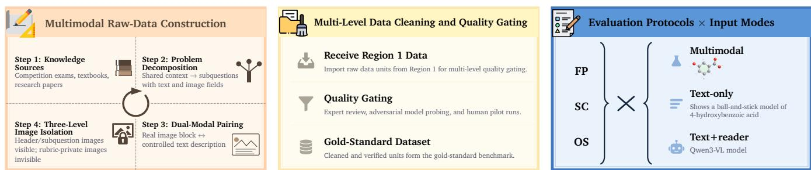  
Figure 1: The pipeline of ChemArgus at a glance. It runs the full flow from problem construction through cleaning and gating to evaluation, a four-step refinement loop with three gating stages for candidate problems, and the protocol structure of every reported run, where full problem (FP) evaluates the whole problem in one pass, sequential carry (SC) carries the model’s own previous answers forward, and oracle scafolded (OS) grants the standard intermediate result of each preceding subquestion, one protocol per access policy on the chain.

## 1. Introduction

Chemistry is one of the hardest open domains for language models. Expert-level problems interleave structure reading from images, multi-step quantitative derivation, and answers a chemist can independently verify, and current models show real capability [1, 2] on these tasks while still trailing expert solvers by large, stable margins [3–

12], a gap that persists across every suite reported to date. The stronger the models, the more evaluation must explain what it measures, because improvement can only happen where an error is precisely located, and a benchmark has to account for its score rather than merely report it, so the number becomes a diagnosis, one that names the step where the chain broke and the reason it broke there.

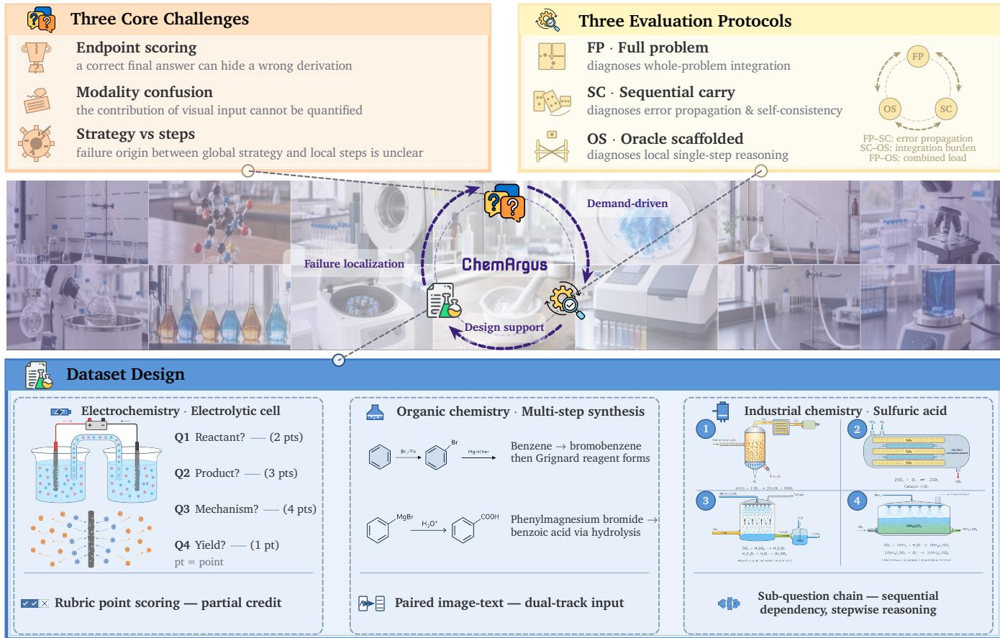  
Figure 2: Overview of ChemArgus. The complete design at a glance, three measurement challenges on the left, three evaluation protocols sharing one scoring unit on the right, a demand, design, attribution loop across the middle, and three example problem chains from the dataset below, worked end to end within one card, each card showing its graded steps.

Expert-level open chemistry problems bundle three demands that existing benchmarks rarely measure jointly. These demands directly test three core capabilities required for solving scientific problems. First, models must distinguish factual recall from genuine stepwise derivation. A correct final answer may be reached through factual recall alone without genuine stepwise derivation. Endpoint scoring cannot tell which [13], the gap Fine-grained scoring closes. Second, models must handle visual and semantic inputs in qualitatively diferent ways. Visual structures demand spatial reasoning, whereas text supplies symbolic logic. However, current evaluations rarely provide a controlled comparison between modalities and often supply only text [14–16]. Consequently, whether Multimodal capability actually enriches scientific comprehension, and whether visual input adds understanding beyond text, both remain unclear. Third, models must coordinate global planning with local execution. Solving a long chain of subquestions requires strategic decomposition. Scoring only the final outcome conflates a failed high-level strategy with a single careless step [17]. Whether failure originates in global strategy or in local execution stays undecidable by any current score [18], the confusion Diagnostic attribution resolves. No existing benchmark measures these three capabilities together with controlled image visibility and rubric-grounded partial credit, so the field lacks a fine-grained, multimodal, diagnostic instrument for where scientific reasoning in models actually breaks, at the step, in the modality, or in the plan, exactly where the three properties look.

To answer these questions and resolve the identified conflict, we introduce ChemArgus, a controlled evaluation dataset for high-dificulty chemistry reasoning, open-ended answering, and multimodal understanding. The benchmark rests on three measurement properties that the conflict names. Fine-grained scoring decomposes every problem into subquestions that share one context and grades each subquestion point by point with partial credit, so one scoring unit spans the whole benchmark and each score lands at the step rather than the outcome. Multimodal capability is priced through real images entering every problem together with a controlled text description, so visual understanding is measured against text on identical tasks. Diagnostic attribution holds that scoring unit fixed while varying only how the model accesses prior information, so each gap between two scores names a single cause. The most natural protocol asks the model to solve the whole problem in one pass, and full problem does exactly that, measuring integrated solving with nothing granted. Its score, however, cannot say where a chain broke, because integration and propagation are confounded in a single pass, so a second protocol, sequential carry, reveals the subquestions one at a time and carries forward the answers the model produced earlier, making every propagated error visible. A third protocol, oracle scafolded, then grants the standard intermediate result of each preceding subquestion, so the remaining score measures local reasoning with propagation removed. Because the three protocols share one scoring unit, the gaps between their scores are diagnostic quantities, and each gap names a single cause, integration, propagation, or local reasoning, one gap, one price. Our contributions are as follows.

❶ Problem Identification. We trace the interpretability failure of chemistry benchmarks to three named defects, recall conflated with derivation, modalities treated as interchangeable, and planning confounded with execution, all properties of the scoring itself.

❷ Benchmark and Data. We build ChemArgus, a controlled dataset for high-dificulty chemistry reasoning and multimodal understanding, with rubric partial credit, a controlled text description for every figure, and rubric-private images kept out of every model input.

❸ Evaluation Framework. We define three protocols sharing one scoring unit and evaluate nine models across three input modes, so each diagnostic attribution names a single cause, integration, propagation, or local reasoning.

## 2. Related Work

## 2.1. Chemistry Knowledge and Reasoning Benchmarks

The chemistry benchmarks that established the capability gaps this report measures share one property. Each scores an answer endpoint, so each can see that a model is wrong but not where it went wrong. The sequence begins with broad multiple-choice knowledge probes [19, 20], arithmetic and factual probes [21, 22], multi-task capability suites [23, 24], their reasoning-focused successor [25], eight-task multiple-choice chemistry [26], and [27], roughly 18,000 questions across physics, chemistry, and biology with data generated dynamically against leakage. It reaches its ceiling in expert-written question sets that remain hard even in closed form, and in [28], 8,476 olympiad-level bilingual multimodal scientific problems on which the strongest multimodal models of its day averaged below 18%. [8] reports that domain experts reach 65% on its 448 graduate-level questions while the strongest GPT-4 baseline [10] manages 39%, and [9] shows frontier models below 10% at release on 2,500 short-answer and multiple-choice questions across 100+ subjects, chemistry among them. The reasoning-model wave [12, 29] and its open-weight peers [1, 2] then raised the stakes on process-level evaluation, and [13] grades each derivation step to identify process errors, the direction this report’s rubrics extend to chemistry. The current generation of chemistry benchmarks moves to open-ended expert tasks. [3] pairs multiple-choice with open-ended questions across chemistry tasks and reports GPT-4 at or above estimated human performance on large parts of the benchmark; [4] structures multi-level chemical capability evaluation; [5] assesses chemical intelligence over broad topics; [6] specializes in quantitative problems with judge-based scoring; and [7] adds multimodal reasoning questions. Each benchmark establishes a real, stable gap between models and expert chemists. What none of them reports is where a wrong answer became wrong. Scoring an option or a matched string discards the partial credit a human examiner would have awarded along the way, so partial credit stays unlocalized in every one of them, and no score in this family reports where a wrong answer became wrong, so the gap it measures stays opaque about the failure point.

## 2.2. Multimodal Chemistry Evaluation

Multimodal evaluation prices the visual side of chemistry, and the vision language model literature supplies the backbones, [30] opening the instruction-tuned line that [31] scale to any resolution and [32, 33] carry into interleaved long contexts. General multimodal benchmarks such as [34, 35] score broad perception and reasoning, [16] and its hardened successor [36] include college-level chemistry questions that cannot be answered without the figure, chart and document suites such as [37, 38] test figure reading directly, visual mathematics [39, 40] shows the same figure dependency next door, as does [41]. On the chemistry side, [14] measures recognition and understanding over chemical tables; [42] benchmarks retrieval-augmented generation in multimodal chemistry contexts; [15] probes multimodal language models on chemistry and materials tasks and finds systematic failures where the answer depends on reading a figure; [43] chains multimodal reasoning over science questions; and [44] checks factual molecular comprehension across 62,000 questions and finds factual accuracy barely moving even as lexical similarity climbs. Together these works establish that visual structure reading is genuinely load-bearing. Models lose points not on general knowledge but on what they see or fail to see. What none of them provides is a controlled text description of every figure, so an image-conditioned score cannot be separated from what the problem text already carries. Image gains are reported, but never measured against a controlled text counterpart, so modality stays unpriced across this literature, and no score prices it.

## 2.3. Scoring and Protocols

Beyond answer scoring and multimodal input, evaluation has also begun to shape how a solution is graded and how a model is asked. [18] grades college-level science problems against detailed rubrics and finds models far below undergraduate performance, [6] judges quantitative chemistry answers, [3] judges its open-ended portion with a model judge, and the judge literature itself matured from pairwise preference [45–47] through criterion-based generation [48] to systematic judge auditing [49], reward calibration [50, 51], and rubric alignment [52], while [17] shows that formal answers can be graded deterministically against unit tests rather than a judge’s opinion, and [53] scores scientific literature analysis against fine-grained rubrics across memorization, comprehension, and reasoning levels. On the asking side, prompting studies [54] established that how a model is asked changes what it shows, [17] sequences tasks whose steps consume earlier results, [18] studies whether revisiting an earlier mistake repairs the rest, and agent evaluation moved to real environments, [55] across interactive settings, [56] across software engineering, [57, 58] across general assistance and real computer tasks, [59] across the open web, and [60] across tool use, while the standardized harness [61] made such evaluation reproducible at scale. On the scientific side, [62] finds the best agent solving only 32.4% of its 102 discovery tasks independently, [63, 64] chains long laboratory protocols graded by rule matching and simulation validators, and [65] runs discovery agents in a fictional world that reports progress at checkpoints rather than per-answer rubric points; [66] grounds agents in an interactive science environment, [67] augments models with chemistry tools for long task chains, [68] couples a frontier model with laboratory instruments to plan and execute real chemistry experiments. These eforts establish that rubric-level scoring, deterministic checks, and multi-step evaluation are each feasible at scale. What they leave open is the control surface. No benchmark splits a rubric into deterministic and judge-scored points, isolates judge-facing media from the model, or varies the protocol alone while holding the scoring unit fixed, so the graded artifact stays uncontrolled and headline numbers stay protocol-dependent.

Two gaps persist across the work reviewed above. First, no existing chemistry benchmark combines rubriclocalized partial credit, a controlled modality contrast, and protocol separation on a single scoring unit, so none can localize where a reasoning chain fails. Second, most chemistry benchmarks remain text-only, and the few that accept images treat modality as an add-on rather than a measured part of the design, while access control against training-data contamination is handled as an stays, the exceptions such as [63] private share under canary monitoring and [65] fictional setting being dataset defenses rather than measurement design, so the control surface stays open. ChemArgus is multimodal throughout, with real image input on every problem, and access control built into the measurement design. ChemArgus targets exactly these two gaps.

## 3. Benchmark Design

Overview. ChemArgus is built so that a score is not a single number a solution earns but a position along the chain a solution travels. Every subquestion is graded against a rubric with partial credit, the visual content a model sees is isolated from the visual content used to grade, and the same scoring unit is instantiated under three protocols that difer only in how the model’s context is assembled. This section develops the four design layers in order. Section 3.1 fixes the data protocol that normalizes every problem into one JSON form, including which images are model-visible and which are rubric-private; Section 3.2 describes the construction and quality-control pipeline every problem passes; Section 3.3 defines the three evaluation protocols full problem, sequential carry, oracle scafolded and states precisely what a gap between two of them isolates; and Section 3.4 specifies the dual-track grading pipeline, deterministic chemistry-equivalence checks for formal answers and an audited independent judge for flexible ones, so the two answer kinds never share a grader. Figure 2 draws the whole design at a glance, the three challenges, the three protocols, and the example problem chains joined by one demand, design, attribution loop that closes on itself, each score feeding the next diagnosis.

Table 1 compares ChemArgus against the benchmarks reviewed in Section 2 on five properties, real image input, controlled image-text contrast, rubric point partial credit, subquestion chains, and protocol separation. On the boundary cases, ChemBench [3] contains no images and represents molecules as SMILES; ChemEval [4] ofers text and multimodal versions that are task-level rather than per-figure descriptions; SUPERChem [7] is multiple choice with dual-format questions; MaCBench [15] is mostly VQA and multiple choice; DiscoveryWorld [65] ofers an optional 2D visual interface that is not a data figure, and its reports carry no rubric points.

## 3.1. Task Formulation and Data Protocol

Competition chemistry problems do not fit answer-level scoring because they do not have answer-level solutions. A single problem is a chain of subquestions that share a context, reuse earlier results, and are graded point by point. The data protocol therefore preserves that chain. Every problem is normalized into one JSON unit consisting of a shared header that gives the background and the substances involved, with its header images, followed by an ordered list of subquestions. Each subquestion carries its open-ended text, model-visible subquestion images, a positive integer full mark, its rubric as an ordered list of scoring points, and rubric-private rubric images; stable problem and subquestion IDs identify every unit, and knowledge tags link each subquestion to a fixed category vocabulary. No extra fields are permitted, so two instantiations of the benchmark can only difer in content, neve in structure, and their results remain directly comparable across instantiations and across runs.

Two properties of the protocol are load-bearing for what this report measures. First, images are data, not decoration. Every image is delivered to the model as a real multimodal input block, never as a path or a placeholder string, and every image also carries a curated text description of what a competent reader would extract. The description supports the text-only protocol in Section 3.3 and makes the modality contrast of Section 5 a controlled one. The same content reaches the model twice, once as pixels and once as prose. Second, image visibility is a design class, not a leak. The three image fields are split into model-visible media, header images and subquestion images, and rubric-private media, rubric images, scoring structures, reference answers, and boundary diagrams. Rubric-private images never enter any model input under any protocol, so a model cannot read its grading key from the problem itself, under any protocol or input mode, in any reported run.

## 3.2. Dataset Construction

ChemArgus is built as a measurement instrument for expert-level chemistry reasoning rather than a repository of hard questions. It evaluates whether a model can form a consistent and verifiable reasoning chain across molecular structure, reaction mechanism, symbolic representation, and expert scoring logic throughout the solution path. We construct every problem from first principles, drawing on chemistry competition knowledge, textbooks, and research literature. Each problem must satisfy three conditions, namely chemical correctness, derivability from the statement, and suficient discrimination between factual recall and genuine reasoning.

Candidate problems are filtered through expert review, adversarial model probing, and student pilots. Only those that satisfy correctness, scorability, and meaningful challenge enter the final set. Figure 1 draws the construction and evaluation pipeline, the four-step refinement loop, the three gating stages, and the protocol structure every reported run passes through. The final dataset is delivered as structured JSON units containing problem identifiers, question text, model-visible images with text descriptions, rubrics, and rubric-private images. This structure enables fine-grained diagnosis of where the reasoning chain breaks in a model, down to the subquestion and the protocol that cost the score, exactly the diagnosis promised.

Table 1: Comparison of ChemArgus against prior chemistry and adjacent scientific benchmarks on five properties. “image input” reports images as real multimodal blocks, and “image-text contrast” reports every figure paired with controlled text. “rubric point partial credit” reports partial credit per rubric point, and “subquestion chains” report problems split into shared-context subquestions. Finally, “protocol separation” reports one scoring unit under several protocols. ChemArgus is the only benchmark providing all five, green checkmarks for presence and red crosses for absence.
<table><tr><td>Benchmark</td><td>Image input</td><td>Image-text contrast</td><td>Rubric partial credit</td><td>Subquestion chains</td><td>Protocol separation</td></tr><tr><td>SciBench [18] [ICML24]</td><td>√</td><td>X</td><td>X</td><td>X</td><td>X</td></tr><tr><td>SciCode [17] [NeurIPS24]</td><td>X</td><td>X</td><td>X</td><td>J</td><td>X</td></tr><tr><td>GPQA [8] [arXiv23]</td><td>X</td><td>X</td><td>X</td><td>X</td><td>X</td></tr><tr><td>DiscoveryWorld [65] [NeurIPS24]</td><td>X</td><td>X</td><td>X</td><td>X</td><td>X</td></tr><tr><td>SciEval [27] [AAAI24]</td><td>X</td><td>X</td><td>X</td><td>x</td><td>X</td></tr><tr><td>ChemBench [3] [arXiv24]</td><td>X</td><td>X</td><td>X</td><td>X</td><td>X</td></tr><tr><td>ChemLLMBench [26] [NeurIPS23]</td><td>√</td><td>X</td><td>X</td><td>X</td><td>X</td></tr><tr><td>ChemEval [4] [ICLR26]</td><td>√</td><td>X</td><td>X</td><td>X</td><td>X</td></tr><tr><td>ChemIQ [5] [JCIM26]</td><td>x</td><td>X</td><td>X</td><td>X</td><td>X</td></tr><tr><td>SUPERChem [7] [arXiv25]</td><td>√</td><td>J</td><td>X</td><td>X</td><td>X</td></tr><tr><td>QCBench [6] [JCIM25]</td><td>X</td><td>X</td><td>X</td><td>X</td><td>X</td></tr><tr><td>MaCBench [15] [NatCompSci25]</td><td>√</td><td>J</td><td>X</td><td>X</td><td>X</td></tr><tr><td>ChemTable [14] [KDD26]</td><td>√</td><td>X</td><td>X</td><td>X</td><td>X</td></tr><tr><td>ChemRAG-Bench [42] [COLM25]</td><td>X</td><td>X</td><td>X</td><td>X</td><td>X</td></tr><tr><td>ChemArgus</td><td>¬</td><td>¬</td><td>1</td><td>J</td><td>¬</td></tr></table>

## 3.3. Three Evaluation Protocols

The three protocols are the instrument this benchmark is built around. They ask the same subquestions and are graded by the same scoring unit; they difer only in what the model has in its context when it answers each subquestion, which is what lets a score gap between two protocols name a cause instead of confound one.

Full problem. The model receives the complete problem, shared header, images, and all subquestions at once, and answers everything in one pass. This is the unassisted whole-problem setting. Global planning, cross-subquestion integration, and long-context organization are fully loaded, and nothing else is.

Sequential carry. The model answers subquestions in order inside one session; each subquestion sees the model’s own previous answers but never the standard results or the rubric. This is the natural sequential solving setting, and it is where self-consistency and error propagation become visible. A wrong structure in an early subquestion is what every later subquestion inherits and must then live with.

Oracle scafolded. The model answers each subquestion in isolation, receiving the standard intermediate result of the immediately preceding subquestion as a scafold. Upstream correctness is therefore granted rather than earned, and the remaining score measures local capability on the subquestion itself.

Because the scoring unit is identical across protocols, the three gaps are diagnostic quantities. FP versus SC prices sequential error propagation, what a model loses by carrying its own mistakes forward. SC versus OS prices integration burden under propagation, how much the standard intermediate results rescue. FP versus OS prices the combined integration and propagation load. A benchmark that reports all three scores has, in efect, localized the failure of a solution chain before any qualitative analysis begins.

## 3.4. Rubric-Grounded Scoring

Grading answers the chain, not its end. Each subquestion’s rubric decomposes it into executable scoring points, and a model earns each point independently, so a solution right in nine of ten derivations scores nine of ten points worth rather than zero. The grading pipeline is deliberately dual-track, because chemistry answers come in two kinds and each kind deserves the strongest available verifier [6, 18].

Formal answers, structures, SMILES, equations, and computed values, pass deterministic normalization and chemistry-equivalence checks [17] before any judge sees them. Two equivalent SMILES are equivalent in the grade, and a structure is checked as a chemical object rather than as a string match. Flexible answers, mechanistic explanations and experimental reasoning, are graded by an independent judge session that evaluates each rubric point against the answer, returning a per-point verdict with evidence and a confidence level [18, 45, 48, 52]. Low-confidence verdicts and boundary samples are routed to human review. Every grading interaction, problem input, model output, judge request, verdict, and summary is archived, so a published score can be traced to the exact rubric points that earned it. Together the two tracks keep what judges are good at, open-ended chemical judgment, and take away what they are bad at, structure equivalence, and the archive turns the rubric from a scoring device into an audit device that traces every point to its evidence.

## 4. Evaluation

## 4.1. Models

We evaluate nine frontier models, numbered (1) through (9) as follows. (1) GPT-5.6-Sol from OpenAI, a flagship reasoning model with 1M token context designed for scientific and agentic workloads; (2) Gemini 3.8 Flash from Google, featuring 1M token context and native multimodal reasoning; (3) Claude Opus 5 from Anthropic, capable of extended agentic operation on hard knowledge work; (4) Qwen3.8-Max from Alibaba, with 2.4T parameters and 1M token context optimized for coding and research; (5) Kimi K3 from Moonshot, with 2.8T parameters, 1M token context, and native vision understanding; (6) Grok 4.6 from xAI, with 500K context focused on long-running agentic tasks and visual reasoning; (7) MiniMax M3 from MiniMax, a native multimodal open-weight model with 1M token context; (8) DeepSeek V4 Pro from DeepSeek, a 1.6T MoE model with 1M token context delivering top-tier open-source performance; and (9) GLM-5.2 from Zhipu AI, an open-source model with 1M token context strong on long-horizon tasks. All models run at default settings with no task-specific fine-tuning, so the scores reflect of-the-shelf models.

## 4.2. Scoring

All models are evaluated within the open-source Pi agent harness, except Claude Opus 5, which runs in the Claude Code harness, and both provide a uniform calling interface and archive per-run image and tool audits. All runs use zero prompting, delivering only the problem content required by the protocol, so no score rests on prompting skill [54]. No few-shot examples, reasoning instructions, tools, or web search are provided, so every score measures the model’s own chemistry alone.

All scores are normalized rubric scores, the share of rubric points earned. Grading is performed per subquestion by an independent LLM judge, GPT-5.6-Sol, under the audited dual-track pipeline described in Section 3.4. Rubric-based LLM judging is standard practice by now [45, 48, 49, 52], and the judge operates strictly against the rubric points, never against a holistic impression. Formal answers pass deterministic chemistry-equivalence checks before the judge session, while flexible answers are evaluated by the judge against each rubric point. Human spot-checking validates judge verdicts, and the agreement between judge and human scores is high, strong enough to report the judge numbers alone, without a human pass over every answer.

## 4.3. Input Modes

The benchmark adopts three input modes. Multimodal runs receive every model-visible image as a real image block. Text-only runs receive the text description of each image and no image blocks. Text+reader runs pair a text model with the Qwen3-VL image reader [33], where the model autonomously decides when and how to invoke the reader for image recognition, converting visual content into text before processing.

On top of these input modes, the benchmark adopts the three metrics of Section 3.3. full problem presents the entire problem at once, sequential carry reveals subquestions in order and carries forward the model’s own previous answers, and oracle scafolded injects the standard intermediate result of each preceding subquestion. Because the three metrics share one scoring unit, a score gap between two of them isolates a single cause, the integration burden, the error propagation, or the local reasoning, one cause per gap.

The three input modes, combined with the three metrics, directly price the three defects identified in Section 1. The rubric scores every subquestion point by point, so factual recall cannot masquerade as genuine derivation, addressing the recall defect. Comparing multimodal against text-only runs quantifies the contribution of real image input, addressing the modality defect. The three metrics separate integration burden, error propagation, and local reasoning, addressing the protocol defect. Text+reader runs add an additional contrast, measuring what the reader module contributes beyond text descriptions. Results for all configurations appear in Section 5.

## 5. Results

## 5.1. Overall Results

The roster now reports twenty-five completed runs across nine models and three input modes, and the census is complete. Each input mode prices a diferent competence, so the same model appears three times in three roles, the multimodal row prices its own vision, the text row prices its reading of curated descriptions, and the reader row prices its delegation to an external vision module, and the three rows of one model are three diferent abilities rather than three snapshots of one.

The reported runs span a wide band, and Table 2 with Figure 3 give the full picture. Unassisted whole-problem solving is the lowest metric in every one of the twenty-five runs, and the ladder climbs from the whole problem to the step in all of them, so the integration burden measured by Section 3.3 is paid by every model under every input mode. The profile picture reads the roster at a glance, the multimodal panel spans 23.2 to 64.9, the text panel 23.5 to 61.7, and the reader panel 27.2 to 54.7. Claude Opus 5 leads every metric, 53.8 on the whole problem and 64.9 under oracle scafolded from multimodal input, ahead of every other run, and Gemini 3.8 Flash follows from real images, 48.5 on the whole problem and 60.3 under oracle scafolded, and its text row trails its image row on two of the three metrics, the first model in the roster for which reading the images beats reading the descriptions. GLM-5.2 still leads the reader panel on the whole problem at 52.0, and the leaders move with the input mode and with the metric, so the benchmark produces one ranking per condition rather than one winner.

The ladder is universal, but its height varies by family. Gemini 3.8 Flash and Grok 4.6 pay the steepest ones, 13.2 and 12.6 percentage points (pp) from text alone, and Claude Opus 5 pays 11.1 pp with images, while GLM-5.2 climbs only 1.5 pp, Claude Opus 5 climbs 0.2 pp from text, and the flattened reader runs climb under 0.6 pp each, so the integration burden is a per-model price rather than a constant tax. The reader subsection returns to the one exception, Gemini 3.8 Flash under the reader climbs 15.9 pp, the steepest ladder in the whole roster, sharper than any of its own text runs.

Figure 4 shows where each family bends. The multimodal runs split into bands, the Claude Opus 5 line riding the top, Gemini 3.8 Flash and Grok 4.6 the band below it, and the other four climbing in parallel at the bottom, the text runs fan out from a flat pair at the bottom to the Gemini ridge, with the Claude Opus 5 text line lying flat above it, and the reader runs split in two, GLM-5.2 riding a plateau above fifty, the Claude Opus 5 reader line climbing from the forties into the fifties, the Gemini reader line climbing into the forties, and the rest staying in the twenties and thirties.

Table 2: Results on the expanded model roster, normalized rubric score in $\% ,$ rounded to one decimal. Bold marks the best score per metric. Multimodal runs receive real image blocks, text only runs receive curated text descriptions with zero image blocks, and text + reader runs pair a text model with the Qwen3-VL image reader, which converts each image to text.
<table><tr><td>Model</td><td>Input</td><td>full problem</td><td>sequential carry</td><td>oracle scaffolded</td></tr><tr><td>GPT-5.6-Sol</td><td>multimodal</td><td>23.2</td><td>28.8</td><td>30.4</td></tr><tr><td>Gemini 3.8 Flash</td><td>multimodal</td><td>48.5</td><td>58.5</td><td>60.3</td></tr><tr><td>Claude Opus 5</td><td>multimodal</td><td>53.8</td><td>59.4</td><td>64.9</td></tr><tr><td>Qwen3.8-Max</td><td>multimodal</td><td>29.3</td><td>31.2</td><td>34.0</td></tr><tr><td>Kimi K3</td><td>multimodal</td><td>27.5</td><td>30.6</td><td>31.8</td></tr><tr><td>Grok 4.6</td><td>multimodal</td><td>33.8</td><td>41.8</td><td>45.5</td></tr><tr><td>MiniMax M3</td><td>multimodal</td><td>27.3</td><td>27.5</td><td>27.9</td></tr><tr><td>DeepSeek V4 Pro</td><td>text only</td><td>25.0</td><td>25.0</td><td>27.6</td></tr><tr><td>GLM-5.2</td><td>text only</td><td>23.5</td><td>24.9</td><td>25.0</td></tr><tr><td>GPT-5.6-Sol</td><td>text only</td><td>29.8</td><td>35.6</td><td>36.5</td></tr><tr><td>Gemini 3.8 Flash</td><td>text only</td><td>46.5</td><td>59.0</td><td>59.7</td></tr><tr><td>Claude Opus 5</td><td>text only</td><td>61.5</td><td>61.7</td><td>61.7</td></tr><tr><td>Qwen3.8-Max</td><td>text only</td><td>36.0</td><td>39.0</td><td>41.9</td></tr><tr><td>Kimi K3</td><td>text only</td><td>34.5</td><td>36.0</td><td>37.5</td></tr><tr><td>Grok 4.6</td><td>text only</td><td>33.4</td><td>42.0</td><td>46.0</td></tr><tr><td>MiniMax M3</td><td>text only</td><td>26.2</td><td>28.7</td><td>29.1</td></tr><tr><td>DeepSeek V4 Pro</td><td>text + reader</td><td>36.7</td><td>36.8</td><td>37.0</td></tr><tr><td>GLM-5.2</td><td>text + reader</td><td>52.0</td><td>52.2</td><td>52.4</td></tr><tr><td>GPT-5.6-Sol</td><td>text + reader</td><td>31.1</td><td>33.6</td><td>34.0</td></tr><tr><td>Gemini 3.8 Flash</td><td>text  reader</td><td>33.8</td><td>45.1</td><td>49.7</td></tr><tr><td>Claude Opus 5</td><td>text + reader</td><td>46.2</td><td>53.9</td><td>54.7</td></tr><tr><td>Qwen3.8-Max</td><td>text + reader</td><td>27.9</td><td>29.2</td><td>31.5</td></tr><tr><td>Kimi K3</td><td>text + reader</td><td>32.3</td><td>32.3</td><td>32.4</td></tr><tr><td>Grok 4.6</td><td>text + reader</td><td>28.6</td><td>29.0</td><td>31.1</td></tr><tr><td>MiniMax M3</td><td>text + reader</td><td>27.2</td><td>27.2</td><td>27.3</td></tr></table>

## 5.2. Modality Contrast

The modality contrast now splits the roster in two. For Gemini 3.8 Flash, Grok 4.6, and MiniMax M3, the whole problem favors real images, by 2.0, 0.4, and 1.1 pp, while GPT-5.6-Sol, Qwen3.8-Max, Kimi K3, and Claude Opus 5 lose 6.5 to 7.7 pp on the whole problem by reading them, as Table 3 shows, so the modality premium is a property of the model’s vision, paid by the weak readers and earned by the strong ones.

The table compresses each model into nine cells, and the figure keeps the two input scores on one span inside every metric, so the deltas read as distances rather than as arithmetic. The controlled text description matters here, it is written once per figure by the benchmark authors rather than generated by the model, so both inputs describe the same content from the same source, and the gap measures the modality alone.

The dumbbells in Figure 5 carry the same contrast visually, and the shape difers per model. Qwen3.8-Max widens toward the step, 6.7 pp on the whole problem to 7.9 pp under oracle scafolded, Kimi K3 peaks at the whole problem at 7.0 pp, dips to 5.4 pp at the carry, and settles at 5.7 pp, and GPT-5.6-Sol peaks at the carry at 6.8 pp, so the text advantage is a per-model profile rather than a constant tax. Gemini 3.8 Flash concentrates its image advantage at the whole problem, 2.0 pp, gives back 0.4 pp at the carry, and regains 0.6 pp at the step, so its advantage is an integration advantage, earned where the chain is longest, step by step. Claude Opus 5 mirrors the profile, 7.7 pp for text at the whole problem shrinking to 2.3 pp at the carry and flipping 3.2 pp the other way at the step.

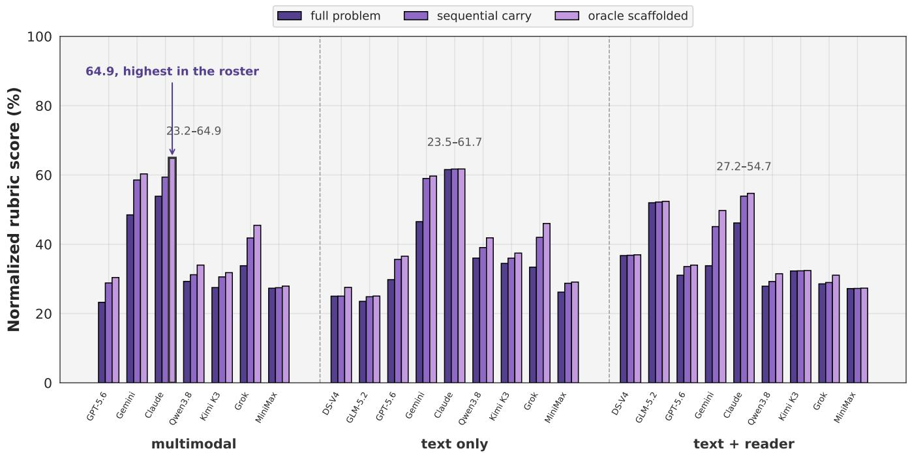  
Figure 3: Every reported run under the three metrics, grouped by input mode, normalized rubric score in %.

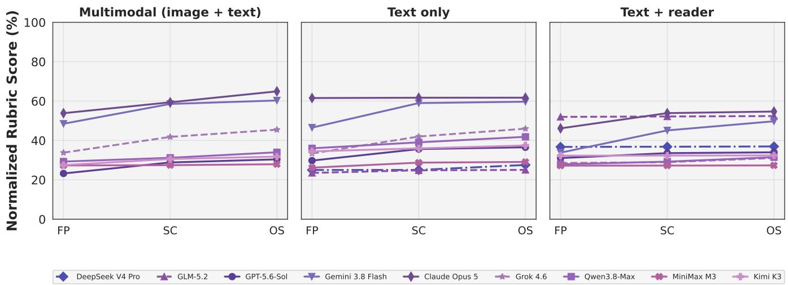  
Figure 4: Score trajectory across the three metrics for every reported run, one panel per input mode, with scores as normalized rubric percentages.

## 5.3. Reader Efect

The reader reshapes the ranking model by model, and the direction is now mostly down, nineteen of the twentyseven metric cells negative. GLM-5.2 rises 28.5 pp on the whole problem and DeepSeek V4 Pro rises 11.7 pp, but Claude Opus 5 falls 15.4 pp on the whole problem, the deepest whole-problem fall in the roster, Gemini 3.8 Flash falls 12.7 pp, Grok 4.6 falls 4.8 pp, Qwen3.8-Max falls 8.1 pp, and Kimi K3 falls 2.2 pp, so five of the nine models score lower with the reader on the whole problem and four score higher, as Table 4 shows for every metric, with GLM-5.2’s 28.5 pp gain the largest move in either direction.

Each delta in the table isolates the reader’s contribution alone, because it is measured against a fixed baseline, the same text run a model produces without the reader. The pairing is the same Qwen3-VL module for every model, which is what makes the deltas comparable across rows, and the comparison answers a design question rather than a capability question, whether an external vision module is a better way to deliver images than the model’s own eyes, and the roster answers it model by model, with no single direction.

multimodal text only  
Table 3: Modality contrast for the seven models reported under both inputs, normalized rubric score in $\% ,$ where mm reports the multimodal run with real image blocks and text reports the text only run with curated text descriptions. ∆ reports text only minus multimodal, in percentage points, positive values favor text only. Bold marks the best input score per metric.
<table><tr><td rowspan="2">Model</td><td colspan="3">full problem</td><td colspan="3">sequential carry</td><td colspan="3">oracle scaffolded</td></tr><tr><td>mm</td><td>text</td><td>Δ</td><td>mm</td><td>text</td><td>Δ</td><td>mm</td><td>text</td><td>Δ</td></tr><tr><td>GPT-5.6-Sol</td><td>23.2</td><td>29.8</td><td>+6.5</td><td>28.8</td><td>35.6</td><td>+6.8</td><td>30.4</td><td>36.5</td><td>+6.1</td></tr><tr><td>Gemini 3.8 Flash</td><td>48.5</td><td>46.5</td><td>-2.0</td><td>58.5</td><td>59.0</td><td>+0.4</td><td>60.3</td><td>59.7</td><td>-0.6</td></tr><tr><td>Claude Opus 5</td><td>53.8</td><td>61.5</td><td>+7.7</td><td>59.4</td><td>61.7</td><td>+2.3</td><td>64.9</td><td>61.7</td><td>-3.2</td></tr><tr><td>Qwen3.8-Max</td><td>29.3</td><td>36.0</td><td>+6.7</td><td>31.2</td><td>39.0</td><td>+7.8</td><td>34.0</td><td>41.9</td><td>+7.9</td></tr><tr><td>Kimi K3</td><td>27.5</td><td>34.5</td><td>+7.0</td><td>30.6</td><td>36.0</td><td>+5.4</td><td>31.8</td><td>37.5</td><td>+5.7</td></tr><tr><td>Grok 4.6</td><td>33.8</td><td>33.4</td><td>-0.4</td><td>41.8</td><td>42.0</td><td>+0.2</td><td>45.5</td><td>46.0</td><td>+0.5</td></tr><tr><td>MiniMax M3</td><td>27.3</td><td>26.2</td><td>-1.1</td><td>27.5</td><td>28.7</td><td>+1.3</td><td>27.9</td><td>29.1</td><td>+1.2</td></tr></table>

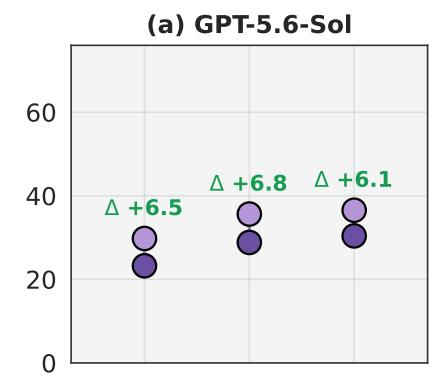

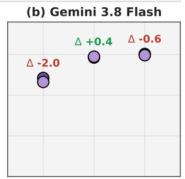

(c) Claude Opus 5  
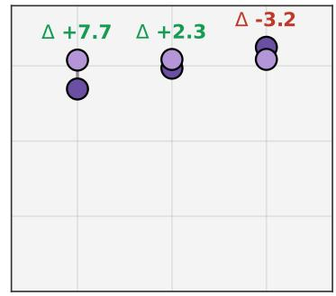

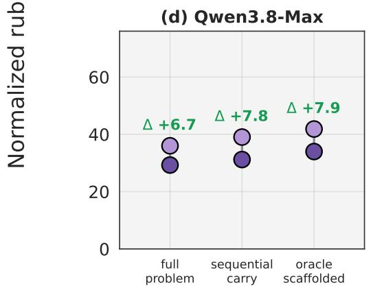

(f) Grok 4.6  
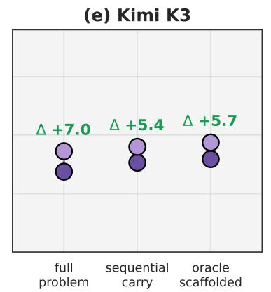

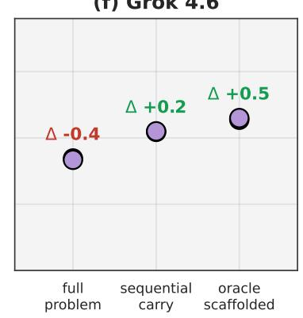  
Figure 5: Modality contrast for six of the seven models reported under both inputs, one panel per model, with ∆ as text only minus multimodal in percentage points, positive values favoring text only.

The three side-by-side panels of Figure 6 make direction and magnitude readable at a glance. The marks extend right across all three metrics only for DeepSeek V4 Pro and GLM-5.2, extend left for Gemini 3.8 Flash, Claude Opus 5, Grok 4.6, Qwen3.8-Max, and Kimi K3, and switch direction between metrics for GPT-5.6-Sol and MiniMax M3, both of which gain slightly on the whole problem and then lose a little on the sequential metrics, the two spans crossing the zero line in the same direction.

Table 4: Reader efect per model. Text + reader runs pair a text model with the Qwen3-VL image reader, which converts each image to text, and ∆ marks text + reader minus text only, in percentage points, with positive values favoring the reader pairing.
<table><tr><td rowspan="2">Model</td><td colspan="3">full problem</td><td colspan="3">sequential carry</td><td colspan="3">oracle scaffolded</td></tr><tr><td>text</td><td>reader</td><td>Δ</td><td>text</td><td>reader</td><td>Δ</td><td>text</td><td>reader</td><td>Δ</td></tr><tr><td>DeepSeek V4 Pro</td><td>25.0</td><td>36.7</td><td>+11.7</td><td>25.0</td><td>36.8</td><td>+11.8</td><td>27.6</td><td>37.0</td><td>+9.4</td></tr><tr><td>GLM-5.2</td><td>23.5</td><td>52.0</td><td>+28.5</td><td>24.9</td><td>52.2</td><td>+27.3</td><td>25.0</td><td>52.4</td><td>+27.3</td></tr><tr><td>GPT-5.6-Sol</td><td>29.8</td><td>31.1</td><td>+1.3</td><td>35.6</td><td>33.6</td><td>-2.1</td><td>36.5</td><td>34.0</td><td>-2.6</td></tr><tr><td>Gemini 3.8 Flash</td><td>46.5</td><td>33.8</td><td>-12.7</td><td>59.0</td><td>45.1</td><td>-13.9</td><td>59.7</td><td>49.7</td><td>-9.9</td></tr><tr><td>Claude Opus 5</td><td>61.5</td><td>46.2</td><td>-15.4</td><td>61.7</td><td>53.9</td><td>-7.8</td><td>61.7</td><td>54.7</td><td>-7.0</td></tr><tr><td>Qwen3.8-Max</td><td>36.0</td><td>27.9</td><td>-8.1</td><td>39.0</td><td>29.2</td><td>-9.8</td><td>41.9</td><td>31.5</td><td>-10.4</td></tr><tr><td>Kimi K3</td><td>34.5</td><td>32.3</td><td>-2.2</td><td>36.0</td><td>32.3</td><td>-3.7</td><td>37.5</td><td>32.4</td><td>-5.0</td></tr><tr><td>Grok 4.6</td><td>33.4</td><td>28.6</td><td>-4.8</td><td>42.0</td><td>29.0</td><td>-13.0</td><td>46.0</td><td>31.1</td><td>-14.9</td></tr><tr><td>MiniMax M3</td><td>26.2</td><td>27.2</td><td>+1.0</td><td>28.7</td><td>27.2</td><td>-1.5</td><td>29.1</td><td>27.3</td><td>-1.8</td></tr></table>

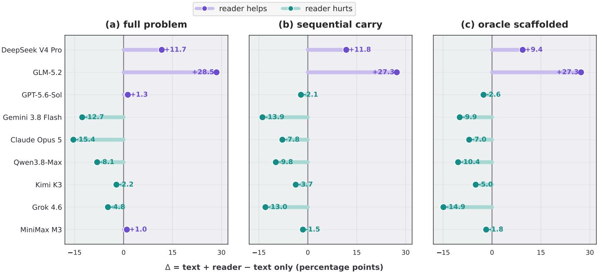  
Figure 6: Reader efect per model in three side-by-side metric panels. Deltas are text + reader minus text only in percentage points; purple marks reader gains and teal marks reader losses.

The reader also reshapes the ladder itself. For GLM-5.2, DeepSeek V4 Pro, Kimi K3, and MiniMax M3 it flattens the ladder to under 0.6 pp, the visual load absorbed before the model sees the problem, while for Gemini 3.8 Flash it sharpens the ladder to 15.9 pp, the steepest in the roster, because the reader hands its strong text side a plain description and strips away the images that made its multimodal run the best in the roster, and for Claude Opus 5 it opens an 8.5 pp climb in a text line that was flat at 0.2 pp. The deepest falls also come at the step, Grok 4.6 and Qwen3.8-Max ending 14.9 and 10.4 pp down under oracle scafolded, the two deepest falls of the roster.

## 5.4. Answers to the Two Questions

The two questions that Section 1 leaves open now carry answers. Question I asks whether visual input adds understanding beyond text, and the answer is now split. Three models gain from images on the whole problem, Gemini 3.8 Flash by 2.0 pp, Grok 4.6 by 0.4 pp, and MiniMax M3 by 1.1 pp, while four lose by 6.5 to 7.7 pp, so the modality premium is model-dependent, and the dividing line is the model’s own vision. Question II asks whether failure originates in global strategy or local execution, and the ladder answers uniformly, the trough sits at the whole problem in every one of the twenty-five reported runs, so the strategy level is where every model loses the most, though its depth varies from 0.1 pp in the flattened reader runs to 13.2 pp for Gemini 3.8 Flash from text alone. The reader efect, reported in Table 4, adds a third finding neither question anticipated, it is model-dependent, and it moves the ranking by 28.5 pp up for GLM-5.2 on full problem against 15.4 pp down for Claude Opus 5 on the whole problem, a 43.8 pp swing, the largest in the roster.

## 6. Conclusion

Chemistry evaluation can no longer certify only that a model’s final answer matches; it must certify where a solution chain goes wrong, and ChemArgus is the instrument that makes that certification mechanical. Its core contribution is the three protocols sharing one scoring unit, full problem for whole-problem integration, sequential carry for sequential error propagation, and oracle scafolded for local reasoning, graded on rubric points with partial credit, deterministic chemistry-equivalence checks for formal answers, an audited independent judge for flexible ones, and image visibility isolated so that the model never reads its own grading key. Evaluating nine frontier models across three input modes, with twenty-five completed runs, yields three stable findings. Whole-problem integration is the largest measured cost, with the unassisted whole problem scoring below both sequential metrics in every reported run, 23.2 vs. 28.8 and 30.4 for GPT-5.6-Sol with images and 46.5 vs. 59.0 and 59.7 for Gemini 3.8 Flash with text; modality is priced rather than assumed, and the roster splits in two, Gemini 3.8 Flash, Grok 4.6, and MiniMax M3 each gain from real images on the whole problem, 2.0, 0.4, and 1.1 pp, while GPT-5.6-Sol, Qwen3.8-Max, Kimi K3, and Claude Opus 5 each lose 6.5 to 7.7 pp by reading them; and the reader efect is model-dependent, lifting GLM-5.2 by 28.5 pp on the whole problem while lowering Claude Opus 5 by up to 15.4 pp, a 43.8 pp swing across the roster. The best reported score, 64.9 for Claude Opus 5 under oracle scafolded with images, still leaves more than a third of the rubric credit unclaimed. What a chemistry benchmark must certify, then, is exactly what this one measures, not a number, but a diagnosis, one that tells the next model exactly which link of the chain to strengthen, and that is the direction in which chemistry-capable language models can now be improved.

## References

[1] Aixin Liu, Bei Feng, Bing Xue, Bingxuan Wang, Bochao Wu, Chengda Lu, Chenggang Zhao, Chengqi Deng, Chenyu Zhang, Chong Ruan, et al. Deepseek-v3 technical report. arXiv preprint arXiv:2412.19437, 2024.

[2] Kimi Team, Angang Du, Bofei Gao, Bowei Xing, Changjiu Jiang, Cheng Chen, Cheng Li, Chenjun Xiao, Chenzhuang Du, Chonghua Liao, et al. Kimi k1. 5: Scaling reinforcement learning with llms. arXiv preprint arXiv:2501.12599, 2025.

[3] Adrian Mirza, Nawaf Alampara, Sreekanth Kunchapu, Martiño Ríos-García, Benedict Emoekabu, Aswanth Krishnan, Tanya Gupta, Mara Schilling-Wilhelmi, Macjonathan Okereke, Anagha Aneesh, et al. Are large language models superhuman chemists? arXiv preprint arXiv:2404.01475, 2024.

[4] Yuqing Huang, Rongyang Zhang, Xuesong He, Xuyang Zhi, Hao Wang, Nuo Chen, Zongbo Liu, Xin Li, Feiyang Xu, Deguang Liu, et al. Chemeval: A multi-level and fine-grained chemical capability evaluation for large language models. In International Conference on Learning Representations, volume 2026, pages 21365–21392, 2026.

[5] Nicholas T Runcie, Charlotte M Deane, and Fergus Imrie. Assessing the chemical intelligence of large language models. Journal of chemical information and modeling, 66(1):216–227, 2026.

[6] Jiaqing Xie, Weida Wang, Ben Gao, Zhuo Yang, Haiyuan Wan, Shufei Zhang, Tianfan Fu, and Yuqiang Li. Qcbench: Evaluating large language models on domain-specific quantitative chemistry. Journal of Chemical Information and Modeling, 65(22):12268–12278, 2025.

[7] Zehua Zhao, Zhixian Huang, Junren Li, Siyu Lin, Junting Zhou, Fengqi Cao, Kun Zhou, Rui Ge, Tingting Long, Yuexiang Zhu, et al. Superchem: A multimodal reasoning benchmark in chemistry. arXiv preprint arXiv:2512.01274, 2025.

[8] David Rein, Betty Li Hou, Asa Cooper Stickland, Jackson Petty, Richard Yuanzhe Pang, Julien Dirani, Julian Michael, and Samuel R Bowman. Gpqa: A graduate-level google-proof q&a benchmark. arXiv preprint arXiv:2311.12022, 2023.

[9] Long Phan, Alice Gatti, Ziwen Han, Nathaniel Li, Josephina Hu, Hugh Zhang, Chen Bo Calvin Zhang, Mohamed Shaaban, John Ling, Sean Shi, et al. Humanity’s last exam. arXiv preprint arXiv:2501.14249, 2025.

[10] Josh Achiam, Steven Adler, Sandhini Agarwal, Lama Ahmad, Ilge Akkaya, Florencia Leoni Aleman, Diogo Almeida, Janko Altenschmidt, Sam Altman, Shyamal Anadkat, et al. Gpt-4 technical report. arXiv preprint arXiv:2303.08774, 2023.

[11] Gemini Team, Petko Georgiev, Ving Ian Lei, Ryan Burnell, Libin Bai, Anmol Gulati, Garrett Tanzer, Damien Vincent, Zhufeng Pan, Shibo Wang, et al. Gemini 1.5: Unlocking multimodal understanding across millions of tokens of context. arXiv preprint arXiv:2403.05530, 2024.

[12] Aaron Jaech, Adam Kalai, Adam Lerer, Adam Richardson, Ahmed El-Kishky, Aiden Low, Alec Helyar, Aleksander Madry, Alex Beutel, Alex Carney, et al. Openai o1 system card. arXiv preprint arXiv:2412.16720, 2024.

[13] Chujie Zheng, Zhenru Zhang, Beichen Zhang, Runji Lin, Keming Lu, Bowen Yu, Dayiheng Liu, Jingren Zhou, and Junyang Lin. Processbench: Identifying process errors in mathematical reasoning. In Proceedings of the 63rd Annual Meeting of the Association for Computational Linguistics (Volume 1: Long Papers), pages 1009–1024, 2025.

[14] Yitong Zhou, Mingyue Cheng, Qingyang Mao, Yucong Luo, Qi Liu, Yupeng Li, Xiaohan Zhang, Deguang Liu, Xin Li, and Enhong Chen. Benchmarking multimodal llms on recognition and understanding over chemical tables. In Proceedings of the 32nd ACM SIGKDD Conference on Knowledge Discovery and Data Mining V. 2, pages 13099–13110, 2026.

[15] Nawaf Alampara, Mara Schilling-Wilhelmi, Martiño Ríos-García, Indrajeet Mandal, Pranav Khetarpal, Hargun Singh Grover, NM Anoop Krishnan, and Kevin Maik Jablonka. Probing the limitations of multimodal language models for chemistry and materials research. Nature computational science, 5(10):952–961, 2025.

[16] Xiang Yue, Yuansheng Ni, Kai Zhang, Tianyu Zheng, Ruoqi Liu, Ge Zhang, Samuel Stevens, Dongfu Jiang, Weiming Ren, Yuxuan Sun, et al. Mmmu: A massive multi-discipline multimodal understanding and reasoning benchmark for expert agi. In Proceedings of the IEEE/CVF conference on computer vision and pattern recognition, pages 9556–9567, 2024.

[17] Minyang Tian, Luyu Gao, Shizhuo D Zhang, Xinan Chen, Cunwei Fan, Xuefei Guo, Roland Haas, Pan Ji, Kittithat Krongchon, Yao Li, et al. Scicode: A research coding benchmark curated by scientists. Advances in Neural Information Processing Systems, 37:30624–30650, 2024.

[18] Xiaoxuan Wang, Ziniu Hu, Pan Lu, Yanqiao Zhu, Jieyu Zhang, Satyen Subramaniam, Arjun R Loomba, Shichang Zhang, Yizhou Sun, and Wei Wang. Scibench: Evaluating college-level scientific problem-solving abilities of large language models. arXiv preprint arXiv:2307.10635, 2023.

[19] Dan Hendrycks, Collin Burns, Steven Basart, Andy Zou, Mantas Mazeika, Dawn Song, and Jacob Steinhardt. Measuring massive multitask language understanding. arXiv preprint arXiv:2009.03300, 2020.

[20] Peter Clark, Isaac Cowhey, Oren Etzioni, Tushar Khot, Ashish Sabharwal, Carissa Schoenick, and Oyvind Tafjord. Think you have solved question answering? try arc, the ai2 reasoning challenge. arXiv preprint arXiv:1803.05457, 2018.

[21] Karl Cobbe, Vineet Kosaraju, Mohammad Bavarian, Mark Chen, Heewoo Jun, Lukasz Kaiser, Matthias Plappert, Jerry Tworek, Jacob Hilton, Reiichiro Nakano, et al. Training verifiers to solve math word problems. arXiv preprint arXiv:2110.14168, 2021.

[22] Jason Wei, Nguyen Karina, Hyung Won Chung, Yunxin Joy Jiao, Spencer Papay, Amelia Glaese, John Schulman, and William Fedus. Measuring short-form factuality in large language models. arXiv preprint arXiv:2411.04368, 2024.

[23] Aarohi Srivastava, Abhinav Rastogi, Abhishek Rao, Abu Awal Md Shoeb, Abubakar Abid, Adam Fisch, Adam R Brown, Adam Santoro, Aditya Gupta, Adrià Garriga-Alonso, et al. Beyond the imitation game: Quantifying and extrapolating the capabilities of language models. arXiv preprint arXiv:2206.04615, 2022.

[24] Yuzhen Huang, Yuzhuo Bai, Zhihao Zhu, Junlei Zhang, Jinghan Zhang, Tangjun Su, Junteng Liu, Chuancheng Lv, Yikai Zhang, Yao Fu, et al. C-eval: A multi-level multi-discipline chinese evaluation suite for foundation models. Advances in neural information processing systems, 36:62991–63010, 2023.

[25] Yubo Wang, Xueguang Ma, Ge Zhang, Yuansheng Ni, Abhranil Chandra, Shiguang Guo, Weiming Ren, Aaran Arulraj, Xuan He, Ziyan Jiang, et al. Mmlu-pro: A more robust and challenging multi-task language understanding benchmark. Advances in Neural Information Processing Systems, 37:95266–95290, 2024.

[26] Taicheng Guo, Bozhao Nan, Zhenwen Liang, Zhichun Guo, Nitesh Chawla, Olaf Wiest, Xiangliang Zhang, et al. What can large language models do in chemistry? a comprehensive benchmark on eight tasks. Advances in neural information processing systems, 36:59662–59688, 2023.

[27] Liangtai Sun, Yang Han, Zihan Zhao, Da Ma, Zhennan Shen, Baocai Chen, Lu Chen, and Kai Yu. Scieval: A multi-level large language model evaluation benchmark for scientific research. In Proceedings of the AAAI Conference on Artificial Intelligence, volume 38, pages 19053–19061, 2024.

[28] Chaoqun He, Renjie Luo, Yuzhuo Bai, Shengding Hu, Zhen Thai, Junhao Shen, Jinyi Hu, Xu Han, Yujie Huang, Yuxiang Zhang, et al. Olympiadbench: A challenging benchmark for promoting agi with olympiad-level bilingual multimodal scientific problems. In Proceedings of the 62nd Annual Meeting of the Association for Computational Linguistics (Volume 1: Long Papers), pages 3828–3850, 2024.

[29] Daya Guo, Dejian Yang, Haowei Zhang, Junxiao Song, Peiyi Wang, Qihao Zhu, Runxin Xu, Ruoyu Zhang, Shirong Ma, Xiao Bi, et al. Deepseek-r1: Incentivizing reasoning capability in llms via reinforcement learning. arXiv preprint arXiv:2501.12948, 2025.

[30] Haotian Liu, Chunyuan Li, Qingyang Wu, and Yong Jae Lee. Visual instruction tuning. Advances in neural information processing systems, 36:34892–34916, 2023.

[31] Peng Wang, Shuai Bai, Sinan Tan, Shijie Wang, Zhihao Fan, Jinze Bai, Keqin Chen, Xuejing Liu, Jialin Wang, Wenbin Ge, et al. Qwen2-vl: Enhancing vision-language model’s perception of the world at any resolution. arXiv preprint arXiv:2409.12191, 2024.

[32] Zhe Chen, Jiannan Wu, Wenhai Wang, Weijie Su, Guo Chen, Sen Xing, Muyan Zhong, Qinglong Zhang, Xizhou Zhu, Lewei Lu, et al. Internvl: Scaling up vision foundation models and aligning for generic visual-linguistic tasks. In Proceedings of the IEEE/CVF conference on computer vision and pattern recognition, pages 24185–24198, 2024.

[33] Shuai Bai, Yuxuan Cai, Ruizhe Chen, Keqin Chen, Xionghui Chen, Zesen Cheng, Lianghao Deng, Wei Ding, Chang Gao, Chunjiang Ge, et al. Qwen3-vl technical report. arXiv preprint arXiv:2511.21631, 2025.

[34] Bohao Li, Yuying Ge, Yixiao Ge, Guangzhi Wang, Rui Wang, Ruimao Zhang, and Ying Shan. Seed-bench: Benchmarking multimodal large language models. In 2024 IEEE/CVF Conference on Computer Vision and Pattern Recognition (CVPR), pages 13299–13308. IEEE, 2024.

[35] Yuan Liu, Haodong Duan, Yuanhan Zhang, Bo Li, Songyang Zhang, Wangbo Zhao, Yike Yuan, Jiaqi Wang, Conghui He, Ziwei Liu, et al. Mmbench: Is your multi-modal model an all-around player? In European conference on computer vision, pages 216–233. Springer, 2024.

[36] Xiang Yue, Tianyu Zheng, Yuansheng Ni, Yubo Wang, Kai Zhang, Shengbang Tong, Yuxuan Sun, Botao Yu, Ge Zhang, Huan Sun, et al. Mmmu-pro: A more robust multi-discipline multimodal understanding benchmark. In Proceedings of the 63rd Annual Meeting of the Association for Computational Linguistics (Volume 1: Long Papers), pages 15134–15186, 2025.

[37] Ahmed Masry, Jia Qing Tan, Shafiq Joty, Enamul Hoque, et al. Chartqa: A benchmark for question answering about chart with visual and logical reasoning. In Findings of the association for computational linguistics: ACL 2022, pages 2263–2279, 2022.

[38] Minesh Mathew, Dimosthenis Karatzas, and CV Jawahar. Docvqa: A dataset for vqa on document images. In 2021 IEEE Winter Conference on Applications of Computer Vision (WACV), pages 2199–2208. IEEE, 2021.

[39] Pan Lu, Hritik Bansal, Tony Xia, Jiacheng Liu, Chunyuan Li, Hannaneh Hajishirzi, Hao Cheng, Kai-Wei Chang, Michel Galley, and Jianfeng Gao. Mathvista: Evaluating mathematical reasoning of foundation models in visual contexts. In International Conference on Learning Representations, volume 2024, pages 23439–23554, 2024.

[40] Renrui Zhang, Dongzhi Jiang, Yichi Zhang, Haokun Lin, Ziyu Guo, Pengshuo Qiu, Aojun Zhou, Pan Lu, Kai-Wei Chang, Yu Qiao, et al. Mathverse: Does your multi-modal llm truly see the diagrams in visual math problems? In European Conference on Computer Vision, pages 169–186. Springer, 2024.

[41] Ke Wang, Junting Pan, Weikang Shi, Zimu Lu, Houxing Ren, Aojun Zhou, Mingjie Zhan, and Hongsheng Li. Measuring multimodal mathematical reasoning with math-vision dataset. Advances in Neural Information Processing Systems, 37: 95095–95169, 2024.

[42] Xianrui Zhong, Bowen Jin, Siru Ouyang, Yanzhen Shen, Qiao Jin, Yin Fang, Zhiyong Lu, and Jiawei Han. Benchmarking retrieval-augmented generation for chemistry. arXiv preprint arXiv:2505.07671, 2025.

[43] Pan Lu, Swaroop Mishra, Tanglin Xia, Liang Qiu, Kai-Wei Chang, Song-Chun Zhu, Oyvind Tafjord, Peter Clark, and Ashwin Kalyan. Learn to explain: Multimodal reasoning via thought chains for science question answering. Advances in neural information processing systems, 35:2507–2521, 2022.

[44] Xingyu Lu, He Cao, Zijing Liu, Shengyuan Bai, Leqing Chen, Yuan Yao, Hai-Tao Zheng, and Yu Li. Moleculeqa: A dataset to evaluate factual accuracy in molecular comprehension. In Findings of the Associationfor Computational Linguistics: EMNLP 2024, pages 3769–3789, 2024.

[45] Lianmin Zheng, Wei-Lin Chiang, Ying Sheng, Siyuan Zhuang, Zhanghao Wu, Yonghao Zhuang, Zi Lin, Zhuohan Li, Dacheng Li, Eric Xing, et al. Judging llm-as-a-judge with mt-bench and chatbot arena. Advances in neural information processing systems, 36:46595–46623, 2023.

[46] Wei-Lin Chiang, Lianmin Zheng, Ying Sheng, Anastasios Nikolas Angelopoulos, Tianle Li, Dacheng Li, Hao Zhang, Banghua Zhu, Michael Jordan, Joseph E Gonzalez, et al. Chatbot arena: An open platform for evaluating llms by human preference. arXiv preprint arXiv:2403.04132, 2024.

[47] Yann Dubois, Balázs Galambosi, Percy Liang, and Tatsunori B Hashimoto. Length-controlled alpacaeval: A simple way to debias automatic evaluators. arXiv preprint arXiv:2404.04475, 2024.

[48] Yang Liu, Dan Iter, Yichong Xu, Shuohang Wang, Ruochen Xu, and Chenguang Zhu. G-eval: Nlg evaluation using gpt-4 with better human alignment. In Proceedings of the 2023 conference on empirical methods in natural language processing, pages 2511–2522, 2023.

[49] Sijun Tan, Siyuan Zhuang, Kyle Montgomery, William Tang, Alejandro Cuadron, Chenguang Wang, Raluca Popa, and Ion Stoica. Judgebench: A benchmark for evaluating llm-based judges. In International Conference on Learning Representations, volume 2025, pages 63277–63303, 2025.

[50] Nathan Lambert, Valentina Pyatkin, Jacob Morrison, LJ Miranda, Bill Yuchen Lin, Khyathi Chandu, Nouha Dziri, Sachin Kumar, Tom Zick, Yejin Choi, et al. Rewardbench: Evaluating reward models for language modeling. In Findings of the Association for Computational Linguistics: NAACL 2025, pages 1755–1797, 2025.

[51] Xiaoyu Tan, Tianchu Yao, Chao Qu, Bin Li, Minghao Yang, Dakuan Lu, Haozhe Wang, Xu Yinghui, and Xihe Qiu. Aurora: Automated training framework of universal process reward models via ensemble prompting and reverse verification. In Proceedings of the 32nd ACM SIGKDD Conference on Knowledge Discovery and Data Mining V. 1, pages 1378–1389, 2026.

[52] Qiyuan Zhang, Junyi Zhou, Yufei Wang, Fuyuan Lyu, Yidong Ming, Can Xu, Qingfeng Sun, Kai Zheng, Peng Kang, Xue Liu, et al. Rubricbench: Aligning model-generated rubrics with human standards. arXiv preprint arXiv:2603.01562, 2026.

[53] Hengxing Cai, Xiaochen Cai, Junhan Chang, Sihang Li, Lin Yao, Wang Changxin, Zhifeng Gao, Hongshuai Wang, Li Yongge, Mujie Lin, et al. Sciassess: Benchmarking llm proficiency in scientific literature analysis. In Findings of the Association for Computational Linguistics: NAACL 2025, pages 2335–2357, 2025.

[54] Jason Wei, Xuezhi Wang, Dale Schuurmans, Maarten Bosma, Fei Xia, Ed Chi, Quoc V Le, Denny Zhou, et al. Chain-ofthought prompting elicits reasoning in large language models. Advances in neural information processing systems, 35: 24824–24837, 2022.

[55] Xiao Liu, Hao Yu, Hanchen Zhang, Yifan Xu, Xuanyu Lei, Hanyu Lai, Yu Gu, Hangliang Ding, Kaiwen Men, Kejuan Yang, et al. Agentbench: Evaluating llms as agents. In International Conference on Learning Representations, volume 2024, pages 52989–53046, 2024.

[56] Carlos E Jimenez, John Yang, Alexander Wettig, Shunyu Yao, Kexin Pei, Ofir Press, and Karthik Narasimhan. Swe-bench: Can language models resolve real-world github issues? In International Conference on Learning Representations, volume 2024, pages 54107–54157, 2024.

[57] Grégoire Mialon, Clémentine Fourrier, Thomas Wolf, Yann LeCun, and Thomas Scialom. Gaia: a benchmark for genera ai assistants. In International Conference on Learning Representations, volume 2024, pages 9025–9049, 2024.

[58] Tianbao Xie, Danyang Zhang, Jixuan Chen, Xiaochuan Li, Siheng Zhao, Ruisheng Cao, Toh J Hua, Zhoujun Cheng, Dongchan Shin, Fangyu Lei, et al. Osworld: Benchmarking multimodal agents for open-ended tasks in real computer environments. Advances in Neural Information Processing Systems, 37:52040–52094, 2024.

[59] Shuyan Zhou, Frank F Xu, Hao Zhu, Xuhui Zhou, Robert Lo, Abishek Sridhar, Xianyi Cheng, Tianyue Ou, Yonatan Bisk, Daniel Fried, et al. Webarena: A realistic web environment for building autonomous agents. In International Conference on Learning Representations, volume 2024, pages 15585–15606, 2024.

[60] Yujia Qin, Shihao Liang, Yining Ye, Kunlun Zhu, Lan Yan, Yaxi Lu, Yankai Lin, Xin Cong, Xiangru Tang, Bill Qian, et al. Toolllm: Facilitating large language models to master 16000+ real-world apis. In International Conference on Learning Representations, volume 2024, pages 9695–9717, 2024.

[61] Percy Liang, Rishi Bommasani, Tony Lee, Dimitris Tsipras, Dilara Soylu, Michihiro Yasunaga, Yian Zhang, Deepak Narayanan, Yuhuai Wu, Ananya Kumar, et al. Holistic evaluation of language models. arXiv preprint arXiv:2211.09110, 2022.

[62] Ziru Chen, Shijie Chen, Yuting Ning, Qianheng Zhang, Boshi Wang, Botao Yu, Yifei Li, Zeyi Liao, Chen Wei, Zitong Lu, et al. Scienceagentbench: Toward rigorous assessment of language agents for data-driven scientific discovery. In International Conference on Learning Representations, volume 2025, pages 96934–96990, 2025.

[63] Jon M Laurent, Joseph D Janizek, Michael Ruzo, Michaela M Hinks, Michael J Hammerling, Siddharth Narayanan, Manvitha Ponnapati, Andrew D White, and Samuel G Rodriques. Lab-bench: Measuring capabilities of language model for biology research. arXiv preprint arXiv:2407.10362, 2024.

[64] Jon M Laurent, Albert Bou, Michael Pieler, Conor Igoe, Alex Andonian, Siddharth Narayanan, James Braza, Alexandros Sanchez Vassopoulos, Jacob L Steenwyk, Blake Lash, et al. Labbench2: An improved benchmark for ai systems performing biology research. arXiv preprint arXiv:2604.09554, 2026.

[65] Peter Jansen, Marc-Alexandre Côté, Tushar Khot, Erin Bransom, Bhavana Dalvi Mishra, Bodhisattwa Prasad Majumder, Oyvind Tafjord, and Peter Clark. Discoveryworld: A virtual environment for developing and evaluating automated scientific discovery agents. Advances in neural information processing systems, 37:10088–10116, 2024.

[66] Ruoyao Wang, Peter Jansen, Marc-Alexandre Côté, and Prithviraj Ammanabrolu. Scienceworld: Is your agent smarter than a 5th grader? In Proceedings of the 2022 Conference on Empirical Methods in Natural Language Processing, pages 11279–11298, 2022.

[67] Andres M. Bran, Sam Cox, Oliver Schilter, Carlo Baldassari, Andrew D White, and Philippe Schwaller. Augmenting large language models with chemistry tools. Nature machine intelligence, 6(5):525–535, 2024.

[68] Daniil A Boiko, Robert MacKnight, Ben Kline, and Gabe Gomes. Autonomous chemical research with large language models. Nature, 624(7992):570–578, 2023.