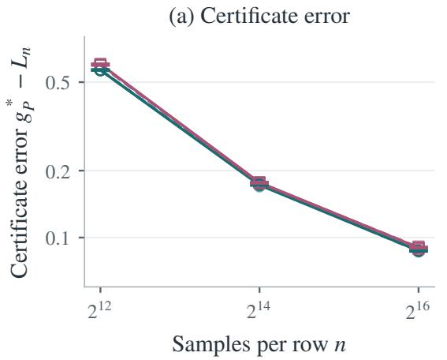
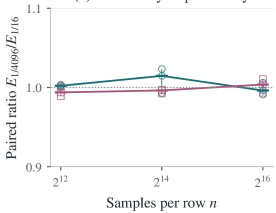

# Average-Reward Policy Identification from a Single Continuing Trajectory

Tongxi Wang

Southeast University

tongxi\_wang@seu.edu.cn

Abstract. In reinforcement learning, an agent must explore an unknown environment to learn how to make good decisions. Unlike methods that can freely sample any state–action pair, an agent learning from a single trajectory must spend additional time navigating between states. It is therefore natural to expect that learning from a single trajectory requires more experience. In this paper, we show that this additional cost is not always necessary. For average-reward reinforcement learning, we develop an algorithm that learns where to collect information while ensuring that the required samples can be obtained eficiently. We establish an upper bound on the number of interactions needed to identify a near-optimal policy. Furthermore, we prove a matching information theoretic lower bound, showing that, for a broad class of environments and at suficiently high accuracy, learning from a single trajectory is no harder in the worst case than learning with unrestricted access to state action samples. Our results reveal that the additional complexity cost of navigation can be avoided by adapting information gathering requirements to how the environment provides information.

Keywords: reinforcement learning, policy identification, sample complexity, adaptive sampling

## 1 Introduction

Reinforcement learning uses experience to learn efective decisions in an unknown environment. In tasks that operate continuously, performance depends on the rewards accumulated over the long run. Average reward captures this objective. Policy identification asks how much experience is needed before the learner can recommend a policy with a specified performance guarantee (Tuynman et al., 2024; Zurek and Chen, 2025a). The amount of experience required depends on both statistical estimation and data collection. Actions determine both observations and future sampling.

A generative model allows queries to any state–action pair, providing a statistical benchmark that separates estimation from navigation. On one continuing trajectory, obtaining the same useful samples may require many intervening steps. Can a learner attain that benchmark while counting every exploration and navigation step? We study this question with a fixed known reward table. Even with immediate rewards known, the learner must estimate how transitions determine future state visits and accumulated rewards.

Tuynman et al. (2024, Section 7) pose this question for the $S A D / \epsilon ^ { 2 }$ rate. The precision term of Online-DFE is $\widetilde { O } ( S A D ^ { 2 } / \epsilon ^ { 2 } )$ ; directly combining a generative planner (Zurek and Chen, 2025a) and sample collector (Tarbouriech et al., 2021) also retains this extra diameter factor in its diameter-based upper bound (Appendix F). Attaining the generative rate remains open.

We establish matching worst-case rates over a model class for continuing and generative access under the conditions of Corollary 2. Both models have complexity $\widetilde { \Theta } ( S A \overline { { D } } / \epsilon ^ { 2 } )$ for two-successor classes throughout $0 < \epsilon \leq 1 / 3 2$ , and for unrestricted support at suficiently high accuracy. The continuing learner requires no structural parameters and counts every interaction, including exploration and unsuccessful attempts. Its output is a deterministic stationary policy, with stopping and all-state quality guaranteed jointly. The lower-bound kernels share one known reward. The refined upper bound also adapts to support and optimal bias span. In these regimes, restricting where samples can be obtained does not increase the worst-case complexity order: learning the sampling allocation allows exploration and collection to fit within the statistical budget.

Our approach. Uniform requests can provide statistical coverage while requiring frequent visits to states that the dynamics rarely reach. A generic collector pays for this mismatch through a diameter factor. Two mathematical connections yield coverage and low collection cost.

First, inverse-count exploration produces an empirical allocation with statistical coverage. A time-uniform trajectory flow bound shows that the same visit counts can be covered by a balanced flow of comparable mass, up to an additive cost. This holds for any nonanticipating controller, so it applies directly to the adaptive exploration history. The learned requests can then be collected at constant flow cost per unit mass once startup is paid.

Second, nonuniform estimation converts these requests into an all-state policy guarantee. A negative term from value truncation ofsets the error due to transient flow imbalance. The statistical error therefore scales as $M ^ { - 1 / 2 }$ and the transient correction as $M ^ { - 1 }$ , where � is the requested mass. Combining this separation with low collection cost gives the precision terms $S A ( B _ { * } + 1 ) / \epsilon ^ { 2 } + S A D / \epsilon$ . An observable width certificate and a search over budgets complete the learner, with all attempts counted and polynomial bit work on the same success event.

Related work. Generative identification permits independent row sampling and span-agnostic stopping (Zurek and Chen, 2025a); Online-DFE (Tuynman et al., 2024) pays for continuing interaction. Behavior-policy methods such as SAVIC+ (Lee et al., 2026) obtain prior-free all-state identification under coverage parameters of the behavior policy, which are distinct from controlled diameter. Discounted identification, ofline learning and regret impose diferent output or information conditions (Lazzaro et al., 2026; Lee and Ryu, 2025; Zamir et al., 2026).

Navigation-constrained allocation has direct precedents. Al Marjani et al. (2021) combine information requirements with stationary-flow constraints and track a learned allocation to identify the unique optimal policy in a discounted MDP. Their principal sample-complexity guarantee is instance-dependent and asymptotic as $\delta  0$ . Here the objective is fixed-accuracy average-reward identification, with a nonasymptotic joint stopping-and-quality guarantee. Our finite-time trajectory flow and controller bounds make allocation learning and collection afordable without structural inputs, leading to the stated classwise matching result. Optimistic collection (Tarbouriech et al., 2021) already makes prescribed requests executable; our analysis also pays for learning which requests to make. The statistic uses quantile planning and monotonicity (Zurek et al., 2025), span-agnostic stopping (Zurek and Chen, 2025a), and source-state decoupling (Zurek and Chen, 2025b). Our analysis makes these tools efective with nonuniform weights fixed after a pilot, and bounds the interactions needed to obtain those samples. Table 1 and Appendix F compare the upper bounds.

Sections 2–3 define the problem and state the results. Sections 4–6 give the algorithm and the upper- and lower-bound arguments; Section 7 examines a prediction of the statistical analysis.

## 2 Setting

There are $S \ge 2$ states and $A \geq 1$ actions. A row $i = ( s , a )$ is the transition distribution $P _ { i }$ of one state–action pair; write $K \ : = \ : S A$ . The unknown kernel is communicating, with controlled diameter $\begin{array} { r } { D = \operatorname* { m a x } _ { s , t } \operatorname* { m i n } _ { \pi } \mathbb { E } _ { s } ^ { \pi } \tau _ { t } < \infty } \end{array}$ . The fixed reward table $r \in [ 0 , 1 ] ^ { K }$ and inputs $\epsilon \in ( 0 , 1 ] , \delta \in ( 0 , 1 )$ are rational and known. The learner starts at any state and observes one trajectory, without reset or generative access. It must return a deterministic stationary policy whose average-reward gain is within � of the optimal gain from every initial state.

For a stationary policy �, define its gain by

$$
g _ { P } ^ { \pi } ( s ) = \operatorname* { l i m } _ { T \to \infty } \frac { 1 } { T } \mathbb { E } _ { s } ^ { \pi } \left[ \sum _ { t = 0 } ^ { T - 1 } r ( s _ { t } , a _ { t } ) \right] .
$$

An optimal Bellman bias satisfies $g _ { P } ^ { * } + h ^ { * } ( s ) = \operatorname* { m a x } _ { a } \{ r ( s , a ) + P _ { s a } h ^ { * } \}$ , with optimal gain $g _ { P } ^ { * }$ independent of the initial state. Writing � for the data-dependent stopping time, the required joint event is

$$
\operatorname* { P r } _ { P } \Bigl ( \tau \leq T _ { * } ( P , \epsilon , \delta ) , \quad \operatorname* { m a x } _ { s } \{ g _ { P } ^ { * } - g _ { P } ^ { \widehat { \pi } } ( s ) \} \leq \epsilon \Bigr ) \geq 1 - \delta .\tag{1}
$$

The learner stops using observed data. The bound $T _ { * }$ is used only in analysis.

Let $\begin{array} { r } { d _ { i } = | \operatorname { s u p p } P _ { i } | , J _ { \mathrm { s u p p } } = \sum _ { i } d _ { i } } \end{array}$ . Define $B _ { * } = \operatorname { s p } ( h ^ { * } )$ for an optimal Bellman bias with $B _ { * } \leq D$ , where $\begin{array} { r } { \operatorname { s p } ( h ) = \operatorname* { m a x } _ { s } h ( s ) - \operatorname* { m i n } _ { s } h ( s ) } \end{array}$ . Write $\begin{array} { r } { A _ { \mathrm { m i x } } = D \sum _ { i } \operatorname* { m i n } \{ d _ { i } , D \} } \end{array}$ for the startup expression.

For the access-model comparison, a generative learner may adaptively request independent successors from any row. For either access model, the complexity of a model class is the smallest common deterministic budget � for which the joint stopping-and-correctness event holds on every instance in the class. This criterion controls both stopping and policy quality from every state.

## 3 Main Results

## 3.1 Upper Bound

Theorem 1 separates the cost of learning the allocation from the subsequent precision cost. The supportdependent term is paid at startup; the accuracy terms depend on the fixed reward through � $B _ { * }$

Theorem 1 (Policy identification from one trajectory). Under the model ofSection 2, Algorithm 1 returns a deterministic stationary policy with all-state gain gap at most �, jointly with stopping within

$$
\widetilde { O } \left( D \sum _ { i } \operatorname* { m i n } \{ d _ { i } , D \} + \frac { S A ( B _ { * } + 1 ) } { \epsilon ^ { 2 } } + \frac { S A D } { \epsilon } \right)
$$

interactions, with probability at least $1 - \delta .$ . It needs no support, diameter, mixing-time or minimum-transition input. Its complete rational realization has polynomial bit work on that event. The full controller, schedule and proof are in Appendix C.8.

The three terms pay for exploration and collection startup, statistical precision, and the transient correction in this upper bound, respectively. Since $B _ { * } \leq D$ and $\epsilon \leq 1$ , Theorem 1 implies the diameter-dependent bound

$$
\widetilde { O } ( A _ { \mathrm { m i x } } + S A D / \epsilon ^ { 2 } ) .\tag{2}
$$

A weaker startup bound using total support follows from $\textstyle \sum _ { i }$ min $\{ d _ { i } , D \} \le \operatorname* { m i n } \{ J _ { \mathrm { s u p p } } , S A D \}$ ; its expanded form is recorded in Appendix A.

The guarantee counts pilots, navigation, surplus observations and every unsuccessful attempt. Suppressed logarithms may depend on $S , A , D , 1 / \epsilon , 1 / \delta$ . Polynomial bit work holds on the same success event; no expected stopping-time bound on failure histories is asserted.

Relative to $S A D / \epsilon ^ { 2 }$ , the precision term has factor $( B _ { * } + 1 ) / D + \epsilon \colon$ small optimal span helps at high accuracy, while startup and the $1 / \epsilon$ transport term still depend on diameter.

## 3.2 Matching Rates

The next consequence identifies when the continuing upper bound matches hardness even with arbitrary row queries. Section 2 defines class complexity through a common budget and joint guarantee.

Corollary 2 (Matching continuing and generative access). Let $S \ge 1 2 , A \ge 3 , 0 < \epsilon \le 1 / 3 2 , 0 < \delta \le 1 / 1 6 ,$ and

$$
{ \overline { { D } } } \geq \operatorname* { m a x } \{ 3 2 , 8 ( \lceil \log _ { A - 1 } \lfloor S / 3 \rfloor \rceil + 1 ) \} .
$$

Consider the class ofcommunicating kernels with at most � states, at most � actions per state, diameter at most �, and total support at most $J _ { 0 } \in \left[ 2 S A , S ^ { 2 } A \right]$ , together with fixed known rational reward tables in [0, 1]. Require a deterministic stationary output policy that is �-optimalfrom every state, jointly with stopping within a common budget with probability at least $1 - \delta$ on every instance. If

$$
\epsilon ^ { 2 } \operatorname* { m i n } \{ J _ { 0 } / ( S A ) , \overline { { D } } \} \leq 1 ,
$$

both continuing and generative access have class complexity $\widetilde { \Theta } ( S A \overline { { D } } / \epsilon ^ { 2 } )$ . The upper bound holds for every known reward table; the lower-bound family shares one table across all kernels.

The matching condition absorbs startup: its ratio to $S A \overline { { D } } / \epsilon ^ { 2 }$ is $\epsilon ^ { 2 } \operatorname* { m i n } \{ J _ { 0 } / ( S A ) , \overline { { D } } \} \le 1$ . Let $T _ { \mathrm { g e n } } ^ { \star }$ and $T _ { \mathrm { c o n t } } ^ { \star }$ denote the complexities for the same class, accuracy, confidence and joint stopping-and-output requirement in Corollary 2. For an absolute $c > 0 .$ , the comparison is

$$
\underbrace { c \frac { S A \overline { { D } } } { \epsilon ^ { 2 } } \log \frac { 1 } { \delta } } _ { \mathrm { g e n e r a t i v e ~ l o w e r ~ b o u n d } } \le T _ { \mathrm { g e n } } ^ { \star } \le T _ { \mathrm { c o n t } } ^ { \star } \le \underbrace { \widetilde { O } \biggl ( \frac { S A \overline { { D } } } { \epsilon ^ { 2 } } \biggr ) } _ { \mathrm { c o n t i n u i n g ~ u p p e r ~ b o u n d } } .
$$

The middle inequality holds because generative access can simulate the continuing learner. Theorem D.1 gives the first inequality with at most two successors per row; Theorem 1 gives the last. The resulting ranges, under the other conditions of Corollary 2, are:

<table><tr><td>Model class</td><td>Established matching range</td></tr><tr><td>At most two successors per row</td><td> $0 < \epsilon \leq 1 / 3 2$ </td></tr><tr><td>Unrestricted support</td><td> $\epsilon ^ { 2 } \operatorname* { m i n } \{ S , { \overline { { D } } } \} \leq 1$ </td></tr></table>

For unrestricted support outside this condition, access-model matching remains open. The lower bound is classwise and uses a shared reward table; Appendix D gives the complete comparison.

## 3.3 Comparison with Prior Bounds

Table 1 separates startup from precision costs. Substituting $B _ { * } ~ \leq ~ D$ , our leading precision term is $\widetilde { O } ( S A D / \epsilon ^ { 2 } )$ , compared with $\widetilde { O } ( S A D ^ { 2 } / \epsilon ^ { 2 } )$ in the other displayed bounds. This improvement concerns the precision term of these upper bounds; startup and span refinements are retained.

Table 1. Continuing policy-identification upper bounds, suppressing logarithms. $B _ { * } = \operatorname { s p } ( h ^ { * } ) \leq D$ . The second row is a derived composition, derived in Appendix F.
<table><tr><td>Method</td><td>Startup</td><td>Precision</td></tr><tr><td>Online-DFE (Tuynman et al., 2024)</td><td> $S ^ { 2 } A D ^ { 3 }$ </td><td> $S A D ^ { 2 } / \epsilon ^ { 2 }$ </td></tr><tr><td>Generative + GOSPRL (Zurek and Chen, 2025a; Tarbouriech et al., 2021)</td><td> $S ^ { 2 } A D ^ { 3 / 2 }$ </td><td> $S A D \big ( B _ { * } + 1 \big ) / \epsilon ^ { 2 }$ </td></tr><tr><td>Theorem 1</td><td> $D \sum _ { i } \operatorname* { m i n } \{ d _ { i } , D \}$ </td><td> $S A ( B _ { * } + 1 ) / \epsilon ^ { 2 }$  + SAD/e</td></tr></table>

## 4 Algorithm

Each attempt explores and freezes �, collects fresh prefixes of lengths $q _ { i } = \lceil M w _ { i } \rceil$ , and computes $[ L , U ]$ width at most � ends the search. Certificate validity holds for every positive �. Pilot quality determines the required mass and collection cost. Algorithm 1 searches over pilot lengths and masses, clearing memory between attempts while the physical trajectory continues.

## 4.1 Sampling Allocation

Example 1 (Equal coverage, diferent collection cost). With two identical actions per state, the chain below admits two allocations with $G _ { P } = 4$ and flow costs $( 1 + p ) / ( 2 p )$ and 1, for $0 < p \leq 1 / 2$

$$
\begin{array} { r l r l r l } & { \begin{array} { l l l l l l } { 1 - p } & & { \quad } & & { \mathrm { U n i f o r m } } & & { \quad } & { \mathrm { F e a s i b l e f l o w } } \\ { \iff } & { p } & & { \quad } & { \frac { w = ( 1 , 1 , 1 , 1 ) / 4 } { \mathit { G } _ { P } = 4 } } & & { \quad } & { w = ( 1 , 1 , p , p ) / [ 2 ( 1 + p ) ] } \\ { \iff } & { ( \binom { p } { 1 } } & & { \quad } & { \mathit { G } _ { P } = 4 } & & { \quad } & { \mathit { G } _ { P } = 4 } \\ { \phantom { \iff } } & { \quad } & { \mathit { C } _ { P } = ( 1 + p ) / ( 2 p ) } & & { \quad } & { \mathit { C } _ { P } = 1 } \end{array} } & & & { } \end{array}
$$

Uniform requests assign half the samples to state 2, whose stationary frequency is $p / ( 1 + p )$ . Matching this frequency lowers collection cost. Weights are ordered as $( s _ { 1 } , a _ { 1 } ) , ( s _ { 1 } , a _ { 2 } ) , ( s _ { 2 } , a _ { 1 } ) , ( s _ { 2 } , a _ { 2 } )$ . The identical actions isolate allocation geometry; equal $G _ { P }$ alone leaves policy-identification information unspecified (Appendix A.3).

An allocation $\begin{array} { r } { w _ { i } > 0 , \sum _ { i } w _ { i } = 1 } \end{array}$ , divides statistical requests among rows. Its statistical quality depends on inverse sample weights along all feasible long-run occupations. Its collection cost also depends on navigation: supplying a dificult row may require many visits elsewhere. Let $\Omega ( P )$ denote normalized stationary state–action flows. These two requirements lead to

$$
G _ { P } ( w ) = \operatorname* { m a x } _ { x \in \Omega ( P ) } \sum _ { i } { \frac { x _ { i } } { w _ { i } } } ,\tag{3}
$$

$$
C _ { P } ( w ) = \operatorname* { m i n } _ { y \ge w } \left\{ \sum _ { i } y _ { i } : \sum _ { a } y _ { s a } = \sum _ { i } y _ { i } P _ { i } ( s ) { \mathrm { f o r e v e r y } } s \right\} .\tag{4}
$$

The coverage coeficient $G _ { P } ( w )$ measures the first requirement. The ideal collection cost $C _ { P } ( \nu )$ is the minimum balanced mass that supplies every requested proportion. For quotas $q _ { i } = \lceil M w _ { i } \rceil$ , these definitions give

$$
\operatorname* { m a x } _ { x \in \Omega ( P ) } \sum _ { i } \frac { x _ { i } } { q _ { i } } \leq \frac { G _ { P } ( w ) } { M } , \qquad C _ { P } ( M w ) = M C _ { P } ( w ) .
$$

The controller analysis in Section $5$ converts this balanced-flow cost into a bound on finite random collection time, including transient visits. Both quantities describe the unknown kernel and guide the analysis; the learner estimates its allocation from visits.

A known kernel suggests how to meet both requirements. Choose

$$
w ^ { \star } \in \arg \operatorname* { m a x } _ { w \in \Omega ( P ) } \sum _ { i } \log w _ { i } .
$$

Communication ensures a positive feasible flow, so a maximizer is positive. First-order optimality gives

$$
\sum _ { i } \frac { x _ { i } - w _ { i } ^ { \star } } { w _ { i } ^ { \star } } \leq 0 \quad \mathrm { f o r e v e r y } x \in \Omega ( P ) , \qquad G _ { P } ( w ^ { \star } ) = S A , \quad C _ { P } ( w ^ { \star } ) = 1 .
$$

The inequality gives coverage ��, with equality at $x = w ^ { \star }$ ; feasibility gives unit collection cost. This known-model design (Appendix A.1) motivates learning both properties to within constant or logarithmic factors from finite interaction.

The next controller learns coverage of order �� and bounded collection cost from visits. Statistical estimation then determines the mass to request.

## 4.2 Exploration and Collection

The same controller serves two purposes: inverse-count rewards encourage exploration during the pilot, and indicators of unfinished quotas guide collection. If $c _ { i }$ counts pilot visits, the reward $b _ { t } ( i ) = 1 / ( c _ { i } + 1 )$ is the derivative of $\textstyle \sum _ { i } \log ( c _ { i } + 1 )$ : another visit is more valuable at a less visited row. After � interactions the pilot freezes $w _ { i } = ( c _ { i } + 1 ) / ( n + K )$ ; write $w _ { \mathrm { m i n } } = \mathrm { m i n } _ { i } w _ { i }$ . The smoothed weights are positive, and the analysis establishes both coverage and low collection cost for these empirical proportions.

For each row, the controller forms two upper predictions of the expected next-state value. The first maximizes over a confidence region for the whole transition distribution and benefits from sparse support. The second uses recent scalar evaluations at value vectors fixed before each transition, giving an error bound independent of support size. On their common confidence event, the smaller prediction remains optimistic. Using it in each rounded Bellman backup lets diferent rows benefit from diferent bounds, yielding the startup term $D \sum _ { i }$ min $\{ d _ { i } , D \}$ . This controller builds on optimistic sample collection (Tarbouriech et al., 2021); its analysis handles the decreasing auxiliary rewards used in both phases. Appendix B.2 specifies these updates and restarts.

After the pilot, a fresh controller collects $q _ { i } = \lceil M w _ { i } \rceil$ successors per row using reward ${ \bf 1 } \{ k _ { i } < q _ { i } \}$ , where $k _ { i }$ is its visit count. The nominal mass � difers from $\textstyle N = \sum _ { i } q _ { i }$ . All visits update navigation information; the statistic uses the first $q _ { i }$ post-pilot successors per row. Within an invocation, restarts retain visits and nested confidence regions but clear scalar windows. Between attempts all algorithm memory is cleared and the physical trajectory continues. Each attempt costs at most $2 U _ { j }$ , with confidence allowances specified in Appendix B.4.

Algorithm 1: Continuing policy identification   
Input: States, actions, known rational �, accuracy �, confidence �; one continuing trajectory.   
Output: Deterministic stationary policy ${ \widehat { \pi } } .$   
for stage $j = 0 , 1 , \ldots$ . do   
Set cap $U _ { j } = 2 ^ { j }$ and each event allowance $\eta _ { j } = \delta / [ 6 4 ( j + 1 ) ^ { 4 } ]$   
for $( \bar { p , } m ) \in \{ 0 , \ldots , j \} ^ { 2 }$ , lexicographically do   
Clear algorithm memory at the current physical state; run the $2 ^ { p }$ -step pilot and freeze   
$w _ { i } = ( c _ { i } + 1 ) / ( 2 ^ { p } + K )$   
Set � = 2�; if $M < 2 / w _ { \mathrm { { m i n } } }$ , continue to the next attempt   
Set $q _ { i } = \lceil M w _ { i } \rceil ;$ ; start a fresh zero-count quota controller and collect these prefixes for at most $U _ { j }$   
interactions   
if quotas are incomplete, continue to the next attempt   
Compute residual-corrected [�, �] and b� from these prefixes   
if $U - L \leq \epsilon ,$ , return $\widehat { \pi }$   
end   
end

## 4.3 Stopping Rule

Since suficient pilot and sample sizes are unknown, stopping requires both a lower bound on the output policy and an upper bound on optimal gain:

$$
L \leq g _ { P } ^ { \widehat { \pi } } ( s ) \quad \mathrm { f o r } \mathrm { e v e r y } s , \qquad g _ { P } ^ { * } \leq U .
$$

The learner accepts when $U - L \leq \epsilon$ . On the common confidence event, the bounds hold for any positive frozen allocation; its geometry determines how quickly the width shrinks. For each row, the quantile functional $F _ { i } ^ { - } ( \nu )$ truncates the upper tail of � under the fixed-prefix empirical distribution and subtracts an empirical-variance penalty. Reflection gives $F _ { i } ^ { + } ( \nu ) = - F _ { i } ^ { - } ( - \nu )$ . For each chosen discount, solve

$$
V _ { \gamma } ^ { \pm } ( s ) = \operatorname * { m a x } _ { a } \{ r _ { s a } + \gamma F _ { s a } ^ { \pm } ( V _ { \gamma } ^ { \pm } ) \} .
$$

The fixed-point concentration argument bounds the true expectation $P _ { i } \nu$ between these predictions at the value vectors used in this analysis. The lower solve uses $\gamma _ { - } = 1 - 1 / ( M + 1 )$ and its greedy policy ${ \widehat { \pi } } .$ At its exact fixed point, ${ \cal F } ^ { - } \le { \cal P }$ implies

$$
\begin{array} { r l } & { r _ { \widehat { \pi } } + P _ { \widehat { \pi } } V ^ { - } - V ^ { - } = P _ { \widehat { \pi } } V ^ { - } - \gamma _ { - } F _ { \widehat { \pi } } ^ { - } ( V ^ { - } ) } \\ & { \qquad \quad \geq ( 1 - \gamma _ { - } ) P _ { \widehat { \pi } } V ^ { - } } \\ & { \qquad \quad \geq ( 1 - \gamma _ { - } ) \displaystyle \operatorname* { m i n } _ { s } V ^ { - } ( s ) \mathbf { 1 } . } \end{array}
$$

Summing conditional expectations along a trajectory telescopes the value terms. Their bounded endpoint diference vanishes after division by time, giving the all-state lower bound $L = \left( 1 - \gamma _ { - } \right)$ min� $V ^ { - } \left( s \right)$ The upper prediction gives the reverse inequality for every action; a finite dyadic discount search yields $U = \mathrm { m i n } _ { \gamma } ( 1 - \gamma ) \mathrm { m a x } _ { s } V _ { \gamma } ^ { + } ( s )$ . Both endpoints are clipped to [0, 1]. Algorithm 1 tests the width after each completed batch, with the numerical residual corrections and finite fallback in Appendix B.3.

## 5 Proof Overview

Two connections establish the interaction bound. The first turns an adaptive exploration history into requests with low balanced-flow cost. The second converts their nonuniform sample counts into an all-state certificate, with a linear transient correction. We state their consequences first, then explain the arguments in Sections 5.2 and 5.3.

## 5.1 Interaction Bound

Lemma 3 (Coverage and collection cost of the pilot allocation). For afixed inverse-count invocation, on the joint controller and trajectory flow-balance event specified in Appendix C.8, a pilot of length $n = \ddot { O } ( A _ { \mathrm { m i x } } )$ sufices to give

$$
G _ { P } ( w ) \leq 3 2 K ( 1 + \ln ( n + 1 ) ) , \qquad C _ { P } ( w ) \leq \textstyle { \frac { 3 } { 2 } } , \qquad w _ { \mathrm { m i n } } ^ { - 1 } \leq n + K = \widetilde { O } \bigl ( A _ { \mathrm { m i x } } \bigr ) .
$$

The suficient length is an analysis quantity unknown to the learner.

Lemma 4 (Sample requirements and collection cost). Fix afinite pilot history and its positivefrozen �. For each prescribed batch $M \geq 2 / w _ { \mathrm { m i n } }$ , the virtual fixed-prefix statistic is sound with conditional probability at least $1 - \eta .$ . At a suficiently large prescribed mass it also accepts on that event, with suficient mass of order

$$
M _ { * } = \widetilde O \left( \frac { G _ { P } ( w ) ( B _ { * } + 1 ) } { \epsilon ^ { 2 } } + \frac { D G _ { P } ( w ) } { \epsilon } + \frac { 1 } { w _ { \operatorname* { m i n } } } \right) .
$$

$I f C _ { P } ( w ) \leq 3 / 2$ , the combined controller collects the $q _ { i } = \lceil M w _ { i } \rceil$ successors in $T _ { \mathrm { c o l l e c t } } ( M ) = \widetilde { O } ( A _ { \mathrm { m i x } } + M )$ interactions on its confidence event, when $M \geq 2 / w _ { \mathrm { m i n } }$ and the cap is suficient.

Here � is a local conditional failure allowance. The statistical statement is defined on virtual row streams even when a collection cap fails; the collection statement requires a suficient cap.

To see how the lemmas combine, a suficient pilot gives $G _ { P } ( w ) = \widetilde { O } ( K ) , C _ { P } ( w ) \leq 3 / 2$ , and $1 / w _ { \mathrm { m i n } } =$ $\widetilde { O } ( A _ { \operatorname* { m i x } } )$ . Substitute these into the suficient mass in Lemma 4, then its collection bound:

$$
n + T _ { \mathrm { c o l l e c t } } ( M _ { \ast } ) = \widetilde O \left( A _ { \mathrm { m i x } } + \frac { K ( B _ { \ast } + 1 ) } { \epsilon ^ { 2 } } + \frac { K D } \epsilon \right) .
$$

The enumeration reaches such an attempt with only logarithmic overhead, while a summable allocation of conditional failure probabilities keeps the total below � (Appendix B.4). Certificates remain sound at poor pilots. Conditioning on each finite entry history preserves the law of the unused samples, including on paths where collection later fails.

The pilot controls statistical demand through $G _ { P } ( w )$ , and the collector converts that demand into interactions. The next two arguments establish these properties for the same random allocation.

## 5.2 Trajectory Flow

The first connection covers realized visit counts by a balanced flow.

Proposition 5 (Flow cost of an adaptive trajectory). Under the model of Section 2, let $c _ { i } ( t )$ count visits to row � through time �. For any nonanticipating controller and $\eta \in ( 0 , 1 )$ , with probability at least $1 - \eta$ simultaneouslyfor all integers $t \geq 0$

$$
\begin{array} { r } { C _ { P } ( c ( t ) ) \le \frac { 5 } { 4 } t + O ( D [ S \log ( e ( A + 2 ) ) + \log ( 1 / \eta ) ] ) . } \end{array}\tag{5}
$$

Thus every adaptive trajectory supplies counts that a balanced flow can cover at comparable mass, after an additive transient cost. This bound applies throughout exploration, including before stationary behavior emerges. The controller converts this flow bound into a collection-time guarantee. The additive form matters: after normalization by the pilot length, the transient contribution decreases, while the leading flow cost stays bounded. This allows a single suficiently long pilot to support larger subsequent requests. The proof below establishes this property directly for the visit counts generated during learning, including their history-dependent choice of actions.

Proof idea. Let $c _ { i } ( t )$ be row counts through time � and $i _ { u } = \left( s _ { u } , a _ { u } \right)$ . For a fixed potential ℎ, replacing observed successors by their conditional means leaves the exact residual

$$
\sum _ { i } c _ { i } ( t ) \{ h ( s _ { i } ) - P _ { i } h \} = h ( s _ { 0 } ) - h ( s _ { t } ) + M _ { t } ( h ) , \quad M _ { t } ( h ) = \sum _ { u < t } \{ h ( s _ { u + 1 } ) - P _ { i u } h \} .
$$

The endpoint term is bounded by the span of ℎ. The martingale term is more delicate: the potential that prices a realized request is selected after observing the trajectory. Applying concentration to that fitted potential as if it were fixed would be invalid.

The dual characterization of the collection cost is

$$
C _ { P } ( c ) = \operatorname* { m a x } _ { b \geq 0 , h } \left\{ c \cdot b : b _ { i } + P _ { i } h - h ( s _ { i } ) \leq 1 { \mathrm { ~ f o r ~ a l l ~ } } i \right\} .
$$

An optimizing bias can be replaced by one in $\mathcal { F } = \{ h \in [ 0 , D ] ^ { S } : P _ { i } h - h ( s _ { i } ) \leq 1 \}$ . This deterministic polytope has at most $\binom { K + 2 S } { S }$ vertices. For each vertex, a variance identity and two all-time martingale bounds control the residual. The same event then holds for every potential in $\mathcal { F }$ by linearity of $M _ { t } ( h )$ , allowing the path-dependent optimizer to be selected afterwards. This proves the stated flow bound; Proposition C.5 gives the full argument and constants. The deterministic vertex set is used only in the analysis.

This bound makes the link to the empirical allocation explicit. Subadditivity and the regenerative cost bound $C _ { P } ( \mathbf { 1 } ) \le K ( D + 1 )$ imply

$$
C _ { P } ( w ) \leq \frac { 5 n / 4 + O ( D [ S \log ( e ( A + 2 ) ) + \log ( 1 / \eta ) ] ) + K ( D + 1 ) } { n + K } , \qquad w _ { i } = \frac { c _ { i } ( n ) + 1 } { n + K } .
$$

Once the pilot absorbs the additive terms, its allocation is afordable. Inverse-count exploration separately bounds $\begin{array} { r } { G _ { P } ( w ) = ( n + K ) \operatorname* { m a x } _ { x \in \Omega ( P ) } \sum _ { i } x _ { i } / ( c _ { i } ( n ) + 1 ) } \end{array}$ by a harmonic-sum argument. The same adaptive history thus provides coverage and low collection cost.

The controller supplies the other part of this argument. With probability at least $1 - \eta$ , every prefix up to invocation cap $N _ { \mathrm { c a p } }$ obeys (Lemma C.4)

$$
t \leq 8 \sum _ { u < t } \frac { b _ { u } ( i _ { u } ) } { g _ { u } } + a ( N _ { \mathrm { c a p } } , \eta ) , \qquad a ( N _ { \mathrm { c a p } } , \eta ) = \widetilde { O } \left( D \sum _ { i } \operatorname* { m i n } \{ d _ { i } , D \} \right) ,
$$

where $g _ { u }$ is the optimistic gain scale. For inverse-count rewards, this bounds time through a harmonic sum and yields coverage. For quota rewards, it charges productive visits while counting all navigation. The proof uses the smaller error bound separately on each row; the learner implements this choice through its two optimistic predictions.

To turn flow cost into collection time, use the unfinished quotas. Flow subadditivity gives $C _ { P } ( q ) \leq$ $3 M / 2 + K ( D + 1 )$ at an afordable allocation. If � quota units remain, the binary unfinished-row reward has optimal gain at least $u / C _ { P } ( q )$ . Charging productive visits through a harmonic sum and using the invocation bound for surplus visits gives $T _ { \mathrm { c o l l e c t } } ( M ) = \widetilde { \cal O } ( A _ { \mathrm { m i x } } + M )$ . The $1 / w _ { \mathrm { m i n } }$ term in Lemma 4 covers prefix rounding. This completes the passage from an adaptive history to requests that can be collected at low interaction cost.

At this point the sampling problem is reduced to choosing the mass �. The remaining task is statistical: a bound expressed through stationary flows must certify a policy from every initial state. This is where the auxiliary bias and the transient correction enter.

## 5.3 Nonuniform Estimation

Stationary mean error must be converted into policy quality from every starting state. Transient visits need not be flow-balanced, so an auxiliary bias must control their contribution. The resulting error, at exact fixed points with the prescribed discount, has the form

$$
g _ { P } ^ { * } - L \ \lesssim \ \sqrt { \frac { ( B _ { * } + 1 ) \alpha G _ { P } ( w ) } { M } } + \frac { \alpha C _ { 0 } } { M } .
$$

Thus coverage contributes demand proportional to $G _ { P } ( w ) ( B _ { * } + 1 ) / \epsilon ^ { 2 }$ , while transient efects contribute $C _ { 0 } / \epsilon$ . Here � is the confidence factor and $C _ { 0 }$ is the span of a Bellman bias $z _ { 0 }$ for auxiliary reward $1 / w _ { i } ,$ whose gain is $G _ { P } ( w )$ . It satisfies $C _ { 0 } \le D G _ { P } ( w )$ and is distinct from the target bias span $B _ { * }$ . Write $n _ { i } = q _ { i } = \lceil M w _ { i } \rceil$ for the statistical sample counts and $t _ { i } = \alpha / n _ { i }$ . The scaled bias $z = ( \alpha / M ) z _ { 0 }$ satisfies

$$
t _ { i } + P _ { i } z \le \kappa + z ( s _ { i } ) , \qquad \kappa = \frac { \alpha G _ { P } ( w ) } { M } , \qquad c _ { z } : = \mathrm { s p } ( z ) = \frac { \alpha C _ { 0 } } { M } .\tag{6}
$$

Flow imbalance enters the variance term through the auxiliary span $c _ { z }$ . Value truncation supplies a negative term that controls this contribution linearly. The cancellation is the second connection.

For the lower endpoint, compare with an optimal policy through a virtual pessimistic value function capped at height $H \asymp B _ { * } + 1$ , with $H \geq \operatorname* { m a x } \{ 1 , 4 B _ { * } \}$ . Let $\Delta = H - \operatorname { s p } ( U _ { \gamma } ^ { * } ) \geq H / 2$ , where $U _ { \gamma } ^ { * }$ is the true discounted value of that policy. The key algebraic step is

$$
\operatorname* { s u p } _ { \lambda \geq 0 } \left\{ u \sqrt { H c _ { z } \lambda } - { \frac { \Delta \lambda } { 2 } } \right\} = { \frac { u ^ { 2 } H c _ { z } } { 2 \Delta } } = O ( c _ { z } ) , \qquad \Delta \geq H / 2 ,\tag{7}
$$

for an absolute constant �. The retained negative term absorbs the square-root cost of flow imbalance, leaving a correction linear in $c _ { z }$

To obtain these terms, start at a minimum of the capped value and stop on reaching its cap. Let $b = \mathbb { E } \gamma ^ { \tau }$ $a = 1 - \gamma _ { ; }$ , and $\lambda = a / [ \gamma ( 1 - b ) ]$ . The normalized occupation � before this stop has a terminal flow imbalance. Applying (6) gives $d ^ { \top } t \leq \kappa + \lambda c _ { z }$ , so the quantile variance bound contributes $u \sqrt { H ( \kappa + \lambda c _ { z } ) }$ The same stopped comparison yields the negative term $- a b \Delta / ( 1 - b )$ . Under the nontrivial-regime conditions in Appendix C.6, the remaining linear terms are absorbed while retaining $- \Delta \lambda / 2$ . Equation (7) then controls the transient contribution by $O ( c _ { z } )$ ; the discount remainder completes the bound. The transfer from virtual caps to the computed policy, including explicit numerical corrections, is in Theorem C.6. The upper endpoint needs a separate self-consistency argument bounding the optimistic value span by $4 ( B _ { * } + 1 )$ (Appendix C.7). Two dependencies must be handled before this calculation is legitimate. First, the prescribed post-pilot row prefixes are defined on independent row streams before collection, including paths where quotas never finish. Conditioning on future quota completion would select their values. Second, the Bellman vectors are fitted to those same prefixes. Source-state decoupling replaces one state’s fixed-point output by a scalar �, and uses a second scalar cap for the other outputs. The resulting virtual vectors do not use that state’s outgoing samples. A finite grid in the two scalars, including reflected and truncated vectors, yields simultaneous concentration at the actual fitted fixed points for both signs and all tested discounts. The virtual caps allow this concentration argument to apply to the computed fixed points. Appendix C.6 gives the construction and event count.

Together these arguments shrink the certificate when $\kappa \lesssim \epsilon ^ { 2 } / ( B _ { * } + 1 )$ and $c _ { z } \lesssim \epsilon ,$ giving suficient mass

$$
\widetilde { O } \left( \frac { G _ { P } ( w ) ( B _ { * } + 1 ) } { \epsilon ^ { 2 } } + \frac { C _ { 0 } } { \epsilon } + \frac { 1 } { w _ { \mathrm { m i n } } } \right) .
$$

Thus $C _ { 0 } \le D G _ { P } ( w )$ contributes to the $1 / \epsilon$ term without multiplying the $1 / \epsilon ^ { 2 }$ demand.

The two connections now fit together. Coverage controls the leading statistical term, flow cost controls acquisition, and the cancellation above confines transient efects to the lower-order accuracy term. Substituting the pilot guarantees yields the upper bound in Theorem 1.

Computation. The full schedule, including support queries, rounded backups and statistical solves, uses

$$
T _ { * } \operatorname { p o l y } ( S , A , L _ { \mathrm { i n } } , \log ( 2 + T _ { * } ) , \log ( 2 / \epsilon ) )
$$

bit operations on the same success event. Here $L _ { \mathrm { i n } }$ is the input encoding length (Appendix E).

## 6 Lower Bound

The access-model comparison requires hardness that survives removing navigation constraints. Theorem D.1 supplies it with one known reward and at most two successors per row, even if the learner may query rows directly. Proving hardness with this stronger access makes the comparison complete: any continuing learner can be simulated by a generative learner using one query per transition. A lower bound on the latter therefore applies to both models. The construction below ensures that identifying the output policy requires information from many rows, even when the learner is free to choose those rows.

Put $m = \lfloor S / 3 \rfloor , h = \lceil \log _ { A - 1 } m \rceil$ and $q = 8 / D$ . A routing tree of height at most ℎ joins � leaf gadgets. Gadget � contains a reward-one state $x _ { j }$ and a reward-zero state $y _ { j }$ . Each of $A - 1$ candidate actions at $x _ { j }$ moves to $y _ { j }$ with probability $p _ { j l } ; y _ { j }$ returns with probability $q .$ An extra action leaves the gadget through the tree. The base kernel has $p _ { j l } = q$ . Alternative $( j , l )$ changes only that row to $p _ { j l } = q ( 1 - 8 \epsilon )$ , keeping rewards and support identical.

The changed gadget has gain $1 / ( 2 - 8 \epsilon ) > 1 / 2 + 2 \epsilon ;$ all other recurrent choices have gain at most $1 / 2$ . All-state �-optimality therefore requires the output policy to route to the changed gadget and select its changed action. This produces disjoint output events $E _ { j l }$ under the common support, avoiding any claim that actions in merely transient states must be individually optimal. Controlled routes take at most $1 / q + 2 h + 1 / [ q ( 1 - 8 \epsilon ) ] \leq \overline { { D } }$ in expectation, and the construction uses at most $3 m - 1 \leq S$ states.

For a learner truncated at the common budget �, the adaptive KL chain rule gives

$$
\mathrm { K L } ( \mathbb { P } _ { 0 } ^ { T } | | \mathbb { P } _ { j l } ^ { T } ) = \mathbb { E } _ { 0 } N _ { j l } ( T ) \mathrm { k l } ( q , q ( 1 - 8 \epsilon ) ) , \qquad \mathrm { k l } ( q , q ( 1 - 8 \epsilon ) ) = O ( \epsilon ^ { 2 } / \overline { { D } } ) .
$$

At least $m ( A - 1 ) - 2$ disjoint events have base probability at most $1 / 2 ;$ correctness makes their respective alternative probabilities at least $1 - \delta$ . Binary data processing then requires KL at least $\Omega ( \log ( 1 / \delta ) )$ ). Summing the required row counts gives

$$
T = \Omega \left( \frac { S A \overline { { D } } } { \epsilon ^ { 2 } } \log ( 1 / \delta ) \right) .
$$

The diameter factor persists even with generative access because each queried sample carries only $O ( \epsilon ^ { 2 } / \overline { { D } } )$ information about a change that afects long-run performance. On this family, diameter therefore measures statistical dificulty as well as navigation cost. The upper bound shows that, in the matching range, controlled collection fits within this unavoidable statistical budget.

The conditions in Section 3.2 ensure all constants and routing bounds used here. Appendix D.1 includes the truncation argument and complete proof. Together with the upper bound, this establishes the stated matching regimes. Matching in the dense coarse-accuracy range remains open.

## 7 Discussion and Conclusion

The matching result shows that navigation constraints can be absorbed within the statistical budget for the model classes and accuracy ranges of Corollary 2. The learner discovers which requests the environment can supply, pays for acquiring them, and certifies their suficiency using observed data. All three operations are covered by one finite interaction guarantee.

Numerical illustration. Appendix H illustrates the statistical bound’s separation of bias span from a comparison policy’s hitting time at fixed sample sizes. This experiment uses uniform allocation, a special case also covered by prior generative analyses (Zurek and Chen, 2025a), to isolate the fixed-prefix certificate. Allocation learning and the adaptive schedule are analyzed in the theoretical guarantees. The access-model matching result rests on the upper and lower bounds above.

The mathematical contribution is the connection between these operations. An adaptive history yields a low-cost balanced flow even before stationary behavior emerges. Nonuniform estimation then preserves the statistical rate by controlling transient error linearly in inverse sample mass. Together, these facts explain how one continuing trajectory reaches the generative worst-case rate in the stated regimes.

For unrestricted support at coarse accuracy, the startup upper bound can still dominate. Resolving that range requires a sharper understanding of the interactions needed to learn a useful allocation. A useful next step is to determine how accurately the allocation must be learned at each target policy accuracy. This would clarify when less exploration sufices for certification, sharpening startup while preserving the established precision dependence. Our bounds isolate this question and remove the extra leading diameter factor throughout the matching range.

## References

Aymen Al Marjani, Aurélien Garivier, and Alexandre Proutiere. Navigating to the Best Policy in Markov Decision Processes. In Advances in Neural Information Processing Systems, volume 34, pages 25852–25864, 2021.

Yuchen Jiao, Jiin Woo, Gen Li, Gauri Joshi, and Yuejie Chi. Sample Complexity of Average-Reward Q-Learning: From Single-agent to Federated Reinforcement Learning. arXiv preprint arXiv:2601.13642, 2026.

Joseph Lazzaro, Alessio Russo, and Aldo Pacchiano. Non-Asymptotic Best Policy Identification Guarantees in Online Reinforcement Learning. arXiv preprint arXiv:2607.17201, 2026.

Jongmin Lee and Ernest K. Ryu. Finite-Time Bounds for Average-Reward Fitted Q-Iteration. In Advances in Neural Information Processing Systems, volume 38, pages 132144–132177, 2025.

Jongmin Lee, Ernest K. Ryu, and Vaneet Aggarwal. Learning Policy from a Single Trajectory in Average-Reward Markov Decision Process. arXiv preprint arXiv:2606.16729, 2026

Jean Tarbouriech, Matteo Pirotta, Michal Valko, and Alessandro Lazaric. A Provably Eficient Sample Collection Strategy for Reinforcement Learning. In Advances in Neural Information Processing Systems, volume 34, 2021.

Adrienne Tuynman, Rémy Degenne, and Emilie Kaufmann. Finding Good Policies in Average-Reward Markov Decision Processes Without Prior Knowledge. In Advances in Neural Information Processing Systems, volume 37, pages 109948–109979, 2024.

Jinghan Wang, Mengdi Wang, and Lin F. Yang. Near Sample-Optimal Reduction-based Policy Learning for Average Reward MDP. arXiv preprint arXiv:2212.00603, 2022.

Guy Zamir, Matthew Zurek, and Yudong Chen. Optimal Variance-Dependent Regret Bounds for Infinite-Horizon MDPs. In Proceedings of the 39th Conference on Learning Theory, volume 336 of Proceedings of Machine Learning Research, pages 7016–7061, 2026.

Matthew Zurek and Yudong Chen. Span-Agnostic Optimal Sample Complexity and Oracle Inequalities for Average-Reward RL. In Proceedings ofthe 38th Conference on Learning Theory, volume 291 of Proceedings ofMachine Learning Research, pages 6156–6209, 2025a.

Matthew Zurek and Yudong Chen. The Plug-in Approach for Average-Reward and Discounted MDPs: Optimal Sample Complexity Analysis. In Proceedings of the 36th International Conference on Algorithmic Learning Theory, volume 272 of Proceedings ofMachine Learning Research, pages 1386–1387, 2025b.

Matthew Zurek, Guy Zamir, and Yudong Chen. Optimal Single-Policy Sample Complexity and Transient Coverage for Average-Reward Ofline RL. In Advances in Neural Information Processing Systems, volume 38, pages 187213–187277, 2025.

## A Additional Preliminaries

## A.1 Known-model occupation design

If � were known, a positive maximizer of $\textstyle \sum _ { i }$ log $w _ { i }$ over $\Omega ( P )$ would satisfy $G _ { P } ( w ) = K$ and $C _ { P } ( w ) = 1$ Communication supplies a positive feasible flow by mixing regenerative cycles through all rows. The log objective tends to minus infinity at the boundary; its first-order condition gives $\textstyle \sum _ { i } x _ { i } / w _ { i } \leq K$ for every feasible $x ,$ with equality at $x = w$ . This known-model observation motivates learning adequate proportions from the current physical state with unknown $P$ and no structural inputs, at the stated startup cost, and connect them to reliable observable stopping. The pilot uses auxiliary rewards $b _ { t } ( i ) ~ = ~ 1 / ( c _ { i } + 1 )$ to encourage coverage. The policy guarantee concerns the target reward $r ,$ fixed and known before data collection.

The symbols $c _ { i } , k _ { i } , q _ { i } , M$ and � denote pilot counts, collector counts, requested row-prefix lengths, nominal mass and total requested samples, respectively. $B _ { * }$ concerns the target reward; $C _ { 0 }$ concerns auxiliary reward $1 / w _ { i }$ . Only the analysis uses $D , d _ { i } , G _ { P } , C _ { P } , B _ { * } , C _ { 0 }$

## A.2 Total-support bound

Since $\textstyle \sum _ { i }$ min $\{ d _ { i } , D \} \le \operatorname* { m i n } \{ J _ { \mathrm { s u p p } } , S A D \}$ , the diameter bound (2) also yields

$$
\widetilde { \cal O } ( D \operatorname * { m i n } \{ J _ { \mathrm { s u p p } } , S A D \} + S A D / \epsilon ^ { 2 } ) .
$$

This weaker expression follows for the same algorithm.

## A.3 Two-state allocation identities

For the two-state example in Section 4.1, every stationary flow has state margina $\mu = ( 1 , p ) / ( 1 { + } p )$ . Uniform row weights give $\begin{array} { r } { G _ { P } = 4 \sum _ { s } \mu _ { s } = 4 } \end{array}$ . Equal splitting within each state gives $\textstyle \sum _ { s , a } x _ { s a } / ( \mu _ { s } / 2 ) = \sum _ { s } 2 = 4$ as well. A balanced flow of mass � must supply total rare-state quota $1 / 2 .$ , so $C \mu _ { 1 } \geq 1 / 2$ . Equal action splitting attains $C = ( 1 + p ) / ( 2 p )$ for uniform requests. The occupation allocation is itself a balanced unit flow, and total requested mass one implies $C \geq 1$

## B Algorithm Details

This appendix specifies the controller and statistic used in Algorithm 1. Their probability and progress arguments appear in Appendix $\mathrm { C } ;$ bit computation is in Appendix E.

## B.1 Rounded exploration controller

Consider a finite communicating transition kernel � with $S \ge 2$ states, $A \geq 1$ actions, $K = S A$ rows and diameter �. Neither � nor � is an input. Fix an interaction cap $N \geq 1$ and confidence $\delta \in ( 0 , 1 )$ . Rewards $b _ { t } ( i )$ are either inverse counts $1 / ( n _ { t } ( i ) + 1 )$ ) or indicators of unfinished integer row quotas. They decrease coordinatewise. Neither physical state nor invocation counts are reset.

At scale $d = 2 ^ { j }$ , put $B = 2 d , \alpha = 1 / B , \gamma = 1 - \alpha$ and $\theta = [ 2 5 6 B ( N + 1 ) ] ^ { - 1 }$ . Initialize $V = B \mathbf { 1 }$ . At gain-epoch entry set $g = \operatorname* { m a x } _ { s } V { \big ( } s { \big ) } / B$ , clear scalar bufers, and use

$$
\delta _ { j , h } = \frac { \delta } { 1 2 ( j + 1 ) ^ { 2 } ( h + 1 ) ^ { 2 } } , \quad L _ { \mathrm { s c } } = \left\lceil \log _ { 2 } \frac { 1 0 0 K ( N + 1 ) ^ { 6 } } { \delta _ { j , h } } \right\rceil , \qquad L = L _ { \mathrm { s c } } , \quad W = \lceil 2 ^ { 2 0 } B L \rceil .
$$

The index ℎ starts at zero on each scale. Each row stores the values $Y _ { t } = V _ { t } ( s _ { t + 1 } ) / g$ computed using the vector chosen before that transition. Old observations are never reevaluated using a new vector. For an

unobserved row predict $U _ { i } = B$ . Otherwise put $\ell _ { i } = \operatorname* { m i n } \{ W , n _ { i } ^ { \mathrm { e p o c h } } \}$ and use its last $\ell _ { i }$ scalars, mean ${ \bar { Y } } _ { i }$ , and centered square sum $Q _ { i }$ to compute

$$
U _ { i } = \operatorname* { m i n } \{ B , \bar { Y } _ { i } + 4 \sqrt { Q _ { i } L } / \ell _ { i } + 3 2 B L / \ell _ { i } \} , \qquad U _ { i } ^ { + } = \operatorname* { m i n } \{ B , 7 2 5 6 U _ { i } \} / 2 5 6 \} .
$$

Order of a decision. At physical time �, before drawing a successor, let $V ^ { - }$ be the current vector. Use the counts and bufers from transitions $u \ : < t$ to compute all row predictions, then form all scores $q _ { s a } = b _ { t } ( s , a ) + \gamma g U _ { s a } ^ { + }$ . With these scores fixed, update every state synchronously:

$$
V ^ { + } ( s ) = \operatorname* { m i n } \{ V ^ { - } ( s ) , \theta \lceil \operatorname* { m a x } _ { a } q _ { s a } / \theta \rceil \} .
$$

If min $V ^ { + } < \operatorname* { m a x } V ^ { + } / 2 .$ , double � and reinitialize the scale. Otherwise, if max $V ^ { + } / B < g / 2$ , retain $V ^ { + }$ and start a new gain epoch. After either restart, recompute all predictions and scores before testing again; �, the physical state and invocation counts do not change. If neither test fires, set $V _ { t } = V ^ { + }$ and choose an action maximizing the already computed unrounded $q _ { s _ { t } a }$ , breaking ties by action index. Draw $s _ { t + 1 }$ , append $V _ { t } ( s _ { t + 1 } ) / g$ to that row’s bufer, and update counts (and row regions in the combined controller). Only then advance to $t + 1$ and the new auxiliary rewards. Thus the stored direction is the post-backup vector, fixed before the transition. Stop at the cap or immediately upon quota completion. Scalar bufers contain only observations from the current gain epoch.

Scalar confidence bounds. For predictable coordinatewise decreasing vectors $f _ { t } \in [ 0 , B ] ^ { S }$ within an epoch, the unrounded predictions above satisfy simultaneously at queried rows, up to the cap,

$$
\sum _ { t < T } ( U _ { t } - P _ { i _ { t } } f _ { t } ) \leq 3 K B W + 1 0 \sqrt { T ^ { \gamma } L / W } + 6 4 B L T / W , \qquad \mathcal { V } = \sum _ { t < T } \mathrm { V a r } _ { P _ { i _ { t } } } ( f _ { t } ) .\tag{B.1}
$$

(B.2)

Its failure allowance is $\delta _ { j , h }$ . Its lag accounting charges each nonnegative mean decrease to at most � later queries; the total is at most ���. Rounding adds at most $T / 2 5 6$ to the right side of (B.2) and preserves (B.1).

## B.2 Combined controller

Exact controller. Use the controller of Appendix B.1, with either inverse-count or unfinished-quota rewards. Give its scalar construction allowance $\eta / 2$ , and maintain the dyadic nested row regions of Appendix C.1 at allowance $\eta / 2$ throughout each invocation. At every gain-epoch entry, including entry after a scale restart, replace the scalar-only logarithm by

$$
L = \operatorname * { m a x } \left\{ L _ { \mathrm { s c } } , \ 2 + \left\lceil \log _ { 2 } \frac { 2 ^ { 1 5 } K S ( N + 1 ) ^ { 4 } } { \eta } \right\rceil \right\} , \qquad W = 2 ^ { 2 0 } B L ,
$$

where $L _ { \mathrm { s c } }$ uses $\delta = \eta / 2$ in Appendix B.1. This � is used in both prediction radii and the window length. It dominates the row-confidence logarithms for all retained prefixes $n \leq N$ . Before every backup, including zero-transition restart loops, intersect its predictor with the upward 1/256 rounding of $\operatorname* { m a x } _ { q \in C _ { i } } q ( V / g )$ For this support prediction use $V ^ { - } / g$ from the decision order above; all predictions are fixed before the simultaneous update to $V ^ { + }$ . Within an epoch, intersect retained upper predictions with the current support prediction: older vectors dominate the current one, so these retained bounds remain optimistic. A new observation refreshes its row’s scalar prediction, and the next backup intersects it again. Keep the nested regions through gain and scale restarts. An empty row region of containment contributes no coordinate restriction. Stop when quotas are met.

Invocation and data boundaries. The pilot and quota collector are distinct instances of this rule. The pilot starts with zero counts $c _ { i }$ and freezes $w _ { i } = ( c _ { i } + 1 ) / ( 2 ^ { p } + K )$ after its last transition. A new quota instance starts at the resulting physical state, with zero invocation counts $k _ { i }$ , initial simplex row regions and empty scalar bufers, and targets $q _ { i } = \lceil M w _ { i } \rceil$ . Its reward is ${ \bf 1 } \{ k _ { i } < q _ { i } \}$ . Every visit increments $k _ { i }$ and updates the row confidence information, including surplus visits. Only the first $q _ { i }$ post-pilot successors enter the statistical histogram. Within an invocation, gain/scale restarts retain $k _ { i }$ and the nested regions, but discard scalar windows; a new attempt discards all these data. Thus neither pilot counts nor surplus tails are silently substituted for the certificate’s fixed prefixes.

## B.3 Statistical subroutine

This specification collects the statistical definitions used by Algorithm 1 in one place. Its inputs are the known reward, accuracy �, a failure allowance �, an integer mass �, positive rational weights � frozen at a finite pilot history, and the first $n _ { i } = \lceil M w _ { i } \rceil$ fresh successors of each row. The collection must be complete before the computation is called. Put $\begin{array} { r } { N = \sum _ { i } n _ { i } ; } \end{array}$ � and � generally difer. The outer algorithm skips $M < 2 / w _ { \mathrm { { m i n } } }$ , so all invoked counts are positive and $N \leq 3 M / 2$

Parameters and row functionals. Set

$$
\begin{array} { c } { { { \cal L } _ { g } = \lceil \log _ { 2 } ( M + 1 ) \rceil , \quad { \cal L } _ { h } = \lceil \log _ { 2 } ( 4 M ) \rceil , \quad a _ { \operatorname* { m i n } } = 2 ^ { - { \cal L } _ { g } } , \quad { \cal J } = \lceil 1 2 8 N / a _ { \operatorname* { m i n } } ^ { 2 } \rceil , } } \\ { { \alpha = 1 6 \left\lceil \log _ { 2 } \frac { 6 4 K ( S + 1 ) ( ( J + 1 ) ^ { 2 } + 1 ) ( { \cal L } _ { h } + 1 ) ( { \cal L } _ { g } + 2 ) } { \eta } \right\rceil , \quad \quad \beta _ { i } = \displaystyle \frac { \alpha } { \operatorname* { m a x } ( n _ { i } - 1 , 1 ) } . } } \end{array}
$$

For a vector �, when $\beta _ { i } \ \leq \ 1$ , let $\xi _ { i }$ be the largest coordinate value with $\widehat { P } _ { i } \{ \nu \geq \xi _ { i } \} \geq \beta _ { i }$ and put $z _ { j } = \operatorname* { m i n } ( \nu _ { j } , \xi _ { i } )$ . When $\beta _ { i } > 1$ , put $z = ( \operatorname* { m i n } \nu ) 1$ . Define

$$
F _ { i } ^ { - } ( \nu ) = \operatorname* { m a x } \biggl \{ \widehat { P } _ { i } z - \operatorname* { m a x } \{ \sqrt { \beta _ { i } \operatorname { V a r } _ { \widehat { P } _ { i } } ( z ) } , \beta _ { i } \operatorname { s p } ( z ) \} - 5 / N , \operatorname* { m i n } \nu \biggr \} , \qquad F _ { i } ^ { + } ( \nu ) = - F _ { i } ^ { - } ( - \nu ) .
$$

The quantile monotonicity result of Zurek et al. (2025, Lemma B.2 and Appendix E.1) applies to this penalty, minimum floor and constant subtraction. Its rowwise argument allows any fixed $\beta _ { i } > 0$ , including the minimum-vector branch when $\beta _ { i } > 1$ . Reflection gives the upper sign. Monotonicity and constant-shift equivariance imply sup-norm nonexpansiveness. The range lies between min � and max �; reflection preserves these properties. Consequently the discounted Bellman operators below are contractions on $[ 0 , 1 / ( 1 - \gamma ) ] ^ { S }$ . Minima and spans include zero-mass coordinates. These functionals are the functionals used in Appendix C.6, with the enlarged common confidence parameter for both signs and all discounts.

Fixed points, output, and numerical acceptance. For $T _ { \gamma } ^ { \pm } \nu ( s ) = \mathrm { m a x } _ { a } \{ r _ { s a } + \gamma F _ { s a } ^ { \pm } ( \nu ) \}$ , the lower discount is $\gamma _ { - } = 1 - 1 / ( M + 1 )$ and the upper discounts are $\gamma _ { j } = 1 - 2 ^ { - j } , 1 \leq j \leq L _ { g \cdot } \mathrm { \bf ~ A t }$ exact fixed points, use the lower greedy policy and endpoints $( 1 - \gamma _ { - } )$ min $V ^ { - }$ and min $\iota _ { j } ( 1 - \gamma _ { j } )$ max $V _ { j } ^ { + }$

For finite computation use outward enclosures. For any discount write $a = 1 - \gamma$ . Enclose $T _ { \gamma } h - h$ by $[ l _ { s } , u _ { s } ]$ , and set $c = ( \operatorname* { m i n } l + \operatorname* { m a x } u ) / 2 , R = ( \operatorname* { m a x } u - \operatorname* { m i n } l ) / 2$ . The shifted vector $W = h + c / a$ is within $\nu = R / a$ of the exact fixed point. For the lower solve choose the action maximizing $r _ { s a } + \gamma _ { - } F _ { s a , \mathrm { l o } } ^ { - } ( W )$ , and use

$$
L = \operatorname* { m a x } \left\{ 0 , \operatorname* { m i n } _ { s } \bigl [ r _ { s \widehat { \pi } ( s ) } + { \cal F } _ { s \widehat { \pi } ( s ) , \mathrm { l o } } ^ { - } ( W ) - W _ { s } \bigr ] - 2 \nu \right\} .
$$

For each upper solve set $U _ { j } = c + a \operatorname* { m a x } h + R$ and $U = \operatorname* { m i n } \{ 1 , \operatorname* { m i n } _ { j } U _ { j } \}$ . Return the lower policy only if $U - L \leq \epsilon$ . Enclose rows to width at most $\epsilon / 1 2 8$ and obtain $\nu \leq \epsilon / 1 2 8$ using the complete rounded contraction fallback of Appendix C.6 when needed.

Clipping the Bellman output to span $\lceil 1 / a \rceil$ is inactive on the invariant cube. It therefore preserves the exact fixed point, and the resulting monotone contraction satisfies the same residual-to-distance bound. Constant-shift equivariance also ensures that row evaluations at ℎ and at $W = h + c / a$ give the same policy and undiscounted residuals. Thus the residual certificate applies to both evaluations.

The lower residual correction follows from that appendix’s policy extraction argument, and upper residual correction follows by contraction. Source-state decoupling and the union over signs and discounts in Appendix C.7 establish simultaneous soundness on virtual fixed row prefixes before intersecting their actual availability. This applies conditional on any finite pilot history with positive frozen �; no coverage, diameter certificate, or true model is an input. The suficient mass is then established in that appendix, separately from this soundness statement. The uniform experiments specialize to $n _ { i } = n , M = N = K n$

All-state validity, including multichain outputs. Let $L _ { \mathrm { r a w } }$ be the corrected lower endpoint before taking its maximum with zero. It implies $r _ { s \widehat { \pi } ( s ) } + P _ { s \widehat { \pi } ( s ) } W - W _ { s } \geq L _ { \mathrm { r a w } }$ for every state. Summing its conditional expectations for � transitions gives E� $\begin{array} { r } { \sum _ { u < t } r _ { u } \ge t L _ { \mathrm { r a w } } + W _ { s } - \mathbb { E } _ { s } W _ { s _ { t } } } \end{array}$ . The bounded endpoint term vanishes after division by �, so $g _ { P } ^ { \widehat { \pi } } ( s ) \geq L _ { \mathrm { r a w } }$ for every starting state. Nonnegative rewards also give $g _ { P } ^ { \widehat { \pi } } ( s ) \geq 0$ , hence the reported bound $L = \operatorname* { m a x } \{ 0 , L _ { \mathrm { r a w } } \}$ . For an exact upper fixed point �, all actions satisfy $r _ { i } + \gamma P _ { i } V \leq V _ { s }$ Hence $r _ { i } + P _ { i } V - V _ { s } \leq \left( 1 - \gamma \right)$ max $V ;$ the same telescope bounds every policy’s gain. The residual enclosure enlarges this to $U _ { j }$ . Communication of the controlled MDP guarantees a constant optimal gain.

## B.4 Schedule and confidence

At outer stage �, let $H _ { j } = 2 ^ { j }$ . Enumerate $p , m \in \{ 0 , \ldots , j \}$ lexicographically. Each attempt starts fresh algorithm memory at the current physical state, runs a $2 ^ { p } { \cdot } \mathrm { s t e p }$ pilot, and freezes �. For $M = 2 ^ { m } < 2 / w _ { \mathrm { m i n } }$ skip after paying the pilot. Otherwise collect the fresh prefixes with cap $H _ { j }$ , and run statistics only after completion. Return only when the corrected width is at most �; else continue. The environment is never reset. Each attempt costs at most $2 H _ { j }$ . Assign each of the pilot-controller, trajectory flow balance, quota-controller and statistical events $\eta _ { j } = \delta / [ 6 4 ( j + 1 ) ^ { 4 } ]$

The controller and statistic above are invoked with these event allowances. The joint probability and stopping-cost calculation is in Appendix C.8.

## C Proofs of the Upper Bounds

The overall interaction bound is proved in Appendix C.8. Its ingredients can be read separately: trajectory flow balance and pilot quality in Sections C.3–C.4, statistical guarantees in C.5–C.7, and controller bounds in C.1–C.2. Appendix E establishes bit complexity.

## C.1 Row confidence sets

Fix a row-family failure allowance $\delta _ { r } \in ( 0 , 1 )$ . These are the confidence regions used by the combined controller, independent of any coverage test or occupation-design algorithm. For a row with $n \geq 1$ observations and empirical probabilities $\widehat { p } _ { j }$ , let $\ell _ { n } = \lceil \log _ { 2 } ( 3 2 K S ( n + 1 ) ^ { 2 } / \delta _ { r } ) ^ { - }$ ⌉. The coordinate interval contains exactly those $q _ { j } \in [ 0 , 1 ]$ satisfying

$$
\begin{array} { r } { | q _ { j } - \widehat { p } _ { j } | \leq \sqrt { 2 \ell _ { n } q _ { j } / n } + 2 \ell _ { n } / ( 3 n ) , } \end{array}
$$

with endpoints rounded outward by at most $2 ^ { - 1 6 } / ( n + 1 ) ^ { 2 }$ . Bernstein’s inequality at the true coordinate, followed by a union over coordinates, rows and prefixes, gives failure at most $\delta _ { r } / 2 . \mathrm { A t } n = 0$ , use the full probability simplex.

Confidence sets and transition-value error. Write $K = S A$ and let $\delta _ { r }$ be the row-family failure allowance. For a row with $n \geq 1$ observations, let � be its observed support, $k = | \boldsymbol { B } |$ , and $U = S \setminus B$ . Intersect the coordinate intervals defined above, whose total failure allowance is already $\delta _ { r } / 2 .$ , with

$$
q ( U ) \leq \mathrm { m i n } \{ 1 , \beta / n \} , \qquad \beta = \left\lceil \log _ { 2 } \frac { 2 K S n ( n + 1 ) \binom { S } { k } } { \delta _ { r } } \right\rceil .
$$

Use the simplex when $n = 0$ . For a fixed subset � of size $k ,$ observing all � successors in � has probability at most $\exp [ - n P ( B ^ { c } ) ]$ . Union over the $\textstyle { \binom { S } { k } }$ subsets, $k = 1 , \ldots , S$ , rows and $n \geq 1$ gives unseen-mass failure at most $\delta _ { r } / 2 .$ , since $\textstyle \sum _ { n \geq 1 } 1 / [ n ( n + 1 ) ] = 1$ . The coordinate allowance supplies the other $\delta _ { r } / 2$ Thus containment holds simultaneously at all row prefixes. The empirical row is feasible. All finite-prefix coordinate bounds have strict outward slack and the group cap is positive, so a suficiently small mixture with the uniform law is feasible. Thus the extended process communicates even on histories where true containment fails.

We record the quantitative transport argument, including rounding. For $L \ge \lceil \log _ { 2 } ( 3 2 K S ( n + 1 ) ^ { 2 } / \delta _ { r } ) \rceil$ put $a = L / n$ . Use coordinate endpoint precision $e \leq 2 ^ { - 1 6 } / ( n + 1 ) ^ { 2 }$ . The interval’s defining Bernstein inequality and $\sqrt { 2 a e } + e \leq a / 3$ imply $| q _ { j } - \widehat { p } _ { j } | \leq \sqrt { 2 a q _ { j } } + a$ for any feasible $q .$ . For two feasible rows $p , q ,$ writing $u _ { j } = | q _ { j } - p _ { j } |$ gives

$$
u _ { j } \leq 2 \sqrt { 2 a p _ { j } } + \sqrt { 2 a u _ { j } } + 2 a \leq 2 \sqrt { 2 a p _ { j } } + u _ { j } / 2 + 3 a , \qquad u _ { j } \leq 4 \sqrt { 2 a p _ { j } } + 6 a .
$$

Also $\beta \leq 2 k L$ , since log ${ } _ { 2 } \binom { S } { k } \leq k \log _ { 2 } S \leq k L$ and the remaining log is at most $L$ . Center any real vector � at $p \nu$ . On �, Cauchy–Schwarz bounds the error by $4 \sqrt { 2 k a \operatorname { V a r } _ { p } ( \nu ) }$ + 6�� sp(�); on $U$ it is at most $( p ( U ) + q ( U ) ) \operatorname { s p } ( \nu ) \leq 4 k a \operatorname { s p } ( \nu )$ . As $n + 1 \leq 2 n$

$$
| ( q - p ) \nu | \leq 8 { \sqrt { \frac { k L \operatorname { V a r } _ { p } ( \nu ) } { n + 1 } } } + { \frac { 2 0 k L \operatorname { s p } ( \nu ) } { n + 1 } } .\tag{C.1}
$$

The range bound handles $n = 0$ with efective support one. This is uniform over all � and all compatible rows, including rows with positive mass outside �.

Dyadic confidence sets. Retain the above region at every positive power-of-two row count and intersect all retained regions. Between these counts keep the previous intersection. Define

$$
a _ { i } ( n ) = \operatorname* { m i n } \bigl ( \{ 1 \} \cup \{ k _ { i } ( m ) / ( m + 1 ) : m \le n , \ m \mathrm { ~ a ~ p o w e r ~ o f ~ t w o } \} \bigr ) .
$$

Containment is inherited from the all-prefix event; no additional union is needed for the data-dependent intersection. The coeficient is nonincreasing and, for $n \geq 1$ , the largest dyadic witness $m \leq n < 2 m$ gives $a _ { i } ( n ) \leq 2 d _ { i } / ( n + 1 )$ . At a witness attaining the minimum, both the true row and any compatible row satisfy (C.1). Thus for an envelope � covering the retained prefixes,

$$
| ( q - P _ { i } ) \nu | \leq 8 { \sqrt { L a _ { i } ( n ) \operatorname { V a r } _ { P _ { i } } ( \nu ) } } + 2 0 L a _ { i } ( n ) \operatorname { s p } ( \nu ) .
$$

The $n = 0$ case uses the range bound. This inequality is uniform over �, so subsequent value-vector updates need no new confidence event. Merge coordinate lower/upper bounds by maxima/minima and caps on the same unseen set by minima. Unseen sets form a nested chain, so there are at most $S + 1$ distinct group constraints. Sorting values and greedily filling the lower-bound-contracted laminar capacities solves each support query. Empty intersections of the containment event contribute no coordinate restriction.

## C.2 Exploration Bounds

## C.2.1 Scalar prediction bound

We condition only on the finite history at epoch entry. Thus �, � and the confidence allowance $\eta = \delta _ { j , h }$ are fixed. The following argument applies to any predictable decreasing vectors, without assuming that controller confidence or a later test succeeds. Write $\mu _ { t } = P _ { i _ { t } } f _ { t }$ and $\nu _ { t } = \mathrm { V a r } _ { P _ { i _ { t } } } ( f _ { t } )$

Lemma C.1 (A masked martingale bound). Let $X _ { t } ~ = ~ I _ { t } { \widetilde { X } } _ { t }$ , where $\widetilde { X } _ { t }$ are martingale diferences with $| \widetilde { X } _ { t } | \le b , b > 0$ , and $I _ { t } \in \{ 0 , 1 \}$ is predictable. Assume $\textstyle \sum _ { t } I _ { t } \leq N$ almost surely for a deterministic integer $N \geq 1$ . Put $\begin{array} { r } { Z _ { t } = \sum _ { u < t } X _ { u } } \end{array}$ and $\begin{array} { r } { V _ { t } = \sum _ { u < t } \mathbb { E } _ { u } X _ { u } ^ { 2 } } \end{array}$ . For any $L \geq 1$ , except on an event ofprobability at most $( N + 1 ) e ^ { - L }$ , simultaneously in $t ,$

$$
Z _ { t } \leq 2 \sqrt { V _ { t } L } + 4 b L .
$$

The same assertion holds $f o r - Z _ { t }$ , with its own failure allowance.

Proof. For $0 < \lambda < 3 / b$ , the Taylor series and $k ! \geq 2 3 ^ { k - 2 }$ for $k \geq 2$ imply

$$
\mathbb { E } _ { t } e ^ { \lambda X _ { t } } \le \exp \left( \frac { \lambda ^ { 2 } \mathbb { E } _ { t } X _ { t } ^ { 2 } } { 2 ( 1 - \lambda b / 3 ) } \right) .
$$

The product supermartingale therefore gives $Z _ { t } \le \lambda V _ { t } / [ 2 ( 1 - \lambda b / 3 ) ] + L / \lambda$ uniformly in time, outside probability $e ^ { - L }$ . For the uniform claim, stop the nonnegative supermartingale at its first crossing of $e ^ { L }$ Apply its expectation bound to bounded stopping times, then pass to the limit.

For a deterministic upper variance $\nu > 0$ , choose $\lambda = \sqrt { 2 L / \nu } / ( 1 + ( b / 3 ) \sqrt { 2 L / \nu } )$ . On $V _ { t } \leq \nu$ the resulting boundary is $\sqrt { 2 \nu L } + b L / 3$ . Use $\nu = b ^ { 2 }$ for the bottom bin and $\nu = 2 ^ { k } b ^ { 2 }$ for bins $2 ^ { k - 1 } b ^ { 2 } < V _ { t } \leq 2 ^ { k } b ^ { \bar { 2 } }$ Predictability and the activation budget give

$$
\begin{array} { l } { { \displaystyle V _ { t } = \sum _ { u < t } \mathbb { E } _ { u } [ ( I _ { u } \widetilde { X } _ { u } ) ^ { 2 } ] = \sum _ { u < t } I _ { u } \mathbb { E } _ { u } \widetilde { X } _ { u } ^ { 2 } } } \\ { { \displaystyle \quad \le b ^ { 2 } \sum _ { u < t } I _ { u } \le N b ^ { 2 } } . } \end{array}
$$

Hence at most $1 + \lceil \log _ { 2 } N \rceil \leq N + 1$ bins sufice. In a nonbottom bin $\nu \leq 2 V _ { t }$ . In the bottom bin, $b \sqrt { 2 L } + b L / 3 \leq 4 b L$ . Union over bins proves the claim. □

Fix a deterministic row $i ,$ a deterministic row-start index $^ { a , }$ and a deterministic length

$$
w \in \{ 1 , \dots , \operatorname* { m i n } \{ W , N \} \} .
$$

Let $n _ { i } ( t )$ count earlier visits within the epoch and use the mask

$$
I _ { t } = \mathbf { 1 } \{ i _ { t } = i , a \leq n _ { i } ( t ) < a + w \} .
$$

The mask, direction and conditional mean are chosen before the next transition. Each activation increments the row count, so the mask activates at most $w \leq N$ times, including activations whose centered increment equals zero. Apply the preceding lemma to the masked centered increments of $Y _ { t } , ( Y _ { t } - \mu _ { t } ) ^ { 2 }$ , and $( Y _ { t } - c ) ^ { 2 }$ for each fixed � in the grid $\{ j B / ( N + 1 ) ^ { 2 } : 0 \le j \le ( N + 1 ) ^ { 2 } \}$ . Use both tails for $Y _ { t }$ , the upper tail for the squared residual, and the lower tail for each fixed-center square. The masks remain defined when an interval is abandoned; no event conditions on its completion. At completion the sums are precisely those of that row window.

For one such window, put $\begin{array} { r } { V _ { w } = \sum \nu _ { t } , Z _ { w } = \sum ( Y _ { t } - \mu _ { t } ) , Q _ { w } = \sum ( Y _ { t } - \bar { Y } ) ^ { 2 } } \end{array}$ , and $\begin{array} { r } { A _ { w } = \sum ( Y _ { t } - \mu _ { t } ) ^ { 2 } } \end{array}$ . The centered-square increments have conditional variance at most $B ^ { 2 } \nu _ { t }$ . Thus the simultaneous bounds imply

$$
| Z _ { w } | \leq 2 \sqrt { V _ { w } L } + 4 B L ,\tag{C.2}
$$

$$
A _ { w } \le V _ { w } + 2 B \sqrt { V _ { w } L } + 4 B ^ { 2 } L \le 2 V _ { w } + 5 B ^ { 2 } L \le 2 V _ { w } + 8 B ^ { 2 } L .\tag{C.3}
$$

For $\begin{array} { r } { M _ { c } = \sum \mathbb { E } _ { t } ( Y _ { t } - c ) ^ { 2 } } \end{array}$ , the fixed-center bound gives

$$
M _ { c } \leq \sum ( Y _ { t } - c ) ^ { 2 } + 2 B \sqrt { M _ { c } L } + 4 B ^ { 2 } L \leq \sum ( Y _ { t } - c ) ^ { 2 } + M _ { c } / 2 + 6 B ^ { 2 } L .
$$

Here the centered increments are bounded by $B ^ { 2 }$ and their cumulative conditional variance is at most $B ^ { 2 } M _ { c }$ Also $V _ { w } \leq M _ { c }$ . Select a grid center within $B / ( N + 1 ) ^ { 2 }$ of $\bar { Y }$ only after the event has been made uniform over grid centers. The identity $\begin{array} { r } { \sum ( Y _ { t } - c ) ^ { 2 } = { Q _ { w } } + w ( c - \bar { Y } ) ^ { 2 } } \end{array}$ and $w \leq N$ for a completed window give

$$
V _ { w } \le 2 Q _ { w } + 1 4 B ^ { 2 } L \le 2 Q _ { w } + 2 0 B ^ { 2 } L .\tag{C.4}
$$

The argument also applies to partial windows when $W > N$

To verify the probability count, there are at most $K ( N + 1 ) ^ { 2 }$ masks, at most $( N + 1 ) ^ { 2 } + 4 \le 3 ( N + 1 ) ^ { 2 }$ signed processes per mask, and at most $N + 1$ bins per process. Thus total failure is at most $3 K ( N + 1 ) ^ { 5 } e ^ { - L } \le \eta$ for the unchanged chosen $L .$ There is no additional union over query times because each bound is uniform in global time. Conditioning on epoch entry fixes all grids; ending an epoch simply stops its predictable masked processes.

From (C.2) and (C.4), $| Z _ { w } | \le 3 \sqrt { Q _ { w } L } + 1 3 B L$ . The current row mean is at most the average of the historical means, so the prediction radius, using the actual length �, proves (B.1) for partial and full windows. This remains true at intervening backup queries with no new observation of the row: the historical window is unchanged and the current mean can only decrease.

For the cumulative bound, count only the actual selected-row queries. At a full-window query let $\mu$ be the current mean and $d = W ^ { - 1 } \sum ( \mu _ { t } - \mu ) \geq 0$ . All summands lie in [0, �]. By (C.3),

$$
Q _ { w } \leq \sum ( Y _ { t } - \mu ) ^ { 2 } \leq 2 A _ { w } + 2 \sum ( \mu _ { t } - \mu ) ^ { 2 } \leq 4 V _ { w } + 1 6 B ^ { 2 } L + 2 B W d .
$$

Combine this with (C.2), the prediction formula, and subadditivity of square roots to obtain

$$
\begin{array} { r l r } {  { U - \mu \le d + 1 0 \sqrt { V _ { w } L } / W + 5 2 B L / W + 4 \sqrt { 2 B L d / W } } } \\ & { } & { \le 2 d + 1 0 \sqrt { V _ { w } L } / W + 6 0 B L / W . } \end{array}
$$

Clipping at � can only decrease this upper bound. For each row, write its successive mean drops as nonnegative increments. Each drop occurs in at most � later window lags, with coeficient at most one; their total is therefore at most � �. There are at most �� warm-up queries, each with excess at most �. Each observed conditional variance belongs to at most � later windows, so Cauchy–Schwarz gives

$$
\sum _ { \mathrm { f u l l ~ q u e r i e s } } \sqrt { V _ { w } } \leq \sqrt { T W \mathcal { V } } .
$$

Summing proves the slightly stronger coeficient 60 in the last term of (B.2), and hence its displayed coeficient 64. This proves both statistical assertions used by the controller.

## C.2.2 Invariants and restart costs

Lemma C.2. On the simultaneous scalar-confidence event, every updated � is a supersolution ofthe current true discounted Bellman operator. No scale larger than thefirst dyadic $d \geq D$ is reached. At an executed step, $g / 2 \le \operatorname* { m a x } V / B \le g , V / g \in [ B / 4 , B ] ^ { S }$ , and $\theta / g \le 1 / 2 5 6$

Proof. Initialization is a supersolution since $b \leq 1$ . Historical scalar directions dominate the current preand post-update vectors, since � decreases within an epoch. Thus $U ^ { + } \geq P ( V _ { \mathrm { n e w } } / g )$ . Both $V _ { \mathrm { o l d } }$ and the rounded backup dominate $T _ { P , b } V _ { \mathrm { n e w } }$ : for the former use the previous supersolution, decreasing rewards and monotonicity, and for the latter use confidence. Their coordinatewise minimum is therefore a supersolution. A gain restart retains this invariant; a scale restart reinitializes it.

For any target �, follow a hitting policy with mean time at most �. Nonnegative rewards and the supersolution imply $V ( s ) \geq \mathbb { E } [ \gamma ^ { \tau _ { z } } ] V ( z )$ by stopping at $\tau _ { z } \wedge n$ and discarding the nonnegative unhit term. Since $\gamma ^ { m } \geq 1 - \alpha m$ , min $V \geq ( 1 - \alpha D )$ max �. $\mathrm { A t } \ d \geq D$ the scale test cannot fire. Consequently $d < 2 \operatorname* { m a x } \{ 1 , D \}$ on this event.

Both update terms are at least max $_ { \cdot a } b ( s , a )$ ; this property holds pathwise even of confidence. Before the cap and before quota completion, max $V \geq 1 / ( N + 1 )$ . The entry gain hence has $g \ge 1 / [ B ( N + 1 ) ]$ , proving the rounding bound. The two tests give max $V / g \ge B / 2$ and min $V / g \ge B / 4$ , whereas monotonicity from epoch entry gives max $V / g \le B$ □

At fixed scale each gain restart reduces � by a factor strictly greater than two. The positive lower bound above limits their number to $2 + \lceil \log _ { 2 } ( B ( N + 1 ) ) \rceil$ . A new scale with empty bufers executes a transition on its first update: $V _ { \mathrm { n e w } } \geq B - 1 \geq B / 2$ and both tests pass. Thus there are no infinite zero-transition restarts, even of confidence, before a finite cap.

## C.2.3 Positive potential and absorption

Within one gain epoch write $f _ { t } = V _ { t } / g$ after the backup, $r _ { t } = b _ { t } ( i _ { t } ) / g$ , and $e _ { t } = U _ { i _ { t } } ^ { + } - P _ { i _ { t } } f _ { t }$ . Let $\boldsymbol { R } = \sum \boldsymbol { r } _ { t }$ and $\boldsymbol { E } = \sum \boldsymbol { e } _ { t }$ . Let � range over epoch prefixes, including those ending at restarts.

Lemma C.3. Intersect the scalar event with two potential-martingale events, each of failure at most $\delta _ { j , h }$ Then

$$
\mathcal { V } \le 4 B ( R + E ) + 2 4 B ^ { 2 } ( S + L ) ,\tag{C.5}
$$

$$
T \leq 6 ( R + E ) + 9 6 B ( S + L ) ,\tag{C.6}
$$

$$
T \leq 8 R + 1 6 0 K B W .\tag{C.7}
$$

Proof. The selected backup and rounding give

$$
\begin{array} { r } { r _ { t } + U _ { i _ { t } } ^ { + } - f _ { t } ( s _ { t } ) \geq \alpha U _ { i _ { t } } ^ { + } - \theta / g \geq \frac { 1 } { 4 } - \frac { 1 } { 2 5 6 } = \frac { 6 3 } { 2 5 6 } . } \end{array}
$$

In particular $P f _ { t } - f _ { t } ( s _ { t } ) \geq - r _ { t } - e _ { t }$ . The variance identity and $0 \leq f _ { t } \leq B$ imply

$$
\begin{array} { r } { \mathrm { V a r } _ { P } ( f _ { t } ) = P f _ { t } ^ { 2 } - f _ { t } ( s _ { t } ) ^ { 2 } + \ d ( f _ { t } ( s _ { t } ) - P f _ { t } ) ( f _ { t } ( s _ { t } ) + P f _ { t } ) \leq P f _ { t } ^ { 2 } - f _ { t } ( s _ { t } ) ^ { 2 } + 2 B ( r _ { t } + e _ { t } ) . } \end{array}
$$

For $p = 1 , 2$ , monotonicity gives the pathwise telescope

$$
\sum _ { t < T } \{ f _ { t } ( s _ { t + 1 } ) ^ { p } - f _ { t } ( s _ { t } ) ^ { p } \} \leq ( S + 1 ) B ^ { p } .
$$

Indeed the endpoint diference is at most $B ^ { p }$ , and intermediate changes are nonnegative decreases whose sum over all coordinates is at most $S B ^ { p }$

Put $\begin{array} { r } { M _ { p } \ = \ \sum ( f _ { t } ( s _ { t + 1 } ) ^ { p } - P _ { i _ { t } } f _ { t } ^ { p } ) } \end{array}$ . The bounded-increment exponential supermartingale with $\lambda \ : =$ $1 / ( 1 6 B ^ { p } )$ yields, uniformly over stopped prefixes,

$$
- M _ { 1 } \leq \mathcal { V } / ( 1 6 B ) + 1 6 B L , \qquad - M _ { 2 } \leq \mathcal { V } / 4 + 1 6 B ^ { 2 } L .
$$

To check the second variance coeficient, use $\mathrm { V a r } ( f _ { t } ^ { 2 } ) \leq 4 B ^ { 2 } \mathrm { V a r } ( f _ { t } )$ . These supermartingales follow from $e ^ { x } \leq 1 + x + x ^ { 2 } { \mathrm { ~ f o r ~ } } | x | \leq 1 / 1 6$ , followed by Ville’s inequality. They are constructed before intersecting with scalar confidence.

The square telescope now gives $3 \mathcal { V } / 4 \le 2 B ( R + E ) + B ^ { 2 } ( S + 1 + 1 6 L )$ , which implies (C.5). Summing the productive inequality gives

$$
\frac { 6 3 T } { 2 5 6 } \leq R + E + ( S + 1 ) B + \mathcal { V } / ( 1 6 B ) + 1 6 B L .
$$

Substitute (C.5); the reward coeficient becomes $5 / 4$ and the remaining term is $B ( 5 S / 2 + 1 + 3 5 L / 2 )$ . Using $S , L \geq 1$ gives the conservative bound (C.6).

By (B.2), rounding, (C.5), and $W \geq 2 ^ { 2 0 } B L$

$$
E \leq 3 K B W + \frac { T } { 6 4 } + \frac { 2 5 } { 2 0 4 8 } ( R + E ) + \frac { 7 5 } { 1 0 2 4 } B ( S + L ) + \frac { T } { 1 6 3 8 4 } + \frac { T } { 2 5 6 } .
$$

For clarity, the square-root term splits into $\textstyle { \frac { 5 } { 2 5 6 } } { \sqrt { T ( R + E ) } }$ and $\scriptstyle { \frac { 5 { \sqrt { 6 } } } { 2 5 6 } } { \sqrt { T B ( S + L ) } }$ . Young’s inequality bounds each with $T / 1 2 8$ and the corresponding 25/2048 or 75/1024 term. Absorbing 25�/2048 yields

$$
E \leq T / 4 0 + R / 8 0 + 4 K B W + B ( S + L ) / 1 2 .
$$

Substitution in (C.6) gives

$$
T \leq \frac { 2 4 3 } { 3 4 } R + \frac { 4 8 0 } { 1 7 } K B W + \frac { 1 9 3 0 } { 1 7 } B ( S + L ) .
$$

Since $S \le K$ and $W \geq 1 + L$ , the last term is at most 1930���/17. Now $2 4 3 / 3 4 < 8$ and $2 4 1 0 / 1 7 < 1 6 0$ proving (C.7). □

## C.2.4 Invocation bound

Let $D _ { 0 } = \operatorname* { m a x } \{ 1 , D \}$ , and define

$$
\begin{array} { r l } { J = 1 + \lceil \log _ { 2 } D _ { 0 } \rceil , } & { \qquad H = 2 + \lceil \log _ { 2 } ( 4 D _ { 0 } ( N + 1 ) ) \rceil , } \\ { L _ { \operatorname* { m a x } } = \biggl \lceil \log _ { 2 } \frac { 1 2 0 0 K ( N + 1 ) ^ { 6 } ( J + 1 ) ^ { 2 } ( H + 1 ) ^ { 2 } } { \delta } \biggr \rceil , } & { \qquad \mathcal { A } _ { N } = 2 ^ { 3 3 } K D _ { 0 } ^ { 2 } H L _ { \operatorname* { m a x } } . } \end{array}
$$

There are at most � gain epochs per scale. The dyadic bounds $\sum B _ { j } ^ { 2 } \leq 6 4 D _ { 0 } ^ { 2 } / 3$ and $\sum B _ { j } \le 8 D _ { 0 }$ imply $\sum { 1 6 0 K B W } \leq \mathcal { A } _ { N }$ . Union over the scalar and two potential events costs at most $\begin{array} { r } { 3 \sum _ { j , h } \delta _ { j , h } = \delta \pi ^ { 4 } / 1 4 4 < \delta } \end{array}$ Conditional application at each epoch entry is legitimate; conditioning on its later success is not. Thus all invocation prefixes obey

$$
t \leq 8 \sum _ { u < t } b _ { u } ( i _ { u } ) / g _ { u } + \mathcal { A } _ { N }
$$

with probability at least $1 - \delta .$

Let $\Omega ( P )$ denote the nonnegative balanced state-action flows whose total mass is one. For inverse counts, let $\begin{array} { r } { \beta _ { N } = \mathrm { m a x } _ { x \in \Omega ( P ) } \sum _ { i } x _ { i } / ( n _ { N } ( i ) + 1 ) } \end{array}$ . Flow balance and the supersolution give $g _ { u } \ge g ^ { * } ( b _ { u } ) \ge \beta _ { N }$ . The rowwise harmonic sum is at most $K ( 1 + \ln ( N + 1 ) )$ ; if $N \geq 2 \mathcal { A } _ { N }$ , then

$$
\beta _ { N } \leq 1 6 K ( 1 + \ln ( N + 1 ) ) / N .
$$

For integer quotas �, a balanced flow dominating � of total mass $C _ { P } ( q )$ gives gain at least � $/ C _ { P } ( q )$ when � quota units remain. Every productive transition removes one unit, so $\begin{array} { r } { \sum b _ { u } ( i _ { u } ) / g _ { u } \le C _ { P } ( q ) H _ { \sum _ { i } q _ { i } } } \end{array}$ . Surplus visits have zero reward but remain charged on the left side. These bounds control capped exploration and collection. The statistical and stopping arguments complete the policy-identification guarantee.

Lemma C.4 (Invocation bound for the combined controller). For cap �, put $F \ = \ 1 + \ln ( N + 1 )$ $J = 1 + \lceil \log _ { 2 } D \rceil$ and $H = 2 + \lceil \log _ { 2 } ( 4 D ( N + 1 ) ) \rceil$ . Let �¯ be the maximum of

$$
\Bigg \lceil \log _ { 2 } \frac { 2 4 0 0 K ( N + 1 ) ^ { 6 } ( J + 1 ) ^ { 2 } ( H + 1 ) ^ { 2 } } { \eta } \Bigg \rceil , \qquad 2 + \Bigg \lceil \log _ { 2 } \frac { 2 ^ { 1 5 } K S ( N + 1 ) ^ { 4 } } { \eta } \Bigg \rceil .
$$

The combined controller uses the maximum specified in Appendix B.2 in both its radius and $W = 2 ^ { 2 0 } B L$ On the confidence event, its visited scale and epoch indices satisfy $j + 1 \le J + 1$ and $h + 1 \leq H + 1$ , so that implemented logarithm is at most �¯ . The second envelope dominates $\lceil \log _ { 2 } ( 6 4 K S ( n + 1 ) ^ { 2 } / \eta ) \rceil f o r$ every retained $n \leq N$ . Thus no parameter is enlarged only inside this proof. We claim that, uniformly over prefixes,

$$
t \leq 8 \sum _ { u < t } b _ { u } ( i _ { u } ) / g _ { u } + a ( N , \eta ) , \qquad a ( N , \eta ) = 2 ^ { 3 5 } D H \bar { L } F \sum _ { i } \operatorname * { m i n } \{ d _ { i } , D \} .\tag{C.8}
$$

The probability ofthis event is at least $1 - \eta .$

The proof follows here.

## C.2.5 Proof of Lemma C.4

Proof. Both predictions dominate the current true expectation on containment. Monotone rounded backups therefore retain the true Bellman supersolution. The hitting-time argument of Appendix B.1 gives $B \leq 4 D$ Both reward types are nonincreasing, and before completion max $b \geq 1 / ( N + 1 )$ ; hence $g \ge 1 / [ B ( N + 1 ) ]$ rounding costs at most $1 / 2 5 6 .$ , and there are at most � gain epochs per scale. At a new scale the vector is constant, so every nonempty row support and the empty-set fallback equal �. The first backup is at least $B - 1 \geq B / 2$ and executes a transition. Thus of-event zero-transition scale loops are also finite.

Fix the analysis-only row set $C = \{ i : d _ { i } \leq B \}$ , let $m = K - \textstyle | C | , Q = F \textstyle \sum _ { i \in C } d _ { i } .$ , and $Z = S + L$ . The sparse-transport inequality (C.1), with the dyadic coeficient bound $a _ { i } \leq 2 d _ { i } / ( n _ { i } + 1 )$ , gives

$$
E _ { C } \leq 1 2 \sqrt { L Q \mathcal { V } _ { C } } + 4 0 B L Q + S B + T _ { C } / 2 5 6 .
$$

Here the implemented support uses the pre-backup vector, whereas the variance uses the post-backup vector. Support is 1-Lipschitz in sup norm; their nonnegative decreases sum to at most �� per epoch. This lag charge cannot be discarded. The harmonic sum uses invocation-wide counts. Restricting the scalar-window argument to the other rows gives

$$
E _ { W } \leq 3 m B W + 1 0 \sqrt { T _ { W } \mathcal { V } _ { W } L / W } + 6 4 B L T _ { W } / W + T _ { W } / 2 5 6 .
$$

Every observation on these rows is itself a selected query on these rows, so the same variance-overlap count applies. The common potential argument gives $\mathcal { V } \le 4 B ( R + E ) + 2 4 B ^ { 2 } Z$ and $T \le 6 ( R + E ) + 9 6 B Z$ . For explicit absorption, the coordinate square-root terms are at most $( R + E ) / 6 4 + 9 2 1 6 B L Q + 3 0 B ( L Q + Z )$ For the scalar square root, writing $X = R + E$ and using $\mathcal { V } _ { W } \le 4 B X + 2 4 B ^ { 2 } Z$ , choose the explicit Young bounds

$$
2 0 \sqrt { T B L X / W } \leq X / 1 2 8 + 1 2 8 0 0 B L T / W , \qquad 1 0 \sqrt { 2 4 } B \sqrt { T L Z / W } \leq B Z / 4 + 2 4 0 0 B L T / W .
$$

Including the coordinate linear terms and lag therefore gives

$$
E \leq \frac { 3 } { 1 2 8 } ( R + E ) + 3 m B W + 9 2 8 6 B L Q + \frac { 1 2 5 } { 4 } B Z + \left( \frac { 1 5 2 6 4 } { 2 ^ { 2 0 } } + \frac { 1 } { 2 5 6 } \right) T .
$$

After division by 125/128, the coeficients of $( R , m B W , B L Q , B Z , T )$ are respectively $3 / 1 2 5 , 3 8 4 / 1 2 5$ 1188608/125, 32, and 121/6400. Rounding these upward gives

$$
E \le T / 4 8 + R / 3 2 + 4 m B W + 1 0 0 0 0 B L Q + 3 2 B Z ,
$$

and consequently

$$
T \leq 8 R + 2 8 m B W + 7 0 0 0 0 B L Q + 3 3 0 B Z \leq 8 R + 1 0 2 4 m B W + 2 ^ { 1 7 } B L Q .
$$

The last step uses $B Z \le 2 B L Q + 2 m B W$ , also when � is empty. This startup is at most

$$
2 ^ { 3 0 } L F \sum _ { i } B \operatorname* { m i n } ( d _ { i } , B ) .
$$

Since $\begin{array} { r } { \sum _ { B } B \operatorname* { m i n } ( d _ { i } , B ) \ \leq \ 3 2 D \operatorname* { m i n } ( d _ { i } , D ) } \end{array}$ over the dyadic scales, summing epochs proves (C.8). For probability accounting, the nested event costs $\eta / 2$ globally. Scalar and the two potential events each get $\eta / [ 2 4 ( j + 1 ) ^ { 2 } ( h + 1 ) ^ { 2 } ]$ at scale/gain entry. Their total cost is $\eta \pi ^ { 4 } / 2 8 8 < \eta / 2$ . Conditioning is only on finite entry histories; there is no union over data-selected directions or row partitions.

## C.3 Flow Balance of Adaptive Trajectories

For nonnegative row demands $q ,$ define the circulation cost

$$
C _ { P } ( q ) = \operatorname* { m i n } _ { \nu \geq q } \left\{ \sum _ { i } \nu _ { i } : \sum _ { i } \nu _ { i } P _ { i } ( s ) = \sum _ { a } \nu _ { s a } { \mathrm { ~ f o r ~ a l l ~ } } s \right\} .
$$

A regenerative cycle taking a prescribed row action and then returning to its state has expected duration at most $D + 1$ . Its expected visit counts are balanced and its prescribed row count is at least one. Adding such flows shows finiteness and the bound $\begin{array} { r } { C _ { P } ( q ) \leq ( D + 1 ) \sum _ { i } q _ { i } } \end{array}$ . The same definition proves positive homogeneity, monotonicity and subadditivity. No circulation is supplied to the learner in the construction below.

Proposition C.5 (Uniform-in-time bound on collection flow cost). Let $K = S A$ and

$$
V _ { * } = { \binom { K + 2 S } { S } } , \qquad L _ { * } = \operatorname* { m a x } \{ 1 , \ln ( 2 V _ { * } / \eta ) \} .
$$

For any nonanticipating controller, with probability at least $1 - \eta ,$ , simultaneously for every integer $t \geq 0 ,$

$$
C _ { P } ( n ( t ) ) \leq \frac { 5 } { 4 } t + 1 5 D L _ { * } .
$$

There is no supplied time cap, discretization accuracy, or stationarity assumption. The logarithmic factor is $O ( S \log ( e ( A + 2 ) ) + \log ( 1 / \eta ) )$ , independent ofdiameter and horizon.

Proof. Finite-dimensional LP duality gives

$$
C _ { P } ( q ) = \operatorname* { m a x } _ { b \geq 0 , h } \{ q \cdot b : b _ { i } + P _ { i } h - h ( s _ { i } ) \leq 1 { \mathrm { ~ f o r ~ a l l ~ } } i \} .
$$

We first justify that an optimizing � admits a feasible bias ℎ of span at most �. A dual-feasible reward � has optimal gain at most one: multiply its constraint by any stationary probability flow. The regenerative row flow also gives $b _ { i } \leq D + 1$ , so rewards are finite. For completeness, a communicating finite MDP has an optimality-equation solution for these rewards by the following compactness argument. Discounted values have span at most � max� $b _ { i }$ , by following a target-hitting policy and then the optimal discounted policy. Center these values and take a convergent subsequence as the discount approaches one; the Bellman equation gives $g + h ( s ) = \mathrm { m a x } _ { a } \{ b _ { s a } + P _ { s a } h \}$ . Moreover, a normalized original dual-feasible potential $h _ { 0 } \geq 0$ makes $1 / \alpha + h _ { 0 }$ a discounted supersolution, so the limiting $g \leq 1$ . Nonnegativity of rewards gives $g \geq 0$ . Stopping the Bellman inequality along a true target-hitting policy gives $h ( s ) \geq h ( z ) - g D$ ; thus span $( h ) \leq g D \leq D$ . This replacement bias remains dual-feasible. Normalize it to $[ 0 , D ]$

The preceding replacement yields an optimizing bias in the deterministic feasible-bias polytope $\mathcal { F } =$ $\{ h \in [ 0 , D ] ^ { S } : P _ { i } h - h ( s _ { i } ) \leq 1 \}$ . It is compact and full dimensional: the constant vector $D / 2$ satisfies every inequality strictly. It is described by $K + 2 S$ inequalities. At each vertex, � linearly independent active inequalities determine the point uniquely. Assign one such basis to each vertex; two diferent vertices cannot have the same basis. Hence the number of vertices is at most $V _ { * }$ . Every point of $\mathcal { F }$ is a convex combination of these vertices. Both facts are finite-polytope properties; the vertices depend on the true kernel only for this analysis and are never enumerated by the learner.

Fix one vertex of $\mathcal { F }$ , write $z = h - D \in [ - D , 0 ] ^ { S }$ , and define

$$
V _ { t } = \sum _ { u < t } \operatorname { V a r } _ { P _ { i u } } z , ~ M _ { t } = \sum _ { u < t } ( z ( s _ { u + 1 } ) - P _ { i u } z ) , ~ Q _ { t } = \sum _ { u < t } ( z ( s _ { u + 1 } ) ^ { 2 } - P _ { i u } z ^ { 2 } ) .
$$

The drift $d _ { i } = P _ { i } z - z ( s _ { i } )$ is at most one. The exact identity

$$
\mathrm { V a r } _ { P _ { i } } z = P _ { i } z ^ { 2 } - z ( s _ { i } ) ^ { 2 } - 2 z ( s _ { i } ) d _ { i } - d _ { i } ^ { 2 } \le P _ { i } z ^ { 2 } - z ( s _ { i } ) ^ { 2 } + 2 D
$$

and the fixed-vector telescope imply $V _ { t } \le D ^ { 2 } + 2 D t - Q _ { t }$ . Using the bounded-increment exponential argument already proved, with $\lambda = 1 / ( 1 6 D ^ { 2 } )$ and $\operatorname { V a r } ( z ( s _ { u + 1 } ) ^ { 2 } \mid \mathcal { F } _ { u } ) \leq 4 D ^ { 2 } \operatorname { V a r } _ { P _ { i _ { u } } } z$ , we obtain $- Q _ { t } \ \leq$ $V _ { t } / 4 + 1 6 D ^ { 2 } L _ { * }$ , uniformly over all integer $t \geq 0$ , outside probability $e ^ { - L _ { * } }$ . Hence

$$
V _ { t } \leq ( 8 / 3 ) D t + ( 4 / 3 ) D ^ { 2 } + ( 6 4 / 3 ) D ^ { 2 } L _ { * } \leq 3 D t + 2 3 D ^ { 2 } L _ { * } .
$$

With $\lambda = 1 / ( 1 2 D )$ , a second event gives

$$
M _ { t } \leq V _ { t } / ( 1 2 D ) + 1 2 D L _ { * } \leq t / 4 + 1 4 D L _ { * } .
$$

The all-time assertion follows by applying the nonnegative supermartingale maximal inequality, or by increasing finite horizons with the same threshold and taking the union of the nested crossing events. Each crossing costs at most $e ^ { - L _ { * } }$ ; both processes and all vertices together cost at most $\eta .$

For each fixed realized path and time, $M _ { t } ( h )$ is linear in ℎ. Therefore its upper bound at every vertex extends by convex combination to every $h \in { \mathcal { F } }$ . Selecting the optimizing bias after seeing counts is now valid on this one simultaneous event. Duality and the endpoint telescope give

$$
\begin{array} { r } { C _ { P } ( n ( t ) ) \le t + h ( s _ { 0 } ) - h ( s _ { t } ) + M _ { t } ( h ) \le \frac { 5 } { 4 } t + D + 1 4 D L _ { * } \le \frac { 5 } { 4 } t + 1 5 D L _ { * } . } \end{array}
$$

There is no grid approximation term. Finally $\binom { K + 2 S } { S } \leq [ e ( K + 2 S ) / S ] ^ { S } = [ e ( A + 2 ) ] ^ { S } .$

## C.4 Pilot Quality and Quota Collection

Pilot allocation. Run inverse counts for � steps and freeze $w _ { i } = ( c _ { i } + 1 ) / ( n + K )$ . At the endpoint let $\textstyle \beta = \operatorname* { m a x } _ { x \in \Omega ( P ) } \sum _ { i } x _ { i } / ( c _ { i } + 1 )$ . Every preceding optimistic gain dominates $\beta .$ If $n \geq 2 a ( n , \eta )$ and $n \geq K$ the harmonic sum gives

$$
G _ { P } ( w ) = ( n + K ) \beta \le 3 2 K ( 1 + \ln ( n + 1 ) ) , \qquad 1 / w _ { \mathrm { m i n } } \le n + K .
$$

Let $C _ { P } ( \nu )$ be minimum balanced-flow mass dominating �. It is homogeneous and subadditive. Execute a row once and return to its source to obtain $C _ { P } ( \mathbf { 1 } ) \le K ( D + 1 )$ . Proposition C.5 gives

$$
C _ { P } ( w ) \leq \frac { 5 n / 4 + 1 5 D L _ { * } + K ( D + 1 ) } { n + K } \leq \frac { 3 } { 2 }
$$

when $n \geq 6 0 D L _ { * } + 4 K ( D + 1 )$ , where $L _ { * } = \operatorname* { m a x } \{ 1 , \ln [ 2 { \binom { K + 2 S } { S } } / \eta ] \}$ . As $A _ { \mathrm { m i x } } \geq K D$ , all pilot conditions hold at $n = \widetilde { O } ( A _ { \mathrm { m i x } } )$ . None is tested by the learner.

Statistical demand and actual collection. For pilot-fixed $M \geq 2 / w _ { \mathrm { m i n } }$ and $q _ { i } = \lceil M w _ { i } \rceil$

$$
C _ { P } ( q ) \leq 3 M / 2 + K ( D + 1 ) .
$$

If � quota units remain, a balanced flow dominating � gives unfinished reward gain at least $m / C _ { P } ( q )$ Summing productive visits therefore gives $R \leq C _ { P } ( q ) H _ { \sum _ { i } q _ { i } }$ . By (C.8), any cap exceeding

$$
8 [ 3 M / 2 + K ( D + 1 ) ] ( 1 + \ln ( M + K ) ) + a ( \mathrm { c a p } , \eta )
$$

forces completion. Otherwise the prefix inequality at the cap is a contradiction. Surplus interactions and rounding are both charged.

The statistical lemma without pilot-based projection in Appendix C.7 is sound conditional on any finite pilot and positive frozen weights. Its suficient mass, using auxiliary bias span $C _ { 0 } \le D G _ { P } ( w )$ , is

$$
\widetilde { \cal O } \Bigl ( G _ { P } ( w ) ( B _ { * } + 1 ) / \epsilon ^ { 2 } + D G _ { P } ( w ) / \epsilon + 1 / w _ { \mathrm { m i n } } \Bigr ) .
$$

Thus a good pilot has suficient mass $\widetilde { O } ( n + K ( B _ { * } + 1 ) / \epsilon ^ { 2 } + K D / \epsilon )$ . Use exactly its discount grid, common confidence parameter and corrected numerical endpoints, with complete rounded fallback. Virtual fixed row prefixes are defined before intersecting collection success.

## C.5 Quantile concentration

This calculation is used with the finite source-absorption grids in Appendices C.6 and C.7. Condition on a finite pilot history. An equivalent construction assigns independent infinite successor streams to the rows after that history, revealing the next unused entry when a row is visited. The Markov property gives the original interaction law. Frozen weights and prescribed mass fix every row-prefix length; unused entries define virtual prefixes even if quotas are never completed. Thus conditioning here is on the pilot. For each row, consider � independent fresh successors and a finite collection of random vectors independent of that row’s samples. Let � be the number of row–vector pairs, including all coordinate-level truncations, and let $\ell \geq 1$ . After a union, the bounds below hold on this collection and transfer to fitted targets within sup distance $1 / N$ . Set $A _ { 0 } = 1 6 \ell$ and $\beta = A _ { 0 } / \mathrm { m a x } \{ n - 1 , 1 \}$ . They imply one-sided validity of the quantile functionals without pilot-based projection and, for each covered fitted target ℎ of span �,

$$
0 \leq P h - F ^ { - } ( h ) \leq 1 6 \sqrt { \frac { A _ { 0 } \operatorname { V a r } _ { P } ( h ) } { n } } + \frac { 8 A _ { 0 } H } { n } + \frac { 3 2 } { N } ,
$$

with the reflected statement for $F ^ { + }$ at its covered targets. The grid arguments supply the required independence and approximation; no successful-collection event is used for conditioning.

For one independent vector �, write $B = \mathsf { s p } ( X ) , \nu = \mathsf { V a r } _ { P } ( X ) , \widehat { \nu } = \mathsf { V a r } _ { \widehat { p } } ( X )$ and $b = \ell / n$ . Scalar Bernstein for � and $( X - P X ) ^ { 2 }$ gives, with failure at most $4 e ^ { - \ell }$

$$
\begin{array} { r } { | ( \widehat { p } - P ) X | \leq \sqrt { 2 \nu b } + \frac 2 3 B b , \qquad | \widehat { p } ( X - P X ) ^ { 2 } - \nu | \leq \sqrt { 2 B ^ { 2 } \nu b } + \frac 2 3 B ^ { 2 } b . } \end{array}
$$

The second application uses variance at most $B ^ { 2 } \nu$ and range at most $B ^ { 2 }$ . Subtracting the squared empirical mean error yields $\widehat { \nu } \leq 2 \nu + 2 B ^ { 2 } b$ . For $b \leq 1 / 1 6$ , the inequalities $\sqrt { 2 B ^ { 2 } \nu b } \leq \nu / 4 + 2 B ^ { 2 } b$ and $( ( \widehat { p } - P ) X ) ^ { 2 } \leq 4 \nu b + ( 8 / 9 ) B ^ { 2 } b ^ { 2 }$ give $\widehat { \nu } \geq \nu / 2 - 3 B ^ { 2 } b$ . Hence $| ( \widehat { p } - P ) X | \leq 2 \sqrt { b \widehat { \nu } } + 5 B b .$ . A union over � row–vector pairs costs at most $4 R e ^ { - \ell }$

For $b \leq 1 / 1 6 ,$ standard deviations change by at most sup distance, means by sup distance and spans by twice that distance. Transfer to the covered targets within $1 / N _ { ; }$ , including their clipped transforms, to obtain

$$
\begin{array} { r l r } & { \vert ( \widehat { p } - P ) h \vert \le 2 \sqrt { b \operatorname { V a r } _ { P } ( h ) } + b \operatorname { s p } ( h ) + 3 / N , } & \\ & { \sqrt { \operatorname { V a r } _ { \widehat { p } } ( h ) } \le 2 \sqrt { \operatorname { V a r } _ { P } ( h ) } + 2 \operatorname { s p } ( h ) \sqrt { b } + 4 / N , } & \\ & { \vert ( \widehat { p } - P ) h \vert \le 2 \sqrt { b \operatorname { V a r } _ { \widehat { p } } ( h ) } + 5 b \operatorname { s p } ( h ) + 4 / N . } & \end{array}
$$

If $\beta \leq 1$ , then $n \geq A _ { 0 } + 1 , b \leq 1 / 1 6$ and $\beta \geq 1 6 b$ . Half the sum of the two penalty branches dominates $2 \sqrt { b \operatorname { V a r } _ { \widehat { p } } ( z ) } + 5 b \operatorname { s p } ( z )$ , and their maximum is at least that half-sum. The last concentration bound and the $5 / N$ subtraction give $F ^ { - } ( h ) \leq P h$ . The minimum floor cannot violate this inequality. The case $\beta > 1$ is immediate; reflection gives the upper bound.

Quantile clipping and row error. For $\beta \leq 1 / 2$ , let � be the threshold and $J _ { > } = \{ h > c \}$ . Maximality gives $\widehat { p } ( J _ { > } ) < \beta$ . Put $d = { \widehat { p } } ( h - \operatorname* { m i n } ( h , c ) )$ . If $c \geq { \widehat { p } } h$ , then $d \leq \sqrt { \beta \hat { \nu } }$ by Cauchy–Schwarz. Otherwise ${ \widehat { p h } } - c \leq d .$ , so $d \leq \sqrt { \beta \hat { \nu } } + \beta d$ . Thus $d \leq 2 \sqrt { \beta \hat { \nu } }$ . Clipping cannot increase variance, by the independent-copy squared-diference formula, and therefore

$$
0 \leq \widehat { p } h - F ^ { - } ( h ) \leq 3 \sqrt { \beta \widehat { \nu } } + \beta \operatorname { s p } ( h ) + 5 / N .
$$

Substitute the preceding concentration bounds, $b \leq \beta / 1 6$ and sp $( h ) \leq H$ to get $P h { - } F ^ { - } ( h ) \leq 7 \sqrt { \beta \operatorname { V a r } _ { P } ( h ) } +$ $3 \beta H + 2 0 / N$ . Since $\beta = A _ { 0 } / ( n - 1 ) \le 2 A _ { 0 } / n$ , this implies the displayed row-error bound above. For $\beta > 1 / 2$ use the trivial range bound $H \leq 4 A _ { 0 } H / n$ for $n \geq 2 ;$ the $n = 1$ case is immediate. Reflection finishes the upper sign.

## C.6 Nonuniform estimation

This section establishes the fixed-mass statistical guarantee used in the stopping proof: quality at a prescribed post-pilot sample mass. Appendix C.7 turns it into an observable stopping rule. The planner is the pessimistic quantile operator without pilot-based projection of Zurek et al. (2025), with conservative confidence and numerical constants. In particular, Zurek and Chen (2025a, Theorem 4) already obtain the uniform-generative oracle rate below using span-constrained planning and parameter selection.

## C.6.1 Algorithm and theorem

Let � be communicating, $r \in [ 0 , 1 ] ^ { S A }$ be known, and let positive rational weights �, summing to one, and an integer $M \geq 1$ be fixed before the fresh observations. Set $\begin{array} { r } { n _ { i } = \lceil M w _ { i } \rceil , N = \sum _ { i } n _ { i } , a = ( M + 1 ) ^ { - 1 } } \end{array}$ $\gamma = 1 - a$ , and

$$
\begin{array} { l } { { { \cal L } = \lceil \log _ { 2 } ( 4 M ) \rceil , \qquad J = \lceil 1 2 8 N / a ^ { 2 } \rceil , } } \\ { { \alpha = 1 6 \left\lceil \log _ { 2 } \frac { 3 2 S A ( S + 1 ) ( ( J + 1 ) ^ { 2 } + 1 ) ( L + 1 ) } { \eta } \right\rceil . } } \end{array}
$$

If $M < 2 / w _ { \mathrm { m i n } }$ , return any policy and lower bound zero. Otherwise, use the chronological first $n _ { i }$ fresh samples from each row. Let $F _ { i }$ be the lower quantile functional of Appendix B.3, with penalty parameter � and additive correction $5 / N$ . Compute the fixed point of

$$
( T V ) _ { s } = \operatorname* { m a x } _ { b } \{ r _ { s b } + \gamma F _ { s b } ( V ) \}
$$

and return its discounted-greedy policy. Numerical acceptance is specified below. No true kernel, diameter, bias span, or auxiliary potential is an input.

For analysis only, put $t _ { i } = \alpha / n _ { i }$ . Consider any scalar � and potential $z \in \mathbb { R } ^ { S }$ satisfying the familiar Bellman supersolution inequalities for the auxiliary reward �:

$$
t _ { i } + P _ { i } z \le \kappa + z ( s ( i ) ) \quad \mathrm { f o r ~ e v e r y ~ r o w } i .\tag{C.9}
$$

Write $c _ { z } = \operatorname { s p a n } ( z )$

Theorem C.6 (Fixed-prefix oracle bound). With probability at least $1 - \eta ,$ simultaneously for every deterministic stationary comparator � with constant gain $g ^ { \pi }$ and a finite Poisson bias of span $B _ { \pi } ,$ , every witness (C.9), and every initial state �, the exact output obeys

$$
g ^ { \widehat { \pi } } ( s ) \geq g ^ { \pi } - 5 1 2 \sqrt { ( B _ { \pi } + 1 ) \kappa } - 3 2 7 6 8 c _ { z } .\tag{C.10}
$$

For the numerically certified output, subtract $4 \nu + q$ on the right, where � bounds the sup-normfixed-point error and � is the largest outward row-enclosure width. The same event permits taking the best comparator and the best witness; neither is computed by the learner.

Two witness choices clarify the result. First, $\kappa = \mathrm { m a x } _ { i } t _ { i } , z = 0$ is always feasible. Equal row counts $n _ { i } = n$ therefore give

$$
g ^ { \widehat { \pi } } ( s ) \geq \operatorname* { s u p } _ { \pi } \left\{ g ^ { \pi } - 5 1 2 \sqrt { ( B _ { \pi } + 1 ) \alpha / n } \right\} ,
$$

up to numerical error, with no diameter or policy-hitting-radius condition. Second, let $A _ { t } = \operatorname* { m a x } _ { x \in \Omega ( P ) } x ^ { \top } t$ An optimal Bellman bias for reward � supplies a witness with $\kappa = A _ { t }$ and $c _ { z } \leq D A _ { t }$ . Indeed, $t \geq 0$ and (C.9), stopped along a controlled path from � to �, imply $z ( y ) - z ( x ) \leq A _ { t } \mathbb { E } _ { x } \tau _ { y }$ . Bounded � and integrable hitting justify stopping first at $\tau _ { y } \wedge n$ and taking limits. Optimizing navigation and varying �, � gives the bound. Thus the theorem also recovers the diameter-dependent transport guarantee, but can be strictly sharper. The supersolution inequality itself is a standard average-reward tool; the new step is its use with the retained negative clipping term below.

## C.6.2 Statistical event and virtual clipping

For $H _ { j } = 2 ^ { j } , j = 0 , \ldots , L$ , define $V _ { j } = C _ { H _ { j } } T V _ { j }$ , where $C _ { H } x = \mathrm { m i n } \{ x , \mathrm { m i n } ( x ) + H \}$ coordinatewise. Quantile monotonicity, shift equivariance and range preservation (Zurek et al., 2025, Lemma B.2 and Appendix E.1) make these maps monotone �-contractions on $[ 0 , 1 / a ] ^ { S }$ . Consequently $V _ { j } \leq V _ { \infty }$ , where $T V _ { \infty } = V _ { \infty } ;$ the largest cap is at least $M + 1$ , so its fixed point equals $V _ { \infty }$ . Common $\alpha , \gamma$ across the virtual caps are essential. Only $V _ { \infty }$ is actually computed.

Here global clipping requires a two-parameter decoupling. For a source state �, replace its output by a deterministic $u ,$ and every other output by min $\{ ( T X ) _ { j } , l \}$ , with $0 \leq u \leq l \leq 1 / a$ . The resulting fixed point is independent of all samples originating at �. Choosing $u = V _ { j } ( s )$ and $l = \operatorname* { m i n } \{ \operatorname* { m i n } ( V _ { j } ) + H _ { j } , 1 / a \}$ recovers $V _ { j }$ . Round both parameters upward on $\{ d / ( a J ) : 0 \leq d \leq J \}$ . Ordering is preserved and contraction bounds the fixed-point error by $1 / ( a ^ { 2 } J ) \le 1 / ( 1 2 8 N )$ . Include the vector and its � coordinate-level truncations, whose approximation error is at most $1 / ( 6 4 N )$

There are at most $S A ( S + 1 ) ( J + 1 ) ^ { 2 } ( L + 1 )$ row–vector pairs. Conditional scalar Bernstein bounds for a vector and its squared centered value, as derived in Appendix C.5, and a union bound with $\ell = \alpha / 1 6$ have failure at most �. In particular, with $x = \ell / n \leq 1 / 1 6$ , covered fitted vectors satisfy

$$
\begin{array} { r l } & { \vert ( \widehat { P } - P ) h \vert \le 2 \sqrt { x \mathbb { V } _ { P } h } + x \operatorname { s p a n } ( h ) + 3 / N , } \\ & { \qquad \sqrt { \mathbb { V } _ { \widehat { P } } h } \leq 2 \sqrt { \mathbb { V } _ { P } h } + 2 \operatorname { s p a n } ( h ) \sqrt { x } + 4 / N , } \\ & { \vert ( \widehat { P } - P ) h \vert \leq 2 \sqrt { x \mathbb { V } _ { \widehat { P } } h } + 5 x \operatorname { s p a n } ( h ) + 4 / N . } \end{array}
$$

These apply also to the covered truncation. If $\beta = { \alpha } / { ( n - 1 ) } \le 1$ , then $\beta \ge 1 6 x$ , and the maximum of the two penalty branches dominates $2 \sqrt { x \mathbb { V } _ { \widehat { P } } h } + 5 x \operatorname { s p a n } ( h )$ . The $5 / N$ correction covers the remainder. If $\beta > 1$ the operator returns the minimum directly. Its quantile truncation loses at most $2 \sqrt { \beta \mathbb { V } _ { \widehat P } h }$ when $\beta \leq 1 / 2$ ; the larger- $\boldsymbol { \cdot } \beta$ case follows from range preservation. The calculation in Appendix C.5 therefore yields, at every exact virtual fixed point and with $h = V _ { j } - \operatorname* { m i n } V _ { j }$

$$
0 \leq e _ { i } : = P _ { i } h - F _ { i } ( h ) \leq 1 6 \sqrt { t _ { i } \mathbb { V } _ { P _ { i } } h } + 8 H _ { j } t _ { i } + 3 2 / N .\tag{C.11}
$$

## C.6.3 Stopped comparison

Fix a comparator of bias span �. Its true discounted value � satisfies span $( U ) \leq 2 B$ and $| a U _ { s } - g ^ { \pi } | \le a B$ by applying the linear discounted Bellman operator to $g ^ { \pi } / a + h ^ { \pi }$ . Choose a virtual $H \geq \operatorname* { m a x } \{ 1 , 4 B \}$ , and put $V = C _ { H } T V , h = V -$ min $V , g = a$ min $V ,$ and $\Delta = H - \operatorname { s p a n } ( U ) \geq H / 2$ . Start � at a minimizer $s _ { 0 }$ of $h ,$ stopping at the first visit $\tau \mathrm { t o } \left\{ h = H \right\}$ . Infinite $\tau$ is allowed, with $\gamma ^ { \infty } = 0$ . Define

$$
b = \mathbb { E } \gamma ^ { \tau } , \quad d _ { i } = \frac { a } { 1 - b } \mathbb { E } \sum _ { t < \tau } \gamma ^ { t } { \mathbf { 1 } \{ ( s _ { t } , \pi ( s _ { t } ) ) = i \} } , \quad \lambda = \frac { a } { \gamma ( 1 - b ) } .
$$

Then � is a probability occupation, $b \leq \gamma < 1$ , and $d P - d _ { S } = \lambda ( \xi - \delta _ { s _ { 0 } } )$ , where $\xi = ( 1 - b ) d _ { S } + \gamma ^ { \mathrm { s t o p } }$ and $\gamma _ { s } ^ { \mathrm { s t o p } } = \mathbb { E } [ \gamma ^ { \tau } { \bf 1 } \{ s _ { \tau } = s \} ]$ . Multiplying (C.9) by � gives

$$
\begin{array} { r } { d ^ { \top } t \leq \kappa + \lambda ( z ( s _ { 0 } ) - \xi ^ { \top } z ) \leq \kappa + \lambda c _ { z } . } \end{array}\tag{C.12}
$$

Of the cap, $W = U - V$ satisfies $W \leq \gamma P _ { \pi } W + \gamma e ;$ on it, $W \le W ( s _ { 0 } ) - \Delta$ . Nonnegativity of � is not needed, including for a suboptimal comparator. Discounted stopping and bounded terminal remainder yield

$$
g ^ { \pi } - g \leq a B + \gamma E _ { d } - \frac { a b \Delta } { 1 - b } , \qquad E _ { d } = d ^ { \top } e .\tag{C.13}
$$

Assume $a H \leq 1$ . Of the cap, $P _ { \pi } h - h \le \left( g + a H \right) / \gamma + e$ . The flow identities applied to $h , h ^ { 2 }$ and $h ( s _ { 0 } ) = 0$ $h = H$ on the cap imply

$$
V _ { d } : = d ^ { \top } \mathbb { V } _ { P } h \leq 2 H ( g + a H ) / \gamma + 2 H E _ { d } \leq 8 H + 2 H E _ { d } .
$$

For clarity, writing $\nu = P _ { \pi } h - h$ , expand the variance as $P h ^ { 2 } - h ^ { 2 } - 2 h \nu - \nu ^ { 2 }$ , use $- 2 h \nu \leq 2 H \nu$ − and $\nu _ { - } = \nu _ { + } - \nu$ . The remaining flow terms are $\begin{array} { r } { \frac { a } { \gamma } d ^ { \top } ( h ^ { 2 } - 2 H h ) - \lambda b H ^ { 2 } \leq 0 } \end{array}$ . This proves the displayed bound without treating � as stationary.

Cauchy–Schwarz in (C.11) and absorption of $1 6 \sqrt { 2 H ( d ^ { \top } t ) E _ { d } } \leq E _ { d } / 2 + 2 5 6 H ( d ^ { \top } t )$ give

$$
E _ { d } \le u \sqrt { H d ^ { \top } t } + \nu H d ^ { \top } t + 2 \rho , \qquad u = 6 4 \sqrt { 2 } , \quad \nu = 5 2 8 , \quad \rho = 3 2 / N .
$$

Substitute (C.12) into (C.13), retain its negative term, and use $a b / ( 1 - b ) = \gamma \lambda - a$ . If $\nu c _ { z } \leq 1 / 4$ , the terms depending on � are bounded by

$$
u \sqrt { H c _ { z } \lambda } - \Delta \lambda / 2 \leq \frac { u ^ { 2 } H c _ { z } } { 2 \Delta } \leq 8 1 9 2 c _ { z } .
$$

It follows that

$$
g ^ { \pi } - g \leq \textstyle { \frac { 5 } { 4 } } a H + u \sqrt { H \kappa } + \nu H \kappa + 8 1 9 2 c _ { z } + 6 4 / N .\tag{C.14}
$$

## C.6.4 Policy guarantee

A stationary average of (C.9) shows $\kappa \ge A _ { t } \ge \alpha / N ;$ pointwise it gives $t _ { i } \le \kappa + c _ { z }$ . In the early branch, some $n _ { i } \le 2 , \mathrm s \mathrm { o } \ \kappa + c _ { z } \geq \alpha / 2$ . Either $3 2 7 6 8 c _ { z } \geq 1$ or $5 1 2 \sqrt { \kappa } > 1$ , making the theorem trivial. Otherwise $M \geq 2 / w _ { \mathrm { m i n } } \geq 2 S A$ , hence $N \leq 3 M / 2$ and $1 / M \le 3 \kappa / ( 2 \alpha ) \le 3 \kappa / 2$

The claim is again trivial if $5 1 2 \sqrt { ( B + 1 ) \kappa } \geq 1 \ \mathrm { o r } \ 3 2 7 6 8 c _ { z } \geq 1$ . In the remaining regime, $\nu c _ { z } < 1 / 4$ and $M \geq 8 ( B + 1 )$ : otherwise $( B + 1 ) \kappa > \alpha / 1 2$ contradicts that regime. Choose the first dyadic $H \geq \operatorname* { m a x } \{ 1 , 4 B \}$ , so $H \leq 8 ( B + 1 ) \leq M$ . With $x = \sqrt { ( B + 1 ) \kappa } < 1 / 5 1 2$ , (C.14) becomes

$$
g ^ { \pi } - g \leq 2 5 6 x + 4 3 0 3 x ^ { 2 } + 8 1 9 2 c _ { z } \leq 5 1 2 x + 3 2 7 6 8 c _ { z } .
$$

Since $V _ { H } \leq V _ { \infty }$ , its minimum is inherited by the computed fixed point. $\mathrm { A t } \ : V _ { \infty }$ , the pessimistic discountedgreedy action and (C.11) yield $r _ { \widehat { \pi } } + P _ { \widehat { \pi } } h - h \geq a$ min $V _ { \infty }$ . Telescoping bounded ℎ proves the gain statement from every initial state. The argument holds for each comparator and witness without a union bound.

For finite computation, let � have certified distance at most � from $V _ { \infty }$ , and let lower row enclosures have width at most $\zeta .$ Choose the action maximizing $r + \gamma F _ { \mathrm { l o } } ( W )$ . Its discounted residual is at least $T V _ { \infty } - V _ { \infty } - ( 1 + \gamma ) \nu - \gamma \zeta$ . The enclosure width and the exact functional’s minimum floor give

$$
F _ { \mathrm { l o } } ( W ) \ge F ( W ) - \zeta \ge \operatorname* { m i n } W - \zeta \ge \operatorname* { m i n } V _ { \infty } - \nu - \zeta .
$$

Adding $a F _ { \mathrm { l o } } ( W )$ to the discounted residual and using $a + \gamma = 1$ therefore yields

$$
\begin{array} { r l } & { r _ { \widehat { \pi } } + F _ { \mathrm { l o } } ( W ) - W = r _ { \widehat { \pi } } + \gamma F _ { \mathrm { l o } } ( W ) - W + a F _ { \mathrm { l o } } ( W ) } \\ & { \qquad \geq - ( 1 + \gamma ) \nu - \gamma \zeta + a ( \operatorname* { m i n } V _ { \infty } - \nu - \zeta ) } \\ & { \qquad = a \operatorname* { m i n } V _ { \infty } - 2 \nu - \zeta . } \end{array}
$$

One-sidedness at the exact fixed point and Lipschitz continuity give $F _ { \mathrm { l o } } ( W ) \le P W + 2 \nu$ . Thus subtracting $2 \nu$ from the computed residual is safe, and its minimum satisfies

$$
L _ { \mathrm { r a w } } \geq a \operatorname* { m i n } V _ { \infty } - 4 \nu - \zeta .
$$

The resulting numerical loss is at most $4 \nu + \zeta .$

For a rational normalized proposal ℎ, enclose $T h - h$ coordinatewise by $[ l _ { s } , u _ { s } ]$ , put $c = ( \operatorname* { m i n } l + \operatorname* { m a x } u ) / 2$ and $R = ( \operatorname* { m a x } u - \operatorname* { m i n } l ) / 2$ . The shifted vector $W = h + c / a$ has residual at most $R ,$ so $\nu = R / a$ is certified. A complete fallback iterates � with downward dyadic rounding of mesh $d \leq a ^ { 2 } \nu / 1 2 8$ and row error at most �. After $\lceil \lceil \log _ { 2 } ( 3 2 / ( a ^ { 2 } \nu ) ) \rceil / a \rceil$ iterations its distance is at most $3 a \nu / 6 4$ , and the final residual check passes. Re-rounding bounds intermediate bit lengths, making this fallback polynomial in the raw data size, �, �, reward bit length and log(1/�).

## C.7 Stopping with unknown bias span

This section proves when the nonuniform statistical test becomes narrow enough to stop. It uses the fixed-mass result of Appendix $\mathrm { C } . 6 ,$ independently of how the pilot was obtained. Let $B _ { * } = \operatorname { s p } ( h ^ { * } )$ for an optimal Bellman bias, satisfying $g ^ { * } + h _ { s } ^ { * } = \operatorname* { m a x } _ { a } \{ r _ { s a } + P _ { s a } h ^ { * } \}$ . The discount grid, row parameter and outward intervals are specified in Appendix B.3.

## C.7.1 Stopping lemma

Fix any finite pilot history, its positive frozen weights �, and a prescribed batch $M \geq 2 / w _ { \mathrm { m i n } }$ . Write $\begin{array} { r } { N = \sum _ { i } \lceil M w _ { i } \rceil , t _ { i } = \alpha / n _ { i } } \end{array}$ , and consider an analysis-only witness

$$
t _ { i } + P _ { i } z \le \kappa + z _ { s } , \qquad C = \mathrm { s p } ( z ) .
$$

Every stationary occupation gives $\kappa \geq \alpha / N$ . Let $b = B _ { * } + 1$ . We show that the observable rule stops at this batch if

$$
\kappa \leq \frac { \epsilon ^ { 2 } } { 2 ^ { 3 0 } b } , \qquad C \leq \frac { \epsilon } { 2 ^ { 2 6 } } .\tag{C.15}
$$

The source-absorption construction of Appendix C.6 applies to both quantile signs and the finite discount $\mathrm { g r i d }$ . For the upper operator, replace a source output by � and cap other outputs at $l ;$ at its unclipped fixed point take $u = V _ { s } , l = 1 / ( 1 - \gamma )$ . Both parameters lie on the same bounded rectangle as before. Rounding upward incurs at most $1 / ( ( 1 - \gamma ) ^ { 2 } J ) \le 1 / ( 1 2 8 N )$ error, since $J \ge 1 2 8 N / a _ { \mathrm { m i n } } ^ { 2 }$ . Include the negative vectors and their coordinate-level truncations for the reflected sign. The factor two for signs and the additional discount count are covered by the displayed $6 4 ( L _ { g } + 2 )$ factor in �. At every exact upper fixed point, $h = V - \operatorname* { m i n } V , H = \operatorname* { s p } ( V )$ , the event gives

$$
0 \leq e _ { i } : = F _ { i } ^ { + } ( h ) - P _ { i } h \leq 1 6 \sqrt { t _ { i } \mathbb { V } _ { P _ { i } } h } + 8 H t _ { i } + \rho , \qquad \rho = 3 2 / N .\tag{C.16}
$$

Here � is the actual fitted span: transferring scalar Bernstein bounds from the grid uses the target vector’s own span plus the explicit rounding slack. The lower virtual points simultaneously satisfy Theorem C.6 with the same larger �.

## C.7.2 Optimistic value span

Fix a grid discount $\gamma \geq 1 / 2$ , put $a = 1 - \gamma$ , and let � be the optimistic fixed point. Its invariant cube is $[ 0 , 1 / a ] ^ { S }$ , so $a H \leq 1$ . Let $\pi _ { + }$ be discounted greedy and � its normalized infinite discounted occupation under the true kernel from an arbitrary initial state �. The flow identity gives

$$
d P - d _ { S } = \frac { a } { \gamma } ( d _ { S } - \delta _ { s } ) , \qquad d ^ { \top } t \leq \kappa + \frac { a } { \gamma } C = : \kappa ^ { \prime } .
$$

Write $g = a$ min � and $E = d ^ { \top } e$ . On greedy rows, $P _ { \pi _ { + } } h - h = ( g - r + a h ) / \gamma - e \geq - 1 / \gamma - e$ . Expanding conditional variance and using the flow identity,

$$
\begin{array} { r l } & { d ^ { \top } \mathbb { V } _ { P } h = d ^ { \top } ( P h ^ { 2 } - h ^ { 2 } ) - 2 d ^ { \top } \left[ h ( P h - h ) \right] - d ^ { \top } ( P h - h ) ^ { 2 } } \\ & { \qquad \leq ( a / \gamma ) H ^ { 2 } + 2 H ( 1 / \gamma + E ) \leq 6 H + 2 H E . } \end{array}
$$

Combining this with (C.16) yields $E \le 1 6 \sqrt { \kappa ^ { \prime } ( 6 H + 2 H E ) } + 8 H \kappa ^ { \prime } + \rho$ . Use ${ \sqrt { x + y } } \leq { \sqrt { x } } + { \sqrt { y } }$ and $1 6 \sqrt { 2 H \kappa ^ { \prime } E } \le E / 2 + 2 5 6 H \kappa ^ { \prime }$ to obtain

$$
E \le u \sqrt { H \kappa ^ { \prime } } + \nu H \kappa ^ { \prime } + 2 \rho , \qquad u = 6 4 \sqrt { 2 } , \quad \nu = 5 2 8 .\tag{C.17}
$$

The constants also bound the sharper coeficient $3 2 { \sqrt { 6 } } .$

Let $U _ { \gamma }$ be the true discounted optimal value. Since $T _ { P } V \leq V ,$ monotone contraction gives $V \geq U _ { \gamma }$ Greediness and optimality respectively give $V - U _ { \gamma } \leq \gamma P _ { \pi _ { + } } ( V - U _ { \gamma } ) + \gamma e$ . Iterating this bounded inequality and applying (C.17) shows max $( V - U _ { \gamma } ) \leq ( \gamma / a ) \operatorname* { s u p } _ { s } E _ { s }$ . The optimal Bellman equation, applied to $h ^ { * } + g ^ { * } / a$ , bounds sp $\begin{array} { r } { \begin{array} { r } { ( U _ { \gamma } ) \leq 2 B _ { \mathrm { \ell } } } \end{array} } \end{array}$ ∗. Nonnegativity of $V - U _ { \gamma }$ then implies

$$
H \leq 2 B _ { * } + \sqrt { u ^ { 2 } \gamma T / a } \sqrt { H } + \nu T H + 2 \gamma \rho / a , \qquad T = \gamma \kappa / a + C .\tag{C.18}
$$

No small-span assumption was made to derive this inequality.

Since $N \leq 3 M / 2$ , conditions (C.15) imply $M \geq 2 ^ { 2 9 } b / \epsilon ^ { 2 }$ . The dyadic grid therefore contains

$$
\frac { \epsilon } { 1 2 8 b } \le a \le \frac { \epsilon } { 6 4 b } .
$$

For this point, $T \le 9 \epsilon / 2 ^ { 2 6 } , u ^ { 2 } \gamma T / a \le 9 b / 6 4 , \nu T < 1 / 1 0 0 0$ , and $2 \gamma \rho / a \leq b / 1 3 1 0 7 2$ . If $H > 4 b$ , dividing (C.18) by � bounds its right side by less than $1 / 2 + 3 / 1 6 + 1 / 1 0 0 0 + 1 / ( 4 \cdot 1 3 1 0 7 2 ) < 1$ , a contradiction. Consequently $H \leq 4 b$

For any true recurrent-class occupation � of $\pi _ { + }$ , stationary flow gives $x ^ { \top } t \leq \kappa$ and $x ^ { \top } \mathbb { V } _ { P } h \leq 4 H + 2 H x ^ { \top } e$ The same absorption gives $x ^ { \top } e \leq u \sqrt { H \kappa } + \nu H \kappa + 2 \rho$ . Averaging the discounted equation yields $g \ =$ $x ^ { \top } r - a x ^ { \top } h + \gamma x ^ { \top } e \leq g ^ { * } + x ^ { \top } e$ . Thus the exact upper endpoint obeys

$$
a \operatorname* { m a x } V - g ^ { * } \leq a H + u \sqrt { H \kappa } + \nu H \kappa + 2 \rho \leq \epsilon \left( \frac { 1 } { 1 6 } + \frac { 2 u } { 2 ^ { 1 5 } } + \frac { 2 1 1 2 + 6 4 } { 2 ^ { 3 0 } } \right) < \epsilon / 8 .
$$

The lower theorem, using a Bellman-greedy optimal comparator, gives $g ^ { \ast } - L \leq 5 1 2 \sqrt { b \kappa } + 3 2 7 6 8 C \leq$ $\epsilon / 6 4 + \epsilon / 2 0 4 8 < \epsilon / 3 2$ . The lower numerical endpoint loses at most $5 \nu$ , and an accepted upper endpoint adds at most $2 a \nu \leq \nu .$ , where $\nu = \epsilon / 1 2 8$ . Their total width is therefore less than �. The complete rounded fallback in Appendix C.6 also applies to $F ^ { + }$ : reflection preserves monotonicity, constant-shift equivariance and the invariant cube.

## C.7.3 Conditional guarantees

Let $\begin{array} { r } { G = \mathrm { m a x } _ { x \in \Omega ( P ) } \sum _ { i } x _ { i } / w _ { i } } \end{array}$ . An optimal auxiliary Bellman bias $z _ { 0 }$ for reward $1 / w _ { i }$ has span $C _ { 0 } \leq D G$ by the nonnegative-reward stopped hitting argument already proved in Appendix $\mathrm { C } . 6 .$ Then $\kappa = \alpha G / M , z =$ $( \alpha / M ) z _ { 0 }$ satisfy the witness inequalities. The preceding lemma ensures stopping by a dyadic mass of order

$$
\widetilde { O } \left( \frac { G ( B _ { * } + 1 ) } { \epsilon ^ { 2 } } + \frac { C _ { 0 } } { \epsilon } + \frac { 1 } { w _ { \mathrm { m i n } } } \right) .
$$

For the empirical pilot in the main proof, $G = \widetilde { O } ( K ) , 1 / w _ { \mathrm { m i n } } = \widetilde { O } ( A _ { \mathrm { m i x } } )$ and $C _ { 0 } \leq D G$ . Appendix C.8 charges the resulting mass using its combined quota collector and sums the failure allowances over attempts. The statistical event here is conditional only on the observed finite pilot. It is first proved for virtual row prefixes and then intersected with actual collection. Conditioning uses only the finite pilot history.

Attribution. Span-agnostic generative stopping is due to Zurek and Chen (2025a, Theorem 2). The additional calculation here is the nonuniform optimistic span bound (C.18), controlled by an auxiliary Bellman potential. The interaction improvement additionally requires the afordable pilot and actual-collection argument of the main proof.

## C.8 Proof of the Main Theorem

Write $d _ { i } = | \operatorname { s u p p } P _ { i } | , K = S A$ , and $A _ { \mathrm { m i x } } = D \sum _ { i }$ min $\{ d _ { i } , D \}$ . Support and diameter remain unknown. The following refinement combines the nested support interface with the rounded scalar-window controller, and then uses the statistical certificate of Appendix B.3.

We now combine the pilot, collection, and statistical guarantees to prove Theorem 1. The combined invocation bound uses the nested row transport inequality (C.1) and the scalar-window bounds. Proposition C.5 then controls the flow cost of the empirical pilot allocation. Quota collection converts its nonuniform sample requirements into interactions, and the width test certifies the output policy. With the data boundaries in Appendix B.2, it remains to show that enumeration reaches a suficient attempt and to combine its conditional confidence events.

Total interaction cost. Use the outer enumeration of Appendix B.4, with $H _ { j } \ = \ 2 ^ { j }$ and four event allowances $\eta _ { j } = \delta / [ 6 4 ( j + 1 ) ^ { 4 } ]$ per attempt. Each attempt costs at most $2 H _ { j }$ . Conditional union and integration over finite histories give total failure $\begin{array} { r } { \sum _ { j } 4 ( j + 1 ) ^ { 2 } \eta _ { j } = \delta \pi ^ { 2 } / 9 6 < \delta } \end{array}$

A common suficient attempt. Write $Y = A _ { \mathrm { m i x } } + K ( B _ { * } + 1 ) / \epsilon ^ { 2 } + K D / \epsilon + 1$ and set

$$
\ell = 1 + \left\lceil \log _ { 2 } \frac { 2 ^ { 1 6 } K S ( D + 1 ) ( B _ { * } + 2 ) } { \delta \epsilon } \right\rceil , \qquad \ell _ { J } = \ell + J .
$$

These are analysis quantities. For cap $N \leq 2 ^ { J }$ and allowance $\eta _ { J }$ , the explicit logarithms of Lemma C.4 satisfy $H \leq 4 \ell _ { J } , \bar { L } \leq 3 2 \ell _ { J }$ and $F \le 2 \ell _ { J }$ . In particular, $a ( N , \eta _ { J } ) \leq 2 ^ { 5 0 } A _ { \mathrm { m i x } } \ell _ { J } ^ { 3 }$ . Choose the deterministic dyadic pilot length

$$
n _ { J } = 2 ^ { p J } : = 2 ^ { \lceil \log _ { 2 } ( 2 ^ { 5 2 } A _ { \mathrm { m i x } } \ell _ { J } ^ { 3 } ) \rceil } .
$$

Whenever $n _ { J } \le 2 ^ { J }$ , it meets $n _ { J } \geq 2 a ( n _ { J } , \eta _ { J } ) , n _ { J } \geq K$ , and $n _ { J } \ge 6 0 D L _ { * } + 4 K ( D + 1 )$ with allowance $\eta _ { J }$ Consequently every pilot history on the two pilot events satisfies

$$
G _ { P } ( w ) \leq \overline { { G } } \jmath : = 6 4 K \ell _ { J } , \qquad w _ { \operatorname* { m i n } } ^ { - 1 } \leq n _ { J } + K , \qquad C _ { P } ( w ) \leq 3 / 2 .
$$

These common bounds remove the pilot randomness from the suficient mass. For $2 / w _ { \mathrm { m i n } } \leq M \leq 2 ^ { J }$ , the statistical total is at most $3 M / 2$ . Its grid size is at most $3 0 7 2 M ^ { 3 } + 1$ , so the definition of � in Appendix B.3, including $\eta _ { J } = \delta / [ 6 4 ( J + 1 ) ^ { 4 } ]$ , gives $\alpha \le \overline { { \alpha } } _ { J } : = 5 1 2 \ell _ { J }$ . Take $M _ { J } = 2 ^ { m _ { J } }$ to be the smallest dyadic number at least

$$
\operatorname* { m a x } \left\{ 2 ( n _ { J } + K ) , \quad \frac { 2 ^ { 3 0 } \overline { { \alpha } } _ { J } \overline { { G } } _ { J } ( B _ { * } + 1 ) } { \epsilon ^ { 2 } } , \quad \frac { 2 ^ { 2 6 } \overline { { \alpha } } _ { J } D \overline { { G } } _ { J } } { \epsilon } \right\} .
$$

Thus $M _ { J } \ge 2 / w _ { \mathrm { m i n } }$ , and both inequalities in (C.15) hold uniformly over those histories, using $C _ { 0 } \le D G _ { P } ( w )$ The dyadic rounding gives $n _ { J } < 2 ^ { 5 3 } Y \ell _ { J } ^ { 3 }$ and $M J < 2 ^ { 5 6 } Y \ell _ { J } ^ { 3 }$ . Hence it sufices to choose

$$
2 ^ { J } > 2 ^ { 6 4 } Y \ell _ { J } ^ { 4 } .
$$

This ensures $n _ { J } , M _ { J } \leq 2 ^ { J } , \mathrm { s o } p _ { J } , m _ { J } \leq J$ and the logarithmic bounds just used apply. It also makes the collector cap exceed

$$
8 [ 3 { \cal M } _ { J } / 2 + K ( D + 1 ) ] ( 1 + \ln ( { \cal M } _ { J } + K ) ) + a ( 2 ^ { J } , \eta _ { J } ) ,
$$

which is at most $2 ^ { 6 2 } Y \ell _ { J } ^ { 4 }$ . Quotas must therefore finish, and the corrected statistical test accepts on its event. For an explicit suficient stage, put

$$
\nu = \lceil \log _ { 2 } ( Y + 2 ) \rceil , \qquad u = \nu + \ell + 2 , \qquad J = \nu + 8 \lceil \log _ { 2 } u \rceil + 1 2 8 .
$$

Then $J + \ell \le 1 3 7 u$ and $2 ^ { 1 2 8 } > 2 ^ { 6 4 } 1 3 7 ^ { 4 }$ , proving the required strict inequality. Also $2 ^ { J } = \widetilde { O } ( Y )$ . If the learner has not stopped earlier, the fixed pair $( p _ { J } , m _ { J } )$ occurs at stage � and accepts on the joint event. Summing every preceding attempt costs less than $4 ( J + 1 ) ^ { 2 } 2 ^ { J } = \widetilde { O } ( Y )$ , as claimed.

The computational assertion follows from Appendix E.

## D Proof of the Lower Bound

Theorem D.1 uses one known reward table across a family of unknown kernels. Fix $S \ge 1 2 , A \ge 3$ $0 < \delta \leq 1 / 1 6 , 0 < \epsilon \leq 1 / 3 2$ , and $\overline { { D } } \geq \operatorname* { m a x } \{ 3 2 , 8 ( \lceil \log _ { A - 1 } \lfloor S / 3 \rfloor \rceil + 1 ) \}$ }. The class contains communicating models with at most � states, at most � actions per state, diameter at most ${ \overline { { D } } } ,$ and total support at most $J _ { 0 } .$ , with $2 S A \le J _ { 0 } \le S ^ { 2 } A$ . The learner must satisfy timely stopping and all-start-state correctness jointly on every instance, with deterministic stationary output. For a common deterministic stopping budget, the lower bound is $\Omega ( S A \overline { { D } } \epsilon ^ { - 2 } \log ( 1 / \delta ) )$ , including with generative access. The proof immediately following supplies the constants.

## D.1 Bounded-time lower bound

The following construction concerns a class of fixed known rewards: the reward table is the same for every transition kernel in the hard family. It does not assert a lower bound for every reward table. In particular, constant rewards require no policy identification.

Theorem D.1 (Bounded-time lower bound). Let $S \geq 1 2 , A \geq 3 , m = \lfloor S / 3 \rfloor , h = \lceil \log _ { A - 1 } m \rceil .$ , and $\overline { { D } } \geq \operatorname* { m a x } \{ 3 2 , 8 ( h + 1 ) \}$ . Let $0 < \epsilon \leq 1 / 3 2$ and $0 < \delta \leq 1 / 1 6 .$ . Consider the finitefamily constructed below, whose kernels share one known reward table and have at most � states, � actions per state, diameter at most ${ \overline { { D } } } ,$ and at most two positive successors per row. Suppose a learner is correct on every member ofthis family: it returns a deterministic stationary policy that is �-optimalfrom every state, jointly with stopping by one common deterministic budget �, with probability at least $1 - \delta$ on each member. Then

$$
T \geq \frac { [ m ( A - 1 ) - 2 ] \overline { { \cal D } } } { 8 1 9 2 \epsilon ^ { 2 } } \log ( 1 / \delta ) .
$$

The conclusion holds even with generative access and therefore alsofor one continuing trajectory. Only correctness on this sparse hardfamily is required, so a learner promised two-successor kernels is also covered. Logarithms in this section are natural.

Proof. Put $b = A - 1$ and $q = 8 / \overline { { D } } \leq 1 / 4$ . Construct a rooted tree with � leaves, at most $m - 1$ internal vertices, height at most ℎ, and at most � children per vertex. One construction recursively divides the leaves into at most � nonempty groups of sizes difering by at most one; every non-leaf has at least two children. Internal actions traverse one parent or child edge deterministically, with unused actions holding. The root has no parent. All these rewards are zero.

Replace leaf $j$ by a state $x _ { j }$ and add a state $y _ { j } . \ \mathrm { A t } \ x _ { j } .$ , each of � candidate actions has reward one and moves to $y _ { j }$ with probability $p _ { j l }$ , otherwise holding. Its remaining action moves to its parent with reward zero. $\mathbf { A } \mathbf { t } \ y _ { j }$ every action has reward zero and returns to $x _ { j }$ with probability $q { \mathrm { . } }$ otherwise holding. There are at most $3 m - 1$ states. In the base model all $p _ { j l } = q$ . Alternative $( j , l )$ changes only $p _ { j l }$ to $q ( 1 - 8 \epsilon )$ . All models have identical support and known rewards.

A controlled route between any two states uses at most one initial �-to-� wait, at most 2ℎ tree transitions, and at most one final �-to-� wait. Consequently its mean is at most

$$
1 / q + 2 h + 1 / [ q ( 1 - 8 \epsilon ) ] \leq 7 \overline { { { D } } } / 2 4 + 2 h \leq \overline { { { D } } } .
$$

The models communicate. Their diameters are also at least $1 / q = \overline { { D } } / 8$

Under a deterministic stationary policy, choosing a candidate at $x _ { j }$ makes $\{ x _ { j } , y _ { j } \}$ a closed irreducible pair with gain $q / ( q + p _ { j l } )$ . Exiting at $x _ { j }$ gives reward zero there. Every other recurrent class therefore has gain at most $1 / 2$ . In alternative $( j , l )$ , the changed pair has gain

$$
\frac { 1 } { 2 - 8 \epsilon } > \frac { 1 } { 2 } + 2 \epsilon .
$$

A policy routing every other state to this pair attains that gain, so it is the all-state optimum. Conversely, all-state �-optimality requires the output policy to have this pair as its sole recurrent class and to choose action � at $x _ { j }$

Call this global output event $E _ { j l }$ . It is determined by the output policy and the common support, so it has the same definition under every model. The $N = m ( A - 1 )$ such events are disjoint. In particular, under the base transcript law $\mathbb { P } _ { 0 } .$ at least $N - 2$ of them have $\mathbb { P } _ { 0 } ( E _ { j l } ) \le 1 / 2$

First consider a learner using at most � samples. Include its independent random tape in the transcript and pad after stopping with deterministic null observations. If $N _ { j l } ( T )$ is the number of queries to the changed row, conditional KL chain rules give

$$
\begin{array} { r } { \mathrm { K L } ( \mathbb { P } _ { 0 } ^ { T } | | \mathbb { P } _ { j l } ^ { T } ) = \mathbb { E } _ { 0 } N _ { j l } ( T ) \mathrm { k l } ( q , q ( 1 - 8 \epsilon ) ) . } \end{array}
$$

The action-selection rule contributes no divergence, even if queries are adaptive. Bernoulli KL is bounded by its chi-squared divergence, giving

$$
\mathrm { k l } ( q , q ( 1 - 8 \epsilon ) ) \le \frac { ( 8 q \epsilon ) ^ { 2 } } { q ( 1 - 8 \epsilon ) [ 1 - q ( 1 - 8 \epsilon ) ] } \le 2 5 6 q \epsilon ^ { 2 } = 2 0 4 8 \epsilon ^ { 2 } / \overline { { D } } .
$$

For an event with base probability $p \leq 1 / 2$ and alternative probability $\nu \ge 1 - \delta$ , binary data processing and binary entropy at most log 2 imply

$$
\begin{array} { r l } & { \mathrm { K L } ( { \mathbb P } _ { 0 } ^ { T } \| { \mathbb P } _ { j l } ^ { T } ) \geq \mathrm { k l } ( p , \nu ) } \\ & { \qquad \quad \geq \frac { 1 } { 2 } \log ( 1 / \delta ) - \log 2 } \\ & { \qquad \quad \geq \frac { 1 } { 4 } \log ( 1 / \delta ) . } \end{array}
$$

Correctness in alternative $( j , l )$ supplies $\nu \ge 1 - \delta .$ . Sum the resulting count lower bounds over the at least $N - 2$ events. Since $\begin{array} { r } { \sum _ { j l } N _ { j l } ( T ) \le T } \end{array}$ , this gives the displayed claim.

Finally truncate the stated learner at its common budget � and output any deterministic policy on timeout. The joint guarantee implies that this truncated learner remains correct with probability at least $1 - \delta$ on every model in the finite hard family. The fixed-budget argument applies. No expected-time guarantee on rare failure histories is assumed or inferred. □

Combining this lower bound with the diameter bound (2) gives the matching regimes in Appendix D. For unrestricted support the suficient condition is $\epsilon ^ { 2 } \operatorname* { m i n } \{ S , { \overline { { D } } } \} \leq 1$ ; for at most two successors per row it holds throughout the stated accuracy interval.

Matching consequence. The diameter bound (2) matches up to logarithms under the condition

$$
\epsilon ^ { 2 } \operatorname* { m i n } \{ J _ { 0 } / ( S A ) , \overline { { D } } \} \leq 1 .
$$

Its startup is at most $\overline { { D } } \operatorname* { m i n } \{ J _ { 0 } , S A \overline { { D } } \}$ , so this condition absorbs it into the precision term. The lower family has at most two successors per row, so the two-successor class matches throughout the stated epsilon range under the same remaining restrictions. For dense classes the suficient condition is $\epsilon ^ { 2 } \operatorname* { m i n } \{ S , { \overline { { D } } } \} \leq 1$ . This assertion fixes a reward across the hard kernels. Constant rewards illustrate why the latter assertion would fail.

## E Computational Complexity

## E.1 One statistical batch

Lemma E.1 (Bit cost of one statistical batch). For rational inputs as above, the rounded contractionfallback computes the corrected certificate using

$$
M  { \operatorname { p o l y } } ( S , A , L _ { \mathrm { i n } } , L _ { w } , \log ( M + 2 ) , \log ( 1 / \eta ) , \log ( 2 / \epsilon ) )
$$

bit operations, where $L _ { w }$ is the encoding length of the frozen weights. This bound concerns one completed batch and makes no assumption about the pilot or collector algorithm.

Proof. Put $\nu = \epsilon / 1 2 8$ . At discount gap �, choose a dyadic mesh � $\leq a ^ { 2 } \nu / 1 2 8$ . Sorting the � successor values identifies each quantile; rational sums compute its mean and variance; integer square-root bracketing encloses the row functional to width at most �. Histograms sufice, so a row evaluation does not expand the individual observations. Round each Bellman update downward on this mesh. Row evaluation and rounding cause at most 2� error per update. Starting at zero, sup-norm error after � updates is at most $\gamma ^ { k } / a + 2 d / a$ For

$$
k = \left\lceil \frac { \lceil \log _ { 2 } ( 3 2 / ( a ^ { 2 } \nu ) ) \rceil } { a } \right\rceil
$$

this is at most $3 a \nu / 6 4$ . A further outward evaluation therefore bounds the residual by $( 1 + \gamma ) 3 a \nu / 6 4 + d < a \nu _ { ; }$ which implies the required $R / a \leq \nu$ . Both signs preserve the cube $[ 0 , 1 / a ] ^ { S }$ . Fixed-mesh storage prevents repeated growth of rational denominators across iterations; intermediate sums have polynomial bit length in the displayed inputs and count sizes. The smallest gap is at least $1 / [ 2 ( M + 1 ) ]$ and there are $O ( \log ( M + 2 ) )$ discounts. Thus at most $O ( M \log ( M + 2 ) \log ( ( M + 2 ) / \epsilon ) )$ operator evaluations sufice. The virtual source-absorption grid contributes only to the logarithmic confidence coeficient. Together with $N \leq 3 M / 2$ these facts give the asserted bit bound. □

## E.2 Representation and full schedule

Bit computation. At dyadic witnesses, coordinate bisection endpoints and unseen-set caps have dyadic denominators of $O ( \log ( N + 2 ) )$ bits. The unseen sets form a chain; after contracting lower bounds, sorted greedy filling under the laminar capacities computes row support exactly in $O ( S ^ { 2 } \log ( N + 2 ) )$ rational operations with the simple implementation. Rounded integer backups and scalar predictions have polynomial bit length. On the good event the number of backups is $N + O ( \log ( D + 2 ) \log ( D ( N + 1 ) + 2 ) )$ . At every completed statistical attempt $M \leq H _ { j }$ and $N _ { \mathrm { s t a t } } \leq M + K \leq 3 M / 2$ . The rounded contraction calculation in Lemma E.1 bounds its work by $H _ { j }$ times a fixed polynomial in dimensions, input lengths and logarithms. An incomplete collection performs no statistical solve. Summing across the paid schedule proves the computational claim of the theorem.

## F Comparison with Prior Work

Navigation constraints. Al Marjani et al. (2021), Sections 3–5, restrict information-directed allocations to stationary flows and track a learned allocation along a controlled trajectory. Their Theorem 6 concerns identifying a unique discounted-optimal policy and bounds expected stopping time asymptotically as $\delta  0$ . A finite uniform budget in diameter, support and accuracy requires control of allocation learning and collection. We bound arbitrary adaptive trajectory flows, handle decreasing auxiliary rewards with a finite-cap controller, and convert nonuniform statistical requirements into actual collection cost. These steps give Theorem 1’s finite-time average-reward guarantee without structural inputs. The principle of respecting navigation constraints in allocation is shared; the new guarantee and its finite-time analysis are the distinction.

Variance-dependent online regret. FOCUS (Zamir et al., 2026) is a tractable online comparator: its published Theorem 3 bounds discounted regret by $\widetilde { O } ( \sqrt { S A \mathrm { { V a r } } _ { \gamma } ^ { * } } + \Gamma H S A )$ when the supplied � bounds the true discounted optimal span; here Γ is the maximum row support size. Its average-reward and prior-free consequences are important precedents.

Planner–collector composition. Theorem 4 of Tuynman et al. (2024) gives Online-DFE the interaction bound $\widetilde { \cal O } ( S A D ^ { 2 } / \epsilon ^ { 2 } + S ^ { 2 } A D ^ { 3 } )$ . It is insuficient to compare only with this bound. Let $H _ { * } = \operatorname { s p } ( h ^ { * } )$ for an optimal Bellman bias. Zurek and Chen (2025a), Algorithm 2 and Theorem 2, provide observable fixed-accuracy stopping with generative access and $\widetilde { O } ( ( H _ { * } + 1 ) / \epsilon ^ { 2 } )$ samples per row, without knowing $H _ { * }$ . GOSPRL Tarbouriech et al. (2021), Theorem 1, collects � prescribed samples online at cost $\widetilde { O } ( B D + S ^ { 2 } A D ^ { 3 / 2 } )$ , without knowing �. Combining these guarantees gives the following comparator, whose derivation we provide below:

$$
{ \widetilde O } \big ( S A D ( H _ { * } + 1 ) / \epsilon ^ { 2 } + S ^ { 2 } A D ^ { 3 / 2 } \big ) .\tag{F.1}
$$

To see this, implement the generative algorithm’s geometric row requests $n _ { j } = 2 ^ { j }$ with fresh GOSPRL calls, starting each from the current state. Keep only the first requested successors of each row and charge every intervening transition. Allocate $\delta / 2$ to the simultaneous statistical certificates and $\delta / [ 4 ( j + 1 ) ^ { 2 } ]$ to collection call $j .$ Conditional on each finite call-start history, unused row stacks have the product law required by the statistical argument. Define their fixed-size prefixes even when collection has not finished. The source’s marginal confidence unions therefore remain valid; neither cross-stage independence nor conditioning on successful collection is needed. Its proof supplies a deterministic suficient row count $n _ { * } = \widetilde O ( ( H _ { * } + 1 ) / \epsilon ^ { 2 } )$ , used only in analysis. Through the first geometric request exceeding $n _ { * } ,$ the total requested samples are $O ( S A n _ { * } )$ and the number of calls is logarithmic. Sum the conditional collector bounds and intersect their events with the statistical event. This yields (F.1), retaining the observable stop and all-state policy guarantee without a reset.

Since $H _ { * } \leq D$ and $D \geq 1$ , the diameter-only consequence of (F.1) is $\widetilde { O } ( S A D ^ { 2 } / \epsilon ^ { 2 } + S ^ { 2 } A D ^ { 3 / 2 } )$ . The diameter-based upper bound improves its polynomial dependence on � in both terms. The comparison is between the displayed upper guarantees. For Theorem $1 , A _ { \operatorname* { m i x } } \leq S ^ { 2 } A D$ and, since $\epsilon \leq 1$ and $H _ { * } + 1 \ge 1$ $S A D / \epsilon \le S A D ( H _ { * } + 1 ) / \epsilon ^ { 2 }$ . Its displayed polynomial terms are therefore bounded, up to constants, by those of (F.1). This comparison of upper expressions leaves instancewise runtime comparisons and other oracle inequalities open.

Other access and output criteria. SAVIC+ of Lee et al. (2026), Theorem 3.4, also gives prior-free all-state policy identification on a single trajectory. Writing $B _ { Q } = \operatorname { s p } ( Q ^ { * } )$ , its guarantee is $\widetilde { O } ( t _ { \mathrm { c o v } } B _ { Q } / \epsilon +$ $B _ { O } ^ { 2 } / ( d _ { \mathrm { m i n } } ^ { \pi _ { b } } \epsilon ^ { 2 } ) )$ for $\epsilon \le 1 \le B _ { Q }$ . Its cover time and minimum stationary state–action mass refer to the behavior policy, so this is not a diameter-only comparison. Favorable behavior distributions can give advantages not captured by our bound.

Lazzaro et al. (2026), Theorem 6, analyze expected stopping for exact discounted policy identification under additional assumptions, including a known reference transition measure. Jiao et al. (2026), Section 3.1, use synchronous generative sampling. Lee and Ryu (2025), Section 4.3, analyze ofline behavior-policy data under stationary mixing assumptions. These results address adjacent questions.

Attribution and scope. The final contribution is an exploration history with simultaneous coverage and afordable collection, combined with nonuniform statistical stopping on the continuing trajectory. Unfinished-quota rewards and optimistic sample collection have precedents in GOSPRL and its 0/1-UCRL comparison; quantile monotonicity is explicitly imported from Zurek et al. (2025) in Appendix B.3. Theorem D.1 reconstructs the familiar diameter-based lower order associated with Wang et al. (2022), using a bounded-time global output event to match the stopping-and-output requirement used here. Full-range optimality and practical acceleration remain open.

## G Experimental Setup

## G.1 Cyclic MDP

States are (�, �) with $i \in \{ 0 , \ldots , m - 1 \}$ and $b \in \{ 0 , 1 \}$ , so $S = 2 m$ , and actions 0, 1, 2. Actions 0, 1 receive known reward $b ;$ action 2 receives zero. For action $a \in \{ 0 , 1 \}$ , the cycle index advances to $i + 1$ (mod �) with probability $q$ and otherwise stays at $i ;$ independently, the next bit is one with probability $3 / 4$ if $a = i$ mod 2, and $1 / 4$ otherwise. Action 2 always advances and sets the next bit by a fair coin. Thus � controls cycle progress under the rewarding actions. The Bellman equations give $g ^ { * } = 3 / 4$ and $h ^ { * } ( i , b ) = b$ with span one. We vary $S = 1 6 , 3 2 , q = 1 / 1 6 , 1 / 4 0 9 6$ , and samples per row $n = 2 ^ { 1 2 } , 2 ^ { 1 4 } , 2 ^ { 1 6 }$ ; nominal mass is $M = 3 S n$ . Uniform random actions collect every prescribed prefix along one continuing path. True-model quantities appear only in simulation and post-hoc evaluation; the planner receives counts and known rewards. Three fresh paired seeds per cell are fixed in advance. Figure H.1 shows optimal-gain-minus-lower-certificate error and its three-seed ranges. The random seeds are 97001–97003. Numerical acceptance requires verification of the single lower solve: exact outward residual distance $R / ( 1 - \gamma ) \leq 1 0 ^ { - 4 }$ and maximum row-interval width at most $1 0 ^ { - 4 }$ . This yields a numerically verified lower certificate on the statistical event; it is not an �-width upper/lower policy stopping test. The fixed-prefix rule uses $\eta = 1 / 2 0 , \gamma = 1 - 1 / ( M + 1 )$ with a numerical clamp inactive at the invariant fixed point; no diameter is supplied to the solver.

## G.2 Connection to the bound

For uniform row proportions, $w _ { i } = 1 / ( S A )$ and $n _ { i } = n _ { \cdot }$ , so the auxiliary reward $1 / w _ { i } = S A$ is constant. The witness $z _ { 0 } = 0$ gives $G _ { P } ( w ) = S A$ and $C _ { 0 } = 0$ , hence $\kappa = \alpha / n$ and $c _ { z } = 0$ in Theorem C.6. The confidence factor depends only on $S , A , n$ and the fixed confidence target. Thus the theorem bounds $g _ { P } ^ { * } - L _ { n }$ by a multiple of $\sqrt { ( B _ { * } + 1 ) \alpha / n }$ at exact fixed points; the numerical residual corrections are included in the reported $L _ { n }$ . The experiment isolates this dependence at fixed sample sizes; the theorem’s constants and collection complexity require separate analysis. Under the optimal rewarding policy $\pi ^ { * }$ , the hitting radius is

$$
\operatorname* { m i n } _ { y } \operatorname* { m a x } _ { x } \mathbb { E } _ { x } ^ { \pi ^ { * } } \tau _ { y } = ( m - 1 ) / q + m / 3
$$

for the values of $q$ used here. A target with bit one attains the minimum: reaching its cycle index takes at most $( m - 1 ) / q$ steps in expectation, with an additional $m / 3$ from the chance of arriving with bit zero. The resulting radius ratios are about 250 for both state sizes.

## H Numerical Illustration

Under the uniform-sampling protocol of Appendix $\mathrm { G } . 1 , G _ { P } ( w ) = S A$ and $C _ { 0 } = 0 .$ , giving lower-certificate error $O ( \sqrt { ( B _ { * } + 1 ) \alpha / n } )$ in Theorem C.6. The varied quantity is the optimal policy’s hitting radius, not controlled diameter.

All 36 solves satisfy the residual and row-interval criteria in Appendix G.1. Figure H.1 includes every seed and all 18 ratios paired by �, � and seed, ranging from 0.9889 to 1.0232. This is consistent with the bound on these instances.

$$
\bigcirc \bigcirc \bigcirc \bigcirc \bigcirc \bigcirc \bigcirc \bigcirc \bigcirc \bigcirc S = 3 2 \quad \bigcirc = 3 2 \quad \bigcirc = 1 / 1 6 \quad \mathrm { ~ -- ~ } \ q = 1 / 4 0 9 6
$$

(b) Efect of cycle probability  
  
Figure H.1. Certificate errors are similar across cycle probabilities at fixed span. (a) Absolute error $E _ { q } = g _ { P } ^ { * } - L _ { n }$ (b) $E _ { 1 / 4 0 9 6 } / E _ { 1 / 1 6 }$ , paired by �, � and seed; one denotes equality. All three seeds, medians and observed min–max are shown. Color and shape identify �; line style identifies �. Policy gaps are reported below.

Six outputs at $q = 1 / 4 0 9 6 , n = 2 ^ { 1 6 }$ have small nonzero policy gaps (approximately $3 . 6 6 \times 1 0 ^ { - 5 }$ to $1 . 8 3 \times 1 0 ^ { - 4 } )$ ; the comparison policy used to define the hitting radius is the true optimal policy.