# Beyond Static Positional Encoding: Bayesian Time-aware Attention for Non-Stationary Long-term Time Series Forecasting

Xinjie Lan1 Yunbo Mei1 Leheng Zhou2 Hao Qi3

1Rice University 2University of Hong Kong 3University of North Carolina at Charlotte

## Abstract

Transformers have demonstrated strong performance in long-term time series forecasting (LTSF), yet modeling non-stationary temporal dependencies remains challenging. In this paper, we interpret self-attention as a Bayesian posterior over attended positions, combining a contentbased prior induced by scaled dot-product similarity with a temporal-evidence likelihood induced by positional encoding. This formulation provides a probabilistic interpretation of how positional encoding shapes the temporal dependencies captured by self-attention. Building on this perspective, we derive a population-level evidence lower bound (ELBO) that characterizes the role of positional encoding in forecasting weakly stationary time series. Our analysis further highlights a limitation of static positional encoding: when temporal dependence structures vary across input windows, a fixed temporal bias must accommodate heterogeneous dynamics and can therefore be suboptimal for non-stationary forecasting. Motivated by this analysis, we propose Bayesian Time-aware Attention (BTA), which employs a mixture-of-experts (MoE) router to adaptively combine temporal kernels and generate input-conditioned, head-specific positional biases. Extensive experiments on standard LTSF benchmarks demonstrate that BTA consistently improves forecasting performance across multiple Transformer backbones and achieves competitive overall performance with modest computational overhead and stable training.

## 1 Introduction

Long-term time series forecasting (LTSF) aims to predict future trajectories over extended horizons from historical observations (Chen et al., 2023). Transformers have emerged as a prominent architecture for LTSF largely because self-attention (Vaswani et al., 2017) enables the modeling of long-range temporal dependencies (Wen et al., 2022). However, real-world time series often exhibit non-stationarity (Kim et al., 2021), including evolving trends (Liu et al., 2025a), time-varying seasonality (Sun et al., 2026), and distribution shifts (Li et al., 2026). Such changes can alter which historical observations are informative for future prediction, making it challenging for Transformerbased models to capture temporal dependencies that vary across historical input windows.

Existing approaches to non-stationary forecasting broadly follow two strategies: normalization and architectural adaptation. First, normalization methods, such as RevIN (Kim et al., 2021), standardize historical input windows to mitigate shifts in marginal statistics and restore the original scale and location to the predictions. However, local statistical normalization may be insuficient to address distribution shifts (Li et al., 2026); even after normalization, windows with similar marginal statistics can exhibit diferent temporal dependence structures (Liu et al., 2026). Second, architectural approaches introduce specialized mechanisms to capture evolving temporal patterns, as exemplified by Non-stationary Transformer (Liu et al., 2022), TimeBridge (Liu et al., 2025a), and DTAF (Lu et al., 2026). While these approaches improve temporal modeling, architecturespecific designs can introduce additional complexity and limit their applicability across diferent Transformer backbones. These limitations motivate a broadly applicable mechanism that enables Transformers to adapt to changing temporal dependencies without extensive architectural changes.

Beyond these methodological advances, a fundamental question remains: how does a Transformer forecaster model changing temporal dependencies? Without positional information, canonical self-attention is permutation-equivariant (Zeng et al., 2023) and therefore cannot distinguish temporal positions from content alone. Positional encoding (PE) addresses this limitation by introducing information about token positions or relative distances (Shaw et al., 2018), enabling self-attention to account for temporal order. This motivates a more specific question: how does PE interact with self-attention to support forecasting when temporal dependencies vary across historical input windows? Answering this question can clarify the temporal modeling behavior of Transformers under non-stationarity and provide a principled foundation for designing adaptive positional mechanisms.

In this paper, we address this question from a Bayesian perspective. We first interpret positionaware self-attention as a Bayesian posterior over attended positions: content-only scaled dot-product attention defines a prior over historical keys, while PE provides temporal-evidence likelihood that updates this prior according to temporal relationships. Building on this interpretation, we derive a population-level evidence lower bound (ELBO) (Bishop, 2006) that characterizes the efect of PE on forecasting weakly-stationary time series. To extend the analysis to non-stationarity, we introduce a regime-conditioned weakly-stationary formulation and show that a static PE, which induces shared temporal evidence across input windows, can be strictly suboptimal when heterogeneous regimes induce incompatible regime-specific optima. This theoretical result motivates positional mechanisms that adapt their temporal evidence to each historical input window.

Motivated by our theoretical analysis, we propose Bayesian Time-aware Attention (BTA), a plug-and-play module that learns input-conditioned, head-specific temporal biases over relative lags. BTA aggregates attention scores by lag, augments them with Fourier features, and uses a mixture-of-experts (MoE) (Cai et al., 2025) router to combine periodic and non-periodic temporal kernels. This enables diferent heads and input windows to capture distinct local, periodic, and long-range dependencies. Extensive experiments show that BTA generalizes across conventional Transformers (Zhou et al., 2021; Nie et al., 2023) and time-series foundation models (Kottapalli et al., 2025), achieving competitive performance on non-stationary LTSF with high computational eficiency.

Our main contributions are summarized as follows:

• Theory. We interpret position-aware self-attention from a Bayesian perspective and derive a population-level ELBO that characterizes the role of PE in time-series forecasting, proving that static PE can be suboptimal under changing temporal dependencies.

• Methodology. We propose Bayesian Time-aware Attention (BTA), a plug-and-play module that learns input-conditioned, head-specific temporal biases through an MoE router combining complementary temporal kernels.

• Experiments. Extensive experiments across conventional Transformers and time-series foundation models demonstrate that BTA consistently improves non-stationary LTSF while maintaining computational eficiency.

## 2 Related Work

Non-stationary TSF methods can be broadly organized into two directions: representation-level stationarization and model-level adaptation. Representation-level methods reduce distributional variation through statistical normalization (Kim et al., 2021; Fan et al., 2023; Liu et al., 2023), frequency-domain processing (Ye et al., 2024; Piao et al., 2024), or learned transformations (Fan et al., 2025; Liu et al., 2026; Li et al., 2026). Model-level methods instead modify the forecasting mechanism to capture evolving distributions, changing dynamics, and heterogeneous temporal patterns (Du et al., 2021; Duan et al., 2023; Liu and Lehrmann, 2024; Wang et al., 2023; Pham et al., 2023; Zhang et al., 2023; Qiu et al., 2025; Sun et al., 2025). In Transformer-based forecasting, these methods adapt attention to distribution shifts while preserving non-stationary information that is predictive of future behavior. The Non-stationary Transformer framework injects learned de-stationary factors into attention (Liu et al., 2022), whereas GBT decomposes forecasting into two Transformer stages to reduce discrepancies between historical and future distributions (Shen et al., 2023). Distribution-routing methods such as DUET and TFPS assign heterogeneous temporal patterns to specialized extractors or experts (Qiu et al., 2025; Sun et al., 2025). Attention-oriented architectures such as TimeBridge and TimeStacker separately model stable, cointegrated, or multilevel temporal dependencies (Liu et al., 2025a,b), while DTAF combines temporal expert filtering with frequency diferencing (Lu et al., 2026). BTA follows this model-level direction but serves as a plug-and-play attention module with an explicit probabilistic interpretation, allowing it to enhance existing Transformers without redesigning their forecasting backbones.

Positional encoding is commonly introduced to represent the order and temporal distance between tokens because self-attention is permutation-equivariant (Vaswani et al., 2017). Representative relative positional encoding methods in NLP include RPE (Shaw et al., 2018), Transformer XL (Dai et al., 2019), T5 relative bias (Rafel et al., 2020), ALiBi (Press et al., 2021), KER-PLE (Chi et al., 2022), and RoPE (Su et al., 2024). In time-series modeling, eRPE and STTRE introduce relative embeddings tailored to temporal and spatio-temporal dependencies (Foumani et al., 2024; Deihim et al., 2023), whereas Powerformer and Dozerformer impose power-law locality and structured local-periodic biases, respectively (Hegazy et al., 2025; Zhang et al., 2024). These methods generally use predefined or globally learned positional structures shared across samples. Although PAREformer constructs adaptive positional representations by integrating positional encodings with seasonal–trend features (Tong and Yuan, 2025), BTA difers by directly constructing an input-conditioned relative attention bias as a mixture of probabilistic temporal kernels. Specifically, a mixture-of-experts router dynamically combines these kernels for each input series, enabling the positional bias to adapt to heterogeneous periodicities and temporal scales.

## 3 Theory

## 3.1 Preliminaries and Notations

Weakly stationary time series (Gaussian process). Let $( \Omega , { \mathcal { F } } , P )$ be a probability space and $\{ X _ { t } \} _ { t \in \mathbb { Z } }$ be a zero-mean weakly stationary Gaussian process (GP), $X ( t ) \sim { \mathcal { G P } } ( 0 , k )$ , with $\mathbb { E } [ X _ { t } ] = 0$ and stationary covariance kernel $k ( t , t ^ { \prime } ) = \Gamma ( t { - } t ^ { \prime } )$ , where $\Gamma ( \tau )$ denotes the autocovariance at lag $\tau = t - t ^ { \prime } .$ . For forecasting at time $n ,$ define the historical and future random vectors as $X ^ { - } = [ X _ { n - T + 1 } , \ldots , X _ { n } ] ^ { \top } \in \mathbb { R } ^ { T }$ and $\pmb { Y } = [ X _ { n + 1 } , \ldots , X _ { n + L } ] ^ { \top } \in \mathbb { R } ^ { L }$ . Let $\Sigma _ { - } = \mathrm { C o v } ( X ^ { - } ) , \Sigma _ { + - } =$ $\operatorname { C o v } ( Y , X ^ { - } )$ , and $\Sigma _ { + } = \operatorname { C o v } ( Y )$ , where $\Sigma _ { - }$ is assumed to be positive definite. By stationarity, these covariance matrices are fully determined by $\Gamma ( \tau )$

Self-attention. Based on the kernel interpretation (Tsai et al., 2019) of scaled dot-product self-attention, the attention weight assigned by the ith query $\pmb q _ { i } \in \mathbb { R } ^ { d _ { k } }$ to the jth key position is

$$
\begin{array} { r } { \alpha _ { i j } = \mathrm { S o f t m a x } _ { j \in \mathcal { C } ( i ) } \left( \pmb { q } _ { i } ^ { \top } \pmb { k } _ { j } / \sqrt { d _ { k } } + b _ { i j } \right) , } \end{array}\tag{1}
$$

where $i \in \{ 1 , \ldots , T \} , k _ { j } \in \mathbb { R } ^ { d _ { k } }$ denotes the jth key, and $b _ { i j }$ denotes the PE-induced positional score associated with the query–key pair $( i , j )$ . Depending on the PE mechanism, $b _ { i j }$ may encode temporal order, relative lag, or other predefined positional structure. For a fixed query position $i ,$ let $\pmb { b } _ { i } = ( b _ { i j } ) _ { j \in \mathcal { C } ( i ) }$ , where $\mathcal { C } ( i ) = \{ 1 , \ldots , i - 1 \}$ denotes the set of accessible key positions under strict causal attention; otherwise, $\mathcal { C } ( i ) = \{ 1 , . . . , T \}$ . Without PE, i.e., $b _ { i j } = 0$ , self-attention is permutation-equivariant with respect to token order and therefore cannot distinguish temporal positions from content alone (Tsai et al., 2019; Kim et al., 2024; Irani and Metsis, 2025).

Simplified Transformer. Consider a point-wise Transformer consisting of a single self-attention encoder followed by average pooling over the T historical positions and a linear forecasting decoder. Its output can be written as

$$
\begin{array} { r } { f _ { \theta , \phi } ( \pmb { x } ^ { - } ) = \pmb { w } \pmb { a } _ { \phi } ^ { \top } ( \pmb { x } ^ { - } ) \cdot \pmb { x } ^ { - } = \pmb { M } _ { \theta , \phi } ( \pmb { x } ^ { - } ) \cdot \pmb { x } ^ { - } \in \mathbb { R } ^ { L } , } \end{array}\tag{2}
$$

where $\pmb { x } ^ { - } \in \mathbb { R } ^ { T }$ denotes the historical input, ${ \pmb a } _ { \phi } ^ { \top } ( { \pmb x } ^ { - } ) \in \mathbb { R } ^ { 1 \times T }$ denotes the averaged attention weights induced by PE method $\phi ,$ and $M _ { \theta , \phi } ( \pmb { x } ^ { - } ) : = \pmb { w } \pmb { a } _ { \phi } ^ { \top } ( \pmb { x } ^ { - } ) \in \mathbb { R } ^ { L \times T }$ denotes the efective forecasting operator, with $\pmb { w } \in \mathbb { R } ^ { L \times 1 }$ denoting the efective linear decoder that absorbs the embedding and value projections. Although simplified, this architecture retains the core components of a Transformer—content-based self-attention, positional encoding, representation aggregation, and linear prediction—while remaining suficiently tractable for theoretical analysis. A detailed specification of the simplified Transformer is provided in Appendix A.

## 3.2 Bayesian Explanations for Transformer in non-stationary LTSF

Proposition 1 (PE provides latent temporal evidence). For a fixed query position $i ,$ let $S _ { i } \in \mathcal { C } ( i )$ be a categorical random variable representing the selected key position. For each candidate position $j \in \mathcal { C } ( i )$ , let $Z _ { i j }$ denote a latent random variable representing the temporal evidence associated with the query–key pair $( i , j )$ , and let $z _ { i j }$ denote a realization of $Z _ { i j }$ . Let $Z _ { i } = \{ Z _ { i j } \} _ { j \in \mathcal { C } ( i ) }$ and $z _ { i } =$ $\{ z _ { i j } \} _ { j \in \mathcal { C } ( i ) }$ . Assuming that the candidate-specific contribution to $p ( Z _ { i } = z _ { i } \mid S _ { i } = j )$ is characterized by $p ( Z _ { i j } = z _ { i j } \mid S _ { i } = j )$ up to a multiplicative factor independent of j, the attention distribution in Equation 1 admits the Bayesian interpretation $\alpha _ { i j } = p ( S _ { i } = j \mid Z _ { i } = z _ { i } )$

$$
p ( S _ { i } = j \mid Z _ { i } = z _ { i } ) \propto \underbrace { p ( S _ { i } = j ) } _ { c o n t e n t - b a s e d p r i o r } \cdot \underbrace { p ( Z _ { i j } = z _ { i j } \mid S _ { i } = j ) } _ { t e m p o r a l - e v i d e n c e l i k e l i h o o d } ,\tag{3}
$$

where the content-based prior $\begin{array} { r } { p ( S _ { i } \ = \ j ) \ = \ \mathrm { S o f t m a x } _ { j \in { \mathcal C } ( i ) } \left( q _ { i } ^ { \top } k _ { j } / \sqrt { d _ { k } } \right) } \end{array}$ is induced by scaled dotproduct self-attention without PE, and PE can be interpreted as specifying a candidate-specific temporal-evidence likelihood such that $b _ { i j } \ { \stackrel { c } { = } } \ \log p ( Z _ { i j } = z _ { i j } \ | \ S _ { i } = j )$ , where c= denotes equality up to an additive term independent of j. The proof is in Appendix B.

Proposition 1 provides a probabilistic interpretation of representative PE mechanisms. In particular, diferent PE mechanisms can be explained as diferent probabilistic assumptions of the temporal-evidence likelihood. Detailed probabilistic interpretations are provided in Appendix C. Throughout the following analysis, we call a PE static if its induced positional score $b _ { i j } ^ { \phi }$ is independent of the historical realization ${ \mathbf { } } x ^ { - } ;$ this definition refers to the induced attention bias rather than whether the PE parameters themselves are fixed. Consequently, $q _ { \phi } ( Z \mid X ^ { - } ) = q _ { \phi } ( Z )$

Theorem 2 (Population-level ELBO of PE on weakly-stationary time series). Let $\mathcal { D } = p ( \pmb { X } ^ { - } , \pmb { Y } )$ be the weakly-stationary Gaussian distribution in Section 3.1. For fixed model parameters θ, under the frozen-attention Gaussian forecasting model $p _ { \theta , \phi } ( \pmb { Y } \mid \pmb { X } ^ { - } , \pmb { Z } = \pmb { z } ) = \mathcal { N } ( \pmb { Y } ; M _ { \phi , z } \pmb { X } ^ { - } , \sigma _ { \epsilon } ^ { 2 } I _ { L } )$ , let $p ( Z \mid X ^ { - } )$ and $q _ { \phi } ( Z \mid X ^ { - } )$ denote the GP-derived temporal-evidence prior and PE-induced variational posterior, respectively. Then ED[log $p _ { \theta , \phi } ( \boldsymbol { Y } \mid \boldsymbol { X } ^ { - } ) ] \ge \mathcal { L } _ { \mathrm { p o p } } ( \phi ) : = \mathbb { E } _ { \mathcal { D } } \mathbb { E } _ { q _ { \phi } ( \boldsymbol { Z } \mid \boldsymbol { X } ^ { - } ) } [ \log p _ { \theta , \phi } ( \boldsymbol { Y } \mid $ $\pmb { X } ^ { - } , \pmb { Z } ) ] - \mathbb { E } _ { \pmb { X } ^ { - } } D _ { \mathrm { K L } } \left( q _ { \phi } ( \pmb { Z } \mid \pmb { X } ^ { - } \right) \parallel p ( \pmb { Z } \mid \pmb { X } ^ { - } ) )$ . For a static PE, $q _ { \phi } ( Z \mid X ^ { - } ) = q _ { \phi } ( Z )$ , and the population-level ELBO reduces to

$$
\begin{array} { l } { { \displaystyle { \mathcal { L } } _ { \mathrm { p o p } } ( \phi ) = C _ { 0 } + \frac { 1 } { \sigma _ { \epsilon } ^ { 2 } } { \mathbb { E } } _ { q _ { \phi } } \mathrm { t r } \left( M _ { \phi , Z } \pmb { \Sigma } _ { + - } ^ { \top } \right) - \frac { 1 } { 2 \sigma _ { \epsilon } ^ { 2 } } { \mathbb { E } } _ { q _ { \phi } } \mathrm { t r } \left( M _ { \phi , Z } \pmb { \Sigma } _ { - } M _ { \phi , Z } ^ { \top } \right) } \ ~ } \\ { { \displaystyle ~ - \ { \mathbb { E } } _ { \pmb { X } ^ { - } } D _ { \mathrm { K L } } \left( q _ { \phi } ( \pmb { Z } ) \| p ( \pmb { Z } \mid \pmb { X } ^ { - } ) \right) , } } \end{array}\tag{4}
$$

where $C _ { 0 } = - \operatorname { t r } ( \Sigma _ { + } ) / ( 2 \sigma _ { \epsilon } ^ { 2 } ) - L \log ( 2 \pi \sigma _ { \epsilon } ^ { 2 } ) / 2$ is independent of ϕ. The general input-dependent covariance form and detailed proof are provided in Appendix D.

General non-stationary time series are dificult to characterize theoretically because their temporal dependence structures may vary over time. To enable tractable analysis, we model nonstationarity through a regime-conditioned weakly-stationary process, where each forecasting window is weakly stationary conditional on its regime. This allows Theorem 2 to be applied within each regime, providing a tractable characterization of the efect of PE under non-stationarity.

Corollary 3 (Potential suboptimality of static PE under non-stationarity). Let $R \in \{ 1 , \ldots , J \}$ denote the regime of a forecasting window, with $\pi _ { r } = p ( R = r ) > 0$ and $\begin{array} { r } { \sum _ { r = 1 } ^ { J } \pi _ { r } = 1 } \end{array}$ . Conditional on $R = r$ , assume $\mathcal { D } _ { r } = p ( X ^ { - } , Y \mid R = r )$ is a weakly-stationary Gaussian distribution with regimespecific autocovariance function $ { \Gamma } _ { r } ( \tau )$ and corresponding temporal-evidence prior $p _ { r } ( Z \mid X ^ { - } )$ . By Theorem 2, the population-level ELBO of PE method ϕ under the regime-conditioned process is $\begin{array} { r } { \mathcal { L } _ { \mathrm { r e g } } ( \phi ) = \sum _ { r = 1 } ^ { J } \pi _ { r } \mathcal { L } _ { r } ( \phi ) } \end{array}$ , where ${ \mathcal { L } } _ { r } ( \phi )$ denotes the population ELBO under regime r. For a static PE, the PE-induced posterior $q _ { \phi } ( Z )$ is shared across regimes, whereas the regime-specific prior $p _ { r } ( Z \mid X ^ { - } )$ and covariance structure may vary with $ { \Gamma } _ { r } ( \tau )$ . Let Φ denote the admissible PE class and $\Phi _ { \mathrm { s t a t i c } } \subseteq \Phi$ its static subclass. Therefore,

$$
\operatorname* { s u p } _ { \phi \in \Phi _ { \mathrm { s t a t i c } } } \mathcal { L } _ { \mathrm { r e g } } ( \phi ) \leq \sum _ { r = 1 } ^ { J } \pi _ { r } \operatorname* { s u p } _ { \phi _ { r } \in \Phi } \mathcal { L } _ { r } ( \phi _ { r } ) .\tag{5}
$$

The detailed derivation is provided in Appendix E.

The right-hand side of Equation 5 represents a regime-specific oracle that may select a different PE for each regime. Thus, Corollary 3 identifies a potential limitation of static PE: when heterogeneous regimes induce incompatible regime-specific optima, a single shared positional mechanism can be strictly suboptimal relative to regime-specific solutions. We illustrate Corollary 3 with a binary-regime forecasting example in Section F, where windows alternate between smooth and periodic GP dependence and BTA achieves a higher estimated ELBO than the evaluated PE baselines. It motivates input-adaptive PE mechanisms that can vary their temporal evidence across forecasting windows.

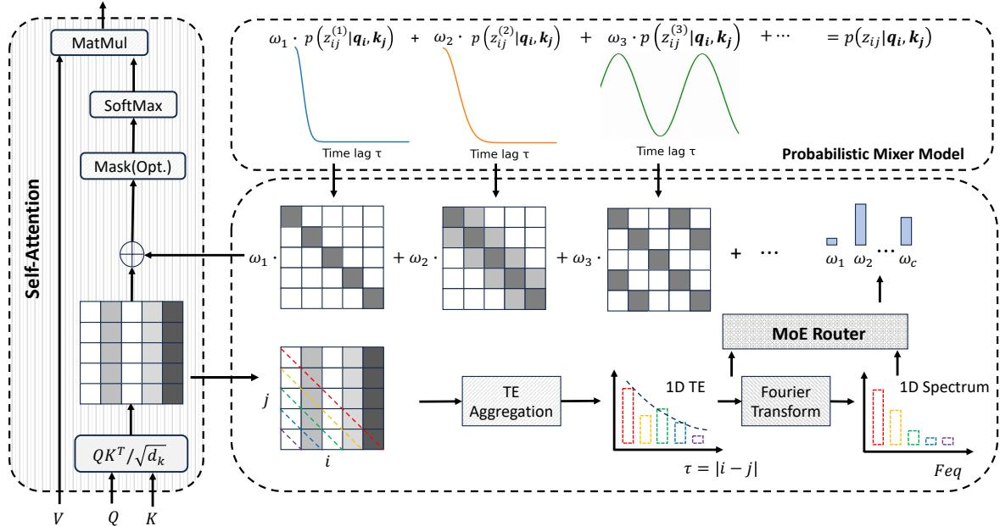  
Figure 1: BTA consists of two components: a probabilistic mixer and a MoE router. The probabilistic mixer defines an over-complete set of candidate temporal patterns using time-aware kernels $\psi ^ { ( c ) } \left( \tau _ { i j } ^ { ( c ) } ; \pmb { \theta } ^ { ( c ) } \right)$ . The MoE router learns the kernel weight $\{ \omega _ { c } \} _ { c = 1 } ^ { M }$ with an MLP that processes the 1D temporal-evidence (TE) profile, obtained by aggregating the original 2D attention scores over relative lags, together with its Fourier spectrum. This plug-and-play design can be seamlessly integrated into standard multi-head self-attention.

## 4 Methodology

Motivated by Corollary 3, we seek an adaptive PE mechanism that adjusts its temporal evidence to the dependence structure of each input window. Since diferent windows may exhibit distinct temporal patterns, a mixture-of-experts (MoE) formulation provides a natural mechanism for representing multiple candidate structures and adaptively weighting them without requiring explicit regime labels. Based on this idea, we propose Bayesian Time-aware Attention (BTA), consisting of two components: (A) a probabilistic mixture of time-aware kernels that provides an over-complete set of candidate temporal patterns, and (B) an MoE router that produces input- and head-specific weights for combining these kernels. The resulting temporal-evidence likelihood is incorporated into the attention logits as an adaptive positional bias, as illustrated in Fig. 1.

## 4.1 Probabilistic Mixture of Temporal Kernels

For notational simplicity, we omit the input and attention-head indices $( n , h )$ throughout this subsection. Following Proposition 1, we model the temporal-evidence likelihood as a mixture of M component likelihoods:

$$
p _ { \phi } ( Z _ { i j } = z _ { i j } \mid S _ { i } = j ) = \sum _ { c = 1 } ^ { M } \omega _ { c } p _ { c } ( Z _ { i j } = z _ { i j } \mid S _ { i } = j ) ,\tag{6}
$$

where $\begin{array} { r } { \omega _ { c } \geq 0 , \sum _ { c = 1 } ^ { M } \omega _ { c } = 1 } \end{array}$ , and each component represents a distinct temporal-dependence pattern, such as locality, periodicity, or long-range dependence. The mixture weights are subsequently generated by an MoE router for each input and attention head.

We parameterize the cth component through a time-aware log-kernel $\psi ^ { ( c ) } ( \tau _ { i j } ; \pmb { \theta } ^ { ( c ) } )$ such that log $p _ { c } ( Z _ { i j } ~ = ~ z _ { i j } ~ \mid ~ S _ { i } ~ = ~ j ) ~ \stackrel { c } { = } ~ \psi ^ { ( c ) } \left( \tau _ { i j } ; \pmb { \theta } ^ { ( c ) } \right)$ , where $\tau _ { i j } ~ = ~ | i - j |$ and $\circeq$ denotes equality up to an additive normalization term independent of $j$ . Equivalently, $p _ { c } ( Z _ { i j } ~ = ~ z _ { i j } ~ \mid ~ S _ { i } ~ = ~ j ) ~ \propto ~$ $\exp [ \psi ^ { ( c ) } ( \tau _ { i j } ; \pmb { \theta } ^ { ( c ) } ) ]$ . Any component-specific normalization constant can be absorbed into the mixture weights without afecting the attention softmax. Therefore, the PE-induced temporal bias is $\begin{array} { r } { b _ { i j } \stackrel { c } { = } \log \left\lceil \sum _ { c = 1 } ^ { M } \omega _ { c } \exp \left( \psi ^ { ( c ) } \left( \bar { \tau } _ { i j } ; \pmb { \theta } ^ { ( c ) } \right) \right) \right\rceil } \end{array}$ . Diferent choices of $\psi ^ { ( c ) }$ encode complementary assumptions about how temporal relevance varies with relative lag. The resulting kernel bank provides an over-complete set of candidate temporal patterns rather than imposing a single positional structure. The MoE router then determines their input- and head-specific contributions, allowing BTA to exploit useful temporal priors while adapting the positional evidence across forecasting windows.

## 4.2 MoE Router

To adapt the temporal-kernel mixture to each input, we design an MoE router that extracts lagdependent structure from the content-based attention scores, as illustrated in Fig. 1. For the hth attention head of the nth input, the content-based attention score is $s _ { i j } ^ { ( n , h ) } = \left\lceil ( \boldsymbol { q } _ { i } ^ { ( n , \tilde { h } ) } ) ^ { \top } \boldsymbol { k } _ { j } ^ { ( n , h ) } \right\rceil / \sqrt { d _ { k } }$ We aggregate scores associated with the same relative lag to construct a one-dimensional lag-wise routing profile: $\begin{array} { r } { e _ { \tau } ^ { ( n , h ) } = \frac { 1 } { | { \mathcal { Z } } _ { \tau } | } \sum _ { ( i , j ) \in { \mathcal { I } } _ { \tau } } s _ { i j } ^ { ( n , h ) } , { \mathcal { Z } } _ { \tau } \ = \ \{ ( i , j ) : \ | i - j | \ = \ \tau \} } \end{array}$ . This aggregation summarizes how strongly the content representations associate query–key pairs at diferent temporal lags. To capture both lag-domain structure and periodicity, we concatenate the routing profile with the magnitude of its Fourier spectrum and feed them into an MLP, namely $\omega ^ { ( n , h ) } =$ Softmax $\left[ \mathrm { M L P } \left( \left[ e ^ { ( n , h ) } ; \left| \mathcal { F } ( e ^ { ( n , h ) } ) \right| \right] \right) \right]$ , Before the softmax, all but the Top-k router logits are masked $\mathrm { t o \ - } \infty .$ , so unselected kernels receive zero weight, as detailed in Appendix J. Here $\mathcal { F } ( \cdot )$ denotes the discrete Fourier transform and $\boldsymbol { \omega } ^ { ( n , h ) } = [ \omega _ { 1 } ^ { ( n , h ) } , \dots , \omega _ { M } ^ { ( n , h ) } ]$ denote the input- and head specific mixture weights. Finally, BTA constructs the adaptive positional bias from the temporalkernel mixture in Equation 6:

$$
b _ { i j } ^ { ( n , h ) } \triangleq \log \left[ \sum _ { c = 1 } ^ { M } \omega _ { c } ^ { ( n , h ) } \exp \left( \psi ^ { ( c ) } \left( \tau _ { i j } ; \pmb { \theta } ^ { ( c ) } \right) \right) \right] .\tag{7}
$$

The resulting bias is added to the content-based attention logits before the softmax, allowing different inputs and attention heads to emphasize distinct local, periodic, or long-range temporal dependencies. Because the candidate kernels and their hyperparameters are fixed, only the router learns how to combine the candidate temporal patterns. This yields a lightweight, plug-and-play mechanism that converts static PE kernels into input- and head-adaptive positional biases and can be incorporated into standard multi-head self-attention without modifying the forecasting backbone.

## 5 Experiments

## 5.1 Experimental Setup

Dataset. We evaluate on eight widely used multivariate time-series forecasting benchmarks: ETTh1, ETTh2, ETTm1, ETTm2, Weather, Electricity, Trafic, and Solar. They span diverse domains and temporal resolutions, with 7–862 variables and Augmented Dickey–Fuller (ADF) statistics ranging from −37.23 to −4.13 (Elliott et al., 1992), providing a broad testbed with varying stationarity and temporal patterns. Detailed descriptions are provided in Appendix G.

Transformer backbones and Non-stationary LTSF references. We select four representative Transformer architectures – Informer (Zhou et al., 2021), PatchTST (Nie et al., 2023), TimeBridge (Liu et al., 2025a), and Timer-XL (Liu et al., 2025c) – as backbones and integrate BTA into each model. These backbones are chosen to cover complementary stages and design paradigms of Transformer-based LTSF. This diversity allows us to evaluate whether BTA generalizes across substantially diferent Transformer architectures rather than benefiting a particular backbone. In addition, we compare our method to ten LTSF baselines: PULSE (Liu et al., 2026), DTAF (Lu et al., 2026), DUET (Qiu et al., 2025), TimeBridge (Liu et al., 2025a), iTransformer (Liu et al., 2024), TimeMixer (Wang et al., 2024), PatchTST (Nie et al., 2023), TimesNet (Wu et al., 2023), DLinear (Zeng et al., 2023), and Nonstationary Transformer (Liu et al., 2022). Detailed descriptions of backbone and reference methods are provided in Appendix H and Appendix I, respectively.

Implementation Details. We use the oficial implementations of all the aforementioned models. The implementation details of BTA are provided in Appendix J. We evaluate LTSF performance using mean squared error (MSE) and mean absolute error (MAE), and report FLOPs and the number of learnable parameters to quantify model complexity. All experiments are implemented in PyTorch and executed on an NVIDIA A100 GPU with 80 GB of memory.

## 5.2 Main Results

We integrate BTA into three backbones. Table 1 shows that BTA consistently improves all three backbones across the four datasets with diferent ADFs. Averaged across datasets, BTA reduces MSE by 9.70%, 10.35%, and 5.70% for Informer, PatchTST, and Timer-XL, respectively, with corresponding MAE reductions of 5.99%, 6.84%, and 2.68%. The improvements across heterogeneous architectures and datasets demonstrate that BTA provides a broadly efective plug-andplay enhancement to Transformer-based models for non-stationary LTSF. Additional three-seed experiments in Table 11 show consistently lower mean MSE with limited variation across random initializations.

Table 1: BTA generalizes across three Transformer backbones. Input lengths are 96 for Informer and PatchTST and 672 for Timer-XL; backbone-specific settings are in Table 9. Each dataset entry is averaged over $H \in$ {96, 192, 336, 720}. Gain(%) denotes the MSE and MAE decrease from Vanilla attention to BTA. Full results in Table 10.
<table><tr><td>Model</td><td colspan="4">Informer (Zhou et al., 2021)</td><td colspan="4">PatchTST (Nie et al., 2023)</td><td colspan="4">Timer-XL (Liu et al., 2025c)</td></tr><tr><td>Self-Attention</td><td>Vanilla</td><td>BTA</td><td></td><td>Gain(%)</td><td>Vanilla</td><td>BTA</td><td></td><td>Gain(%)</td><td>Vanilla</td><td>BTA</td><td></td><td>Gain(%)</td></tr><tr><td>Data ADF</td><td>|MSE MAE|</td><td>MSE MAE</td><td></td><td>|∆MSE ∆MAE|</td><td>|MSE MAE|</td><td>MSE MAE|</td><td></td><td>|∆MSE ∆MAE|</td><td>MSE MAE|</td><td>|MSE MAE|</td><td></td><td>|∆MSE ∆MAE</td></tr><tr><td>ETTh1 -5.91</td><td>|1.096 0.835|</td><td>0.981 0.769</td><td></td><td>10.50 7.88</td><td>|0.516 0.477|</td><td>|0.425 50.429</td><td>17.51</td><td>10.02</td><td>[0.409 0.430|</td><td>|0.379 0.407|</td><td>7.28</td><td>5.35</td></tr><tr><td>ETTm1 -14.98|0.826 0.690|0.756 0.652|</td><td></td><td></td><td>8.47</td><td>5.47</td><td>|0.406 0.408|0.371 0.395|</td><td></td><td>8.80</td><td>3.07</td><td>|0.360 0.383|</td><td>|0.353 0.380|</td><td>1.74</td><td>0.65</td></tr><tr><td></td><td></td><td>Weather -26.68|0.463 0.459|0.398 0.424</td><td></td><td>14.05 7.73</td><td></td><td>|0.265 0.286|0.254 0.278|</td><td>4.34</td><td>2.80</td><td>|0.240 0.273</td><td>|0.235 0.266|</td><td>1.98</td><td>2.48</td></tr><tr><td></td><td></td><td>Solar -37.23|0.233 0.268|0.220 0.261</td><td>5.79</td><td>2.89</td><td></td><td>[0.270 0.307|0.241 0.272|</td><td>10.74</td><td>11.48</td><td>|0.218 0.247|0.193 0.242|</td><td></td><td>11.80</td><td>2.22</td></tr></table>

We integrate BTA into TimeBridge and compare the resulting model with ten reference algorithms for non-stationary LTSF. As shown in Table 2, BTA consistently improves the TimeBridge backbone across all eight datasets, reducing the dataset-averaged MSE and MAE by 2.39% and 1.89%, respectively. These percentages are computed as $1 0 0 ( 1 - \bar { e } _ { \mathrm { B T A } } / \bar { e } _ { \mathrm { T i m e B r i d g e } } )$ , where e¯ is the mean of the eight dataset-average entries in Table 2. Moreover, TimeBridge+BTA achieves the best MSE on 7 of 8 datasets and the best MAE on 5, outperforming both general LTSF baselines and methods specifically designed for non-stationarity. These results demonstrate that adaptive temporal evidence can further strengthen a competitive non-stationary forecasting backbone and generalize efectively across diverse temporal dynamics.

Table 2: Comparison with reference methods for non-stationary LTSF. Ours denotes TimeBridge+BTA, and ELC denotes Electricity. Sequence length $T ~ = ~ 7 2 0$ for all models. Each dataset entry is averaged over $H \in$ {96, 192, 336, 720}. Best and second-best results are shown in bold and underlined, respectively. The 1st Count row counts dataset-level wins, including ties. Full results are available in Table 12.
<table><tr><td>Model</td><td>Ours</td><td></td><td>PULSE Liu et al. (2026) Lu et al. (2026) Qiu et al. (2025) Liu et al. (2025a) Liu et al. (2024) Wang et al. (2024) Nie et al. (2023) Wu et al. (2023) Zeng et al. (2023) Liu et al. (2022)</td><td></td><td>DTAF</td><td></td><td>DUET</td><td></td><td>TimeBridge</td><td></td><td>iTransformer</td><td></td><td>TimeMixer</td><td></td><td>PatchTST</td><td></td><td>TimesNet</td><td></td><td>DLinear</td><td></td><td>Stationary</td></tr><tr><td>Metric</td><td>MSE MAE</td><td>MSE</td><td></td><td>MAE MSE</td><td>MAE</td><td></td><td>|MSE</td><td>MAE</td><td>|MSE</td><td>MAE</td><td>MSE</td><td>MAE |MSE</td><td>MAE</td><td>|MSE</td><td>MAE</td><td>MSE</td><td>MAE</td><td>MSE</td><td></td><td>MAE |MSE</td><td>MAE</td></tr><tr><td>ETTh1</td><td>|0.394 0.423</td><td>|0.412</td><td></td><td>0.422 |0.416</td><td>0.435</td><td>|0.404</td><td>0.427</td><td>|0.399</td><td>0.426</td><td>|0.439</td><td>0.448</td><td>|0.427</td><td>0.441</td><td>|0.413</td><td>0.434</td><td>|0.488</td><td>0.452</td><td>|0.423</td><td>0.437</td><td>|0.644</td><td>0.554</td></tr><tr><td>ETTh2</td><td>|0.338 0.382</td><td>|0.361</td><td></td><td>0.391 |0.363</td><td>0.396</td><td>0.344</td><td>0.390</td><td>0.344</td><td>0.384</td><td>|0.374</td><td>0.406</td><td>|0.349</td><td>0.397</td><td>|0.351</td><td>0.395</td><td>|0.414</td><td>0.427</td><td>|0.431</td><td>0.447</td><td>|0.521</td><td>0.487</td></tr><tr><td>ETTm1</td><td>0.337 0.371</td><td>|0.363</td><td></td><td>0.388 |0.338</td><td>0.368</td><td>|0.336</td><td>0.370</td><td>|0.348</td><td>0.379</td><td>|0.362</td><td>0.391</td><td>|0.356</td><td>0.380</td><td>|0.353</td><td>0.381</td><td>|0.399</td><td>0.406</td><td>|0.357</td><td>0.379</td><td>|0.527</td><td>0.472</td></tr><tr><td>ETTm2</td><td>|0.246 0.305</td><td>|0.262</td><td></td><td>0.314 |0.249</td><td>0.307</td><td></td><td>|0.255 0.316</td><td>|0.250</td><td>0.307</td><td>|0.269</td><td>0.329</td><td>|0.257</td><td>0.318</td><td>|0.256</td><td>0.317</td><td>|0.314</td><td>0.333</td><td>|0.267</td><td>0.332</td><td>|0.567</td><td>0.462</td></tr><tr><td>Weather |0.218</td><td>0.248</td><td></td><td>|0.239</td><td>0.271 |0.222</td><td>0.251</td><td></td><td>|0.230 0.264</td><td>|0.220</td><td>0.250</td><td>|0.233</td><td>0.271</td><td>|0.226</td><td>0.264</td><td>|0.226</td><td>0.264</td><td>|0.259</td><td>0.287</td><td>|0.240</td><td>0.300</td><td>|0.295</td><td>0.315</td></tr><tr><td>ELC</td><td>|0.152 0.245</td><td>|0.160</td><td></td><td>0.255 |0.160</td><td>0.248</td><td>|0.162</td><td>0.253</td><td>0.154</td><td>0.249</td><td>|0.164</td><td>0.261</td><td>|0.185</td><td>0.284</td><td>|0.159</td><td>0.253</td><td>|0.193</td><td>0.295</td><td>|0.166</td><td>0.264</td><td>|0.194</td><td>0.296</td></tr><tr><td>Traffic</td><td>|0.346 0.242</td><td>|0.460</td><td></td><td>0.286 |0.403</td><td>0.249</td><td></td><td>|0.386 0.254</td><td>|0.360</td><td>0.253</td><td>|0.397</td><td>0.282</td><td>|0.409</td><td>0.279</td><td>|0.391</td><td>0.264</td><td>|0.620</td><td>0.336</td><td>|0.434</td><td>0.295</td><td>|0.624</td><td>0.340</td></tr><tr><td>Solar</td><td>|0.176</td><td>0.218</td><td>|0.194</td><td>0.243</td><td>|0.195</td><td>0.235</td><td>|0.194</td><td>0.213 |0.186</td><td>0.233</td><td>|0.200</td><td>0.260</td><td>|0.193</td><td>0.252</td><td>|0.194</td><td>0.245</td><td>|0.244</td><td>0.334</td><td>|0.247</td><td>0.309</td><td>|0.391</td><td>0.389</td></tr><tr><td>1st Count|</td><td>7 5</td><td></td><td>0</td><td>1</td><td></td><td>1</td><td></td><td></td><td></td><td>0</td><td>0</td><td>0</td><td>0</td><td>0</td><td>0</td><td>0</td><td>0</td><td>0</td><td>0</td><td>0</td><td>0</td></tr></table>

## 5.3 Case Study

To illustrate how BTA adapts positional information to heterogeneous temporal patterns, we select two ETTm1 windows with 720 historical time steps and use TimeBridge to forecast the subsequent 96 steps. Figure 2 visualizes the temporal kernels selected by BTA and their corresponding mixture weights. The left window exhibits a strong weekly periodic pattern, for which the router assigns 0.75 of the total weight to periodic kernels, including a maximum weight of 0.24 on a 7-day periodic kernel. In contrast, the right window exhibits stronger local dependence, and BTA assigns 0.66 of the total weight to local RBF kernels, with the largest weight (0.41) placed on the 0.7-day loca kernel. Consequently, BTA induces diferent positional biases for the two input windows and enables TimeBridge to better capture their distinct temporal dependencies, reducing the forecasting MSE by approximately 37% in both cases. This case study demonstrates the advantage of input-adaptive temporal evidence over a fixed positional structure uniformly across forecasting windows. More case studies in Appendix L further confirm this advantage in diferent datasets and backbones.

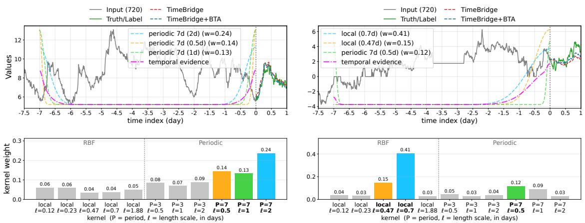  
Figure 2: Input-adaptive temporal kernel selection in BTA. Two ETTm1 windows with a 720-step input and 96-step forecasting horizon. Top: TimeBridge and TimeBridge+BTA forecasts, together with the three highest-weight temporal kernels and their weighted combination. Bottom: MoE router weights over candidate kernels; for periodic kernels, ℓ denotes the peak width $\ell _ { r , e } ^ { \prime } p _ { \epsilon }$ . The left window emphasizes weekly periodicity, assigning 0.75 of the total weight to periodic kernels, whereas the right window emphasizes local dependence, assigning 0.66 to RBF kernels. BTA reduces the OT-channel MSE by approximately 37% in both cases (0.219 → 0.139 and 0.970 → 0.608).

## 5.4 Representation Analysis

Figure 3 further shows that BTA improves not only non-stationary LTSF but also the interpretability of Transformer temporal behavior. The learned kernel weights vary systematically with the forecasting horizon: shorter horizons emphasize relatively local dependencies, whereas longer horizons assign greater importance to broader local and periodic patterns. Thus, BTA exposes how the temporal inductive bias of self-attention changes with the prediction horizon, providing an interpretable characterization of the temporal dependencies used for LTSF. Extra analysis on Solar in Appendix M.

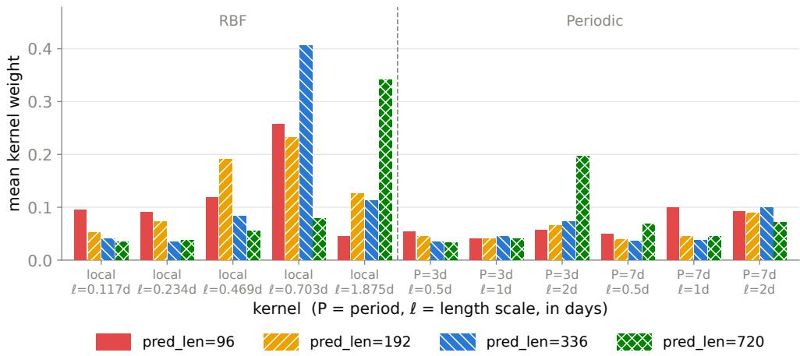  
Figure 3: BTA reveals horizon-dependent temporal dependencies. Mean kernel weights across ETTm1 test samples and attention heads for $H \in \{ 9 6 , 1 9 2 , 3 3 6 , 7 2 0 \}$ . The dashed line separates local RBF and periodic kernels. As the forecasting horizon changes, BTA shifts weight across temporal scales, with longer horizons emphasizing broader local and periodic patterns.

## 5.5 Hyperparameter Analysis

We analyze two MoE-router hyperparameters: Top-k and hidden dimension $d _ { r }$ . Figure 4 shows the ETTm1 results, with ETTh1 and Solar reported in Appendix N. Across datasets, BTA generally favors sparse expert selection: $k = 3$ performs best on ETTm1 and Solar, while ETTh1 prefers $k = 1$ . Router capacity is also dataset-dependent and non-monotonic, with the best $d _ { r }$ equal to 192, 160, and 96 for ETTh1, ETTm1, and Solar, respectively. Overall, a small number of experts and moderate router capacity are suficient, with $d _ { r }$ selected by validation performance. Additional eficiency analysis is provided in Appendix O.

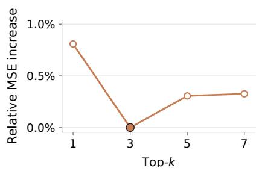

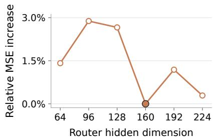  
Figure 4: Hyperparameter sensitivity on ETTm1: Top-k (left) and router hidden dimension (right). Each panel shows the percentage MSE increase relative to its lowest MSE.

## 5.6 Ablation Study

Table 3 shows the contribution of each component in BTA. Adding local kernels improves vanilla self-attention, while combining local and periodic kernels provides further gains, demonstrating the benefit of a richer temporal kernel bank. Replacing static kernel weights with an MoE router using TE profile further reduces MSE and MAE, highlighting the value of input-adaptive kernel selection. Incorporating the Fourier spectrum of TE achieves the largest gains 5.65% and 6.55%, respectively, indicating that frequency-domain information provides complementary guidance for temporal-kernel routing. The ablation study of BTA on Weather in Appendix P.

Table 3: Ablation study of BTA on Solar (TimeBridge as the backbone). The full BTA variant is also reported as Ours in Table 12.
<table><tr><td colspan="2">Attention</td><td colspan="2">Self-attention</td><td colspan="8">Bayesian Time-aware Attention</td></tr><tr><td colspan="2">Optimization</td><td colspan="2">Static</td><td colspan="4">Static</td><td colspan="2">MoE (TE)</td><td colspan="2">MoE (TE + Fourier)</td></tr><tr><td colspan="2">Kernels</td><td colspan="2">None</td><td colspan="2">Local</td><td colspan="2">Local + periodic</td><td colspan="2">Local + periodic</td><td colspan="2">Local + periodic</td></tr><tr><td>Dataset</td><td>H</td><td>MSE</td><td>MAE</td><td>MSE</td><td>MAE</td><td>MSE</td><td>MAE</td><td>MSE</td><td>MAE</td><td>MSE</td><td>MAE</td></tr><tr><td rowspan="8">Solar</td><td>96</td><td>0.161</td><td>0.224</td><td>0.158</td><td>0.219</td><td>0.157</td><td>0.213</td><td>0.152</td><td>0.201</td><td>0.150</td><td>0.198</td></tr><tr><td>192</td><td>0.177</td><td>0.237</td><td>0.176</td><td>0.225</td><td>0.176</td><td>0.219</td><td>0.173</td><td>0.214</td><td>0.171</td><td>0.211</td></tr><tr><td>336</td><td>0.196</td><td>0.232</td><td>0.192</td><td>0.230</td><td>0.191</td><td>0.227</td><td>0.187</td><td>0.227</td><td>0.184</td><td>0.226</td></tr><tr><td>720</td><td>0.210</td><td>0.239</td><td>0.207</td><td>0.238</td><td>0.205</td><td>0.236</td><td>0.201</td><td>0.235</td><td>0.197</td><td>0.236</td></tr><tr><td>Avg.</td><td>0.186</td><td>0.233</td><td>0.183</td><td>0.228</td><td>0.182</td><td>0.224</td><td>0.178</td><td>0.219</td><td>0.176</td><td>0.218</td></tr><tr><td>Gain (%)</td><td></td><td>一</td><td>1.48</td><td>2.15</td><td>2.02</td><td>3.97</td><td>4.17</td><td>5.90</td><td>5.65</td><td>6.55</td></tr></table>

Both MoE variants use local and periodic kernels. TE denotes the temporal-evidence profile; Fourier denotes its Fourier spectrum. Gain is relative to vanilla self-attention.

## 6 Conclusions

We studied how positional encoding shapes Transformer forecasting under non-stationary temporal dependencies. By interpreting position-aware self-attention as Bayesian inference over attended positions, we derived a population-level ELBO and showed that static PE can be suboptimal when temporal dependence varies across input windows. Motivated by this analysis, we proposed BTA, a plug-and-play mechanism that adaptively combines complementary temporal kernels through an input- and head-specific MoE router. Experiments across multiple Transformer backbones and eight LTSF benchmarks demonstrate that BTA consistently improves forecasting accuracy and remains competitive with recent methods designed for non-stationarity. Overall, our results suggest that adaptive temporal evidence ofers a principled, efective, and interpretable alternative to static positional structures for non-stationary time-series forecasting.

## Disclosure of AI Use

During this work, we used ChatGPT-5.6 Sol solely to polish the language and improve the readability of the manuscript. We did not use generative AI to develop the theoretical framework, formulate mathematical claims, derive the ELBO or write proofs, design or implement BTA, design experiments, generate or process datasets, interpret results, or translate the manuscript. The authors reviewed all AI-assisted edits to ensure that they preserved the intended technical meaning and introduced no unsupported claims. The authors take full responsibility for the final manuscript, including its mathematical claims, experimental results, code, and conclusions.

## References

Christopher M. Bishop. Pattern Recognition and Machine Learning. Information Science and Statistics. Springer, 2006.

Weilin Cai, Juyong Jiang, Fan Wang, Jing Tang, Sunghun Kim, and Jiayi Huang. A survey on mixture of experts in large language models. IEEE Transactions on Knowledge and Data Engineering, 2025.

Zonglei Chen, Minbo Ma, Tianrui Li, Hongjun Wang, and Chongshou Li. Long sequence time-series forecasting with deep learning: A survey. Information Fusion, 97:101819, 2023.

Ta-Chung Chi, Ting-Han Fan, Peter J. Ramadge, and Alexander I. Rudnicky. Kerple: Kernelized relative positional embedding for length extrapolation. In Advances in Neural Information Processing Systems (NeurIPS), 2022.

Zihang Dai, Zhilin Yang, Yiming Yang, Jaime Carbonell, Quoc V. Le, and Ruslan Salakhutdinov. Transformer-XL: Attentive language models beyond a fixed-length context. In Proceedings of the 57th Annual Meeting of the Association for Computational Linguistics, pages 2978–2988. Association for Computational Linguistics, 2019. doi: 10.18653/v1/P19-1285. URL https:// aclanthology.org/P19-1285/.

Azad Deihim, Eduardo Alonso, and Dimitra Apostolopoulou. STTRE: A spatio-temporal transformer with relative embeddings for multivariate time series forecasting. Neural Networks, 168: 549–559, 2023. doi: 10.1016/j.neunet.2023.09.039. URL https://doi.org/10.1016/j.neunet.2023. 09.039.

Yuntao Du, Jindong Wang, Wenjie Feng, Sinno Pan, Tao Qin, Renjun Xu, and Chongjun Wang. AdaRNN: Adaptive learning and forecasting of time series. In Proceedings of the 30th ACM International Conference on Information and Knowledge Management, pages 402–411. Association for Computing Machinery, 2021. doi: 10.1145/3459637.3482315. URL https://doi.org/10.1145/ 3459637.3482315.

Wenying Duan, Xiaoxi He, Lu Zhou, Lothar Thiele, and Hong Rao. Combating distribution shift for accurate time series forecasting via hypernetworks. In 2022 IEEE 28th International Conference on Parallel and Distributed Systems (ICPADS), pages 900–907. IEEE, 2023. doi: 10.1109/ICPADS56603.2022.00121. URL https://doi.org/10.1109/ICPADS56603.2022.00121.

Graham Elliott, Thomas J Rothenberg, and James H Stock. Eficient tests for an autoregressive unit root, 1992.

Wei Fan, Pengyang Wang, Dongkun Wang, Dongjie Wang, Yuanchun Zhou, and Yanjie Fu. Dish-ts: a general paradigm for alleviating distribution shift in time series forecasting. In Proceedings of the AAAI conference on artificial intelligence, volume 37, pages 7522–7529, 2023.

Wei Fan, Shun Zheng, Pengyang Wang, Rui Xie, Kun Yi, Qi Zhang, Jiang Bian, and Yanjie Fu. IN-Flow: Instance normalization flow for non-stationary time series forecasting. In Proceedings of the 31st ACM SIGKDD Conference on Knowledge Discovery and Data Mining, pages 295– 306. Association for Computing Machinery, 2025. doi: 10.1145/3690624.3709260. URL https: //doi.org/10.1145/3690624.3709260.

Navid Mohammadi Foumani, Chang Wei Tan, Geofrey I Webb, and Mahsa Salehi. Improving position encoding of transformers for multivariate time series classification. Data mining and knowledge discovery, 38(1):22–48, 2024.

Maosheng Guo, Yu Zhang, and Ting Liu. Gaussian transformer: a lightweight approach for natural language inference. In Proceedings of the AAAI conference on artificial intelligence, volume 33, pages 6489–6496, 2019.

Kareem Hegazy, Michael W Mahoney, and N Benjamin Erichson. Powerformer: A transformer with weighted causal attention for time-series forecasting. arXiv preprint arXiv:2502.06151, 2025.

Habib Irani and Vangelis Metsis. Positional encoding in transformer-based time series models: a survey. arXiv preprint arXiv:2502.12370, 2025.

Dongbin Kim, Jinseong Park, Jaewook Lee, and Hoki Kim. Are self-attentions efective for time series forecasting? Advances in Neural Information Processing Systems, 37:114180–114209, 2024.

Taesung Kim, Jinhee Kim, Yunwon Tae, Cheonbok Park, Jang-Ho Choi, and Jaegul Choo. Reversible instance normalization for accurate time-series forecasting against distribution shift. In International conference on learning representations, 2021.

Siva Rama Krishna Kottapalli, Karthik Hubli, Sandeep Chandrashekhara, Garima Jain, Sunayana Hubli, Gayathri Botla, and Ramesh Doddaiah. Foundation models for time series: A survey. arXiv preprint arXiv:2504.04011, 2025.

Yujie Li, Zezhi Shao, Chengqing Yu, Yisong Fu, Tao Sun, Yongjun Xu, and Fei Wang. Apt: Afine prototype-timestamp for time series forecasting under distribution shift. In Proceedings of the AAAI Conference on Artificial Intelligence, volume 40, pages 15180–15188, 2026.

Peiyuan Liu, Beiliang Wu, Yifan Hu, Naiqi Li, Tao Dai, Jigang Bao, and Shu-Tao Xia. Timebridge: Non-stationarity matters for long-term time series forecasting. In International Conference on Machine Learning, pages 39815–39840. PMLR, 2025a.

Qinglong Liu, Cong Xu, Wenhao Jiang, Kaixuan Wang, Lin Ma, and Haifeng Li. Timestacker: A novel framework with multilevel observation for capturing nonstationary patterns in time series forecasting. In Forty-second International Conference on Machine Learning, 2025b.

Siqi Liu and Andreas Lehrmann. DynaConF: Dynamic forecasting of non-stationary time series. Transactions on Machine Learning Research, 2024. ISSN 2835-8856. URL https://openreview. net/forum?id=48pHFcg0YO.

Yangyou Liu, Zezhi Shao, Xinyu Chen, Hu Chen, Fei Wang, and Yuankai Wu. Pulse: Generative phase evolution for non-stationary time series forecasting. In Forty-third International Conference on Machine Learning, 2026.

Yong Liu, Haixu Wu, Jianmin Wang, and Mingsheng Long. Non-stationary transformers: Exploring the stationarity in time series forecasting. Advances in neural information processing systems, 35:9881–9893, 2022.

Yong Liu, Tengge Hu, Haoran Zhang, Haixu Wu, Shiyu Wang, Lintao Ma, and Mingsheng Long. itransformer: Inverted transformers are efective for time series forecasting. In The Eleventh International Conference on Learning Representations, 2024.

Yong Liu, Guo Qin, Xiangdong Huang, Jianmin Wang, and Mingsheng Long. Timer-xl: Longcontext transformers for unified time series forecasting. In International Conference on Learning Representations, volume 2025, pages 83982–84006, 2025c.

Zhiding Liu, Mingyue Cheng, Zhi Li, Zhenya Huang, Qi Liu, Yanhu Xie, and Enhong Chen. Adaptive normalization for non-stationary time series forecasting: A temporal slice perspective. Advances in Neural Information Processing Systems, 36:14273–14292, 2023.

Antoine Liutkus, Ondřej Cıfka, Shih-Lun Wu, Umut Simsekli, Yi-Hsuan Yang, and Gael Richard. Relative positional encoding for transformers with linear complexity. In International Conference on Machine Learning, pages 7067–7079. PMLR, 2021.

Junkai Lu, Peng Chen, Chenjuan Guo, Yang Shu, Meng Wang, and Bin Yang. Towards nonstationary time series forecasting with temporal stabilization and frequency diferencing. In Proceedings of the AAAI Conference on Artificial Intelligence, volume 40, pages 24070–24078, 2026.

Yuqi Nie, Nam H Nguyen, Phanwadee Sinthong, and Jayant Kalagnanam. A time series is worth 64 words: Long-term forecasting with transformers. In The Tenth International Conference on Learning Representations, 2023.

Quang Pham, Chenghao Liu, Doyen Sahoo, and Steven C. H. Hoi. Learning fast and slow for online time series forecasting. In The Eleventh International Conference on Learning Representations, 2023. URL https://openreview.net/forum?id=q-PbpHD3EOk.

Xihao Piao, Zheng Chen, Yushun Dong, Yasuko Matsubara, and Yasushi Sakurai. FredNormer: Frequency domain normalization for non-stationary time series forecasting, 2024. URL https: //arxiv.org/abs/2410.01860.

Ofir Press, Noah A Smith, and Mike Lewis. Train short, test long: Attention with linear biases enables input length extrapolation. arXiv preprint arXiv:2108.12409, 2021.

Xiangfei Qiu, Xingjian Wu, Yan Lin, Chenjuan Guo, Jilin Hu, and Bin Yang. DUET: Dual clustering enhanced multivariate time series forecasting. In Proceedings of the 31st ACM SIGKDD Conference on Knowledge Discovery and Data Mining, pages 1185–1196. Association for Computing Machinery, 2025. doi: 10.1145/3690624.3709325. URL https://doi.org/10.1145/3690624.3709325.

Colin Rafel, Noam Shazeer, Adam Roberts, Katherine Lee, Sharan Narang, Michael Matena, Yanqi Zhou, Wei Li, and Peter J. Liu. Exploring the limits of transfer learning with a unified textto-text transformer. Journal of Machine Learning Research, 21(140):1–67, 2020. URL https: //jmlr.org/papers/v21/20-074.html.

Peter Shaw, Jakob Uszkoreit, and Ashish Vaswani. Self-attention with relative position representations. arXiv preprint arXiv:1803.02155, 2018.

Li Shen, Yuning Wei, and Yangzhu Wang. Gbt: Two-stage transformer framework for non-stationary time series forecasting. Neural Networks, 165:953–970, 2023. doi: 10.1016/j.neunet.2023.06.044.

Jianlin Su, Murtadha Ahmed, Yu Lu, Shengfeng Pan, Wen Bo, and Yunfeng Liu. Roformer: Enhanced transformer with rotary position embedding. Neurocomputing, 568:127063, 2024.

Tian Sun, Yuqi Chen, and Weiwei Sun. Penguin: Enhancing transformer with periodic-nested group attention for long-term time series forecasting. In The 29th International Conference on Artificial Intelligence and Statistics, 2026.

Yanru Sun, Zongxia Xie, Emadeldeen Eldele, Dongyue Chen, Qinghua Hu, and Min Wu. Learning pattern-specific experts for time series forecasting under patch-level distribution shift. In Advances in Neural Information Processing Systems, volume 38, 2025. URL https://openreview. net/forum?id=CtoIG9Iwas.

Suxin Tong and Jingling Yuan. PAREformer: Positional adaptive and recurrent enhanced transformer for time series forecasting. Information Fusion, page 103967, 2025. doi: 10.1016/j.infus. 2025.103967.

Yao-Hung Hubert Tsai, Shaojie Bai, Makoto Yamada, Louis-Philippe Morency, and Ruslan Salakhutdinov. Transformer dissection: a unified understanding of transformer’s attention via the lens of kernel. arXiv preprint arXiv:1908.11775, 2019.

Ashish Vaswani, Noam Shazeer, Niki Parmar, Jakob Uszkoreit, Llion Jones, Aidan N Gomez, Łukasz Kaiser, and Illia Polosukhin. Attention is all you need. Advances in neural information processing systems, 30, 2017.

Rui Wang, Yihe Dong, Sercan O. Arik, and Rose Yu. Koopman neural forecaster for time series with temporal distribution shifts. In The Eleventh International Conference on Learning Representations, 2023. URL https://openreview.net/forum?id=kUmdmHxK5N.

Shiyu Wang, Haixu Wu, Xiaoming Shi, Tengge Hu, Huakun Luo, Lintao Ma, James Y Zhang, and Jun Zhou. Timemixer: Decomposable multiscale mixing for time series forecasting. arXiv preprint arXiv:2405.14616, 2024.

Qingsong Wen, Tian Zhou, Chaoli Zhang, Weiqi Chen, Ziqing Ma, Junchi Yan, and Liang Sun. Transformers in time series: A survey. arXiv preprint arXiv:2202.07125, 2022.

Haixu Wu, Tengge Hu, Yong Liu, and et al. Timesnet: Temporal 2d-variation modeling for general time series analysis. In International Conference on Learning Representations, 2023.

Weiwei Ye, Songgaojun Deng, Qiaosha Zou, and Ning Gui. Frequency adaptive normalization for non-stationary time series forecasting. Advances in Neural Information Processing Systems, 37: 31350–31379, 2024.

Ailing Zeng, Muxi Chen, Lei Zhang, and Qiang Xu. Are transformers efective for time series forecasting? In Proceedings of the AAAI conference on artificial intelligence, volume 37, pages 11121–11128, 2023.

Yi-Fan Zhang, Qingsong Wen, Xue Wang, Weiqi Chen, Liang Sun, Zhang Zhang, Liang Wang, Rong Jin, and Tieniu Tan. OneNet: Enhancing time series forecasting models under concept drift by online ensembling. In Advances in Neural Information Processing Systems, volume 36, pages 69949–69980, 2023. URL https://proceedings.neurips.cc/paper\_files/paper/2023/hash/ dd6a47bc0aad6f34aa5e77706d90cdc4-Abstract-Conference.html.

Yifan Zhang, Rui Wu, and Jr. Harris, Frederick C. Sparse transformer with local and seasonal adaptation for multivariate time series forecasting. Scientific Reports, 14:15909, 2024. doi: 10. 1038/s41598-024-66886-1. URL https://doi.org/10.1038/s41598-024-66886-1.

Haoyi Zhou, Shanghang Zhang, Jieqi Peng, Shuai Zhang, Jianxin Li, Hui Xiong, and Wancai Zhang. Informer: Beyond eficient transformer for long sequence time-series forecasting. In Proceedings of the AAAI conference on artificial intelligence, volume 35, pages 11106–11115, 2021.

## A The Simplified Transformer Architecture

Here we provide the detailed configuration of the simplified Transformer used in the theoretical analysis. Consider a point-wise Transformer consisting of a single self-attention encoder, average pooling over the T historical positions, and a linear forecasting decoder.

Given a historical input $\pmb { x } ^ { - } \in \mathbb { R } ^ { T }$ , each scalar observation is first mapped to a $d _ { x } .$ -dimensional representation through a linear embedding,

$$
\pmb { H } = \pmb { x } ^ { - } \pmb { w } _ { e } \in \mathbb { R } ^ { T \times d _ { \ b { x } } } ,\tag{8}
$$

where $\pmb { w } _ { e } \in \mathbb { R } ^ { 1 \times d _ { x } }$ denotes the embedding vector.

The query, key, and value representations are

$$
Q = { \cal H } W _ { q } , \qquad K = { \cal H } W _ { k } , \qquad V = { \cal H } W _ { v } ,\tag{9}
$$

where $W _ { q } , W _ { k } \in \mathbb { R } ^ { d _ { x } \times d _ { k } }$ and $W _ { v } \in \mathbb { R } ^ { d _ { x } \times d _ { v } }$ are learnable projection matrices. Thus, the ith query and jth key are

$$
\begin{array} { r } { \pmb { q } _ { i } = x _ { i } ^ { - } \pmb { w } _ { e } \pmb { W } _ { q } \in \mathbb { R } ^ { 1 \times d _ { k } } , \qquad \pmb { k } _ { j } = x _ { j } ^ { - } \pmb { w } _ { e } \pmb { W } _ { k } \in \mathbb { R } ^ { 1 \times d _ { k } } . } \end{array}
$$

For a positional encoding method $\phi ,$ , let ${ \pmb { \alpha } } _ { \phi } ( { \pmb x } ^ { - } ) \in \mathbb { R } ^ { T \times T }$ denote the corresponding attention matrix, whose (i, j)th entry is

$$
\alpha _ { \phi , i j } ( \pmb { x } ^ { - } ) = \frac { \exp \left( q _ { i } \pmb { k } _ { j } ^ { \top } / \sqrt { d _ { k } } + b _ { i j } ^ { \phi } ( \pmb { x } ^ { - } ) \right) } { \displaystyle \sum _ { \ell \in \mathcal { C } ( i ) } \exp \left( q _ { i } \pmb { k } _ { \ell } ^ { \top } / \sqrt { d _ { k } } + b _ { i \ell } ^ { \phi } ( \pmb { x } ^ { - } ) \right) } , \qquad j \in \mathcal { C } ( i ) ,\tag{10}
$$

and $\alpha _ { \phi , i j } ( { \pmb x } ^ { - } ) = 0$ for $j \notin \mathcal { C } ( i )$ . Here, $b _ { i j } ^ { \phi } ( { \pmb x } ^ { - } )$ denotes the PE-induced positional score (this dependence on $\pmb { x } ^ { - }$ is absent for static PE) and $\mathcal { C } ( i )$ is the set of key positions accessible to query i, as defined in Section 3.1.

The output of the self-attention encoder is

$$
\pmb { H } _ { \mathrm { a t t n } } = \pmb { \alpha } _ { \phi } ( \pmb { x } ^ { - } ) \pmb { V } \in \mathbb { R } ^ { T \times d _ { v } } .\tag{11}
$$

Following the convention (Nie et al., 2023), we aggregate the $T$ output representations using average pooling,

$$
\overline { { \pmb { h } } } _ { \phi } ^ { \top } ( \pmb { x } ^ { - } ) = \frac { 1 } { T } \pmb { 1 } _ { T } ^ { \top } \pmb { \alpha } _ { \phi } ( \pmb { x } ^ { - } ) \pmb { V } \in \mathbb { R } ^ { 1 \times d _ { v } } ,\tag{12}
$$

and apply a linear decoder $W _ { d } \in \mathbb { R } ^ { L \times d _ { v } }$ to obtain the L-step forecast,

$$
f _ { \theta , \phi } ( \pmb { x } ^ { - } ) = \pmb { W } _ { d } \overline { { \pmb { h } } } _ { \phi } ( \pmb { x } ^ { - } ) \in \mathbb { R } ^ { L } ,\tag{13}
$$

where $\theta = \left\{ w _ { e } , W _ { q } , W _ { k } , W _ { v } , W _ { d } \right\}$ collects the learnable model parameters.

Since

$$
V = { \bf x } ^ { - } { \pmb w } _ { e } { \pmb W } _ { v } ,
$$

Equation 13 can be rewritten as

$$
f _ { \boldsymbol { \theta } , \boldsymbol { \phi } } ( \mathbf { x } ^ { - } ) = W _ { d } ( w _ { e } W _ { v } ) ^ { \top } \left[ \frac { 1 } { T } \mathbf { 1 } _ { T } ^ { \top } \boldsymbol { \alpha } _ { \boldsymbol { \phi } } ( \mathbf { x } ^ { - } ) \right] \mathbf { x } ^ { - } .\tag{14}
$$

Define

$$
\pmb { w } : = \pmb { W } _ { d } ( \pmb { w } _ { e } \pmb { W } _ { v } ) ^ { \top } \in \mathbb { R } ^ { L \times 1 }\tag{15}
$$

and

$$
\pmb { a } _ { \phi } ^ { \top } ( \pmb { x } ^ { - } ) : = \frac { 1 } { T } \pmb { 1 } _ { T } ^ { \top } \pmb { \alpha } _ { \phi } ( \pmb { x } ^ { - } ) \in \mathbb { R } ^ { 1 \times T } .\tag{16}
$$

The simplified Transformer therefore admits the compact representation

$$
f _ { { \boldsymbol { \theta } } , \boldsymbol { \phi } } ( { \pmb x } ^ { - } ) = { \pmb w } { \pmb a } _ { \phi } ^ { \top } ( { \pmb x } ^ { - } ) { \pmb x } ^ { - } = M _ { \boldsymbol { \theta } , \boldsymbol { \phi } } ( { \pmb x } ^ { - } ) { \pmb x } ^ { - } ,\tag{17}
$$

where

$$
M _ { \theta , \phi } ( \pmb { x } ^ { - } ) : = \pmb { w } \pmb { a } _ { \phi } ^ { \top } ( \pmb { x } ^ { - } ) \in \mathbb { R } ^ { L \times T } .\tag{18}
$$

This recovers the efective forecasting operator introduced in Equation 2.

Because each row of ${ \pmb { \alpha } } _ { \phi } ( { \pmb { x } } ^ { - } )$ is an attention distribution over its accessible key positions, ${ \pmb { a } } _ { \phi } ^ { \top } ( { \pmb { x } } ^ { - } )$ represents the attention coeficients averaged across the $T$ query positions. Thus, the efect of PE method $\phi$ on the simplified Transformer enters the forecasting operator through its influence on the attention distribution.

For analytical clarity, we omit layer normalization, feed-forward sublayers, and residual connections. Including a residual connection in the attention block replaces ${ \pmb { \alpha } } _ { \phi } ( { \pmb { x } } ^ { - } )$ by ${ \pmb { \alpha } } _ { \phi } ( { \pmb x } ^ { - } ) + { \pmb I } _ { T }$ in the derivation above and does not alter the resulting efective linear-operator representation.

## B Proof of Proposition 1

Proof. For a fixed query position i, let $S _ { i } \in \mathcal { C } ( i )$ denote the selected key position. We treat the query $\pmb q _ { i }$ and candidate keys $\{ \pmb { k } _ { j } : j \in \mathcal { C } ( i ) \}$ as fixed representations. Without positional information, scaled dot-product self-attention induces the content-based prior

$$
p ( S _ { i } = j ) = \frac { \exp \Bigl ( \pmb q _ { i } ^ { \top } \pmb k _ { j } / \sqrt { d _ { k } } \Bigr ) } { \sum _ { \ell \in \mathcal { C } ( i ) } \exp \bigl ( \pmb q _ { i } ^ { \top } \pmb k _ { \ell } / \sqrt { d _ { k } } \bigr ) } .\tag{19}
$$

Hence,

$$
\log p ( S _ { i } = j ) \stackrel { c } { = } \frac { \pm \overset { \triangledown } { \mathbf { q } _ { i } ^ { \intercal } } \pmb { k } _ { j } } { \sqrt { d _ { k } } } ,\tag{20}
$$

where $\circeq$ denotes equality up to an additive term independent of $j$

Let $Z _ { i } = \{ Z _ { i j } \} _ { j \in \mathcal { C } ( i ) }$ denote the full temporal evidence associated with query i, with observed realization $z _ { i } = \{ z _ { i j } \} _ { j \in \mathcal { C } ( i ) }$ . By the candidate-specific assumption in Proposition 1, there exists a factor $C _ { i } ( z _ { i } ) > 0$ , independent of the candidate position $j ,$ such that

$$
p ( Z _ { i } = z _ { i } \mid S _ { i } = j ) = C _ { i } ( z _ { i } ) p ( Z _ { i j } = z _ { i j } \mid S _ { i } = j ) .\tag{21}
$$

Here and below, $p$ denotes a probability mass or density as appropriate.

Applying Bayes’ rule and using Equation 21,

$$
p ( S _ { i } = j \mid Z _ { i } = z _ { i } ) = { \frac { p ( S _ { i } = j ) p ( Z _ { i j } = z _ { i j } \mid S _ { i } = j ) } { \sum _ { \ell \in { \mathcal { C } } ( i ) } p ( S _ { i } = \ell ) p ( Z _ { i \ell } = z _ { i \ell } \mid S _ { i } = \ell ) } } ,\tag{22}
$$

because the common factor $C _ { i } ( z _ { i } )$ cancels between the numerator and denominator. Therefore,

$$
\log p ( S _ { i } = j \mid Z _ { i } = z _ { i } ) \stackrel { c } { = } \frac { q _ { i } ^ { \top } k _ { j } } { \sqrt { d _ { k } } } + \log p ( Z _ { i j } = z _ { i j } \mid S _ { i } = j ) .\tag{23}
$$

On the other hand, self-attention with PE assigns

$$
\alpha _ { i j } = \frac { \exp \left( { { q _ { i } ^ { \top } } k _ { j } / \sqrt { d _ { k } } + b _ { i j } } \right) } { \sum _ { \ell \in \mathcal { C } ( i ) } \exp \left( { { q _ { i } ^ { \top } } k _ { \ell } / \sqrt { d _ { k } } + b _ { i \ell } } \right) } .\tag{24}
$$

Thus, if PE specifies the temporal-evidence likelihood such that

$$
b _ { i j } \stackrel { c } { = } \log p ( Z _ { i j } = z _ { i j } \mid S _ { i } = j ) ,\tag{25}
$$

then Equations 23 and 24 have identical normalized logits. Consequently,

$$
\alpha _ { i j } = p ( S _ { i } = j \mid Z _ { i } = z _ { i } ) .\tag{26}
$$

Therefore, position-aware self-attention can be interpreted as Bayesian reweighting over candidate key positions: scaled dot-product similarity defines the content-based prior, while PE contributes the candidate-specific temporal-evidence likelihood.

## C Probabilistic Interpretations of Positional Encoding

Proposition 1 provides a unified probabilistic interpretation of representative positional encoding (PE) mechanisms, including Gaussian/RBF positional bias (Guo et al., 2019), ALiBi (Press et al., 2021), KERPLE (Chi et al., 2022), the power-law decay bias of Powerformer (Hegazy et al., 2025), and RoPE (Su et al., 2024). Specifically, an additive positional term in the attention logits can be interpreted as the log-likelihood contribution of temporal evidence, up to an additive normalization term that is invariant to the key position $j$ and therefore cancels under the softmax. Table 4 summarizes the resulting probabilistic interpretations and illustrates how diferent PE mechanisms encode distinct assumptions about the dependence of temporal evidence on the relative lag $\Delta _ { i j } =$ $i - j$

Table 4: Probabilistic interpretations of representative PE methods, where $\Delta _ { i j } = i - j .$ . Here, $\sigma ^ { 2 } > 0$ denotes the variance of the Gaussian/RBF kernel; $m _ { h } > 0$ is the head-specific ALiBi slope; $r _ { 1 } , r _ { 2 } > 0$ are KERPLE parameters controlling the magnitude and scale of its logarithmic decay, respectively; and $\alpha > 0$ is the power-law decay exponent in Powerformer. Log-likelihood terms are shown up to additive normalization constants that do not affect the softmax over j.
<table><tr><td>PE method</td><td>Domain</td><td> $\overline { { p ( Z _ { i j } = z _ { i j } \mid S _ { i } = j ) } }$ </td><td></td><td> $\overline { { \log p ( Z _ { i j } = z _ { i j } \mid S _ { i } = j ) } }$ </td></tr><tr><td>Gaussian/RBF</td><td>NLP</td><td> $\propto \exp \left( - \frac { \Delta _ { i j } ^ { 2 } } { 2 \sigma ^ { 2 } } \right)$ </td><td> $- \frac { \Delta _ { i j } ^ { 2 } } { 2 \sigma ^ { 2 } }$ </td><td></td></tr><tr><td>ALiBi</td><td>NLP</td><td></td><td></td><td> $- m _ { h } | \Delta _ { i j } |$ </td></tr><tr><td>KERPLE</td><td>NLP</td><td> $\propto \exp ( - \dot { m } _ { h } \vert \Delta _ { i j } \vert )$ </td><td></td><td></td></tr><tr><td>Powerformer</td><td>TSF</td><td> $\propto ( 1 + r _ { 2 } | \Delta _ { i j } | ) ^ { - r _ { 1 } }$ </td><td></td><td> $- r _ { 1 } \log ( 1 + r _ { 2 } | \Delta _ { i j } | )$ </td></tr><tr><td>RoPE</td><td>NLP &amp; TSF</td><td> $\propto ( 1 + | \Delta _ { i j } | ) ^ { - \alpha }$ </td><td></td><td> $- \alpha \log ( 1 + | \Delta _ { i j } | )$   $\{ \pmb q _ { i } ^ { \top } \left( \pmb R _ { \Delta _ { i j } } - \pmb I \right) \pmb k _ { j } \} / \sqrt { d _ { k } }$ </td></tr></table>

The first four methods can therefore be understood as imposing diferent assumptions on how temporal evidence decays with relative distance. Gaussian/RBF bias yields a quadratic loglikelihood, $- \frac { \Delta _ { i j } ^ { 2 } } { 2 \sigma ^ { 2 } }$ , which induces rapid decay and favors temporally local interactions. The variance $\sigma ^ { 2 }$ controls the efective temporal range: a larger $\sigma ^ { 2 }$ produces a broader likelihood and assigns relatively more weight to distant positions. ALiBi instead yields the linear decay

$$
- m _ { h } | \Delta _ { i j } | ,
$$

which corresponds to a Laplace-type temporal likelihood. Its head-specific slope $m _ { h }$ determines how strongly each attention head penalizes distant positions.

KERPLE introduces the heavier-tailed logarithmic decay

$$
- r _ { 1 } \log ( 1 + r _ { 2 } | \Delta _ { i j } | ) ,
$$

where $r _ { 1 }$ controls the overall strength of the decay and $r _ { 2 }$ determines its distance scale. Similarly, the Powerformer bias

$$
- \alpha \log ( 1 + | \Delta _ { i j } | )
$$

corresponds to a power-law temporal likelihood, with α controlling the decay rate. Compared with Gaussian or exponential decay, these logarithmic forms assign relatively greater likelihood to distant positions and therefore permit heavier-tailed temporal dependencies.

More generally, $\sigma ^ { 2 } , m _ { h } , r _ { 1 } , r _ { 2 }$ , and α determine the temporal scale and tail behavior of their corresponding evidence likelihoods. Thus, diferent PE mechanisms can be viewed not merely as alternative deterministic position transformations, but as encoding diferent probabilistic assumptions about the range and strength of temporal dependencies.

RoPE admits a related but qualitatively diferent interpretation. Let $R _ { \Delta _ { i j } }$ denote the relative rotation matrix associated with lag $\Delta _ { i j }$ . The RoPE attention score can be decomposed as

$$
( { q _ { i } ^ { \top } } R _ { \Delta _ { i j } } { k _ { j } } ) / \sqrt { d _ { k } } = \{ { q _ { i } ^ { \top } } { k _ { j } } + { q _ { i } ^ { \top } } \left( R _ { \Delta _ { i j } } - I \right) { k _ { j } } \} / \sqrt { d _ { k } } ,
$$

where I denotes the identity matrix. Under Proposition 1, with $\pmb q _ { i }$ and $k _ { j }$ treated as fixed representations, the second term can therefore be interpreted as the candidate-specific log temporal-evidence contribution,

$$
\log p ( Z _ { i j } = z _ { i j } \mid S _ { i } = j ) \stackrel { c } { = } \frac { q _ { i } ^ { \top } \left( R _ { \Delta _ { i j } } - I \right) k _ { j } } { \sqrt { d _ { k } } } ,
$$

where $\circeq$ denotes equality up to an additive normalization term independent of $j$ and therefore irrelevant to the attention softmax. Unlike Gaussian/RBF, ALiBi, KERPLE, and Powerformer, whose positional terms are determined primarily by relative distance, the temporal-evidence contribution induced by RoPE depends jointly on the relative lag $\Delta _ { i j }$ and the content representations $\pmb q _ { i }$ and $k _ { j }$ . Consequently, the same temporal lag can contribute diferent amounts of evidence for diferent query–key pairs. This distinction highlights the generality of Proposition 1: both distancedependent positional biases and content-dependent relative rotations can be interpreted within a common probabilistic framework as mechanisms that modify the temporal evidence entering selfattention.

## D Proof of Theorem 2

We prove Theorem 2 in five steps:

1. Sample-level ELBO. We derive the standard variational lower bound for a forecasting sample $( \pmb { x } ^ { - } , \pmb { y } )$ with latent temporal evidence Z.

2. PE-induced future-free posterior. We specialize the variational family to $q _ { \phi } ( Z \mid \pmb { x } ^ { - } )$ reflecting that PE depends only on the historical input.

3. Population-level ELBO. We average the sample-level bound over $\mathcal { D } = p ( \pmb { X } ^ { - } , \pmb { Y } )$

4. Covariance-based population form. Under the Gaussian forecasting likelihood, we express the forecasting term through $q _ { \phi } \mathrm { - w e i g h t e d }$ second-order moments. For static PE, these reduce to the population covariance matrices Σ and $\pm _ { -- }$

5. Prior and posterior of temporal evidence. We derive the GP-based prior $p ( Z \mid X ^ { - } )$ and parameterize the PE-induced variational posterior $q _ { \phi } ( Z \mid X ^ { - } )$ using the first- and second order statistics of lag-wise PE profiles.

## D.1 Step 1: Sample-level ELBO

Consider a forecasting sample $( \pmb { x } ^ { - } , \pmb { y } )$ and latent temporal evidence Z. The conditional marginal likelihood is

$$
p _ { \theta , \phi } ( \pmb { y } \mid \pmb { x } ^ { - } ) = \int p _ { \theta , \phi } ( \pmb { y } \mid \pmb { x } ^ { - } , \pmb { z } ) p ( \pmb { z } \mid \pmb { x } ^ { - } ) d \pmb { z } .\tag{27}
$$

For any variational distribution $q ( Z \mid \mathbf { x } ^ { - } , \pmb { y } )$ whose support is contained in that of $p ( Z \mid \pmb { x } ^ { - } )$ , Jensen’s inequality gives

$$
\begin{array} { r l } & { \log p _ { \theta , \phi } ( \pmb { y } \mid \pmb { x } ^ { - } ) \geq \mathbb { E } _ { q ( Z \mid \pmb { x } ^ { - } , \pmb { y } ) } \left[ \log p _ { \theta , \phi } ( \pmb { y } \mid \pmb { x } ^ { - } , \pmb { Z } ) \right] } \\ & { \qquad - D _ { \mathrm { K L } } \left( q ( Z \mid \pmb { x } ^ { - } , \pmb { y } ) \parallel p ( Z \mid \pmb { x } ^ { - } ) \right) . } \end{array}\tag{28}
$$

Thus, Equation 28 is the standard sample-level variational lower bound and requires neither the Gaussian forecasting assumption nor weak stationarity.

## D.2 Step 2: PE-induced Future-free Variational Posterior

PE is determined from the historical input and cannot access the future target at inference time. We therefore choose the future-free PE-induced variational family $q _ { \phi } ( Z \mid \pmb { x } ^ { - } )$ . Substituting this family into Equation 28 gives

$$
\begin{array} { r l } & { \log p _ { \theta , \phi } ( \pmb { y } \mid \pmb { x } ^ { - } ) \geq \mathbb { E } _ { q _ { \phi } ( \pmb { Z } \mid \pmb { x } ^ { - } ) } \left[ \log p _ { \theta , \phi } ( \pmb { y } \mid \pmb { x } ^ { - } , \pmb { Z } ) \right] } \\ & { \qquad - D _ { \mathrm { K L } } \left( q _ { \phi } ( \pmb { Z } \mid \pmb { x } ^ { - } ) \parallel p ( \pmb { Z } \mid \pmb { x } ^ { - } ) \right) . } \end{array}\tag{29}
$$

Accordingly, define the future-free sample-level ELBO as

$$
\begin{array} { r l } & { \widetilde { \mathscr { L } } _ { \mathrm { E L B O } } ( \theta , \phi ; \mathbf { x } ^ { - } , \pmb { y } ) : = \mathbb { E } _ { q _ { \phi } ( Z \mid \pmb { x } ^ { - } ) } \left[ \log p _ { \theta , \phi } ( \pmb { y } \mid \mathbf { x } ^ { - } , \pmb { Z } ) \right] } \\ & { \qquad - D _ { \mathrm { K L } } \left( q _ { \phi } ( Z \mid \pmb { x } ^ { - } ) \parallel p ( Z \mid \pmb { x } ^ { - } ) \right) . } \end{array}\tag{30}
$$

Although ϕ may be learned from forecasting errors involving future targets during training, evaluating $q _ { \phi } ( Z \mid x ^ { - } )$ depends only on the historical input.

## D.3 Step 3: Population-level ELBO

Let $\mathcal { D } = p ( \pmb { X } ^ { - } , \pmb { Y } )$ denote the population distribution of historical and future observations. Taking expectation of Equation 30 with respect to D defines

$$
\mathcal { L } _ { \mathrm { p o p } } ( \boldsymbol { \theta } , \boldsymbol { \phi } ) : = \mathbb { E } _ { \boldsymbol { \mathcal { D } } } \left[ \widetilde { \mathcal { L } } _ { \mathrm { E L B O } } ( \boldsymbol { \theta } , \boldsymbol { \phi } ; \mathbf { } X ^ { - } , \mathbf { } Y ) \right] .\tag{31}
$$

Substituting Equation 30 gives

$$
\begin{array} { r l } & { \mathcal { L } _ { \mathrm { p o p } } ( \boldsymbol { \theta } , \boldsymbol { \phi } ) = \mathbb { E } _ { \mathcal { D } } \mathbb { E } _ { q _ { \boldsymbol { \phi } } ( \boldsymbol { Z } \mid \boldsymbol { X } ^ { - } ) } \left[ \log p _ { \boldsymbol { \theta } , \boldsymbol { \phi } } ( \boldsymbol { Y } \mid \boldsymbol { X } ^ { - } , \boldsymbol { Z } ) \right] } \\ & { \phantom { \mathcal { L } } - \mathbb { E } _ { \boldsymbol { X } ^ { - } } \left[ D _ { \mathrm { K L } } \left( q _ { \boldsymbol { \phi } } ( \boldsymbol { Z } \mid \boldsymbol { X } ^ { - } ) \parallel p ( \boldsymbol { Z } \mid \boldsymbol { X } ^ { - } ) \right) \right] . } \end{array}\tag{32}
$$

Since Equation 29 holds for every forecasting sample,

$$
\operatorname { \mathbb { E } } _ { \mathcal { D } } \left[ \log p _ { \theta , \phi } ( \boldsymbol { Y } \mid \boldsymbol { X } ^ { - } ) \right] \geq \mathcal { L } _ { \mathrm { p o p } } ( \theta , \phi ) .\tag{33}
$$

Therefore, ${ \mathcal { L } } _ { \mathrm { p o p } } ( \theta , \phi )$ is a population-level evidence lower bound.

## D.4 Step 4: Covariance-based Population Form

We next characterize the forecasting term in Equation 32. Throughout this step, the model parameters θ are fixed, and their dependence is suppressed for notational simplicity. Conditioned on $Z = z$ , assume the Gaussian forecasting likelihood

$$
p _ { \theta , \phi } \left( \pmb { Y } \mid \pmb { X } ^ { - } , \pmb { Z } = z \right) = \mathcal { N } \left( \pmb { Y } ; \pmb { M } _ { \phi , z } \pmb { X } ^ { - } , \sigma _ { \epsilon } ^ { 2 } \pmb { I } _ { L } \right) ,\tag{34}
$$

where $M _ { \phi , z } \in \mathbb { R } ^ { L \times T }$ denotes the efective forecasting operator associated with temporal evidence z. Relative to the original input-dependent operator $M _ { \theta , \phi } ( { \pmb x } ^ { - } )$ , Equation 34 uses a frozen-attention

representation in which the forecasting operator is fixed conditional on Z. Importantly, $q _ { \phi } ( Z \mid X ^ { - } )$ remains input-dependent and is not replaced by a population marginal.

From Equation 34,

$$
\log p _ { \theta , \phi } \left( \boldsymbol { Y } \mid \boldsymbol { X } ^ { - } , \boldsymbol { Z } \right) = - \frac { L } { 2 } \log ( 2 \pi \sigma _ { \epsilon } ^ { 2 } ) - \frac { 1 } { 2 \sigma _ { \epsilon } ^ { 2 } } \left\| \boldsymbol { Y } - M _ { \phi , \boldsymbol { Z } } \boldsymbol { X } ^ { - } \right\| _ { 2 } ^ { 2 } .\tag{35}
$$

Expanding the squared error yields

$$
\begin{array} { r l } & { \left\| \boldsymbol { Y } - \boldsymbol { M } _ { \phi , Z } \pmb { X } ^ { - } \right\| _ { 2 } ^ { 2 } = \pmb { Y } ^ { \top } \pmb { Y } - 2 \pmb { Y } ^ { \top } \pmb { M } _ { \phi , Z } \pmb { X } ^ { - } } \\ & { \qquad + ( \pmb { X } ^ { - } ) ^ { \top } \pmb { M } _ { \phi , Z } ^ { \top } \pmb { M } _ { \phi , Z } \pmb { X } ^ { - } . } \end{array}\tag{36}
$$

To preserve the dependence between Z and $X ^ { - }$ induced by $q _ { \phi } ( Z \mid X ^ { - } )$ , define the $q _ { \phi ^ { - } }$ -weighted second-order moments

$$
\Omega _ { - , \phi } ( z ) : = \mathbb { E } _ { X ^ { - } } \left[ q _ { \phi } ( z \mid X ^ { - } ) X ^ { - } ( X ^ { - } ) ^ { \top } \right]\tag{37}
$$

and

$$
\Omega _ { + - , \phi } ( z ) : = \mathbb { E } _ { \mathcal { D } } \left[ q _ { \phi } ( z \mid X ^ { - } ) Y ( X ^ { - } ) ^ { \top } \right] .\tag{38}
$$

These quantities retain the dependence between the PE-induced temporal evidence and the historical input.

Because $\begin{array} { r } { \int q _ { \phi } ( z \mid X ^ { - } ) d z = 1 } \end{array}$ , the first term in Equation 36 satisfies

$$
\begin{array} { r } { \mathbb { E } _ { \mathcal { D } } \mathbb { E } _ { q _ { \phi } ( Z | X ^ { - } ) } \left[ { \pmb { Y } } ^ { \top } { \pmb { Y } } \right] = \mathrm { t r } ( \pmb { \Sigma } _ { + } ) . } \end{array}\tag{39}
$$

The cross term satisfies

$$
\mathbb { E } _ { \mathcal { D } } \mathbb { E } _ { q _ { \phi } ( Z | X ^ { - } ) } \left[ Y ^ { \top } M _ { \phi , Z } X ^ { - } \right] = \int \mathrm { t r } \left( M _ { \phi , z } \pmb { \Omega } _ { + - , \phi } ^ { \top } ( z ) \right) d z ,\tag{40}
$$

and the quadratic term satisfies

$$
\mathbb { E } _ { \mathcal { D } } \mathbb { E } _ { q _ { \phi } ( Z | X ^ { - } ) } \left[ ( X ^ { - } ) ^ { \top } M _ { \phi , Z } ^ { \top } M _ { \phi , Z } X ^ { - } \right] = \int \mathrm { t r } \left( M _ { \phi , z } \Omega _ { - , \phi } ( z ) M _ { \phi , z } ^ { \top } \right) d z .\tag{41}
$$

Substituting Equations 39–41 into Equation 35 gives

$$
\begin{array} { r l } & { \quad \mathbb { E } _ { \mathcal { D } } \mathbb { E } _ { q _ { \phi } ( Z \mid X ^ { - } ) } \left[ \log p _ { \theta , \phi } ( Y \mid X ^ { - } , Z ) \right] } \\ & { = C _ { 0 } + \displaystyle \frac { 1 } { \sigma _ { \epsilon } ^ { 2 } } \int \mathrm { t r } \left( M _ { \phi , z } \Omega _ { + - , \phi } ^ { \top } ( z ) \right) d z } \\ & { \quad - \displaystyle \frac { 1 } { 2 \sigma _ { \epsilon } ^ { 2 } } \int \mathrm { t r } \left( M _ { \phi , z } \Omega _ { - , \phi } ( z ) M _ { \phi , z } ^ { \top } \right) d z , } \end{array}\tag{42}
$$

where

$$
C _ { 0 } = - \frac { 1 } { 2 \sigma _ { \epsilon } ^ { 2 } } \mathrm { t r } ( \Sigma _ { + } ) - \frac { L } { 2 } \log ( 2 \pi \sigma _ { \epsilon } ^ { 2 } ) .\tag{43}
$$

Combining Equation 42 with Equation 32 yields

$$
\begin{array} { l } { { \displaystyle { \mathcal { L } } _ { \mathrm { p o p } } ( \phi ) = C _ { 0 } + \frac { 1 } { \sigma _ { \epsilon } ^ { 2 } } \int \mathrm { t r } \left( M _ { \phi , z } \Omega _ { + - , \phi } ^ { \top } ( z ) \right) d z } \ ~ } \\ { { \displaystyle ~ - \frac { 1 } { 2 \sigma _ { \epsilon } ^ { 2 } } \int \mathrm { t r } \left( M _ { \phi , z } \Omega _ { - , \phi } ( z ) M _ { \phi , z } ^ { \top } \right) d z } \ ~ } \\ { { \displaystyle ~ - \mathbb { E } _ { X ^ { - } } \left[ D _ { \mathrm { K L } } \left( q _ { \phi } ( Z \mid X ^ { - } ) \parallel p ( Z \mid X ^ { - } ) \right) \right] . } } \end{array}\tag{44}
$$

Equation 44 preserves the full dependence of $q _ { \phi } ( Z \mid X ^ { - } )$ on the historical input and therefore requires no population-marginal approximation.

For a static $\mathrm { P E } ,$

$$
\begin{array} { r } { q _ { \phi } ( z \mid X ^ { - } ) = q _ { \phi } ( z ) , } \end{array}\tag{45}
$$

so the weighted moments factor as

$$
\Omega _ { - , \phi } ( z ) = q _ { \phi } ( z ) \Sigma _ { - } , \qquad \Omega _ { + - , \phi } ( z ) = q _ { \phi } ( z ) \Sigma _ { + - } .\tag{46}
$$

Equation 44 therefore reduces to

$$
\begin{array} { r l r } {  { \mathcal { L } _ { \mathrm { p o p } } ( \phi ) = C _ { 0 } + \frac { 1 } { \sigma _ { \epsilon } ^ { 2 } } \mathbb { E } _ { q _ { \phi } } [ \mathrm { t r } ( M _ { \phi , Z } \Sigma _ { + - } ^ { \top } ) ] } } \\ & { } & { \quad - \frac { 1 } { 2 \sigma _ { \epsilon } ^ { 2 } } \mathbb { E } _ { q _ { \phi } } [ \mathrm { t r } ( M _ { \phi , Z } \Sigma _ { - } M _ { \phi , Z } ^ { \top } ) ] } \\ & { } & { \quad - \mathbb { E } _ { X ^ { - } } [ D _ { \mathrm { K L } } ( q _ { \phi } ( Z ) \| p ( Z \mid X ^ { - } ) ) ] . } \end{array}\tag{47}
$$

Thus, for static PE, the population ELBO admits a direct covariance-based representation in terms of the historical covariance Σ− and the future–history cross-covariance $\pm _ { - }$

## D.5 Step 5: Prior and Posterior of Temporal Evidence

We finally specify the prior and PE-induced variational posterior of the latent temporal evidence. For the lag-wise population analysis, we aggregate the pairwise temporal evidence in Proposition 1 according to relative lag and represent the resulting temporal structure through a latent process $Z ( \tau )$ , where $\tau = | i - j |$ . The prior is induced by the Gaussian process governing the historical input, whereas the variational posterior is parameterized directly by the lag-wise positional evidence supplied by PE.

GP-derived prior over temporal evidence. Let $\mathcal { T } = \{ 1 , \ldots , K \}$ , with $K \leq T - 1$ , denote the set of relative lags considered in the theoretical analysis. For each $\tau \in \mathcal { T }$ , consider the empirical autocovariance statistic

$$
U _ { \tau } = \frac { 1 } { T - \tau } \sum _ { t = 1 } ^ { T - \tau } X _ { t } X _ { t + \tau } .\tag{48}
$$

Since $\{ X _ { t } \}$ is a zero-mean weakly stationary Gaussian process,

$$
\mathbb { E } [ U _ { \tau } ] = \Gamma ( \tau ) .\tag{49}
$$

For $h , k \in \mathcal { T }$ , Isserlis’ theorem further gives

$$
\begin{array} { l } { { k _ { Z } ( h , k ) : = \mathrm { C o v } ( U _ { h } , U _ { k } ) } } \\ { { \displaystyle ~ = \frac { 1 } { ( T - h ) ( T - k ) } \sum _ { t = 1 } ^ { T - h } \sum _ { s = 1 } ^ { T - k } \big [ \Gamma ( t - s ) \Gamma ( t + h - s - k ) } } \\ { { \displaystyle ~ + \Gamma ( t - s - k ) \Gamma ( t + h - s ) \big ] . } } \end{array}\tag{50}
$$

Thus, the first- and second-order statistics of the lag-wise temporal evidence are determined by the autocovariance function $\Gamma ( \tau )$ of the underlying Gaussian process.

Motivated by these exact first- and second-order moments, we adopt a moment-matched Gaussian-process prior for the latent temporal evidence on the finite lag domain $\tau _ { \ast }$

$$
Z ( \tau ) \sim \mathcal { G P } \left( \Gamma ( \tau ) , k _ { Z } ( \tau , \tau ^ { \prime } ) \right) , \qquad \tau , \tau ^ { \prime } \in \mathcal { T } .\tag{51}
$$

This Gaussian construction is a moment-matched prior: the mean and covariance are inherited from the empirical autocovariance statistics $U _ { \tau }$ , without requiring the statistics themselves to be jointly Gaussian. For the finite lag set $\tau$ , define

$$
\pmb { Z } = [ Z ( 1 ) , \dots , Z ( K ) ] ^ { \top } , \qquad \gamma = [ \Gamma ( 1 ) , \dots , \Gamma ( K ) ] ^ { \top } ,\tag{52}
$$

and let $\pmb { K } _ { Z } \in \mathbb { R } ^ { K \times K }$ satisfy $[ { \cal K } _ { Z } ] _ { h k } = k _ { Z } ( h , k )$ . Motivated by these exact moments, we specify the conditional temporal-evidence prior used in the ELBO as

$$
p ( Z \mid X ^ { - } ) = \mathcal { N } \left( \gamma , K _ { 0 } \right) , \qquad K _ { 0 } = K _ { Z } + \epsilon _ { 0 } I _ { K } ,\tag{53}
$$

where $\epsilon _ { 0 } > 0$ ensures positive definiteness. Because $\pmb { K } _ { Z }$ is a covariance matrix, it is positive semidefinite by construction.

We retain the conditional notation $p ( Z \mid X ^ { - } )$ to emphasize that the temporal-evidence prior is associated with the Gaussian process governing the historical input. Under a fixed weakly stationary process, $\Gamma ( \tau )$ , and hence $\gamma$ and $K _ { 0 }$ , are invariant across historical realizations. Under regimeconditioned non-stationarity, however, these quantities may vary across regimes through the regimespecific autocovariance function.

Lag-wise PE profiles. We next characterize the temporal evidence represented by PE. Let

$$
\mathcal { Q } _ { K } = \{ i : i - \tau \in \mathcal { C } ( i ) , \forall \tau \in \mathcal { T } \}
$$

denote the query positions for which all K relative lags are accessible. For each $i \in \mathcal { Q } _ { K }$ , define the lag-wise PE profile

$$
\pmb { b } _ { \phi , i } ( \pmb { x } ^ { - } ) = \left[ b _ { i , i - 1 } ^ { \phi } ( \pmb { x } ^ { - } ) , \ldots , b _ { i , i - K } ^ { \phi } ( \pmb { x } ^ { - } ) \right] ^ { \top } \in \mathbb { R } ^ { K } .
$$

Since Proposition 1 interprets PE scores as log-likelihood contributions rather than realizations of $z$ themselves, we do not directly identify $b _ { i j } ^ { \phi }$ with $Z _ { i j }$ . Instead, we use the calibrated PE profile as a variational parameterization of the latent temporal-evidence posterior:

$$
e _ { \phi , i } ( \boldsymbol { x } ^ { - } ) = \frac { \boldsymbol { b } _ { \phi , i } ( \boldsymbol { x } ^ { - } ) - c { \bf 1 } _ { K } } { a } , \qquad a > 0 ,\tag{54}
$$

where $a > 0$ and $c \in \mathbb { R }$ are calibration constants aligning the PE-score representation with the latent temporal-evidence coordinates.

PE-induced variational posterior. We approximate the temporal evidence represented by PE with the multivariate Gaussian variational posterior

$$
q _ { \phi } \left( Z \mid x ^ { - } \right) = \mathcal { N } \left( \mu _ { \phi } ( x ^ { - } ) , K _ { \phi } ( x ^ { - } ) \right) .\tag{55}
$$

Let $N _ { K } = | \mathcal { Q } _ { K } |$ . We parameterize the posterior mean by the average lag-wise PE profile,

$$
\pmb { \mu } _ { \phi } ( \pmb { x } ^ { - } ) = \frac { 1 } { N _ { K } } \sum _ { i \in \mathcal { Q } _ { K } } \pmb { e } _ { \phi , i } ( \pmb { x } ^ { - } ) ,\tag{56}
$$

so its τ th component represents the average PE-induced temporal evidence associated with lag τ . The posterior covariance is parameterized by the variation of these lag-wise PE profiles,

$$
{ \pmb K } _ { \phi } ( { \pmb x } ^ { - } ) = \frac { 1 } { N _ { K } } \sum _ { i \in \mathcal { Q } _ { K } } \left( e _ { \phi , i } ( { \pmb x } ^ { - } ) - \mu _ { \phi } ( { \pmb x } ^ { - } ) \right) \left( e _ { \phi , i } ( { \pmb x } ^ { - } ) - \mu _ { \phi } ( { \pmb x } ^ { - } ) \right) ^ { \top } + \epsilon _ { q } { \pmb I } _ { K } ,\tag{57}
$$

where $\epsilon _ { q } > 0$ ensures positive definiteness. Therefore, $q _ { \phi } ( Z \mid \pmb { x } ^ { - } )$ summarizes the average lag-wise temporal evidence encoded by PE together with its variation across query positions.

For a static PE, the positional scores $b _ { i j } ^ { \phi }$ do not depend on the historical realization x−. Consequently, $\mu _ { \phi } ( { \pmb x } ^ { - } )$ and $K _ { \phi } ( \pmb { x } ^ { - } )$ are shared across input windows, yielding

$$
q _ { \phi } ( Z \mid x ^ { - } ) = q _ { \phi } ( Z ) .\tag{58}
$$

In contrast, an adaptive PE produces input-dependent positional scores and therefore induces a window-specific variational posterior $q _ { \phi } ( Z \mid \pmb { x } ^ { - } )$ ).

Posterior–prior discrepancy. The GP-derived prior $p ( Z \mid \pmb { x } ^ { - } )$ represents the temporal dependence supported by the underlying process, whereas $q _ { \phi } ( Z \mid \pmb { x } ^ { - } )$ represents the temporal dependence encoded by PE. Since both distributions are Gaussian,

$$
\begin{array} { l } { { \displaystyle { \cal D } _ { \mathrm { K L } } \left( q _ { \phi } ( Z \mid x ^ { - } ) \| p ( Z \mid x ^ { - } ) \right) } \ ~ } \\ { { \displaystyle = \frac { 1 } { 2 } \Bigg [ \mathrm { t r } \left( K _ { 0 } ^ { - 1 } K _ { \phi } ( x ^ { - } ) \right) + \left( \mu _ { \phi } ( x ^ { - } ) - \gamma \right) ^ { \top } K _ { 0 } ^ { - 1 } \left( \mu _ { \phi } ( x ^ { - } ) - \gamma \right) - K + \log \frac { \operatorname * { d e t } ( K _ { 0 } ) } { \operatorname * { d e t } ( K _ { \phi } ( x ^ { - } ) ) } \Bigg ] } . } \end{array}\tag{59}
$$

Accordingly, the posterior–prior term in the population ELBO is

$$
\mathbb { E } _ { X ^ { - } } \left[ D _ { \mathrm { K L } } \left( q _ { \phi } ( Z \mid X ^ { - } ) \parallel p ( Z \mid X ^ { - } ) \right) \right] .\tag{60}
$$

This term quantifies the population-level discrepancy between the temporal structure represented by PE and that supported by the Gaussian process governing the historical input.

Conclusion of the proof. Combining Steps 1–5, the population-level variational formulation provides a genuine lower bound on the expected forecasting log-likelihood while preserving the input dependence of $q _ { \phi } ( Z \mid X ^ { - } )$ . The GP governing the historical input determines the temporalevidence prior $p ( Z \mid X ^ { - } )$ , whereas PE determines the variational posterior $q _ { \phi } ( Z \mid X ^ { - } )$ through the first- and second-order statistics of its lag-wise positional profiles.

The forecasting component is characterized by the $q _ { \phi } \mathrm { - w e i g h t e d }$ historical and future–history second-order moments in Equation 44. For static $\mathrm { P E } ,$ , the posterior is shared across input windows, so these weighted moments factor into the population covariance matrices $\Sigma _ { - }$ and $\Sigma _ { + - }$ , yielding Equation $4 7$ . The posterior–prior term in Equation 60 further measures the discrepancy between the temporal structure encoded by PE and that supported by the historical process. Together, these results establish Theorem 2.

## E Proof of Corollary 3

Proof. Conditional on regime $R = r$ , the forecasting distribution

$$
\mathcal { D } _ { r } = p ( X ^ { - } , Y \mid R = r )
$$

is weakly stationary Gaussian by assumption. Therefore, Theorem 2 applies within each regime and induces the regime-specific population ELBO ${ \mathcal { L } } _ { r } ( \phi )$ , with temporal-evidence prior $p _ { r } ( Z | X ^ { - } )$ determined by the regime-specific autocovariance function $ { \Gamma } _ { r } ( \tau )$

Taking expectation over the regime variable R and using the law of total expectation gives

$$
\mathcal { L } _ { \mathrm { r e g } } ( \phi ) = \sum _ { r = 1 } ^ { J } \pi _ { r } \mathcal { L } _ { r } ( \phi ) .\tag{61}
$$

Thus, the population objective under regime-conditioned non-stationarity is a weighted combination of the regime-specific population ELBOs.

For any static PE $\phi \in \Phi _ { \mathrm { s t a t i c } }$ , we have, for every regime $r ,$

$$
{ \mathcal { L } } _ { r } ( \phi ) \leq \operatorname* { s u p } _ { \phi _ { r } \in \Phi } { \mathcal { L } } _ { r } ( \phi _ { r } ) .
$$

Multiplying by $\pi _ { r } ~ > ~ 0$ , summing over regimes, and then taking the supremum over $\phi \in \Phi _ { \mathrm { s t a t i c } }$ yields

$$
\operatorname* { s u p } _ { \phi \in \Phi _ { \mathrm { s t a t i c } } } \mathcal { L } _ { \mathrm { r e g } } ( \phi ) \leq \sum _ { r = 1 } ^ { J } \pi _ { r } \operatorname* { s u p } _ { \phi _ { r } \in \Phi } \mathcal { L } _ { r } ( \phi _ { r } ) .\tag{62}
$$

To characterize when the inequality is strict, define

$$
\mathcal { L } _ { r } ^ { \star } : = \operatorname* { s u p } _ { \phi _ { r } \in \Phi } \mathcal { L } _ { r } ( \phi _ { r } )
$$

and, for a static PE $\phi ,$ its aggregate regime-wise optimality gap

$$
\Delta ( \phi ) : = \sum _ { r = 1 } ^ { J } \pi _ { r } \left[ \mathcal { L } _ { r } ^ { \star } - \mathcal { L } _ { r } ( \phi ) \right] \geq 0 .
$$

Equation 62 is strict whenever

$$
\operatorname* { i n f } _ { \phi \in \Phi _ { \mathrm { s t a t i c } } } \Delta ( \phi ) > 0 .
$$

Equivalently, because J is finite and $\pi _ { r } > 0$ , equality can hold only if there exists a sequence of static PE methods $\{ \phi _ { n } \} \subset \Phi _ { \mathrm { s t a t i c } }$ satisfying

$$
{ \mathcal { L } } _ { r } ( \phi _ { n } ) \longrightarrow { \mathcal { L } } _ { r } ^ { \star } , \qquad \forall r \in \{ 1 , \ldots , J \} .
$$

Binary-Regime GP Time Series (shaded windows = periodic regime)

Hence, if no single sequence of static PE methods can simultaneously approach the regime-specific optimal ELBOs, the inequality in Equation 62 is strict.

For static $\mathrm { P E } ,$ the induced temporal-evidence posterior $q _ { \phi } ( Z )$ is shared across regimes, whereas the GP-derived prior $p _ { r } ( Z \mid X ^ { - } )$ and the covariance structure entering ${ \mathcal { L } } _ { r } ( \phi )$ may vary with the regime. Consequently, heterogeneous regimes can induce incompatible regime-specific ELBO objectives, forcing a static PE to compromise across them. An input-adaptive PE can instead vary its temporal evidence across forecasting windows, motivating the adaptive positional mechanism developed in this work. This establishes Corollary 3.

## F The demonstration of Theorem 2

## F.1 Binary-Regime Synthetic Dataset

We generate independent trajectories from two zero-mean Gaussian process (GP) regimes. For each trajectory, a regime r ∼ Bernoulli(1/2) is sampled once and held fixed throughout the trajectory. The regime-specific covariance functions are

$$
k _ { \mathrm { s m o o t h } } ( t , t ^ { \prime } ) = \exp \left( - \frac { ( t - t ^ { \prime } ) ^ { 2 } } { 2 ( 2 8 ) ^ { 2 } } \right) ,\tag{63}
$$

$$
k _ { \mathrm { p e r i o d i c } } ( t , t ^ { \prime } ) = \exp \left( - \frac { 2 \sin ^ { 2 } ( \pi ( t - t ^ { \prime } ) / 2 4 ) } { ( 0 . 5 5 ) ^ { 2 } } \right) .\tag{64}
$$

Given the selected regime, we draw $f _ { 0 : 6 7 } \sim \mathcal { G P } ( 0 , k _ { r } )$ and observe $x _ { t } = f _ { t } + \epsilon _ { t }$ , where $\epsilon _ { t } \overset { \mathrm { i i d } } { \sim } \mathcal { N } ( 0 , 0 . 1 ^ { 2 } )$ The forecasting input is $x _ { 0 : 6 3 }$ , and the four-step target is $x _ { 6 4 : 6 7 }$

We generate 256 training, 64 validation, and 64 test trajectories per regime, with independent trajectories across splits. Inputs and targets are standardized using the mean and standard deviation of the training inputs. Regime labels are retained for evaluation but are not provided to the forecasting models.

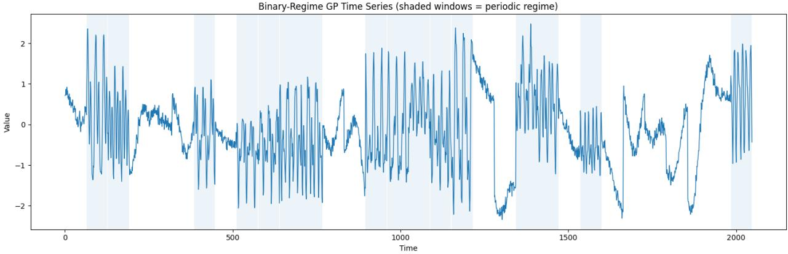  
Figure 5: Synthetic binary-regime GP time series of 2,048 observations. Each 64-step window is generated from either a smooth RBF GP (unshaded) or a periodic GP (shaded). The periodic regime has period 24.

## F.2 Simplified Transformer for Forecasting

We use a single-layer, single-head Transformer with model dimension $d _ { \mathrm { m o d e l } } = 3 2$ . For a historical input $\pmb { x } ^ { - } \in \mathbb { R } ^ { 6 4 }$ , a point-wise linear layer embeds each observation, and sinusoidal absolute positional encoding (APE) is added in every PE configuration considered below. The encoder computes

$$
\mathbf { } A _ { \phi } ( x ^ { - } ) = \mathrm { S o f t m a x } \left( \frac { Q K ^ { \top } } { \sqrt { 3 2 } } + B _ { \phi } ( x ^ { - } ) \right) , \qquad H ^ { \prime } = H + W _ { O } ( A _ { \phi } V ) ,
$$

where the softmax is applied across keys and $B _ { \phi }$ denotes the contribution of RPE, ALiBi, RoPE, or BTA to the attention scores. For RoPE, this notation represents the diference between rotated and unrotated query–key scores; that contribution depends on the input representations. BTA generates an input-conditioned bias by combining RBF experts initialized with length scales 7, 14, 28, 42 and periodic experts initialized with period 24 and length scales 0.35, 0.55, 0.9.

The 64 encoder outputs are averaged and passed through a linear decoder to produce $\widehat { \pmb { Y } } \in \mathbb { R } ^ { 4 }$ We train each model to minimize mean squared forecasting error using AdamW, a batch size of 64, a learning rate of $1 0 ^ { - 3 }$ , weight decay of $1 0 ^ { - 4 }$ , and at most 30 epochs. The best model is selected by validation MSE, with early stopping after seven epochs without improvement. For BTA, we additionally select the router width from {16, 32, 64, 128} and the number of selected experts from {1, 3, 5, 7}, using validation data only. All methods use the same data splits and random seed.

We train the simplified Transformer with four diferent PE methods including RPE (Liutkus et al., 2021), ALiBi (Press et al., 2021), RoPE (Su et al., 2024), and BTA on the binary-regime synthetic dataset. The performance of the simplified Transformer with the four diferent PE methods is summarized in Table 5 and the forecasting result given an input time series is shown in Figure 6.

Table 5: The forecasting performance on the binary-regime GP dataset. MSE is reported on standardized observations; lower is better. Smooth and periodic denote the two subsets of the test set.
<table><tr><td>PE Method</td><td>Best epoch</td><td>Val. MSE</td><td>Test MSE</td><td>Smooth MSE</td><td>Periodic MSE</td></tr><tr><td>RPE</td><td>30</td><td>0.2578</td><td>0.2337</td><td>0.1792</td><td>0.2882</td></tr><tr><td>RoPE</td><td>30</td><td>0.2364</td><td>0.2124</td><td>0.1354</td><td>0.2893</td></tr><tr><td>ALiBi</td><td>30</td><td>0.2573</td><td>0.2336</td><td>0.1801</td><td>0.2871</td></tr><tr><td>BTA</td><td>30</td><td>0.2049</td><td>0.1788</td><td>0.0993</td><td>0.2583</td></tr></table>

In addition, Figure 7 visualizes the positional bias induced by the four diferent PE methods.

## F.3 Synthetic Validation of the Population-Level ELBO

We design a binary-regime synthetic dataset to illustrate the population-level ELBO in Theorem 2 and examine the value of adaptive positional encoding (PE) when temporal dependencies change across forecasting windows. Each regime is generated by a zero-mean, weakly stationary Gaussian process (GP): the smooth regime uses an RBF covariance, while the periodic regime uses a periodic covariance with a 24-step cycle. Each model receives a 64-step history and predicts the next four observations. We train the same single-head Transformer with RPE, ALiBi, RoPE, or BTA; BTA uses its validation-selected router configuration.

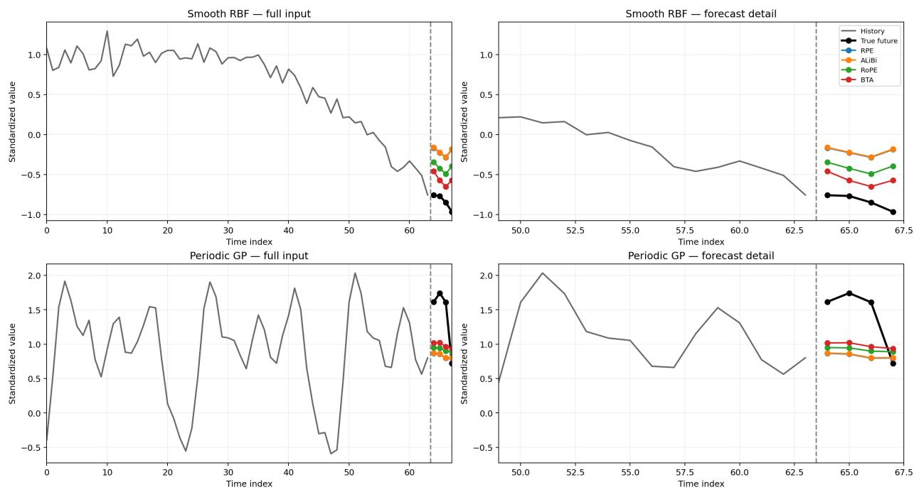  
Figure 6: Forecasting results from the smooth RBF GP (top row) and periodic GP (bottom row). The left panels show all 64 historical observations and the four future values; the right panels magnify the forecast boundary. Gray lines denote the observed history, black markers the true future, and colored markers the predictions from the simplified Transformer with the four PE methods: RPE, ALiBi, RoPE, and BTA. The dashed line marks the end of the input window.

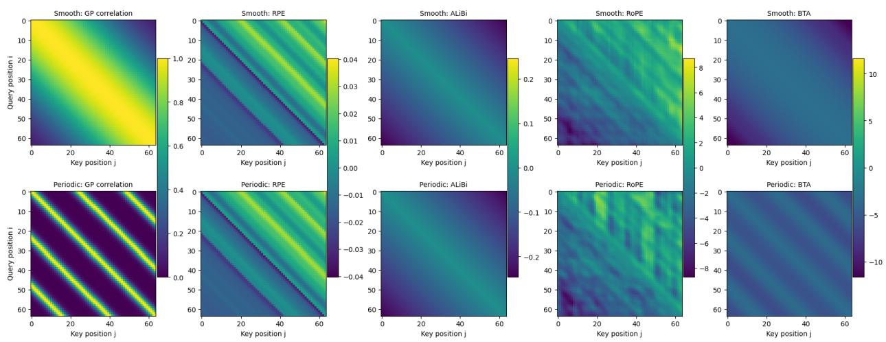  
Figure 7: The figure compares positional biases under smooth and periodic Gaussian process regimes. RPE and ALiBi retain the same bias pattern across both regimes, while BTA produces diferent biases for the two inputs, illustrating its ability to adapt temporal evidence to the regime.

For each trained model, we extract the positional score matrix $b _ { \phi } ( \pmb { x } ^ { - } )$ and construct one-sided score profiles over lags $1 , \ldots , K$ . We set $K = 3 2$ for the 64-step input windows. Here K specifies the maximum lag used to estimate temporal evidence, not the input length: it leaves $T - K = 3 2$ query positions with complete one-sided lag profiles and includes the periodic regime’s 24-step cycle. The forecaster continues to use the full 64-step history. A method-specific afine calibration is estimated from training windows and then held fixed on test windows. As in Appendix D, the mean and query-wise covariance of the calibrated profiles define

$$
q _ { \phi } ( Z \mid x ^ { - } ) = \mathcal { N } ( \pmb { \mu } _ { \phi } ( \pmb { x } ^ { - } ) , \pmb { K } _ { \phi } ( \pmb { x } ^ { - } ) ) .
$$

We add $\epsilon _ { q } I$ to the posterior covariance, with $\epsilon _ { q } = 1 0 ^ { - 4 }$ . For each regime $^ { r , }$ the GP autocovariance determines the mean and covariance of the lag-wise empirical autocovariance statistics, yielding the moment-matched temporal-evidence prior $p _ { r } ( Z ) = \mathcal { N } ( \gamma _ { r } , K _ { 0 , r } )$

We estimate the forecasting term by sampling S = 16 values from $q _ { \phi } ( Z \mid \pmb { x } _ { n } ^ { - } )$ for each test window. A sampled value perturbs the trained model’s observed positional scores at the corresponding lags; the trained parameters and observed content scores remain fixed. At $Z = \mu _ { \phi } ( \pmb { x } _ { n } ^ { - } )$ , the perturbation vanishes and the original forecast is recovered. Using the same Gaussian observation variance $\sigma ^ { 2 } = 1$ for every method, we compute

$$
\hat { \mathcal { L } } ( \phi ) = \frac { 1 } { N } \sum _ { n = 1 } ^ { N } \left[ \frac { 1 } { S } \sum _ { s = 1 } ^ { S } \log p _ { \theta , \phi } ( \boldsymbol { y } _ { n } \mid \boldsymbol { x } _ { n } ^ { - } , Z _ { n s } ) - D _ { \mathrm { K L } } ( q _ { \phi } ( Z \mid \boldsymbol { x } _ { n } ^ { - } ) \parallel p _ { r _ { n } } ( Z ) ) \right] , \quad Z _ { n s } \sim q _ { \phi } ( Z \mid \boldsymbol { x } _ { n } ^ { - } ) ,\tag{65}
$$

where $r _ { n }$ denotes the regime of window n. The first term measures forecasting fit under sampled temporal evidence; the second measures how closely the PE-induced evidence agrees with the window’s regime-specific GP prior. Their average is a Monte Carlo estimate of the population-level variational objective for this trained, input-dependent perturbation model.

Table 6: Forecasting performance and estimated ELBO on the binary-regime synthetic test set with $\epsilon _ { q } ~ = ~ 1 0 ^ { - 4 }$ The Test MSE column repeats the point-forecast results in Table 5. The remaining columns report the Monte Carlo diagnostics under sampled temporal evidence defined in Equation $6 5 ;$ expected log likelihood is not computed from the point-forecast MSE. Lower MSE and higher ELBO are better.
<table><tr><td>PE</td><td>Test MSE</td><td>Expected log likelihood</td><td>Mean KL</td><td>ELBO</td></tr><tr><td>RPE</td><td>0.2337</td><td>-4.1431</td><td>348.0968</td><td>-352.2399</td></tr><tr><td>ALiBi</td><td>0.2336</td><td>-4.1429</td><td>271.2189</td><td>-275.3619</td></tr><tr><td>RoPE</td><td>0.2124</td><td>-4.1105</td><td>51.4227</td><td>-55.5333</td></tr><tr><td>BTA</td><td>0.1788</td><td>-4.0492</td><td>46.6581</td><td>-50.7073</td></tr></table>

As shown in Table 6, BTA obtains both the lowest forecasting MSE and the highest estimated ELBO. Its expected log likelihood is higher and its posterior–prior KL is lower than those of the baseline PE methods. Here RPE and ALiBi use input-independent biases, whereas RoPE has a content-dependent positional score under our definition of static PE. The result is consistent with the hypothesis underlying Theorem 2 and Corollary 3: when diferent windows have smooth or periodic temporal dependence, an adaptive PE can supply more appropriate temporal evidence than a shared static positional structure. Thus, the synthetic dataset provides an empirical illustration of the population-level ELBO framework and its motivation for adaptive PE in non-stationary forecasting. The reported values pertain to the explicitly defined input-dependent perturbation model in Equation 65; they are not a direct numerical evaluation of the static covariance-reduced formula in Theorem 2.

## G Data Description

We evaluate non-stationary LTSF models on eight widely used multivariate time-series benchmarks spanning diverse sampling frequencies, dimensionalities, and temporal dynamics. Table 7 summarizes their characteristics and forecasting protocols. Following established settings (Liu et al., 2025a), we use chronological train/validation/test splits and prediction horizons $H \in \{ 9 6 , 1 9 2 , 3 3 6 , 7 2 0 \}$ . All data-dependent preprocessing parameters are estimated exclusively from the training set and applied unchanged to the validation and test sets. We additionally report the Augmented Dickey–Fuller (ADF) statistic as an indicator of stationarity: under a fixed test specification, a less negative ADF statistic indicates weaker evidence against the unit-root null and thus comparatively stronger non-stationary behavior.

• ETT (Zhou et al., 2021) contains transformer temperature and power-load measurements from two electricity-transformer stations in China between 2016 and 2018. It comprises two hourly datasets (ETTh1 and ETTh2) and two 15-minute datasets (ETTm1 and ETTm2), each with seven variables.

• Weather (Wu et al., 2023) contains 21 meteorological variables recorded in Germany at 10-minute intervals during 2020.

• Electricity (Wu et al., 2023) contains hourly electricity-consumption measurements from 321 customers between 2012 and 2014.

• Trafic (Wu et al., 2023) contains hourly freeway-occupancy measurements from 862 sensors in the San Francisco Bay Area during 2015–2016.

• Solar-Energy (Liu et al., 2024) contains 10-minute power-generation measurements from 137 photovoltaic plants in Alabama during 2006.

Table 7: Dataset characteristics and benchmark split-size summary, following Table 7 of TimeBridge (Liu et al., 2025a). C denotes the number of variables. Training, Validation, Testing, and ADF entries reproduce that source. Split sizes are provided as benchmark metadata; the number of usable forecasting windows depends on the input length, prediction horizon, and handling of historical overlap. Interval denotes the sampling period.
<table><tr><td>Dataset</td><td>C</td><td>Training</td><td>Validation</td><td>Testing</td><td>Interval</td><td>ADF stat.</td></tr><tr><td>ETTh1</td><td>7</td><td>8,545</td><td>2,881</td><td>2,881</td><td>1 hour</td><td>-5.91</td></tr><tr><td>ETTh2</td><td>7</td><td>8,545</td><td>2,881</td><td>2,881</td><td>1 hour</td><td>-4.13</td></tr><tr><td>ETTm1</td><td>7</td><td>34,465</td><td>11,521</td><td>11,521</td><td>15 min</td><td>-14.98</td></tr><tr><td>ETTm2</td><td>7</td><td>34,465</td><td>11,521</td><td>11,521</td><td>15 min</td><td>-5.66</td></tr><tr><td>Electricity</td><td>321</td><td>18,317</td><td>2,633</td><td>5,261</td><td>1 hour</td><td>-8.44</td></tr><tr><td>Traffic</td><td>862</td><td>12,185</td><td>1,757</td><td>3,509</td><td>1 hour</td><td>-15.02</td></tr><tr><td>Weather</td><td>21</td><td>36,792</td><td>5,271</td><td>10,540</td><td>10 min</td><td>-26.68</td></tr><tr><td>Solar-Energy</td><td>137</td><td>36,601</td><td>5,161</td><td>10,417</td><td>10 min</td><td>-37.23</td></tr></table>

## H Transformer-based backbone architectures

To evaluate whether BTA generalizes across substantially diferent Transformer architectures rather than benefiting a particular backbone, we select the four Transformer-based backbone architectures because of the following reasons:

• Informer represents an early eficient Transformer for long-sequence forecasting;

• PatchTST represents the widely adopted patch-based architecture;

• TimeBridge is specifically designed to model non-stationary temporal dependencies;

• Timer-XL represents recent generative time-series foundation models.

Moreover, Table 8 summarizes the key diference between the four backbone architectures.

Table 8: Comparison of the Transformer backbones used in our experiments.
<table><tr><td>Backbone</td><td>Informer (Zhou et al., 2021)</td><td>PatchTST (Nie et al., 2023)</td><td>TimeBridge (Liu et al., 2025a)</td><td>Timer-XL (Liu et al., 2025c)</td></tr><tr><td>Representative role</td><td>Early LTSF Transformer</td><td>Patch-based Transformer</td><td>Non-stationary Transformer</td><td>Pretrained TSFM</td></tr><tr><td>Architecture</td><td>Encoder-decoder</td><td>Encoder-only</td><td>Encoder-only</td><td>Decoder-only</td></tr><tr><td>Attention design</td><td>ProbSparse</td><td>Self-attention</td><td>Integrated + PatchDownsampling + Cointegrated</td><td>Causal TimeAttention</td></tr><tr><td>Tokenization</td><td>Point-wise</td><td>Patch-wise</td><td>Patch-wise</td><td>Patch-wise</td></tr><tr><td>Positional mechanism</td><td>Sinusoidal absolute PE</td><td>Learnable absolute PE</td><td>None</td><td>Rotary PE + variable bias</td></tr><tr><td>Training paradigm</td><td>Task-specific</td><td>Task-specific</td><td>Task-specific</td><td>Pretraining / task-specific</td></tr></table>

## I LTSF reference methods

To compare BTA with representative methods for non-stationary LTSF, we select ten models as baselines. They are divided into two groups. First, we include five methods specifically designed to address non-stationarity, distribution shifts, or heterogeneous temporal dynamics. Second, we include five widely used LTSF models spanning Transformer-, MLP-, convolution-, and linear-based architectures to evaluate BTA against representative general-purpose forecasting methods.

## 1. Methods for non-stationary forecasting:

• DTAF (Lu et al., 2026) addresses non-stationarity in both temporal and frequency domains through temporal stabilization and frequency diferencing.

• PULSE (Liu et al., 2026) models evolving non-stationary dynamics through phaseanchored disentanglement, generative phase evolution, and statistic-aware augmentation.

• TimeBridge (Liu et al., 2025a) employs Integrated and Cointegrated Attention to separately model stable short-term dependencies and non-stationary long-term cointegration.

• DUET (Qiu et al., 2025) uses dual clustering over temporal distributions and channels to capture heterogeneous temporal patterns and dynamic inter-variable dependencies.

• Non-stationary Transformer (Liu et al., 2022) combines Series Stationarization with De-stationary Attention to improve predictability while preserving informative nonstationary dependencies.

## 2. General LTSF methods:

• iTransformer (Liu et al., 2024) treats individual variates as tokens and applies selfattention across variables to capture multivariate dependencies.

• TimeMixer (Wang et al., 2024) employs multiscale decomposition and mixing to jointly model fine-scale seasonal patterns and coarse-scale trends.

• PatchTST (Nie et al., 2023) represents time series as patch-level tokens and uses channel-independent Transformers to capture long-range temporal dependencies eficiently.

• TimesNet (Wu et al., 2023) transforms one-dimensional time series into twodimensional representations based on multiple periods to model intra- and inter-period temporal variations.

• DLinear (Zeng et al., 2023) decomposes a time series into trend and seasonal components and forecasts them using simple linear mappings.

## J More Details of BTA Implementation

This section provides additional implementation details of BTA, including backbone integration, temporal-kernel construction, MoE routing, hyperparameter selection, and training.

## J.1 Backbone Integration

BTA is designed to augment rather than replace the native attention mechanism of each backbone. For the hth attention head of the nth input, the MoE router is constructed from the content-based attention scores

$$
s _ { i j } ^ { ( n , h ) , \mathrm { c o n t e n t } } = \frac { ( \pmb { q } _ { i } ^ { ( n , h ) } ) ^ { \top } \pmb { k } _ { j } ^ { ( n , h ) } } { \sqrt { d _ { k } } } .
$$

The adaptive positional bias generated by BTA is then added to the backbone-specific native attention logits:

$$
\begin{array} { r } { s _ { i j } ^ { ( n , h ) , \mathrm { B T A } } = s _ { i j } ^ { ( n , h ) , \mathrm { n a t i v e } } + b _ { i j } ^ { ( n , h ) , \mathrm { B T A } } , } \end{array}
$$

where $s _ { i j } ^ { ( n , h ) }$ ,native includes the native positional mechanism of the backbone when applicable. The resulting logits are normalized by the original attention softmax.

We integrate BTA into Informer, PatchTST, TimeBridge, and Timer-XL through the same additive modification. These backbones difer substantially in tokenization, attention design, and positional mechanisms, but no other backbone component is modified. Thus, BTA preserves the original architecture while introducing an additional input- and head-adaptive temporal bias.

## J.2 Temporal Kernel Bank

We construct an over-complete temporal kernel bank using radial basis function (RBF) and periodic (PER) kernels to represent complementary local, long-range, and seasonal dependencies. Let $\tau _ { i j } =$ $| i - j |$ denote the relative token lag. For point-wise models, $\tau _ { i j }$ is measured in time steps, whereas for patch-based models it is measured in patches.

RBF kernels. The RBF log-kernel is

$$
\psi _ { r } ^ { \mathrm { R B F } } ( \tau _ { i j } ; \ell _ { r } ) = - \frac { \tau _ { i j } ^ { 2 } } { 2 \ell _ { r } ^ { 2 } } , \qquad r = 1 , \ldots , 5 ,
$$

where $\ell _ { r }$ controls the temporal scale. We parameterize each RBF scale relative to the available input context,

$$
\ell _ { r } = \rho _ { r } L , \qquad \rho _ { r } \in \mathcal { R } _ { \mathrm { R B F } } ,
$$

where L denotes the number of input tokens or patches and $\mathcal { R } _ { \mathrm { R B F } }$ contains five fixed scale coefficients. This normalization allows the same kernel construction to be used across backbones with diferent input lengths and tokenization schemes.

Periodic kernels. To model recurring temporal structure, we first identify the two dominant periods

$$
p _ { e } \in \{ p _ { 1 } , p _ { 2 } \} , \qquad e \in \{ 1 , 2 \} ,
$$

using Fourier analysis of the training data only. For each dominant period, we instantiate three periodic kernels with diferent peak widths:

$$
\psi _ { r , e } ^ { \mathrm { P E R } } ( \tau _ { i j } ; \eta _ { r } , p _ { e } ) = - \frac { 2 \sin ^ { 2 } ( \pi \tau _ { i j } / p _ { e } ) } { \eta _ { r } ^ { 2 } } , \qquad r = 1 , 2 , 3 , \quad e = 1 , 2 ,
$$

where $\eta _ { r }$ is a dimensionless width parameter. The corresponding temporal peak width can equivalently be expressed as

$$
\ell _ { r , e } ^ { \prime } = \eta _ { r } p _ { e } .
$$

Thus, the periodic kernel bank contains $2 \times 3 = 6$ candidate kernels, spanning two dominant periods and three temporal widths for each period.

The complete kernel bank therefore contains

$$
M = 5 ~ { \mathrm { R B F ~ k e r n e l s } } + 6 ~ { \mathrm { p e r i o d i c ~ k e r n e l s } } = 1 1
$$

candidate temporal patterns. All kernel parameters are fixed before model training; BTA learns only how to combine these candidate kernels for each input and attention head.

## J.3 MoE Router Configuration

For each input n and attention head h, we aggregate the content-based attention scores associated with the same relative lag to construct the one-dimensional temporal-evidence (TE) routing profile

$$
e _ { \tau } ^ { ( n , h ) } = \frac { 1 } { | \mathcal { Z } _ { \tau } | } \sum _ { ( i , j ) \in \mathcal { I } _ { \tau } } s _ { i j } ^ { ( n , h ) , \mathrm { c o n t e n t } } , \qquad \mathcal { Z } _ { \tau } = \{ ( i , j ) : | i - j | = \tau \} .
$$

This profile summarizes how strongly the learned content representations associate query–key pairs at diferent temporal lags.

To capture complementary lag-domain and frequency-domain information, the router receives

$$
\Big [ e ^ { ( n , h ) } ; \Big | \mathcal { F } \left( e ^ { ( n , h ) } \right) \Big | \Big ] ,
$$

where $\mathcal F ( \cdot )$ denotes the discrete Fourier transform and $| \mathcal F ( \cdot ) |$ denotes its magnitude spectrum.

The router is a one-hidden-layer MLP with M = 11 outputs, corresponding to the five RBF and six periodic candidate kernels. Let $\pmb { g } ^ { ( n , h ) } \in \mathbb { R } ^ { M }$ denote its output logits. We retain the Top-k logits and apply softmax over the selected experts, setting the remaining mixture weights to zero. This yields

$$
\omega ^ { ( n , h ) } = [ \omega _ { 1 } ^ { ( n , h ) } , \dots , \omega _ { M } ^ { ( n , h ) } ] , \qquad \sum _ { c = 1 } ^ { M } \omega _ { c } ^ { ( n , h ) } = 1 .
$$

The resulting input- and head-specific mixture weights are used in Equation $7$ to construct the adaptive positional bias.

## J.4 Hyperparameter Configuration

The principal BTA hyperparameters are the router hidden dimension $d _ { r }$ and the number of retained experts k. We search

$$
k \in \{ 1 , 3 , 5 , 7 \}
$$

and use backbone-specific search grids for $d _ { r }$ , as summarized in Table 9.

Each router-dimension grid is represented by $( d _ { \mathrm { s t a r t } } , d _ { \mathrm { u b } } , \Delta d )$ and contains candidate values

$$
d _ { r } = d _ { \mathrm { s t a r t } } + m \Delta d , \qquad m \in \mathbb { Z } _ { \ge 0 } , \qquad d _ { r } \le d _ { \mathrm { u b } } ,
$$

where $d _ { \mathrm { u b } }$ denotes an upper bound rather than necessarily an included endpoint. Hyperparameters are selected according to validation-set forecasting performance and fixed before test-set evaluation.

## J.5 Training and Optimization

For each backbone, BTA follows the corresponding vanilla training protocol. The temporal kernels remain fixed throughout training, whereas the MoE router and trainable backbone parameters are optimized jointly. Informer, PatchTST, and TimeBridge are trained task-specifically. Timer-XL is initialized from its pretrained checkpoint and adapted to each forecasting dataset through full-shot fine-tuning.

For each experimental run, the random seed is fixed for reproducibility. The robustness analysis in Table 11 additionally repeats each configuration across three predefined random seeds and reports the mean and sample standard deviation.

## K Main Experiment Appendix

BTA generalizes across diferent Transformer backbones. Table 10 reports the per-horizon results underlying Table 1. Across three backbones with diferent tokenization and attention designs, BTA consistently improves the vanilla attention mechanism while leaving the remaining backbone architecture unchanged. Averaged over the four forecasting horizons, BTA reduces MSE by 5.79–14.05% for Informer, 4.34–17.51% for PatchTST, and 1.74–11.80% for Timer-XL. Across all 96 backbone–dataset–horizon–metric settings, BTA improves 95, with the only exception being the MAE of Informer on ETTm1 at H = 192 (−0.49%). These consistent gains across heterogeneous architectures demonstrate the broad applicability of BTA as a plug-and-play attention enhancement.

Table 9: BTA configuration across the four Transformer backbones. Router hidden-dimension search ranges are reported as $( d _ { \mathrm { s t a r t } } , d _ { \mathrm { u b } } , \Delta d )$ , where $d _ { \mathrm { u b } }$ is the search upper bound and ∆d is the step size. For PatchTST, patch length $P = 1 6$ , stride $S = 8 .$ and end padding give $N = \lfloor ( T - P ) / S \rfloor + 2 = 1 2$ input patches for $T = 9 6$ , following the patching convention of Nie et al. (2023).
<table><tr><td>Configuration</td><td>Informer</td><td>PatchTST</td><td>TimeBridge</td><td>Timer-XL</td></tr><tr><td>Token level</td><td>Point-wise</td><td>Patch-wise</td><td>Patch-wise</td><td>Patch-wise</td></tr><tr><td>Sequence length</td><td>96</td><td>96</td><td>720</td><td>672</td></tr><tr><td>Patch length</td><td>1</td><td>16</td><td>24 or 48</td><td>96</td></tr><tr><td>Input tokens</td><td>96</td><td>12</td><td>30 or 15</td><td>7</td></tr><tr><td>Lag unit</td><td>Time step</td><td>Patch</td><td>Patch</td><td>Patch</td></tr><tr><td>Kernel families</td><td>RBF + Periodic</td><td>RBF + Periodic</td><td>RBF + Periodic</td><td>RBF + Periodic</td></tr><tr><td>RBF kernels</td><td>5</td><td>5</td><td>5</td><td>5</td></tr><tr><td>Dominant periods</td><td>2</td><td>2</td><td>2</td><td>2</td></tr><tr><td>Periodic widths per period</td><td>3</td><td>3</td><td>3</td><td>3</td></tr><tr><td>Periodic kernels</td><td>6</td><td>6</td><td>6</td><td>6</td></tr><tr><td>Total kernels M</td><td>11</td><td>11</td><td>11</td><td>11</td></tr><tr><td>Router architecture Top-k</td><td>1-layer MLP</td><td>1-layer MLP</td><td>1-layer MLP {1, 3, 5, 7}</td><td>1-layer MLP</td></tr><tr><td>Router hidden-dimension grid  $( d _ { \mathrm { s t a r t } } , d _ { \mathrm { u b } } , \Delta d )$ </td><td>(32, 1024, 64)</td><td>(32, 512, 32)</td><td>(32, 512, 32)</td><td>(32, 2048, 64)</td></tr><tr><td>Optimization</td><td>Task-specific training</td><td>Task-specific training</td><td>Task-specific training</td><td>Pretrained + full-shot fine-tuning</td></tr></table>

Table 10: Per-horizon forecasting results of BTA across three Transformer backbones. Results are reported for $H \in \{ 9 6 , 1 9 2 , 3 3 6 , 7 2 0 \}$ . Within each backbone and row, the lower MSE and MAE between Vanilla and BTA are shown in bold. Avg. denotes the mean over the four horizons, and Gain (%) is the relative error reduction $1 0 0 \times \mathrm { ( V a n i l l a - B T A ) / V a n i l l a } .$ , computed from unrounded values for the Avg. rows. Backbone configurations are summarized in Table 9.
<table><tr><td colspan="2">Model</td><td colspan="4">Informer (Zhou et al., 2021)</td><td colspan="4">PatchTST (Nie et al., 2023)</td><td colspan="4">Timer-XL (Liu et al., 2025c)</td></tr><tr><td colspan="2">Self-Attention|</td><td>Vanilla</td><td>BTA</td><td>Gain (%)</td><td></td><td>Vanilla</td><td>BTA</td><td></td><td>Gain (%)</td><td>Vanilla</td><td>BTA</td><td></td><td>Gain (%)</td></tr><tr><td colspan="2">Dataset</td><td colspan="10">|MSE MAE|MSE MAE| C|∆MSE ∆MAE|MSE MAE|MSE MAE| |∆MSE ∆MAE|MSE MAE|MSE MAE|4 |∆MSE ∆MAE</td></tr><tr><td rowspan="6">ET1</td><td>96</td><td>|0.992 0.785|</td><td>|0.878 0.719</td><td>11.49</td><td>8.41</td><td>|[0.460 0.447|</td><td>|0.367 0.394</td><td>20.22</td><td>11.86</td><td>|0.364 0.397|</td><td>|0.343 0.379</td><td>5.77</td><td>4.53</td></tr><tr><td>192</td><td>1.008 0.801</td><td>0.895 0.726</td><td>11.21</td><td>9.36</td><td>0.512 0.447</td><td>0.423 0.425</td><td>17.38</td><td>4.92</td><td>0.4050.424</td><td>0.376 0.402</td><td>7.16</td><td>5.19</td></tr><tr><td>336</td><td>1.179 0.870</td><td>1.038 0.793</td><td>11.96</td><td>8.85</td><td>0.546 0.496</td><td>0.441 0.436</td><td>19.23</td><td>12.10</td><td>0.427 0.439</td><td>0.391 0.413</td><td>8.43</td><td>5.92</td></tr><tr><td>720</td><td>1.204 0.882</td><td>1.112 0.837</td><td>7.64</td><td>5.10</td><td>0.544 0.517</td><td>0.470 0.461</td><td>13.60</td><td>10.83</td><td>0.439 0.459</td><td>0.406 0.433</td><td>7.52</td><td>5.66</td></tr><tr><td>Avg.</td><td>|1.096 0.835|0.981 0.769</td><td></td><td>10.50</td><td>7.88</td><td>|0.516 0.477|</td><td>|0.425 0.429</td><td>17.51</td><td>10.02</td><td>|0.409 0.430|0.379 0.407|</td><td></td><td>7.28</td><td>5.35</td></tr><tr><td>96</td><td>|0.672 0.614|0.586 0.557</td><td></td><td>12.80</td><td>9.28</td><td>[0.352 0.374|0.315 0.355</td><td></td><td>10.51</td><td>5.08</td><td>[0.290 0.341</td><td>|0.284 0.337</td><td>2.07</td><td>1.17</td></tr><tr><td rowspan="4">ETm1</td><td>192</td><td>0.692 0.610</td><td>0.671 0.613</td><td>3.03</td><td>-0.49</td><td>0.390 0.393</td><td>0.358 0.381</td><td>8.21</td><td>3.05</td><td>0.337 0.369</td><td>0.332 0.367</td><td>1.48</td><td>0.54</td></tr><tr><td>336</td><td>0.942 0.749</td><td>0.831 0.685</td><td>11.78</td><td>8.54</td><td>0.421 0.414</td><td>0.373 0.401</td><td>11.40</td><td>3.14</td><td>0.374 0.392</td><td>0.367 0.390</td><td>1.87</td><td>0.51</td></tr><tr><td>720</td><td>0.998 0.787</td><td>0.936 0.754</td><td>6.21</td><td>4.19</td><td>0.462 0.449</td><td>0.436 0.443</td><td>5.63</td><td>1.34</td><td>0.437 0.428</td><td>0.430 0.426</td><td>1.60</td><td>0.47</td></tr><tr><td>Avg.</td><td>|0.826 0.690|0.756 0.652|</td><td></td><td>8.47</td><td>5.47</td><td>|0.406 0.408|0.371 0.395|</td><td></td><td>8.80</td><td>3.07</td><td>|0.360 0.383|</td><td>|0.353 0.380|</td><td>1.74</td><td>0.65</td></tr><tr><td rowspan="5">Weather</td><td></td><td>|0.313 0.375|0.253 0.335</td><td></td><td>19.17</td><td>10.67</td><td></td><td>|0.170 0.212|</td><td>8.60</td><td>6.61 |0.157 0.205|</td><td></td><td></td><td></td><td>3.90</td></tr><tr><td>96 192</td><td>0.377 0.408</td><td>0.299 0.369</td><td>20.69</td><td>9.56</td><td>[0.186 0.227| 0.234 0.265</td><td>0.219 0.256</td><td>6.41</td><td>3.40</td><td>0.206 0.250</td><td>0.153 0.197</td><td>2.55 2.91</td><td>2.80</td></tr><tr><td>336</td><td>0.448 0.449</td><td>0.389 0.413</td><td>13.17</td><td>8.02</td><td>0.284 0.301</td><td>0.274 0.295</td><td>3.52</td><td>1.99</td><td>0.259 0.291</td><td>0.200 0.243 0.255 0.285</td><td>1.54</td><td>2.06</td></tr><tr><td>720</td><td>[0.712 0.604</td><td>0.649 0.577</td><td>8.85</td><td>4.47</td><td>0.356 0.349</td><td>0.351 0.347</td><td>1.40</td><td>0.57</td><td>0.337 0.344</td><td>0.332 0.338</td><td>1.48</td><td>1.74</td></tr><tr><td>Avg.</td><td>|0.463 0.459|0.398 0.424|</td><td></td><td>14.05</td><td>7.73</td><td>|0.265 0.286|0.254 0.278|</td><td></td><td>4.34</td><td>2.80</td><td>|0.240 0.273|</td><td>|0.235 0.266|</td><td>1.98</td><td>2.48</td></tr><tr><td rowspan="4">Solar</td><td>96</td><td>|0.200 0.253|0.191 0.249|</td><td></td><td>4.50</td><td>1.58</td><td>|0.234 0.286|0.208 0.249</td><td></td><td>11.11</td><td>12.94</td><td></td><td></td><td>4.60</td><td>0.47</td></tr><tr><td>192</td><td>0.240 0.273</td><td>0.224 0.260</td><td>6.67</td><td>4.76</td><td>[0.267 0.310|</td><td>0.241 0.272</td><td>9.74</td><td>12.26</td><td>|0.174 0.215| 0.199 0.234</td><td>|0.166 0.214| 0.187 0.232</td><td>6.03</td><td>0.85</td></tr><tr><td>336</td><td>0.244 0.273</td><td>0.234 0.262</td><td>4.10</td><td>4.03</td><td>0.290 0.315</td><td>0.258 0.284</td><td>11.03</td><td>9.84</td><td>0.225 0.255</td><td>0.200 0.248</td><td>11.11</td><td>2.75</td></tr><tr><td>720</td><td>0.248 0.2740.229 0.271</td><td></td><td>7.66</td><td>1.09</td><td>0.289 0.317</td><td>0.257 0.282</td><td>11.07</td><td>11.04</td><td>0.275 0.285</td><td>0.217 0.273</td><td>21.09</td><td>4.21</td></tr><tr><td rowspan="2"></td><td>Avg.</td><td>|0.233 0.268|0.220 0.261</td><td></td><td>5.79</td><td>2.89</td><td>[0.270 0.307|0.241 0.272|</td><td></td><td>10.74</td><td>11.48</td><td>|0.218 0.247|0.193 0.242|</td><td></td><td>11.80</td><td>2.22</td></tr><tr><td></td><td></td><td></td><td></td><td></td><td></td><td></td><td></td><td></td><td></td><td></td><td></td><td></td></tr></table>

To examine the robustness of BTA, we train the three backbones integrated with BTA across the four datasets and four diferent forecasting horizons. Table 11 shows that BTA generally achieves lower mean MSE than vanilla self-attention. The multi-seed results also show limited variation across random initializations, supporting the robustness of BTA’s forecasting performance.

Table 11: Forecasting MSE across three Transformer backbones and three random seeds. Results are reported as mean ± sample standard deviation for H ∈ {96, 192, 336, 720}. Within each backbone, dataset, and horizon, the method with the lower mean MSE has both its mean and standard deviation shown in bold.
<table><tr><td colspan="2">Model</td><td colspan="2">Informer (Zhou et al., 2021)</td><td colspan="2">PatchTST (Nie et al., 2023)</td><td colspan="2">Timer-XL (Liu et al., 2025c)</td></tr><tr><td></td><td>Dataset Horizon</td><td>Vanilla MSE</td><td>BTA MSE</td><td>Vanilla MSE</td><td>BTA MSE</td><td>Vanilla MSE</td><td>BTA MSE</td></tr><tr><td rowspan="4">ET1</td><td>96</td><td>0.994 ± 0.003</td><td>0.876 ± 0.004</td><td>0.462 ± 0.005</td><td>0.366 ± 0.004</td><td>0.366 ± 0.005</td><td>0.345 ± 0.003</td></tr><tr><td>192</td><td>1.012 ± 0.012 0.895 ± 0.003</td><td></td><td>0.511 ± 0.004 0.422 ± 0.006</td><td></td><td>0.404 ± 0.011</td><td>0.379 ± 0.006</td></tr><tr><td>336</td><td>1.174 ± 0.009</td><td>1.036 ± 0.020</td><td>0.548 ± 0.016 0.447 ± 0.012</td><td></td><td>0.422 ± 0.018</td><td>0.397 ± 0.010</td></tr><tr><td>720</td><td>1.204 ± 0.001</td><td>1.111 ± 0.006</td><td>0.543 ± 0.005 0.470 ± 0.002</td><td></td><td>0.437 ± 0.006</td><td>0.406 ± 0.003</td></tr><tr><td rowspan="4">ETm1</td><td>96</td><td>0.672 ± 0.001</td><td>0.586 ± 0.001</td><td>0.352 ± 0.001</td><td>0.315 ± 0.001</td><td>0.290 ± 0.001</td><td>0.283 ± 0.001</td></tr><tr><td>192</td><td>0.693 ± 0.003</td><td>0.669 ± 0.005</td><td>0.391 ± 0.005</td><td>0.359 ± 0.002</td><td>0.337 ± 0.004</td><td>0.332 ± 0.002</td></tr><tr><td>336</td><td>0.940 ± 0.008</td><td>0.831 ± 0.001</td><td>0.421 ± 0.002</td><td>0.373 ± 0.000</td><td>0.372 ± 0.004</td><td>0.371 ± 0.003</td></tr><tr><td>720</td><td>0.998 ± 0.007</td><td>0.937 ± 0.007</td><td>0.460 ± 0.013 0.436 ± 0.001</td><td></td><td>0.440 ± 0.010</td><td>0.435 ± 0.004</td></tr><tr><td rowspan="4">Wether</td><td>96</td><td>0.315 ± 0.002</td><td>0.254 ± 0.002</td><td>0.184 ± 0.002</td><td>0.172 ± 0.002</td><td>0.157 ± 0.002</td><td>0.150 ± 0.003</td></tr><tr><td>192</td><td>0.378 ± 0.001</td><td>0.294 ± 0.005</td><td>0.233 ± 0.001</td><td>0.222 ± 0.004</td><td>0.206 ± 0.006</td><td>0.197 ± 0.003</td></tr><tr><td>336</td><td>0.449 ± 0.001</td><td>0.389 ± 0.001</td><td>0.282 ± 0.003</td><td>0.275 ± 0.003</td><td>0.261 ± 0.002</td><td>0.251 ± 0.004</td></tr><tr><td>720</td><td>0.712 ± 0.004</td><td>0.651 ± 0.002</td><td>0.355 ± 0.002</td><td>0.352 ± 0.001</td><td>0.336 ± 0.004</td><td>0.327 ± 0.006</td></tr><tr><td rowspan="4">Sollar</td><td>96</td><td>0.200 ± 0.000</td><td>0.191 ± 0.000</td><td>0.234 ± 0.000</td><td>0.208 ± 0.000</td><td>0.174 ± 0.000</td><td>0.166 ± 0.000</td></tr><tr><td>192</td><td>0.240 ± 0.000</td><td>0.225 ± 0.001</td><td>0.268 ± 0.001</td><td>0.242 ± 0.001</td><td>0.200 ± 0.001</td><td>0.186 ± 0.001</td></tr><tr><td>336</td><td>0.244 ± 0.001</td><td>0.234 ± 0.000</td><td>0.290 ± 0.001</td><td>0.258 ± 0.000</td><td></td><td>0.225 ± 0.000 0.201 ± 0.001</td></tr><tr><td>720</td><td>0.248 ± 0.001 0.228 ± 0.001</td><td></td><td>0.289 ± 0.000 0.256 ± 0.001</td><td></td><td></td><td>0.275 ± 0.001 0.218 ± 0.001</td></tr></table>

BTA Improves TimeBridge for Non-stationary LTSF. Table 12 compares Time-Bridge+BTA (Ours) with the original TimeBridge and other representative LTSF methods under the same input length T = 720. Integrating BTA consistently improves TimeBridge across all eight datasets, reducing the overall average MSE and MAE by 2.39% and 1.89%, respectively. Moreover, TimeBridge+BTA achieves the lowest MSE in 29 of 32 horizon-level settings and the lowest MAE in 23, substantially exceeding all competing methods. These results demonstrate that BTA provides a consistent additional benefit to an already competitive non-stationary forecasting backbone.

## L More case studies

Figures 8, 9, and 10 further illustrate how BTA adapts positional biases to heterogeneous temporal dynamics. On Solar, both windows exhibit strong periodic structure, but BTA selects diferent temporal scales: irregular peak amplitudes lead to a combination of broader periodic and longrange local kernels, whereas more regularly recurring peaks favor narrower periodic kernels. On

Table 12: Per-horizon comparison for non-stationary LTSF. Ours denotes TimeBridge+BTA, enabling direct comparison with the original TimeBridge to isolate the contribution of BTA. All methods use input length $T = 7 2 0$ and prediction horizons $H \in \{ 9 6 , 1 9 2 , 3 3 6 , 7 2 0 \}$ . Avg. denotes the mean over the four horizons. The best and second-best results for each dataset, horizon, and metric are shown in bold and underlined, respectively. 1st Count reports the number of horizon-level settings in which each method achieves the best result, excluding Avg. rows and counting ties for all tied methods.
<table><tr><td rowspan=1 colspan=14>Model   Ours                                               iTransformer TimeMixer(Liu et al., 2026) (Lu et al., 2026) (Qiu et al., 2025) (Liu et al., 2025a) (Liu et al., 2024) (Wang et al., 2024) (Nie et al., 2023) (Wu et al., 2023) (Zeng et al., 2023) (Liu et al., 2022)</td></tr><tr><td rowspan=1 colspan=1>Metric|</td><td rowspan=1 colspan=1>MSEMAE</td><td rowspan=1 colspan=2>|MSEMAE|MSEMAE</td><td rowspan=1 colspan=3>|MSEMAE|MSEMAE</td><td rowspan=1 colspan=4>|MSEMAE|MSEMAE|MSEMAE</td><td rowspan=1 colspan=1>|MSEMAE</td><td rowspan=1 colspan=1>|MSEMAE</td><td rowspan=1 colspan=1>|MSEMAE</td></tr><tr><td rowspan=2 colspan=1>96|ETm11923360</td><td rowspan=2 colspan=1>0.2750.330|0.3150.359.3510.385</td><td rowspan=2 colspan=1>0.3030.347|0.3490.3790.3750.398</td><td rowspan=1 colspan=1>0.2770.329|0.3290.361</td><td rowspan=1 colspan=2>0.2790.336|0.3180.359</td><td rowspan=1 colspan=1>0.2840.337|0.3230.365</td><td rowspan=1 colspan=1>0.3000.353|0.3450.382</td><td rowspan=1 colspan=3>0.293 0.345|0.2930.346|0.335 0.372 0.3330.370|</td><td rowspan=1 colspan=1>0.3380.375|0.3710.387</td><td rowspan=1 colspan=1>0.2990.343|0.3350.365|</td><td rowspan=1 colspan=1>0.3930.4040.4810.447</td></tr><tr><td rowspan=1 colspan=1>0.3450.374</td><td rowspan=1 colspan=2>0.3450.378</td><td rowspan=1 colspan=1>0.3700.394</td><td rowspan=1 colspan=1>0.3740.398</td><td rowspan=1 colspan=2>0.368 0.386</td><td rowspan=1 colspan=1>0.3690.390</td><td rowspan=1 colspan=1>0.4100.411</td><td rowspan=1 colspan=1>0.3690.386</td><td rowspan=1 colspan=1>0.5550.489</td></tr><tr><td rowspan=1 colspan=1>720</td><td rowspan=1 colspan=1>0.4080.411</td><td rowspan=1 colspan=1>0.4240.426</td><td rowspan=1 colspan=1>0.3990.407</td><td rowspan=1 colspan=2>0.4000.408</td><td rowspan=1 colspan=1>0.4150.418</td><td rowspan=1 colspan=1>0.4290.430</td><td rowspan=1 colspan=2>0.426 0.417</td><td rowspan=1 colspan=1>0.4160.420</td><td rowspan=1 colspan=1>0.4780.450</td><td rowspan=1 colspan=1>0.4250.421</td><td rowspan=1 colspan=1>0.6770.548</td></tr><tr><td rowspan=1 colspan=1>Avg.</td><td rowspan=1 colspan=1>|0.3370.371</td><td rowspan=1 colspan=1>|0.3630.388</td><td rowspan=1 colspan=1>|0.338 0.368</td><td rowspan=1 colspan=2>|0.3360.370</td><td rowspan=1 colspan=1>|0.3480.379</td><td rowspan=1 colspan=1>|0.3620.391</td><td rowspan=1 colspan=2>|0.3560.380</td><td rowspan=1 colspan=1>|0.3530.381</td><td rowspan=1 colspan=1>|0.3990.406|0</td><td rowspan=1 colspan=1>.3570.379</td><td rowspan=1 colspan=1>|0.5270.472</td></tr><tr><td rowspan=3 colspan=1>96ET32192336</td><td rowspan=1 colspan=1>|0.1550.242</td><td rowspan=1 colspan=1>|0.1630.248|</td><td rowspan=1 colspan=1>0.1600.245|</td><td rowspan=1 colspan=2>0.1640.253</td><td rowspan=2 colspan=1>0.1570.243|0.2240.286</td><td rowspan=2 colspan=1>0.1750.266|0.2420.312</td><td rowspan=2 colspan=2>0.165 0.2560.2250.298</td><td rowspan=1 colspan=1>|0.1660.256</td><td rowspan=1 colspan=1>|0.1870.267|</td><td rowspan=1 colspan=1>0.1670.260</td><td rowspan=1 colspan=1>|0.2660.324</td></tr><tr><td rowspan=2 colspan=1>0.2150.2830.2660.320</td><td rowspan=2 colspan=1>0.2270.2910.2830.330</td><td></td><td></td><td></td><td></td><td></td><td rowspan=1 colspan=1>0.2240.303</td><td rowspan=1 colspan=1>0.4340.405</td></tr><tr><td rowspan=1 colspan=1>0.283 0.330</td><td rowspan=1 colspan=1>0.2690.321</td><td rowspan=1 colspan=2>0.2770.331</td><td rowspan=1 colspan=1>0.2690.321</td><td rowspan=1 colspan=1>0.2820.340</td><td rowspan=1 colspan=2>0.277 0.332</td><td rowspan=1 colspan=1>0.2740.329</td><td rowspan=1 colspan=1>0.3210.351</td><td rowspan=1 colspan=1>0.281 0.342</td><td rowspan=1 colspan=1>0.8080.563</td></tr><tr><td rowspan=1 colspan=1>7200</td><td rowspan=1 colspan=1>.3460.3750</td><td rowspan=1 colspan=1>.3740.3870</td><td rowspan=1 colspan=1>.3510.378</td><td rowspan=1 colspan=2>0.3580.386</td><td rowspan=1 colspan=1>0.3480.378</td><td rowspan=1 colspan=1>0.3780.398</td><td rowspan=1 colspan=2>0.3600.3870</td><td rowspan=1 colspan=1>.3620.3850</td><td rowspan=1 colspan=1>.4970.4030</td><td rowspan=1 colspan=1>.3970.4210</td><td rowspan=1 colspan=1>.7580.555</td></tr><tr><td rowspan=1 colspan=1>Avg.</td><td rowspan=1 colspan=1>|0.2460.305</td><td rowspan=1 colspan=1>|0.2620.314|</td><td rowspan=1 colspan=1>0.2490.307</td><td rowspan=1 colspan=2>|0.2550.316</td><td rowspan=1 colspan=1>|0.2500.307</td><td rowspan=1 colspan=1>|0.2690.329|</td><td rowspan=1 colspan=2>0.257 0.318</td><td rowspan=1 colspan=1>|0.2560.317</td><td rowspan=1 colspan=1>|0.3140.333</td><td rowspan=1 colspan=1>|0.2670.332</td><td rowspan=1 colspan=1>|0.5670.462</td></tr><tr><td rowspan=3 colspan=1>96ET41192336</td><td rowspan=1 colspan=1>|0.3470.385</td><td rowspan=1 colspan=1>|0.3620.390</td><td rowspan=1 colspan=1>|0.3690.396</td><td rowspan=1 colspan=2>|0.3580.391</td><td rowspan=1 colspan=1>0.3540.390</td><td rowspan=1 colspan=1>|0.3860.405|</td><td rowspan=1 colspan=2>0.372 0.401</td><td rowspan=1 colspan=1>|0.3700.400|</td><td rowspan=1 colspan=1>0.3840.402|</td><td rowspan=1 colspan=1>0.3750.399|</td><td rowspan=1 colspan=1>0.5470.501</td></tr><tr><td rowspan=1 colspan=1>0.3860.414</td><td rowspan=1 colspan=1>0.4080.4180</td><td rowspan=1 colspan=1>.4040.419</td><td></td><td rowspan=1 colspan=1>16</td><td rowspan=2 colspan=1>0.3890.4140.4080.430</td><td rowspan=2 colspan=1>0.4240.4400.4490.460</td><td rowspan=1 colspan=2>0.4130.430</td><td rowspan=1 colspan=1>0.4130.429</td><td rowspan=1 colspan=1>0.5570.4360</td><td rowspan=1 colspan=1>.4050.416</td><td rowspan=1 colspan=1>0.6030.529</td></tr><tr><td rowspan=1 colspan=1>0.4040.426</td><td rowspan=1 colspan=1>0.4430.433</td><td rowspan=1 colspan=1>0.4490.453</td><td rowspan=1 colspan=2>0.4180.431</td><td rowspan=1 colspan=2>0.4380.450</td><td rowspan=1 colspan=1>0.4220.440</td><td rowspan=1 colspan=1>0.4910.469</td><td rowspan=1 colspan=1>0.4390.443</td><td rowspan=1 colspan=1>0.7110.585</td></tr><tr><td rowspan=1 colspan=1>7200</td><td rowspan=1 colspan=1>.4370.465</td><td rowspan=1 colspan=1>0.4330.448|</td><td rowspan=1 colspan=1>0.4410.471</td><td rowspan=1 colspan=2>0.4410.471</td><td rowspan=1 colspan=1>0.4430.468</td><td rowspan=1 colspan=1>0.4950.487</td><td rowspan=1 colspan=2>0.486 0.484</td><td rowspan=1 colspan=1>0.4470.4680</td><td rowspan=1 colspan=1>.5210.5000</td><td rowspan=1 colspan=1>.4720.490|</td><td rowspan=1 colspan=1>0.7140.601</td></tr><tr><td rowspan=1 colspan=1>Avg.</td><td rowspan=1 colspan=1>|0.3940.423</td><td rowspan=1 colspan=1>|0.4120.422</td><td rowspan=1 colspan=1>|0.416 0.435</td><td rowspan=1 colspan=2>|0.4040.427|</td><td rowspan=1 colspan=1>0.3990.426</td><td rowspan=1 colspan=1>|0.4390.448</td><td rowspan=1 colspan=2>|0.4270.441</td><td rowspan=1 colspan=1>|0.4130.434</td><td rowspan=1 colspan=1>|0.4880.452</td><td rowspan=1 colspan=1>|0.4230.437</td><td rowspan=1 colspan=1>|0.6440.554</td></tr><tr><td rowspan=2 colspan=1>96E7T42192336</td><td rowspan=1 colspan=1>|0.2670.329|</td><td rowspan=1 colspan=1>0.2770.330|</td><td rowspan=1 colspan=1>0.2710.329|</td><td rowspan=1 colspan=2>0.2730.339|</td><td rowspan=1 colspan=1>0.2710.331</td><td rowspan=1 colspan=1>|0.2970.348|</td><td rowspan=1 colspan=2>0.2810.351</td><td rowspan=1 colspan=1>|0.2740.337|</td><td rowspan=1 colspan=1>0.3400.374|</td><td rowspan=1 colspan=1>0.2890.353|</td><td rowspan=1 colspan=1>0.3920.420</td></tr><tr><td rowspan=1 colspan=1>0.3600.398</td><td rowspan=1 colspan=1>0.3990.417</td><td rowspan=1 colspan=1>0.3680.402</td><td rowspan=1 colspan=2>0.3720.411</td><td rowspan=1 colspan=1>0.3710.402</td><td rowspan=1 colspan=1>0.4040.428</td><td rowspan=1 colspan=2>0.366 0.413</td><td rowspan=1 colspan=1>0.3770.416</td><td rowspan=1 colspan=1>0.4520.452</td><td rowspan=1 colspan=1>0.4480.465</td><td rowspan=1 colspan=1>0.5720.511</td></tr><tr><td rowspan=1 colspan=1>7200</td><td rowspan=1 colspan=1>.3920.429</td><td rowspan=1 colspan=1>0.4130.4360</td><td rowspan=1 colspan=1>.4800.482</td><td rowspan=1 colspan=2>0.3980.435</td><td rowspan=1 colspan=1>0.3990.432</td><td rowspan=1 colspan=1>0.4240.444</td><td rowspan=1 colspan=2>0.401 0.4360</td><td rowspan=1 colspan=1>.4060.4410</td><td rowspan=1 colspan=1>.4620.4680</td><td rowspan=1 colspan=1>.6050.551</td><td rowspan=1 colspan=1>0.6000.536</td></tr><tr><td rowspan=1 colspan=1>Avg.</td><td rowspan=1 colspan=1>|0.3380.382</td><td rowspan=1 colspan=1>|0.3610.391|</td><td rowspan=1 colspan=1>0.3630.396</td><td rowspan=1 colspan=2>|0.3440.390|0</td><td rowspan=1 colspan=1>.3440.384|</td><td rowspan=1 colspan=1>0.3740.406</td><td rowspan=1 colspan=1>|0.349</td><td rowspan=1 colspan=1>0.397</td><td rowspan=1 colspan=1>|0.3510.395</td><td rowspan=1 colspan=1>|0.4140.427</td><td rowspan=1 colspan=1>|0.4310.447</td><td rowspan=1 colspan=1>|0.5210.487</td></tr><tr><td rowspan=2 colspan=1>96|192</td><td rowspan=2 colspan=1>0.1420.182|0.1850.225</td><td rowspan=2 colspan=1>0.1500.196|0.2000.245</td><td rowspan=2 colspan=1>0.1450.185|0.1900.228</td><td rowspan=2 colspan=2>0.1490.195|0.1940.239</td><td rowspan=3 colspan=1>0.1440.184|0.1870.2250.2390.268</td><td rowspan=2 colspan=1>0.1590.208|0.2000.248</td><td rowspan=2 colspan=1>0.1470.192</td><td rowspan=1 colspan=1>0.198|</td><td rowspan=2 colspan=1>0.1490.198|0.1940.241</td><td rowspan=1 colspan=1>0.1720.220|</td><td rowspan=1 colspan=1>0.1520.237|</td><td rowspan=1 colspan=1>0.1830.230</td></tr><tr><td rowspan=1 colspan=1>0.243</td><td rowspan=1 colspan=1>0.2190.2610</td><td rowspan=1 colspan=1>.2200.282</td><td rowspan=1 colspan=1>0.2530.291</td></tr><tr><td rowspan=1 colspan=1>336</td><td rowspan=1 colspan=1>0.2370.2670</td><td rowspan=1 colspan=1>.2600.291</td><td rowspan=1 colspan=1>0.2410.269</td><td rowspan=1 colspan=2>0.2540.285</td><td rowspan=1 colspan=1>0.2530.289</td><td rowspan=1 colspan=2>0.247 0.284</td><td rowspan=1 colspan=1>0.2450.282</td><td rowspan=1 colspan=1>0.2800.306</td><td rowspan=1 colspan=1>0.2650.319</td><td rowspan=1 colspan=1>0.3260.341</td></tr><tr><td rowspan=1 colspan=1>7200</td><td rowspan=1 colspan=1>.3090.3190</td><td rowspan=1 colspan=1>.3470.3530</td><td rowspan=1 colspan=1>.3130.3210</td><td rowspan=1 colspan=2>.3240.3360</td><td rowspan=1 colspan=1>.3110.321</td><td rowspan=1 colspan=1>0.3210.338</td><td rowspan=1 colspan=1>0.318</td><td rowspan=1 colspan=1>0.330</td><td rowspan=1 colspan=1>0.3140.3340</td><td rowspan=1 colspan=1>.3650.3590</td><td rowspan=1 colspan=1>.3230.362</td><td rowspan=1 colspan=1>0.4170.397</td></tr><tr><td rowspan=1 colspan=1>Avg.</td><td rowspan=1 colspan=1>|0.2180.248|</td><td rowspan=1 colspan=1>0.2390.271</td><td rowspan=1 colspan=1>|0.2220.251</td><td rowspan=1 colspan=2>|0.2300.264|</td><td rowspan=1 colspan=1>0.2200.250</td><td rowspan=1 colspan=1>|0.2330.271|</td><td rowspan=1 colspan=1>0.226</td><td rowspan=1 colspan=1>0.264</td><td rowspan=1 colspan=1>|0.2260.264</td><td rowspan=1 colspan=1>|0.2590.287</td><td rowspan=1 colspan=1>|0.2400.300</td><td rowspan=1 colspan=1>|0.2950.315</td></tr><tr><td rowspan=1 colspan=1>96|192</td><td rowspan=1 colspan=1>0.1240.217|0.1440.237</td><td rowspan=1 colspan=1>0.1340.228|0.1500.243</td><td rowspan=1 colspan=1>0.1290.221|</td><td rowspan=1 colspan=2>0.1310.224|</td><td rowspan=1 colspan=1>0.1240.216|</td><td rowspan=1 colspan=1>0.1380.237|</td><td rowspan=1 colspan=1>0.153</td><td rowspan=1 colspan=1>0.256|</td><td rowspan=1 colspan=1>0.1290.222|0.1470.240</td><td rowspan=1 colspan=1>0.1680.272|0.1840.289</td><td rowspan=1 colspan=1>0.1400.237|0.1520.249</td><td rowspan=1 colspan=1>0.1720.276</td></tr><tr><td rowspan=2 colspan=1>3367200</td><td rowspan=2 colspan=1>0.1580.252.1800.2720</td><td rowspan=2 colspan=1>0.1660.261.1880.289</td><td rowspan=1 colspan=1>0.1650.254</td><td rowspan=1 colspan=2>0.1640.257</td><td rowspan=2 colspan=1>0.1660.2630.1820.277</td><td rowspan=2 colspan=1>0.1670.2640.1940.286</td><td rowspan=1 colspan=1>0.189</td><td rowspan=1 colspan=1>0.291</td><td rowspan=1 colspan=1>0.1630.259</td><td rowspan=1 colspan=1>0.1980.300</td><td rowspan=1 colspan=1>0.1690.267</td><td rowspan=1 colspan=1>0.1960.300</td></tr><tr><td rowspan=1 colspan=1>0.2000.2830</td><td rowspan=1 colspan=2>.1950.285</td><td rowspan=1 colspan=2>0.2280.320</td><td rowspan=1 colspan=1>0.1970.2900</td><td rowspan=1 colspan=1>.2200.3200</td><td rowspan=1 colspan=1>.2030.3010</td><td rowspan=1 colspan=1>.2210.319</td></tr><tr><td rowspan=1 colspan=1>Avg.</td><td rowspan=1 colspan=1>|0.1520.245|</td><td rowspan=1 colspan=1>0.1600.255</td><td rowspan=1 colspan=1>|0.1600.248</td><td rowspan=1 colspan=2>|0.1620.253</td><td rowspan=1 colspan=1>|0.1540.249</td><td rowspan=1 colspan=1>|0.1640.261</td><td rowspan=1 colspan=2>|0.1850.284</td><td rowspan=1 colspan=1>|0.1590.253</td><td rowspan=1 colspan=1>|0.1930.295</td><td rowspan=1 colspan=1>|0.1660.264</td><td rowspan=1 colspan=1>|0.1940.296</td></tr><tr><td rowspan=1 colspan=1>96|</td><td rowspan=1 colspan=1>0.3180.225|</td><td rowspan=1 colspan=1>0.4140.268|</td><td rowspan=1 colspan=1>0.3700.232|</td><td rowspan=1 colspan=2>0.3510.237|</td><td rowspan=1 colspan=1>0.3400.240|</td><td rowspan=1 colspan=1>0.3630.265|</td><td rowspan=1 colspan=2>0.369 0.257|</td><td rowspan=1 colspan=1>0.3600.249|</td><td rowspan=1 colspan=1>0.5930.321|</td><td rowspan=1 colspan=1>0.4100.282|</td><td rowspan=1 colspan=1>0.6120.338</td></tr><tr><td></td><td></td><td></td><td></td><td></td><td></td><td></td><td rowspan=1 colspan=1>0.3850.273</td><td rowspan=1 colspan=2>0.4000.272</td><td rowspan=1 colspan=1>0.3790.256</td><td rowspan=1 colspan=1>0.6170.336</td><td rowspan=1 colspan=1>0.4230.287</td><td rowspan=1 colspan=1>0.6130.340</td></tr><tr><td rowspan=1 colspan=1>336</td><td rowspan=1 colspan=1>0.3480.245</td><td rowspan=1 colspan=1>0.4580.287</td><td rowspan=1 colspan=1>0.4080.252</td><td rowspan=1 colspan=2>0.3930.260</td><td rowspan=1 colspan=1>0.3630.257</td><td rowspan=1 colspan=1>0.3960.277</td><td rowspan=1 colspan=2>0.407 0.272</td><td rowspan=1 colspan=1>0.3920.264</td><td rowspan=1 colspan=1>0.6290.336</td><td rowspan=1 colspan=1>0.4360.296</td><td rowspan=1 colspan=1>0.6180.328</td></tr><tr><td rowspan=1 colspan=1>7200</td><td rowspan=1 colspan=1>.3820.260</td><td rowspan=1 colspan=1>0.5250.3120</td><td rowspan=1 colspan=1>.4410.2690</td><td rowspan=1 colspan=2>.4300.2720</td><td rowspan=1 colspan=1>.3950.263</td><td rowspan=1 colspan=1>0.4450.312</td><td rowspan=1 colspan=2>0.461 0.316</td><td rowspan=1 colspan=1>0.4320.2860</td><td rowspan=1 colspan=1>.6400.3500</td><td rowspan=1 colspan=1>.4660.3150</td><td rowspan=1 colspan=1>.6530.355</td></tr><tr><td rowspan=1 colspan=1>Avg.</td><td rowspan=1 colspan=1>|0.3460.242|</td><td rowspan=1 colspan=1>0.4600.286</td><td rowspan=1 colspan=1>|0.4030.249</td><td rowspan=1 colspan=2>|0.3860.254|</td><td rowspan=1 colspan=1>0.3600.253</td><td rowspan=1 colspan=1>|0.3970.282</td><td rowspan=1 colspan=2>|0.4090.279</td><td rowspan=1 colspan=1>|0.3910.264</td><td rowspan=1 colspan=1>|0.6200.336</td><td rowspan=1 colspan=1>|0.4340.295</td><td rowspan=1 colspan=1>|0.6240.340</td></tr><tr><td rowspan=2 colspan=1>96192</td><td rowspan=1 colspan=1>|0.1500.198</td><td rowspan=1 colspan=1>|0.1760.229</td><td rowspan=1 colspan=1>|0.1820.218|</td><td rowspan=1 colspan=2>0.1750.197</td><td rowspan=1 colspan=1>|0.1610.224</td><td rowspan=1 colspan=1>|0.1880.242|</td><td rowspan=1 colspan=2>0.179 0.232|</td><td rowspan=1 colspan=1>0.1780.229|</td><td rowspan=1 colspan=1>0.2190.314</td><td rowspan=1 colspan=1>|0.2160.287</td><td rowspan=1 colspan=1>|0.3810.398</td></tr><tr><td rowspan=1 colspan=1>0.1710.211</td><td rowspan=1 colspan=1>0.1920.245</td><td rowspan=1 colspan=1>0.1820.235</td><td rowspan=1 colspan=2>0.1930.210</td><td rowspan=1 colspan=1>0.1770.237</td><td rowspan=1 colspan=1>0.1930.258</td><td rowspan=1 colspan=2>0.201 0.259</td><td rowspan=1 colspan=1>0.1890.246</td><td rowspan=1 colspan=1>0.2310.322</td><td rowspan=1 colspan=1>0.2440.305</td><td rowspan=1 colspan=1>0.3950.386</td></tr><tr><td rowspan=1 colspan=1>336</td><td rowspan=1 colspan=1>0.1840.226</td><td rowspan=1 colspan=1>0.2000.247</td><td rowspan=1 colspan=1>0.1890.229</td><td rowspan=1 colspan=2>0.1970.230</td><td rowspan=1 colspan=1>0.1960.232</td><td rowspan=1 colspan=1>0.1950.259</td><td rowspan=1 colspan=2>0.190 0.256</td><td rowspan=1 colspan=1>0.1980.249</td><td rowspan=1 colspan=1>0.2460.337</td><td rowspan=1 colspan=1>0.2630.319</td><td rowspan=1 colspan=1>0.4100.394</td></tr><tr><td rowspan=1 colspan=1>720</td><td rowspan=1 colspan=1>0.1970.236</td><td rowspan=1 colspan=1>0.2080.249</td><td rowspan=1 colspan=1>0.2280.256</td><td rowspan=1 colspan=2>0.2100.215</td><td rowspan=1 colspan=1>0.2100.239</td><td rowspan=1 colspan=1>0.2230.281</td><td rowspan=1 colspan=2>0.2030.261</td><td rowspan=1 colspan=1>0.2090.256</td><td rowspan=1 colspan=1>0.2800.363</td><td rowspan=1 colspan=1>0.2640.324</td><td rowspan=1 colspan=1>0.3770.376</td></tr><tr><td rowspan=1 colspan=1>Avg.</td><td rowspan=1 colspan=1>|0.1760.218|</td><td rowspan=1 colspan=1>0.1940.243</td><td rowspan=1 colspan=1>|0.1950.235</td><td rowspan=1 colspan=2>|0.1940.213</td><td rowspan=1 colspan=1>|0.1860.233</td><td rowspan=1 colspan=1>|0.2000.260</td><td rowspan=1 colspan=2>|0.1930.252</td><td rowspan=1 colspan=1>|0.1940.245</td><td rowspan=1 colspan=1>|0.2440.334|0</td><td rowspan=1 colspan=1>.2470.309</td><td rowspan=1 colspan=1>|0.3910.389</td></tr><tr><td rowspan=1 colspan=1>1st Count</td><td rowspan=1 colspan=1>| 29  23</td><td rowspan=1 colspan=1>1   1</td><td rowspan=1 colspan=1>3   6</td><td rowspan=1 colspan=2>1   4</td><td rowspan=1 colspan=1>1   3</td><td rowspan=1 colspan=1>0   0</td><td rowspan=1 colspan=2>0   0</td><td rowspan=1 colspan=1>0   0</td><td rowspan=1 colspan=1>0   0</td><td rowspan=1 colspan=1>0   0</td><td rowspan=1 colspan=1>0   0</td></tr></table>

Weather, BTA adapts primarily across kernel families, emphasizing a long-range local kernel for a window with a recent level shift and a 3-day periodic kernel for a window with recurring temporal structure. A similar behavior is observed with Timer-XL: an abrupt recent change favors shortrange local kernels, while a more stable window assigns greater weight to broader local and periodic dependencies. These input-specific kernel mixtures induce distinct temporal-evidence profiles and hence adaptive positional biases, demonstrating how BTA enables Transformer forecasters to adjust their temporal dependencies to non-stationary input dynamics.

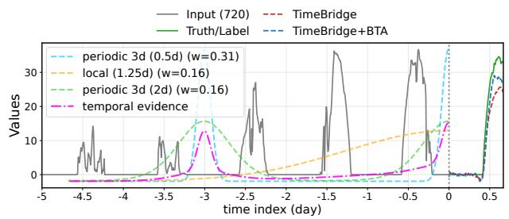

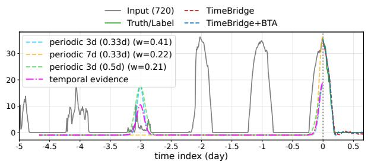

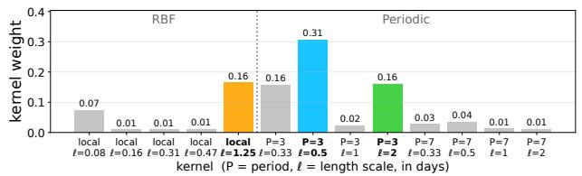

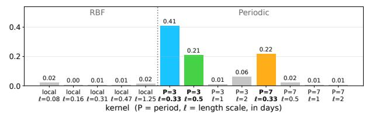  
Figure 8: Input-adaptive positional bias on Solar. Two Solar windows with a 720-step input and 96- step forecasting horizon; panels follow Figure 2. Both windows are dominated by periodic kernels, but BTA adapts their temporal scales to the input dynamics. The left window, with more irregular peak amplitudes, combines a 3-day periodic kernel with $\ell = 0 . 5$ days $( w = 0 . 3 1 )$ , a long-range local kernel with $\ell = 1 . 2 5$ days $( w = 0 . 1 6 )$ , and a broader 3-day periodic kernel with $\ell = 2$ days $( w = 0 . 1 6 )$ . In contrast, the right window concentrates its weight on narrower periodic kernels, led by 3-day kernels with $\ell = 0 . 3 3$ and 0.5 days $( w = 0 . 4 1$ and 0.21) and a 7-day kernel with $\ell = 0 . 3 3$ days $( w = 0 . 2 2 )$ . The resulting mixtures induce distinct temporal-evidence profiles and positional biases. BTA reduces MSE by 58% and 34%, respectively $( 2 2 . 4 8  9 . 4 1$ and $1 . 4 6 \to 0 . 9 6 )$

## M More representation analysis on Solar

Figure 11 further confirms that BTA adapts its temporal inductive bias to the forecasting horizon on Solar. The learned kernel weights vary systematically across prediction lengths: shorter horizons place greater emphasis on relatively local dependencies, whereas longer horizons increasingly favor broader local structure, with the $\ell = 1 . 2 5 \mathrm { - d a y }$ RBF kernel becoming dominant at $H = 7 2 0$ . The allocation among periodic kernels also changes with the horizon, with longer forecasts placing greater weight on broader 3-day periodic patterns. These results further demonstrate that BTA does not rely on a fixed positional structure, but instead adjusts its temporal dependencies to the forecasting horizon, providing an interpretable view of the adaptive positional bias for nonstationary LTSF.

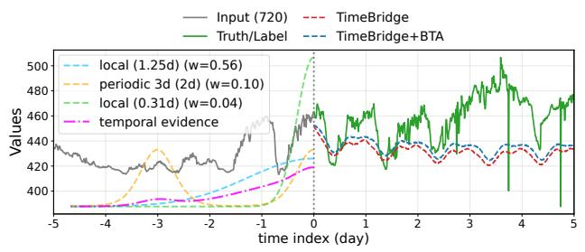

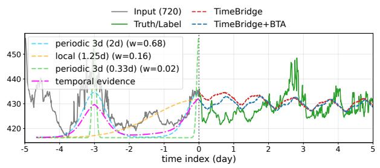

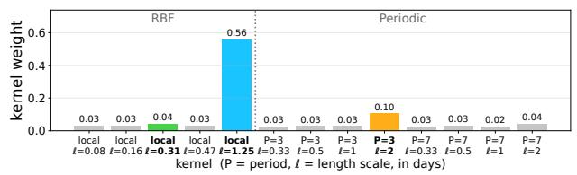

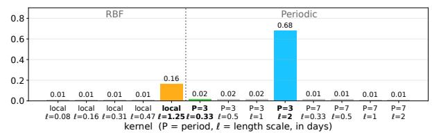  
Figure 9: Input-adaptive positional bias on Weather. Two Weather windows with a 720-step input and 720-step forecasting horizon; panels follow Figure 2. The left window exhibits a recent level shift without a clear recurring pattern, for which BTA assigns 0.69 of the total weight to local RBF kernels, dominated by the long-range $\ell = 1 . 2 5 \mathrm { - d a y }$ kernel $( w = 0 . 5 6 )$ . In contrast, the right window exhibits stronger recurring structure and is dominated by a 3-day periodic kernel with $\ell = 2$ days $( w = 0 . 6 8 )$ , while the long-range local kernel receives $w = 0 . 1 6$ . The contrasting kernel mixtures produce diferent temporal-evidence profiles and positional biases, illustrating how BTA adapts between local and periodic dependencies across input windows.

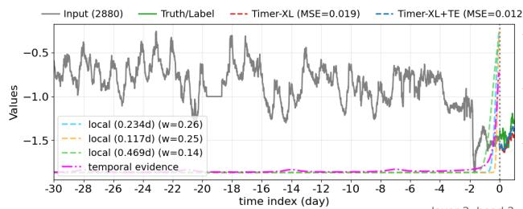

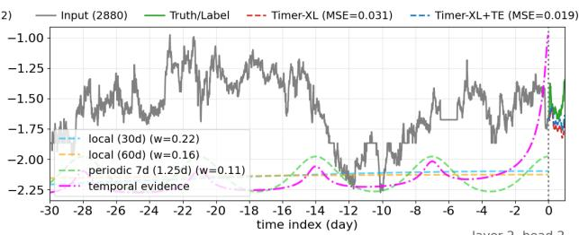

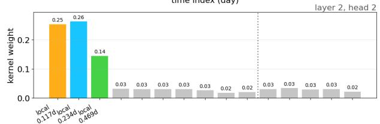

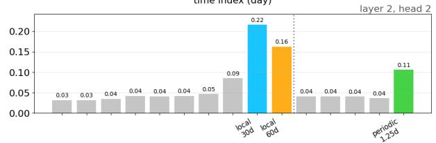  
Figure 10: Input-adaptive positional bias in Timer-XL on ETTm1. Two 30-day input windows are used to forecast the following day. The top panels compare Timer-XL and Timer-XL+BTA predictions and visualize the dominant temporal kernels selected by BTA; the bottom panels show the corresponding router weights for layer 2, head 2. For the left window, which exhibits an abrupt recent change, BTA emphasizes short-range local kernels, with its three largest weights assigned to local scales of 0.234, 0.117, and 0.469 days. For the more stable right window, BTA shifts toward substantially broader local dependencies together with a periodic component. These input-dependent mixtures induce diferent positional biases and reduce the forecasting MSE from 0.019 to 0.012 and from 0.031 to 0.019, respectively, demonstrating that BTA can adapt the temporal dependencies of a pretrained Transformer to non-stationary input dynamics.

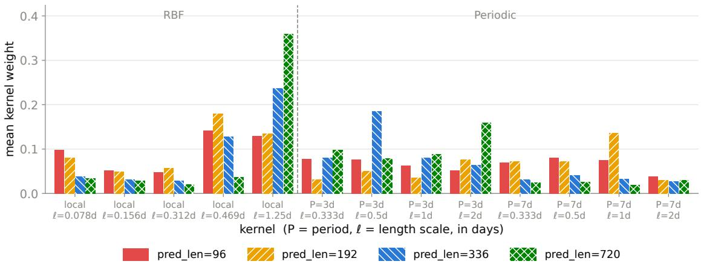  
Figure 11: BTA reveals horizon-dependent temporal dependencies on Solar. Mean kernel weights across Solar test samples and attention heads for $H \in \{ 9 6 , 1 9 2 , 3 3 6 , 7 2 0 \}$ . The dashed line separates local RBF and periodic kernels. As the forecasting horizon increases, BTA shifts weight toward broader local dependencies and redistributes weight among periodic kernels, with the broadest local RBF kernel becoming dominant at $H = 7 2 0$

## N Additional Hyperparameter Analysis

Figure 12 complements the ETTm1 hyperparameter analysis in Figure 4 with results on ETTh1 and Solar.

Top-k. ETTh1 is nearly insensitive to the tested Top-k configurations, with a maximum relative MSE diference below 0.04%. Solar exhibits greater variation, with $k = 3$ attaining the lowest displayed MSE and the remaining settings increasing MSE by up to 8.20%. However, the ETTh1 $k = 1$ run uses a diferent batch size from the $k \in \{ 3 , 5 , 7 \}$ runs, while the Solar $k = 3$ run uses a diferent number of patch-downsampling layers. These results should therefore be interpreted as descriptive sensitivity analyses rather than controlled ablations of k alone.

Router hidden dimension. Sensitivity to router capacity is also dataset-dependent. ETTh1 attains its lowest MSE at $d _ { r } = 1 9 2$ , with at most a 1.23% increase across the tested dimensions, whereas Solar attains its minimum at $d _ { r } = 9 6$ and increases by up to 9.30% at $d _ { r } = 2 2 4$ . Together with the ETTm1 results, these findings suggest that moderate router capacity is generally suficient, while the optimal hidden dimension depends on the dataset.

## O Eficiency Analysis

Controlled comparison with the backbone. Because BTA is integrated into TimeBridge while retaining the remaining backbone components and training protocol, the comparison between TimeBridge+BTA and TimeBridge directly quantifies the additional computational cost of BTA. Table 13 shows that this overhead is small relative to the forecasting gains. On ETTh1, BTA adds approximately 0.3 M FLOPs per input window (0.10% on average) and approximately 14 K trainable parameters (1.1%), while reducing the average MSE from 0.399 to 0.394 (1.3%). On

M denotes millions.  
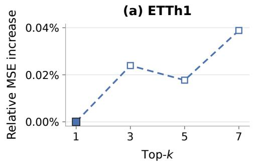

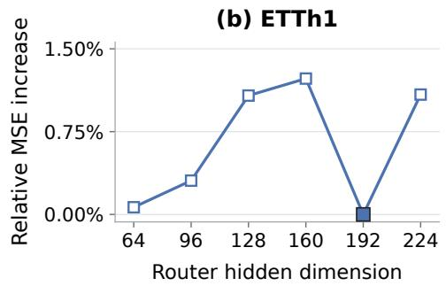

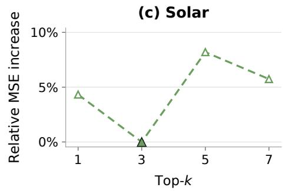

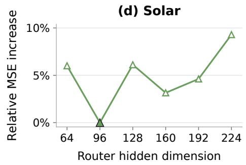  
Figure 12: Additional hyperparameter sensitivity analysis on ETTh1 and Solar. The top and bottom rows report results on ETTh1 and Solar, respectively, with Top-k varied in the left column and router hidden dimension $d _ { r }$ varied in the right column. Each panel reports the relative MSE increase with respect to the lowest MSE within that panel and uses an independent vertical scale; filled markers indicate the minimum. Dashed curves denote the Top-k sweeps, for which auxiliary configuration diferences prevent a strictly controlled comparison of k alone.

Table 13: Computational efficiency on ETTh1, ETTm1, and Weather. Ours denotes TimeBridge+BTA. FLOPs are measured per input window, and Size denotes the number of trainable parameters. Results are reported for forecasting horizons H ∈ {96, 192, 336, 720}.
<table><tr><td colspan="2">Model</td><td colspan="2">Ours</td><td colspan="2">TimeBridge Liu et al. (2025a) Qiu et al. (2025)</td><td colspan="2">DUET</td><td colspan="2">DTAF Lu et al. (2026)</td></tr><tr><td colspan="2">Metric</td><td>FLOPs</td><td>Size</td><td>FLOPs</td><td>Size</td><td>FLOPs</td><td>Size</td><td>FLOPs Size</td></tr><tr><td rowspan="4">ETTh1</td><td></td><td></td><td></td><td>96 274.9M 0.786M 274.6M 0.772M</td><td></td><td>35.7M</td><td>3.605M</td><td>19.0M 0.582M</td></tr><tr><td></td><td>192 280.0M 1.155M 279.7M1.141M</td><td></td><td></td><td></td><td>46.7M</td><td>5.132M</td><td>26.8M 1.121M</td></tr><tr><td></td><td>336 287.8M 1.708M 287.5M1.693M</td><td></td><td></td><td></td><td>65.4M</td><td>5.730M</td><td>38.4M 1.964M</td></tr><tr><td></td><td>720308.4M 3.182M 308.1M</td><td></td><td></td><td>3.168M</td><td>72.6M</td><td>6.981M</td><td>69.4M 4.176M</td></tr><tr><td rowspan="4">ETTm1</td><td>96</td><td>47.4M</td><td>0.252M</td><td>46.9M</td><td>0.230M</td><td>46.1M</td><td>19.0M</td><td>0.587M</td></tr><tr><td>192</td><td>48.7M</td><td>0.344M 48.2M</td><td></td><td>0.322M 19.2M</td><td>5.083M 2.423M</td><td></td><td>1.165M</td></tr><tr><td>336</td><td>50.6M</td><td>0.482M</td><td>50.1M 0.460M</td><td>47.8M</td><td>5.206M</td><td>26.8M 38.6M</td><td>1.980M</td></tr><tr><td>720</td><td>55.8M</td><td>0.851M</td><td>55.3M</td><td>0.829M</td><td>10.5M</td><td>1.432M</td><td>69.9M 4.253M</td></tr><tr><td rowspan="4">Weather</td><td></td><td>96 288.9M 0.575M 288.0M 0.556M</td><td></td><td></td><td></td><td>73.1M 2.794M</td><td></td><td>57.7M 0.581M</td></tr><tr><td></td><td></td><td></td><td></td><td></td><td></td><td></td><td>192 296.6M 0.759M 295.7M 0.740M 206.5M 6.710M80.9M1.145M</td></tr><tr><td></td><td></td><td></td><td></td><td></td><td></td><td></td><td>336308.2M1.036M 307.3M1.017M209.6M 6.784M115.8M1.974M</td></tr><tr><td></td><td></td><td></td><td></td><td></td><td></td><td></td><td>720339.2M1.773M338.3M1.754M217.8M 6.981M 208.7M 4.187M</td></tr></table>

ETTm1, it adds approximately 0.5 M FLOPs (1.00%) and 22 K parameters (6.0%), while reducing the average MSE from 0.348 to 0.337 (3.2%). On Weather, the additional computational cost is likewise small, while BTA further improves the TimeBridge backbone. These results show that BTA achieves forecasting gains with modest additional computation and capacity. These overhead estimates use the displayed counts in Table 13; percentages are averaged over the four horizons.

Horizon-independent overhead. Because BTA operates on the input-side attention representation and introduces no additional forecasting-head component, its absolute FLOP and parameter overheads remain approximately constant across prediction horizons. For example, on ETTh1 at H = 720, BTA increases FLOPs by only 0.10% and trainable parameters by 0.44%.

Comparison with larger reference models. The comparison with other methods shows that larger parameter counts do not necessarily yield lower forecasting error. On ETTh1, DUET uses 3.6–7.0 M trainable parameters, approximately 2.2–4.6× those of TimeBridge+BTA across the four horizons, yet has a higher average MSE (0.404 versus 0.394). This comparison shows that BTA remains competitive with larger reference models. It does not by itself isolate the efect of model capacity; a capacity-matched ablation would be needed to establish that causal attribution.

## P More Ablation Study

Table 14 shows that each component of BTA contributes to forecasting performance on Weather. Adding local and periodic kernels improves vanilla self-attention, while replacing static kernel weights with input-adaptive MoE routing yields further gains. Incorporating the Fourier spectrum of the TE profile achieves the best overall performance, reducing average MSE and MAE by 14.05% and 7.73%, respectively. These results demonstrate the complementary benefits of a richer temporal kernel bank, input-adaptive routing, and frequency-domain information.

Table 14: Ablation study of BTA on Weather with Informer as the backbone. Starting from vanilla self-attention, we progressively introduce local kernels, periodic kernels, input-adaptive MoE routing based on the temporal-evidence (TE) profile, and its Fourier spectrum. Gain (%) denotes the relative reduction in MSE and MAE with respect to vanilla self-attention.
<table><tr><td colspan="3">Attention</td><td colspan="2">Self-attention</td><td colspan="9">Bayesian Time-aware Attention</td></tr><tr><td colspan="3">Optimization</td><td colspan="2">Static 一</td><td colspan="4">Static</td><td colspan="4">|MoE (TE only) | MoE (TE+Fourier)</td></tr><tr><td colspan="3">Kernels</td><td colspan="2">None 一</td><td colspan="2">Local</td><td colspan="2">|Local+Periodic</td><td colspan="2">Local+Periodic</td><td colspan="2">Local+Periodic</td></tr><tr><td colspan="2">Metric</td><td>MSE</td><td>MAE</td><td></td><td>MSE</td><td>MAE</td><td>MSE</td><td>MAE</td><td>MSE</td><td>MAE</td><td>MSE</td><td>MAE</td></tr><tr><td rowspan="3">Weater</td><td>96 192 336 720</td><td>0.313 0.377 0.448 0.712</td><td>0.375 0.408 0.449</td><td></td><td>0.274 0.333 0.467</td><td>0.353 0.394 0.458</td><td>0.270 0.320 0.460</td><td>0.348 0.384 0.457</td><td>0.266 0.313 0.412</td><td>0.339 0.377 0.428</td><td>0.253 0.299 0.389</td><td>0.335 0.369 0.413</td></tr><tr><td>Avg</td><td>0.463</td><td>0.604 0.459</td><td></td><td>0.696 0.443</td><td>0.597 0.451</td><td>0.689 0.435</td><td>0.590 0.445</td><td>0.662 0.413</td><td>0.583 0.432</td><td>0.649 0.398</td><td>0.577 0.424</td></tr><tr><td>Gain(%)</td><td></td><td></td><td></td><td>4.32</td><td>1.85</td><td>6.00</td><td>3.10</td><td>10.65</td><td>5.94</td><td>14.05</td><td>7.73</td></tr></table>

Both MoE variants use local and periodic kernels. TE denotes the temporal-evidence profile; Fourier denotes its Fourier spectrum. Gain is relative to vanilla self-attention.