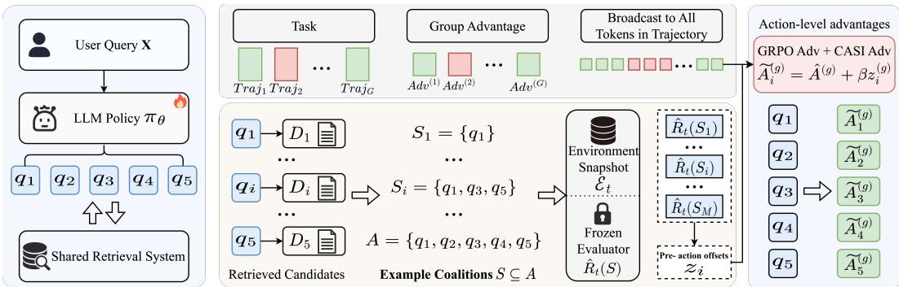
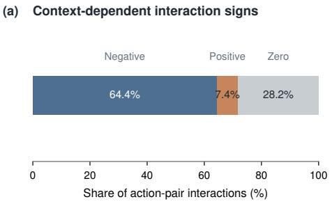
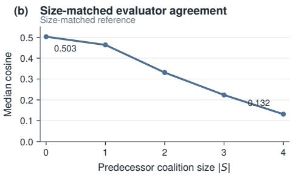
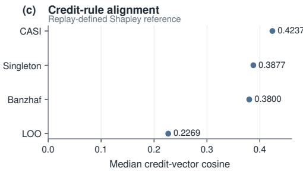
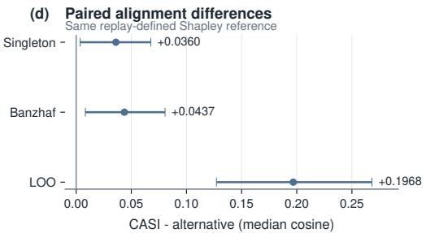

# CASI: CREDIT ASSIGNMENT VIA SET INTERVENTION FOR AGENTIC RETRIEVAL

Xinyi Cheng Tianfu Zhang Jiwen Li Xuesen Zhang

Shihao Yu Pengfei Zhu Renhuan Heda Wang∗

Xiaohongshu Inc.

{chengxinyi1, zhangtianfu, liuwei01, zhangxuesen, yushihao, zhupengfei, renhuan, zengshushu}@xiaohongshu.com

## ABSTRACT

Large language models increasingly generate multiple retrieval actions jointly, while downstream systems often provide only one reward for the resulting set. Broadcasting this reward provides a valid score-function gradient estimator for the expected set-level objective, but does not determine a coalition-dependent within-set attribution. We introduce CASI (Credit Assignment via Set Intervention for Agentic Retrieval), which constructs the missing counterfactual information through snapshot-grounded set intervention: generate and retrieve once, hold replayable snapshot components fixed, and evaluate alternative subsets under common conditions. Shapley aggregation converts these marginals into within-set credit, which bounded zero-sum advantage shaping incorporates into policy optimization. For $m \geq 4 .$ , singleton, leave-one-out, and full-set endpoints do not generally determine the Shapley allocation; under additive set values, extra coalition evaluations are redundant. In a five-action sponsored-search setting, exhaustive auction replay over 1,200 requests reveals substantial coalition dependence. Under the training-time evaluator, CASI achieves the highest median cosine similarity to a replay-defined Shapley reference among evaluated credit rules; under a sensitivity backend, CASI does not outperform Singleton. Across five independent training runs, CASI-trained policies achieve higher held-out auction-replay set value than Singleton- or Broadcast-trained policies. In a randomized seven-day production A/B test on 10% of traffic, the CASI-trained policy yields an observed 3.51% lift in the primary advertiser-value metric over production control.

## 1 INTRODUCTION

LLM-based retrieval systems increasingly generate multiple retrieval actions for a single input, for example by decomposing a question or producing parallel rewrites that cover different facets of an information need (Tan et al., 2026; Zhao et al., 2025; Zheng et al., 2026). Post-training on downstream outcomes directly optimizes what the system ultimately delivers rather than surface similarity alone (Jin et al., 2025). This challenge is especially pronounced in sponsored search, where several rewrites retrieve candidate ads whose pools are merged before downstream ranking and auction. An action that is useful alone may become redundant, or compete with candidates from other rewrites, once the pools are combined. In our setting, individual actions do not receive separately observed downstream outcomes; only the realized action set receives an observed reward. This raises a central question: when multiple retrieval actions jointly determine one outcome, what information is needed to construct context-dependent attribution within the realized set?

A rollout-level reward provides a valid score-function estimator for the gradient of the expected setlevel objective (Shao et al., 2024). The difficulty is that the realized set reward does not provide the alternative-subset values needed for coalition-based attribution. For an action $q _ { i }$ and $S \subseteq A \setminus \{ q _ { i } \}$ the marginal $R ( S \cup \{ q _ { i } \} ) - R ( S )$ can vary with S. Singleton and leave-one-out capture the emptycontext and full-complement extremes, leaving intermediate coalition contexts unobserved. For m $\geq 4 .$ , these endpoint observations, even together with the full-set value, do not generally determine the Shapley allocation. The challenge is therefore to construct comparable cross-context information within each realized action set.

We introduce CASI (Credit Assignment via Set Intervention for Agentic Retrieval), which constructs this information through snapshot-grounded set intervention. For each realized action set, CASI generates and retrieves once, caches per-action retrieval results, holds replayable snapshot components fixed, and evaluates alternative subsets under common conditions. Shapley weighting converts the resulting contextual marginals into within-set credit, and bounded zero-sum advantage shaping incorporates their relative credit into the rollout-level optimizer. Reusing cached retrieval outputs keeps exhaustive coalition scoring practical in our five-action setting without repeated generation, retrieval, or auction replay during RL.

Empirically, exhaustive auction replay over 1,200 requests reveals substantial coalition dependence. Under the training-time evaluator, CASI attains the largest median cosine similarity to the replaydefined Shapley reference among the compared credit rules: 0.424 versus 0.388 for Singleton, a difference in median cosine of 0.036 (95% CI [0.004, 0.068]). Under the sensitivity backend, CASI does not outperform Singleton on this metric. Across five independent training runs, the CASItrained policy achieves a held-out auction-replay set value of $6 6 . 7 0 \pm 3 . 4 0$ , compared with 60.32 for the SFT initialization, $5 5 . 0 0 \pm 4 . 0 0$ for Singleton, and $4 3 . 3 0 \pm 4 . 7 0$ for Broadcast. Finally, in a randomized seven-day production A/B test on 10% of traffic, we observe a 3.51% lift in the primary advertiser-value metric over production control.

Our contributions are threefold. First, we formalize the information gap between valid set-level optimization and coalition-based within-set attribution for jointly generated retrieval actions. We show that, for $m \geq 4 .$ , singleton, leave-one-out, and full-set endpoint observations do not generally determine the Shapley allocation, while under additive set values additional coalition evaluations are redundant. Second, we introduce snapshot-grounded set intervention to construct comparable coalition evaluations within a realized action set while holding replayable snapshot components fixed. Shapley weighting aggregates these evaluations into action-level credit, and bounded zerosum advantage shaping incorporates the relative credit into policy optimization. Third, we evaluate CASI through coalition structure, credit-rule alignment with the replay-defined Shapley reference, held-out policy value across independent training runs, and randomized production deployment.

## 2 RELATED WORK

## 2.1 LLM SEARCH AND OUTCOME-BASED POST-TRAINING

LLMs increasingly learn retrieval actions from downstream outcomes rather than surface similarity. Search-R1 (Jin et al., 2025) trains multi-turn search with reinforcement learning, while RAG-R1 (Tan et al., 2026) and parallel-search methods (Zhao et al., 2025) extend this paradigm to multiple queries or parallel decomposition. Outcome-based post-training typically assigns supervision at the response or trajectory level: GRPO (Shao et al., 2024) derives a scalar group-relative advantage for each sampled response, whereas process supervision provides finer feedback along a reasoning trajectory (Lightman et al., 2024). These methods refine where supervision is assigned across responses or trajectories. Our setting concerns a different axis: several retrieval actions are generated jointly within one response and share one downstream outcome, raising the question of what counterfactual information is needed for context-dependent attribution within the realized action set.

## 2.2 CREDIT ASSIGNMENT UNDER AGGREGATE FEEDBACK

Shared-reward credit assignment is well studied in cooperative reinforcement learning. COMA constructs an agent-specific counterfactual baseline by marginalizing one agent’s action while holding others fixed (Foerster et al., 2018). Standard difference rewards instead remove or replace one agent (Wolpert & Tumer, 2001). Value-decomposition methods impose structure on joint value, additively in VDN (Sunehag et al., 2018) and monotonically in QMIX (Rashid et al., 2018). Shapleybased methods aggregate marginal contributions across coalitions and have also been used for policy learning (Li et al., 2021; Wang et al., 2020). Slate off-policy evaluation provides another structural precedent, recovering per-slot components from slate-level feedback under a specified model (Swaminathan et al., 2017).

  
Figure 1: CASI augments the broadcast rollout advantage with action-specific credit from snapshot-grounded set intervention. The base optimizer broadcasts $\hat { A } ^ { ( g ) }$ across the trajectory. Cached retrievals are recombined into coalitions and scored under the frozen training-side snapshot $\mathcal { E } _ { 0 } ^ { \mathrm { ~ ~ } } .$ , yielding coalition values $\hat { R } _ { 0 } ( S )$ . Shapley aggregation produces per-action credit, which bounded zero-sum advantage shaping maps to offsets $z _ { i } ^ { ( g ) }$ . Tokens of action $q _ { i }$ receive $\widetilde { A } _ { i } ^ { ( g ) } = \hat { A } ^ { ( g ) } + \beta z _ { i } ^ { ( g ) }$ ; shared tokens retain $\hat { A } ^ { ( g ) }$

These works provide set-to-element decomposition and Shapley-style allocation machinery. The methodological gap in our setting is the counterfactual object on which cross-context within-set credit can be computed. Slate decomposition relies on an additive conditional-mean reward model, whereas retrieved candidate pools in our setting are merged and jointly processed by a nonlinear, capacity-limited downstream system. COMA marginalizes one action against a fixed configuration of the others, and a standard difference reward uses a chosen removal or replacement counterfactual. Neither single-context construction, by itself, provides the family of coalition contexts needed when the same retrieval action contributes differently across predecessor coalitions S.

Our distinction is therefore not the Shapley weighting itself, but the snapshot-grounded construction of comparable coalition evaluations for parameter-shared LLM retrieval actions, without requiring an agent-wise critic or a factored value model.

## 2.3 VALUE-AWARE RETRIEVAL FOR SPONSORED SEARCH

Sponsored-search retrieval has evolved from query substitution and dense retrieval toward generative and value-aware rewriting. Prior work includes relevance–revenue trade-offs (Radlinski et al., 2008), diversity-aware RL rewriting (Mohankumar et al., 2021), hybrid generative and dense retrieval (Mohankumar et al., 2023), contextual retrieval (Grbovic et al., 2015), and value-aware LLM rewriting (Zhang et al., 2026). Our focus is complementary: these lines improve how rewrites are produced or scored, whereas we study within-set credit after several rewrites are issued jointly and their candidate pools are merged, deduplicated, ranked, and selected together. In this capacitylimited regime, a response-level outcome does not by itself determine attribution among parallel actions, and an action’s marginal value need not be invariant to the surrounding action set.

## 3 METHOD

We study policy optimization for jointly generated retrieval actions under set-level feedback. CASI (Credit Assignment via Set Interventionfor Agentic Retrieval) constructs alternative coalition evaluations within each realized action set while holding replayable snapshot components fixed. Shapley weighting aggregates the resulting contextual marginals, and bounded zero-sum advantage shaping maps their relative credit to action-level advantages.

## 3.1 PROBLEM FORMULATION AND COALITION-DEPENDENT CREDIT

Given an input $x ,$ the policy $\pi _ { \theta }$ jointly generates $A = \{ q _ { 1 } , \dots , q _ { m } \} \sim \pi _ { \theta } ( \cdot \ | \ x )$ . Each action retrieves candidates $C _ { i , t } = \mathcal { R } _ { t } ( q _ { i } )$ , which are merged as $C _ { t } ( A ) = \operatorname { M e r g e } ( C _ { 1 , t } , \ldots , C _ { m , t } )$ . We denote the production-side set utility by $R _ { t } ( A ) = { \mathsf { \bar { \mathcal { V } } } } ( C _ { t } ( A ) ; { \mathsf { \mathcal { E } } } _ { t } )$ , where t indexes the production

state associated with the realized input x, and take the production-level objective to be

$$
J ( \theta ) = \mathbb { E } _ { x } \mathbb { E } _ { A \sim \pi _ { \theta } ( . | x ) } [ R _ { t } ( A ) ] .\tag{1}
$$

The contribution of an action can depend on the surrounding coalition. For any $S \subseteq A \setminus \{ q _ { i } \}$ , define the contextual marginal

$$
\Delta _ { i , t } ^ { R } ( S ) = R _ { t } ( S \cup \{ q _ { i } \} ) - R _ { t } ( S ) .\tag{2}
$$

In general, $\Delta _ { i , t } ^ { R } ( S )$ varies with $S$ because retrieval coverage, redundancy, and capacity-limited downstream selection depend on which other actions are present. These production-side counterfactual marginals are not directly observed from the realized set-level outcome. To construct tractable within-set comparisons for training, we instead use a frozen surrogate set function defined below. Appendix A gives examples in which contextual marginal value can be negative.

Set-level optimization and within-set information. For any rollout-level scalar return $F ( A )$ with no explicit dependence on $\theta ,$ , broadcasting the same scalar across the generated sequence gives the standard score-function estimator

$$
\nabla _ { \theta } \mathbb { E } _ { A \sim \pi _ { \theta } ( \cdot | x ) } [ F ( A ) ] = \mathbb { E } \left[ F ( A ) \sum _ { u \in \tau ( A ) } \nabla _ { \theta } \log \pi _ { \theta } ( u \mid u _ { < } , x ) \right] ,\tag{3}
$$

where $\tau ( A )$ is the generated token sequence. Thus, broadcasting $F ( A )$ provides a valid scorefunction estimator for the gradient of the expected set-level objective. However, $F ( A )$ contains only the outcome of the realized set. It does not determine an attribution whose definition depends on counterfactual coalition values $F ( S )$ for alternative subsets $S \subseteq A$ . Additional full-set rollouts provide more joint outcomes, but do not directly provide the alternative-subset evaluations needed to construct such within-set credit for a fixed realized set.

## 3.2 SNAPSHOT-GROUNDED SET INTERVENTION

CASI constructs alternative coalition evaluations from the same realized action set under a frozen training-side snapshot ${ \mathcal { E } } _ { 0 } ;$ non-replayable factors remain outside the counterfactual construction. Each action is retrieved once,

$$
C _ { i } = \mathcal { R } _ { 0 } ( q _ { i } ) , \qquad C ( S ) = \operatorname { M e r g e } ( \{ C _ { i } : q _ { i } \in S \} ) .\tag{4}
$$

Coalitions are formed by selecting and merging cached per-action results, so the generated actions, retrievals, and replayable snapshot components remain fixed while only coalition composition changes. The resulting candidate sets are scored either by the frozen evaluator for policy optimization or by auction replay for offline auditing, without new LLM generation or repeated retrieval.

Offline auction-replay measurement. For offline auditing, let $\boldsymbol { y } ^ { ( r ) } ( \boldsymbol { S } )$ denote the value returned by the r-th execution of the auction-replay path for coalition S:

$$
y ^ { ( r ) } ( S ) = \sum _ { a } \mathrm { e c p m } _ { \mathrm { a u c t i o n } , S } ^ { ( r ) } ( a ) \mathrm { s e n d } _ { S } ^ { ( r ) } ( a ) ,\tag{5}
$$

where $\mathrm { e c p m } _ { \mathrm { a u c t i o n } , S } ^ { ( r ) } ( a )$ denotes the auction-stage eCPM associated with ad a in that replay execution and send $\mathsf { l } _ { S } ^ { ( r ) } ( a ) \in \{ 0 , 1 \}$ indicates membership in the replay send set. The send set is an auction-stage outcome rather than final production exposure. Replay outcomes can vary across executions, so a single $\boldsymbol { y } ^ { ( r ) } ( \boldsymbol { S } )$ is an offline replay measurement rather than a time-invariant production ground truth. Section 4.1 specifies how repeated executions are aggregated to construct the coalition-audit reference.

Training-time evaluator. Auction replay is too expensive to execute for every coalition during policy optimization, so CASI scores each reconstructed coalition with the frozen evaluator and denotes the resulting set value by $\hat { R } _ { 0 } ( S )$ . The corresponding contextual marginal is

$$
\widehat { \Delta } _ { i , 0 } ( S ) = \hat { R } _ { 0 } ( S \cup \{ q _ { i } \} ) - \hat { R } _ { 0 } ( S ) .\tag{6}
$$

Coalition values are obtained from cached retrieval results and batched with the frozen evaluator. CASI changes which values of the fixed surrogate set function $\hat { R } _ { 0 } ( \cdot )$ are queried; it does not correct errors in that evaluator.

Audit boundary. The offline evaluator-to-replay analysis compares evaluator-defined coalition structure and credit with the repeat-aggregated replay reference defined in Section 4.1. It does not treat that reference as calibrated production utility or replay coalition contrasts as production-side contrasts of $R _ { t } .$ . Production performance of the learned policy is evaluated separately in Section 4.5.

## 3.3 COALITION-AWARE CREDIT AGGREGATION

We extend the surrogate set function to the empty coalition by the zero-value convention $\hat { R } _ { 0 } ( \varnothing ) = 0 ;$ the evaluator is not queried on the empty set. Because the contextual marginal $\widehat { \Delta } _ { i , 0 } ( S )$ can vary with the predecessor coalition, a credit rule based on a single context captures only one part of the induced set function. CASI uses standard Shapley weighting to aggregate marginals across predecessor coalitions:

$$
c _ { i } ^ { \mathrm { C A S I } } = \sum _ { S \subseteq A \backslash \{ q _ { i } \} } \frac { | S | ! ( m - | S | - 1 ) ! } { m ! } \left[ \hat { R } _ { 0 } ( S \cup \{ q _ { i } \} ) - \hat { R } _ { 0 } ( S ) \right] .\tag{7}
$$

For this extended set function, Shapley efficiency gives

$$
\sum _ { i = 1 } ^ { m } c _ { i } ^ { \mathrm { C A S I } } = \hat { R } _ { 0 } ( A ) .\tag{8}
$$

This convention fixes the absolute credit baseline. Holding all non-empty coalition values fixed, any alternative constant empty-set reference shifts all Shapley credits equally; the within-rollout centering below removes this common offset.

Endpoint credit rules. We compare against two cheaper rules that use a single predecessor size:

$$
c _ { i } ^ { \mathrm { S i n g l e t o n } } = \hat { R } _ { 0 } ( \{ q _ { i } \} ) - \hat { R } _ { 0 } ( \emptyset ) . \qquad ( 9 ) \qquad c _ { i } ^ { \mathrm { L O O } } = \hat { R } _ { 0 } ( A ) - \hat { R } _ { 0 } ( A \setminus \{ q _ { i } \} ) .\tag{10}
$$

Singleton uses predecessor size $| S | = 0$ , whereas leave-one-out (LOO) uses $| S | = m - 1$ . The following result characterizes the information missing from these endpoint observations. For a generic set function v, let $\phi ( v )$ denote its standard Shapley allocation.

Proposition 1 (Endpoint non-identifiability of the Shapley allocation). Let $m \geq { } ^ { \angle }$ 4 and let $v : 2 ^ { A } $ R be a set function with $v ( \emptyset ) = 0$ . The Shapley allocation $\phi ( v )$ is not, in general, determined by the endpoint observations

$$
\left\{ v ( \{ q _ { i } \} ) \right\} _ { i = 1 } ^ { m } , \qquad \left\{ v ( A \setminus \{ q _ { i } \} ) \right\} _ { i = 1 } ^ { m } , \qquad v ( A ) .
$$

Proof. Choose a coalition $T$ with $2 \leq | T | \leq m - 2$ , which exists for $m \geq 4$ . Let $F$ be any set function with $F ( \varnothing ) = 0$ and define G by ${ \cal G } ( T ) = { \cal F } ( T ) + \delta$ for some $\delta \neq 0$ , with $G ( S ) = F ( \check { S } )$ for every $S \ne T$ . Since $T$ is neither a singleton, an $( m - 1 )$ -coalition, nor the full set, $F$ and G agree on all listed endpoint observations. For any $i \in T$ , the Shapley term with predecessor set $S = \bar { T ^ { \cdot } } \backslash \{ q _ { i } \}$ changes by

$$
\frac { ( | T | - 1 ) ! ( m - | T | ) ! } { m ! } \delta \neq 0 ,
$$

while no other term for that i is affected. Hence $\phi _ { i } ( G ) \neq \phi _ { i } ( F )$ and therefore $\phi ( G ) \neq \phi ( F )$ □

Under additive set values,

$$
v ( S ) = \sum _ { q _ { i } \in S } a _ { i } ,
$$

every contextual marginal equals $a _ { i }$ , so Singleton, LOO, and Shapley coincide. Additional coalition evaluations are therefore redundant in the additive case. Outside this case, intermediate coalitions can contain allocation-relevant information that is not determined by endpoint observations. The proposition concerns information sufficiency for a fixed set function; whether additional surrogate coalition evaluations are accurate or useful is evaluated empirically. Alternative aggregation weights, including Banzhaf weighting, are evaluated separately in Appendix B

## 3.4 BOUNDED ZERO-SUM ADVANTAGE SHAPING

For a rollout group ${ \mathcal { G } } ,$ let $\hat { A } ^ { ( g ) }$ denote the rollout-level advantage supplied by the base optimizer for rollout $g \in { \mathcal { G } }$ . In our implementation, this advantage is formed from the full-set surrogate reward $\hat { R } _ { 0 } ( A ^ { ( g ) } )$ . Given action credits $\{ c _ { i } ^ { ( g ) } \} _ { i = 1 } ^ { m }$ , we first center them within each rollout:

$$
d _ { i } ^ { ( g ) } = c _ { i } ^ { ( g ) } - \frac { 1 } { m } \sum _ { j = 1 } ^ { m } c _ { j } ^ { ( g ) } , \qquad \sum _ { i = 1 } ^ { m } d _ { i } ^ { ( g ) } = 0 .\tag{11}
$$

We then normalize the centered credits using a scale shared across the rollout group:

$$
s _ { d } = \mathrm { S t d } \Big ( \{ d _ { i } ^ { ( g ) } \} _ { i , g } \Big ) ,
$$

$$
u _ { i } ^ { ( g ) } = \frac { d _ { i } ^ { ( g ) } } { s _ { d } + \epsilon } ,\tag{12}
$$

where $\epsilon > 0$ is a numerical stabilizer. Using a common scale avoids separately normalizing away between-rollout differences in relative-credit magnitude before projection.

To bound the action-level adjustment while preserving its zero-sum structure, we project $u ^ { ( g ) }$ onto

$$
\mathcal { Z } _ { \kappa } = \left\{ z \in \mathbb { R } ^ { m } : \sum _ { i } z _ { i } = 0 , \ \| z \| _ { \infty } \leq \kappa \right\} .
$$

The Euclidean projection has the coordinate form

$$
z _ { i } ^ { ( g ) } = \mathrm { c l i p } \left( u _ { i } ^ { ( g ) } - \lambda _ { g } , - \kappa , \kappa \right) , \qquad \sum _ { i } z _ { i } ^ { ( g ) } = 0 ,\tag{13}
$$

where $\kappa > 0$ is the clipping radius and $\lambda _ { g }$ is obtained by monotone bisection. Appendix C gives the projection derivation.

The resulting action-level advantage is

$$
\widetilde { A } _ { i } ^ { ( g ) } = \hat { A } ^ { ( g ) } + \beta z _ { i } ^ { ( g ) } ,\tag{14}
$$

where $\beta \geq 0$ controls the strength of credit-aware shaping. Since $\begin{array} { r } { \sum _ { i } z _ { i } ^ { ( g ) } = 0 } \end{array}$

$$
\frac { 1 } { m } \sum _ { i = 1 } ^ { m } \widetilde { A } _ { i } ^ { ( g ) } = \hat { A } ^ { ( g ) } .\tag{15}
$$

Thus the shaping term changes relative action-level coefficients while preserving their within-rollout mean. This does not imply equality with the broadcast policy gradient, because different action spans multiply different score functions. Setting $\beta = 0$ recovers the Broadcast advantage assignment.

For structured generations, tokens belonging to action $q _ { i }$ receive $\widetilde { A } _ { i } ^ { ( g ) }$ , while shared reasoning and formatting tokens retain the base rollout advantage $\hat { A } ^ { ( g ) }$ . We treat this as structured advantage assignment rather than causal token attribution.

## 3.5 COMPUTATIONAL COST

All methods use one LLM generation and m cached retrievals; they differ in the number of frozenevaluator scores required for credit construction. The empty coalition is fixed by convention and is not scored. Counting the full-set score used by the base advantage, Broadcast, Singleton, LOO, and exact all-coalition aggregation require

$$
1 , \qquad m + 1 , \qquad m + 1 , \qquad 2 ^ { m } - 1
$$

scores, respectively. Exact CASI and exact Banzhaf aggregation share the $2 ^ { m } - 1$ all-coalition scoring cost. For $m = 5$ , the corresponding counts for Broadcast, Singleton, LOO, and CASI are $1 / 6 / 6 / 3 1$ . All non-empty coalition scores are computed from cached retrieval results and batched with the frozen evaluator; the 31 CASI scores are not 31 auction replays during training. Appendix D describes permutation sampling for larger action sets.

  
Figure 2: Coalition dependence and credit alignment. Panels (a)–(b) diagnose context-dependent replay structure and size-resolved evaluator agreement. Panels (c)–(d) compare credit rules against the same replay-defined Shapley reference. Because panel (b) uses size-matched references, its values are not directly comparable with panels (c)–(d).

## 4 EXPERIMENTS

## 4.1 EXPERIMENTAL SETUP

We study $m = 5$ jointly generated retrieval actions. Policy optimization uses the frozen evaluator $\hat { R } _ { 0 }$ defined in Section 3.2, while offline counterfactual auditing uses the auction-replay procedure defined there. Historical $V _ { 0 }$ is used only in the observational audit below.

The training-time evaluator is a cached-filter construction: it processes the full candidate pool once and obtains coalition values by filtering the cached downstream result. All primary evaluator-toreplay comparisons use this evaluator. As a sensitivity analysis, a coalition-rerun evaluator reexecutes downstream ranking for each coalition; because this defines a different surrogate set function, we do not treat it as an evaluator-error correction.

The offline audit samples 1,200 requests before observing replay outcomes and enumerates all 31 non-empty coalitions. Each coalition is replayed three times; a 50-request subset receives seven repeats, for 117,800 executions in total. For the coalition audit, we denote the median across available replay executions by

$$
y _ { \mathrm { a u d i t } } ( S ) = \operatorname { m e d i a n } _ { r } y ^ { ( r ) } ( S ) ,
$$

and use it as the repeat-aggregated coalition reference. Bootstrap inference resamples requests, and no request is filtered by its full-set replay outcome.

## 4.2 COALITION DEPENDENCE AND EVALUATOR FIDELITY

The repeat-aggregated replay landscape exhibits substantial coalition dependence. On the 1,171 requests with matched training-evaluator values, corresponding to 11,710 action pairs, 64.4% of pair interactions are negative, 7.4% positive, and 28.2% exactly zero, with median absolute interaction 3.0978. The training-time evaluator agrees with the replay reference on 92.25% of pair-interaction signs (95% CI [0.9140, 0.9295]).

Full-set outcomes alone do not characterize this structure. Although 870/1,200 requests satisfy $y _ { \mathrm { a u d i t } } ( A ) ~ > ~ 0$ , 103/330 requests with $y _ { \mathrm { a u d i t } } ( A ) = 0$ still contain at least one nonzero proper subcoalition. Filtering on the observed full-set outcome would therefore discard requests containing informative coalition structure.

Across nonzero replay insertion edges, the training-time evaluator achieves 59.25% sign agreement overall. We therefore treat individual evaluator-defined marginals as imperfect local estimates rather than accurate action-credit labels.

Size-resolved diagnostics in Table 1 show that evaluator–replay agreement generally deteriorates as predecessor coalitions grow. The CASI row instead compares Shapley-aggregated credit with the replay-defined Shapley reference and is shown only for context.

Table 1: Size-resolved evaluator–replay agreement under the training-time evaluator. Rows $| S | = k$ compare request-centered action-credit vectors formed by averaging marginals over predecessor coalitions of size $k ,$ using the same construction for evaluator and replay. The CASI row instead compares evaluator-defined Shapley credit with the replay-defined Shapley reference and is not di rectly comparable across rows.
<table><tr><td>Credit context</td><td> $\mathrm { S i g n _ { n z } }$ </td><td>Spearman</td><td>Top action</td><td>Median cosine</td></tr><tr><td>|S| = 0</td><td>0.6424</td><td>0.3521</td><td>0.3274</td><td>0.5027</td></tr><tr><td>|s| = 1</td><td>0.6356</td><td>0.3321</td><td>0.3422</td><td>0.4635</td></tr><tr><td>|s| = 2</td><td>0.5994</td><td>0.2539</td><td>0.3365</td><td>0.3310</td></tr><tr><td>|s| = 3</td><td>0.5683</td><td>0.1749</td><td>0.3112</td><td>0.2236</td></tr><tr><td>|s| = 4</td><td>0.5381</td><td>0.1117</td><td>0.2902</td><td>0.1316</td></tr><tr><td>CASI (Shapley)</td><td>0.6178</td><td>0.3128</td><td>0.3299</td><td>0.4237</td></tr></table>

## 4.3 CREDIT-RULE ALIGNMENT WITH THE REPLAY-DEFINED SHAPLEY REFERENCE

Using $y _ { \mathrm { a u d i t } } ( \cdot )$ , we construct the replay-defined Shapley reference and center all credit vectors within request. Because CASI also uses Shapley aggregation, this comparison measures alignment with the chosen allocation semantics rather than estimator-neutral true action credit. On 1,171 requests, CASI attains median cosine 0.4237 versus 0.3877 for Singleton, a difference in median cosine of +0.0360 (95% CI [+0.0036, +0.0677]); Table 2 reports the remaining comparisons.

Table 2: Alignment with the replay-defined Shapley reference under the training-time evaluator. Median cosine is the primary metric. Confidence intervals are request-level paired-bootstrap intervals for the CASI-minus-alternative difference in median cosine.
<table><tr><td>Credit rule</td><td>Median cosine ↑</td><td>CASI – rule (95% CI)</td><td></td></tr><tr><td>CASI</td><td>0.4237</td><td></td><td></td></tr><tr><td>Singleton</td><td>0.3877</td><td></td><td>+0.0360 [0.0036, 0.0677]</td></tr><tr><td>Banzhaf</td><td>0.3800</td><td></td><td>+0.0437 [0.0083, 0.0806]</td></tr><tr><td>LOO</td><td>0.2269</td><td></td><td>+0.1968 [0.1272, 0.2682]</td></tr></table>

Under the coalition-rerun evaluator, the corresponding median-cosine point estimates are 0.6011 for CASI and 0.6029 for Singleton, with CASI slightly lower on this sensitivity backend.

Additive correlated-error null. We test whether the positive CASI-minus-alternative alignment gaps can arise mechanically from correlated evaluator residuals under an interaction-free replay reference. Replay singleton values define the additive reference, and a donor request’s complete coalition-level evaluator residual vector is transferred as a block, preserving the observed withinrequest residual covariance. On the stricter 870-request subset for which the required normalized credit statistics are defined, the observed CASI–Singleton alignment gap is +0.0359, versus a 95% null interval of [−0.1231, −0.0685]; for CASI–LOO, the observed gap is +0.2221 versus [−0.1462, −0.0813]. This specific additive correlated-residual mechanism does not reproduce the observed positive gaps. The null does not establish general evaluator accuracy or imply that the CASI-minus-alternative alignment gap must increase with interaction strength; Appendix G gives the full construction.

## 4.4 POLICY-LEVEL EVALUATION

We next test whether differences in within-set advantage assignment translate to held-out set-level replay value. Broadcast, Singleton, and CASI use the same target model and training configuration and are each trained for 500 steps with five independent seeds. Final checkpoints are evaluated on the same 1,000 held-out requests by auction-replaying the generated five-action set; the primary endpoint is mean full-set replay value.

Table 3: Held-out policy evaluation on 1,000 common requests; RL entries report mean ± standard deviation across five independent training runs.
<table><tr><td>Method</td><td>Mean replay value ↑</td><td>Top-1 eCPM ↑</td></tr><tr><td>SFT</td><td>60.32</td><td>11.25</td></tr><tr><td>Broadcast</td><td> $4 3 . 3 0 \pm 4 . 7 0$ </td><td> $1 1 . 1 5 \pm 0 . 1 0$ </td></tr><tr><td>Singleton</td><td> $5 5 . 0 0 \pm 4 . 0 0$ </td><td> $1 1 . 6 8 \pm 0 . 0 9$ </td></tr><tr><td>CASI</td><td> ${ \bf 6 6 . 7 0 } \pm 3 . 4 { \bf 0 }$ </td><td> ${ \bf 1 1 . 9 3 \pm 0 . 0 7 }$ </td></tr></table>

Across five independent training runs, CASI attains a mean held-out replay value of 66. $7 0 \pm 3 . 4 0 .$ compared with $\bar { 5 } 5 . 0 0 \pm 4 . 0 0$ for Singleton and $4 3 . 3 0 \pm 4 . 7 0$ for Broadcast; the SFT initialization obtains 60.32 on the same held-out request set. The CASI–Singleton contrast is +11.70 (95% CI $[ + 6 . 2 6 , + 1 7 . 1 4 ] )$ ; this run-level inference reflects training-seed variation on the fixed held-out set, while the endpoint evaluates complete policy outputs rather than alignment with a Shapley reference.

## 4.5 ONLINE A/B EVALUATION

We further evaluate the CASI-trained policy in a randomized seven-day production A/B test on a large-scale sponsored-search system. The experiment allocates 10% of production traffic to treatment, covering approximately $\mathrm { i 0 ^ { 8 } }$ observations; the primary metric is advertiser value (Advv). Relative to the production control, we observe a 3.51% lift in Advv and a 5.08% increase in search-ad spend. At the retrieval level, complex-intent coverage rises from 30.86% to 32.58%, while firstscreen coverage rises from 16.32% to 16.99%. We treat these coverage changes as mechanismconsistent diagnostics rather than as a causal decomposition of the online business gain. This randomized comparison evaluates the deployed CASI-trained policy against production control; it does not isolate CASI from alternative credit constructions online.

Historical served-value audit. We separately audit replay against historical served value $V _ { 0 } ;$ this is observational rather than counterfactual (Appendix H). Among the 3,540 requests with successful replay and matched historical $V _ { 0 } ,$ 1,438 are auction-positive; on this subset, replay has Spearman $\rho ~ = ~ 0 . 3 4 6$ with $V _ { 0 }$ . Holding each generated set fixed, the real-context auction-positive rate is $4 0 . 6 \%$ , compared with 32.7% under context shuffling, a real-minus-shuffled difference of +7.9 pp (95% $\mathrm { C I } \ [ + \mathrm { \bar { 6 } } . 0 , + 9 . 8 ] )$ . Among the 700 requests positive under both contexts, the difference in conditional value ranking is +0.023 (95% $\bar { \mathrm { C I } } \ [ - 0 . \bar { 0 6 } 1 , + 0 . 1 0 3 ] )$ , providing no clear evidence of improved ranking under the real context. Thus request context materially affects auction activation, while this observational audit does not establish replay as a counterfactual measure of production outcomes.

## 5 CONCLUSION

We study context-dependent within-set credit for jointly generated retrieval actions under set-level feedback. CASI constructs comparable coalition evaluations through snapshot-grounded set intervention, aggregates contextual marginals with Shapley weighting, and incorporates their relative credit through bounded zero-sum advantage shaping. We show that endpoint observations do not in general determine the Shapley allocation for $m \geq 4$ , while additional coalition evaluations are redundant under additive set values. In a five-action sponsored-search setting, CASI achieves the largest median cosine similarity to the replay-defined Shapley reference under the deployed training evaluator, improves held-out auction-replay set value across independent training runs, and yields an observed 3.51% advertiser-value lift over production control in a randomized A/B test. Backend sensitivity further shows that additional coalition information does not guarantee improved credit alignment under every evaluator. These results support snapshot-grounded set intervention as a practical approach to within-set supervision when retrieval actions interact.

## USE OF LARGE LANGUAGE MODELS

In this work, we used generative AI tools for writing polish of author-written text, including improvements to readability and LaTeX formatting, and for literature retrieval and discovery, including searching for and identifying potentially relevant related work. We did not use generative AI tools to generate synthetic datasets, develop theoretical models or conceptual frameworks, formulate or prove mathematical claims, propose or refine hypotheses, implement methods, or interpret experimental results. All AI-assisted edits and literature suggestions were reviewed by the authors, and AI-suggested references were verified against the original sources through a manual literature survey. We take full responsibility for the final content of this work, including all text, claims, and results.

## REFERENCES

Jakob N. Foerster, Gregory Farquhar, Triantafyllis Afouras, Nantas Nardelli, and Shimon Whiteson. Counterfactual multi-agent policy gradients. In Proceedings of the AAAI Conference on Artificial Intelligence, volume 32, pp. 2974–2982, 2018. doi: 10.1609/aaai.v32i1.11794.

Mihajlo Grbovic, Nemanja Djuric, Vladan Radosavljevic, Fabrizio Silvestri, and Narayan Bhamidipati. Context- and content-aware embeddings for query rewriting in sponsored search. In Proceedings of the 38th International ACM SIGIR Conference on Research and Development in Information Retrieval, pp. 383–392, 2015. doi: 10.1145/2766462.2767709.

Bowen Jin, Hansi Zeng, Zhenrui Yue, Jinsung Yoon, Sercan O. Arık, Dong Wang, Hamed Zamani,¨ and Jiawei Han. Search-R1: Training LLMs to reason and leverage search engines with reinforcement learning. In Proceedings of the 2nd Conference on Language Modeling (COLM), 2025.

Jiahui Li, Kun Kuang, Baoxiang Wang, Furui Liu, Long Chen, Fei Wu, and Jun Xiao. Shapley counterfactual credits for multi-agent reinforcement learning. In Proceedings of the 27th ACM SIGKDD Conference on Knowledge Discovery and Data Mining, pp. 934–942, 2021. doi: 10. 1145/3447548.3467420.

Hunter Lightman, Vineet Kosaraju, Yuri Burda, Harrison Edwards, Bowen Baker, Teddy Lee, Jan Leike, John Schulman, Ilya Sutskever, and Karl Cobbe. Let’s verify step by step. In International Conference on Learning Representations (ICLR), 2024.

Akash Kumar Mohankumar, Nikit Begwani, and Amit Singh. Diversity driven query rewriting in search advertising. In Proceedings ofthe 27th ACM SIGKDD Conference on Knowledge Discovery and Data Mining, pp. 3423–3431, 2021. doi: 10.1145/3447548.3467202.

Akash Kumar Mohankumar, Bhargav Dodla, Gururaj K, and Amit Singh. Unified generative & dense retrieval for query rewriting in sponsored search. In Proceedings of the 32nd ACM International Conference on Information and Knowledge Management, pp. 4745–4751, 2023. doi: 10.1145/3583780.3615459.

Filip Radlinski, Andrei Z. Broder, Peter Ciccolo, Evgeniy Gabrilovich, Vanja Josifovski, and Lance Riedel. Optimizing relevance and revenue in ad search: A query substitution approach. In Proceedings of the 31st Annual International ACM SIGIR Conference on Research and Development in Information Retrieval, pp. 403–410, 2008. doi: 10.1145/1390334.1390404.

Tabish Rashid, Mikayel Samvelyan, Christian Schroeder, Gregory Farquhar, Jakob Foerster, and Shimon Whiteson. QMIX: Monotonic value function factorisation for deep multi-agent reinforcement learning. In Proceedings of the 35th International Conference on Machine Learning (ICML), volume 80 of Proceedings ofMachine Learning Research, pp. 4295–4304, 2018.

Zhihong Shao, Peiyi Wang, Qihao Zhu, Runxin Xu, Junxiao Song, Xiao Bi, Haowei Zhang, Mingchuan Zhang, Y. K. Li, Y. Wu, and Daya Guo. DeepSeekMath: Pushing the limits of mathematical reasoning in open language models. arXiv preprint arXiv:2402.03300, 2024.

Peter Sunehag, Guy Lever, Audrunas Gruslys, Wojciech Marian Czarnecki, Vinicius Zambaldi, Max Jaderberg, Marc Lanctot, Nicolas Sonnerat, Joel Z. Leibo, Karl Tuyls, and Thore Graepel. Valuedecomposition networks for cooperative multi-agent learning based on team reward. In Proceedings of the 17th International Conference on Autonomous Agents and MultiAgent Systems (AAMAS), pp. 2085–2087, 2018.

Adith Swaminathan, Akshay Krishnamurthy, Alekh Agarwal, Miroslav Dud´ık, John Langford, Damien Jose, and Imed Zitouni. Off-policy evaluation for slate recommendation. In Advances in Neural Information Processing Systems, volume 30, pp. 3632–3642, 2017.

Zhiwen Tan, Jiaming Huang, Qintong Wu, Hongxuan Zhang, Chenyi Zhuang, and Jinjie Gu. RAG-R1: Incentivizing the search and reasoning capabilities of LLMs through multi-query parallelism. In Proceedings of the AAAI Conference on Artificial Intelligence, volume 40, pp. 33187–33195, 2026. doi: 10.1609/aaai.v40i39.40603.

Jianhong Wang, Yuan Zhang, Tae-Kyun Kim, and Yunjie Gu. Shapley Q-value: A local reward approach to solve global reward games. In Proceedings of the AAAI Conference on Artificial Intelligence, volume 34, pp. 7285–7292, 2020. doi: 10.1609/aaai.v34i05.6220.

David H. Wolpert and Kagan Tumer. Optimal payoff functions for members of collectives. Advances in Complex Systems, 4(2/3):265–279, 2001. doi: 10.1142/S0219525901000188.

Xiao Zhang, Guanyu Chen, Boyang Zuo, Feng Li, Pengjie Wang, Jian Xu, and Bo Zheng. VALUE: Value-aware large language model for query rewriting via weighted trie in sponsored search. In Proceedings of the 32nd ACM SIGKDD Conference on Knowledge Discovery and Data Mining, pp. 2584–2593, 2026.

Shu Zhao, Tan Yu, Anbang Xu, Japinder Singh, Aaditya Shukla, and Rama Akkiraju. Parallelsearch: Train your LLMs to decompose query and search sub-queries in parallel with reinforcement learning. arXiv preprint arXiv:2508.09303, 2025.

Tong Zheng, Hongming Zhang, Wenhao Yu, Xiaoyang Wang, He Xing, Runpeng Dai, Rui Liu, Huiwen Bao, Chengsong Huang, Heng Huang, and Dong Yu. Parallel-R1: Towards parallel thinking via reinforcement learning. In International Conference on Learning Representations (ICLR), 2026.

## A NEGATIVE AND HIGHER-ORDER COALITION EFFECTS

This section formalizes two mechanisms behind coalition-dependent action credit: competition under finite downstream capacity and misalignment between the criterion that determines selection and the value credited to selected candidates. The analysis is deliberately abstract and is not intended as an exact model of the production serving stack.

Consider the simplified top-N set value

$$
R ^ { \mathrm { t o p } } ( C ) = \sum _ { a \in \mathrm { T o p N } _ { \sigma } ( \mathrm { D e d u p } ( C ) ) } v ( a ) ,\tag{16}
$$

where $\sigma ( a )$ determines selection and $v ( a ) \geq 0$ is the value credited to a selected candidate. For an action coalition $S ,$ , let $C ( S ) = \operatorname { M e r g e } ( \{ C _ { i } : q _ { i } \in S \} )$ and define

$$
\Delta _ { i } ^ { \mathrm { t o p } } ( S ) = R ^ { \mathrm { t o p } } ( C ( S \cup \{ q _ { i } \} ) ) - R ^ { \mathrm { t o p } } ( C ( S ) ) .\tag{17}
$$

The superscript distinguishes this static abstraction from the production utility $R _ { t }$ in Section 3.1.

Selection–value alignment excludes negative insertion marginals. Assume that $\sigma ,$ together with a fixed tie-breaking rule, induces a total order $\succ _ { \sigma }$ that is co-monotone with credited value:

$$
a \succ _ { \sigma } b \quad \Longrightarrow \quad v ( a ) \geq v ( b ) .\tag{18}
$$

Then $R ^ { \mathrm { t o p } }$ is non-decreasing under candidate insertion, and hence $\Delta _ { i } ^ { \mathrm { t o p } } ( S ) \geq 0$ for every action i and coalition $S \subseteq A \setminus \{ q _ { i } \}$

Proof. It suffices to consider inserting one candidate a into a deduplicated pool. If a is a duplicate, the value is unchanged. If fewer than $\breve { N }$ positions are occupied, the change is $v ( a ) \geq 0$ . Otherwise, a enters the selected set only by displacing its lowest-ranked selected member $b .$ This requires $a \succ _ { \sigma } b ,$ so co-monotonicity gives $v ( a ) \geq v ( b )$ and the value change is $v ( a ) - v ( b ) \geq 0$ . Inserting all candidates contributed by one action as a sequence of such operations proves the result. □

Finite capacity still induces higher-order interaction. This result rules out negative first-order insertion marginals under its alignment assumptions, but it does not imply additivity. Once the available positions are saturated, an action can have substantial value in a small coalition and little or no additional value in a larger coalition. For example, with $N = 1$ and two non-duplicate candidates of values 10 and 9, aligned selection gives ${ \cal R } ^ { \mathrm { t o p } } ( \bar { \{ a \} } ) = 1 0 , { \cal R } ^ { \mathrm { t o p } } ( \{ b \} ) = 9$ , and $\dot { R ^ { \mathrm { t o p } } } ( \{ a , b \} ) = 1 0$ so the second-order interaction is $1 0 - 1 0 - 9 + 0 = - 9$

Relation to the auction-replay reference. Equation equation 16 is a sufficient-condition abstraction rather than a literal reconstruction of the auction replay in Eq. equation 5. In the replay system, coalition insertion can change the winner/send set through ranking, auction, capacity, and other replayable constraints. Negative first-order marginals are therefore possible whenever the induced selection logic is not perfectly aligned with the value credited by the replay reference. Even under perfect alignment, finite capacity is sufficient to produce redundancy and negative higher-order interactions. We consequently do not attribute an observed negative marginal or interaction to a unique serving mechanism without an additional intervention.

## B COALITION CREDIT: PROPERTIES AND VARIANTS

Fix one generated action set $A = \{ q _ { 1 } , \dots , q _ { m } \}$ and the frozen surrogate set function $v ( S ) = \hat { R } _ { 0 } ( S )$ with $v ( \emptyset ) = 0$ . For action $q _ { i }$ , write

$$
\widehat { \Delta } _ { i } ( S ) = v ( S \cup \{ q _ { i } \} ) - v ( S ) , \qquad S \subseteq A \setminus \{ q _ { i } \} .\tag{19}
$$

CASI uses the Shapley aggregation

$$
c _ { i } ^ { \mathrm { C A S I } } = \sum _ { S \subseteq A \backslash \{ q _ { i } \} } { \frac { | S | ! ( m - | S | - 1 ) ! } { m ! } } \widehat { \Delta } _ { i } ( S ) .\tag{20}
$$

Equal total mass over predecessor sizes. For $k \in \{ 0 , \ldots , m - 1 \}$ , define the average marginal at predecessor size k as

$$
\bar { \Delta } _ { i } ^ { ( k ) } = \frac { 1 } { \binom { m - 1 } { k } } \sum _ { S \subseteq A \backslash \{ q _ { i } \} } \widehat { \Delta } _ { i } ( S ) .\tag{21}
$$

For every subset of size k, the Shapley weight is $k ! ( m - k - 1 ) ! / m !$ . Since there are $\binom { m - 1 } { k }$ such subsets,

$$
{ \binom { m - 1 } { k } } { \frac { k ! ( m - k - 1 ) ! } { m ! } } = { \frac { 1 } { m } } .\tag{22}
$$

Therefore

$$
c _ { i } ^ { \mathrm { C A S I } } = \frac { 1 } { m } \sum _ { k = 0 } ^ { m - 1 } \bar { \Delta } _ { i } ^ { ( k ) } .\tag{23}
$$

Thus CASI gives equal total weight to each predecessor-size regime, while averaging uniformly over coalitions within a regime. This identity is useful for interpreting size-resolved credit diagnostics.

Efficiency. The Shapley permutation representation writes $c _ { i } ^ { \mathrm { C A S I } }$ as the expected marginal contribution of $q _ { i }$ along a uniformly random permutation of the m actions. For any fixed permutation, summing the m successive marginals telescopes from $v ( \emptyset )$ to $v ( A )$ . Averaging over permutations therefore gives

$$
\sum _ { i = 1 } ^ { m } c _ { i } ^ { ^ { \mathrm { C A S I } } } = v ( A ) - v ( \varnothing ) = { \hat { R } } _ { 0 } ( A ) .\tag{24}
$$

The optimizer below uses only relative within-set credit, but this identity makes the allocation internally coherent before centering.

Single-context and alternative aggregation rules. The two endpoint rules used in our controlled comparisons are

$$
c _ { i } ^ { \mathrm { S i n g l e t o n } } = v ( \{ q _ { i } \} ) - v ( \emptyset ) ,\tag{25}
$$

$$
c _ { i } ^ { \mathrm { L O O } } = v ( A ) - v ( A \setminus \{ q _ { i } \} ) .\tag{26}
$$

Singleton uses only predecessor size 0, whereas leave-one-out (LOO) uses only predecessor size $m - 1$ . Banzhaf aggregation instead assigns equal weight to individual predecessor subsets,

$$
c _ { i } ^ { \mathrm { B a n z h a f } } = \frac { 1 } { 2 ^ { m - 1 } } \sum _ { S \subseteq A \backslash \{ q _ { i } \} } \widehat { \Delta } _ { i } ( S ) .\tag{27}
$$

The zero-sum optimizer is agnostic to which of these rules produces the per-action credit vector;   
CASI uses Eq. equation 20 by default.

Additive case. Suppose the frozen evaluator is additive,

$$
v ( S ) = \sum _ { q _ { i } \in S } u _ { i } .\tag{28}
$$

Then $\widehat { \Delta } _ { i } ( S ) = u _ { i }$ for every predecessor coalition $S .$ Hence

$$
c _ { i } ^ { \mathrm { C A S I } } = c _ { i } ^ { \mathrm { S i n g l e t o n } } = c _ { i } ^ { \mathrm { L O O } } = c _ { i } ^ { \mathrm { B a n z h a f } } = u _ { i } .\tag{29}
$$

After within-set centering, all four rules therefore produce the same relative credit $u _ { i } - \bar { u }$ . In this additive case, extra coalition evaluations are redundant for credit allocation; outside it, they can access coalition values that endpoint rules do not observe.

Scope of the attribution. CASI attributes downstream value within a fixed generated action set. It does not attempt to identify the generation-time causal effect by which an early autoregressive action may change which later actions are emitted. Likewise, within-set centering is not interpreted as an action-independent score-function baseline: the generated actions are jointly downstream of the policy trajectory. The resulting update is therefore treated as structured advantage shaping rather than as a new unbiased policy-gradient identity.

## C BOUNDED ZERO-SUM ADVANTAGE SHAPING

For rollout $g \in { \mathcal { G } }$ , let $c _ { i } ^ { ( g ) }$ denote the chosen per-action credit and let $\hat { A } ^ { ( g ) }$ be the rollout-level advantage supplied by the base optimizer. CASI first centers the credit,

$$
d _ { i } ^ { ( g ) } = c _ { i } ^ { ( g ) } - \frac { 1 } { m } \sum _ { j = 1 } ^ { m } c _ { j } ^ { ( g ) } , ~ \sum _ { i } d _ { i } ^ { ( g ) } = 0 ,\tag{30}
$$

and normalizes it with the group-level scale

$$
s _ { d } = \mathrm { S t d } \left( \{ d _ { i } ^ { ( g ) } \} _ { i , g } \right) , \qquad u _ { i } ^ { ( g ) } = \frac { d _ { i } ^ { ( g ) } } { s _ { d } + \epsilon } .\tag{31}
$$

In exact arithmetic, $\begin{array} { r } { \sum _ { i } u _ { i } ^ { ( g ) } = 0 } \end{array}$ . Independent element-wise clipping, however, does not preserve this identity in general:

$$
\sum _ { i } \mathrm { c l i p } ( u _ { i } ^ { ( g ) } , - \kappa , \kappa ) \neq 0 .\tag{32}
$$

We therefore use the bounded zero-sum projection from Section 3.4.

Bounded zero-sum projection. For a normalized credit vector $u \in \mathbb { R } ^ { m }$ and clipping radius $\kappa > 0 ,$ define

$$
z ^ { \star } = \arg \operatorname* { m i n } _ { z \in \mathbb { R } ^ { m } } \frac { 1 } { 2 } \| z - u \| _ { 2 } ^ { 2 } \quad \mathrm { s . t . } \quad \mathbf { 1 } ^ { \top } z = 0 , \qquad - \kappa \leq z _ { i } \leq \kappa .\tag{33}
$$

The feasible set is non-empty, closed, and convex, and the objective is strictly convex, so the projected vector $z ^ { \star }$ is unique. The KKT conditions give a scalar equality multiplier λ for which the box-constrained coordinate minimizer is

$$
z _ { i } ^ { \star } = \mathrm { c l i p } ( u _ { i } - \lambda , - \kappa , \kappa ) .\tag{34}
$$

It remains to choose λ so that $\begin{array} { r } { \sum _ { i } z _ { i } ^ { \star } = 0 } \end{array}$ . Define

$$
h ( \lambda ) = \sum _ { i } \mathrm { c l i p } ( u _ { i } - \lambda , - \kappa , \kappa ) .\tag{35}
$$

The function h is continuous and non-increasing, with

$$
h ( \operatorname* { m i n } _ { i } u _ { i } - \kappa ) = m \kappa , \qquad h ( \operatorname* { m a x } _ { i } u _ { i } + \kappa ) = - m \kappa .\tag{36}
$$

A root therefore exists by the intermediate value theorem and can be found by monotone bisection on

$$
\lambda \in [ \operatorname* { m i n } _ { i } u _ { i } - \kappa , \operatorname* { m a x } _ { i } u _ { i } + \kappa ] .\tag{37}
$$

The scalar root need not be unique if $h$ is flat at zero, but every such root yields the same unique projected vector $z ^ { \star }$ . For the small m used in our experiments, this scalar solve is negligible relative to evaluator scoring.

Mean-preserving action advantages. CASI forms

$$
\widetilde { A } _ { i } ^ { ( g ) } = \hat { A } ^ { ( g ) } + \beta z _ { i } ^ { ( g ) } .\tag{38}
$$

Since $\begin{array} { r } { \sum _ { i } z _ { i } ^ { ( g ) } = 0 . } \end{array}$

$$
\frac { 1 } { m } \sum _ { i } \widetilde { A } _ { i } ^ { ( g ) } = \hat { A } ^ { ( g ) } .\tag{39}
$$

Thus shaping changes only the relative action-level coefficients within the rollout. This does not imply that the shaped policy gradient equals the broadcast policy gradient, because different action spans multiply different score functions. Setting $\beta = 0$ exactly recovers ordinary broadcasting. For structured generations, tokens belonging to action $q _ { i }$ receive $\widetilde { A } _ { i } ^ { ( g ) }$ , while shared reasoning and formatting tokens retain the base rollout advantage $\hat { A } ^ { ( g ) }$

## D PERMUTATION SAMPLING FOR LARGER ACTION SETS

For the default $m = 5 ,$ , exact CASI evaluates the $2 ^ { 5 } - 1 = 3 1$ non-empty coalitions. These are frozenevaluator scores computed from cached action-level retrieval results, not 31 downstream auction replays during training. Exact enumeration is therefore practical at this scale and introduces no coalition-sampling error.

For larger action sets, the same Shapley credit admits a permutation estimator. Let $\pi ^ { ( r ) }$ be the r-th uniformly sampled permutation of the m actions, and let $S _ { i } ^ { ( r ) }$ contain the actions preceding $q _ { i }$ in that permutation. Then

$$
\hat { c } _ { i } = \frac { 1 } { M } \sum _ { r = 1 } ^ { M } \left[ \hat { R } _ { 0 } ( S _ { i } ^ { ( r ) } \cup \left\{ q _ { i } \right\} ) - \hat { R } _ { 0 } ( S _ { i } ^ { ( r ) } ) \right] .\tag{40}
$$

Under uniform permutation sampling, $\mathbb { E } [ \hat { c } _ { i } ] = c _ { i } ^ { \mathrm { C A S I } }$ . A naive implementation requires $O ( M m )$ prefix evaluations, although repeated subsets across sampled permutations can be deduplicated and scored once. This provides a direct accuracy–cost trade-off when exact enumeration of all $2 ^ { m } - 1$ non-empty coalitions is no longer practical.

## E OFFLINE REPLAY LANDSCAPE AND DIFFERENTIAL-FIDELITY AUDIT

This section gives the construction and diagnostics behind the offline counterfactual reference used in Sections 4.1 and 4.2. The goal is to audit whether the frozen training evaluator preserves coalition differences under the same reconstructed action sets. It is distinct from the historical served-value audit in Appendix H.

Replay landscape. For each sampled request, the SFT checkpoint generates one five-action set $A = \{ q _ { 1 } , . . . , q _ { 5 } \}$ . We enumerate all $2 ^ { 5 } - \mathbf { \bar { 1 } } = 3 1$ non-empty coalitions and replay each coalition through the downstream auction-replay path. For replay execution $r ,$ the measured coalition value is

$$
y ^ { ( r ) } ( S ) = \sum _ { a } \mathrm { e c p m } _ { \mathrm { a u c t i o n } , S } ^ { ( r ) } ( a ) \mathrm { s e n d } _ { S } ^ { ( r ) } ( a ) ,\tag{41}
$$

where $\mathrm { s e n d } _ { S } ^ { ( r ) }$ is the replay winner/send indicator rather than final production exposure. The audit contains 1,200 requests. Every coalition is replayed three times; a subset of 50 requests is extended to seven repeats, for a total of 117,800 full-chain replay executions. The repeat-aggregated coalition reference is

$$
y _ { \mathrm { a u d i t } } ( S ) = \operatorname { m e d i a n } _ { r } y ^ { ( r ) } ( S ) .
$$

No request is admitted or rejected according to its observed full-set replay outcome.

This last design choice matters empirically. The full set is replay-positive for 870/1,200 requests, while 103/330 requests with zero full-set value still contain at least one nonzero proper subcoalition. Conditioning sample admission on $y _ { \mathrm { a u d i t } } ( A ) > 0$ would therefore remove requests that contain informative coalition effects.

Training and sensitivity evaluator backends. The primary evaluator is $\mathtt { p r \_ f i l t e r }$ , which matches the backend used during RL: the full candidate pool is processed once and coalition values are obtained by filtering the corresponding cached result. We also report pr rerun as a sensitivity backend, where downstream ranking is re-executed separately for each coalition. The two backends are not interchangeable. Their insertion-edge sign agreement is only 0.6152 (95% CI [0.6097, 0.6209]), although they agree much more strongly on pair-interaction signs (0.9697). All primary action-credit comparisons are therefore reported conditional on pr filter, the evaluator consumed during RL.

Pair interactions. For actions i and $j ,$ , we use the second-order interaction

$$
I _ { i j } = v ( \{ i , j \} ) - v ( \{ i \} ) - v ( \{ j \} ) + v ( \emptyset ) .\tag{42}
$$

On the 1,171 requests covered by $\mathtt { p r \_ f i l t e r }$ , the replay landscape contains 11,710 action pairs. Replay interactions are negative for 64.4% of pairs, positive for $7 . \dot { 4 } \% .$ , and exactly zero for 28.2%,

with median absolute interaction 3.0978. The pr filter evaluator agrees with replay on 92.25% of interaction signs (95% CI [0.9140, 0.9295]).

Insertion-edge fidelity. The credit rules operate on neighboring-coalition differences

$$
\Delta _ { i } ^ { \mathrm { a u d i t } } ( S ) = y _ { \mathrm { a u d i t } } ( S \cup \{ q _ { i } \} ) - y _ { \mathrm { a u d i t } } ( S ) , \qquad \widehat { \Delta } _ { i } ( S ) = \hat { R } _ { 0 } ( S \cup \{ q _ { i } \} ) - \hat { R } _ { 0 } ( S ) .\tag{43}
$$

Because exact-zero replay edges do not have a meaningful positive/negative sign, the primary signagreement analysis is restricted to $\Delta _ { i } ^ { \mathrm { a u d i t } } ( S ) \neq 0$ . Confidence intervals resample requests rather than individual edges.

Table 4: Insertion-edge sign agreement with replay, stratified by predecessor size. pr filter is the training backend; pr rerun is a sensitivity backend.
<table><tr><td>Predecessor size</td><td>pr_filter</td><td>pr-rerun</td></tr><tr><td>All nonzero replay edges</td><td>0.5925</td><td>0.6137</td></tr><tr><td>|S| = 0</td><td>0.9839</td><td>1.0000</td></tr><tr><td>|s| = 1</td><td>0.6257</td><td>0.6572</td></tr><tr><td>|s| = 2</td><td>0.5617</td><td>0.5819</td></tr><tr><td>js = 3</td><td>0.5291</td><td>0.5485</td></tr><tr><td>|S| = 4</td><td>0.5375</td><td>0.5348</td></tr></table>

The near-perfect $| S | = 0$ sign agreement is a trivial boundary case because an insertion from the empty coalition is non-negative under the replay-value construction. For nontrivial predecessor sizes, local marginal fidelity is substantially lower and is weakest near the grand-coalition regime used by LOO.

Replay variability and magnitude-conditioned reliability. Replay variability is estimated by repeatedly evaluating the same insertion edge under the same request conditions. On the deeply repeated subset, median aggregation has higher split-half sign self-consistency than mean aggregation: 0.7747 versus 0.7214 when restricted to nonzero replay edges. Increasing the number of repeats from one to seven reduces the median replay-noise scale by roughly 2.6×, but does not improve evaluator-vs.- replay sign agreement. This indicates that evaluator error, rather than replay randomness alone, is the main bottleneck in local-credit fidelity.

Reliability also depends strongly on edge magnitude. Sign agreement is near chance for the smallest replay differences and rises for larger differences. However, the replay reference itself has split-half sign self-consistency of only about 0.775 on nonzero edges. We therefore do not define a universal absolute threshold τ at which signs are declared reliable. Instead, the paper reports magnitude conditioned fidelity together with replay self-consistency as a reference diagnostic.

## F SIZE-RESOLVED CREDIT-FIDELITY DIAGNOSTICS

To distinguish local edge quality from complete action-level credit, we group marginals by predecessor size. For request-level set function v and action $i ,$ define

$$
c _ { i } ^ { ( k ) } = { \frac { 1 } { { \binom { m - 1 } { k } } } } \sum _ { { S \subseteq A \setminus \{ q _ { i } \} } \atop { | S | = k } } \left[ v ( S \cup \{ q _ { i } \} ) - v ( S ) \right] , \qquad k = 0 , \dots , m - 1 .\tag{44}
$$

Credits are centered within request before comparison. For each $k ,$ the evaluator credit is compared with replay credit defined at the same predecessor size. The final Shapley/CASI row instead compares complete evaluator-defined Shapley credit with the replay-defined Shapley reference and is included only for context. The size-matched rows and the Shapley row therefore answer different diagnostic questions and should not be read as a single cross-row estimator ranking.

Among the size-matched rows, direction, rank, and vector-angle fidelity generally deteriorate as the predecessor coalition grows; top-action agreement shows the same overall pattern but is not strictly monotone. The Shapley/CASI row uses a different replay reference and should not be interpreted as a cross-row ranking.

Table 5: Size-resolved credit fidelity for the training-time pr $. \pm \mathrm { i } 1 \mathrm { t } \mathrm { e } \mathrm { r }$ evaluator. The $| S | = k$ rows are size-matched diagnostics; the Shapley/CASI row compares against the replay-defined Shapley reference and is not directly comparable with the size-matched rows.
<table><tr><td>Context</td><td> $\mathrm { S i g n _ { a l l } }$ </td><td> $\mathrm { S i g n _ { n z } }$ </td><td>Spearman</td><td>Top action</td><td>Median cosine</td></tr><tr><td>|S| = 0</td><td>0.6056</td><td>0.6424</td><td>0.3521</td><td>0.3274</td><td>0.5027</td></tr><tr><td> $| S | = 1$ </td><td>0.6135</td><td>0.6356</td><td>0.3321</td><td>0.3422</td><td>0.4635</td></tr><tr><td> $S | = 2$ </td><td>0.6003</td><td>0.5994</td><td>0.2539</td><td>0.3365</td><td>0.3310</td></tr><tr><td> $S | = 3$ </td><td>0.5862</td><td>0.5683</td><td>0.1749</td><td>0.3112</td><td>0.2236</td></tr><tr><td> $| S | = 4$ </td><td>0.5687</td><td>0.5381</td><td>0.1117</td><td>0.2902</td><td>0.1316</td></tr><tr><td>Shapley / CASI</td><td>0.6029</td><td>0.6178</td><td>0.3128</td><td>0.3299</td><td>0.4237</td></tr></table>

## G COMMON-REFERENCE CREDIT-RULE COMPARISON

The size-resolved analysis above compares each estimator with a replay target defined at the same predecessor size. To compare complete credit rules against one common reference, we instead use centered replay-defined Shapley credit. This reference is intentionally aligned with CASI’s allocation rule; the experiment measures alignment with that replay-defined allocation rather than establishing an estimator-neutral notion of true action credit.

Estimator definitions and metrics. We compare CASI, Singleton, leave-one-out (LOO), and Banzhaf credits. All raw credit vectors are centered within request before evaluation. We report pooled sign agreement, sign agreement on nonzero target components, pooled Spearman correlation, top-action agreement, and the median cosine between normalized five-dimensional credit vectors. The latter is the primary vector-level metric.

Table 6: Full credit-fidelity metrics against centered replay-defined Shapley credit under the training-time pr filter backend.
<table><tr><td>Rule</td><td> $\mathrm { S i g n _ { a l l } }$ </td><td> $\mathrm { S i g n _ { n z } }$ </td><td>Spearman</td><td>Top action</td><td>Median cosine</td></tr><tr><td>CASI</td><td>0.6029</td><td>0.6178</td><td>0.3128</td><td>0.3299</td><td>0.4237</td></tr><tr><td>Singleton</td><td>0.5947</td><td>0.6193</td><td>0.3135</td><td>0.3205</td><td>0.3877</td></tr><tr><td>Banzhaf</td><td>0.6060</td><td>0.6149</td><td>0.3014</td><td>0.3371</td><td>0.3800</td></tr><tr><td>LOO</td><td>0.5875</td><td>0.5693</td><td>0.1761</td><td>0.3226</td><td>0.2269</td></tr></table>

On the primary metric, CASI exceeds Singleton by +0.0360 (95% CI [+0.0036, +0.0677]), Banzhaf by +0.0437 $( [ + 0 . 0 0 8 3 , + 0 . 0 8 0 6 ] )$ , and LOO by +0.1968 ([+0.1272, +0.2682]). These confidence intervals are request-level paired bootstrap intervals.

Sensitivity to evaluator backend. Using the alternative pr rerun backend changes the comparison substantially. Its median-cosine values are 0.6011 for CASI, 0.6029 for Singleton, 0.5984 for Banzhaf, and 0.2804 for LOO. CASI is slightly lower in point estimate than Singleton on this sensitivity backend. This marks an applicability boundary: under pr rerun, additional coalition queries do not improve the primary metric relative to Singleton. It also limits evaluator-independent generalization; CASI changes which coalition values are queried from a fixed evaluator rather than correcting evaluator error.

Additive correlated-error null. To test whether CASI’s gain can arise merely from averaging correlated evaluator noise, we construct an interaction-free null while preserving the observed withinrequest error covariance. For each request q, replay singleton values define

$$
u _ { i } ^ { q } = y _ { \mathrm { a u d i t } , q } ( \{ i \} ) , \qquad v _ { \mathrm { n u l l } } ^ { q } ( S ) = \sum _ { i \in S } u _ { i } ^ { q } .\tag{45}
$$

We then sample a donor request $q ^ { \prime }$ and transfer its complete coalition-level evaluator residual vector

$$
r ^ { q ^ { \prime } } ( S ) = \hat { R } _ { 0 , q ^ { \prime } } ( S ) - y _ { \mathrm { a u d i t } , q ^ { \prime } } ( S )\tag{46}
$$

as a block:

$$
\hat { R } _ { \mathrm { 0 , n u l l } } ^ { q } ( S ) = v _ { \mathrm { n u l l } } ^ { q } ( S ) + r ^ { q ^ { \prime } } ( S ) .\tag{47}
$$

This preserves the observed correlation geometry among the donor’s coalition errors rather than resampling individual edges independently.

The null analysis uses the stricter subset of 870 requests for which the required normalized credit statistics are all defined and repeats the construction for 1,000 null worlds.

Table 7: Additive correlated-error null. Observed gaps are computed on the same 870-request subset.
<table><tr><td>Statistic</td><td>Observed</td><td>Null median</td><td>Null 95% interval</td></tr><tr><td> $\Delta \cos _ { \mathrm { m e d } } ( \mathrm { C A S I - L O O } )$ </td><td>+0.2221</td><td>-0.1105</td><td> $\left[ - 0 . 1 4 6 2 , - 0 . 0 8 1 3 \right]$ </td></tr><tr><td> $\Delta \cos _ { \mathrm { m e d } } ( \mathrm { C A S I - S i n g l e t o n } )$ </td><td>+0.0359</td><td>-0.0932</td><td> $\left[ - 0 . 1 2 3 1 , - 0 . 0 6 8 5 \right]$ </td></tr><tr><td> $\rho ( \Gamma _ { \mathrm { c t x } } ^ { \mathrm { n o r m } } , g ^ { \mathrm { C A S I - L O O } } )$ </td><td>-0.0270</td><td>+0.0052</td><td> $\left[ - 0 . 0 6 3 0 , + 0 . 0 7 5 8 \right]$ </td></tr><tr><td> $\rho ( \Gamma _ { \mathrm { c t x } } ^ { \mathrm { n o r m } } , g ^ { \mathrm { C A S I - S i n g l e t o n } } )$ </td><td>-0.0699</td><td>+0.0092</td><td> $[ - 0 . 0 5 7 5 , + 0 . 0 7 5 6 ]$ </td></tr></table>

The observed overall CASI gaps are not reproduced by the additive null with the measured correlated-error geometry. By contrast, the interaction-strength trend does not provide the same support: the CASI–LOO trend is fully compatible with the null, while the CASI–Singleton trend is weak and negative. We therefore do not claim that CASI’s advantage increases monotonically with interaction strength.

## H HISTORICAL SERVED-VALUE OBSERVATIONAL AUDIT

This audit addresses a different question from the counterfactual fidelity analysis above. Historical downstream value $V _ { 0 }$ is observed on served traffic, whereas the evaluated checkpoint generates its own action set. Consequently, the audit does not provide arbitrary counterfactual values $V _ { 0 } ( S )$ and is not used as action-level ground truth.

Real-context replay. For 4,486 target queries, the SFT checkpoint generates eight rollouts and a deterministic request-level hash selects one fixed action set. The full set is replayed using that request’s original user and geographic context. Successful replay and matched historical $V _ { 0 }$ are both available for 3,540 requests. Because zero-auction outcomes are a normal structural outcome of the replay path, we report value ranking on the 1,438 auction-positive requests and analyze auction activation separately. On this subset,

$$
\rho ( y _ { \mathrm { r e p l a y } } , V _ { 0 } ) = 0 . 3 4 6 .\tag{48}
$$

We interpret this as a moderate observational association rather than counterfactual validation.

Matched context-shuffling placebo. To isolate the role of request context, we hold every query and generated action set fixed and assign each request another request’s real context using a derange ment. All 3,540 requests are replayed under both real and shuffled contexts.

Table 8: Matched real-context versus shuffled-context replay.
<table><tr><td>Metric</td><td>Real context</td><td>Shuffled context</td></tr><tr><td>Auction-positive rate</td><td>40.6%</td><td>32.7%</td></tr><tr><td> $\rho ( y , V _ { 0 } )$  on both-positive requests  $( n = 7 0 0 )$ </td><td>0.374</td><td>0.351</td></tr></table>

The activation difference is $+ 7 . 9$ percentage points (95% $\operatorname { C I } \left[ + 6 . 0 , + 9 . 8 \right]$ pp; McNemar $p \approx 6 . 9 \times$ $1 0 ^ { - 1 6 } )$ . Thus request context materially affects whether replay reaches a positive auction outcome. Conditional on both replays being positive, however, the paired difference in rank correlation is only +0.023 (95% CI $[ - 0 . { \dot { 0 } } 6 { \dot { 1 } } , + 0 . 1 { \dot { 0 } } { \dot { 3 } } ] ,$ ), so we do not detect an improvement in cross-request value ranking from the correct context.

Temporal self-consistency benchmark. As a scale reference, we compute pairwise Spearman correlation of historical $V _ { 0 }$ for the same queries across four snapshot dates. The six pairwise correlations range from 0.383 to 0.455, with mean 0.428. We use this only as a temporal self-consistency benchmark. It is not an upper bound on replay–V0 association because the two comparisons have different estimands.

Overall, the historical audit supports two limited statements: replay value retains moderate observational association with historical business value, and request context strongly affects auction activation. It does not establish a validated mapping from counterfactual replay $y _ { \mathrm { a u d i t } } ( S )$ to production counterfactual utility.

## I IMPLEMENTATION VALIDATION FOR EXACT COALITION SHAPING

We separately validate that the exact coalition path and the bounded zero-sum transformation in Appendix C are realized by the training implementation. This section is an implementation check rather than a policy-quality evaluation.

Exact coalition path. A real-training smoke test executes the exact 31-coalition path for three steps with the same pr filter evaluator used by training. All three steps complete successfully.

Why independent clipping is insufficient. Before the bounded projection was introduced, the implementation applied independent element-wise clipping to normalized centered credits. In the smoke test, the first two steps have zero clip hits and maintain the zero-sum residual at approximately $1 0 ^ { - 6 } – 1 0 ^ { - 5 }$ . At the third step, only 2.86% of action credits hit the clip bound, yet

$$
\left| \sum _ { i } z _ { i } \right| _ { \operatorname* { m a x } }\tag{49}
$$

jumps to 15.0. This directly confirms that independent clipping can severely violate the zero-sum identity even when the clip-hit rate is small.

The final implementation instead solves the bounded zero-sum projection in Eq. equation 34. In subsequent long-running Singleton and CASI training diagnostics, the maximum zero-sum residual remains on the order of $2 { - } 3 \times 1 0 ^ { - 5 }$ even near clip-hit peaks. These checks support implementation correctness only; they are not used as evidence of policy improvement.