# CO-EVOLVING ACTING AND FORECASTING FOR LANGUAGE AGENTS

Haofei Yu<sup>1∗</sup> Yixing Chen<sup>2∗</sup> Yining Zhao<sup>1</sup> Xuyan Ye<sup>1</sup> Yuxiang Liu<sup>1</sup> Zhigang Hua<sup>3</sup> Yan Xie<sup>3</sup> Shuang Yang<sup>3</sup> Jiaxuan You<sup>1</sup>

<sup>1</sup>University of Illinois Urbana-Champaign <sup>2</sup>University of California San Diego <sup>3</sup>Meta AI

## ABSTRACT

Training language agents is bottlenecked by the high cost of long-horizon rollouts, yet standard agentic reinforcement learning (RL) learns only from a terminal scalar reward, leaving the supervision in intermediate steps largely unused. Prior work exploits this supervision through value targets that estimate per-step success probabilities or observation targets that fit environment response. Both are hard to construct well: (1) value targets come from the same single scalar signal for each step in the trajectory, and (2) observation targets, such as web pages and terminal logs, are long and noisy and reach only one step ahead. We propose COPE, which adds a third kind of multi-step action targets. On successful on-policy trajectories, COPE trains the policy backbone to generate the action sequences that follows each history. Each action is also supervised when forecast from the preceding histories, forming a temporal ensemble that the shared backbone absorbs during training, and this enables acting and forecasting to co-evolve. The policy still acts one step at a time at inference, with no overhead. Across five benchmarks (ALFWorld, ScienceWorld, WebShop, τ<sup>2</sup>-bench, and AppWorld), COPE (1) achieves stronger aggregate performance than GRPO and RL baselines with predictive auxiliary targets across simulated environments, while improving overall performance on both realistic applications; (2) delivers up to 1.9× and 2.0× higher sample efficiency than ECHO and GRPO, respectively, on ScienceWorld; and (3) achieves these gains with a single policy backbone, without additional models, separate pretraining, or inference overhead. The codebase is available at https://github.com/ulab-uiuc/CoPE.

## 1 INTRODUCTION

Large language models (LLMs) enable autonomous agents to tackle complex, long-horizon tasks such as web navigation (Zheng et al., 2024; Deng et al., 2023; Zhang et al., 2025), agentic coding (Yang et al., 2024; Hong et al., 2023; Sapkota et al., 2025), and scientific discovery (Zheng et al., 2025; Buehler, 2024; Lu et al., 2024; Yamada et al., 2025). However, training these agents remains computationally expensive. Because each rollout involves numerous interaction steps and tool calls, extracting the maximum learning signal from a limited number of interactions is crucial (Liu & van der Schaar, 2025). Yet, standard agentic reinforcement learning (RL) often learns only from a single scalar reward at the end of a trajectory, leaving stepwise supervision in the process, such as intermediate actions and environment observations, largely unused.

To exploit more intermediate supervision from the process, prior work constructs two kinds of additional targets. Value targets are estimates of how likely each intermediate step is to lead to success, obtained from process reward models (Choudhury, 2025; Xi et al., 2026) or step-level credit assignment (Feng et al., 2025; Kong et al., 2026), and serve as dense rewards or advantages. Observation targets are the environment’s next observation or state. Some methods fit a separate LLM world model to them and use it to plan or to synthesize additional experience (Chen et al., 2025; Ding et al., 2026); others fit them as an auxiliary objective of the policy backbone, before or alongside policy optimization (Shrivastava et al., 2026; Lu et al., 2026; Zhang et al., 2026; Yu et al., 2026).

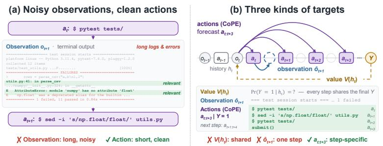

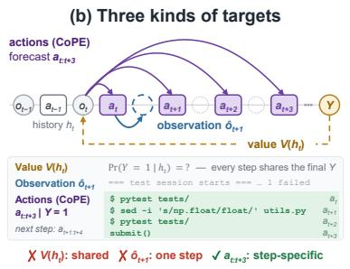

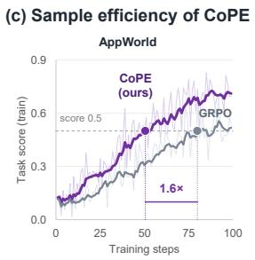  
Figure 1: Motivation of COPE for sample-efficient RL. (a) A terminal observation contains many task-irrelevant tokens, whereas the corresponding action is short and decision-relevant. (b) Three kinds of targets at the same history $h _ { t } .$ Value targets are shared across steps: every step of a trajectory is labeled with the same final outcome Y. The observation target $\hat { o } _ { t + 1 }$ is noisy and reaches only one step ahead. COPE’s action targets condition on $Y = 1$ and are specific to each step: $h _ { t }$ is labeled with the actions that actually followed it, $a _ { t : t + K } ( K = 3 \mathrm { h e r e } )$ , and the next step with $a _ { t + 1 : t + K + 1 }$ (c) On AppWorld, COPE reaches a training task score of 0.5 with 1.6× fewer RL steps than GRPO.

Key challenges. Both existing prediction targets are difficult to construct effectively in complex agentic environments. (1) Value targets are derived from only the shared outcome. A trajectory records only its final outcome, not the success probability of each step, so every step is labeled with this same outcome, whose randomness comes mostly from later actions and observations rather than from the step itself. Distinguishing between steps requires step-level annotations, additional rollouts from intermediate states, or exact recurrence of states across rollouts. (2) Observation targets are noisy and reach only one step ahead. In web navigation or agentic coding, most tokens of the next observation (e.g., HTML DOM trees or verbose terminal logs) are irrelevant to the decision (Fig. 1a), so the prediction loss is dominated by reproducing them. The target also covers only single-step transition; reaching later steps requires chaining predictions, where errors compound.

Our solution. We propose COPE, which constructs a third kind of target: multi-step action targets. Alongside GRPO, COPE employs multi-step action forecasting on successful on-policy trajectories, predicting actions $a _ { t : t + K }$ directly from the current history while skipping the intervening observations. We show that the population optimum of this objective is $\operatorname* { P r } ( a _ { t : t + K } \ | \ h _ { t }$ , success), a hindsight distribution (Harutyunyan et al., 2019; Russo, 2026) that conditions on both the history and the episode’s eventual success. Success thus enters as a condition that selects trajectories, not as a label assigned to each step. Therefore, COPE overcomes previous limitations in three key ways. (1) Action targets are specific to each step. A successful trajectory labels each step with its own continuation, the actions that actually followed it. (2) Action targets are decision-relevant. Actions are concise (Fig. 1a), so the loss is not spent on irrelevant observation content. (3) Multi-step action targets span the horizon and form an implicit temporal ensemble. Each action is supervised both where it is taken and when it is forecast from the K preceding histories, and the shared backbone absorbs this ensemble into the policy through training alone. This agrees with the delay view of action chunking in robot learning, where predicting chunks trains each action from the current and several earlier observations; the resulting ensemble of delayed predictors, which ACT averages explicitly at test time (Zhao et al., 2023), accounts for much of chunking’s benefit (Lazzati et al., 2026). COPE differs by still acting one step at a time at inference, with no overhead.

Main findings. We evaluate COPE on five benchmarks spanning three simulated environments (ALFWorld (Shridhar et al., 2020), ScienceWorld (Wang et al., 2022), and WebShop (Yao et al., 2022)) and two realistic applications (τ<sup>2</sup>-bench (Barres et al., 2025) and AppWorld (Trivedi et al., 2024)). Our experiments yield three main findings. (1) Broad improvements: COPE outperforms GRPO (Shao et al., 2024) and observation-prediction baselines (ECHO (Shrivastava et al., 2026) and RWML (Yu et al., 2026)) on aggregate metrics in the three simulated environments, and improves overall metrics on both realistic applications (despite a negative result on the Airline domain of $\tau ^ { 2 } .$ bench). (2) Sample efficiency: on ScienceWorld, COPE is up to 1.9× and 2.0× more sample-efficient than ECHO and GRPO, respectively. (3) Low overhead: on ScienceWorld, the action forecasting pass adds just 11% time per training step on average, while shorter rollouts reduce the measured end-to-end step time by 9%; COPE requires neither a separate model nor a pretraining stage.

## 2 RELATED WORKS

Sample-efficient agentic RL. Methods for sample-efficient agentic RL follow two main directions. The first makes better use of outcome rewards, either by refining credit assignment within trajectories (Feng et al., 2025; Wang et al., 2025; Luo et al., 2025; Wang et al., 2026b; Kong et al., 2026) or by converting completed interactions into extra policy supervision via hindsight rewriting or on-policy distillation (Hu et al., 2025; Yang et al., 2026; Wu et al., 2026; Zheng et al., 2026). These methods change how sparse outcomes are assigned or reused, without necessarily introducing a predictive objective. The second learns from the environment feedback available at every step, typically by adding auxiliary prediction of future states or observations to policy training (Zhang et al., 2026; Shrivastava et al., 2026; Lu et al., 2026). Such objectives provide dense token-level supervision but generally focus on a single environment transition. COPE combines elements of both directions: success filtering reuses outcome rewards, while multi-horizon prediction learns from how trajectories unfold in action space rather than reconstructing observations.

Multi-horizon prediction. COPE is closely related to several forms of multi-horizon and outcomeconditioned prediction. Multi-token prediction trains language models to predict several future tokens (Gloeckle et al., 2024), while robotic policies such as ACT and Diffusion Policy predict sequences of future actions (Zhao et al., 2023; Chi et al., 2023). Multi-token prediction is closest architecturally because multiple offsets are learned by one backbone, whereas action chunking is closest in the structure of its targets. Outcome-conditioned sequence modeling conditions policies on desired returns, while self-imitation emphasizes high-return trajectories (Chen et al., 2021; Oh et al., 2018); both connect policy learning to trajectory-level outcomes. Accordingly, the $k = 0$ term in COPE is success-filtered imitation, while the $k \geq 1$ terms extend this supervision to multiple future action offsets. COPE uses these predictions as an auxiliary objective during on-policy GRPO: targets are regenerated from successful rollouts, and the predicted future actions are not executed as a chunk but affect acting through the shared backbone.

## 3 PRELIMINARIES

Language agents. We consider a long-horizon task in which an LLM policy $\pi _ { \theta }$ interacts with an environment for T steps. At step $t ,$ the agent holds the history $h _ { t } = ( o < _ { t } , a _ { < t } )$ , samples an action $a _ { t } \sim \pi _ { \theta } ( \cdot \mid h _ { t } )$ , and receives an observation $o _ { t + 1 } \sim P ( \cdot \mid h _ { t } , a _ { t } )$ from the unknown environment transition $P ,$ so that $h _ { t + 1 } = ( h _ { t } , a _ { t } , o _ { t + 1 } )$ . This produces a trajectory $\tau = ( o _ { 0 } , a _ { 0 } , o _ { 1 } , \dots , a _ { T - 1 } , o _ { T } )$ We focus on sparse-reward settings (See Appendix B.3), where the agent receives only a terminal success signal $\mathbf { \bar { \mathbf { Y } } } ( \tau ) \in \{ 0 , 1 \}$ , and policy learning maximizes $J ( \theta ) = \breve { \mathbb { E } } _ { \tau \sim ( \pi _ { \theta } , P ) } \big [ Y ( \tau ) \big ]$

Policy optimization. A common choice for optimizing $J ( \theta )$ is Group Relative Policy Optimization (GRPO) (Shao et al., 2024), which avoids training a critic. For each task, GRPO samples a group of G trajectories $\{ \tau _ { i } \} _ { i = 1 } ^ { G }$ from the rollout policy $\pi _ { \mathrm { o l d } }$ and assigns each the normalized advantage $\hat { A } _ { i } = ( Y ( \tau _ { i } ) - \mu ) / ( \sigma + \delta )$ , where $\mu$ and σ are the mean and standard deviation of rewards in the group. With the per-step ratio $\rho _ { i , t } ( \theta ) = \pi _ { \theta } ( a _ { i , t } \mid h _ { i , t } ) / \pi _ { \mathrm { o l d } } ( a _ { i , t } \mid h _ { i , t } )$ , GRPO minimizes

$$
\mathcal { L } _ { \mathrm { G R P O } } ( \theta ) = - \frac { 1 } { G } \sum _ { i = 1 } ^ { G } \frac { 1 } { T _ { i } } \sum _ { t = 0 } ^ { T _ { i } - 1 } \operatorname* { m i n } \Big ( \rho _ { i , t } ( \theta ) \hat { A } _ { i } , \mathrm { c l i p } \left( \rho _ { i , t } ( \theta ) , 1 - \epsilon , 1 + \epsilon \right) \hat { A } _ { i } \Big ) .\tag{1}
$$

Because the reward evaluates trajectory as a whole, every action in $\tau _ { i }$ receives the same advantage ${ \hat { A } } _ { i } .$ . The learning signal thus only says whether a trajectory succeeded, not how it unfolded. The intermediate steps, which record how each decision led to the next, provide no further supervision. This motivates extracting additional supervision from the temporal structure of the collected trajectories.

## 4 EXTENDING POLICY LEARNING ACROSS FUTURE HORIZONS

Policy optimization links current decisions to eventual success, but only through a single scalar per trajectory. We define the success-conditioned action chunk, show that under binary rewards the GRPO update fits only its single-step distribution $( K = 0 )$ , and extend this objective to the multi-step chunk $( K > 0 )$ via action forecasting.

Success-conditioned action chunk. Fix a task and a rollout policy π. Let $\mathrm { P r } _ { \pi }$ denote the rollout distribution under $\pi _ { \mathrm { : } }$ , let $Y \in \{ 0 , 1 \}$ indicate whether a rollout succeeds, and let $\operatorname* { P r } ^ { + } \triangleq \operatorname* { P r } _ { \pi } ( \cdot \ |$

(i)  
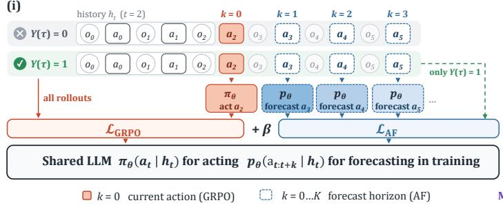

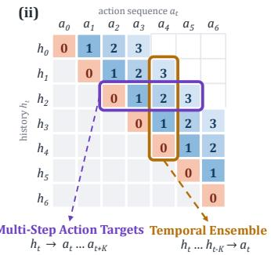  
Figure 2: Overview of COPE. (i) Joint training of acting and forecasting. One LLM backbone is shared by both, and $\mathcal { L } _ { \mathrm { A F } }$ fits the successful action chunk $a _ { t : t + K }$ . (ii) Co-evolution of acting and forecasting. Acting helps forecasting via trajectory collection, and forecasting helps acting via implicit temporal ensembling.

$Y = 1 )$ denote the distribution of successful rollouts. Given a history $h _ { t }$ , the success-conditioned action chunk $q ( a _ { t : t + K } \mid h _ { t } )$ describes what sequences of future actions lead to task completion from $h _ { t } { \mathrm { - } } \mathrm { f o r m a l l y } .$ it is the distribution of the next $\bar { K } + 1$ actions in successful rollouts, with intervening observations marginalized out:

$$
q ( a _ { t : t + K } \mid h _ { t } ) \ \triangleq \ \operatorname* { P r } ^ { + } ( a _ { t : t + K } \mid h _ { t } ) , \qquad a _ { t : t + K } = ( a _ { t } , \ldots , a _ { t + K } ) ,\tag{2}
$$

where actions after episode termination are padded with a terminal token so that the chunk is welldefined at every step t. We suppress the dependence on π in this section, and write $\operatorname* { P r } _ { \pi } ^ { + }$ and $q _ { \pi }$ in Sec. 5, where π is the policy being trained.

GRPO fits the single-step distribution. Consider an idealized GRPO (Shao et al., 2024) update: onpolicy $( \pi _ { \boldsymbol { \theta } } = \pi$ , so clipping is inactive), without KL or length normalization (Liu et al., 2025). Since the on-policy score has zero mean, $\mathbb { E } _ { \mathrm { P r } _ { \pi } } [ \sum _ { t } \nabla _ { \theta }$ log $\pi _ { \boldsymbol { \theta } } ( a _ { t } \mid h _ { t } ) ] = 0 .$ , pushing down failed rollouts points in the same expected direction as pulling up successful ones.<sup>1</sup> Hence, up to a task-dependent positive scalar, the expected update follows the gradient of the effective loss

$$
\begin{array} { r } { \bar { \mathcal { L } } _ { \mathrm { G R P O } } \triangleq - \mathbb { E } _ { \mathrm { P r } ^ { + } } \Big [ \sum _ { t } \log \pi _ { \theta } ( a _ { t } | h _ { t } ) \Big ] = \mathbb { E } _ { \mathrm { P r } ^ { + } } \Big [ \sum _ { t } \mathrm { C E } \big ( q ( a _ { t } | h _ { t } ) , \pi _ { \theta } ( a _ { t } | h _ { t } ) \big ) \Big ] , } \end{array}\tag{3}
$$

where $\mathrm { C E } ( q , p ) \triangleq - \mathbb { E } _ { q } [ \log p ]$ , and the equality holds because $a _ { t }$ following $h _ { t }$ in a successful rollout is a sample from $q ( a _ { t } \mid \hat { h } _ { t } )$ . GRPO thus fits $\pi _ { \theta }$ only to the single-step distribution $( K = 0 )$ and never asks $h _ { t }$ to anticipate subsequent actions. Our implementation (Alg. 1) deviates from this idealization, so Eq. (3) describes the target GRPO fits rather than its exact loss.

Action forecasting fits the multi-step chunk. To supervise $h _ { t }$ with the full horizon-K chunk $q ( a _ { t : t + K } \mid h _ { t } )$ , we introduce an autoregressive action forecaster $\begin{array} { r } { p _ { \theta } ( a _ { t : t + K } \mid h _ { t } ) = \prod _ { k = 0 } ^ { K } p _ { \theta } ( a _ { t + k } \mid } \end{array}$ $h _ { t } , a _ { t : t + k - 1 } )$ and train it with the multi-step counterpart of Eq. (3):

$$
\begin{array} { r } { \bar { \mathcal { L } } _ { \mathrm { A F } } \triangleq - \mathbb { E } _ { \mathbb { P } ^ { + } } \Big [ \sum _ { t } \log p _ { \theta } \big ( a _ { t : t + K } | h _ { t } \big ) \Big ] = \mathbb { E } _ { \mathbb { P } ^ { + } } \Big [ \sum _ { t } \mathrm { C E } \big ( q ( a _ { t : t + K } | h _ { t } ) , p _ { \theta } \big ( a _ { t : t + K } | h _ { t } \big ) \big ) \Big ] . } \end{array}\tag{4}
$$

At $K = 0 , \bar { \mathcal { L } } _ { \mathrm { A F } }$ fits the same target $q ( a _ { t } \mid h _ { t } )$ as $\bar { \mathcal { L } } _ { \mathrm { G R P O } }$ in Eq. (3), and recovers it exactly if $p _ { \theta } = \pi _ { \theta }$ . Just as in the single-step case, the equality in Eq. (4) holds because the action sequence $a _ { t : t + K }$ observed after $h _ { t }$ in a successful rollout is already an exact sample from $q ( a _ { t : t + K } \mid h _ { t } )$ This makes multi-step fitting tractable: rather than learning an explicit world model to simulate future states and marginalize out intermediate observations, we simply read target action chunks off successful environment rollouts, where intermediate observations are naturally marginalized under $\mathrm { P r } ^ { + }$ . Because $p _ { \theta }$ shares parameters with the acting policy $\pi _ { \theta }$ (Sec. 5.1), minimizing $\bar { \mathcal { L } } _ { \mathrm { A F } }$ forces the policy’s representation at $h _ { t }$ to encode the multi-step action plan that leads to success.

## 5 COPE: CO-EVOLVING ACTING AND FORECASTING

COPE trains a single LLM to both act and forecast its own future actions $( \mathrm { F i g . } 2 )$ . The acting policy and the forecaster share one backbone (Sec. 5.1), the forecaster is trained on successful on-policy

Algorithm 1 COPE training algorithm   
Require: Shared backbone θ, group size G, horizon K, weight λ   
1: for each iteration do   
2: $\theta _ { \mathrm { o l d } }  \theta$   
3: Collect a group of trajectories $\{ \tau _ { i } \} _ { i = 1 } ^ { G }$ with $\pi _ { \theta _ { \mathrm { o l d } } }$   
4: $\hat { A } _ { i } \gets ( Y ( \tau _ { i } ) - \mu ) / ( \sigma + \delta )$   
5: $\rho _ { i , t }  \pi _ { \boldsymbol { \theta } } ( a _ { i , t } \mid h _ { i , t } ) / \pi _ { \theta _ { \mathrm { o l d } } } ( a _ { i , t } \mid h _ { i , t } )$   
6: $\begin{array} { r } { \mathcal { L } _ { \mathrm { G R P O } } ( \theta ) \gets - \frac { 1 } { G } \sum _ { i = 1 } ^ { G } \frac { 1 } { T _ { i } } \sum _ { t } \operatorname* { m i n } \bigl ( \rho _ { i , t } \hat { A } _ { i } , \mathrm { c l i p } ( \rho _ { i , t } , 1 - \epsilon , 1 + \epsilon ) \hat { A } _ { i } \bigr ) } \end{array}$ ▷ Eq. (1)   
7: $S \gets \{ i : Y ( \tau _ { i } ) = . 1 \}$   
8: $\begin{array} { r } { \mathcal { L } _ { \mathrm { A F } } ( \boldsymbol { \dot { \theta } } ) \gets - \frac { 1 } { \operatorname* { m a x } ( 1 , | \boldsymbol { S } | ) } \sum _ { i \in \mathcal { S } } \sum _ { t } \log p _ { \theta } ( a _ { i , t : t + K } \mid h _ { i , t } ) } \end{array}$ ▷ Eq. (5)   
9: Update θ by minimizing $\mathcal { L } _ { \mathrm { G R P O } } ( \theta ) + \lambda \mathcal { L } _ { \mathrm { A F } } ( \theta )$   
10: end for

trajectories (Sec. 5.2), and the forecasting loss is added to GRPO so that acting and forecasting improve together (Sec. 5.3).

## 5.1 SHARING PARAMETERS FOR ACTING AND FORECASTING

We instantiate the acting policy $\pi _ { \theta }$ and the forecaster $p _ { \theta }$ with a single LLM backbone $\theta \colon \pi _ { \theta } ( a _ { t } \mid h _ { t } )$ is the model’s next-action distribution given $h _ { t }$ , while $p _ { \theta } { \left( a _ { t : t + K } \mid h _ { t } \right) }$ is the distribution of the chunk it generates after a forecasting instruction is appended to $h _ { t }$ . The two are distinct distributions: even the first forecast position $p _ { \theta } ( a _ { t } \ | \ h _ { t } )$ is in general not equal to $\pi _ { \theta } ( a _ { t } \mid h _ { t } )$ , since it is produced under the forecasting instruction. Sharing the backbone brings two benefits. (1) No additional model. Forecasting reuses the policy’s parameters, so there is no separate model to train, store, or serve. (2) Shared representation. This allows the forecasting objective to write what structure it captures directly into the representation the policy acts from, allowing the two to co-evolve (Sec. 5.3).

## 5.2 MULTI-STEP ACTION FORECASTING LOSS

At each iteration, we collect trajectories with the current policy, $\pi = \pi _ { \theta _ { \mathrm { o l d } } } .$ and hold them fixed during optimization. As shown in Sec. 4, every chunk $a _ { t : t + K }$ realized after $h _ { t }$ in a successful rollout is a sample from $q _ { \pi } ( a _ { t : t + K } \mid h _ { t } )$ , so we train the forecaster by maximum likelihood on these chunks, without modeling the environment dynamics.

Success-filtered multi-step forecasting. Since $q _ { \pi }$ is defined under $Y = 1$ , we use only successful trajectories to provide its samples. Fitting failed trajectories as well would learn the unconditioned chunk distribution $\operatorname* { P r } _ { \pi } ( a _ { t : t + K } \mid h _ { t } )$ , which would push the shared backbone toward the behavior that GRPO suppresses. For each task x, let $\mathcal { G } _ { x }$ be the group of G rollouts sampled from $\pi ,$ , and $S _ { x } = \{ \tau \in \mathcal { G } _ { x } : Y ( \tau ) = 1 \}$ its successful subset. The multi-step action forecasting loss is

$$
\mathcal { L } _ { \mathrm { A F } } ( \theta ) = - \mathbb { E } _ { x , \mathcal { G } _ { x } } \Big [ \sum _ { \tau \in \mathcal { G } _ { x } } \frac { Y ( \tau ) } { \operatorname* { m a x } ( 1 , | S _ { x } | ) } \sum _ { t } \log p _ { \theta } ( a _ { t : t + K } \mid h _ { t } ) \Big ] ,\tag{5}
$$

where $h _ { t }$ and $a _ { t : t + K }$ are taken from τ. A chunk that runs past the end of τ is truncated after the terminal token of Eq. (2), since the remaining padding is deterministic. Eq. (5) is the sample-based counterpart of Eq. (4). At each $h _ { t }$ , we append the forecasting instruction followed by the realized chunk, so each term is computed in a single forward pass.

Group normalization of the forecasting loss. Success filtering alone can destabilize training as the policy improves: the number of successful rollouts grows over training, so an unnormalized $\mathcal { L } _ { \mathrm { A F } }$ would contribute a gradient that scales with the success count and interferes with policy optimization. The weight $1 / \operatorname* { m a x } ( 1 , | S _ { x } | )$ in $\operatorname { E q . } \left( 5 \right)$ averages the loss over the successful rollouts of each group, removing this linear dependence. For a successful $\tau .$ , the expected weight depends only on its task $x ,$ which $h _ { t }$ determines. Hence, per task, $\mathcal { L } _ { \mathrm { A F } }$ equals $\bar { \mathcal { L } } _ { \mathrm { A F } } \left( \mathrm { E q . } \left( 4 \right) \right)$ in expectation up to a positive scalar, mirroring the relation between the GRPO update and $\bar { \mathcal { L } } _ { \mathrm { G R P O } }$ , so the reweighting leaves the per-history minimizer (Eq. (6)) unchanged.

## 5.3 CO-EVOLUTION OF ACTING AND FORECASTING

Acting helps forecasting via trajectory collection. For a fixed rollout policy π and a sufficiently expressive model, $\mathcal { L } _ { \mathrm { A F } }$ is minimized on every history reached by successful rollouts by the successconditioned chunk itself (Eq. (4)), which by Bayes’ rule is

$$
\begin{array} { r } { p _ { \theta ^ { \star } } \bigl ( a _ { t : t + K } \ | \ h _ { t } \bigr ) = q _ { \pi } \bigl ( a _ { t : t + K } \ | \ h _ { t } \bigr ) \ \propto \ \operatorname* { P r } _ { \pi } \bigl ( a _ { t : t + K } \ | \ h _ { t } \bigr ) \ \operatorname* { P r } _ { \pi } \bigl ( Y = 1 \ | \ h _ { t } , \ a _ { t : t + K } \bigr ) . } \end{array}\tag{6}
$$

The first factor is the chunks that acting proposes, and the second is their value, which success filtering applies: filtering rollouts by success is rejection sampling from this value-weighted distribution. This reweighting keeps the target ahead of the policy that generates it: acting at every history with its current-action marginal $q _ { \pi } ( a _ { t } \mid h _ { t } )$ , which is exactly the target GRPO fits (Eq. (3)), succeeds at least as often as acting with π (Russo, 2026). Both factors depend on the current policy, so forecasting relies on acting to supply successful rollouts, and receives more of them as the policy improves.

Forecasting helps acting via implicit temporal ensembling. Sec. 4 read the forecasting loss along a row of Fig. 2(ii): each history $h _ { t }$ must anticipate its chunk $a _ { t : t + K }$ . Read along a column, every action $a _ { t }$ of a successful rollout also lies in the chunks of the K preceding histories, so it is supervised from each of $h _ { t } , h _ { t - 1 } , \ldots , h _ { t - K }$ through the forecast $p _ { \theta } ( a _ { t } \mid h _ { t - k } , a _ { t - k : t - 1 } )$ , rather than only from $h _ { t }$ at the moment it is acted, as in GRPO. These forecasts do not conflict with acting: since all are conditionals of the same $\operatorname* { P r } _ { \pi } ^ { + }$ , the forecast of $a _ { t }$ issued at $h _ { t - k }$ is, at the optimum, the GRPO target $q _ { \pi } ( a _ { t } \mid h _ { t } )$ averaged over the observations not yet seen, given the actions taken in between. Since the forecaster shares θ with the acting policy (Sec. 5.1), these earlier forecasts are implicitly ensembled into $\pi _ { \theta }$ through the shared representation. We further demonstrate this effect in Sec. 8.

Joint optimization and inference. We optimize the shared parameters with $\mathcal { L } ( \theta ) = \mathcal { L } _ { \mathrm { G R P O } } ( \theta ) +$ $\lambda { \mathcal { L } } _ { \mathrm { A F } } ( \theta )$ , where $\mathcal { L } _ { \mathrm { A F } }$ is given by Eq. (5) and λ is a hyper-parameter (Alg. 1). The forecasting target is used only during training: at inference, the agent acts with π alone, generating one action per step without the forecasting instruction, so COPE adds no inference cost over a GRPO-trained policy.

## 6 EXPERIMENTAL SETTINGS

Tasks. We evaluate on five long-horizon agent benchmarks with sparse rewards that differ in observation complexity, action space, and horizon. Three are simulated environments: (1) ALF-World (Shridhar et al., 2020) for household tasks, (2) ScienceWorld (Wang et al., 2022) for elementary science experiments, and (3) WebShop (Yao et al., 2022) for online shopping over long web-page observations. Two are realistic applications: (1) $\tau ^ { 2 } .$ -bench (Barres et al., 2025) for policy-constrained customer service with a user simulator, and (2) AppWorld (Trivedi et al., 2024) for composing API calls across consumer apps with code as actions. We use Qwen2.5-7B-Instruct (Qwen et al., 2024) for the three simulated environments and $\tau ^ { 2 }$ -bench, and Qwen2.5-14B-Instruct for the more difficult AppWorld tasks. Details are available in Appendix A. Unless otherwise stated, all analysis experiments are carried out on ScienceWorld.

Baselines. On the simulated environments (Table 3), we compare against three groups. (1) Prompting: Qwen2.5-7B-Instruct, Gemini-2.5-Flash-Lite (Comanici et al., 2025), GPT-5-mini and GPT-5.5 (OpenAI, 2025; 2026), and Reflexion (Shinn et al., 2023), which adds verbal self-reflection on failed trials. (2) RL w/o auxiliary loss: RFT (Yuan et al., 2023), rejection sampling fine-tuning; GRPO (Shao et al., 2024), critic-free RL with group-normalized advantages; and EMPG (Wang et al., 2025), which rescales GRPO’s step-level gradients by policy entropy. (3) RL w/ auxiliary loss: RWML (Yu et al., 2026), which first trains next-state prediction on environment transitions and then runs GRPO; and ECHO (Shrivastava et al., 2026), which adds a next-observation prediction loss to GRPO. Both supervise only single-step transitions, testing whether forecasting actions over multiple steps is more effective than predicting the next observation. On $\tau ^ { 2 } .$ -bench and AppWorld (Tables 1 and 2), we include published baseline numbers reported by G2PO (Wang et al., 2026a) and InfoPO (Kong et al., 2026), together with GRPO and COPE runs from our implementation. Because the published AppWorld results use a different task subset and protocol (Appendix B.1), our direct comparison is between GRPO (ours) and COPE under our shared setup.

## 7 EXPERIMENTAL RESULTS

COPE achieves aggregate gains across five agentic benchmarks. Across both simulated and realistic agentic tasks, COPE improves the benchmark-level aggregate metrics over GRPO. On

ALFWorld (Table 3), COPE improves performance by 5.0 points over GRPO. The gains are larger on WebShop and ScienceWorld, where success rates increase by 12.5 points to 77.0% and by 8.0 points to 72.5%, respectively; on ScienceWorld, COPE also achieves the best performance among the RL-based methods. The same trend largely extends to more realistic benchmarks. On $\tau ^ { 2 } .$ -bench (Table 1), COPE improves overall success from 27.5% to 28.7%, driven by an approximately 12-point gain on Retail, despite a drop on Airline. We analyze the drop in Sec. 8. Finally, on AppWorld (Table 2), COPE substantially improves over GRPO on both splits, increasing success from 41.67% to 55.36% on the normal split and from 18.71% to 22.54% on the challenge split.

COPE outperforms observation-based auxiliary losses on aggregate simulated-task metrics. On the three simulated environments where ECHO and RWML are evaluated, COPE achieves the best aggregate results. It exceeds the stronger baseline by 1.0 point on ALF-World, by 4.4 average-score points and 5.5 success-rate points on WebShop, and by 5.0 success-rate points on ScienceWorld. These gains are not uniform across ALF-World subtasks: ECHO or RWML performs better on Cool and Pick2.

COPE improves sample efficiency. Figure 1 compares COPE with GRPO on AppWorld, while Fig. 3 compares COPE with ECHO and GRPO on ScienceWorld. Overall, COPE is 1.6× and 2.0× more sample-efficient than GRPO on AppWorld and ScienceWorld, respectively. On ScienceWorld, ECHO requires 53 and 114 steps to reach equivalent performance milestones (making COPE 1.7× to 1.9× faster). This acceleration is even more pronounced at higher reward tiers: COPE achieves a 0.6 reward by step 86, a level neither baseline reaches within the first 150 steps. Thus, the multi-step action forecasting loss not only accelerates early-stage learning but also enables the policy to reach a higher performance level under the same budget.

COPE introduces little training overhead. Because COPE adds a supervised pass over successful rollouts, its direct cost scales with the batch success rate. On ScienceWorld, this pass adds 11% time per training step on average, while shorter rollouts reduce the measured endto-end step time by 9% compared with GRPO (Fig. 4).

Table 1: Results on $\tau ^ { 2 } ,$ -bench. All results are Avg@4 for task success rate with Qwen2.5-7B-Instruct.
<table><tr><td rowspan=1 colspan=5>Method     Telec. RetailAirOverall</td></tr><tr><td rowspan=1 colspan=5>Agentic Prompting</td></tr><tr><td rowspan=1 colspan=5>Qwen2.5     14.4  13.1  7.5 11.7ReAct       13.1  13.8 10.0 12.3</td></tr><tr><td rowspan=1 colspan=5>Published RL results</td></tr><tr><td rowspan=1 colspan=2>RAGEN     17.5</td><td rowspan=1 colspan=3>17.515.0 16.7</td></tr><tr><td rowspan=1 colspan=2>Search-R1    15.6</td><td rowspan=1 colspan=3>15.0 10.0  13.5</td></tr><tr><td rowspan=1 colspan=2>UserRL      13.8</td><td rowspan=2 colspan=3>16.9  7.5 12.718.816.3 17.7</td></tr><tr><td rowspan=1 colspan=2>InfoPO      18.1</td></tr><tr><td rowspan=1 colspan=2>Our controlled runs</td><td rowspan=1 colspan=3></td></tr><tr><td rowspan=1 colspan=1>GRPO (ours)</td><td rowspan=1 colspan=1>38.8</td><td rowspan=1 colspan=1>17.5</td><td rowspan=1 colspan=1>26.2</td><td rowspan=1 colspan=1>27.5</td></tr><tr><td rowspan=1 colspan=1>CoPE</td><td rowspan=1 colspan=1>40.6</td><td rowspan=1 colspan=1>29.4</td><td rowspan=1 colspan=1>16.2</td><td rowspan=1 colspan=1>28.7</td></tr></table>

Table 2: Results on AppWorld. All results are success rates (%) with Qwen2.5- 14B-Instruct. † indicates results in G2PO.
<table><tr><td rowspan=1 colspan=1>Method        Normal   Challenge</td></tr><tr><td rowspan=1 colspan=1>Agentic Prompting</td></tr><tr><td rowspan=1 colspan=1>Qwen2.5          1.2         0.7ReAct           10.7         2.6</td></tr><tr><td rowspan=1 colspan=1>Published RL results</td></tr><tr><td rowspan=1 colspan=1>PPO{†            19.1RLOO†          24.8GiGPO†         25.7          一GRPO†          24.8          一</td></tr><tr><td rowspan=1 colspan=1>Our controlled runs</td></tr><tr><td rowspan=1 colspan=1>GRPO (ours)    41.7        18.7</td></tr><tr><td rowspan=1 colspan=1>CoPE            55.4        22.5</td></tr></table>

## 8 DISCUSSIONS

## Q1: What is the empirical evidence for acting and forecasting co-evolution?

In Sec. 5.3, we analyze the co-evolution mechanism between acting and forecasting. The actingto-forecasting direction is straightforward: the policy collects successful trajectories as the forecast targets. Conversely, for the forecasting-to-acting direction, our analysis suggests that forecasting improves action selection through implicit ensembling via shared parameters. Here, we provide empirical evidence to support this claim.

Evidence for implicit temporal ensembling. For this experiment, we train a separate LoRA forecaster on ScienceWorld trajectories collected by the model, while the model’s parameters only receive policy gradient. The policy therefore supplies the forecasting data, but forecasting gradients cannot update the policy. We then use the separately parameterized forecaster to rerank candidate actions using forecasts from multiple horizons while COPE model itself acts as forecaster:

$$
\log \pi ( a \mid h _ { t } ) = ( 1 - \eta ) \log \pi _ { \theta } ( a \mid h _ { t } ) + \frac { \eta } { K } \sum _ { k = 1 } ^ { K } \log p _ { \theta ^ { \prime } } ( a \mid h _ { t - k } , a _ { t - k : t - 1 } ) ,\tag{7}
$$

Table 3: Evaluation results on simulated agent tasks. For ALFWorld, we report the success rate (%) on each subtask and overall. For WebShop and ScienceWorld, we report the average score and the success rate (%). All RL methods use Qwen2.5-7B-Instruct. Dark gray and light gray mark the best and second-best results in each column across all methods. More details are available in Appendix B.
<table><tr><td rowspan="2">Method</td><td colspan="7">ALFWorld</td><td colspan="2">WebShop</td><td colspan="2">ScienceWorld</td></tr><tr><td>Pick Look Clean</td><td></td><td></td><td>Heat</td><td>Cool</td><td>Pick2</td><td>All</td><td>Score Succ.</td><td></td><td>Score</td><td>Succ.</td></tr><tr><td colspan="10">Agentic prompting</td></tr><tr><td>Gemini-2.5-flash-lite</td><td>82.6</td><td>36.8</td><td>37.8</td><td>20.0</td><td>21.4</td><td>48.9</td><td>46.0</td><td>7.8</td><td>6.5</td><td>13.9</td><td>15.0</td></tr><tr><td>GPT-5-mini</td><td>82.6</td><td>47.4</td><td>27.0</td><td>36.0</td><td>14.3</td><td>75.6</td><td>52.0</td><td>11.7</td><td>7.0</td><td>40.1</td><td>43.5</td></tr><tr><td>GPT-5.5</td><td>97.8</td><td>100.0</td><td>91.9</td><td>88.0</td><td>89.3</td><td>93.3</td><td>93.5</td><td>66.1</td><td>56.5</td><td>66.8</td><td>79.0</td></tr><tr><td>Qwen2.5-7B</td><td>69.6</td><td>31.6</td><td>29.7</td><td>36.0</td><td>17.9</td><td>11.1</td><td>34.0</td><td>25.3</td><td>2.5</td><td>-13.3</td><td>2.5</td></tr><tr><td>Qwen2.5-7B + Reflexion</td><td>84.8</td><td>26.3</td><td>51.4</td><td>44.0</td><td>32.1</td><td>55.6</td><td>54.0</td><td>21.9</td><td>4.0</td><td>-3.7</td><td>6.0</td></tr><tr><td colspan="10">RL methods w/o auxiliary loss</td></tr><tr><td>RFT</td><td>91.3</td><td>73.7</td><td>73.0</td><td>84.0</td><td>64.3</td><td>71.1</td><td>77.0</td><td>51.4 16.0</td><td></td><td>-11.0</td><td>4.5</td></tr><tr><td>GRPO</td><td>100.0</td><td>73.7</td><td>94.6</td><td>84.0</td><td>89.3</td><td>88.9</td><td>90.5</td><td>84.1</td><td>64.5</td><td>52.8</td><td>64.5</td></tr><tr><td>GRPO + EMPG</td><td>97.8</td><td>57.9</td><td>89.2</td><td>88.0</td><td>89.3</td><td>95.6</td><td>89.5</td><td>84.3</td><td>67.5</td><td>48.2</td><td>46.5</td></tr><tr><td colspan="10">RL methods w/ auxiliary loss</td></tr><tr><td>RWML + GRPO</td><td>100.0</td><td>89.5</td><td>89.2</td><td>92.0</td><td>96.4</td><td>84.4</td><td>92.0</td><td>81.2 64.0</td><td></td><td>39.4</td><td>65.0</td></tr><tr><td>ECHO</td><td>97.8</td><td>89.5</td><td>91.9</td><td>96.0</td><td>96.4</td><td>93.3</td><td>94.5</td><td>85.0</td><td>71.5</td><td>44.8</td><td>67.5</td></tr><tr><td>CoPE</td><td>100.0 100.0</td><td></td><td>97.3</td><td>96.0</td><td>89.3</td><td>91.1</td><td>95.5</td><td>89.4 77.0</td><td></td><td>53.4</td><td>72.5</td></tr></table>

where $K = 2$ in this experiment and $\theta ^ { \prime }$ denotes the LoRA-trained forecaster. We rank eight candidate actions by log $\pi ( a | h _ { t } )$ and execute the highest-ranked one. At every checkpoint in Table 6, explicit forecasting improves GRPO and narrows its gap to COPE, but adds nothing to COPE, as predicted in Sec. 5.3. The forecasts thus carry information for acting that policy gradient alone does not acquire, and COPE’s policy already contains it: what GRPO obtains only through a separate forecaster and extra forward passes at test time, COPE delivers in a single forward pass. Forecasting therefore changes what the policy itself knows, completing the forecasting-to-acting half of the co-evolution.

## Q2: Why do multi-step targets outperform imitating successful actions?

Lazzati et al. (2026) traces the benefits of action chunking in robot imitation learning (Zhao et al., 2023) to delayed prediction: a prediction of $a _ { t }$ has a delay k if made without the last k observations. Since a chunking policy predicts $a _ { t }$ from $o _ { t } , o _ { t - 1 } , . . .$ , it acts as an ensemble of delayed predictors: a single delay recovers much of the benefit but falls short on harder tasks, while an ensemble over randomized delays matches chunking.

In our setting, the k-th term of the forecasting loss in Eq. (4) is a delay-k prediction. Each action is thus trained at every delay up to K, as in chunking. The variants in Table 5 differ in which delays they train: success-filtered SFT and K = 0 train only delay 0, on $\pi _ { \theta }$ directly and under the forecasting instruction (Sec. 5.1) respectively; the invalid-action filter replaces each rejected K = 0 target with the next valid action, a single delay set by an environment-specific signal; and COPE trains all delays up to K. Relative to GRPO, they change the success rate by −7.5, +2.0, +5.0, and +8.0 points.

Delay 0 carries little information about success. Success filtering keeps detours, suboptimal or invalid actions that the agent later recovers from, since they barely affect success. At such a step, the delay-0 target is the detour itself, while the recovery that decides success appears only at later delays. Imposed on $\pi _ { \theta }$ directly, the delay-0 target speeds up early training but later hurts it (Fig. 5).

A single delay versus an ensemble over delays. The filter confirms that a delayed target helps (+2.0 → +5.0, Fig. 5), but it needs an environment-specific signal and covers only detours that the environment rejects. COPE needs no such signal and trains every action at all delays, reaching +8.0: delay 0, a single delay, and the full ensemble rank in the same order as for robot policies (Lazzati et al., 2026).

## Q3: Why must action forecasting loss be conditioned on success, and what does it learn?

Fundamentally, the action forecasting loss must align with the primary RL objective. Without success conditioning, the model is forced to imitate average or failed trajectories, creating a severe objective conflict and leading to zero reward after the first few steps of training. With it, the forecaster learns how the agent behaves in episodes that eventually succeed. Because this conditions on the whole episode rather than on the agent’s choices alone, the targets for similar-looking histories come mostly from the tasks in which success is easiest, a known limitation of outcome-conditioned imitation (Paster et al., 2022; Eysenbach et al., 2022).

Table 4: Backbone ablations. WS/SW: WebShop/ScienceWorld. Both backbones share training settings. Entries: GRPO → COPE.  
Table 5: Comparison of action forecasting variants. We report success rate and gain with GRPO on ScienceWorld.
<table><tr><td colspan="2">Benchmark</td><td> $\mathrm { Q w e n } 2 . 5 – 7 \mathrm { B }$ </td><td> $\mathrm { Q w e n } 3 { \cdot } 8 \mathrm { B }$ </td></tr><tr><td rowspan="2">WS</td><td>Score</td><td> $8 4 . 1  \ 8 9 . 4$ </td><td> $8 3 . 4  \ 8 7 . 4$ </td></tr><tr><td>Succ.</td><td> $6 4 . 5  7 7 . 0$ </td><td> $6 4 . 0  7 2 . 5$ </td></tr><tr><td rowspan="2">SW</td><td>Score</td><td> $5 2 . 8  \ 5 3 . 4$ </td><td> $5 0 . 1  \ 5 8 . 3$ </td></tr><tr><td>Succ.</td><td> $6 4 . 5  7 2 . 5$ </td><td> $6 1 . 5  7 1 . 5$ </td></tr></table>

<table><tr><td>Method</td><td>Succ.</td><td>∆</td></tr><tr><td> $\mathrm { G R P O } + \mathrm { s u c c e s s - f i l t e r e d } \mathrm { S F T }$ </td><td>57.0</td><td>-7.5</td></tr><tr><td>K=0 (no invalid-action filter)</td><td>66.5</td><td> $+ 2 . 0$ </td></tr><tr><td>K=0 (invalid-action filter)</td><td>69.5</td><td> $+ 5 . 0$ </td></tr><tr><td>CoPE (K=2)</td><td>72.5</td><td>+8.0</td></tr></table>

Table 6: Explicit ensembling results. $\mathrm { G _ { 1 5 0 } }$ and $\mathrm { G _ { 2 5 0 } }$ denote checkpoints after 150 and 250 training steps on ScienceWorld.
<table><tr><td>Setting</td><td> $G _ { 1 5 0 }$ </td><td> $G _ { 2 5 0 }$ </td><td>CoPE</td></tr><tr><td>Top-1 sampling</td><td>56.5</td><td>64.5</td><td>72.5</td></tr><tr><td> $\mathrm { T o p } { - } 8 ( \eta { = } 0 )$ </td><td>62.5</td><td>69.0</td><td>73.5</td></tr><tr><td> $\mathrm { T o p } { - } 8 ( \eta { = } 0 . 7 5 )$ </td><td>70.0</td><td>72.0</td><td>73.0</td></tr><tr><td> $\Delta ~ ( \eta { = } 0 . 7 5 ~ \mathrm { v s . } ~ 0 )$ </td><td>+7.5</td><td>+3.0</td><td>-0.5</td></tr></table>

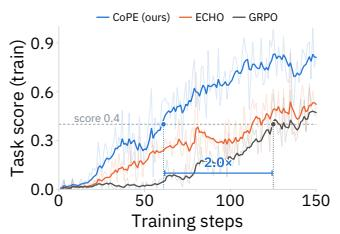  
Figure 3: Analysis of sample efficiency. COPE reaches 0.4 in about half the RL steps required by GRPO on ScienceWorld.

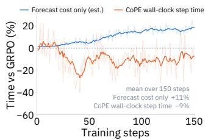  
Figure 4: Analysis on wall-clock efficiency. Forecasting adds 11% per-step cost, while end-to-end step time decreases by 9%.

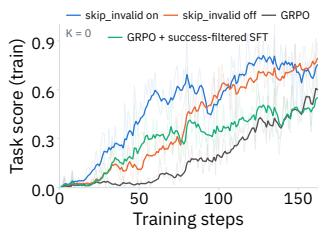  
Figure 5: Invalid-action filtering. Replacing invalid action with the next valid one improves the sample efficiency of the $\dot { K } = 0$ baseline.

Mixed results on $\tau ^ { 2 }$ -bench. This may explain the gain on Retail $( 1 7 . 5 \% \to 2 9 . 4 \% )$ and the drop on Airline $( 2 6 . 2 \%  1 6 . 2 \% )$ . In Airline, 38% of tasks are solved by leaving the database unchanged, compared with 4.4% in Retail, and these tasks are by far the easiest: early in training they succeed 52% of the time, against 8.9% for tasks that require changing the database, so most successful episodes come from them. The two kinds are nearly identical and differ only in details: a request to cancel a booking, for instance, must instead be refused once the customer demands a refund above 50%. Behavior that succeeds on the easy tasks, such as refusing, therefore transfers to look-alike tasks that require action; these then succeed even less often, which skews the targets further toward leaving the database unchanged. GRPO is less exposed to this loop, since failed refusals on such tasks receive negative advantages, whereas the forecasting loss learns only from successes.

## 9 ABLATION STUDIES

Ablation on forecasting horizon K. The horizon K is the maximum future offset: the forecast chunk contains the current-action target at $k = 0$ and future-action targets through $k = K$ . Short horizons keep the future targets close to the current history but capture less multi-step structure. Conversely, long horizons introduce irreducible noise, as the action k steps ahead depends increasingly on the intervening observations, which the forecast does not see. In Fig. 6, we compare the $K = 0$ invalid action filtered baseline with forecasting horizons $K \in \{ 1 , 2 , 4 \}$ . Every $\bar { K } \ge 1$ setting outperforms GRPO and the $K = 0$ baseline. $K = 2$ performs best, while $\dot { K } = 4$ declines slightly as noise from distant predictions begins to dominate.

Ablation on forecasting coefficient λ. Another important hyperparameter is the coefficient λ for the action forecasting loss. In Fig. 7, we sweep λ from $1 0 ^ { - 4 }$ to $1 0 ^ { - 1 }$ while fixing $K = 2$ . Notably, every tested value of λ consistently improves upon the GRPO baseline throughout training. We find that λ primarily controls the pace of learning: larger values accelerate early gains, whereas smaller values follow a similar but delayed trajectory. The two largest coefficients converge to similar peak scores, while the smaller ones still remain above GRPO. We adopt $\lambda = 1 0 ^ { - 2 }$ for all agentic tasks.

Ablation on group normalization. As discussed in Sec. 5, the number of successful rollouts within a group naturally increases as the policy improves. Without normalization, the accumulated forecasting gradient scales directly with this success count. This shifting balance between the primary

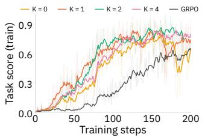  
Figure 6: Ablation on forecast horizon K. All $K \geq 1$ settings outperform GRPO; K = 2 achieves the highest score.

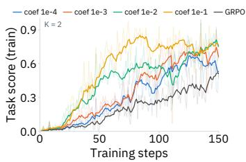  
Figure 7: Ablation on action forecasting weight. All coefficients outperform the GRPO baseline; λ = $\mathrm { \dot { 1 } 0 ^ { - 2 } }$ achieves the highest.

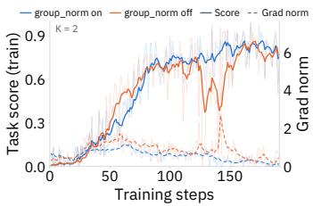  
Figure 8: Ablation on group normalization. Normalization suppresses spikes in gradient norms and stabilizes late training.

RL objective and the forecasting auxiliary loss causes spikes in gradient norms and reward fluctuations. Averaging over successful rollouts removes this direct dependence, although the resulting loss can still vary with trajectory length. As shown in Fig. 8, normalization reduces these spikes.

Ablation on model backbone. The results in Table 3 use Qwen2.5-7B-Instruct, leaving open whether the gain is specific to that backbone. We repeat the comparison against GRPO on WebShop and ScienceWorld with Qwen3-8B (Yang et al., 2025) and report it alongside the Qwen2.5-7B results. In Table 4, COPE improves both score and success rate on both benchmarks under both backbones, indicating that its gains are not tied to a particular model generation.

## 10 CONCLUSION

We introduced COPE, which trains a language agent to forecast its own future actions alongside acting. Rather than fitting noisy observations, COPE trains on the success-filtered action chunk $a _ { t : t + K } ,$ combining the current-action target with forecasts up to K steps in the future. Across five benchmarks, COPE improves aggregate results over RL baselines. It also improves sample efficiency with little computational overhead. We hope this work motivates further methods for sample-efficient long-horizon agentic RL.

## REPRODUCIBILITY STATEMENT

We describe the COPE algorithm in Sec. 5 and Alg. 1, and the tasks, models, baselines, and evaluation protocols in Sec. 6. Appendix A records model licenses and software dependencies, while Appendix B lists the configurations currently documented in the manuscript. Evaluation metrics are defined in Appendix B.4. We will release the complete per-method configuration files and training code upon publication.

## ETHICS STATEMENT

This work introduces COPE, a training algorithm for improving the sample efficiency of reinforcement learning for LLM-based agents; it is a methodological contribution rather than a deployed system, and its societal impact is largely mediated by how downstream practitioners apply it. All experiments are conducted on standard agentic benchmarks (ALFWorld, ScienceWorld, WebShop, τ<sup>2</sup>-bench, and AppWorld) using open-weight or proprietary models strictly for research evaluation; the work does not involve human subjects, crowdsourcing, or the collection of new personal data. By coupling action forecasting and policy optimization within a single backbone, COPE can reduce environmentinteraction costs without training or serving a separate world model, lowering the barrier for resourceconstrained groups to study long-horizon LLM agents. We also note that, like other advances in sample-efficient agentic RL, more capable autonomous agents could in principle be misused for tasks such as automated misinformation or unauthorized web automation; practitioners building on COPE in higher-stakes domains should pair it with appropriate safety evaluation, deployment-time monitoring, and human oversight.

## AI USE STATEMENT

In this work, we used generative AI tools to assist with method development and proof writing; to provide feedback on experimental design, including the separated-forecaster and implicit-ensembling analysis in Sec. 8; to help interpret experimental results; and to implement parts of the training and evaluation code. We did not use generative AI tools to generate synthetic datasets, clean or reformat datasets, perform translation, or conduct qualitative data analysis. We also used generative AI tools to draft and edit text for clarity, suggest section organization, search for and summarize related literature, and format references. The authors reviewed the AI-assisted derivations, code, reported results, and citations and take responsibility for the final content.

## REFERENCES

Victor Barres, Honghua Dong, Soham Ray, Xujie Si, and Karthik Narasimhan. τ<sup>2</sup>-bench: Evaluating conversational agents in a dual-control environment. arXiv preprint arXiv:2506.07982, 2025. URL https://arxiv.org/abs/2506.07982.

Markus J. Buehler. Generative retrieval-augmented ontologic graph and multiagent strategies for interpretive large language model-based materials design. ACS Engineering Au, 4:241– 277, 2024. URL https://pubs.acs.org/aeacb3/article/4/2/241/351595/ Generative-Retrieval-Augmented-Ontologic-Graph-and.

Lili Chen, Kevin Lu, Aravind Rajeswaran, Kimin Lee, Aditya Grover, Michael Laskin, Pieter Abbeel, Aravind Srinivas, and Igor Mordatch. Decision transformer: Reinforcement learning via sequence modeling. In Advances in Neural Information Processing Systems, volume 34, 2021. URL https://proceedings.neurips.cc/paper/2021/hash/ 7f489f642a0ddb10272b5c31057f0663-Abstract.html.

Zhaorun Chen, Zhuokai Zhao, Kai Zhang, Bo Liu, Qi Qi, Yifan Wu, Tarun Kalluri, Sara Cao, Yuanhao Xiong, Haibo Tong, Huaxiu Yao, Hengduo Li, Jiacheng Zhu, Xian Li, Dawn Song, Bo Li, Jason Weston, and Dat Huynh. Scaling agent learning via experience synthesis. arXiv preprint arXiv:2511.03773, 2025.

Cheng Chi, Siyuan Feng, Yilun Du, Zhenjia Xu, Eric Cousineau, Benjamin C. M. Burchfiel, and Shuran Song. Diffusion policy: Visuomotor policy learning via action diffusion. In Proceedings of Robotics: Science and Systems, 2023. doi: 10.15607/RSS.2023.XIX.026. URL https: //www.roboticsproceedings.org/rss19/p026.html.

Sanjiban Choudhury. Process reward models for llm agents: Practical framework and directions. arXiv preprint arXiv:2502.10325, 2025.

Gheorghe Comanici, Eric Bieber, Mike Schaekermann, Ice Pasupat, Noveen Sachdeva, Inderjit Dhillon, Marcel Blistein, Ori Ram, Dan Zhang, Evan Rosen, et al. Gemini 2.5: Pushing the frontier with advanced reasoning, multimodality, long context, and next generation agentic capabilities. arXiv preprint arXiv:2507.06261, 2025. URL https://arxiv.org/abs/2507.06261.

Xiang Deng, Yu Gu, Boyuan Zheng, Shijie Chen, Samuel Stevens, Boshi Wang, Huan Sun, and Yu Su. Mind2web: Towards a generalist agent for the web. arXiv preprint arXiv:2306.06070, 2023. URL https://arxiv.org/abs/2306.06070.

Hang Ding, Peidong Liu, Junqiao Wang, Ziwei Ji, Meng Cao, Rongzhao Zhang, Lynn Ai, Eric Yang, Tianyu Shi, and Lei Yu. DynaWeb: Model-based reinforcement learning of web agents. arXiv preprint arXiv:2601.22149, 2026.

Benjamin Eysenbach, Soumith Udatha, Russ R Salakhutdinov, and Sergey Levine. Imitating past successes can be very suboptimal. Advances in Neural Information Processing Systems, 35: 6047–6059, 2022.

Lang Feng, Zhenghai Xue, Tingcong Liu, and Bo An. Group-in-group policy optimization for LLM agent training. arXiv preprint arXiv:2505.10978, 2025. URL https://arxiv.org/abs/ 2505.10978.

Fabian Gloeckle, Badr Youbi Idrissi, Baptiste Roziere, David Lopez-Paz, and Gabriel Synnaeve. Better & faster large language models via multi-token prediction. In Proceedings of the 41st International Conference on Machine Learning, volume 235 of Proceedings ofMachine Learning Research, pp. 15706–15734. PMLR, 2024. URL https://proceedings.mlr.press/ v235/gloeckle24a.html.

Anna Harutyunyan, Will Dabney, Thomas Mesnard, Mohammad Azar, Bilal Piot, Nicolas Heess, Hado van Hasselt, Greg Wayne, Satinder Singh, Doina Precup, and Remi Munos. Hindsight credit assignment, 2019. URL https://arxiv.org/abs/1912.02503.

Sirui Hong, Xiawu Zheng, Jonathan Chen, Yuheng Cheng, Ceyao Zhang, Zili Wang, Steven Ka Shing Yau, Zijuan Lin, Liyang Zhou, Chenyu Ran, Lingfeng Xiao, and Chenglin Wu. MetaGPT: Meta programming for multi-agent collaborative framework. arXiv preprint arXiv:2308.00352v1, 2023. URL https://arxiv.org/abs/2308.00352v1.

Michael Y. Hu, Benjamin Van Durme, Jacob Andreas, and Harsh Jhamtani. Sample-efficient online learning in LM agents via hindsight trajectory rewriting. arXiv preprint arXiv:2510.10304, 2025. URL https://arxiv.org/abs/2510.10304.

Fanqi Kong, Jiayi Zhang, Mingyi Deng, Chenglin Wu, Yuyu Luo, and Bang Liu. InfoPO: Informationdriven policy optimization for user-centric agents. arXiv preprint arXiv:2603.00656, 2026.

Filippo Lazzati, Kyle Stachowicz, William Chen, Alberto Maria Metelli, Andrew Wagenmaker, and Sergey Levine. Why does action chunking improve behavioral cloning performance in robotic control? arXiv preprint arXiv:2608.02547, 2026.

Tennison Liu and Mihaela van der Schaar. Truly self-improving agents require intrinsic metacognitive learning. arXiv preprint arXiv:2506.05109, 2025. URL https://arxiv.org/abs/2506. 05109.

Zichen Liu, Changyu Chen, Wenjun Li, Penghui Qi, Tianyu Pang, Chao Du, Wee Sun Lee, and Min Lin. Understanding r1-zero-like training: A critical perspective. arXiv preprint arXiv:2503.20783, 2025.

Chris Lu, Cong Lu, Robert Tjarko Lange, Jakob Foerster, Jeff Clune, and David Ha. The ai scientist: Towards fully automated open-ended scientific discovery. arXiv preprint arXiv:2408.06292, 2024. URL https://arxiv.org/abs/2408.06292.

Ning Lu, Baijiong Lin, Shengcai Liu, Jiahao Wu, Haoze Lv, Yanbin Wei, Lingting Zhu, Shengju Qian, Xin Wang, Ying-Cong Chen, Qi Wang, and Ke Tang. Policy and world modeling co-training for language agents. arXiv preprint arXiv:2606.02388, 2026.

Xufang Luo, Yuge Zhang, Zhiyuan He, Zilong Wang, Siyun Zhao, Dongsheng Li, Luna K. Qiu, and Yuqing Yang. Agent lightning: Train ANY AI agents with reinforcement learning. arXiv preprint arXiv:2508.03680, 2025. URL https://arxiv.org/abs/2508.03680.

Junhyuk Oh, Yijie Guo, Satinder Singh, and Honglak Lee. Self-imitation learning. In Proceedings of the 35th International Conference on Machine Learning, volume 80 of Proceedings of Machine Learning Research, pp. 3878–3887. PMLR, 2018. URL https://proceedings.mlr. press/v80/oh18b.html.

OpenAI. GPT-5 system card, 2025. URL https://openai.com/index/ gpt-5-system-card/.

OpenAI. GPT-5.5 system card, 2026. URL https://openai.com/index/ gpt-5-5-system-card/.

Keiran Paster, Sheila McIlraith, and Jimmy Ba. You can’t count on luck: Why decision transformers and rvs fail in stochastic environments. Advances in neural information processing systems, 35: 38966–38979, 2022.

Qwen, An Yang, Baosong Yang, Beichen Zhang, Binyuan Hui, Bo Zheng, Bowen Yu, Chengyuan Li, Dayiheng Liu, Fei Huang, Haoran Wei, Huan Lin, Jian Yang, Jianhong Tu, Jianwei Zhang, Jianxin Yang, Jiaxi Yang, Jingren Zhou, Junyang Lin, Kai Dang, Keming Lu, Keqin Bao, Kexin Yang, Le Yu, Mei Li, Mingfeng Xue, Pei Zhang, Qin Zhu, Rui Men, Runji Lin, Tianhao Li, Tingyu Xia, Xingzhang Ren, Xuancheng Ren, Yang Fan, Yang Su, Yichang Zhang, Yu Wan, Yuqiong Liu, Zeyu Cui, Zhenru Zhang, Zihan Qiu, et al. Qwen2.5 technical report. arXiv preprint arXiv:2412.15115v1, 2024. URL https://arxiv.org/abs/2412.15115v1.

Daniel Russo. Success-conditioning as policy improvement: The optimization problem solved by imitating success. In Proceedings of the 43rd International Conference on Machine Learning (ICML), 2026. arXiv:2601.18175.

Ranjan Sapkota, Konstantinos I. Roumeliotis, and Manoj Karkee. Vibe coding vs. agentic coding: Fundamentals and practical implications of agentic ai. arXiv preprint arXiv:2505.19443, 2025. URL https://arxiv.org/abs/2505.19443.

Zhihong Shao, Peiyi Wang, Qihao Zhu, Runxin Xu, Junxiao Song, Xiao Bi, Haowei Zhang, Mingchuan Zhang, Y. K. Li, Y. Wu, and Daya Guo. DeepSeekMath: Pushing the limits of mathematical reasoning in open language models. arXiv preprint arXiv:2402.03300, 2024. URL https://arxiv.org/abs/2402.03300.

Noah Shinn, Federico Cassano, Ashwin Gopinath, Karthik Narasimhan, and Shunyu Yao. Reflexion: Language agents with verbal reinforcement learning. In Advances in Neural Information Processing Systems, volume 36, 2023. URL https://proceedings.neurips.cc/paper\_files/paper/2023/hash/ 1b44b878bb782e6954cd888628510e90-Abstract-Conference.html.

Mohit Shridhar, Xingdi Yuan, Marc-Alexandre Côté, Yonatan Bisk, Adam Trischler, and Matthew Hausknecht. Alfworld: Aligning text and embodied environments for interactive learning. arXiv preprint arXiv:2010.03768, 2020. URL https://arxiv.org/abs/2010.03768.

Vaishnavi Shrivastava, Piero Kauffmann, Ahmed Awadallah, and Dimitris Papailiopoulos. ECHO: Terminal agents learn world models for free. arXiv preprint arXiv:2605.24517, 2026.

Harsh Trivedi, Tushar Khot, Mareike Hartmann, Ruskin Manku, Vinty Dong, Edward Li, Shashank Gupta, Ashish Sabharwal, and Niranjan Balasubramanian. AppWorld: A controllable world of apps and people for benchmarking interactive coding agents. In Proceedings of the 62nd Annual Meeting ofthe Associationfor Computational Linguistics (Volume 1: Long Papers), 2024. URL https://aclanthology.org/2024.acl-long.850/.

Jiawei Wang, Jiacai Liu, Yuqian Fu, Yingru Li, Xintao Wang, Yuan Lin, Yu Yue, Lin Zhang, Yang Wang, and Ke Wang. Harnessing uncertainty: Entropy-modulated policy gradients for long-horizon llm agents. arXiv preprint arXiv:2509.09265, 2025. URL https://arxiv.org/abs/2509. 09265.

Ruoyao Wang, Peter Jansen, Marc-Alexandre Côté, and Prithviraj Ammanabrolu. Scienceworld: Is your agent smarter than a 5th grader? In Proceedings of the 2022 Conference on Empirical Methods in Natural Language Processing, pp. 11279–11298, 2022. URL https://aclanthology. org/2022.emnlp-main.775/.

Yunan Wang, Minghui Song, Zihan Zhang, Shaohan Huang, Haizhen Huang, Furu Wei, Weiwei Deng, Feng Sun, and Qi Zhang. Group-graph policy optimization for long-horizon agentic reinforcement learning. arXiv preprint arXiv:2606.22995, 2026a.

Zixuan Wang, Yuchen Yan, Hongxing Li, Teng Pan, Dingming Li, Ruiqing Zhang, Weiming Lu, Jun Xiao, Yueting Zhuang, and Yongliang Shen. Milestone-guided policy learning for long-horizon language agents. arXiv preprint arXiv:2605.06078, 2026b. URL https://arxiv.org/abs/ 2605.06078.

Jinyang Wu, Shuo Yang, Zhengxi Lu, Fan Zhang, Yuhao Shen, Lang Feng, Haoran Luo, Zheng Lian, Shuai Zhang, Zhengqi Wen, and Jianhua Tao. SEED: Self-evolving on-policy distillation for agentic reinforcement learning. arXiv preprint arXiv:2607.14777, 2026. URL https: //arxiv.org/abs/2607.14777.

Zhiheng Xi, Chenyang Liao, Guanyu Li, Zhihao Zhang, Wenxiang Chen, Binghai Wang, Senjie Jin, Yuhao Zhou, Jian Guan, Wei Wu, et al. Agentprm: Process reward models for llm agents via step-wise promise and progress. In Proceedings ofthe ACM Web Conference 2026, pp. 4184–4195, 2026.

Yutaro Yamada, Robert Tjarko Lange, Cong Lu, Shengran Hu, Chris Lu, Jakob Foerster, Jeff Clune, and David Ha. The ai scientist-v2: Workshop-level automated scientific discovery via agentic tree search. arXiv preprint arXiv:2504.08066, 2025. URL https://arxiv.org/abs/2504. 08066.

An Yang, Anfeng Li, Baosong Yang, Beichen Zhang, Binyuan Hui, Bo Zheng, Bowen Yu, Chang Gao, Chengen Huang, Chenxu Lv, Chujie Zheng, Dayiheng Liu, Fan Zhou, Fei Huang, Feng Hu, Hao Ge, Haoran Wei, Huan Lin, Jialong Tang, Jian Yang, Jianhong Tu, Jianwei Zhang, Jianxin Yang, Jiaxi Yang, Jing Zhou, Jingren Zhou, Junyang Lin, Kai Dang, Keqin Bao, Kexin Yang, Le Yu, Lianghao Deng, Mei Li, Mingfeng Xue, Mingze Li, Pei Zhang, Peng Wang, Qin Zhu, Rui Men, Ruize Gao, Shixuan Liu, Shuang Luo, Tianhao Li, Tianyi Tang, Wenbiao Yin, Xingzhang Ren, Xinyu Wang, Xinyu Zhang, Xuancheng Ren, Yang Fan, Yang Su, Yichang Zhang, Yinger Zhang, Yu Wan, Yuqiong Liu, Zekun Wang, Zeyu Cui, Zhenru Zhang, Zhipeng Zhou, and Zihan Qiu. Qwen3 technical report. arXiv preprint arXiv:2505.09388, 2025. URL https://arxiv.org/abs/2505.09388.

John Yang, Carlos E. Jimenez, Alexander Wettig, Kilian Lieret, Shunyu Yao, Karthik Narasimhan, and Ofir Press. Swe-agent: Agent-computer interfaces enable automated software engineering. arXiv preprint arXiv:2405.15793, 2024. URL https://arxiv.org/abs/2405.15793.

Shuo Yang, Jinyang Wu, Zhengxi Lu, Yuhao Shen, Fan Zhang, Lang Feng, Shuai Zhang, Haoran Luo, Zheng Lian, Zhengqi Wen, and Jianhua Tao. OPID: On-policy skill distillation for agentic reinforcement learning. arXiv preprint arXiv:2606.26790, 2026. URL https://arxiv.org/ abs/2606.26790.

Shunyu Yao, Howard Chen, John Yang, and Karthik Narasimhan. Webshop: Towards scalable real-world web interaction with grounded language agents. arXiv preprint arXiv:2207.01206, 2022. URL https://arxiv.org/abs/2207.01206.

Xiao Yu, Baolin Peng, Ruize Xu, Yelong Shen, Pengcheng He, Suman Nath, Nikhil Singh, Jianfeng Gao, and Zhou Yu. Reinforcement world model learning for LLM-based agents. arXiv preprint arXiv:2602.05842, 2026.

Zheng Yuan, Hongyi Yuan, Chengpeng Li, Guanting Dong, Keming Lu, Chuanqi Tan, Chang Zhou, and Jingren Zhou. Scaling relationship on learning mathematical reasoning with large language models. arXiv preprint arXiv:2308.01825, 2023.

Kai Zhang, Xiangchao Chen, Bo Liu, Tianci Xue, Zeyi Liao, Zhihan Liu, Xiyao Wang, Yuting Ning, Zhaorun Chen, Xiaohan Fu, Jian Xie, Yuxuan Sun, Boyu Gou, Qi Qi, Zihang Meng, Jianwei Yang, Ning Zhang, Xian Li, Ashish Shah, Dat Huynh, Hengduo Li, Zi Yang, Sara Cao, Lawrence Jang, Shuyan Zhou, Jiacheng Zhu, Huan Sun, Jason Weston, Yu Su, and Yifan Wu. Agent learning via early experience. In International Conference on Machine Learning (ICML), 2026. arXiv:2510.08558.

Yao Zhang, Zijian Ma, Yunpu Ma, Zhen Han, Yu Wu, and Volker Tresp. WebPilot: A versatile and autonomous multi-agent system for web task execution with strategic exploration. Proceedings of the AAAI Conference on Artificial Intelligence, 39(22):23378–23386, 2025. doi: 10.1609/aaai.v39i22. 34505. URL https://ojs.aaai.org/index.php/AAAI/article/view/34505.

Tony Z. Zhao, Vikash Kumar, Sergey Levine, and Chelsea Finn. Learning fine-grained bimanual manipulation with low-cost hardware. In Proceedings ofRobotics: Science and Systems, 2023. doi: 10.15607/RSS.2023.XIX.016. URL https://www.roboticsproceedings.org/ rss19/p016.html.

Binbin Zheng, Zijun Xie, Guanqun Zhao, Enlei Gong, Xing Ma, Xiaoliang Fu, and Zeyu Chen. Groupreflective self-distillation for agentic reinforcement learning. arXiv preprint arXiv:2607.28076, 2026. URL https://arxiv.org/abs/2607.28076.

Boyuan Zheng, Boyu Gou, Jihyung Kil, Huan Sun, and Yu Su. Gpt-4v(ision) is a generalist web agent, if grounded. arXiv preprint arXiv:2401.01614, 2024. URL https://arxiv.org/ abs/2401.01614.

Tianshi Zheng, Zheye Deng, Hong Ting Tsang, Weiqi Wang, Jiaxin Bai, Zihao Wang, and Yangqiu Song. From automation to autonomy: A survey on large language models in scientific discovery. In Conference on Empirical Methods in Natural Language Processing, 2025. URL https: //aclanthology.org/2025.emnlp-main.895/.

## A ARTIFACT DETAILS

## A.1 MODEL LICENSE

GPT-5-mini License: Proprietary (OpenAI) GPT-5.5 License: Proprietary (OpenAI) GPT-4o-mini License: Proprietary (OpenAI) Gemini-2.5-flash-lite License: Proprietary (Google) Qwen2.5-7B-Instruct License: Apache 2.0 Qwen2.5-14B-Instruct License: Apache 2.0 Qwen3-8B License: Apache 2.0

## A.2 SOFTWARE VERSIONS

For our simulated agentic environments, we build upon AgentGym-RL<sup>2</sup>, which provides unified task configurations for ALFWorld, WebShop, and SciWorld. We additionally implement environment adapters for AppWorld and τ<sup>2</sup>-bench. Our training infrastructure is built on top of verl<sup>3</sup> (v0.2.0.post2).

## A.3 DATASET STATISTICS

Table 7 gives the size of every split we use.

Table 7: Splits used in this work. “Pool” is the number of distinct tasks the environment can instantiate at all, from which the two splits are drawn; the splits do not have to exhaust it. Counts are measured, not quoted.
<table><tr><td>Environment</td><td>Train</td><td>Test</td><td>Pool</td><td>Unit of a task</td></tr><tr><td>ALFWorld</td><td>2,420</td><td>200</td><td>2,620</td><td>TextWorld game file</td></tr><tr><td>WebShop</td><td>3,930</td><td>200</td><td>6,910</td><td>shopping instruction (goal)</td></tr><tr><td>SciWorld</td><td>2,120</td><td>200</td><td>4,639</td><td>(task type, variation) pair</td></tr><tr><td> $\tau ^ { 2 }$ </td><td>178</td><td>100</td><td>278</td><td>customer-service task</td></tr><tr><td>AppWorld</td><td>90</td><td>168/417</td><td>732</td><td>task in a scenario</td></tr></table>

Table 8: ALFWorld subtask families. Derived from the task type encoded in each game file’s name, so the two splits are counted the same way.
<table><tr><td>Split</td><td>All</td><td>Pick</td><td>Look</td><td>Clean</td><td>Heat</td><td>Cool</td><td>Pick2</td></tr><tr><td>Train</td><td>2,420</td><td>672</td><td>196</td><td>448</td><td>321</td><td>394</td><td>389</td></tr><tr><td>Test</td><td>200</td><td>46</td><td>19</td><td>37</td><td>25</td><td>28</td><td>45</td></tr></table>

ALFWorld. The training pool is the 2,420 games under json\_2.1.1/train and the test set is the 200 games under json\_2.1.1/valid\_train; the environment server concatenates the two mapping files into one list, so test ids are simply indices 2420–2619 into it. The splits are therefore drawn from different game-file directories and share no game. Tasks fall into six families, read off the task type in the file name (Table 8): Pick (place an object), Look (examine an object under a lamp), Clean, Heat, Cool, and Pick2 (place two objects). The test split keeps roughly the training proportions, the largest gap being Pick2 (22.5% of test against 16.1% of train).

WebShop. Our WebShop instance is configured with 1,000 products, not the full catalogue: the environment server is constructed with num\_products=1000 and the product files are the 1K subsets, which we verified are byte-equivalent to the first 1,000 entries of the full files. Goals are the synthetic ones generated from those products’ attributes (the server is not run in human-goal mode), which yields 6,910 instructions; the generator is seeded (random.seed(233) before the shuffle), so an id denotes the same instruction in every run and on every machine. We train on 3,930 of them and test on 200. The two sets are disjoint and together cover 59.8% of the pool. Note that the commonly quoted WebShop figures — 12,087 human-written instructions, a 500-instruction test set, the full product catalogue — describe a different configuration and are not comparable to ours.

SciWorld. SciWorld is our abbreviation for ScienceWorld. The environment defines 30 task types; the server excludes seven of them (task ids 5-1, 5-2, 9-1, 9-2, 9-3, 10-1, 10-2) and enumerates every variation of the remaining 23, giving a pool of 4,639 (task type, variation) pairs indexed by a single running id. We train on 2,120 of these and test on 200. The training ids cover 22 of the 23 task types and the test ids cover 12.

τ<sup>2</sup>-Bench. τ<sup>2</sup>-Bench ships its own train/test partition per domain, and we use all three domains together: retail (74 train, 40 test), airline (30, 20) and telecom (74, 40), i.e. 178 training and 100 test tasks. We first compute the metric separately for each domain and report their unweighted arithmetic mean, so retail, airline, and telecom contribute equally despite their different test-set sizes. The environment server is launched with TAU2\_DOMAIN=retail+airline+telecom and the split selected by TAU2\_TASK\_SPLIT; task ids are positional across the concatenated domains in that order, and the id files are generated from the same loaders the server uses (scripts/make\_tau2\_itemid.py), so a row cannot name one task and train on another. Each task pairs a customer goal with a database state and a set of state-based assertions, and every episode also runs a simulated customer implemented with GPT-4o-mini at temperature 0.7. The resulting environment is stochastic, and a τ<sup>2</sup> task is substantially more expensive than an ALFWorld or WebShop one — which is why its pool is roughly one order of magnitude smaller.

AppWorld. AppWorld ships four splits and we use its own partition unchanged, read with appworld.load\_task\_ids: train (90 tasks), dev (57), test\_normal (168) and test\_challenge (417), 732 in total. We train on train and evaluate on both test splits, which the evaluation harness runs as separate passes because the environment servers have to be restarted per split (APPWORLD\_SPLIT selects the task list). test\_challenge is not a harder sample of the same distribution: it is built from scenarios held out entirely, so it measures transfer to unseen app combinations rather than to unseen instances of seen ones. An AppWorld task is a Python REPL session against nine simulated apps and is scored by state-based unit tests, so success is all-or-nothing per task; with 90 training tasks it is by far the smallest training pool of the five environments.

## B EXPERIMENTAL DETAILS

## B.1 BASELINE METHODS

We compare our method with prompting and training baselines spanning verbal self-reflection, rejection-sampling fine-tuning, online reinforcement learning, and observation-space predictive supervision.

Reflexion. Reflexion is a prompting baseline that asks the agent to verbally reflect on a failed trial and uses the resulting reflection to guide a subsequent attempt, without updating model parameters. We apply Reflexion to Qwen2.5-7B-Instruct on ALFWorld, WebShop, and SciWorld.

RFT. Rejection sampling fine-tuning (RFT) samples trajectories, retains those that succeed, and fine-tunes the policy by maximum likelihood on their action tokens. Unlike GRPO, it treats the retained trajectories as supervised targets rather than optimizing a group-relative policy-gradient objective. We evaluate RFT on ALFWorld, WebShop, and SciWorld.

GRPO. GRPO is an online reinforcement learning baseline. For each training query, the actor samples a group of trajectories from the current policy and optimizes the policy using group-relative advantages. Different from critic-based PPO, GRPO estimates advantages within each sampled group and therefore avoids training an additional value model. In our experiments, GRPO is applied to ALFWorld, WebShop, SciWorld, τ<sup>2</sup>-Bench, and AppWorld.

<table><tr><td></td><td colspan="3">GRPO</td><td colspan="3">ECHO</td><td colspan="3">RWML</td><td colspan="3">EMPG</td></tr><tr><td>Hyperparameter</td><td>ALFWorld</td><td>WebShop</td><td>SciWorld</td><td>ALFWorld</td><td>WebShop</td><td>SciWorld</td><td>ALFWorld</td><td>WebShop</td><td>SciWorld</td><td>ALFWorld</td><td>WebShop</td><td>SciWorld</td></tr><tr><td>Learning rate</td><td> $1 \times { 1 0 } ^ { - 6 }$ </td><td>1 × 10−⁶</td><td>1 × 10−⁶</td><td>1 × 10−6</td><td>1 × 10−6</td><td> $1 \times 1 0 ^ { - 6 }$ </td><td>1 × 10−6</td><td>1 × 10−⁶</td><td>1 × 10−⁶</td><td>1 × 10−6</td><td>1 × 10−6</td><td> $1 \times 1 0 ^ { - 6 }$ </td></tr><tr><td>KL coefficient</td><td>1 × 10−3</td><td>1 × 10−3</td><td> $1 \times 1 0 ^ { - 3 }$ </td><td>1 × 10−3</td><td>1 × 10−3</td><td>1 × 10−3</td><td>1 × 10−3</td><td>1 × 10−3</td><td>1 × 10−3</td><td>1 × 10−3</td><td>1 × 10−3</td><td>1 × 10−3</td></tr><tr><td>Entropy coefficient</td><td>1 × 10−3</td><td>1 × 10−3</td><td>1 × 10−3</td><td> $1 \times 1 0 ^ { - 3 }$ </td><td>1 × 10 -3</td><td>1 × 10−3</td><td>1 × 10 -3</td><td>1 × 10 -3</td><td>1 × 10 -3</td><td>1 × 10 -3</td><td>1 × 10 -3</td><td>1 × 10 -3</td></tr><tr><td>ECHO coefficient</td><td>=</td><td>=</td><td>I</td><td>0.01</td><td>0.01</td><td>0.01</td><td>I</td><td>I</td><td>V</td><td>I</td><td>一</td><td>1</td></tr><tr><td>Training batch size</td><td>16</td><td>16</td><td>16</td><td>16</td><td>16</td><td>16</td><td>16</td><td>16</td><td>16</td><td>16</td><td>16</td><td>16</td></tr><tr><td>PPO mini-batch size</td><td>2</td><td>8</td><td>8</td><td>2</td><td>8</td><td>8</td><td>2</td><td>8</td><td>8</td><td>2</td><td>8</td><td>8</td></tr><tr><td>Micro-batch size per GPU</td><td>1</td><td>1</td><td>1</td><td>1</td><td>1</td><td>1</td><td>1</td><td>1</td><td>1</td><td>1</td><td>1</td><td>1</td></tr><tr><td>Rollouts per task n</td><td>8</td><td>8</td><td>8</td><td>8</td><td>8</td><td>8</td><td>8</td><td>8</td><td>8</td><td>8</td><td>8</td><td>8</td></tr><tr><td>PPO epochs</td><td>1</td><td>1</td><td>1</td><td>1</td><td>1</td><td>1</td><td>1</td><td>1</td><td>1</td><td>1</td><td>1</td><td>1</td></tr><tr><td>Maximum training steps</td><td>100</td><td>200</td><td>300</td><td>100</td><td>200</td><td>300</td><td>100</td><td>200</td><td>300</td><td>100</td><td>200</td><td>300</td></tr><tr><td>Training max rounds</td><td>20</td><td>15</td><td>20</td><td>20</td><td>15</td><td>20</td><td>20</td><td>15</td><td>20</td><td>20</td><td>15</td><td>20</td></tr><tr><td>Evaluation max rounds</td><td>30</td><td>15</td><td>30</td><td>30</td><td>15</td><td>30</td><td>30</td><td>15</td><td>30</td><td>30</td><td>15</td><td>30</td></tr><tr><td>Maximum prompt length (tokens)</td><td>1024</td><td>2048</td><td>2048</td><td>1024</td><td>2048</td><td>2048</td><td>1024</td><td>2048</td><td>2048</td><td>1024</td><td>2048</td><td>2048</td></tr><tr><td>Maximum response length (tokens)</td><td>8192</td><td>8192</td><td>8192</td><td>8192</td><td>8192</td><td>8192</td><td>8192</td><td>8192</td><td>8192</td><td>8192</td><td>8192</td><td>8192</td></tr><tr><td>Maximum model length (tokens)</td><td>16384</td><td>16384</td><td>16384</td><td>16384</td><td>16384</td><td>16384</td><td>16384</td><td>16384</td><td>16384</td><td>16384</td><td>16384</td><td>16384</td></tr><tr><td>Maximum generation per turn (tokens)</td><td>512</td><td>512</td><td>512</td><td>512</td><td>512</td><td>512</td><td>512</td><td>512</td><td>512</td><td>512</td><td>512</td><td>512</td></tr><tr><td>Rollout temperature</td><td>1.0</td><td>1.0</td><td>1.0</td><td>1.0</td><td>1.0</td><td>1.0</td><td>1.0</td><td>1.0</td><td>1.0</td><td>1.0</td><td>1.0</td><td>1.0</td></tr></table>

Table 9: Details of training hyperparameters. We include experiments for GRPO, ECHO, RWML, and EMPG. The table is organized first by method and then by dataset. CoPE settings are identical to GRPO with a coefficient of 0.01 for Action Forecasting loss.

AppWorld numbers reported by G2PO. The published AppWorld RL baseline numbers reported by G2PO use only difficulty-1/2 tasks: 72 training tasks and 105 tasks from test\_normal, whereas we train on all 90 tasks and evaluate the complete test\_normal (168) and test\_challenge (417) splits. The reported setup also randomly samples its validation pool and differs from ours in prompt, history, and output formats, generation limits (512 versus 1,024 tokens per turn), and training length (50 versus 100 steps). These published numbers are therefore not controlled comparisons; nevertheless, both GRPO (ours) and COPE achieve higher normal-split success rates despite our broader evaluation set.

RWML. RWML is a two-stage world-model-based baseline. In the first stage, the backbone is trained on pre-collected $\left( h _ { t } , a _ { t } , o _ { t + 1 } \right)$ ) triplets to predict the next state, using rewards derived from matching the predicted and actual states. In the second stage, the resulting model is optimized with standard online GRPO on the task reward. Unlike ECHO and COPE, its world-model objective is applied only before policy optimization rather than alongside it.

ECHO. ECHO is a world-model-augmented reinforcement learning baseline that combines the GRPO loss on action tokens with an auxiliary cross-entropy loss on environment-observation tokens. It reuses the same rollouts, model backbone, and forward-pass logits as policy optimization, thereby providing dense predictive supervision without additional environment interactions or a separately pretrained world model. Unlike RWML, which learns its world model from offline trajectory data before policy optimization, ECHO couples observation-space world modeling directly with online policy updates. We use the same GRPO hyperparameters for ECHO and set the environmentprediction coefficient to 0.01 on ALFWorld, WebShop, and SciWorld.

EMPG. EMPG is an entropy-modulated policy gradient baseline that re-calibrates the learning signal based on step-wise predictive uncertainty. Unlike standard policy gradients, where update magnitude is implicitly coupled with action entropy, EMPG amplifies updates for confident correct actions, penalizes confident errors, and attenuates updates from uncertain steps. An additional futureclarity bonus encourages the agent toward lower-entropy next states. In our experiments, we apply EMPG on top of GRPO and evaluate it on ALFWorld, WebShop, and SciWorld.

## B.2 TRAINING HYPERPARAMETERS

We summarize the main training hyperparameters of all methods in Table 9. Unless otherwise specified, the settings follow the default configurations in our training scripts.

Additional $\tau ^ { 2 }$ settings. Action Forecasting constructs each $\tau ^ { 2 }$ target directly from an assistant reply. If the reply contains one or more <tool\_call> blocks, the target is the original text of the first block; the environment likewise executes only that first call and discards all later calls and accompanying text. Such multi-call turns remain eligible for Action Forecasting. If the reply contains no tool call, its complete customer-facing text is used as the action. After forming a sequence of

<table><tr><td>Setting</td><td>AppWorld value</td></tr><tr><td>Batch construction</td><td></td></tr><tr><td>Training batch size</td><td>16</td></tr><tr><td>Rollouts per task</td><td>8</td></tr><tr><td>Trajectories per step</td><td>128</td></tr><tr><td>PPO mini-batch size</td><td>16</td></tr><tr><td>Micro-batch size per GPU</td><td>1 1</td></tr><tr><td>PPO epochs</td><td></td></tr><tr><td>Dynamic batching</td><td>Disabled</td></tr><tr><td>Length limits</td><td></td></tr><tr><td>Training max rounds</td><td>30</td></tr><tr><td>Evaluation max rounds</td><td>30</td></tr><tr><td>Maximum prompt length (tokens)</td><td>4,096</td></tr><tr><td>Maximum response length (tokens)</td><td>20,480</td></tr><tr><td>Maximum model length (tokens)</td><td>34,816</td></tr><tr><td>Maximum generation per turn (tokens)</td><td>1,024</td></tr><tr><td>Optimization and regularization</td><td></td></tr><tr><td>Learning rate</td><td> $1 \times 1 0 ^ { - 6 }$ </td></tr><tr><td>KL-loss type</td><td> $\mathrm { 1 o w \_ v a r \_ k l }$ </td></tr><tr><td>KL coefficient</td><td> $1 \times 1 0 ^ { - 2 }$  (10× the simulated-environment setting)</td></tr><tr><td>Entropy coefficient</td><td> $1 \times 1 0 ^ { - 3 }$ </td></tr><tr><td>Rollout temperature</td><td>1.0</td></tr><tr><td>Maximum training steps</td><td>100</td></tr></table>

Table 10: AppWorld training settings. GRPO (ours) and COPE use the same settings except for the additional forecasting objective in COPE.

<table><tr><td>Setting</td><td> $\tau ^ { 2 }$  value</td></tr><tr><td>Length limits</td><td></td></tr><tr><td>Training max rounds</td><td>50</td></tr><tr><td>Evaluation max rounds</td><td>50</td></tr><tr><td>Maximum prompt length (tokens)</td><td>8,192</td></tr><tr><td>Maximum response length (tokens)</td><td>16,384</td></tr><tr><td>Maximum model length (tokens)</td><td>24,576</td></tr><tr><td>Maximum generation per turn (tokens)</td><td>1,024</td></tr><tr><td>Optimization and regularization</td><td></td></tr><tr><td>Learning rate</td><td> $1 \times 1 0 ^ { - 6 }$ </td></tr><tr><td>KL-loss type</td><td> $\mathrm { 1 o w \_ v a r \_ k l }$ </td></tr><tr><td>KL coefficient</td><td> $1 \times 1 0 ^ { - 3 }$ </td></tr><tr><td>Entropy coefficient</td><td> $1 \times 1 0 ^ { - 3 }$ </td></tr><tr><td>Rollout temperature</td><td>1.0</td></tr><tr><td>Maximum training steps</td><td>50</td></tr></table>

Table 11: τ<sup>2</sup>-bench training settings. Only settings with direct counterparts in the other environment summaries are included.

K targets, we apply skip\_no\_call and discard the example only when none of the K actions contains a tool call. Thus, customer-facing replies can remain in a retained sequence as long as another target in the same window is a tool call. Finally, we place the K targets in separate assistant turns: concatenating them into one reply would be indistinguishable from multiple tool-call blocks emitted in a single environment turn. The other environments instead extract actions from a designated action line or code block.

## B.3 TRAINING REWARDS AND SUCCESS LABELS

All experiments optimize the binary terminal reward $Y ( \tau )$ used in Sec. 3; graded environment scores are retained only as evaluation metrics. For ALFWorld, $Y = 1$ when the environment reports task completion. For WebShop, whose raw score lies in $[ 0 , 1 ] , Y = 1$ only when the score is exactly 1.0. For SciWorld, $Y = 1$ when the raw score is at least 100, corresponding to full completion. For $\tau ^ { \mathrm { { 2 } } } \mathrm { - b e n c h }$ $Y = 1$ only when its binary ALL evaluator succeeds. For AppWorld, $Y = 1$ when all state-based task tests pass. The same ${ \dot { Y } } = 1$ criterion determines which trajectories enter the action-forecasting loss.

## B.4 EVALUATION METRICS

Here we define the evaluation metrics used in our experiments. For each benchmark, we evaluate the agent on a set of $N$ task instances. For the i-th instance, the environment returns an environmentspecific scalar score $r _ { i }$ and a binary success indicator $s _ { i } \in \{ 0 , 1 \}$ . The policy and action-forecasting objectives use the binary signal $Y = s _ { i } .$ , whereas the graded score $r _ { i }$ is used only for reporting. We report the average score and success rate:

$$
{ \mathrm { S c o r e } } = { \frac { 1 } { N } } \sum _ { i = 1 } ^ { N } r _ { i } , \qquad { \mathrm { S u c c } } = { \frac { 1 } { N } } \sum _ { i = 1 } ^ { N } s _ { i } .\tag{8}
$$

Score. The score measures the average environment reward or normalized task score. Different from purely binary task completion, some benchmarks provide graded feedback that reflects partial progress during task execution. For example, an agent may receive non-zero reward for completing intermediate steps even if the final task is not fully solved. Therefore, we report the average score to capture such process-level progress.

Success rate. The success rate measures the fraction of tasks that are fully completed. A task is counted as successful only when the environment evaluator determines that the final goal has been achieved. This metric directly reflects end-to-end task completion ability.

For benchmarks with subcategories, we compute the same metrics within each group. Except for $\tau ^ { 2 } { \mathrm { - } } \mathrm { B e n c h }$ , the overall result is computed over the full evaluation set and is therefore a count-weighted average over all instances. For $\tau ^ { 2 }$ -Bench, we instead report the unweighted arithmetic mean of the retail, airline, and telecom domain-level results.

## C ENVIRONMENT PROMPTS

Every episode is one chat sequence. It opens with the environment’s standing instruction as the first user turn and a fixed assistant acknowledgement; the environment’s first observation then arrives as the next user turn, and from there user (observation) and assistant (action) turns alternate. The blocks below give each environment’s opening verbatim, and mark with $\{ \mathtt { h i s t o r y } \}$ the point at which every completed (action<sub>t</sub>, observation<sub>t+1</sub>) pair is inserted. The sequence is extended in place rather than re-rendered each turn, so $\{ \mathtt { h i s t o r y } \}$ is literally the tokens already in the context, not a re-serialisation of them. Unlike our notation in the main content, K refers to the number of actions in our plan here (so $K = 1$ means having only the current action as the forecast plan target, which is equivalent to $K = 0$ in the main content). It operates simply as an offset and does not introduce any inconsistency between our implementation and method.

Conversation layout for ALFWorld, WebShop, SciWorld, and AppWorld   
[USER]   
<the environment's standing instruction -- verbatim in the blocks below>   
[ASSISTANT]   
<the fixed acknowledgement -- verbatim in the blocks below>   
[USER]   
<first observation from the environment>   
{history}

[USER]   
{observation}   
[ASSISTANT]   
<- the policy generates the action here

Rendered with the chat template the tokeniser actually emits, one round is

```javascript
One round, as tokenised
<|im_start|>assistant\n{action}<|im_end|>\n<|im_start|>user\n{observation}<|im_end|>\n
```

and {history} above stands for the concatenation of those rounds.

## C.1 ALFWORLD

ALFWorld — standing instruction (first user turn)   
Interact with a household to solve a task. Imagine you are an intelligent agent in a   
,→ household environment and your target is to perform actions to complete the task goal.   
,→ At the beginning of your interactions, you will be given the detailed description of the   
,→ current environment and your goal to accomplish. For each of your turn, you will be   
,→ given a list of actions which you can choose one to perform in this turn. You should   
,→ choose from two actions: "THOUGHT" or "ACTION". If you choose "THOUGHT", you should   
,→ first think about the current condition and plan for your future actions, and then   
,→ output your action in this turn. Your output must strictly follow this format:"Thought:   
your thoughts.   
Action:   
your next action"; If you choose "ACTION", you should directly output the action in this   
,→ turn. Your output must strictly follow this format:"Action:   
your next action". After your each turn, the environment will give you immediate feedback   
,→ based on which you plan your next few steps. if the envrionment output "Nothing happened   
,→ ", that means the previous action is invalid and you should try more options.   
Reminder:   
1. the action must be chosen from the given available actions. Any actions except provided   
,→ available actions will be regarded as illegal.   
2. Think when necessary, try to act directly more in the process.

## ALFWorld — fixed assistant acknowledgement

OK. I'll follow your instructions and try my best to solve the task.

## C.2 WEBSHOP

WebShop — standing instruction (first user turn)   
You are web shopping.   
I will give you instructions about what to do.   
You have to follow the instructions.   
Every round I will give you an observation and a list of available actions, you have to   
,→ respond an action based on the state and instruction.   
You can use search action if search is available.   
You can click one of the buttons in clickables.   
An action should be of the following structure:   
search[keywords]   
click[value]   
If the action is not valid, perform nothing.   
Keywords in search are up to you, but the value in click must be a value in the list of   
,→ available actions.   
Remember that your keywords in search should be carefully designed.   
Your response should use the following format:   
Thought:   
I think ...   
Action:

OK. I'll follow your instructions and try my best to solve the task.

click[something]   
WebShop — fixed assistant acknowledgement   
Ok.

## C.3 SCIWORLD

The per-episode goal (“Your task is to measure the melting point of tin . . . ”) is not part of the instruction: it arrives inside the first observation.

SciWorld — standing instruction (first user turn)   
You are an agent for science world. Every round I will give you an observation, you have to   
,→ respond an action based on the observation to finish the given task. Here are the   
,→ actions you may take: [{"action": "open/close OBJ", "description": "open/close a   
,→ container"}, {"action": "de/activate OBJ", "description": "activate/deactivate a device   
,→ "}, {"action": "connect OBJ to OBJ", "description": "connect electrical components"}, {"   
,→ action": "disconnect OBJ", "description": "disconnect electrical components"}, {"action   
,→ ": "use OBJ [on OBJ]", "description": "use a device/item"}, {"action": "look around", "   
,→ description": "describe the current room"}, {"action": "look at OBJ", "description": "   
,→ describe an object in detail"}, {"action": "look in OBJ", "description": "describe a   
,→ container's contents"}, {"action": "read OBJ", "description": "read a note or book"}, {"   
,→ action": "move OBJ to OBJ", "description": "move an object to a container"}, {"action":   
,→ "pick up OBJ", "description": "move an object to the inventory"}, {"action": "put down   
,→ OBJ", "description": "drop an inventory item"}, {"action": "pour OBJ into OBJ", "   
,→ description": "pour a liquid into a container"}, {"action": "dunk OBJ into OBJ", "   
,→ description": "dunk a container into a liquid"}, {"action": "mix OBJ", "description": "   
,→ chemically mix a container"}, {"action": "go to LOC", "description": "move to a new   
,→ location"}, {"action": "eat OBJ", "description": "eat a food"}, {"action": "flush OBJ",   
,→ "description": "flush a toilet"}, {"action": "focus on OBJ", "description": "signal   
,→ intent on a task object"}, {"action": "wait", "description": "take no action for 10   
,→ iterations"}, {"action": "wait1", "description": "take no action for 1 iteration"}, {"   
,→ action":"examine OBJ","description":"provides a description of the objects present on or   
,→ in a receptacle."}, {"action": "task", "description": "describe current task"}, {"   
,→ action": "inventory", "description": "list your inventory"}]   
Your response should use the following format:   
Thought:   
your thoughts.   
Action:   
your next action

## SciWorld — fixed assistant acknowledgement

## C.4 APPWORLD

AppWorld’s instruction contains 12,396 characters because it embeds a complete worked example. The ASSISTANT: and USER: lines inside it are part of that static demonstration, not dialogue history — the real history still goes where {history} is marked in the layout above. The task itself is delivered in the first observation, as the last line of the instruction announces.

AppWorld — standing instruction (first user turn)   
I am your supervisor, and you are an AI Assistant whose job is to complete my day-to-day   
,→ tasks fully autonomously.   
To do this, you will need to interact with app(s) (e.g., spotify, venmo etc) using their   
,→ associated APIs on my behalf. For this you will undertake a multi-step conversation   
,→ using a python REPL environment. That is, you will write the python code, the   
,→ environment will execute it and show you the result, based on which, you will write   
,→ python code for the next step and so on, until you've achieved the goal. This   
,→ environment will let you interact with app(s) using their associated APIs on my behalf.

Here are three key APIs that you need to know to get more information   
# To get a list of apps that are available to you.   
\`\`\`python   
print(apis.api\_docs.show\_app\_descriptions())   
# To get the list of APIs under any app listed above, e.g. spotify   
\`\`\`python   
print(apis.api\_docs.show\_api\_descriptions(app\_name='spotify'))   
# To get the specification of a particular api, e.g. spotify app's login api   
\`\`\`python   
print(apis.api\_docs.show\_api\_doc(app\_name='spotify', api\_name='login'))   
Each code execution will produce an output that you can use in subsequent calls. Using   
,→ these APIs, you can now generate code, that I will execute, to solve the task. Let's   
,→ start with the task   
Task: How many playlists do I have in my Spotify playlist library?   
ASSISTANT:   
Okay. Let's first find which APIs are available to use in Spotify.   
\`\`\`python   
print(apis.api\_docs.show\_api\_descriptions(app\_name='spotify'))   
USER:   
Output:   
[   
...   
"login : Login to your account.",   
"logout : Logout from your account.",   
ASSISTANT:   
Okay. Looks like I can use the \`login\` api. Let's find its specifications.   
\`\`\`python   
print(apis.api\_docs.show\_api\_doc(app\_name='spotify', api\_name='login'))   
USER:   
Output:   
{   
"app\_name": "spotify",   
"api\_name": "login",   
"path": "/spotify/auth/token",   
"method": "POST",   
"description": "Login to your account.",   
"parameters": [   
"name": "username",   
"type": "string",   
"required": true,   
"description": "Your account email.",   
"default": null,   
"constraints": []   
},   
{   
"name": "password",   
"type": "string",   
"required": true,   
"description": "Your account password.",   
"default": null,   
"constraints": []   
}   
],

```csv
"response_schemas": {
"success": {
"access_token": "string",
"token_type": "string"
},
"failure": {
"message": "string"
}
ASSISTANT:
I need the supervisor's username and password. Let's see if any app can help me get that.
```python
print(apis.api_docs.show_app_descriptions())
USER:
Output:
[
"name": "api_docs",
"description": "An app to search and explore API documentation."
},
"name": "supervisor",
"description": "An app to access supervisor's personal information, account credentials,
addresses, payment cards, and manage the assigned task."
},
{
"name": "amazon",
"description": "An online shopping app to buy products and manage orders, returns, etc."
},
"name": "phone",
"description": "An app to find and manage contact information for friends, family members
,→ , etc., send and receive messages, and manage alarms."
"name": "file_system",
"description": "A file system app to create and manage files and folders."
},
{
"name": "spotify",
"description": "A music streaming app to stream songs and manage song, album and playlist
libraries."
},
"name": "venmo",
"description": "A social payment app to send, receive and request money to and from
→ others."
},
"name": "gmail",
"description": "An email app to draft, send, receive, and manage emails."
},
"name": "splitwise",
"description": "A bill splitting app to track and split expenses with people."
},
"name": "simple_note",
"description": "A note-taking app to create and manage notes"
},
"name": "todoist",
"description": "A task management app to manage todo lists and collaborate on them with
others."
ASSISTANT:
Looks like the supervisor app could help me with that.
`python
```

```python
print(apis.api_docs.show_api_descriptions(app_name='supervisor'))
USER:
Output:
"show_account_passwords : Show your supervisor's account passwords."
ASSISTANT:
I can use `show_account_passwords` to get the passwords. So I will call that and save it in
a variable for future reference.
```python
passwords=apis.supervisor.show_account_passwords()
print(passwords)
USER:
Output:
[
"account_name": "spotify",
"password": "dummy_spotify_pass"
},
{
"account_name": "file_system",
"password": "dummy_fs_pass"
},
ASSISTANT:
So the Spotify password is an entry in the `passwords` list with the account_name=spotify.
,→ The login username is the supervisor's email, which I must look up via the supervisor
,→ app rather than assume.
```python
spotify_password = [p for p in passwords if p["account_name"] == "spotify"][0]["password"]
supervisor_email = apis.supervisor.show_profile()["email"]
login_result = apis.spotify.login(username=supervisor_email, password=spotify_password)
spotify_access_token = login_result["access_token"]
print(login_result)
USER:
Output:
"access_token": "fake_access_token",
"token_type": "Bearer"

ASSISTANT:
To count the playlists, I need the `show_playlist_library` API. Let's check its
,→ specifications.
```python
print(apis.api_docs.show_api_doc(app_name='spotify', api_name='show_playlist_library'))
USER:
Output:
"app_name": "spotify",
"api_name": "show_playlist_library",
"path": "/spotify/library/playlists",
"method": "GET",
"description": "Search or show a list of playlists in your playlist library.",
"parameters": [
```

```jsonl
"name": "access_token",
"type": "string",
"required": true,
"description": "Access token obtained from spotify app login.",
"default": null,
"constraints": []
},
{
"name": "query",
"type": "string",
"required": false,
"description": "The search query string.",
"default": "",
"constraints": []
},
{
"name": "is_public",
"type": "boolean",
"required": false,
"description": "Whether to show public playlists or private playlists.",
"default": null,
"constraints": []
},
{
"name": "page_index",
"type": "integer",
"required": false,
"description": "The index of the page to return.",
"default": 0,
"constraints": [
"value >= 0"
]
},
{
"name": "page_limit",
"type": "integer",
"required": false,
"description": "The maximum number of results to return per page.",
"default": 5,
"constraints": [
"value >= 1, <= 20"
]
},
1
"name": "sort_by",
"type": "string",
"required": false,
"description": "The attribute to sort the library playlists by prefixed with +/- to
reflect ascending/descending. Valid attributes: created_at and title. ...",
"default": null,
"constraints": []
}
],
"response_schemas": {
"success": [
"playlist_id": 1,
"title": "string",
"is_public": true,
"rating": 0.0,
"like_count": 1,
"review_count": 1,
"owner": {
"name": "string",
"email": "user@example.com"
},
"created_at": "2019-01-01T00:00:00",
"song_ids": [
1
]
}
],
"failure": {
"message": "string"
}
```

ASSISTANT:   
I need to page through all the playlists to get the list of playlists and save it in \`   
,→ playlists\`.   
\`\`python   
page\_index = 0   
playlists = []   
while page\_index < 10:   
playlist\_page = apis.spotify.show\_playlist\_library(access\_token=spotify\_access\_token,   
page\_index=page\_index)   
if playlist\_page:   
playlists.extend(playlist\_page)   
page\_index += 1   
else:   
break   
num\_playlists = len(playlists)   
print(num\_playlists)   
USER:   
Output:   
23   
ASSISTANT:   
Now that the task is completed, I can call apis.supervisor.complete\_task(). Since this task   
has an answer to be returned, I will pass that as an argument.   
\`\`\`python   
apis.supervisor.complete\_task(answer=num\_playlists)   
USER:   
Output:   
Marked the active task complete.   
USER:   
<sub>\*\*</sub>Key instructions<sub>\*\*</sub>:   
A. General instructions:   
Act fully on your own. You must make all decisions yourself and never ask me or anyone   
else to confirm or clarify. Your role is to solve the task, not to bounce questions back   
, or rovide me directions to follow.   
You have full access -- complete permission to operate across my connected accounts and   
services.   
Never invent or guess values. For example, if I ask you to play a song, do not assume the   
ID is 123. Instead, look it up properly through the right API.   
Never leave placeholders; don't output things like "your\_username". Always fill in the   
real value by retrieving it via APIs (e.g., Supervisor app for credentials).   
When I omit details, choose any valid value. For example, if I ask you to buy something   
→ but don't specify which payment card to use, you may pick any one of my available cards.   
Avoid collateral damage. Only perform what I explicitly ask for. Example: if I ask you to   
buy something, do not delete emails, return the order, or perform unrelated account   
operations.   
B. App-specific instructions:   
All my personal information (biographical details, credentials, addresses, cards) is   
stored in the Supervisor app, accessible via its APIs.   
Any reference to my friends, family or any other person or relation refers to the people   
→ in my phone's contacts list.   
Always obtain the current date or time, from Python function calls like \`datetime.now()\`,   
or from the phone app's get\_current\_date\_and\_time API, never from your internal clock.   
All requests are concerning a single, default (no) time zone.   
For temporal requests, use proper time boundaries, e.g., when asked about periods like "   
yesterday", use complete ranges: 00:00:00 to 23:59:59.   
References to "file system" mean the file system app, not the machine's OS. Do not use OS   
modules or functions.   
Paginated APIs: Always process all results, looping through the page\_index. Don't stop at   
the first page.   
C. Code-operation instructions   
Make sure to end code blocks with \`\`\` followed by a newline(\n).   
Remember, you can use the variables in your code in subsequent code blocks.   
Remember that the email addresses, access tokens and variables (e.g. spotify\_password) in   
the example above are not valid anymore.

- Always look at API specifications (using apis.api\_docs.show\_api\_doc) before calling an   
,→ API.   
- Write small chunks of code and only one chunk of code in every step. Make sure everything   
,→ is working correctly before making any irreversible changes.   
- The Python environment supports the standard library. But system-level operations that   
,→ may access or affect OS files, processes, etc., are not allowed and will raise an error   
,→ if called.   
- To interact with apps, only use the provided app APIs, and not the corresponding Python   
,→ packages, e.g., do NOT use \`spotipy\` for Spotify.   
- The provided API documentation has both the input arguments and the output JSON format.   
,→ Use this information when making API calls and parsing their outputs.   
D. Task-completion instructions:   
You must call the \`apis.supervisor.complete\_task\` API after completing the task.   
- If an answer is needed, e.g., for "How many songs are in the Spotify queue?", call it   
,→ with the appropriate answer argument value.   
- If no answer is required, e.g., for "Start my Spotify music player.", omit the answer   
,→ argument (or set it to None/null).   
- The task is doable, but if you cannot find a way, you can call it with status="fail" to   
,→ exit with failure.   
When the answer is given:   
- Keep answers minimal. Return only the entity, number, or direct value requested - not   
,→ full sentences.   
E.g., for the song title of the current playing track, return just the title.   
- Numbers must be numeric and not in words.   
E.g., for the number of songs in the queue, return "10", not "ten".   
The task you must solve will be given to you in the next message.

## C.5 τ<sup>2</sup>-BENCH

All τ<sup>2</sup>-bench results reported in Table 1 use only the benchmark’s native tool-calling protocol. The standing instruction is assembled separately for each domain and placed in the system message, with no fixed Ok. acknowledgement turn. It combines the domain policy with the domain-specific native tools= list rendered by the Qwen2.5 chat template. The assistant then either sends a message to the customer or emits a <tool\_call> block; if several blocks are emitted, only the first is executed. There is no Thought:/Action: wrapper. The native tool list does not include a done function. An episode ends only when the simulated customer emits ###STOP### or ###TRANSFER###, or when the maximum number of rounds is reached.

τ<sup>2</sup> — native standing instruction   
You are a customer service agent that helps the user according to the policy provided below   
,→ .   
In each turn you can either:   
- Send a message to the user.   
- Make a tool call.   
You cannot do both at the same time.   
Try to be helpful and always follow the policy.   
<policy>   
{policy}   
</policy>   
# Tools   
You may call one or more functions to assist with the user query.   
You are provided with function signatures within <tools></tools> XML tags:   
<tools>   
{tools}   
</tools>

For each function call, return a json object with function name and arguments within <   
,→ tool\_call></tool\_call> XML tags:   
<tool\_call>   
{"name": <function-name>, "arguments": <args-json-object>}   
</tool\_call>

where each line inside <tools> is one tool’s OpenAI JSON schema.

2 — conversation layout, native protocol   
[SYSTEM]   
<the domain-specific standing instruction above>   
[USER]   
<the customer's first message>   
{history}   
[ASSISTANT]   
<- a message to the customer, or a response whose first <tool\_call> block is executed

## C.5.1 WHAT FILLS {POLICY} AND {TOOLS}

The policy documents come from τ<sup>2</sup>-bench itself and are inserted unmodified; measured on the domains we train and evaluate on:

<table><tr><td>domain</td><td>policy (characters)</td><td>policy (words)</td><td>tools advertised</td></tr><tr><td>retail</td><td>6,699</td><td>1,158</td><td>15</td></tr><tr><td>airline</td><td>7,676</td><td>1,313</td><td>14</td></tr><tr><td>telecom</td><td>23,318</td><td>3,715</td><td>13</td></tr></table>

In the actual system message, the tool list is rendered as one OpenAI JSON schema per tool. For readability, the following is a compact signature-level summary of the retail schemas rather than a literal copy of the native prompt.

— human-readable summary of retail tools   
- calculate(expression: string)   
Calculate the result of a mathematical expression.   
- cancel\_pending\_order(order\_id: string, reason: string)   
Cancel a pending order. If the order is already processed or delivered,   
it cannot be cancelled. The agent needs to explain the cancellation detail   
and ask for explicit user confirmation (yes/no) to proceed. If the user confirms,   
the order status will be changed to 'cancelled' and the payment will be refunded.   
The refund will be added to the user's gift card balance immediately if the payment   
was made using a gift card, otherwise the refund would take 5-7 business days to process.   
The function returns the order details after the cancellation.   
- exchange\_delivered\_order\_items(order\_id: string, item\_ids: array, new\_item\_ids: array,   
,→ payment\_method\_id: string)   
Exchange items in a delivered order to new items of the same product type.   
For a delivered order, return or exchange can be only done once by the agent.   
The agent needs to explain the exchange detail and ask for explicit user confirmation (yes/   
,→ no) to proceed.   
- find\_user\_id\_by\_email(email: string)   
Find user id by email. If the user is not found, the function will return an error   
,→ message.   
- find\_user\_id\_by\_name\_zip(first\_name: string, last\_name: string, zip: string)   
Find user id by first name, last name, and zip code. If the user is not found, the   
,→ function   
will return an error message. By default, find user id by email, and only call this   
,→ function   
if the user is not found by email or cannot remember email.   
- get\_order\_details(order\_id: string)   
Get the status and details of an order.   
- get\_product\_details(product\_id: string)   
Get the inventory details of a product.

- get\_user\_details(user\_id: string)   
Get the details of a user, including their orders.   
- list\_all\_product\_types()   
List the name and product id of all product types.   
Each product type has a variety of different items with unique item ids and options.   
There are only 50 product types in the store.   
- modify\_pending\_order\_address(order\_id: string, address1: string, address2: string, city:   
,→ string, state: string, country: string, zip: string)   
Modify the shipping address of a pending order. The agent needs to explain the   
,→ modification detail and ask for explicit user confirmation (yes/no) to proceed.   
- modify\_pending\_order\_items(order\_id: string, item\_ids: array, new\_item\_ids: array,   
,→ payment\_method\_id: string)   
Modify items in a pending order to new items of the same product type. For a pending   
,→ order, this function can only be called once. The agent needs to explain the exchange   
,→ detail and ask for explicit user confirmation (yes/no) to proceed.   
- modify\_pending\_order\_payment(order\_id: string, payment\_method\_id: string)   
Modify the payment method of a pending order. The agent needs to explain the   
,→ modification detail and ask for explicit user confirmation (yes/no) to proceed.   
- modify\_user\_address(user\_id: string, address1: string, address2: string, city: string,   
,→ state: string, country: string, zip: string)   
Modify the default address of a user. The agent needs to explain the modification   
,→ detail and ask for explicit user confirmation (yes/no) to proceed.   
- return\_delivered\_order\_items(order\_id: string, item\_ids: array, payment\_method\_id: string   
,→ )   
Return some items of a delivered order.   
The order status will be changed to 'return requested'.   
The agent needs to explain the return detail and ask for explicit user confirmation (yes/no   
,→ ) to proceed.   
The user will receive follow-up email for how and where to return the item.   
- transfer\_to\_human\_agents(summary: string)   
Transfer the user to a human agent, with a summary of the user's issue.   
Only transfer if   
the user explicitly asks for a human agent   
given the policy and the available tools, you cannot solve the user's issue.

## C.6 AUXILIARY PROMPTS (ACTION FORECASTING)

The forecasting objective is trained on a separate sequence, not on the episode itself: the dialogue is truncated at the current history and a synthetic planning turn is appended, with the realised next-K actions as the target. {k} is the horizon and {history} is the dialogue up to that point. For ALFWorld, WebShop, SciWorld, and AppWorld, the sequence retains the user instruction and fixed assistant acknowledgement shown above:

Action-forecast sequence (non-τ<sup>2</sup> environments)   
[USER]   
<the environment's standing instruction, as above>   
[ASSISTANT]   
<the fixed acknowledgement, as above>   
{history}   
[USER]   
{observation}   
[USER]   
Plan ahead: list the next {k} actions you will take to make progress on the task, starting   
,→ with the action you take right now, one action per line.   
[ASSISTANT]   
<- target: the K actions the episode actually executed

For τ<sup>2</sup>-bench, the native system message and role-structured dialogue are retained directly, with no acknowledgement turn and no Action: field. The same planning request is appended as a user message, and the target uses the τ<sup>2</sup>-specific multi-turn serialization described in the additional settings above. Each action is placed in a separate assistant turn, with a fixed Next action? user message between consecutive targets. Loss is computed only on the assistant action turns, not on these inserted user messages:

[SYSTEM]   
<the domain-specific native standing instruction>   
{history}   
[USER]   
Plan ahead: give the next {k} actions you will take to make progress on the task, one   
,→ action per reply, starting with the action you take right now. Reply with the action   
,→ only.   
[ASSISTANT]   
<- target: action 1   
[USER]   
Next action?   
[ASSISTANT]   
<- target: action 2   
[USER]   
Next action?   
[ASSISTANT]   
<- target: action 3