# Calibration and Risk-Budgeted Decisions with System One Models

Soundouss Messoudi

Heudiasyc - UMR CNRS 7253 Université de Technologie de Compiègne soundouss.messoudi@hds.utc.fr

Youness Mansar Independent Researcher France

## Abstract

LLM workflows and agents rely on a set of binary decisions like allow/block an input, or discard/retain a retrieved document. When human deferral is unavailable, uncertain cases must still receive an action. We study System One decision scores in this setting by defaulting to a conservative fallback when uncertain, and controlling the false omission risk within the subset of inputs assigned the utility-maximizing action. Across six datasets covering moderation, safety, and reranking, we compare general System One models with task baselines and a local open-weights fine-tuned System One model. We show that naive baselines for threshold selection exceed the target risk in roughly half of settings with defined test risk, compared with 7.8% for Learn Then Test (LTT), which leverages finite-sample statistical guarantees. Our results show why relying on a probability-like interface is insufficient for deployment decisions and how risk-budgeted selection trades useful action against observed error.

## 1 Introduction

While autoregressive Large Language Models (LLMs) excel at generation and reasoning, their token-by-token generation paradigm induces latency bottlenecks. This makes them ill-suited for fast, structured decisions in settings under tight latency and cost budgets, such as model routing (Ong et al., 2025), content moderation (Yang et al., 2023), prompt-injection detection (Guo et al., 2026), and safety gating (Han et al., 2024). This mismatch motivates lightweight decision models that expose actionable scores for downstream use.

System One models, first introduced with Jev (Typesafe AI, 2026), address this by mapping inputs to bounded decision scores rather than generating unrestricted text. Crucially, these models claim to output well-calibrated probabilities (Typesafe AI, 2026). This suggests an intuitive policy: under exact calibration, thresholding at α guarantees a

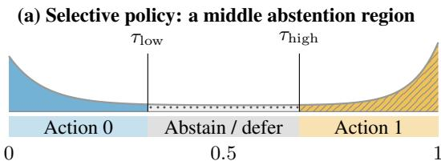

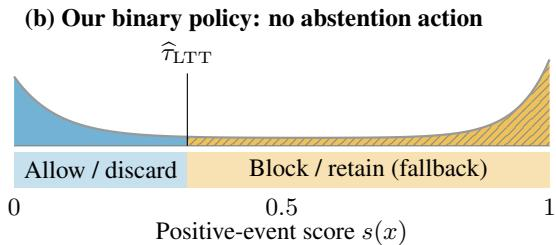  
Figure 1: Binary actions’ illustration. Under calibrated probabilities, scores near 0.5 indicate uncertain labels: a selective policy can abstain. Our policy instead assigns every input an action via an LTT-selected threshold.

False Omission Rate (the risk among inputs scored below α) bounded by α. However, optimizing System One models for calibration during training cannot guarantee test-time calibration across varied downstream distributions (Guo et al., 2017).

The deployment challenge is therefore twofold: determining which operational action the system should take when a model’s prediction is uncertain, and guaranteeing safety when its scores are uncalibrated. Moreover, these decisions have severe asymmetric effects that change what uncertainty should trigger (Figure 1). Selective classification typically mitigates risk through abstention, deferring difficult examples to a human or another model (Geifman and El-Yaniv, 2017). We focus on fully automated environments where abstention is not a viable action. In these forced-action settings, the conservative fallback is to block an input (for safety) or retain a document (for filtering).

Always defaulting to this fallback avoids the targeted false-negative error but degrades system utility through severe over-refusal or context bloat.

The practical objective is therefore to depart from the fallback action as often as possible, while controlling the errors within that newly selected subset. We express this constraint as the False Omission Rate $( \mathrm { F O R } ) , \mathbb { P } ( Y = 1 \mid \widehat { Y } = 0 )$ , where $\widehat { Y } = 0$ denotes the utility-maximizing choice (allow an input or discard a document). We apply Learn Then Test (LTT) (Angelopoulos et al., 2025) to statistically certify threshold regions that satisfy the FOR constraint, effectively substituting selective abstention with the conservative fallback.

We study three linked questions: (Q1) Do the supplied scores reliably represent positive-event probabilities and sufficiently separate the classes? (Q2) How do Naive, Empirical, and LTT threshold selection policies trade observed excess risk against utility? (Q3) How do these outcomes vary across System One models, specialist baselines, and a local open-weights fine-tuned System One model?

Evaluating on six datasets, we show that safely deploying automated decisions under asymmetric risk needs task-specific validation and rigorous riskbudgeting, rather than relying on the assumed universal calibration of any System One model.

## 2 Related Work

Selective Prediction and Risk Control. Selective classification trades coverage for accuracy (Geifman and El-Yaniv, 2017). An abstention option delegates uncertain inputs. Instead, our setting fixes two operational actions and measures error within the negative-action subset. Risk-controlling prediction sets and Learn Then Test (LTT) (Bates et al., 2021; Angelopoulos et al., 2025) use held-out data to support statistical risk. LTT is not restricted to abstention; we apply its conditional-risk formulation to binary action policies.

Probability Calibration. Because neural network calibration metrics are notoriously sensitive to binning (Guo et al., 2017; Nixon et al., 2019), proper scores like Brier are essential for broader probability assessment (Ferrer and Ramos, 2025). In LLMs, calibration has been examined for question answering (Jiang et al., 2021), self-evaluation (Kadavath et al., 2022), and elicited confidence (Tian et al., 2023; Xiong et al., 2024). These studies motivate examining how scores are obtained and what their probabilities actually mean.

Typed-decision evaluation. Datasets such as WildGuard (Han et al., 2024) and ATBench (Li et al., 2026b) provide foundations for evaluating moderation and trajectory safety. Recent studies of typed-decision models explore aggregate calibration and error ranking (Hu, 2026), as well as probability coherence across logically related questions (Li et al., 2026a). However, they do not certify a selected action policy’s error rate. We distinguish our work by connecting System One scores to risk control across moderation, safety, and reranking.

## 3 Problem Formulation

## 3.1 Actions and Asymmetric Risk

Let $( X , Y ) \sim P$ denote an input and its binary ground-truth label drawn from the evaluation population P, with $Y \in \{ 0 , 1 \}$ . In our high-stakes language-model workflow, we have:

• Y = 1 represents the high-stakes target (e.g., an unsafe prompt injection attempt, a harmful message, or a highly relevant document).

$Y = 0$ represents the benign background (e.g., a safe prompt, an allowable message, or an irrelevant document).

A frozen scorer returns $s ( x ) \in [ 0 , 1 ]$ , oriented so that larger scores express stronger evidence for $Y = 1$ . We use threshold $\tau \in [ 0 , 1 ]$ to define the binary decision rule $\widehat { Y } = \pi _ { \tau } ( x )$

$$
\pi _ { \tau } ( x ) = { \left\{ \begin{array} { l l } { 0 } & { { \mathrm { i f ~ } } s ( x ) < \tau , } \\ { 1 } & { { \mathrm { i f ~ } } s ( x ) \geq \tau . } \end{array} \right. }
$$

Here, Action 0 is the utility-maximizing choice (allowing safe inputs or discarding irrelevant documents) taken under high confidence. Action 1 serves as the conservative fallback (blocking or retaining), triggered by either high confidence in class 1 or predictive uncertainty.

In this setting, the costs of errors are asymmetric:

• False Negative (Predict 0 / True 1): This is a critical failure. It means allowing a toxic interaction to execute or permanently discarding a crucial piece of evidence.

• False Positive (Predict 1 / True 0): This is a utility loss. It causes over-refusal of benign inputs or over-inclusion that inflates an LLM context with irrelevant documents. It is treated as the lower-priority error in our setting.

Because predicting 0 when the true label is 1 represents the critical system failure, the primary risk $R ( \tau )$ is defined on the negative-action subset of data (i.e., when the system predicts 0). This is the False Omission Rate (FOR):

$$
\begin{array} { r l } & { R ( \tau ) = \mathbb { P } ( Y = 1 \mid \widehat { Y } = 0 ) } \\ & { \qquad = \mathbb { P } ( Y = 1 \mid s ( X ) < \tau ) . } \end{array}\tag{1}
$$

## 3.2 The Optimization Trade-Off

While the high-stakes constraint requires defaulting to Action 1 when uncertain, always predicting 1 gives a practically useless system with an empty negative-action subset, where its measure is $\mu ( \tau ) = \mathbb { P } ( s ( X ) < \tau ) = 0 .$

The system’s primary optimization goal is to maximize the size of this negative-action subset subject to a strict population-level risk budget α ∈ (0, 1). Ideally, we seek a threshold τ that solves:

$$
\begin{array} { r l } { \underset { \tau } { \operatorname* { m a x } } } & { \mu ( \tau ) = \mathbb { P } ( s ( X ) < \tau ) } \\ { \mathrm { s u b j e c t ~ t o } } & { R ( \tau ) \le \alpha } \end{array}
$$

Maximizing this set is linked to minimizing the number of false positives, $\begin{array} { r } { \sum _ { i = 1 } ^ { n } \mathbf { 1 } \{ \widehat { Y } _ { \tau , i } = 1 , \widehat { Y } _ { i } = } \end{array}$ 0}. As $\mu ( \tau )$ grows, fewer true zeros are incorrectly forced into the fallback action (Action 1), driving down the incidence of over-refusal and context bloat.

However, because the true data distribution is unknown, we cannot directly access the population risk $R ( \tau )$ . The objective is therefore to establish an empirical threshold selection procedure that selects the largest certified candidate τ to minimize utility loss, while relying on statistical testing to rigorously ensure the critical risk of catastrophic FOR is controlled at budget α.

## 4 Threshold Selection and Risk Control

## 4.1 Certifying the False Omission Rate

To solve the finite-sample optimization trade-off introduced in Section 3.2, we must rely on statistical testing. Given the target risk budget α and a statistical error level $\delta \in ( 0 , 1 )$ , the formal objective is to find a threshold τ that maximizes the measure of the negative-action subset while guaranteeing the risk bound holds with high probability:

$$
\begin{array} { r l } { \underset { \tau } { \operatorname* { m a x } } } & { \mu ( \tau ) = \mathbb { P } ( s ( X ) < \tau ) } \\ { \mathrm { s u b j e c t ~ t o } } & { \mathbb { P } ( R ( \tau ) \le \alpha ) \ge 1 - \delta } \end{array}
$$

To obtain this guarantee, we specialize Learn Then Test (LTT) (Angelopoulos et al., 2025) to the binary conditional risk in Equation 1.

Algorithm 1 Fixed-order threshold certification.   
Require: Frozen scorer; independently fixed or  
dered thresholds $( \tau _ { 1 } , \dots , \tau _ { M } ) ;$ independent   
$D _ { \mathrm { c a l } } ; ( \alpha , \delta )$   
1: Initialize the certified threshold set $\widehat { \tau }  \emptyset$   
2: for $j = 1 , \dots , M$ do   
3: Compute $( N _ { j } , K _ { j } , p _ { j } )$   
4: if $p _ { j } > \delta$ then   
5: break ▷ Stop the sequence   
6: else   
7: $ { \hat { \tau } } \gets  { \hat { \tau } } \cup \{ \tau _ { j } \}$   
8: end if   
9: end for   
10: $\mathbf { i } \mathbf { f } \widehat { \tau } = \varnothing$ then   
11: return $\perp \triangleright$ Non-deployment (Fallback to   
Action 1)   
12: end if   
13: return $\widehat { \tau } \in \mathrm { a r g } \operatorname* { m a x } _ { \tau _ { i } \in \widehat { \mathcal { T } } } \widehat { \mu } _ { \mathrm { c a l } , j } \quad \triangleright$ Maximize   
negative-action subset measure   
Ensure: Selected ${ \widehat { \tau } } ,$ or non-deployment (⊥)

Let $\begin{array} { c c l } { \mathcal { T } } & { = } & { \{ \tau _ { 1 } , . . . , \tau _ { M } \} } \end{array}$ contain M candidate thresholds, tested in the specified order $\left( \tau _ { 1 } , \dots , \tau _ { M } \right)$ fixed independently of the calibration1 sample. Let $\alpha \in ( 0 , 1 )$ be the risk budget and $\delta \in ( 0 , 1 )$ be the error level that bounds the probability of certifying any excessive-risk candidate in this family. Let $D _ { \mathrm { { f i t } } }$ denote data used to fit the scorer $s ( X )$ and construct the threshold family’s grid, and let $D _ { \mathrm { c a l } } = \{ ( X _ { i } , Y _ { i } ) \} _ { i = 1 } ^ { n _ { \mathrm { c a l } } }$ be the separate calibration sample of size $n _ { \mathrm { c a l } }$ . Define:

$$
\begin{array} { l } { { { \displaystyle N _ { j } = \sum _ { i = 1 } ^ { n _ { \mathrm { c a l } } } \mathbf { 1 } \{ s ( X _ { i } ) < \tau _ { j } \} } , } } \\ { { { \displaystyle K _ { j } = \sum _ { i = 1 } ^ { n _ { \mathrm { c a l } } } Y _ { i } \mathbf { 1 } \{ s ( X _ { i } ) < \tau _ { j } \} } . } } \end{array}
$$

For candidate $j , N _ { j }$ counts calibration examples assigned Action 0, and $K _ { j }$ counts positive labels among them. For $N _ { j } > 0$

$$
\widehat { R } _ { \mathrm { c a l } , j } = \frac { K _ { j } } { N _ { j } } , \qquad \widehat { \mu } _ { \mathrm { c a l } , j } = \frac { N _ { j } } { n _ { \mathrm { c a l } } } .
$$

For a fixed policy under independent and identically distributed (i.i.d.) calibration sampling, conditioning on $N _ { j } = n$ gives

$$
K _ { j } \mid N _ { j } = n \sim { \mathrm { B i n o m i a l } } ( n , R ( \tau _ { j } ) )
$$

To test the null hypothesis $H _ { j } : R ( \tau _ { j } ) > \alpha$ (i.e., that the policy exceeds the risk budget), we use the lower-tail binomial p-value:

$$
p _ { j } = \sum _ { k = 0 } ^ { K _ { j } } { \binom { N _ { j } } { k } } \alpha ^ { k } ( 1 - \alpha ) ^ { N _ { j } - k } ,
$$

with $p _ { j } = 1$ when $N _ { j } = 0$ . A small $p _ { j }$ provides the statistical evidence needed for certification. Algorithm 1 states the fixed-family procedure to which the theoretical LTT guarantees apply.

Theorem 1 (Fixed-family LTT specialization (Angelopoulos et al., 2025)). Condition on $D _ { \mathrm { { f i t } } }$ , which fixes the scorer and ordered candidate family. Suppose that $D _ { \mathrm { c a l } }$ consists ofi.i.d. drawsfrom $P ,$ independently of $D _ { \mathrm { { f i t } } }$ . Algorithm 1 satisfies:

$$
\mathbb { P } _ { D _ { \mathrm { c a l } } } \bigg ( \exists \tau \in \widehat { \mathcal { T } } : R ( \tau ) > \alpha \bigg ) \le \delta .
$$

Consequently, any rule returning an element of $\widehat { \mathcal { T } }$ or ⊥ (non-deployment) satisfies

$$
\mathbb { P } _ { D _ { \mathrm { c a l } } } ( \widehat { \tau } \neq \bot , R ( \widehat { \tau } ) > \alpha ) \leq \delta .
$$

Proof. This theorem is a direct application of fixedsequence testing (specifically Theorem 2.1) established by Angelopoulos et al. (2025), applied to our binary thresholding rule. □

At deployment, the selected τb assigns every input to Action 0 or 1. Returning ⊥ means threshold selection did not establish a certificate for a useful negative-action subset, and the system must default to the fallback action (Action 1). This distinction separates failure to select a certified policy from deferring an individual input.

## 4.2 Why Naive Thresholding Is Not Enough

Let us consider the relationship between population risk and score calibration. Let the random variable $S = s ( \boldsymbol { X } )$ be the score and $m ( u ) = \mathbb { P } ( Y = 1 \mid$ $S = u ) = \mathbb { E } [ Y \mid S = u ]$ its calibration function. Exact calibration means $m ( S ) = S$ except on a probability-zero set. The following identity separates the average model score from the average probability error within the negative-action region. Proposition 1 (Calibration–policy identity). For $\mu ( \tau ) > 0$

$$
R ( \tau ) = \mathbb { E } [ S \mid S < \tau ] + \mathbb { E } [ m ( S ) - S \mid S < \tau ] .
$$

Consequently,

$$
R ( \tau ) \leq \tau + \frac { \mathbb { E } [ | m ( S ) - S | \mathbf { 1 } \{ S < \tau \} ] } { \mu ( \tau ) } .
$$

Under exact calibration, $R ( \tau ) \leq \tau .$

The derivation appears in Appendix A. This identity demonstrates that if a model is perfectly calibrated, naive thresholding achieves bounded risk (i.e., setting $\tau = \alpha$ gives $R ( \tau ) \leq \alpha )$ . However, it also proves that when scores are uncalibrated, depending on the direction of the error, naive thresholding can allow excessive risk. LTT instead tests the population-risk constraint using finite-sample data, without requiring calibrated model scores. Its guarantee is the calibration-sampling statement in Theorem 1, not a promise that every finite test estimate is below budget.

## 5 Experimental Setup

## 5.1 Evaluated Models

We categorize evaluated models into three groups:

• Baselines: For moderation and safety, we evaluate Qwen3Guard-Gen-0.6B (Zhao et al., 2025) as a specialist baseline. For reranking, we evaluate Voyage rerank-2.5-lite (Voyage AI, 2026). We also include PCA-Ridge, an L2- regularized logistic regression baseline fitted per dataset on frozen Qwen3-8B embeddings.

• System One Models: We evaluate models specifically designed with probability-valued interfaces, including Jev (Typesafe AI, 2026), GPT-6-Luna (via its typed-decisions endpoint) (OpenAI, 2026), Span-01 (Respan, 2026), and Solar-Decide (Upstage, 2026).

• Base vs. Fine-Tuned: To illustrate adaptation dynamics within a single System One model family, we evaluate Kev-0.8B (Palmer, 2026) both as released (Kev-base) and after fine-tuning on ≈ 10k examples for 37 minutes on an RTX 5090 (Kev-ft). Kev-ft is trained on a mixture of all dataset fit splits to improve generalization, limit overfitting, and save compute cost of six separate neural trainings.

Other details are provided in Appendix B.1.

## 5.2 Tasks and Datasets

We evaluate our framework across three workflows with six datasets. Moderation uses WildGuardMix and Aegis prompt labels. Safety covers prompt injection on S-Labs and unsafe recorded trajectories on ATBench. Reranking uses SciDocs and StackOverflow query–document pairs to evaluate reranking as a binary filtering decision.

<table><tr><td>Task</td><td>Dataset</td><td>Fit</td><td>Cal.</td><td>Test</td><td>Y=1 (%)</td></tr><tr><td>Moderation</td><td>WildGuardMix (Han et al., 2024)</td><td>2000</td><td>849</td><td>850</td><td>44.4</td></tr><tr><td>Moderation</td><td>Aegis (Ghosh et al., 2024)</td><td>2000</td><td>579</td><td>579</td><td>67.0</td></tr><tr><td>Safety</td><td>S-Labs (S-Labs, 2026)</td><td>2000</td><td>1051</td><td>1050</td><td>50.0</td></tr><tr><td>Safety</td><td>ATBench (Li et al., 2026b)</td><td>500</td><td>250</td><td>250</td><td>47.6</td></tr><tr><td>Reranking</td><td>SciDocs (Cohan et al., 2020)</td><td>2000</td><td>1000</td><td>1000</td><td>50.8</td></tr><tr><td>Reranking</td><td>StackOverflow (Muennighoff et al., 2023)</td><td>2000</td><td>1000</td><td>1000</td><td>50.1</td></tr></table>

Table 1: Dataset split details. The last column gives the test positive-event prevalence (base rate).

For each dataset, we use a single seed, labelstratified fit/calibration/test splits (Table 1). Because most evaluated scorers are general pretrained models, $D _ { \mathrm { { f i t } } }$ is only used to fit the PCA-Ridge baseline, fine-tune the Kev-ft model, and construct candidate threshold grids. $D _ { \mathrm { c a l } }$ is used for threshold selection, and test data evaluates the final fixed policies. Other details are provided in Appendix B.2 and Appendix B.3.

## 5.3 Threshold Selection Policies

We evaluate three threshold policies across risk budgets $\alpha \in \{ 0 . 0 5 , 0 . 1 0 , 0 . 1 5 , 0 . 2 0 , 0 . 4 0 , 0 . 5 0 \}$

1. Naive: Sets $\tau \ = \ \alpha .$ . As discussed in Section 4.2, this assumes exact calibration and includes no finite-sample margin.

2. Empirical: Selects τ that yields the lowest False Positive Rate, provided that the observed calibration FOR is at most α.

3. LTT: Applies Algorithm 1 with a statistical error level of $\delta = 0 . 1 0$ to return the largest threshold in the certified prefix. Details on implementation are in Appendix B.4.

## 5.4 Evaluation Metrics

We evaluate the systems on two axes: underlying score quality and operational policy outcomes.

Score Diagnostics. We assess raw predictions before thresholding with Area Under the Receiver Operating Characteristic (AUROC) and negativeaction Average Precision $( \mathsf { A P _ { 0 } } )$ for class separation. We report 10-bin expected calibration error (ECE) and Brier score to measure probability alignment.

Operational Utility and Risk. At deployment, we report the True Negative Rate (TNR) as our primary measure of system utility (e.g., the rate of benign acceptance or irrelevant document removal). Empirical risk is measured by test-set FOR, $\widehat { R } _ { \mathrm { t e s t } }$ To quantify safety violations, we report the positive excess risk, defined as $e = \mathrm { m a x } ( \widehat { R } _ { \mathrm { t e s t } } - \alpha , 0 )$

To ensure statistical rigor, 95% bootstrap confidence intervals for score diagnostics and primarybudget policy risk/utility appear in Appendix C. The resampling recipe is in Appendix B.5.

Availability and Resource Use. We distinguish no LTT certificate (ND), no feasible Empirical policy (NF), and a returned policy with an empty negative-action test set (UD, undefined FOR). Exceedance fractions use defined test risks; status fractions use settings with defined risk. Mean excess includes zero excess for non-exceedances and is expressed in percentage points. We also report inference cost (USD per 1,000 workload examples) and mean recorded request time (ms/example). Full metric definitions and accounting conventions appear in Appendix B.5 and Appendix B.6.

## 6 Results

We answer our three research questions by evaluating the held-out test predictions and saved policy selections across all six datasets. Table 2 summarizes the underlying score diagnostics and calibration metrics for each model. Table 3 aggregates the frequency and magnitude of risk exceedances alongside overall policy availability. Table 4 details the resulting operational utility and empirical risk at the target budget $\alpha = 0 . 1 5$ . Figure 2 visualizes the LTT-selected operating points across varying risk tolerances to demonstrate model differences on WildGuardMix. Finally, Table 5 reports the inference cost and recorded latency to contextualize operational deployment.

## 6.1 Q1: Calibration is Task-Dependent and Insufficient for Policy Viability

Table 2 shows that probability reliability is fundamentally dataset-dependent and no single architecture universally dominates. A bounded interface alone does not guarantee calibration. For example, Jev’s ECE degrades from 0.034 on WildGuardMix to 0.29 on SciDocs. Universal claims of “calibrated probabilities” obscure this severe variability.

<table><tr><td></td><td colspan="4">Moderation: WildGuardMix</td><td colspan="4">Moderation: Aegis</td><td colspan="4">Safety: S-Labs</td></tr><tr><td>Model</td><td>ECE↓</td><td>Brier ↓</td><td>AUC↑</td><td> $\mathrm { A P _ { 0 } ~ \uparrow }$ </td><td>ECE↓</td><td>Brier ↓</td><td>AUC↑</td><td> $\mathrm { A P _ { 0 } ~ \uparrow }$ </td><td>ECE↓</td><td>Brier ↓</td><td>AUC↑</td><td> $\mathsf { A P _ { 0 } }$  个</td></tr><tr><td>Qwen3Guard</td><td>0.085</td><td>0.090</td><td>0.950</td><td>0.947</td><td>0.277</td><td>0.239</td><td>0.929</td><td>0.866</td><td>0.474</td><td>0.464</td><td>0.968</td><td>0.968</td></tr><tr><td>PCA-Ridge*</td><td>0.042</td><td>0.091</td><td>0.946</td><td>0.956</td><td>0.037</td><td>0.096</td><td>0.934</td><td>0.892</td><td>0.087</td><td>0.041</td><td>0.996</td><td>0.996</td></tr><tr><td>Jev</td><td>0.034</td><td>0.073</td><td>0.963</td><td>0.969</td><td>0.183</td><td>0.151</td><td>0.936</td><td>0.860</td><td>0.185</td><td>0.158</td><td>0.947</td><td>0.927</td></tr><tr><td>GPT-6-Luna</td><td>0.103</td><td>0.108</td><td>0.925</td><td>0.907</td><td>0.297</td><td>0.277</td><td>0.864</td><td>0.665</td><td>0.262</td><td>0.228</td><td>0.888</td><td>0.841</td></tr><tr><td>Span-01</td><td>0.189</td><td>0.238</td><td>0.765</td><td>0.746</td><td>0.500</td><td>0.472</td><td>0.565</td><td>0.332</td><td>0.441</td><td>0.437</td><td>0.288</td><td>0.368</td></tr><tr><td>Solar-Decide</td><td>0.104</td><td>0.130</td><td>0.893</td><td>0.855</td><td>0.356</td><td>0.339</td><td>0.865</td><td>0.658</td><td>0.337</td><td>0.326</td><td>0.840</td><td>0.737</td></tr><tr><td>Kev-base</td><td>0.121</td><td>0.186</td><td>0.835</td><td>0.863</td><td>0.257</td><td>0.232</td><td>0.834</td><td>0.704</td><td>0.225</td><td>0.203</td><td>0.944</td><td>0.940</td></tr><tr><td>Kev-ft*</td><td>0.119</td><td>0.123</td><td>0.934</td><td>0.938</td><td>0.109</td><td>0.126</td><td>0.919</td><td>0.849</td><td>0.024</td><td>0.028</td><td>0.995</td><td>0.995</td></tr><tr><td></td><td colspan="4">Safety: ATBench</td><td colspan="4">Reranking: SciDocs</td><td colspan="4">Reranking: StackOverflow</td></tr><tr><td>Model</td><td>ECE↓</td><td>Brier ↓</td><td>AUC↑</td><td> $\mathrm { A P _ { 0 } ~ \uparrow }$ </td><td>ECE↓</td><td>Brier ↓</td><td>AUC↑</td><td> $\mathrm { A P _ { 0 } } \ \mathrm { \ \hat { 1 } }$  人</td><td>ECE↓</td><td>Brier ↓</td><td>AUC↑</td><td> $\mathsf { A P _ { 0 } }$  个</td></tr><tr><td>Reranker-Lite</td><td></td><td></td><td></td><td></td><td></td><td></td><td></td><td></td><td>0.137</td><td></td><td>0.829</td><td>0.826</td></tr><tr><td>PCA-Ridge*</td><td>0.151</td><td>0.165</td><td>0.882</td><td>0.902</td><td>0.183 0.065</td><td>0.214 0.127</td><td>0.880 0.904</td><td>0.861 0.885</td><td>0.032</td><td>0.200 0.204</td><td>0.750</td><td>0.748</td></tr><tr><td>Jev</td><td>0.076</td><td>0.200</td><td>0.768</td><td>0.717</td><td>0.290</td><td>0.236</td><td>0.917</td><td>0.895</td><td>0.099</td><td>0.196</td><td>0.790</td><td>0.800</td></tr><tr><td>GPT-6-Luna</td><td>0.230</td><td>0.232</td><td>0.842</td><td>0.844</td><td>0.340</td><td>0.289</td><td>0.865</td><td>0.787</td><td>0.120</td><td>0.191</td><td>0.815</td><td>0.819</td></tr><tr><td>Span-01</td><td>0.101</td><td>0.196</td><td>0.779</td><td>0.744</td><td>0.175</td><td>0.189</td><td>0.864</td><td>0.834</td><td>0.224</td><td>0.302</td><td>0.607</td><td>0.576</td></tr><tr><td>Solar-Decide</td><td>0.274</td><td>0.288</td><td>0.688</td><td>0.716</td><td>0.357</td><td>0.333</td><td>0.772</td><td>0.643</td><td>0.266</td><td>0.288</td><td>0.706</td><td>0.643</td></tr><tr><td>Kev-base</td><td>0.255</td><td>0.303</td><td>0.457</td><td>0.538</td><td>0.120</td><td>0.234</td><td>0.734</td><td>0.724</td><td>0.051</td><td>0.245</td><td>0.599</td><td>0.559</td></tr><tr><td>Kev-ft*</td><td>0.059</td><td>0.099</td><td>0.938</td><td>0.952</td><td>0.118</td><td>0.131</td><td>0.913</td><td>0.881</td><td>0.160</td><td>0.205</td><td>0.810</td><td>0.818</td></tr></table>

Table 2: Test score diagnostics by dataset. AUC is AUROC and $\mathsf { A P _ { 0 } }$ is negative-action average precision. Reranker scores are not advertised probabilities. 95% intervals in Appendix $\mathrm { C . - } \mathrm { \Omega }$ not evaluated. \*: supervised adaptation.

Crucially, low global ECE implies neither effective class separation nor policy viability. On Stack-Overflow, Kev-base achieves a much better ECE than Kev-ft (0.051 vs. 0.16) but exhibits worse discriminative power (AUROC 0.599 vs. 0.81). This dynamic illustrates Proposition 1: while ECE averages absolute error across all inputs, operational risk depends on the conditional error within the selected negative-action set, $\mathbb { E } [ m ( S ) - S \mid S < \tau ]$ Thus, aggregate calibration cannot substitute for rigorous, subset-specific policy evaluation.

## 6.2 Q2: LTT Prioritizes Safety While Naive Thresholds Frequently Exceed Budgets

Our analysis shows that naive thresholding can be arbitrarily permissive or conservative depending on the dataset. Naive methods routinely trade away safety for utility: on Aegis at $\alpha \ = \ 0 . 1 5 ,$ , Span-01 achieves 95.3% utility under Naive thresholding, but its empirical risk catastrophically explodes to 60.9% (Table 4). Conversely, naive thresholds can be unnecessarily restrictive. On WildGuard-Mix, Jev’s naive policy limits utility to 68.7% (at 3.3% risk), whereas LTT safely expands it to 96.8% while remaining within budget (12.8% risk).

While the Empirical selection rule can sometimes identify high-utility policies (e.g., Kev-ft reaching 99.6% utility at 12.5% risk on S-Labs), it lacks formal guarantees. Table 3 shows that Empirical selection exceeds the target budget in 51.7% of settings (mean excess 1.17%). The Naive rule similarly exceeds the budget 42% of the time, concentrating the most extreme failures (mean excess 7.09%, with a maximum exceedance of 73.26 percentage points at $\alpha = 0 . 0 5 )$

LTT produces substantially fewer and smaller risk exceedances (just 7.8% frequency, mean excess 0.1%) because its statistical certification structurally defaults to non-deployment (ND) rather than operate unsafely. This provides a rigorous finite-sample guarantee that, with probability at least $1 - \delta ,$ the system will stay below the risk budget. Consequently, LTT returns fewer policies under strict budgets (establishing certificates for only 21.3% of policies at $\alpha = 0 . 0 5 )$ , though availability increases as the budget relaxes (76.6% at $\alpha = 0 . 5 )$

## 6.3 Q3: Adaptation Expands Availability, Though General System One Models Remain Highly Competitive

General System One interfaces offer a practical plug-and-play starting point, though risk-controlled deployment still requires finite-sample data for policy selection. As Figure 2 shows on WildGuard-Mix $( \alpha = 0 . 1 5 )$ , Jev and GPT-6-Luna achieve exceptional LTT utility (96.8% and 92.6%, respectively), rivaling the specialist Qwen3Guard baseline (95.1%). Thus, high utility does not strictly require fine-tuning, although some unadapted models (Span-01, Solar-Decide) fail entirely (Table 4).

<table><tr><td>α</td><td>Rule</td><td>Eval.</td><td>Fail</td><td>Exceeds</td><td>Mean e</td><td>Max e</td></tr><tr><td>5</td><td>Naive</td><td>34</td><td>13 UD</td><td>23 (67.6%)</td><td>14.00</td><td>73.26</td></tr><tr><td></td><td>Emp.</td><td>23</td><td>24NF</td><td>19 (82.6%)</td><td>1.73</td><td>5.81</td></tr><tr><td></td><td>LTT</td><td>10</td><td>37 ND</td><td>0 (0.0%)</td><td>0.00</td><td>0.00</td></tr><tr><td>10</td><td>Naive</td><td>38</td><td>9 UD</td><td>22 (57.9%)</td><td>11.22</td><td>48.87</td></tr><tr><td></td><td>Emp.</td><td>30</td><td>17 NF</td><td>18 (60.0%)</td><td>1.36</td><td>6.45</td></tr><tr><td></td><td>LTT</td><td>20</td><td>27 ND</td><td>1 (5.0%)</td><td>0.03</td><td>0.53</td></tr><tr><td>15</td><td>Naive</td><td>41</td><td>6 UD</td><td>23 (56.1%)</td><td>9.81</td><td>45.86</td></tr><tr><td></td><td>Emp.</td><td>32</td><td>15NF</td><td>20 (62.5%)</td><td>1.59</td><td>8.11</td></tr><tr><td></td><td>LTT</td><td>24</td><td>23 ND</td><td>1 (4.2%)</td><td>0.07</td><td>1.60</td></tr><tr><td>20</td><td>Naive</td><td>43</td><td>4 UD</td><td>20 (46.5%)</td><td>8.06</td><td>41.30</td></tr><tr><td></td><td>Emp.</td><td>34</td><td>13 NF</td><td>19 (55.9%)</td><td>1.49</td><td>8.57</td></tr><tr><td></td><td>LTT</td><td>29</td><td>18 ND</td><td>3 (10.3%)</td><td>0.21</td><td>3.47</td></tr><tr><td>40</td><td>Naive</td><td>47</td><td>0 UD</td><td>13 (27.7%)</td><td>2.03</td><td>23.39</td></tr><tr><td></td><td>Emp.</td><td>44</td><td>3NF</td><td>20 (45.5%)</td><td>0.91</td><td>5.70</td></tr><tr><td></td><td>LTT</td><td>34</td><td>13 ND</td><td>4 (11.8%)</td><td>0.09</td><td>1.69</td></tr><tr><td>50</td><td>Naive</td><td>47</td><td>0 UD</td><td>4 (8.5%)</td><td>0.54</td><td>13.69</td></tr><tr><td></td><td>Emp.</td><td>46</td><td>1NF</td><td>12 (26.1%)</td><td>0.48</td><td>4.78</td></tr><tr><td></td><td>LTT</td><td>36</td><td>11 ND</td><td>3 (8.3%)</td><td>0.10</td><td>1.79</td></tr><tr><td>∑</td><td>Naive</td><td>250</td><td>32 UD</td><td>105 (42.0%)</td><td>7.09</td><td>73.26</td></tr><tr><td></td><td>Emp.</td><td>209</td><td>73 NF</td><td>108 (51.7%)</td><td>1.17</td><td>8.57</td></tr><tr><td></td><td>LTT</td><td>153</td><td>129 ND</td><td>12 (7.8%)</td><td>0.10</td><td>3.47</td></tr></table>

Table 3: Outcomes by risk budget α (%) across all 47 model–dataset pairs. Excess risk is $e = \operatorname* { m a x } ( \hat { R } - \alpha , 0 )$

However, local open-weight model fine-tuning massively improves policy availability over unadapted base models. At α = 0.15, Kev-base returns an LTT policy on only one of six datasets, whereas Kev-ft succeeds on all six (Table 4). Across all budgets, this adaptation expands availability from 13/36 to 31/36 settings. Even when both return policies, as on WildGuardMix, utility jumps significantly from 41.9% for Kev-base to 82.5% for Kev-ft (Figure 2).

Fine-tuning does not universally dominate: Jev outperforms Kev-ft on WildGuardMix with a 96.8% utility at this budget, and the PCA-Ridge baseline remains competitive across several tasks. Because no single architecture solves forced-action deployment, a practical strategy is to first evaluate a general System One model and fall back to local open-weights model adaptation if it proves too conservative. Crucially, all approaches demand strict task-specific empirical validation.

## 6.4 Local Open-Weights Models Provide the Most Efficient Cost-Latency Balance

Operational deployment must balance policy usefulness against inference latency and financial cost (Table 5). Proprietary closed-weight models exhibit widely varying degrees of cost and latency

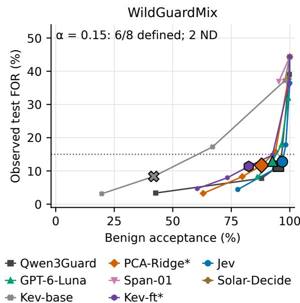  
Outlined markers: α = 0.15; small: other budgets. Dotted line: 15% reference.

Figure 2: LTT-selected risk–utility operating points on WildGuardMix. Lower test FOR and greater benign acceptance are preferable. Missing policies are omitted.

depending on the endpoint. Crucially, simpler baseline architectures do not automatically guarantee faster execution. The PCA-Ridge baseline is exceptionally cheap to evaluate numerically (\$0.0026 per 1,000 examples) but it has a severe latency penalty (5,247 ms/example). This delay comes from the requisite embedding extraction pipeline, which must fully process the input through Qwen3- 8B before the lightweight logistic regression can execute. By contrast, an end-to-end local fine-tuned model like Kev-ft provides the most optimal balance, delivering highly competitive safety utility at just \$0.0030 and 98 ms/example, avoiding both the API costs of proprietary models and the sequential embedding bottlenecks of PCA-Ridge.

## 7 Discussion and Conclusion

Deploying System One models for asymmetric decisions, where one error type carries severe consequences, demands more than aggregate calibration. Results show that favorable global diagnostics do not guarantee utility, and naive or empirical thresholding often lead to severe, silent risk violations.

LTT offers a rigorous statistical alternative, controlling the useful action region without trusting raw scores as true probabilities. The operational price of this safety is reduced policy availability. LTT minimizes budget exceedances by returning non-deployment when a certificate cannot be established, correctly defaulting to a conservative fallback (e.g., blocking a prompt or retaining a document) rather than operating unsafely. However, our findings show that this availability bottleneck can be mitigated: when general interfaces fail to yield a certificate, adapting lightweight, local open-weights models provides a highly reliable and cost-efficient pathway to recover certified policies, though this comes with the cost of training data.

<table><tr><td></td><td colspan="6">Moderation: WildGuardMix</td><td colspan="6">Moderation: Aegis</td></tr><tr><td></td><td colspan="2">Naive</td><td colspan="2">Empirical</td><td colspan="2">LTT</td><td colspan="2">Naive</td><td colspan="2">Empirical</td><td colspan="2">LTT</td></tr><tr><td>Model</td><td>Risk</td><td>Util</td><td>Risk</td><td>Util</td><td>Risk</td><td>Util</td><td>Risk</td><td>Util</td><td>Risk</td><td>Util</td><td>Risk</td><td>Util</td></tr><tr><td>Qwen3Guard</td><td>10.8</td><td>94.3</td><td>12.2</td><td>95.8</td><td>11.4</td><td>95.1</td><td>38.4</td><td>93.2</td><td>18.2</td><td>72.8</td><td>11.5</td><td>60.7</td></tr><tr><td>PCA-Ridge*</td><td>4.2</td><td>67.4</td><td>13.1</td><td>91.3</td><td>11.7</td><td>87.9</td><td>1.4</td><td>36.1</td><td>17.3</td><td>72.8</td><td>9.5</td><td>64.9</td></tr><tr><td>Jev</td><td>3.3</td><td>68.7</td><td>16.2</td><td>98.1</td><td>12.8</td><td>96.8</td><td>20.8</td><td>83.8</td><td>23.1</td><td>85.3</td><td>11.7</td><td>67.0</td></tr><tr><td>GPT-6-Luna</td><td>12.6</td><td>92.6</td><td>15.6</td><td>96.0</td><td>12.9</td><td>92.6</td><td>43.4</td><td>94.8</td><td>NF</td><td>NF</td><td>ND</td><td>ND</td></tr><tr><td>Span-01</td><td>26.3</td><td>81.2</td><td>NF</td><td>NF</td><td>ND</td><td>ND</td><td>60.9</td><td>95.3</td><td>NF</td><td>NF</td><td>ND</td><td>ND</td></tr><tr><td>Solar-Decide</td><td>18.1</td><td>93.9</td><td>13.9</td><td>84.8</td><td>ND</td><td>ND</td><td>50.7</td><td>97.9</td><td>NF</td><td>NF</td><td>ND</td><td>ND</td></tr><tr><td>Kev-base</td><td>0.0</td><td>4.0</td><td>15.4</td><td>62.6</td><td>8.3</td><td>41.9</td><td>12.5</td><td>7.3</td><td>18.6</td><td>29.8</td><td>ND</td><td>ND</td></tr><tr><td>Kev-ft*</td><td>11.3</td><td>82.9</td><td>13.4</td><td>87.5</td><td>11.4</td><td>82.5</td><td>17.7</td><td>70.7</td><td>19.5</td><td>71.2</td><td>14.5</td><td>64.9</td></tr><tr><td></td><td colspan="6">Safety: S-Labs</td><td colspan="6">Safety: ATBench</td></tr><tr><td></td><td colspan="6">Naive</td><td colspan="6">Empirical</td></tr><tr><td>Model</td><td>Risk</td><td>Util</td><td>Empirical Risk</td><td>Util</td><td>LTT Risk</td><td>Util</td><td>Naive Risk</td><td>Util</td><td>Risk</td><td>Util</td><td>LTT Risk</td><td>Util</td></tr><tr><td>Qwen3Guard</td><td>47.8</td><td>100.0</td><td>14.7</td><td>94.1</td><td>13.5</td><td>93.1</td><td></td><td>一</td><td></td><td></td><td></td><td>1</td></tr><tr><td>PCA-Ridge*</td><td>0.4</td><td>87.0</td><td>11.6</td><td>99.8</td><td>10.0</td><td>99.8</td><td>0.0</td><td>1.5</td><td>13.6</td><td>72.5</td><td>10.1</td><td>67.9</td></tr><tr><td>Jev</td><td>11.2</td><td>86.1</td><td>13.9</td><td>95.4</td><td>10.2</td><td>79.0</td><td>33.3</td><td>3.1</td><td>NF</td><td>NF</td><td>ND</td><td>ND</td></tr><tr><td>GPT-6-Luna</td><td>27.0</td><td>94.3</td><td>13.2</td><td>71.4</td><td>ND</td><td>ND</td><td>5.6</td><td>26.0</td><td>16.3</td><td>62.6</td><td>12.0</td><td>55.7</td></tr><tr><td>Span-01</td><td>47.5</td><td>100.0</td><td>NF</td><td>NF</td><td>ND</td><td>ND</td><td>27.3</td><td>12.2</td><td>NF</td><td>NF</td><td>ND</td><td>ND</td></tr><tr><td>Solar-Decide</td><td>41.0</td><td>100.0</td><td>NF</td><td>NF</td><td>ND</td><td>ND</td><td>28.6</td><td>61.1</td><td>NF</td><td>NF</td><td>ND</td><td>ND</td></tr><tr><td>Kev-base</td><td>UD</td><td>UD</td><td>14.6</td><td>88.2</td><td>ND</td><td>ND</td><td>UD</td><td>UD</td><td>NF</td><td>NF</td><td>ND</td><td>ND</td></tr><tr><td>Kev-ft*</td><td>3.6</td><td>97.1</td><td>12.5</td><td>99.6</td><td>11.1</td><td>99.6</td><td>5.1</td><td>71.0</td><td>15.7</td><td>90.1</td><td>14.6</td><td>89.3</td></tr><tr><td></td><td colspan="6">Reranking: SciDocs</td><td colspan="6">Reranking: StackOverflow</td></tr><tr><td></td><td colspan="2">Naive</td><td colspan="2">Empirical</td><td colspan="2">LTT</td><td colspan="2"></td><td colspan="2">Empirical</td><td colspan="2">LTT</td></tr><tr><td>Model</td><td>Risk</td><td>Util</td><td>Risk</td><td>Util</td><td>Risk</td><td>Util</td><td>Naive Risk</td><td>Util</td><td>Risk</td><td>Util</td><td>Risk</td><td>Util</td></tr><tr><td>Reranker-Lite</td><td>UD</td><td>UD</td><td>11.3</td><td>56.1</td><td>ND</td><td>ND</td><td>UD</td><td>UD</td><td>18.5</td><td>57.3</td><td>14.0</td><td>51.7</td></tr><tr><td>PCA-Ridge*</td><td>7.6</td><td>24.6</td><td>17.2</td><td>78.0</td><td>13.9</td><td>72.8</td><td>8.8</td><td>6.2</td><td>16.5</td><td>23.2</td><td>ND</td><td>ND</td></tr><tr><td>Jev</td><td>22.8</td><td>90.9</td><td>18.8</td><td>85.8</td><td>13.7</td><td>76.8</td><td>8.1</td><td>25.1</td><td>20.5</td><td>54.3</td><td>16.6</td><td>44.3</td></tr><tr><td>GPT-6-Luna</td><td>31.5</td><td>99.0</td><td>NF</td><td>NF</td><td>ND</td><td>ND</td><td>10.1</td><td>40.9</td><td>15.9</td><td>55.3</td><td>11.3</td><td>42.5</td></tr><tr><td>Span-01</td><td>16.4</td><td>65.2</td><td>15.9</td><td>63.4</td><td>ND</td><td>ND</td><td>41.2</td><td>47.5</td><td>NF</td><td>NF</td><td>ND</td><td>ND</td></tr><tr><td>Solar-Decide</td><td>40.1</td><td>98.0</td><td>NF</td><td>NF</td><td>ND</td><td>ND</td><td>34.6</td><td>73.3</td><td>NF</td><td>NF</td><td>ND</td><td>ND</td></tr><tr><td>Kev-base</td><td>UD</td><td>UD</td><td>19.4</td><td>25.4</td><td>ND</td><td>ND</td><td>UD</td><td>UD</td><td>NF 16.2</td><td>NF 53.9</td><td>ND 13.4</td><td>ND 50.3</td></tr><tr><td>Kev-ft*</td><td>15.2</td><td>79.5</td><td>15.9</td><td>83.9</td><td>14.8</td><td>78.5</td><td>16.7</td><td>54.9</td></table>

Table 4: Test risk and utility (%) at α = 0.15. Risk is FOR; utility is TNR (benign acceptance for safety, irrelevant removal for filtering). Red risk values exceed the budget. ND: no LTT certificate; NF: no feasible empirical policy; UD: undefined test FOR. –: not evaluated. \*: supervised adaptation. Bold utility is the largest value per dataset.
<table><tr><td></td><td colspan="2">MD: WildGuardMix</td><td colspan="2">MD: Aegis</td><td colspan="2">SF: S-Labs</td><td colspan="2">SF: ATBench</td><td colspan="2">RK: SciDocs</td><td colspan="2">RK: StackOverflow</td></tr><tr><td>Model</td><td>Cost</td><td>Time</td><td>Cost</td><td>Time</td><td>Cost</td><td>Time</td><td>Cost</td><td>Time</td><td>Cost</td><td>Time</td><td>Cost</td><td>Time</td></tr><tr><td>Qwen3Guard</td><td>0.0071</td><td>231</td><td>0.0077</td><td>252</td><td>0.0065</td><td>213</td><td></td><td></td><td></td><td></td><td></td><td></td></tr><tr><td>Reranker-Lite</td><td></td><td></td><td></td><td></td><td></td><td></td><td></td><td></td><td>0.0013</td><td>224</td><td>0.0011</td><td>183</td></tr><tr><td>PCA-Ridge*</td><td>0.0026</td><td>5247</td><td>0.0039</td><td>1880</td><td>0.0013</td><td>5422</td><td>0.0215</td><td>14541</td><td>0.0014</td><td>5707</td><td>0.0012</td><td>3765</td></tr><tr><td>Jev</td><td>0.0216</td><td>383</td><td>0.0241</td><td>248</td><td>0.0204</td><td>379</td><td>0.0757</td><td>261</td><td>0.0175</td><td>364</td><td>0.0172</td><td>347</td></tr><tr><td>GPT-6-Luna</td><td>0.0375</td><td>320</td><td>0.0435</td><td>225</td><td>0.0347</td><td>186</td><td>0.1507</td><td>294</td><td>0.0283</td><td>207</td><td>0.0278</td><td>167</td></tr><tr><td>Span-01</td><td>0.0084</td><td>672</td><td>0.0095</td><td>286</td><td>0.0081</td><td>648</td><td>0.0320</td><td>1059</td><td>0.0053</td><td>638</td><td>0.0050</td><td>710</td></tr><tr><td>Solar-Decide</td><td>0.0298</td><td>1361</td><td>0.0329</td><td>2076</td><td>0.0281</td><td>1038</td><td>0.0977</td><td>6303</td><td>0.0252</td><td>1536</td><td>0.0251</td><td>2351</td></tr><tr><td>Kev-base</td><td>0.0029</td><td>95</td><td>0.0030</td><td>99</td><td>0.0030</td><td>97</td><td>0.0076</td><td>249</td><td>0.0027</td><td>87</td><td>0.0026</td><td>85</td></tr><tr><td>Kev-ft*</td><td>0.0030</td><td>98</td><td>0.0032</td><td>104</td><td>0.0030</td><td>97</td><td>0.0074</td><td>241</td><td>0.0028</td><td>91</td><td>0.0027</td><td>88</td></tr></table>

Table 5: Cost (USD/1k) and latency (ms). MD: Moderation. SF: Safety. RK: Reranking. –: not evaluated.

Future work should extend LTT certification to multi-model cascades to optimize the balance between safety, latency, and inference cost, and explore how larger calibration samples tighten risk bounds to increase policy availability.

## Limitations

First, the finite-sample guarantee in Theorem 1 relies on calibration and deployment examples being drawn i.i.d. from the same distribution P. Our six English-language benchmarks do not establish performance under deployment or adversarial shift, where maintaining risk control would require periodic recalibration or distribution-shift adaptations. Moreover, ATBench evaluates retrospective classification of truncated trajectories, and our reranking tasks use a constructed document mixture rather than an end-to-end retrieval pipeline; both choices affect the meaning and transfer of the measured FOR.

Second, exact binomial certification imposes a fundamental sample-size requirement on the calibration set. Even with zero observed errors $( K _ { j } =$ 0), certifying a threshold at budget α and error level δ requires at least $\lceil \log \delta / \log ( 1 - \alpha ) \rceil$ selected calibration examples (Appendix B.4). Consequently, when calibration sets are small or risk budgets are strict $( \mathbf { e . g . } , \alpha = 0 . 0 5 )$ , LTT frequently defaults to non-deployment (⊥), trading policy availability for safety.

Finally, while adapting a lightweight openweights model (Kev-ft) reliably recovers certified utility when zero-shot System One interfaces fail to certify, this pathway requires assembling labeled training data $( D _ { \mathrm { f i t } } )$ and local training compute, which may not be feasible in cold-start deployments.

## Ethical Considerations

This study evaluates datasets containing harmful, offensive, and adversarial text. We analyze dataset labels and model scores rather than distributing new attack payloads, and this paper contains no raw harmful examples.

A low measured FOR is not a blanket safety endorsement: false negatives expose users to harm, while false positives suppress benign expression. Aggregate metrics do not establish equitable error rates across demographic groups or topics. In filtering, document removal can skew downstream generation even at a low discarded-set contamination rate. Safe deployment requires an applicationspecific risk definition, continuous monitoring, and an explicit fallback action when LTT returns no valid policy (⊥).

Benchmark annotations embody specific normative safety and relevance judgments that should not be mistaken for universal definitions. Furthermore, this study cannot guarantee the absence of training-data contamination for externally supplied APIs. Model and data identifiers are provided to support independent scrutiny; any redistribution must comply with the original licenses.

## References

Anastasios N Angelopoulos, Stephen Bates, Emmanuel J Candès, Michael I Jordan, and Lihua Lei. 2025. Learn then test: Calibrating predictive algorithms to achieve risk control. The Annals ofApplied Statistics, 19(2):1641–1662.

Stephen Bates, Anastasios Angelopoulos, Lihua Lei, Jitendra Malik, and Michael Jordan. 2021. Distribution-free, risk-controlling prediction sets. Journal ofthe ACM (JACM), 68(6):1–34.

Arman Cohan, Sergey Feldman, Iz Beltagy, Doug Downey, and Daniel S Weld. 2020. Specter: Document-level representation learning using citation-informed transformers. In Proceedings of the 58th annual meeting of the association for computational linguistics, pages 2270–2282. Association for Computational Linguistics.

Luciana Ferrer and Daniel Ramos. 2025. Evaluating posterior probabilities: Decision theory, proper scoring rules, and calibration. Transactions on Machine Learning Research.

Yonatan Geifman and Ran El-Yaniv. 2017. Selective classification for deep neural networks. Advances in neural information processing systems, 30.

Shaona Ghosh, Prasoon Varshney, Erick Galinkin, and Christopher Parisien. 2024. Aegis: Online adaptive AI content safety moderation with ensemble of LLM experts. arXiv preprint arXiv:2404.05993.

Chuan Guo, Geoff Pleiss, Yu Sun, and Kilian Q Weinberger. 2017. On calibration of modern neural networks. In International conference on machine learning, pages 1321–1330. PMLR.

Maihao Guo, Chaoyang Zhao, and Jinqiao Wang. 2026. BERM: Low-overhead prompt-injection detection via in-situ benign representation modeling. In Proceedings ofthe Thirty-Fifth International Joint Conference on Artificial Intelligence, IJCAI-26, pages 599–607. International Joint Conferences on Artificial Intelligence Organization. Main Track.

Seungju Han, Kavel Rao, Allyson Ettinger, Liwei Jiang, Bill Yuchen Lin, Nathan Lambert, Yejin Choi, and Nouha Dziri. 2024. Wildguard: Open one-stop moderation tools for safety risks, jailbreaks, and refusals of LLMs. Advances in neural information processing systems, 37:8093–8131.

Yibo Hu. 2026. Safety-flag: A unified benchmark for the reliability and calibration of LLM content moderators. arXiv preprint arXiv:2609.19072.

Zhengbao Jiang, Jun Araki, Haibo Ding, and Graham Neubig. 2021. How can we know when language models know? on the calibration of language models for question answering. Transactions ofthe Associationfor Computational Linguistics, 9:962–977.

Saurav Kadavath, Tom Conerly, Amanda Askell, Tom Henighan, Dawn Drain, Ethan Perez, Nicholas Schiefer, Zac Hatfield-Dodds, Nova DasSarma, Eli Tran-Johnson, et al. 2022. Language models (mostly) know what they know. arXiv preprint arXiv:2207.05221.

Keyi Li, Yihao He, and Quanyi Li. 2026a. Beyond calibration: Do a typed-decision model’s probabilities obey the probability axioms? arXiv preprint arXiv:2609.33209.

Yu Li, Haoyu Luo, Yuejin Xie, Yuqian Fu, Zhonghao Yang, Shuai Shao, Qihan Ren, Wanying Qu, Yanwei Fu, Yujiu Yang, Jing Shao, and Dongrui Liu. 2026b. ATBench: A diverse and realistic agent trajectory benchmark for safety evaluation and diagnosis. In Third Conference on Language Modeling.

Niklas Muennighoff, Nouamane Tazi, Loïc Magne, and Nils Reimers. 2023. MTEB: Massive text embedding benchmark. In Proceedings ofthe 17th Conference of the European Chapter ofthe Associationfor Computational Linguistics, pages 2014–2037. Association for Computational Linguistics.

Jeremy Nixon, Mike Dusenberry, Ghassen Jerfel, Timothy Nguyen, Jeremiah Liu, Linchuan Zhang, and Dustin Tran. 2019. Measuring calibration in deep learning. arXiv preprint arXiv:1904.01685.

Isaac Ong, Amjad Almahairi, Vincent Wu, Wei-Lin Chiang, Tianhao Wu, Joseph E Gonzalez, Mohammed Kadous, and Ion Stoica. 2025. RouteLLM: Learning to route LLMs from preference data. In International Conference on Learning Representations, volume 2025, pages 34433–34448.

OpenAI. 2026. Decisions API documentation. https: //platform.openai.com/docs/guides/ decisions.

Jared Palmer. 2026. kev: A laptop-scale reconstruction of a Jev-style decision model. https://github .com/jaredpalmer/kev.

Respan. 2026. Introducing Span-1. https://www. respan.ai/blog/introducing-span-1.

S-Labs. 2026. Prompt injection detection dataset. ht tps://huggingface.co/datasets/S-L abs/prompt-injection-dataset.

Katherine Tian, Eric Mitchell, Allan Zhou, Archit Sharma, Rafael Rafailov, Huaxiu Yao, Chelsea Finn,

and Christopher D Manning. 2023. Just ask for calibration: Strategies for eliciting calibrated confidence scores from language models fine-tuned with human feedback. In Proceedings ofthe 2023 Conference on Empirical Methods in Natural Language Processing, pages 5433–5442. Association for Computational Linguistics.

Typesafe AI. 2026. Introducing System One models and Jev. https://typesafe.ai/blog/intro ducing-system-one-models-and-jev.

Upstage. 2026. Solar Decide API documentation. ht tps://console.upstage.ai/docs/deci de.

Voyage AI. 2026. Voyage reranker models. https: //docs.voyageai.com/docs/reranker.

Miao Xiong, Zhiyuan Hu, Xinyang Lu, Yifei Li, Jie Fu, Junxian He, and Bryan Hooi. 2024. Can LLMs express their uncertainty? an empirical evaluation of confidence elicitation in LLMs. In International Conference on Learning Representations, volume 2024, pages 23650–23678.

Zachary Yang, Nicolas Grenon-Godbout, and Reihaneh Rabbany. 2023. Towards detecting contextual realtime toxicity for in-game chat. In Findings of the Associationfor Computational Linguistics: EMNLP 2023, pages 9894–9906. Association for Computational Linguistics.

Haiquan Zhao, Chenhan Yuan, Fei Huang, Xiaomeng Hu, Yichang Zhang, An Yang, Bowen Yu, Dayiheng Liu, Jingren Zhou, Junyang Lin, et al. 2025. Qwen3Guard technical report. arXiv preprint arXiv:2510.14276.

## A Calibration–Policy Identity Supporting Proof

ProofofProposition 1. For $\mu ( \tau ) > 0 .$ , the event $\{ S < \tau \}$ is measurable with respect to S. Iterated expectation gives

$$
\begin{array} { r l } & { R ( \tau ) = \operatorname { \mathbb { E } } [ Y \mid S < \tau ] } \\ & { \qquad = \operatorname { \mathbb { E } } [ m ( S ) \mid S < \tau ] } \\ & { \qquad = \operatorname { \mathbb { E } } [ S \mid S < \tau ] + \operatorname { \mathbb { E } } [ m ( S ) - S \mid S < \tau ] . } \end{array}
$$

The first term is at most τ, and the second is at most

$$
\begin{array} { r l } {  { \mathbb { E } [ | m ( \boldsymbol { S } ) - \boldsymbol { S } | \mid \boldsymbol { S } < \tau ] } } \\ & { = \frac { \mathbb { E } [ | m ( \boldsymbol { S } ) - \boldsymbol { S } | \mathbf { 1 } \{ \boldsymbol { S } < \tau \} ] } { \mu ( \tau ) } . } \end{array}
$$

This proves the bound. Under exact calibration $m ( S ) = S$ almost surely, the discrepancy vanishes and $R ( \tau ) \leq \tau$ □

## B Detailed Experimental Protocol

## B.1 Model Configurations and Supervision

System One APIs and Specialists. The evaluated proprietary interfaces are typesafe/jev-1.13, respan/span-01, upstage/solar-decide, and openai/gpt-6-luna-decisions. The filtering specialist relies on voyagea $\mathrm { i } / \mathrm { r e r a n k } { - 2 } . 5 { - 1 } \mathrm { i } \mathrm { t e }$ , whose relevance score is clipped to [0, 1].

Local Open-Weights Models. Kev-base initializes from jaredpalmer/kev-0.8b. Kev-ft configuration warm-starts its rank-16 LoRA adapters and 256-dimensional pointer head on a frozen Qwen/Qwen3.5-0.8B-Base backbone. Training uses two epochs, seed 0, AdamW with weight decay 0.01, and a OneCycle schedule with peak learning rate $2 \times 1 0 ^ { - 5 }$ for both adapters and head and a 10% increasing phase. The microbatch is 2 with four accumulation steps on one device (effective batch 8); gradient norms are clipped at 1.0. Computation uses bfloat16 with float32 trainable weights, gradient checkpointing, and a maximum state length of 2,048 tokens. The wrapper truncates inputs to fit the training context. The final checkpoint after two epochs is used.

The pooled training data contains 9,988 records: 1,600 each from WildGuardMix, S-Labs, SciDocs, StackOverflow, and BeaverTails; 1,588 from Aegis; and 400 from ATBench. Thus adaptation also uses BeaverTails, which is not an evaluation benchmark in this paper. The generator draws from fit pools, deduplicates exact rendered states across sources, and reserves 20% per source for a separate held-out diagnostic.

PCA-Ridge Baseline. This baseline extracts instruction-templated embeddings using qwen/qwe n3-embedding-8b, applies L2 normalization and a 100-dimensional PCA projection, and fits a logistic regression classifier $( C = 1 . 0$ , solver lbfgs, and 2,000 maximum iterations). Both PCA and the classifier are fit independently on each dataset’s specific fit split.

Qwen3Guard Score Extraction. Qwen3Guard (Qwen/Qwen3Guard-Gen-0.6B) emits specific categorical tokens rather than direct probabilities. For moderation tasks, we compute the score as the full-vocabulary softmax mass on Unsafe token variants following the Safety: marker.

## B.2 Data Splitting and Evaluation Roles

We partition datasets into disjoint Fit, Calibration, and Test pools to strictly separate model training, threshold selection, and final evaluation. Fit data is exclusively used for model fine-tuning (Kev-ft), baseline fitting (PCA-Ridge), and constructing the candidate threshold grid (T ). Calibration data $( D _ { \mathrm { c a l } } )$ is used strictly for threshold selection (LTT and Empirical), and Test data evaluates the resulting fixed policies.

Calibration and Test splits use label-stratified sampling. Safety/moderation tasks also group repeated prompts or texts during overlap screening and partitioning. For reranking tasks (SciDocs and StackOverflow), we construct balanced query–candidate pairs, fit and evaluation pools are separated by query ID, and select one candidate per query using a deterministic query hash to choose a relevant or irrelevant candidate. This avoids counting multiple candidates for one query as independent rows.

## B.3 Input Formatting Specifications

Input rendering depends on the task domain. Moderation queries evaluate solely the user’s prompt. For safety evaluation (ATBench), the model evaluates serialized agent trajectories encompassing actions, disclosures, and environmental thoughts. To maintain context limits, these trajectories are bounded to 600 characters for tool names, 1,200 characters per turn, and 12,000 characters overall (with truncation markers appended where applicable).

## B.4 LTT Implementation Details

The candidate threshold family T is constructed from up to 200 sorted fit-score midpoints on $D _ { \mathrm { { f i t } } }$ , plus the endpoints $\{ 0 , 1 \}$ . Because $\tau$ is defined strictly on $D _ { \mathrm { { f i t } } }$ , the candidate testing sequence is fixed independently of $D _ { \mathrm { c a l } }$ (Angelopoulos et al., 2025, Section 2.3.1). Under the rule $s ( X ) < \tau$ , a threshold of 0 selects an empty set, while 1 selects all scores strictly below one.

Following the selective classification protocol of Angelopoulos et al. (2025, Section 3.2), we compute p-values on the selected calibration subset using the exact binomial tail bound. Even when zero errors are observed $( K _ { j } = 0 )$ , the binomial p-value reduces to $p _ { j } = ( 1 - \alpha ) ^ { N _ { j } }$ . Satisfying the certification condition $p _ { j } \leq \delta$ therefore requires $( 1 - \alpha ) ^ { N _ { j } } \leq \delta ;$ taking logarithms and dividing by $\log ( 1 - \alpha ) < 0$ reverses the inequality and yields the minimum certifiable support size:

$$
N _ { j } \geq \left\lceil { \frac { \log \delta } { \log ( 1 - \alpha ) } } \right\rceil .\tag{2}
$$

At $\delta = 0 . 1 0$ , Equation 2 requires at least 45 selected calibration examples for $\alpha = 0 . 0 5$ , and 22 for $\alpha = 0 . 1 0$ . Following the low-support clipping convention of Angelopoulos et al. (2025, Section 3.2) $( n ( \tau _ { \lambda } ) \ge 2 5 )$ , we screen out candidates with calibration support below max $( 2 5 , \lceil \log \delta / \log ( 1 - \alpha ) \rceil )$ so that uncertifiable low-support thresholds near $\tau = 0$ do not prematurely halt fixed-sequence testing. Our Empirical baseline $( \widehat { R } _ { \mathrm { c a l } , j } \leq \alpha )$ follows Angelopoulos et al. (2025, Supplement Section 1.1) on the same grid with a support floor of 25.

## B.5 Metrics and Uncertainty Quantification

Performance metrics are defined standardly based on the confusion matrix elements (TN, FN, FP, TP). The target risk is the False Omission Rate: $\mathrm { F O R } = \mathrm { F N } / ( \mathrm { T N } + \mathrm { F N } )$ . The primary utility metric is Benign Acceptance (TNR) for safety tasks and Irrelevant Removal for filtering tasks, computed as TN/(TN+FP). Positive excess risk is computed in percentage points as $e = \operatorname* { m a x } ( \widehat { R } - \alpha , 0 )$

Calibration is measured via the Brier Score (BSc ) and Expected Calibration Error $\widehat { ( \mathrm { E C E } ) }$ . For a test sample of size n, partitioned into 10 equal-width bins b with respective sizes $\left| I _ { b } \right|$ , mean scores $\bar { s } _ { b } ,$ , and positive label frequencies ${ \bar { y } } _ { b } { \mathrm { : } }$

$$
\widehat { \mathrm { E C E } } = \sum _ { b } \frac { | I _ { b } | } { n } | \bar { y } _ { b } - \bar { s } _ { b } | ,
$$

$$
{ \widehat { \mathrm { B S } } } = { \frac { 1 } { n } } \sum _ { i } ( s _ { i } - Y _ { i } ) ^ { 2 } .
$$

Uncertainty is quantified using 1,000 unstratified bootstrap resamples (seed 42) applied to the test rows, evaluating fixed thresholds and models. Confidence intervals are reported using the 2.5th and 97.5th percentiles via linear interpolation.

## B.6 Resource Accounting

Cost and latency metrics trace the fit, calibration, and test inference workloads. Local inference is estimated at a standard rate of \$0.11 per GPU-hour, while proprietary API costs use respective provider accounting. Because API pricing structures can change, we note that all experiments and cost calculations were conducted between late September and early October 2026. Costs are normalized per 1,000 workload examples; latency is reported in milliseconds per example. These figures represent recorded historical overheads rather than strictly controlled, hardware-synchronized microbenchmarks, and are intended to provide descriptive operational context.

## B.7 Artifact Access and Terms

The public dataset cards list WildGuardMix under ODC-BY (with AI2 Responsible Use Guidelines), Aegis 1.0 under CC-BY-4.0, S-Labs under MIT, and ATBench under Apache-2.0. The additional training source BeaverTails lists CC-BY-NC-4.0. SciDocs and StackOverflow derivative cards did not expose an explicit license declaration; this is a documentation gap, not permission for unrestricted redistribution. Original-source and derivative terms must be considered.

The open-weights models (Qwen3Guard-Gen-0.6B, Qwen3-Embedding-8B, and Kev-0.8B) are released under the Apache-2.0 license, while the proprietary endpoints (Jev, GPT-6-Luna, Span-01, Solar-Decide, and Voyage Rerank 2.5 Lite) were accessed under their respective providers’ standard commercial terms of service. All experiments were conducted strictly as offline benchmark evaluations, which is consistent with the intended research use of these artifacts and respects model-card restrictions against unattended high-stakes deployment.

## C Additional Score and Policy Results

## C.1 Score Diagnostics with 95% Intervals

<table><tr><td>Task / Dataset</td><td>Model</td><td>ECE↓</td><td>Brier ↓</td><td>AUROC↑</td><td>AP0↑</td></tr><tr><td rowspan="7">Moderation WildGuardMix</td><td>Qwen3Guard</td><td>0.085 [0.068, 0.106]</td><td>0.090 [0.073, 0.108]</td><td>0.950 [0.935, 0.965]</td><td>0.947 [0.924, 0.967]</td></tr><tr><td>PCA-Ridge*</td><td>0.042 [0.034, 0.067]</td><td>0.091 [0.078, 0.103]</td><td>0.946 [0.931, 0.959]</td><td>0.956 [0.940, 0.968]</td></tr><tr><td>Jev</td><td>0.034 [0.028, 0.056]</td><td>0.073 [0.063, 0.084]</td><td>0.963 [0.951, 0.973]</td><td>0.969 [0.957, 0.979]</td></tr><tr><td>GPT-6-Luna</td><td>0.103 [0.084, 0.125]</td><td>0.108 [0.089, 0.126]</td><td>0.925 [0.906, 0.942]</td><td>0.907 [0.880, 0.931]</td></tr><tr><td>Span-01</td><td>0.189 [0.166, 0.224]</td><td>0.238 [0.216, 0.261]</td><td>0.765 [0.732, 0.799]</td><td>0.746 [0.701, 0.795]</td></tr><tr><td>Solar-Decide</td><td>0.104 [0.081, 0.128]</td><td>0.130 [0.108, 0.150]</td><td>0.893 [0.867, 0.917]</td><td>0.855 [0.814, 0.900]</td></tr><tr><td>Kev-base</td><td>0.121 [0.097, 0.149]</td><td>0.186 [0.176, 0.196]</td><td>0.835 [0.809, 0.862]</td><td>0.863 [0.835, 0.891]</td></tr><tr><td rowspan="7">Moderation Aegis</td><td>Kev-ft*</td><td>0.119 [0.099, 0.141]</td><td>0.123 [0.104, 0.143]</td><td>0.934 [0.917, 0.950]</td><td>0.938 [0.915, 0.957]</td></tr><tr><td>Qwen3Guard</td><td>0.277 [0.244, 0.309]</td><td>0.239 [0.208, 0.270]</td><td>0.929 [0.907, 0.948]</td><td>0.866 [0.822, 0.906]</td></tr><tr><td>PCA-Ridge*</td><td>0.037 [0.033, 0.069]</td><td>0.096 [0.081, 0.111]</td><td>0.934 [0.914, 0.953]</td><td>0.892 [0.857, 0.925]</td></tr><tr><td>Jev</td><td>0.183 [0.154, 0.211]</td><td>0.151 [0.131, 0.173]</td><td>0.936 [0.915, 0.955]</td><td>0.860 [0.809, 0.904]</td></tr><tr><td>GPT-6-Luna</td><td>0.297 [0.264, 0.334]</td><td>0.277 [0.243, 0.311]</td><td>0.864 [0.834, 0.889]</td><td>0.665 [0.605, 0.724]</td></tr><tr><td>Span-01</td><td>0.500 [0.461, 0.541]</td><td>0.472 [0.437, 0.505]</td><td>0.565 [0.522, 0.612]</td><td>0.332 [0.293, 0.384]</td></tr><tr><td>Solar-Decide</td><td>0.356 [0.317, 0.392]</td><td>0.339 [0.303, 0.372]</td><td>0.865 [0.835, 0.894]</td><td>0.658 [0.591, 0.736]</td></tr><tr><td rowspan="6">Safety S-Labs</td><td>Kev-base Kev-ft*</td><td>0.257 [0.229, 0.293] 0.109 [0.087, 0.141]</td><td>0.232 [0.217, 0.246] 0.126 [0.103, 0.151]</td><td>0.834 [0.796, 0.867] 0.919 [0.895, 0.940]</td><td>0.704 [0.635, 0.776]</td></tr><tr><td></td><td></td><td></td><td></td><td>0.849 [0.796, 0.895]</td></tr><tr><td>Qwen3Guard</td><td>0.474 [0.447, 0.502] 0.087 [0.077, 0.098]</td><td>0.464 [0.436, 0.492]</td><td>0.968 [0.959, 0.975]</td><td>0.968 [0.959, 0.976]</td></tr><tr><td>PCA-Ridge* Jev</td><td>0.185 [0.166, 0.205]</td><td>0.041 [0.035, 0.047] 0.158 [0.144, 0.172]</td><td>0.996 [0.994, 0.998] 0.947 [0.933, 0.960]</td><td>0.996 [0.994, 0.998]</td></tr><tr><td>GPT-6-Luna</td><td>0.262 [0.241, 0.285]</td><td>0.228 [0.208, 0.249]</td><td>0.888 [0.869, 0.908]</td><td>0.927 [0.907, 0.947]</td></tr><tr><td>Span-01</td><td>0.441 [0.414, 0.469]</td><td>0.437 [0.413, 0.464]</td><td></td><td>0.841 [0.811, 0.871]</td></tr><tr><td rowspan="6"></td><td>Solar-Decide</td><td>0.337 [0.310, 0.364]</td><td></td><td>0.288 [0.254, 0.320]</td><td>0.368 [0.342, 0.395]</td></tr><tr><td></td><td></td><td>0.326 [0.301, 0.350]</td><td>0.840 [0.815, 0.866]</td><td>0.737 [0.694, 0.785]</td></tr><tr><td>Kev-base Kev-ft*</td><td>0.225 [0.209, 0.249] 0.024 [0.018, 0.037]</td><td>0.203 [0.199, 0.207]</td><td>0.944 [0.929, 0.957] 0.995 [0.993, 0.998]</td><td>0.940 [0.920, 0.958]</td></tr><tr><td></td><td></td><td>0.028 [0.020, 0.037]</td><td></td><td>0.995 [0.992, 0.998]</td></tr><tr><td>PCA-Ridge*</td><td>0.151 [0.118, 0.201]</td><td>0.165 [0.151, 0.181]</td><td>0.882 [0.838, 0.921]</td><td>0.902 [0.855, 0.937]</td></tr><tr><td>ATBench Jev</td><td>0.076 [0.064, 0.141] 0.230 [0.181, 0.285]</td><td>0.200 [0.180, 0.221]</td><td>0.768 [0.708, 0.824]</td><td>0.717 [0.633, 0.810]</td></tr><tr><td rowspan="8">Reranking</td><td>GPT-6-Luna Span-01</td><td></td><td>0.232 [0.191, 0.272]</td><td>0.842 [0.794, 0.886]</td><td>0.844 [0.776, 0.902]</td></tr><tr><td></td><td>0.101 [0.073, 0.163]</td><td>0.196 [0.170, 0.223]</td><td>0.779 [0.721, 0.833]</td><td>0.744 [0.661, 0.819]</td></tr><tr><td>Solar-Decide</td><td>0.274 [0.219, 0.337]</td><td>0.288 [0.246, 0.333]</td><td>0.688 [0.622, 0.756]</td><td>0.716 [0.640, 0.796]</td></tr><tr><td>Kev-base</td><td>0.255 [0.197, 0.318]</td><td>0.303 [0.278, 0.330]</td><td>0.457 [0.384, 0.531]</td><td>0.538 [0.454, 0.634]</td></tr><tr><td>Kev-ft*</td><td>0.059 [0.044, 0.105]</td><td>0.099 [0.073, 0.128]</td><td>0.938 [0.904, 0.963]</td><td>0.952 [0.924, 0.973]</td></tr><tr><td>Reranker-Lite</td><td>0.183 [0.163, 0.208]</td><td>0.214 [0.206, 0.221]</td><td>0.880 [0.859, 0.900]</td><td>0.861 [0.831, 0.889]</td></tr><tr><td>PCA-Ridge*</td><td>0.065 [0.053, 0.088]</td><td>0.127 [0.117, 0.138]</td><td>0.904 [0.886, 0.922]</td><td>0.885 [0.857, 0.911]</td></tr><tr><td>Jev</td><td>0.290 [0.265, 0.313]</td><td>0.236 [0.216, 0.257]</td><td>0.917 [0.901, 0.932]</td><td>0.895 [0.869, 0.919]</td></tr><tr><td rowspan="8"></td><td>GPT-6-Luna</td><td>0.340 [0.314, 0.365]</td><td>0.289 [0.265, 0.313]</td><td>0.865 [0.844, 0.884]</td><td>0.787 [0.754, 0.819]</td></tr><tr><td>Span-01</td><td>0.175 [0.151, 0.199]</td><td>0.189 [0.173, 0.204]</td><td>0.864 [0.841, 0.884]</td><td>0.834 [0.798, 0.871]</td></tr><tr><td>Solar-Decide</td><td>0.357 [0.330, 0.383]</td><td>0.333 [0.307, 0.358]</td><td>0.772 [0.741, 0.803]</td><td>0.643 [0.604, 0.688]</td></tr><tr><td>Kev-base</td><td>0.120 [0.099, 0.150]</td><td>0.234 [0.227, 0.240]</td><td>0.734 [0.704, 0.765]</td><td>0.724 [0.684, 0.765]</td></tr><tr><td>Kev-ft*</td><td>0.118 [0.099, 0.141]</td><td>0.131 [0.112, 0.150]</td><td>0.913 [0.894, 0.930]</td><td>0.881 [0.846, 0.913]</td></tr><tr><td>Reranker-Lite</td><td>0.137 [0.116, 0.163]</td><td>0.200 [0.193, 0.208]</td><td>0.829 [0.801, 0.854]</td><td>0.826 [0.792, 0.861]</td></tr><tr><td>PCA-Ridge*</td><td>0.032 [0.025, 0.066]</td><td>0.204 [0.194, 0.215]</td><td>0.750 [0.719, 0.779]</td><td>0.748 [0.705, 0.787]</td></tr><tr><td>StackOverflow Jev</td><td>0.099 [0.077, 0.126]</td><td>0.196 [0.181, 0.214]</td><td>0.790 [0.759, 0.814]</td><td>0.800 [0.765, 0.831]</td></tr><tr><td rowspan="8"></td><td></td><td></td><td></td><td></td><td></td></tr><tr><td>GPT-6-Luna</td><td>0.120 [0.102, 0.148]</td><td>0.191 [0.173, 0.212]</td><td>0.815 [0.787, 0.840]</td><td>0.819 [0.785, 0.851]</td></tr><tr><td>Span-01</td><td>0.224 [0.200, 0.257]</td><td>0.302 [0.284, 0.321]</td><td>0.607 [0.572, 0.639]</td><td>0.576 [0.533, 0.622]</td></tr><tr><td>Solar-Decide</td><td>0.266 [0.241, 0.298]</td><td>0.288 [0.265, 0.315]</td><td>0.706 [0.671, 0.737]</td><td>0.643 [0.601, 0.690]</td></tr><tr><td>Kev-base</td><td>0.051 [0.029, 0.081]</td><td>0.245 [0.240, 0.251]</td><td>0.599 [0.561, 0.634]</td><td>0.559 [0.518, 0.607]</td></tr><tr><td></td><td></td><td></td><td></td><td></td></tr><tr><td>Kev-ft*</td><td>0.160 [0.138, 0.189]</td><td>0.205 [0.185, 0.227]</td><td>0.810 [0.782, 0.837]</td><td>0.818 [0.782, 0.850]</td></tr></table>

Table 6: Test score diagnostics with 95% intervals [lower, upper]. \*: supervised adaptation.

## C.2 Risk and Utility at Every Budget, with 95% Intervals

These tables extend the main Table 4 layout to all α with its intervals. A zero-width interval after no errors does not establish zero population risk.

<table><tr><td rowspan="2">Model</td><td rowspan="2">Metric</td><td colspan="3">Moderation: WildGuardMix</td><td colspan="3">Moderation: Aegis</td></tr><tr><td>Naive</td><td>Empirical</td><td>LTT</td><td>Naive</td><td>Empirical</td><td>LTT</td></tr><tr><td>Qwen3Guard</td><td>Risk</td><td>9.2[6,13]</td><td>6.2[3,9]</td><td>3.3[1,7]</td><td>32.4[26,39]</td><td>5.9[1,11]</td><td>ND</td></tr><tr><td rowspan="3">PCA-Ridge*</td><td>Utility</td><td>91.3[88,94]</td><td>72.9[69,78]</td><td>42.7[38,48]</td><td>89.5[85,94]</td><td>50.3[43,58]</td><td>ND</td></tr><tr><td>Risk</td><td>0.0[0,0]</td><td>5.1 [3,8]</td><td>3.2[1,6]</td><td>UD</td><td>8.7[3,14]</td><td>ND</td></tr><tr><td>Utility</td><td>18.8[15,23]</td><td>70.6[66,75]</td><td>63.0[58,68]</td><td>UD</td><td>60.7[53,68]</td><td>ND</td></tr><tr><td rowspan="3">Jev</td><td>Risk</td><td>0.0[0,0]</td><td>6.6[4,10]</td><td>4.4[2,7]</td><td>7.7[1,16]</td><td>7.7[1,16]</td><td>ND</td></tr><tr><td>Utility</td><td>37.6[33,42]</td><td>83.3[80,87]</td><td>77.8[74,82]</td><td>25.1[18,32]</td><td>25.1[18,32]</td><td>ND</td></tr><tr><td>Risk</td><td>11.1[8,15]</td><td>NF</td><td>ND</td><td>40.3[34,46]</td><td>NF</td><td>ND</td></tr><tr><td rowspan="3">GPT-6-Luna Span-01</td><td>Utility</td><td>90.1 [87,93]</td><td>NF</td><td>ND</td><td>93.2[89,97]</td><td>NF</td><td>ND</td></tr><tr><td>Risk</td><td>0.0[0,0]</td><td>NF</td><td>ND</td><td>78.3[59,94]</td><td>NF</td><td>ND</td></tr><tr><td>Utility</td><td>0.8[0,2]</td><td>NF</td><td>ND</td><td>2.6[0,6]</td><td>NF</td><td>ND</td></tr><tr><td rowspan="3">Solar-Decide</td><td>Risk</td><td>11.4[8,15]</td><td>NF</td><td>ND</td><td>39.0[33,45]</td><td>NF</td><td>ND</td></tr><tr><td>Utility</td><td>69.3[65,74]</td><td>NF</td><td>ND</td><td>88.5[83,94]</td><td>NF</td><td>ND</td></tr><tr><td>Risk</td><td>UD</td><td>9.3[4,15]</td><td>ND</td><td>UD</td><td>NF</td><td>ND</td></tr><tr><td>Kev-base</td><td>Utility</td><td>UD</td><td>29.0[25,34]</td><td>ND</td><td>UD</td><td>NF</td><td>ND</td></tr><tr><td>Kev-ft*</td><td>Risk</td><td>9.3[6,13]</td><td>5.3[2,8]</td><td></td><td>14.2[8,21]</td><td>10.0[4,17]</td><td></td></tr><tr><td></td><td>Utility</td><td>78.4[74,83]</td><td>64.3[60,69]</td><td>4.7[2,8] 60.5[56,66]</td><td>63.4[56,70]</td><td>51.8[44,59]</td><td>ND ND</td></tr><tr><td colspan="6">Safety: S-Labs</td><td>Safety: ATBench</td><td></td></tr><tr><td rowspan="2">Model</td><td colspan="5">Metric Naive</td><td colspan="2">Empirical</td></tr><tr><td></td><td>47.2[44,51]</td><td>6.3[4,9]</td><td>3.1[1,5]</td><td></td><td></td><td>LTT</td></tr><tr><td rowspan="3">Qwen3Guard</td><td>Risk Utility</td><td>100.0[100,100]</td><td>82.5[79,86]</td><td>77.3[73,81]</td><td></td><td>1</td><td></td></tr><tr><td>Risk</td><td>0.0[0,0]</td><td>4.3[2,7]</td><td>3.0[1,5]</td><td>UD</td><td>6.8[2,13]</td><td>1.9[0,7]</td></tr><tr><td>Utility</td><td>62.7[58,67]</td><td>97.7[96,99]</td><td>97.1[95,99]</td><td>UD</td><td>62.6[54,71]</td><td>39.7[31,48]</td></tr><tr><td rowspan="3">Jev</td><td>Risk</td><td>0.8[0,3]</td><td>5.7[2,10]</td><td>3.7[1,7]</td><td>UD</td><td>NF</td><td>ND</td></tr><tr><td>Utility</td><td>25.0[21,29]</td><td>31.4[27,36]</td><td>29.9[26,34]</td><td>UD</td><td>NF</td><td>ND</td></tr><tr><td>Risk</td><td>22.8[19,27]</td><td>NF</td><td>ND</td><td>4.8[0,17]</td><td>10.8[4,19]</td><td>ND</td></tr><tr><td rowspan="3">GPT-6-Luna</td><td>Utility</td><td>88.6[85,92]</td><td>NF</td><td>ND</td><td>15.3[9,22]</td><td>50.4[41,60]</td><td>ND</td></tr><tr><td>Risk</td><td>45.5[42,49]</td><td>NF</td><td>ND</td><td>UD</td><td>NF</td><td>ND</td></tr><tr><td>Utility</td><td>99.8[99,100]</td><td>NF</td><td>ND</td><td>UD</td><td>NF</td><td>ND</td></tr><tr><td rowspan="3">Solar-Decide</td><td>Risk</td><td>26.1[22,30]</td><td>NF</td><td>ND</td><td>25.4[14,37]</td><td>NF</td><td>ND</td></tr><tr><td>Utility</td><td>90.1[87,93]</td><td>NF</td><td>ND</td><td>38.2[29,47]</td><td>NF</td><td>ND</td></tr><tr><td>Risk</td><td>UD</td><td>5.7[3,9]</td><td>ND</td><td>UD</td><td>NF</td><td></td></tr><tr><td>Kev-base</td><td></td><td></td><td></td><td></td><td></td><td></td><td>ND</td></tr><tr><td></td><td>Utility</td><td>UD</td><td>72.0[68,76]</td><td>ND</td><td>UD</td><td>NF</td><td>ND</td></tr><tr><td>Kev-ft*</td><td>Risk Utility</td><td>2.7[1,5] 96.0[94,98]</td><td>4.1[2,6] 97.5[96,99]</td><td>3.0[1,5] 97.0[95,99]</td><td>1.2[0,4] 63.4[54,72]</td><td>7.1[2,12] 80.2[72,87]</td><td>ND ND</td></tr><tr><td colspan="6"></td><td>Reranking: StackOverflow</td><td></td></tr><tr><td rowspan="2">Model</td><td rowspan="2">Metric</td><td colspan="4">Naive Empirical</td><td colspan="2">Naive Empirical</td></tr><tr><td>UD</td><td>NF</td><td>LTT ND</td><td>UD</td><td>4.8[0,11]</td><td>LTT</td></tr><tr><td rowspan="2"></td><td>Risk Utility</td><td>UD</td><td>NF</td><td>ND</td><td>UD</td><td>11.8[9,15]</td><td>ND ND</td></tr><tr><td>Risk</td><td>UD</td><td>7.0[3,12]</td><td>4.1[0,11]</td><td>0.0[0,0]</td><td>NF</td><td>ND</td></tr><tr><td rowspan="3">Jev</td><td>Utility</td><td>UD</td><td>29.9[25,35]</td><td>9.6[6,13]</td><td>0.2[0,1]</td><td>NF</td><td>ND</td></tr><tr><td>Risk</td><td>9.8[6,13]</td><td>NF</td><td>ND</td><td>2.1[0,7]</td><td>3.1 [0,8]</td><td>ND</td></tr><tr><td>Utility</td><td>69.5[65,74]</td><td>NF</td><td>ND</td><td>9.2[6,12]</td><td>18.6[15,22]</td><td>ND</td></tr><tr><td rowspan="3">GPT-6-Luna</td><td>Risk</td><td>25.6[22,30]</td><td>NF</td><td>ND</td><td>8.1[4,13]</td><td>5.2[1,11]</td><td>ND</td></tr><tr><td>Utility</td><td>96.3[94,98]</td><td>NF</td><td>ND</td><td>29.5[25,34]</td><td>18.4[14,22]</td><td>ND</td></tr><tr><td>Risk Utility</td><td>0.0[0,0] 1.0[0,3]</td><td>NF NF</td><td>ND ND</td><td>40.6[23,58] 3.8[2,6]</td><td>NF NF</td><td>ND ND</td></tr><tr><td rowspan="2">Span-01 Solar-Decide</td></tr><tr><td>Qwen3Guard</td><td>Risk</td><td>9.7[7,13]</td><td>9.4[7,13]</td><td>7.8[5,11]</td><td>36.4[30,42]</td><td>11.5[6,17]</td><td>5.9[1,11]</td></tr><tr><td rowspan="3">PCA-Ridge*</td><td>Utility</td><td>94.1[91,97]</td><td>93.2[90,96]</td><td>87.9[85,91]</td><td>91.6[87,96]</td><td>60.7[53,68]</td><td>50.3[43,58]</td></tr><tr><td>Risk</td><td>2.0[0,4]</td><td>9.8[7,13]</td><td>8.3[5,12]</td><td>0.0[0,0]</td><td>9.5[4,15]</td><td>ND</td></tr><tr><td>Utility</td><td>51.6[46,57]</td><td>83.7[80,88]</td><td>79.7[76,84]</td><td>14.7[9,20]</td><td>64.9[58,72]</td><td>ND</td></tr><tr><td rowspan="3">Jev</td><td>Risk</td><td>3.3[1,6]</td><td>11.9[9,15]</td><td>10.5[7,14]</td><td>11.7[6,18]</td><td>11.5[6,18]</td><td>ND</td></tr><tr><td>Utility</td><td>56.4[51,61]</td><td>95.3[93,98]</td><td>93.4[90,96]</td><td>67.0[60,75]</td><td>60.7[53,68]</td><td>ND</td></tr><tr><td>Risk</td><td>11.8[9,15]</td><td>10.9[8,14]</td><td>8.1[5,11]</td><td>41.6[35,48]</td><td>NF</td><td>ND</td></tr><tr><td rowspan="3">Span-01</td><td>Utility</td><td>91.8[89,95]</td><td>89.9[87,93]</td><td>86.0[82,90]</td><td>94.8[91,98]</td><td>NF</td><td>ND</td></tr><tr><td>Risk</td><td>22.1[17,27]</td><td>NF</td><td>ND</td><td>58.9[53,64]</td><td>NF</td><td>ND</td></tr><tr><td>Utility</td><td>62.6[58,68]</td><td>NF</td><td>ND</td><td>91.1[86,96]</td><td>NF</td><td>ND</td></tr><tr><td rowspan="3">Solar-Decide</td><td>Risk</td><td>15.7[12,20]</td><td>NF</td><td>ND</td><td>47.7[42,53]</td><td>NF</td><td>ND</td></tr><tr><td>Utility</td><td>89.4[86,93]</td><td>NF</td><td>ND</td><td>95.8[92,99]</td><td>NF</td><td>ND</td></tr><tr><td>Risk</td><td>0.0[0,0]</td><td>8.3[4,13]</td><td>3.1 [0,8]</td><td>UD</td><td>12.8[2,24]</td><td>ND</td></tr><tr><td>Kev-base</td><td>Utility</td><td>0.2[0,1]</td><td>39.5[35,45]</td><td>19.7[16,24]</td><td>UD</td><td>17.8[12,24]</td><td>ND</td></tr><tr><td>Kev-ft*</td><td>Risk</td><td>10.7[7,14]</td><td>8.4[5,12]</td><td>8.0[5,11]</td><td>17.2[11,24]</td><td>14.5[9,21]</td><td>ND</td></tr><tr><td></td><td>Utility</td><td>81.4[78,85]</td><td>75.7[72,80]</td><td>73.4[69,78]</td><td>68.1[61,75]</td><td>64.9[58,72]</td><td>ND</td></tr><tr><td colspan="6">Safety: S-Labs</td><td>Safety: ATBench</td><td></td></tr><tr><td rowspan="2">Model</td><td>Metric</td><td>Naive</td><td>Empirical</td><td>LTT</td><td>Naive</td><td>Empirical</td><td>LTT</td></tr><tr><td>Risk</td><td>47.6[44,51]</td><td>11.3[8,14]</td><td>9.0[6,12]</td><td></td><td></td><td></td></tr><tr><td rowspan="3">Qwen3Guard</td><td>Utility</td><td>100.0[100,100]</td><td>91.6[89,94]</td><td>88.6[85,92]</td><td></td><td></td><td></td></tr><tr><td>Risk</td><td>0.2[0,1]</td><td>8.0[5,11]</td><td>6.2[4,9]</td><td>UD</td><td>10.1[4,17]</td><td>7.8[3,14]</td></tr><tr><td>Utility</td><td>80.6[77,84]</td><td>98.7[97,100]</td><td>98.5[97,100]</td><td>UD</td><td>67.9[59,76]</td><td>63.4[54,72]</td></tr><tr><td rowspan="3">Jev</td><td>Risk</td><td>7.4[4,11]</td><td>8.5[5,13]</td><td>7.6[4,12]</td><td>UD</td><td>NF</td><td>ND</td></tr><tr><td>Utility</td><td>43.0[38,47]</td><td>51.2[46,56]</td><td>37.1[32,42]</td><td>UD</td><td>NF</td><td>ND</td></tr><tr><td>Risk</td><td>24.8[21,29]</td><td>NF</td><td>ND</td><td>6.9[0,18]</td><td>12.0[5,20]</td><td>ND</td></tr><tr><td rowspan="3">GPT-6-Luna Span-01</td><td>Utility</td><td>92.4[90,95]</td><td>NF</td><td>ND</td><td>20.6[13,28]</td><td>55.7[47,65]</td><td>ND</td></tr><tr><td>Risk</td><td>47.3[44,51]</td><td>NF</td><td>ND</td><td>0.0[0,0]</td><td>NF</td><td>ND</td></tr><tr><td>Utility</td><td>100.0[100,100]</td><td>NF</td><td>ND</td><td>2.3[0,6]</td><td>NF</td><td>ND</td></tr><tr><td rowspan="3">Solar-Decide</td><td>Risk</td><td>37.4[34,41]</td><td>NF</td><td>ND</td><td>32.2[22,43]</td><td>NF</td><td>ND</td></tr><tr><td>Utility</td><td>99.6[99,100]</td><td>NF</td><td>ND</td><td>45.0[36,55]</td><td>NF</td><td>ND</td></tr><tr><td>Risk</td><td>UD</td><td>8.7[6,12]</td><td>ND</td><td>UD</td><td>NF</td><td>ND</td></tr><tr><td>Kev-base</td><td></td><td></td><td></td><td></td><td></td><td>NF</td><td></td></tr><tr><td>Kev-ft*</td><td>Utility</td><td>UD</td><td>79.8[76,84]</td><td>ND</td><td>UD</td><td>14.6[8,21]</td><td>ND</td></tr><tr><td></td><td>Risk Utility</td><td>3.0[1,5] 97.0[95,99]</td><td>10.0[7,13] 99.4[98,100]</td><td>7.5[5,10] 99.2[98,100]</td><td>3.2[0,7] 69.5[60,77]</td><td>89.3[84,95]</td><td>0.0[0,0] 13.0[7,20]</td></tr><tr><td colspan="6">Reranking: SciDocs</td><td></td><td>Reranking: StackOverflow</td></tr><tr><td rowspan="2">Model</td><td></td><td>Naive</td><td>Empirical</td><td>LTT</td><td>Naive</td><td>Empirical</td><td>LTT</td></tr><tr><td>Metric</td><td></td><td></td><td></td><td></td><td></td><td></td></tr><tr><td rowspan="2">Reranker-Lite</td><td>Risk Utility</td><td>UD UD</td><td>6.0[2,10] 28.7[24,33]</td><td>ND ND</td><td>UD UD</td><td>10.7[6,15] 43.7[39,49]</td><td>8.3[0,20] 4.4[2,7]</td></tr><tr><td>Risk</td><td>2.5[0,9]</td><td>12.6[9,16]</td><td>5.6[1,12]</td><td>0.0[0,0]</td><td>10.7[0,23]</td><td>ND</td></tr><tr><td rowspan="3">PCA-Ridge* Jev</td><td>Utility</td><td>7.9[5,11]</td><td>64.6[60,69]</td><td>13.8[10,18]</td><td>1.8[0,4]</td><td>5.0[3,8]</td><td>ND</td></tr><tr><td>Risk</td><td>17.9[14,22]</td><td>11.9[8,15]</td><td>7.1[4,10]</td><td>3.1[0,8]</td><td>16.5[11,22]</td><td>4.9[0,10]</td></tr><tr><td>Utility</td><td>84.6[81,88]</td><td>73.8[69,78]</td><td>58.5[54,64]</td><td>18.6[15,22]</td><td>38.7[34,43]</td><td>19.4[15,23]</td></tr><tr><td rowspan="3">GPT-6-Luna</td><td>Risk</td><td>28.2[24,32]</td><td>NF</td><td>ND</td><td>9.0[5,14]</td><td>8.9[5,14]</td><td>5.2[1,11]</td></tr><tr><td>Utility</td><td>98.2[96,100]</td><td>NF</td><td>ND</td><td>36.3[31,41]</td><td>35.1[30,40]</td><td>18.4[14,22]</td></tr><tr><td>Risk</td><td>9.7[6,14]</td><td>9.4[5,15]</td><td>ND</td><td>41.0[35,47]</td><td>NF NF</td><td>ND ND</td></tr><tr><td rowspan="3">Span-01 Solar-Decide</td><td>Utility Risk</td><td>43.3[39,48]</td><td>31.5[27,36] NF</td><td>ND ND</td><td>32.9[28,38] 31.8[27,36]</td></tr></table>

Table 7: Test risk and utility at α = 0.05 (%). Shaded Risk rows report FOR; white Utility rows report TNR. Entries are estimates [95% CI], with bounds rounded outward to whole percentage points. Red risk exceeds the budget. ND/NF: no returned policy; UD: undefined FOR (zero TNR). –: not evaluated. \*: supervised adaptation.

Table 8: Test risk and utility at α = 0.10 (%). Shaded Risk rows report FOR; white Utility rows report TNR. Entries are estimates [95% CI], with bounds rounded outward to whole percentage points. Red risk exceeds the budget. ND/NF: no returned policy; UD: undefined FOR (zero TNR). –: not evaluated. \*: supervised adaptation.

<table><tr><td rowspan=2 colspan=11>Moderation: WildGuardMix                         Moderation: Aegis</td></tr><tr><td rowspan=1 colspan=11></td></tr><tr><td rowspan=1 colspan=3>Qwen3Guard Risk    10.8[8,14]      12.2[</td><td rowspan=1 colspan=1>9,16]</td><td rowspan=1 colspan=1>11.4[8,15]</td><td rowspan=1 colspan=2>38.4[32,44]</td><td rowspan=1 colspan=2>18.2[12,24]</td><td rowspan=1 colspan=2>11.5[6,17]</td></tr><tr><td rowspan=1 colspan=2>Utility  94.3[92,97]</td><td rowspan=1 colspan=1>95.8[</td><td rowspan=1 colspan=1>93,98]</td><td rowspan=1 colspan=1>95.1[93,98]</td><td rowspan=1 colspan=2>93.2[89,97]</td><td rowspan=1 colspan=2>72.8[66,79]</td><td rowspan=1 colspan=1>60.7[</td><td rowspan=1 colspan=1>53,68]</td></tr><tr><td rowspan=1 colspan=2>PCA-Ridge*   Risk    4.2[2,7]</td><td rowspan=1 colspan=1>13.1[</td><td rowspan=1 colspan=1>9,16]</td><td rowspan=1 colspan=1>11.7[8,15]</td><td rowspan=1 colspan=2>1.4[0,5]</td><td rowspan=1 colspan=2>17.3[11,24]</td><td rowspan=1 colspan=1>9.5[4</td><td rowspan=1 colspan=1>,15]</td></tr><tr><td rowspan=1 colspan=2>Utility  67.4[63,72</td><td rowspan=1 colspan=1>]    91.3[</td><td rowspan=1 colspan=1>88,94]</td><td rowspan=1 colspan=1>87.9[84,91]</td><td rowspan=1 colspan=1>36.1[</td><td rowspan=1 colspan=1>29,43]</td><td rowspan=1 colspan=2>72.8[66,80]</td><td rowspan=1 colspan=1>64.9[</td><td rowspan=1 colspan=1>58,72]</td></tr><tr><td rowspan=1 colspan=2>Jev           Risk     3.3[1,6]</td><td rowspan=1 colspan=1>16.2[</td><td rowspan=1 colspan=1>13,20</td><td rowspan=1 colspan=1>]     12.8[9,16]</td><td rowspan=1 colspan=1>20.8[</td><td rowspan=1 colspan=1>15,27]</td><td rowspan=1 colspan=2>23.1[17,30]</td><td rowspan=1 colspan=1>11.7[</td><td rowspan=1 colspan=1>6,18]</td></tr><tr><td rowspan=1 colspan=2>Utility  68.7[64,74</td><td rowspan=1 colspan=1>]    98.1[9</td><td rowspan=1 colspan=1>6,100</td><td rowspan=1 colspan=1>]    96.8[95,99]</td><td rowspan=1 colspan=1>83.8[</td><td rowspan=1 colspan=1>78,89]</td><td rowspan=1 colspan=2>85.3[80,91]</td><td rowspan=1 colspan=2>67.0[60,75]</td></tr><tr><td rowspan=1 colspan=2>GPT-6-Luna  Risk    12.6[9,16]</td><td rowspan=1 colspan=1>15.6[</td><td rowspan=1 colspan=1>12,19</td><td rowspan=1 colspan=1>]     12.9[9,16]</td><td rowspan=1 colspan=1>43.4[</td><td rowspan=1 colspan=1>37,49]</td><td rowspan=1 colspan=4>NF             ND</td></tr><tr><td rowspan=1 colspan=2>Utility  92.6[90,95]</td><td rowspan=1 colspan=1>96.0</td><td rowspan=1 colspan=1>94,98</td><td rowspan=1 colspan=1>92.6[90,95]</td><td rowspan=1 colspan=2>94.8[91,98]</td><td rowspan=1 colspan=4>NF            ND</td></tr><tr><td rowspan=1 colspan=2>Span-01      Risk   26.3[22,30]</td><td rowspan=1 colspan=1></td><td rowspan=1 colspan=1>NF</td><td rowspan=1 colspan=1>ND</td><td rowspan=1 colspan=2>60.9[56,66]</td><td rowspan=1 colspan=2>NF</td><td rowspan=1 colspan=2>ND</td></tr><tr><td rowspan=1 colspan=2>Utility  81.2[77,85]</td><td rowspan=1 colspan=1></td><td rowspan=1 colspan=1>NF</td><td rowspan=1 colspan=1>ND</td><td rowspan=1 colspan=1>95.3[</td><td rowspan=1 colspan=1>92,99]</td><td rowspan=1 colspan=2>NF</td><td rowspan=1 colspan=2>ND</td></tr><tr><td rowspan=1 colspan=2>Solar-Decide Risk   18.1[14,22</td><td rowspan=1 colspan=1>]     13.9[</td><td rowspan=1 colspan=1>10,18]</td><td rowspan=1 colspan=1>ND</td><td rowspan=1 colspan=1>50.7[4</td><td rowspan=1 colspan=1>5,56]</td><td rowspan=1 colspan=1></td><td rowspan=1 colspan=1>NF</td><td rowspan=1 colspan=2>ND</td></tr><tr><td rowspan=1 colspan=2>Utility  93.9[91,96]</td><td rowspan=1 colspan=1>84.8[</td><td rowspan=1 colspan=1>81,89]</td><td rowspan=1 colspan=1>ND</td><td rowspan=1 colspan=1>97.9[9</td><td rowspan=1 colspan=1>5,100]</td><td rowspan=1 colspan=1></td><td rowspan=1 colspan=1>NF</td><td rowspan=1 colspan=2>ND</td></tr><tr><td rowspan=1 colspan=2>Kev-base     Risk     0.0[0,0]</td><td rowspan=1 colspan=1>15.4[</td><td rowspan=1 colspan=1>11,20]</td><td rowspan=1 colspan=2>8.3[4,13]      12.5[</td><td rowspan=1 colspan=1>0,30]</td><td rowspan=1 colspan=2>18.6[9,29]</td><td rowspan=1 colspan=2>ND</td></tr><tr><td rowspan=1 colspan=3>Utility    4.0[2,7]</td><td rowspan=1 colspan=1>58,68</td><td rowspan=1 colspan=3>41.9[37,47]      7.3[3,12]</td><td rowspan=1 colspan=2>29.8[22,37]</td><td rowspan=1 colspan=2>ND</td></tr><tr><td rowspan=1 colspan=2>Kev-ft*       Risk    11.3[8,15]</td><td rowspan=1 colspan=1>13.4[</td><td rowspan=1 colspan=1>10,17]</td><td rowspan=1 colspan=5>11.4[8,15]     17.7[12,24]    19.5[13,26]</td><td rowspan=1 colspan=2>14.5[9,21]</td></tr><tr><td rowspan=1 colspan=2>Utility  82.9[79,87</td><td rowspan=1 colspan=1>]    87.5[</td><td rowspan=1 colspan=8>84,91]    82.5[79,86]    70.7[64,77]    71.2[64,78]    64.9[58,72]</td></tr><tr><td rowspan=1 colspan=11>Safety: S-Labs                                 Safety: ATBenchModel       Metric     Naive        Empirical         LTT           Naive        Empirical         LTT</td></tr><tr><td rowspan=1 colspan=2>Qwen3Guard Risk   47.8[44,51]</td><td rowspan=1 colspan=1>14.7[</td><td rowspan=1 colspan=1>12,18]</td><td rowspan=1 colspan=7>13.5[10,17]</td></tr><tr><td rowspan=1 colspan=2>Utility100.0[100,10</td><td rowspan=1 colspan=1>0]  94.1 [</td><td rowspan=1 colspan=1>92,96]</td><td rowspan=1 colspan=7>93.1[90,96]</td></tr><tr><td rowspan=1 colspan=2>PCA-Ridge*   Risk    0.4[0,2]</td><td rowspan=1 colspan=1>11.6[</td><td rowspan=1 colspan=1>9,15]</td><td rowspan=1 colspan=7>10.0[7,13]       0.0[0,0]       13.6[7,21]      10.1[4,17]</td></tr><tr><td rowspan=1 colspan=2>Utility  87.0[84,90</td><td rowspan=1 colspan=1>]    99.8[9</td><td rowspan=1 colspan=1>9,100</td><td rowspan=1 colspan=7>]   99.8[99,100]     1.5[0,5]      72.5[64,80]    67.9[59,76]</td></tr><tr><td rowspan=1 colspan=2>Jev           Risk   11.2[8,14]</td><td rowspan=1 colspan=2>13.9[11,17]</td><td rowspan=1 colspan=7>10.2[7,13]     33.3[0,84]         NF             ND</td></tr><tr><td rowspan=1 colspan=2>Utility  86.1 [83,90</td><td rowspan=1 colspan=1>]    95.4[</td><td rowspan=1 colspan=1>93,98]</td><td rowspan=1 colspan=7>79.0[75,83]      3.1[0,7]          NF            ND</td></tr><tr><td rowspan=1 colspan=2>GPT-6-Luna  Risk   27.0[23,31</td><td rowspan=1 colspan=1>]    13.2[</td><td rowspan=1 colspan=1>10,17]</td><td rowspan=1 colspan=7>ND         5.6[0,15]      16.3[9,24]      12.0[5,20]</td></tr><tr><td rowspan=1 colspan=1>Utility  94.3[</td><td rowspan=1 colspan=1>92,97</td><td rowspan=1 colspan=1>]</td><td rowspan=1 colspan=1>67,76</td><td rowspan=1 colspan=3>ND        26.0[18,34]</td><td rowspan=1 colspan=4>62.6[54,72]    55.7[47,65]</td></tr><tr><td rowspan=1 colspan=1>Span-01      Risk   47.5[</td><td rowspan=1 colspan=1>44,51</td><td rowspan=1 colspan=1>]</td><td rowspan=1 colspan=1>NF</td><td rowspan=1 colspan=3>ND        27.3[10,48]</td><td rowspan=1 colspan=4>NF             ND</td></tr><tr><td rowspan=1 colspan=2>Utility100.0[100,10</td><td rowspan=1 colspan=1>0]</td><td rowspan=1 colspan=1>NF</td><td rowspan=1 colspan=3>ND         12.2[7,19]</td><td rowspan=1 colspan=4>NF            ND</td></tr><tr><td rowspan=1 colspan=2>Solar-Decide Risk   41.0[38,45]</td><td rowspan=1 colspan=1></td><td rowspan=1 colspan=1>NF</td><td rowspan=1 colspan=3>ND        28.6[20,37</td><td rowspan=1 colspan=4>]         NF             ND</td></tr><tr><td rowspan=1 colspan=2>Utility100.0[100,10</td><td rowspan=1 colspan=1>0]</td><td rowspan=1 colspan=1>NF</td><td rowspan=1 colspan=3>ND        61.1[52,70</td><td rowspan=1 colspan=4>]         NF            ND</td></tr><tr><td rowspan=1 colspan=2>Kev-base     Risk       UD</td><td rowspan=1 colspan=1>14.6[</td><td rowspan=1 colspan=1>11,18]</td><td rowspan=1 colspan=7>ND            UD             NF             ND</td></tr><tr><td rowspan=1 colspan=2>Utility      UD</td><td rowspan=1 colspan=1>88.2[</td><td rowspan=1 colspan=1>85,91]</td><td rowspan=1 colspan=7>ND            UD            NF             ND</td></tr><tr><td rowspan=1 colspan=2>Kev-ft*       Risk     3.6[2,6]</td><td rowspan=1 colspan=1>12.5[</td><td rowspan=1 colspan=1>10,16]</td><td rowspan=1 colspan=7>11.1[8,14]      5.1[1,10]     15.7[10,22]     14.6[8,21]</td></tr><tr><td rowspan=1 colspan=11>Utility  97.1 [95,99]    99.6[99,100]   99.6[99,100]    71.0[63,79]    90.1[84,95]     89.3[84,95]</td></tr><tr><td rowspan=1 colspan=11>Reranking: SciDocs                          Reranking: StackOverflow</td></tr><tr><td rowspan=1 colspan=11>Model       Metric     Naive        Empirical         LTT           Naive        Empirical         LTT</td></tr><tr><td rowspan=1 colspan=1>Reranker-LiteRisk</td><td rowspan=1 colspan=8>UD         11.3[7,15]         ND            UD         18.5[14,23]</td><td rowspan=1 colspan=2>14.0[10,19]</td></tr><tr><td rowspan=1 colspan=1>Utility</td><td rowspan=1 colspan=1>UD</td><td rowspan=1 colspan=1>56.1[</td><td rowspan=1 colspan=1>51,61]</td><td rowspan=1 colspan=4>ND            UD        57.3[5</td><td rowspan=1 colspan=1>2,62]</td><td rowspan=1 colspan=2>51.7[47,57]</td></tr><tr><td rowspan=1 colspan=1>PCA-Ridge*  Risk    7.6[</td><td rowspan=1 colspan=1>3,13]</td><td rowspan=1 colspan=1>17.2[</td><td rowspan=1 colspan=1>13,21</td><td rowspan=1 colspan=4>]    13.9[10,18]     8.8[0,20]     16.5[1</td><td rowspan=1 colspan=1>0,24]</td><td rowspan=1 colspan=2>ND</td></tr><tr><td rowspan=1 colspan=1>Utility  24.6[</td><td rowspan=1 colspan=1>20,29</td><td rowspan=1 colspan=1>]    78.0[</td><td rowspan=1 colspan=1>74,82</td><td rowspan=1 colspan=4>]    72.8[68,77]      6.2[3,9]      23.2[1</td><td rowspan=1 colspan=1>9,28]</td><td rowspan=1 colspan=2>ND</td></tr><tr><td rowspan=1 colspan=1>Jev           Risk   22.8[</td><td rowspan=1 colspan=1>19,27</td><td rowspan=1 colspan=1>]    18.8[</td><td rowspan=1 colspan=1>15,23</td><td rowspan=1 colspan=4>]    13.7[10,18]     8.1[3,14]     20.5[1</td><td rowspan=1 colspan=1>6,25]</td><td rowspan=1 colspan=1>16.6[</td><td rowspan=1 colspan=1>11,22]</td></tr><tr><td rowspan=1 colspan=1>Utility  90.9[</td><td rowspan=1 colspan=1>88,94</td><td rowspan=1 colspan=1>]    85.8[</td><td rowspan=1 colspan=1>82,89</td><td rowspan=1 colspan=3>]    76.8[73,81]    25.1[21,29]</td><td rowspan=1 colspan=1>54.3[</td><td rowspan=1 colspan=1>49,59]</td><td rowspan=1 colspan=1>44.3[</td><td rowspan=1 colspan=1>39,49]</td></tr><tr><td rowspan=1 colspan=1>GPT-6-Luna  Risk   31.5[</td><td rowspan=1 colspan=1>28,35]</td><td rowspan=1 colspan=1></td><td rowspan=1 colspan=4>NF             ND         10.1[6,15]</td><td rowspan=1 colspan=1>15.9[</td><td rowspan=1 colspan=1>11,20]</td><td rowspan=1 colspan=1>11.3</td><td rowspan=1 colspan=1>[7,16]</td></tr><tr><td rowspan=1 colspan=1>Utility  99.0[9</td><td rowspan=1 colspan=1>7,100</td><td rowspan=1 colspan=5>]        NF            ND        40.9[36,45]</td><td rowspan=1 colspan=1>55.3[</td><td rowspan=1 colspan=1>51,60]</td><td rowspan=1 colspan=1>42.5</td><td rowspan=1 colspan=1>[37,47]</td></tr><tr><td rowspan=1 colspan=1>Span-01       Risk   16.4[</td><td rowspan=1 colspan=1>12,21]</td><td rowspan=1 colspan=2>15.9[12,20]</td><td rowspan=1 colspan=2>ND        41.2[</td><td rowspan=1 colspan=1>36,46]</td><td rowspan=1 colspan=1></td><td rowspan=1 colspan=1>NF</td><td rowspan=1 colspan=1></td><td rowspan=1 colspan=1>ND</td></tr><tr><td rowspan=1 colspan=1>Utility  65.2[</td><td rowspan=1 colspan=1>60,70]</td><td rowspan=1 colspan=1>63.4[</td><td rowspan=1 colspan=1>58,68]</td><td rowspan=1 colspan=2>ND        47.5[</td><td rowspan=1 colspan=1>43,52]</td><td rowspan=1 colspan=1></td><td rowspan=1 colspan=1>NF</td><td rowspan=1 colspan=2>ND</td></tr><tr><td rowspan=1 colspan=1>Solar-Decide Risk   40.1[</td><td rowspan=1 colspan=1>36,44]</td><td rowspan=1 colspan=1></td><td rowspan=1 colspan=1>NF</td><td rowspan=1 colspan=2>ND        34.6[</td><td rowspan=1 colspan=1>30,39]</td><td rowspan=1 colspan=1></td><td rowspan=1 colspan=1>NF</td><td rowspan=1 colspan=2>ND</td></tr><tr><td rowspan=1 colspan=1>Utility  98.0[9</td><td rowspan=1 colspan=1>6,100</td><td rowspan=1 colspan=4>]        NF             ND        73.3[</td><td rowspan=1 colspan=1>69,77]</td><td rowspan=1 colspan=1></td><td rowspan=1 colspan=1>NF</td><td rowspan=1 colspan=1></td><td rowspan=1 colspan=1>ND</td></tr><tr><td rowspan=1 colspan=1>Kev-base     Risk</td><td rowspan=1 colspan=3>UD        19.4[13,26]</td><td rowspan=1 colspan=2>ND</td><td rowspan=1 colspan=2>UD</td><td rowspan=1 colspan=1>NF</td><td rowspan=1 colspan=1></td><td rowspan=1 colspan=1>ND</td></tr><tr><td rowspan=1 colspan=1>Utility</td><td rowspan=1 colspan=3>UD        25.4[21,30]</td><td rowspan=1 colspan=2>ND</td><td rowspan=1 colspan=2>UD</td><td rowspan=1 colspan=1>NF</td><td rowspan=1 colspan=1></td><td rowspan=1 colspan=1>ND</td></tr><tr><td rowspan=1 colspan=1>Kev-ft*        Risk   15.2[</td><td rowspan=1 colspan=1>12,19]</td><td rowspan=1 colspan=2>15.9[12,20]</td><td rowspan=1 colspan=2>14.8[11,19]     16.7[</td><td rowspan=1 colspan=3>12,21]    16.2[11,21]</td><td rowspan=1 colspan=2>13.4[9,18]</td></tr><tr><td rowspan=1 colspan=1>Utility  79.5[</td><td rowspan=1 colspan=1>75,84]</td><td rowspan=1 colspan=2>83.9[80,88]</td><td rowspan=1 colspan=2>78.5[74,82]     54.9[</td><td rowspan=1 colspan=3>50,60]    53.9[49,59]</td><td rowspan=1 colspan=2>50.3[45,55]</td></tr></table>

Table 9: Test risk and utility at α = 0.15 (%). Shaded Risk rows report FOR; white Utility rows report TNR. Entries are estimates [95% CI], with bounds rounded outward to whole percentage points. Red risk exceeds the budget. ND/NF: no returned policy; UD: undefined FOR (zero TNR). –: not evaluated. \*: supervised adaptation.

<table><tr><td rowspan=1 colspan=14>Moderation: WildGuardMix                         Moderation: AegisModel       Metric     Naive        Empirical         LTT           Naive        Empirical         LTT</td></tr><tr><td rowspan=1 colspan=4>Qwen3Guard Risk   11.3[8,15]     16.7[</td><td rowspan=1 colspan=1>13,20]</td><td rowspan=1 colspan=2>14.0[11,17]</td><td rowspan=1 colspan=1>40.5[</td><td rowspan=1 colspan=1>34,47]</td><td rowspan=1 colspan=2>28.6[22,35]</td><td rowspan=1 colspan=3>19.4[13,26]</td></tr><tr><td rowspan=1 colspan=3>Utility  94.9[92,97</td><td rowspan=1 colspan=1>]    97.0[</td><td rowspan=1 colspan=1>95,99]</td><td rowspan=1 colspan=2>96.4[94,99]</td><td rowspan=1 colspan=1>93.7[</td><td rowspan=1 colspan=1>90,98]</td><td rowspan=1 colspan=1>86.4[8</td><td rowspan=1 colspan=1>1,91]</td><td rowspan=1 colspan=1>73.8</td><td rowspan=1 colspan=1>67,80]</td><td rowspan=1 colspan=1></td></tr><tr><td rowspan=1 colspan=3>PCA-Ridge*   Risk     5.6[3,9]</td><td rowspan=1 colspan=1>17.9[</td><td rowspan=1 colspan=1>14,21]</td><td rowspan=1 colspan=2>15.7[12,19]</td><td rowspan=1 colspan=1>5.6[1</td><td rowspan=1 colspan=1>,11]</td><td rowspan=1 colspan=1>23.8[</td><td rowspan=1 colspan=1>17,30]</td><td rowspan=1 colspan=1>17.4[</td><td rowspan=1 colspan=1>11,24]</td><td rowspan=1 colspan=1></td></tr><tr><td rowspan=1 colspan=3>Utility  74.6[70,79</td><td rowspan=1 colspan=1>]    96.2[</td><td rowspan=1 colspan=1>94,98]</td><td rowspan=1 colspan=1>93.9[</td><td rowspan=1 colspan=1>91,97]</td><td rowspan=1 colspan=1>52.9[</td><td rowspan=1 colspan=1>45,61]</td><td rowspan=1 colspan=1>80.6</td><td rowspan=1 colspan=1>74,87</td><td rowspan=1 colspan=1>74.3[</td><td rowspan=1 colspan=1>68,81]</td><td rowspan=1 colspan=1></td></tr><tr><td rowspan=1 colspan=3>Jev           Risk    3.8[2,6]</td><td rowspan=1 colspan=1>18.4[</td><td rowspan=1 colspan=1>15,22]</td><td rowspan=1 colspan=1>17.8[</td><td rowspan=1 colspan=1>14,22]</td><td rowspan=1 colspan=1>25.6[</td><td rowspan=1 colspan=1>19,32]</td><td rowspan=1 colspan=1>25.8[</td><td rowspan=1 colspan=1>20,32]</td><td rowspan=1 colspan=1>23.5[</td><td rowspan=1 colspan=1>18,30]</td><td rowspan=1 colspan=1></td></tr><tr><td rowspan=1 colspan=3>Utility  74.2[70,79]</td><td rowspan=1 colspan=1>98.3[9</td><td rowspan=1 colspan=1>7,100]</td><td rowspan=1 colspan=2>98.3[97,100</td><td rowspan=1 colspan=1>]    86.9[</td><td rowspan=1 colspan=1>82,92]</td><td rowspan=1 colspan=1>87.4[</td><td rowspan=1 colspan=1>82,93]</td><td rowspan=1 colspan=2>85.3[80,91]</td><td rowspan=1 colspan=1></td></tr><tr><td rowspan=1 colspan=3>GPT-6-Luna  Risk   13.2[10,16</td><td rowspan=1 colspan=1>]    20.6[</td><td rowspan=1 colspan=1>17,24]</td><td rowspan=1 colspan=2>17.8[14,21]</td><td rowspan=1 colspan=1>44.5</td><td rowspan=1 colspan=1>38,50</td><td rowspan=1 colspan=1></td><td rowspan=1 colspan=4>NF            ND</td></tr><tr><td rowspan=1 colspan=3>Utility  93.4[91,96]</td><td rowspan=1 colspan=1>96.8[</td><td rowspan=1 colspan=1>95,99]</td><td rowspan=1 colspan=2>96.4[94,98]</td><td rowspan=1 colspan=1>94.8[</td><td rowspan=1 colspan=1>91,98]</td><td rowspan=1 colspan=1></td><td rowspan=1 colspan=4>NF            ND</td></tr><tr><td rowspan=1 colspan=3>Span-01      Risk   29.6[25,34</td><td rowspan=1 colspan=1>]     15.4</td><td rowspan=1 colspan=1>[0,39]</td><td rowspan=1 colspan=2>ND</td><td rowspan=1 colspan=1>61.3[</td><td rowspan=1 colspan=1>56,66]</td><td rowspan=1 colspan=1></td><td rowspan=1 colspan=1>NF</td><td rowspan=1 colspan=3>ND</td></tr><tr><td rowspan=1 colspan=2>Utility  87.1[</td><td rowspan=1 colspan=1>84,91]</td><td rowspan=1 colspan=1>2.3</td><td rowspan=1 colspan=1>[1,4]</td><td rowspan=1 colspan=2>ND</td><td rowspan=1 colspan=1>96.9[9</td><td rowspan=1 colspan=1>4,100</td><td rowspan=1 colspan=1>]</td><td rowspan=1 colspan=1>NF</td><td rowspan=1 colspan=3>ND</td></tr><tr><td rowspan=1 colspan=2>Solar-Decide Risk   18.7[</td><td rowspan=1 colspan=1>15,22</td><td rowspan=1 colspan=1>]     18.5[</td><td rowspan=1 colspan=1>15,22]</td><td rowspan=1 colspan=1></td><td rowspan=1 colspan=1>ND</td><td rowspan=1 colspan=1>53.6[</td><td rowspan=1 colspan=1>48,59]</td><td rowspan=1 colspan=1></td><td rowspan=1 colspan=1>NF</td><td rowspan=1 colspan=3>ND</td></tr><tr><td rowspan=1 colspan=2>Utility  96.4[</td><td rowspan=1 colspan=1>94,99</td><td rowspan=1 colspan=1>]    95.8[</td><td rowspan=1 colspan=1>93,98]</td><td rowspan=1 colspan=1></td><td rowspan=1 colspan=1>ND</td><td rowspan=1 colspan=1>98.4</td><td rowspan=1 colspan=1>96,100</td><td rowspan=1 colspan=1></td><td rowspan=1 colspan=1>NF</td><td rowspan=1 colspan=3>ND</td></tr><tr><td rowspan=1 colspan=2>Kev-base     Risk    5.6[</td><td rowspan=1 colspan=1>1,11]</td><td rowspan=1 colspan=1>22.3[</td><td rowspan=1 colspan=1>18,26]</td><td rowspan=1 colspan=2>17.2[13,21]</td><td rowspan=1 colspan=2>16.4[7,27]</td><td rowspan=1 colspan=1>22.1[</td><td rowspan=1 colspan=1>13,31]</td><td rowspan=1 colspan=3>ND</td></tr><tr><td rowspan=1 colspan=2>Utility  21.6[</td><td rowspan=1 colspan=1>18,26</td><td rowspan=1 colspan=1>]    76.7[</td><td rowspan=1 colspan=1>72,81]</td><td rowspan=1 colspan=2>67.0[62,72]</td><td rowspan=1 colspan=2>24.1[18,31]</td><td rowspan=1 colspan=1>42.4[</td><td rowspan=1 colspan=1>35,50]</td><td rowspan=1 colspan=3>ND</td></tr><tr><td rowspan=1 colspan=3>Kev-ft*       Risk   11.3[8,15]</td><td rowspan=1 colspan=1>19.0[</td><td rowspan=1 colspan=1>15,23]</td><td rowspan=1 colspan=2>14.8[11,18]</td><td rowspan=1 colspan=2>19.0[13,26]</td><td rowspan=1 colspan=5>24.7[18,31]     19.5[13,26]</td></tr><tr><td rowspan=1 colspan=3>Utility  84.6[81,88]</td><td rowspan=1 colspan=1>95.3[</td><td rowspan=1 colspan=1>93,98]</td><td rowspan=1 colspan=2>92.6[90,95]</td><td rowspan=1 colspan=2>71.2[64,78]</td><td rowspan=1 colspan=5>78.0[71,84]    71.2[64,78]</td></tr><tr><td rowspan=1 colspan=14>Safety: S-Labs                                  Safety: ATBenchModel       Metric     Naive        Empirical         LTT           Naive        Empirical         LTT</td></tr><tr><td rowspan=1 colspan=3>Qwen3Guard Risk   47.9[45,51]</td><td rowspan=1 colspan=1>18.3[</td><td rowspan=1 colspan=1>15,22]</td><td rowspan=1 colspan=2>16.9[14,20]</td><td rowspan=1 colspan=7></td></tr><tr><td rowspan=1 colspan=2>Utility100.0[1</td><td rowspan=1 colspan=1>00,10</td><td rowspan=1 colspan=1>0]  97.1[</td><td rowspan=1 colspan=1>95,99]</td><td rowspan=1 colspan=2>96.4[94,98]</td><td rowspan=1 colspan=2></td><td rowspan=1 colspan=5></td></tr><tr><td rowspan=1 colspan=2>PCA-Ridge*   Risk     1.2[</td><td rowspan=1 colspan=2>0,3]      16.4[</td><td rowspan=1 colspan=1>13,20]</td><td rowspan=1 colspan=2>15.0[12,18]</td><td rowspan=1 colspan=2>0.0[0,0]</td><td rowspan=1 colspan=5>14.5[8,22]      13.6[7,21]</td></tr><tr><td rowspan=1 colspan=2>Utility  92.4[</td><td rowspan=1 colspan=1>90,95]</td><td rowspan=1 colspan=1>100.0[</td><td rowspan=1 colspan=1>100,100</td><td rowspan=1 colspan=2>]100.0[100,100</td><td rowspan=1 colspan=2>]    7.6[3,13]</td><td rowspan=1 colspan=5>76.3[69,84]    72.5[64,80]</td></tr><tr><td rowspan=1 colspan=2>Jev           Risk   14.8[</td><td rowspan=1 colspan=1>12,18]</td><td rowspan=1 colspan=1>17.1[</td><td rowspan=1 colspan=1>14,20]</td><td rowspan=1 colspan=2>14.8[12,18]</td><td rowspan=1 colspan=2>24.0[7,43]</td><td rowspan=1 colspan=5>NF            ND</td></tr><tr><td rowspan=1 colspan=2>Utility 98.5[9</td><td rowspan=1 colspan=1>7,100</td><td rowspan=1 colspan=1>]   99.6[9</td><td rowspan=1 colspan=1>9,100]</td><td rowspan=1 colspan=2>98.5[97,100]</td><td rowspan=1 colspan=2>14.5[8,22]</td><td rowspan=1 colspan=5>NF            ND</td></tr><tr><td rowspan=1 colspan=3>GPT-6-Luna  Risk   28.1[24,32]</td><td rowspan=1 colspan=1>13.2[</td><td rowspan=1 colspan=1>10,17]</td><td rowspan=1 colspan=2>13.2[10,17]</td><td rowspan=1 colspan=2>7.3[0,17]</td><td rowspan=1 colspan=5>20.8[13,28]     14.7[7,23]</td></tr><tr><td rowspan=1 colspan=2>Utility  96.2[</td><td rowspan=1 colspan=1>94,98]</td><td rowspan=1 colspan=1>71.4[</td><td rowspan=1 colspan=1>67,76]</td><td rowspan=1 colspan=2>71.4[67,76]</td><td rowspan=1 colspan=2>29.0[21,38]</td><td rowspan=1 colspan=5>72.5[64,81]    61.8[54,71]</td></tr><tr><td rowspan=1 colspan=2>Span-01      Risk   48.0[</td><td rowspan=1 colspan=1>45,51]</td><td rowspan=1 colspan=1></td><td rowspan=1 colspan=1>NF</td><td rowspan=1 colspan=2>ND</td><td rowspan=1 colspan=2>23.8[12,38]</td><td rowspan=1 colspan=5>NF            ND</td></tr><tr><td rowspan=1 colspan=3>Utility 100.0[100,100</td><td rowspan=1 colspan=1>]</td><td rowspan=1 colspan=1>NF</td><td rowspan=1 colspan=2>ND</td><td rowspan=1 colspan=2>24.4[17,32]</td><td rowspan=1 colspan=5>NF            ND</td></tr><tr><td rowspan=1 colspan=3>Solar-Decide Risk   42.6[39,46]</td><td rowspan=1 colspan=1></td><td rowspan=1 colspan=1>NF</td><td rowspan=1 colspan=2>ND</td><td rowspan=1 colspan=2>32.4[25,41]</td><td rowspan=1 colspan=5>NF            ND</td></tr><tr><td rowspan=1 colspan=3>Utility100.0[100,10</td><td rowspan=1 colspan=1>0]</td><td rowspan=1 colspan=1>NF</td><td rowspan=1 colspan=2>ND</td><td rowspan=1 colspan=2>71.8[64,80]</td><td rowspan=1 colspan=5>NF            ND</td></tr><tr><td rowspan=1 colspan=2>Kev-base     Risk</td><td rowspan=1 colspan=1>UD</td><td rowspan=1 colspan=1>19.9[</td><td rowspan=1 colspan=1>16,24]</td><td rowspan=1 colspan=2>16.4[13,20]</td><td rowspan=1 colspan=2>40.0[0,100]</td><td rowspan=1 colspan=5>NF            ND</td></tr><tr><td rowspan=1 colspan=2>Utility</td><td rowspan=1 colspan=1>UD</td><td rowspan=1 colspan=1>93.3</td><td rowspan=1 colspan=1>91,96</td><td rowspan=1 colspan=2>91.2[88,94]</td><td rowspan=1 colspan=2>2.3[0,6]</td><td rowspan=1 colspan=5>NF            ND</td></tr><tr><td rowspan=1 colspan=2>Kev-ft*        Risk     3.9</td><td rowspan=1 colspan=1>[2,6]</td><td rowspan=1 colspan=1>17.2[</td><td rowspan=1 colspan=1>14,21]</td><td rowspan=1 colspan=2>16.2[13,20]</td><td rowspan=1 colspan=2>6.8[2,12]</td><td rowspan=1 colspan=5>20.6[14,28]    15.7[10,22]</td></tr><tr><td rowspan=1 colspan=3>Utility  97.3[95,99]</td><td rowspan=1 colspan=6>99.8[99,100]   99.8[99,100]    73.3[65,81]</td><td rowspan=1 colspan=5>93.9[89,98]     90.1 [84,95]</td></tr><tr><td rowspan=1 colspan=14>Reranking: SciDocs                          Reranking: StackOverflow</td></tr><tr><td rowspan=1 colspan=14>Model       Metric     Naive        Empirical         LTT           Naive        Empirical         LTT</td></tr><tr><td rowspan=1 colspan=2>Reranker-LiteRisk</td><td rowspan=1 colspan=2>UD        18.0[</td><td rowspan=1 colspan=1>14,22]</td><td rowspan=1 colspan=4>ND            UD</td><td rowspan=1 colspan=2>22.5[18,27]</td><td rowspan=1 colspan=3>18.3[14,23]</td></tr><tr><td rowspan=1 colspan=2>Utility</td><td rowspan=1 colspan=1>UD</td><td rowspan=1 colspan=1>73.0[</td><td rowspan=1 colspan=1>68,77]</td><td rowspan=1 colspan=4>ND            UD</td><td rowspan=1 colspan=1>69.7[</td><td rowspan=1 colspan=1>65,74]</td><td rowspan=1 colspan=1>60.1[</td><td rowspan=1 colspan=2>55,65]</td></tr><tr><td rowspan=1 colspan=2>PCA-Ridge*   Risk    5.6[</td><td rowspan=1 colspan=1>2,9]</td><td rowspan=1 colspan=1>22.4[</td><td rowspan=1 colspan=1>19,26]</td><td rowspan=1 colspan=4>20.7[17,24]     13.7[6,23]</td><td rowspan=1 colspan=1>22.7[</td><td rowspan=1 colspan=1>17,28]</td><td rowspan=1 colspan=1>10.7[</td><td rowspan=1 colspan=2>0,23]</td></tr><tr><td rowspan=1 colspan=2>Utility  41.3[</td><td rowspan=1 colspan=1>36,46]</td><td rowspan=1 colspan=1>88.0[</td><td rowspan=1 colspan=1>85,91]</td><td rowspan=1 colspan=4>84.8[81,88]     12.6[9,16]</td><td rowspan=1 colspan=1>47.1[</td><td rowspan=1 colspan=1>42,52]</td><td rowspan=1 colspan=3>5.0[3,8]</td></tr><tr><td rowspan=1 colspan=2>Jev           Risk   26.8[</td><td rowspan=1 colspan=1>23,31]</td><td rowspan=1 colspan=1>21.4[</td><td rowspan=1 colspan=1>18,25]</td><td rowspan=1 colspan=4>19.9[16,24]     11.2[6,17]</td><td rowspan=1 colspan=1>24.0[</td><td rowspan=1 colspan=1>20,29]</td><td rowspan=1 colspan=1>21.8[</td><td rowspan=1 colspan=2>17,27]</td></tr><tr><td rowspan=1 colspan=2>Utility  95.5[</td><td rowspan=1 colspan=1>93,98]</td><td rowspan=1 colspan=1>90.2[</td><td rowspan=1 colspan=1>87,93]</td><td rowspan=1 colspan=4>88.4[85,92]    31.7[27,36]</td><td rowspan=1 colspan=1>63.9[</td><td rowspan=1 colspan=1>59,68]</td><td rowspan=1 colspan=1>57.5[</td><td rowspan=1 colspan=2>53,62]</td></tr><tr><td rowspan=1 colspan=2>GPT-6-Luna  Risk   34.5[</td><td rowspan=1 colspan=1>31,38]</td><td rowspan=1 colspan=1>20.9[</td><td rowspan=1 colspan=1>17,25]</td><td rowspan=1 colspan=4>ND         12.8[8,18]</td><td rowspan=1 colspan=1>20.6[</td><td rowspan=1 colspan=1>16,25]</td><td rowspan=1 colspan=1>17.8[</td><td rowspan=1 colspan=2>13,22]</td></tr><tr><td rowspan=1 colspan=3>Utility 99.2[98,100</td><td rowspan=1 colspan=2>]    93.1[90,96]</td><td rowspan=1 colspan=4>ND        45.1[40,50</td><td rowspan=1 colspan=1>]    67.3[</td><td rowspan=1 colspan=1>62,72]</td><td rowspan=1 colspan=3>60.3[55,65]</td></tr><tr><td rowspan=1 colspan=2>Span-01      Risk   22.2[</td><td rowspan=1 colspan=1>18,26]</td><td rowspan=1 colspan=1>21.4[</td><td rowspan=1 colspan=1>17,26]</td><td rowspan=1 colspan=3>6.7[0,18]     42.2[</td><td rowspan=1 colspan=1>37,47]</td><td rowspan=1 colspan=1></td><td rowspan=1 colspan=1>NF</td><td rowspan=1 colspan=3>ND</td></tr><tr><td rowspan=1 colspan=1>U</td><td rowspan=1 colspan=1>tility  74.6[</td><td rowspan=1 colspan=1>70,79]</td><td rowspan=1 colspan=1>73.2[</td><td rowspan=1 colspan=1>69,77]</td><td rowspan=1 colspan=3>5.7[3,8]      56.9[</td><td rowspan=1 colspan=1>52,62]</td><td rowspan=1 colspan=1></td><td rowspan=1 colspan=1>NF</td><td rowspan=1 colspan=3>ND</td></tr><tr><td rowspan=1 colspan=1>Solar-Decide</td><td rowspan=1 colspan=1>Risk   42.0[</td><td rowspan=1 colspan=1>38,46]</td><td rowspan=1 colspan=1></td><td rowspan=1 colspan=1>NF</td><td rowspan=1 colspan=3>ND        37.2[</td><td rowspan=1 colspan=1>33,41]</td><td rowspan=1 colspan=1></td><td rowspan=1 colspan=1>NF</td><td rowspan=1 colspan=3>ND</td></tr><tr><td rowspan=1 colspan=1></td><td rowspan=1 colspan=1>Utility100.0[1</td><td rowspan=1 colspan=1>00,10</td><td rowspan=1 colspan=1>0]</td><td rowspan=1 colspan=1>NF</td><td rowspan=1 colspan=3>ND        79.0[</td><td rowspan=1 colspan=1>75,83]</td><td rowspan=1 colspan=1></td><td rowspan=1 colspan=1>NF</td><td rowspan=1 colspan=3>ND</td></tr><tr><td rowspan=1 colspan=2>Kev-base     Risk     0.0[</td><td rowspan=1 colspan=2>0,0]      23.8[</td><td rowspan=1 colspan=1>18,29]</td><td rowspan=1 colspan=3>14.8[3,29]</td><td rowspan=1 colspan=2>UD</td><td rowspan=1 colspan=1>NF</td><td rowspan=1 colspan=1></td><td rowspan=1 colspan=2>ND</td></tr><tr><td rowspan=1 colspan=2>Utility</td><td rowspan=1 colspan=2>40.4[</td><td rowspan=1 colspan=1>35,45]</td><td rowspan=1 colspan=3>4.7[2,7]</td><td rowspan=1 colspan=1>UD</td><td rowspan=1 colspan=1></td><td rowspan=1 colspan=1>NF</td><td rowspan=1 colspan=1></td><td rowspan=1 colspan=2>ND</td></tr><tr><td rowspan=1 colspan=2>Kev-ft*        Risk   15.3[</td><td rowspan=1 colspan=1>12,19</td><td rowspan=1 colspan=1>]    18.6[</td><td rowspan=1 colspan=1>15,23]</td><td rowspan=1 colspan=3>16.9[13,21]     17.7[</td><td rowspan=1 colspan=1>13,22]</td><td rowspan=1 colspan=1>21.8[</td><td rowspan=1 colspan=1>17,26]</td><td rowspan=1 colspan=1>18.1[</td><td rowspan=1 colspan=2>13,23]</td></tr><tr><td rowspan=1 colspan=2>Utility  81.1[</td><td rowspan=1 colspan=1>77,85]</td><td rowspan=1 colspan=1>90.0[</td><td rowspan=1 colspan=1>87,93]</td><td rowspan=1 colspan=3>86.8[83,90]    57.9[</td><td rowspan=1 colspan=1>53,63]</td><td rowspan=1 colspan=2>64.7[60,69]</td><td rowspan=1 colspan=1>57.9[</td><td rowspan=1 colspan=2>53,63]</td></tr></table>

Table 10: Test risk and utility at $\alpha = 0 . 2 0$ (%). Shaded Risk rows report FOR; white Utility rows report TNR. Entries are estimates [95% CI], with bounds rounded outward to whole percentage points. Red risk exceeds the budget. ND/NF: no returned policy; UD: undefined FOR (zero TNR). –: not evaluated. \*: supervised adaptation.

<table><tr><td rowspan=2 colspan=13>Moderation: WildGuardMix                         Moderation: Aegis</td></tr><tr><td rowspan=1 colspan=13></td></tr><tr><td rowspan=1 colspan=2>Qwen3Guard Risk    12.4[9,16]</td><td rowspan=1 colspan=6>40.9[37,45]    39.0[35,43]     44.7[38,51]</td><td rowspan=1 colspan=1>44.2[</td><td rowspan=1 colspan=1>38,50]</td><td rowspan=1 colspan=2>40.3[34,46]</td><td rowspan=1 colspan=1></td></tr><tr><td rowspan=1 colspan=2>Utility   96.0[94,98]</td><td rowspan=1 colspan=1>99.8[9</td><td rowspan=1 colspan=3>9,100]    99.8[99,100]</td><td rowspan=1 colspan=2>96.3[93,99]</td><td rowspan=1 colspan=1>95.8[</td><td rowspan=1 colspan=1>92,99]</td><td rowspan=1 colspan=1>93.2[</td><td rowspan=1 colspan=1>89,97]</td><td rowspan=1 colspan=1></td></tr><tr><td rowspan=1 colspan=2>PCA-Ridge*   Risk   10.8[7,14]</td><td rowspan=1 colspan=1>40.1[</td><td rowspan=1 colspan=2>36,44]    37.7[</td><td rowspan=1 colspan=1>34,41]</td><td rowspan=1 colspan=2>13.7[8,20]</td><td rowspan=1 colspan=1>42.0[</td><td rowspan=1 colspan=1>36,48]</td><td rowspan=1 colspan=1>39.5[</td><td rowspan=1 colspan=1>33,45]</td><td rowspan=1 colspan=1></td></tr><tr><td rowspan=1 colspan=2>Utility  87.3[84,91</td><td rowspan=1 colspan=1>]    99.6[9</td><td rowspan=1 colspan=2>8,100]    99.4[</td><td rowspan=1 colspan=1>98,100]</td><td rowspan=1 colspan=1>69.1</td><td rowspan=1 colspan=1>62,76</td><td rowspan=1 colspan=1>94.8[</td><td rowspan=1 colspan=1>91,98]</td><td rowspan=1 colspan=1>94.8[</td><td rowspan=1 colspan=1>91,98]</td><td rowspan=1 colspan=1></td></tr><tr><td rowspan=1 colspan=2>Jev           Risk    7.1[4,10]</td><td rowspan=1 colspan=1>40.4[</td><td rowspan=1 colspan=2>36,45]    36.4[</td><td rowspan=1 colspan=1>32,41]</td><td rowspan=1 colspan=1>35.0[</td><td rowspan=1 colspan=1>29,41]</td><td rowspan=1 colspan=1>44.0[</td><td rowspan=1 colspan=1>38,50]</td><td rowspan=1 colspan=1>40.4[</td><td rowspan=1 colspan=1>34,46]</td><td rowspan=1 colspan=1></td></tr><tr><td rowspan=1 colspan=2>Utility  87.9[85,91</td><td rowspan=1 colspan=1>]   100.0[</td><td rowspan=1 colspan=2>100,100] 100.0[1</td><td rowspan=1 colspan=1>00,100</td><td rowspan=1 colspan=1>]   95.3[9</td><td rowspan=1 colspan=1>2,99]</td><td rowspan=1 colspan=1>98.4[9</td><td rowspan=1 colspan=1>6,100</td><td rowspan=1 colspan=2>]   97.9[95,100</td><td rowspan=1 colspan=1>]</td></tr><tr><td rowspan=1 colspan=2>GPT-6-Luna  Risk   14.9[11,18]</td><td rowspan=1 colspan=1>31.9[</td><td rowspan=1 colspan=3>28,36]    31.9[28,36]</td><td rowspan=1 colspan=1>47.1[</td><td rowspan=1 colspan=1>41,53]</td><td rowspan=1 colspan=1>45.4[</td><td rowspan=1 colspan=1>39,51]</td><td rowspan=1 colspan=2>40.6[34,46]</td><td rowspan=1 colspan=1></td></tr><tr><td rowspan=1 colspan=1>Utility</td><td rowspan=1 colspan=1>93,98</td><td rowspan=1 colspan=4>99.4[98,100]   99.4[98,100]</td><td rowspan=1 colspan=2>96.3[93,99]</td><td rowspan=1 colspan=1>95.8[</td><td rowspan=1 colspan=1>92,99]</td><td rowspan=1 colspan=2>94.2[90,98]</td><td rowspan=1 colspan=1></td></tr><tr><td rowspan=1 colspan=1>Span-01       Risk   34.5[</td><td rowspan=1 colspan=1>30,38]</td><td rowspan=1 colspan=1>38.9[</td><td rowspan=1 colspan=3>35,43]    36.9[33,41]</td><td rowspan=1 colspan=2>63.4[59,68]</td><td rowspan=1 colspan=1></td><td rowspan=1 colspan=1>NF</td><td rowspan=1 colspan=2>ND</td><td rowspan=1 colspan=1></td></tr><tr><td rowspan=1 colspan=1>Utility  92.4[</td><td rowspan=1 colspan=1>89,95]</td><td rowspan=1 colspan=1>98.3[9</td><td rowspan=1 colspan=1>7,100]</td><td rowspan=1 colspan=1>95.3[</td><td rowspan=1 colspan=1>93,98]</td><td rowspan=1 colspan=1>97.4[9</td><td rowspan=1 colspan=1>4,100]</td><td rowspan=1 colspan=1></td><td rowspan=1 colspan=1>NF</td><td rowspan=1 colspan=2>ND</td><td rowspan=1 colspan=1></td></tr><tr><td rowspan=1 colspan=2>Solar-Decide Risk   19.0[15,23]</td><td rowspan=1 colspan=1>39.5[</td><td rowspan=1 colspan=1>36,44]</td><td rowspan=1 colspan=1></td><td rowspan=1 colspan=1>ND</td><td rowspan=1 colspan=1>54.1[</td><td rowspan=1 colspan=1>49,59]</td><td rowspan=1 colspan=1>42.8[3</td><td rowspan=1 colspan=1>6,49]</td><td rowspan=1 colspan=2>ND</td><td rowspan=1 colspan=1></td></tr><tr><td rowspan=1 colspan=1>Utility  96.4[</td><td rowspan=1 colspan=1>94,99]</td><td rowspan=1 colspan=1>98.5[9</td><td rowspan=1 colspan=1>7,100]</td><td rowspan=1 colspan=1></td><td rowspan=1 colspan=1>ND</td><td rowspan=1 colspan=1>98.4[9</td><td rowspan=1 colspan=1>6,100]</td><td rowspan=1 colspan=1>93.2[</td><td rowspan=1 colspan=1>89,97]</td><td rowspan=1 colspan=1></td><td rowspan=1 colspan=1>ND</td><td rowspan=1 colspan=1></td></tr><tr><td rowspan=1 colspan=1>Kev-base     Risk   22.8[</td><td rowspan=1 colspan=1>18,27]</td><td rowspan=1 colspan=1>39.0[</td><td rowspan=1 colspan=2>35,43]    37.2[</td><td rowspan=1 colspan=1>33,41]</td><td rowspan=1 colspan=1>44.7[</td><td rowspan=1 colspan=1>38,51]</td><td rowspan=1 colspan=1>41.5[</td><td rowspan=1 colspan=1>35,48]</td><td rowspan=1 colspan=1>37.3[</td><td rowspan=1 colspan=1>30,45]</td><td rowspan=1 colspan=1></td></tr><tr><td rowspan=1 colspan=1>Utility  78.9[</td><td rowspan=1 colspan=1>75,83]</td><td rowspan=1 colspan=1>98.3[9</td><td rowspan=1 colspan=2>6,100]   97.9[9</td><td rowspan=1 colspan=1>6,100]</td><td rowspan=1 colspan=1>81.7[7</td><td rowspan=1 colspan=1>6,88]</td><td rowspan=1 colspan=1>79.6[7</td><td rowspan=1 colspan=1>3,86]</td><td rowspan=1 colspan=1>72.3[</td><td rowspan=1 colspan=1>66,79]</td><td rowspan=1 colspan=1></td></tr><tr><td rowspan=1 colspan=1>Kev-ft*       Risk   13.1[</td><td rowspan=1 colspan=1>10,17</td><td rowspan=1 colspan=1>]    38.1 [</td><td rowspan=1 colspan=3>34,42]     36.0[32,40]</td><td rowspan=1 colspan=2>22.8[17,29]</td><td rowspan=1 colspan=1>45.7[</td><td rowspan=1 colspan=1>40,51]</td><td rowspan=1 colspan=2>41.7[35,48]</td><td rowspan=1 colspan=1></td></tr><tr><td rowspan=1 colspan=2>Utility  85.6[82,89]</td><td rowspan=1 colspan=6>99.8[99,100]   99.6[98,100]    76.4[69,83]</td><td rowspan=1 colspan=1>95.8[</td><td rowspan=1 colspan=4>92,99]    93.7[89,97]</td></tr><tr><td rowspan=1 colspan=13>Safety: S-Labs                                  Safety: ATBenchModel       Metric     Naive        Empirical         LTT           Naive        Empirical         LTT</td></tr><tr><td rowspan=1 colspan=2>Qwen3Guard Risk   48.4[45,52]</td><td rowspan=1 colspan=6>37.8[34,42]     35.2[32,39]</td><td rowspan=1 colspan=5></td></tr><tr><td rowspan=1 colspan=2>Utility 100.0[100,10</td><td rowspan=1 colspan=1>0]100.0[1</td><td rowspan=1 colspan=2>00,100] 100.0[1</td><td rowspan=1 colspan=3>00,100]</td><td rowspan=1 colspan=1></td><td rowspan=1 colspan=1></td><td rowspan=1 colspan=3></td></tr><tr><td rowspan=1 colspan=2>PCA-Ridge*   Risk     6.2[4,9]</td><td rowspan=1 colspan=1>37.6[</td><td rowspan=1 colspan=2>34,41]    35.7[</td><td rowspan=1 colspan=3>32,39]     5.6[1,12]</td><td rowspan=1 colspan=1>37.6[</td><td rowspan=1 colspan=1>31,45]</td><td rowspan=1 colspan=3>34.8[28,42]</td></tr><tr><td rowspan=1 colspan=2>Utility  98.3 [97,100</td><td rowspan=1 colspan=1>]  100.0[1</td><td rowspan=1 colspan=2>00,100] 100.0[1</td><td rowspan=1 colspan=3>00,100]  51.9[43,60]</td><td rowspan=1 colspan=1>96.2[9</td><td rowspan=1 colspan=1>2,100]</td><td rowspan=1 colspan=3>93.1 [88,97]</td></tr><tr><td rowspan=1 colspan=2>Jev           Risk   28.0[24,31]</td><td rowspan=1 colspan=1>38.3[</td><td rowspan=1 colspan=2>35,42]    36.2[</td><td rowspan=1 colspan=2>33,40]    27.9[2</td><td rowspan=1 colspan=1>0,37]</td><td rowspan=1 colspan=2>36.9[29,44]</td><td rowspan=1 colspan=3>ND</td></tr><tr><td rowspan=1 colspan=2>Utility 100.0[100,10</td><td rowspan=1 colspan=1>0]100.0[1</td><td rowspan=1 colspan=2>00,100] 100.0[1</td><td rowspan=1 colspan=2>00,100]   74.8[6</td><td rowspan=1 colspan=1>7,83]</td><td rowspan=1 colspan=1>95.4[9</td><td rowspan=1 colspan=1>1,100]</td><td rowspan=1 colspan=3>ND</td></tr><tr><td rowspan=1 colspan=2>GPT-6-Luna  Risk   33.4[30,37]</td><td rowspan=1 colspan=1>38.8[</td><td rowspan=1 colspan=2>35,42]    37.2[</td><td rowspan=1 colspan=2>34,41]     7.4[1</td><td rowspan=1 colspan=1>,15]</td><td rowspan=1 colspan=1>35.5[</td><td rowspan=1 colspan=1>29,43]</td><td rowspan=1 colspan=3>32.0[25,39]</td></tr><tr><td rowspan=1 colspan=2>Utility 98.7[97,100]</td><td rowspan=1 colspan=1>99.6</td><td rowspan=1 colspan=2>99.2[9</td><td rowspan=1 colspan=2>8,100]</td><td rowspan=1 colspan=1>30,47</td><td rowspan=1 colspan=1>98.5[9</td><td rowspan=1 colspan=1>6,100]</td><td rowspan=1 colspan=3>92.4[87,97]</td></tr><tr><td rowspan=1 colspan=2>Span-01       Risk   48.6[45,52]</td><td rowspan=1 colspan=1></td><td rowspan=1 colspan=2>NF</td><td rowspan=1 colspan=2>ND        22.6[1</td><td rowspan=1 colspan=1>4,32]</td><td rowspan=1 colspan=1>39.1[</td><td rowspan=1 colspan=1>31,46]</td><td rowspan=1 colspan=3>ND</td></tr><tr><td rowspan=1 colspan=2>Utility100.0[100,100</td><td rowspan=1 colspan=1>]</td><td rowspan=1 colspan=2>NF</td><td rowspan=1 colspan=3>ND        55.0[46,64]</td><td rowspan=1 colspan=1>96.2[9</td><td rowspan=1 colspan=1>2,100]</td><td rowspan=1 colspan=3>ND</td></tr><tr><td rowspan=1 colspan=2>Solar-Decide Risk   42.8[39,47]</td><td rowspan=1 colspan=1>39.3[</td><td rowspan=1 colspan=2>36,43]</td><td rowspan=1 colspan=3>ND        38.2[31,46]</td><td rowspan=1 colspan=1>40.6[</td><td rowspan=1 colspan=1>33,48]</td><td rowspan=1 colspan=3>ND</td></tr><tr><td rowspan=1 colspan=2>Utility 100.0[100,10</td><td rowspan=1 colspan=1>0]100.0[1</td><td rowspan=1 colspan=2>00,100]</td><td rowspan=1 colspan=3>ND        80.2[73,88]</td><td rowspan=1 colspan=1>81.7[</td><td rowspan=1 colspan=1>74,89]</td><td rowspan=1 colspan=3>ND</td></tr><tr><td rowspan=1 colspan=2>Kev-base     Risk     2.9[1,6]</td><td rowspan=1 colspan=1>36.8[</td><td rowspan=1 colspan=2>33,41]    35.3[</td><td rowspan=1 colspan=2>32,39]     53.1[4</td><td rowspan=1 colspan=1>5,62]</td><td rowspan=1 colspan=1></td><td rowspan=1 colspan=1>NF</td><td rowspan=1 colspan=3>ND</td></tr><tr><td rowspan=1 colspan=1>Utility  51.8[</td><td rowspan=1 colspan=1>47,56]</td><td rowspan=1 colspan=1>99.4[9</td><td rowspan=1 colspan=2>8,100]</td><td rowspan=1 colspan=2>58.0[4</td><td rowspan=1 colspan=1>9,67]</td><td rowspan=1 colspan=1></td><td rowspan=1 colspan=1>NF</td><td rowspan=1 colspan=3>ND</td></tr><tr><td rowspan=1 colspan=1>Kev-ft*        Risk     4.3[</td><td rowspan=1 colspan=1>2,7]</td><td rowspan=1 colspan=1>39.4[</td><td rowspan=1 colspan=2>36,43]    38.3[</td><td rowspan=1 colspan=2>35,42]     9.8[5</td><td rowspan=1 colspan=2>,16]     41.6[</td><td rowspan=1 colspan=1>35,48]</td><td rowspan=1 colspan=3>37.6[31,45]</td></tr><tr><td rowspan=1 colspan=5>Utility  98.1 [96,100]  100.0[100,100]100.0[1</td><td rowspan=1 colspan=8>00,100]   84.0[77,90]    98.5[96,100]   97.7[94,100]</td></tr><tr><td rowspan=1 colspan=13>Reranking: SciDocs                          Reranking: StackOverflow</td></tr><tr><td rowspan=1 colspan=13>Model       Metric     Naive        Empirical         LTT           Naive        Empirical         LTT</td></tr><tr><td rowspan=1 colspan=2>Reranker-LiteRisk   29.6[25,34]</td><td rowspan=1 colspan=1>41.2[</td><td rowspan=1 colspan=1>37,45]</td><td rowspan=1 colspan=1>37.5[</td><td rowspan=1 colspan=3>34,41]     7.9[2,14]</td><td rowspan=1 colspan=1>39.7[</td><td rowspan=1 colspan=1>36,43]</td><td rowspan=1 colspan=1>37.8[</td><td rowspan=1 colspan=2>34,42]</td></tr><tr><td rowspan=1 colspan=1>Utility  90.4[</td><td rowspan=1 colspan=1>87,93]</td><td rowspan=1 colspan=1>99.4[9</td><td rowspan=1 colspan=1>8,100]</td><td rowspan=1 colspan=1>98.4[9</td><td rowspan=1 colspan=1>7,100]</td><td rowspan=1 colspan=1>16.4[</td><td rowspan=1 colspan=1>13,20]</td><td rowspan=1 colspan=1>94.4[</td><td rowspan=1 colspan=1>92,97]</td><td rowspan=1 colspan=1>93.2[</td><td rowspan=1 colspan=1>90,96]</td><td rowspan=1 colspan=1></td></tr><tr><td rowspan=1 colspan=1>PCA-Ridge*   Risk   15.5[</td><td rowspan=1 colspan=1>12,20]</td><td rowspan=1 colspan=1>38.5[</td><td rowspan=1 colspan=1>35,42]</td><td rowspan=1 colspan=1>36.7[</td><td rowspan=1 colspan=1>33,41]</td><td rowspan=1 colspan=1>22.5[</td><td rowspan=1 colspan=1>17,28]</td><td rowspan=1 colspan=1>39.3[</td><td rowspan=1 colspan=1>35,43]</td><td rowspan=1 colspan=1>37.7[</td><td rowspan=1 colspan=1>34,42]</td><td rowspan=1 colspan=1></td></tr><tr><td rowspan=1 colspan=1>Utility</td><td rowspan=1 colspan=1>[70,78</td><td rowspan=1 colspan=1>99.2</td><td rowspan=1 colspan=1>98,100</td><td rowspan=1 colspan=1>98.8</td><td rowspan=1 colspan=1>97,100</td><td rowspan=1 colspan=1>46.9[</td><td rowspan=1 colspan=1>42,52]</td><td rowspan=1 colspan=1>85.0[</td><td rowspan=1 colspan=1>81,88]</td><td rowspan=1 colspan=1>82.4[</td><td rowspan=1 colspan=1>78,86]</td><td rowspan=1 colspan=1></td></tr><tr><td rowspan=1 colspan=1>Jev           Risk   36.9[</td><td rowspan=1 colspan=1>33,41]</td><td rowspan=1 colspan=1>38.9[</td><td rowspan=1 colspan=1>35,43]</td><td rowspan=1 colspan=1>37.8[</td><td rowspan=1 colspan=1>34,42]</td><td rowspan=1 colspan=1>18.9[</td><td rowspan=1 colspan=1>14,24]</td><td rowspan=1 colspan=1>39.9[</td><td rowspan=1 colspan=1>36,44]</td><td rowspan=1 colspan=1>37.1[</td><td rowspan=1 colspan=1>33,41]</td><td rowspan=1 colspan=1></td></tr><tr><td rowspan=1 colspan=1>Utility  99.2[9</td><td rowspan=1 colspan=1>8,100</td><td rowspan=1 colspan=1>]   99.8[9</td><td rowspan=1 colspan=1>9,100]</td><td rowspan=1 colspan=1>99.6[9</td><td rowspan=1 colspan=1>8,100]</td><td rowspan=1 colspan=1>49.1[4</td><td rowspan=1 colspan=1>4,54]</td><td rowspan=1 colspan=1>89.4[8</td><td rowspan=1 colspan=1>6,92]</td><td rowspan=1 colspan=1>86.8[</td><td rowspan=1 colspan=1>83,90]</td><td rowspan=1 colspan=1></td></tr><tr><td rowspan=1 colspan=2>GPT-6-Luna  Risk   40.2[36,44]</td><td rowspan=1 colspan=1>40.5[</td><td rowspan=1 colspan=1>37,44]</td><td rowspan=1 colspan=2>37.7[34,41]</td><td rowspan=1 colspan=1>16.7[</td><td rowspan=1 colspan=1>12,21]</td><td rowspan=1 colspan=1>39.6[3</td><td rowspan=1 colspan=1>6,44]</td><td rowspan=1 colspan=1>38.7[</td><td rowspan=1 colspan=1>35,43]</td><td rowspan=1 colspan=1></td></tr><tr><td rowspan=1 colspan=2>Utility  99.8[99,100</td><td rowspan=1 colspan=1>]   99.8[9</td><td rowspan=1 colspan=1>9,100]</td><td rowspan=1 colspan=2>99.6[98,100</td><td rowspan=1 colspan=1>]    57.9[5</td><td rowspan=1 colspan=1>3,62]</td><td rowspan=1 colspan=1>90.8[</td><td rowspan=1 colspan=1>88,94]</td><td rowspan=1 colspan=1>90.0[</td><td rowspan=1 colspan=1>87,93]</td><td rowspan=1 colspan=1></td></tr><tr><td rowspan=1 colspan=1>Span-01       Risk   30.4[</td><td rowspan=1 colspan=1>26,35]</td><td rowspan=1 colspan=1>41.3[</td><td rowspan=1 colspan=1>37,45]</td><td rowspan=1 colspan=1>38.8[</td><td rowspan=1 colspan=1>35,43]</td><td rowspan=1 colspan=1>44.2[4</td><td rowspan=1 colspan=1>0,48]</td><td rowspan=1 colspan=1>42.5[3</td><td rowspan=1 colspan=1>8,47]</td><td rowspan=1 colspan=1></td><td rowspan=1 colspan=2>ND</td></tr><tr><td rowspan=1 colspan=1>Utility  92.3[</td><td rowspan=1 colspan=1>89,95]</td><td rowspan=1 colspan=1>98.6</td><td rowspan=1 colspan=1>97,100</td><td rowspan=1 colspan=1>98.0[9</td><td rowspan=1 colspan=1>6,100</td><td rowspan=1 colspan=1>]</td><td rowspan=1 colspan=1>74,82</td><td rowspan=1 colspan=1>65.7[</td><td rowspan=1 colspan=1>61,70]</td><td rowspan=1 colspan=1></td><td rowspan=1 colspan=2>ND</td></tr><tr><td rowspan=1 colspan=1>Solar-Decide Risk   42.9[</td><td rowspan=1 colspan=1>39,46]</td><td rowspan=1 colspan=1>38.8[</td><td rowspan=1 colspan=1>35,43]</td><td rowspan=1 colspan=1></td><td rowspan=1 colspan=2>ND        37.1[</td><td rowspan=1 colspan=1>33,41]</td><td rowspan=1 colspan=1>40.3[</td><td rowspan=1 colspan=1>36,44]</td><td rowspan=1 colspan=1></td><td rowspan=1 colspan=1>ND</td><td rowspan=1 colspan=1></td></tr><tr><td rowspan=1 colspan=1>Utility 100.0[1</td><td rowspan=1 colspan=1>00,10</td><td rowspan=1 colspan=1>0]  97.0[</td><td rowspan=1 colspan=1>95,99]</td><td rowspan=1 colspan=1></td><td rowspan=1 colspan=2>ND        80.0[</td><td rowspan=1 colspan=1>76,83]</td><td rowspan=1 colspan=1>85.8</td><td rowspan=1 colspan=1>82,89</td><td rowspan=1 colspan=1></td><td rowspan=1 colspan=1>ND</td><td rowspan=1 colspan=1></td></tr><tr><td rowspan=1 colspan=1>Kev-base     Risk   32.0[</td><td rowspan=1 colspan=1>27,37]</td><td rowspan=1 colspan=1>41.9[</td><td rowspan=1 colspan=1>38,46]</td><td rowspan=1 colspan=1>39.5[</td><td rowspan=1 colspan=1>35,44]</td><td rowspan=1 colspan=1>41.2[</td><td rowspan=1 colspan=1>35,47]</td><td rowspan=1 colspan=1>41.3[</td><td rowspan=1 colspan=1>37,46]</td><td rowspan=1 colspan=1></td><td rowspan=1 colspan=1>ND</td><td rowspan=1 colspan=1></td></tr><tr><td rowspan=1 colspan=1>Utility  64.2[</td><td rowspan=1 colspan=1>59,69]</td><td rowspan=1 colspan=1>85.8[</td><td rowspan=1 colspan=1>82,89]</td><td rowspan=1 colspan=1>83.7[</td><td rowspan=1 colspan=1>80,87]</td><td rowspan=1 colspan=1>33.5[</td><td rowspan=1 colspan=1>29,38]</td><td rowspan=1 colspan=1>68.9[</td><td rowspan=1 colspan=1>64,74]</td><td rowspan=1 colspan=1></td><td rowspan=1 colspan=1>ND</td><td rowspan=1 colspan=1></td></tr><tr><td rowspan=1 colspan=1>Kev-ft*        Risk   15.7[</td><td rowspan=1 colspan=1>12,19]</td><td rowspan=1 colspan=1>42.0[</td><td rowspan=1 colspan=1>38,46]</td><td rowspan=1 colspan=1>38.8[</td><td rowspan=1 colspan=1>35,43]</td><td rowspan=1 colspan=1>21.7[</td><td rowspan=1 colspan=1>17,26]</td><td rowspan=1 colspan=1>40.0[</td><td rowspan=1 colspan=1>36,44]</td><td rowspan=1 colspan=1>38.3[</td><td rowspan=1 colspan=1>34,42]</td><td rowspan=1 colspan=1></td></tr><tr><td rowspan=1 colspan=1>Utility  85.2[</td><td rowspan=1 colspan=1>82,89]</td><td rowspan=1 colspan=1>99.0[9</td><td rowspan=1 colspan=1>7,100]</td><td rowspan=1 colspan=1>98.6[9</td><td rowspan=1 colspan=1>7,100</td><td rowspan=1 colspan=1>]    64.9[</td><td rowspan=1 colspan=1>60,70]</td><td rowspan=1 colspan=1>92.6[8</td><td rowspan=1 colspan=1>9,95]</td><td rowspan=1 colspan=1>90.0[</td><td rowspan=1 colspan=2>87,93]</td></tr></table>

Table 11: Test risk and utility at $\alpha = 0 . 4 0$ (%). Shaded Risk rows report FOR; white Utility rows report TNR. Entries are estimates [95% CI], with bounds rounded outward to whole percentage points. Red risk exceeds the budget. ND/NF: no returned policy; UD: undefined FOR (zero TNR). –: not evaluated. \*: supervised adaptation.

<table><tr><td rowspan=1 colspan=12>Moderation: WildGuardMix                          Moderation: Aegis</td></tr><tr><td rowspan=1 colspan=12>Model       Metric     Naive        Empirical         LTT           Naive        Empirical         LTT</td></tr><tr><td rowspan=1 colspan=1>Qwen3Guard Risk   13.3[</td><td rowspan=1 colspan=1>10,17]</td><td rowspan=1 colspan=5>44.4[41,48]     44.4[41,48]     46.6[41,52]</td><td rowspan=1 colspan=5>53.9[48,59]     49.5[44,55]</td></tr><tr><td rowspan=1 colspan=1>Utility  96.4[</td><td rowspan=1 colspan=1>94,99]</td><td rowspan=1 colspan=1>100.0[1</td><td rowspan=1 colspan=1>00,100] 100.0[1</td><td rowspan=1 colspan=1>00,100]</td><td rowspan=1 colspan=1>97.9[9</td><td rowspan=1 colspan=1>5,100]</td><td rowspan=1 colspan=4>99.5[98,100]   99.0[97,100]</td><td rowspan=1 colspan=1></td></tr><tr><td rowspan=1 colspan=1>PCA-Ridge*   Risk    12.1[</td><td rowspan=1 colspan=1>9,15]</td><td rowspan=1 colspan=1>44.4[</td><td rowspan=1 colspan=1>41,48]     44.4[</td><td rowspan=1 colspan=1>41,48]</td><td rowspan=1 colspan=1>19.7[</td><td rowspan=1 colspan=1>13,26]</td><td rowspan=1 colspan=3>52.8[47,58]     48.8[</td><td rowspan=1 colspan=1>43,54]</td><td rowspan=1 colspan=1></td></tr><tr><td rowspan=1 colspan=1>Utility  90.5[</td><td rowspan=1 colspan=1>87,94]</td><td rowspan=1 colspan=1>100.0[1</td><td rowspan=1 colspan=1>00,100] 100.0[1</td><td rowspan=1 colspan=2>00,100]   74.9[</td><td rowspan=1 colspan=1>68,81]</td><td rowspan=1 colspan=3>99.0[97,100]    98.4[9</td><td rowspan=1 colspan=1>6,100]</td><td rowspan=1 colspan=1></td></tr><tr><td rowspan=1 colspan=1>Jev           Risk    8.8[</td><td rowspan=1 colspan=1>6,12]</td><td rowspan=1 colspan=1>44.4[</td><td rowspan=1 colspan=1>41,48]    44.4[</td><td rowspan=1 colspan=2>41,48]    38.3[</td><td rowspan=1 colspan=1>32,44]</td><td rowspan=1 colspan=3>53.8[48,59]    51.8[</td><td rowspan=1 colspan=1>46,57]</td><td rowspan=1 colspan=1></td></tr><tr><td rowspan=1 colspan=1>Utility  91.8[</td><td rowspan=1 colspan=1>89,95]</td><td rowspan=1 colspan=1>100.0[1</td><td rowspan=1 colspan=1>00,100] 100.0[</td><td rowspan=1 colspan=2>100,100]  97.9[9</td><td rowspan=1 colspan=1>5,100]</td><td rowspan=1 colspan=3>99.0[97,100]   98.4[9</td><td rowspan=1 colspan=1>6,100]</td><td rowspan=1 colspan=1></td></tr><tr><td rowspan=1 colspan=1>GPT-6-Luna  Risk   15.3[</td><td rowspan=1 colspan=1>12,19]</td><td rowspan=1 colspan=1>31.9[</td><td rowspan=1 colspan=1>28,36]    31.9[</td><td rowspan=1 colspan=2>28,36]    48.3[</td><td rowspan=1 colspan=1>42,54]</td><td rowspan=1 colspan=4>53.4[48,59]    50.3[44,55]</td><td rowspan=1 colspan=1></td></tr><tr><td rowspan=1 colspan=1>Utility  95.8[</td><td rowspan=1 colspan=1>93,98]</td><td rowspan=1 colspan=5>99.4[98,100]   99.4[98,100]    96.3[93,99]</td><td rowspan=1 colspan=5>97.9[95,100]    96.9[94,99]</td></tr><tr><td rowspan=1 colspan=1>Span-01       Risk   35.7[</td><td rowspan=1 colspan=1>32,40]</td><td rowspan=1 colspan=5>44.4[41,48]    44.4[41,48]    63.7[59,68]</td><td rowspan=1 colspan=5>NF             ND</td></tr><tr><td rowspan=1 colspan=1>Utility  93.9[</td><td rowspan=1 colspan=1>91,96]</td><td rowspan=1 colspan=1>100.0</td><td rowspan=1 colspan=1>100.0[1</td><td rowspan=1 colspan=1>00,100]</td><td rowspan=1 colspan=1>97.9[9</td><td rowspan=1 colspan=1>5,100]</td><td rowspan=1 colspan=5>NF             ND</td></tr><tr><td rowspan=1 colspan=1>Solar-Decide Risk   19.3[</td><td rowspan=1 colspan=1>15,23]</td><td rowspan=1 colspan=1>44.4[</td><td rowspan=1 colspan=1>41,48]</td><td rowspan=1 colspan=1>ND</td><td rowspan=1 colspan=1>54.5[</td><td rowspan=1 colspan=1>49,59]</td><td rowspan=1 colspan=5>51.4[46,57]         ND</td></tr><tr><td rowspan=1 colspan=1>Utility  96.4[</td><td rowspan=1 colspan=1>94,99]</td><td rowspan=1 colspan=1>100.0[1</td><td rowspan=1 colspan=1>00,100]</td><td rowspan=1 colspan=1>ND</td><td rowspan=1 colspan=1>98.4[9</td><td rowspan=1 colspan=1>6,100]</td><td rowspan=1 colspan=1>97.9[9</td><td rowspan=1 colspan=4>5,100]        ND</td></tr><tr><td rowspan=1 colspan=1>Kev-base     Risk   31.0[</td><td rowspan=1 colspan=1>27,35]</td><td rowspan=1 colspan=1>44.4[</td><td rowspan=1 colspan=1>41,48]     44.4[</td><td rowspan=1 colspan=1>41,48]</td><td rowspan=1 colspan=2>54.0[48,59]</td><td rowspan=1 colspan=1>51.5[</td><td rowspan=1 colspan=2>46,57]    47.5[</td><td rowspan=1 colspan=2>41,54]</td></tr><tr><td rowspan=1 colspan=1>Utility  93.2[</td><td rowspan=1 colspan=1>90,96]</td><td rowspan=1 colspan=1>100.0[1</td><td rowspan=1 colspan=1>00,100] 100.0[</td><td rowspan=1 colspan=3>100,100]  95.3[92,98]</td><td rowspan=1 colspan=1>92.1[</td><td rowspan=1 colspan=2>88,96]    86.4[</td><td rowspan=1 colspan=2>81,92]</td></tr><tr><td rowspan=1 colspan=1>Kev-ft*        Risk   13.0[</td><td rowspan=1 colspan=1>10,16</td><td rowspan=1 colspan=1>]    44.4[</td><td rowspan=1 colspan=1>41,48]     44.4[</td><td rowspan=1 colspan=3>41,48]     24.7[18,31]</td><td rowspan=1 colspan=3>54.8[49,60]     51.4[</td><td rowspan=1 colspan=2>45,57]</td></tr><tr><td rowspan=1 colspan=1>Utility  86.5[</td><td rowspan=1 colspan=1>83,90]</td><td rowspan=1 colspan=1>100.0[1</td><td rowspan=1 colspan=1>00,100]100.0[1</td><td rowspan=1 colspan=3>00,100]   78.0[71,84]</td><td rowspan=1 colspan=5>99.0[97,100]   99.0[97,100]</td></tr><tr><td rowspan=1 colspan=12>Safety: S-Labs                                  Safety: ATBenchModel       Metric     Naive        Empirical         LTT           Naive        Empirical         LTT</td></tr><tr><td rowspan=1 colspan=1>Qwen3Guard Risk   48.7[</td><td rowspan=1 colspan=1>45,52]</td><td rowspan=1 colspan=1>49.9[</td><td rowspan=1 colspan=4>46,53]     47.3[44,51]</td><td rowspan=1 colspan=3></td><td rowspan=1 colspan=2></td></tr><tr><td rowspan=1 colspan=1>Utility 100.0[</td><td rowspan=1 colspan=1>100,100</td><td rowspan=1 colspan=1>]100.0[1</td><td rowspan=1 colspan=1>00,100] 100.0[1</td><td rowspan=1 colspan=3>00,100]</td><td rowspan=1 colspan=1></td><td rowspan=1 colspan=2></td><td rowspan=1 colspan=2></td></tr><tr><td rowspan=1 colspan=1>PCA-Ridge*   Risk    9.2[</td><td rowspan=1 colspan=1>6,12]</td><td rowspan=1 colspan=1>49.8[</td><td rowspan=1 colspan=1>46,53]     47.6[</td><td rowspan=1 colspan=3>44,51]     11.2[5,18]</td><td rowspan=1 colspan=1>47.6[</td><td rowspan=1 colspan=2>41,54]     44.0[</td><td rowspan=1 colspan=2>37,51]</td></tr><tr><td rowspan=1 colspan=1>Utility  99.2[9</td><td rowspan=1 colspan=1>8,100</td><td rowspan=1 colspan=1>]  100.0[1</td><td rowspan=1 colspan=1>00,100] 100.0[1</td><td rowspan=1 colspan=3>00,100]   72.5[64,80]</td><td rowspan=1 colspan=1>100.0[1</td><td rowspan=1 colspan=2>00,100]100.0[1</td><td rowspan=1 colspan=2>00,100]</td></tr><tr><td rowspan=1 colspan=1>Jev           Risk   32.3[</td><td rowspan=1 colspan=1>29,36]</td><td rowspan=1 colspan=1>49.2[</td><td rowspan=1 colspan=1>46,53]    47.2[</td><td rowspan=1 colspan=3>44,51]    34.2[27,41]</td><td rowspan=1 colspan=3>47.6[41,54]    44.9[</td><td rowspan=1 colspan=2>38,52]</td></tr><tr><td rowspan=1 colspan=1>Utility 100.0[</td><td rowspan=1 colspan=1>100,100</td><td rowspan=1 colspan=1>]100.0[1</td><td rowspan=1 colspan=1>00,100] 100.0[1</td><td rowspan=1 colspan=2>00,100]   93.9[8</td><td rowspan=1 colspan=1>9,98]</td><td rowspan=1 colspan=1>100.0[1</td><td rowspan=1 colspan=2>00,100]  99.2[9</td><td rowspan=1 colspan=2>7,100]</td></tr><tr><td rowspan=1 colspan=1>GPT-6-Luna  Risk   35.4[</td><td rowspan=1 colspan=1>32,39]</td><td rowspan=1 colspan=1>48.9[</td><td rowspan=1 colspan=1>46,52]    47.2[</td><td rowspan=1 colspan=2>44,51]     9.7[3</td><td rowspan=1 colspan=1>,18]</td><td rowspan=1 colspan=1>42.7[</td><td rowspan=1 colspan=2>36,50]    42.7[</td><td rowspan=1 colspan=2>36,50]</td></tr><tr><td rowspan=1 colspan=1>Utility</td><td rowspan=1 colspan=1>98,100</td><td rowspan=1 colspan=1>100.0[</td><td rowspan=1 colspan=1>100,100] 100.0[1</td><td rowspan=1 colspan=2>00,100]  42.7[3</td><td rowspan=1 colspan=1>4,52]</td><td rowspan=1 colspan=1>99.2[9</td><td rowspan=1 colspan=2>7,100]</td><td rowspan=1 colspan=2>97,1001</td></tr><tr><td rowspan=1 colspan=1>Span-01       Risk   48.9[</td><td rowspan=1 colspan=1>45,52]</td><td rowspan=1 colspan=1>49.7[</td><td rowspan=1 colspan=1>46,53]</td><td rowspan=1 colspan=3>ND        23.2[15,32]</td><td rowspan=1 colspan=1>47.6[</td><td rowspan=1 colspan=2>41,54]    45.2[</td><td rowspan=1 colspan=2>38,52]</td></tr><tr><td rowspan=1 colspan=1>Utility 100.0[</td><td rowspan=1 colspan=1>100,100</td><td rowspan=1 colspan=1>]100.0[1</td><td rowspan=1 colspan=1>00,100]</td><td rowspan=1 colspan=1>ND</td><td rowspan=1 colspan=2>65.6[57,75]</td><td rowspan=1 colspan=1>100.0[</td><td rowspan=1 colspan=2>100,100]100.0[1</td><td rowspan=1 colspan=2>00,100]</td></tr><tr><td rowspan=1 colspan=1>Solar-Decide Risk   42.9[</td><td rowspan=1 colspan=1>40,47]</td><td rowspan=1 colspan=1>50.0[</td><td rowspan=1 colspan=1>47,53]</td><td rowspan=1 colspan=1>ND</td><td rowspan=1 colspan=2>41.0[33,49]</td><td rowspan=1 colspan=1>47.6[</td><td rowspan=1 colspan=2>41,54]</td><td rowspan=1 colspan=2>ND</td></tr><tr><td rowspan=1 colspan=1>Utility 100.0[</td><td rowspan=1 colspan=1>100,100</td><td rowspan=1 colspan=1>] 100.0[1</td><td rowspan=1 colspan=1>00,100]</td><td rowspan=1 colspan=3>ND        82.4[75,90]</td><td rowspan=1 colspan=1>100.0[1</td><td rowspan=1 colspan=2>00,100]</td><td rowspan=1 colspan=2>ND</td></tr><tr><td rowspan=1 colspan=1>Kev-base     Risk   30.2[</td><td rowspan=1 colspan=1>27,34]</td><td rowspan=1 colspan=1>49.9[</td><td rowspan=1 colspan=1>46,53]    47.1[</td><td rowspan=1 colspan=1>44,51]</td><td rowspan=1 colspan=2>53.4[45,61]</td><td rowspan=1 colspan=1>47.6[</td><td rowspan=1 colspan=2>41,54]</td><td rowspan=1 colspan=2>ND</td></tr><tr><td rowspan=1 colspan=1>Utility  98.5[9</td><td rowspan=1 colspan=1>7,100</td><td rowspan=1 colspan=1>]   99.8[9</td><td rowspan=1 colspan=1>9,100]   99.4[9</td><td rowspan=1 colspan=1>8,100]</td><td rowspan=1 colspan=1>68.7</td><td rowspan=1 colspan=1>60,77</td><td rowspan=1 colspan=1>100.0[1</td><td rowspan=1 colspan=2>00,100]</td><td rowspan=1 colspan=2>ND</td></tr><tr><td rowspan=1 colspan=1>Kev-ft*        Risk     4.6</td><td rowspan=1 colspan=1>[2,7]</td><td rowspan=1 colspan=1>49.8[</td><td rowspan=1 colspan=1>46,53]    47.0[</td><td rowspan=1 colspan=1>44,51]</td><td rowspan=1 colspan=1>12.1[</td><td rowspan=1 colspan=1>6,18]</td><td rowspan=1 colspan=1>47.6[</td><td rowspan=1 colspan=2>41,54]     44.7[</td><td rowspan=1 colspan=2>38,51]</td></tr><tr><td rowspan=1 colspan=1>Utility  98.1[9</td><td rowspan=1 colspan=2>6,100]  100.0[</td><td rowspan=1 colspan=1>100,100]100.0[1</td><td rowspan=1 colspan=2>00,100]   88.5[8</td><td rowspan=1 colspan=1>3,94]</td><td rowspan=1 colspan=1>100.0[1</td><td rowspan=1 colspan=2>00,100]  99.2[9</td><td rowspan=1 colspan=2>7,100]</td></tr><tr><td rowspan=1 colspan=12>Reranking: SciDocs                          Reranking: StackOverflow</td></tr><tr><td rowspan=1 colspan=12>Model       Metric     Naive        Empirical         LTT           Naive        Empirical         LTT</td></tr><tr><td rowspan=1 colspan=1>Reranker-LiteRisk   43.7[</td><td rowspan=1 colspan=1>40,47]</td><td rowspan=1 colspan=1>50.0[</td><td rowspan=1 colspan=1>47,53]     48.7[</td><td rowspan=1 colspan=2>45,52]     15.2[</td><td rowspan=1 colspan=1>11,20]</td><td rowspan=1 colspan=1>50.1 [</td><td rowspan=1 colspan=2>47,53]     48.3[</td><td rowspan=1 colspan=2>45,52]</td></tr><tr><td rowspan=1 colspan=1>Utility  99.6[9</td><td rowspan=1 colspan=1>8,100]</td><td rowspan=1 colspan=1>100.0[1</td><td rowspan=1 colspan=1>00,100] 100.0[1</td><td rowspan=1 colspan=2>00,100]  52.7[4</td><td rowspan=1 colspan=1>8,57]</td><td rowspan=1 colspan=1>100.0[1</td><td rowspan=1 colspan=2>00,100]  99.4[9</td><td rowspan=1 colspan=1>8,100]</td><td rowspan=1 colspan=1></td></tr><tr><td rowspan=1 colspan=1>PCA-Ridge*   Risk   19.9[</td><td rowspan=1 colspan=1>16,24]</td><td rowspan=1 colspan=1>50.1[</td><td rowspan=1 colspan=1>47,53]    47.0[</td><td rowspan=1 colspan=2>43,50]    29.4[2</td><td rowspan=1 colspan=1>4,34]</td><td rowspan=1 colspan=1>50.1[</td><td rowspan=1 colspan=2>47,54]    47.7[</td><td rowspan=1 colspan=1>44,51]</td><td rowspan=1 colspan=1></td></tr><tr><td rowspan=1 colspan=1>Utility  84.3[</td><td rowspan=1 colspan=1>80,88]</td><td rowspan=1 colspan=1>100.0[1</td><td rowspan=1 colspan=1>00,100] 100.0[1</td><td rowspan=1 colspan=2>00,100]  64.9[6</td><td rowspan=1 colspan=1>0,69]</td><td rowspan=1 colspan=1>99.8[9</td><td rowspan=1 colspan=2>9,100]    96.2[</td><td rowspan=1 colspan=1>94,98]</td><td rowspan=1 colspan=1></td></tr><tr><td rowspan=1 colspan=1>Jev           Risk   39.9[</td><td rowspan=1 colspan=1>36,44]</td><td rowspan=1 colspan=1>49.7[</td><td rowspan=1 colspan=1>46,53]    47.3[</td><td rowspan=1 colspan=2>44,51]    22.2[1</td><td rowspan=1 colspan=1>8,27]</td><td rowspan=1 colspan=1>50.1[</td><td rowspan=1 colspan=2>47,54]    47.3[</td><td rowspan=1 colspan=1>44,51]</td><td rowspan=1 colspan=1></td></tr><tr><td rowspan=1 colspan=1>Utility  99.8[9</td><td rowspan=1 colspan=1>9,100]</td><td rowspan=1 colspan=1>100.0[1</td><td rowspan=1 colspan=1>00,100] 100.0[1</td><td rowspan=1 colspan=2>00,100]  57.7[5</td><td rowspan=1 colspan=1>3,62]</td><td rowspan=1 colspan=1>100.0[1</td><td rowspan=1 colspan=2>00,100]   96.6[</td><td rowspan=1 colspan=1>94,98]</td><td rowspan=1 colspan=1></td></tr><tr><td rowspan=1 colspan=1>GPT-6-Luna  Risk   41.9[</td><td rowspan=1 colspan=1>38,45]</td><td rowspan=1 colspan=1>49.6[</td><td rowspan=1 colspan=3>46,53]    47.3[44,51]    19.1[1</td><td rowspan=1 colspan=1>5,23]</td><td rowspan=1 colspan=1>45.7[</td><td rowspan=1 colspan=1>42,49]</td><td rowspan=1 colspan=1>45.7[</td><td rowspan=1 colspan=1>42,49]</td><td rowspan=1 colspan=1></td></tr><tr><td rowspan=1 colspan=1>Utility  99.8[9</td><td rowspan=1 colspan=1>9,100</td><td rowspan=1 colspan=1>]  100.0[1</td><td rowspan=1 colspan=3>00,100] 100.0[100,100]   63.5[5</td><td rowspan=1 colspan=1>9,68]</td><td rowspan=1 colspan=1>97.2[</td><td rowspan=1 colspan=1>95,99]</td><td rowspan=1 colspan=1>97.2[</td><td rowspan=1 colspan=2>95,99]</td></tr><tr><td rowspan=1 colspan=1>Span-01       Risk   34.5[</td><td rowspan=1 colspan=1>31,38]</td><td rowspan=1 colspan=1>49.6[</td><td rowspan=1 colspan=1>46,53]    48.4[</td><td rowspan=1 colspan=2>45,52]    45.4[4</td><td rowspan=1 colspan=1>2,49]</td><td rowspan=1 colspan=1>50.1[</td><td rowspan=1 colspan=1>47,54]</td><td rowspan=1 colspan=1></td><td rowspan=1 colspan=2>ND</td></tr><tr><td rowspan=1 colspan=1>Utility  96.3[</td><td rowspan=1 colspan=1>94,98]</td><td rowspan=1 colspan=1>100.0[1</td><td rowspan=1 colspan=1>00,100]  99.6[9</td><td rowspan=1 colspan=2>8,100]   85.0[8</td><td rowspan=1 colspan=1>1,89]</td><td rowspan=1 colspan=1>99.6[9</td><td rowspan=1 colspan=2>8,100]</td><td rowspan=1 colspan=2>ND</td></tr><tr><td rowspan=1 colspan=1>Solar-Decide Risk   43.2[</td><td rowspan=1 colspan=1>39,47]</td><td rowspan=1 colspan=1>49.6[</td><td rowspan=1 colspan=1>46,53]</td><td rowspan=1 colspan=2>ND        37.4[3</td><td rowspan=1 colspan=1>3,42]</td><td rowspan=1 colspan=1>49.8[</td><td rowspan=1 colspan=1>46,53]</td><td rowspan=1 colspan=1></td><td rowspan=1 colspan=2>ND</td></tr><tr><td rowspan=1 colspan=1>Utility 100.0[1</td><td rowspan=1 colspan=1>00,10</td><td rowspan=1 colspan=1>0] 100.0[1</td><td rowspan=1 colspan=1>00,100]</td><td rowspan=1 colspan=2>ND        80.6[7</td><td rowspan=1 colspan=1>6,84]</td><td rowspan=1 colspan=1>99.8[9</td><td rowspan=1 colspan=1>9,100]</td><td rowspan=1 colspan=1></td><td rowspan=1 colspan=2>ND</td></tr><tr><td rowspan=1 colspan=1>Kev-base     Risk</td><td rowspan=1 colspan=1>46.0[42,50]</td><td rowspan=1 colspan=1>49.2[</td><td rowspan=1 colspan=1>46,53]     47.7[</td><td rowspan=1 colspan=2>44,51]    45.3[4</td><td rowspan=1 colspan=1>1,49]</td><td rowspan=1 colspan=1>50.0[</td><td rowspan=1 colspan=2>47,53]</td><td rowspan=1 colspan=2>ND</td></tr><tr><td rowspan=1 colspan=1>Utility  94.3[</td><td rowspan=1 colspan=1>92,97</td><td rowspan=1 colspan=1>]    99.4[9</td><td rowspan=1 colspan=1>8,100]    97.4[</td><td rowspan=1 colspan=2>95,99]    81.2[7</td><td rowspan=1 colspan=1>7,85]</td><td rowspan=1 colspan=1>100.0[1</td><td rowspan=1 colspan=2>00,100]</td><td rowspan=1 colspan=2>ND</td></tr><tr><td rowspan=1 colspan=1>Kev-ft*        Risk   16.2[</td><td rowspan=1 colspan=1>13,20</td><td rowspan=1 colspan=1>]    49.9[</td><td rowspan=1 colspan=1>46,53]    47.2[</td><td rowspan=1 colspan=2>44,51]    23.3[1</td><td rowspan=1 colspan=1>9,28]</td><td rowspan=1 colspan=1>50.0[</td><td rowspan=1 colspan=2>47,54]    47.6[</td><td rowspan=1 colspan=2>44,51]</td></tr><tr><td rowspan=1 colspan=1>Utility  86.4[</td><td rowspan=1 colspan=1>83,90</td><td rowspan=1 colspan=1>]   100.0[1</td><td rowspan=1 colspan=1>00,100]  99.8[9</td><td rowspan=1 colspan=2>9,100]    68.7[6</td><td rowspan=1 colspan=1>4,73]</td><td rowspan=1 colspan=1>99.4[9</td><td rowspan=1 colspan=2>8,100]    97.8[</td><td rowspan=1 colspan=2>96,99]</td></tr></table>

Table 12: Test risk and utility at $\alpha = 0 . 5 0$ (%). Shaded Risk rows report FOR; white Utility rows report TNR. Entries are estimates [95% CI], with bounds rounded outward to whole percentage points. Red risk exceeds the budget. ND/NF: no returned policy; UD: undefined FOR (zero TNR). –: not evaluated. \*: supervised adaptation.

α 5 10 15 20 40 50 N E NF NF NF NF NF NF L NDNDNDNDNDND

## C.3 Risk Versus Budget: All Models and Datasets

Each figure shows all evaluated models; status grids have α columns and Naive/Empirical/LTT rows.

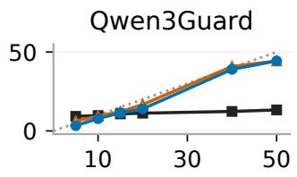

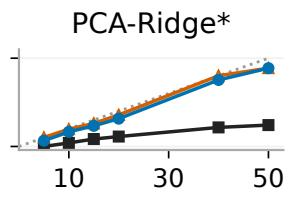

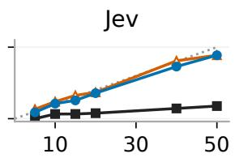

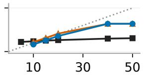

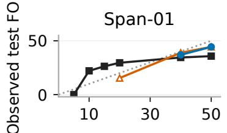

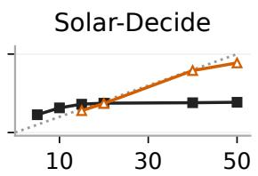

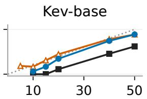

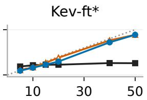

Target risk budget α (%)  

<table><tr><td rowspan=1 colspan=1>α 5</td><td rowspan=1 colspan=1>10</td><td rowspan=1 colspan=1>1</td><td rowspan=1 colspan=1>5 2</td><td rowspan=1 colspan=1>0 4</td><td rowspan=1 colspan=1>0 5</td><td rowspan=1 colspan=1>0</td></tr><tr><td rowspan=1 colspan=1>N</td><td rowspan=1 colspan=1></td><td rowspan=1 colspan=1></td><td rowspan=1 colspan=1></td><td rowspan=1 colspan=1></td><td rowspan=1 colspan=1></td><td rowspan=1 colspan=1></td></tr><tr><td rowspan=1 colspan=1>E</td><td rowspan=1 colspan=1></td><td rowspan=1 colspan=1></td><td rowspan=1 colspan=1></td><td rowspan=1 colspan=1></td><td rowspan=1 colspan=1></td><td rowspan=1 colspan=1></td></tr><tr><td rowspan=1 colspan=1>L</td><td rowspan=1 colspan=1></td><td rowspan=1 colspan=1></td><td rowspan=1 colspan=1></td><td rowspan=1 colspan=1></td><td rowspan=1 colspan=1></td><td rowspan=1 colspan=1></td></tr></table>

Naive Empirical LTT Risk = budget  
Grids: N / E / L = rules; · = plotted; ND / NF / UD = unavailable risk.

Figure 3: WildGuardMix: test FOR versus budget risk.  
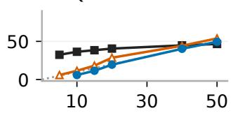

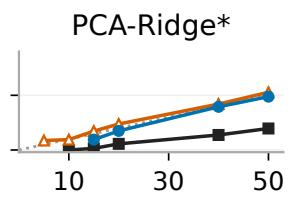

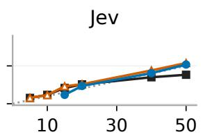

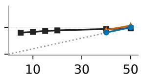

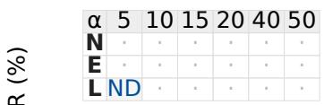

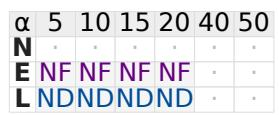

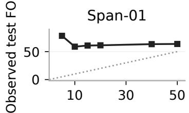

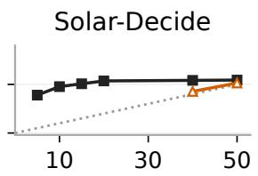

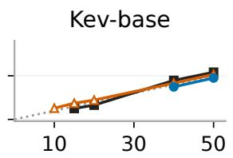

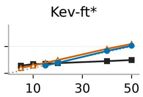

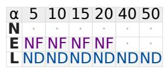

  
Target risk budget α (%)

<table><tr><td rowspan=1 colspan=1>α 5</td><td rowspan=1 colspan=1>1</td><td rowspan=1 colspan=1>0 1</td><td rowspan=1 colspan=1>5 2</td><td rowspan=1 colspan=1>0 4</td><td rowspan=1 colspan=1>0</td><td rowspan=1 colspan=1>50</td></tr><tr><td rowspan=1 colspan=1>N</td><td rowspan=1 colspan=1></td><td rowspan=1 colspan=1></td><td rowspan=1 colspan=1></td><td rowspan=1 colspan=1></td><td rowspan=1 colspan=1></td><td rowspan=1 colspan=1></td></tr><tr><td rowspan=1 colspan=1>E</td><td rowspan=1 colspan=1></td><td rowspan=1 colspan=1></td><td rowspan=1 colspan=1></td><td rowspan=1 colspan=1></td><td rowspan=1 colspan=1></td><td rowspan=1 colspan=1></td></tr><tr><td rowspan=1 colspan=1>LN</td><td rowspan=1 colspan=1>DN</td><td rowspan=1 colspan=1>D</td><td rowspan=1 colspan=1></td><td rowspan=1 colspan=1></td><td rowspan=1 colspan=1></td><td rowspan=1 colspan=1></td></tr></table>

Grids: N / E / L = rules; · = plotted; ND / NF / UD = unavailable risk.

Figure 4: Aegis: test FOR versus risk budget.

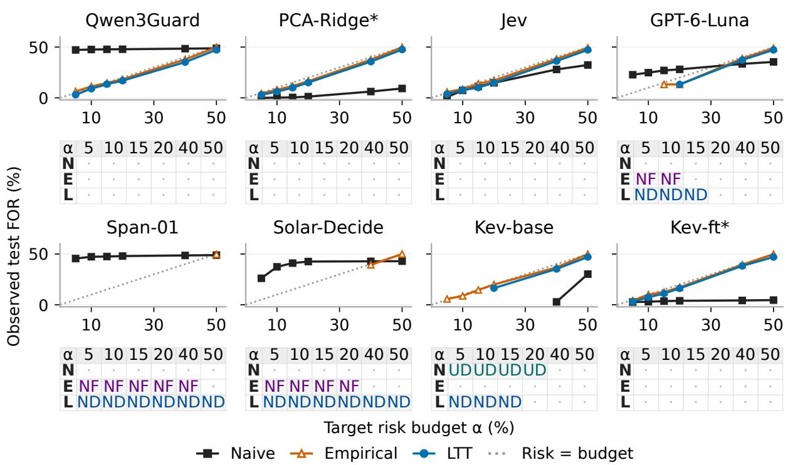

<table><tr><td rowspan=1 colspan=1>α</td><td rowspan=1 colspan=1>5</td><td rowspan=1 colspan=1>10</td><td rowspan=1 colspan=1>15</td><td rowspan=1 colspan=1>20</td><td rowspan=1 colspan=1>40</td><td rowspan=1 colspan=1>50</td></tr><tr><td rowspan=1 colspan=1>N</td><td rowspan=1 colspan=1></td><td rowspan=1 colspan=1></td><td rowspan=1 colspan=1></td><td rowspan=1 colspan=1></td><td rowspan=1 colspan=1></td><td rowspan=1 colspan=1></td></tr><tr><td rowspan=1 colspan=1>E</td><td rowspan=1 colspan=1></td><td rowspan=1 colspan=1></td><td rowspan=1 colspan=1></td><td rowspan=1 colspan=1></td><td rowspan=1 colspan=1></td><td rowspan=1 colspan=1></td></tr><tr><td rowspan=1 colspan=1>L</td><td rowspan=1 colspan=1></td><td rowspan=1 colspan=1></td><td rowspan=1 colspan=1></td><td rowspan=1 colspan=1></td><td rowspan=1 colspan=1></td><td rowspan=1 colspan=1></td></tr></table>

Grids: N / E / L = rules; · = plotted; ND / NF / UD = unavailable risk.

Figure 5: S-Labs: test FOR versus risk budget.  
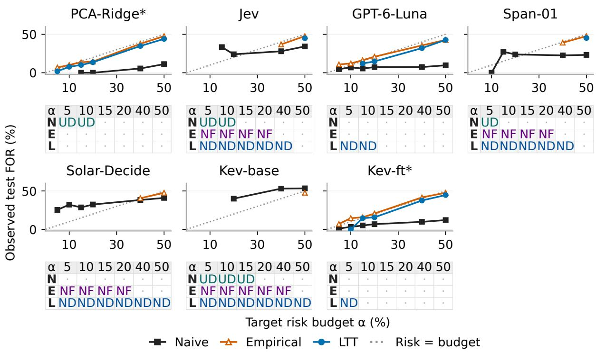  
Grids: N / E / L = rules; · = plotted; ND / NF / UD = unavailable risk.

Figure 6: ATBench: test FOR versus risk budget.

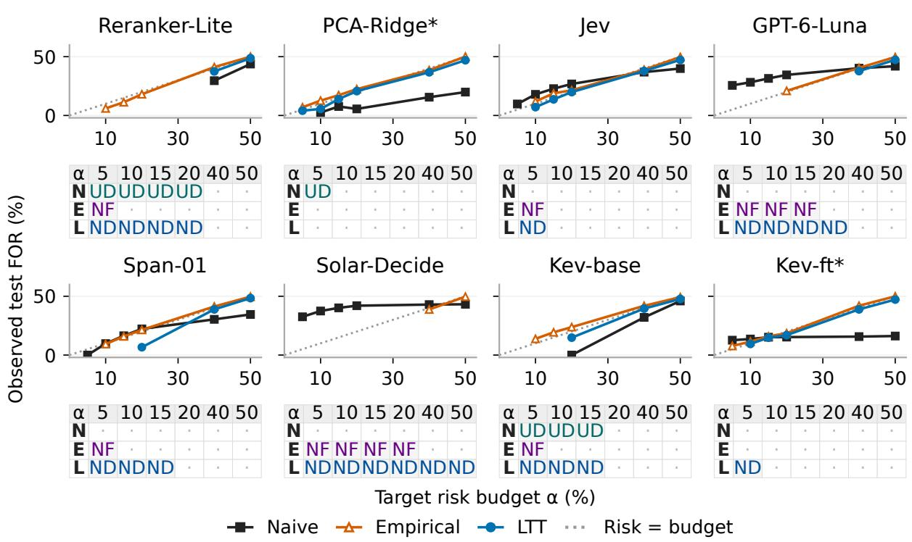

<table><tr><td rowspan=1 colspan=1>α</td><td rowspan=1 colspan=1>5</td><td rowspan=1 colspan=1>10</td><td rowspan=1 colspan=1>15</td><td rowspan=1 colspan=1>20</td><td rowspan=1 colspan=1>40</td><td rowspan=1 colspan=1>50</td></tr><tr><td rowspan=1 colspan=1>N</td><td rowspan=1 colspan=1></td><td rowspan=1 colspan=1></td><td rowspan=1 colspan=1></td><td rowspan=1 colspan=1></td><td rowspan=1 colspan=1></td><td rowspan=1 colspan=1></td></tr><tr><td rowspan=1 colspan=1>E</td><td rowspan=1 colspan=1></td><td rowspan=1 colspan=1></td><td rowspan=1 colspan=1></td><td rowspan=1 colspan=1></td><td rowspan=1 colspan=1></td><td rowspan=1 colspan=1></td></tr><tr><td rowspan=1 colspan=1>L</td><td rowspan=1 colspan=1>ND</td><td rowspan=1 colspan=1></td><td rowspan=1 colspan=1></td><td rowspan=1 colspan=1></td><td rowspan=1 colspan=1></td><td rowspan=1 colspan=1></td></tr></table>

Grids: N / E / L = rules; · = plotted; ND / NF / UD = unavailable risk.

Figure 7: SciDocs: test FOR versus risk budget.  
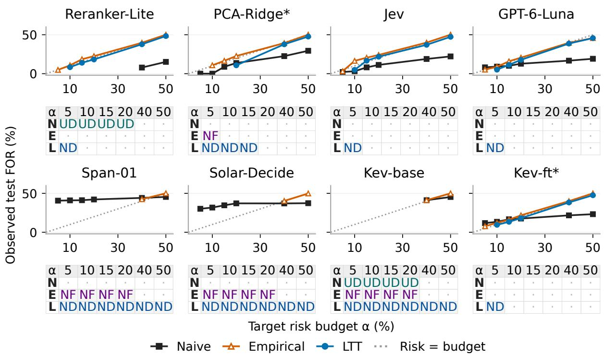

<table><tr><td rowspan=1 colspan=1>α 5</td><td rowspan=1 colspan=1>1</td><td rowspan=1 colspan=1>0 1</td><td rowspan=1 colspan=1>5 2</td><td rowspan=1 colspan=1>0 4</td><td rowspan=1 colspan=1>0</td><td rowspan=1 colspan=1>50</td></tr><tr><td rowspan=1 colspan=1>N</td><td rowspan=1 colspan=1></td><td rowspan=1 colspan=1></td><td rowspan=1 colspan=1></td><td rowspan=1 colspan=1></td><td rowspan=1 colspan=1></td><td rowspan=1 colspan=1></td></tr><tr><td rowspan=1 colspan=1>E</td><td rowspan=1 colspan=1></td><td rowspan=1 colspan=1></td><td rowspan=1 colspan=1></td><td rowspan=1 colspan=1></td><td rowspan=1 colspan=1></td><td rowspan=1 colspan=1></td></tr><tr><td rowspan=1 colspan=1>L</td><td rowspan=1 colspan=1>ND</td><td rowspan=1 colspan=1></td><td rowspan=1 colspan=1></td><td rowspan=1 colspan=1></td><td rowspan=1 colspan=1></td><td rowspan=1 colspan=1></td></tr></table>

Grids: N / E / L = rules; · = plotted; ND / NF / UD = unavailable risk.

Figure 8: StackOverflow: test FOR versus risk budget.

## C.4 LTT Risk–Utility Across Datasets

Figure 9 shows LTT-selected operating points for all six datasets. Utility is benign acceptance for moderation and safety, and irrelevant removal for reranking. Missing certificates are never plotted as zero-risk points.

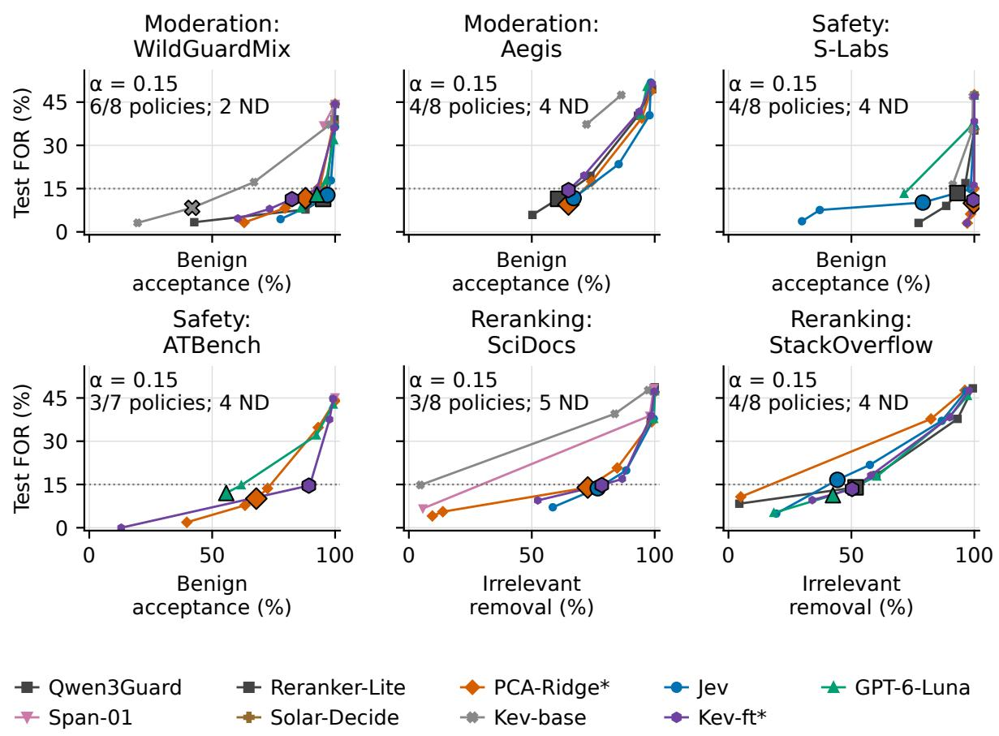  
Outlined: α = 0.15; small: other budgets. Dotted: 15% reference.

Figure 9: LTT-selected operating points for all datasets. Large outlined markers identify $\alpha = 0 . 1 5 ;$ small markers show the other budgets. Counts indicate defined policies and ND outcomes at 0.15. The dotted line is the 15% reference. \*: supervised adaptation.